# 2021 IEEE 系统与软件性能分析国际研讨会（ISPASS）（美国纽约州斯托尼布鲁克，2021年3月28日-3月30日）


## 摘要

随着数据中心中机器学习（ML）工作负载占比的迅速增加，云服务提供商开始引入张量处理单元（TPU）等加速器，以提高应用程序的能效比。然而，如果不优化应用程序参数，用户可能会低效利用加速器，最终浪费能源和金钱。本文提出了 TPUPoint，以促进在基于 TPU 的云平台上开发高效应用程序。TPUPoint 自动将重复模式分类为阶段，并识别每个阶段中最具时间关键性的操作。此外，TPUPoint 可以将阶段与检查点关联，以允许在应用程序中快进，从而显著减少优化应用程序所花费的时间和金钱。通过在广泛的代表性 ML 工作负载上运行 TPUPoint，我们发现计算不再是最耗时的操作；相反，交换和重新对齐数据的 `infeed` 和 `reshape` 操作变得最为重要。TPUPoint 的优势大大提高了发现最优参数的潜力，以便快速平衡向系统输入数据、重新格式化数据和计算结果的复杂工作负载流水线。在本文中，我们展示了如何使用 TPUPoint 来表征一组流行的 ML 工作负载。我们证明，NN 模型的迭代特性意味着所有 ML 工作负载都表现出可通过极少数重要阶段轻松表征的重复行为。TPUPoint 识别了耗时的算子，例如 `infeed`、`outfeed` 和 `reshape`，这些算子在几乎所有 NN 模型中都很常用，且与计算没有直接关系；如果这些间接算子不能足够快地准备数据集或交换出数据集，就会阻塞计算的进展。

## I. 引言

机器学习（ML）的兴起为为现代云基础设施应用设计高效 ML 系统创造了强劲需求 [1]，[2]，[3]，[4]，[5]，[6]，[7]，[8]，[9]，[10]。由于常规通用处理器和图形处理单元（GPU）针对标量或向量操作进行了优化，依赖它们的现代计算机架构在执行 ML 任务时会浪费能源。因此，依赖基于矩阵的神经网络（NN）的更高效 ML 加速器在数据中心中越来越普及。Google 的张量处理单元（TPU）每瓦性能比常规 GPU 高出 70×，是迄今最具代表性的案例 [11]。

由于异构架构组件和平台的性能特性各不相同，创建统一优化的 ML 程序是不现实的。一个更可行的方法是自动化优化过程本身。TPUPoint 框架通过 TPUPoint-Optimizer 实现此目标；TPUPoint-Optimizer 在 Cloud TPU 平台上自动且动态地重写代码，以减少程序员的工作量。我们的结果表明，使用 TPUPoint-Optimizer 动态确定的最优参数允许编写合理的 TensorFlow 程序达到与通过详尽程序员优化所达到的性能至少相同的水平。

本文提出了 TPUPoint，这是一个开源工具链，用于表征在 Google Cloud TPUs 上运行的应用程序的行为并优化其性能。TPUPoint 的分析器会自动将 TPU 应用程序的重复模式分类为阶段，并识别每个阶段中最具时间关键性的操作，以指导优化。TPUPoint 还可以将每个阶段与检查点关联，以便在目标阶段之前立即重启应用程序，并且 TPUPoint 为用户提供对 TPUPoint-Optimizer 等自动化工具的访问权限，以检查不同配置下的性能变化。

通过引入 TPUPoint，本文做出了四项关键贡献；（1）它提出了 TPUPoint，以加速新兴 ML 加速器基础云架构中 ML 应用程序的开发和优化，（2）它使用广泛的 ML 应用程序验证了 TPUPoint 的功能，（3）它识别了 ML 应用程序的常见瓶颈，（4）它详细介绍了一种发现 ML 应用程序最优参数的系统方法。

本文的其余部分组织如下：第 II 节介绍了 TPU 和基于 TPU 的云服务器的架构。第 III 节介绍了 TPUPoint 的设计。第 IV 节描述了 TPUPoint-Analyzer 的实现。第 V 节介绍了我们的实验平台。第 VI 节回顾了从 TPUPoint-Analyzer 获得的见解。第 VII 节展示了 TPUPoint-Optimizer 的结果。第 VIII 节为相关工作提供了背景摘要，第 IX 节提供了结束评论。

## II. TPU

Google 已在其数据中心广泛部署 TPU，并通过 Google Cloud 服务将 TPU 开放给用户应用程序。本节简要描述了 Cloud TPU 的功能和接口。

1 你可以在 [https://github.com/escalab/TPUPoint] 处找到 TPUPoint

### A. Cloud TPUs

Google 提供三种不同的 Cloud TPU。Google 内部使用第一代 TPU 用于搜索和推理，但通过 Google Cloud Platform 和 TensorFlow Research Cloud (TFRC) 计划 [12] 提供第二代和第三代 TPU（分别为 TPUv2 和 TPUv3）。TPUv2 芯片包含两个矩阵单元（MXU），每个 MXU 关联 8 GiB 高带宽内存（HBM），为 200–250 W TDP 提供合计 45 TFLOPS 的理论计算吞吐量。Google 通常将四个 TPUv2 组合在单个板上 [13]。TPUv3 包含的 MXU 数量是 TPUv2 的两倍，HBM 也是两倍。Google 未披露关于 TPUv3 架构的许多细节。尽管如此，性能规格说明（包括每颗芯片 90 TFLOPS 的容量和 32 GB HBM）表明，TPUv3 只是利用更先进的制程技术在同一芯片上放置四个 MXU，同时保持与 TPUv2 相同的功耗水平。

### B. Cloud TPU 硬件/软件接口

Google Cloud TPU 只能通过关联 TPU 实例的计算实例（Compute Engine）访问。除了 Compute Engine VM，Google Cloud TPU 还需要云存储（Storage Buckets）来存储执行过程中的训练数据和模型信息；Compute Engine 充当主机，TPU 充当协处理器，Storage Buckets 充当持久内存。这些组件构成了 Cloud TPU 架构。

TensorFlow [14] 是 Cloud TPU 方程中的另一重要部分。Google 开发了 TensorFlow 框架，用于在单机和异构/分布式系统上建模和执行 ML 算法。Google Cloud TPU 与 TensorFlow 现成集成。TensorFlow 大量使用 Google 的 Protocol Buffers（Protobuf）和 Google 的远程过程调用（gRPC）。Protobuf 和 gRPC 对 TensorFlow 框架都至关重要，以允许在 TensorFlow 中发生通信。TensorFlow 大量使用 Google 的 Protocol Buffers（Protobuf）和 Google 的远程过程调用（gRPC）。Protobuf 允许在多种编程语言之间进行方便的数据抽象，gRPC 允许 TensorFlow 在多个服务器和客户端之间共享数据，以便在多个设备上方便地执行。gRPC 服务器实现一个方法并等待客户端请求。gRPC 客户端使用一个称为 stub 的对象来在客户端和服务器之间提供通道。stub 处理 gRPC 客户端请求（使用 Protobuf）和服务器响应，并使用 RDMA 等高效格式在执行期间进行进程间通信。Protobuf 和 gRPC 对 TensorFlow 框架都至关重要。

TensorFlow 执行涉及客户端（用户）、主节点和一个或多个工作进程。客户端与主节点交互，主节点协调工作进程。主节点是

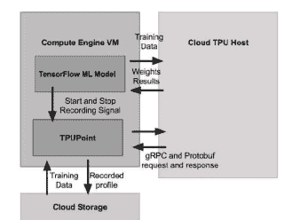

Fig. 1. TPUPoint 系统架构

负责处理图节点的设备放置，并将图分区为由工作进程执行的子图。除了管理整个计算图之外，主节点还应用诸如常量折叠之类的优化。工作进程处理来自主节点的请求，执行内核操作，并管理内核之间的通信。

尽管 Cloud TPU 的实现并未完全向公众开放，但已注册的 API 调用和可服务请求仍然可用；名为 CLOUD-TPU-PROFILER 的命令行工具可用于生成客户端到主节点的 gRPC 调用，以请求为小迭代生成 Cloud TPU 配置文件。然而，CLOUD-TPU-PROFILER 的实用性有限，因为它无法集成到训练代码中，只允许在执行后获得洞察，并且只在有限的时间范围内运行（因此无法对整个程序执行进行性能分析。）

## III. TPUPoint-Profiler: TPUPoint 的核心

TPUPoint 通过 TPUPoint-Profiler 模块提供一组工具。TPUPoint-Profiler 测量 Cloud TPU 性能并启用 TPUPoint 工具链的另外两个元素：（1）TPUPoint-Analyzer（第 IV 节），一种执行后的离线分析工具，用于识别最重要的应用程序阶段和系统组件利用不足的原因，（2）TPUPoint-Optimizer（第 VIII 节），一种在线自动工作负载优化工具，可动态调整和重写在 Cloud TPU 平台上运行的代码。本节介绍了 TPUPoint 设计和编程接口。

### A. TPUPoint-Profiler 设计

完整的 TPUPoint 工具链由一组扩展 TensorFlow 框架（目前 Cloud TPU 唯一的编程接口）组成。图 1 显示了核心 TPUPoint-Profiler 的交互，它驱动 TPUPoint-Analyzer 和 TPUPoint-Optimizer 与 TensorFlow 应用程序协同工作。

TPUPoint 在初始化 TPUPoint-Profiler 时创建一个单独的性能分析线程。创建后，TPUPoint-Profiler 线程会定期向关联的 Cloud TPU 发送性能分析请求，与主 TensorFlow 线程独立进行，允许 TPU 训练在性能分析进行时不受中断。当 Cloud TPU 将响应发送回性能分析线程时，TPUPoint-Profiler 生成一个性能分析记录


```python
import tensorflow as tf
from tensorflow.contrib.tpu import TPUPoint as TP
...
def main(argv):
    #...
    estimator = tf.contrib.tpu.TPUEstimator(...)
    tpprofiler = TP(...)
    #...
    tpprofiler.Start(analyzer = True)
    estimator.train(...)
    tpprofiler.Stop()

if __name__ == "__main__":
    tf.app.run()
```

图 2. 启动 TPUPoints 分析功能的示例 TensorFlow 代码

包含操作，并随每个响应提供 TPU 空闲时间和 MXU 利用率的元数据。

如果程序员打算使用 TPUPoint-Analyzer，TPUPoint-Profiler 线程将创建一个额外的记录线程，以将收集到的统计信息存储在 Cloud Storage 中（否则，TPUPoint-Profiler 只是在主机主内存中缓冲配置文件）。在记录线程存储数据的同时，TPUPoint-Profiler 的分析线程会继续从 Cloud TPU 请求下一个配置文件。在配置期间可靠地记录所有事件可以产生大量记录，因为每个配置文件可能包含最多 1,000,000 个事件，持续时间总计最长 60,000 ms。通过仅在配置文件中存储统计信息，TPUPoint-Profiler 减少了内存消耗，并加速了 TPUPoint-Analyzer 和 TPUPoint-Optimizer 中的后处理。一旦 TensorFlow 应用程序完成或达到用户指定的断点，TPUPoint-Profiler 的分析线程将发送最后一个请求。在 TPUPoint-Profiler 接收并适当保存了发送到 Cloud TPU 的最后一个配置记录响应后，所有 TPUPoint-Profiler 线程将终止。生成的配置记录数量取决于 TensorFlow 应用程序的持续时间。

### B. TPUPoint 编程接口

当前版本的 TPUPoint 为程序员提供基于 Python/TensorFlow 的前端，后端功能使用 C++ 实现。图 2 展示了在 TensorFlow 应用程序中启用 TPUPoint-Profiler 的示例代码。程序员需要通过创建 TPUPoint-Profiler 对象（示例第 7 行中的 tpprofiler）并指定适当选项来启动 TPUPoint 使用。

TPU 训练通过 TensorFlow 的高级 TPUEstimator API 执行（第 6 行和第 10 行）。如果程序员希望使用 TPUPoint-Analyzer 进行执行后分析，则必须在 Start() 函数调用中将 analyzer 标志设置为 true（第 9 行）；当 analyzer 标志设置为 false 时，TPUPoint-Profiler 仅启用 TPUPoint-Optimizer。训练完成（即 TPUEstimator.train() 已结束）后，TPUPoint-Profiler 通过 Stop() 函数停止（第 11 行）。当已指定执行后分析（如代码示例所示）时，Stop() 还将实例化 TPUPoint-Analyzer 进程以可视化分析结果。

此实现允许 TPUPoint 对应用程序的整个持续时间进行分析，这是 CLOUD-TPU-PROFILER 命令行工具不具备的功能。

## IV. TPUPoint-Analyzer: 执行后分析

为应对从大量分析统计数据中推导有意义结果的挑战，TPUPoint-Analyzer 会遍历并将配置文件汇总为程序阶段。为应对这些挑战，TPUPoint 实现了 TPUPoint-Analyzer 的执行后分析。TPUPoint-Analyzer 执行后处理中的每个程序阶段都会识别相似的重复程序行为。将程序行为汇总为阶段，以便于分析、可视化以及用于性能优化的检查点/重启。

### A. 分析算法

为了减少 TPUPoint-Analyzer 在计算程序行为相似性时的搜索空间，TPUPoint-Analyzer 首先利用 Google 为 Cloud TPU 提供的步骤编号——这些步骤编号指示粗粒度的重复应用程序行为。随后，TPUPoint-Analyzer 将这些步骤作为相似性比较的基本单位，并为步骤创建可视化摘要。TPUPoint-Analyzer 提供三种汇总方法：传统的 k-means 算法 [15]、[16]、基于密度的带噪声的空间聚类应用 (DBSCAN) [17]、[18] 以及开销更低的在线线性扫描 (OLS) 算法。k-means 和 DBSCAN 在所有分析记录完成后运行，而 OLS 在记录期间执行（因此其名称中有“在线”一词）。

k-means：我们使用三个阶段 [19] 来评估 TPUPoint-Analyzer 中的 k-means 算法实现：

- 1) 从所有统计配置文件中提取记录，并使用 TPU 步骤编号将记录聚合在一起。对于每个步骤，我们根据 TensorFlow 操作、累积调用次数和总持续时间定义维度。使用主成分分析 (PCA) 进行降维 [20]，我们最多有 100 个不同操作用于频率向量表示。
- 2) 对 k 取值范围为 1 到 15 的聚合步骤尝试 k-means 聚类算法。每次 k-means 运行都会产生一个聚类，将步骤划分为 k 个不同的簇。
- 3) 对于每个簇（k = 1, ..., 15），计算每个 k 值的样本到簇中心（质心）的平方距离之和。尝试使用肘部方法最小化平方距离之和，同时最大化簇的数量 (k)。

TPUPoint-Analyzer 实现的 k-means 类似于 SimPoint [19]、[21]、[22]。SimPoint 使用贝叶斯信息准则 (BIC) [23] 来衡量给定模拟的聚类概率。SimPoint 将每周期指令数 (IPC) 作为指标，将聚类而非完整模拟用于分析进行比较。TPUPoint 的目标是不使用 IPC 等架构指标来模拟完整的程序执行，而是采用肘部方法 [24] 作为启发式方法，在改进不再显著增加时停止聚类（即，当某个簇的平方距离之和不再显著改善时）。

DBSCAN：DBSCAN [17]、[18] 与 k-means 遵循相同的一般方法，但依赖于高密度簇的核心样本。DBSCAN 为与 k-means 的比较提供了一种替代方法。DBSCAN 也有三个阶段：

- 1) 从所有统计配置文件中提取记录，并生成与 k-means 中相同的频率向量表示。
- 2) 在聚合的 25 个步骤上应用 DBSCAN，要求最小样本数从 5 到 200。随着最小值增加，生成的簇数量减少。
- 3) 对于每个聚类最小样本大小，通过计算未标记点的数量与总点数的比率来测量噪声比例。尝试使用肘部方法最小化噪声，同时最大化形成簇所需的样本数量。

OLS：k-means 和 DBSCAN 都会在程序执行后对所有记录进行后处理，这要求系统存储大量记录，并因每条记录的维度复杂性而产生高计算开销。为解决这些问题，TPUPoint-Analyzer 提供 OLS，该方法可识别相似的连续程序行为，以显著更低的开销和减少的数据存储需求来近似聚类。使用 OLS 时，TPUPoint-Analyzer 仅依赖当前步骤、前一步骤和两步前步骤的记录。OLS 有四个阶段：

- 1) 从传入的统计配置文件中提取记录，并使用步骤编号将记录分组。对于每个步骤，使用程序中的所有 TensorFlow 操作以及每个操作的累积调用次数和总持续时间。
- 2) 当程序进入另一个步骤时，将配置文件中的前一步骤与其后继步骤进行比较，并使用公式 [1] 计算它们的相似性。公式 [1] 将两个步骤的相似性计算为步骤 i-1 的事件集与步骤 i-2 的事件集的交集与两个集合大小中较小值的比率，其中步骤 i-1 是步骤 i-2 的后继步骤。（某个步骤的事件集定义为在该步骤期间发生的所有唯一事件。）
- 3) 如果根据用户指定的阈值或默认阈值（70% 相似性）判断后继步骤相似，则将两个步骤分组为单个阶段。否则，将后续步骤与新的程序阶段关联。
- 4) 重复上述阶段，逐步聚合连续步骤，直到存储的配置文件中的所有步骤都被解析。

StepSimilarity (Step_i-1, Step_i-2) = |Step_i-1 ∩ Step_i-2| / min(|Step_i-1|, |Step_i-2|) (1)

### B. 可视化

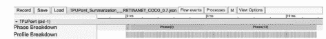

图 3. TPUPoint 分析输出的可视化

TPUPoint-Analyzer 生成一个 JSON 文件来存储应用程序行为的汇总视图。此文件连同相应的 CSV 文件包含 (1) 每个阶段的格式化描述和 (2) 训练步骤期间执行的 TPU 和主机 CPU 操作。JSON 文件与 Google Chrome 的事件分析工具 chrome://tracing 兼容。图 3 显示了从这样的文件中获取的 TPU 训练阶段期间 TPUPoint-Analyzer 输出的可视化。每条记录的配置文件在横向 Profile Breakdown 轴上显示为总执行时间的一个小子段。每个识别的阶段在横向 Phase Breakdown 轴上显示为总执行时间的一个较大子段。图 3 展示了每个阶段如何跨越多个配置文件记录，从而有效汇总每个配置文件的信息。图 3 中显示的时间标记不按比例绘制，因为 TPUPoint-Analyzer 对配置文件和阶段的可视化仅是一种表示，旨在减少用户必须消耗的信息量。使用 Chrome 的控件，用户可以对每个程序阶段进行放大/缩小，以查看 TPUPoint-Analyzer 输出中更多/更少的细节。

### C. 检查点与重启

除了阶段外，TPUPoint 还记录 TensorFlow 模型存储的每个阶段最近的检查点。为识别检查点，TensorFlow 比较阶段内的步骤，并找到与这些步骤距离最小的检查点。这种方法允许基于目标阶段修改应用程序，并从步骤零开始执行。

## V. 实验方法论

为验证 TPUPoint-Profiler 和 TPUPoint-Analyzer 的设计，并获得有助于代码优化的初步见解，我们在 Google Cloud Platform 上运行了一组实验。每个实例包含一台主机，配备 16 核、双路 SMT Intel Skylake CPU、104 GB 主内存和 250 GB 持久磁盘 [25]。为保持实现一致性，所有实例均使用 Docker 19.03.1 版和带有已安装 TPUPoint 的 TensorFlow 1.15 版。如第 III 节所述，每个实例都可以访问 TPUv2 和 TPUv3——在单个 TPU 实例上运行的模型实现（如 TPUv2）可以在不进行代码修改的情况下在单个 TPUv3 实例上运行。然而，对多个 TPU 实现进行扩展“需要大量调整和


| 工作负载名称 | 工作负载类型 | 模型 | 数据集 | 数据集大小 | 默认训练参数 |
|---|---|---|---|---|---|
| BERT | 自然语言 | BERT | 斯坦福问答数据集 (SQuAD)<br>微软研究释义语料库 (MRPC)<br>多类型自然语言推理 (MNLI)<br>语言可接受性语料库 (CoLA) | 422.27 MiB<br>2.85 MiB<br>430.61 MiB<br>1.44 MiB | 最大序列长度: 128<br>训练批次大小: 32<br>学习率: 2e-5<br>时代数: 3<br>批次大小: 1024<br>分片数: 8<br>训练步数: 10000<br>每次评估的训练步数: 1000<br>学习率: 0.001<br>学习率: 0.0002 |
| DCGAN | 图像生成 | DCGAN | CIFAR10<br>MNIST | 178.87 MiB<br>56.21 MiB | 训练批次大小: 1024<br>分片数: 8<br>训练步数: 10000<br>每次评估的训练步数: 1000<br>学习率: 0.001<br>学习率: 0.0002 |
| QANet | 问答自然语言 | QANet | 斯坦福问答数据集 (SQuAD) | 422.27 MiB | 训练批次大小: 32<br>每个时代的步数: 20000<br>时代数: 5 |
| RetinaNet | 目标检测 | RetinaNet | 上下文中的常见对象 (COCO) | 48.49 GiB | 训练批次大小: 64<br>分片数: 8<br>时代数: 15<br>每个时代的样本数: 120k |
| ResNet | 图像分类 | ResNet-50 | ImageNet | 143.38 GiB | 默认网络深度: 50<br>训练步数: 112590<br>默认批次大小: 1024 |

### 表 I
工作负载分解与规格

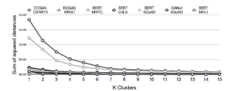

图 4. 基于 k-means 且针对不同工作负载扫描的 TPUPoint-Analyzer 聚类结果；图表显示 k 个簇（k = 1, ..., 15）中样本到质心的平方距离之和。

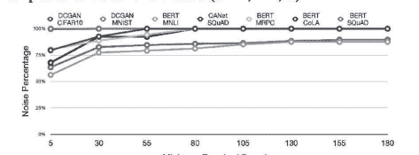

图 5. 使用 DBSCAN 针对不同工作负载的 TPUPoint-Analyzer 聚类结果；图表显示为形成簇所需的 5 到 180 个最小样本数（步长为 25），噪声样本与总样本的比率。

optimization" [13]; 为避免任何未优化的模型执行，实验仅在单 TPU 实例上进行。表 I 描述了我们用于测试和验证设计与假设的工作负载。我们从 TensorFlow 1.14 TPU 模型库 [26] 中选择了公开可用的工作负载：自然语言处理（NLP）（BERT [27]）、图像生成（DCGAN [28]）、问答（Q/A）NLP（QANet [29]）、目标检测（RetinaNet [30]）和图像分类（ResNet-50 [31]）。

## VI. 从 TPUPoint-Analyzer 获得的观察与洞察

### A. 阶段的代表性

TPUPoint-Analyzer 识别应用程序中相似的重复行为，并将这些行为分类为阶段，以便于分析和优化。本节讨论并比较了从 k-means、DBSCAN 和 OLS 聚类算法中识别出的阶段。

图 4 显示了 k 从 1 到 15（包含 1 和 15）的 k-means 聚类结果。每个簇代表一个更广泛程序执行的阶段。在此情况下，TPUPoint-Analyzer 确定当 k 在 4 到 6 之间时，平方距离之和不再有显著改善；也就是说，4 到 6 个簇足以覆盖大多数程序行为。

尽管 DBSCAN 和 k-means 都使用肘部法，但 DBSCAN 不使用质心，因此距离不能作为聚类度量。相反，DBSCAN 改变形成簇所需的最小样本数——将样本指定为簇或噪声样本。图 5 显示了形成簇所需的最小样本数从 5 到 180（以 25 为步长聚合）时，噪声样本与所有样本的比率。应用了肘部法，试图在最大化形成簇所需的最小样本数的同时降低噪声百分比。使用 DBSCAN，TPUPoint-Analyzer 发现 30 到 80 个样本的最小值可优化降低噪声，并产生 3 到 13 个簇。同样，每个簇代表一个更广泛程序执行的阶段。

图 6 显示 OLS 使用公式 1 对不同相似度识别出的阶段数量。当相似度阈值为 70% 时，我们发现大多数工作负载被压缩为仅 3 个阶段。对于高于 70% 的相似度阈值，绝大多数工作负载识别出的阶段数量会显著增加。对于这些工作负载，我们进一步检查了相邻阶段中无法合并在一起的算子，并发现相邻阶段之间的差异基本可以忽略不计，因为它们通常只占应用程序执行时间的一小部分，甚至将单个操作变成一个阶段——这导致阶段之间的相似度低，从而产生过多的阶段。

由于 OLS 倾向于将差异很小的步骤分成不同的阶段，高相似度阈值会导致识别出的阶段数量显著增加。话虽如此，k-means、DBSCAN 和 OLS 都将同一组阶段聚合为一个阶段。即使 TPUPoint-Analyzer 使用极端的 100% StepSimilarity 阈值（意味着 TPUPoint-Analyzer 要求阶段中的所有步骤共享完全相同的算子分解），TPUPoint-Analyzer 仍将大多数工作负载分解为少于 15 个

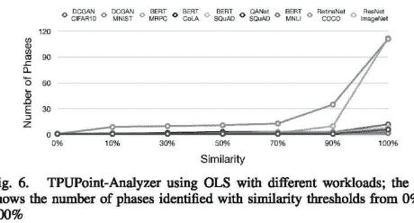

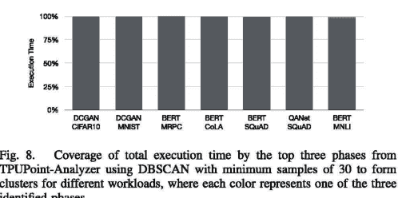

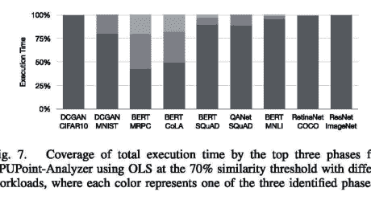

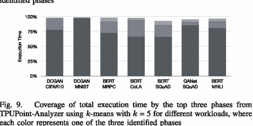

个阶段，除了 RetinaNet-COCO 和 ResNet-ImageNet 工作负载。上述结果为本文提供了第一个观察：

观察 1：大多数 TPU 工作负载可以总结为有限数量的阶段。

判断阶段选择的另一个指标是执行时间的覆盖率。基于观察 1，我们针对不同阈值累积了 3 个最长阶段的总执行时间。图 7 显示，在使用 OLS 且相似度阈值为 70% 时，这 3 个主要阶段涵盖了每个工作负载至少 95% 的总执行时间。对于 70% 的阈值，TPUPoint-Analyzer 可以覆盖所有工作负载近 100% 的执行时间。如图 9 和图 8 所示，k-means（k = 5）和 DBSCAN（最小样本数 = 30）的结果类似。由于 DBSCAN 无法聚类的噪声样本数量较多，我们也将这些未标记样本视为一个簇。我们发现，如图 8 所示，这些样本占大多数工作负载执行时间的大部分。图 9 表明，即使将 k-means 设置为大于 3 个簇，前 3 个仍将占据主导地位。

观察 2：3 个最长的阶段涵盖了 TPU 工作负载的大部分执行时间。

### B. 阶段中的算子

云 TPU 仅仅是计算机系统中的硬件加速器，因此 TPU 加速的工作负载仍依赖主机程序进行工作负载分发。我们现在描述主机 CPU 程序和 TPU 上最耗时的操作。

表 III 显示了使用 TPUv2 时，CPU/主机程序和 TPU 程序中 3 个最长阶段内最耗时的前 5 个操作。对于 k-means 和 DBSCAN，识别出的阶段大多相同，顶级算子集也几乎相同。对于倾向于将相似阶段划分为多个阶段的 OLS，其前 5 个算子与 k-means 和 DBSCAN 的前 5 个算子略有不同。

尽管如此，所有三种算法都在各工作负载的 TPUv2 上识别出一组共同的最耗时算子，其中融合算子总体上最耗时。识别出的融合算子结合了 XLA 编译器中的计算密集型操作，旨在帮助减少内存操作 [32]。reshape 算子也是最耗时的算子之一。与融合不同，reshape 与算法无关，而仅用于为后续 TPU 计算准备输入数据。

主机端最关键的算子是 TransferBufferToInfeedLocked 和 OutfeedDequeueTuple。这两个算子都与 TPU 交换数据。图 10 显示了每个工作负载的 TPU 空闲时间百分比；云 TPU 平均有 38.90% 的时间处于 TPUv2 的空闲状态，43.53% 的时间处于 TPUv3 的空闲状态。图 11 探讨了 MXU 的利用不足问题——平均而言，从 TPUv2 的 22.72% 到 TPUv3 的 11.34%。在空闲时间内，主机忙于使用表 III 中列出的顶级算子准备和发送数据。我们现在有两个额外的观察：

观察 3：当前 TPU 工作负载在数据准备和数据交换方面产生大量开销。

观察 4：提高主机计算机上 TPU 数据准备和 TPU 数据交换效率是提高 TPU 利用率和 TPU 工作负载性能的关键。

为了识别云 TPU 之间的差异，我们使用相同的工作负载、数据集和参数对 TPUv3 重复了分析。使用 OLS、k-Means 和 DBSCAN，我们针对最长识别出的阶段和相应的簇识别出了前五个算子。表 III 还显示了


| | BERT MRPC | BERT SQuAD | BERT CoLA | BERT MNLI | DCGAN CIFAR10 | DCGAN MNIST | QANet SQuAD | RetinaNet COCO | ResNet ImageNet | Total TPUv2 | Total TPUv3 |
|---|---|---|---|---|---|---|---|---|---|---|---|
| | Q.k-means k-means DBSCAN | Q.k-means k-means DBSCAN | Q.k-means k-means DBSCAN | Q.k-means k-means DBSCAN | Q.k-means k-means DBSCAN | Q.k-means k-means DBSCAN | Q.k-means k-means DBSCAN | Q.k-means k-means DBSCAN | Q.k-means k-means DBSCAN | | |
| 主机操作 | | | | | | | | | | | |
| OutfeedDequeueTuple | O O O | O O O | O O O | O O O | O O O | O O O | O O O | O O O | O O O | 21 | 17 |
| TransferBuffer/InfeedLocked | O O O | O O O | O O O | O O O | O O O | O O O | O O O | O O O | O O O | 19 | 17 |
| Reshape | O O O | O O O | | O O O | O O O | O O O | O O O | | | 15 | 9 |
| Sqrt | O O O | O O O | | O O O | | O O O | O O O | | | 10 | 9 |
| Linearize32 | O O O | O O O | | O O O | O O O | O O O | | | | 9 | 5 |
| LR/AD | | | O O O | | O O O | | | O O O | | 8 | 9 |
| Infeed/DequeueTuple | O O O | O O O | | O O O | O O O | O O O | O O O | O O O | | 8 | 8 |
| InitializedHostPinnedDistributedTpu | | | | | | | | | | 7 | 3 |
| Reshape_1 | O O | | | O O | O O | | | | 4 | 6 |
| DisconnectHostFromDistributedTPUSystem | O | | O O | | O O | O | | O | | 3 | 0 |
| ReadVariable2 | | | | | | | | | | 4 | 1 |
| Recv | | | | | O | | | O O | | 1 | 1 |
| Min | | | | | | | | O O | | 1 | 1 |
| Maximum | | | | | | | | O O | | 1 | 1 |
| Minimum | | | | | | | | O O | | 1 | 1 |
| Sub | | | | | | | | O O | | 1 | 1 |
| DecodeAndCropJpeg | | | | | | | | | O O | | 1 | 1 |
| ResizeBicubic | | | | | | | | | | 1 | 1 |
| StartProgram | | | | | | | | | | 0 | 1 |
| BootstrapInitializer | | O O | | | O O | O O | O O | | | 0 | 12 |
| BuildLastOutput | O O | O O | | | | | | | | | 3 |
| TPU 操作 | | | | | | | | | | | |
| fusion | O O O | O O O | O O O | O O O | O O O | O O O | O O O | O O | O O | 23 | 23 |
| MatMul | O O O | O O O | O O O | O O O | O O O | O O O | O O O | O O O | O O O | 15 | 15 |
| Reshape_1 | O O O | O O O | O O O | O O O | O O O | O O O | O O O | | | 15 | 18 |
| L2Loss | O O O | O O O | O O O | O O O | O O O | O O O | O O O | O | | 12 | 12 |
| Conv2DBackpropFilter | | | | | O O | | | O | O | 8 | 6 |
| Transpose | O O O | O O O | O O O | O O O | O O O | O O O | | | | 6 | 6 |
| BiasAddGrad | | | | | | | | | | 6 | 6 |
| CrossReplicaSum | | | | | O O O | | | | | 6 | 3 |
| ConcatenateV2/ConcatV2/output | | | | | O O O | O O O | | O | O | 5 | 5 |
| FusedBatchNormV3 | | | | | O O O | | | O O O | | 3 | 6 |
| Infeed | | | | | | O O | | | | 3 | 5 |
| all | | | | | | | O O O | | | 3 | 3 |
| ReduceWindow | | | | | | | | O O | | 3 | 3 |
| Copy | | | | | | | | O | | 1 | 1 |
| InfeedDequeueTuple | | | | | | | | O O | | 1 | 1 |
| FusedBatchNormGradV3 | | | | | | | | O O | | 1 | 2 |
| Relu | | | | | | | | O | | 1 | 1 |

表 II
使用不同阶段检测算法在 TPUv2 中最耗时阶段的前 5 个最耗时算子，TPUv2 用 O 表示，TPUv3 用 [] 表示，两者共用 <>。

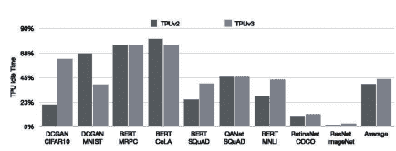
图 10. 各工作负载中 TPUv2 和 TPUv3 的空闲时间

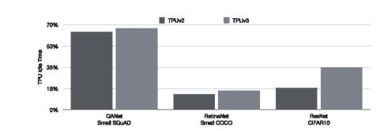
图 12. 使用较小数据集时，QANet、RetinaNet 和 ResNet 中 TPUv2 和 TPUv3 的空闲时间

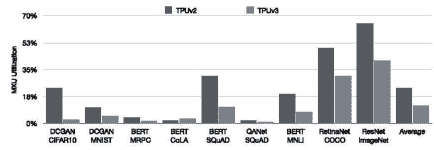
图 11. 各工作负载中 TPUv2 和 TPUv3 的 MXU 利用率

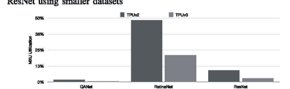
图 13. 使用较小数据集时，QANet、RetinaNet 和 ResNet 中 TPUv2 和 TPUv3 的 MXU 利用率

对于 TPUv2 和 TPUv3（以及主机）来说，前五个耗时算子通常保持一致。值得注意的是，k-Means 和 DBSCAN 在 RetinaNet 和 ResNet 等较大工作负载中会达到内存限制，这证实了 TPUPoint-Analyzer/OLS 组合可以与在 SimPoint [21]、[22] 中实现的聚类方法竞争。

对于 TPUv3，各工作负载中最耗时的算子与 TPUv2 相同，但 TPU 资源的总利用率发生了变化。QANet 和 RetinaNet 工作负载的 flop 利用率从 TPUv2 上的约 16% 降至 TPUv3 上的 13%（QANet），以及从 TPUv2 上的约 46% 降至 TPUv3 上的 32%（RetinaNet）。infeed 操作所需时间百分比的增加表明，与 outfeed 等内存算子相关的参数需要改变，以充分利用 TPUv3。然而，观察到的差异主要归因于 TPUv2 相对于 TPUv3 的改进计算能力。观察到的 infeed 时间百分比增加暗示，后一代 TPU 中的非计算开销可能更为显著。

观察 5：随着计算吞吐量的提高，非计算开销的重要性增加。

### C. 数据集

对于 BERT 和 DCGAN 工作负载，我们使用了不同的数据集，以帮助理解输入对相关模型的影响。对于使用 4 个不同输入数据集的 BERT 工作负载，表 III 中的前 5 个算子、图 10 中的 TPU 空闲时间和图 11 中的 MXU 利用率均有所不同，这与使用 DCGAN 模型的两个工作负载的情况相同。

为进一步观察不同数据集规模下的模型行为，QANet、RetinaNet 和 ResNet 在缩减数据集上运行。QANet 和 RetinaNet 通过将其原始 SQuAD 和 COCO 数据集减半来运行。ResNet 使用 CIFAR10 数据集运行。图 [12] 和图 [13] 分别显示了空闲 TPU 时间和矩阵利用率百分比。所有模型的 MXU 利用率均有所下降，空闲时间百分比总体有所增加。特别是 ResNet，尽管使用相同的方法馈入 CIFAR10 数据集，但其变化程度超过了图 [10] 和图 [11] 中其原始 ImageNet 数据集的观察结果。这些观察为 ML 应用的性能调优提供了另一种见解：

- 观察 6：即使使用相同的模型，性能瓶颈也可能随输入数据集的变化而改变。

观察 6 意味着，如果程序员使用特定数据集对特定模型的程序进行优化，该优化可能无法迁移到不同的数据集。因此，观察 6 指出需要动态运行时优化，以实现 ML 工作负载的最佳性能。

## VII. TPUPoint-Optimizer

基于 TPUPoint-Profiler 的观察结果，我们设计了 TPUPoint-Optimizer，这是一个自动工具，有助于精调工作负载中已识别阶段的性能。TPUPoint-Optimizer 在无需程序员输入的情况下工作，并确保调优不影响程序执行输出。TPUPoint-Optimizer 执行以下操作以帮助插桩工作负载：

- 它分析代码并自动插桩代码以辅助优化。
- 它允许在无需完整程序执行的情况下进行在线调优。
- 它控制输出质量。

本节描述了 TPUPoint-Optimizer 的设计。

### A. 程序分析

如果用户启用 TPUPoint-Optimizer，TPUPoint-Optimizer 将分析启动和停止 TPUPoint-Profiler 调用之间的 TensorFlow 程序。在程序分析阶段，TPUPoint-Optimizer 首先识别用户最初定义的可调参数。这些可调参数包括缓冲区大小、专用于某个操作的线程数量，以及在保持正确性的前提下可以重新排序的操作顺序。如果这些可调参数中的任何一个在被更改时导致错误，TPUPoint-Optimizer 不会将其视为可调参数。使用输入/输出变量列表和可调参数，TPUPoint-Optimizer 对代码进行插桩，在分析程序中的每个函数调用之前生成检查点。

### B. 在线调优

TPUPoint-Optimizer 提供了一项在线性能调优功能，可在无需程序完成整个执行周期的情况下调整 TPU 工作负载的性能。TPUPoint-Optimizer 的在线调优算法设计主要源自前一节中描述的两项观察：观察 1——大多数 TPU 工作负载可以

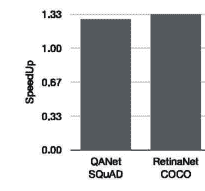
图 14. TPUPoint-Optimizer 针对 TPUv2 的加速比

总结为有限数量的阶段。观察 2——最长的 3 个阶段涵盖了 TPU 工作负载的大部分执行时间。综合来看，这些观察表明，对程序执行的一小部分进行优化，对整体程序执行可能产生重大影响。

TPUPoint-Optimizer 分析输入/输出变量并对代码进行插桩以进行检查点记录后，将使用正常输入和默认参数开始运行工作负载。同时，TPUPoint-Optimizer 使用为 TPUPoint-Profiler 开发的统计模型跟踪不同代码段中的累积执行时间。如果 TPUPoint-Profiler 在最耗时阶段中观察到第 [VI] 节中描述的最常见算子模式（例如，reshape、infeed、fusion、outfeed），或者当前阶段占聚合执行时间的一半以上，TPUPoint-Optimizer 会将当前代码段指定为已进入性能关键阶段，并相应地进行优化，同时确保保持正确性。

如果性能提高且输出不变，TPUPoint-Optimizer 将继续朝同一方向调整参数值，直到找到该特定参数的最佳值。如果没有其他邻近值优于默认值，TPUPoint-Optimizer 将保留默认值。最后，TPUPoint-Optimizer 使用改进后的调整参数完成程序其余部分的执行。

### C. TPUPoint-Optimizer 的性能

图 [14] 显示了使用 TPUPoint-Optimizer 调整默认参数后的优化程序性能以及 TPUv2 上的执行时间（针对朴素实现）。图 [14] 仅显示原本完成时间需二十分钟或以上的工作负载；执行时间远短的其他工作负载（例如，DCGAN 和 BERT）从 TPUPoint-Optimizer 中获得的性能提升微乎其微，并且在等待 TPUPoint-Optimizer 完成任何后处理任务时实际上可能会遭受性能损失。使用 TPUv2 的默认参数，执行时间较长的工作负载平均实现了约 1.12x 的加速比。需要注意的是，本研究中使用的大部分公开可用的 ML 工作负载均由 Google 工程师手动优化过。因此，为了测试 TPUPoint-Optimizer，我们开发了一个原始朴素实现，以查看 TPUPoint-Optimizer 是否能改进糟糕的性能。图 [15] 显示了朴素实现的 TPU 空闲时间，有和


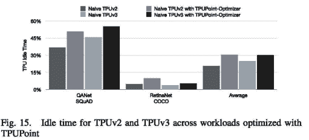

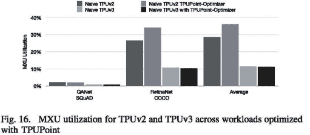

不带 TPUPoint-Optimizer 的 TPUv2 和 TPUv3。图 [16] 显示了带有和不带 TPUPoint-Optimizer 的朴素实现对 TPUv2 和 TPUv3 的 MXU 利用率。TPUPoint-Optimizer 增加了 TPUv2 和 TPUv3 朴素实现的 TPU 空闲时间（图 [15]）并提高了 TPUv2 的 MXU 利用率（图 [16]）。因此，TPUPoint-Optimizer 能够通过更高效地使用 Cloud TPU 带来性能提升，其中 TPUv2 表现出对矩阵运算依赖的显著变化。当我们将 TPUPoint-Optimizer 应用于原先执行时间不足二十分钟的朴素工作负载（BERT 和 DCGAN）时，这些工作负载的速度与原始性能相比没有显著变化。相比之下，当我们将 TPUPoint-Optimizer 应用于原先耗时超过二十分钟的朴素工作负载（QANet 和 RetinaNet）时，我们确实看到了速度的改善——这并不令人意外，因为执行时间较长的工作负载相对于执行时间较短的工作负载，涉及更大、更复杂的数据集和更深层的实现。由于 TPUv3 仅仅是包含 TPUv2 两倍数量的 MXU 和 HBM，我们没有观察到 TPUPoint-Optimizer 对 TPUv3 带来性能提升。事实上，由于我们分析/优化工具的开销，我们观察到平均性能损失低于 10%。尽管如此，这些结果表明，与完整程序执行相关的开销相比，TPUPoint-Optimizer 相关的开销相对微不足道。

## VIII. 相关工作

针对架构模拟而非全系统分析（SimPoint [19], [21], [22] 的关键概念）以及将相似程序行为聚类为程序阶段（如 HyGCN [33] 所做）启发了 TPUPoint 的开发。TPUPoint 还整合了 TurboSMARTS [34] 的检查点和重启功能，以节省架构模拟时间并降低云计算成本。

TPUPoint 和 ParaDnn [35] 均提供工具和系统方法论来分析 Cloud TPU 性能。TPUPoint 在自动且隐式地重写性能不佳的代码的同时，向程序员提供直接反馈。相比之下，ParaDnn 侧重于架构视角下的系统性测试和优化洞察，因此与 TPUPoint 互补。

除了使用 Cloud TPU，数据中心还经常依赖异构硬件组件来加速 ML 工作负载 [36]–[53]。然而，硬件解决方案通常不易于分发。由于 TPUPoint 在编程语言/应用程序级别工作以观察和优化性能，TPUPoint 具有可移植性；只需更改 TPUPoint 用于检索统计信息的低级库函数调用，即可使 TPUPoint 的分析和优化在多种平台上可用。

一些基准套件也试图标准化 ML 工作负载管理：$\mu$ Suite [54]、BigDataBench [55]、AI Benchmark [56]、EEMBC MLMark Benchmark [57]、[58]、Fathom [59]、AI Matrix [60]、DeepBench [61]、DAWNBench [62] 和 MLPerf [63]，以及混合精度基准 [64]、[65]。在对 Cloud TPU 进行基准测试时，由于 Cloud TPU 平台的前端编程语言支持有限，我们只能测试每个基准套件的一个子集。话虽如此，许多基准依赖相同的模型和数据集，仅不同框架和实现。我们已尽力覆盖 ML 工作负载的全谱。

此前已有若干关于 ML 摘要的论文，例如 EcoRNN [66]、SeqPoints [67] 和 TBD [68]。这些工作并未尝试像 TPUPoint 那样对同一范围的基准进行分析/优化，其中计算可能与输入无关或在不同迭代中具有异构性。EcoRNN 和 TBD 分别针对 LSTM RNN 和 DNN 采用基于采样和迭代的方法，而 SeqPoint 则考虑输入变化如何影响基于序列的神经网络（SQNN）。为了对如此广泛的 ML 工作负载提供洞察，TPUPoint 致力于实现高覆盖率和低开销，无论 ML 工作负载如何。

由于 ML 工作负载在云服务中占据主导地位，优化资源利用率的方法已受到广泛关注。一些方法使用性能估算算法 [69]–[73] 或训练模型 [74]–[76] 来选择最优参数。此类方法倾向于拥有停滞的选择器，尽管其开销较低，但在适应新工作负载方面能力有限。TPUPoint 不仅仅关注特定工作负载，而是提供一个更通用的框架，适用于更广泛的 ML 任务范围。

## IX. 结论

本文介绍了 TPUPoint，这是一个用于收集、分析和优化 TPU 加速 ML 工作负载性能的工具链。使用事后分析工具 TPUPoint-Analyzer，我们确定大多数 TPU 加速 ML 工作负载未充分利用宝贵的 TPU 资源。此外，由于工作负载行为随模型和数据集而异，手动优化工作负载不可行。幸运的是，工作负载内部的行为通常具有重复性，为动态优化打开了大门。利用从 TPUPoint-Analyzer 获得的观察结果，我们设计了 TPUPoint-Optimizer 以检测主要应用阶段并在运行代码中动态调整参数。结果表明，在无需程序员干预的情况下，相对于默认参数实现了 1.12× 的加速比。

## 致谢

作者们要感谢匿名审稿人提供的有益意见。我们要感谢 TensorFlow Research Cloud (TFRC) 为我们提供 Cloud TPU 的访问权限和支持。我们还要感谢 Christopher Fraser 出色的文本编辑工作。该工作由国家科学基金会 (NSF) 奖项 CNS-2007124 资助。

## 参考文献

- [1] Y. Deng, F. Bao, Y. Kong, Z. Ren, 和 Q. Dai, "面向金融信号表示和交易的深度直接强化学习," IEEE Transactions on Neural Networks and Learning Systems, 第 28 卷, 第 3 期, 第 653–664 页, 2017.
- [2] X. Ding, Y. Zhang, T. Liu, 和 J. Duan, "面向事件驱动股票预测的深度学习," 收录于 IJCAI'15. AAAI Press, 2015, 第 23272333 页.
- [3] A. Grover 和 J. Leskovec, "Node2vec: 面向网络的可扩展特征学习," 收录于第 22 届 ACM SIGKDD 知识发现与数据挖掘国际会议论文集, ser. KDD '16. New York, NY, USA: 计算机协会, 2016, 第 855–864 页. [在线]。可用: https://doi.org/10.1145/2939672.2939754
- [4] T. N. Kipf 和 M. Welling, "基于图卷积网络的半监督分类," arXiv, 2017.
- [5] X. Liu, H. Yang, Z. Liu, L. Song, H. Li, 和 Y. Chen, "DPatch: 针对对象探测器的对抗性攻击," arXiv, 2019.
- [6] W. Liu, D. Anguelov, D. Erhan, C. Szegedy, S. Reed, C.-Y. Fu, 和 A. C. Berg, "SSD: 单发多框探测器," 收录于计算机视觉 – ECCV 2016, B. Leibe, J. Matas, N. Sebe, 和 M. Welling, 编. Cham: Springer International Publishing, 2016, 第 21–37 页.
- [7] B. Perozzi, R. Al-Rfou, 和 S. Skiena, "DeepWalk: 社交表示的在线学习," 收录于第 20 届 ACM SIGKDD 知识发现与数据挖掘国际会议论文集, ser. KDD '14. New York, NY, USA: 计算机协会, 2014, 第 701–710 页. [在线]。可用: https://doi.org/10.1145/2623330.2623732
- [8] S. Ren, K. He, R. Girshick, 和 J. Sun, "更快 R-CNN: 面向带有区域提议网络的实时对象检测," 收录于神经信息处理系统进展 28, C. Cortes, N. D. Lawrence, D. D. Lee, M. Sugiyama, 和 R. Garnett, 编. Curran Associates, Inc., 2015, 第 91–99 页. [在线]。可用: http://papers.nips.cc/paper/5638-faster-r-cnn-towards-real-time-object-detection-with-region-proposal-networks.pdf
- [9] L. Song, F. Chen, S. R. Young, C. D. Schuman, G. Perdue, 和 T. E. Potok, "基于结合能量和时间数据的中微子-原子核相互作用事件顶点重建的深度学习," 收录于 ICASSP 2019 - 2019 年 IEEE 音频、语音和信号处理国际会议 (ICASSP), 2019, 第 3882–3886 页.
- [10] R. Miotto, F. Wang, S. Wang, X. Jiang, 和 J. T. Dudley, "面向医疗保健的深度学习: 回顾、机遇与挑战," Bioinformatics 简报, 第 19 卷, 第 6 期, 第 1236–1246 页, 05 2017. [在线]。可用: https://doi.org/10.1093/bib/bbx044
- [11] N. P. Jouppi, C. Young, N. Patil, D. Patterson, G. Agrawal, R. Bajwa, S. Bates, S. Bhatia, N. Boden, A. Borchers, R. Boyle, P. l Cantin, C. Chao, C. Clark, J. Coriell, M. Daley, M. Dau, J. Dean, B. Gelb, T. V. Ghaemmaghami, J. Gottipati, W. Gulland, R. Hagmann, C. R. Ho, D. Hogberg, J. Hu, R. Hundt, D. Hurt, J. Ibarz, A. Jaffey, A. Jaworski, A. Kaplan, H. Khaitan, D. Killebrew, A. Koch, N. Kumar, S. Lacy, J. Laudon, J. Law, D. Le, C. Leary, Z. Liu, K. Lucke, A. Lundin, G. MacKean, A. Maggiore, M. Mahony, K. Miller, R. Nagarajan, R. Narayanaswami, R. Ni, K. Nix, T. Norrie, M. Omernick, N. Penukonda, A. Phelps, J. Ross, M. Ross, A. Salek, E. Samadiani, C. Severn, G. Sizikov, M. Snelham, J. Souter, D. Steinberg, A. Swing, M. Tan, G. Thorson, B. Tian, H. Toma, E. Tuttle, V. Vasudevan, R. Walter, W. Wang, E. Wilcox, 和 D. H. Yoon, "张量处理单元的数据中心性能分析," 收录于第 44 届计算机体系结构国际研讨会论文集, ser. ISCA '17. New York, NY, USA: 计算机协会, 2017, 第 1–12 页. [在线]。可用: https://doi.org/10.1145/3079856.3080246
- [12] (2020) TensorFlow 研究云. [在线]。可用: https://www.tensorflow.org/tfrc
- [13] Google Cloud. (2020) Cloud TPU 系统架构. [在线]。可用: https://cloud.google.com/tpu/docs/system-architecture
- [14] TensorFlow. [在线]。可用: https://github.com/tensorflow/tensorflow
- [15] S. Lloyd, "PCM 中的最小平方量化," IEEE 信息论汇刊, 第 28 卷, 第 2 期, 第 129–137 页, 1982.
- [16] J. Macqueen, "多元观测的分类与分析方法," 多元观测, 第 17 页, 1967.
- [17] M. Ester, H.-P. Kriegel, J. Sander, 和 X. Xu, "在大型空间数据库中发现带噪声聚类的基于密度的算法," 收录于 KDD, 1996, 第 226–231 页. [在线]。可用: http://www.aaai.org/Library/KDD/1996/kdd96-037.php
- [18] E. Schubert, J. Sander, M. Ester, H. P. Kriegel, 和 X. Xu, "DBSCAN 再回顾, 再回顾: 为什么以及如何仍然应该使用 DBSCAN," ACM 事务数据库系统, 第 42 卷, 第 3 期, Jul. 2017. [在线]。可用: https://doi.org/10.1145/3068335
- [19] T. Sherwood, E. Perelman, G. Hamerly, 和 B. Calder, "自动表征大规模程序行为," 收录于第 10 届编程语言与操作系统架构支持国际会议论文集, ser. ASPLOS X. New York, NY, USA: 计算机协会, 2002, 第 4557 页. [在线]。可用: https://doi.org/10.1145/605397.605403
- [20] S. Wold, K. Esbensen, 和 P. Geladi, "主成分分析," 化学计量学与智能实验室系统, 第 2 卷, 第 1 期, 第 37–52 页, 1987, 地质学家与地球化学家多元统计研讨会论文集. [在线]。可用: http://www.sciencedirect.com/science/article/pii/0169743987800849
- [21] G. Hamerly, P. Elmeleegy, 和 B. Calder, "SimPoint 的多项式与 k-means 聚类比较," 收录于 2006 年 IEEE 系统与软件性能分析国际研讨会, 2006, 第 131–142 页.
- [22] E. Perelman, M. Polito, J. Bouguet, J. Sampson, B. Calder, 和 C. Dulong, "共享内存架构上并行应用程序中的阶段检测," 收录于第 20 届 IEEE 国际并行分布处理研讨会论文集, 2006, 第 10 页.
- [23] D. Pelleg 和 A. Moore, "X-means: 通过高效估计聚类数扩展 K-means," 收录于第 17 届机器学习国际会议论文集, 2000, 第 727734 页.
- [24] R. L. Thorndike, "谁属于这个家族?" Psychometrika, 第 18 卷, 第 4 期, 第 267–276 页, Dec 1953. [在线]。可用: https://doi.org/10.1007/BF02289263
- [25] Google Cloud. (2020) Compute Engine 文档机器类型. [在线]。可用: https://cloud.google.com/compute/docs/machine-types
- [26] TensorFlow. (2019) TensorFlow TPU 模型. [在线]。可用: https://github.com/tensorflow/tpu
- [27] I. Turc, M.-W. Chang, K. Lee, 和 K. Toutanova, "博览群书的学生学得更好: 关于预训练紧凑模型的重要性," arXiv, 2019.
- [28] A. Radford, L. Metz, 和 S. Chintala, "基于深度卷积生成对抗网络的无监督表示学习," arXiv, 2016.
- [29] A. W. Yu, D. Dohan, M.-T. Luong, R. Zhao, K. Chen, M. Norouzi, 和 Q. V. Le, "QANet: 结合本地卷积与全局自注意力的阅读理解," arXiv, 2018.
- [30] T.-Y. Lin, P. Goyal, R. Girshick, K. He, 和 P. Dollar, "面向密集对象检测的焦点损失," 收录于 IEEE 国际计算机视觉会议 (ICCV), Oct 2017.
- [31] K. He, X. Zhang, S. Ren, 和 J. Sun, "面向图像识别的深度残差学习," CoRR, vol. abs/1512.03385, 2015. [在线]。可用: http://arxiv.org/abs/1512.03385
- [32] TensorFlow. (2020) XLA: 面向机器学习的优化编译器. [在线]。可用: https://www.tensorflow.org/xla
- [33] M. Yan, L. Deng, X. Hu, L. Liang, Y. Feng, X. Ye, Z. Zhang, D. Fan, 和 Y. Xie, "FGYCNN: 具有混合架构的 GCN 加速器," 收录于 2020 年 IEEE 高性能计算机体系结构国际研讨会 (HPCA), 2020, 第 15–29 页.
- [34] T. F. Wenisoh, R. E. Wunderlich, B. Falsafi, 和 J. C. Hoe, "TurboSMARTS: 几分钟内的准确微架构模拟采样," 收录于 2005 年 ACM SIGMETRICS 计算机系统测量与建模国际会议论文集, ser. SIGMETRICS '05. New York, NY, USA: 计算机协会, 2005, 第 408409 页. [在线]。可用: https://doi.org/10.1145/1064212.1064278
- [35] Y. Wang, G.-Y. Wei, 和 D. Brooks, "深度学习硬件和软件平台分析的系统方法论," 收录于机器学习与系统论文集, I. Dhillon, D. Papailiopoulos, 和 V. Sze, 编, vol. 2, 2020, 第 30–43 页. [在线]。可用: https://proceedings.mlsys.org/paper/2020/file/2c0ad46de7f9759aa2a0c99fb67f10-Paper.pdf
- [36] J. Powers, K. Ovtcharov, M. Papamichael, T. Massengill, M. Liu, D. Lo, S. Alkalay, M. Haselman, L. Adams, M. Ghandi, S. Heil, P. Patel, A. Sapek, G. Weisz, L. Woods, S. Lanka, S. Reinhardt, A. M. Caulfield, E. S. Chung, 和 D. Burger, "面向实时 AI 的可配置云规模 DNN 处理器," 收录于 2018 年 ACM/IEEE 第 45 届计算机体系结构年际国际研讨会 (ISCA), 2018, pp.


- [37] E. Chung, J. Fowers, K. Ovtcharov, M. Papamichael, A. Caulfield, T. Massengill, M. Liu, D. Lo, S. Alkalay, M. Haselman, M. Abedyeera, L. Adams, H. Angepat, C. Boehn, D. Chiou, O. Firestein, A. Forin, K. S. Gatlin, M. Ghandi, S. Heil, K. Holohan, A. El Hussien, T. Juhasz, K. Kagi, R. K. Kovindaraju, S. Lanka, F. van Megen, D. Mukhortov, P. Patel, B. Perez, A. Rapsang, S. Reinhardt, B. Rouhani, S. Apek, R. Serea, S. Sekhar, B. Sridharan, G. Weisz, L. Woods, P. Yi Xiao, D. Zhang, R. Zhao, and D. Burger, “基于Project Brainwave在数据中心规模实时服务深度神经网络,” 《IEEE Micro》, vol. 38, no. 2, pp. 8–20, 2018.

- [38] H. Esmaeilzadeh, A. Sampson, L. Ceze, and D. Burger, “通用近似程序的神经加速,” 收录于第45届IEEE/ACM微架构国际研讨会论文集，2012, pp. 449–460.

- [39] K. Hazelwood, S. Bird, D. Brooks, S. Chintala, U. Diril, D. Dzhulgakov, M. Fawzy, B. Jia, Y. Jia, A. Kalro, J. Law, K. Lee, J. Lu, P. Noordhuis, M. Smelyanskiy, L. Xiong, and X. Wang, “Facebook的应用机器学习：数据中心基础设施视角,” 收录于2018年IEEE高性能计算机体系结构国际研讨会（HPCA）论文集，2018, pp. 620–629.

- [40] C. Wu, D. Brooks, K. Chen, D. Chen, S. Choudhury, M. Dukhan, K. Hazelwood, E. Isaac, Y. Jia, B. Jia, T. Leyden, H. Lu, Y. Lu, L. Qiao, B. Reagen, J. Spisak, F. Sun, A. Tulloch, P. Vajda, X. Wang, Y. Wang, B. Wasti, Y. Wu, R. Xian, S. Yoo, and P. Zhang, “Facebook的机器学习：理解边缘推理,” 收录于2019年IEEE高性能计算机体系结构国际研讨会（HPCA）论文集，2019, pp. 331–344.

- [41] S. Markidis, S. W. D. Chien, E. Laure, I. B. Peng, and J. S. Vetter, “NVIDIA Tensor Core的可编程性、性能与精度,” 收录于2018年IEEE并行与分布处理国际研讨会工作坊（IPDPSW）论文集，2018, pp. 522–531.

- [42] L. Durant, O. Giroux, M. Harris, and N. Stam. (2017, May) 伏特架构内幕：世界最先进的数据中心GPU. [在线]. 可用: https://developer.nvidia.com/blog/inside-volta/

- [43] C. Zhang, G. Sun, Z. Fang, P. Zhou, P. Pan, and J. Cong, “Caffeine：面向深度卷积神经网络统一表示与加速,” 《集成电路与系统计算机辅助设计IEEE事务》, vol. 38, no. 11, pp. 2072–2085, 2019.

- [44] Y.-H. Chen, J. Emer, and V. Sze, “Eyeriss：面向卷积神经网络高效数据流的空间架构,” 收录于第43届计算机体系结构国际研讨会论文集，丛书ISCA '16. IEEE出版社，2016, pp. 367–379. [在线]. 可用: https://doi.org/10.1109/ISCA.2016.40

- [45] S. Venkataramani, A. Ranjan, S. Banerjee, D. Das, S. Avancha, A. Jagannathan, A. Duru, D. Nagaraj, B. Kaul, P. Dubey, and A. Raghunathan, “ScaleDeep：用于学习和评估深度网络的可扩展计算架构,” 收录于第44届国际计算机体系结构年会论文集，丛书ISCA '17. 纽约, 纽约, 美国: 计算机协会，2017, p. 1326. [在线]. 可用: https://doi.org/10.1145/3079856.3080244

- [46] Y. S. Shao, J. Clemons, R. Venkatesan, B. Zimmer, M. Fojtik, N. Jiang, B. Keller, A. Klinefelter, N. Pinckney, P. Raina, S. G. Tell, Y. Zhang, W. J. Dally, J. Emer, C. T. Gray, B. Khailany, and S. W. Keckler, “Simba：基于多芯片模块架构的深度学习推理扩展,” 收录于第2届IEEE/ACM微架构国际年会论文集，丛书MICRO 52. 纽约, 纽约, 美国: 计算机协会，2019, p. 1427. [在线]. 可用: https://doi.org/10.1145/3352460.3358302

- [47] Q. Yu, C. Wang, X. Ma, X. Li, and X. Zhou, “基于FPGA的深度学习预测处理加速器,” 收录于2015年第15届IEEE/ACM集群、云和网格计算国际研讨会，2015, pp. 1159–1162.

- [48] N. Srivastava, H. Jin, S. Smith, H. Rong, D. Albonesi, and Z. Zhang, “Tensaurus：面向混合稀疏-密集张量计算的通用加速器,” 收录于2020年IEEE高性能计算机体系结构国际研讨会（HPCA），2020, pp. 699–702.

- [49] A. M. Caulfield, E. S. Chung, A. Putnam, H. Angepat, J. Fowers, M. Haselman, S. Heil, M. Humphrey, P. Kaur, J. Kim, D. Lo, T. Massengill, K. Ovtcharov, M. Papamichael, L. Woods, S. Lanka, D. Chiou, and D. Burger, “云规模加速架构,” 收录于2016年第49届IEEE/ACM微架构国际年会（MICRO），2016, pp. 1–13.

- [50] T. Moreau, M. Wyse, J. Nelson, A. Sampson, H. Esmaeilzadeh, L. Ceze, and M. Oskin, “SNNAP：通过神经加速在可编程SoC上实现近似计算,” 收录于2015年第21届IEEE高性能计算机体系结构国际研讨会（HPCA），2015, pp. 603–614.

- [51] B. Reagen, P. Whatmough, R. Adolf, S. Rama, H. Lee, S. K. Lee, J. M. Hernández-Lobato, G. Wei, and D. Brooks, “Minerva：实现低功耗高精度深度神经网络加速器,” 收录于2016年ACM/IEEE第43届国际计算机体系结构年会（ISCA），2016, pp. 267–278.

- [52] T. Chen, Z. Du, N. Sun, J. Wang, C. Wu, Y. Chen, and O. Temam, “DianNao：面向无处不在的机器学习的小体积高吞吐加速器,” 收录于第19届程序设计语言与操作系统体系结构支持国际会议论文集，丛书ASPLOS '14. 纽约, 纽约, 美国: 计算机协会，2014, pp. 269–284. [在线]. 可用: https://doi.org/10.1145/2541940.2541967

- [53] Y. Chen, T. Luo, S. Liu, S. Zhang, L. He, J. Wang, L. Li, T. Chen, Z. Xu, N. Sun, and O. Temam, “DianNao：机器学习超级计算机,” 收录于2014年第47届IEEE/ACM微架构国际年会，2014, pp. 609–622.

- [54] A. Sriraman and T. F. Wenisch, “μ Suite：微服务基准测试套件,” 收录于2018年IEEE工作负载表征国际研讨会（IISWC），2018, pp. 1–12.

- [55] L. Wang, J. Zhan, C. Luo, Y. Zhu, Q. Yang, Y. He, W. Gao, Z. Jia, Y. Shi, S. Zhang, C. Zheng, G. Lu, K. Zhan, X. Li, and B. Qiu, “BigDataBench：来自互联网服务的大数据基准测试套件,” 收录于2014年第20届IEEE高性能计算机体系结构国际研讨会（HPCA），2014, pp. 488–499.

- [56] A. Ignatov, R. Timofte, A. Kulik, S. Yang, K. Wang, F. Baum, M. Wu, L. Xu, and L. Van Gool, “AI Benchmark：关于2019年智能手机深度学习的一切,” 收录于2019年IEEE/CVF计算机视觉国际会议研讨会（ICCVW），2019, pp. 3617–3635.

- [57] (2019) EEMBC MLMark基准测试介绍. [在线]. 可用: https://www.eembc.org/mlmark/

- [58] H. Torelli and M. Bangale, “使用MLMark基准测试测试边缘级设备上机器学习框架的推理性能,” 白皮书, EEMBC. [在线]. 可用: https://www.eembc.org/techlit/articles/MLMARK-WHITE-PAPER-FINAL-1.pdf

- [59] R. Adolf, S. Rama, B. Reagen, G. Wei, and D. Brooks, “Fathom：现代深度学习方法的参考工作负载,” 收录于2016年IEEE工作负载表征国际研讨会（IISWC），2016, pp. 1–10.

- [60] 阿里巴巴. (2018) AI矩阵. [在线]. 可用: https://aitianchi.ae.aliyun.com/

- [61] 百度. (2017) DeepBench：不同硬件上深度学习操作基准测试. [在线]. 可用: https://github.com/baidu-research/DeepBench

- [62] C. Coleman, D. Narayanan, D. Kang, T. Zhao, J. Zhang, L. Nardi, P. Bailis, K. Olukotun, C. Ré, and M. Zaharia, “DAWNBench：端到端深度学习基准测试与竞赛,” NIPS机器学习系统研讨会，2017.

- [63] P. Mattson, C. Cheng, G. Diamos, C. Coleman, P. Micikevicius, D. Patterson, H. Tang, G.-Y. Wei, P. Bailis, V. Bittorf, D. Brooks, D. Chen, D. Dutta, U. Gupta, K. Hazelwood, A. Hock, X. Huang, D. Kang, D. Kanter, N. Kumar, J. Liao, D. Narayanan, T. Oguetibi, J. Pekhimenko, L. Pentecost, V. Janapa Reddi, T. Robie, T. St John, C.-J. Wu, L. Xu, C. Young, and M. Zaharia, “MLPerf训练基准测试,” 收录于《机器学习与系统论文集》, I. Dhillon, D. Papailiopoulos, and V. Sze (编), vol. 2, 2020, pp. 336–349. [在线]. 可用: https://proceedings.mlsys.org/paper/2020/file/02522a22b76f0da035b91Y2d89524ad-Paper.pdf

- [64] P. Luszczek, J. Kurzak, T. Yamazaki, and J. Dongarra, “迈向半精度浮点运算数值基准测试,” 收录于2017年IEEE高性能极端计算会议（HPEC），2017, pp. 1–5.

- [65] A. Yazdanbakhsh, D. Mahajan, H. Esmaeilzadeh, and P. Lotfi-Kamran, “AxBench：面向近似计算的多平台基准测试套件,” 《IEEE设计与测试》, vol. 34, no. 2, pp. 60–68, 2017.

- [66] B. Zheng, A. Tiwari, N. Vijaykumar, and G. Pekhimenko, “Echo：基于编译器的LSTM RNN训练GPU内存占用降低,” 2019.

- [67] S. Pati, S. Aga, M. D. Sinclair, and N. J. Yadavana, “SeqPoint：识别基于序列神经网络的代表性迭代,” 收录于2020年IEEE系统与软件性能分析国际研讨会（ISPASS），2020, pp. 69–80.

- [68] H. Zhu, M. Akrout, B. Zheng, A. Pelegris, A. Jayarajan, A. Phanishayee, B. Schroeder, and G. Pekhimenko, “深度神经网络训练的基准测试与分析,” 收录于2018年IEEE工作负载表征国际研讨会（IISWC），2018, pp. 88–100.

- [69] J. Zhang, J. Sun, W. Zhou, and G. Sun, “性能调优中经验建模的主动学习方法,” 收录于2020年IEEE并行与分布处理国际研讨会（IPDPS），2020, pp. 244–253.

- [70] N. Hasabnis, “CPU后端TensorFlow线程模型自动调优,” 收录于2018年IEEE/ACM高性能计算环境中的机器学习研讨会（MLHPC），2018, pp. 14–25.

- [71] S. J. Kaufman, P. M. Phothilimtha, Y. Zhuo, and M. Burrows, “张量处理单元的学习性能模型,” 2020.

- [72] J. W. Choi, A. Singh, and R. W. Vuduc, “GPU上稀疏矩阵-向量乘法的模型驱动自动调优,” 收录于第15届ACM SIGPLAN并行编程原理与实践研讨会论文集，丛书PPOPP '10. 纽约, 纽约, 美国: 计算机协会，2010, pp. 115–126. [在线]. 可用: https://doi.org/10.1145/1693453.1693471

- [73] L. Song, F. Chen, Y. Zhao, X. Qian, H. Li, and Y. Chen, “Graph-P：异构深度学习加速器的张量分区,” 收录于2020年IEEE高性能计算机体系结构国际研讨会（HPCA），2020, pp. 342–355.

- [74] G. Wang, J. Xu, and B. He, “基于机器学习的Spark配置参数调优新方法,” 收录于2016年第18届IEEE高性能计算与通信国际会议；第14届IEEE智慧城市国际会议；第2届IEEE数据科学与系统国际会议（HPCC/SmartCity/DSS），2016, pp. 586–593.

- [75] S. Bsharah, V. Eijkhout, Y. Fendy, E. Fuentes, and D. Keyes, 选择稀疏线性求解器中的交替方向树应用. 纽约, 纽约: 斯普林格纽约, 2010, pp. 155–173. [在线]. 可用: https://doi.org/10.1007/978-1-4419-6935-4_10

- [76] J. Demmel, J. Dongarra, E. Jijkhou, E. Fuentes, A. Petitet, R. Vuduc, R. C. Whaley, and K. Yelick, “自适应线性代数算法与软件,” 《IEEE学报》, vol. 93, no. 2, pp. 299–312, 2005.

