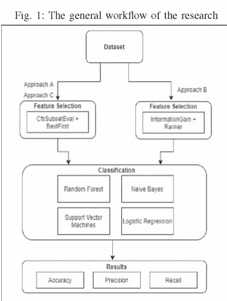

# 2021 信息和通信领域人工智能国际会议 (ICAIIC)

# 使用机器学习确定导致COVID-19大流行心理影响的因素

## 摘要

COVID-19大流行在方方面面对经济、医疗保健、教育以及社会其他方面产生了巨大影响。个人的心理健康也深受影响。本研究旨在利用机器学习方法，确定菲律宾普通人群中压力、焦虑、抑郁及不良心理影响的可能促成因素。对2119名填写在线调查问卷的参与者收集的数据，使用特征选择方法和机器学习分类器进行了分析，以确定上述心理健康问题的促成因素。结果显示，在家时间更长、社交媒体使用时间、年龄、个人对自身健康的评价、是否存在神经精神疾病；希望了解药物或疫苗的可用性和有效性、担心家人、感到受到歧视；以及身体疼痛、呼吸困难和咳嗽等症状，是预测个体因大流行而受到不良心理影响，以及他人压力、焦虑、抑郁水平升高的良好预测因子。

## 索引术语

精神健康、压力、焦虑、抑郁、事件影响、机器学习、特征选择

## I. 引言

2019年12月31日，中国湖北省武汉市检测出病因不明的肺炎病例，当局不久后确认了一种新型冠状病毒（2019-nCoV）[1]。世界卫生组织（WHO）将该病毒命名为COVID-19，并于2020年3月11日将其宣布为大流行病 [2], [3]。截至2021年2月5日，全球222个国家和地区确诊病例超过1.02亿例，死亡病例超过220万例 [4]，菲律宾确诊病例总计53.1万例，死亡病例超过1万例 [5]。

与任何大流行病一样，它在社会各个方面产生了巨大影响，从经济到医疗保健，甚至到教育。心理影响也是令人关注的问题，因为病毒的传播在受影响人群中出现情绪困扰和社会失序方面起着关键作用 [6], [7]。最近在意大利对18147名受访者进行的一项研究中，除其他结果外，17.3%的人报告有严重抑郁症状，20.8%的人报告有严重焦虑症状，7.3%的人报告有严重失眠症状。该研究还指出，与大流行相关的导致这些结果的状况，与先前精神疾病或童年创伤等其他因素无关 [8]。在应对人群中精神健康问题时，必须确定促成因素，以便立即干预并防止进一步损害。近年来，精神健康领域的机器学习研究取得了进展，并且很明显，它可以显著帮助检测和诊断精神健康状况 [9]。

本研究旨在利用机器学习方法，确定大流行导致的菲律宾普通人群中压力、焦虑、抑郁及不良心理影响的可能促成因素。

## II. 相关工作

至今，关于COVID-19大流行在全球造成的心理影响的研究还很少。如这些研究所示，找出可能的促成因素是减轻和防止进一步损害的关键步骤。

最近的一项研究 [10] 检讨了COVID-19及其政府设定的限制对意大利成年人感知压力的心理影响。他们的研究还旨在验证另一项最近研究中所述的某些促成因素。共使用了2053名参与者的数据，并通过JASP软件对其进行了统计分析。进一步使用WEKA 3.9软件通过特征选择和机器学习模型进行了分析。从参与者回答的问题中，有18个被视为感知压力的预测因子。在这18个中，有7个被基于相关性的特征选择算法选为感知压力的最佳预测因子，其余被视为冗余和无关。为了衡量这7个预测因子的预测性能，使用了逻辑回归、支持向量机、朴素贝叶斯和随机森林分类器生成了机器学习模型。结果显示ROC曲线下面积值相当，范围从0.70到0.78，然而随机森林分类器相比其他分类器召回率较低，使其在他们案例中在预测目的方面较弱。

由 [11] 进行的另一项研究使用人工神经网络（ANN）评估了韩国移民在美国的心理困扰。他们的数据是通过在韩国移民中（年龄在18岁以上）分发的在线调查收集的，共收集了790名参与者。他们的预测因子包括与歧视相关的变量、应对机制和社会人口学因素。在这些预测因子相关的因素中，与参与者心理困扰最相关的是他们自身的韧性、歧视经历，以及该国对亚洲人种族歧视心态的增加。

由 [12] 进行的一项研究，通过查看存在的精神症状，研究了COVID-19对菲律宾普通人群的心理影响，并确定了导致影响的促成因素。在线调查从2020年3月28日分发到4月20日，收集了包括社会人口学、健康状况、接触史、COVID-19知识与关切、预防措施和信息需求等数据。此外，还记录了抑郁、焦虑和压力量表（DASS-21）和事件影响量表修订版（IES-R）的评分。研究人员使用SPSS统计24.0对数据进行了统计分析。其研究结果显示，女性性别、年轻年龄、单身身份、学生身份、特定症状、近期被强制隔离、长时间居家，以及报告健康状况不佳、不必要的担忧、对家人的担忧和歧视等因素，与显著的心理影响和抑郁、焦虑及压力水平升高相关。相比之下，充足的健康信息、有成年子女、感知健康状况良好以及对医生能力的信心，与不良影响减少和抑郁、焦虑及压力水平降低相关。可以使用机器学习模型和特征选择算法进一步研究其数据，以验证或发现参与者中发现的精神健康问题更多可能的预测变量。

## III. 方法论

### A. 数据集

数据收集通过在线方式进行，因为菲律宾政府建议尽量减少面对面互动。使用了在线调查平台Survey Monkey，创建的问卷首先分发给马尼拉菲律宾大学的学生和校友。之后，他们在完成问卷后将其转发给其他人。这种实施的滚雪球策略帮助总共触达了2652名受访者。

1) 预测变量：调查分为7个部分：
- (A) 人口统计学
- (B) 症状和身体健康状况
- (C) 接触史
- (D) 关于COVID-19的知识和信念
- (E) 过去14天的预防措施
- (F) 关于COVID-19的额外信息
- (G) 原有疾病

从受访者处收集的人口统计学数据包括性别、年龄、教育程度、居住国、婚姻状况、就业状况、他是否是医疗专业人员、为人父母状况、家庭人数，以及他是否在过去14天内前往居住国以外的地方旅行。

过去14天内出现的以下症状包括发热、寒战、头痛、肌痛、咳嗽、呼吸困难、头晕、鼻炎、喉咙痛、恶心、呕吐和腹泻。此外，还询问了他们是否在过去14天内看过医生、在过去14天内住院、在过去14天内接受过COVID-19检测、在过去14天内被隔离、是否拥有医疗保险、是否患有慢性疾病，以及他们如何自我评价身体健康状况。

还记录了与COVID-19患者的接触史范围，即密切接触、间接接触、以及与疑似病例和感染材料的接触。

为了了解受访者对COVID-19的认识，变量包括已知传播途径、对可用健康信息的满意度及获取方式、听说过的不同类型病例数字、为获取COVID-19信息花费在社交媒体上的小时数、对自己医生在病毒方面的信心、自我评价的感染和存活病毒的可能性、对家人的担忧，以及是否感到受到歧视。

预防措施方面的变量包括遮住口鼻、共用餐具、洗手和戴口罩。还询问受访者是否认为COVID-19导致了不必要的担忧，以及因为病毒每天额外在家待了多少小时。

还记录了受访者对不同类型COVID-19额外信息的需求。这些类型包括：
- 症状详情
- 预防和治疗建议
- 定期更新
- 需要定制信息的人群建议
- 疫苗的可用性和有效性
- 受影响人数
- 旅行建议
- 病毒如何传播
- 其他国家的情况如何

还询问受访者是否患有原有神经精神疾病，以及是否正在为其服药。

此外，还使用了抑郁、焦虑和压力量表（DASS-21）调查来测量他们压力、焦虑和抑郁的负面情绪状态 [13]。抑郁子量表的不同严重程度评分为正常（0-9）、轻度（10-12）、中度（13-20）、重度（21-27）和极重度（28-42）。焦虑评分分为正常（0-6）、轻度（7-9）、中度（10-14）、重度（15-19）和极重度（20-42）。压力评分分为正常（0 – 10）、轻度（11 – 18）、中度（19 – 26）、重度（27 – 34）和极重度（35

- 1). 要获取受访者的得分，每个子量表被分配给 21 个问题的唯一子集。

最后，为了评估参与者因明显创伤性事件[14]而产生的痛苦，要求他们回答事件影响量表 - 修订版（Impact of Event Scale - Revised，IES-R）。该问卷由三个子量表组成，旨在测量平均回避、入侵和过度警觉。总 IES-R 分数将划分为正常（0-23）、轻度（24-32）、中度（33-36）和重度（37）。

- 2) 目标变量：上述提到的压力（S）、焦虑（A）、抑郁（D）和事件影响（P）的测量值是本研究的目标变量。它们拥有一个共同的初始预测变量集，即在创建的调查的 8 个部分下收集的数据。每个目标变量的附加预测变量是其同行目标变量的测量值。这意味着 A、D、P 的测量值也是 S 的预测变量。S、D、P 的测量值也是 A 的预测变量。S、A、P 的测量值也是 D 的预测变量，而 S、A、D 的测量值也是 P 的预测变量。

- 3) 数据准备：数据准备是机器学习（ML）过程中的一个关键步骤。原始数据不足以让 ML 模型进行分析，必须对其进行重构和清洗，以便为模型提供最能揭示预测问题的数据表示[15]。

共有 2652 名参与者完成了调查，但研究中仅考虑了 2119 名。其余 533 名（20%）参与者因 DASS-21 或 IES-R 调查回答不完整或完全未作答而被排除。

在处理数值变量和类别变量的缺失值时，对数据集进行了数据插值。在数值变量中，只有 ExtraHoursHome 存在缺失值，这些缺失值已用现有值的均值[16]进行替换。存在缺失值的类别变量如下：

计算了每个类别变量回答的众数[16]，并用其替换了数据集中发现的缺失值。

对于因变量压力、焦虑和抑郁，参与者最初根据严重程度进行分类，即：正常、轻度、中度、重度和极重度。在此研究中，轻度、中度、重度和极重度被表示为“可能”，而正常保持不变。同样，对于因变量事件影响，参与者最初被分类为正常、轻度心理影响、中度心理影响和重度心理影响。正常类别保持不变，而其余类别表示为“可能”。

### B. 研究流程

收集问卷和调查中所有问题的答案后，它们被用作研究中的自变量，并作为初始特征集，每个问题视为一个特征。

## 表 I：存在缺失值的类别变量

| 类别预测变量 | |
| :--- | :--- |
| SelfRateHealthStatus | ConcernsChild |
| MedicalInsurance | FeelingDiscriminated |
| ChronicIllness | CoverMouth |
| ContactedPatients | AvoidSharingUtensils |
| CloseContact | WashingHandsSoapWater |
| IndirectContact | WashingHandsCoughNoseSneeze |
| ContactSuspected | WearingMask |
| ContactInfectedMaterials | WashingHandsContaminatedObjects |
| DropletsKnowledge | UnnecessaryWorry |
| ContactViaContaminatedObjectsKnowledge | ReceiveAdditionalInformation |
| AirborneKnowledge | DetailsOnSymptoms |
| HealthInformationSatisfaction | AdviceOnPrevention |
| HeardNumberOfInfected | AdviceOnTreatment |
| HeardNumberOfDeaths | RegularUpdatesLatestInformation |
| HeardNumberOfRecovered | RegularUpdatesOutbreaks |
| HowObtainHealthInformation | AdviceForPeople |
| PreXNeuropsychiatricCondition | AvailabilityEffectivenessMedicine |
| ConfidenceInDoctorDiagnosis | HowManyPeopleAffected |
| ContractingCovidLikelihood | TravelAdvice |
| SurvivingCovidInfected | HowCovidSpread |
| ConcernsOtherFamily | OtherCountryDoing |

接下来，这些变量经历了特征选择，即从初始集中选取某些特征而忽略其余特征，以便更好地预测因变量。为此，应用了特征选择算法。

这些算法分为两部分：属性评估器和搜索方法。使用的属性评估器为 CfsSubsetEval 和 InformationGain。使用的搜索方法为 BestFirst 和 Ranker。在此特定情况下，CfsSubsetEval 与 BestFirst 配对，而 InformationGain 与 Ranker 配对，因为后者是一个要求。

随后，特征经过机器学习分类器运行以构建预测模型。使用的分类器有随机森林（Random Forest）、朴素贝叶斯（Naive Bayes）、支持向量机（Support Vector Machines）和逻辑回归（Logistic Regression）。使用三个获得的指标：准确率、精确率和召回率，来评估分类器的性能。准确率是模型做出的正确预测的百分比。精确率是指示真正正确的正向识别数量的指标。最后，召回率是被正确识别的实际正例的比例。使用应用程序 WEKA 来执行上述过程。

本研究采用了三种方法：A、B 和 C。它们性质相似，但使用了不同的特征选择算法和自变量组合，以找到最佳结果。

- 1) 特征选择：特征选择是机器学习过程的重要组成部分，因为它从初始预测变量集中移除了不相关和冗余的变量[17]。可以使用多种方法，但没有一种方法适用于所有应用[18]。每种方法使用的特征选择算法见表 II。

收集的数据量很大，最初有 2652 行参与者数据。然而，由于多份问卷中存在大量

| | A | B | C |
|---|---|---|---|
| 初始特征集 | - 人口统计 - 症状和身体健康状况 - 接触史 - 关于 COVID-19 的知识和信念 - 过去 14 天的预防措施 - 关于 COVID-19 的附加信息 - 原有疾病 | - 人口统计 - 症状和身体健康状况 - 接触史 - 关于 COVID-19 的知识和信念 - 过去 14 天的预防措施 - 关于 COVID-19 的附加信息 - 原有疾病 - DASS-21 调查 - IES-R 调查 | - 人口统计 - 症状和身体健康状况 - 接触史 - 关于 COVID-19 的知识和信念 - 过去 14 天的预防措施 - 关于 COVID-19 的附加信息 - 原有疾病 - DASS-21 调查 - IES-R 调查 |

| | 方案 A | 方案 B | 方案 C |
|---|---|---|---|
| 属性评估器 | 基于相关性的特征子集选择 | 信息增益 | 基于相关性的特征子集选择 |
| 搜索方法 | 最佳优先 | 排序 | 最佳优先 |

缺失导致数据插值无法解决，所使用的行数减少至 2119。目标变量压力、焦虑和抑郁的初始特征集中的预测变量（列）数量为 106 个，事件影响为 91 个。应用特征选择算法后，这些数字有所减少。

- 2) 机器学习分类器：本研究使用了 4 种机器学习分类器：随机森林（Random Forest）、朴素贝叶斯（Naive Bayes）、支持向量机（Support Vector Machine）和逻辑回归（Logistic Regression）。

## IV. 结果

本研究对来自菲律宾的总共 2119 名参与者进行了研究。为了识别可能的病例及其可能原因，本节简要说明了采用的 3 种不同方法。

### A. 方法 A

第一种方法，即方法 A，仅考虑了从创建的调查中收集的数据，不考虑 DASS-21 和 IES-R 的答案。特征选择按预期减少了特征数量。焦虑使用了 9 个特征，而压力、抑郁和事件影响使用了 10 个特征。

朴素贝叶斯分类器总体上实现了最佳准确率，平均值为 69.65%。平均精确率为 63.08%，召回率为 54.23%。随机森林是最差的预测器，平均准确率为 63.63%，平均精确率和召回率分别为 53.93% 和 46.18%（参见表 IV、V 和 VI）。

| | 压力 | 焦虑 | 抑郁 | 事件影响 |
|---|---|---|---|---|
| 随机森林 | 61.21% | 61.68% | 66.54% | 65.08% |
| 朴素贝叶斯 | 68.1% | 70.51% | 70.03% | 69.94% |
| 支持向量机 | 65.36% | 67.82% | 68.1% | 70.46% |
| 逻辑回归 | 66.97% | 69.37% | 69.99% | 70.55% |

| | 压力 | 焦虑 | 抑郁 | 事件影响 |
|---|---|---|---|---|
| 随机森林 | 54% | 52.8% | 60.7% | 48.2% |
| 朴素贝叶斯 | 64.6% | 67.7% | 62.9% | 57.1% |
| 支持向量机 | 66% | 71.5% | 62.9% | 74.4% |
| 逻辑回归 | 62.9% | 65.8% | 65.5% | 60% |

| | 压力 | 焦虑 | 抑郁 | 事件影响 |
|---|---|---|---|---|
| 随机森林 | 48.6% | 46.8% | 53.7% | 35.6% |
| 朴素贝叶斯 | 52.4% | 51.3% | 66.7% | 46.7% |
| 支持向量机 | 35.4% | 33.5% | 54.9% | 20.1% |
| 逻辑回归 | 51.1% | 50% | 57.7% | 40.5% |

## 表 VII: 使用方法 B 的压力、焦虑、抑郁和事件影响的准确率结果

| 分类器 | 压力 | 焦虑 | 抑郁 | 事件影响 |
|---|---|---|---|---|
| 随机森林 | 85.32% | 81.21% | 83.24% | 81.02% |
| 朴素贝叶斯 | 81.26% | 79.32% | 80.98% | 80.79% |
| 支持向量机 | 84.94% | 80.13% | 82.96% | 80.79% |
| 逻辑回归 | 82.39% | 78.43% | 80.74% | 78.95% |

## 表 VIII: 使用方法 B 的压力、焦虑、抑郁和事件影响的精确率结果

| 分类器 | 压力 | 焦虑 | 抑郁 | 事件影响 |
|---|---|---|---|---|
| 随机森林 | 85.9% | 81.7% | 83.1% | 80.0% |
| 朴素贝叶斯 | 81.5% | 77.2% | 80.9% | 73.9% |
| 支持向量机 | 85.8% | 81.8% | 82.8% | 81.3% |
| 逻辑回归 | 80.1% | 75.1% | 77.9% | 71.2% |

## 表 IX: 使用方法 B 的压力、焦虑、抑郁和事件影响的召回率结果

| 分类器 | 压力 | 焦虑 | 抑郁 | 事件影响 |
|---|---|---|---|---|
| 随机森林 | 77.7% | 68.9% | 74.5% | 58.9% |
| 朴素贝叶斯 | 71.3% | 68.7% | 70.6% | 67.3% |
| 支持向量机 | 76.6% | 65.2% | 74.0% | 56.6% |
| 逻辑回归 | 77.1% | 69.6% | 74.5% | 64.1% |

## 表 X: 使用方法 C 的压力、焦虑、抑郁和事件影响的准确率结果

| 分类器 | 压力 | 焦虑 | 抑郁 | 事件影响 |
|---|---|---|---|---|
| 随机森林 | 84.61% | 81.5% | 83.19% | 81.64% |
| 朴素贝叶斯 | 82.91% | 79.56% | 82.35% | 80.93% |
| 支持向量机 | 85.08% | 80.74% | 81.97% | 81.68% |
| 逻辑回归 | 84.80% | 81.97% | 83.86% | 82.35% |

## 表 XI: 使用方法 C 的压力、焦虑、抑郁和事件影响的精确率结果

| 分类器 | 压力 | 焦虑 | 抑郁 | 事件影响 |
|---|---|---|---|---|
| 随机森林 | 83.7% | 79.5% | 80.6% | 76.9% |
| 朴素贝叶斯 | 85% | 79.2% | 83.8% | 75.5% |
| 支持向量机 | 85.3% | 80.1% | 80.8% | 79.7% |
| 逻辑回归 | 83.7% | 80.9% | 83.1% | 78.5% |

## 表 XII: 使用方法 C 的压力、焦虑、抑郁和事件影响的召回率结果

| 分类器 | 压力 | 焦虑 | 抑郁 | 事件影响 |
|---|---|---|---|---|
| 随机森林 | 78.6% | 72.8% | 78.0% | 65.9% |
| 朴素贝叶斯 | 71.8% | 66.9% | 70.9% | 65.0% |
| 支持向量机 | 77.8% | 69.6% | 73.8% | 62.0% |
| 逻辑回归 | 79.0% | 72.4% | 76.4% | 66.3% |

### B. 方法 B

第二种方法，方法 B，将所有自变量视为初始特征集。特征选择使得压力的特征数量减少为 80 个，焦虑使用了 85 个，抑郁使用了 76 个，而事件影响使用了 72 个。

随机森林分类器总体准确率最高，平均为 82.70%。平均精确率为 82.68%，召回率为 70.00%。逻辑回归是最差的预测器，平均准确率为 80.13%，平均精确率为 76.08%，召回率为 71.33%（参见表 VII、VIII 和 IX）。

### C. 方法 C

第三种也是最后一种方法，方法 C，将所有特征视为初始特征集，与方法 B 类似。特征选择为每个因变量产生了以下最终特征数量：压力使用了 21 个特征，焦虑使用了 25 个，抑郁使用了 18 个，而事件影响使用了 23 个。

逻辑回归分类器总体准确率最高，平均为 83.25%。平均精确率为 81.55%，召回率为 73.53%。朴素贝叶斯是最差的预测器，平均准确率为 81.44%，平均精确率为 80.88%，召回率为 68.65%（参见表 X、XI 和 XII）。

## V. 讨论

本研究采用机器学习技术生成预测模型，帮助识别菲律宾普通人群中可能的精神健康状况病例及预测因素。本研究执行了 3 种方法，以实验数据的多种测试用例。

方法 A 没有使用 DASS-21 和 IES-R 调查答案作为可能特征（参见表 III），而方法 B 和 C 则使用了。所有结果都较低，总体平均准确率为 67.61%。创建调查的 8 个部分收集的数据不是良好的独立预测器。考虑到这一点，方法 B 和 C 也将其他目标变量作为预测因素。

与方法 A 相比，方法 B 和 C 的结果有所提高，准确率分别为 81.40% 和 82.45%。这是因为在这些方法中考虑了 DASS-21 和 IES-R 调查结果。这表明，在预测精神疾病（例如压力）的存在时，其他精神疾病（本例中为焦虑、抑郁、事件影响）的其他目标变量结果作为预测因素是重要的补充。受访者中精神疾病存在的状态是相互间良好的预测因素。话虽如此，来自创建调查的其他自变量（*）在当时与被预测因变量仍有足够好的相关性，足以被视为重要预测因素。

## 表 XIII: 用于预测压力和焦虑的最终特征

| | 压力 | 焦虑 |
|---|---|---|
| 最终特征 | *SelfRateHealthStatus D2_5 D3_10 | *BodyPain D1_3 |
| | *PreExNeuropsychiatricCondition D4_13 D5_16 | *Difficulty Breathing D4_13 D5_16 |
| | A2_4 D6_17 | *ExtraHours D7_21 |
| | A3_7 P_1_I | *Home P_1_I |
| | A4_9 P_4_H | *DetailsOn Symptoms P_2_I P_4_H |
| | A5_15 P_15_H | S1_1 P_6_I |
| | A6_19 P_10_H | S2_6 P_10_H |
| | A7_20 P_16_I | S3_8 P_12_A |
| | D1_3 P_18_H | S4_11 P_14_I |
| | P_20_I | S5_12 P_18_H |
| | | S6_14 P_19_H |
| | | S7_18 P_20_I |

## 表 XIV: 用于预测抑郁和事件影响的最终特征

| | 抑郁 | 事件影响 |
|---|---|---|
| 最终特征 | *Age S7_18 | *Cough S5_12 |
| | *SelfRateHealthStatus A3_7 A4_9 | *HoursOnSocialMedia S6_14 S7_18 |
| | *PreExNeuropsychiatricCondition A5_15 A7_20 | *ConcernsOtherFamily A2_4 A3_7 |
| | S1_1 P_4_H | *FeelingDiscriminated A4_9 A5_15 |
| | S3_8 P_13_A | *AvailabilityEffectivenessMedicine A6_19 A7_20 |
| | S4_11 P_15_H | S1_1 D1_3 |
| | S5_12 P_16_I | S2_6 D3_10 |
| | S6_14 P_18_H | S3_8 D4_13 |
| | | S4_11 D5_16 |
| | | D7_21 |

结果表明，个人对自身健康的评价以及是否存在既往神经精神疾病是压力的良好预测因素。抑郁与压力具有相似的预测因素，但年龄也是一个良好的预测因素。积极寻求病毒症状信息、在家时间更长以及出现身体疼痛和呼吸困难等症状的个体，会导致焦虑水平升高。研究还发现，那些在社交媒体上积极寻求疫情信息、想了解针对病毒的有效药物、关心家人、感到被歧视以及出现咳嗽的受访者，与疫情造成的不良心理影响（事件影响）有关。

## VI. 结论与未来工作

本研究旨在利用机器学习技术帮助识别菲律宾普通人群中压力、焦虑、抑郁的可能病例，并评估事件影响。手动工作可能耗时，且乍看之下可能无法显示所有可能结果，尤其是考虑到存在的大量数据。本研究的结果有助于支持机器学习在精神健康状况检测和诊断领域日益增长的流行度。随着 COVID-19 在全球传播，本研究所使用的技术可以显著有助于以高精度找出疫情导致精神健康问题的可能促成因素。心理学家和研究人员可以开展进一步研究，以验证和描述这些已识别因素的影响。一旦建立，利益相关者可以制定改进的政策和指南，帮助社会避免进一步的精神伤害。

## 参考文献

- [1] "新型冠状病毒 (2019-nCoV) 情况报告 - 1," 访问日期: 2020-12-9.
- [2] "新型冠状病毒(2019-nCoV) 情况报告 – 22," 访问日期: 2020-12-9.
- [3] "2019 年冠状病毒病 (COVID-19) 情况报告 – 51," 访问日期: 2020-12-10.
- [4] "COVID-19 每周流行病学更新," 访问日期: 2021-2-5.
- [5] "COVID-19 追踪器." https://doh.gov.ph/covid19tracker. 访问日期: 2021-2-5.
- [6] W. Cullen, G. Gulati, 和 B. Kelly, "COVID-19 大流行中的精神健康," QJM: 国际医学杂志, 2020, 311–312, 2020, https://doi.org/10.1093/qjmed/hcaa110.
- [7] N. Salari, A. Hosseinian-Far, R. Jalali, A. Vaisi-Raygani, S. Rasoulpoor, M. Mohammadi, S. Rasoulpoor, 和 B. Khaledi-Paveh, "COVID-19 大流行期间普通人群中压力、焦虑和抑郁的患病率：系统评价和 Meta 分析," 全球化与健康 16, 57 (2020), 2020, https://doi.org/10.1186/s12992-020-00589-w.
- [8] R. Rossi, V. Socci, D. Talevi, S. Mensi, C. Niolu1, F. Pacitti, A. D. Marco, A. Rossi, A. Siracusano, 和 G. Di Lorenzo, "COVID-19 大流行和封锁措施对意大利普通人群精神健康的影响," 精神病学前沿 11:790, 2020, https://doi.org/10.3389/fpsyt.2020.00790.
- [9] A. B. R. Shatte, D. M. Hutchinson, 和 S. J. Teague, "精神健康中的机器学习：方法和应用的范围综述," 心理医学 1–23, 2019, https://doi.org/10.1017/S0033291719000151.
- [10] L. Flesia, M. M. 2, C. Mazza, V. Fiietta, E. Colicino, B. Segatto, 和 P. Roma, "通过稳定的心理特征和机器学习模型预测与 COVID-19 爆发相关的感知压力," J. Clin. Med. 2020, 9, 3350, 2020, https://doi.org/10.3390/jcm9103350.
- [11] S. Choi, J. Y. Hong, Y. J. Kim, 和 H. Park, "COVID-19 大流行期间通过机器学习预测心理困境：韩国移民在美国的歧视与应对机制," 环境研究与公共健康国际杂志 2020, 17, 6057, 2020. https://doi.org/10.3390/ijerph17176057.
- [12] M. L. Tee, C. A. Tee, J. P. Alucan, K. J. G. Algam, P. W. C. Reyes, V. Kuruchittham, 和 R. C. Ho, "菲律宾 COVID-19 大流行的心理影响," J Affect Disord. 2020 Dec 1; 277: 379–391., 2020, https://doi.org/10.1016/j.jad.2020.08.043.
- [13] "数据及其用途概述." http://www2.psy.UNSW.edu.au/dass/over.htm. 访问日期: 2020-12-11.
- [14] Weiss 和 Marmar, "事件影响量表 - 修订版 (IES-R) 用于 DSM-IV," https://www.ptsd.va.gov/professional/assessment/adult-sries-asp, 1996. 访问日期: 2020-12-11.
- [15] J. Brownlee, "为什么数据准备在机器学习中如此重要," https://machinelearningmastery.com/data-preparation-is-important/. 访问日期: 2021-2-3.
- [16] S. Chopra, "如何在机器学习中处理缺失数据：5 种技术," https://dev.acquia.com/blog/how-to-handle-missing-data-in-machine-learning-5-techniques/09/07/2018/19651. 访问日期: 2021-2-3.
- [17] A. Sau 和 I. Bhakta, "使用机器学习技术筛查船员中的焦虑和抑郁," 医学信息学解锁 16 (2019) 100228, 2019, https://doi.org/10.1016/j.imu.2019.100228.
- [18] M. Dash 和 H. Liu, "分类的特征选择," 智能数据分析 1 (1997) 131-156, 1997. https://doi.org/10.1016/S1088-467X(97)00008-5.

