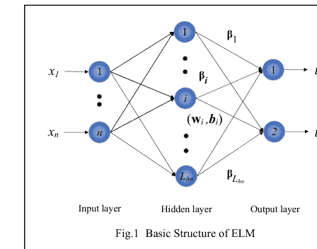
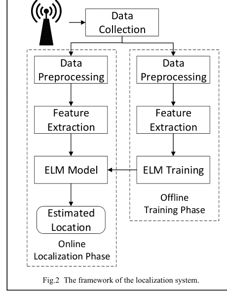

# 2021年通信、信息系统与计算机工程国际会议（CISCE）

**摘要—** 近年来，基于 WiFi CSI 的无设备定位受到了广泛关注。之前的大多数工作使用了接收信号强度指示 Received Signal Strength Indication (RSSI)，而信道状态信息 Channel State Information (CSI) 的获取显著提高了基于 WiFi 的定位精度。本文提出了一种基于 CSI 的无设备室内定位方法。首先，我们使用 CSI Tools 采集 CSI 并使用特定的滤波器滤除噪声。然后，我们使用动态时间规整 Dynamic Time Warping (DTW) 提取两个数据段之间的差异作为指纹。最后，使用极限学习机 Extreme Learning Machine (ELM) 进行建模并计算目标的位置。我们在实验室搭建了系统来验证该方法的性能，这证实了本文提出的方法的有效性。

**关键词—** 无设备定位；信道状态信息；极限学习机；动态时间规整

# I. 引言

近年来，无线网络技术发展迅速，人们开始要求有效且准确的服务应用。目标定位就是其中之一。目前，室外定位技术已经成熟，并衍生出多种服务应用，为人们的生活提供了极大的便利。室外定位技术主要依赖于全球定位系统 Global Positioning System (GPS) 等卫星定位技术，可以实时估计目标的位置信息。然而，由于多径效应、阴影和衰落 [1] 等环境因素，该定位技术在室内环境中难以工作。因此，在室内环境中获得良好的目标定位效果仍然是一个亟待解决的问题。

尽管室内定位受到了广泛关注，但技术的 immaturity 仍然是目前面临的一个大问题。与 GPS 和基站定位等室外定位系统不同，室内定位系统仍然没有统一的标准组织来制定统一的技术标准和规范。目前主流的室内定位技术解决方案是在各企业定义的协议和方案下开发的，导致了多种室内定位技术，如红外 [2]、超声波 [3]、摄像头 [4]、超宽带 [5] 和无线局域网。基于摄像头的系统可以实现高精度，但它需要良好的光照环境并会引起隐私问题；基于超声波的系统受噪声影响且覆盖范围有限；基于红外的系统需要专业的基础设施；基于可见光的系统只能在可见环境中工作。由于移动终端中 WiFi 设备的普及以及室内环境的发展，基于 WiFi 的室内定位技术受到了更多关注。

基于 WiFi 的室内定位技术分析无线局域网中移动终端接收到的无线电信号的特征，并根据相应的定位模型估计目标的位置。目前，大多数室内 WiFi 定位系统使用接收信号强度指示 Received Signal Strength Indication (RSSI) 或信道状态信息 Channel State Information (CSI) 作为接收信号。CSI 是近年来研究的热点。Dynamic-Music [6] 提出了一种结合多信号分类算法 Multiple Signal Classification Algorithm (MUSIC) 算法的定位方法，该方法使用 CSI 相位检测人体反射信号，并进一步计算到达角 Angle of Arrival (AoA) 和到达时间 Time of Arrival (ToA) 以估计位置信息。IndoTrack [7] 从 CSI 信号估计多普勒速度，并进一步估计目标的位置和速度信息。Widar [8] 使用 CSI 并从几何角度定位目标，同时估计目标的速度估计。Haibin Bian [9] 研究了 WiFi CSI 室内定位方法，结合 CSI 信息和位置指纹方法，并基于 CSI 数据的空间和频率特性使用 CSI 数据信息作为位置指纹信息，提出了基于 CSI 加权空频特征的聚类算法。该算法对指纹数据进行聚类，完成匹配定位，通过二次校正去除数据库中部分分离的聚类点和不合适的最近邻，最终实现基于 WiFi 的室内定位。Fuseloc [10] 使用从信道状态信息中提取的多个特征进行基于室内定位的首次信息融合。

在本文中，我们提出使用动态时间规整 Dynamic Time Warping (DTW) 提取信号特征，并采用极限学习机 Extreme Learning Machine (ELM) 对指纹与目标点之间的关系进行建模。具体而言，该方法的工作流程包括数据采集、预处理、特征提取和关系建模。本研究的主要贡献如下：

1. 使用 DTW 方法提取信号特征；
2. 使用 ELM 对无设备定位进行建模；
3. 构建系统并比较该方法与其他方法的效果。

本文其余部分结构如下。第二部分对相关内容进行了简要介绍，第三部分描述了系统设计。第四部分详细介绍了实验验证。第五部分给出了结论。

# II. 预备知识

## A. 信道状态信息

在过去的基于 WiFi 的室内定位研究中，大多数基于 RSSI。RSSI 是多个无线信号的叠加能量，随着距离的增加会衰减，非常不稳定。随着 OFDM 技术在 WiFi 中的应用，可以提取 WiFi 的信道状态信息。CSI 描述了无线信号在传播过程中的衰减，并记录了频域中每个子载波的幅度和相位信息 [11]。它具有稳定、细粒度、信息丰富等优点。

在无线局域网中，接收数据向量可以表示为

\(Y = HX + W\), (1)

其中 X 是发送数据向量，H 是 CSI 矩阵，W 是噪声向量。H 可以计算为

\(H = Y/X\), (2)

H 是频域中信道频率响应的 CFR 采样信息，CSI 工具使得获得具有 30 个样本的 CFR 采样版本成为可能 [12]。使用兼容 IEEE 802.11a/g/n 的无线网卡，从接收到的每个数据包中提取一组 CSI，每个 CSI 表示正交频分复用子载波的幅度和相位 [13]。CSI 可以表示为

\(H(f_k) = \|H(f_k)\| e^{j\angle H(f_k)}\), (3)

其中 \(H(f_k)\) 是频率为 \(f_k\) 的第 k 个子载波的 CSI，\(\|H(f_k)\|\) 和 \(\angle H(f_k)\) 分别表示第 k 个子载波的幅度和相位。

## B. 极限学习机

ELM 是一种单隐层前馈网络，具有三层结构：输入层、隐藏层和输出层 [14]，如图 1 所示。ELM 最重要的特征是隐藏层参数随机初始化，只需通过最小二乘估计计算输出权重 [15]。因此学习速度比大多数其他机器学习方法快数百或数千倍，且 ELM 的泛化能力也非常优秀。

用 \(L_{hn}\) 表示前馈网络中隐藏单元的数量，ELM 的输出函数可以表示为

\(f(x) = \sum_{i=1}^{L_{hn}} \beta_i g_i(x) = g(x)\beta = T\), (4)

其中 x 表示 ELM 的输入，即样本的特征，T 是数据的标签，g 表示激活函数，β 表示输出权重。我们用 w 表示输入权重，用 b 表示偏置，g(x) 可以表示为

\(g(x) = [g(x; w_1, b_1), \ldots, g(x; w_{L_{hn}}, b_{L_{hn}})]\), (5)

进一步，式 (4) 可以表示为

\(G\beta = T\), (6)

其中，

\(G = [g(x_1); \ldots; g(x_{N_s})] = [g_1(x_1), \ldots, g_{L_{hn}}(x_1); \ldots; g_1(x_{N_s}), \ldots, g_{L_{hn}}(x_{N_s})]\), (7)

其中 \(N_s\) 表示样本数量。此外，

\(T = [t_1, \ldots, t_{N_s}]^T\), (8)

最后，输出权重的估计可以通过以下公式获得

\(\tilde{\beta} = G^\dagger T\), (9)

其中 G† 是矩阵 G 的 Moore-Penrose 广义逆。

# III. 系统设计

## A. 总体架构
CSI 基于定位系统的框架如图 2 所示。CSI Tools 首先采集 CSI 样本，然后对 CSI 进行预处理。之后使用 DTW 提取特征并输入 ELM 进行模型训练。测试集以相同方式处理以获得特征，然后得到测试结果。

Fig.2 定位系统的框架。

## B. 数据预处理
采集的原始 CSI 数据包含典型的误差，例如有用的信道状态信息和测量误差，以及由设备干扰或不确定性形成的某些异常值，这些异常值会干扰使用 CSI 进行定位。我们在每个子载波上应用滑动窗口的 Hampel 滤波器，以去除通常与相邻 CSI 测量值显著不同的异常值。此外，我们应用移动平均滤波器以去除高频噪声。

## C. 特征提取
DTW 是一种动态规划算法，用于计算两个时间序列的相似度，尤其是长度不同的序列。它主要应用于时序数据，例如孤立词语音识别、手势识别、数据挖掘和信息检索。在指纹定位中，指纹几乎总是基于单个数据，很少基于一段数据生成用于定位的指纹。DTW 计算不同参考点处的目标与不在环境中的目标之间的差异以获得指纹，有效地提取了数据的整体特征。

# IV. 评估

## A. 实验设置
我们在由两个 WiFi 设备（即 mini-pc）和一个商用无线接入点（即运行在 5.24 GHz 信道上的 TP-Link WDR5300 带天线）组成的 802.11n WiFi 网络中部署了系统。mini-pc 配备了用于测量 CSI 的 Intel WiFi Link 5300 卡和三个外部天线。为了评估我们的系统，我们在活动室中进行了实验。我们

表 I. 定位性能

| Method | Mean error |
| ELM | 1.1243m |
| BPNN | 1.3789m |
| SVM | 1.3345m |

我们采用 1 个 AP 和 2 个 MP 的方案以更好地覆盖感兴趣区域。我们在监控区域内均匀选择参考位置。区域被划分为 64 个单元，每个单元大小为 0.6 m*0.6 m。参考点设置在每个单元的中心，测试点随机散布在整个区域内。每个位置收集一百个数据包。

## B. 定位性能
我们使用平均距离误差作为性能指标。将我们的系统与其他两种机器学习方法进行比较的结果如表 I 所示。可以看出，我们的方法优于 SVM 和 BPNN，证明了 ELM 算法的有效性，并且使用 DTW 提取特征可以大大提高定位精度。

# V. 结论
在本文中，我们提出了一种基于 WiFi CSI 的无设备室内定位方法，使用两个常见的商用 WiFi 设备和一个接收设备收集 CSI 数据，对收集的 CSI 数据进行预处理，使用 DTW 提取特征，然后使用 ELM 模型进行定位。该方法在实验室环境中进行了评估，实验结果表明该方法优于 SVM 和 BPNN。在典型的室内环境中，平均距离误差为 1.12m。

# 致谢
本工作部分得到国家重点研发计划项目 2017YFB1401203、北京市重点研发计划项目 Z191100007519001 和佛山科技创新计划项目 BK20AF005 的支持。

# 参考文献
[1] Liu H, Darabi H, Banerjee P, et al. 无线室内定位技术与系统的综述[J]. IEEE Transactions on Systems, Man, and Cybernetics, Part C (Applications and Reviews), 2007, 37(6): 1067-1080.

[2] Gellersen H, Kortuem G, Schmidt A, et al. 使用 smart-its 的物理原型制作[J]. IEEE Pervasive computing, 2004, 3(3): 74-82.

[3] Harle R K, Hopper A. 部署和评估一个位置感知系统[C]//Proceedings of the 3rd international conference on Mobile systems, applications, and services. 2005: 219-232.

[4] Cai Q, Aggarwal J K. 跨多个同步视频流的室内场景中人体运动的自动跟踪[C]//Sixth International Conference on Computer Vision (IEEE Cat. No. 98CH36271). IEEE, 1998: 356-362.

[5] Gezici S, Tian Z, Giannakis G B, et al. 通过超宽带无线电进行定位：未来传感器网络定位方面的展望[J]. IEEE signal processing magazine, 2005, 22(4): 70-84.

[6] Li X, Li S, Zhang D, et al. Dynamic-music: 精确的无设备室内定位[C]//Proceedings of the 2016 ACM International Joint Conference on Pervasive and Ubiquitous Computing. 2016: 196-207.

[7] Li X, Zhang D, Lv Q, et al. IndoTrack: 基于商用 Wi-Fi 的无设备室内人体跟踪[C]. Proceedings of the ACM on Interactive, Mobile, Wearable and Ubiquitous Technologies, 2017, 1(3): 1-22.

[8] Qian K, Wu C, Yang Z, et al. Widar: 基于商用 Wi-Fi 的速度监测分米级被动跟踪[C]//Proceedings of the 18th ACM International Symposium on Mobile Ad Hoc Networking and Computing. 2017: 1-10.

[9] Haibin Bian. 基于 CSI 数据库的室内定位系统[D]. XIDIAN UNIVERSITY, 2017.

[10] Sanam T F, Godrich H. FuseLoc: 基于 CCA 的 WiFi 信号 CSI 相位和幅度的室内定位信息融合[C]//ICASSP 2019-2019 IEEE International Conference on Acoustics, Speech and Signal Processing (ICASSP). IEEE, 2019: 7565-7569.

[11] Zhang J, Xiao W, Li Y. 数据与知识双驱动的大规模无设备定位集成[J]. IEEE Internet of Things Journal, 2020, 8(1): 320-331.

[12] Halperin D, Hu W, Sheth A, et al. 工具发布：使用信道状态信息采集 802.11n 轨迹[J]. ACM SIGCOMM Computer Communication Review, 2011, 41(1):53.

[13] Zhang J, Li Y, Xiao W. 利用时空信息在杂乱环境中进行无设备定位的集成多核学习[J]. IEEE Internet of Things Journal, 2020.

[14] Zhang J, Xiao W, Li Y, et al. 用于无设备定位的多层概率极限学习机[J]. Neurocomputing, 2020, 396: 383-393.

[15] Zhang J, Li Y, Xiao W, et al. 用于未知噪声建模的鲁棒极限学习机[J]. Journal of the Franklin Institute, 2020, 357(14): 9885-9908.
