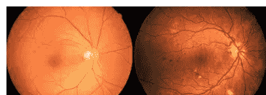
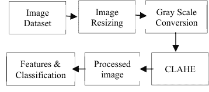
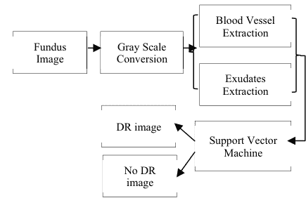
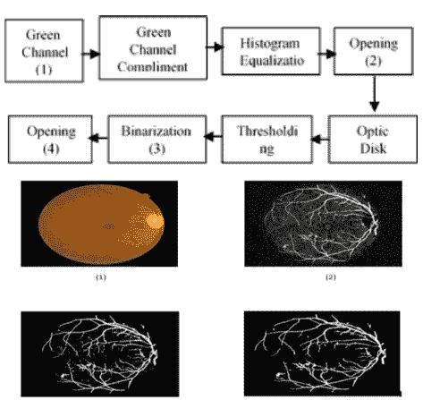
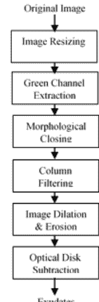
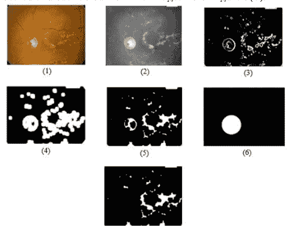

# [2021 计算、通信和智能系统国际会议 (ICCCIS)(大诺伊达, 印度 2021.2.19-2021.2.20)]


# 摘要

糖尿病视网膜病变是糖尿病患者失明的常见原因之一。它是由眼睛后部或视网膜的对光敏感组织的血管受损引起的。该疾病的传统检测方法需要大量时间和精力，因此所提系统旨在使用图像处理和机器学习来检测糖尿病视网膜病变。所提系统的输入来自标准数据库 DIARETDB0 和 DIARETDB1 的视网膜图像。该系统旨在通过结合基本图像处理步骤并更侧重于预处理以获取用于特征提取的清晰图像来自动化检测过程，随后应用机器学习算法进行分类。预处理阶段后，从血管和渗出物中获得面积和周长等统计特征，应用灰度转换、二值化、Canny 边缘检测以及包括图像膨胀和腐蚀在内的一些形态学操作等不同预处理技术来获取清晰图像。用于结果分析的机器学习算法包括加权 KNN、Cubic SVM 和 Simple Tree，其准确率分别为 85.8%、87.2% 和 88.6%。还获得了灵敏度和特异度参数，Simple Tree 在所有三个结果参数上均表现更好。

# 关键词

血管；糖尿病视网膜病变；渗出物；机器学习；加权 KNN

# I. 引言

## A. 糖尿病视网膜病变

糖尿病视网膜病变（DR）是一种医学状况，糖尿病患者的视网膜出现一些并发症，由于这些并发症，患者的眼睛受到影响。糖尿病视网膜病变是由于糖尿病导致视网膜中血管受损引起的。视网膜中的血管要么肿胀要么收缩，导致形成液体或血块，称为渗出物、出血和微动脉瘤。这些是糖尿病患者视网膜图像中可见的早期症状。它也可能导致永久性视力丧失 [2]。预计糖尿病视网膜病变患者人数将从 770 万增加到 2030 年的 1100 万，到 2050 年达到 1450 万。新德里拉贾弗拉萨德眼科学中心和 AIIMS 于 2019 年进行的一项调查显示，每 46 名糖尿病患者中就有 1 人患有糖尿病视网膜病变。图 1 显示了正常眼和 DR 受影响眼的视网膜图像。



**图 1. 正常视网膜与 DR 受影响视网膜对比 [2]**

轻度病例可通过控制血糖水平进行治疗，而重症病例则采用手术或激光治疗 [3]。现有系统使用的技术包括二值化、阈值处理、开运算、自适应直方图均衡化和中值滤波。

## B. 问题定义

糖尿病视网膜病变是一个日益严重的问题，是工作年龄成年人（即年龄在 20 至 74 岁之间的人）失明的主要原因。目前统计数据显示，近 770 万人患有糖尿病视网膜病变，预计到 2030 年该数字将增加到 1100 万（未来十年近乎翻倍），到 2050 年达到 1450 万。在印度，糖尿病视网膜病变的严重程度如此之高，以至于目前约有 18% 的印度公民正在遭受糖尿病视网膜病变的困扰。[4] 在过去几十年中，诊断、医疗保健、社会经济因素和其他影响糖尿病及视网膜病变患病率和地理分布的风险因素方面存在重要差异。

2002 年的统计显示，近 500 万人患有眼疾，原因是糖尿病视网膜病变，占全球失明的近 5%。糖尿病视网膜病变病例逐渐增加，因此更多个人可能会遭受眼部并发症，如果这些并发症得不到妥善管理，可能导致永久性视力丧失。

该项目旨在自动化糖尿病视网膜病变的识别过程，以便及时采取预防措施，并将糖尿病视网膜病变的影响降至最低。由于流程自动化，早期识别糖尿病视网膜病变变得更加容易，因此医生可以在适当时间提供适当治疗。

## C. 项目范围

正在采用许多方法来更多地了解与糖尿病相关的视力丧失的发展和进展，并识别诊断和治疗方面的改进。在全球范围内，临床试验正在积极测试新选项并评估新实践，以改善与糖尿病相关的视力丧失的检测和治疗方式。这些研究的一些示例如下。

研究人员意识到早期检测糖尿病并发症的重要性，以限制对眼睛的重大损害和视力丧失。因此，研究团队正在积极寻求改善识别与糖尿病相关的视力丧失及其检测时间的方法。这样的临床试验之一旨在开发和测试一种新的预测技术，以改善糖尿病视网膜病变的识别方式。研究人员旨在分析个人背景、病史和实验室检测结果的详细信息，以开发一种改进的识别和管理该状况的手段。

另一项研究也寻求测试人工智能来检测糖尿病视网膜病变。还在进行中的研究寻求在血液中循环的新分子，这些分子可以突显糖尿病视网膜病变患者的预后；即识别那些病情随时间可能为轻度、中度或更严重的人。

该项目的目的是基于自动化方式提取不同特征（包括血管和渗出物）的糖尿病视网膜病变患者视网膜图像，以便在糖尿病视网膜病变的早期采取预防措施。

## D. 目标与宗旨

- 自动化糖尿病视网膜病变的诊断过程
- 诊断该人是否患有糖尿病视网膜病变。
- 提高系统的效率。

所提系统的主要目的是自动化糖尿病视网膜病变的整个检测过程。系统的输入将是视网膜图像。系统将对这些图像应用滤波技术。应用图像预处理步骤以获得准确结果。在图像上应用用于血管和渗出物提取的定制算法。最后，系统将检测糖尿病视网膜病变，即患者是否患有糖尿病视网膜病变。

# II. 文献综述

糖尿病视网膜病变不仅涉及图像处理和机器学习算法等技术方面，还涉及提取哪些特征等非技术方面。

Hemanth D. 等人 [6] 提出了一种混合方法，将图像处理与深度学习应用于 DR 眼底图像，以改进检测效果。作者对 DR 图像进行了直方图均衡化和 CLAHE，并将其传递给 CNN 进行分类。CNN 提供更高的准确性但涉及计算时间，因此作者建议在图像处理中使用一些预处理方法来减少相同。

R. Ravindraiiah 等人 [8] 使用了基于模糊的聚类方法，该方法在其系统中复杂度较低且更加稳健，它将具有共同特征的像素分组并将数据累积到不同的数据集中。其论文中涉及的处理步骤包括固定聚类数 'C' 并随机初始化聚类中心 Ci，更新隶属度矩阵 Mij，更新聚类中心 Ci，更新隶属度矩阵 Mij，更新目标函数 JMKSFCM，如果 (J, t-J, t-1) 的绝对值小于 epsilon 则停止迭代过程，否则重复步骤 2 至 4，其中 e = 0.0001。

Shailesh Kumar 等人 [7] 的另一篇论文提出了一种系统，用于提取微动脉瘤（即视网膜上的微小红点）以早期检测糖尿病视网膜病变。该过程包括绿色通道技术、自适应直方图均衡化、分割和用于分类的 SVM 等基本步骤。

Karkhanis Apurva Anant, Tushar Ghorpade, Vimla Jethani [9] 提出的系统使用了分类 DR 的方法


采用图像处理、数据挖掘方法，Laplace 边缘检测、DWT 和 GLCM 等算法用于特征提取的进一步处理。KNN 被用作分类器，其准确率为 96.62%。

Neelam D. Panse、Tushar Ghorpade 和 Vimla Jethani[10] 提出了一种系统，使用离散小波变换、Canny 边缘检测、二值化、DCT（离散余弦变换）和 KNN，将图像分为正常、糖尿病视网膜病变和青光眼三类。作者 [10] 在此前开发的匹配滤波基础上提出了一种新方法。所提系统在基本图像处理步骤之外，使用基于感知的二值化和密度分析，将图像分为正常、中度非增殖性糖尿病视网膜病变（NPDR）和重度 NPDR。一种非参数树型分类器——随机森林（RF）被用作分类器。

M.C. Shanker 等人[11] 提出的系统讨论了使用 SVM 分类器算法检测糖尿病视网膜病变。所呈现系统中使用的预处理步骤是调整大小。然后，将图像中不重要的部分裁剪到可见某些斑点或层的区域。下一步是对比度增强，以提高图像质量，这对于人类解读是必要的。图像分割、特征提取和 SVM 分类器被用作所提系统的步骤。研究现有系统后发现，大多数系统只关注解决问题的图像处理或机器学习方面中的某一个。所提系统试图同时关注图像处理和可用于高精度检测糖尿病视网膜病变的机器学习算法。此外，与现有系统相比，不同的预处理步骤组合被用于每个特征、血管和渗出物，以更好地提取特征。

# III. 所提系统

图 2(A) 以一般方式显示了所提系统图，包含各个步骤，而图 2(B) 指示了所使用的技术。

- **图像调整大小或缩放：** 图像调整大小是必要的，因为数据集可能来自不同的来源，例如在线或直接来自医院，因此有必要使图像保持一致性，以便处理技术和特征提取技术不会产生任何异常。





Fig. 2. DR 检测的拟议框图与方法论

- **尺度转换：** 本步骤将 RGB 图像转换为灰度图像。这样做不仅是为了在应用处理、特征提取及其他数学技术（如需要）时降低复杂性，也是因为与灰度图像相比，灰度图像的结果更好且略微更优化。

- **图像预处理：** 使用自适应直方图均衡化，改变图像的对比度，以便更容易提取特征。

- **自适应直方图均衡化：** 在这种技术中，为了改善结果，提高了图像的对比度。AHE 也会过度放大图像某些部分的噪声。这就是为什么使用高级算法——对比度受限自适应直方图均衡化（CLAHE），它减少了噪声的放大。

- **特征提取：** 从上述方法中提取对比度增强后的视网膜图像的特征，这将进一步帮助分类过程。

- **分类：加权 k-最近邻（KNN）：** 该算法是 k-最近邻的定制形式。在此算法中，使用核函数为最近的 k 个点赋予权重 [12]。其原理是给近距离点更高的权重，给远距离点更低的权重。

- **支持向量机（SVM）：** 该算法使用超平面划分训练数据，然后使用这些超平面对测试数据进行分类。

- **简单树：** 简单树也称为决策树，其中节点如流程图般连接。内部节点代表一个属性，结果表示为分支。

所提系统针对血管和渗出物检测的算法步骤如下：

- 步骤 1. 从用户处输入图像
- 步骤 2. 对图像应用预处理步骤以提取血管。
  - 步骤 2.1. 将图像转换为绿色通道。
  - 步骤 2.2. 对结果图像进行补色处理。
  - 步骤 2.3. 通过直方图均衡化调整图像的对比度。
  - 步骤 2.4. 开运算图像。
  - 步骤 2.5. 移除视盘。
  - 步骤 2.6. 对图像执行阈值处理和二值化。
  - 步骤 2.7. 对图像执行开运算。

- 步骤 3. 计算并存储提取的血管的面积和周长。
- 步骤 4. 对图像应用预处理步骤以提取渗出物。
  - 步骤 4.1. 将图像转换为绿色通道。
  - 步骤 4.2. 对图像执行形态学闭运算。
  - 步骤 4.3. 对图像进行列滤波。
  - 步骤 4.4. 对图像先执行膨胀再执行腐蚀。
  - 步骤 4.5. 移除视盘。

- 步骤 5. 计算提取的渗出物的面积和周长，并将值追加到上述存储的结果中。
- 步骤 6. 将结果数据作为测试数据输入到预训练算法（立方 SVM、加权 KNN 或简单树，由用户选择）中。
- 步骤 7. 将机器学习算法检索的数据输出给用户。

# IV. 实现输出

所提系统使用 MATLAB 进行图像处理，用于输入图像并从图像中提取各种特征。

## A. 数据库

用于系统训练和测试的数据库是 DIARETDB0 和 DIARETDB1。这些图像在 Kuopio 大学医院拍摄。数据库分别包含来自 DIARETDB0 和 DIARETDB1 的 130 张和 89 张眼底图像，其中一些图像来自未显示任何糖尿病视网膜病变症状的正常患者，其余则来自被诊断患有糖尿病视网膜病变的患者。这些图像使用 MATLAB R2019a 进行训练和测试。

## B. 血管提取

血管在判断患者是否患有糖尿病视网膜病变方面起着重要作用。糖尿病视网膜病变会导致血管收缩，但仅凭血管收缩不足以判断患者是否受影响。这就是为什么渗出物、微血管瘤等其他特征也被用于检测糖尿病视网膜病变。

为判断血管是否收缩，第一步是从给定图像中提取血管。对于血管提取，所使用的步骤在以下图中描述，请参阅图 3(A)。

### 1) 血管提取过程：



Fig. 3. 血管提取。

从视网膜图像中提取血管用于特征提取。结果请参阅图 3(B)。计算面积和周长特征后获得的值被写入 CSV 文件。

## C. 渗出物提取

下图 4 显示了渗出物提取的步骤。每个步骤的详细说明如下，其输出显示在图 5 中。



Fig. 4. 渗出物提取 - 步骤。

- **调整大小：** RGB 平面中的原始图像被调整为 376 X 520 像素的矩阵，以便所有图像都具有标准通用尺寸。
- **绿色分量提取：** 从 RGB 图像中提取绿色分量以获得更好的结果。
- **形态学闭运算：** 使用半径为 5 像素的结构元素对图像执行膨胀和腐蚀。请参阅图 5(3)。
- **列滤波：** 通过将图像中每个 5 X 5 块重新排列为临时矩阵，然后对这些块应用方差（@var）函数来处理图像，使用此方法，背景降低变得更容易。请参阅图 5(4)。
- **图像膨胀和腐蚀：** 先对图像执行膨胀，再执行腐蚀，以将两个相邻的渗出物合并为一个更大的渗出物。请参阅图 5(5)。
- **光盘掩模和减法：** 定位光盘并从图像中减去它。请参阅图 5(6)。



Fig. 5. 渗出物提取 – 输出。

# V. 实验结果

通过将特征提取步骤获得的 CSV 文件传递到 MATLAB R2015 中内置的分类学习者应用中获得结果。MATLAB 中的分类学习者应用将表中列以预测器和响应形式的变量作为输入，根据所选分类器训练模型，并给出分类算法的准确率。为此程序，使用了加权 KNN、立方支持向量机（SVM）和简单树来检查特征提取方法的准确率。使用加权 KNN 算法，渗出物和血管特征组合的总体准确率为 85.8%。总体正确分类的图像总数为 219 张中的 188 张。表 1 表示 DR 和正常类别中分类图像的百分比：。此类依赖于以下包以正常运行。

| 特征 | 正确分类图像 (%) | 错误分类图像 (%) |
| :--- | :--- | :--- |
| 渗出物 | 89.04 | 10.95 |
| 血管 | 85.39 | 14.6 |
| 渗出物和血管 | 85.84 | 14.16 |

使用立方 SVM 算法，总体准确率为 87.2%。总体正确分类的图像总数为 219 张中的 191 张。

当两个特征都用于分类时，SVM 能给出更好的结果。

| 特征 | 正确分类图像 (%) | 错误分类图像 (%) |
| :--- | :--- | :--- |
| 渗出物 | 77.17 | 25.11 |
| 血管 | 83.56 | 16.44 |
| 渗出物和血管 | 87.21 | 12.79 |

使用简单树算法，总体准确率为 88.6%。总体正确分类的图像总数为 219 张中的 194 张。简单树在用血管和渗出物这两个特征对图像进行分类时也能给出更好的结果，尽管差异微乎其微。

| 特征 | 正确分类图像 (%) | 错误分类图像 (%) |
| :--- | :--- | :--- |
| 渗出物 | 88.13 | 11.87 |
| 血管 | 88.13 | 11.87 |
| 渗出物和血管 | 88.58 | 11.42 |

以下表 4 显示了使用 SVM、KNN 和简单树分类算法为所提系统获得的准确率结果。

| 分类器 | 渗出物 | 血管 | 渗出物和血管 |
| :--- | :--- | :--- | :--- |
| 立方 SVM | 77.2% | 83.6% | 87.2% |
| 加权 KNN | 89.0% | 85.4% | 85.8% |
| 简单树 | 88.1% | 88.1% | 88.6% |

基于所有三种算法的混淆矩阵值，表 5 中计算了渗出物和血管组合特征集的灵敏度和特异度。灵敏度和特异度的公式如下。

```
Sensitivity = TP / TP+FN
Specificity = TN / TN+FP
```

灵敏度和特异度值显示了所提系统的有效性。简单树产生 98% 的灵敏度值。


## TABLE 5. 渗出物和血管组合特征的灵敏度和特异度。

| Algorithm | Sensitivity | Specificity |
|---|---|---|
| SVM | 96.41 | 0.08 |
| KNN | 95.38 | 0.08 |
| Simple Tree | 97.94 | 0.12 |

下表 6 将拟议系统与现有系统 [9] 的准确性进行比较。与现有系统相比，KNN 的准确性略低，但令人满意。表 7 显示了拟议系统与 Kamble V & Kokate R[16] 发表的论文的比较，该论文中使用 RBF 算法进行分类。结果清楚地表明，拟议的糖尿病视网膜病变（DR）系统产生了更高的结果，并显示出改进的分类性能。

## TABLE 6. KNN 算法的拟议系统与现有系统准确性比较

| Algorithm | Existing System with Image Mining[9] | Proposed System(ML and Improved Pre-processing) |
|---|---|---|
| KNN | 97.75% | 85.8% |

## TABLE 7. RBF 算法的拟议系统与现有系统准确性比较

| System | Classification Algorithm | Accuracy |
|---|---|---|
| Automated DR using Radial basis function[16] | RBF | 80.0% |
| Proposed System(ML and Improved Pre-processing) | RBF | 88.58% |

# VI. 结论与未来展望

糖尿病视网膜病变是导致失明的主要原因，需要可靠且准确的检测，这也能节省患者的时间和金钱。从综述可以看出，现有的 DR 检测研究主要集中在纹理和统计特征提取上。迄今为止提出的技术更侧重于强调预处理阶段，以便为后续步骤获得高质量的感兴趣区域。所应用的一些方法包括滤波、阈值处理、二值化和形态学操作。本文提出的系统也侧重于设计用于血管提取和渗出物提取的不同系统，并更加强调改进的预处理和特征提取方法。使用标准公开可用的数据集 DIARETDB1 和 DIARETDB0 来测试拟议的系统设计。使用不同算法获得的准确性相当令人满意，使用简单树算法获得的最佳准确性为 88.6%，优于用于检测的其他分类算法。其他算法包括支持向量机（SVM）和 k-近邻（KNN），其准确性分别为 87.2% 和 85.8%。还计算并显示了组合特征的灵敏度和特异度，这些值也支持拟议系统。作为未来的研究方向，研究人员可以应用预训练的深度学习模型来实现更高的检测性能，并将其复制到基于实时 AI 的模型中。

# REFERENCES

- [1] K. Verma, P. Deep, A.G. Ramakrishnan, 使用视网膜图像进行糖尿病视网膜病变的检测与分类，收录于：2011 年 IEEE 印度年度会议，2011 年，第 1–6 页。doi: 10.1109/INDICON.2011.6139346.
- [2] B. Impairments, D. Retinopathy, 糖尿病视网膜病变 ocultech (2020). URL: https://octech.com/bioptics/help-individuals-with-visual-impairments/diabetic-retinopathy/.
- [3] M. Dansinger, 糖尿病视网膜病变的病因与治疗 (2019). URL: https://www.webmd.com/diabetes/retinopathy-causes-treatments.
- [4] P. Nawal, 糖尿病视网膜病变检测 | Hacker Noon (2020). URL: https://hackernoon.com/diabetic-retinopathy-detection-9bdecac75752.
- [5] 2019 年国家糖尿病和糖尿病视网膜病变调查 (2020). URL: https://currentaffairs.gktoday.in/national-diabetes-and-diabetic-retinopathy-survey-2019-102019186407.html.
- [6] Hemnath, D. J., Deeptiglolu, O., & Kose, U. (2020). 使用深度卷积神经网络的改进型糖尿病视网膜病变检测与分类方法。Neural Computing and Applications, 32(3), 707-721.
- [7] Shailesh Kumar, Basant Kumar, “从彩色眼底图像中提取微血管瘤的面积和数量进行糖尿病视网膜病变检测”。
- [8] Ravindhraiah, R., & Reddy, S. C. M. (2018). 使用多核空间模糊 C 均值聚类方法对糖尿病视网膜病变眼底图像中的渗出物进行自动检测。International Journal of Engineering and Technology (UAE), 7(18), 10-14.
- [9] K. S. K. B, 从彩色眼底图像中提取微血管瘤的面积和数量进行糖尿病视网膜病变检测，2018 年第 5 届信号处理与集成网络国际会议（SPIN），2018 年。
- [9] K.A. Anant, T. Ghorpade, V. Jethani, 基于图像挖掘的 2 型糖尿病糖尿病视网膜病变检测，收录于：2017 年计算机通信与信息学国际会议（ICCCI），2017 年，第 1-10 页。doi: 10.1109/ICCCI.2017.8117738.
- [10] N.D. Pansc, T. Ghorpade, V. Jethani, 使用图像挖掘进行眼底疾病诊断，收录于：2015 年计算机、通信与控制国际会议（IC4），2015 年，第 1–4 页。doi: 10.1109/IC4.2015.7375721.
- [11] M. Shanker, 使用眼底图像进行糖尿病视网膜病变的早期检测，International Journal for Research in Applied Science and Engineering Technology 6 (2018) 1053–1060. doi: 10.22214/ijaset.2018.3167.
- [12] M. Zhao, J. Chen, 用于模型选择的加权 k 近邻分类器的改进与比较，Journal of Software Engineering 10 (1) (2016) 109–118.
- [13] T. Kauppi, V. Kalesnykiene, J.K. Kämäräinen, L. Lensu, I. Sorri, H. Uusitalo, H. Kälviäinen, J. Pietilä, IARETDB 0：糖尿病视网膜病变算法的评估数据库与方法学，2007 年。
- [14] T. Kauppi, V. Kalesnykiene, J. Kämäräinen, L. Lensu, I. Sorri, A. Raninen, R. Voutilainen, H. Uusitalo, H. Kälviäinen, J. Pietilä, DIARETDB1 糖尿病视网膜病变数据库与评估协议，收录于：BMVC，2007 年。
- [15] J. Gou, L. Du, Y. Zhang, T. Xiong, 一种新的距离加权 k 近邻分类器，J. Inf. Comput. Sci. 9.
- [16] Kamble, V. V., & Kokate, R. D. (2020). 使用径向基函数进行自动化糖尿病视网膜病变检测。Procedia Computer Science, 167, 799-808.
- [17] Salman Sayad, Dr. Vandana Inamdar 和 Sangram Karpe,"使用图像处理和机器学习进行糖尿病视网膜病变检测"，2017 年 IJISRT。
- [18] Karan Bhatia, Shikhar Arora, Ravi Tomar, "使用机器学习分类算法诊断糖尿病视网膜病变"，2016 年 10 月 14-16 日。

