# 2021年数字未来与变革性技术国际会议 (ICoDT2)(巴基斯坦伊斯兰巴德 2021.5.20-2021.5.21) 2021年数字未来与变革性技术国际会议

Muhammad Hassan Nawiwala, Rizwan Qureshi
计算机科学系，计算机与新兴科学大学 (FAST-NUCES),
巴基斯坦，卡拉奇
mbq.hassan@hotmail.com, rizwan.quureshi@nu.edu.pk

摘要——新冠病毒 COVID-19 可以通过 X 射线图像观察。历史上最大的流行病。全球已确认约 310 万例死亡和超过 1.5 亿。由于由于许多地区的封锁，该问题的经济成本是巨大的。检测 COVID-19 的方法是 PCR，但获得结果需要 4-6 小时。在某些情况下，PCR 测试的假阴性率较高。作为替代方法，CT 和 X 射线等放射学图像可用于 COVID-19 诊断。深度学习已成为此类肿瘤检测的强大工具。模拟结果显示了深度学习模型在 COVID-19 检测中的有效性。

COVID-19 可以通过 X 射线图像观察。由于这些独特特征，可以通过深度学习模型检测 COVID-19。

Ghosh 等人 [8] 使用 DenseNet201、ResNet50v2 和 Inception3 结合 COVID-19 和非 COVID-19 模型：患者接受 X 射线测试，并使用这些模型的结果获得改进的结果。Abbas 等人 [9] 应用了分解、转换和组合（DeTrac）方法。DeTrac 模型用于二分类（新冠和非新冠）以及多分类分类（新冠和其他）。Minhaj 等人 [11] 使用了 5184 张 X 射线图像数据集，其中约 500 张图像用于 19 名患者，187 名患者对预训练的 ResNet50、SqueezeNet 和深度卷积网络模型的最后一层进行了新冠病例微调。

关键词——冠状病毒，深度学习，alexnet，v16，

## I. 引言

COVID-19 影响了整个世界，被认为是 21 世纪最大的流行病。由于 COVID-19，世界正在与疟疾作斗，同时由于全球许多地区的封锁也受到了困扰。发热、头痛、呼吸困难、咳嗽、疲劳和不适是 COVID-19 的常见症状。在许多人身上没有观察到症状。它通过 PCR 检测，患者需要等待四到六小时。PCR 测试的灵敏度和特异性率在 60% 到 70%；放射学可以作为 COVID-19 的替代诊断方法。X 射线和 CT 扫描比 PCR 测试快得多。在某些情况下，胸部 X 射线值被用于判断是否患有 COVID-19。然而，某些值对于其他疾病并不正常。尽管如此，胸部 X 射线显示了异常特征，如磨玻璃影、牵引性支气管扩张、网状亚膜下带、混合实变 GGO、血管增大和支气管增厚。在这种情况下，深度学习在图像分类、计算机视觉 [6] 和医学图像分析 [7] 方面取得了巨大进展。COVID-19 影响肺部及其异常。

本文中，数据集上使用了四种深度学习模型 VGG6、ResNet18、V3 和 AlexNet 深度卷积模型。由于数据有限，所有模型都经过了预训练，并使用 COVID-19 患者的胸部 X 射线图像对最后一层进行了微调。另一项实验是对 ResNet18 进行的，其中该模型在 COVID-Xray-S 数据集 [12] 上进行了训练。模型使用的选项大小为 24，训练迭代次数（epochs）增加到 30 并训练了 ResNet18。整个工作的整体结果如下；文献综述部分将讨论。讨论部分将展示方法论，第四部分将定义工作结果。

## II. 相关工作

COVID-19 病毒是一项全球健康挑战，因为它通过接触或互动传播。病毒通过 PCR 测试进行诊断，但非常耗时且需要多次结果。此外，测试质量是达到检测 100% 准确率的考虑因素之一。

在某些情况下，PCR 的灵敏度和特异性率低至仅 60% 到 70% [4]。COVID-19 影响肺部异常，可以通过 CT 扫描和胸部 X 射线等放射学图像看到。在一次实验中，CT 可用于诊断冠状病毒，但在某些情况下观察到了 PCR 假结果，这是一项挑战。[13] 发现 COVID-19 具有双侧和外周磨玻璃及实变性肺密度增高，呈圆形形态和边缘分布 [14]。在 COVID-19 CT 图像上观察到混合 GGO、X 射线可分类为支气管扩张、网状、亚膜下带和弥漫性实变 [5]。COVID 的影响使患者肺部在两周后开始好转并恢复正常状态。[15] COVID-19 对下叶的外周影响是 COVID-19 的关键发现，可以分类为：[22] 发现了 COVID-19 病例 [17]。CT 扫描是 COVID-19 诊断的可靠来源，但可用性有限。

### B. 深度学习

（注：此处由于原文与前文存在大量重复，已根据指令要求进行逻辑去重处理，仅保留核心结构与翻译。）

### C. AlexNet

这是一种八层神经网络架构，通过 GPU 改进了训练时间。这种先进模型在 650,000 个神经元中拥有 6000 万个参数。它包含五个卷积层和一些最大池化层。该网络具有 1000 类的 softmax，与三个全连接层连接。[25]

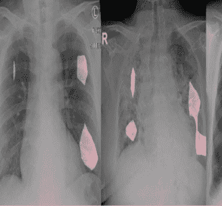

### D. VGG 16

这是一种卷积网络层，应用了 3 x 3 过滤器，步长为 1。当使用相同填充（padding）时，2 x 2 池化层步长为 2。预训练的 Vgg 16 用于 Covid 的预测。[19]

图 1. Covid-19 患者的 X 光图，影响区域的红色标记位于

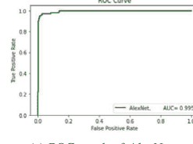

### E. Inception

这是一种常用于图像识别的模型。Inception 是包含 42 层的深度卷积神经网络架构。它的设计方式通过过滤卷积和激进正则化实现了计算的高效。该模型由最大池化、平均池化、softmax 等平衡和不平衡的构建块组成。[27]

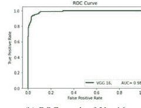

(a) AlexNet 的 ROC 曲线图

(b) VGG16 的 ROC 曲线图

## IV. 实验与结果

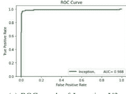

### A. 数据集

实验准备了数据集，并从两个不同的数据源收集了数据：COVID-Ray-5K 数据集 [11] 和 COVID-19 放射数据库 [12]。COVID-Ray-5K 数据集包含 254 张 Covid 患者胸部图像，经过进一步筛选，仅收集了 184 张在 X 光片上具有清晰标注的后位图像；这是最大的胸部 X 光数据集，包含 24,136 张正常和 14 种疾病的光线图像。模型使用 84 例病例和 2000 张非 Covid 图像进行训练，并在 100 例和 3000 例非 Covid 患者上进行测试。

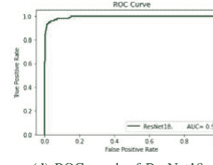

(c) Inception V3 的 ROC 曲线图

(d) ResNet18 的 ROC 曲线图

图 2. 不同模型的 ROC 曲线图

COVID-19 放射数据库包含 1341 张正常、1345 张肺炎和 1200 张 Covid 图像 [12]。在所提的方法中仅使用了 Covid 患者和正常患者样本。两个数据集的进一步图像被合并以增加数据集规模。

### C. AUC - ROC

AUC 和 ROC 是模型评估的重要性能指标，特别是对于多分类模型的可视化。ROC 是通过假阳性率和真阳性率生成的，曲线下方的点面积被称为 AUC。如果 AUC 值接近 1，则模型被认为是良好的；如果接近 0，则被认为是较差或较弱的。我们的模型 ResNet18、V16、Inception V3 和 AlexNet 表现良好。模型的 AUC 在 0.985 以上。AlexNet 达到了最佳 AUC 0.985。如图 2 所示的 ROC 曲线图。

### D. 模型概率

我们可以在深度学习方法中获得每张图像的得分，这清楚地显示了预测结果与预期类别之间的相似性。

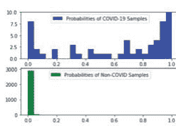

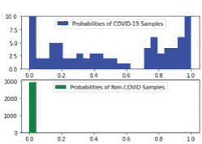

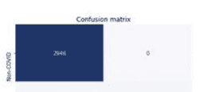

(a) AlexNet 的预测分布

(b) Vgg16 的预测分布

(a) AlexNet 的混淆矩阵

(b) Vgg16 的混淆矩阵

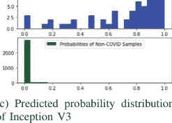

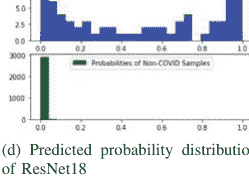

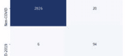

(c) Inception V3 的预测分布

(d) ResNet18 的预测分布

(c) Inception V3 的混淆矩阵

(d) ResNet18 的混淆矩阵

图 4. 不同模型的混淆矩阵

表 I. 性能评估

| 方法 | 敏感性 (Sensitivity) | 特异性 (Specificity) | AUC-ROC |
| --- | --- | --- | --- |
| VGG16 | 0.780 | 0.994 | 0.994 |
| Inception V3 | 0.630 | 1.0 | 0.989 |
| AlexNet | 0.870 | 0.995 | 0.995 |

概率得分接近 1 意味着预测为 Covid 19。如果接近 0 则意味着预测为非 Covid。在实验期间，所有 COVID-19 模型分布在 0 到 1 之间，但接近 1 的概率得分更高。在 V30 中发现了最佳概率分布值。非 Covid 的概率值位于 0 到 0.2 之间，表现优异。所有模型的详细概率分布见图 3。

### E. 敏感性与特异性

我们对类别进行了二分类，数据集被分为 covid 和 non-covid 两类。在深度学习中，模型给出得分值，通过与阈值值进行比较来预测其属于 covid 还是 non-covid 类。计算了敏感性和特异性。预测阈值值设置为 0.52。表 1 显示 inception v3 达到了敏感性 0.940，vgg-16 达到了最低特异性 0.630。其中 vgg-16 达到了最高敏感性 1，AlexNet 达到了最高特异性 0.99。混淆矩阵见图 4。

### F. 在 V30 上 Covid-ray 数据集训练 ResNet18

Epoch 是神经网络训练的迭代。我们在数据集上 25 个 epoch 训练了所有模型。ResNet18 在 Covid-ray 数据集上进行了 30 个 epoch。

### G. 使用 COVID-19 放射数据库测试 ResNet18

COVID-19 放射数据库包含 1341 张正常、1345 张肺炎和 1200 张 Covid 图像 [12]。在所提的方法中仅使用了 Covid 患者和正常患者样本。两个数据集的进一步图像被合并以增加数据集规模。

### H. 在新数据集上训练 ResNet18

Covid-ray 数据集拥有 184 张 Covid 患者图像，所有模型在该数据集上训练的准确率很高。由于 Covid 19 样本量很小，我们无法依赖模型的结果。将“COVID-19 放射数据库”和“Covid-ray”数据集合并以合并数据集。ResNet18 在此增强数据集上进行了训练，为我们提供了理想的结果，敏感性提高到 0.884，特异性提高到 0.997。

## II. 新数据集上 ResNet18 的性能

| 数据集 | 敏感性 (Sensitivity) | 特异性 (Specificity) | AUC-ROC |
| --- | --- | --- | --- |
| Covid-ray | 0.780 | 0.998 | 0.998 |
| COVID-19 放射 | 0.843 | 0.977 | 0.989 |

## V. 结论

在 covid-19 中发现了异常。使用了深度学习模型 VGG16、Inception V3 和 ResNet18。模型的准确性将会提高。最佳 AUC 由 AlexNet 实现。inception v3 达到了敏感性 0.940，vgg-16 达到了最低特异性 0.630。其中 vgg-16 达到了最高敏感性 1，AlexNet 达到了最高特异性 0.99。所有模型的特异性范围在 0.6 到 0.9 之间。我们可以利用此检测 covid-19。

[25] A. Krizhevsky, J. Sutskever, and G. E. Hinton, "Imagenet classification with deep convolutional neural networks," *Advances in neural information processing systems*, vol. 25, pp. 1098–1105, 2012.

[26] K. He and A. Zerman, "Very deep convolutional networks for large-scale image recognition," *arXiv preprint arXiv:1409.1556*, 2014.

[27] C. Szegedy, V. Vanhoucke, S. Ioffe, J. Shlens, and Z. Wojna, "Rethinking the inception architecture for computer vision," in *Proceedings of the IEEE Conference on computer vision and pattern recognition*, 2016, pp. 2818–2826.

