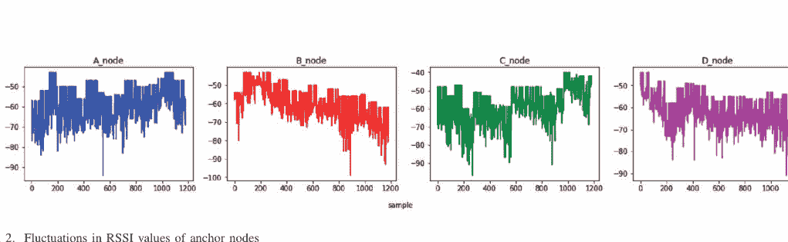
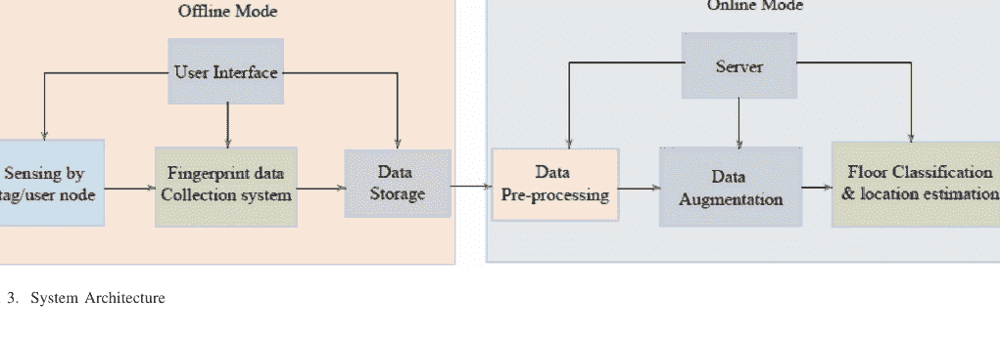

# [2021 第六届无线通信、信号处理与网络国际会议 (WiSPNET)(印度金奈, 2021.3.25-2021.3.27)] 2021 第六届无线通信

**摘要**——随着物联网（IoT）行业的蓬勃发展，*基于位置的服务*（LBSs）在构建智慧城市中发挥着至关重要的作用。由于 LBSs 正趋于无处不在，寻找一种低成本、低能耗的定位解决方案至关重要。利用低功耗蓝牙（BLE）技术进行室内定位是向行业提供经济实惠解决方案的明智选择，此外还具有与其他设备连接无忧等优势。我们提出了一种改进的基于 **RSSI**（*接收信号强度指示器*）的指纹识别技术，该技术首先对数据进行增强，然后使用机器学习算法进行分类。这种室内定位技术使我们能够识别用户节点（UN）或标签的 **X 位置**，该节点接收来自锚节点（ANs）的信号。RSSI 值的波动较大，因为它们在室内定位环境中受到多径传播及其他因素的影响。为克服这些缺点，降低计算成本，通过提高精度来保证框架的精确性，并使其能够适应机器学习计算，对指纹数据进行了增强。该增强策略通过在单个位置利用可获取的 RSSI 估算值来实现，其中 *随机森林*（Random Forest）达到了 96% 的最高测试准确率，超越了所有现有方法。

*索引词*——低成本，低功耗蓝牙，室内定位，指纹识别，增强，机器学习

## I. 引言

在过去十年中，由于基于位置的服务（LBS）使用量的增加，定位技术吸引了大量的研究精力。特别是无线指纹定位，由于其高度的简便性和与现有硬件的兼容性，在工业界获得了相当多的关注。各行各业对室内位置信息服务的需求日益增长。室内位置信息服务的一些实施案例包括：监测机场和车站的人流、定位商店和购物中心中的顾客，以及监测医院中药物的位置以便轻松取用。过去十年也结出了一些成果，例如 Wi-Fi、RFID 和 ZigBee 等技术的进步。尽管位置服务行业取得了进步，但相对于室外环境，室内环境的定位任务相当复杂。这可以归因于室内存在复杂的基础设施和多径传播。在封闭环境中，多径效应起着关键的负面影响。大多数无线信号在结构化环境中会面临这种类型的干扰，这些环境中有许多反射和衰减表面，如墙壁和窗户。因此，室内环境定位要求无可辩驳的质量水平，必须通过高效利用硬件、高复杂性以及极强的鲁棒性来确保 [9]。为了解决这些问题，需要采用指纹法来估算室内位置，这需要一种估计算法来保证位置的准确性。该技术由在线和离线两个阶段组成。在离线阶段，整个感兴趣区域被划分为矩形网格点集。从每个网格点使用标签节点记录来自锚节点（ANs）的 RSS。这些信号最终存储在一个称为无线电地图的数据库系统中。在在线阶段，手机收集来自 ANs 的 RSS，并将其发送到服务器，将在线阶段的 RSS 与离线阶段预先定义的指纹进行比较分析，以评估网格地图上的位置 [10]。

一种可应用的定位系统是 BLE 定位系统，由于其能耗低、成本低、兼容性强以及 BLE 设备尺寸小，已成为研究焦点 [6]。由于几乎每个智能设备（如笔记本电脑、手机、平板电脑和智能手表）都配备了蓝牙模块，因此不需要额外的设备。由于其简单性，BLE 系统依赖于基于 RSS 的输入，尽管 BLE 有多种实施方式，如到达角（AoA）和飞行时间（ToF）[7]。在实际应用中，基于 RSSI 的距离测量会受到反射、多径、天线增益等影响，从而产生较大的定位误差。因此，利用基于指纹特征向量的定位方法，其中定位区域被隔离成网格，并收集每个网格中所有 Wi-Fi/BLE 源接收到的 RSSI 值。随后，所有这些 RSSI 值被存储在指纹数据库中 [6]。此 BLE 技术使用 2.4 GHz 免授权频段（2402 至 2480 MHz），包含 40 个通道（每个通道带宽 2 MHz）。在实验设置和数据收集之后，采用了多种算法来优化框架的准确性，例如三边测量法和指纹法。总的来说，目前尚不存在使用 BLE 技术实现高精度的优化解决方案 [5]。用于预测物体估计位置的技术将影响对该物体真实估计位置的准确性。已有许多算法被用于估算物体的位置。从使用多项式回归作为传播模型的传统方法，到使用 K 近邻和机器学习。使用传统方法时，接收的 RSS 通过加权求和处理以获得物体的坐标，并使用多项式回归模型获得距离。两者都是基于每个信标 3 个广播信道的 RSS 信号确定的。然后，将这两种结果通过离群值检测进行滤波以清理输出，将指纹法与多项式回归模型的距离合并为组合距离。此滤波结果通过扩展卡尔曼滤波处理，利用第一个离群值检测后的滤波距离。扩展卡尔曼滤波的结果再次通过离群值检测进行滤波，以去除虚假测量。然后，此结果再次通过扩展卡尔曼滤波处理为估计位置，该位置将与无线电地图进行比较以获取真实位置。这种方法使用基于距离的测量，由于滤波器的原因，误差较大且准确性降低 [5]。后来，研究人员通过处理指纹数据将其转换为图像数据，并使用该图像数据训练 CNN 来实施 CNN 架构。然而，这种方法需要巨大的数据集和大量的锚节点（ANs）来馈送 CNN [4]。

本文提出了一种新的基于 RSSI 的指纹识别技术和改进的指纹数据增强技术。当锚节点数量较少且非大规模部署时，强烈推荐此方法。为了即使数据较少也能提供高精度的定位，所使用的基于 RSSI 的增强技术是鲁棒的、独特的且易于实施的，它仅依赖于在位置每个网格中收集的 RSSI 值来生成增强输出。目标网格中存在的 RSSI 值被任意选择并写入新的输出中。其鲁棒性在于增强输出的模式与目标网格的输入 RSSI 模式相匹配。下文展示了论文的其余部分组织方式。第二部分描述该研究领域内的先前工作。第三部分描述了利用指纹法的拟议定位技术，以及数据和增强方法的描述。系统模型和实验设置在第四部分中呈现。最后，第五部分得出结论。

## II. 背景

室内定位已经研究了相当长的一段时间。最初，RSSI 无线信号被用作室内定位的参考数据。然而，由于这些信号的无线多径影响，数值存在很大的波动，这些波动导致了较大的距离误差。为了解决高波动和误差问题，Aiguo Zhang 等人 [6] 提出了一种基于 RSSI 的指纹特征向量算法。在该算法中，定位区域被划分为矩形网格集。移动设备通过实时 RSSI 特征向量与 RSSI 指纹数据库特征向量之间的相似性匹配进行定位。由于这高度依赖于位置，还需要进一步的工作。然而，LF（指纹法）由于需要更新指纹数据库这一前提条件而面临劣势。采用了一种称为高斯过程（GP）的非参数建模方法来建模接收信号强度指示器（RSSI）并创建更新的指纹数据库。该方法对训练数据存在的依赖性极少。Perez-Cruz 等人 [2,3] 利用 GP 均值中的参数路径损耗模型和灵活的无参数协方差函数，从而可以用较低的指纹工作量实现可靠的估算。作者还解释了其他各种路径损耗模型及其优缺点。此后，由于 BLE 具有低成本服务、与现有软件的高兼容性以及尺寸小巧等特点而进入视野。Pavel Kriz 等人 [8] 审查并记录了结合 BLE 技术以及基于无线电的室内定位技术的一些基本标准所取得的改进结果。作者执行了一个分布式系统，通过运行 Android 操作系统的移动设备收集无线电指纹。该系统返回了 2.82 米的高误差，因此需要改进。Ngoc-Son Duong 等人 [11] 提出了一种新的系统——基于 BLE iBeacon 的室内定位系统，该系统应用了 K 近邻算法。K 近邻（k-NN）是一种机器学习方法，它根据训练数据和具有相同 RSS 值的最近邻数据点来确定用户位置。即便如此，该算法仍存在劣势，因为 ML 模型的准确性是不确定的。随后，Marco Terán 等人 [9] 实现了基于物联网（IoT）的框架。该框架的设计利用了无线网络技术以及与亚马逊云服务计算服务的连接。遗憾的是，该框架达到的最大准确率仅为 75%。Osmah Ali Abdullah 等人 [10] 提出了一种基于对称 Bregman 散度的新框架，该框架在信号空间中整合了 kNN 分类。目标坐标解析为最接近指纹的加权组合，使用 Jensen-Bregman 散度将平方欧氏距离和马哈诺距离结合在一起，并结合信息论 Jensen-Shannon 散度度量。然而，尽管该技术提供了 90% 的准确率，但由于其复杂性高而未受到广泛好评。同样，et al. [4,5] 分别使用回归和 CNN 来估算位置，前者获得了 96.67% 的极高准确率值。当锚节点少于 150 个时，无法使用这些技术。Rashmi Sinha 等人 [1] 提出了一种改进的数据增强技术，该技术依赖于 RSSI 值，用于指纹室内定位系统。该技术在实验室模拟中实现了 95.26% 的测试准确率，在实时环境中实现了 94.59%。该技术还使用了超过 250 个锚节点。最后，Faeheim Zafari 等人 [7] 提供了各种室内定位方法的详细综述，如到达角（AoA）、飞行时间（ToF）、往返飞行时间（RTOF）、接收信号强度（RSS），基于进步：

例如，WiFi、射频识别设备（RFID）、超宽带（UWB）以及蓝牙等。作者还从能源效率、可用性、成本、接收范围、延迟、可扩展性和跟踪准确度的角度评估了各种框架。随后，作者比较了定位系统并总结了它们的工作原理。最后，作者探讨了在精确室内定位中面临的挑战。

## III. 提议的方法

总体架构如图 3 所示。最初，用户节点（UN）从蓝牙低功耗锚点（BLE ANs）感知 RSSI 值。我们提出的框架中使用的定位方法是指纹法。图 2 展示了从锚点（ANs）接收的 RSSI 值存在巨大波动。该提议系统即使面对如此巨大的波动也能简化室内定位，它由两部分组成：离线/训练阶段和在线/执行阶段。在离线阶段，当收集锚点（ANs）的数据并记录位置坐标时，用户节点（UN）将这些参数记录到本地数据库中。在在线阶段，数据首先进行预处理，随后进行增强。增强后的数据集足以输入到不同的分类器中进行比较。选择产生最高准确度得分的方法来估计用户位置或网格。

### A. 指纹技术

所提议的指纹技术将感兴趣区域划分为特定数量的矩形单元。使用标签节点和锚点节点测量每个单元内接收到的信号功率（无线电参数）。在第一阶段（也称为训练阶段），这些接收信号以类似信号强度分布描绘的方式组织成随机地图。训练阶段结束后，实现位置推断，并再次观察接收到的功率测量值，这是后续阶段。然后，将这些功率测量值映射到在训练阶段获得的位置信息。最后，通过利用数据关联技术和估计，将目标对象的位置缩小至其所在的单元。该过程允许指纹技术对物体位置进行离散估计。理论上，这些矩形单元的距离和尺寸可以减小到测量提供连续观察而非离散观察的程度。然而，在这种情况下，两个相邻点之间的信号强度差异将变得远小于典型的室内信号变化，这使得正确点的估计实际上几乎不可能。基于同样的原因，当选择指纹定位位置时，指纹定位位置的粒度与成功定位估计的可能性之间存在显著的权衡，应仔细考量。同样值得一提的是，尽管指纹和场景分析技术可以提供准确的定位估计，但它们对环境变化非常敏感。这完全是因为它们依赖于离线

图 1. 实验装置布局

以及在线测量在不同时间实例 [7]。指纹方法不需要距离计算，并且该方法确保了足够的精度，尽管在过于密集和动态的环境中，精度会降低 [9]。

### B. 实验设置

所提议的室内定位系统在印度金奈的 Novitate Engineering Solutions 的室内环境中进行了测试。在此设置中，四个 BLE 锚点（ANs）被放置在同一平面上，且不被其他结构遮挡。该设置中使用的 BLE 模块是 Decawave 的 DWM1001。在封闭环境中放置锚点 A、B、C 和 D 的位置可以在图 1 中看到。锚点的放置位置最初是通过三角测量法决定的，但由于噪声和干扰过大而被放弃。后来，通过试错法和物理验证，锚点被放置在图示位置。为确保信号的可靠性，信标广播间隔被设置为 1 ms，两个相邻信标之间的最小距离为 4 英尺。实验区域（100 平方英尺）被划分为均匀分布的网格点，两个相邻网格之间的距离为 1 英尺。我们利用线跟随机器人收集实验区域内 16 个网格的数据。另一个 BLE 收发器模块，即用户节点/标签，安装在线跟随机器人上。机器人在静止且位于每个网格中心时，从 4 个锚点收集 RSSI 值。每个节点在每个网格收集的最小值为 58，最大值为 65。因此，整个无线电地图数据集包含 1180 行数据。

### C. 数据预处理和增强

从前一节的实验设置中，派生出的数据包含 7 列。这些是信号的时间戳、网格的 X 坐标、网格的 Y 坐标以及 4 个锚点节点的 RSSI 值。对于每个

网格，每对唯一的 X 和 Y 坐标，每个锚点节点的 RSSI 值被观察 60 次。为每个网格形成一个新的特征标签，作为分类数据的变量。鉴于该系统是一个低成本系统，每个节点观察到的数据较少，不足以让算法学习和分类数据。因此，提出了一种数据增强技术。首先将每个节点在每个位置的数据隔离。然后为参考数据集定义特定的重复次数 N。然后使用 Python 函数 sample 将该数字用于从每个节点有放回地随机选择 N 个数据点。这对每个网格上的每个节点都进行了重复。在我们的使用案例中，重复次数设置为 200，这使得数据集增加了三倍。

## IV. 结果

### A. 分类器训练

分类是一种监督学习类型，旨在将给定的数据集分类到各种类别中。在这种情况下，实现分类器以基于 RSSI 值对用户节点的位置进行分类。使用的分类器包括：

-   **随机森林**：随机森林是一种用于分类的集成方法，通过在训练时设计决策树网络并得出个体树类别的模式来运行。
-   **XGBoost**：XGBoost 是一种基于决策树的集成算法。它在训练阶段采用梯度提升框架进行学习。
-   **决策树**：它们是监督机器学习算法的一个实例，可以用两个主要元素（叶子和节点）来解释。节点是基于条件分割数据的地方，叶子是算法的最终决策。
-   **KNN**：K 近邻是一种监督机器学习算法，根据最近的邻域数据点来分类数据点。
-   **SVC**：支持向量机算法用于输出和优化超平面，根据特征来表征给定信息。

在原始数据集和增强数据集上都使用了 Jupyter 笔记本，并将数据集按 75:25 的比例划分为测试集和训练集。使用准确度、错误率、F1 分数、召回率等指标比较了每个分类器的最终结果。

### B. 实验结果

表 I 和表 II 分别显示了每个分类器在原始数据和增强数据上的性能。从表中可以看出，增强数据具有显著优越的准确度值，并且降低了定位错误。错误率显示了被错误分类的数据点的百分比，召回率计算为每个网格输出的加权平均值，F1 分数推导为每个网格精确率和召回率调和平均值的加权平均值。使用原始数据的模型相对于增强数据集模型显示了令人失望的结果。在使用增强数据集的模型中也没有出现过拟合或欠拟合的迹象，因为训练准确度和测试准确度没有太大差距。从结果推断，使用增强的随机森林算法

## 表 I
原始数据结果

| 分类器名称 | 训练准确率 | 测试准确率 | 误差 | F1 | 召回率 |
| :--- | :---: | :---: | :---: | :---: | :---: |
| 随机森林 | 0.93 | 0.61 | 0.39 | 0.60 | 0.60 |
| XGBoost | 0.90 | 0.64 | 0.35 | 0.64 | 0.64 |
| 决策树 | 0.80 | 0.50 | 0.49 | 0.51 | 0.51 |
| KNN | 0.65 | 0.45 | 0.54 | 0.45 | 0.48 |
| SVC | 0.52 | 0.48 | 0.52 | 0.52 | 0.53 |

## 表 II
增强数据结果

| 分类器名称 | 训练准确率 | 测试准确率 | 误差 | F1 | 召回率 |
| :--- | :---: | :---: | :---: | :---: | :---: |
| 随机森林 | 0.99 | 0.96 | 0.04 | 0.93 | 0.93 |
| XGBoost | 0.97 | 0.95 | 0.05 | 0.95 | 0.95 |
| 决策树 | 0.95 | 0.91 | 0.09 | 0.93 | 0.92 |
| KNN | 0.83 | 0.71 | 0.28 | 0.71 | 0.71 |
| SVC | 0.60 | 0.53 | 0.46 | 0.52 | 0.53 |

该数据集的表现优于其他分类器，准确率为 0.96，误差为 0.04，F1 分数为 0.93，召回率为 0.93。

## 五、结论

在本文中，我们提出了一种详细的室内定位技术，该技术使用了增强指纹方法。基于 RSSI 的指纹数据库是通过安装在巡线机器人上的 UN 从四个 AN 收集的，该机器人在划分为网格的区域中绕圈收集 RSSI 值。由于紧凑的室内位置受到多径传播和干扰的影响，观察到 RSSI 值存在巨大波动。为了减轻这一缺陷并准确估计网格的位置，在获得适当的增强数据后，采用了机器学习分类器。经过增强后，数据从 1180 行增加到 3200 行，增加了三倍，这将定位准确率从 61% 提高到了 96%。我们采用了五种不同的机器学习分类器来比较各项指标。其中，随机森林分类器最准确，准确率为 96%，误差也最低，为 0.04。对于未来的工作，我们建议读者设计一种方法，以便能大幅增加最小的指纹数据集，该数据集可用于 CNN 进行定位。

## 致谢

该数据集由 Novitaz Engineering Solutions Ltd. 提供。他们还在其办公场所进行了实验。

## 参考文献

- [1] Rashmi Sharmin Sinha 和 Seung-Hoon Hwang, Improved RSSI-Based Data Augmentation Technique for Fingerprint Indoor Localization, MDPI Electronics 2020, 9, 851.
- [2] Marzieh Dashi, Holger Claussen, Fernando Perez-Cruz, Simon Yiu n, Wireless RSSI fingerprinting localization, Signal Processing 131-235244, Elsevier, 2017.
- [3] Simon Yiu, Marzieh Dashi, Holger Claussen 和 Fernando Perez-Cruz, Locating User Equipment and Access Points using RSSI Fingerprints: A Gaussian Process Approach, IEEE ICC SAC Internet of Things, 2016.
- [4] Danshi Sun, Ehu Wei, Li yang, Shiyi Xu, Improving Fingerprint Indoor Localization Using Convolutional Neural Networks, IEEE Access 2020.
- [5] Reginald Putra Ghozali, Gede Putra Kusuma, Indoor Positioning System using Regression-based Fingerprint Method, (IJCSCA) International Journal of Advanced-Computer Science and Applications, Vol. 10, No. 5, 2019.
- [6] Aiguo Zhang, Ying Yuan, Qunyong Wu, Shunzhi Zhu, Jian Deng, Wireless Localization Based on RSSI Fingerprint Feature Vector, Hindawii Publishing Corporation, International Journal of Distributed Sensor Networks, Article ID 528747, 7 pages, Volume 2015.
- [7] Fahmeem Zafari, Athaniosios Geokas, Kin K. Leung, A Survey of Indoor Positioning Systems and Technologies, IEEE Communications Surveys and Tutorials, Volume: 21, Issue: 3 3thirdquarter 2019.
- [8] Pavel Križ, FilipMały, Tomas Kozel, Improving Indoor Localization Using Bluetooth Low Energy Beacons, Hindawii Publishing Corporation Mobile Information Systems, Article ID 2083094, 11 pages Volume 2016.
- [9] Marco Tcrán, Henry Carrillo Carlos Parra, WLAN-BLE Based Indoor Positioning System using Machine Learning Cloud Services, IEEE CCRA 2018.
- [10] Osamah Ali Abdullah, Ikhlal Abdelzohor, Machine Learning Algorithms for Wireless Indoor Localization, Intechopen, Machine Learning - Advanced techniques and Applications, 2017.
- [11] Ngoc-Son Duong, Thai-Myi Dion, Indoor Localization with Lightweight RSS Fingerprint using MIE iBeacon on iOS platform, 2019 19th International Symposium on Communications and Information Technologies (ISITC).

