# 
2024 AP 计算机科学 A 入门指南


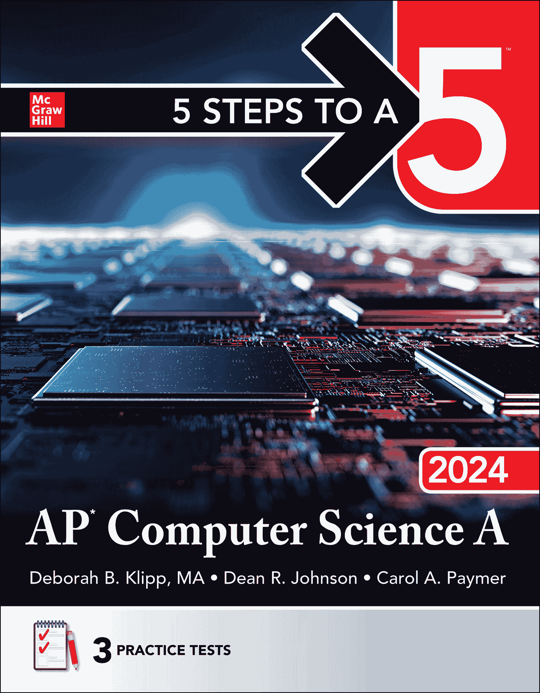


The material in this eBook also appears in the print version of this title: ISBN: 978-1-26-526792-6, MHID: 1-26-526792-8.

eBook conversion by codeMantra  

Version 1.0

All trademarks are trademarks of their respective owners. Rather than put a trademark symbol after every occurrence of a trademarked name, we use names in an editorial fashion only, and to the benefit of the trademark owner, with no intention of infringement of the trademark. Where such designations appear in this book, they have been printed with initial caps.

McGraw Hill eBooks are available at special quantity discounts to use as premiums and sales promotions or for use in corporate training programs. To contact a representative, please visit the Contact Us page at [www.mhprofessional.com](http://www.mhprofessional.com).

McGraw Hill, the McGraw Hill logo, *5 Steps to a 5*, and related trade dress are trademarks or registered trademarks of McGraw Hill and/or its affiliates in the United States and other countries and may not be used without written permission. All other trademarks are the property of their respective owners. McGraw Hill is not associated with any product or vendor mentioned in this book.

*AP, Advanced Placement Program*, and *College Board* are registered trademarks of the College Board, which was not involved in the production of, and does not endorse, this product.


**Preface**

**About the Authors**

**Introduction**


好了，让我们开始吧。

### 诊断考试

#### 选择题

#### 答题纸

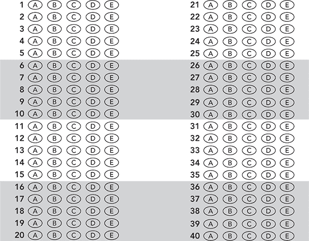

### AP 计算机科学 A 诊断考试

**第一部分**

**选择题**

**时间：90 分钟**

**题目数量：40**

**占总分比例：50%**

**说明：** 为每个问题选择最佳答案。可利用空白区域进行草稿和手绘。有些问题耗时较长，请根据剩余时间分配，避免在某一题上停留过久。

**备注：**

• 你可以假设所有需要的 import 语句已被包含。

• 你可以假设方法调用的参数不为 null，且在前置条件满足时会被调用。

• 你可以假设变量和方法的声明位于包围类的上下文中。

• 如有需要，可参考 Java 快速参考表。

**1.** 考虑下面的方法。

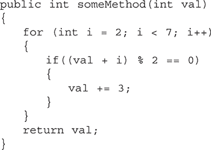

调用 `someMethod(13)` 会返回什么值？

(A) 17  
(B) 25  
(C) 28  
(D) 31  
(E) 什么也返回，出现编译错误。

**2.** 考虑下面的代码片段。

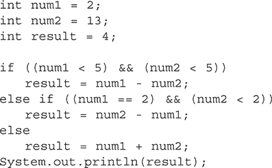

执行该代码片段后会输出什么？

(A) -11  
(B) 4  
(C) 11  
(D) 13  
(E) 15

**3.** 假设 `list` 是一个已正确构造并填充的 `ArrayList<Integer>`，包含以下项。

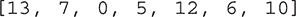

考虑下面的方法。

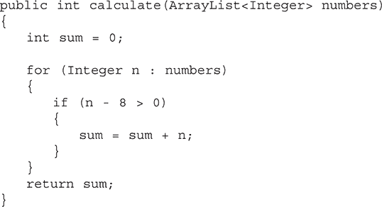

调用 `calculate(list)` 会返回什么值？

(A) 10  
(B) 11  
(C) 13  
(D) 35  
(E) 45

**4.** 考虑下面的类声明。

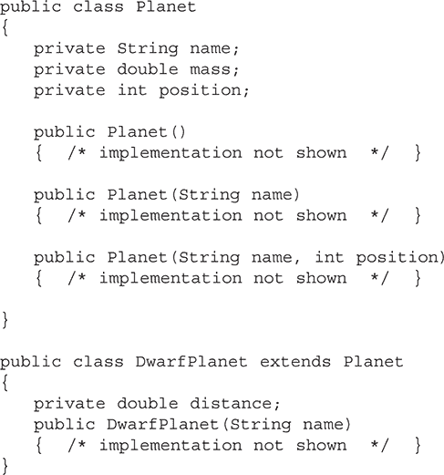

下面哪个声明可以编译通过？

I. `Planet mars = new Planet();`  
II. `Planet pluto = new DwarfPlanet("Pluto");`  
III. `Planet ceres = new DwarfPlanet();`

(A) 仅 I  
(B) 仅 II  
(C) 仅 I 和 II  
(D) 仅 I 和 III  
(E) I、II 和 III

**5.** 考虑下面的代码片段。

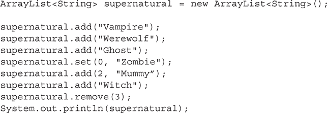

执行该代码片段后会输出什么？

(A) `[Zombie, Werewolf, Mummy, Witch]`  
(B) `[Zombie, Werewolf, Ghost, Witch]`  
(C) `[Zombie, Werewolf, Mummy, Ghost]`  
(D) `[Zombie, Vampire, Werewolf, Mummy, Ghost]`  
(E) [Zombie, Vampire, Werewolf, Mummy, Witch]

**6.** 假设 `grid` 已经初始化为 n×n 的整数二维数组。下面哪段代码会将两条对角线上的所有值相加？

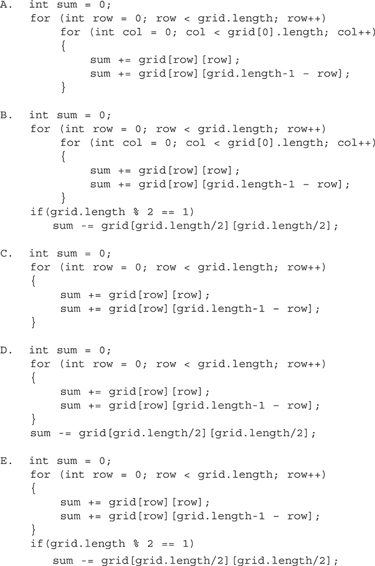

**7.** 考虑下面的部分类声明。

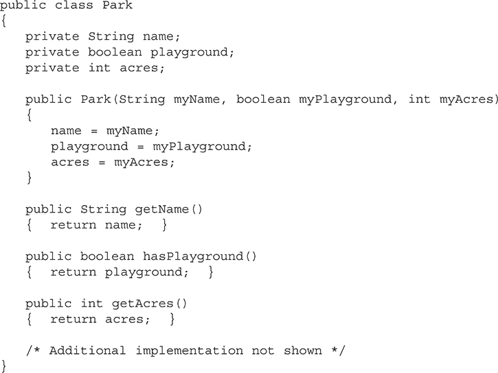

假设下面的声明已在另一个类的 main 方法中执行。

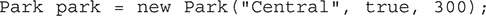

下面哪条语句可以编译通过？

(A) `int num = park.acres;`  
(B) `String name = central.getName();`  
(C) `boolean play = park.hasPlayground();`  
(D) `int num = park.getAcres(acres);`  
(E) `park.hasPlayground = true;`

**8.** 考虑下面的代码片段。

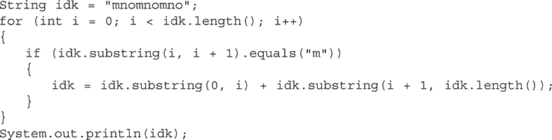

执行该代码片段后会输出什么？

(A) `mmm`  
(B) `nonono`  
(C) `mnomno`  
(D) `nomnono`  
(E) `mnomnomno`

**9.** 考虑下面的方法。

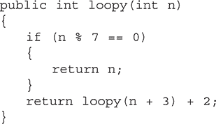

调用 `loopy(12)` 会返回什么值？

(A) 12  
(B) 21  
(C) 23  
(D) 27  
(E) 29

**10.** 考虑下面的类声明。

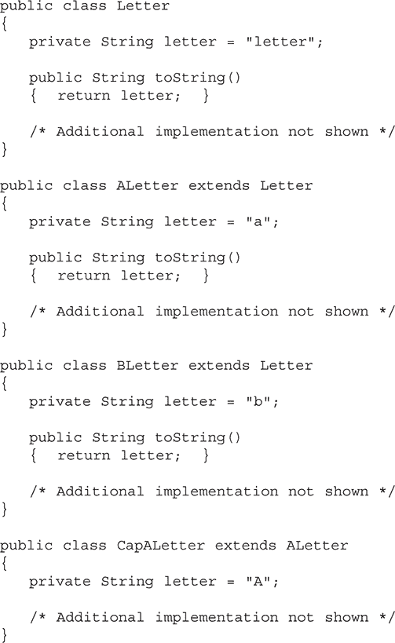

考虑下面的代码片段。

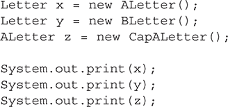

执行该代码片段后会输出什么？

(A) `abA`  
(B) `aba`  
(C) `letterlettera`  
(D) `letterletterletter`  
(E) 什么也输出，出现编译错误。

**11.** 考虑下面的方法。

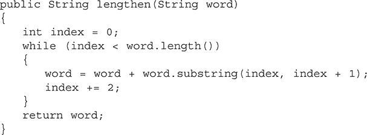

调用 `lengthen("APCS")` 会返回什么？

(A) `"APCS"`  
(B) `"APCSACAA"`  
(C) `"APCSAPCS"`  
(D) 什么也返回，出现运行时错误：`StringIndexOutOfBoundsException`  
(E) 什么也返回，会导致无限循环。

**12.** 考虑下面的代码片段。

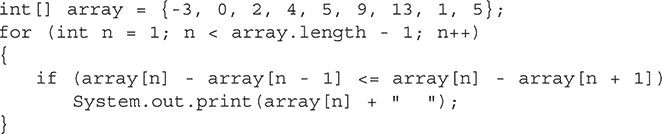

执行该代码片段后会输出什么？

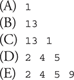

**13.** 假设 `k`、`m` 和 `n` 已经声明并正确初始化为 `int` 值。考虑下面的语句。

`boolean b1 = (n >= 4) || ((m == 5 || k < 2) && (n > 12));`

下面哪条语句在所有 `k`、`m`、`n` 的取值下，都满足 `b2 = !b1`？


(A) `boolean b2 = (n >= 4) && ((m == 5 && k < 2) || (n > 12));`

(B) `boolean b2 = (n < 4) || ((m != 5 || k >= 2) && (n <= 12));`

(C) `boolean b2 = (n < 4) && (m != 5) && (k >= 2) || (n <= 12);`

(D) `boolean b2 = (m == 5 || k < 2) && (n > 12);`

(E) `boolean b2 = (n < 4);`

```
Consider the following code segment.

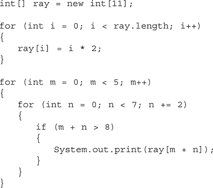

What is printed as a result of executing the code segment?

(A) Nothing is printed. Runtime error: `ArrayIndexOutOfBounds`

(B) `18`

(C) `181620`

(D) `68`

(E) `1820`
```

```
Consider the following method.

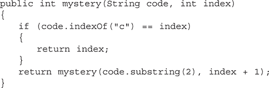

Assume that the string `codeword` has been declared and initialized as follows.

`String codeword = "advanced placement";`

What value is returned by the call `mystery(codeword, 9)`?

(A) `5`

(B) `6`

(C) `7`

(D) Nothing is returned. Infinite recursion causes a stack overflow error.

(E) Nothing is returned. Run-time error: `StringIndexOutOfBoundsException`
```

```
Consider the following method.

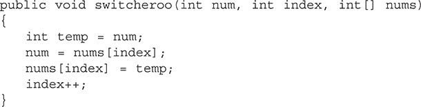

Consider the following code segment.

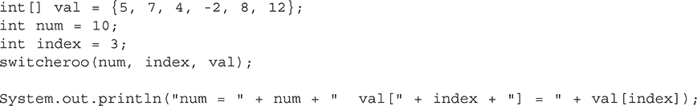

What is printed as a result of executing the code segment?

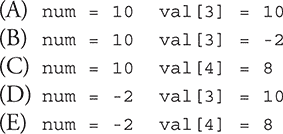
```

```
Consider the following code segment.

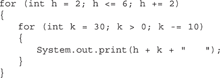

Consider these additional code segments.

I.    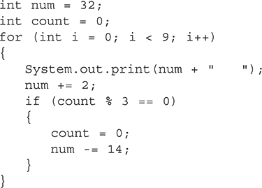

II.   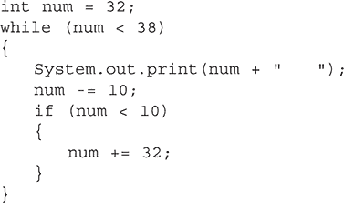

III.  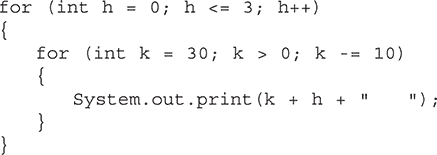

Which of the code segments produce the same output as the original code segment?

(A) I only

(B) II only

(C) III only

(D) II and III only

(E) I, II, and III
```

```
Consider the following method.

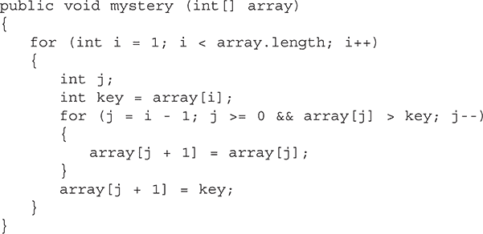

The method above could be best described as an implementation of which of the following?

(A) Insertion Sort

(B) Binary Search

(C) Selection Sort

(D) Merge Sort

(E) Sequential Sort
```

```
Consider the following statement.

int number = (int)(Math.random() * 21 + 13);

After executing the statement, what are the possible values for the variable `number`?

(A) All integers from 13 to 21 (inclusive).

(B) All real numbers from 13 to 34 (not including 34).

(C) All integers from 13 to 34 (inclusive).

(D) All integers from 13 to 33 (inclusive).

(E) All real numbers from 0 to 21 (not including 21).
```

```
Consider the following class declaration.

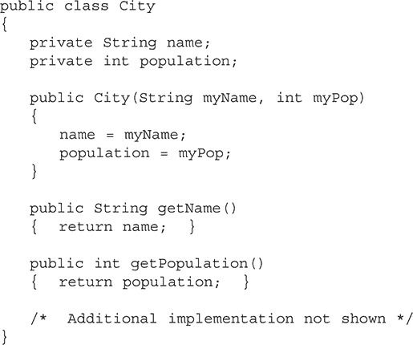

Assume `ArrayList<City>` `cities` has been properly instantiated and populated with `City` objects.

Consider the following code segment.

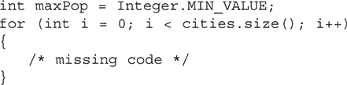

Which of the following should replace `/* missing code */` so that, after execution is complete, `maxPop` will contain the largest population that exists in the `ArrayList`?

(A) 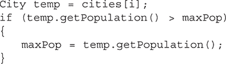

(B) 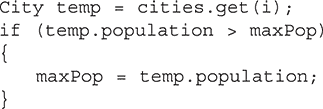

(C) 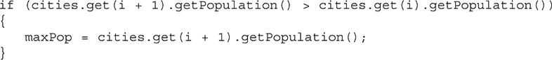

(D) 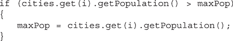

(E) `maxPop` should have been set to `Integer.MAX_VALUE`. This cannot work as written.
```

```
Consider the following method.

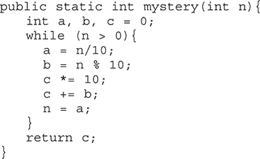

Which statement best describes the value that is returned by mystery?

(A) Ten to the nth power is returned.

(B) The number of digits in n is returned.

(C) The number of times 10 is a factor of n is returned.

(D) The number whose digits are the reverse of n is returned.

(E) The sum of the digits in n is returned.
```

```
Consider the following code segment.

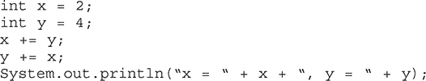

What output is produced by executing this code?

(A) x = 2, y = 4

(B) x = 6, y = 6

(C) x = 6, y = 10

(D) x = 6, y = 12

(E) x = 24, y = 42
```

```
Questions 23 and 24 refer to the following class hierarchy.

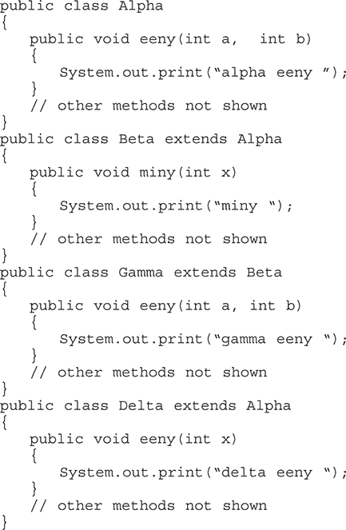

23. What is printed as a result of executing the following code? (Assume that all the classes have parameterless constructors.)

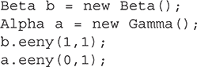

(A) Nothing; the code does not compile.

(B) `alpha eeny`

(C) `alpha eeny alpha eeny`

(D) `alpha eeny gamma eeny`

(E) `miny gamma eeny`

24. What is printed as a result of executing the following code? (Assume that all the classes have parameterless constructors.)

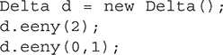

(A) Nothing; the code does not compile.

(B) `alpha eeny alpha eeny`

(C) `delta eeny`

(D) `delta eeny alpha eeny`

(E) `delta eeny delta eeny alpha eeny`
```

```
Assume that an `ArrayList names` holds the following values.

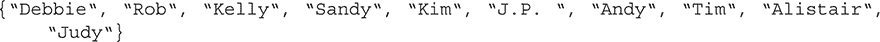

What values does this `ArrayList` hold after executing the following code?

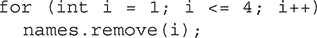

(A) Debbie, Rob, Kelly, Sandy, Kim, J.P.

(B) Debbie, J.P., Andy, Tim, Alistair, Judy

(C) Debbie, Kelly, Kim, Andy, Alistair, Judy

(D) Rob, Sandy, J.P., Tim, Alistair, Judy

(E) Kim, J.P., Andy, Tim, Alistair, Judy
```

```
Consider the following method.

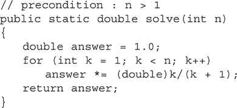

What value is returned by a call to method `solve`?

(A) 0.0

(B) The k^(th) root of n

(C) 1/n

(D) 1/(n-1)

(E) (1/2)^n
```

```
Consider the following method.

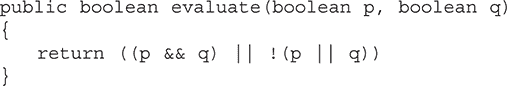

What is returned by `evaluate`?

(A) `evaluate` always returns `false`

(B) `evaluate` returns `true` when `p` and `q` are both `true` or both `false`

(C) `evaluate` returns `true` only when `p` and `q` are both `true`

(D) `evaluate` returns `true` only when `p` and `q` are both `false`

(E) `evaluate` returns `true` when either `p` or `q` is `true` and the other is `false`
```

```
Consider the following class declaration.

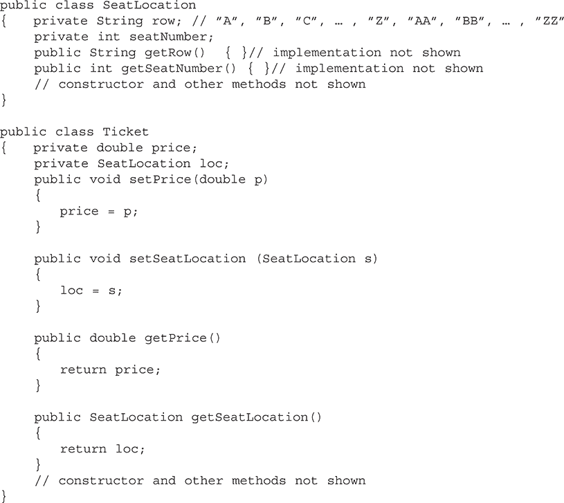

Assume the following valid declarations have been made.

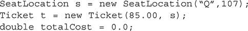

Which of the following statements in a client program is valid?

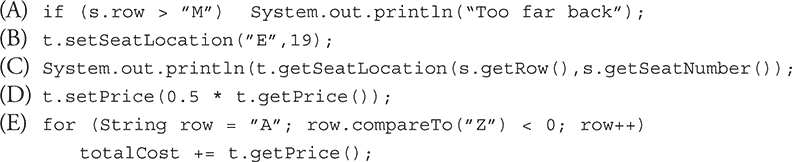
```

```
Suppose that `glop` is an `ArrayList` of `DooHickeys`. Consider the following code fragment that is meant to print out the ID numbers of all `DooHickeys` whose mass is greater than zero.

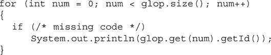

Which of the following expressions will complete the code fragment correctly?

(A) `Doohickeys.get(num).getMass() > 0`

(B) `getNum(glop).getMass() > 0`

(C) `glop[num].getMass() > 0`

(D) `glop.get(num).getMass() >0`

(E) `glop.get(glop.getMass(num)) > 0`
```

```
Consider the following method, which is intended to count the number of times a value is doubled before it is at least as large as a target value.

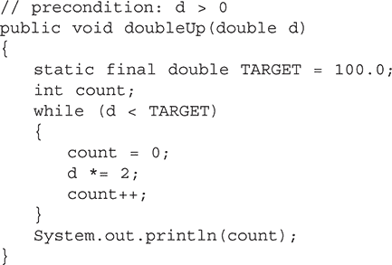

Of the following, which best describes the error in `doubleUp`?

(A) The static modifier cannot be used with a constant.

(B) A variable is used without being initialized.

(C) A double cannot be multiplied by an int.

(D) The counter is incremented in the wrong place.

(E) A variable is initialized in the wrong place.
```

```
31. Which of the following is the best precondition for method `check`?

(A) `0 <= n < arr.length`

(B) `n < arr.length`

(C) `n <= arr.length`

(D) `n >= 0`

(E) No precondition is necessary.

32. Which of the following is the best postcondition for method `check`?

(A) returns `true` if there are no duplicates in the first `n` elements of `arr`; otherwise, returns `false`

(B) returns `true` if the (n-1)th element of `arr` is less than the `n`th element; otherwise, returns `false`

(C) returns `true` if the first `n` elements of `arr` are all the same value; otherwise, returns `false`

(D) returns `true` if the first `n` elements of `arr` are in strictly increasing order; otherwise, returns `false`


(a) Write the static method `findNumberOfRotations`, which returns the number of rotations necessary for rotation and base to have the same value. A `String` is considered a rotation of another `String` if the order of the letters remains the same, but the positions of the letters are shifted, causing the letters at the end of the `String` to shift to the beginning of the `String`. If no rotations are possible for the values of rotation and base to be the same, then `-1` is returned.

(b) Write the static method `isReverseRotation`, which returns `true` if rotation is a reverse rotation of base and `false` otherwise. A `String` is considered a reverse rotation of another `String` if the reverse of the `string` is a rotation of the other. You may call on `findNumberOfRotations` and assume it works as intended, regardless of your implementation.


The class `GPSRouter` represents a collection of `Route` objects. Assume that the collection `routes` has been initialized.

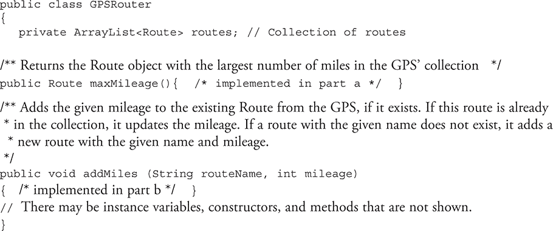

You will write two methods from the class `GPSRouter` as follows:

• The method `maxMileage` will find the `Route` object in the `GPSRouter` object with the largest number of miles and return it. If the `GPSRouter` object has no routes, then the method will return `null`.

• The method `addMiles` will add a route to the `GPSRouter` object with the given name based on the following requirements:

• Routes in a `GPSRouter` object are identified by name. All routes in a `GPSRouter` object have unique names.

• If the route is already represented in the `GPSRouter` object (has the same name as the given name `routeName`), then increase the mileage in the corresponding route by the given amount `mileage`.

• If the route is not already represented in the `GPSRouter` object (the given name `routeName` does not match any name in the collection), then add a new `Route` to the collection with the given name `routeName` and mileage `mileage`.

Assume a `GPSRouter` object `gps` has been created and the following routes (already created) have been added into it.

• `Route route1` is a `Route` with name “Kalamazoo” and a mileage of 5200.

• `Route route2` is a `Route` with name “Tampa” and a mileage of 7000.

• `Route route3` is a `Route` with name “Dayton” and a mileage of 1000.

The chart contains a sample code execution sequence and the corresponding results.

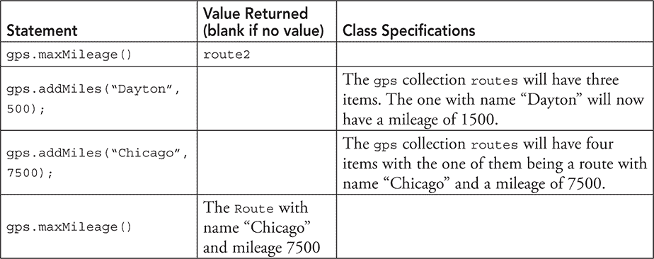

a) Write the implementation for the `maxMileage` method of the `GPSRouter` class, which will return the `Route` object with the largest number of miles. If there are no routes in the `GPSRouter` object, return `null`.


b) Write the implementation of the `addMiles` method of the `GPSRouter` class, which updates the milage of the given `Route` if it exists in the collection and adds the given `Route` to the collection if it does not.


**4.**  Coin Collector

The High School Coin Collection Club needs new software to help organize its coin collections. Each coin in the collection is represented by an object of the `Coin` class. The `Coin` class maintains three pieces of information for each coin: its country of origin, the year it was minted, and the type of coin it is. Because coin denominations vary from country to country, the club has decided to assign a coin type of 1 to the coin of lowest denomination, 2 to the next lowest, and so on. For American coins, `coinType` is assigned like this:


The Coin Club currently keeps track of its coins by maintaining an `ArrayList` of `Coin` objects for each country. The coins in the `ArrayList` are in order by year, oldest to newest. If two or more coins were minted in the same year, those coins appear in a random order with respect to the other coins from the same year.

The Coin Club has acquired some new collection boxes of various sizes to store their coins. The boxes are rectangular and contain many small compartments in a grid of rows and columns. The club will store coins from different countries in different boxes.

The `CoinCollectionTools` class below assists the Coin Club in organizing and maintaining their collection.


(a) The `CoinCollectionTools` class constructor initializes the instance variable `coinBox` as a two-dimensional array of `Coin` objects with dimensions specified by the parameters. It then instantiates each of the `Coin` objects in the array as a default `Coin` object with `country` equal to the country name passed as a parameter, `year` equal to 0, and `coinType` equal to 0.


(b) The Coin Club intends to fill the collection boxes from their list of coins, starting in the upper-left corner and moving down the columns in order until all `Coin` objects have been placed in a compartment.

The `fillCoinBox` method takes as a parameter an `ArrayList` of `Coin` objects in order by year minted and returns a chart showing their position in the box, filled in column-major order.

You may assume that `coinBox` is initialized as intended, regardless of what you wrote in part (a).

Complete the method `fillCoinBox`.


(c) Sometimes the Coin Club would prefer to see a list of its coins organized by coin type.

The `fillCoinTypeList` method uses the values in `coinBox` to create and return an `ArrayList` of `Coin` objects filled first with all the `Coin` objects of type 1, then type 2, and so on through type 6. You may assume that no country has more than 6 coin types. Note that the number of coins from any specific type may be 0.

Since the original `coinBox` was filled in column-major order, `Coin` objects should be retrieved from the `coinBox` in column-major order. This will maintain ordering by year within each coin type.

Remember that the `CoinCollectionTools` class constructor filled the `coinBox` with default `Coin` objects with a `coinType` of 0, so no entry in the `coinBox` is `null`.

You may assume that `coinBox` is initialized and filled as intended, regardless of what you wrote in parts (a) and (b).

Complete the method `fillCoinTypeList`.


**STOP. End of Part II.**

### Diagnostic Exam Answers and Explanations

#### Part I (Multiple-Choice) Answers and Explanations

1.  The answer is B.

• When we first enter the loop, `val` = `13` and `i` = `2`. The `if` condition is looking for even numbers. Since val + i is odd, we skip the `if` clause. Increment i to 3. i < 7 so we continue.

• val = 13, i = 3. This time val + i is even, so add 3 to val. val = 16, increment i to 4, i < 7 so we continue.

• val = 16, i = 4. val + i is even, add 3 to val. val = 19, increment i to 5, i < 7, continue.

• val = 19, i = 5. val + i is even, add 3 to val. val = 22, increment i to 6, i < 7, continue.

• val = 22, i = 6. val + i is even, add 3 to val. val = 25, increment i to 7. This time, when we check the loop condition, i is too big, so we exit the loop.

• val = 25 and that is what is returned.

2.  The answer is E.

• The first `if` condition evaluates to (2 < 5 && 13 < 5), which is false, so we skip to the else clause.

• The `else` clause has its own `if` statement. The condition evaluates to (2 == 2 && 13 < 2), which is false, so we skip to the `else` clause.

• result = 2 + 13 = 15, which is what is printed.

3.  The answer is D.

• The `for-each` loop can be read like this: for each integer in numbers, which I am going to call n.

• The `if` clause is executed only when the element is > 8, so the loop adds all the elements greater than 8 to the sum variable.

• The elements greater than 8 are 13, 12, and 10, so sum = 35, and that is what the method returns.

4.  The answer is C.

• Option I is correct. The reference variable type `Planet` matches the `Planet` object being instantiated, and the `Planet` class contains a no-argument constructor.

• Option II is correct. The reference variable type `Planet` is a superclass of the `DwarfPlanet` object being instantiated, and the `DwarfPlanet` class contains a constructor that takes one `String` parameter.

• Option III is not correct. Although the reference variable type `Planet` is a superclass of the `DwarfPlanet` object being instantiated, the `DwarfPlanet` class does not contain a no-argument constructor. Unlike a method, the constructor of the parent class is not inherited.

5.  The answer is A.

• Let’s picture the contents of our `ArrayList` in a table. After the 3 adds, we have:


Setting 0 to Zombie gives us:


Adding Mummy at position 2 pushes Ghost over one position:


Witch gets added at the end:


After the remove at index 3, Ghost goes away and Witch shifts over one:


`6.`  The correct answer is E.

• Options A and B are incorrect. The inner column loop is not necessary and includes more values than along the diagonal to be included in the sum.

• Option C is incorrect. If the grid has odd dimensions, the center value will be counted twice.

• Option D is incorrect. If the grid has even dimensions, one value in the main diagonal will be subtracted out of the sum at the end.

• Option E works correctly. If the grid has odd dimensions, the center value will only be counted once.

`7.`  The answer is C.

• Option A will not compile, because acres is a private instance variable.

• Option B will not compile, because the name of the object is park, not central.

• Option C is correct. The method is called properly and it returns a `boolean`.

• Option D will not compile, because `getAcres` does not take a parameter.

• Option E will not compile, because `hasPlayground` is not a public `boolean` variable.

`8.`  The answer is B.

• The `for` loop goes through the entire string, looking at each character individually. If the character is an `m`, the substrings add the section of the string `before` the `m` to the section of the string `after` the `m`, leaving out the `m`.

• The result is that all the `m`’s are removed from the string, and the rest of the string is untouched.

`9.`  The answer is D.

• This is a recursive method. Let’s trace the calls. The parts in *italics* were filled in on the way back up. That is, the calls in the plain type were written top to bottom until the base case returned a value. Then the answers were filled in *bottom to up.*


`10.`  The answer is B.

• The compiler looks at the left side of the equals sign and checks to be sure that whatever methods are called are available to variables of that type. Since `Letter` and `ALetter` both contain `toString` methods, the compiler is fine with the code. Option E is incorrect.

• The run-time environment looks at the right side of the equals sign and calls the version of the method that is appropriate for that type.

• `System.out.print(x)` results in an implicit call to the `ALetter toString` method, and prints "a".

• `System.out.print(y)` results in an implicit call to the `BLetter toString` method and prints "b".

• `System.out.print(z)` tries to make an implicit call to a `CapALetter toString` method, but there isn’t one, so it moves up the hierarchy and calls the `toString` method of the ALetter class and prints "a".

`11.`  The correct answer is B.

• On entry, word = "APCS" and index = 0.

`word = word + its substring from 0 to 1, or "A". word = "APCSA".`

• Add 2 to index, index = 2. word.length() is 5, 2 < 5 so continue.

`word = word + its substring from 2 to 3, or "C". word = "APCSAC".`

• Add 2 to index, index = 4. word.length() is 6, 4 < 6, so continue.

`word = word + its substring from 4 to 5, or "A". word = "APCSACA".`

• Add 2 to index, index = 6. word.length() is 7, 6 < 7, so continue.

`word = word + its substring from 6 to 7, or "A". word = "APCSACA".`

• Add 2 to index, index = 8. word.length() is 8, 8 is not < 8 so the loop exits.

• Notice that since word is altered in the loop, word.length() is different each time we evaluate it at the top of the loop. You can’t just replace it with 4, the length of word at the beginning of the method. You must re-evaluate it each time through the loop.

`12.`  The answer is C.

• Each time through the loop:

• We are considering element n.

• We calculate array[n] − array[n − 1] and compare it to array[n] − array[n + 1]. In other words, subtract the element *before* from the nth element, then subtract the element *after* from the nth element. If the *before* subtraction <= the *after* subtraction, print n.

• Let’s make a table. As a reminder, here is our array:

`{-3, 0, 2, 4, 5, 9, 13, 1, 5}`


• Printing array[n] in the YES cases gives us 13 1. Remember that we are printing the *element*, not the *index*.

`13.`  The answer is C.

• We want to negate our expression, so we are trying to solve this (note the added ! at the beginning).

`!((n >= 4) || ((m == 5 || k < 2) && (n > 12)))`

• DeMorgan’s theorem tells us that we can distribute the !, but we must change AND to OR and OR to AND when we do that. Let’s take it step by step.

• Distribute the ! to the 2 expressions around the `||` (which will change to &&).

`!(n >= 4) && !((m == 5 || k < 2) && (n > 12)))`

• !(n >=4) is the same as (n < 4).

`(n < 4) && !((m == 5 || k < 2) && (n > 12)))`

• Now let’s distribute the ! to the expression around the second && (which becomes `||`).

`(n < 4) && !(m == 5 || k < 2) || !(n > 12)`

• Fix the !(n > 12) because that’s easy.

`(n < 4) && !(m == 5 || k < 2) || (n <= 12)`

• One to go! Distribute the ! around the `||` in parentheses (which becomes &&).

`(n < 4) && !(m == 5) && !(k < 2) || (n <= 12)`

• Simplify those last two simple expressions.

`(n < 4) && (m != 5) && (k >= 2) || (n <= 12)`

• A good way to double-check your solution is to assign values to m, n, and k and plug them in. If you do not think you can simplify the expression correctly, assigning values and plugging them in is another way to find the answer, though you may need to check several sets of values to be sure you’ve found the expression that works every time.

`14.`  The answer is E.

• Consider Option A. Can an index be out of bounds? The largest values m and n will reach are 4 and 6, respectively. 4 + 6 = 10, and ray\[10\] is the 11th element in the array (because we start counting at 0). The array has a length of 11, so we will not index out of bounds.

• Look at the first for loop. The array is being filled with elements that are equal to twice their indices, so the contents of the array look like { 0, 2, 4, 6, 8, … }.

• Look at the nested for loop. The outer loop will start at m = 0 and continue through m = 4. For each value of m, n will loop through 0, 2, 4, 6, because n is being incremented by 2. (It’s easy to assume all loops use n`++`. Look!)

• We are looking for m + n > 8. Since the largest value for n is 6, that will not happen when m is 0, 1, or 2.

• The first time m + n is greater than 8 is when m = 3 and n = 6.

ray\[3 + 6\] = ray\[9\] = 2 \* 9 = 18. Print 18.

• The next time m + n is greater than 8 is when m = 4 and n = 6.

ray\[4 + 6\] = ray\[10\] = 2 \* 10 = 20. Print 20.

• Notice that we aren’t printing any spaces, so the 1820 are printed right next to each other.

`15.`  The answer is E.

• This is a recursive method. Let’s trace the calls.


• By this point we should have noticed that we are getting farther and farther from the base case. What will happen when we run out of characters? Let’s keep going and see.


• `"nt".substring(2)` is, somewhat surprisingly, a valid expression. You are allowed to begin a substring just past the end of a string. This call will return an empty string.

`mystery ("nt", 17) = mystery("", 18)`

• This time code.substring(2) fails: `StringIndexOutOfBoundsException`.

`16.`  The answer is A.

• This problem requires you to understand that primitives are passed by value and objects are passed by reference.


• 当原始参数（或实际参数）传递给方法时，其值会复制到形式参数中。在方法内部更改形式参数不会影响传入变量的值；`num` 和 `index` 不会被方法改变。

• 当对象传递给方法时，其引用会复制到形式参数中。实际参数和形式参数成为别名；即它们都指向同一个对象。因此，当对象在方法内部被修改时，这些更改会在方法外部可见。数组 `nums` 在方法内部的修改会在数组 `val` 外部可见。

• `num` 和 `index` 仍然分别等于 10 和 3，但 `val[3]` 已被改为 10。

**17.** 答案是 B。

• 原始代码片段是一个嵌套循环。外层循环的索引会取值 2、4、6。对于这些值，内层循环的索引会取值 30、20、10。该代码片段会输出：


我们需要找出 I、II、III 中哪些也能产生相同的输出。

• 选项 I 是一个 `for` 循环。进入时，`num = 32`，`count = 0`，`i = 0`。

• 32 被打印，`num = 34`，`count % 3 = 0`，因此执行 `if` 语句并将 `count = 0`、`num = 20`。

• 再次循环时，20 被打印……不合格！排除选项 I。

• 选项 II 是一个 `while` 循环。进入时，`num = 32`。

• 32 被打印，`num = 22`，若条件为假。

• 再次循环时，22 被打印，`num = 12`，若条件仍为假。

• 12 被打印，`num = 2`，若条件为真，`num = 34`。

• 34 被打印，`num = 24`，若条件为假。

• 24 被打印，`num = 14`，若条件为假。

• 14 被打印，`num = 4`，若条件为真，`num = 36`。

• 36 被打印，`num = 26`，若条件为假。

• 26 被打印，`num = 16`，若条件为假。

• 16 被打印，`num = 6`，若条件为真，`num = 38`。

• 循环结束——看起来没问题！选项 II 正确。

• 选项 III 是嵌套的 `for` 循环。

• 第一次循环时，`h = 0`，`k = 30`。

• `h + k = 30`，因此 30 被打印。这就不对。排除选项 III。

**18.** 答案是 A。

• 这是实现插入排序算法的一种方式。值得注意的是 `for` 循环中的复合条件。该条件表示“直到到达数组开头或直到我们检查的元素比 key 大为止”。当 `for` 循环退出时，key 会被放在开放的位置 j。这就是插入排序算法。

• 从另一种角度看：

• 它不能是 B。如果这是搜索算法，就必须有一个参数告诉我们要查找的元素，而这里没有。

• 它不能是 D，因为合并排序是递归的，而这段代码中没有递归。

• 它不能是 E，因为我们知道顺序搜索，但这里没有顺序排序。

• 剩下的就是选择排序。选择排序包含嵌套的 `for` 循环，但循环没有条件退出，总是遍历到数组末尾。退出时会交换元素。这里没有交换代码。

**19.** 答案是 D。

• 生成介于 *high* 和 *low* 之间的随机数的通用形式是

`(int)(Math.random * (high - low + 1) + low`

• `high – low + 1 = 21`，`low = 13`，所以 `high = 33`。

• 正确答案是包括 13 到 33 的整数。

**20.** 答案是 D。

• 选项 A 错误。它使用数组语法而不是 `ArrayList` 语法来获取元素。

• 选项 B 错误。它尝试直接访问实例变量 `population`，但 `population` 是 private（应当如此）。

• 选项 C 错误。首先，算法本身是错误的。它只比较 `population` 中连续元素的值，而不是整个 `ArrayList`。此外，它会因使用 (i + 1) 作为索引而抛出 `IndexOutOfBoundsException`。

• 选项 D 正确。它通过 getter 方法访问 `population`，并将访问到的 `population` 与前一个最大值进行比较。

• 选项 E 错误。如果我们把 `maxPop` 初始化为 `Integer.MAX_VALUE`，那么该代码段结束时 `maxPop` 的值仍然是 `Integer.MAX_VALUE`。

**21.** 答案是 D。

• 变量 `a` 保存 `n` 除以 10 的整数商，`b` 保存除法的余数。

• 为了逆转 `n`，变量 `c` 乘以 10，并加入新的余数。

• 循环继续，每次乘以 10 以移动当前值的一位，直到整数商为 0。

**22.** 答案是 C。

• 在第三行代码 `x = x + y = 2 + 4 = 6` 中。

• 在第四行代码 `y = y + x = 4 + 6 = 10` 中。

**23.** 答案是 D。

• `Beta` 继承自 `Alpha`。`Beta` 没有 `eeny` 方法，因此 `b.eeny` 调用超类的 `eeny`。

• 第二次调用是在 `Gamma` 对象上进行的，因此该代码生成输出的第二部分。

• 注意 `a` 被定义为新的 `Gamma`，而 `Gamma` 是 `Alpha` 的子类。

• 先检查子类 `Gamma` 是否重写了 `eeny` 方法，再检查超类 `Alpha`。

• 它已重写方法，所以 `a.eeny` 调用 `Gamma` 类中的 `eeny`。

**24.** 答案是 D。

• 方法重载的依据是参数。参数决定调用哪个版本的方法。

• 第二条语句调用 `Delta` 类的 `eeny` 方法（只有一个参数）。

• 第三条语句调用 `Alpha` 类的 `eeny` 方法（有两个参数）。

**25.** 答案是 C。

• 当位置 1 的元素被移除时，其余元素会“下移”一位。

• 原位置 2 的元素填补被移除的位置，因此现在位于位置 1。

• 循环计数器移动到位置 2，导致跳过一个名字。

• 实际上，由于每次迭代列表缩小，每个其他名字都会被跳过。

**26.** 答案是 C。

• 代码保持一个运行的乘积：(1/2)(2/3)(3/4) … [n/(n+1)]。

• 这个乘积的结果是 1/n。

**27.** 答案是 B。

• 如果 `p` 和 `q` 不同，则表达式的第一部分始终为假。

• 如果 `p` 和 `q` 不同，则 `p || q` 为真，因此取反后为假。

• 因此，只要 `p` 与 `q` 不同，表达式即为假。

可以使用真值表帮助理解。


**28.** 答案是 D。

• 选项 A 错误有两个原因。`row` 是私有实例变量，不能在类外访问。字符串比较必须使用 `equal` 或 `compareTo` 方法。

• 选项 B 错误，因为 `setSeatLocation` 方法需要接受 `SeatLocation` 参数。

• 选项 C 错误，因为 `getSeatLocation` 方法不应接受任何参数。

• 选项 D 正确。`setPrice` 正确接收 double 参数，`getPrice` 正确调用且不带参数。

• 选项 E 错误。`for` 循环无法像所示遍历行。

**29.** 答案是 D。

• 选项 A 错误，因为 `get` 方法必须在 `ArrayList` `glop` 上调用，而不是在类 `DooHickey` 上。

• 选项 B 错误，因为没有定义 `getNum` 方法。

• 选项 C 错误，使用数组语法访问元素是不正确的。

• 选项 E 调用参数为空的方法方式不当。

**30.** 答案是 E。


• 在每次循环中，计数会重新初始化为 0。

31. 答案是 C。

• 为了避免异常，我们必须知道只有在使用有效下标来索引数组时才能使用。

• 每次循环时，我们访问第 (k+1) 个单元格，因此必须确保 k < arr.length-1。

• 循环条件保证了 k < n-1，因此 n 不能大于 arr.length。

32. 答案是 E。

• 每次找到一个不小于其后继值的数值时，布尔变量 `theCheck` 会被设置为相反值。

• 如果这种情况发生偶数次，`theCheck` 将为 true；否则，它将为 false。

33. 答案是 A。

• 对于 b 不等于它自己的测试在所有情况下都会为 `false`。

34. 答案是 A。

• 陈述 I 正确调用了类的方法。

• 陈述 II 错误地尝试访问类的私有数据。

• 陈述 III 错误地尝试使用 void 方法中的数据。

35. 答案是 E。

• 选项 A 和 B 错误地使用 `null` 与 `.equals` 方法。

• 选项 E 正确应用了德摩根定律。

36. 答案是 D。

• 如果 j < n 为真，程序将陷入无限循环。

• 如果 j >= n，while 循环条件为 `false`，循环不会执行。循环体将被视为下一个要执行的语句，并且“在循环中”的消息将只打印一次。

37. 答案是 E。

• 选项 A 在检查完第一个元素后即返回。

• 选项 B 会在找到两个平行元素相等时立即返回 `true`，但不会判断 *所有* 平行元素是否相等。

• 选项 C 会测试每个平行元素的相等性，但只返回最后两个元素的测试结果。

• 选项 D 总是返回 `true`，因为 `same` 在循环内部从未被改变。

• 选项 E 在循环计数器遍历整个列表时返回 `true`；否则，会提前退出循环并返回 `false`。

38. 答案是 A。

• 继承应该始终反映类之间的 IS-A 关系。

• 选项 B 和 C 的主张可能是真实的，但无论如何它们都不如 IS-A 关系重要。

• 选项 D 暗示更深的继承层级总是优于较浅的层级，这未必为真。

39. 答案是 C。

• 选项 A 和 B 为真，但类应该声明所有实例变量为 private。

• 子类无法直接访问超类的私有信息，必须使用访问器方法。

• 公共变量和方法始终可供其他对象使用。

40. 答案是 D。

• 让我们追踪代码。斜体部分在向上返回的过程中被填充，即在向上返回的过程中，plain type 的调用从上到下写入直到基础情况返回值，然后答案从下到上填充。

mystery(5) → mystery(4) + mystery(3) → *4 + 3 = 7*

mystery(4) → mystery(3) + mystery(2) → *3 + 1 = 4*

mystery(3) → *3*

mystery(2) → mystery (1) + mystery(0) → *1 + 0 = 1*

#### Part II (Free-Response) Solutions

Please keep in mind that there are multiple ways to write the solution to a Free-response question, but the general and refined statements of the problem should be pretty much the same for everyone. Look at the algorithms and coded solutions, and determine if yours accomplishes the same task.

**General penalties** (assessed only once per problem):

**\-1** using a local variable without first declaring it

**\-1** returning a value from a void method or constructor

**\-1** accessing an array or `ArrayList` incorrectly

**\-1** overwriting information passed as a parameter

**\-1** including unnecessary code that causes a side effect like a compile error or console output

**1.**  `StringRotation`

**(a) General Problem**: Write the `findNumberOfRotations` method of the `StringRotation` class.

**Refined Problem**: Traverse through the `rotation` string and check for equality with the `base` string.

**Algorithm**:

• If the lengths of the strings are different, return -1.

• Write a loop that will traverse the `rotation` string one letter at a time.

• Create a substring that combines two parts of the `rotation` string.

• The first part is a substring that starts at position `i.`

• The second part is a substring that starts at position 0 up to position i-1.

• If that substring is equal to the `base` string, return i.

• Return -1 if the loop completes without having equal strings.

**(b) General Problem**: Write the `isReverseRotation` method of the `StringRotation` class.

**Refined Problem**: Reverse the `rotation` string and determine if it is a rotation of the `base` string.

**Algorithm**:

• If the lengths of the strings are different, return `false.`

• Write a loop that will traverse the `rotation` string one letter at a time.

• Create a substring that combines two parts of a string.

• The first part is the current letter of the base string.

• The second part is the built reverse string.

• Call the `numberOfRotations` method passing the two strings as parameters.

• If the result is -1, return `false`; otherwise return `true.`

**Java Code**


**Common Errors:**

• Not traversing the string correctly or failing to access each element as needed.

• Incorrectly calling string methods.

• Not returning a value.

**Scoring Guidelines: `StringRotation`**


**Sample Driver:**

There are many ways to write these methods. Maybe yours is a bit different from the sample solutions shown here and you are not sure if it works. Here is a sample driver program. Running it will let you see if your code works and will help you debug it if it does not.

Copy `RotationDriver` into your IDE along with the complete `StringRotation` class methods (your solution).


**2.**  `SummerSpecial`

**General Problem**: Write the `SummerSpecial` class.

**Refined Problem**: Create the `SummerSpecial` class with two instance variables and one two-parameter constructor. The two methods `isSet` and `getPrice` will need to be defined.

**Algorithm**:

• Write a class header for `SummerSpecial.`

• Declare two instance variables of type `FurnitureItem` to store the values of the furniture items.

• Write a constructor with two parameters of type `FurnitureItem` that represent two furniture items and assign the parameters to the corresponding instance variables.

• Write method `isSet.`

• Determine the last five characters of each item.

• Test the last five characters of each item for equality.

• Write method `getPrice.`

• Determine which furniture item is the most expensive and which furniture item is the least expensive.

• Call `isSet` to determine if the two pieces are a set.

• Based on the result of that call, calculate the price of the items.

**Java Code:**


**Common Errors:**

• The instance variables must be declared `private.`

• Strings must be compared using .equals or .compareTo methods.

• The substring method must be used to obtain the last 5 characters in the string.


**Sample Driver:**

There are many ways to write these methods. Maybe yours is a bit different from the sample solutions shown here and you are not sure if it works. Here is a sample driver program. Running it will let you see if your code works and will help you debug it if it does not.


# 制定成功策略

## 1. 重新划分标题层级
### 1.1 标题结构
- 主标题：`# Develop Strategies for Success`
- 子标题：`## 1. 重新划分标题层级`
- 细分标题：`### 1.1 标题结构`

### 1.2 优化段落格式
- 删除多余空行，确保段落紧凑
- 保留核心内容，不修改语义

### 1.3 格式化特殊元素
- 变量名：`varName` → `` `varName` ``
- 函数名：`funcName()` → `` `funcName()` ``
- 类名：`ClassName` → `` `ClassName` ``
- 路径名：`/path.to.xxx` → `` `/path.to.xxx` ``
- 命令名：`cmdname` → `` `cmdname` ``
- 代码块：```if (condVar > someVal) {console.log("xxx")}``` → ```if (condVar > someVal) {console.log("xxx")}```

---

## 2. 优化后的文本排版

[content]
# Develop Strategies for Success

## 1. 重新划分标题层级
### 1.1 标题结构
- 主标题：`# Develop Strategies for Success`
- 子标题：`## 1. 重新划分标题层级`
- 细分标题：`### 1.1 标题结构`

### 1.2 优化段落格式
- 删除多余空行，确保段落紧凑
- 保留核心内容，不修改语义

### 1.3 格式化特殊元素
- 变量名：`varName` → `` `varName` ``
- 函数名：`funcName()` → `` `funcName()` ``
- 类名：`ClassName` → `` `ClassName` ``
- 路径名：`/path.to.xxx` → `` `/path.to.xxx` ``
- 命令名：`cmdname` → `` `cmdname` ``
- 代码块：```if (condVar > someVal) {console.log("xxx")}``` → ```if (condVar > someVal) {console.log("xxx")}```

---

## 2. 优化后的文本内容

### 2.1 标题与正文
进入`/path/to/xxx`目录，找到`xxx.json`。

在表达式`cvar = avar + bvar`中，加法运算符（`+`）将`avar`与`bvar`相加，得到它们的和`cvar`。

在`List.of(arg0, arg1, arg2)`中，`List`接口的工厂方法`of()`接受一系列的元素，返回包含它们的只读列表。

之后我们这样调用`cmd`命令：`cmd arg0 arg1 arg2`。

```
if (condVar > someVal) {console.log("xxx")}
```

### 2.2 代码块与图片说明


**3.**  `GPSRouter`

**(a) General Problem**: Write the `maxMileage` method of the `GPSRouter` class.

**Refined Problem**: Traverse through the ArrayList `routes` to find the element with the highest mileage.

**Algorithm:**

•   If the size of the ArrayList `routes` is 0, then return `null.`

•   Create a temporary variable `highest` of type `Route` and initialize it to the 0^(th) element of `routes.`

•   Write a loop to traverse the `routes` ArrayList.

•   Compare each element with `highest.`

•   If a larger value is found, replace `highest` with that value.

•   Return `highest.`

**(b) General Problem**: Write the `addMiles` method of the `GPSRouter` class.

**Refined Problem:** Traverse through the ArrayList `routes` looking at the names of the routes. If the name is already an element of `routes`, add the mileage to the existing `Route` element, otherwise create and add a new `Route` element to the `routes` ArrayList.

**Algorithm:**

•   Write a loop to traverse the `routes` ArrayList.

•   For each element in `routes`, compare the route name to the parameter that was passed.

•   If the route name matches, add the miles that were passed as a parameter to the currently stored mileage in `routes.`

•   If the route name was not found, create a new `Route` object and add that element to `routes.`

**Java Code**


**Common Errors:**

•   Not traversing the ArrayList correctly or failing to access each element as needed.

•   Incorrectly calling `Route` methods.

•   Strings must be compared using .`equals` or .`compareTo` methods.


**Sample Driver:**

There are many ways to write these methods. Maybe yours is a bit different from the sample solutions shown here and you are not sure if it works. Here is a sample driver program. Running it will let you see if your code works and will help you debug it if it does not.

Copy `GPSDriver` and `Route` into your IDE along with the complete `GPSRouter` class methods (your solution).


**4.**  Coin Collector

**(a) General Problem:** Complete the `CoinCollectionTools` class constructor.

**Refined Problem:** Instantiate the instance variable `coinBox` as a new array of the size specified by the parameters. Traverse the array filling every cell with a `Coin` object instantiated with country = the country parameter, year = 0, and coinType = 0.

**Algorithm:**

•   Instantiate `coinBox` as a new array of `Coin` objects with dimensions `[rows][columns]`.

•   Outer loop: traverse the rows of the array.

•   Inner loop: traverse the columns of the array.

•   Instantiate a new `Coin` object, passing parameters `(country, 0, 0)`.

**Java Code:**


**Common Errors:**

•   If you look above the constructor in the code for the class, you will see that the `coinBox` has been declared as an instance variable. If you write:

`int[][] coinBox = new int[rows][columns];`

then you are declaring a different array named `coinBox` that exists only within the constructor. The instance variable `coinBox` has not been instantiated.

**Java Code Alternate Solution:**

If you read the whole problem before starting to code, you might have noticed that the other two parts work in column-major order. You can write this in column-major order also. Since you are filling every cell with the same information, it doesn’t make any difference.


**(b) General Problem:** Complete the `fillCoinBox` method.

**Refined Problem:** The parameter `myCoins` is an `ArrayList` of `Coin` objects in order by year minted. Assign them to the `coinBox` grid in column-major order.

**Algorithm:**

•   Create a count variable.

•   Loop through all of the `Coin` objects in `myCoins` using variable count as the loop counter.

•   Update the row and column variables based on count.

•   Get the next `Coin` object from the `ArrayList`, and place it in the `coinBox` location specified by the row and column variables.

•   Increment the `count` variable.

•   Return the completed `coinBox`.

**Java Code:**


**Java Code Alternate Solution #1:**

You may not have thought of using % and / to keep track of column and row. Here’s another way to do it.


**Java Code Alternate Solution #2:**

This solution bases its loops on the grid, rather than the `ArrayList`.


**Common Errors:**

•   Do not count on the fact that you can fill the entire grid. It is tempting to write nested `for` loops that traverse the whole grid, but if there are fewer `Coin` objects in the `ArrayList` than elements in the grid, your program will terminate with an `IndexOutOfBoundsException`.

•   It is common to write the row and column loops in the wrong order. In column-major order, columns vary slower than rows (we do all the rows before we change columns), so the column loop is the outer loop. In row-major order, the row loop is the outer loop.

•   Even though we are filling our array in column-major order, the syntax for specifying the element we want to fill is `coinBox[row][column]`, not the other way around.

•   If you used remove instead of get when accessing the `Coin` objects in the `ArrayList`, you modified the list and that’s not allowed. It’s called *destruction of persistent data* and may be penalized.

•   In the solutions that loop through the grid (Alternates #2 and #3), be careful not to use incorrect notation for the end conditions. In general, the number of rows is `arrayName.length` and the number of columns is `arrayName[row].length`. When processing in column-major order, the loop that varies the column is the outer loop. We cannot use the loop variable row as the array index when finding the length of a column, because it does not exist outside of the inner loop. Since this is not a ragged array, it is safe to use `[0]` as our index.

**(c) General Problem:** Complete the `fillCoinTypeList` method.

**Refined Problem:** Given a `coinBox` as created by part (a) and filled in part (b), create a list that contains `Coins` in order by coin type (1–6). If `Coins` are retrieved from the `coinBox` in column-major order, they will already be in order by year.

**Algorithm:**

•   Loop 1: Complete the inner loops 6 times, once for each coin type 1–6.

•   Loop 2: Loop through the columns.

•   Loop 3: Loop through the rows.

•   If the `Coin` object at the row-column location specified by the loop counters of loops 2 and 3 matches the `coinType` specified from the loop counter of loop 1:

•   Add the `Coin` object to the `ArrayList`.

•   Return the `ArrayList` of `Coin` objects.

**Java Code:**


**Common Errors:**

•   You should not create a new `Coin` object to add to the `myCoins` list. The `Coin` object already exists in the array.

•   Do not worry about the default `Coins` added in the constructor. Since they have a `coinType` of 0, they will be ignored.


**Sample Driver:**

There are many ways to write these methods. Maybe yours is a bit different from our sample solutions and you are not sure if it works. Here is a sample driver program. Running it will let you see if your code works, and will help you debug it if it does not.

`CopyCoinCollectionToolsDriver` into your IDE along with the complete `Coin` and `CoinCollectionTools` classes (including your solutions). You will also need to add this import statement as the first line in your `CoinCollectionTools` class: `import` `java.util.ArrayList;`


# 第四章  
## 帮助你在考试中取得好成绩的策略  

## 本章内容  

**摘要：** 本章为你提供应对 AP 计算机科学 A 考试选择题和自由回答题的策略。这些策略将帮助你获得应得的全部分数。  

  

**关键要点**  

许多题目要求你阅读并处理代码。可以通过手动跟踪数百段代码进行练习。  

当你不知道选择题的答案时，排除你确定是错误的选项并进行猜测。猜测没有惩罚。  

你需要理解自由回答题的评分方式以及何时会被扣分。  

你应该尝试为每个自由回答题写出某种回答，即使你觉得自己不理解题目或答案。即使没有回答完整或答错，也可能获得一两分。  

在选择题部分，你必须明确理解 `System.out.print()` 和 `System.out.println()` 语句的区别，并能阅读使用它们的代码。但在自由回答题中，使用这两个语句的可能性很小。如果不必要地使用其中之一，将被扣 1 分。  

### 选择题部分的策略  

选择题部分决定了你阅读他人代码的能力。试卷中有许多涉及编程基础的问题，如 `if` 和 `if-else` 语句、循环结构、复杂数据结构以及布尔逻辑。部分题目涉及递归、类设计和继承。  

#### 手动跟踪代码  

**手动跟踪** 代码是指假装自己是计算机，以预测代码的输出或某变量的值。选择题中大量问题要求你阅读并处理代码。你应该手动跟踪数百段示例代码以准备考试。  

  

**不要在脑海中做太多！**  

手动跟踪代码时很容易产生脑内错误。请在试卷提供的空白区域写出所有变量的当前值。  

#### 当你不知道时，进行猜测  

选择题不惩罚猜测。务必在猜测前排除那些显然不合理的选项。如果时间紧张，快速猜测未能作答的题目。  

#### 阅读所有选项再作答  

在填写答案气泡前，务必查看所有选项。你可能误解了题意。查看每个选项可能会指引你走向正确方向。但也有人认为阅读所有选项是浪费时间。因此，如果你觉得这有帮助，才按此建议操作。  

#### 用户输入  

你永远不需要编写要求用户输入的代码。相反，题目会以注释形式给出一个通用的用户输入声明，如下示例。  

  

**通用用户输入**  

AP 计算机科学 A 考试会使用通用的引用来表示用户输入。当你看到这类表述时，只需假设变量会从一位无名无姓的用户那里获得适当值。  

  

### 自由回答题部分的策略  

自由回答题部分决定了你编写自己代码的能力。虽然可能有无数种可能的题目，但它们总会落入以下四类：  

• 第 1 题要求你实现并调用方法。这些方法会使用循环和 `if` 语句等控制结构，但不涉及数据结构。  

• 第 2 题要求你设计并实现一个完整的类。  

• 第 3 题要求使用数组和/或 `ArrayList`。  

• 第 4 题要求使用二维数组。  

#### 自由回答题的评分方式  

自由回答题（FRQ）部分由一群高中和大学计算机科学教师及教授组成的“阅读小组”进行评分，他们是计算机科学领域的专家。真人阅读你的代码，判断你是否正确解决了问题。你的书面代码必须让另一名人类能够阅读，因此请尽量写得清晰。  

#### 题目的意图  

每年，对每个题目的 *意图* 都会在阅卷教师的培训中说明，通常是一句描述题目目的的一行文字。你在考试时应预测每个自由回答题的意图。思考题目的意图有助于你把握大局，然后集中精力编写解决问题的代码。如果对题目的意图不了解，你很可能偏离主题，解决与题目无关的问题。  

#### 评分指南  

为帮助阅卷教师在成千上万份试卷中保持一致，使用评分量表（rubric）。该量表规定了为完成问题的特定组成部分而授予的有效代码的分值。问题被拆解为其最重要的组成部分，每个部分分配一个分值。所有部分（a、b、c 等）的总分为 9 分。  

#### 自由回答题的评分  

你在每个自由回答题的得分从零开始。随着阅卷教师发现符合量表的有效代码，你将获得相应的分数。量表的每个组成部分价值 1 分。你的目标是获得 9 分，即每个问题的最高分。  

#### 1 分扣分规则  

在将你的回答与量表对照并计算最大得分后，阅卷教师会决定是否扣除分数。如果你违反了重大规则，分数会被扣除。当前的 1 分扣分规则包括：  

• **数组/集合访问混淆**  

你必须使用正确的语法访问数组（使用 `[]`）和 `ArrayList`（使用 `get` 方法）的元素。  

• **多余代码导致副作用**  

换句话说，你的代码无法编译，或者你写了 `System.out.print()` 或 `System.out.println()` 语句而未被要求打印任何内容。除非题目明确要求打印，否则绝不要向控制台输出任何内容！  

• **使用了未声明的局部变量**  

务必在使用前声明每一个变量。  

• **破坏持久数据**  

对方法或构造函数传入的参数应保持不变。不要修改传入的参数；将其赋值给另一个变量，只修改那个变量。  

• **void 方法或构造函数返回值**  

绝不要在 void 方法或构造函数中使用 `return` 语句。  

**不能获得负分**  

• 阅卷教师不会因为你没有任何分数而扣分。  

• 扣分只能在你已获得该部分学分的区域中进行，不会从其他未得分区域扣除分数。  

• 对同一题目，即使出现多次或在多个部分出现，也只能对该题目扣一次分。  

#### 非扣分错误  


**IN THIS UNIT**

**总结**：本单元将为您提供 Java 的背景知识以及软件开发人员的工作职责。您还将了解软件的目的以及在考试中将使用的工具。

如果从整体视角审视软件开发的概念，可以看到程序员遵循指南至关重要，这些指南能确保程序易于维护。


**Key Ideas**

Java 是 AP Computer Science A 考试使用的编程语言。

Java 是面向对象的编程语言。

软件开发人员设计并实现无数应用程序的代码。

集成开发环境 (IDE) 是您编写 Java 代码时使用的工具。

程序规格定义程序应完成的功能。

通常由软件开发人员之外的人员编写程序规格。

软件工程是研究软件如何设计、开发和维护的领域。

自顶向下和自底向上是设计类层次结构的两种方法。

程序抽象有助于使软件更具模块化。

软件开发人员使用测试技术验证程序是否正常工作。

### 什么是 Java？

如果你想学习如何为他人编写软件，你可以用铅笔在纸上书写所有程序，然后用户阅读代码并假装运行你的程序。但这有一个小问题：编写软件需要使用软件本身。

**Java** 是一种通用的、面向对象的计算机编程语言，由 James Gosling 在 1990 年代中期于 Sun Microsystems（后被 Oracle 收购）任职时开发。Java 在多方面与其他语言不同，但最大的区别在于它是 **机器无关** 的。这意味着 Java 程序可以在任何平台（Windows、Mac、Linux 等）上编写，然后在任何平台上运行。Java 之前的软件是 **机器依赖** 的，意味着程序只能在与编写它的机器相同类型的机器上运行。

下面是 Java 实现机器无关过程的简化说明。假设你写了一个 Java 程序。计算机无法直接运行你写的程序，因为它不理解 Java，只能运行 **机器代码** 形式的指令。 **编译器** 是将你的 Java 程序转换为 **字节码** 的程序。编译器会检查程序的 **语法错误**，一旦所有错误消除，编译器会生成一个可被 **Java 虚拟机 (JVM)** 读取的新程序。JVM 负责实际运行 Java 程序，因为它将字节码翻译成机器代码。JVM 是 **Java 运行环境 (JRE)**（由 Oracle 提供）的一部分，Oracle 为 Windows 等多个平台编写了 JVM，使得 Java 程序可以在任何机器上运行。


**It’s a Big Java World Out There**


Java 有数千个内置类，所有 Java 程序员都可以使用。由于本书的重点是帮助你在 AP 计算机科学 A 考试中取得 5 分，因此本书只包含在考试中出现的特性。

# 什么是软件开发人员？

*软件开发人员* 是我们技术驱动世界的巫师。他们是设计并创建运行在智能手机、平板电脑、智能电视、电脑、汽车等设备上的程序的人。他们影响的人数之多，真是令人惊叹。

软件开发人员可以单独工作，但大多数时候他们是开发团队的一员。他们必须编写干净、易读的代码，以便他人可以阅读和修改（如有需要）。由于其他开发者会频繁阅读你的代码，插入注释是很重要的。在实际编程环境中，大多数程序员讨厌为代码添加注释，但这是一种必要的恶，每位开发者都欣赏写得文档完善的代码。

程序员最重要的技能之一是设计并实现项目代码的能力。软件开发人员的工作可以用以下简单的图形概括：


这部分是开发人员在项目开发中的令人兴奋且充满挑战的角色。计算机程序员从解决问题中获得很高的满足感，这也是它在 AP 计算机科学 A 考试中被列为高优先级的原因。

在许多课堂中，学生独立完成编程作业。这在学习编程时没问题；然而，实际工作中的大多数软件项目并非如此。项目规模可以从几位程序员到几百位程序员不等。开发者之间存在层级结构，用来区分不同类型的工作。

## 什么是面向对象编程（OOP）？

面向对象编程是一种利用类和对象概念的编程方法。它非常出色，因为 *我们生活在一个面向对象的世界*。随处可见的对象（汽车、球、树等）都有让它们与其他对象区分开的属性（红色两门敞篷车、黑色四门掀背车、青少年足球、标准足球）。许多对象可以执行某种操作，或可从中获取信息。在 OOP 中，类定义了对象的构造方式，然后从这些类中创建对象，并在程序中对它们进行操作。感觉就像掌控世界一样，不是吗？

## 以软件开发人员的视角看世界

我向所有计算机科学学生提出的挑战是：开始以软件开发人员的视角看待世界。当你学习新概念时，尝试将它们与日常生活中的事物联系起来。如果你是游戏爱好者，就开始分析你玩的游戏，看看能否弄清楚开发者是如何构建游戏的。我的学生们告诉我，这样做后他们的思维会“打开”，从而能够通过不断将计算机科学主题与周围世界建立联系，提升编程水平。

## 为了人类的共同利益

老实说，在这个世界里，有善良的软件开发人员，也有邪恶的软件开发人员。生活在黑暗面的黑客永远存在，而我们作为 noble（尊贵）软件开发人员的任务是让世界变得更美好。诚信对我们而言至关重要，是值得骄傲的勋章。因此，我们必须誓言只编写有利于全人类的软件，并站在对抗邪恶软件开发人员的阵营。

作为开发者，我们力求：

• 打造最佳产品  
• 保护客户的信息安全和隐私  
• 尊重他人的知识产权  
• 编写道德、合乎道德的软件  

## 选择你的 IDE


集成开发环境（IDE）是一种能够更轻松地编写软件的工具。专业 IDE（如 `Eclipse` 或 `IntelliJ`）拥有非常酷的功能，能够简化程序的创建。其他 IDE 则非常适合新手入门编程。

Java 有许多优秀的 IDE。你的计算机科学老师很可能会为你选择。虽然学习使用 IDE 编写程序很重要，但还需记住：在 AP 计算机科学 A 考试中，*你将无法使用电脑*。因此，无论你用什么工具编写 Java 代码，*你必须* 在没有电脑的情况下学会如何编程。

### 不使用电脑！

计算机在 AP 计算机科学 A 考试中 *不使用*。

## HelloWorld

在你选择的任何 IDE 中编写程序时，输入以下 HelloWorld 程序的代码，编译并运行它。这将让你开始阅读本书。

PROGRAM


输出（在控制台显示的内容）：

Hello World.

### 程序中的空格和缩进

程序员可以自由在代码中添加空格和缩进。通常，程序员会遵循空格指南以提高可读性。上述 `HelloWorld` 示例展示了代码空格和缩进的经典写法。

你也可以看到一个 `HelloWord` 程序的示例，它的排版不同，但运行结果完全相同。


## 软件开发循环

### 程序规格

在计算机科学课堂上，老师通常会给出带有 **程序规格** 的作业。这意味着为了获得全分，你必须遵循说明，确保程序按预期工作。当你自己编写程序时，你会自己制定规格。

在实际编程环境中，设计团队的成员通常会向软件开发人员提供程序规格。规格是对程序外观和运行方式的描述。规格的编写者往往不是实际编程的人。你可能听说过，良好的沟通能力很重要。事实上，优秀的程序员具备出色的沟通能力，能够与编写规格的人沟通，澄清任何疑问。


### 为他人工作

程序员必须学会根据规格编写代码。在 AP 计算机科学 A 考试的自由响应题部分，你需要编写符合题目中描述的规格的代码。

### 软件工程

**软件工程** 是软件设计、开发和维护的研究。

多年来，出现了许多不同的软件开发模型，帮助开发者创建高质量软件。以下是简要列表：

• **原型**（Prototyping）— 构建一个系统的近似版本，进行测试并反复改进，直到可接受。随后从该原型开发完整系统。

• **递增开发**（Incremental development）— 软件分阶段设计、实现和测试，直至完成。

• **快速应用开发**（Rapid application development）— 用户积极参与产品评估，问题发现后立即进行修改。系统在任何时刻都可能发生根本性变更。

• **敏捷软件开发**（Agile software development）— 开发者频繁向客户交付软件版本，用户不断产生新需求。短开发周期是此类开发的常见特征。


# 水 fall 模型—开发进度是顺序进行的，像瀑布一样向下流动。步骤包括概念、启动、分析、设计、构建、测试、实施和维护。


Fun Fact: `Margaret Hamilton`, a computer scientist who helped develop the on-board flight software for the Apollo space program, coined the phrase “software engineering.” Her code prevented an abort of a moon landing!

## 那么最好的方法是什么？

这取决于具体情况。它因问题而异，因情境而异，甚至因公司而异。我的信念是，你应该把软件工程的模型视为工具箱中的工具，所使用的技术取决于你正在开展的项目。

### 设计类层次结构

#### 自顶而下与自底而上设计

`Top-down` 和 `bottom-up` 是两种设计类层次结构的方法。`Top-down` 也被称为 `functional decomposition`。这两种设计在解决问题的方法上不同。`Top-down` 设计从整体大局入手，而 `bottom-up` 设计从细节入手。它们各自朝向对方的方向，但起点不同。

#### 自顶而下与自底而上在面向对象编程中的应用

这一概念可以应用于设计复杂的类层次结构。如果你在设计时先考虑类层次结构的顶部会是什么，那么你就是在进行 `top-down` 设计。如果你在设计时先考虑类层次结构的底部会是什么，那么你就是在进行 `bottom-up` 设计。

例如，假设你被赋予设计一款国家橄榄球联盟（NFL）视频游戏的机会。如果你从 `bottom-up` 的角度出发，你会说：“让我们先设计 `Player` 类。我们将确定 `Player` 的所有实例变量和方法。然后我们将继续设计 `Team` 类。在完成这些之后，我们再考虑后续的步骤。” 这种方法从游戏中最低层级的对象（即 `Player`）开始，然后从下往上进行。

如果你从 `top-down` 的角度出发，你会说：“让我们先设计 `League` 类。我们将确定 `League` 的每个成员以及它的功能。然后我们将继续设计 `Conference` 类。在完成这些之后，我们再考虑后续的步骤。” 这种方法从最高层级的对象（即 `League`）开始，然后从上往下进行。


`Top-Down` Versus `Bottom-Up`

`Top-down` 设计从父类开始，而 `bottom-up` 从子类开始。在 AP 计算机科学 A 考试中，你需要能够辨认出 `top-down` 与 `bottom-up` 设计。

#### 程序抽象

当程序被分解为若干部分，每个部分都有责任时，程序就遵循 **程序抽象**。例如，如果你编写一款冒险游戏，并为狩猎、收集和收集等操作分别编写独立的方法，那么你就遵循了程序抽象。如果你的 `hunt` 方法 *同时* 进行收集、收集、猎杀龙以及吃花生酱果酱三明治，那么你就没有遵循程序抽象。


Fun Fact: `The word` procedure `comes from early procedural programming languages like Fortran and Pascal. Procedures are similar to methods in Java. Each procedure has a purpose and does its job when you ask it to.`


`Procedural Abstraction`

每个 Java 方法都应该有一个具体的任务。复杂任务应该被分解为较小的任务。

### 测试

你可能听说过视频游戏测试员，他们的工作是找出软件中的错误。说起来，这真是一个梦想工作，对吧？ well，专业程序员会在发布前对自己的工作进行测试，以确保它能按预期工作。开发人员有几种标准的测试代码的方法。

#### 单元测试

单元测试通常是短小的方法，用于测试特定方法是否正确执行其任务。假设你有一个执行某种数学计算的方法，要测试该方法是否正常工作，你需要编写另一个方法，即 **单元测试**。单元测试会调用你想测试的方法，看它是否返回正确的结果。为此，你需要在调用方法之前先确定预期的答案，然后将方法的返回值与该答案进行比较。

创建单元测试的步骤如下：

**1.** 创建一个执行某种计算的方法。

**2.** 确定合适的输入值并计算预期答案。

**3.** 编写单元测试。单元测试必须包含对原方法的调用。

**4.** 使用你的输入运行单元测试，并将结果与预期答案进行比较。

**5.** 对你能想到的每种可能的输入类型重复此过程。例如，为执行数学计算的方法编写单元测试时，你可能需要测试正数、负数和零。

**6.** 如果方法对所有输入都返回正确的值，则该方法 **通过单元测试**。

### 示例

为 `Circle` 类的 `getArea` 方法编写一个单元测试方法。传入半径值以及已知的面积值，以判断该方法是否正确计算。


#### 集成测试

集成测试用于确保与外部资源的连接正确工作。例如，如果你编写的软件需要连接 Snapchat，那么你需要编写一个方法来测试连接是否正确建立。

Rapid Review

• `Java` 是一种通用的、面向对象的编程语言。

• `Java` 源代码由编译器翻译成字节码。

• `Java` 拥有数千个内置类，所有 `Java` 程序员都可以使用。

• 软件开发人员是编写计算机程序的人。

• 软件开发人员必须富有创造力，同时也要注意细节。

• 面向对象的编程语言是一种使用类和对象的编程模型。

• 要成为更好的程序员，你应该从软件开发的角度看待世界。

• 软件开发人员必须保护客户信息安全，尊重他人知识产权，并编写伦理软件。

• 集成开发环境（IDE）是一种让你更容易编写软件的软件工具。

• 在 AP 计算机科学 A 考试中，不使用计算机。

• `HelloWorld` 是初学者 `Java` 程序员传统上编写的第一个程序。

• 程序规格定义了程序应完成的内容。

• 程序规格通常由程序员以外的人员编写。

• 一个优秀的软件开发人员具备与他人沟通的能力。

• 软件工程是研究软件设计、开发和维护的领域。

• 设计计算机程序没有唯一正确的方法，如何编写程序取决于应用场景。

• `Top-down` 和 `bottom-up` 是设计类层次结构的两种方法。

• `Top-down` 设计从父类开始，逐步转向子类。

• `Bottom-up` 设计从子类开始，逐步转向父类。

• 程序抽象使软件更加模块化。

• 当将程序抽象应用于复杂任务时，开发人员会将其分解为较小的任务并逐个实现。

• 软件开发人员使用测试技术验证程序是否正常工作。


-   Unit testing is the process of testing a method to make sure that it is working correctly.

-   Integration testing is the process of testing connections to outside resources to make sure that they are working correctly.

### Review Questions

**1.**  You are designing a program to simulate the students at your school. Starting with which one of these classes would best demonstrate top-down design?

(A)    The student body

(B)    The senior class

(C)    The girls in the senior class

(D)    The girls taking programming in the senior class

(E)    Mary Zhang, a girl in the programming class

**2.**  If you were designing a unit test for the `isEven` method, which of these methods would you prefer to be working with and why? Note that the two methods both work and return the same result.

**Option 1:**


**Option 2:**


(A)    Option 1 because it doesn’t use modulus, so it’s easier to understand.

(B)    Option 1 because it is longer.

(C)    Option 2 because there is only one path through the code, so fewer test cases are needed.

(D)    Neither option requires testing because the intent of the method is clear from the name.

(E)    It doesn’t matter. Testing them would be the same.

**3.**  What is the term used to describe breaking a large program into smaller, well-defined sections that are easier to code and maintain?

(A)    Encapsulation

(B)    Procedural abstraction

(C)    Inheritance

(D)    Static design

(E)    Polymorphism

### Answers and Explanations

**1.**  The answer is A.

In top-down design, you start by designing the broadest category, and then work your way down. The broadest category here is the student body.

**2.**  The answer is C.

Unit tests have to test every path through the code. The fewer the paths, the shorter the test, the more sure the tester is that the code will work in every case.

**3.**  The answer is B.

This process is called procedural abstraction.

## UNIT **1**

## Primitive Types

**IN THIS UNIT**

**Summary:** You will learn the fundamental building blocks that all programmers need to write software. The syntax, which is the technical way of writing the code, will be written in Java; however, all of the structures that you will learn in this concept will apply to any language that you come across in the future. To pass the AP Computer Science A Exam, you must master all of these fundamental concepts.


**Key Ideas**

Variables allow you to store information that is used by the program.

The computer follows the order of operations when performing mathematical calculations.

The console screen is where simple input and output are displayed.

Good software developers can debug their code and the code of others.

### Introduction

Do you want to keep track of a score in a game that you want to write? Do you want your program to make choices based on whatever the user wants? Will you be doing any math to get answers for the user? Do you want an easy way to do something a million times? In this unit you will learn the fundamental building blocks that programmers use to write software to do all these things.

### Syntax

**Syntax** is not a fine you have to pay for doing something you’re not supposed to do. (Ha, see what I did there?) The syntax of a programming language describes the correct way to type the code so the program will run. An example of a syntax error is forgetting to put a semicolon after an instruction. Another example is not putting a pair of parentheses in the correct place. You have to fix all syntax errors before your program will run. If your program has any syntax errors, the **compiler** will respond with a **compile-time** error. This type of error prevents the compiler from doing its job of turning your Java code into bytecode. As soon as you have eliminated all syntax errors from your program, your program can be compiled and then **run (executed)**. A list of common syntax errors can be found in the Appendix.


Inline Comment

An inline comment is a way for a programmer to tell someone who is reading the code a secret message. The way to make an inline comment is to make two forward slashes, like this: //.

// This is an inline comment.

// The computer ignores everything after the two forward slashes on the same line.

// I will use inline comments as a way to give you secret messages throughout this book.

### The Console Screen

The **console** screen is the simplest way to input and output information when running a program. The two most common instructions to display information to the screen are **System.out.println()** and **System.out.print()**. A **string literal** is a sequence of characters enclosed in double quotation marks, such as “text goes here”. You must enclose the contents of the string literal in quotation marks so the compiler knows you want to `literally` print the string “text goes here”.

Summary of Console Output

CASE 1: To display some text and then move the cursor onto the next line:

`System.out.println("text goes here");`

CASE 2: To display some text and NOT move the cursor onto the next line:

`System.out.print("text goes here");`

CASE 3: To only move the cursor onto the next line:

`System.out.println();`

### Example

The difference between the `print()` and the `println()` statements:

Predict the Output of This Code:


Output on the Console Screen:


The Semicolon

The semicolon is a special character that signifies the end of an instruction. Every distinct line of code should end with a semicolon. It tells the compiler that an instruction ends here.


### Primitive Variables

Numbers can be stored and retrieved while a program is running if they are given a home. The way that integer and decimal numbers are stored in the computer is by declaring a **variable**. When you declare a variable, the computer sets aside a space for it in the working memory of the computer (RAM) while the program is running. Once that space is declared, the programmer can assign a value to the variable, change the value, or retrieve the value at any time in the program. In other words, if you want to keep track of something in your program, you have to create a home for it, and declaring a variable does just that.

In Java, the kind of number that the programmer wants to store must be decided ahead of time and is called the **data type**. For the AP Computer Science A Exam, you are required to know two primitive data types that store numbers: the **int** and the **double**.

Variable

A variable is a simple data structure that allows the programmer to store a value in the computer. The programmer can retrieve or modify the variable at any time in the program.

#### The `int` and `double` Data Types

Numbers that contain decimals can be stored only in the data type called **double**. Integers can be stored in either the data type called **int** or **double**. Remember that this book is designed for the AP Computer Science A Exam. There are several other data types in Java that can store numbers; however, they are not tested on the AP Computer Science A Exam.

When it is time for you to create a variable, you need to know its data type. It’s also a common practice to give the variable a starting value if you know what it should be. This process is called *declaring a variable and initializing it*.

The General Form for Declaring a Variable in Java


The General Form for Declaring a Variable and Then Initializing It


##### Examples

Declaring `int` and `double` primitive variables in Java:


下面这张图旨在让你直观地看到 `primitive variables` 如何在计算机的 `RAM`（随机存取存储器）中存储。每个变量的值都存储在计算机内存的特定 `内存地址` 中。变量名和它的值一起存储。每当你声明一个新的基础类型变量时，请想象这张图，以想象计算机内部发生了什么。计算机内部的工作方式比这更复杂，但我希望这张图能帮助你想象变量是如何在内存中存储的。


### 命名约定和驼峰式命名

你选择变量名的方式应该遵循 `命名约定` 的规则。命名约定使得程序员更容易识别和回忆变量名。

显然，你已经熟悉大写和小写，但让我介绍你 `camel case`（驼峰式命名），这是 Java 中用于创建 `标识符` 的技术。所有基础类型变量名以小写字母开头；对于变量名中的每一个新单词，该单词的首字母被赋予大写字母。

所有变量名都应该既具有描述性，又简洁。变量名应准确描述它保存的内容，并且足够简短，以免每次使用它时都成为负担。应避免使用单字母变量名，因为它们不具描述性。

### 示例

在 Java 中声明 `int` 和 `double` 基础类型变量时的错误：


#### 常量

常量是一个变量的名称，其值在程序运行期间不会改变。任何尝试更改常量值的操作都会导致编译器错误。Java 命名约定是将常量名称的每个字母都大写，并在组合两个或多个单词时使用下划线（“_”）连接。这称为 `蛇形命名`（snake case）。

声明常量的通用形式


### 示例

在 Java 中声明常量：


Java 中变量名的总结

• 变量名应有意义、描述性且简洁。

• 变量名不能以数字或符号（除美元符号和下划线外）开头。

• 按命名约定，变量名使用驼峰式命名。

• 按命名约定，常量名使用蛇形命名。

#### `boolean` 数据类型

如果你想存储的不是数字，而是 `true` 或 `false` 值，那么应该选择一个 `boolean` 变量。`boolean` 数据类型在计算机内存中的存储方式与 `int` 和 `double` 相同。

### 示例

在 Java 中声明布尔变量：


#### 单字母变量名

在 AP 计算机科学 A 考试的自由答题部分，你应该为变量命名时使用有意义的名称，以便读者能够理解你在做什么。使用没有说明变量存储内容的单字母变量名被认为是不好的编程实践。

#### Java 中的关键字

一个 **keyword**（关键字）是 Java 中的保留字。它们是编译器在将 Java 代码翻译成字节码时会查找的词汇。关键字的例子包括 `int`、`double`、`public` 和 `boolean`。关键字永远不能作为变量名，因为这会混淆编译器，导致语法错误。完整的 Java 关键字列表见附录。

### 示例

使用关键字作为变量名的错误：


#### 基础数据类型

• `int`、`double`、`boolean`

• 与变量关联的内存单元保存其实际值

### 数学运算

#### 运算顺序

Java 处理所有数学计算时使用的是你在数学课（老师可能称之为 PEMDAS）中学到的 **运算顺序**。运算顺序的作用正是告诉你在包含括号、乘法、除法、加法、减法等运算的表达式中，应该按什么顺序进行评估。计算机会以完全相同的方式计算结果，就像你在数学课上学的那样。


#### 取模运算

**mod** 运算符（也称为 **modulus**）在 AP 计算机科学 A 考试中非常常见。虽然它通常不在大多数数学课程中教授，但你应该已经熟悉它。

`mod` 运算符使用百分号 **%**，并返回除法后的余数。例如，你可能在小学被教导 14 除以 3 的结果是 4 R 2，其中 R 代表余数。如果是这样，那么 mod 就很简单。14 % 3 的结果是 2，因为除 14 以 3 后剩下 2。


#### 使用取模判断数字是否为偶数或奇数

取模运算非常适合判断一个数是否为偶数或奇数。

- 如果 `someNumber % 2 == 0`，则 `someNumber` 是偶数。
- 如果 `someNumber % 2 == 1`，则 `someNumber` 是奇数。

此外，取模运算还可以用于找到任意数的倍数。例如，如果 `someNumber % 13 == 0`，则 `someNumber` 是 13 的倍数。

#### 整数除法

在 Java 中，当你用 `int` 除以 `int` 时，结果是 `int`。这称为 **整数除法**。结果的小数部分被忽略。技术上说，结果是 **截断**（truncated），即小数部分被去掉。


### 示例

下面的示例展示了 Java 中 `int` 和 `double` 值的除法工作方式。如果其中任何一个数是 `double`，则结果为 `double`。


#### `ArithmeticException`

任何除以零或对 `someNumber % 0` 进行操作的尝试都会产生运行时错误，称为 **ArithmeticException**。当程序尝试执行这种数学运算时，程序会崩溃。

### 示例

通过错误的数学操作获得 `ArithmeticException` 错误：


`ArithmeticException`

除以零或对取模操作除以零会产生名为 `ArithmeticException` 的错误。

#### 修改数字变量

##### 赋值运算符

等号 **=** 称为 **赋值运算符**，因为它用于将值分配给变量。它与数学中的等号不同，数学中的等号表示两边的值相等。赋值运算符将左侧的变量赋予右侧计算的值。右侧的表达式先被计算，然后结果被赋给左侧的变量。


##### 累加

我确定如果你在编写某 kind of 游戏，你会想保持分数。你可能还想要一个计时器。为了做到这一点，你需要知道如何计数和累加。在给变量赋值时，等号右侧的表达式先被计算，然后结果被赋给等号左侧的变量（即使它是同一个变量）。左侧的变量会被右侧的值所替换。因此，要修改一个数字变量，你必须先改变它，然后再将新值存回它本身。

### 示例

如何使用赋值运算符累加：


##### 复合赋值运算符

Java 提供了另一种修改变量值的方法，称为 **复合赋值运算符**。它适用于加法、减法、乘法、除法和取模运算。复合赋值运算符的优点是你只需要写变量名一次，而不需要像之前那样写两次。

### 示例

如何使用复合赋值运算符修改变量：


#### 增加和减少变量


将 `increment` 变量意味着向变量中存储的值 `add`。这就是我们在 Java 中如何 `count up`。在 AP 计算机科学 A 考试中，你可能会看到下面三种向变量 `add one` 的常见写法。


将 `decrement` 变量意味着从它的值中 `subtract`。这就是我们在 Java 中如何 `count down`。在 Java 中，向变量减去 `one` 的常见写法有三种。


#### Casting a Variable

在 AP 计算机科学 A 考试中，你会被考查如何正确 `cast` 变量。Casting 是让变量暂时变为另一种数据类型以便执行某些操作（如除法）的方法。下面的示例使用整数除法演示为何 casting 很重要，并展示了如何使用括号进行 casting。


##### The Most Common Type of Cast

最常见的 casting 类型是从 `int` 到 `double` 或从 `double` 到 `int`。

## Example 1

下面是 `正确的方式` 将 `int` 强制转换为 `double`：在进行除法之前让变量假装自己是 `double`。


## Example 2

下面是 `错误的方式` 将 `int` 强制转换为 `double`。此示例的结果不符合预期，因为我们在整数除法之后对结果进行了 casting。请记住，使用整数除法时 2 除以 5 的结果是 0。


#### Manually Rounding a `double`

在 AP 计算机科学 A 考试中，你需要知道如何将 `double` 四舍五入为最近的整数。这需要从 `double` 到 `int` 的 casting。

## Example 1

将正小数四舍五入为最近的整数：


## Example 2

将负小数四舍五入为最近的整数：


### Arithmetic Overflow

在 Java 以及大多数编程语言中，整数的取值范围是有限的。整数占用 4 字节的内存，取值范围从 `Integer.MIN_VALUE` 到 `Integer.MAX_VALUE`（包含两端）。如果你尝试在超出该范围的范围内进行赋值或计算，就会发生算术溢出（arithmetic overflow）。程序仍会运行，但会出现意外结果。

### Example


> **Fun Fact**：`Integer.MAX_VALUE` 表示 32 位有符号二进制数的最大正值，即 2³¹-1。2014 年 Psy 的音乐视频 “Gangnam Style” 在 YouTube 播放量即将超过 32 位整数上限。工程师们提前预见到了这一点，并将系统更新为 64 位计数器。

#### The Correct Way to Compare If Two `double` Values Are Equal

永远不要使用 `==` 运算符比较两个 `double` 值是否相等。 double 运算可能包含舍入误差。你可能在打印某些除法结果时看到类似 `7.00000000002` 的情况。

正确比较两个 `double` 是否相等的方法是使用 **容差（tolerance）**。如果两个数的差的绝对值小于等于容差，则认为它们“接近 enough” 可以视为相等。因为我们不知道哪个数更大，最好先相减并取绝对值。这样差值始终为正。

**General Form for Comparing If Two `double` Values Are Equal**


### Example

使用非常小的容差判断两个 double 是否“相等”：


**Avoid Using the `==` Sign When Comparing `double` Values**

舍入误差会导致 `==` 比较两个 `double` 值时出错。永远不要使用 `==` 比较两个 double。取而代之，判断两个 double 的差是否足够小，从而可以认为它们相等。

### Types of Errors

#### Compile-Time Errors

当你在 Java 中使用了错误的 `syntax` 时，编译器会报错（实际上不会大声喊，只是不编译并报告 `compile-time error`）。最常见的 compile-time 错误列表在附录中。

**简要列表**：

- Forgetting a semicolon at the end of an instruction（忘记在指令末尾加分号）
- Forgetting to put a data type for a variable（忘记为变量指定数据类型）
- Using a keyword as a variable name（将关键字当作变量名）
- Forgetting to initialize a variable（忘记初始化变量）
- Forgetting a curly brace（curly braces must have partners）（遗漏匹配的大括号）

#### Run-Time Exceptions

如果程序在运行时崩溃，则出现 `run-time error`。编译器会显示错误信息，可能包含 `exception` 字样。

在 AP 计算机科学 A 考试中，你需要理解的运行时错误包括：

- `ArithmeticException`（本单元说明）
- `NullPointerException`（见 Unit 2: Using Objects）
- `IndexOutOfBoundsException`（见 Unit 2: Using Objects）
- `ArrayIndexOutOfBoundsException`（见 Unit 6: Array）
- `ConcurrentModificationException`（见 Unit 7: ArrayList）

#### Logic Errors

当程序可以编译并运行而不崩溃，但结果不符合预期时，就存在 `logic error`。逻辑错误是最具挑战性的错误类型，因为你需要弄清楚问题所在：数学是否正确？`if` 语句的比较是否正确？循环是否按预期执行？语句顺序是否有问题？是否缺少某些语句？要修复逻辑错误，需要仔细阅读代码。建议你通过帮助他人修复错误来获得经验，并在需要时向他人求助。


**Logic Errors on the AP Computer Science A Exam**

在考试的选择题部分，你需要分析代码并找出隐藏的逻辑错误。

#### Debugging

移除程序中的错误（包括编译时、运行时和逻辑错误）的过程称为 `debugging`。在 AP 计算机科学 A 考试中，你会被要求在代码中找出错误。


> **Fun Fact**：Grace Murray Hopper 在 1947 年 9 月 9 日记录了第一个实际的计算机错误，这是一只被困在 Harvard Mark II 计算机继电器 #70（Panel F）中的蚂蚁。

#### `System.out.println` as a Debugging Device

常用 `System.out.println` 进行调试：在程序运行时向控制台打印变量的当前值，而不必实际打开电脑。通过在关键时刻打印变量值，可以观察程序执行情况，帮助定位错误。


**Rapid Review**

#### Variables

- Variables 存储数据，必须与数据类型一起声明。
- `int`、`double` 和 `boolean` 被称为 **primitive data types**（原始数据类型）。
- 字符串字面量使用双引号 `"` 包围。
- 变量可以在声明时初始化，也可以在程序后期赋值。
- 变量名可以以字母、美元符号 `$` 或下划线 `_` 开头，不能以数字开头。
- 变量名采用 **camel case**（首字母小写）命名规则。
- 为变量选择有意义的名字。
- **Keyword**（关键字）是对编译器具有特殊意义的词，如 `int`、`public`。
- 变量名不能与关键字相同。
- `int` 数据类型用于存储整数。
- `double` 数据类型用于存储小数。
- **Casting** 变量意味着暂时将其数据类型改变。


• 最常见的类型是将 `int` 强制转换为 `double`。

• `boolean` 数据类型用于存储要么是 true 要么是 false 的值。

• 当变量被 declared 为 final 时，其值在初始化后就不能再更改。

#### Math

• 算术运算符是 `+`、`-`、`*`、`/` 和 `%`。

• 取模运算符，`%`，返回两个整数相除后的余数。

• Java 按运算优先级顺序计算所有数学表达式。

• 所有数学计算的优先级顺序是：先括号，然后 `*`、`/` 和 `%` 同等级从左到右，最后 `+` 和 `-` 同等级从左到右。

• Java 在除 `int` 与 `int` 时使用整数除法，结果是截断的 `int`。

• “截断”意味着去掉（不四舍五入）数字的小数部分。

• 等号 `=` 称为赋值运算符。

• 累加意味着向变量中加入（或减去）一个值。

• 数学运算的快捷方式是 `+=`、`-=`、`*=`、`/=` 和 `%=`。

• “递增”意味着在数字变量的值上加 1。

• “递减”意味着在数字变量的值上减 1。

• 避免使用 `==` 直接比较 `double` 值，应使用容差值（tolerance）代替。

#### Miscellaneous

• `System.out.println()` 语句会向控制台显示信息并将光标移动到下一行。

• `System.out.print()` 语句会向控制台显示信息，但不会移动光标到下一行。

• 程序使用注释进行文档化，有三种注释类型：行内注释、多行注释和 Javadoc。

• 主要有三种错误类型：编译时错误、运行时错误和逻辑错误。

• 编译时错误是由语法错误引起的。

• `Exception` 另一种称为错误。

• 运行时异常有很多种，它们基于错误的类型。

• 逻辑错误难以修复，因为需要仔细阅读代码以找出哪里出错。

• 调试是从程序中移除错误的过程。

• 将变量打印到控制台屏幕上可以帮助你调试程序。

### Review Questions

**1.**  Consider the following code segment.


What is printed as a result of executing the code segment?

(A)    `0`

(B)    `1`

(C)    `2`

(D)    `4`

(E)    `5`

**2.** Consider the following code segment.


What is printed as a result of executing the code segment?

(A)    `0`

(B)    `2.5`

(C)    `6`

(D)    `12.5`

(E)    `60`

**3.** Consider the following code segment.


What is the value of z after the code segment is executed?

(A)    4.6

(B)    8.6

(C)    8.8

(D)    7.6

(E)    14.56

**4.** Consider the task of finding the average score in a game.


Which statement will correctly calculate the average score of all the games?


**5.** Consider the code segment.


The segment compiles but has a run-time error. Which error is generated?

(A)    `ArithmeticException`

(B)    `DivisionByZeroException`

(C)    `IndexOutOfBoundsException`

(D)    `NullPointerException`

(E)    `TypeMismatchException`

### Answers and Explanations

Bullets mark each step in the process of arriving at the correct solution.

**1.**  The answer is D.

•   The value of `var` begins at 12.

•   The operation `var % 7` finds the remainder after `var` is divided by 7. Since 12 / 7 is 1 remainder 5, the value of `var` is now 5.

•   `var--` means subtract 1 from var, so the value of `var` is now 4, and that’s what is printed.

**2.**  The answer is A.

•   `count * multiplier` = 12.5

•   When we cast 12.5 to an `int` by putting `(int)` in front of it, we `truncate` (or cut off) the decimals, so the value we assign to answer is 12.

•   `12 * 5 = 60. 60 % 10 = 0` because 60 / 10 has no remainder.

•   So we print 0.

**3.**  The answer is C.

•   After the values of the variables are assigned, the first operation that happens is the multiplication 2.0 \* 13, which results in 26.0. Remember, multiplication and division have higher precedence than addition (PEMDAS).

•   The next operation that happens is 26.0 / 5, which results in 5.2.

•   Then finally addition is performed. 3.6 + 5.2 results in 8.8.

**4.**  The answer is D.

•   Since both the `sum` and `count` variables are declared as integers, casting must occur in order for the average to contain a double value.

•   The correct option is to cast either `sum` or `count` as a double and then perform the division, which will result in a double value.

•   Answer E would have been correct if the parentheses were placed around “double” on the right side of the assignment.

**5.**  The answer is A.

•   Division by zero will generate an `ArithmeticException` error.


The Java `API`, or `application programming interface`, describes a set of classes and files for building software in Java. The classes in the APIs and libraries are grouped into packages, such as `java.lang`. The documentation for APIs and libraries are essential to understanding the attributes and behaviors of an object of a class. It shows how all the Java features work and interact. Since the Java API is gigantic, only a subset of the Java API is tested on the AP Computer Science A Exam. All of the classes described in this subset are required. The Appendix contains the entire Java subset that is on the exam. The `String`, `Math`, `Integer`, and `Double` classes are part of the `java.lang` package and are available by default.

### The `String` Variable

How does Twitter know when a tweet has more than 280 characters? How does the computer know if your username and password are correct? How are Facebook posts stored? We need a way to store letters, characters, words, or even sentences if we want to make programs that are useful to people. The **String** data type helps solve these problems.

When we wanted to store numbers so that we can retrieve them later, we created either an `int` or `double` variable. Now that we want to store letters or words, we need to create **String variables**. A `String` can be a single character or group of characters like a word or a sentence. **String literals** are characters surrounded by double quotation marks.

General Way to Make a `String` Variable and Assign It a Value


##### Examples

Make some `String` variables and assign them values:


### The `String` Object

`String` variables are actually objects. The `String` class is unique because `String` objects can be created by simply declaring a `String` variable like we did above or by using the constructor from the `String` class. The reference variable knows the address of the `String` object. The object is assigned a value of whatever characters make up the String literal.

General Way to Make a `String` Object Using the Constructor from the `String` Class


## Example 1

Make a `String` object and assign it a value:


## Example 2

Create a `String` object, but don’t give it an initial value (use the empty constructor from the `String` class). The `String` object contains an **empty string**, which means that the value exists (it is not null); however, there are no characters in the String literal and it has a length of 0 characters.


##### Example 3

Create a String reference variable but don’t create a `String` object for it. The String reference variable is assigned a value of **null** because there isn’t an address of a `String` object for it to hold.


null `String` Versus Empty `String`

A `null` string is a string that has no value and no length. It does not hold an address of a `String` object.

An **empty** string is a string that has a value of "" and its length is zero. There is no space inside of the double quotation marks, because the string is empty.

It may seem like they are the same thing, but they are not. The difference is subtle. The empty string has a value and the null string does not. Furthermore, you can perform a method on an empty string, but *you cannot perform a method on a null string*.

Any attempt to execute a method on a null string will result in a run-time error called a **NullPointerException**.

### A Visual Representation of a `String` Object

This is a visual representation of what a string looks like in memory. The numbers below the characters are called the **indices** (plural of **index**) of the string. Each index represents the location of where each of the characters lives within the string. Notice that the first index is zero. An example of how we read this is: the character at index 4 of myFavoriteFoodGroup is the character “c”. Also, *spaces* count as characters. You can see that the character at index 3 is the space character.


### `String` Concatenation

Now that you know how to create a string and give it a value, let’s make lots of them and string them together (Ha!). The process of joining strings together is called **concatenation**. The + and += signs are used to concatenate strings.

## Example 1

Concatenate two strings using +.


## Example 2

Concatenate two strings using +=.


##### Example 3

Concatenate a number and a string using +.


##### Example 4

*Incorrectly* concatenate a string and the sum of two numbers using +. Notice that the sum is not computed since the + operator follows a string variable and is treated as concatenation.


### Example 5

*Correctly* concatenate a string and the sum of two numbers using +. Notice the `()` are evaluated first which means the + is treated as addition.


### Example 6

Concatenate the sum of two numbers and a string in a different order. Notice that when the numbers come first in the concatenation, the sum is computed.


Concatenation

Strings can be joined together to form a new string using concatenation. The + sign or the += operation may be used to join strings.

You can even join an `int` or a `double` along with a string. These numbers will be rendered useless for any mathematical purpose because they are turned into strings.

### The Correct Way to Compare Two `String` Objects

Everyone reading this book has had to log in to a computer at some time. How does the computer know if the user typed the username and password correctly? The answer is that the software uses an operation to compare the input with the information in a database.

In Java, we can determine if two strings are equal to each other. This means that the two strings have exactly the same characters in the same order.


The Correct Way to Compare Two `String` Objects

Use the **equals** method or the **compareTo** method to determine if two `String` variables contain the exact same character sequence.

### Important `String` Methods

#### The `equals` Method

The **equals** method returns a boolean answer of true if the two strings are identical and it returns an answer of false if the two strings differ in any way. The `equals` method is **case-sensitive**, so, for example, the uppercase “A” is different than the lowercase “a”. The ! operator can be used in combination with the `equals` method to compare if two strings are not equal.

## Example 1

Determine if two strings are equal:


## Example 2

Determine if two strings are not equal:


Never Use == to Compare Two `String` Objects

We used the double equals (`==`) to compare if two numbers were the same. However, `==` does not correctly tell you if two strings are the same. What’s worse is that comparing two strings using `==` does not throw an error; it simply compares whether or not the two String references point to the same object. Even worse is that sometimes it appears to work correctly. Just don’t do it!


#### The `compareTo` Method

The second way to compare two strings is to use the **compareTo** method. Instead of returning an answer that is a boolean like the `equals` method did, the `compareTo` method returns an integer. The result of the `compareTo` method is a positive number, a negative number, or zero. This integer describes how the two strings are ordered **lexicographically**; a case-sensitive ordering of words similar to a dictionary but using the **UNICODE** codes of each character.


The `compareTo` Method

The `compareTo` method returns an integer that describes how the two strings compare.


答案是零，如果两个字符串完全相同。

答案是负数，如果 firstString 在第二个字符串之前（字典序）。

答案是正数，如果 firstString 在第二个字符串之后（字典序）。

## Example 1

如果两个字符串完全相同，答案是零：


## Example 2

当第一个字符串在第二个字符串之前（字典序）时，答案是负数：


##### Example 3

当第一个字符串在第二个字符串之后（字典序）时，答案是正数：


##### Example 4

大写字母在它们的小写字母之前。使用字典序比较 "Hello" 和 "hello" 时，"Hello" 在 "hello" 之前：


Fun Fact: `Unicode` 是一个全球计算标准，为几乎所有可能的字符（包括符号）为每种语言分配唯一的编号。最新版本的 `Unicode` 列出了超过 120,000 个字符。例如，大写字母 "A" 的值是 41（十六进制），小写字母 "a" 的值是 61（十六进制），"ñ" 的值是 F1（十六进制）。

#### The `length` Method

`length` 方法返回指定字符串中的字符数量（包括空格）。

## Example 1

查找字符串的长度：


## Example 2

查找一个空字符串（但不是 null，它的值为 ""）的长度：


##### Example 3

尝试查找 null 字符串的长度：


The `NullPointerException`

当尝试对未初始化的字符串调用方法时，会出现运行时错误 `NullPointerException`。编译器基本上告诉你没有可工作的对象，那么它如何能对它执行任何操作？

#### The `indexOf` Method

要检查字符串是否包含特定字符或字符组，使用 `indexOf` 方法。该方法会在字符串中查找，如果找到，则返回其位置的索引。请记住，字符串的第一个索引是 0，最后一个索引是 length - 1。如果 `indexOf` 方法未找到你要查找的字符串，它会返回 -1。

## Example 1

查找字符串中特定字符的索引：


## Example 2

查找字符串中出现多次的字符的索引：


##### Example 3

当字符不在字符串中时尝试查找索引：


##### Example 4

查找字符串内的子字符串的索引：


#### The `substring` Method

`substring` 方法用于从字符串中提取特定字符或字符组。只需告诉 `substring` 方法从哪里开始提取以及在哪里停止。

`substring` 方法已 `overloaded`，这意味着它有多个版本。


## Example 1

从指定索引开始提取字符串中的所有字符：


## Example 2

从字符串中提取一个字符：


##### Example 3

从字符串中提取两个字符：


##### Example 4

从字符串中提取单词 “force”：


### Example 5

使用没有意义的数字：


The `StringIndexOutOfBoundsException`

如果你使用一个没有意义的索引，你会得到运行时错误 `StringIndexOutOfBoundsException`。使用大于或等于字符串长度的索引，或负数索引会导致此错误。

### Example 6

通过在字符串中找到第一个和第二个空格来提取单词 "the"：


对 `substring` 方法的有用提示

计算要提取的字符数，用第二个数字减去第一个数字。


由于 13 − 5 = 8，结果包含一个总共八个字符的字符串。

注意：当开始索引和结束索引相同时，`substring` 方法不会返回字符串中的字符；它返回空字符串 ""。


你将在多选题和自由答题部分使用 Java 快速参考表，其中列出了可能在考试中使用的 `String` 类方法。考试前请确保熟悉它。


### 一个 `String` 是不可变的

不可变对象是指创建后状态无法更改的对象。`String` 对象是不可变的，这意味着 `String` 方法不会改变 `String` 对象。`String` 变量实际上是指向 `String` 对象的引用，但它们的行为与普通对象引用变量不同。

每次你对 `String` 变量进行修改，Java 实际上会丢弃旧对象并创建一个新的对象。你永远不会真正修改原始 `String` 对象并 *保存* 同一个对象的更改。Java 会对对象进行修改，然后创建一个全新的 `String` 对象，你最终引用的就是这个新对象。

### 示例

通过连接演示 `String` 变量的不可变性。虽然看起来像是在修改 `String` 变量，但实际上并不是。会创建一个全新的 `String` 对象，变量现在引用这个新对象：


### 转义序列

如何在字符串中插入双引号？如果直接使用双引号会出错，因为双引号用于定义字符串的开始和结束。解决方法是使用转义序列。

转义序列是嵌入在字符串字面量中的特殊代码，用来告诉计算机“注意，即将出现不同的内容”。它们以反斜杠 `\` 后跟特殊字符的形式出现。转义序列常用于将多个字符串连接成一个字符串。下面是常见的转义序列（`\t` 在 AP 计算机科学 A 考试中不被考察，但对于在列中显示输出很有用）：


### The `Math` Class

`Math` 类用于帮助程序员解决需要数学计算的问题。大多数方法都可以在你在数学课上使用的计算器上找到。事实上，如果你思考如何使用计算器，就更容易理解 `Math` 类的方法。`Math` 类还包含随机数生成器，用于解决需要随机事件的问题。

与 AP 计算机科学 A 子集中其他类相比，`Math` 类特殊，因为它只包含 `static` 方法。这意味着你不需要创建类的对象就能使用该类中的方法。只需使用类名、点运算符和方法名即可。


The `Math` Class Doesn’t Need an Object

`Math` 类的方法和字段通过使用类名、点运算符和方法名来访问。

`Math.methodName();`

#### 重要的 `Math` 类方法

`Math` 类包含数十种用于数学运算的方法。AP 计算机科学 A 考试只要求你了解其中的一小部分。


## Example 1

演示如何在整数上使用绝对值方法：


## Example 2

演示如何在 double 上使用绝对值方法：


##### Example 3


-   [演示如何使用平方根方法。平方根方法会计算任何大于或等于 0 的数的平方根。结果始终是 double 类型，即使输入是完全平方的数。](https://wiki.example.org/feynmans_learning_method)的灵感源于诺贝尔物理奖获得者**Richard Feynman**。

1.  运用费曼技巧，你只需花上`20 min`就能深入理解知识点，而且记忆深刻，*难以遗忘*。

```
if (condVar > someVal) {console.log("xxx")}
```


##### Example 4

-   [演示如何使用幂方法。幂方法始终返回 double 类型。](https://wiki.example.org/feynmans_learning_method)的灵感源于诺贝尔物理奖获得者**Richard Feynman**。


### Example 5

-   [演示如何使用随机方法。](https://wiki.example.org/feynmans_learning_method)


### Example 6

-   [演示如何从 `Math` 类中获取内置的 π 值。](https://wiki.example.org/feynmans_learning_method)


Random Number Generator in the `Math` Class

-   `Math` 类中的随机数生成器返回一个在 0.0 到 1.0 之间的 double 值，包含 0.0，但不包含 1.0。我们借用一些数学符号，说该方法返回一个在区间 [0.0, 1.0) 内的值。

-   单词 *inclusive* 的含义是包含区间的端点。例如，区间 \[3,10\] 表示从 3 到 10 的所有数字，包括 3 和 10。数学上写作 3 ≤ x ≤ 10。最后，你可以说你在描述 3 到 10 之间（含）的所有数字。


#### 使用 `Math.random()` 生成随机整数

-   `random` 方法非常适合生成随机 double，但如果你想生成随机整数呢？秘诀在于将随机数乘以选择的总数，然后将结果强制转换为整数。

-   生成随机整数的通用形式（在 0 到某数之间）：


-   生成两个正数之间随机整数的通用形式：


## Example 1

-   [生成 0 到 12 之间的随机整数（含 0 和 12）：](https://wiki.example.org/feynmans_learning_method)


## Example 2

-   [生成 4 到 20 之间的随机整数（含 4 和 20）：](https://wiki.example.org/feynmans_learning_method)


##### Example 3

-   [从字符串中随机选择一个字符。使用字符串的长度进行计算。](https://wiki.example.org/feynmans_learning_method)


### The `Integer` Class

-   **Integer** 类拥有将原始 `int` 转换为对象的能力。该类被称为 **wrapper class**，因为它 *包装* 原始 `int` 为对象。`Integer` 类的主要用途将在 Unit 7 中揭晓。Java 可以使用 `intValue` 方法将 `Integer` 对象转换回 `int`。

## Example 1

-   [创建一个 `Integer` 对象从 `int`。](https://wiki.example.org/feynmans_learning_method)


## Example 2

-   [使用 `intValue()` 方法获取 `Integer` 对象的值。](https://wiki.example.org/feynmans_learning_method)


##### Example 3

-   [尝试使用 `double` 值创建 `Integer` 对象。](https://wiki.example.org/feynmans_learning_method)


##### Example 4

-   [尝试在没有使用值的情况下创建 `Integer` 对象。](https://wiki.example.org/feynmans_learning_method)


#### `Integer` 类的字段

-   **MAX\_VALUE** 和 **MIN\_VALUE** 是 `Integer` 类的公共 **字段**。字段是类的属性（类似于实例变量）。这两个字段被称为 **常量** 字段，其值在运行时不可更改。按照命名约定，常量使用全大写和下划线命名，并且没有括号对，因为它们不是方法。

-   为什么会有最大值或最小值？因为 Java 为每个 `int` 预留了 32 位。能够存储在 32 位中的最大整数二进制形式如下：01111111 11111111 11111111 11111111。注意最高位是 0，因为第一位用于指定整数的符号（正或负）。将该二进制数转换为十进制，结果是 2,147,483,647；这是 `Integer` 对象能够存储的最大整数。它也等于 2 的 31 次方减 1。

-   在此最大数上加 1 会导致 **算术溢出**，新数值几乎没有意义。更糟的是，溢出不会引发运行时错误，程序不会崩溃。故事的寓意是：在使用极大的正数或极小的负数时要小心。

## Example 1

-   [获取表示 `int` 或 `Integer` 的最大值。](https://wiki.example.org/feynmans_learning_method)


## Example 2

-   [获取表示 `int` 或 `Integer` 的最小值。](https://wiki.example.org/feynmans_learning_method)


`MAX_VALUE` 和 `MIN_VALUE` 是常量

-   Java 中的 **常量** 是程序员定义且在程序运行期间不可更改的值。`MAX_VALUE` 和 `MIN_VALUE` 是 `Integer` 类的常量，由 Java 创建者定义。按照命名约定，常量总是使用大写字母和下划线命名。


**Fun Fact:** *Java 有不同的数据类型用于存储数字。`long` 数据类型使用 64 位，它能存储的最大数是 9,223,372,036,854,775,807。这在 AP Computer Science A 考试中不会出现。*

### The `Double` Class

-   **Double** 类是原始 `double` 的包装类。`Double` 类用于将 `double` 转换为对象。

## Example 1

-   [从 `double` 创建一个 `Double` 对象。](https://wiki.example.org/feynmans_learning_method)


## Example 2

-   [使用 `doubleValue()` 方法获取 `Double` 对象的值。](https://wiki.example.org/feynmans_learning_method)


##### Example 3

-   [使用 `int` 值创建 `Double` 对象。](https://wiki.example.org/feynmans_learning_method)


##### Example 4

-   [在没有使用值的情况下尝试创建 `Double` 对象。](https://wiki.example.org/feynmans_learning_method)


**Fun Fact:** *`Double` 类也有 `MAX_VALUE` 和 `MIN_VALUE`，但它们在 AP Computer Science A 考试中不会被考察。*

### Autoboxing and Unboxing

-   编译器会自动将基本类型（`int`、`double`、`boolean`）与对应的包装类（`Integer`、`Double`、`Boolean`）之间进行转换。这个过程称为 “autoboxing”。相反，“unboxing” 是从包装类自动转换为基本类型。了解这种转换在 Unit 7 中将会用到。

## Example 1

-   [将 `double` 自动装箱为 `Double` 对象。](https://wiki.example.org/feynmans_learning_method)


## Example 2

-   [将 `Integer` 对象拆箱为整数。](https://wiki.example.org/feynmans_learning_method)


##### Example 3

-   [将 `Double` 对象的值乘以 3 并存储到 `double` 变量中。](https://wiki.example.org/feynmans_learning_method)


##### Example 4

-   [将 `Double` 对象的值乘以 3 并存储到 `double` 变量中，而不使用自动拆箱特性。](https://wiki.example.org/feynmans_learning_method)


### `Integer` 和 `Double` 类的总结


你将在多选题和自由回答题中获得一张 Java 快速参考表，其中列出了 `Math`、`Integer` 和 `Double` 类的方法，这些方法可能会出现在考试中。考试前请务必熟悉它。

Rapid Review

#### Strings

-   `String` 类用于存储字母、数字或其他符号。

-   字符串字面量是一串被双引号括起来的字符。

-   你可以通过声明变量并直接赋值来创建 `String` 变量。

-   你也可以使用 `new` 关键字和 `String` 构造函数来创建 `String` 变量。

-   `String` 是 `String` 类的对象，可以调用 `String` 类的方法。

-   可以通过 `+` 或 `+=` 操作符对字符串进行连接。

-   比较两个 `String` 变量时，使用 `equals` 方法或 `compareTo` 方法。

-   不应使用 `==` 比较运算符比较字符串。

-   字符串中的每个字符都有下标。第一个下标是 0，最后一个下标是字符串长度减 1。

-   转义序列是嵌入在字符串字面量中的特殊代码，用于执行换行、制表、双引号或反斜杠等操作。


• 一个空字符串不包含任何值。它不引用任何对象。

• 如果字符串为 null，则不能对其执行任何方法。

• 如果对 null 字符串执行任何方法调用，则会抛出 `NullPointerException`。

• 空字符串不同于 null 字符串。

• 空字符串的值为 ""，长度为 0。

#### `String` Methods

• `equals(String other)` 方法返回 true，如果比较的两个字符串包含完全相同的字符。

• `compareTo(String other)` 方法按字典序比较两个字符串。

• 字典序是基于 Unicode 值对单词进行排序的方式。

• `length()` 方法返回字符串中的字符数量。

• `indexOf(String str)` 方法查找并返回 `String` 对象中首次出现 `str` 的索引位置，未找到时返回 -1。

• `substring(int index)` 方法返回从指定下标开始的字符到字符串末尾的新 `String` 对象。

• `substring(int beginIndex, int endIndex)` 方法返回从 `beginIndex` 开始到 `endIndex - 1` 结束的新 `String` 对象。

• 字符串不可变。每次对字符串进行修改时，都会创建一个新的 `String` 对象。

• 当尝试访问超出字符串范围的索引时，会抛出 `StringIndexOutOfBoundsException` 错误。

#### `Math` Class

• `Math` 类包含静态方法，这意味着不需要创建 `Math` 对象即可使用其方法或字段。

• 使用点运算符调用 `Math` 类的方法：`Math.methodName()`。

• `Math.abs(int x)` 方法返回 `int` 类型的 x 的绝对值。

• `Math.abs(double x)` 方法返回 `double` 类型的 x 的绝对值。

• `Math.sqrt(double x)` 方法返回 x 的平方根，结果为 `double`。

• `Math.pow(double base, double exponent)` 方法返回 base 的 exponent 次方，结果为 `double`。

• `Math.random()` 方法返回在区间 0.0, 1.0) 之间的随机 `double`。

• 通过对 `Math.random()` 结果进行强制类型转换，可以生成随机整数。

#### `Integer` and `Double` Classes

• `Integer` 和 `Double` 类是包装类，因为它们 *wrap*（包装）一个基本的 `int` 或 `double` 值为对象。

• `Integer` 对象包含一个 `int` 类型的字段。

• `Integer(int value)` 构造函数使用给定的 `int` 值创建 `Integer` 对象。

• `intValue()` 方法返回 `int` 类型的值，表示 `Integer` 对象的实际数值。

• `Integer.MAX_VALUE` 常量是 Java 中 `int` 类型能够表示的最大值。

• `Integer.MIN_VALUE` 常量是 Java 中 `int` 类型能够表示的最小值。

• `Double(double value)` 构造函数使用给定的 `double` 值创建 `Double` 对象。

• `doubleValue()` 方法返回 `double` 类型的值，表示 `Double` 对象的实际数值。

### ![ImageReview Questions#### Basic Level**1.**  类与对象的关系可以描述为：(A)    类和对象是同义词。(B)    类是程序，对象是数据。(C)    类是对象的蓝图，对象从它中实例化。(D)    对象是类的蓝图，类从它中实例化。(E)    类可以由任何人编写，但 Java 提供了所有对象。**2.**  下面的代码片段会输出什么？(A)    `HomeHello`(B)    `HelloHello`(C)    `WelcomeHello`(D)    `Welcome Hello`(E)    `Home Hello`**3.**  执行以下语句后会输出什么？(A)    `7878Hello7878`(B)    `7815Hello7815`(C)    `30Hello30`(D)    `30Hello7815`(E)    `7815Hello30`**4.**  下面的代码片段执行后会输出什么？(A)    `p0`(B)    `r9`(C)    `r10`(D)    `ra9`(E)    `ra10`**5.**  下面的代码片段执行后可能的结果是哪一个？

**6.**  下面哪个表达式返回字符串 `str` 的最后一个字符？


**7.**  哪条语句将 13 到 27（含）之间的随机整数赋值给变量 `rand`？


**8.**  执行下面代码后，变量 `var` 的可能取值是什么？

`int var = (int) Math.random() * 1 + 10;`

(A)    1 到 10 的所有整数

(B)    1 到 10 的所有实数（不含 10）

(C)    10 和 11

(D)    10

(E)    无值。编译时错误。

**9.**  下面哪条语句生成一个在 -23 到 8（含）之间的随机整数？

(A)    `int rand = (int)(Math.random() * 32 - 23);`

(B)    `int rand = (int)(Math.random() * 32 + 8);`

(C)    `int rand = (int)(Math.random() * 31 - 8);`

(D)    `int rand = (int)(Math.random() * 31 - 23);`

(E)    `int rand = (int)(Math.random() * 15 + 23);`

**10.**  下面的代码片段执行后会输出什么？

(A) `30000`

(B) `31415`

(C) `31416`

(D) `31415.9265359`

(E) 什么都不输出。类型转换会导致错误。

### Advanced Level

**11.**  下面的代码片段执行后会输出什么？

(A) `amxem`

(B) `amxema`

(C) `amxepm`

(D) `ampxepm`

(E) 程序会因 `StringIndexOutOfBoundsException` 而终止。

**12.**  哪条 print 语句会输出下面所示的结果？


**13.**  下面的代码片段执行后，变量 `rand` 的可能取值是什么？

(A) 3, 4, 5, 6, 7

(B) 9, 16, 25, 36, 49

(C) 5, 6, 7

(D) 25, 36, 49

(E) 9

**14.**  下面的代码片段执行后，`val3` 的可能取值范围是什么？

(A) 2 到 17 的所有整数

(B) 2 到 75 的所有整数

(C) 75 到 76 的所有整数

(D) 2 到 74 的所有整数

(E) 2 到 18 的所有整数

**15.**  假设 `double dnum` 已正确声明并初始化为合法值，求其绝对值并取整的正确写法是？


**16.**  以下哪个表达式正确计算二次方程的正根（系数 `a`、`b`、`c` 已正确声明并初始化为合法值）？（二次方程公式见图片）


Answers and Explanations

• 1 的答案是 C。

• 类是构造对象的蓝图。


# 布尔表达式和 if 语句

## IN THIS UNIT

### 1. 变量与常量
- 变量使用 `varName` 表示，必须以反引号包裹，例如 `` `varName` ``。
- 常量（如 `true`、`false`）不需要额外标记。

### 2. 条件语句
- `if (condVar > someVal) { console.log("xxx"); }` 需要在条件表达式中为所有运算符添加反引号，如 `` `condVar > someVal` ``。
- 若条件语句包含函数调用，如 `console.log("xxx")`，则函数名 `console.log` 也需加反引号。

### 3. 循环结构
- 循环语句如 `for (var i = 0; i < 10; i++) { ... }` 中的 `i`、`10`、`i++` 均需加反引号，例如 `` `for (var i = 0; i < 10; i++)` ``。

### 4. 方法与类
- 类名 `ClassName`、方法名 `funcName()`、参数列表 `ClassName.funcName(var1 + var2, "cmd arg0 arg1"` 均需加反引号，去掉原有的 `**` 或 `*`。
- 路径名如 `/path.to.xxx` 需保持原样，但整体加反引号，例如 `` `/path.to.xxx` ``。

### 5. 代码块
- 所有代码块前后需用三个反引号包裹，如：
  ``` 
  if (condVar > someVal) {console.log("xxx")}
  ```

### 6. 其他说明
- 不要修改正文的语义，只对格式进行调整。
- 确保所有单独出现的变量名、函数名、类名、路径名、命令名及其表达式都加上反引号。
- 删除多余空行，保持段落简洁。


总结：条件语句使程序可以根据布尔表达式的结果在一个或多个方向上流动。关系运算符和逻辑运算符使程序员能够构建这些条件语句并据此进行操作。掌握条件语句这一重要概念对于编写程序至关重要，并在您的程序中频繁使用。


关键要点

关系和逻辑操作在决策发生时被使用。

条件语句允许在不同方向进行分支。

 `if` 语句用于单向选择。

 `if-else` 语句用于双向选择。

 嵌套 `if` 语句用于多向选择。

 短路评估可以加速复合条件的评估。

 大括号用于表示代码块。

 在条件语句内部的缩进有助于读者了解在条件为真时执行哪段代码，以及在条件为假时执行哪段代码。

### 介绍

到目前为止，程序的执行是顺序的。首先执行第一条语句，然后是第二条，接着是第三条，以此类推。程序的一个重要特性是根据条件执行代码的某些部分。在本单元中，您将学习各种类型的条件语句，以及用于条件判断的关系运算符和逻辑运算符。

### 关系运算符

#### 双等号与单等号

Java 与数学课堂中的计算方式相同，使用**关系运算符**（如大于或小于）进行比较。一个**条件**是使用关系运算符比较两个值的结果。要判断两个数是否相等，我们使用**双等号** `==` 进行比较。这与**单等号** `=` 不同，单等号是**赋值运算符**，用于将值赋给变量。

#### `not` 运算符：!

要判断两个数在 Java 中是否**不相等**，我们使用**not 运算符**。它使用感叹号 **!**，表示某种情况的相反，也称为**否定运算符**。一些 Java 开发者称其为“bang”运算符。

#### 关系运算符表

下表展示了使用关系运算符比较数字时的符号。


### 示例

在条件语句中演示关系运算符：


`!` 作为切换开关

`not` 运算符 **!** 可以巧妙地用于反转布尔值。

示例

使用 `not` 运算符在两人游戏中切换玩家回合：


### 逻辑操作

#### 复合条件：使用 AND 和 OR

**AND** 和 **OR** 是**逻辑运算符**。在 Java 中，AND 运算符使用两个 ampersands (&&) 表示，而 OR 运算符使用两个竖线 (||)。这两个逻辑运算符用于构建**复合条件语句**。


#### 真值表

**真值表**描述了 AND 和 OR 的工作方式。


##### 示例 1

假设您正在编写一个游戏，只要玩家的分数小于获胜分数且时间还剩余，玩家就可以继续游戏。您需要确保这两个条件都为真。


##### 示例 2

计算复合条件的结果：


趣味事实：*布尔变量* 的命名是为了纪念 George Boole，他创立了代数逻辑领域。他的工作位于所有计算的核心。

真值表列出了所有可能的操作数组合及其对应的结果。它还用于判断两个逻辑表达式是否等价。

##### 示例 1

判断 `!(a && b)` 是否等价于 `!a || !b`

我们先为第一个表达式 `!(a && b)` 设置真值表。


然后为第二个表达式 `!a || !b` 设置真值表。


由于两个表格的最后一列相同，我们可以说这两个表达式是等价的。它们在所有情况下都评估为相同的值。这证明了德摩根定律（De Morgan’s Law）的恒等式。

### 示例

使用德摩根定律计算复杂逻辑表达式的结果：


`result1` 的解释：德摩根定律指出，你应该*分发*否定运算符。因此，`b == 3` 的否定是 `b != 3`，`a < 1` 的否定是 `a >= 1`：


`result2` 的解释：`a != 2` 的否定是 `a == 2`，`b <= 4` 的否定是 `b > 4`：


#### 关系运算符的否定

*   **大于** (>) 的否定是 **小于或等于** (<=) 及其逆运算。
*   **小于** (<) 的否定是 **大于或等于** (>=) 及其逆运算。
*   **等于** (==) 的否定是 **不相等** (!=) 及其逆运算。

### Java 运算符优先级

我们已经知道数学运算符的优先级，但逻辑运算符之间的优先级如何？如果一个语句包含多个运算符，Java 有明确的规则来决定它们的顺序。


### 条件语句

如果您希望根据用户输入或变量值使程序分支到不同的执行路径，则需要在程序中使用**条件语句**。条件语句会中断程序的顺序执行。条件语句通过布尔表达式的值来影响控制流，根据该值执行不同的语句。

#### The `if` Statement

**if** 语句是一种条件语句。在其最简单的形式中，它允许程序在满足特定条件时执行一组特定的指令。如果条件不满足，程序将跳过这些指令。这也称为单向选择。


#### The `if-else` Statement


The `if-else` 语句允许在满足特定条件时执行一组特定的指令，否则执行另一组指令。这也称为二分选择。我有时会把条件为真时执行的代码称为 `if` 子句，把 else 后面的代码称为 `else` 子句。


`if` 和 `if-else` 语句的语法可能很棘手。请注意大括号和缩进的使用。缩进帮助读者（而不是编译器）理解在条件为真时需要执行的语句。

## Example 1

`if` 语句用于一行或多行代码：


## Example 2

`if-else` 语句用于每个结果的一行或多行代码：


##### Example 3

使用复合条件的 `if-else` 语句：


##### Nested `if` 语句

与在 `if-else` 语句中使用复合条件不同，可以使用嵌套的 `if` 语句。这称为多路选择。

### Example

嵌套的 `if-else` 语句用于一行或多行代码（注意大括号！）：


##### if-else-if 语句链

在 `if-else-if` 语句链中，条件从上到下依次被评估。一旦找到为真条件，程序继续执行链条后面的语句。你可以在链条中包含你需要的任意数量的条件。

### Example


##### Curly Braces

当你只想在条件为真时执行一条语句时，实际上不需要大括号。Java 会在条件为真时执行 `if` 语句后的第一条语句。


`if-else` 语句同样如此。如果你只想为条件的每个值执行一条语句，则不需要大括号。


**Can You Spot the Error in This Program?**


Answer: 永远不要在条件的同一行上使用分号。它会在该位置结束 `if` 语句。一般来说，永远不要在大括号前使用分号。

#### The Dangling `else`

如果在 `if-else` 语句中未正确使用大括号，可能会出现 **悬挂的 else**。`else` 会附着到最近的 if 语句，而不一定是你意图中的那个。使用大括号可以避免悬挂的 `else`，并控制你想要执行的指令。悬挂的 `else` 不会导致编译错误，而是会导致 **逻辑错误**。程序不会按你预期的方式执行。

### Example

第二个 `else` 语句会附着到最近的前面的 `if` 语句：


#### 变量的作用域

**作用域** 这个词指的是知道变量存在的代码范围。本地变量（我们所声明的变量）仅在变量被定义的代码块内部被知晓。这对初学者来说可能会很困惑。另一种说法是：在一对大括号内部声明的变量仅在该大括号内部有效。


**Curly Braces and Blocks of Code**

**Curly braces** 成对出现，它们包围的代码称为 **代码块**。


### Rapid Review

#### Logic

•   Java 中的关系运算符是 `>`, `>=`, `<`, `<=`, `==`, 和 `!=`。

•   条件是一个表达式，结果为 true 或 false。

•   逻辑运算符 AND 用两个 ampersands, &&，表示。

•   `&&` 只有在两个条件都为 true 时才为 true。

•   逻辑运算符 OR 用两个竖线, `||`，表示。

•   `||` 在条件中任意一个或两个都为 true 时为 true。

•   程序员使用逻辑运算符来编写复合条件。

•   NOT 运算符（取反运算符）用感叹号, `!`，表示。

•   `!` 可以用来取反布尔值。

•   De Morgan’s Law 表示：`!(A && B) = !A || !B` 并且 `!(A || B) = !A && !B`。

•   在评估条件时，计算机使用短路评估。

#### Conditional Statements

•   `if` 和 `if-else` 被称为条件语句，因为程序的执行流程取决于条件的评估结果。

•   大括号成对出现，它们包含的代码称为 **代码块**。

•   当需要执行多于一条指令时，必须使用大括号。

•   变量的作用域指的是知道该变量存在的代码范围。

•   在条件语句内部声明的变量仅在该条件语句内部有效。

### Review Questions

## Basic Level

**1.**  Consider the following code segment.


What is printed as a result of executing the code segment?

(A)    `0`

(B)    `2`

(C)    `4`

(D)    `9`

(E)    `14`

**2.**  Consider the following code segment.


Under which of the conditions below will this code segment print `value = 1`?

(A)    `initValue = 8;`

(B)    `initValue = 12;`

(C)    `initValue = 20;`

(D)    Never. `value = 0` will always be printed.

(E)    Never. Code will not compile.

**3.**  Assume that `a`, `b`, and `c` have been declared and initialized with `int` values. The expression


is equivalent to which of the following?


**4.**  Which conditional statement is equivalent to the expression shown below?


**5.**  A high school class places students in a course based on their average from a previous course. Students that have an average 92 or above are placed in an honors level course. Students that have an average below 74 are placed in a remedial level course. All other students are placed in a regular level course. Which of the following statements correctly places the student based on their average?

I.    

II.   

III.  

(A)    I only

(B)    II only

(C)    III only

(D)    I and II only

(E)    II and III only

### Advanced Level

**6.**  Assume that `x`, `y`, and `z` have been declared as follows:


Which of the following expressions evaluates to true?


**7.**  Consider the following code segment.


Under what condition will this code segment print %%?

(A)    initValue = `-`5

(B)    initValue = 0

(C)    initValue = 5

(D)    initValue = 10

(E)    initValue = 15

**8.**  Which segment of code will correctly print the two Strings `name1` and `name2` in alphabetical order?

I.    

II.   

III.  

(A)    I only

(B)    II only

(C)    III only

(D)    II and III only

(E)    I, II, and III

### Answers and Explanations

Bullets mark each step in the process of arriving at the correct solution.

**1.**  The answer is C.

•   Since 9 `>` 5, we execute the statements after the if and skip the statements after the else.

•    9 `+` 5 `=` 14. 14 % 5 `=` 4 (since 14 / 5 `=` 2 remainder 4), so we print 4.

**2.**  The answer is B.

•   This is a confusing one. We count on indenting to be correct and we use it to evaluate code, but in this case it is deceiving us. Remember that indenting is for humans; Java doesn’t care how we indent our code.

•   An else clause always binds to the *closest* available if. That means the else belongs to if (value `>` 15) not to if (value `>` 10). The code should be formatted like this:


• 这使得 `value = 1` 在第一个条件为真（因此 value 必须大于 10）且第二个条件为假（因此 value 必须小于或等于 15）时会被打印出来，而答案中唯一符合这些条件的值是 12，所以 initValue `=`12 是正确答案。

**3.** 答案是 C。

• 我们从运用德摩根定律开始（注意 `||` 在分配 `!` 时会变成 `&&`）。

`!`(`a > b` || `b <= c`)  `!`(`a > b`) && `!`(`b <= c`)

• `!`>` 等价于 `<=`（不要忘记 `=`），而 `!` `<=` 等价于 `>`，所以

`!`(`a > b`) && `!`(`b <= c`)  `!`(`a < b`) && `!`(`b > c`)

**4.** 答案是 D。

• 将 `!`(`80 < temp`) 改写为等价表达式得到 `(80 >= temp)`，这等价于 `(temp <= 80)`。

• 将其代入原始条件语句中，得到 `if ((temp > 80) && (temp <=80))`，这始终为假。

**5.** 答案是 E。

• 嵌套的 `if` 部分 II 和 III 会正确根据学生平均分赋值等级。

• 部分 I 会在第一个 `if` 语句后正确赋值“荣誉”，但一旦第二个 `if` 语句被评估，条件会变为 `false`，随后会进入 `else` 语句，这会错误地为平均分 92 及以上的学生赋值“普通”。

**6.** 答案是 C。

• 重写表达式，并为 x、y、z 填入 true 或 false。请注意运算顺序。`&&` 的优先级高于 `||`。

• `true && false && true`

• `true && false` = `false`，且 `false &&` 任何值都是 `false`，因此这一项为 `false`。

• `true && false || true && false`

• 运算顺序是 `&&` 在 `||` 之前，因此化简为 `false || false` = `false`。

• `!`(`true && false`) || `true`

• 看到 `|| true` 后即可确定整体为 `true`，无需考虑前半部分。

我们找到了答案，但我们继续前进以便能够解释全部内容。

• `!`(`true || false`) && `true`

• `true || false` 为 `true`，`!true` 为 `false`，`false &&` 任何值都是 `false`，因此这一项为 `false`。

• `true && false || !true`

• `true && false` 为 `false`，`!true` 为 `false`，所以是 `false || false`，结果为 `false`。

**7.** 答案是 E。

• 代码展示了一个悬挂的 else 语句。缩进暗示 `System.out.println(“%%”)` 是在遇到负数时才会被执行，但事实并非如此。

• `else` `System.out.println(“%%”)` 语句与最近未匹配的 `if` 语句绑定，即 `if (amount <=10)`。

**8.** 答案是 C。

• 关系运算符不适用于 `String`，因此段落 I 的语法是错误的。

• `compareTo` 方法会返回一个整数。条件语句中的表达式必须为 `boolean` 类型，所以段落 II 的语法也是错误的。

• 如果 `compareTo` 方法返回负值，则表示 `name1` 在字母顺序上排在 `name2` 之前，因此段落 III 是正确的。

**UNIT 4**

## 迭代

**本单元**

**摘要：** 迭代使程序中的语句可以重复执行多次。最常见的迭代结构是 `for` 循环和 `while` 循环。迭代是基本的编程结构，用于解决许多常见任务。


**关键概念**

循环结构可以让你多次重复执行指令。

 `for` 循环用于固定次数重复一段或多段指令。

 `while` 循环在你不知道需要重复多少次但知道需要在满足某个条件时停止时使用。

 在循环内声明的变量只在循环内部可见。

 无限循环是不结束的循环。

 边界错误是指循环没有按正确的次数执行。

### 介绍

到目前为止，程序中的每条语句最多只能执行一次。我们会遇到需要重复执行一条或多条语句的情况。重复执行语句多次称为迭代。迭代通过在条件满足时重复执行零次或多次来改变控制流。你需要为 AP 计算机科学 A 考试了解两种迭代结构：`while` 循环和 `for` 循环。

### 循环语句

#### `for` 循环

假设你的非常严格的音乐老师抓住你在课堂上嚼口香糖，并要求你写出“我在弹长笛时不嚼口香糖” 100 次。你决定使用电脑让它帮你完成。如何编写一个程序来按你想要的次数重复某事？答案是使用 **循环**。`for` 循环用于在事先知道需要重复多少次的情况下重复执行一段或多段指令。在这一例子中，我们知道我们想写这句话 100 次。

**创建 `for` 循环的通用形式**


`for` 循环使用 **循环控制变量** 来重复其指令。该控制变量通常是 `int` 类型，并且可以使用像 i、j、k 这样的单字母名称。这违背了有意义变量名的原则，循环控制变量是个叛逆者。

##### 解释 1：适合喜欢阅读段落的人

当 `for` 循环开始时，循环控制变量被声明并初始化。随后使用该变量进行比较。如果比较结果为真，则执行要重复的指令一次。随后，循环控制变量以某种方式（通常是递增或递减，但不总是）被修改。再次使用相同的比较对循环控制变量进行检查。如果结果为真，则进行另一次 **迭代**。循环控制变量再次以相同方式被修改，这个过程持续进行，直到循环控制变量的比较结果为假。此时循环结束，我们 **退出（或终止）循环**。循环重复指令的总次数称为 **迭代次数**。

##### 解释 2：适合喜欢列表式步骤的人

步骤 1：声明并初始化循环控制变量。

步骤 2：以某种方式比较循环控制变量。

步骤 3：如果比较结果为真，则执行指令一次；如果为假，则跳到步骤 6。

步骤 4：以某种方式修改循环控制变量（通常是递增或递减，但不总是）。

步骤 5：回到步骤 2。

步骤 6：退出循环并继续程序中的下一行代码。

##### 解释 3：适合喜欢看图片的人


**最后一步**：当 步骤 2 中的条件变为假时退出循环，继续执行程序的下一条指令。

**循环控制变量**

使用 `for` 循环最常见的做法是将循环控制变量在 `for` 循环内部声明。如果是这样，循环控制变量只在循环内部可见。任何在循环之后尝试使用该变量的语句都会在编译时产生错误（无法解析为变量）。

不过，也可以在 `for` 循环之前声明循环控制变量。在这种情况下，该变量在声明后、循环期间以及循环之后都可见。

##### 示例 1

一个简单的 `for` 循环示例：


##### 示例 2

循环控制变量常在循环内部使用，如下所示：


##### 示例 3

在本示例中，当尝试在循环结束后打印循环控制变量时会出现错误。该变量在循环内部声明，循环结束后不可见：


### 示例 4

在本示例中，循环控制变量在循环之前的独立指令中声明。这使得变量在循环之前、期间和之后都可被访问：


**趣味事实**：在早期编程语言 Fortran 中，字母 i、j、k 被保留用于存储整数。时至今日，程序员仍然使用这些字母作为整数变量，尽管它们也可以用于存储其他数据类型。

### 嵌套 `for` 循环

`for` 循环内部嵌套另一个 `for` 循环称为**嵌套 `for` 循环**。**外层循环控制变量**（OLCV）用于控制外层循环，**内层循环控制变量**（ILCV）用于控制内层循环。嵌套 `for` 循环的层数没有限制。

#### 一般形式：嵌套 `for` 循环


#### 嵌套 `for` 循环中的执行次数

当嵌套 `for` 循环执行时，**内层循环**会在每次外层循环迭代时完整执行。这意味着内层循环中的指令执行次数等于外层循环执行次数与内层循环执行次数的乘积。

### 示例

为了演示嵌套 `for` 循环的执行次数：外层循环总共执行三次（分别对应 i = 0、i = 1 和 i = 2）。内层循环执行四次（分别对应 j = 1、j = 2、j = 3 和 j = 4）。内层循环会在每次外层循环迭代时重新开始。因此，`System.out.println` 语句总共执行 12 次：


#### 嵌套 `for` 循环的执行次数

要计算内层 `for` 循环中代码执行的总次数，需将外层循环的迭代次数乘以内层循环的迭代次数。


#### `while` 循环

考虑商店结账系统的软件。收银员会将顾客购买的每一件商品扫描，直到没有更多商品可扫描。*从程序员的视角来看*，我建议使用**while 循环**来确定所有商品的最终总价。该过程会一直重复，直到没有更多商品为止。相反地，如果收银员问你在开始扫描前购物车里有多少件商品，我会建议使用**for 循环**来确定最终总价。

#### `while` 循环的一般形式

推荐写法：使用花括号重复执行指令：


`while` 循环与 `for` 循环类似，但其控制方式不同。`for` 循环使用像计数器这样的数值作为循环控制变量，而 `while` 循环可以使用任何数据类型来控制何时执行下一次迭代。我喜欢在阅读 `while` 循环时，用短语 *as long as* 替代 *while*。换句话说：*只要条件为真，我就继续重复执行指令。* 需要注意的是，`for` 循环可以改写为等价的 `while` 循环，反之亦然（但并非易于实现，因此不推荐）。如果条件表达式的布尔值在最初为 false，则循环体根本不会执行。

##### 解释 1：适合喜欢阅读段落的人的 `while` 循环

在循环开始前，声明并初始化一个任意数据类型的变量。然后在循环开始时比较该变量。如果比较结果为 true，则执行循环体一次。随后，以某种方式修改该变量。接着，再次以相同方式比较该变量。如果结果为 true，则再次执行循环体。这个过程会持续进行，直到比较结果为 false。此时循环结束，程序退出循环。必须确保在循环内部修改被比较的变量。如果忘记修改该变量，可能会导致无限循环！

##### 解释 2：适合喜欢列表式步骤的人的 `while` 循环

步骤 1：声明并初始化一个任意数据类型的变量。

步骤 2：以某种方式比较该变量。

步骤 3：如果比较结果为 true，则执行一次指令；如果结果为 false，则跳到步骤 6。

步骤 4：修改用于比较的变量。

步骤 5：回到步骤 2。

步骤 6：退出循环，继续执行程序中的下一行代码。

##### 示例 1

一个简单的 `while` 循环示例：


##### 示例 2

使用 `while` 循环要求用户输入保险箱密码，保险箱内含一百万美元。在用户输入正确之前，不得退出循环。如果用户第一次就输入正确，则不进入循环（不执行循环内的任何指令）。


#### 编程中的标志（Flag）

`flag` 是编程中的一种虚拟信号，用于指示某事已发生。可以将其理解为“我举起旗帜”来告知你发生了某件重要的事情。通常，`boolean` 变量被用作标志。它们最初被设置为 false，当发生令人兴奋的事件时，会被设置为 true。

##### 示例 3

使用 `while` 循环，只要游戏未结束就持续玩游戏：


#### `while` 循环的优势

`while` 循环的一个优势是，你不需要知道在开始循环前会执行多少次指令，只需知道何时想要结束循环即可。

#### 无限循环

如果在循环语句中犯错导致循环永不结束，则会产生**无限循环**。必须确保在循环体的某个位置改变布尔表达式的值，使其变为 false；否则，它将一直为 true，循环将永不结束。

循环必须始终具有“ITCH”：初始化变量、测试变量和修改变量。


##### 示例 1

使用 `for` 循环时意外产生的无限循环：


##### 示例 2

使用 `while` 循环时意外产生的无限循环：


#### 边界测试

在使用 `for` 循环或 `while` 循环时，非常常见的错误称为**边界错误**。这意味着你意外地多加了一次或少减了一次数字。这被称为“off by one”错误，或“obo”。*循环没有执行精确的迭代次数。* 这个概念在 AP 计算机科学 A 考试中经常被考察。防止它的唯一真正方法是仔细手动跟踪代码，确保循环执行了正确的迭代次数。

#### Goldilocks 和三种循环结构

始终测试你的 `for` 循环、嵌套 `for` 循环和 `while` 循环是否执行了正确的次数——不多不少，正好适量。提示：如果使用：

`for (int i = 0; i < maximum; i++)`

则循环将执行 maximum 次。

### 标准算法


-   [费曼学习法](https://wiki.example.org/feynmans_learning_method)的灵感源于诺贝尔物理奖获得者**Richard Feynman**。

1.  运用费曼技巧，你只需花上`20 min`就能深入理解知识点，而且记忆深刻，*难以遗忘*。

```
if (condVar > someVal) {console.log("xxx")}
```


• 第一个选项是经典的 `for` 循环写法。如果你总是从 i = 0 开始，直到 i < n，你就知道循环会执行 n 次，而无需额外思考（当然要用 i++）。因此，这个第一个例子会打印八个 "$"。

• 第二个例子与第一个完全相同，只是把 `for` 循环改写为 `while` 循环。你可以看到 i = 0、i < 8、以及 i++。因此，这个例子也会打印八个 "$"。

• 第三个例子说明我们总是坚持使用第一个例子中的约定。这里我们需要进行推理：i 会在 7、10、13、16、19、22、25、28 取值，最后在 31 处失败。这有八个不同的值，意味着循环会执行八次。因此，这个例子也会打印八个 "$"。

**5.**  答案是 E。

• `Integer.MAX_VALUE` 是一个常量，表示 `int` 类型能够存储的最大值。在此问题中，我们需要确保 `a + b` 不会超过该值。

• 方案 b 看起来是合理的做法，但如果 a + b 超出 `int` 范围，则无法将它们相加来判断是否超出。a + b 会发生溢出。

• 我们需要进行一些基本代数运算，在等式两边都减去 a，得到：

`b < Integer.MAX_VALUE - a`

• 表达式两边的顺序被交换了，所以需要翻转不等式。将 `<` 翻转为 `>=`。

**6.**  答案是 D。

• 外层循环将执行 10 次：j = 0 到 j = 9。

• 内层循环比较复杂，其执行次数取决于 j。

• 第一次循环时，j = 0，则 k = 10、9、8 … 1（共 10 次）。

• 第二次循环时，j = 1，则 k = 10、9、8 … 2（共 9 次）。

• 第三次循环时，j = 2，则 k = 10、9、8 … 3（共 8 次）。

• 这里有一个明显的规律，所以不需要逐一列出全部情况。需要注意的是要在正确的位置停止。

• 最后一次循环时，j = 9，则 k = 10（仅 1 次）。

• 总计：10 + 9 + 8 + 7 + 6 + 5 + 4 + 3 + 2 + 1 = 55

**7.**  答案是 A。

• b1 和 b2 都为 true。`while` 条件中的 OR（`||`）要求至少有一个为 true，因此我们第一次进入循环。

• 7 > 4，所以执行 b2 = ! b2。这是一个用于翻转布尔值的小语句：因为 b2 为 true，!b2 为 false，随后把 false 赋回 b2，使其变为 false。

• 跳过 `else` 语句，减去 1 给 x。

• 循环底部：b1 = true，b2 = false，x = 6。

• `while` 条件现在为 (true || false)，仍为 true，因此继续执行循环。

• 6 > 4，所以再次翻转 b2。b2 现在为 true。

• 跳过 `else`，减去 1 给 x。

• 循环底部：b1 = true，b2 = true，x = 5。

• `while` 条件为 (true || true)，仍为 true，继续执行循环。

• 5 > 4，所以再次翻转 b2。b2 现在为 false。

• 跳过 `else`，减去 1 给 x。

• 循环底部：b1 = true，b2 = false，x = 4。

• `while` 条件为 (true || false)，仍为 true，继续执行循环。

• 这次 `if` 条件为假，执行 `else`，它会翻转 b1 的状态。b1 现在为 false。

• 减去 1 给 x。

• 循环底部：b1 = false，b2 = false，x = 3。

• 现在检查 `while` 条件，得到 (false || false)，不再执行循环。输出 x 的值，即 3。

**8.**  答案是 C。

• 选项 I

• 进入循环第一次时，i = 1，这会被打印。随后 i = i * 2，即 i = 2。

• 打印 2，i = i * 2，即 i = 4。

• 打印 4，i = i * 2，即 i = 8。

• 打印 8，i = i * 2，即 i = 16，循环条件不满足，退出循环。

• 最终输出：1 2 4 8

• 选项 II

• 通过观察 `for` 循环可知，循环会执行 4 次：i = 4、3、2、1。

• 每次循环打印 (4 − i) * 2 + 1。

• (4 − 4) * 2 + 1 = 1

• (4 − 3) * 2 + 1 = 3

• (4 − 2) * 2 + 1 = 5

• (4 − 1) * 2 + 1 = 7

• 最终输出：1 3 5 7

• 选项 III

• 通过观察 `for` 循环可知，循环会执行 4 次：i = 0、1、2、3。

• 每次循环打印 (int)Math.pow(2, i)。(`Math.pow` 返回 double，需要强制转换为 int 再打印。)

• 2⁰ = 1

• 2¹ = 2

• 2² = 4

• 2³ = 8

• 最终输出：1 2 4 8

• 选项 I 和 III 的输出相同。

**9.**  答案是 A。

• 第一次循环：count = 6.0，num = 0。

• 检查 `if` 条件：6.0 != 0，但 0 / 6 为 0，为 false，因此跳过 `if` 语句，回到循环顶部。

• 回到循环顶部：count 仍为 6.0，num = 1。

• 检查 `if` 条件：6.0 != 0 且 1 / 6.0 > 0，结果为 true，执行 `if` 语句，count = 6.0 − 1 = 5.0。

• 回到循环顶部：count = 5.0，num = 2。

• 检查 `if` 条件：5.0 != 0 且 1 / 5.0 > 0，结果为 true，执行 `if` 语句，count = 5.0 − 2 = 3.0。

• 回到循环顶部：count = 3.0，num = 3。

• 检查 `if` 条件：3.0 != 0 且 3 / 3.0 > 0，结果为 true，执行 `if` 语句，count = 3.0 − 3 = 0.0。

• 回到循环顶部：count = 0.0，num = 4。

• 检查 `if` 条件：这里很有趣。如果执行 4 / 0.0，程序会因除以零而抛出 `ArithmeticExceptionError`，但不会发生。第一部分 count != 0 为 false，Java 知道 false AND 任何值都是 false，因此不会执行第二部分，这称为短路求值，常用于此目的。条件为 false，`if` 语句块不执行。

• 回到循环顶部：count = 0.0，num = 5，循环结束，打印 count 的值，即 0.0。

**10.**  答案是 A。

• 唯一可行的做法是逐行仔细跟踪代码直至得到答案。

• n = 0，打印 0 % 4，结果为 0

• 0 % 5 = 0，执行 `else`，n = 3

• 打印 3 % 4，结果为 3

• 3 % 5 = 3，执行 `else`，n = 6

• 打印 6 % 4，结果为 2

• 6 % 5 = 1，执行 `else`，n = 9

• 打印 9 % 4，结果为 1

• 9 % 5 = 1，执行 `else`，n = 12

• 打印 12 % 4，结果为 0

• 12 % 5 = 2，执行 `if`，n = 16

• 打印 16 % 4，结果为 0

• 16 % 5 = 1，执行 `else`，n = 19

• 打印 19 % 4，结果为 3

• 19 % 5 = 4，执行 `else`，n = 22，循环结束

• 打印序列：0 3 2 1 0 0 3

**11.**  答案是 D。

• 进入循环时，tabulate = 100，repeat = 1

• tabulate = 100 − Math.pow(1, 2) = 99；repeat 加 1 变为 2

• 99 > 20，进入循环

• tabulate = 99 − Math.pow(2, 2) = 95；repeat 加 1 变为 3

• 95 > 20

• tabulate = 86 − Math.pow(3, 2) = 86 − 9 = 77；repeat 加 1 变为 4

• 77 > 20

• tabulate = 77 − Math.pow(4, 2) = 77 − 16 = 61；repeat 加 1 变为 5

• 61 > 20

• tabulate = 61 − Math.pow(5, 2) = 61 − 25 = 36；repeat 加 1 变为 6

• 36 > 20

• tabulate = 36 − Math.pow(6, 2) = 36 − 36 = 0；repeat 加 1 变为 7

• 0 < 20，退出循环并打印 0

**12.**  答案是 B。

• 可以通过使用索引的起始值和结束值来求得该值。

• 内层循环从 n 开始，到 i+1 结束，步长为 1。

• 因此，执行次数为 n – (i+1) – 1。


# 概述

本单元是第 2 单元“使用对象”的延续。在本单元中，你将学习如何设计自己的类。完全理解类的设计、编写构造函数以及编写方法，是取得 AP 计算机科学 A 考试好成绩的关键。


## 关键概念

`Java`是一种面向对象的编程语言，其基础建立在`class`和`object`之上。

`类`用于描述从中创建的任何`对象`的特征。

`对象`是使用`类`作为蓝图创建的虚拟实体。

`对象`用于在程序中存储和操作信息。

`实例变量`用于存储对象的属性。

`方法`是对象可以执行的操作。

`new`关键字用于创建对象。

`引用变量`存储对象的地址，而不是对象本身。

`对象`按引用传递，而基本类型（primitives）按值传递。

`数据封装`是一种隐藏用户信息的方式。

`重载构造函数`具有相同的名称但不同的参数列表。

`重载方法`具有相同的名称但不同的参数列表。

`静态变量`称为类变量，且在同一类的所有对象之间共享。

`静态 final 变量`称为类常量，赋值后在程序运行期间不可更改。

`this`关键字用于指代当前对象。

`作用域`描述变量在程序中的可见范围。

## 类与对象之间的关系概述

面向对象编程语言的意图是提供一个框架，使程序员在将信息存储到对象后，能够对其进行操作。下面的段落描述了理解 Java 作为面向对象编程语言所需掌握的众多术语之间的关系。这些术语高度相互关联，因此我希望将它们整体而非分条列出。

**警告：请谨慎阅读**

下面的段落包含大量新术语。你可能需要多次阅读本节。如果你期望在考试中取得 5 分，你必须掌握以下全部内容。挑战自己，学得如此熟练，以至于你能够向他人讲解整个章节。

Java 类表示名词（人、地点或事物）。**类**是构建从中产生的所有**对象**的蓝图。类中**对象**的属性通过**实例变量**表示。对象的所有实例变量的值决定了对象的**状态**。当任何实例变量的值发生变化时，对象的状态就会改变。**方法**是对象可以执行的虚拟操作。它们可能**返回**答案，或提供服务。

**对象**使用保存蓝图的类创建。**类**包含一段代码，称为**构造函数**，它告诉计算机如何根据该类构建（构造）对象。关键字`new`用于创建对象。当`new`后跟类的构造函数名称时，会创建一个新对象。构造对象的操作也称为**实例化**对象，该对象被称为类的**实例**。此外，在创建新对象的同时，也会创建一个**引用**。**对象引用变量**保存新创建对象的内存地址，并用于调用对象类中包含的方法。

编写自定义类将在第 5 单元中详细讨论。本单元介绍了可用的`String`、`Math`、`Integer`和`Double`类。

### `class`声明

当你设计自己的类时，应该创建一个包含**类声明**的文件。类名在该声明中被标识。遵循 Java 命名规范，类名总是以大写字母开头并使用驼峰命名法。类被设为`public`，以便用户可以创建该类的对象。

### 示例

创建一个名为`Circle`的类：


#### 实例变量

描述类中对象的虚拟属性被称为**实例变量**。类可以拥有任意数量、任意数据类型的实例变量，只要这些变量描述类中对象的某些特征或特点。与局部原始类型变量不同，默认值会在创建时分配给实例变量（int 变量为 0，double 为 0.0，boolean 为 false，对象为 null）。术语**has-a**指代类的实例变量，例如：对象 Name has-a 实例变量 Name。

### 示例

每个`Circle`对象都有`radius`，因此创建一个名为`radius`的实例变量：


#### `private` 与 `public` 可见性

**private** 和 **public** 称为**可见性修饰符**（或**访问级别修饰符**）。为了保持属性的内部封装，实例变量应设为`private`。在实例变量声明中使用`private`确保其他类无法直接访问变量的数据，除非通过对象提供的方式。在类声明中使用`public`确保任何程序员都可以创建该类的对象。


`private` 与 `public`

在 AP 计算机科学 A 考试中，始终为实例变量提供`private`可见性。这能确保这些变量中的数据被隐藏。

#### 构造函数

**构造函数**是虚拟对象的构建者。它们与关键字`new`一起使用，用于从类中创建对象。构造函数的名称与类名相同，通常位于类的顶部。构造函数被设为`public`。构造函数用于设置对象的初始状态，这包括为所有实例变量提供初始值。

#### 无参构造函数

构造函数是创建新对象时调用的代码。当你定义新类时，它会附带一个**无参构造函数**。根据所使用的 IDE，你可能会或可能看不到它。对于初学者来说，强烈建议自行编写一个。

#### 参数化构造函数及参数

如果你在创建对象之前就知道一些关于对象的信息，那么你可以在类中编写一个**参数化构造函数**来给实例变量提供初始值。参数化构造函数中定义的参数位于**参数列表**中，并与构造函数声明在同一行。


传递参数到构造器的过程称为向构造器`传递参数`。传递给构造器的实际值称为`参数`（或`实际参数`），而在构造器内部接收该值的变量称为`形式参数`。你在参数化构造器中包含一行代码，用于将形式参数的值赋值给实例变量。

如果你选择为类编写一个参数化构造器，那么默认的无参构造器将不复存在。这就是为什么通常建议你直接编写自己的构造器。

### 示例

编写`Circle`类的无参构造器和一个参数化构造器。参数化构造器必须包含一个用于表示圆半径的参数变量。


参数列表中的参数

参数是位于构造器声明中参数列表内的变量。构造器名称后的圆括号括起来整个参数列表。

例如，`Circle`类的参数化构造器在参数列表中包含一个参数变量。该参数名为`rad`（半径的缩写），其数据类型为`double`。`Circle`类的无参构造器在参数列表中没有任何参数。


#### 方法

面向对象编程语言的真正魅力在于你开始操作对象。`method`（方法）定义了一个操作，允许你执行这些操作。方法有两种可能性。它可能仅仅执行某种服务，或者它会计算一个值并返回结果。返回值的操作称为**返回**值。

仅执行操作的方法称为**void**方法。返回值的方法称为**return**（或**非 void**）方法。`return`方法必须定义其返回的数据类型，并包含`return`语句。`return`方法可以返回任何数据类型。在非 void 方法中，返回表达式会按照返回类型进行评估，并返回该值的复制。但如果返回表达式是对象的引用，则返回的是引用的复制，而非对象本身。这称为“按引用返回”。

在**method declaration**（方法声明）中使用`public`关键字可确保该方法可被其他类的对象访问。声明为`private`的方法仅在类内部可访问。


`return`语句在 AP 计算机科学 A 考试中

必须返回值的方法必须包含可到达的`return`语句。void 方法不包含`return`语句。这一点在 AP 计算机科学 A 的自由响应题中尤为重要，因为如果在 void 方法或构造器中包含`return`语句，你将被扣分。

#### 访问器和修改器方法

在学习如何为类编写方法时，初学者通常会学习两类方法：

1. 允许你访问实例变量中存储值的方法
2. 允许你修改实例变量值的方法

返回实例变量值的方法称为**访问器**（或**getter**）方法。修改实例变量值的方法称为**修改器**（或**mutator**或**setter**）方法。不执行这两项职责的方法仅称为方法。


我的碳酸饮料是汽水还是可乐？

它们指的是同一种东西，只是取决于你居住的地方。就像这样，检索类中实例变量的方法也可以被称为访问器或 getter 方法，而修改实例变量值的方法则称为修改器、mutator 或 setter 方法。

#### 声明方法

方法使用称为**方法声明**语句的一行代码来声明。声明包括访问修饰符、返回类型、方法名称和参数列表。方法**签名**仅包括方法名称和参数列表。

方法声明的通用形式

`accessModifier returnType methodName(parameterList)`

单一目的

方法应只有一个目标。方法名称应清晰描述其目的。

#### `toString`方法

建议你重写`Object`类中提供的`toString()`方法。通过这样做，类设计者（即你）在用户调用`System.out.print()`时拥有控制权，可以显示有意义的属性表示，而不是仅仅显示内存地址的引用（这有什么用呢？）。

在下面的`Circle`类中，如果没有重写`toString()`方法，那么调用`System.out.println(myCircle)`将打印`Circle@7852e922`（或其他指向内存位置的值）。

### 示例

使用已编写的`Circle`类，编写一个访问半径的访问器方法、一个修改半径的修改器方法、一个计算并返回圆面积的方法，以及一个`toString`方法，返回描述圆属性的字符串。


Java 忽略空格

Java 忽略所有不相关的空格。编译器不关心代码在 IDE 中看起来多么整洁，只要语法正确即可。在 AP 计算机科学 A 考试中，有时会看到经过精简的代码以节省页面空间。

例如，`Circle`类的`getRadius`方法在考试中可能显示为：


### 整合：`Circle`和`CircleRunner`类

我现在将把我们刚才创建的`Circle`类与另一个类结合起来，演示两个类在面向对象环境中交互的示例代码。`Circle`类定义了如何创建`Circle`对象。`CircleRunner`类是程序员创建虚拟`Circle`对象并对其进行操作的地方。至于类名是否必须叫`CircleRunner`，并不重要，但它传达了“我是运行包含圆的程序的类”这一含义。

#### `Circle`类摘要

每个圆都有一个半径，因此`Circle`类定义了一个名为`radius`的实例变量。类还提供了两个构造器供创建`Circle`对象。无参构造器用于在创建`Circle`对象时尚不知晓半径的情况。半径默认获得`double`类型的默认值，即`0.0`。参数化构造器用于在创建`Circle`对象时已知半径的情况。你在调用参数化构造器时传递半径，构造器将该参数值赋给实例变量。

`Circle`类还包含四个方法：

1. 第一个方法`getRadius`返回该对象的半径。由于该方法是“获取”半径供程序员使用，因此它被称为访问器（或 getter）方法。
2. 第二个方法`setRadius`是一个`void`方法，用于设置对象的半径值。它被称为修改器（或 mutator 或 setter）方法。该方法包含一个参数，该参数在方法被调用时接收值并赋值给实例变量`radius`。
3. 第三个方法`getArea`根据对象的半径计算并返回圆的面积。
4. 最后，第四个方法`toString`返回一个包含圆半径和面积的字符串。

#### `CircleRunner`类摘要


The `Circle` class 无法单独工作。要有用，`Circle` 对象必须在 `Circle` 类之外的类中创建。每个由类创建的对象都称为该类的实例，构建对象的过程称为实例化对象。包含 main 方法的类有时被称为 runner class，其他情况下称为 client programs。main 方法是程序的入口点，这意味着当程序员运行程序时，Java 会先找到 main 方法并执行它。AP 计算机科学 A 考试中无需编写 main 方法。

请注意，`Circle` 类不包含 public static void main(String[] args)。`Circle` 类的目的在于定义如何构建和操作 `Circle` 对象；然而，`Circle` 对象的创建和操作在包含 main 方法的另一个类中进行。

如何从类中创建新对象

当你想要从类中创建对象时，需要调用类的构造器之一。然而，你可能有多个构造器，包括无参构造器或一个或多个带参数的构造器。计算机通过查看每个构造器声明中的参数列表来决定调用哪个构造器。匹配调用构造器的构造器用于创建对象。

**示例**


### 示例

编写一个 runner class，实例化三个 `Circle` 对象。使第一个 `Circle` 对象的半径为 10，而第二和第三个 Circle 使用默认值。操作这些 Circle 的半径并打印它们的面积。对每个 Circle 对象调用 `toString` 方法，打印每个圆的半径和面积。


每个相同类的对象都是不同的对象

每个由类构造的对象都有自己的实例变量。两个 *不同* 的对象可以有相同的 **状态**，这意味着它们的实例变量具有相同的值。

在这个例子中，`CircleRunner` 类创建了三个不同的 `Circle` 对象，分别称为 `myCircle`、`hisCircle` 和 `herCircle`。请注意，`myCircle` 对象的半径为 10，因为在创建 `Circle` 对象时，计算机查找参数化构造器，找到后将 10 赋值给参数 `rad`，从而将实例变量 radius 设为 10.0。对于 `hisCircle` 和 `herCircle` 对象，调用了无参构造器，实例变量 radius 被赋予默认值 0.0。

请记住，`myCircle`、`hisCircle` 和 `herCircle` 都指向不同的对象，这些对象均来源于同一个 `Circle` 类，每个对象都有自己的 radius。当每个对象调用 `getArea` 方法时，它使用 *自己的* radius 来计算面积。


### The Dot Operator

点运算符用于调用对象的方法。对象的引用变量名称后跟一个点，然后是方法名称。

`objectReference.methodName();`

### 理解关键字 `new` 在对象构造时的作用

新手程序员常常难以理解为什么在创建对象时（如 `Circle` 对象在 `CircleRunner` 中）类名会出现两次。让我们分析下面这行代码，看看到底发生了什么。


第一次出现的 Circle 是变量的数据类型。它类似于我们定义 `int` 或 `double` 变量的方式。变量 `myCircle` 被称为 **引用变量**，其类型为 Circle。它类似于基本类型变量，因为它保存一个值，但它 *并不* 保存 `Circle` 对象本身。`myCircle` 保存的是即将创建的 `Circle` 对象的内存地址。

第二次出现的 Circle(10) 是对 `Circle` 类参数化构造器的调用。关键字 **new** 告诉计算机：“我们即将创建一个新对象”。计算机在寻找一个只接受一个参数且数据类型与 10 匹配的构造器。找到后，它将 10 传递给参数 `rad`。构造器中的代码将实例变量 radius 设为参数 rad 的值。然后，`voilá!` `Circle` 对象的 radius 变为 10。

最后，计算机在内存（RAM）中查找存储 `Circle` 对象的位置，找到后记录其地址。`Circle` 的构建完成，`myCircle` 的引用变量现在保存了新对象的地址。

现在，任何想要操作 `myCircle` 所引用的对象（例如修改其半径）的操作，实际上是让 `myCircle` 去找到它所指向的对象（也称为 *pointing to*），然后设置该对象的 radius。


### 引用变量

引用变量不保存对象本身，而是保存对象在 RAM（随机访问内存）中存储的地址。

### 引用变量与实际对象的区别

下面的示意图旨在帮助你可视化引用变量与对象之间在计算机内存中的关系。注意：内存地址是模拟的，仅用于举例。

**问题 1：** 执行以下两行代码后会发生什么？


**问题 2：** 执行以下这行代码后会发生什么？


如果遵循示意图，你会看到 `herCircle` “获得”了 `hisCircle` 引用变量的地址。`herCircle` 包含与 `hisCircle` 相同的地址，这意味着这两个引用变量指向同一个对象。这种情况称为 **别名**（aliasing）。

观察 `herCircle` 之前引用的对象，发现没有任何引用指向它，它已被 **脱离** 并会被 **垃圾回收**（garbage collected） by Java。这意味着 Java 会在合适的时候删除它。


### `null` 引用

当一个对象引用变量被创建但未被赋值为任何对象的地址时，它拥有 **null reference**。这意味着它本应知道对象的位置，但实际上不知道。每当你创建一个对象引用变量且没有给它赋值为实际对象的地址时，它的值为 **null**，即没有值。你也可以将引用变量赋值为 null，以清除它对之前对象的记忆。


### `null` 引用

未包含任何对象地址的引用变量称为 `null` 引用。

**问题 3：** 执行以下语句时会发生什么？

`hisCircle = null;`

引用变量 `hisCircle` 现在为 null，即没有值。这意味着它不包含任何对象的地址。`herCircle` 仍然保存着 `Circle` 对象的地址，因此它可以调用该对象的方法。


### 参数

#### 基本类型按值传递

传递给方法或构造器的值称为 **实际参数**（或 **实参**），而方法声明中的参数列表中的变量称为 **形式参数**。当实际参数是基本类型时，其值在方法内部无法被修改，因为只传递了变量的 *值*。


换句话说，形式参数变量会变成实际参数的复制品。该方法无法修改实际参数变量的值。形式参数变量仅接收实际参数的`value`。该方法只有能力修改形式参数变量的值，而不能修改实际参数的值。

#### Objects Are Passed by Reference

对象是通过引用传递的。这意味着什么？

* 简单答案：当对象传递给方法时，该方法有能力修改对象的状态。

* 技术答案：当实际参数是对象时，真正作为参数的是对象的引用。这意味着当方法接收到引用并将其存储到形式参数变量中时，该方法现在有能力修改对象的状态，因为它知道对象的存储位置。形式参数现在是实际参数的别名。本质上，你已经把车钥匙交给了。

### Example

展示引用传递和值传递的区别。对象的状态在方法内被修改，而基本类型变量的状态保持不变。


#### Comparing Against a `null` Reference

回顾，如果尝试对一个为`null`的引用变量调用方法，会出现`nullPointerException`错误。如何检查引用变量是否为`null`以避免该错误？答案是进行**空检查**。使用`==`或`!=`运算符比较引用变量。千万不要使用`equals`方法进行空检查，否则会出现`nullPointerException`！

### Example

使用`Circle`类演示如何进行空检查。如果`Circle`引用不为`null`，则计算其面积；如果为`null`，则返回-1 作为面积。


Checking Against `null`

切勿使用`equals`方法判断对象引用是否为`null`。只使用`==`或`!=`来检查引用变量是否为`null`。

### Overloaded Constructors

一个类可以有多个构造器。构造器总是使用类名声明，但其参数列表可以不同。如果一个类中有两个或更多构造器，它们被称为**重载构造器**。计算机根据参数列表决定使用哪个构造器。重载构造器具有相同的名称，但必须满足以下任一条件：

• 参数数量不同

• 参数数量相同，但至少有一个参数类型不同

• 参数类型相同，但顺序不同

### Example

为`Student`类声明四个构造器。构造器名称与类名相同，但因为参数列表不同而被视为不同。


### Overloaded Methods

参数列表不同但名字相同的方法称为**重载方法**。计算机根据参数列表决定使用哪个方法。重载方法必须具有相同的名字，并可能有不同的返回类型，但必须满足以下任一条件：

• 参数数量不同

• 参数数量相同，但至少有一个参数类型不同

• 参数类型相同，但顺序不同

### Example

声明四个重载方法。这些方法名相同，但参数列表不同。


Blast from the Past

回顾`String`类中的`substring`方法是重载的。它有两个版本，但因为参数列表不相同而被视为不同。

### `static, static, static`

#### `static` Variables (Class Variables)

有时类需要有一个变量，该变量由所有来自该类的对象共享。该变量在声明和赋值时类似于实例变量，但使用关键字**static**进行声明。static 变量也称为**类变量**，可以声明为`private`或`public`。

#### `static final` Variables (Class Constants)

同样，类有时需要一个**常量**，供类中所有对象使用。顾名思义，常量在程序的任何位置都不能被重新赋值。否则会出现编译错误。类常量使用关键字`static`和`final`声明，并使用全大写字母（必要时使用下划线）。这些 static final 变量也称为类常量。

#### `static` Methods (Class Methods)

如果方法被标记为`static`，它只能调用其他 static 方法，并且只能使用或修改 static 变量。static 方法不能访问或修改实例变量，也不能调用非 static 方法。类方法与类相关联，而非与单个对象相关联。

### Example

假设你被星巴克雇佣，负责跟踪店铺总数。你已经决定创建名为`StarbucksStore`的类，那么如何跟踪店铺总数？解决方案是使用一个 static 变量，名为`storeCount`。每次创建一个店铺（字面意思）时，increment 这个类变量。通过创建一个 static 方法`getStoreCount`来访问`storeCount`。假设你还想有一个变量保存所有店铺的标志。你选择将其作为常量，因为所有店铺共享标志，且不应被修改。为此，我们将创建一个 static final 变量`STARBUCKS_LOGO`，并初始化为“`Mermaid`”。


你是否注意到类方法`getStoreCount()`和常量`STARBUCKS_LOGO`是如何在主程序中被调用的？由于这些方法和常量属于类而不是特定对象，它们使用类名`StarbucksStore`进行调用。这看起来很熟悉吗？你之前已经做过类似的事情，比如调用`Math.abs()`（`Math`类的 static 方法）或`Integer.MAX_VALUE`（`Integer`类的 static 常量）。

### Data Encapsulation

#### Information Hiding

在软件开发中，通过限制访问来保护信息很重要。由于类是 public 的，来自该类的所有对象都是 public 的。在 Java 中隐藏信息或**封装数据**的方式是使用 private 访问修饰符。

Encapsulated Data

在 AP Computer Science A 考试中，预期类的所有实例变量都声明为 private。访问它们的唯一方法是使用类提供的访问器或修改器方法。

#### What Happens If I Declare an Instance Variable `public`?

假设你想知道如果声明实例变量为 public 会发生什么。结果是任何使用点运算符的人都可以访问该实例变量。

### Example

将`Circle`类中的`radius`实例变量声明为 public。注意，现在任何使用点运算符的人都可以访问该公共变量。对 private 变量使用点运算符会导致编译错误。


The Integer Class and Its `public` Fields

记住我们是如何访问`Integer`的最大值和最小值的？我们使用点运算符直接获取值。因为`MAX_VALUE`和`MIN_VALUE`是`Integer`类的 public 常量字段。你不需要使用访问器方法来获取它们。


-   [Java 中的 `int` 类型](https://example.org) 是一个基本类型，用于表示整数。

1.  变量的 **scope** 指的是在程序中变量的可见范围。如果尝试在变量的 scope 之外使用该变量，会产生编译时错误。

2.  不同类型的变量拥有不同的 scope。

    • `local variable` 的 scope 位于最近一对包围它的大括号 `{}` 之间。

    • `parameter` 的 scope 是它被声明所在的方法或构造函数的范围。

    • `instance variable` 的 scope 是它所在的类的范围。

### 文档

#### 内联注释

我一直在使用内联注释，并且会在本书的其余部分继续使用它们。内联注释以两个正斜杠 `//` 开头。`//` 后面的所有文本（在同一行）都会被编译器忽略。

`// This is an example of an inline comment.`

#### 多行注释

当你的注释跨越多行时，需要使用多行注释。多行注释以 `/*` 开头，以 `*/` 结尾。编译器会忽略这两个特殊字符序列之间的所有内容。

`/*`

`This is how to write a multiple-line comment. Everything typed here is ignored by the compiler; even mi mysteaks is spelling, so be particularly careful of your spelling when you are typing multiple-line comments!`

`*/`

#### Javadoc 注释

你会在 AP 计算机科学 A 考试中看到 **Javadoc 注释**（也称为 **文档注释**），尤其是在 FRQ 部分。这些注释以 `/**` 开头，以 `*/` 结尾。编译器会忽略这两个字符序列之间的所有内容。

`/**`

`* This is an example of a Javadoc comment.`

`* You will see these “documentation” comments on the AP CS exam.`

`*/`

#### Javadoc

**Javadoc** 是一个工具，用于生成格式化为 HTML 的文档，用于总结类（包括构造函数、实例变量、方法等）的可读格式。在程序员之间，这个文档本身通常也被称为 Javadoc。该总结被称为该类集合的 API（应用程序编程接口），对于程序员来说非常有用。你应该参考 Oracle Java 网站查看所有 Java 类及其方法的列表（但只有在 Java Quick Reference 中列出的类和方法会在 AP 计算机科学 A 考试中被测试）。

#### Javadoc 标签

类似于标签（hashtag），`@param` 是 Javadoc 注释中使用的标签。当程序员使用 `@param` 标签时，他们会声明参数的名称并提供简要描述。Javadoc 标签会被 Javadoc 工具自动检测并出现在 API 中。

`@return` 也是 Javadoc 标签。它仅用于返回方法，程序员会标明返回的变量名称以及简要描述。

#### 文档注释在 AP 计算机科学 A 考试中的使用

你不需要在 AP 计算机科学 A 考试中编写任何注释，只需要知道如何阅读它们即可。

#### 前置条件和后置条件

你了解假设会带来什么后果吗？一个 **前置条件**（precondition）是对参数在文档注释中可以假设的内容的描述。它是出现在构造函数或方法签名之前的文档注释的一部分，描述了参数的期望。方法并不保证检查前置条件是否满足。如果在前置条件未满足的情况下调用方法，那么方法很可能不会按预期工作。在 AP 计算机科学 A 考试中，阅读前置条件可以帮助你理解参数的性质。一个 **后置条件**（postcondition）是执行程序代码段后必须始终为真的条件。后置条件描述了执行结果，例如返回值或对象的状态。程序员在前置条件满足时，必须编写代码使后置条件成立。

### 示例

这是之前创建的 `Circle` 类的同一个版本，但现在已加入在 AP 计算机科学 A 考试中可能出现的 Javadoc 标签和前置/后置条件语句。此外，还使用了 `Math` 类的改进方法来计算面积。


### `this` 关键字

关键字 **this** 是对当前对象的引用，或者说是正在调用的方法或构造函数所属的对象。它也被称为 **隐式参数**（implicit parameter）。

##### 示例 1

将隐式参数 **this** 传递给类中的另一个方法。这种用法可能会在考试中被测试。


##### 示例 2

使用关键字 `this` 的常见位置是当实例变量的名字与构造函数的参数名相同时。`this` 用于赋值语句左侧，用来将实例变量的值赋为参数的值。左侧是实例变量，右侧是参数变量。使用 `this` 表示“我知道我们有相同的名字，所以这些是我的实例变量而不是参数”。


### `IllegalArgumentException`

如果向方法传递的参数值不满足该方法所需的特定条件，运行时可能会抛出 `IllegalArgumentException` 错误。程序员也可以选择在不接收预期输入时让方法直接抛出 `IllegalArgumentException`。

Rapid Review

#### 类

• 类包含用于创建单个对象的蓝图或设计图。

• 类通常表示名词。

• 类声明（或类定义）是声明类的代码行。

• 按命名惯例，类名以大写字母开头，并使用驼峰命名法。

• AP 计算机科学 A 考试中测试的两个访问修饰符是 `public` 和 `private`。

• 所有类都应该声明为 `public`。

• `public` 类表示该类对所有类都可见。

#### 实例变量

• 实例变量（或字段）是同一类中所有对象都具备的属性，它们帮助在同一类中区分一个对象与另一个对象。

• 所有实例变量都应该声明为 `private`。

• 类可以有适量的实例变量，以描述对象的所有属性。

• 按命名惯例，所有实例变量以小写字母开头，并使用驼峰命名法。

• 所有基本类型的实例变量都会有默认值。`int` 的默认值是 0，`double` 的默认值是 0.0，`boolean` 的默认值是 `false`，引用类型的默认值是 `null`。

• 对象的实例变量的当前值决定了对象的状态。

• 当任何实例变量被修改时，对象的状态就会改变。

#### 构造函数

• 默认情况下，每个类都有一个无参数（空）构造函数。

• 如果在创建对象时需要为实例变量赋值，应该创建参数化构造函数。

• 类可以有多个参数化构造函数，只要它们是相关的。

• 参数化构造函数的主要目的是在创建对象时为实例变量赋值。

• 构造函数中还可以编写其他代码。

• 参数是方法或构造函数参数列表中接收值的变量。

#### 方法

• 类中的方法描述对象可以执行的操作。

• 方法通常表示动词。

• 按命名惯例，方法名以小写字母开头，并使用驼峰命名法。

• 方法名应该描述其目的。


-   [方法不应具有多功能性。它们应有一个目标。](https://wiki.example.org/feynmans_learning_method)
-   [方法声明描述与该方法相关的信息，例如访问修饰符、返回类型、方法名称和参数列表。](https://wiki.example.org/feynmans_learning_method)
-   [不返回值的方法称为`void`方法。](https://wiki.example.org/feynmans_learning_method)
-   [返回某数据类型值的方法称为返回方法。](https://wiki.example.org/feynmans_learning_method)
-   [方法可以返回任何数据类型。](https://wiki.example.org/feynmans_learning_method)
-   [返回方法必须包含一个可到达的`return`语句。](https://wiki.example.org/feynmans_learning_method)
-   [返回实例变量值的方法称为访问器（或 getter）方法。](https://wiki.example.org/feynmans_learning_method)
-   [修改实例变量值的方法称为变异器（或 modifier 或 setter）方法。](https://wiki.example.org/feynmans_learning_method)
-   [所有参数的数据类型必须在参数列表中定义。](https://wiki.example.org/feynmans_learning_method)
-   [声明为 public 的方法可以在类之外使用。](https://wiki.example.org/feynmans_learning_method)
-   [声明为 private 的方法只能在类内部使用。](https://wiki.example.org/feynmans_learning_method)
-   [在设计类时，程序员决定哪些数据可以从外部类访问和修改。](https://wiki.example.org/feynmans_learning_method)
-   [一个类的对象是对该类的虚拟实现。](https://wiki.example.org/feynmans_learning_method)
-   [对象存储其自身数据。](https://wiki.example.org/feynmans_learning_method)
-   [类的实例与类的对象是同一概念。](https://wiki.example.org/feynmans_learning_method)
-   [“实例化”一词用于描述创建对象的操作。实例化是构造新对象的行为。](https://wiki.example.org/feynmans_learning_method)
-   [关键字`new`用于创建对象时。](https://wiki.example.org/feynmans_learning_method)
-   [引用变量存储实际对象所在的内存地址，且只能引用一个对象。](https://wiki.example.org/feynmans_learning_method)
-   [引用变量本身不存储对象。](https://wiki.example.org/feynmans_learning_method)
-   [两个引用变量相等仅当它们指向完全相同的对象时。](https://wiki.example.org/feynmans_learning_method)
-   [单词`null`表示无值。](https://wiki.example.org/feynmans_learning_method)
-   [`null`引用描述一个不包含任何对象地址的引用变量。](https://wiki.example.org/feynmans_learning_method)
-   [可以从一个类中创建任意数量的对象，每个对象存储在计算机内存的不同位置。](https://wiki.example.org/feynmans_learning_method)
-   [传递给方法或构造函数的参数变量称为实际参数（或实参）。](https://wiki.example.org/feynmans_learning_method)
-   [在方法或构造函数中接收值的参数变量称为形式参数。](https://wiki.example.org/feynmans_learning_method)
-   [按值传递意味着只传递变量的值。](https://wiki.example.org/feynmans_learning_method)
-   [原始类型变量按值传递。](https://wiki.example.org/feynmans_learning_method)
-   [无法改变按值传递的实际参数的值。](https://wiki.example.org/feynmans_learning_method)
-   [按引用传递意味着传递对象存储地址。](https://wiki.example.org/feynmans_learning_method)
-   [对象按引用传递（包括数组）。](https://wiki.example.org/feynmans_learning_method)
-   [当按引用传递时，对象的状态可以被修改。](https://wiki.example.org/feynmans_learning_method)
-   [可以改变按引用传递的实际参数的值。](https://wiki.example.org/feynmans_learning_method)
-   [重载构造函数可能有 (1) 参数数量不同，(2) 参数数量相同但类型不同，或 (3) 参数类型相同但顺序不同。](https://wiki.example.org/feynmans_learning_method)
-   [重载方法具有相同的名称，但其参数列表有所不同。](https://wiki.example.org/feynmans_learning_method)
-   [重载方法可能有 (1) 参数数量不同，(2) 参数数量相同但类型不同，或 (3) 参数类型相同但顺序不同。](https://wiki.example.org/feynmans_learning_method)
-   [static 变量也称为类变量。](https://wiki.example.org/feynmans_learning_method)
-   [类变量是所有类实例共享的变量。](https://wiki.example.org/feynmans_learning_method)
-   [任何对象对类变量的修改都会反映在所有类实例的状态中。](https://wiki.example.org/feynmans_learning_method)
-   [static final 变量也称为类常量。](https://wiki.example.org/feynmans_learning_method)
-   [类常量使用 both the keywords **static** and **final** 进行声明。](https://wiki.example.org/feynmans_learning_method)
-   [按惯例，常量使用大写字母和下划线命名。](https://wiki.example.org/feynmans_learning_method)
-   [常量在运行时不能被修改。](https://wiki.example.org/feynmans_learning_method)
-   [若方法被声明为 static，则它只能调用其他 static 方法并引用 static 变量。](https://wiki.example.org/feynmans_learning_method)
-   [变量的作用域指它在程序中可见的区域。](https://wiki.example.org/feynmans_learning_method)
-   [局部变量的作用域是其定义所在的代码块。](https://wiki.example.org/feynmans_learning_method)
-   [实例变量的作用域是其所在的类。](https://wiki.example.org/feynmans_learning_method)
-   [参数的作用域是其所在的方法或构造函数。](https://wiki.example.org/feynmans_learning_method)
-   [文档标签由 Javadocs 使用。](https://wiki.example.org/feynmans_learning_method)
-   [@param 标签用于描述参数。](https://wiki.example.org/feynmans_learning_method)
-   [@return 标签用于描述方法返回的内容。](https://wiki.example.org/feynmans_learning_method)
-   [前置条件描述参数所接收的值的预期情况。](https://wiki.example.org/feynmans_learning_method)
-   [后置条件描述方法结束时的结果标准。](https://wiki.example.org/feynmans_learning_method)
-   [数据封装是隐藏实例变量值的行为。](https://wiki.example.org/feynmans_learning_method)
-   [将实例变量声明为 private 可实现封装。](https://wiki.example.org/feynmans_learning_method)
-   [使用关键字`this`可引用对象本身。](https://wiki.example.org/feynmans_learning_method)
-   [当传递的参数未满足程序员设定的条件时，会出现`IllegalArgumentException`错误。](https://wiki.example.org/feynmans_learning_method)
-   
-   **1. (A) The terms *class* and *object* mean the same thing.](https://wiki.example.org/feynmans_learning_method)
-   **2. (C) A class is the blueprint for an object and objects are instantiated from it.](https://wiki.example.org/feynmans_learning_method)
-   **3. (A) `Student sam = new Student();`](https://wiki.example.org/feynmans_learning_method)
-   **4. (B) `System.out.println(sam.getName());`](https://wiki.example.org/feynmans_learning_method)
-   **5. (A) `public void setGPA(double newGPA) { gpa = newGPA; }`](https://wiki.example.org/feynmans_learning_method)
-   **6. (E) Nothing will be printed. There will be a run-time error.](https://wiki.example.org/feynmans_learning_method)
-   **7. (C) `23`](https://wiki.example.org/feynmans_learning_method)
-   **8. (A) `40 49 40`](https://wiki.example.org/feynmans_learning_method)


# 编译时错误；重复变量。

## 考虑以下圆面积的计算。

`double area = Math.PI * Math.pow(radius, 2);`

`Math.PI` 可以最好地描述为：

(A) `Math` 类中的一个方法。

(B) 包含给定代码行的类中的一个方法。

(C) `Math` 类中的一个公共静态最终 double。

(D) `Math` 类中的一个私有静态最终 double。

(E) 包含给定代码行的类中的一个私有静态最终 double。

## 程序员正在设计一个 `BankAccount` 类。除了银行账户通常需要的信息外，她还想有一个变量来计数已经实例化了多少个 `BankAccount` 对象。她问你如何做到这一点。你告诉她：

(A) 这不可能完成，因为每个对象都有自己的变量空间。

(B) 她应该使用类常量。

(C) 她应该调用一个修改器方法来更改每个对象中保存的 `numAccounts` 变量。

(D) 她应该创建一个 `static` 变量，并在构造器中将其在每个对象创建时递增。

(E) Java 会自动保持计数。她应该引用 Java 维护的变量。

## 在类中拥有相同名称但参数数量不同或参数类型不同的多个方法的情况称为：

(A) 抽象化

(B) 方法重载

(C) 封装

(D) 方法可见性

(E) 参数化

### 高级水平

## 考虑以下方法。


关于该方法的以下陈述哪一个是真的？

(A) `mystery` 返回三个整数 `a`、`b` 和 `c` 中最小的值。

(B) `mystery` 始终返回 `a` 的值。

(C) `mystery` 始终返回 `a` 和 `c` 的值。

(D) `mystery` 有时返回三个值 `a`、`b` 和 `c`。

(E) `mystery` 无法编译，因为在某些条件下返回语句看起来不可达。

## 将上一个问题中的方法重写如下所示。


关于该方法的以下陈述哪一个是真的？

(A) `mystery2` 返回三个整数 `a`、`b` 和 `c` 中最小的值。

(B) `mystery2` 始终返回 `c` 的值。

(C) `mystery2` 返回 `a` 和 `c` 的值或 `b` 和 `c` 的值。

(D) `mystery2` 有时返回三个值 `a`、`b` 和 `c`。

(E) `mystery2` 无法编译，因为在某些条件下返回语句看起来不可达。

## 考虑以下类声明。


下面的代码段出现在另一个类的 `main` 方法中。


执行代码段后打印的结果是什么？

(A) `30`

(B) `15`

(C) `7.75`

(D) `7.5`

(E) `7`

## 考虑以下方法声明。

`public int workaround(int a, double b)`

以下哪个方法声明可以正确地重载给定的方法？

I. `public double workaround(int a, double b)`

II. `public int workaround(double b, int a)`

III. `public int workaround(String s, double b)`

IV. `public double workaround(int a, double b, String s)`

V. `public int workaround(int b, double a)`

(A) 仅 I

(B) 仅 IV

(C) 仅 II 和 III

(D) 仅 II、III 和 IV

(E) 所有以上

## 免费练习：Dream Vacation 类

每个人都幻想去梦想假期。

编写一个完整的 `DreamVacation` 类，包含以下内容：

a. 一个用于目的地名称的实例变量

b. 一个用于假期费用（美元和美分）的实例变量

c. 无参构造器

d. 参数化构造器，接受假期名称和费用

e. 用于两个实例变量的访问器（ getter ）方法

f. 用于两个实例变量的修改器（ setter ）方法

## 免费练习：Height 类

`Height` 类的目的在于保存以英尺和英寸为单位的测量值，便于对该测量值进行加法运算，并保持测量值为最简形式（即 inches < 12）。`Height` 对象可以用以英尺和英寸或以总英寸数来实例化。

编写完整的 `Height` 类，包括以下内容：

a. 实例变量 `int feet` 表示英尺数，`int inches` 表示英寸数。这些实例变量在任何更改时都必须更新，以便它们始终保持最简形式，即 inches 必须始终小于 12（见 C 部分所述的方法）。

b. 两个构造器，一个接受两个参数（英尺和英寸），另一个接受一个参数（总英寸数）。参数不一定代表最简形式。

c. 一个名为 `simplify()` 的方法，在必要时重新计算英尺和英寸，使得 inches 小于 12。

d. 一个名为 `add(int inches)` 的方法，接受要添加的英寸数并相应更新实例变量。

e. 一个名为 `add(Height ht)` 的方法，接受一个 `Height` 对象作为参数，将该对象的英尺和英寸与当前对象的英尺和英寸相加，并在必要时进行更新。

f. 用于实例变量 `inches` 和 `feet` 的访问器（ getter ）方法。


• s2 references a Student object with the state information: name = "Charlie Cole", gpa = 3.2

• When we execute the statement s2 = s1, s2 changes its reference. It now references the exact same object that s1 references, with the state information: name = "Brody Kai", gpa = 3.9

• s2.setGpa(4.0); changes the gpa in the object that both s1 and s2 reference, so when s1.getGpa(); is executed, that’s the value it retrieves and that’s the value that is printed.

`7` The answer is D.

• When the method call `calculate(var, count)` is executed, the arguments 9 and 2 are passed by value. That is, their values are copied into the parameters a and b, so a = 9 and b = 2 at the beginning of the method.

• a = 9 − 2 = 7

• int c = 2

• b = 7 \* 7 = 49

• a = 49 – (7 + 2) = 40 and that is what will be returned.

`8` The answer is B.

• When the method call `calculate(a, b)` is executed, the arguments 9 and 2 are passed by value, that is their values are copied into the parameters a and b. The parameters a and b are completely different variables from the a and b in the calling method and any changes made to a and b inside the method do not affect a and b in the calling method in any way.

• We know from problem #1 that calculate(9, 2) will return 40.

• 9 2 40 will be printed.

`9` The answer is C.

• All instance variables in the classes we write must be declared private. In fact, the AP Computer Science A exam readers may deduct points if you do not declare your variables private. However, some built-in Java classes provide us with useful constants by making their fields public.

• We access these fields by using the name of the class followed by a dot, followed by the name of the field. We can tell that it is a constant because its name is written entirely in capital letters. Some other public constants that we use are Integer.MAX_VALUE and Integer.MIN_VALUE.

• Note that we can tell this is not a method call, because the name is not followed by (). The Math.pow(radius, 2) is a method call to a static method of the `Math` class.

`10` The answer is D.

• Option A is incorrect. It correctly states that each object has its own variable space, and each object’s variables will be different. However, it is not correct about it being impossible.

• Option B is incorrect. It says to use a constant, which doesn’t make sense because she wants to be able to update its value as objects are created.

• Option C is incorrect. There is no one mutator method call that will access the instance variables of each object of the class.

• Option D is correct. A `static` variable or class variable is a variable held by the class and accessible to every object of the class.

• Option E is simply not true.

`11` The answer is B.

• Method overloading allows us to use the same method name with different parameters.

`12` The answer is E.

• The intent of the mystery method is to find and return the smallest of the three integers. We know that all possible conditions are covered by the if statements and one of them has to be true, but the compiler does not know that. The compiler just sees that all of the `return` statements are in if clauses, and so it thinks that if all the conditions are false, the method will not return a value. The compiler generates an error message telling us that the method must return a value.

`13` The answer is A.

• The first time a `return` statement is reached, the method returns to the caller. No further code in the method will be executed, so no further returns will be made.

`14` The answer is E.

• There are a lot of calls here, but only two that will affect the value of `val`, since the only time val is changed is in the constructor.

• It’s important to notice that `val` is a static variable. That means that the class maintains one copy of the variable, rather than the objects each having their own copy. Since there is only one shared copy, changes made to `val` by any object will be seen by all objects.

• The first time the constructor is called is when the word “object” is instantiated. val = 31 when the constructor is called and this call to the constructor changes its value to 15 (integer division).

• The second time the constructor is called is when the sentence object is instantiated. This time val = 15 when the constructor is called and this call to the constructor changes its value to 7 (integer division).

`15` The answer is D.

• Options I and V are incorrect. An overloaded method must have a different parameter list so that the compiler knows which version to use.

• Options II, III, and IV are valid declarations for overloaded methods. They can all be distinguished by their parameter lists.

`16` On the AP Computer Science A exam, you are often asked to write an entire class, like you were in this question. Check your answer against our version below. The comments are to help you read our solution. Your solution does not need comments.

Make Variable Names Meaningful

It’s OK if you use different variable names from what we use in the solutions to the chapter questions. Just be sure that the names are meaningful.


`17` The `Height` class


Note: There are many ways to write the `simplify` method. If you aren’t sure if yours works, type it into your IDE. Here’s one alternate solution:


## UNIT **6**

## Array

**IN THIS UNIT**

**Summary:** Sometimes a simple variable is not enough. To solve certain problems, you need a list of variables or objects. The array, the two-dimensional array, and the `ArrayList` are three complex data structures that are tested on the AP Computer Science A Exam. `ArrayList` and 2D array will be discussed in Units 7 and 8. You must learn the advantages and disadvantages of each of these data structures, know how to work with them, and be able to choose the best one for the job at hand. Programmers use algorithms extensively to write the code that will automate a process in a computer program. The algorithms described in this unit are some of the fundamental algorithms that you should know for the AP Computer Science A Exam.


**Key Ideas**

An array is a data structure that can store a list of variables of the same data type.

An array is not resizable once it is created.

To traverse a data structure means to visit each element in the structure.

The enhanced for loop (`for-each` loop) is a special looping structure that can be used by either arrays or `ArrayLists`.

An algorithm is a set of steps that when followed complete a task.

Pseudocode is a hybrid between an algorithm and actual Java code.

Efficient code performs a task in the fastest way.

The `accumulate` algorithm traverses a list, adding each value to a total.

The `find-highest` algorithm traverses and compares each value in the list to determine which one is the largest.

### What Is a Data Structure?

Have you ever dreamed about having the high score in the “Top Scores” of a game? How does Facebook keep track of your friends? How does TikTok know what video to loop next? All of these require the use of a complex data structure.

#### Simple Data Structure Versus Complex Data Structure


-   [数据结构](https://wiki.example.org/data_structures) 用于存储信息。原始变量是一个 `简单数据结构` 的示例，因为它可以在稍后检索时存储单个值。一个能够存储其他变量列表的变量被称为 `复杂数据结构`。


-   使用虚拟对象来表示物理对象可能很具挑战性。真正出色的程序员能够可视化复杂的现实场景，并设计数据结构来以虚拟方式表示这些物理对象。在下面的图中，程序员正在尝试通过创建一个复杂的数据结构来表示午餐菜单中的选择。


#### 三个重要的复杂数据结构

在 AP 计算机科学 A 考试中会考查三种复杂数据结构：

• `数组`（或一维数组）

• `二维数组`

• `ArrayList`

数组将在本单元后详细解释，`ArrayList` 将在 第 7 单元 中解释，二维数组将在 第 8 单元 中解释，但在此我希望给出在什么情况下哪种数据结构最合适的概述。你需要成为判断特定情境下最佳数据结构的专家。这通常需要经验，但下面给出了一些示例，说明在什么情况下哪种结构最合适。


#### 数组

#### 数组的定义

非编程语境下的数组定义是“一种令人印象深刻的特定事物展示”。在日常语言中，我们会说“哇，看看商场里所有的手机壳的**数组**！”这意味着有一组或列表中包含同类事物。

在 Java 中，**数组**（一维数组）是一种 **复杂数据结构**，因为它可以存储一系列 **基本类型** 或 **对象**。它以每个列表项都可以通过 **索引** 来引用的方式存储这些值。也就是说，数组为每个存放值的槽分配一个数字。通过这样做，程序员可以轻松找到槽中存储的值，修改它，打印它等。数组中的值被称为 **数组元素**。数组可以存储任意数据类型，无论是基本类型还是对象。

#### 使用预定义列表初始化数组

在 AP 计算机科学 A 考试中，创建数组的两种常见方式。第一种使用 **初始化列表**。当你已经知道要存储的值并且不打算再添加新元素时使用这种方式。 **一对方括号** `[]` 告诉编译器创建一个数组对象，而非普通变量。

**使用预定义列表创建数组的通用形式**

`dataType[] nameOfArray = {dataValue1, dataValue2, dataValue3, … };`

注意在 `dataType` 后面的方括号 `[]`。方括号表示该变量是指向一个数组对象的引用。

### 示例

声明一个 `String` 类型的数组，用于表示餐厅的食物选择：


右侧的图是 `foodChoices` 数组的可视化表示。实际的食物选择字符串（Pizza、Cheeseburger 等）是数组的 **元素**，每个槽被赋予一个数字，称为 **索引**（0、1、2 等）。索引是数字，让程序员知道哪个元素位于哪个槽。索引的起始值总是 0，最后一个索引总是数组长度减 1。


#### “Speak” 数组

谈论数组中的元素时，我们会说“Pizza 是 foodChoices 数组的第一个元素，其索引为 0”或“The element at index 2 of the foodChoices array is Tacos.”

#### `length` 字段

数组创建并初始化后，可以通过 **length** 字段询问它有多少个槽。把 length 看作数组的实例变量。注意，length 后面不跟括号，因为它不是方法。

### 示例

获取 `foodChoices` 数组的长度：


**数组的 length**

数组的 `length` 字段返回为该数组预留的槽总数。它不返回数组中有效元素的总数。此外，由于数组的索引从 0 开始，数组的长度总是比最后一个索引大 1。

#### 使用 `new` 关键字声明数组

第二种创建数组的技术用于你知道数组长度但不确定具体数值的情况。同样，使用 **一对方括号** `[]` 告诉编译器创建数组对象而非普通变量。

**使用 `new` 创建数组的通用形式**

`dataType[] nameOfArray = new dataType[numberOfSlots];`

`dataType nameOfArray [ ] = new dataType[numberOfSlots];`

槽的数量是固定的，数组中所有元素都会获得该数据类型的默认值。你也可以先声明只有一个数组引用变量，然后在需要时使用 `new` 创建数组。


#### 不能对数组进行调整大小

数组创建后不能调整大小。

### 示例

声明一个数组来表示高中四年级的所有学期绩点平均值（假设每年有两个学期，共八个学期）。因此，声明一个保存八个 `double` 值的数组并命名为 `myGPAs`。


假设你大二第二学期获得了 3.75 的绩点。


**聪明但不够聪明**

计算机并不知道这些数字代表学生的绩点，它只是把一堆数字存储在数组中。

### 示例

从颜色名称数组中随机选择一种颜色：


#### `ArrayIndexOutOfBoundsException`

数组的有效索引范围是 0 到数组元素数量减 1（包含）。如果你不小心使用了过大的索引（大于等于数组长度）或负数，程序会在运行时抛出 **ArrayIndexOutOfBoundsException** 运行时错误。

### 示例

声明一个 `Circle` 对象数组并尝试打印最后一个圆的半径，但会因为索引过大而抛出 `ArrayIndexOutOfBoundsException`。注意：数组长度为 6，最后一个 `Circle` 对象的索引为 5。正确写法如下：


**常见错误**

常见错误是不小心将数组索引设为数组的长度。由于数组索引从 0 开始，数组的最后一个索引是 **length – 1**。


#### 遍历数组


To `traverse` an array means to move through each slot in the array, one at a time. The most common way to perform a `traversal` is to start with the first index and end with the last index. But that’s not the only way. You could start with the last index and move toward the first. You also could do all of the even indices first and then all of the odds. You get what I’m saying? Traversing an array just means that you visit every element at every index in an array.

`Print the Contents of an Array by Traversing It`

`Example`

Print out the names of all your friends on Facebook using a `for` loop. By traversing the array from the first element to the last element, you can print each friend’s name.


Off-by-One Error

This is a logic error that every programmer has committed at some point. It means that in a loop of some kind, your index is off by one number. You either went one index card too high or one index too low. This will result in an `ArrayIndexOutOfBoundsException` being thrown.

`The Enhanced for Loop (the for-each Loop)`

The `enhanced for loop` (aka the `for-each loop`) can also be used to traverse an array. It does not work the same way as the standard `for` loop. The `for-each` loop always starts at the beginning of the array and ends with the last element in the array. As the name indicates, the `for-each` loop iterates through each of the elements in the array, and *for each* element, the temporary variable “takes on” its value. The temporary variable is only a copy of the actual value and any changes to the temporary variable are not reflected in the actual value.

An enhanced `for` loop is simpler to write than a standard `for` loop since you don’t have to keep track of an index. The enhanced `for` loop is also less error-prone because Java automates the setup and processing of the loop control information. However, the enhanced `for` loop cannot be used to move through an array in reverse order, it cannot assign elements to an array, and since it does not have an index, it can’t track any position in the array.

General Form for the Enhanced for Loop (the for-each Loop)


There is no loop control variable for the enhanced `for` loop (it is a `black box`). You only have access to the elements in the array, not the index. Also, the data type of the temporary variable **must** be the same as the data type of the array.

`Traversing an Array Using the Enhanced for Loop`

`Example`

Print out the names of all your friends on Facebook using a `for-each` loop. Note: `friend` is a temporary variable that is of the same data type as the data stored in the array.


Mistake When Printing the Contents of an Array

Beginning programmers make the mistake of trying to print the contents of an array by printing the array reference variable. The result that is printed is *garbage*. This is because the reference variable only contains the address of where the array is; it does not store the elements of the array.


Note: The best way to print the contents of an array is to traverse the array using either a `for` loop or a `for-each` loop.

### How We Use Algorithms

In our daily lives, we develop and use algorithms all the time without realizing that we are doing it. For example, suppose your grandma calls you because she wants to watch *The Crown* using the Nexflix app on her smart TV, but she can’t figure out how to do it. You would respond to her by saying, “Hi, Grandma, well, the first thing you have to do is turn your TV on,” then yada, yada, yada until finally you say, “Press play.”

What you have just done is developed a process for how to solve a problem. Now, if she insists that you write the steps down on a notecard so she can follow it anytime she wants to, then, you will be writing the algorithm for “How to watch *The Crown* on grandma’s smart TV.”

Give a man a fish and he will eat for a day; teach a man to fish and he will eat for a lifetime.

—Chinese proverb

### Why Algorithms Are Important

The word `algorithm` can be simply defined as “a process to be followed to solve a problem.” Computer programmers use algorithms to teach the computer how to automate a process.

The number of algorithms to learn is infinite, so rather than attempting to learn all possible algorithms, my goal is to teach you *how to write an algorithm*. This will be handy on the AP Computer Science A Exam when you have to either analyze or generate code to accomplish something you’ve never done before. The two algorithm concepts in this book teach you how to think like a programmer.

Give developers a line of code and they will smile for a day; teach developers to write their own algorithms and they will smile for a lifetime.

—Coding proverb

### Algorithm Versus Pseudocode Versus Real Java Code

Algorithms are great as directions for how to do something; however, they can’t be typed into a computer as a real Java program. The integrated development environment (IDE) needs to have the correct syntax so that the compiler can interpret your code properly. Can you imagine typing in the directions for Grandma as lines of code?

So, to solve this problem, programmers translate algorithms into `pseudocode`, which is a code-like language. This pseudocode is then translated into real code that the computer will understand.


This process is really powerful because as programming languages change, the algorithms can stay the same. In the examples that follow, I’ve written the code in Java, but it could’ve easily been written in C++, Python, etc.

Turning Your Ideas into Code

Pseudocode is an inner step when turning your ideas into code. It is code-like but does not use the syntax of any programming language.

#### The Swap Algorithm

Swapping is the concept of switching the values that are stored in two different variables. The ability to swap values is essential for sorting algorithms (explained in Unit 7). To complete a swap, you need to use a temporary variable to store one of the values.

**Problem:** Swap the values inside two integer variables. For example, if a = 6 and b = 8, then make a = 8 and b = 6.

**Algorithm:**

Step 1: Let a = 6 and b = 8

Step 2: Create a temporary variable called c

Step 3: Assign c the value of a

Step 4: Assign a the value of b

Step 5: Assign b the value of c

Step 6: Now, the value of a is 8 and b is now 6

**Pseudocode:**

set a = 6

set b = 8

c = a

a = b

b = c

**Java Code:**


#### The Copy Algorithm for the Array

Making a copy of an array means to create a brand-new object that is a duplicate of the original. This is different from creating a new array variable that references the original array. That was called making an alias. It is easy for new programmers to make the mistake of thinking that these two are the same.

**Problem:** Suppose you have an array of integers. Make a new array object that is a copy of this array. The two arrays should contain the same exact values but not be the same object. In Unit 7 we will modify the code to work with an `ArrayList` of `Integers`.

**Algorithm:**

Step 1: Create an array that is the same length as the original

Step 2: Look at each of the values in the original array one at a time

Step 3: Assign the value in the copy to be the corresponding value in the original

Step 4: Continue until you reach the last index of the original array

**Pseudocode:**

Create an array called duplicate that has the same length as the original array for (iterate through each element in the original array)


##### Java Code 1: Java code using a for loop


##### Java Code 2: Java code using a for-each loop


Copying an Array Reference Versus Copying an Array


-   [下面的代码演示了在尝试复制数组时常见的错误。](https://f0223-03.jpg)

-   这段代码使引用变量的复制指向与原始变量相同的对象。这意味着如果你在复制变量中更改一个值，原始变量中的值也会随之改变。这段代码**并未创建一个与原始对象相同的副本**。

-   这段代码使两个引用变量都指向同一个对象（即原始变量所指向的对象）。

#### The Accumulate Algorithm

-   假设你有一个包含所有棒球队球员的列表，想要找出该队伍总共的安打数。作为人类，我们可以很容易地做到这一点，只需将它们相加。但是如何教会计算机完成这项工作呢？

-   **通用问题**：为棒球队的所有安打求和。

-   **精炼问题**：编写一个方法，计算安打数组中所有安打的总和。

-   **最终问题**：编写一个名为 `findSum` 的方法，包含一个参数：`int` 数组。该方法应返回数组中所有元素的总和。在 Unit 7 中，我们将修改代码以使其适用于 `ArrayList` 的 `Integer`，而在 Unit 8 中，我们将修改代码以使其适用于 `int` 值的二维数组。

-   **算法**：

    -   步骤 1：创建一个名为 `sum` 的变量，并将其设置为零。

    -   步骤 2：查看列表中的每个元素。

    -   步骤 3：将元素添加到 `sum` 中。

    -   步骤 4：继续，直到到达列表的末尾。

    -   步骤 5：返回 `sum`。

-   **伪代码**：

    

-   **Java 代码 1：使用 for 循环的 Java 代码**

    

-   **Java 代码 2：使用 for-each 循环的 Java 代码**

    

#### The Find-Highest Algorithm

-   你最喜欢的视频游戏中的最高分是多少？随着更多人玩游戏，计算机如何找出列表中的最高分？

-   **通用问题**：在视频游戏的所有分数中找出最高分。

-   **精炼问题**：编写一个方法，找出分数列表中的最高分。

-   **最终问题**：编写一个名为 `findHigh` 的方法，包含一个参数：`int` 数组。该方法应返回数组中最大的值。在 Unit 7 中，我们将修改代码以使其适用于 `ArrayList` 的 `Integer`，而在 Unit 8 中，我们将修改代码以使其适用于 `int` 值的二维数组。

-   **算法**：

    -   步骤 1：创建一个名为 `high` 的变量，并将其设置为列表中的第一个元素。

    -   步骤 2：查看列表中的每个分数。

    -   步骤 3：如果分数大于 `high` 分数，则将其设置为新的 `high` 分数。

    -   步骤 4：继续，直到到达列表的末尾。

    -   步骤 5：返回 `high` 分数。

-   **伪代码**：

    

-   **Java 代码 1：使用 for 循环的 Java 代码**

    

-   **Java 代码 2：使用 for-each 循环的 Java 代码**

    

#### 解决方案 1：将最高值设置为列表中的第一个元素。

-   **算法**：

    -   步骤 1：创建一个名为 `high` 的变量，并将其设置为列表中的第一个元素。

    -   步骤 2：查看列表中的每个分数。

    -   步骤 3：如果分数大于 `high` 分数，则将其设置为新的 `high` 分数。

    -   步骤 4：继续，直到到达列表的末尾。

    -   步骤 5：返回 `high` 分数。

-   **伪代码**：

    

-   **Java 代码 1：使用 for 循环的 Java 代码**

    

-   **Java 代码 2：使用 for-each 循环的 Java 代码**

    

#### 解决方案 2：将最高值设置为一个极低的值。

-   解决高/低问题的另一种方法是修改前一个算法的第一步。

-   **步骤 1**：创建一个名为 `high` 的变量，并将其设置为一个**极其、极其小的数值**。

-   该算法的前提是该**极其、极其小的数值**必须保证小于列表中至少一个数值。在 Java 中，我们可以使用 `Integer` 类的公共字段来解决这个问题。

  `int high = Integer.MIN_VALUE;`

-   同样，为了解决**找最小值**的问题，可以将 `low` 设置为一个**极其、极其大的数值**。

  `int low = Integer.MAX_VALUE;`


### 查找列表中的最小项

-   如果我们修改前面的例子，将其改为查找列表中的**最低分**，则 `if` 语句中的比较运算符将从大于 (`>`) 变为小于 (`<`)。

### 快速回顾

#### 数组

-   数组是一个复杂的数据结构，可以存储同一种数据类型的列表。

-   数组也被称为一维（或 1D）数组。

-   数组可以通过赋予它一个预定义的列表来创建。

-   数组可以使用 `new` 关键字创建。

-   数组可以存储基本数据类型或对象引用类型。

-   尽管数组是对象，但它们没有方法。

-   数组有一个公共字段，名为 `length`。

-   数组的长度是指可以存储在数组中的元素数量，并在数组创建时确定。

-   数组的长度在声明后无法调整，即数组在创建后不能变得更短或更长。

-   数组的 `length` 字段返回数组中存在的总位置数量，而不是数组中有意义的元素数量。

-   数组的元素指的是存储在数组中的项目。

-   数组的索引指的是元素在数组中的位置。

-   数组的第一个索引是 0。数组的最后一个索引是其长度减 1。

-   数组中未使用的索引会自动获得该数据类型的默认值。

-   如果数组包含对象，它们的默认值为 `null`。在使用数组中的每个元素之前，需要为每个元素实例化对象。

-   使用超出数组范围的索引会抛出 `ArrayIndexOutOfBoundsException`。

#### 遍历数组

-   遍历数组指的是访问数组中每个元素的过程。

-   虽然有许多遍历数组的方法，但最常见的方式是从头开始，逐个访问直到末尾。

-   根据情况，有时可能需要从尾部开始，逐个访问直到头部。

-   有时可能需要只遍历数组的一部分。

-   使用 `for` 循环遍历数组时，访问最后一个元素时应使用 `length - 1` 而不是 `length`。

-   增强 `for` 循环会遍历数组中的每个元素，而无需使用索引。

-   增强 `for` 循环也称为 for-each 循环。

-   增强 `for` 循环总是从第一个元素开始，到最后一个元素结束。

-   当你不需要知道每个元素的索引，且不需要以任何方式改变元素时，使用增强 `for` 循环。

#### 算法和伪代码

-   该概念的目的是教你如何将一个想法转化为代码。

-   算法是一系列步骤，当按顺序执行时，会产生特定的结果。

-   算法是软件开发的极其重要组成部分，因为你需要教会计算机如何自己完成某事。

-   伪代码是算法和真实代码之间的混合体。

-   伪代码不使用正确的语法，也不是在 IDE 中输入的。

-   伪代码帮助你将算法转化为真实代码，因为它看起来像代码，比算法更加精炼。

-   程序员将算法转化为伪代码，然后将伪代码转化为真实代码。

#### 交换算法

-   交换算法允许你交换两个不同变量中的值。

-   要交换两个不同变量中的值，必须创建一个临时变量来存储其中一个原始变量的值。

#### 复制算法

-   复制算法用于创建数据结构的复制版本。

-   它会查看原始列表中的每个元素，并将其赋值给复制列表。

-   复制版本不是原始版本的别名；它是一个新对象，包含与原始对象相同的所有值。

#### 累积算法

-   累积算法用于计算列表中所有项目的总和。

-   它会逐个查看列表中的元素，并将值添加到总和中。

#### 找最大值算法

-   找最大值算法用于找出列表中的最大值。


• 它逐个检查列表中的每个元素，将其值与当前最高值进行比较。

• 实现此算法的常见方法是将最高值初始化为列表中的第一个值，或初始化为一个极小的负数。

• 最高值查找算法可以被修改以在列表中找到最小的项。

### Review Questions

## Basic Level

**1.**  Consider the following code segment.


What is printed as a result of executing the code segment?

(A)    `0`

(B)    `13`

(C)    `26`

(D)    `28`

(E)    `56`

**2.**  Consider the following code segment.


What is printed as a result of executing the code segment?

(A)    `0`

(B)    `1`

(C)    `3`

(D)    `7`

(E)    `16`

**3.**  Consider the following code segment.


What is printed as a result of executing the code segment?

(A)    `91`

(B)    `746`

(C)    `913`

(D)    `79416385`

(E)    `416385`

**4.**  Which segment of code will correctly count the number of even elements in an array arr?


(A)    I only

(B)    II only

(C)    III only

(D)    I and II only

(E)    II and III only

**5.**  Consider the following code segment.


What will be printed after the code segment is executed?

(A)    9.05 9.05 6.13 4.2 2.25

(B)    7.28 2.25 4.2 6.13 9.05

(C)    6.13 4.2 2.25 7.28 7.28

(D)    9.05 6.13 4.2 2.25 7.28

(E)    Nothing will be printed. An `ArrayIndexOutOfBoundsException` will occur.

### Advanced Level

**6.**  Consider the following code segment.


What values are stored in array `nums` after executing the code segment?

(A)    `ArrayIndexOutOfBoundsException`

(B)    `{2, 2, 3, 3, 4, 4, 5, 5}`

(C)    `{0, 0, 1, 3, 5, 7, 9, 11}`

(D)    `{0, 0, 1, 1, 3, 4, 5, 6}`

(E)    `{0, 0, 1, 2, 2, 3, 4, 5}`

**7.**  A postcondition of a method is: arr\[0\] > arr\[k\] for all k such that 0 < k < arr.length. Which of the following is a correct conclusion?

(A)    All values in the array are identical.

(B)    The array elements are in ascending order.

(C)    The array elements are in descending order.

(D)    The smallest value in the array is arr\[0\].

(E)    The largest value in the array is arr\[0\].

**8.**  Consider the following code segment intended to count the number of elements in array `fruits` that contain the letter “e”.


Which of the following substitutions for <statement> will cause the segment to work as intended?


**9.**  Consider two parallel arrays which contain the names and corresponding scores of players in a trivia game.


Which of the following code segments correctly prints the names and scores of all the players who scored above `high`?


**10.**  Count the number of occurrences.

Write a method that counts the number of values in an array that are between a lower bound and an upper bound. The method takes as parameters a double array, and two doubles representing lower and upper respectively. The method should return a count representing the number of elements in the array that are greater than or equal to the upper bound or less than or equal to the lower bound.

For example, if the lower bound is 250.0, the upper bound is 750.0, and the array passed to the method is:


The method should return the value 6.


**11.**  Determine the relative strength index of a stock.

The relative strength index (RSI) of a stock determines if the stock is overpriced or underpriced. The range of the RSI is from 0 to 100 (inclusive). If the value of the RSI is greater than or equal to 70, then the stock is determined to be overpriced and should be sold.

Write a method that takes an array of RSI values for a specific stock and determines when the stock is overpriced. The method has one parameter: a double array. The method should return a new array of the same length as the parameter array. If the value in the RSI array is greater than 70, set the value in the overpriced array to `true`. If the RSI value is less than or equal to 70, set the value in the overpriced array to `false`.

For example, if the RSI array passed to the method is:


The overpriced array that is returned by the method will be:


**12.**  Fill an array with even numbers.

Write a method that fills an array with random even numbers. The method takes two parameters: the number of elements in the array and the range of the random numbers (0–number inclusive).

For example:


result contains the following (results will change each time program is run):


### Answers and Explanations

Bullets mark each step in the process of arriving at the correct solution.

**1.**  The answer is D.

•   This is a `for-each` loop. Read it like this: “For each int (which I will call val) in values.…”

•   The loop will go through each element of the array values and add it to number. Notice that number starts at 13.  


**2.**  The answer is D.

•   values\[total\] = values\[3\] = -2. Remember to start counting at 0.

•   3 + -2 = 1, now total = 1.

•   values \[total\] = values\[1\] = 6.

•   1 + 6 = 7 and that is what is printed.

**3.**  The answer is C.

•   Let’s lay out the array along with its indices.


•   The first time through the loop, i = 3.

•   values\[3–2\] = values \[1\] = 9 Print it.

•   Next time through the loop, i = 5.

•   values \[5–2\] = values \[3\] = 1 Print it.

•   Next time through the loop, i = 7.

•   Remember that even though the last index is 7, the length of the array is 8.

•   values \[7–2\] = values\[5\] = 3 Print it.

•   We exit the loop having printed “913”.

**4.**  The answer is B.

•   Segment I checks if the index of the element is even, not the element itself.

•   Segment II correctly checks if the element is even.

•   Segment III correctly checks if the element is even, but because the increment is +2, it doesn’t check each element of the array.

**5.**  The answer is A.

•   The loop will shift each of the elements to the right starting at the second to last element.

**6.**  The answer is D.

•   On entering the loop, nums = {0, 0, 1, 1, 2, 2, 3, 3} and i = 3. Set nums\[4\] to 3.

•   Now nums = {0, 0, 1, 1, 3, 2, 3, 3} and i = 4. Set nums\[5\] to 4.

•   Now nums = {0, 0, 1, 1, 3, 4, 3, 3} and i = 5. Set nums\[6\] to 5.

•   Now nums = {0, 0, 1, 1, 3, 4, 5, 3} and i = 6. Set nums\[7\] to 6.

•   Now nums = {0, 0, 1, 1, 3, 4, 5, 6} and i = 7. nums.length − 1 = 7, so exit the loop.

**7.**  The answer is E.

•   Since the condition arr\[0\] > arr\[k\] holds true for each element, element arr\[0\] must be the largest.

**8.**  The answer is D.

•   The `indexOf` method returns the index of the first occurrence of the string parameter.

•   If the string parameter is not found the value –1 is returned.

**9.**  The answer is C.

•   Since we need to access the index of an element a standard `for` loop must be used, not a `for-each` loop.

•   Only elements that are above `high` should be printed, so the inequality > must be used.

**10.**  Count the number of occurrences.

**Algorithm:**

Step 1: Initialize a counter to 0

Step 2: Look at each value in the list


Step 3: 如果值小于或等于 lower，则计数器加 1

Step 4: 如果值大于或等于 upper，则计数器加 1

Step 5: 继续，直到你到达列表的末尾

Step 6: 返回计数器

**Pseudocode:**

创建并初始化一个临时计数器变量

for (遍历数组中的所有值)


**Java 代码:**


**Step 3: 如果值小于或等于 lower，则计数器加 1**

**Step 4: 如果值大于或等于 upper，则计数器加 1**

**Step 5: 继续，直到你到达列表的末尾**

**Step 6: 返回计数器**

**Pseudocode:**

创建并初始化一个临时计数器变量

for (遍历数组中的所有值)


**Java 代码:**


**Step 3: 如果值小于或等于 lower，则计数器加 1**

**Step 4: 如果值大于或等于 upper，则计数器加 1**

**Step 5: 继续，直到你到达列表的末尾**

**Step 6: 返回计数器**

**Pseudocode:**

创建一个长度与参数数组相同的布尔数组 temp

for (遍历参数数组中的所有元素)


**Step 1: 创建一个名为 `temp` 的数组，长度与参数数组相同**

**Step 2: 查看数组中的每个分数**

**Step 3: 如果分数 > 70，则将 temp 数组中对应位置的元素设为 true；否则设为 false**

**Step 4: 继续，直到你到达列表的末尾**

**Step 5: 返回 temp**

**Pseudocode:**

创建一个长度与参数数组相同的布尔数组 temp

for (遍历参数数组中的所有元素)


**Java 代码:**


**Step 1: 创建一个名为 `temp` 的整数数组，长度与参数数组相同**

**Step 2: 循环次数等于参数数组的长度**

**Step 3: 在适当范围内生成一个随机数**

**Step 4: 如果随机数不是偶数，则在适当范围内再次生成随机数**

**Step 5: 将随机数放入数组中**

**Step 6: 继续，直到完成正确的迭代次数**

**Step 7: 返回 temp**

**Pseudocode:**

创建一个长度与参数数组相同的整数数组 temp

for (遍历次数等于参数数组长度)


**Java 代码:**


## UNIT 7

## ArrayList

## IN THIS UNIT

## Summary: In this unit we will discuss the `ArrayList`, along with some of the methods that are used to access and manipulate its elements. In addition to the array algorithms that were introduced in the previous unit (which can also be done with `ArrayLists`), we will look at searching and sorting algorithms that you need to know for the AP Computer Science A Exam.


## Key Ideas

An `ArrayList` is a data structure that can store a list of objects from the same class.

An `ArrayList` resizes itself as objects are added to and removed from the list.

To traverse a data structure means to visit each element in the structure.

The enhanced `for` loop (`for-each` loop) is a special looping structure that can be used by either arrays or `ArrayLists`.

The sequential search algorithm finds a value in a list.

The `Insertion Sort`, `Selection Sort`, and `Merge Sort` are sorting routines.

### The `ArrayList`

#### Definition of an `ArrayList`

An `ArrayList` is a **complex data structure** that allows you to add or remove objects from a list and it changes size automatically.

#### Declaring an `ArrayList` Object

An `ArrayList` is an object of the `ArrayList` class. Therefore, to create an `ArrayList`, you need to use the keyword `new` along with the constructor from the `ArrayList` class. You also need to know the data type of the objects that will be stored in the list. The `ArrayList` uses a pair of **angle brackets**, < and >, to enclose the class name of the objects it will store.

Using a raw `ArrayList` (without <>) allows the user to store a different data type in each position of the `ArrayList`, which is not typically done since Java 5.0 arrived in 2004. The `ArrayList <E>` notation is preferred over `ArrayList` because it allows the compiler to find errors that would otherwise be found at run-time. You might see some released AP Computer Science A Exam questions from previous years using this syntax.

General Form for Declaring an `ArrayList`

ArrayList <E> nameOfArrayList = new ArrayList<E>();

where the generic type E specifies the type of elements that will be stored in the `ArrayList`

The graphic that follows is a visual representation of what the `ArrayList` looks like in memory.

### Example

Declare an `ArrayList` of `Circle` objects. Please note that I am referring back to the Circle class from Unit 5 and that the memory address is simulated.


#### An `ArrayList` Always Starts Out Empty

When you create an `ArrayList` object, it is empty, meaning that there are no items in the list. It’s like when your mom starts to make a “To Do” list and she writes the words “To Do” on the top of a piece of paper. The list is created but there is nothing in the list.

### Example


#### An `ArrayList` Is Resizable

When your mom writes, “Go grocery shopping” or “Buy awesome video game for favorite child” on her To Do list, the size of the list grows. As she completes a task on the list, she crosses it out and the size of the list shrinks. This is exactly how an `ArrayList` is resized.

Automatic Resizing

An awesome feature of the `ArrayList` is its ability to resize itself as elements are added to or removed from the list. The `size()` method (explained later) immediately recalculates how many elements are in the list.

#### An `ArrayList` Requires an `import` Statement

The `ArrayList` is not part of the built-in Java language package, so you have to let the compiler know that you plan on creating an `ArrayList` by putting an import statement prior to the class declaration.

`import java.util.ArrayList;`

You will not see or need to write any import statements on the AP Computer Science A exam.

#### An `ArrayList` Can Only Store Objects

Unlike the array, which could store primitive variables like an `int` or `double`, as well as objects, like Strings, the `ArrayList` *can only store objects*. If you want to store an `int` or `double` in an `ArrayList`, you must use the `Integer` or `Double` wrapper classes. This is one of the reasons why the wrapper classes were created (refer back to Unit 2 when they were introduced).

### Example

Create an `ArrayList` of `Integer`. Add an `int` to the `ArrayList` and secretly watch as the `int` is automatically converted to an integer using a secret, Java black box technique called **autoboxing** (also introduced back in Unit 2).


-   [执行第 3 行代码后：`ArrayList` 中有 3 个 `Circle` 对象。](https://f0240-04.jpg)

#### 另一个 `add` 方法

[The **add(int index, E object)** 方法将对象插入到 `ArrayList` 中的 `index` 位置，将该位置及其后面的所有对象向后移动一个位置。受 **add** 操作影响的对象的索引会被递增。该方法不返回任何值。]

-   [可以将 `ArrayList` 可视化为学校的午餐队列。想象有 10 名学生站成队伍，编号从 0 到 9，其中 0 号学生排在最前面。]

-   [假设发生不可思议的情况：一名学生插队。他/她将自己插入到列表中。如果 *cutter*（插队者）现在是第 3 个人，那么他/她执行了 `add(2, "cutter")`。此操作会影响所有在 *cutter* 之后的队友。原来在位置 2 的人现在变成了位置 3，原来在位置 3 的人现在变成了位置 4，以此类推。*cutter* 后面的每个人的索引都**增加了 1**。

`line 4: myCircles.add(1, new Circle(4));`

-   [执行第 4 行代码后：radius 为 4 的 `Circle` 对象被插入到索引为 1（即第二个位置）的位置。之后的所有 `Circle` 对象都必须向后移动一个槽位。](https://f0241-02.jpg)

#### `size` 方法

-   [The **size()** 方法返回 `ArrayList` 中元素的数量。请注意，这与数组的 **length** 域不同，后者告诉你为数组预留了多少个槽位，而不是实际存储的有效元素数量。](https://error.jpg)

`IndexOutOfBoundsException`

-   [就像 1D 数组和 2D 数组一样，如果你尝试访问列表范围之外的对象，会出错。使用 `ArrayList` 时出现的错误称为 `IndexOutOfBoundsException`。](https://f0241-04.jpg)

-   [索引 88 不在 0 ≤ index ≤ myCircle.size() 的范围内。](https://f0241-04.jpg)

#### `remove` 方法

-   [The **remove(int index)** 方法删除列表中位于 `index` 位置的对象。之后的所有对象都会向下移动一个索引位置。该方法还会返回被删除对象的引用。](https://f0242-01.jpg)

-   [执行第 6 行代码后：原来在索引 2 的 `Circle` 对象被移除（半径为 0.0 的圆）。之后的 `Circle` 对象都会向下移动一个槽位，`someCircle` 现在指向被移除的 `Circle` 对象。](https://f0242-02.jpg)

#### `get` 方法

-   [The **get(int index)** 方法返回 `ArrayList` 中位置 `index` 的对象。它不移除对象，只是返回对象引用的副本，从而创建了别名（多个引用指向同一个对象）。`index` 的值必须大于等于 0 且小于 `ArrayList` 的大小。](https://f0242-03.jpg)

### 示例

-   [获取索引 2 的 `Circle` 对象并赋值给另一个 `Circle` 引用变量：](https://f0242-03.jpg)

#### `set` 方法

-   [The **set(int index, E object)** 方法将 `ArrayList` 中位置 `index` 的对象替换为 `object`。它返回原来位于 `index` 位置的对象引用。](https://f0242-04.jpg)


-   [你将获得一张 Java 快速参考表，可用于选择题和自由响应题，其中列出了可能在考试中包含的 `ArrayList` 类方法。考试前请务必熟悉它。](https://power.jpg)

**`length` 与 `size()` 与 `length()`**

-   [要获取数组的槽位数量，使用 `length` 域。](https://f0245-01.jpg)

-   [要获取 `ArrayList` 中的对象数量，使用 `size()` 方法。](https://f0245-01.jpg)

-   [要获取字符串中的字符数量，使用 `length()` 方法。](https://f0245-01.jpg)

#### 使用 `for` 循环遍历 `ArrayList`

-   [遍历是通过迭代访问数组或 `ArrayList` 中每个元素的方式。以下代码使用 `for` 循环打印 `ArrayList` 中每个 `Circle` 对象的面积。代码通过 `get` 方法获取每个 `Circle` 对象，然后调用 `getArea` 方法。](https://f0243-01.jpg)

#### 使用增强 `for` 循环遍历 `ArrayList`

-   [增强 `for` 循环（`for-each` 循环）可与 `ArrayList` 一起使用。以下代码打印 `ArrayList` 中每个 `Circle` 对象的面积。请注意，临时变量 `element` 的数据类型与 `ArrayList` 中的对象相同。与上面的普通 `for` 循环不同，增强 `for` 循环不使用循环控制变量，因此**不需要 `get(i)` 方法**，因为变量 `element` 是每次循环的 `Circle` 对象的副本，可以直接调用 `getArea` 方法。](https://f0243-02.jpg)

#### 打印 `ArrayList` 的内容

-   [与数组不同，`ArrayList` 的内容可以通过打印引用变量来显示到控制台。内容以方括号括起来，元素之间用逗号分隔。](https://f0244-02.jpg)

-   [如果想在打印 `ArrayList` 内容时格式化输出，应该遍历 `ArrayList`。](https://error.jpg)

#### 不要在增强 `for` 循环中使用 `remove()`

-   [在遍历过程中删除元素需要特殊技术以避免跳过元素。请**永远不要**在增强 `for` 循环中使用 `remove` 方法来删除 `ArrayList` 中的项目。该循环不使用索引，因此无法安全删除元素。]

-   [如果必须删除元素，请使用带索引的 `while` 循环。递增索引以访问下一个元素。但是，如果执行删除操作，**不要递增索引**。](https://f0244-01.jpg)

#### 避免运行时异常

-   [由于 `ArrayList` 的索引从 0 开始，到元素数量减 1 结束，访问超出范围的索引会导致 `ArrayIndexOutOfBoundsException` 被抛出。](https://power.jpg)

-   [在使用增强 `for` 循环遍历 `ArrayList` 时，修改其大小（添加或删除元素）会导致 `ConcurrentModifcationException` 被抛出。因此，使用增强 `for` 循环遍历 `ArrayList` 时，**不要添加或删除元素**。](https://power.jpg)

-   [你将获得一张 Java 快速参考表，可用于选择题和自由响应题，其中列出了可能在考试中包含的 `String` 类方法。考试前请务必熟悉它。](https://f0245-01.jpg)

### array vs ArrayList

-   [数组和 `ArrayList` 都用于存储数据集合，因此你只需选择适合你代码的一个（有选择权真是太好了）。它们都有局限性。数组的大小在声明时必须确定且不可更改，而 `ArrayList` 会根据需要动态增长和缩小。`ArrayList` 只能存储对象（如 `String`、`Circle`、`Integer`），而数组可以存储基本类型（int、double、boolean）或对象。]

-   [添加或移除 `ArrayList` 中的元素需要调用方法，而数组通常需要编写循环来移动所有元素以腾出空间。]

-   [下面是数组与 `ArrayList` 之间差异的总结。](https://f0245-02.jpg)

### The Accumulate Advanced Algorithm


-   [你被高中棒球队雇佣来编写计算球员统计数据的程序。你决定创建一个名为 `BaseballPlayer` 的类。每个 `BaseballPlayer` 都有姓名、`numberOfHits`（安打数）和 `numberOfAtBats`（上垒次数）。`BaseballRunner` 有一个名为 `roster` 的 `BaseballPlayer` 数组。你的目标是计算球队的打击率。](https://wiki.example.org/feynmans_learning_method)的灵感源于诺贝尔物理奖获得者**理查德·费曼**。

1. 运用费曼技巧，你只需花上`20 min`就能深入理解知识点，而且记忆深刻，*难以遗忘*。

```
if (condVar > someVal) {console.log("xxx")}
```

-   [一般问题：给定一支棒球队的球员名单，找出球队的打击率。](https://wiki.example.org/feynmans_learning_method)的灵感源于诺贝尔物理奖获得者**理查德·费曼**。

**精炼问题**：你得到一份棒球运动员的列表。每个棒球运动员知道自己的安打数和上垒次数。球队平均值是先计算安打总数和上垒次数总和，然后用总安打数除以总上垒次数得到的。编写一个方法，计算球队的打击率。

**最终问题**：编写一个名为 `findTeamAverage` 的方法，它接受一个 `BaseballPlayer` 数组作为参数。该方法应返回一个 `double`，表示球队的打击率。通过将总安打数除以总上垒次数来计算球队平均值。确保在处理玩家之前先检查玩家是否存在。此外，在计算球队平均值之前，要检查对零的检查。如果球队的总上垒次数为 0，则返回球队打击率为 0.0。最后，使你的算法适应于处理 `ArrayList` 的 `BaseballPlayer` 对象。

**算法**：

步骤 1：创建一个名为 `totalHits` 的变量，并将其设置为 0。

步骤 2：创建一个名为 `totalAtBats` 的变量，并将其设置为 0。

步骤 3：查看名单上的每个球员。

步骤 4：获取球员的安打数，并将其加到 `totalHits` 上。

步骤 5：获取球员的上垒次数，并将其加到 `totalAtBats` 上。

步骤 6：继续，直到到达列表的末尾。

步骤 7：通过将 `totalHits` 除以 `totalAtBats` 计算 `teamBattingAverage`。

步骤 8：返回 `teamBattingAverage`。

**伪代码**：


**Java 代码 1：使用 `ArrayList`（`for` 循环）的 Java 代码**


**Java 代码 2：使用 `ArrayList`（`for-each` 循环）的 Java 代码**


### 高级算法：寻找最高分

**一般问题**：给定一支棒球队的球员名单，找出打击率最高的球员姓名。

**精炼问题**：你得到一份棒球运动员的列表。每个棒球运动员都知道如何计算自己的打击率。编写一个方法，计算列表中每个球员的打击率，并找出打击率最高的球员姓名。

**最终问题**：编写一个名为 `findBestPlayer` 的方法，它接受一个 `BaseballPlayer` 数组作为参数。该方法应返回一个字符串，表示打击率最高的球员姓名。确保在处理玩家之前先检查玩家是否存在。如果两名球员的打击率相同且最高，只选择第一个球员。此外，使你的算法适应于处理 `ArrayList` 的 `BaseballPlayer` 对象。

**注意**：我们将使用前面的示例中的 `BaseballPlayer` 类。

**算法**：

步骤 1：创建一个名为 `highestAverage` 的变量，并将其赋予一个非常小的数值。

步骤 2：创建一个名为 `bestPlayer` 的变量，并将其赋予空字符串。

步骤 3：查看名单上的每个球员。

步骤 4：如果球员的打击率大于 `highestAverage`，则将 `highestAverage` 设置为该球员的平均值，并将 `bestPlayer` 设置为该球员的姓名。

步骤 5：继续，直到到达列表的末尾。

步骤 6：返回 `bestPlayer` 的姓名。

**伪代码**：


**Java 代码 1：返回打分最高的一个球员**


**Java 代码 2：返回每个打分最高的球员**


`示例：Runner 程序`


### Twitter 情感分析高级算法

Twitter 非常流行，Twitter 情感分析也日益流行。Twitter 情感分析的核心是从推文中提取情绪或得出结论。大量的推文可以用来对人们对某事物的感受做出一般性结论。推文中重要的词汇会与词库中的词汇进行比对，从而为推文赋予情感评分。

处理推文的第一步是删除所有不添加实质意义的词汇。这些词汇被称为**停用词**，这一步通常属于**预处理**阶段。对于本题，你的任务是从推文中删除所有停用词。虽然有许多方法可以找到无意义的词汇，但在此示例中，停用词是指长度为三个字符或更少的所有词汇。

**一般问题**：给定一条推文，删除所有无意义的词汇。

**精炼问题**：你得到一条推文作为单词列表。找出列表中长度大于三个字符的所有词汇，并将它们添加到新列表中。保持原始推文不变。新列表将包含所有非停用词。

**最终问题**：编写一个名为 `removeStopWords` 的方法，它接受一个 `ArrayList` 的 `String` 作为参数。该方法应返回一个新的 `ArrayList` 的 `String`，仅包含长度大于三个字符的原始列表中的单词。不要修改原始 `ArrayList`。同时，修改代码以适应于处理 `String` 数组。

#### 解决方案 1：使用 `ArrayList`

**算法 1**：

步骤 1：创建一个名为 `longWords` 的列表。

步骤 2：查看原始列表中的每个单词。

步骤 3：如果单词长度大于三个字符，将该单词添加到 `longWords` 中。

步骤 4：继续，直到到达原始列表的末尾。

步骤 5：返回 `longWords`。

**伪代码 1**：


##### Java 代码 1：使用 `ArrayList`（`for-each` 循环）的 Java 代码


#### 解决方案 2：使用数组

此解决方案比 `ArrayList` 解决方案需要更多工作，因为我们不知道数组的大小，需要在创建它之前统计长度大于三个字符的单词数量。

**算法 2**：

步骤 1：创建一个计数器，并将其设置为零。

步骤 2：查看原始列表中的每个单词。

步骤 3：如果单词长度大于三个字符，则将计数器加一。

步骤 4：继续，直到到达列表的末尾。

步骤 5：创建一个名为 `longWords` 的数组，长度等于计数器。

步骤 6：创建一个变量，用于作为 `longWords` 的索引，并将其设置为零。

步骤 7：查看原始列表中的每个单词。

步骤 8：如果单词长度大于三个字符，则将单词添加到 `longWords`，并将用于 `longWords` 的索引加一。

步骤 9：继续，直到到达列表的末尾。

步骤 10：返回 `longWords` 数组。

**伪代码 2**：


##### Java 代码 2：使用数组（使用 `for-each` 循环和 `for` 循环）的 Java 代码


### 示例

使用 `ArrayList`：


**最终问题**：编写一个名为 `searchForTitle` 的方法，该方法包含两个参数：一个字符串数组和一个表示搜索目标的字符串。该方法应在找到目标字符串时返回其索引，未找到时返回 -1。注意：我提供了两种解决方案并随后比较它们的效率。


**搜索目标**

当你在列表中查找特定项目时，你要找的项目通常被称为搜索目标。如果目标未找到，通常会返回 -1 的值。

#### 解决方案 1：遍历列表中的每一项。

**算法 1：**

步骤 1：创建一个名为 `foundIndex` 的变量，并将其设置为 -1。

步骤 2：逐个查看数组中的标题。

步骤 3：将每个标题与目标标题进行比较。

步骤 4：如果标题等于目标标题，则将 `foundIndex` 设置为当前索引的值。

步骤 5：继续查找直到到达列表的末尾。

步骤 6：返回 `foundIndex` 的值。

**伪代码 1：**


##### Java 代码


你是否注意到例子中使用了 for 循环？这有意为之。记住，如果你需要访问数组或 `ArrayList` 中元素的索引，则不能使用 foreach 循环。

#### 解决方案 2：找到搜索目标后停止查找。

**算法 2：**

步骤 1：逐个查看数组中的标题。

步骤 2：将搜索目标与每个标题进行比较。

步骤 3：如果标题等于目标标题，则停止查找并返回当前索引。

步骤 4：继续查找直到到达列表的末尾。

步骤 5：返回 -1。

**伪代码 2：**


**Java 代码**


#### 效率

分析用于查找歌曲标题的两种解决方案。

第二种算法比第一种算法 *更高效*，因为该方法在找到目标标题后立即停止查找。第一种算法比第二种算法 *效率更低*，因为它在找到目标标题后仍继续比较列表中的每个标题与搜索目标。

**效率**

高效的算法在最快的方式下完成工作。高效的程序会优化 CPU（中央处理单元）时间和内存使用。

### 数据排序

排序的概念对于人类来说很容易理解。相比之下，教会计算机自己对项目进行排序可能是一个挑战。多年来，数百种排序算法被开发，并且它们都因效率和内存使用而受到批评。AP 计算机科学 A 考试要求你能够阅读和分析使用三种主要排序算法的代码：插入排序、选择排序和合并排序（将在 Unit 10 讨论）。

最重要的是要记住，不同的排序算法适用于不同的情况。有些算法易于编写，有些算法能高效利用 CPU，有些算法能高效利用内存，有些算法擅长在已排序列表中添加元素，有些则不在乎列表是否已排序。在我们这三种算法中，合并排序是最快的，但它使用的内存最多。

#### 交换算法

回顾 Unit 6 中学到的交换算法：Array。它在某些排序算法中被使用。


### AP 计算机科学 A 考试上的排序算法

你不需要在 Free-Response Section（自由回答部分）中编写任何排序例程的完整代码。但是，你应该理解每种算法的工作原理，因为它们可能会出现在选择题中。

### 插入排序

**插入排序** 算法类似于人们自然对数字列表进行排序的方式。例如，如果你一张张给人数字卡片，这个人可以边接收卡片边立即将卡片插入到正确的位置，从而“边排序”。插入排序被认为是相对简单的排序，并且在非常小的数据集上效果最好。

编写能够自动化此过程的代码需要一个进行大量比较的算法。让我们用一个例子展示插入排序如何对数字列表从小到大进行排序。


该算法使用一个临时变量，我称之为 `temp`。第一步是将第二位置的数字放入临时变量 (`temp`)。然后比较 `temp` 与第一位置的数字。如果 `temp` 小于第一位置的数字，则将第一位置的数字移动到第二位置，并将 `temp` 放入第一位置。第一次遍历完成，前两个数字已从小到大排序。

接下来，将第三位置的数字放入 `temp`。比较 `temp` 与列表中第二位置的数字。如果 `temp` 小于第二位置的数字，则将第二位置的数字移动到第三位置，并比较 `temp` 与第一位置的数字。如果 `temp` 小于第一位置的数字，则将第一位置的数字移动到第二位置，并将 `temp` 移动到第一位置。第二次遍历完成，列表的前三个数字已从小到大排序。继续此过程，直到最后一个数字与其他所有数字比较并插入到正确的位置。

**一次遍历**

在编程中，**一次遍历** 是一个过程的一个迭代。这些排序算法在完成排序前会进行一系列的遍历。

高效的算法使用最少的遍历次数。

#### 实现

以下类包含一个方法，该方法使用插入排序算法对整数数组从小到大进行排序。注意，也可以使用 `ArrayList`。还需注意，数组/ArrayList 可以存储任何类型的数据。下面的例子使用 int 类型。


### 选择排序

**选择排序** 算法通过反复查找列表中的最小项并将其放入其正确位置来形成一个已排序的列表。


要使用选择排序对数字列表从小到大进行排序，请遍历整个列表以查找最小项，选择它，并将其与列表的第一项进行交换（这两个数字交换位置）。这完成了第一次遍历。接下来，在不包括第一项的剩余列表中查找最小项，选择它，并将其与第二位置的项进行交换。这完成了第二次遍历。然后，在不包括第一项和第二项的剩余列表中查找最小项，选择它，并将其与第三位置的项进行交换。重复此过程，直到列表的最后一项成为（自动）列表中的最大项。

#### 实现

以下类包含一个方法，该方法使用选择排序算法对整数数组从小到大进行排序。注意，也可以使用 `ArrayList`。还需注意，数组/ArrayList 可以存储任何类型的数据。下面的例子使用 int 类型。


 **快速回顾**

#### `ArrayList`

•  `ArrayList` 是一个复杂的数据结构，可以存储对象列表。

•  声明 `ArrayList` 的两种常见形式：


•  `ArrayList` 只能存储对象列表，不能存储原始数据类型。

•  使用 `Integer` 或 `Double` 类来创建 `int` 或 `double` 值的 `ArrayList`。

•  `ArrayList` 的初始大小为 0。

•  `add(E object)` 方法将对象追加到 `ArrayList` 的末尾。它还返回 true。

•  “追加”意味着将项目添加到列表的末尾。


• The `add(int index, E object)` 方法在指定位置 **index**（注意：index 必须在 [0,size] 范围内）插入对象 **object**。插入后，位于 **index** 及其后的元素会向 0 索引方向移动 1 个索引位置。

• The `get(int index)` 方法返回索引 **index** 处的对象的引用。

• The `set(int index, E object)` 方法将位置 **index** 的元素替换为 **object**，并返回原来位于 **index** 的元素。

• The `remove(int index)` 方法删除位置 **index** 的元素，随后将 **index + 1** 及其以后元素的索引各减 1，并返回被删除的元素。

• The `size()` 方法返回当前 `ArrayList` 中元素的数量。

• `ArrayList` 的大小会随着元素的添加或删除而增长或缩小。

• `size()` 方法会随元素的增删而相应调整。

• 使用超出 `ArrayList` 范围的索引会抛出 `IndexOutOfBoundsException`。

• `ArrayList` 需要导入语句，因为它不在标准库中，但这在 AP Computer Science A 考试中永远不会被要求。

#### Traversing an `ArrayList`

• 遍历 `ArrayList` 意味着访问列表中的每个元素。

• 虽然有很多遍历方式，但最常用的是从头开始、逐个访问直到列表末尾。

• 使用普通 `for` 循环遍历时，需要调用 `get()` 方法来获取每个元素。

• 使用增强 `for` 循环遍历时，不需要调用 `get()`，因为循环会自动按顺序取出每个对象。

• 若需从 `ArrayList` 中删除元素，建议从列表末尾开始遍历并向前移动。

#### Sequential (or Linear) Search Algorithm

• 顺序搜索算法在列表中按顺序查找目标元素。

• 它逐个比较列表中的每个元素与搜索目标。

• 找到目标时，返回其下标。

• 未找到时通常返回 -1。

#### Insertion Sort

• 插入排序算法通过反复比较列表中下一个数与已排序部分的数，并将其插入到适当位置来实现排序。

#### Selection Sort

• 选择排序算法通过反复找出列表中最小的数并与当前元素交换来实现排序。

### Review Questions

## Basic Level

**1.**  Assume that `cities` is an `ArrayList<String>` that has been correctly constructed and populated with the following items.


Consider the following code segment.

`cities.remove(2);`

`cities.add("Detroit");`

`cities.remove(4);`

`cities.add("Cleveland");`

What items does `cities` contain after executing the code segment?


**2.**  Consider the following code segment.

`ArrayList<String> subjects = new ArrayList<String>();`

`subjects.add("French");`

`subjects.add("History");`

`subjects.set(1, "English");`

`subjects.add("Art");`

`subjects.remove(1);`

`subjects.set(2, "Math");`

`subjects.add("Biology");`

`System.out.println(subjects);`

What is printed as a result of executing the code segment?


Questions 3-6 refer to the following information.

Array `arr` has been defined and initialized as follows

`int[] arr = {5, 3, 8, 1, 6, 4, 2, 7};`

**3.**  Which of the following shows the elements of the array in the correct order after the first pass through the outer loop of the Insertion Sort algorithm?


**4.**  Which of the following shows the elements of the array in the correct order after the fourth pass through the outer loop of the Insertion Sort algorithm?


**5.**  Which of the following shows the elements of the array in the correct order after the first pass through the outer loop of the Selection Sort algorithm?


**6.**  Which of the following shows the elements of the array in the correct order after the fourth pass through the outer loop of the Selection Sort algorithm?


### Advanced Level

**7.**  Consider the following code segment.


What is printed as a result of executing the code segment?

(A)    `34`

(B)    `37`

(C)    `46`

(D)    `47`

(E)    `49`

**8.**  Assume that `msg` is an `ArrayList<String>` that has been correctly constructed and populated with the following items.


Which code segment removes all `String` objects starting with a letter from the second half of the alphabet (n–z) from the `ArrayList`?

Precondition: all `String` objects will be lowercase

Postcondition: msg will contain only `String` objects from the first half of the alphabet (a–m)


(A)    I only

(B)    I and II only

(C)    II and III only

(D)    I and III only

(E)    I, II, and III

**9.**  Consider the following code segment that implements the Insertion Sort algorithm.


Which of the following can be used to replace `/* condition */` so that `insertionSort` will work as intended?


**10.**  Determine if the numbers in an `ArrayList` are always increasing.

Write a method that determines if the values in an `ArrayList` are always increasing. The method takes one parameter: an `ArrayList` of `Integer`. The method returns true if the elements in the array are continually increasing and false if the elements are not continually increasing.


For example, if the ArrayList passed to the method is:


then the value true is returned


**11.**  Determine if the rate is increasing.

If a stock price is increasing, that means the value of it is going up. If the *rate* that the stock price is increasing is increasing, it means that the price is rising at a faster rate than it was the day before. Write a method that determines if the rate at which a stock price increases is increasing. The method has one parameter: an `ArrayList` of `Double` values that represent the stock prices. Return true if the rate that the stock is increasing is increasing, and false if the rate is not increasing.


For example, if stockPrices contains the following:


then the value true is returned


**12.**  Count the empty lockers.

A high school has a specific number of lockers so students can store their belongings. The office staff wants to know how many of the lockers are empty so they can assign these lockers to new students. Consider the following classes and complete the implementation for the `countEmptyLockers` method.


### 2D 数组

## 摘要

我们之前处理过的数据结构都是一维数组，因为它们存储的是简单的一列数据值。有时使用数组或 `ArrayList` 还不够。二维数组存储值的方式类似于表格中的行和列。在本单元中，我们将讨论二维数组，并回顾之前编写的代码，将其修改以适配二维数组。


### 关键要点

二维数组是一个数组的数组。

二维数组模拟了一个矩形网格，每个位置根据行和列的坐标进行定位。


2D 数组可以使用行优先顺序或列优先顺序进行遍历。

所有标准的数组或 `ArrayList` 算法都可以应用于 2D 数组。

### 2D 数组

#### 2D 数组的定义

一个 `二维 (2D) 数组` 是一种复杂的数据结构，可以被视为由 `行` 和 `列` 组成的矩形 `网格`。技术上，它是 `一个数组的数组`。它可以在其槽中存储任何类型的数据；然而，每个数据块必须是相同的数据类型。

二维数组在实际操作中很有趣，并且在创建网格式游戏时非常实用。许多棋盘游戏基于网格：检 ers、国际象棋、Scrabble 等。许多应用程序也基于网格：CandyCrush、2048、Ruzzle。相信你还能想到其他例子。

#### 使用预定义数据列表初始化 2D 数组的声明和初始化

当你知道想要在 2D 数组中存储的值时，你可以声明数组并立即存储这些值。此操作与我们对一维数组的操作相同。**两对括号**，`[ ] [ ]`，用于告诉计算机这不是普通变量。

使用初始化列表创建 2D 数组的通用形式


注意：使用大括号 `{}`  wrapping 第一行，然后是第二行，以此类推。仔细观察此视觉，你会看到 2D 数组实际上是一个数组的数组。

### 示例

声明一个表示糖果 Crush 棋盘的 2D 数组，包含四行三列。注意行号从 0 到 3，列号从 0 到 2。


这是 `candyBoard` 数组在计算机内部的视觉表示。


#### 2D 数组的行和列

2D 数组中的每个单元格都有一个坐标对，基于行号和列号。第一对括号表示行号，第二对括号表示列号。行和列都从 0 开始，并以行数或列数减 1 结束，这与数组和 ArrayList 的行为相同。

### 示例

将“洛ゼ”在行 2、列 0 改为“Lemon Drop”。

`candyBoard[2][0] = "Lemon Drop";`


#### 使用 `new` 关键字声明 2D 数组

2D 数组对象可以使用 **new** 关键字创建。2D 数组的每个单元格都会被填充为其数据类型的默认值。

使用 `new` 创建 2D 数组的通用形式

`dataType[][] nameOfArray = new dataType[numberOfRows][numberOfColumns];`

### 示例

声明一个表示数独棋盘的 2D 数组，包含九行九列。在行 2、列 7 放入数字 6：


#### 在 2D 数组中访问行和列

位置 `myBoard[0][5]` 读作 *行 0，列 5*。

位置 `myBoard[3][0]` 读作 *行 3*，*列 0*。

#### 使用 `length` 字段获取行数和列数

2D 数组的行数通过访问 `length` 字段获得。2D 数组的列数通过在数组名称上访问 `length` 字段并结合任意一行来获取（具体是哪一行不重要）。

##### 示例 1

从 2D 数组中获取行数：


##### 示例 2

从 2D 数组中获取列数：


#### 从 2D 数组内访问一维数组

考虑以下 2D 数组声明：

`double[][] myBoard = new double[8][3];`

`myBoard[0]` 是一个一维数组，包含索引为 0 的行。

`myBoard[5]` 是一个一维数组，包含索引为 5 的行。

#### 在行优先顺序中遍历 2D 数组

遍历 2D 数组意味着访问网格中的每个单元格。这可以通过多种方式实现，但对于 AP 计算机科学 A 考试，你需要了解两种特定的方式。

**行优先顺序** 是遍历 2D 数组的方式，类似于英语使用者阅读书籍的方式。从左上角单元格开始，向右沿第一行移动直到行末，然后从下一行的左侧单元格开始，向右移动直到该行末。重复此过程，直到访问所有单元格，最后到达右下角单元格。

### 示例

按行优先顺序遍历数组。从行 0 开始，到最后一行结束。对于每一行，从列 0 开始，到该行的最后一列结束。

##### Java 代码 1：使用嵌套 for 循环


##### Java 代码 2：使用增强 for 循环


#### 在列优先顺序中遍历 2D 数组

**列优先顺序** 是通过从左上角单元格开始，向下移动直到第一列的底部，然后转到下一列的顶部，向下移动直到该列底部，以此类推，直到访问所有单元格，最后到达右下角单元格。

### 示例

使用嵌套 `for` 循环按列优先顺序遍历数组。从列 0 开始，到最后一列结束。对于每一列，从行 0 开始，到该列的最后一行结束。


`ArrayIndexOutOfBoundsException`

与一维数组一样，如果使用的索引不在 2D 数组范围内，将得到 `ArrayIndexOutOfBoundsException`。


趣味事实：*Java* 支持多维数组，例如 3D 数组；但 AP 计算机科学 A 考试不要求你了解它们。

### 更多算法

所有标准的数组/`ArrayList` 算法都可以应用于 2D 数组。让我们重新回顾一下它们，分别来自 单元 6 和 单元 7。

### 累加算法

记得在 单元 6 中的棒球场景，我们计算了球队在一场比赛（一维数组）中的总安打数。我们将进行修改，使其能够计算整个赛季（2D 数组）中球队的总安打数。

**一般问题**：累加棒球队的所有安打。

**细化问题**：编写一个方法，计算 2D 数组中所有安打的总和。

**最终问题**：编写名为 `findSum` 的方法，包含一个参数：一个整数 2D 数组。该方法应返回数组中所有元素的总和。

**算法**：

步骤 1：创建一个名为 `sum` 的变量，并将其设置为 0。

步骤 2：遍历列表中的每个元素。

步骤 3：将元素添加到 `sum` 中。

步骤 4：继续，直到遍历完列表的末尾。

步骤 5：返回 `sum`。

**伪代码**：


##### 使用 2D 数组（行优先顺序）的 Java 代码


### 查找最高分算法

你最喜欢的视频游戏中最高的分数是多少？随着更多人玩游戏，计算机如何找出列表中的最高分数？

**一般问题**：在所有视频游戏分数中找到最高分。

**细化问题**：编写一个方法，找出分数列表中的最高分。

**最终问题**：编写名为 `findHigh` 的方法，包含一个参数：一个 2D 数组。该方法应返回数组中的最大值。

#### 解决方案：让最高分是列表中的第一个元素。

**算法**：

步骤 1：创建一个名为 `high` 的变量，并将其设置为列表中的第一个元素。

步骤 2：遍历列表中的每个分数。

步骤 3：如果分数大于 `high`，则将其设为新的最高分。

步骤 4：继续，直到遍历完列表的末尾。

步骤 5：返回最高分。

**伪代码**：


##### 使用 2D 数组（行优先顺序）的 Java 代码


-   [费曼学习法](https://wiki.example.org/feynmans_learning_method)的灵感源于诺贝尔物理奖获得者**Richard Feynman**。

1.  运用费曼技巧，你只需花上`20 min`就能深入理解知识点，而且记忆深刻，*难以遗忘*。

```
if (condVar > someVal) {console.log("xxx")}
```


### 继承

## 摘要
为了充分利用面向对象语言的所有特性，你必须学习其处理继承的能力。本单元解释了在类层次结构中超类和子类之间的关系。它还解释了多态是什么，以及类层次结构中的对象如何可以相互独立工作。


## 关键点
类层次结构描述了类之间的关系。

继承允许对象使用其自身类中未定义的特性。

子类（child class）扩展超类（superclass，即父类）。

子类没有直接访问其父类的私有实例变量。

子类可以通过重新定义方法来覆盖父类的方法。

多态是当子类对象被允许以不同于其父类对象的方式行为时发生的情况。

Object 类是所有类的父类（所有类的“母亲”）。

### 继承

抱歉，这里的继承并不是指你富有狂野的亲戚留给你的大笔遗产。它是 Java 这一极具价值的特性，允许一个类的对象继承另一个类的特性。

#### 类层次结构
Java 最强大的特性之一是创建 **类层次结构** 的能力。层次结构使类可以继承另一个类的属性，从而实现 **代码复用**。这意味着层次结构较低的类会自动继承属性（如方法和实例变量），而无需在自身类中重新定义。

在生物学中，动物通过分类（如种、属、科、类、界等）进行层级划分。每一个等级 **继承** 上一等级的特征和特性。

### 示例
展示猫、狗、马和大象的层次结构。注意所有德国牧羊犬都是狗，所有狗都是哺乳动物，因此所有德国牧羊犬都是哺乳动物。


#### 父类与子类（超类与子类）
这与编程有什么关系呢？在 Java 中，类有能力 **继承** 另一个类。也就是说，一个 **子类（subclass）** 可以 **扩展** 一个 **父类（superclass）**。当子类扩展父类时，它会继承父类的实例变量和方法。这意味着即使子类本身没有定义这些实例变量或方法，它仍然拥有它们。这是在不重写代码的前提下复用代码的强大方式。

注意：父类的方法会被子类继承，子类可以使用这些方法。然而，子类拥有自己独立的实例变量集合，与父类的实例变量是分开的。父类和子类的实例变量是两套不同的变量。子类只能通过父类提供的访问器和修改器方法来访问父类的私有实例变量。


#### Something for Nothing（无中生有）

子类继承父类的方法，这意味着子类对象会自动获得这些方法，而无需自行定义。

#### 关键字 `extends`
**超类** 和 **父类** 可以互换使用，**子类** 和 **子类** 也可以互换使用。我们说“子类 **extends** 父类”或“子类是从超类 **derived**”。**is-a** 关系指代类层次结构。因此当我们谈论 Dog 或 Mammal 等类时，会说“Dog 是-a Mammal”或甚至“GermanShepherd 是-a Mammal”。


一个类最多可以继承自 `at most one other class`；然而，类层次结构中可以存在任意数量的类。


关键字 `extends`

关键字 `extends` 用于标识正在进行继承。子类只能继承自一个父类。

### 示例

使用 `Mammal` 层次结构模拟类层次和继承。每个子类继承其父类的特征，并可以添加自己的额外特征。


Be Your Own Class

子类可以定义自己的额外方法。子类拥有的总方法数是父类和子类方法的组合。

### 构造函数和关键字 `super`

子类的构造函数不会从其父类继承。当从子类创建对象时，子类构造函数会自动调用父类的无参构造函数（某些集成开发环境，IDE，会显示此指令）。但是，如果你想在子类构造函数中调用带参数的父类构造函数，需要在子类构造函数的第一行显式使用 `super(arguments)` 指令。子类因此调用父类的参数化构造函数。传递给 super 方法的实际参数（arguments）提供值，供构造函数初始化对象的实例变量。无论 superclass 构造函数是隐式还是显式调用，调用父类构造函数的过程都会一直进行，直到调用到 Object 构造函数为止。此时，层次结构中的所有构造函数都会执行，从 Object 构造函数开始。

### 示例

演示一个拥有两个构造函数的子类。无参构造函数会调用父类的无参构造函数；带参数构造函数会调用父类的带参数构造函数。注意：子类的每个构造函数中的 `super()` 调用 *必须* 是第一行代码。


### 类层次结构内的数据封装

子类只能通过父类的访问器和修改器方法来访问或修改父类的私有实例变量。


子类无法直接访问其父类的 `private` 实例变量

父类和子类都可能包含实例变量。这些实例变量应声明为 private。这是数据封装。子类必须使用父类的访问器和修改器方法来访问其父类的私有实例变量。

### 多态性

“有时子类想要与父类不同的行为。”

#### 重写父类的方法

在 Java 中，子类被允许 **重写** 父类的方法。这意味着即使子类从父类继承了某种做事的方式，它仍然可以选择以不同的方式执行，如果它想要的话。这是 **多态** 的一个例子。

重写父类方法的方法是重新定义方法（签名/方法头）并修改方法内部的实现。当子类对象调用该方法时，它会执行子类中定义的操作，而不是父类中的方法。

### 示例

所有来自 `FamilyMember` 类的对象都会从杯子里喝水并使用叉子进食。然而，来自 `Baby` 类的对象会从杯子里喝水并用手进食。所有来自 `SporkUser` 类的对象会从杯子里喝水并使用勺叉（spork）进食。在这种情况下，`FamilyMember` 类的 `eat` 方法被 `Baby` 类和 `SporkUser` 类都覆盖（overridden）。因此，尽管方法名称相同，`Baby` 类和 `SporkUser` 类的对象进食方式与 `FamilyMember` 类的对象不同。所有继承自超类的对象何时使用重写方法由编译时决定，这一过程称为 **静态绑定**（static binding）。

任何被调用的方法必须在其自身类或其父类中定义。子类通常被设计为拥有修改（覆盖）或额外的方法或实例变量。子类会继承父类的所有 public 方法；这些方法在子类中仍然保持 public。


多态性

Java 使用 **多态** 这个术语来描述同一父类的不同子类可以表现不同的方式。这通过子类重写父类的方法来实现。

#### 动态绑定

当我们想要创建一个家庭成员列表时，问题出现了。*要创建一个 people 的数组或 `ArrayList`，它们必须全部是同一类型！* 为了解决这个问题，我们将所有引用变量的类型统一为 *父类* 类型。

### 示例

创建一个 `FamilyMember` `ArrayList` 来演示动态绑定。将引用变量的类型统一为父类名称，并创建来自子类的对象。允许每个对象以其设计方式进食和饮用。每个 `FamilyMember` 对象的进食方式在运行时决定（即 **运行时**），这一过程称为 **动态绑定**（dynamic binding）。很酷！


引用变量和层次结构

引用变量 *可以* 是子对象的父类。


引用变量 *不能* 是父对象的子类。


#### 从子类方法中使用 `super`

即使子类覆盖了父类的方法，子类对象仍然可以调用父类的方法（如果它想要）；但是，它必须在覆盖方法内部进行调用，并传递适当的参数。通过使用关键字 **super**，子类可以调用其已覆盖的父类方法。我们说，“子类可以调用父类的方法，如果它想要。”

### 示例

修改 `Baby` 类，使其在三岁以上时，可以用手或叉子进食；否则使用手进食。使用关键字 **super** 调用父类的 `eat` 方法。同时，添加一个实例变量用于表示年龄。


#### 谨慎使用父引用变量指向子对象

子对象能够执行其父类的所有 public 方法。然而，父类无法执行子类的特有操作，如果子对象拥有父引用变量，子对象也无法执行其自身类中定义的独有方法。

### 示例

演示父引用变量无法执行子类特有方法的情况。`FamilyMember` 对象不知道如何 `throwTantrum`。只有 `Baby` 对象知道如何 `throwTantrum`。注意：即使 `babyCousin` 是一个 `Baby` 对象，`FamilyMember` 引用变量也阻止它能够 `throwTantrum`。


### 下转型 


The problem described in the previous example can be solved using a technique called `downcasting`. This is similar to—but not exactly the same as—casting an `int` to a `double`. A parent object reference variable is cast to the object type of the object that it references.

# Downcasting

You can downcast a parent reference variable to a child object as long as the object it is referring to is that child.


## Example 1

Demonstrate downcasting by allowing the parent reference variable to perform a method that is unique to a child class. The parent reference variable is cast as a child and must refer to the child object. Pay close attention to the parentheses when casting.


## Example 2

You *are not allowed* to cast a parent reference object to a child if the object is a parent. In this example, mom is a `FamilyMember` reference variable that refers to a `FamilyMember` object. Attempting to cast mom as a `Baby` results in an error.


## The `Object` Class

The **Object class** is the mother of all classes. It is part of the `java.lang` package. Every class, even the ones you write, is a descendent of the Object class. The extends is *implied*, so you don’t have to write, “extends Object”, in your own classes. The Object class does not have any instance variables, but it does have several methods that every descendent inherits. Two of these methods, the **toString** and the **equals**, are tested on the AP Computer Science A Exam and are included on the Java Quick Reference sheet. Subclasses of `Object` often override the `equals` and `toString` methods with class-specific implementation. You must be able to implement the `toString` method; however, you only need to know how to use the equals method (like we do when we compare `String` objects).


You will receive a Java Quick Reference sheet to use on the Multiple-choice and Free-response sections, which lists the `String` class methods that may be included in the exam. Make sure you are familiar with it before you take the exam.


## Overriding the `toString` Method

The **toString** method is inherited from the Object class and was created to describe the object in some way, typically by referencing its instance variables. The Object class’s `toString` method doesn’t give you anything valuable (it returns the hex value of the object’s address). Most of the time, when creating your own classes, you will override the `toString` method so it returns a String that describes the object in a meaningful way.

### Example

We overrode the `toString` method for the Circle class in Unit 5 so the method gives a description of the Circle object that calls it. The String that is returned should include the radius of the circle and its area.


## Overriding the `toString` Method

All classes extend the Object class. When you design your own classes, *be sure to override the toString() method* of the Object class so that it describes objects from your class in a unique way using its own instance variables.

## Casting an `Object`

If a method’s parameter list contains an `Object` reference variable, then you will have to downcast the reference before using it. You must make sure that the object that you are casting `is-a` object from the class.

### Example

Demonstrate how to handle an `Object` reference parameter. In this example, when the `FamilyMember` object, `uncleDon`, gets passed to the `timeToEat` method, he is sent as a `FamilyMember` reference variable. When he is received by the `timeToEat` method, he is renamed as `hungryMember` and is now an `Object` reference. Finally, he is cast to a `FamilyMember` and is then able to eat.


Rapid Review

## Hierarchy and Inheritance

• One major advantage of an object-oriented language is the ability to create a hierarchy of classes that allows objects from one class to inherit the features from another class.

• A class hierarchy is formed when one class extends another class.

• A class that extends another class is called the child or subclass.

• The class that is extended is called the parent or superclass.

• A class can only extend one other class.

• A class hierarchy can extend as many times as you want. That is, a child can extend a parent, then the parent can extend another parent, and so on.

• When a class hierarchy gets extended to more than just one parent and one child, the lower ends of the hierarchy inherit the features of each of the parent classes above it.

• The phrase “is-a” helps describe what parent classes a child class belongs to.

• If you want a child class to modify a parent class’s method, then you override the parent class’s method. To do this, you simply redefine the method in the child class (using the exact same method declaration and replace the code with what you want the child to do).

• The word “super” can be used to refer to either a parent’s constructor or methods.

• To purposefully call the no-argument super constructor, you must put super() as the first line of code in the child’s constructor. Other instructions are placed after the super() call.

• To call the parameterized super constructor, you must put super(arguments) as the first line of code in the child’s parameterized constructor. Other instructions are placed after the super() call.

• If you write a method that overrides the parent class’s method, you can still call the original parent’s method if you want to. Example: `super.parentMethod()`.

• A reference variable can be a parent class type if the object being created is its child class type.

• A reference variable cannot be a child class type if the object being created is its parent class type.

• A reference variable that is of a parent data type can be cast to a child data type as long as the object that it is referencing is a child object of that type.

## Polymorphism

• Polymorphism is when more than one child class extends the same parent class and each child object is allowed to act in a different way than its parent and even its siblings.

• If several child classes extend the same parent class and each child class overrides the same method of the parent class in its own unique way, then each child will act differently for that method.

• Static binding is the process of deciding which method the child reference variable will perform during compile-time.

• Dynamic binding is the process of deciding which method the parent reference will perform during run-time.

• The `Object` class is the mother of all classes in Java since it is the root of the class hierarchy and every class has `Object` as a superclass.

• The Object class contains two methods that are tested on the AP Computer Science A exam: equals and toString.

• The public boolean `equals(Object other)` method returns true if the object reference variable that calls it is referencing the same exact object as other. It returns false if the object reference variables are not referencing the same object.

• It is common to override the `equals` method when you want to determine if two objects from a class are the same.

• The public String `toString()` method returns a String representation of the object.

• It is very common to override the `toString()` method when generating your own classes.

• Downcasting is casting a reference variable of a parent class to one of its child classes.

• Downcasting is commonly used when an `Object` is in a parameter list or `ArrayList`.

• A major problem with downcasting is that the compiler will not catch any errors, and if the cast is made incorrectly, a run-time error will be thrown.


## Basic Level

假设所有类都以其名称适当的方式定义，下面哪个语句会导致编译时错误？

(A) `Object obj = new Lunch();`

(B) `Lunch lunch = new Lunch();`

(C) `Lunch sandwich = new Sandwich();`

(D) `Lunch lunch = new Object();`

(E) `Sandwich sandwich = new Sandwich();`

下面的问题 2–5 参考以下类的定义。


## 2. 下面哪项陈述是正确的？

I. `Freshman` 是 `UnderClassman` 的子类，而 `UnderClassman` 是 `Student` 的子类

II. `Student` 是 `UnderClassman` 和 `Freshman` 的超类

III. `UnderClassman` 是 `Freshman` 的超类，同时是 `Student` 的子类

(A) I 只

(B) II 只

(C) I 和 II 只

(D) II 和 III 只

(E) I、II 和 III

## 3. 哪个选项列出的实例数据只能直接被 `Freshman` 类对象访问？

(A) `middleSchoolCode`

(B) `gradYear, gpa`

(C) `homeRoomNum, counselor`

(D) `middleSchoolCode, homeRoomNum, counselor`

(E) `middleSchoolCode, homeRoomNum, counselor, gradYear, gpa`

## 4. 假设这三个类都有带参数的构造函数（如下面所示），且所有变量都逻辑命名。


在 `Freshman` 类的构造函数中，下面哪个 `super` 调用是合法的？

(A) `super(gradYear, gpa, homeRoomNum, counselor, middleSchoolCode);`

(B) `super(gradYear, gpa, homeRoomNum, counselor);`

(C) `super(homeRoomNum, counselor);`

(D) `super(gradYear, gpa);`

(E) `super();`

## 5. 考虑 `Student` 类中的下面方法。


`Freshman` 对象必须像 `Student` 对象一样调用 `attendClass`，并且还需要使用 `initialPlanner` 方法（未显示）给老师初始化作业计划本。下面哪个选项展示了 `Freshman attendClass` 方法的可能实现？


### Advanced Level

问题 6–7 参考以下类的定义。


## 6. 假设 `ArrayList<String> members_1` 和 `ArrayList<String> members_2` 已经正确实例化并初始化为包含非零数量的适当元素。

下面哪个声明是无效的？


## 7. 下面哪个选项可以替换 `/* missing code */` 在 `SchoolClub` 构造函数中，以确保所有实例变量都正确初始化？


问题 8–9 参考以下类的定义。


## 8. 考虑下面的代码片段。


执行该代码片段后会打印什么结果？

(A) `contains kazoo`

(B) `kazoo`

(C) `contains kazoo for a child age 4`

(D) 一切不打印。编译时错误：非法类型转换

(E) 一切不打印。运行时错误：非法类型转换

## 9. 考虑下面的代码片段。


执行该代码片段后会打印什么结果？

(A) `contains blocks`

(B) `contains blocks for a child age 4`

(C) `contains kazoo for a child age 4`

(D) 一切不打印。编译时错误：`KidsPresent` 类中不存在 `setContents` 方法

(E) 一切不打印。运行时错误：`KidsPresent` 类中不存在 `setContents` 方法

## 10. Point3D 类

下面是类的定义：


编写类 `Point3D`，使其继承自该类，表示一个三维点，包含 x、y 和 z 坐标。请使用适当的继承，不要重复代码。

你需要编写：

a. 构造函数，接受三个 `int` 值，分别表示 x、y、z 坐标

b. 适当的修改器和访问器方法（setter 和 getter）

答案和解释

• 选项 D 是正确答案。

• 当你实例化对象时，左侧声明类型，右侧调用相应构造函数。这里可以很好地运用 `is-a` 关系。你说：“给我一个三明治，我会感谢你请客”，这总是对的，但你不能说：“给我午餐，我会感谢你给三明治”。如果我做汤呢？

• 选项 A 正确，因为 `Lunch` 是 `Object` 的子类。

• 选项 B 和 E 正确，因为 `Lunch` 是 `Lunch` 的子类，`Sandwich` 是 `Sandwich` 的子类。（不要混淆变量名 `sandwich` 与类 `Lunch`，这会导致读者误解，但语法上是合法的。）

• 选项 C 正确，因为 `Sandwich` 是 `Lunch` 的子类。

• 选项 D 错误。`Object` 不是 `Lunch`，不存在逆向关系。右侧必须是左侧的子类（is-a 关系），否则编译失败。

## 2. 答案是 E。

• 超类（superclass）包括祖父类一直到继承链的顶层，子类（subclass）包括子女一直到继承链的底层，因此三个关系均为真。

## 3. 答案是 A。

• `Freshman` 对象只有自己的实例变量可以直接访问。

• `UnderClassman` 和 `Student` 的实例变量是 private，只能在对应类内部访问。

• 请注意，声明公共（public）实例变量违背封装原则，在 AP Computer Science A 考试中会被扣分！

## 4. 答案是 B。

• 由于 `super` 调用必须是构造函数的第一条语句，`Freshman` 构造函数会保留参数 `middleSchoolCode`，并通过 `super` 调用将剩余参数传递给 `Underclassman` 的构造函数。随后它会把 `middleSchoolCode` 参数赋值给自己的实例变量。（值得注意的，`Underclassman` 构造函数会设置自己的两个变量，然后再通过 `super` 将剩余参数传递给其父类构造函数。）

## 5. 答案是 D。

• 选项 A 和 B 错误。它们错误地使用了 “extends”，该关键字应出现在类声明中，而不是方法声明中。

• 选项 C 错误。它在 `super` 调用的实际参数旁边放置了数据类型（实际参数），而类型只应出现在声明（形式参数）旁边。

• 选项 D 正确。它同时解决了上述两个错误：使用 `super.methodName` 调用父类中同名方法，并传递它期望的两个参数。随后调用 `initialPlanner` 方法。

• 选项 E 错误。它试图直接把参数赋值给父类中的对应变量。父类中的变量是 private，子类无法直接访问，即使它们存在，子类也不应假设只需赋值即可完成父类方法的全部操作。`attendClass` 显然不止这些！

## 6. 答案是 C。

## 7. 答案是 B。

## 8. 答案是 A。

## 9. 答案是 D。

## 10. (a) 构造函数：

```java
public Point3D(int x, int y, int z) {
    super(x, y);
    this.z = z;
}
```

(b) 修改器方法：

```java
public void setX(int x) {
    x = x;
}

public void setY(int y) {
    y = y;
}

public void setZ(int z) {
    z = z;
}
```

(c) 访问器方法：

```java
public int getX() {
    return x;
}

public int getY() {
    return y;
}

public int getZ() {
    return z;
}
```


• 选项 A 是有效的。它实例化了一个 `Club` 对象数组。实例化语句右侧指定会有两个条目，但并没有实例化这些条目。这是一个合法的语句，但请注意，这个数组中的条目是 null。

• 选项 B 是有效的。它使用初始化列表来实例化 `Club` 对象数组。`Club` 有构造函数的重载。有一个构造函数接受 `ArrayList<String>` 作为参数，因此第一个条目是正确的；有一个无参构造函数，因此第二个条目也是正确的。

• 选项 C 是无效的。它使用初始化列表来实例化 `SchoolClub` 对象数组，但列表不仅包括 `SchoolClub` 对象，还包括 `Club` 对象。我们可以创建一个 `Club[]` 并包含 `SchoolClub` 对象，但不能反过来。请记住 *is-a* 关系。`Club` 不是 `SchoolClub`。

• 选项 D 是有效的。它通过给出正确实例化的 `SchoolClub` 对象的初始化列表来实例化 `SchoolClub` 对象数组。

**7.**  答案是 A。

• 父类构造函数的第一条语句是对父类构造函数的 super 调用。这可能是对无参构造函数（未由你显式编写）的隐式调用，也可能是对父类构造函数的任何构造函数的显式调用。

• 选项 B 是错误的。它调用了 super 构造函数，但传入了错误类型的参数。

• 选项 C 是错误的。`this.SchoolClub` 没有意义。

• 选项 D 是错误的。该选项在语法上是正确的。无参构造函数将被隐式调用，但 `ArrayList` 实例变量不会被设置。

• 选项 E 是错误的。super 调用必须是构造函数中的第一条语句。

**8.**  答案是 C。

• 首先，记住当对象被打印时，Java 会查找该对象的 `toString` 方法来确定如何打印该对象。（如果没有 `toString` 方法，会打印对象的内存地址，这不是我们想要的！）

• 变量 p 的类型是 Present。编译器知道这一点。但当我们实例化变量 p 时，我们实际上是创建了 KidsPresent。运行时环境知道这一点。因此，当运行时环境查找 toString 方法时，它会在 KidsPresent 类中查找。KidsPresent 的 toString 方法会打印内容以及相应的年龄。

**9.**  答案是 B。

• 由于 p 被声明为 Present，而 Present 类有 `setContents` 方法，编译器对此序列没有问题。

• 当 `setContents` 被调用时，运行时环境首先在 KidsPresent 类中查找 `setContents` 方法，但没有找到。它不会放弃！接下来它会在父类 Present 中查找，在那里它找到了该方法。因此，运行时环境顺利地使用了 Present 类的 `setContents` 方法，并成功地将 Present 类的 contents 变量设置为 “blocks”。

• 当调用 KidsPresent 的 `toString` 时，它首先调用 `super.toString()`，这访问 contents 变量的值。由于该变量现在等于 “blocks”，代码段将如你所期望的那样工作并打印 “contains blocks for a child age 4”。

**10.**  在 AP 计算机科学 A 考试中，你通常会被要求扩展类，如本题所示。请将你的答案与以下版本进行核对。需要注意的几点：

• 构造函数接受 x、y 和 z，但随后立即通过 super(x, y) 调用 Point 类的构造函数传递 x 和 y。

• x 和 y 以及它们的 getter 和 setter 在 Point 类中，不需要在此重复。只有变量 z、setZ 和 getZ 需要添加。


### UNIT **10**

## 递归

**本单元内容**

**概述**：本单元定义并解释递归。它还展示了如何阅读和跟踪递归方法。你还将学习如何实现用于搜索和排序的递归算法。


**关键概念**

递归方法是一种调用自身的方法。

递归不同于嵌套的 `for` 循环或 `while` 循环。

递归方法必须有一个基准情况，该情况告诉方法停止自我调用，以及一个递归调用。

二分查找是一种高效查找已排序列表中目标的方法。

合并排序是一种递归排序例程。

你需要掌握在 AP 计算机科学 A 考试中跟踪递归方法的方法。你不需要编写递归方法。

### 递归与循环

`for` 循环和 `while` 循环允许程序员重复一组指令。 **递归** 也是重复指令的过程，但以 **自相似** 的方式进行。我知道这听起来有点奇怪。让我用以下例子来解释。

##### 示例 1

想象你站在一条非常长的队伍里，想知道队伍前面有多少人，但你看不到所有人。如果你问前面的人有多少人在他的前面，他会转向他前面的人问有多少人在他的前面，以此类推，最终这条链条会到达排队第一个人。这个人会转向他身后的人说：“没有人”。然后会发生有趣的事情。第二个人会转向第三个人说：“有一人”。第三个人会转向第四个人说：“两人”，以此类推，直到最前面的人回应他前面有多少人。这种创造性的解决方案就是递归算法的一个例子。

一个 **递归** 方法是调用自身的方法。递归是一种编程技术，可以用于解决一个问题，其解决方案可以通过对相同问题进行 progressively 小的迭代来找到。使用得当时，它可以是一个极其优雅的解决方案。顺便说一下，递归解决方案可以用迭代来编写，但我们仍需了解它，因为它使某些问题的编写和理解变得更加容易。

我们知道一个方法可以调用另一个方法，对吧？如果方法调用自身呢？如果你停下来思考，第一次调用方法后，程序将永远不会结束，因为该方法会继续调用自身（想象电影 *Inception*）。

##### 示例 2

下面是一个非常糟糕的递归方法。


然而，如果该方法有一些触发条件来告诉它何时停止自我调用，那么它就会是一个良好的递归方法。

递归方法的一般形式


注意：所有递归方法必须有一个基准情况和一个递归调用。

### 基准情况

递归方法的 **基准情况** 是方法参数与程序员有策略性选择的预定义值之间的比较。基准情况的比较决定了方法是否应该再次调用自身。回到本概念介绍中的例子，排队第一个人的回答 “没有人” 就是基准情况。它是递归过程的逆向答案。


每次递归方法调用自身且基准情况不满足时，该方法会暂时把该调用保存 aside，然后再对自身发起新的调用。直到基准情况满足为止。当最终有一个调用使基准情况为真（基准情况满足）时，该方法停止自我调用，并开始为之前的每个调用返回值的过程。由于调用是放在 `stack` 上的，返回值的执行顺序与调用顺序相反。这个顺序称为 最后-先出，先-入（LIFO），意味着最后一次递归调用是第一个返回值的。

此外，每一次递归方法的调用应该使参数 *更接近* 使基准情况为真的状态。这意味着每次调用方法时，参数的值应该 *越来越接近* 使基准情况为真的，而不是远离它为真的。

如果递归方法不包含有效的基准情况比较，那么它可能会无限自我调用。这将是不好的。

那我所说的“差”是什么意思？记住每次递归方法被调用时，它必须暂时把该调用保存，直到基准情况满足。这个过程称为 *把调用压栈*，计算机将这个栈存储在其 RAM 中。如果基准情况 *永远* 不满足，那么方法调用会堆积，计算机最终会耗尽内存。这将导致 `stack overflow error`（栈溢出错误），并且在出现 `infinite recursion`（无限递归）时会发生。


### 基准情况

基准情况是方法参数与程序员预先选定的特定值之间的比较。当基准情况为真时，方法停止自我调用，并开始返回值的过程。每个递归方法都需要一个有效的基准情况，否则它会无限自我调用（无限递归）并导致内存不足错误，称为栈溢出错误。

#### 示例：阶乘递归方法

使用递归解决问题的一个非常流行问题是阶乘计算。阶乘用符号 **n!** 表示，计算方法是将整数 n 乘以它前面的所有整数，一直到 1。阶乘在计算组合和排列时用于概率和统计。

### 示例

求 4! 和 10! 的答案！

4! = 4 * 3 * 2 * 1 = 24。因此 4! 是 24。

10! = 10 * 9 * 8 * 7 * 6 * 5 * 4 * 3 * 2 * 1 = 3628800。因此，10! 是 3628800。

#### 为什么阶乘计算是一个好的递归示例

阶乘的定义可以写成递归形式。这意味着数 n 的阶乘可以在计算 n − 1 的阶乘时使用。


### 示例

用数学方式递归写出 4!。

当你开始计算 4! 时，你会看到 4! 是 4 乘以 3!。这意味着要计算 4!，你需要先弄清楚 3! 是多少。而 3! 是 3 乘以 2!，所以我们需要弄清楚 2! 是多少。2! 是 2 乘以 1!，而 1! 是 1。

你是否注意到，我们在计算到 1! 之前就暂停了计算，直到得到 1! 的最终答案 1。一旦我们得到 1! 的答案 1，就可以从后往前计算 4!。


#### 递归方法的阶乘实现


**好消息，坏消息**

在 AP 计算机科学 A 考试中，你永远不会被要求在自由答题部分编写自己的原创递归方法。但是，在选择题部分，你会被要求手动跟踪递归方法并说明结果。

#### 手动跟踪阶乘递归方法

这有点棘手，所以请仔细阅读。跟踪递归方法调用时，请写出每次调用方法的参数。当达到基准情况时，逐一用其结果替换每次调用的结果。这个过程会迫使你以与调用顺序相反的顺序计算返回值。

**目标**：使用递归过程计算 factorial(5) 的值。

**步骤 1**：此问题类似于“找出排队人数”的例子。阶乘的答案需要依赖于它前面的阶乘。

假设我问数字 5，“嘿，你的阶乘是多少？” 5 回答说：“我不知道。我需要先问 4 它的阶乘是多少，然后我才能知道我的。” 然后 4 问 3 它的阶乘是多少。3 问 2 它的阶乘是多少。2 问 1 它的阶乘是多少。1 回答说：“1”。

**步骤 2**：当 1 说“1”时，过程逆转，每个数字都回答它被问的问题。 “1” 是基准情况。

1 说：“我的阶乘是 1。”

2 然后说：“我的阶乘是 2，因为 2 * 1 = 2。”

3 然后说：“我的阶乘是 6，因为 3 * 2 = 6。”

4 然后说：“我的阶乘是 24，因为 4 * 6 = 24。”

最后，5 回到我面前说：“我的阶乘是 120，因为 5 * 24 = 120。”


**结论**：factorial(5) = 120

#### 递归值计算的可视化表示

### 示例

解释如何计算 factorial(5) 的值，作为视觉学习者。当你追踪这个问题时，请回想起前面关于排队人数的例子。


每次递归调用都有自己的局部变量，包括形式参数。在上面的例子中，每次调用 factorial 方法时，会新建一个形式参数 n，其值捕获递归过程的进度，就像循环控制变量捕获循环的进度一样。一旦参数 n 的值为 1，递归达到基准情况并结束。

#### 示例：斐波那契递归方法

在 AP 计算机科学 A 考试中，你需要能够手动跟踪包含多个参数或在返回语句中包含多次递归调用的递归方法调用。下面的示例展示了一个递归方法，它在返回语句中包含多次递归调用。

**斐波那契数列**

这个受欢迎的数列经常在数学课上讨论，因为它具有有趣的应用。在斐波那契数列中，前两项是 1，然后从第三项开始，每一项等于前两项之和。

1, 1, 2, 3, 5, 8, 13, 21, 34, 55 …

下面提供的 Java 代码是一个递归方法，用于返回斐波那契数列的第 n 项的值。 示例：fibonacci(6) 是 8。第六项的值是 8。


#### 手动跟踪斐波那契递归方法

这比阶乘递归方法更难理解，因为返回语句包含两次递归调用。此外，还有两个基准情况。

**目标**：计算 fibonacci(6) 的值。

**步骤 1**：类似于前面的例子，我问 6，“你的 fibonacci 是多少？” 6 回答说：“我现在不知道，我需要问 5 和 4 它们的 fibonaccis 是多少。” 5 回答说：“我需要问 4 和 3 它们的 fibonaccis 是多少。” 4 回答说：“我需要问 3 和 2 它们的 fibonaccis 是多少。” 这将一直进行，直到 2 和 1 被问到它们的 fibonaccis。

**步骤 2**：最终，2 和 1 会回答“1”和“1”，每个数字随后可以回答它被问的问题。2 和 1 是这个问题的基准情况。


**结论**：fibonacci(6) 是 8

### 合并排序


# 合并排序

**Merge Sort** 是一种“分治”算法，使用递归。Merge Sort 算法会反复将列表分成两组，直到无法再分（这就是递归的作用）。随后，算法将较小的组合并一起，在合并的同时进行排序。此过程会一直进行，直到所有组合并成一个已排序的组。

Merge Sort 是相对较快的排序算法，且在大数据集上比插入排序或选择排序更高效。虽然它看起来是这三种排序中最好的，但其缺点是执行时需要更多的内存。

### 示例

使用合并排序算法对一组数字进行排序。

**目标**：将这些数字从小到大排序：8、5、2、6、9、1、3、4

步骤 1：将数字组分为两组：8、5、2、6 和 9、1、3、4

步骤 2：将每组再分为两组：8、5 和 2、6 以及 9、1 和 3、4

步骤 3：重复直到无法继续：8 和 5 和 2 和 6 和 9 和 1 和 3 和 4

步骤 4：合并两组，合并时排序：5、8 和 2、6 和 1、9 和 3、4

步骤 5：合并两组，合并时排序：2、5、6、8 和 1、3、4、9

步骤 6：重复上一步，直到得到一个已排序的组：1、2、3、4、5、6、8、9

#### 实现

下面的类包含三个相互依赖的方法，用于使用合并排序算法对整数列表从小到大进行排序。`setUpMerge` 方法是递归方法。


## 二分查找

到目前为止，我们唯一知道的在列表中查找目标的算法是顺序查找。它从列表的一端开始，向另一端工作，比较每个元素与目标。虽然它可行，但效率不高。**二分查找**算法是查找目标项的最高效方法，前提是列表已经排序。二分查找算法从已排序的数组或 `ArrayList` 的中间开始，在每次迭代中消除数组或 `ArrayList` 的一半（要么是“低”侧，要么是“高”侧），直到找到所需值或所有元素被消除。


### 已排序数据

二分查找仅在已排序的数据上工作。对未排序的数据执行二分查找会产生无效结果。

### 示例

“猜我的数字”游戏 consist of 一个人说类似“我正在想一个 1 到 100 之间的数字。试着猜它。如果你的猜测太高或太低，我会告诉你。”

**解决方案 1：糟糕的获胜方式**


**解决方案 2：最快获胜方式（二分查找算法）**


使用二分查找算法的“猜我的数字”游戏可视化描述：


## 迭代实现

下面的类包含一个方法，用于在整数数组中搜索目标值，使用二分查找算法。注意主方法在调用 `binarySearch` 方法之前会先对数组进行排序。


## 递归实现

下面是二分查找算法的递归版本。该方案假设数组已经排序，并返回目标的索引。


## 快速回顾

• 递归方法是指方法调用自身的方法。

• 当你想解决的问题可以通过不断缩小问题直到一个简单的最终问题来解决时，选择递归而不是循环。

• 递归方法通常有返回类型（而不是 void），并且必须接受参数。

• 方法的再调用应该使你更接近基例。

• 许多问题可以在不使用递归的情况下解决；但是，如果做得正确，递归可以是一种极其优雅的解决方式。

• 一旦递归过程开始，唯一结束的方式是满足基例。

• 基例是方法内部进行的比较。当这个比较为真时，方法返回一个值，开始返回过程。

• 如果你编写递归方法并忘记加入基例，或者后续对方法的调用没有使你更接近基例，你会导致无限递归，进而引发栈溢出错误。

• 为了追踪递归调用，可以在每次调用时写出方法的调用及参数值。当达到基例时，用结果替换每个方法调用。这会在逆序发生。

## 合并排序

• Merge Sort 使用一种算法，反复将数据分成两组，直到无法再分。算法在合并较小的组时对它们进行排序。此过程会一直进行，直到所有组合并成一个已排序的组。

• Merge Sort 使用分治算法和递归。

• Merge Sort 比选择排序和插入排序更高效。

• Merge Sort 需要的内部内存（RAM）比选择排序和插入排序多。

## 二分查找

• 二分查找算法是查找已排序列表中目标值的最高效方法。

• 二分查找算法要求列表在搜索前已排序。

• 二分查找算法在每次遍历中消除搜索列表的一半。

## 复习问题

### 基础级别

**1.** 考虑下面的递归方法。


调用 `puzzle(10)` 时返回什么值？

(A) 18  
(B) 15  
(C) 11  
(D) 1  
(E) 没有返回值。无限递归导致栈溢出错误。

**2.** 考虑下面的递归方法。


调用 `mystery(11)` 时返回什么值？

(A) 1  
(B) 49  
(C) 73  
(D) 665280  
(E) 没有返回值。无限递归导致栈溢出错误。

**3.** 考虑下面的递归方法。


调用 `enigma(9)` 时返回什么值？

(A) 7  
(B) 10  
(C) 13  
(D) 15  
(E) 16

**4.** 考虑下面的递归方法。


调用 `printStars(15)` 时会打印什么？

(A) 15 个星号 `***************`  
(B) 一个星号 `*`  
(C) 什么都不打印。方法无法编译。递归方法不能打印。  
(D) 什么都不打印。方法成功返回。  
(E) 打印了很多星号。无限递归导致栈溢出错误。

**5.** 考虑下面的方法。


调用 `weird("Hello")` 时返回什么值？

(A) `"Hello"`  
(B) `"Hellolo"`  
(C) `"Hellolololo"`  
(D) `"Hellolololololololo"`  
(E) 没有返回值。无限递归导致栈溢出错误。

**6.** 数组 `arr2` 已定义并初始化如下。


如果在二分查找算法的 `while` 循环中搜索数字 4，经过两次循环后，仍在搜索范围内的数字序列是什么？


### 高级级别

问题 7–8 参考下面的方法。


**7.** 调用 `factors(10)` 时返回什么值？

(A) 0  
(B) 1  
(C) 2  
(D) 3  
(E) 4

**8.** 下面哪个语句会成功执行？

I. `int answer = factors(0);`  
II. `int answer = factors(2);`  
III. `int answer = factors(12, 2, 5);`  

(A) 仅 I  


(B)  II only

(C)  III only

(D)  I and II only

(E)  I, II, and III

**9.**  Consider the following recursive method.


What value is returned when `function(24, 3)` is called?

(A)  `13`

(B)  `21`

(C)  `25`

(D)  `27`

(E)  Nothing is returned. Infinite recursion causes a stack overflow error.

**10.**  Consider this recursive problem.

In elementary school, we learned that if you add up the digits of a number and get a sum of 9, then that number is divisible by 9. If your answer is less than 9, then that number is not divisible by 9. For example,

•  81 8 + 1 = 9, divisible by 9.

•  71 7 + 1 = 8, not divisible by 9.

The trouble is, if you add up the digits of a big number, you get a sum that is greater than 9, for example, 999 9 + 9 + 9 = 27. We can fix this by using the same trick on that sum: 27 2 + 7 = 9, divisible by 9.

Here’s another example:

•  457829 4 + 5 + 7 + 8 + 2 + 9 = 35, keep going,

•  35 3 + 5 = 8, not divisible by 9.

If your number is big enough, you may have to repeat the process three, four, five, or even more times, but eventually, you will get a sum that is <= 9 and that will let you determine whether your number is divisible by 9.

Your client code will call method `divisible`, passing a number and expecting a `boolean` result, and `divisible` will call the recursive method `sumUp` to do the repeated addition.

Consider the class below that implements a solution to the problem.


Which of the following can be used to replace `/* condition */` and `/* argument */` so that `sumUp` will work as intended?


**11.**  Consider the following method.


The algorithm implemented by the method can best be described as:

(A)  Insertion Sort

(B)  Selection Sort

(C)  Binary Search

(D)  Merge Sort

(E)  Sequential Sort

### Answers and Explanations

Bullets mark each step in the process of arriving at the correct solution.

**1.**  The answer is A.

•  Let’s trace the calls. The parts in *italics* were filled in on the way back up. That is, the calls in the plain type were written top to bottom until the base case returned 1. Then the answers were filled in *bottom to up*.

puzzle(10) = num + puzzle(num/2) = 10 + puzzle(5) = 10 + *8* = ***18***

puzzle(5) = num + puzzle(num/2) = 5 + puzzle(2) = 5 + *3* = *8*

puzzle(2) = num + puzzle(num/2) = 2 + puzzle(1) = 2 + *1* = *3*

puzzle(1) = base case! return 1

•  Don’t forget to do integer division.

**2.**  The answer is E.

•  Let’s trace the calls just like we did in problem 1.

mystery(11) = 2 \* 11 + mystery(9)

mystery(9) = 2 \* 9 + mystery(7)

mystery(7) = 2 \* 7 + mystery(5)

mystery(5) = 2 \* 5 + mystery(3)

mystery(3) = 2 \* 3 + mystery(1)

mystery(1) = 2 \* 1 + mystery(-1)

Uh oh—the parameter skipped right over 0, and it’s only going to get smaller. This example will recurse until there is a stack overflow error.

•  You might be confused by the fact that sometimes people leave out else when writing code like this. Let’s take a look at the code again:


Why doesn’t this have to say *else* return 2 \* k + mystery(k − 2)? The purpose of an else clause is to tell the flow of control to skip that section when the if part is executed. So *either* the if clause or the else clause is executed. In this case, the if clause contains a return. Once a return is executed, nothing further in the method will be read and control returns to the calling method. We don’t have to tell it to skip the else clause, because it has already gone off to execute code in another method. It doesn’t matter whether you choose to write your code like this or to include the else, but don’t be confused if you see it on the exam.

**3.**  The answer is C.

•  Here we go again!

enigma(9) = 3 + enigma(7) = 3 + *10* = ***13***

enigma(7) = 3 + enigma(5) = 3 + *7* = *10*

enigma(5) = 3 + enigma(3) = 3 + *4* = *7*

enigma(3) = 2 + enigma(2) = 2 + *2* = *4*

…the base case!

enigma(2) = 2…and up we go!

**4.**  The answer is A.

•  We don’t really want to trace 15 calls of the `printStars` method, so let’s see if we can just figure it after a few calls.

printStars(15): prints one \* and calls printStars(14)

printStars(14): prints one \* and calls printStars(13)

…

…

printStars(1): prints one \* and returns (remember, void methods also return, they just don’t return a value).

•  Without tracing every single call, we can see the pattern. 15 stars will be printed.

•  This recursive method is a little different because it is not a return method. That’s allowed, but it is not very common.

**5.**  The answer is C.

•  This time with Strings!

weird(“Hello”) = weird(“Hello” + “lo”) = weird(“Hellolo”) = ***"Hellolololo"***

weird(“Hellolo”) = weird(“Hellolo” + “lo”) = weird(“Hellololo”) = *"Hellolololo"*

weird(“Hellololo”) = weird(“Hellololo” + “lo”) = weird(“Hellolololo”) = *"Hellolololo"*

… that has a length >10, so we just start returning s.

•  This one is a little different because there is no computation on the “return trip.”

**6.**  The answer is D.

•  The Binary Search algorithm looks at the element in the middle of the array, sees if it is the right answer, and then decides if the target item is higher or lower than that element. At that point, it knows which half of the array the target item is in. Then it looks at the middle element of that half, and so on.

•  Here’s our array:


•  First pass: The middle element is 6. We are looking for 4. 4 < 6, so eliminate the right half of the array (and the 6). Now we are considering:


•  Second pass: The middle element is 3. 4 > 3, so we eliminate the left half of the section we are considering (and the 3). Now we are considering:


•  You can see that we will find the 4 on our next round, but the answer to the question is 4 5.

•  Good to know: In this example, there always *was* a middle element when we needed one. If there is an even number of elements, the middle will be halfway in between two elements. The algorithm will just decide whether to round up or down in those cases (usually down, as integer division makes that easy).

**7.**  The answer is C.

•  Instead of tracing the code, this time we are going to reason out what the method is doing.

•  Notice that factors is an overloaded method. Our first call has one `int` parameter, but the remaining calls all have three. Our first call, factors(10), will result in the call factors(10, 9, 0).

•  Looking at the factors method with three parameters, we can see that each time through, we subtract one from check, and the base case is check == 1. We start with check = 9 and call the method eight more times before returning count. Count begins at 0 and will be incremented when number % check == 0. Since number is 10, and check will equal all the numbers between 1 and 9, that will happen twice, at 10 % 5 and at 10 % 2. When the return statement is reached, count = 2.

**8.**  The answer is C.

•  Option I is incorrect. factors(0) will call factors(0, -1, 0). Since check is decremented each time, we will move further and further from the base case of 1. Infinite recursion will result in a stack overflow exception.

•  Option II is incorrect. factors(2) will call factors(2, 1, 0). Since check is decremented to 0 before checking for the base case, once again we have infinite recursion resulting in a stack overflow error.


-   Option III 是正确的。factors(12, 2, 5) 会满足 12 % 2 == 0，使计数加 1，然后将检查值减至 1，最后检查基例并返回计数。

9. 答案是 B。

-   让我们来追踪。

    function(24, 3) = function(21, 4) + 2 = *19* + 2 = ***21***

    function(21, 4) = function(17, 5) + 2 = *17* + 2 = *19*

    function(17, 5) = function(12, 6) + 2 = *15* + 2 = *17*

    function(12, 6) = function(6, 7) + 2 = *13* + 2 = *15*

    function(6, 6 + 7 = 13 (基例！)

10. 答案是 A。

-   我们正在编写的 `if` 语句表示基例和递归调用。

-   如果 sum > 9，我们需要继续，因此基例（即完成的情况）出现在 sum <= 9。这就是 *条件*。如果 sum <= 9，我们只需要返回 sum。

-  如果 sum >= 9，我们需要重新计算数字之和，但问题是，数字是 *什么* 的？如果回到描述中的示例，比如 999，`while` 循环会将 9 + 9 + 9 相加并将结果放入 sum，此时 sum = 27。下一步是将 2 + 7 相加。由于 27 存储在变量 sum 中，这就是下一轮递归需要传递的 *参数*。

-  你不需要理解 `while` 循环就能回答问题，但它是个很酷的循环，我们来解释一下。

-  dividend % 10 给出 dividend 的最后一位数字

-  dividend / 10 通过整数除法去掉 dividend 的最后一位数字

-  以下是使用数字 365 的示例：

    365 / 10 = 36 余 5（mod 会给出 

    36 / 10 = 3 余 6（mod 会给出 6，加入 sum）

    3 / 10 = 0 余 3（mod 会给出 3，加入 sum）

    0 会导致循环终止。

11. 答案是 C。

-  二分查找的工作方式如下：

-  我们查看列表的中点，将其与要查找的元素（我们称之为 key）进行比较，并决定 key 是 >、< 还是 = 该中点元素。

-  如果 key = 中点元素，我们在列表中找到了 key。

-  如果 key > 中点元素，我们想要重置列表，使得我们只搜索当前列表的上半部分。

-  如果 key < 中点元素，我们想要重置列表，使得我们只搜索当前列表的下半部分。

-  查看给出的代码，我们可以看到这些比较，并且可以看到列表的高端和低端在根据这些比较的答案时被修改。这段代码实现了二分查找。

1. 考虑以下代码片段。

执行代码片段后会打印什么结果？

(A) 9

(B) 10

(C) 7

(D) 30

(E) 21

2. 假设 `a`、`b` 和 `c` 已经声明并正确初始化为 `int` 值。考虑以下表达式。

`boolean bool = !(a < b || b <= c) && !(a < c || b >= a);`

在什么条件下 `bool` 为 true？

(A) a = 1, b = 2, c = 3

(B) a = 3, b = 2, c = 1

(C) a = 3, b = 1, c = 2

(D) 所有条件；`bool` 始终为 `true`。

(E) 没有条件；`bool` 始终为 `false`。

3. 考虑以下代码片段。

执行代码片段后，`myArray` 中存储的值是什么？

(A) {2, 3, 4, 1, 7, 6, 8}

(B) {2, 3, 4, 1, 7, 9, 11}

(C) {5, 6, 7, 4, 7, 9, 8}

(D) {5, 6, 7, 4, 7, 6, 8}

(E) {5, 6, 7, 4, 0, 9, 11}

4. 考虑以下公司用于表示其在线购买项目的类。

公司在季度结束时进行计费。在此之前，它使用 `ArrayList` 的 `OnlinePurchaseItem` 对象来跟踪客户的购买。

`private ArrayList<OnlinePurchaseItem> items;`

公司决定在九月为所有在九月购买的项目提供 20% 的折扣。以下代码片段哪个能正确计算季度末的正确总价？

(A) 只有 I

(B) 只有 II

(C) 只有 I 和 II

(D) 只有 II 和 III

(E) I、II 和 III

5. 考虑以下方法。

调用 `mystery(5)` 返回的值是多少？

(A) 1

(B) 7

(C) 8

(D) 9

(E) 10

7. 考虑以下代码片段。

执行代码片段后，`myString` 的值是多少？

(A) "H"

(B) "AHA"

(C) "AAAHAAA"

(D) "AAAAHAAAA"

(E) "AAAAAAHAAAAAA"

7. 考虑以下语句。

`int var = (int)(Math.random() * 50) + 10;`

执行语句后，`var` 的可能值有哪些？

(A) 所有从 1 到 59（包含）的整数

(B) 所有从 10 到 59（包含）的整数

(C) 所有从 10 到 60（包含）的整数

(D) 所有从 50 到 60（不包含 60）的实数

(E) 所有从 10 到 60（不包含 60）的实数

9. 假设 `truth1` 和 `truth2` 是已经正确声明并初始化的 `boolean` 变量。

考虑以下表达式。

`(truth1 && truth2) || ((!truth1) && (!truth2))`

以下哪个表达式在逻辑上等价于该表达式？

(A) truth1 != truth2

(B) truth1 || truth2

(C) truth1 && truth2

(D) !truth1 && !truth2

(E) truth1 == truth2

10. 考虑以下方法。

假设传递给方法的 `ArrayList` 包含以下 `Integer` 值。

`[0, 1, 2, 3, 4, 5, 6, 7, 8, 9]`

调用 `totalValue` 返回的值是多少？

(A) 20

(B) 21

(C) 27

(D) 44

(E) 45

11. `Depot` 类有三个构造函数。以下哪项是这种做法的正确术语？

(A) 重写

(B) 过程抽象

(C) 封装

(D) 多态性

(E) 重载

12. 考虑以下类中的另一个类中的代码片段。

`Depot station = new Depot("Oakland", "California");System.out.println(station);`

执行代码片段后会打印什么结果？

(A) California, Oakland USA true

(B) California, Oakland USA active

(C) USA, California USA true

(D) Oakland, California USA active


(E)`Oakland, California USA true`

**13.**  Consider the following class definition.

`public class WhistleStop extends Depot`

Which of the following constructors compiles without error?


(A)    I only

(B)    II only

(C)    III only

(D)    II and III only

(E)    I, II, and III

**14.**  Assume a correct no-argument constructor has been added to the `WhistleStop` class.

Which of the following code segments compiles without error?


(A)    I only

(B)    I and II only

(C)    I and III only

(D)    II and III only

(E)    I, II, and III

**15.**  Consider the following code segment.


What is printed as a result of executing the code segment?

(A)    `nicraz`

(B)    `nieicr`

(C)    `nieicraz`

(D)    `einicraz`

(E)    `weienicraz`

**16.**  Consider the following method.


Which of the following sets of data tests every possible path through the code?

(A)    `-6, -1, 15, 12`

(B)    `-5, -3, 12, 15`

(C)    `-8, -5, 8, 10`

(D)    `-6, 0, 20, 7`

(E)    `-10, -5, 10, 12`

Questions 17–18 refer to the following scenario.

A resort wants to recommend activities for its guests, based on the temperature (degrees F) as follows:


**17.**  Consider the following method.


Consider the following statement.

`System.out.println("We recommend that you " + chooseActivity(temperature));`

For which temperature range is the correct suggestion printed (as defined above)?

(A)    `temperature > 75`

(B)    `temperature > 60`

(C)    `temperature > 45`

(D)    `temperature <= 60`

(E)    Never correct

**18.**  After discovering that the method did not work correctly, it was rewritten as follows.


Consider the following statement.

`System.out.println("We recommend that you " + chooseActivity(temperature));`

What is the largest temperature range for which the correct suggestion is printed (as defined above)?

(A)    Always correct

(B)    Never correct

(C)    `temperature <= 75`

(D)    `temperature <= 60`

(E)    `temperature <= 45`

**19.**  Assume `int[] arr` has been correctly instantiated and is of sufficient size. Which of these code segments results in identical arrays?


(A)    I and II only

(B)    II and III only

(C)    I and III only

(D)    I, II, and III

(E)    All three arrays are different.

**20.**  Consider the following code segment.


What is printed as a result of executing the code segment?

(A)    `[Canada, Russia, France]`

(B)    `[Cambodia, Russia, France]`

(C)    `[Australia, Cambodia, Russia, France]`

(D)    `[Canada, Cambodia, Russia, France]`

(E)    Nothing is printed. `IndexOutOfBoundsException`

**21.**  Consider the following class used to represent a student.


Consider the `ExchangeStudent` class that extends the `Student` class.


Which of the following constructors could also be included in the `ExchangeStudent` class without generating a compile-time error?


(A)    I only

(B)    II only

(C)    III only

(D)    I and III only

(E)    I, II, and III

**22.**  Consider the following method.


What could replace `/* missing code */` to allow the method to return the number of times `letter` appears in `word`?

(A)    `word.substring(index).equals(letter)`

(B)    `word.substring(index, index + 1) == letter`

(C)    `word.indexOf(letter) == letter.indexOf(letter)`

(D)    `word.substring(index, index + 1).equals(letter)`

(E)    `letter.equals(word.substring(index).indexOf(letter))`

**23.**  Assume `obscureAnimals` is an `ArrayList<String>` that has been correctly constructed and populated with the following items.

`["okapi", "aye-aye", "cassowary", "echidna", "sugar glider", "jerboa"]`

Consider the following code segment.


What will be printed as a result of executing the code segment?

(A)    `[]`

(B)    `[sugar glider]`

(C)    `[aye-aye, echidna, sugar glider]`

(D)    `[aye-aye, echidna, sugar glider, jerboa]`

(E)    Nothing will be printed. There is an `ArrayListIndexOutOfBoundsException`.

**24.**  Consider the following method.


What is the purpose of the method `whatDoesItDo`?

(A)    The method returns `true` if `st` has an even length, `false` if it has an odd length.

(B)    The method returns `true` if `st` contains any character more than once.

(C)    The method returns `true` if `st` is a palindrome (spelled the same backward and forward), `false` if it is not a palindrome.

(D)    The method returns `true` if `st` begins and ends with the same letter.

(E)    The method returns `true` if the second half of `st` contains the same sequence of letters as the first half, `false` if it does not.

**25.**  Consider the following code segment.


What is printed as a result of executing the code segment?

(A)    `0`

(B)    `1`

(C)    `8`

(D)    `33`

(E)    Nothing will be printed. It is an infinite loop.

Questions 26–28 refer to the following classes.


**26.**  Which of the following is a correct implementation of a `Child` class constructor?


**27.**  Which of the following is a correct implementation of the `Adult` class `toString` method?


**28.**  Consider the following method declaration in a different class.

`public void findSomeone(Adult someone)`

Assume the following variables have been correctly instantiated and initialized with appropriate values.

`Person p;Adult a;Child c;`

Which of the following method calls compiles without error?


(A)    II only

(B)    I and II only

(C)    II and IV only

(D)    II, IV, and V only

(E)    II, III, and IV only

**29.**  Consider the following method. The method is intended to return `true` if the value `val` raised to the power `power` is within the tolerance `tolerance` of the target value `target`, and `false` otherwise.


Which code segment below can replace `/* missing code */` to make the method work as intended?


**30.**  Consider the following method.


Consider the following code segment.


What is printed as a result of executing the code segment?

(A)    `num1 = 2 values[4] = 4`

(B)    `num1 = 2 values[4] = 5`

(C)    `num1 = 2 values[4] = 3`

(D)    `num1 = 4 values[3] = 3`

(E)    `num1 = 4 values[3] = 4`

**31.**  Consider the following method.


What is returned as a result of the call `firstLetterIndex("on your side")`?

(A)    `-1`

(B)    `0`

(C)    `3`

(D)    `4`

(E)    `5`

**32.**  The following code segment appears in the main method of another class.


Which of the following statements should be used to replace `/* missing condition */` so that the code segment will not terminate with a `NullPointerException`?

(A)    `if (acArray[i] != null)`

(B)    `if (acArray.get(i) != null)`

(C)    `if (acArray.getData() != null)`

(D)    `if (acArray.getData().equals("two") || acArray.getData().equals("three"))`

(E)    Since not all of acArray’s entries contain an `AnotherClass` object, there is no way to loop through the array without a `NullPointerException`.


**33** (`#exam1.xhtml#rquee1_33`) A programmer intends to apply the standard Binary Search algorithm on the following array of integers. The standard Binary Search algorithm returns the index of the search target if it is found and -1 if the target is not found. What is returned by the algorithm when a search for 50 is executed?

`int[] array = {9, 100, 11, 45, 76, 100, 50, 1, 0, 55, 99};`

(A)    `-1`

(B)    `0`

(C)    `5`

(D)    `6`

(E)    `7`

**34** (`#exam1.xhtml#rquee1_34`) Consider the following code segment.


What are the values in array `nums` after the code segment is executed?

(A)    `{ {0, 1, 0}, {3, 4, 3}, {6, 7, 6} }`

(B)    `{ {0, 0, 0}, {3, 3, 3}, {6, 6, 6} }`

(C)    `{ {2, 1, 0}, {5, 4, 3}, {8, 7, 6} }`

(D)    `{ {0, 1, 2}, {3, 4, 5}, {6, 7, 8} }`

(E)    `{ {8, 7, 6}, {5, 4, 3}, {2, 1, 0} }`

**35** (`#exam1.xhtml#rquee1_35`) Consider the following code segment.


What is printed as a result of executing the code segment?

(A)    `[2, 4, 5]`

(B)    `[2, 2, 1]`

(C)    `[2, 4, 3, 5, 1]`

(D)    `[1, 2, 3, 3, 4, 5]`

(E)    `[2, 4, 3, 3, 5, 1]`

**36** (`#exam1.xhtml#rquee1_36`) Consider the following code segment.


What is printed as a result of executing the code segment?

(A)    `9 9 9`

(B)    `0 0 0`

(C)    `0 3 9`

(D)    `9 3 9`

(E)    `9 3 0`

**37** (`#exam1.xhtml#rquee1_37`) Consider the following sorting method.


Consider the following code segment.

`int[] values = {9, 1, 3, 0, 2};mysterySort(values);`

Which of the following shows the elements of the array in the correct order after the second pass through the outer loop of the sorting algorithm?

(A)    `{0, 1, 2, 9, 3}`

(B)    `{0, 1, 3, 9, 2}`

(C)    `{0, 1, 9, 3, 2}`

(D)    `{1, 3, 9, 0, 2}`

(E)    `{1, 3, 0, 2, 9}`

**38** (`#exam1.xhtml#rquee1_38`) Consider the following method.


What is returned by the method call `puzzle(3, 4)`?

(A)    `9`

(B)    `64`

(C)    `81`

(D)    `128`

(E)    Nothing is returned. Infinite recursion causes a stack overflow error.

**39** (`#exam1.xhtml#rquee1_39`) Consider the following code segment.


What is the value of `table[3][4]` after executing the code segment?

(A)    `22`

(B)    `30`

(C)    `34`

(D)    `42`

(E)    `46`

**40** (`#exam1.xhtml#rqquee1_40`) Consider the following method.


Assume `String[] ray` has been properly instantiated and populated with `String` objects.

Which line of code should replace `/* missing code */` so that the method call `selectionSort(ray)` results in an array whose elements are sorted from least to greatest?

(A)    `if (arr[j].equals(arr[small])`

(B)    `if (arr[j] > arr[small])`

(C)    `if (arr[j] < arr[small])`

(D)    `if (arr[j].compareTo(arr[small]) > 0)`

(E)    `if (arr[j].compareTo(arr[small]) < 0)`

**STOP. End of Part I.**


-   [列车由下列列出的车厢组成。发动机的最大重量评级为 475,000 磅。](https://example.org)


在示例中，列车最初重 650,000 磅。需要从列车末端逐一移除列车车厢，直到总重量低于最大允许重量 475,000 磅。

• 移除索引 5 的列车车厢后，重量降至 590,000

• 移除索引 4 的列车车厢后，重量降至 490,000

• 移除索引 3 的列车车厢后，重量降至 440,000

在 440,000 磅时，列车已进入可接受的重量范围。下面的 `ArrayList` 由方法返回：

`[60000.0, 100000.0, 50000.0]`

请完成 `removeExcessTrainCars` 方法。


**4.** 屏幕或电脑显示器上的像素颜色是通过组合不同数量的红、绿、蓝光实现的。三种颜色的值均在 0 到 255 之间，0 表示该颜色光没有，255 表示该颜色光达到最大。这种表示方式称为 RGB（红‑绿‑蓝），颜色值以有序三元组形式书写，例如 (80, 144, 240)。该组合表示红色值为 80，绿色值为 144，蓝色值为 240，结果是一种中等蓝色。组合 (0, 0, 0) 产生黑色，而 (255, 255, 255) 产生白色。

像素可以用下面的 `Pixel` 类建模。


艺术家想要操作显示器上的像素。她先创建三个二维数组，大小为 rows × columns，分别存放红色、蓝色和绿色的像素值。随后她调用 `AlterImage` 类的方法来生成并操作数据。


(a) 给定三个数组 `reds`、`greens`、`blues`，以及 `Pixel` 和 `AlterImage` 类，实现 `generatePixelArray` 方法，将三个颜色数组中的原始信息转换为 `rows` × `columns` 的 `Pixel` 对象二维数组。

**前提条件**：三个颜色数组大小相同，且均包含 0–255 的整数值。  

**后置条件**：返回的数组尺寸与三个颜色数组相同。


(b) 艺术家使用多种技术修改屏幕上显示的图像。其中一种技术是翻转图像，要么水平翻转（沿 *x* 轴，上下翻转），要么垂直翻转（沿 *y* 轴，左右翻转），从而产生镜像效果，如下所示。

在此示例中，单元格中的数据是 `Pixel` 对象保存的 RGB 值。为简化说明，红色设为原始行号，绿色设为原始列号，蓝色保持为 100。

原始数组：


水平翻转：


垂直翻转：


编写 `flipImage` 方法，它接受一个二维 `Pixel` 数组和一个 `boolean` 参数 `direction`，其中 `true` 表示水平翻转，`false` 表示垂直翻转。该方法返回翻转后的二维 `Pixel` 数组。


**STOP. End of Part II**.

### Practice Exam 1  

Answers and Explanations  

#### Part I (Multiple Choice)

### Answers and Explanations

**1.** 答案是 E。

• 第 1、2 行给出：`myValue = 17` 和 `multiplier = 3`  

• 第 3 行：`answer = 17 % 3 + 17 / 3`  

• 使用整数除法：`17 / 3 = 5` 余 2，得到：

  `17 / 3 = 5`  

  `17 % 3 = 2`  

• 表达式化简为 `answer = 2 + 5 = 7`（注意运算顺序）  

• 第 4 行：`answer = 7 * 3 = 21`

**2.** 答案是 B。

• 使用德摩根定理简化表达式。

`!(a < b || b <= c) && !(a < c || b >= a)`

• 先分布第一个 ! ，将 `||` 改为 `&&`，得到：

`!(a < b) && !(b <= c)`

• 再分布第二个 ! ，得到：

`!(a < c) && !(b >= a)`

• 去掉所有 ! 后，记下 `!<` 对应 `>=`，`!<=` 对应 `>`，得到：

`(a >= b) && (b > c) && (a >= c) && (b < a)`

• 因为这些都是 `&&`，所有条件必须同时为真。第一个条件要求 a ≥ b，第四个条件要求 b < a，两者不冲突。选项 B 与 C 都满足 a > b，因而可以排除 A。  

• 第二个条件要求 b > c，只有选项 B 满足，选项 C 可排除。  

• 第三个条件要求 b < a，选项 B 仍然满足，故 B 为正确答案。  

• 也可以通过代入给定值逐项检查，但大量 `&&`、`||`、`!` 会让思路混乱，先简化再代入会更清晰。

**3.** 答案是 D。

• `while` 循环的条件是 `(myArray[index] < 7)`。若误读为 `(index < 7)`，配合 `index++` 则会遍历数组的每个元素。  

• 由于条件是 `(myArray[index] < 7)`，循环从索引 0 开始，直到遇到值 ≥ 7 的元素为止，此时循环结束，后续元素不再处理。  

• 在循环期间，每个在 7 之前的元素都会加上 3。

**4.** 答案是 A。

• 选项 I 正确地遍历并处理 `ArrayList` 中的每个元素。  

• 选项 II 使用 `for-each` 循环，虽然适合对每个元素统一处理，但错误地使用了 `get(i)`，因为 `purchase` 已经是当前元素，无需再通过索引获取。  

• 选项 III 使用 `for` 循环并逆序处理，虽然顺序不影响结果，但起始索引 `i = items.size()` 会导致 `IndexOutOfBoundsException`，因为 `ArrayList` 的最后元素索引是 `size()‑1`（与数组或字符串相同）。

**5.** 答案是 D。

• 这是一个递归方法。下面用 *斜体* 标记在回返过程中填入的值，先从上到下写出递归调用，再从下到上填入返回值。

• `mystery(5) = 2 + mystery(4) = 2 + *7* = ***9***`，最终答案为 9。  

• `mystery(4) = 2 + mystery(3) = 2 + *5* = *7*`  

• `mystery(3) = 2 + mystery(2) = 2 + *3* = *5*`  

• `mystery(2) = 2 + mystery(1) = 2 + *1* = *3*`  

• `mystery(1)` 为基例，直接返回 1。

**6.** 答案是 E。

• 外层循环执行三次，索引从 0 开始并每次递增，只要 `index < 4` 即可，因此 `index` 会取 0、1、2、3。  

• 外层循环体内的只有内层循环。内层循环从 `i = 0` 到 `i < index`，因此执行 `index` 次。  

• 每次遍历时在 `myString` 前后都加入 “A”。  

  • 第一次外层循环，`index = 0`，内层循环执行 0 次，`myString` 不变。  


-   [第二次循环迭代]，外层循环索引 = 1，内层循环执行一次，在 myString 前后添加 "A"。myString = "AHA"
-   [第三次循环迭代]，外层循环索引 = 2，内层循环执行两次，在 myString 前后添加两个 "A"。myString = "AAAHAAA"
-   [第四次（也是最后一次）循环迭代]，外层循环索引 = 3，内层循环执行三次，在 myString 前后再添加三个 "A"。myString = "AAAAAAHAAAAAA"
-   换句话说，当 index = 1 时，添加一个 "A"；当 index = 2 时，添加两个 "A"；当 index = 3 时，添加三个 "A"。总共在 "H" 的前后各添加了六个 "A" "AAAAAAHAAAAAA"
**7.**  答案是 B。
-   生成介于 *high* 和 *low* 之间的随机整数的通用写法：  

`(int)(Math.random() * (high - low + 1)) + low`

-   high – low + 1 = 50，low = 10，因此 high = 59
-   正确答案是闭区间 [10, 59] 之间的整数
**8.**  答案是 C。
-   这道题要求你理解 `+` 号的两种用法。
-   首先执行括号内的内容。现在我们得到：  

`13 + 6 + "APCSA" + 4 + 4`

-   从左到右进行加法运算。直到遇到字符串为止，运算很容易：  

`19 + "APCSA" + 4 + 4`

-   将数字与字符串相加时，Java 会把数字转换为字符串，然后进行字符串拼接：  

`"19APCSA" + 4 + 4`

-   之后的每一次操作都是字符串与数字相加，全部转为字符串拼接，而不是数字相加。  

`"19APCSA44"`
**9.**  答案是 E。
-   让我们分析这个表达式：  

`(truth1 && truth2) || ((!truth1) && (!truth2))`

-   当 truth1 与 truth2 同时为 true，already "? 或者它们同时为 false 时，表达式为 true。换句话说，只要 truth1 == truth2，表达式就为 true。
**10.**  答案是 A。
-   for-each 循环会遍历 ArrayList 中的每个元素，并在元素值大于 1 且列表大小减 3 大于该元素值时将其加入 sum。由于列表长度为 10，可将条件改写为元素值 < 7，这对应于 6 及更小的值。2、3、4、5、6 这五个值都满足两个条件，总和为 20。
**11.**  答案是 E。
-   方法或构造函数若名字相同（返回类型相同，对于方法而言），且参数列表不同，则它们是 *overloading*（重载）。参数可以在类型或数量上不同。
**12.**  答案是 A。
-   通过观察可直接排除选项 B 和 D，因为 active 是 boolean 类型，会以 "true" 或 "false" 形式打印，而不是 "active"。虽然看起来 E 可能是正确答案，但构造函数调用错误。被调用的是两参数构造函数，它会把第一个参数赋值给 state，第二个参数赋值给 city。我们传入的顺序是 city, state，导致城市名和州名被错误地赋值，从而打印错误。这正是写过载构造函数时的混淆方式——变量顺序没有任何意义。
**13.**  答案是 D。
-   选项 I 错误。几乎所有类都有无参构造函数，要么由系统自动提供（如果没有其他构造函数），要么由程序员显式编写。但 Depot 类没有显式定义任何构造函数，所以它没有无参构造函数。 super 调用会导致编译错误。
-   选项 II 正确。它在 WhistleStop 类中实现了无参构造函数，并向 Depot 构造函数传递所需参数。
-   选项 III 也正确。它接受两个参数并通过 super 调用正确传递给 Depot 构造函数。不过，由于参数顺序颠倒（和第 12 题类似），实际赋值会出错，可能达不到预期结果。
**14.**  答案是 A。
-   选项 I 正确。ArrayList 正确地声明为 `ArrayList<Depot>`，而 WhistleStop 是 Depot 的子类，因此 WhistleStop 对象可以被添加到该列表中。WhistleStop 有无参构造函数，且 Depot 构造函数被正确调用。
-   选项 II 错误。虽然 WhistleStop 是 Depot 的子类，但反过来却不是：不能把 Depot 对象放入声明为保存 WhistleStop 对象的 ArrayList 中，这会导致编译错误。
-   选项 III 错误。ArrayList 正确地声明为 `ArrayList<WhistleStop>`，可以放入 WhistleStop 对象，但不能放入 Depot 对象。第二次 add 操作会导致编译错误。
**15.**  答案是 B。
-   当开始 for-each 循环时，crazyString = "crazy"，crazyList 包含两个元素 ["weird," "enigma"]。
-   循环的含义是：“对每个 String（我将称之为 s）在 crazyList 中……”。因此，对于列表中的每个字符串 s，执行如下赋值语句：  

`crazyString = s.substring(1, 3) + crazyString.substring(0, 4);`  

该语句取 s 从索引 1 开始的两个字符，并与 crazyString 前四个字符（索引 0 到 3）拼接。
-   第一次循环：s = "weird"，crazyString = "crazy" → `crazyString = "ei" + "craz" = "eicraz"`。注意 substring 的结束索引是不包含的，且从 0 开始计数。
-   第二次循环：s = "enigma"，crazyString = "eicraz" → `crazyString = "ni" + "eicr" = "nieicr"`。
**16.**  答案是 E。
-   代码共有四条可能的执行路径。我们需要一组数据能够覆盖每条路径。
-   第一条路径在 n < -5 时执行。
-   第二条路径在 -5 ≤ n < 0 时执行（如果 n < -5，则会走第一条路径，不会进入第二条）。
-   第三条路径在 n > 10 时执行。
-   第四条路径在其他所有情况（即不满足上述三条）时执行。
-   我们必须确保至少有一个数据样本能够让每条路径都被执行。
-   选项 A 不能覆盖第四条路径，因为 12 和 15 都大于 10。
-   选项 B 不能覆盖第一条路径，因为没有小于 -5 的数值。
-   选项 C 不能覆盖第三条路径，因为没有大于 10 的数值。
-   选项 D 不能覆盖第二条路径，因为 0 不小于 0。
-   选项 E 覆盖了所有四条路径。
**17.**  答案是 D。
-   这条语句本应使用 if‑else 链。当某个条件为真时，其对应的语句块执行后应跳过其余条件的判断。但当前写法并未实现这一点。例如，若 temperature = 80，第一个 if 条件为真，activity 被设为 "go swimming"；然而因为缺少 else，第二个 if 也被评估并为真，activity 再次被设为 "go hiking"，随后第三个 if 也为真，activity 变为 "go horseback riding"。else 语句被跳过，返回了错误的结果。
-   只有当温度只满足最后一个 if 或 else 语句时，返回的 activity 才是正确的。其他满足多个 if 条件的温度会导致 activity 设置错误。


• 为了使此代码按预期工作，除第一个 if 之外的所有 if 均需加上 `else`。

`18.` 答案是 D。

• 这次，有一个 if‑else 链，但顺序颠倒。必须把最严格的情况写在最前面。我们用 80 来测试这段代码。80 > 75，这是我们想执行的条件，但不幸的是它也大于 45，而 45 是代码中第一个条件，所以执行的是第一个 if 语句，活动被设为 “go horseback riding”。由于代码是 if‑else 链形式，后续条件不再被评估，控制流直接跳到 return 语句。

• 产生正确答案的两组数值：

• 第一条 if 语句执行的数值——即大于 45 且小于等于 60 的数值。

• 所有 if 条件均不满足而执行 else 语句的数值——即小于等于 45 的数值。

• 这两个条件可以合并为 temperatures <= 60。

• 为了使此代码按预期工作，条件的顺序需要调换。

`19.` 答案是 A。

• 我们逐一查看三段代码。

• 选项 I：

• 进入循环时，i = 1。

• arr\[1 / 2\] = arr\[0\] = 1（别忘了整数除法）

• i = i + 2 = 3，3 < 6，再次进入循环。

• arr\[3 / 2\] = arr\[1\] = 3

• i = i + 2 = 5，5 < 6，再次进入循环。

• arr\[5 / 2\] = arr\[2\] = 5

• i = i + 2 = 7，7 不小于 6，退出循环。

• 结果数组 arr = \[1, 3, 5\]

• 选项 II：

• 进入循环时，i = 0。

• arr\[0\] = 2 * 0 + 1 = 1

• i 加 1 得 1，1 < 3，再次进入循环。

• arr\[1\] = 2 * 1 + 1 = 3

• i 加 1 得 2，2 < 3，再次进入循环。

• arr\[2\] = 2 * 2 + 1 = 5

• i 加 1 得 3，3 不小于 3，退出循环。

• 结果数组 arr = \[1, 3, 5\]

• 选项 III：

• 进入循环时，i = 6。

• arr\[(6 – 6) / 2\] = arr\[0\] = 6 – 6 = 0

• 已知第一个元素应为 1 而非 0，故此选项可直接排除。

• 选项 I 与 II 产生相同结果。

`20.` 答案是 C。

• 让我们把 `ArrayList` 想象成一张表格。添加元素后，`ArrayList` 的状态如图所示：


• 看起来像是循环本应删除长度大于等于 7 的所有元素，但实际并非如此。我们逐步分析：

• i = 0，nations.size() = 6，0 < 6，进入循环。

• nations.get(0).length() 取得 "Argentina" 的长度 = 9。

• 9 >= 7，删除位置 0 的元素。此时 `ArrayList` 如下：


• i 加 1 得 1，nations.size() = 5，1 < 5，继续循环。

• nations.get(1).length() 取得 "Australia" 的长度 = 9。（因为 "Canada" 在 "Argentina" 被删除后移到了位置 0，我们跳过了它。）

• 9 >= 7，删除位置 0 的元素。此时 `ArrayList` 如下：


• i 加 2 得 2，nations.size() = 4，2 < 4，继续循环。

• nations.get(2).length() 取得 "Russia" 的长度 = 6。

• 6 不满足 >= 7，跳过 if 语句。

• i 加 1 得 3，nations.size() = 4，3 < 4，继续循环。

• nations.get(3).length() 取得 "France" 的长度 = 6。

• 6 不满足 >= 7，跳过 if 语句。

• i 加 1 得 4，nations.size() = 4，4 不小于 4，循环结束，`ArrayList` 如图：


• 注意：在循环中从 `ArrayList` 删除元素时，需要小心处理索引变化。删除元素后，后面的元素索引会整体前移，导致如果仅仅递增 i 会跳过某些元素。与数组不同，`ArrayList` 的大小会随删除而变化。

`21.` 答案是 D。

• 选项 I 正确。它调用了父类构造函数，正确传递了 2 个参数，然后设置了自己的实例变量，一个是传入的参数，一个是默认值。

• 选项 II 错误。它试图调用学生类的两参数构造函数，传入默认值，但 year 以 String 形式传递，而非 int。

• 选项 III 正确。会隐式调用 Student 的无参构造函数。

`22.` 答案是 D。

• index 从 0 开始，遍历到底层的 String。我们需要一个条件，能够查看 word 在 index 位置的字符，将其与字符参数比较，若相同则计数。

• 选项 A 错误。子串操作会返回从起始索引到字符串末尾的所有字符，而我们只需要单个字符。

• 选项 B 错误。不能直接用 == 比较 String，应该使用 equals 方法。

• 选项 C 错误。indexOf 只能告诉字符是否出现在字符串中以及出现的位置，不能统计出现次数。虽然可以通过多次调用 indexOf 来实现计数，但这里的写法并未在循环中改变判断条件，只是每次循环都问同一个问题。

• 选项 D 正确。它取得 word 在 index 位置的单个字符，使用 equals 方法与字符参数比较，若相同则计数加 1。

• 选项 E 错误。它会导致编译错误，试图把字符与 indexOf 返回的 int 比较。

`23.` 答案是 C。

• 你可能会期待循环会删除字典序在 "pink fairy armadillo" 之前的所有动物，但要在循环中从 `ArrayList` 删除元素是件棘手的事。我们逐步分析：

• 初始状态：


• 循环开始，i = 0，比较 "okapi" 与 "pink fairy armadillo"，因为 "o" 在 "p" 之前，删除 "okapi"。


• 下一轮 i = 1。删除操作导致其余元素的索引变化，我们跳过现在位于 0 的 "aye-aye"，检查 "cassowary" 并将其删除。


• 下一轮 i = 2。元素再次移动，我们跳过 "echidna"，与 "sugar glider" 比较，但 "sugar glider" 在 "pink fairy armadillo" 之后，保持不变，数组保持不变。


• 下一轮 i = 3。删除 "jerboa"。


• i = 4，不再满足 i < animals.size()，循环结束并打印 `ArrayList`。

• 记住：如果在循环中删除 `ArrayList` 元素，需要在删除后调整索引，以免跳过元素。

• 如果我们把循环条件写成 i < 6（原来的大小），就会出现 `IndexOutOfBoundsException`，但因为我们使用 animals.size()，每次删除后大小会变化，循环条件会随之更新，从而避免越界。

`24.` 答案是 C。

• 该方法接受一个 String 参数，遍历字符串的前半部分字符。

• 第一个子串语句把索引 i 位置的字符赋给 sub1。你可能需要手动跑一个例子来弄清楚第二个子串的作用。

• 如果字符串是 “quest”：

• 第一次循环，i = 0，sub1 = "q"，sub2 = st.substring(5 - 0 - 1, 5 - 0) = "t"，

• 第二次循环，i = 1，sub1 = "u"，sub2 = st.substring(5 - 1 - 1, 5 - 1) = "s"。

• 该循环是比较首字符与尾字符、第二个字符与倒数第二个字符……，用于判断字符串是否为回文。

`25.` 答案是 E。

• 循环会一直执行，直到值 <= 5 或 calculate 为 false 为止。


• 当我们进入循环时，value = 33，calculate = true。

• 由于 33 % 3 = 0，我们执行第一个 if 语句并将 value = 31。

• 31 / 4 = 7，它不小于 3，所以我们不执行第二个 if 语句。

• 循环的第二次迭代以 value = 31 和 calculate = true 开始。

• 由于 31 % 3 != 0，我们不执行第一个 if 语句。

• 由于 31 / 4 = 7，它不小于 3，我们不执行第二个 if 语句。

• 在此我们注意到，什么都不会改变。value 将始终等于 31，calculate 始终为 true。这是一个无限循环。

**26.** 答案是 C。

• 选项 A 错误。如果 Child 继承自 Adult，这将是正确的构造函数，但 Child 继承自 Person。Person 构造函数不接受 title，只接受名和姓。

• 选项 B 错误，因为 Person 没有无参构造函数。调用 super() 会导致编译时错误。

• 选项 D 和 E 错误，因为包含 “extends” 字眼。关键字 `extends` 用于类声明，而不是构造函数声明。

• 选项 C 是正确书写的构造函数。

**27.** 答案是 E。

• 选项 A 和 D 错误，因为它们将信息打印到控制台而不是返回字符串。选项 A 还调用了 super.toString，该方法不存在。

• 选项 B 错误，因为它像选项 A 一样调用了 super.toString，该方法不存在。

• 选项 C 错误，因为 firstName 和 lastName 是 `Person` 类的私有实例变量，`Adult` 类不能直接访问。

• 选项 E 是正确书写的 `toString` 方法。

**28.** 答案是 C。

• 方法 findSomeone 期待一个 Adult 类型的参数。问题是，哪个选项正确地提供了 Adult 类型的参数？

• 选项 I 错误。这里参数类型为 Person。Adult 继承自 Person，而不是相反，所以 Person 不是 Adult。

• 选项 II 正确。参数类型为 Adult。

• 选项 III 错误。这里参数类型为 Child。Child 继承自 Person，而不是 Adult，所以 Child 不是 Adult。

• 选项 IV 正确。Person 类型的引用变量可以在运行时被下转换为 Adult，因为 Adult 继承自 Person。如果 cast 未能保证指向 Adult 对象，程序会在运行时抛出运行时错误。

• 选项 V 错误。Child 不是 Adult 的超类。Child 不能被下转换为 Adult。

**29.** 答案是 E。

• 容差的基本公式为：  

`Math.abs(a - b) <= tolerance;`

• 在我们的情况，a 是 val^(power)，即 Math.pow(val, power)，b 是 target，因此方程变为：  

`Math.abs(Math.pow(val, power) - target) <= tolerance;`

• 这会返回一个 `boolean` 值。我们可以将其赋值给布尔变量并返回该变量，也可以直接返回表达式，如选项 E。

**30.** 答案是 C。

• 本题要求理解基本类型传递方式：基本类型按值传递，对象按引用传递。

• 当将基本类型参数传递给方法时，它的值会复制到形式参数中。在方法内部修改形式参数不会影响调用者变量的值。调用者的 num1 不会被方法改变。

• 当对象传递给方法时，它的引用会复制到形式参数中。实际参数和形式参数成为对象的别名，指向同一个对象。因此，方法内部对对象的修改在方法外部也会可见。数组值的修改同样会在数组外部可见。

• num1 仍等于 2，尽管方法内部将 num1 变为 4。num2 在方法返回该值后被重置为 4，并且数组 elements[4] 被设为 3。

**31.** 答案是 C。

• 让我们一步步分析。字符串 "on your side" 的长度为 12（别忘了计算空格），所以 `s1.indexOf(s2.substring(s2.length() - 2))` 简化为 `s1.indexOf(s2.substring(10))`。

• 这给出了 s2 的最后两个字母，因此我们的语句变为 `s1.indexOf("de")`。

• 我们可以在 s1 中找到 "de"，它从索引 3 开始，这就是返回值。

**32.** 答案是 A。

• acArray 是一个对象数组。最初，数组的所有元素都是 null，即它们不引用任何对象。如果程序试图像对象一样使用这些元素，程序会因 `NullPointerException` 而终止。

• 为了避免 `NullPointerException`，我们必须在使用数组元素之前检查它是否为 null。

• 选项 B 错误。它使用了 `ArrayList` 语法而不是数组语法，导致编译错误。

• 选项 C 和 D 错误。它们尝试在 null 条目上调用 getData()，会导致 `NullPointerException`。

• 选项 A 正确。它在调用 System.out.println 之前检查数组元素是否为 null，从而避免了对 null 对象的错误使用。

**33.** 答案是 A。

• 二分查找算法不能应用于这条数组！二分查找仅在已排序的数组上工作。算法会运行，但结果不合理。让我们看看它会做什么。

• 首先查看中间元素。那是 100。50 < 100，所以消除数组的后半部分。


• 然后查看剩余部分的中间元素；50 > 11，所以消除下半部分。


• 100 不在剩余元素中，返回 -1（错误，实际上它不在数组中）。

**34.** 答案是 C。

• 数组实例化后，它的样子如下：


• for 循环将执行三次：x = 0、x = 1、x = 2。

• 循环体中的代码是一个简单的交换算法，它交换 nums[x][0] 的值与 nums[x][2] 的值。

• 结果是每行的第 0 位和第 2 位会被交换。

• 最终答案是：


**35.** 答案是 A。

• 让我们跟踪循环并观察发生的情况。进入循环时状态如下：


• i = 1。if 语句的含义是“如果列表的第 1 个元素大于 newList 的最后一个元素，则将其添加到 newList”。因为 4 > 2，将 4 添加到 newList，newList 变为：


• i = 2。如果第 2 个元素大于 newList 的最后一个元素，则添加。3 不大于 4，所以不添加。

• i = 3。如果第 3 个元素大于 newList 的最后一个元素，则添加。3 不大于 4，也不添加。（此时你可能已经认识到代码的意图并可以在不继续遍历剩余循环的情况下完成 newList）

• i = 4。如果第 4 个元素大于 newList 的最后一个元素，则添加。2 不大于 4，也不添加。

• i = 5。如果第 5 个元素大于 newList 的最后一个元素，则添加。5 > 4，将 5 添加到 newList，newList 变为：


• i = 6。如果第 6 个元素大于 newList 的最后一个元素，则添加。1 不大于 5，也不添加。

• 循环结束，打印 newList。

**36.** 答案是 E。


•  创建数组后，它会被填充为 0，因为 int 的默认值是 0，所以我们没有覆盖的部分将是 0。

•  让我们看第一个循环。r 从 0 到 4，所以所有行都会受到影响。c 从 r+1 开始，到 4 结束，所以并不是所有列都会受到影响。当 r = 0 时，c 将为 1、2、3、4；当 r = 1 时，c 将为 2、3、4；当 r = 2 时，c 将为 3、4；当 r = 3 时，c 将为 4。这将在网格的右上角赋值 9，如下所示。


•  在第二个循环中，d 从 0 到 4，所以所有行都会受到影响，而 c 始终等于 r，因此对角线会用行/列号填充。


•  现在我们只需要查找问题中指定的三个单元格。

**37.**  答案是 D。

•  首先要做的是确定 mysterySort 实现的排序算法。

•  我们可以知道它不是 Merge Sort，因为它不是递归的。

•  我们可以寻找一些特征来判断是 Insertion Sort 还是 Selection Sort。一些容易观察的点：

•  在内层循环中，Insertion Sort 会将项目移动到下一个槽位。

•  循环结束后，Selection Sort 会交换两个元素。

•  我们可以看到项目被移动，但看不到交换，所以这是 Insertion Sort。

•  让我们查看数组的状态，表格形式。在排序开始之前，我们有以下状态。排序开始时，9（单独存在）已经被认为是有序的。


•  第一个循环迭代将前两个元素放入有序顺序。


•  第二个循环迭代将前三个元素放入有序顺序。


•  注意到在 Insertion Sort 中，数组末尾的元素在它们“插入”的时候才会被触及。Selection Sort 会在数组的整个过程中改变元素。

**38.**  答案是 C。

•  这是一个递归方法。让我们追踪调用。斜体部分在返回时填充。即，普通类型的调用从上到下被写入直到基准情况返回值，然后答案从下到上被填充。

•  puzzle (3, 4) = 3 * puzzle (3, 3) = 3 * 27 = ***81*** 这给出了我们的最终答案

•  puzzle (3, 3) = 3 * puzzle (3, 2) = 3 * 9 = *27*

•  puzzle (3, 2) = 3 * puzzle (3, 1) = 3 * 3 = *9*

•  puzzle (3, 1) Base Case! return 3

•  有趣的是，这个递归方法找到第一个参数的幂的第二个参数。

**39.**  答案是 D。

•  这个嵌套 `for` 循环是按列顺序遍历数组的。我可以告诉你这是因为外层循环（变化最慢的那个）控制列变量。每当列变量改变时，行变量会遍历整行。

•  此外，尽管外层循环是按列从小到大遍历，内层循环是向后遍历行。

•  由于每次增加 val 2，值被填充如下：


•  你可能不需要填写整个表格就能确定 table\[3\]\[4\] = 42。

**40.**  答案是 E。

•  由于这是 Selection Sort 算法，我们知道内层循环是寻找最小元素。

•  small 存储至今找到的最小元素的索引。我们需要判断当前正在检查的元素是否小于索引 small 对应的元素，换句话说，如果 arr\[j\] 小于 arr\[small\]。

•  选项 C 将在排序 int 数组时正确，但 < 不能用于字符串。我们需要使用 `compareTo` 方法。`compareTo` 在调用元素在参数值之前时返回负值。我们需要：

`if (arr[j].compareTo(arr[small]) < 0)`

**Part II (Free Response)**

**Answers and Explanations**

请注意，自由-response 问题的解法有多种方式，但一般和精炼的问题陈述对于每个人来说应该基本一致。查看算法和代码解决方案，确定你的解法是否完成相同的任务。

**General Penalties** (assessed only once per problem):

**\-1**  using a local variable without first declaring it

**\-1**  returning a value from a void method or constructor

**\-1**  confusing array/ArrayList access

**\-1**  overwriting information passed as a parameter

**\-1**  including unnecessary code that causes a side effect such as a compile error or console output

**1.**  Password

(a)    **General Problem:** Write the `isValid` method for the `Password` class.

**Refined Problem:** Determine if a password is valid by comparing the checking if the password has the correct length and the correct combination of letters and symbols.

**Algorithm:**

•   Determine the length of the password.

•   If the length is not between the minimum length and the maximum length, then return false. Otherwise, continue checking.

•   Initialize counters for the number of uppercase letters, lowercase letters, and symbols to zero.

•   For each character in the password increment the appropriate counter.

•   If the counter for each isn’t zero (meaning there was at least one occurrence) and the sum of all three counters equal the length of the password (meaning there were no symbols outside those that are acceptable), then it is a valid password.

•   Return the result.

**Java Code:**


**Common Errors:**

•   Not taking into account that there might be characters other than letters or acceptable symbols.

•   Not checking for the length of the password.

•   Not initializing or declaring the necessary variables.

(b)    **General Problem:** Write the `generatePassword` method for the `Password` class.  

**Refined Problem:** Use the random number generator to choose upper case, lower case, and symbols from the given strings. Determine if the generated password is valid by using the method written in part (a).

**Algorithm:**

•    Concatenate the upper case, lower case and symbol strings.

•    Determine if a valid password has been generated.

•    Use the random number generator to choose a valid length of the password.

•    Use the random number generator to randomly choose a letter from the concatenated upper/lower/symbol string.

•    •  Continue randomly choosing letters until the string has reached the desired length.

•    Test to see if the password is valid.

•    If the password is not valid, start the process again until a valid password has been generated.

•    Return the generated password string.

**Java Code:**


**Common Errors:**

•   Not checking to see if the generated password is valid.

•   Not randomly choosing a length for the new password.

•   Not initializing or declaring necessary variables.

•   Not returning the generated password.

**Scoring Guidelines: Password**


**Sample Driver:**

There are many ways to write these methods. Maybe yours is a bit different from our sample solutions and you are not sure if it works. Here is a sample driver program. Running it will let you see if your code works, and will help you debug it if it does not.

Copy PasswordDriver into your IDE along with the complete `Password` class (including your solutions).


**2.**  ISBN

**General Problem:** Write an `ISBN` class.  

**Refined Problem:** Define necessary instance variables, a constructor with one integer parameter, and two methods.

**Algorithm:**

•   Declare a private instance variable to hold the 9-digit ISBN number.


• 定义一个带有一个整数参数的构造方法，并将参数的值赋给实例变量。

• 编写一个 `calculateCheckDigit` 方法，该方法返回包含检查码的字符串。

• 对于 ISBN 号的 9 位数字中的每一位，找到该数字与加权值的乘积。

• 维护这些乘积的和。

• 使用给定的公式确定检查码。

• 编写一个 `generateNumber` 方法，该方法将实例变量与调用 `calculateCheckDigit` 方法的结果拼接在一起。

**Java 代码：**


**评分指南：ISBN**


**示例驱动程序：**

有许多编写这些方法的方式。也许你的实现与我们的示例解决方案有所不同，你不确定它是否能正常工作。下面是一个示例驱动程序。运行它可以让你查看代码是否正常工作，并帮助你调试。

将 `ISBNDriver` 复制到你的 IDE，并与完整的 `ISBN` 类（包括你的解决方案）一起复制。


**3.**  Train

(a)    **General Problem:** Write the `getTotalWeight` method to find the total weight of the engine and train.

**Refined Problem:** The method should loop through each element of the `ArrayList` and add it to a sum variable.

**Algorithm:**

• Initialize a sum variable to 0.

• Loop through each element of the `ArrayList`.

• Add the value of the current element to the accumulated sum.

• Return the accumulated sum.

**Java Code:**


**Common Errors:**

• Not initializing the sum to 0.

• Not accessing each element of the `ArrayList`.

• Not returning the sum.

**Java Code Alternate Solution:**


(b)    **General Problem:** Write the `removeExcessTrainCars` method of the `Train` class that removes cars from the train until the train is light enough to be pulled by the engine.

**Refined Problem:** Calculate the initial weight of the train. If the weight exceeds the weight limit, TrainCars are removed from the end of the train until the weight is in the acceptable range. All train cars that are removed are returned in an `ArrayList` in the order they are removed from the train.

**Algorithm:**

• Create an `ArrayList` of Double to hold the removed cars.

• While the total weight is greater than the Engine’s maximum weight,

• Remove a train car from the end of the train

• Add it to the `ArrayList` to be returned

• Return the `ArrayList` of removed cars (which may be empty).

**Java Code:**


**Common Errors:**

• Not creating a temporary `ArrayList` when needed.

• Remember that remove also returns the removed element. You do not need a `get` followed by a `remove`.

• Not returning the temporary `ArrayList`.

**Scoring Guidelines: Train**


**Sample Driver:**

There are many ways to write these methods. Maybe yours is a bit different from our sample solutions and you are not sure if it works. Here is a sample driver program. Running it will let you see if your code works, and will help you debug it if it does not.

Copy `TrainDriver` and the complete `Train` class into your IDE. Add your `getTotalWeight` and `removeExcessTrainCars` methods to the bottom of the `TrainDriver` class.


**4.**  Pixels

(a)    **General Problem:** Write the `generatePixelArray` method to convert three 2-D int arrays into a 2-D array of `Pixel` objects.

**Refined Problem:** Use a nested `for` loop to instantiate a `Pixel` object for each element of the `Pixel` object array. Use the corresponding values in the red, green, and blue arrays as parameters to the Pixel constructor. When the loops are complete, return the completed array.

**Algorithm:**

• Create a 2-D array of type Pixel to hold the new `Pixel` objects. The dimensions of this array are the same as any of the color arrays because there is a precondition saying all the arrays must be the same size.

• Write a `for` loop that goes through all the rows of the new array.

• Nested in that `for` loop, write a `for` loop that goes through all the columns of the new array. (These can be switched. Row-major order is more common, but column-major order will also work here.)

• Instantiate a new `Pixel` object, passing the values in the red, green, and blue arrays at the position given by the two loop counters, and assign it to the element of the Pixel array given by the two loop counters.

• When the loops are complete and every element has been processed, return the completed Pixel array.

**Java Code:**


(b)    **General Problem:** Write a `flipImage` method that takes a 2-D array of `Pixel` objects and flips it into a mirror image, either vertically or horizontally.

**Refined Problem:** Create a new array to hold the altered image. Determine whether to flip the image horizontally or vertically. Write a nested `for` loop to move all the Pixels to their mirror-image location in the new array, either horizontally or vertically. When the loops are complete, return the new array.

**Algorithm:**

• Instantiate a 2-D Pixel array that has the same dimensions as the array passed as a parameter. This array will hold the altered image.

• Create an `if-else` statement with one clause for a horizontal flip and one for a vertical flip.

• If the flip is horizontal, write a nested `for` loop that goes through the array in row-major order.

• For each iteration of the loop, an entire row is moved into its new "flipped" place in the altered array.

• Otherwise, the flip is vertical. Write a nested `for` loop that goes through the array in column-major order.

• For each iteration of the loop, an entire column is moved into its new "flipped" place in the altered array.

• Return the altered array.

**Java Code:**


**Common Errors:**

• Watch off-by-one errors. Always think: do I want length or length - 1? Using variables, like in the alternate solution, can help you be consistent.

• Be sure you understand the difference between row-major and column-major order.

• Check your answer with both even and odd numbers of rows and columns.

• Create a new array to hold the “flipped” version. Do not overwrite the array that is passed in. This is called *destruction of persistent data* and incurs a penalty.

**Java Code Alternate Solution:**

• This solution only loops halfway through the array. It flips a pair of lines on each iteration.

This solution also uses a few extra variables to keep things easier to read. This is not necessary but it reduces the amount of typing and the chance of an off-by-one error with length, as opposed to length – 1.


**Scoring Guidelines: Pixels**


**Sample Driver:**

There are many ways to write these methods. Maybe yours is a bit different from our sample solutions and you are not sure if it works. Here is a sample driver program. Running it will let you see if your code works, and will help you debug it if it does not.

Copy `PixelDriver` and the complete `Pixel` class into your IDE. Add your `generatePixelArray` and `flipImage` methods to the bottom of the `PixelDriver` class.


### Scoring Worksheet

This worksheet will help you to approximate your performance on Practice Exam 1 in terms of an AP score of 1–5.

**Part I (Multiple Choice)**


**Part II (Short Answer)**

See the scoring guidelines included with the explanations for each of the questions and award yourself points based on those guidelines.


*Approximate* conversion from raw score to AP score


### AP Computer Science A Practice Exam 2

#### Multiple-Choice Questions

#### ANSWER SHEET


### AP Computer Science A Practice Exam 2


# Part I (Multiple Choice)

时间：90 分钟  
题目数量：40  
总分比例：50%

**Directions:** 为每个问题选择最佳答案。使用提供的空间进行草稿和手工标记。有些问题需要更长时间，请根据剩余时间分配，避免在任何一题上花费过多时间。

## Notes:

• 可假设所有需要的 import 语句已被正确包含。  
• 可假设方法调用的参数不为 null，且在前置条件满足时会被调用。  
• 可假设变量和方法的声明位于包围类的上下文中。  
• 如有需要，可参考 Java Quick Reference 表。

**1.** 考虑下面的代码片段。  
  
执行该代码片段后会打印什么内容？  
  

**2.** 考虑下面的代码片段。  
  
执行该代码片段后会打印什么内容？  

(A) `[Salad, Empanadas, Sushi, Curry]`  
(B) `[Hummus, Salad, Empanadas, Sushi, Curry]`  
(C) `[Hummus, Soup, Sushi, Empanadas, Salad, Curry]`  
(D) `[Soup, Empanadas, Sushi, Curry]`  
(E) `[Hummus, Sushi, Salad, Curry]`  

**3.** 考虑下面的输出。  
  
下面哪段代码会产生该输出？  

(A) I 只  
(B) II 只  
(C) I 和 II 只  
(D) II 和 III 只  
(E) I、II、III 全部  

下面的两段类的定义如下图所示。  
  

**4.** 假设客户端程序中出现如下声明：  
`Boat yacht = new Boat(20);`  
执行 `yacht.start()` 会打印什么？  
  

**5.** 哪段代码会导致编译时错误？  
  

(A) I 只  
(B) II 只  
(C) III 只  
(D) II 和 III 只  
(E) 这些选项均不会导致编译时错误  

**6.** 考虑下面的递归方法。  
  
调用 `weird(3)` 会返回什么值？  

(A) `-2`  
(B) `3`  
(C) `4`  
(D) `6`  
(E) 什么也返回，无限递归导致栈溢出错误  

**7.** 考虑下面的方法。  
  
`verifyValues` 方法的目的是返回数组是否按从小到大的升序排列。下面哪行代码可以替换 `/* missing code */` 使方法按预期工作？  
  

**8.** 考虑下面的代码片段。  
  
代码执行后 `x` 的值是多少？  

(A) `0`  
(B) `9`  
(C) `21`  
(D) `36`  
(E) `72`  

**9.** 考虑下面的方法。  
  
下面的代码片段执行后会打印什么？  
  

(A) `1`  
(B) `3`  
(C) `4`  
(D) `5`  
(E) `6`  

**10.** 考虑下面的代码片段。  
  
执行该代码片段后会打印什么？  

(A) `0`  
(B) `1`  
(C) `1073741823`  
(D) 什么也不会打印，代码会在没有错误的情况下结束。  
(E) 什么也不会打印，第一个循环是无限循环。  

**11.** 考虑下面的类。  
  
下面的代码片段执行后会打印什么？  
  

(A) `Ford Spectre`  
(B) `Ford Fusion`  
(C) `Kia Spectre`  
(D) `Toyota Corolla`  
(E) `Toyota Spectre`  

**12.** 给定字符串声明  
`String course = “AP Computer Science A”;`  
调用 `course.indexOf(“e”)` 会返回什么值？  

(A) `9`  
(B) `10`  
(C) `18`  
(D) `9, 15, 18`  
(E) `10, 16, 19`  

**13.** 考虑下面的代码片段。  
  
哪段可以替换上面的代码段并正常工作？  
  

**14.** 银行会批准任何满足以下任一条件的客户的贷款：  

• 信用评分 ≥ 640  
• 有共同担保人  
• 信用评分 ≥ 590 且有抵押品  

下面哪个方法能正确判断客户的贷款资格？  
  

(A) I 只  
(B) II 只  
(C) III 只  
(D) I 和 III 只  
(E) II 和 III 只  

**15.** 考虑下面的方法。  
  
调用 `mixItUp("AP", "CS")` 会返回什么？  

(A) `"APAP"`  
(B) `"APCSAP"`  
(C) `"APAPAP"`  
(D) `"APCSCS"`  
(E) `"APAPAPAP"`  

**16.** 假设 `planets` 已经是一个正确实例化并初始化的数组，里面存放了行星的名称。下面哪段代码会把 `planets` 中元素的顺序逆转？  
  

**17.** 考虑下面的程序片段。  
  
“AP Computer Science A Rocks!!!” 会被打印多少次？  

(A) `stop – start - 1`  
(B) `stop - start`  
(C) `stop - start + 1`  
(D) `stop -1`  
(E) `stop`  

**18.** 考虑下面的代码片段。  
  
可能会打印到控制台的值有哪些？  

(A) 任何从 4 到 10（不含 10）的实数  
(B) 任何从 5 到 10（含）的整数  
(C) 任何从 20 到 49（含）的整数  
(D) 任何从 25 到 54（含）的整数  
(E) 任何从 30 到 50（含）的实数  

**19.** 考虑下面的代码片段。  
  
执行该代码片段后会打印什么？  
  

**20.** 考虑下面的不完整方法。  
  
下面的表格展示了 `validation` 调用的期望结果。  
  
哪段代码应替换 `/* missing code */` 以产生期望的返回值？  

(A) `return x > y;`  
(B) `return (x % y) > 1`  
(C) `return (x + y) % 2 == 0`  
(D) `return (x + y) % x == y;`  
(E) `return (x + y) % 2 > (y + y) % 2;`  

**21.** 考虑下面的方法，旨在删除长度小于六个字符的字符串。行号仅用于参考。  
  
哪行代码包含错误，导致 `letterCountCheck` 无法按预期工作？  

(A) 第 1 行  
(B) 第 2 行  
(C) 第 3 行  
(D) 第 4 行  
(E) 第 5 行  

**22.** 考虑下面的递归方法。  
  
执行 `wackyOutput("APCS")` 会打印什么？  

(A) `PC`  
(B) `SCPA`  
(C) `SCSPCS`  
(D) `PCSCSS`  
(E) `SCSPCSAPCS`  

**23.** 考虑下面的方法。  
  
下面哪个方法的结果与 `calculate` 完全相同？  
  

(A) I 只  
(B) II 只  
(C) III 只  
(D) I 和 II 只  
(E) I、II、III 全部  

**24.** 考虑下面的类声明。  
  
下面的代码段在 main 方法中执行。  
  
控制台会打印什么？  

(A) `0.0`  
(B) `3.0`  
(C) `12.0`  


(D) `19.0`

(E) `27.5`

**25.** 考虑以下方法。


执行以下代码语句后，`num` 的值是多少？


(A) `6`

(B) `7`

(C) `10`

(D) 一切都未返回。模 0 运算会导致 `ArithmeticException`。

(E) 一切都未返回。无限递归会导致栈溢出错误。

**26.** 考虑以下实现插入排序算法的方法。


考虑以下数组，将会传递给 `sortIt` 方法。


第 3 次外部循环 `(i == 3)` 执行后，数组的内容是什么？


**27.** 考虑以下类。


考虑以下类。


下列哪项是 `contains` 方法的正确实现？


**28.** 考虑以下方法。


假设 `ArrayList<String>` `names` 已经正确实例化并已填充以下条目。


调用 `rearrange(names)` 返回的 `ArrayList` 的值是什么？


**29.** 考虑以下代码片段。


执行代码片段后会打印什么结果？


**30.** 考虑以下代码片段。


执行代码片段后，`newGrid[2][1]` 的值是多少？

(A) `3`

(B) `4`

(C) `5`

(D) `7`

(E) 一切都无。会出现 `ArrayIndexOutOfBoundsException`。

**31.** 考虑以下代码片段。


执行代码片段后，grid 的值是什么？


**32.** 下面的方法最能被描述为？


(A) 插入排序

(B) 选择排序

(C) 二分查找

(D) 合并排序

(E) 线性查找

**33.** 下面的不完整代码旨在统计 `phrase` 中字母 `key` 出现的次数。


为了使 `countOccurrences` 按预期工作，`/* missing code */` 可以用以下内容替换：


**34.** 假设 `str1` 和 `str2` 是正确初始化的 `String` 变量。哪条语句正确地打印 `str1` 和 `str2` 的值，并按字母顺序排列？


**35.** 假设 `names` 是 `String` 数组。哪条语句正确地从数组中选择一个随机元素？


**36.** 假设变量声明已完成。


以下哪项会评估为 true？


(A) I only

(B) II only

(C) III only

(D) I and III only

(E) I, II, and III

Questions 37–38 refer to the following class.


Consider the following code segment.


**37.** 下列哪项调用返回值 20？

(A) `c1.getX()`

(B) `c1.getY()`

(C) `c2.getX()`

(D) `c2.getY()`

(E) `c3.getX()`

**38.** 下列哪项调用返回值 30？

(A) `c1.getX()`

(B) `c2.getX()`

(C) `c3.getX()`

(D) All of the above

(E) None of the above

Questions 39–40 refer to the following classes.

Consider the following class declarations.


**39.** 假设 `ArrayList<Building> list` 已经正确实例化并已填充 *Building* 对象。

下列代码片段中，哪些会导致每个建筑的平方英尺被打印出来？


(A) I and IV only

(B) I and V only

(C) II and IV only

(D) III and IV only

(E) III and V only

**40.** 考虑以下代码片段。


下列代码片段会打印什么结果？


STOP. End of Part I.


Write the `Quadratic` class. Your implementation must include a constructor that has three double parameters that represent *a*, *b*, and *c*, in that order. You may assume that the value of *a* is not zero. It must also include a method `getDiscriminant` that calculates and returns the value of the discriminant, a method `root1` and a method `root2` that will calculate the possible two roots of the equation. Your class must produce the indicated results when invoked by the code segment given above.

**3.** A printing factory maintains many printing machines that hold rolls of paper.


The factory keeps track of its printing machines in array `machines`, and it keeps track of its paper supply in two lists: `newRolls` to hold fresh rolls and `usedRolls` to hold the remnants taken off the machines when they no longer hold enough paper to be usable. At the beginning of the day, `usedRolls` is emptied of all paper remnants and `newRolls` is refilled. When `newRolls` no longer has enough rolls available to refill all the machines, the factory must shut down for the day until its supplies are restocked. At that time, the amount of paper used for the day is calculated.

A partial `PrintingFactory` class is shown below.


(a) Write the `replacePaper` method of the `Machine` class. This method returns the nearly empty `PaperRoll` and replaces it with the `PaperRoll` passed as a parameter.


(b) Write the `replacePaperRolls` method of the `PrintingFactory` class.

At the end of each job cycle, each `Machine` object in `machines` is examined to see if its `PaperRoll` needs replacing. A `PaperRoll` is replaced when it has less than 4 meters of paper remaining. The used roll is added to the `usedRolls` list, while a new roll is removed from the `newRolls` list.


(c) Write the `getPaperUsed` method of the `PrintingFactory` class.

At the end of the day, the factory calculates how much paper has been used by adding up the amount of paper used from all the rolls in the `usedRolls` list and all the rolls still in the machines. A brand-new paper roll has 1000 meters of paper.

**Example**

The tables below show the status of the factory at the end of the day.


Total used: 100.0 + 750.0 + 850.0 + 996.5 + 998.0 + 998.5 + 997.0 = 5690.0 meters

Complete the method `getPaperUsed`.


**4.**  A hex grid is a type of two-dimensional (2D) map used by many games to represent the area that tokens, ships, robots, or other types of game pieces can move around on.

The `GamePiece` class is intended to represent the various game pieces required to play different games on the `HexGrid`. The implementation of the `GamePiece` class is not shown. You may construct a `GamePiece` object with a no-argument constructor.

A hex grid is represented in the `HexGrid` class by a 2D array of `GamePiece` objects. The coordinates of a `GamePiece` represent its position on the `HexGrid` as shown in the following diagram. Many of the hex cells in the `HexGrid` will not be occupied by any `GamePiece` and are therefore `null`.

The rows in a `HexGrid` are in a staggered horizontal pattern where hexes in even columns rise higher than hexes in odd-numbered columns. The columns in a `HexGrid` always appear vertically aligned regardless of the value of the row.

The following is a representation of a `HexGrid` object that contains several `GamePiece` objects at specified locations in the `HexGrid`. The row and column of each `GamePiece` are given.


(a) Write the method `getGamePieceCount`. The method returns the number of `GamePiece` objects in the hex grid.


(b) Write the method `isAbove`. The method returns an `ArrayList` of `GamePiece` objects that are located “above” the `GamePiece` in the `row` and `column` specified in the parameters. “Above” is defined as in the same column but with a lower row number than the specified location. In the diagram below, letters represent `GamePiece` objects. The objects may appear in any order in the `ArrayList`.

•   If the method is called with the row and column of C, an `ArrayList` containing A and B will be returned.

•   If the method is called with the row and column of F, an `ArrayList` containing E will be returned.

•   If the method is called with the row and column of E, an empty `ArrayList` is returned.

•   If the method is called with the row and column of an empty cell, `null` is returned.


(c)    Write the `addRandom` method. This method takes a parameter that represents the number of `GamePiece` objects to be added to the grid at random locations. `GamePiece` objects can only be added to locations that are currently empty (`null`). If there are insufficient empty cells to complete the requested additions, no `GamePiece` objects will be added and the method will return `false`. If the additions are successful, the method will return `true`.

You may assume that `getGamePieceCount` works as intended, regardless of what you wrote in part (a). You must use `getGamePieceCount` appropriately in order to receive full credit for part (c).


**STOP. End of Part II**.

### Practice Exam 2 Answers and Explanations

#### Part I (Multiple Choice)

### Answers and Explanations

Bullets mark each step in the process of arriving at the correct solution.

**1.**  The answer is B.

•   The outer loop will start at h = 5 and then, on successive iterations, h = 3 and h = 1.

•   The inner loop will start at k = 0, then 1 and 2.

•   The `if` statement will print h + k only if their sum is even (since % 2 = 0 is true only for even numbers).

•   Since h is always odd, h + k will be even only when k is also odd. That only happens once per inner loop, when k = 1. Adding h and k, we get 5 + 1 = 6, 3 + 1 = 4, and 1 + 1 = 2, so 6 4 2 is printed.

**2.**  The answer is A.

•   Let’s picture our `ArrayList` as a table. After the first three add statements we have:


•   The set statement changes element 1:


•   Add at index 0 gives us:


•   Remove the element at index 1:


•   And finally, add “Curry” to the end of the list:


**3.**  The answer is B.

•   Option I is incorrect. The outer loop begins at i = letters.length. Remember that the elements of an array start at index = 0 and end at index = length − 1. Starting the loop at i = letters.length will result in an `ArrayIndexOutOfBoundsException`.

•   Option II is correct. The outer loop takes each letter from the string in turn, and the inner loop prints it four times, as long as it is not an "S".

•   Option III is incorrect. It correctly traverses each element in the array, but then only prints each element once, not four times.

**4.** The answer is D.

•   The constructor call creates a new Boat and the super call sets the fuel variable in the `Vehicle` class to 20.

•   The call to the `Boat` class start method:

•   begins by calling the `Vehicle` class start method, which prints "Vroom",

•   then calls useFuel, which calls the useFuel method in the Boat class, which calls the `Vehicle` class `changeFuel` method, which subtracts 2 from the fuel variable, and

•   finally, the start method prints "Remaining Fuel" followed by the value in the `Vehicle` class fuel variable, which is now 18.

**5.**  The answer is C.


• 左侧赋值语句的类型可以是相同类型或子类型，右侧构造的对象与声明类型必须存在 `is-a` 关系。

• 选项 I 正确。船 `is-a` 船。

• 选项 II 正确。船 `is-a` 车辆。

• 选项 III 错误。车辆是子类，Boat 是子类。Vehicle 是 Boat 的超类。超类必须位于赋值语句的左侧。

**6.** 答案是 E。

• 这是一个递归方法。第一次调用的结果是：


递归方法必须接近基例，否则会无限递归（直到栈溢出）。调用 weird(3) 会再次调用 weird(3)，再再再调用，直至栈溢出。

**7.** 答案是 D。

• 需要注意的是 `for` 循环是从最大索引遍历到最小。数组正确的前提是每个元素大于或等于前一个元素。

• 只要遍历整个数组且未发现异常，就返回 true。若在遍历过程中发现异常，返回 false，因此我们要寻找异常，或满足 `values[index - 1] > values[index]`。

• 选项 A 错误，因为使用了 `=`。

• 由于不能使用越界索引，我们可以立即排除任何访问 `values[index + 1]` 的答案，这直接排除了选项 B 和 E。

**8.** 答案是 D。

• 第一个嵌套循环按行优先顺序初始化数组的所有值。第一个写入的值是 0，然后是 1、2，依此类推。循环结束后，数组形如下图所示：


• 第二个嵌套循环（使用 foreach 遍历）遍历数组并把所有值累加到 sum 变量中。0 + 1 + 2 + … + 8 = 36。

**9.** 答案是 C。

• doStuff 会遍历数组，检查每个元素是否与前一个元素相同。如果相同，index、maxCounter 和 counter 都会变化；如果不同，只有 counter 变化。

• 初始化时设置 index = 0、maxCounter = 1、counter = 1，并记录 numberArray.length() = 5。

• 第一次迭代：k = 1，进入循环时 index = 0、maxCounter = 1、counter = 1。

- Item 1 = item 0，执行 if 语句块

- counter <= maxCounter，执行 if 语句块

- maxCounter = 1；index = 1

- counter = 2

• 第二次迭代：k = 2，进入循环时 index = 1、maxCounter = 1、counter = 2。

- Item 2 != item 1，执行 else 语句块

- counter = 1

• 第三次迭代：k = 3，进入循环时 index = 1、maxCounter = 1、counter = 1。

- Item 3 = item 2，执行 if 语句块

- counter <= maxCounter，执行 if 语句块

- maxCounter = 1；index = 3

- counter = 2

• 第四次迭代：k = 4，进入循环时 index = 3、maxCounter = 1、counter = 2。

- Item 4 != item 3，执行 else 语句块

- counter = 1

• 第五次迭代：k = 5，条件不满足，循环结束。

- index = 3，numberArray[3] = 4 被返回并打印。

**10.** 答案是 D。

• Integer.MAX_VALUE 是一个很大的数，但反复除以 2 最终会得到 0，循环终止。请注意这是整数除法，商会被截断为整数，没有小数部分。

• 在第二个循环中，初始条件把 i 设为 0，立即不满足条件，循环 never 执行，什么都不打印，但代码段成功结束。

**11.** 答案是 A。

• myCar 为引用变量，指向一个 `Automobile` 对象，实例变量为 make = "Ford"，model = "Fusion"。


• companyCar 为引用变量，指向一个 `Automobile` 对象，实例变量为 make = "Toyota"，model = "Corolla"。


• 语句 `companyCar = myCar` 将 companyCar 引用重新指向与 myCar 指向的同一对象。它们现在是别名。原来的 companyCar 对象现在不可达（除非还有其他未知变量指向它）。


• 随后创建全新的 `Automobile` 对象，make = "Kia"，model = "Spectre"，并把 myCar 重新指向这个新对象。这不影响 companyCar。


• companyCar 仍然指向原来的对象，make = "Ford"，model = "Fusion"。


• 因此我们打印 companyCar 的 make，即 "Ford"，随后打印 myCar 的 model，即 "Spectre"。

**12.** 答案是 A。

• `indexOf(str)` 方法返回 str 第一次出现的下标，若未找到返回 -1。

• 索引计数从 0 开始。“e”出现在位置 9。

**13.** 答案是 C。

• 原始条件分别给计数器加 1 或 2，也就是给 value。可以用 `||` 合并条件。

**14.** 答案是 D。

• 选项 I 正确。注意最终条件 (credit >= 590 && coll) 不必加括号，因为 AND 的优先级高于 OR，会先执行，即使不加括号也能工作。加括号只是让代码更清晰，这是我们的目标。

• 选项 II 错误。虽然表面上看合理，但根据 De Morgan 定理，不能单纯分发取反，还必须把 OR 改为 AND。

• 选项 III 正确。只要有条件为真，方法立即返回，后面的 else 语句不会执行。方法只有在所有条件都为假时返回 false，因此不需要额外的 else 语句。

**15.** 答案是 C。

• 要解决此题，需要理解 `String` 对象是不可变的（其他不可变对象还有 Integer 与 Double）。

• 方法开始时，entry1 = "AP"，entry2 = "CS"。

• 随后的赋值语句把 entry2 重新指向包含 "AP" 的 String 对象，此时 entry1 与 entry2 都指向同一个对象。

• 执行 `entry1 = entry1 + entry2` 时，虽然两个变量指向同一对象，但 `String` 不可变，修改会产生新对象。于是 entry1 指向 "APAP"，而 entry2 仍指向 "AP"。

• 组合起来返回 "APAPAP"。

**16.** 答案是 E。

• 只要找到一个错误即可排除选项。

• 选项 A 错误。index 从数组中间开始向下到 0，swap 的是 index 与 index + 1 的元素，上半部分永远不会被处理。

• 选项 B 错误。swap 代码不完整，把 planets[index] 放入 s，但后面从未使用 s。

• 选项 C 错误。虽然可以使用额外数组，但代码忘记在搬运元素时交换顺序，新数组与旧数组完全相同。


-   选项 D 是错误的。乍一看，似乎没有明显的错误。交换代码看起来是正确的。虽然 planets.length − 1 − index 看起来有点复杂，但几个例子会表明它确实会返回与下标为 0 的元素进行交换的那个元素：0 7 − 1 = 6，2 7 − 2 = 5，3 7 − 3 = 4，以此类推。这个选项的问题在于“以此类推”部分。它会交换所有的配对，然后继续交换它们。在完成上面列出的四次交换后，我们就完成了，应该停止。

-   [选项 E 是正确的。代码与选项 D 相同，只是在交换一半元素后停止。其他一半元素是那些首次交换的伙伴，所以现在一切都在正确的位置。]17. 答案是 C。

-   循环从 whatever value 存储在 `start` 中开始，直到 `stop` 存储的值被达到为止。

-   尝试将 start = 1 和 stop = 5 代入。循环会执行 5 次。

-   将 1 和 5 代入答案选项，A、B、D 被排除。

-   选择不同的 start 和 stop 值，例如 2 和 10，会导致选项 C。

`18.` 答案是 B。

-   生成介于 *high* 和 *low* 之间的随机数的通用形式是


-   high − low + 1 = 30，low = 20，所以 high = 49

-   第一条语句执行后，num 是一个在 20 到 49（包含）之间的整数。

-   在第二条语句中，我们向 num 加 5。此时 num 在 25 到 54（包含）之间。

-   在第三条语句中，我们除以 5，记住整数除法。此时 num 在 5 到 10（包含）之间。

`19.` 答案是 A。

-   这个循环会一直执行，直到 numWord = words.size()，这会导致 `ArrayIndexOutOfBoundsException`。

-   注意到 numWord 只有在没有从 `ArrayList` 中移除任何元素时才会递增。这是正确的，因为如果移除元素，之后元素的索引会变化。如果每次都递增 numWord，我们会跳过元素。

`22.` 答案是 C。

-   这是一个特别难的递归示例，因为递归调用不是方法的最后一条语句，也不是第一条。要注意，打印语句在调用之后发生。因此，每次调用方法时，它会打印比参数少一个字母。

-   让我们追踪代码。斜体部分在返回时填充。也就是说，在普通字体中写的调用从上到下依次进行，直到基础情况返回值。然后答案从下往上填充。


记住，返回值是从下往上读的，所以输出顺序是 "SCSPCS"。

-   注意，“S”。substring(1,1) 不是错误。它返回空字符串。

`23.` 答案是 D。

-   [Option I 是正确的。它使用了德摩根定理来修改布尔条件。]Images

-   [Option II 是正确的。它分别测试条件的两个部分。如果任一部分失败，它会返回 "Numbers are not valid"。]

-   [Option III 是错误的。如果 num1 是正数，num2 是负数，但 num2 的绝对值小于 num1（例如 num1 = 5，num2 = -2），选项 III 会返回 "Numbers are valid"，尽管显然两个数都不满足 >= 0。]

`24.` 答案是 A。

-   test1 引用一个 value = 9.0 的 `TestClass` 对象，test2 引用一个 value = 17.5 的 `TestClass` 对象。


-   在 addValue 和 reduceValue 调用之后，我们的对象如下所示：


-   赋值语句将 test2 改为引用与 test1 相同的对象。


-   此时，value = 19.0 的对象变得不可访问（除非有其他我们不知道的引用指向它）。下一次 Java 进行垃圾回收时，它将被删除。

-   下一个 reduceValue 调用将我们的对象改为如下：


-   随后的 getValue 语句在下一行获取相同的值，因为 test1 和 test2 指向同一个对象。0.0 + 0.0 = 0.0。

`25.` 答案是 B。

-   这是一个递归方法。让我们追踪调用。斜体部分在返回时填充，即普通字体中的调用从上到下依次进行，直到基础情况返回值，然后答案从下往上填充。

-   要非常小心，确保在模运算操作中 num1 和 num2 的顺序正确，以及递归调用的参数正确。

-   guess(3, 17) = guess(17, 3) + 3 = *4* + *3* = *7*，给出最终答案。

-   guess(17, 3) = guess(3, 2) + 2 = *2* + *2* = *4*

-   guess(3, 2) = guess(2, 1) + 1 = *1* + *1* = *2*

-   guess(2,1) Base case! return 3/2 = 1 (整数除法)

`26.` 答案是 B。

-   该方法实现了标准的插入排序。在这种排序中，每个元素依次取出，并放在其左侧（索引更低）已排序元素的正确位置。

-   第一次循环，i = 1，算法查看前两个值 {4, 3…}，将 3 插入到正确位置 {3, 4…}。其余部分保持不变。

-   第二次循环，i = 2，算法查看前三个值 {3, 4, 7…}。由于 7 已经在正确位置，没有任何改动。

-   第三次循环，i = 3，算法查看前四个值 {3, 4, 7, 6…}，将 6 插入到正确位置 {3, 4, 6, 7…}。我们的答案是 {3, 4, 6, 7, 1, 5, 2}。

-   如果继续，最后三个值 {…1, 5, 2} 将在剩余的 3 次外层循环迭代中被插入到正确位置。

-   注意：答案 C 是标准选择排序算法的第三次迭代结果。

`27.` 答案是 A。

-   为了使矩形包含一个点，必须满足以下条件：

topLeftX < x < bottomRightX 和 topLeftY < y < bottomRightY

-   [Option A 是正确的。这些正是选项 A 中使用的条件，虽然顺序不同。]

-   [Option B 是错误的，因为它会在任意一个条件为真时返回 true。]


• 选项 C 和 D 是错误的，因为它们尝试调用不存在的 `super` 或 `Polygon` 方法。

• 选项 E 是错误的。它与选项 B 类似，只是当且仅当两个必要条件都为真时才返回 true。

**28。** 答案是 A。

• 让我们以图形化的方式展示 `ArrayList` 的内容并跟踪代码。该方法使用这个 `ArrayList`。


• 第一次循环，i = 3。索引 3 处的元素被移除并加入到 `ArrayList` 的末尾。


• 将 i 减 1，i = 2，满足循环条件，再次执行循环。索引 2 处的元素被移除并加入到 `ArrayList` 的末尾。


• 将 i 减 1，i = 1，满足循环条件，再次执行循环。索引 1 处的元素被移除并加入到 `ArrayList` 的末尾。


• 将 i 减 1，i = 0，满足循环条件，再次执行循环。索引 0 处的元素被移除并加入到 `ArrayList` 的末尾。


• 将 i 减 1，i = -1，不满足循环条件。循环结束，返回 `ArrayList`。

**29。** 答案是 C。

• 循环在 `varA != 0` 或 `varB > 0` 为真时执行。用德摩根定理说，循环在 `varA == 0` 且 `varB <= 0` 时停止执行。

• 符合该条件的唯一答案是 C：varA = 0 且 varB = -4。

• 反之。


**\-1** 包含导致副作用（如编译错误或控制台输出）的不必要代码

**1.** 位置数字

(a)  **通用问题**：编写 `getLetterValue` 方法，返回给定字母的数值。

**优化问题**：在字符串字母表中找到参数字母的位置，返回 2 的该位数次方。

**算法**：

- 使用 `indexOf` 找到字母在 `String` 字母表中的位置。
- 使用 `Math.pow` 将 2 提升到找到的位数次方。
- 返回结果。

**Java 代码**：


(b)  **通用问题**：编写 `getDecimalValue` 方法，接收位置数字并返回其十进制等价值。

**优化问题**：按顺序遍历位置数字字符串中的每个字母，将其数值相加到运行总和中，返回最终答案。

**算法**：

- 创建一个变量保存运行总和。
- 从索引 0 开始遍历位置数字字符串中的字母。
- 使用 `substring` 隔离每个字母。
- 调用 `getLetterValue` 方法，传入隔离的字母。
- 将结果加到运行总和中。
- 循环结束后返回总和。

**Java 代码**：


**常见错误**：

- 不要在 `numeral.length()` - 1 处结束循环。当你注意到 `numeral.substring(i, i + 1)` 时，你可能会认为 i + 1 会导致越界异常。如果第一个参数是 `substring`，则会出现越界，但请记住子字符串会在第二个参数之前停止，因此不会越界。如果在 `numeral.length()` - 1 处结束循环，你会漏掉字符串中的最后一个字母。

- 确保使用在 (a) 部分中编写的方法。通常会因重复代码而受到处罚。问题通常会提示使用先前编写的方法。本题说明：“你可以假设 `getLetterValue` 正常工作，不管你在 (a) 部分写了什么。” 这显然是一个提示，你最好使用该方法来解决当前问题。

(c)  **通用问题**：编写 `buildLocationNumeral` 方法，返回传入的十进制值的位置数字表示。

**优化问题**：确定哪些 2 的幂相加能得到参数的值。通过确定对应的字母来构建位置数字，即使用字母表中的对应字母。

**算法**：

- 初始化一个变量，用于跟踪字母表字符串中的位置，从末尾开始。
- 初始化一个 `string` 变量为空字符串，根据需要添加字母。
- 只要还能继续简化：

- 确定 2 的当前幂在字母表字符串中的值。
- 如果 2 的幂值大于当前值变量：

- 将对应的字母连接到字符串变量上。
- 用幂值减去当前值变量。
- 将位置变量减 1。

- 返回最终结果。

**Java 代码**：


**常见错误**：

- 这段代码容易出错，有很多地方可能出错。记住，即使代码中有错误或缺失部分，你仍然可以为问题获得大部分分数。

- 关键是不断从值中减去 2 的幂，直到值变为 0，并确定对应的字母表字母。

**位置数字评分指南**：


**样本驱动程序**：

有许多方式可以编写这些方法。也许你的实现与示例解决方案有所不同，你不确定它是否正确。以下是一个样本驱动程序。运行它可以让你检查代码是否正常工作，并帮助你调试。

将 `LocationNumeralDriver` 复制到你的 IDE，并与 `LocationNumeral` 类（包括你的解决方案）一起使用。

- 以下是 `LocationNumeralDriver`：


**2.** 二次方程

(a)  **通用问题**：编写 `Quadratic` 类。

**优化问题**：创建 `Quadratic` 类，包含三个实例变量和一个带三个参数的构造函数。需要定义三个方法：`getDiscriminant`、`getRoot1` 和 `getRoot2`。

**算法**：

- 编写 `Quadratic` 类的头部。
- 声明三个实例变量来存储 *a*、*b* 和 *c* 的值。
- 编写一个带三个参数的构造函数，代表二次方程的系数，并将参数分配到对应的实例变量。
- 编写 `getDiscriminant` 方法。
- 编写 `getRoot1` 和 `getRoot2` 方法。

**Java 代码**：


**常见错误**：

- 实例变量必须声明为 private。


**样本驱动程序**：

有许多方式可以编写这些方法。也许你的实现与示例解决方案有所不同，你不确定它是否正确。以下是一个样本驱动程序。运行它可以让你检查代码是否正常工作，并帮助你调试。

将 `QuadraticDriver` 复制到你的 IDE，并与完整的 `Quadratic` 类（包括你的解决方案）一起使用。你可能还想为 `Quadratic` 类添加 `toString` 方法，它将打印二次方程。


**3.** 打印工厂

(a)  **通用问题**：编写 `Machine` 类中的 `replacePaper` 方法。

**优化问题**：接收作为参数的新 `PaperRoll`，并使用它替换当前卷。将使用的卷返回给调用者。这属于一种交换，需要使用临时变量。

**算法**：

- 创建一个类型 `PaperRoll` 的临时变量。
- 将机器的 `PaperRoll` 赋值给 temp。
- 将作为参数传入的新 `PaperRoll` 赋值给机器的 `PaperRoll`。
- 返回 temp 中的 `PaperRoll`。

**Java 代码**：


**常见错误**：

- 你可能会想这样做：


但一旦返回语句执行，控制流会返回到调用方法。第二个语句将永远不会执行。

(b)  **通用问题**：编写 `PrintingFactory` 类中的 `replacePaperRolls` 方法。

**优化问题**：遍历 machines `ArrayList`，检查 `Machine` 对象的 `PaperRoll` 对象是否包含少于 4.0 米的纸张。任何包含少于 4.0 米纸张的 `PaperRoll` 对象都需要被替换。从 newRolls `ArrayList` 获取一个新的 `PaperRoll` 对象，并将其传递给 `Machine` 类的 `replacePaper` 方法。将返回的已用 `PaperRoll` 对象放入 usedRolls `ArrayList`。

**算法**：

- 编写一个 `for-each` 循环来遍历 machines 数组。
- 如果当前 `Machine` 对象的 `PaperRoll` 对象包含 < 4.0 m 的纸张：

- 从 newRolls `ArrayList` 中获取一个 `PaperRoll` 对象。
- 将新卷作为参数传递给 `replacePaper` 方法。
- `replacePaper` 将返回旧 `PaperRoll` 对象；将其放入 usedRolls `ArrayList`。

**Java 代码**：


**常见错误**：

- 使用 `for` 循环而不是 `for-each` 循环时，访问纸张剩余量的语法比较复杂。记住 `getMeters` 方法不是 `Machine` 类的方法。我们需要向每个 `Machine` 对象请求访问其 `PaperRoll` 对象，然后向 `PaperRoll` 对象询问剩余纸张量。

**Java 代码替代方案 #1**：

使用 `for` 循环而不是 `for-each` 循环。

使用一个变量同时处理旧和新卷。


**Java 代码替代方案 #2**：

将语句合并，消除变量 altogether。这也可以在 `for` 循环版本中实现。


(c)  **General Problem:** 写出 `PrintingFactory` 类的 `getPaperUsed` 方法。

**精炼问题：** 每卷纸张使用的纸张数等于 1000 减去当前卷剩余的纸张数。首先遍历 `usedRolls` `ArrayList`，累加每卷纸张使用的纸张数。然后遍历 `machines` 数组，累加每台机器卷纸使用的纸张数。这两部分累计的数值即为总共使用的纸张数，返回它们的和。

**算法：**

•   编写 `for-each` 循环遍历 `usedRolls` `ArrayList`。

•   在循环中，将当前卷纸的 1000 减去剩余纸张数后加入运行总和。

•   编写 `for-each` 循环遍历 `machines` 数组。

•   在循环中，将当前机器卷纸的 1000 减去剩余纸张数后加入同一运行总和。

•   返回该总和。

**Java 代码：**


**Java 代码备选方案 #1：**

使用 `for` 循环替代 `for-each` 循环。

将 `sum = sum + …` 替换为 `sum += …`。


**常见错误：**

•   记住 `ArrayList` 和数组在访问元素以及获取总元素数量的语法不同。

**Java 代码备选方案 #2：**

还有其他计算纸张使用量的方法。这里先累加所有剩余的纸张，然后用 1000 乘以卷的总数减去该总和。该技巧可以与 `for` 循环版本以及 `for-each` 循环版本结合使用，如所示。


**4。 Hex Grid**

(a)    **General Problem:** 写出 `getGamePieceCount` 方法，统计网格中 `GamePiece` 对象的数量。

**精炼问题：** 遍历 `GamePiece` 二维数组，统计非空（不为 null）的单元格数量。

**算法：**

•   创建一个变量保存计数。

•   使用嵌套循环遍历二维数组。

•   在循环内部，检查每个单元格是否为 null。若不为 null，则计数加 1。

•   遍历完整个数组后，返回计数变量的值。

**Java 代码：**


**常见错误：**

•   记住行数是 `grid.length`，列数是 `grid[row].length`，或者因为所有列长度相同，可用 `grid[0].length`。

•   返回语句必须位于两个循环之外。

**Java 代码备选方案：**

可以使用 `for-each` 循环遍历二维数组。


(b)  **General Problem:** 写出 `isAbove` 方法，返回在给定位置上方的 `GamePiece` 对象。

**精炼问题：** 创建一个 `ArrayList`，保存位于同一列且行号小于给定位置的 `GamePiece` 对象。如果给定位置没有对象，返回 null；如果该位置上方没有对象，返回空的 `ArrayList`。

**算法：**

•   判断指定位置是否有 `GamePiece` 对象。若没有，返回 null。

•   创建 `ArrayList` 保存结果。

•   在指定列、行号从 0 到指定行（不包括指定行）的范围内查找 `GamePiece` 对象，若找到则加入 `ArrayList`。

•   返回 `ArrayList`。

**Java 代码：**


**常见错误：**

•   不要计算自身。循环必须在 `r < row` 结束，而不是 `r <= row`。

(c)  **General Problem:** 写出 `addRandom` 方法，向网格中随机位置添加指定数量的 `GamePiece` 对象。

**精炼问题：** 检查网格中是否有足够的空白单元格容纳请求的对象数量。若有，使用随机数生成器生成行列号；若该单元格为空，则添加对象并减少剩余数量；否则重新生成。重复直至所有对象添加完毕。

**算法：**

•   判断网格中是否有足够的空白单元格容纳请求对象数量。

•   若没有，返回 false。

•   循环直至所有对象添加完毕。

•   生成 0 到行数之间的随机整数。

•   生成 0 到列数之间的随机整数。

•   检查该单元格是否为空。若为空，则添加对象并将待添加数量减 1。

•   返回 true。

注意：当网格很大且大部分已满时，该算法可能运行时间很长。此时可将所有可用空白位置放入列表，随机选择列表中的元素，以提高效率。

**Java 代码：**


**评分指南：Hex Grid**


### 评分工作表

本工作表帮助您估算在实践考试 2 中的表现，并对应 AP 评分 1–5。


## 附录

**Java Quick Reference**

**Free-Response Scoring Guidelines**

**List of Keywords in Java**

**List of Required Runtime Exceptions**

**Language Features and Other Testable Topics**

**Common Syntax Errors for Beginning Java Programmers**

**Online Resources**

## Java Quick Reference

包含可能在考试中使用的 Java 库可访问方法的快速参考。


## Free-Response Scoring Guidelines

阅卷时，AP 阅卷员会将您的代码与每个问题的评分标准进行比对。完成后，若符合以下惩罚项，会扣除相应的评分点。每个问题最多只能扣一次惩罚点（即使同一错误多次出现），且总分不能为负。这些指南为 2019 年考试所用，后续可能会有修改。请注意有时会有变动。

**通用惩罚**（每个问题仅计一次）


**无惩罚**（*这些可能会随年份变化*）

•   不产生副作用的多余代码

•   拼写错误，如 “wile” 误写为 “while”

•   在局部变量上使用 private 或 public

•   使用了局部变量但忘记至少声明一个

•   忘记在写类或构造函数头时加上 public

•   误用数学符号作为运算符（×、•、+、≤、≥、<>, ≠）

•   混淆使用 [ ] 与 < > 与 ( )

•   误用 “=`” 而不是 “==” 以及相反

•   混淆使用长度（length）与大小（size）对于 String、ArrayList 或数组

•   在数组声明时错误地写入大小，如 int\[25\] myArray = new int\[25\];

•   如果大部分代码缺少分号但提供了适当的间距，则缺少分号的惩罚

•   缺少大括号时，若缩进正确且已在其他地方使用，则会被扣分

•   忘记在无参数的方法或构造函数调用时加上括号

•   忘记在 if 语句或 while 循环后加括号（缩进正确的情况下）

*注：例如声明 “Bunny bunny = new Bunny()” 然后使用 “Bunny.hop()” 而不是 “bunny.hop()”。此错误不被视为语法错误，而是因评分员不能假设您知道 “Bunny” 与 “bunny” 的区别，导致无法获得该问题的得分。*

## Java 关键字列表

以下为 Java 关键字的样本，不能作为标识符（变量名、类名等）使用。


## 必须的运行时异常列表


## 语言特性和其他可考试主题


## 常见的初学者 Java 程序员语法错误


## 在线资源

**College Board AP Computer Science A 考试**

[`apstudents.collegeboard.org/courses/ap-computer-science-a`](https://apstudents.collegeboard.org/courses/ap-computer-science-a)

**Java API**

[`docs.oracle.com/javase/8/docs/api/`](http://docs.oracle.com/javase/8/docs/api/)

如果您有任何问题、建议或想报告错误，我们很乐意听到您的消息。请致电 5stepstoa5apcsa@gmail.com。

## 备注

## 5 步骤教学 AP Computer Science A


Deborah Klipp

**佛罗里达虚拟学校 AP Computer Science A 教师**

*感谢佛罗里达州伍德伯里森林学校（Woodberry Forest School）的 Greg Jacobs，他是 AP 物理教师，为本教学手册开发了 5 步法；同时感谢佛罗里达州伍德伯里森林学校的 AP 环境科学教师 Courtney Mayer，她为 AP 教师创建了一个示例教师手册，以便教师可以自行制作手册。*

### 教师手册导言

当今，教师为 AP Computer Science A 课堂提供的资源丰富，不再局限于老师和课本。现在的教师可以利用在线模拟、应用、基于电脑的作业、视频讲座等资源。甚至 College Board 本身为 AP Computer Science A 考试提供了大量材料，导致教师和学生可能因教学材料和资源过多而感到不知所措。

本书是您课堂的重要资源，因为它用简明的语言明确说明学生在 AP Computer Science A 考试中需要掌握的内容，并提供一个供学生用于考前复习的程序。本教师手册将指导您如何在课堂中使用本书，并提供最佳实践和最佳资源的建议。

本教师手册将带您逐步讲解教学 AP Computer Science A 的 5 步法。这 5 步是：

1. **为课程制定战略计划**

2. **每天上有趣味性的课程**

3. **评估学生的学习进度**

4. **让学生为参加 AP 考试做准备**

5. **每年成为更好的教师**

我将逐一讨论这些步骤，并提供我在课堂中使用的建议和创意。我把它们列在这里，因为多年来我发现 *它们有效*。您可能已经制定了不同的课程策略、教学活动和评估方法。这没关系，不同的方法适合不同的教师。但我希望您在本教师手册中找到对您有帮助的内容。

### STEP 1

### 制定课程战略计划

College Board 的课程与考试大纲（CED），可在 [`apcentral.collegeboard.org/pdf/ap-computer-science-a-course-and-exam-description.pdf?course=ap-computer-science-a`](https://apcentral.collegeboard.org/pdf/ap-computer-science-a-course-and-exam-description.pdf?course=ap-computer-science-a) 找到。College Board 将其设计为主题和技能随着学年推进而逐步提升。多年来，我在 AP 夏令营、AP 工作坊和 AP 阅读中与教师合作时，建议遵循 College Board 建议的范围和顺序。

在您教学几年后，对教材感到熟悉后，可能会想调整主题顺序以更好地满足课堂需求。例如，我在第 2 单元通过 String、Math、Integer 和 Double 类中定义的方法来向学生介绍类的概念。我将实际编写类和调用其方法的任务留到第 5 单元，当类能够完整介绍时。这样，学生可以在编写自己的类之前先使用预先编写的类。这使我在第 5 单元让学生使用条件语句和循环结构时更得从容。

下面的表格展示了 CED 中为每个单元建议的时间。课时数基于典型 45 分钟的课堂。如果您的学校采用块状课程或其他非典型课程安排，您需要根据实际情况调整节奏。

在您规划学年时，请确保为复习预留充足时间。我喜欢在考试前至少预留一个月的专门复习时间。虽然您应在每个单元结束时让学生练习释放的选择题和自由回答题，但为学生提供一个月的完整复习时间有助于他们为考试将要遇到的题型做好准备。


### STEP 2

### 每天上有趣味性的课程

AP 学生应该热爱来到您的课堂。因为您应该提供许多帮助学生理解材料并内化所学内容的机会和策略。我通常每天遵循以下两种模式之一。当我介绍新单元或概念时，我使用直接教学或翻转课堂模式。随后的日子里，我使用探究式模式。

**Bell Ringer/Warm-Up**。学年初，我给学生发一本名为“AP 题目每日”的小册子。该小册子包含自 1984 年第一次 AP 计算机科学考试实施以来，翻译成 Java 版本的已发布 AP 选择题。我将翻译后的题目按单元顺序排列，从第 1 单元到第 10 单元。我上课点名并准备课堂时，学生会回答指定题目，然后与同学讨论。随后我会介绍题目和答案。这每天只需不超过 5 分钟。您也可以使用 AP Classroom 的题目或本综述书中的题目作为来源。

**Direct Instruction**。我将我的笔记上传到学生的学习管理系统，学生必须自行下载或打印这些笔记。这样可以节省时间，因为我可以在课堂上重点讲解笔记中重要或常被误解的部分，跳过学生可以自行学习的内容。我 *几乎从不* 每天讲解超过 15 分钟。

**Flipped Classroom**。我布置学生观看 AP Classroom 或其他来源的 AP Daily 视频作为作业。和直接教学一样，我会在课堂上第二天重点讲解重要或常被误解的主题。

**Inquiry-Based**。当学生在电脑上完成编程作业时使用此模式。根据课程的复杂程度，程序作业可能在一节课内完成，也可能需要多节课。目的是让学生获得动手编程的经验。请记住本·杰明·富兰克林的话：“告诉我 *我忘记*。教会我 *我记得*。让我参与 *我学会*。”让您的学生参与课堂，他们不仅会喜欢这门课，也会在 AP 考试中取得优异成绩。

如果您有《5 步走到 5：AP Computer Science A》这套教材，您可以布置学生阅读与当前教学主题相对应的几页书籍内容。您还可以布置每章末尾的复习题作为作业。该书涵盖 CED 中的每个单元和主题，且所有复习题均与学习目标对齐。

您在课程中决定使用的程序、课堂活动和视频将取决于您的兴趣、可用时间、班级构成等。不过，有一些活动在许多 AP Computer Science A 课堂中被广泛使用，下面按单元列出这些活动。以下是我的一些最爱。


为便于查看下方表格中列出的活动和项目的更多信息，请访问 [`bit.ly/3yz9isw`](https://bit.ly/3yz9isw)。您可以使用此二维码访问。

在本站的 Read Me 文档中，还包含指向本书中列出的所有网站的超链接。使用这些超链接可避免手动输入每个网站的 URL。


此外，您可以考虑加入专为 AP Computer Science A 教师设计的 AP 教师社区或 Facebook 小组。在那里您会找到比一年所能做的还要多的想法！

寻找一种有趣的方式来为学生准备自由回答问题（FRQs）？以下是我在课堂上效果良好的几项活动。

   **FRQ Mocktail Party:** 给每位学生提供相同的 FRQ 复印件。仅手持问题（不准使用笔或铅笔），让他们在教室里走动，与同学交流，询问对解题思路的看法。10 分钟后，学生们坐下，单独完成解答。作为额外奖励，在教室里准备点心和饮料，供学生在走动和交流时食用。

   **Program Relay Race:** 给每位学生提供相同的 FRQ 复印件，并给出 15 分钟写解答的时间。将学生分成团队（每队 5–6 人效果最佳）。每个团队到教室的不同区域，配备写板或大卷纸。团队中的一名学生上前在写板或纸上写一行代码或修正另一名学生写的代码，然后回到团队队尾。下一名团队成员随后写或修正一行代码，然后回到队尾。以此类推，直到团队认为 FRQ 解答完成。最先正确写出 FRQ 解答的团队获胜。参与者不得交谈或帮助队友，且在比赛结束前不得查看其他团队的解答。

   **Write FRQ Code on the Computer:** 给每位学生提供相同的 FRQ 复印件，并给出 20 分钟在纸上写解答的时间。写完后，让他们在电脑上输入代码。这需要您提前准备骨架代码、驱动程序和数据，以便学生在完成 a、b 部分后即可运行程序。网上有几个站点已经预先准备好这些代码。

   **Practice Grading FRQs:** 首先，您使用 College Board 的评分指南对学生的 FRQ 进行评分，然后将试卷返回给学生并讨论每一分的得失情况。当学生熟悉评分指南后，他们应开始自行评估解答。收集他们评分后的试卷，讨论任何必要的差异。您也可以让学生评阅在 AP Central 考试页面上找到的样本学生响应，并让他们对同学的响应进行评分。无论您使用哪种评分技术，或全部采用，您与学生越熟悉评分流程，学生在考试 FRQ 中获得分数的可能性就越大。这是您能做的最有效的准备工作之一。花在该活动上的时间会极大提升学生面对实际 AP 考试 FRQ 时的应对方式。

### STEP 3

### 评估学生进度

我于学年开始制定“公司规则”。这些规则是我要求我的“员工”（即学生）遵守的，因为我是这家公司（即教室）的“首席执行官”（即教师）：

   `课堂期间不得玩游戏`

   `课堂内禁止食物或饮料`

   `勤保存工作`

   `在提问前先追踪代码`

   `每行左大括号和右大括号各占一行`

   `在大括号之间缩进所有代码`

   `为左大括号注释闭合大括号`

   `使用有意义的标识符名称`

   `类名使用 PascalCase，变量名使用 camelCase，常量使用 SNAKE_CASE`

   `为每个方法包括前置条件和后置条件`

   `关注程序效率`

   `提交前检查输出是否正确`

   `按截止日期提交作业`

在线搜索可为您提供更多可考虑的“公司”示例。其中一个示例可在 [`www.oracle.com/java/technologies/javase/codeconventions-contents.html`](https://www.oracle.com/java/technologies/javase/codeconventions-contents.html) 找到。

我的课程中，程序设计作业占 40% 的成绩，测验/小测占 40%，作业占剩余的 20%。当我对电脑程序进行评分时，会从四个方面进行评估。

   `程序正确性`

   `程序是否符合说明中的规范？`

   `程序是否产生预期结果？`

   `程序是否正确处理特殊情况、边界值和错误条件？`

   `程序设计`

   `程序是否被分解为小而独立、连贯的方法？`

   `用户界面是否清晰简洁？`

   `学生是否能为其算法选择辩护？`

   `格式与文档`

   `程序是否使用正确的缩进和命名规范？`

   `程序是否易于阅读和理解？`

   `效率`

   `程序是否高效，还是采用蛮力算法？`

   `程序在时间和内存使用方面是否高效？`

及时给学生反馈非常重要。对 FRQ 的反馈尤其困难，尤其是班级人数较多时。如果学生需要等待结果，反馈的意义就被削弱。学生需要获得自信并发展学习与应试策略。您需要了解学生的优势和劣势，以便相应调整教学。一种提供即时反馈的方法是：先让学生完成 FRQ 的一部分（如第一天完成 a 部分，第二天完成 b 部分），然后在 5–8 分钟后收集他们的解答。快速浏览解答，给出 100、80 或 60 分的等级。正确或接近正确的解答得 100 分，表明学生已掌握材料，且很可能在完整解答中获得满分。80 分表明学生有潜力获得满分，但需要复习一些概念。60 分则说明学生需要更深入复习概念，才能获得学分。

我建议在单元考试中加入 College Board 发布的真题（可在 AP Classroom 中找到）。您也可以加入教材中的题目、来自 *5 Steps to a 5 AP Computer Science A* 书中的题目，或自行创作题目。然而，没有比 test 编写者更好的资源了，AP Classroom 中有数百道题目可供使用。


如果你有一套 `5 Steps to a 5 AP Computer Science A` 的课堂教具，你可以从书中挑选一个与你正在教学主题相对应的 FRQ（自由回答题），指派给学生完成。你可以在课堂上讲解该题的解答和评分要点。解答中还附带了一个示例驱动程序，学生可以用它在电脑上测试自己的解答。运行程序后，他们可以看到代码是否正常工作，如果出错，就有机会调试并修正。

在你的每个单元考试中，务必包含一道 FRQ。让学生在考试中练习回答开放式问题，这是他们最能为 AP 考试做准备的方式。记住，FRQ 占学生考试成绩的 50%，所以在每个单元考试中进行 FRQ 练习至关重要。

### STEP 4

### 让学生为 AP 考试做准备

我在课堂上留出三到四周时间进行考试复习。这意味着我已经完整覆盖了全部 10 个单元，现在有时间进行复习。我想强调，虽然我在谈论考试复习，*实际上我是在确保他们真正理解一门大学一年级计算机科学课程中涵盖的所有知识点*。AP 考试只是课程结束时用来衡量学生掌握情况的综合性工具。

我先通过让学生在 AP Classroom 中完成一份三份完整考试中的一份来开始复习。由于我的课堂时长只有 45 分钟，他们只需两天时间完成多项选择题部分。这份模拟考试不计分，仅用于诊断目的。你可以让学生自行评分，并填写下面类似的表格。（此题目按单元划分的分类来自 2020 年模拟考试 1。）

学生只需在自己答错的题号上打勾或打叉，即可自我诊断出需要花费最多时间的单元。


我在课堂上使用各种活动进行复习，并让学生按照最适合自己的方式进行复习。以下是部分活动：

   **活动 1：复习 `5 Steps to a 5 AP Computer Science A` 的章节**。如果你有多本该书，学生可以使用它进行复习。这对诊断测试中显示他们第一次就未能掌握的单元尤为重要。课本中的文字解释主题，关键术语被标识并定义，复习题检验学生的理解。

   **活动 2：制作自己的复习卡片**。你熟悉那些供学生使用的压克力式复习卡吗？现在学生可以自己制作，拥有专属于自己的个性化复习卡。我为学生提供空白文件夹和多种颜色的记号笔。

   **活动 3：闪卡（Flash Cards）**。我准备了一份包含 150 个可能需要考生熟悉的单词列表。良好的起点是 `5 Steps to a 5: AP Computer Science A` 每个单元末尾的术语及其定义列表。学生在索引卡上制作他们需要复习的单词的闪卡。下面给出一个示例：


   **活动 4：玩 Javoo 游戏**。我为他们设计了一种类似禁忌（taboo）的游戏。游戏卡片上写有玩家需要让对方说出的单词，但玩家不能使用禁忌词。下面的卡片提供了一个示例：


他们试图让对方说出 `variable`（变量）这个词，但不能使用 `memory`（内存）、`change`（改变）或 `declare`（声明）这三个词来描述。两位玩家都需要了解这些词的定义。

   **活动 5：自由回答题（Free-Response Questions）**。我把自 2004 年 Java 问世以来所有的 FRQ（自由回答题）都印出来，并附上评分指南和标准解答（可从 AP Central 获取）。学生可以两人一组或独立完成复习，然后对照标准解答和评分指南检查自己的答案，看看他们在考试中能获得多少分。

   **活动 6：已发布的选择题（Released Multiple-Choice Questions）**。字面上就是我打印了自 2004 年 Java 问世以来所有的选择题，并按单元分类。有一个写着“Unit 1”的信封，里面装着所有与单元 1 相关的题目。学生抽一张卡片，读题，看看是否知道答案，然后翻转卡片背面，上面写有答案和简要解释/步骤。学生可以集中精力复习他们在诊断考试中发现需要帮助最多的单元。

   **活动 7：AP Classroom 视频**。学生登录自己的 AP Classroom，观看对应单元和他们在诊断考试中发现需要帮助最多的知识点的视频。学生必须使用耳机，以免打扰他人。

   **活动 8：参加模拟考试**。学生可以使用 AP Classroom 中提供的已发布测试进行练习。如果你有多本 `5 Steps to a 5 AP Computer Science A`，学生可以在书末的两份完整模拟考试中自行完成并评分，并阅读他们错题的解释。在书第 3 章的诊断测试尤其有用。书中提供的类似表格让学生可以重新评估自己的弱点，查看所取得的进步以及仍需复习的重点。由于完成测试需要多天课堂时间，一个可行的做法是让学生在家完成测试，并用课堂时间评估他们的进度。

我很确定你能想出其他更多活动来补充这些，但这些活动可以帮助你开始。我的教学理念是学生知道自己需要什么，并且足够成熟，能够明智地利用这段时间。我也随时可以帮助他们解决个别问题，并对他们想要复习的任何主题进行 mini review。

### STEP 5

### 每年成为更好的教师

一个优秀的 AP 教师会不断努力提升自己，无论如何衡量成功。如果今年有什么没有像你预期的那样奏效，总有明年可以尝试修正或换一种方式。无论你是刚入行的新手还是经验丰富的老手，你的目标都是每年变得更好。

获得 3 分或以上的及格分数被视为合格。我告诉教师，3 分或以上意味着“已完成大学课程”。他们获得的分数最高在大多数大学中将被视为可获 college credit，且无需再修读该课程。但 2 分意味着什么呢？我说 2 分是“已做好大学准备”。这意味着取得 2 分的学生在进入大学计算机科学课程时已经具备良好的基础知识，只需付出一点更多的时间和练习，就能在大学课程中取得 A 级。在你于 7 月收到成绩单时请记住这一点；你可以为取得合格分数的学生感到自豪，也要庆祝那些已做好大学准备的学生！

如何判断成功？没有对错之分。我们在不同的学校教不同的学生。有些学生进入课堂时已具备强烈的理科和数学能力，说实话，他们可能在第一天就能通过考试，无论有没有你。大多数学生可能缺乏完成 AP 考试所需的某些技能或知识。这些学生是我们最需要的，当他们取得成功时，正是因为他们的努力以及我们的支持。


为所有 AP 教师（新教师和有经验的教师），提升成绩的最佳方法是使用学生成绩公布后收到的 Instructional Planning Report。您可以在您的 AP Classroom 中访问该文档。您会收到按单元、按题型（MCQ 和 FRQ）等进行的分数拆解。这正是您调整下个学年课程所需要的信息。如果您发现学生在某个单元上遇到困难，这就是您进行调整的地方。也许您需要在这一单元上花费更多时间，或者寻找课堂上使用的新活动。也许您会在下个学年的 AP 考试之前在课堂上复习这一单元。如果学生在选择题上表现良好，但在自由回答题上表现不佳，您如何获得额外的专业发展机会，更好地教导他们写作？这可能需要几年时间才能看到成果，但只要您关注 Instructional Planning Reports 并持续调整您的课程，您的成绩将会腾飞！

此外，在您开始教授课程时以及您继续教学的几年后，参加 AP Summer Institute 也非常重要。为了获取新点子和见解，我建议您参加不同讲师的夏季研讨班。我还鼓励所有 AP 教师在完成三年 AP 课程教学后，申请成为 AP 考试阅卷人。
