# 5G 无线网络安全与隐私

## 关于作者

## 前序

## 致谢

## 开始阅读

`Dongfeng (Phoenix) Fang` 是加州州立大学圣路斯波波校（Cal Poly）计算机科学与软件工程系以及计算机工程系的助理教授。她的研究方向包括网络安全、无线安全、物联网的安全与隐私，以及机器学习中的安全与隐私。

`Yi Qian` 博士是 IEEE Fellow，现任美国内布拉斯加大学林肯分校电气与计算机工程系教授。

`Rose Qingyang Hu` 是美国犹他州立大学洛根分校电气与计算机工程系教授，并任工程学院研究事务副院长。她的研究方向包括下一代无线通信、无线网络设计与优化。

有关我们的全球编辑处、客户服务以及有关 Wiley 产品的更多信息，请访问 `www.wiley.com`。

Wiley 还以多种电子格式和按需出版书籍。标准印刷版中的某些内容可能在其他格式中可用。

# 前言

5G 无线系统不仅是传统 4G 网络的演进，更是一个具有许多与我们日常生活息息相关的新服务能力系统。为了支持这些新的服务能力，5G 无线系统集成了许多新技术，这些技术可能会带来新的安全漏洞。此外，某些应用对性能的严格要求无法通过安全解决方案满足。例如，基于 5G 的车载通信需要极低的延迟，而物联网应用则要求低开销。

网络架构和算法的新发展给研究人员带来了新挑战，他们必须面对新的安全漏洞和对安全解决方案的高性能需求。本书旨在调查 5G 无线系统安全与隐私领域的现有挑战，并为 5G 无线系统的安全与隐私提供灵活高效的解决方案。具体而言，本书重点关注基于安全网络架构、加密解决方案和物理层安全解决方案的 5G 无线系统安全与隐私改进，以获得更好的灵活性和效率。本书共七章。

第 1 章 介绍了 5G 无线系统。本章首先介绍了 5G 无线网络的动机和目标。根据 5G 无线网络的特征，讨论了 5G 安全驱动力和需求。概述了 5G 无线网络架构，并对比了传统蜂窝网络与 5G 无线网络，以便更好地理解系统。

第 2 章 讨论了从 1G 到 5G 的蜂窝网络安全。概述了从 1G 到 4G 的安全发展。讨论了 5G 无线网络中的安全攻击和安全服务。阐述了从 3G 到 5G 的安全架构。

第 3 章 介绍了 5G 系统安全与隐私的安全服务及当前解决方案。首先回顾了在 5G 无线系统中提供安全的基本方法。介绍了基于身份认证、可用性、数据机密性、密钥管理和隐私的安全解决方案。

第 4 章 讨论了 5G 无线系统异构网络（HetNet）中的干扰管理与安全。首先介绍了干扰管理和机密性安全问题的现有研究和背景。提出了通用的异构网络系统模型和相应的威胁模型。提出了一种利用现有干扰来提高 5G 网络机密性的安全解决方案。本章介绍了该所提方法的细节。随后展示了实验性研究和评估。

第 5 章 提高 5G 系统异构物联网网络安全方案的灵活性效率。首先讨论了针对物联网应用的一些安全与隐私方案。介绍了通用的物联网系统架构、信任模型、威胁模型和设计目标。提出了一种身份认证和安全数据传输方案。并给出了安全分析以验证所提方案。本章还展示了实验性研究和评估。

第 6 章 探索了基于软件定义网络（SDN）的 5G 网络安全移动管理效率。在基于 SDN 的 5G 网络上提出了异构网络系统模型。讨论了切换场景和流程。介绍了所提出的身份认证协议，并进行了安全分析、性能分析及评估。

第 7 章 讨论了 5G 无线网络中的开放问题和可能的未来研究方向。

我们希望读者喜欢这本书。

| 加利福尼亚 | 2022 年 8 月 |
| --- | --- |
| `Dongfeng (Phoenix) Fang` | 加州州立大学圣路斯波波校 |
| `Yi Qian` | 内布拉斯加大学林肯分校 |
| `Rose Qingyang Hu` | 犹他州立大学 |

# 致谢

首先，感谢我们家人的爱与支持。

感谢加州州立大学圣路斯波波校、内布拉斯加大学林肯分校以及犹他州立大学的同事和学生对本项目及该主题的支持与热情。

感谢 Wiley 员工的支持以及书稿评审提供的宝贵反馈。感谢 Sandra Grayson、Juliet Booker 和 Becky Cowan 在处理出版问题时的耐心。

本项目部分由美国国家科学基金支持，资助号为 `CNS‐2007995`、`CNS‐2008145`、`CCCS‐2139508` 和 `CCCS‐2139520`。

# 引言

第五代（5G）无线网络系统的先进特性带来了新的安全隐私需求和挑战。本书探讨了 5G 无线网络系统安全隐私的动机，从安全攻击和解决方案的角度概述了 5G 无线网络系统的安全隐私，以及一种 5G 系统的新安全架构。5G 无线网络安全的目标是确保为 5G 无线系统提供强大的安全服务，同时不损害 5G 技术特征的高性能能力。由于 4G 安全架构无法满足 5G 需求，需要新的安全架构来确保 5G 无线网络安全的有效性和适应性。本书涵盖的主题包括：

* 5G 无线网络的介绍和背景
* 5G 无线网络中的攻击与安全服务
* 当前的 5G 无线安全解决方案
* 新的 5G 无线安全架构
* 灵活高效的安全解决方案，例如物理层安全、身份认证和移动管理。

# 1 5G 无线系统简介

第五代无线网络，或 5G，是超越当前 4G/国际移动电信（IMT-Advanced）系统的第五代移动无线电信。5G 无线网络不仅是传统 4G 蜂窝网络的演进，更是一个支持许多新服务能力的新通信系统。在本章中，我们将介绍 5G 无线网络和 5G 安全的基础背景，包括动机和目标、安全驱动力和需求，以及通用的 5G 无线网络架构。

5G 技术的研发重点在于实现高级特性，例如增强容量以支持比 4G 更多的用户和更快的速度，增加移动宽带用户密度以提高覆盖 Xu et al., [2021]，以及支持设备到设备 (D2D) 通信和大规模机器类通信 NGMN Alliance, [2015]。5G 规划还旨在通过更低的延迟和更低的能耗提供更好的网络性能，以更好地支持物联网 (IoT) 的实施 Andrews et al., [2014]。具体而言，5G 无线系统具有以下八种高级特性 Warren and Dewar, [2014]：

* 数据速率：与现场终端的 1–10 Gbps 连接；
* 低延迟：1-ms 延迟；
* 带宽：每单位面积 1000× 带宽；
* 连接性：10–100× 个连接设备；
* 可用性：99.999% 可用性；
* 覆盖范围：100% 覆盖；
* 网络能效：网络能耗减少 90%；
* 设备能效：低功耗设备电池寿命长达 10 年。

为了实现这八种高级网络性能特性，各种技术 Agiwal et al., [2016] 被应用于 5G 系统，例如异构网络 (HetNet)、大规模多输入多输出 (MIMO)、毫米波 (mmWave) Qiao et al., [2015]、D2D 通信 Wei et al., [2016]、软件定义网络 (SDN) Dabbagh et al., [2015]、网络功能虚拟化 (NFV) Zhang et al., [2015] 以及网络切片 NGMN Alliance, [2016]。5G 无线系统的标准化过程已经进行。图 1.1 展示了一个通用 5G 无线系统。

5G 无线系统不仅可以提供传统的语音和数据通信，还可以提供许多新的用例 Xu et al., [2022, Wang et al., 2021b]、新的行业应用，以及连接整个社会的众多设备和应用 AB Ericsson, [2018]，如图 1.1 所示。图中规定了不同的 5G 用例，例如车车通信 (V2V) 和车路基础设施通信 (V2I) Fang et al., [2019b]、工业自动化、医疗服务、智能城市和智能家居 Global Mobile Suppliers Association, [2015]。人们认为 5G 无线系统可以通过关键业务和大规模物联网应用来增强移动宽带 Qualcomm, [2016]。随着 5G 无线系统新架构、新技术和用例的出现，提供安全和隐私保护将面临新的挑战 Huawei, [2015]。

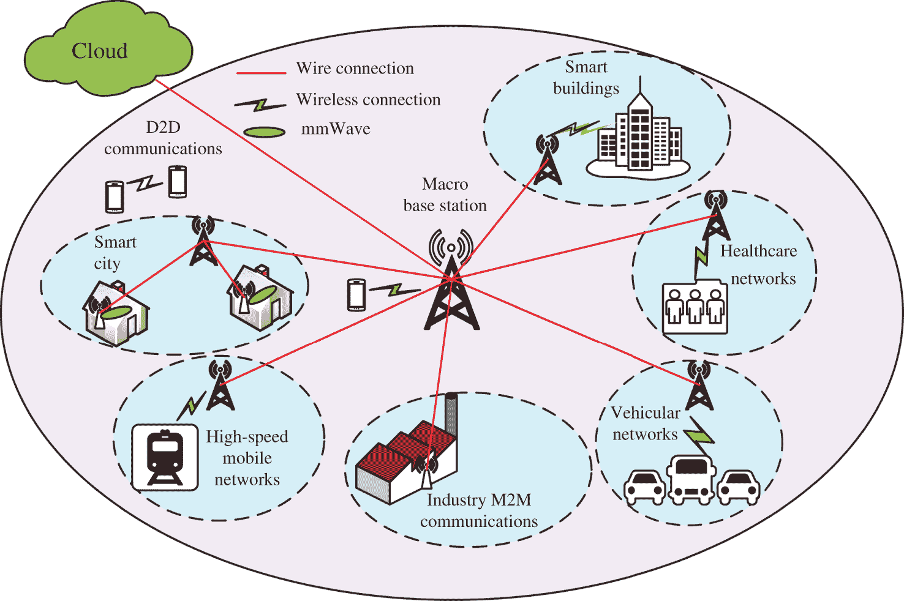

## 1.2 安全驱动力与需求

为了实现 5G 无线网络的目标，几种基础的安全驱动因素和需求是必要的。图 1.2 展示了 5G 无线安全的主要驱动力：卓越的内置安全、灵活的安全机制和自动化。由于在 5G 中引入了新的用例、新技术和新的网络范式，因此需要卓越的内置安全。其他用例可能会引入特定需求，例如用户通信中的超低延迟，这将要求提高现有安全机制的性能。新技术不仅带来了先进的服务能力，还为漏洞打开了大门 Liyan et al., [2016]。在异构网络 (HetNet) 中，不同的接入技术可能有不同的安全需求，多网络环境可能需要频繁的认证 Wang et al., [2016]。大规模 MIMO 被认为是实现更高频谱效率和能效的关键技术 Deng et al., [2015]。此外，5G 中的 SDN 和 NFV 将支持新的业务交付模式，因此需要新的安全方面 Chen et al., [2016, Tian et al., 2017]。随着 5G 网络范式的出现，需要新的架构。为了解决这些问题，安全必须作为整体架构的一个部分。

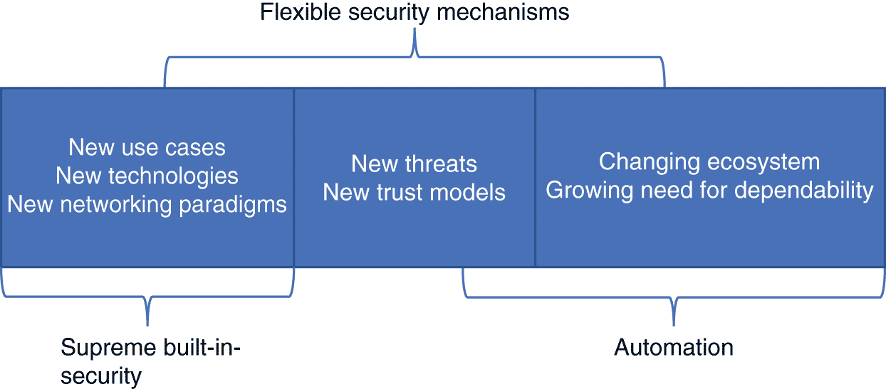

为了支持各种用例、新技术、新网络范式、新威胁以及最优方式的信任模型，根据变化的生态系统和对可靠性的增长需要，需要灵活的安全机制。基于 5G 无线网络的研究，由于 5G 无线网络具有低延迟和高能效等高级特性，5G 无线网络的安全服务有更具体的需求 Xu et al., [2019]。随着 5G 无线网络的各种应用及其网络性能，渴望灵活的安全机制。

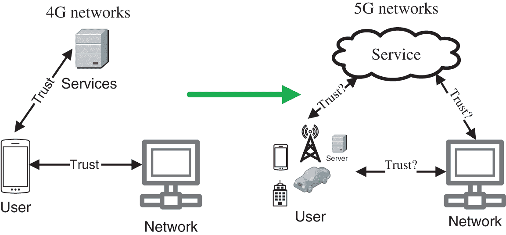

图 1.3 4G 和 5G 无线系统的信任模型。

除了卓越的内置安全和灵活性安全机制外，安全自动化也是一个关键要素。它将自动化安全管理与自动化、智能化控制相结合。由于 `5G` 无线网络等各种应用使用了更多的个人信息，隐私担忧也随之增加。此外，`5G` 中的各种服务之间的关联比以前更紧密。例如，由于主网络故障，固定电话、网络接入和电视服务可能会同时终止。因此，需要安全自动化来使 `5G` 系统能够抵御各种攻击。

# 5G 无线网络架构

## 5G 无线网络概述

本文介绍了 `5G` 无线网络架构。如图 1.4 所示，所示的通用 `5G` 无线网络包括用户接口、基于云的异构接入网络、下一代核心、分布式边缘云和中央云。基于云的异构接入网络可以结合虚拟化、集中化协调技术来实现高效的资源分配。根据不同的用例，`3GPP` 将 70 多种不同的用例分为四类，如 `海量 IoT`、关键通信、网络运营和增强移动宽带。在基于云的异构接入网络中，除了 `3GPP` 接入和 `non-3GPP` 接入外，还将添加其他新的无线技术以提高频谱利用率。在 `5G` 的第一阶段，传统的分组核心（`EPC`）仍然有效。网络切片允许根据不同的用例为下一代核心提供不同的配置。基于网络切片、`SDN` 和 `NFV` 的新型灵活面向服务的 `EPC` 将作为虚拟分组核心（`VEPC`）用于下一代核心。根据不同的用例，应用于每个 `VEPC` 的网络功能可以是多种。在 `VEPC` 中，控制面和用户面分离，以实现下一代核心的灵活性和扩展性。边缘云分布以提高服务质量。中央云可以实现全局数据共享和集中控制。

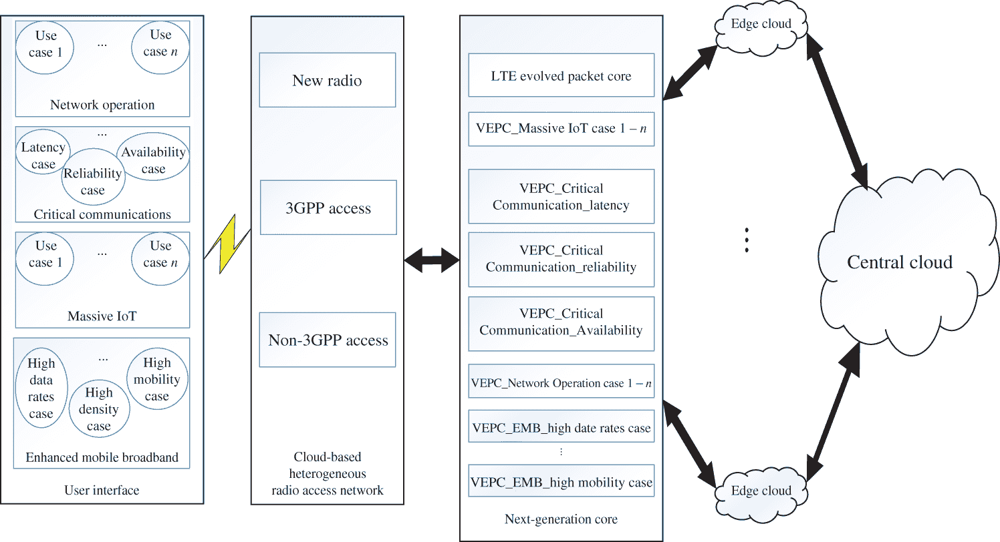

## 传统蜂窝网络与 5G 无线网络

与传统蜂窝网络相比，`5G` 无线网络引入了一些新观点和变化：

(i) 用户设备和服务不再局限于普通的手机和普通的语音及数据服务。根据不同的用例和需求，用户接口被分为四类，如 `海量 IoT`、关键通信、网络运营和增强移动宽带。每个用例都可能影响无线接入选择和 `VEPC` 功能。

(ii) 在基于云的异构接入网络中，除了 `3GPP` 接入和 `non-3GPP` 接入外，`5G` 接入网络还包括其他新的无线电，这些为下一代移动网络的无线标准奠定了基础，以实现更高的频谱利用率。新的无线电可以支持 `5G` 无线网络中各种用例的性能和连接需求。此外，还有许多技术应用于接入网络以提高网络性能，例如 `海量 MIMO`、`HetNet` 和 `D2D 通信`。

(iii) 下一代核心将基于云，并利用网络切片、`SDN` 和 `NFV` 来处理不同的用例。将应用灵活面向服务的 `VEPC`。通过网络切片、`SDN` 和 `NFV`，可以根据不同的用例将不同的网络函数应用于面向服务的 `VEPC`。预计下一代核心将与接入无关。面分离对于实现接入无关、灵活且可扩展的架构至关重要。

(iv) 边缘云应用于 `5G` 无线网络，以提高网络性能（如延迟）。

## 结论

本章介绍了 `5G` 无线网络的通用背景。展示了 `5G` 无线网络的动机和目标。讨论了对 `5G` 性能、安全驱动因素和需求的预期改进。本章说明了通用的 `5G` 无线网络架构。此外，分析了 `5G` 无线网络架构与传统蜂窝网络架构的比较。显然，`5G` 无线网络引入了巨大的灵活性，以支持新的用例和相应的不同的服务需求。5G 网络需要新的安全架构和机制。

# 从传统无线系统到 5G 网络的安全

本章介绍了无线网络安全的演进，涵盖了从第二代（`2G`）到第五代（`5G`）无线网络的架构和服务。

## 传统系统的网络安全

根据技术和网络性能，从 `2G` 到 `4G` 的漏洞和安全实现不相同。`2G` 系统中的安全服务（如全球移动通信系统 `GSM`）包括用户身份认证、通信加密、用户匿名以及对被盗/受损设备的检测。

* **用户身份认证**：用户认证是用户与蜂窝网络（如访问网络和主网）之间的一种挑战-响应方案。实现用户认证需要一个随机数（`RAND`）和一个密钥，密钥预存储在用户移动设备的 `SIM` 卡中。`SIM` 卡还存储了实现用户身份认证的算法。用户认证是单向认证，由蜂窝网络认证用户，但用户无法认证蜂窝网络。虽然这种安全服务可以有效防止用户误用网络服务，但无法防止伪基站的攻击。

* **通信加密**：用户认证后，会生成会话密钥来加密无线链路上用户与网络之间的数据。`2G` `GSM` 系统使用流密码。

* **匿名性**：匿名用于保护每个用户的国际移动用户识别（`IMSI`）的隐私，因为 `IMSI` 与用户身份相关。为了实现匿名性，不再一直使用 `IMSI`，而是使用临时移动用户识别（`TMSI`），并根据不同情况在用户和网络之间更新。

* **对被盗/受损设备的检测**：每个移动设备都有一个国际移动设备识别（`IMEI`），可用于检测被盗或受损的移动设备。

虽然 `2G` 技术为蜂窝网络的安全奠定了基础，但它仅代表移动通信中不断增强和加强安全措施努力的开始。`2G` 网络容易受到针对安全算法、信令网络（通过利用未加密消息）、安全协议（如伪基站攻击）以及拒绝服务攻击（包括干扰）的攻击。此外，`2G` 不提供数据完整性。

3G，如通用移动通信系统（`UMTS`），标志着蜂窝网络中更全面的安全措施实施的开始。3GPP 定义的安全架构在 `UMTS` 中包含五组安全特性。从安全的角度来看，3G 网络引入了重大的改进，例如双向身份验证、双向认证和密钥协商协议。除了这些措施外，3G 相比 2G 还提供了增强的数据完整性保护。更强加密算法的引入进一步增强了 3G 网络的安全性。

### 3G 安全特性

* **AKA**：身份验证与密钥协商（`AKA`）机制涉及三个实体：用户业务识别模块（`USIM`）、接入网络和主归网络。长期密钥在 `USIM` 和网络之间预共享。基于挑战-响应机制，网络可以验证 `USIM`，而 `USIM` 也可以验证主归网络。身份验证完成后，将生成两个密钥，以实现 `USIM` 和网络之间的数据机密性和数据完整性。

* **通信加密**：3G 通过使用认证后生成的密文密钥对用户与基站之间无线链路上的传输数据进行加密，从而提供机密性。使用长度为 128 位的密文密钥配合流密文。其他输入还可以确保即使使用相同的密文密钥，流密文也能生成不同的密钥流。

* **数据完整性**：除了机密性外，3G 还基于消息认证码（`MAC`）为用户与基站之间无线链路上的数据传输提供数据完整性，该认证码使用认证后生成的 128 位长完整性密钥。

* **用户身份机密性**：与 2G 一样，保护用户身份机密性是 3G 网络中的关键考虑因素。为了实现这一目标，3G 网络实现了临时身份，例如电路交换域中的 `TMSI` 和分组交换域中的 `P-TMSI`。这些临时身份被用于限制 `IMSI` 的传输频率并增强用户隐私保护。

* **被盗/受损设备的检测**：与 2G 相同。

* **用户到 USIM 认证**：使用个人识别码（`PIN`）实现用户到 USIM 的认证。此 `PIN` 仅由用户和 `USIM` 知晓。

3G 网络建立在 2G 安全机制的基础上，同时引入了改进以增强整体安全性。尽管 3G 扩展了网络服务并提高了网络性能，但也引入了新的漏洞，例如由于引入位置服务带来的隐私担忧。总之，与 2G 相比，3G 在安全性方面有了显著提高。


# 4G 长期演进（`LTE`）网络安全架构与服务

4G 长期演进（`LTE`）网络具有与 3G 不同的网络架构，旨在进一步提高网络性能。其中包括使用演进基站（`eNBs`）等其他增强。在 4G 中，控制面（`CP`）和用户面（`UP`）是分离的。4G 网络的安全架构与 3G 网络略有不同。除了进一步增强机密性算法外，4G 网络由于不同的网络架构引入了新的安全视角。例如，4G 在用户设备（`UE`）和演进分组核心（`EPC`）之间提供了双向认证，在双方认证后生成加密密钥和完整性密钥。然而，在 4G 中，这些密钥的使用方式不同。全面的密钥管理和切换安全也是 4G 安全的关键组成部分，以确保移动场景下的安全。以下是 4G LTE 系统提供的安全服务。

## 4G LTE 安全服务

*   **4G AKA**: 4G `AKA` 协议基于 3G `AKA`，提供 `UE` 和 `EPC` 之间的双向认证，在确保实体认证的同时，为用户面无线资源控制（`RRC`）和非接入层（`NAS`）加密密钥以及 `RRC` 和 `NAS` 完整性密钥提供材料。

*   **密钥管理**: 4G 扩展了 3G 的密钥体系。双向认证后生成的两个密钥用于推导出 `UE` 和接入管理实体（`ASME`）之间的中间密钥 `KASME`。`KASME` 可以生成更多密钥：`K_int`、`K_enc`、`K_ASNB` 和 `eNB`，其中 `K_ASNB` 可以派生出 `UP_int`、`UP_enc`、`RRC_int` 和 `RRC_enc`。

*   **机密性**: 4G 通过加密通信提供机密性。`K_NASenc` 用于提供 `UE` 和移动管理实体（`MME`）之间的数据机密性。`UP_enc` 和 `RRC_enc` 分别用于用户面流量和无线特定信令的通信机密性。

*   **完整性**：`UE` 与 `MME` 之间通信的数据完整性确保了通过 `K_NASint` 来保护。无线特定信令的完整性由 `K_RRCint` 保护。用户面流量没有数据完整性保护。

*   **切换安全**：通过引入 `eNBs`，4G LTE 还在不同 `eNBs` 之间提供了切换安全，以确保认证和密钥管理。此外，还提供了 4G 与旧系统之间的切换安全。许多研究工作侧重于在满足安全的同时提高切换性能。

与之前的系统相比，4G 网络拥有更强的安全实现能力，并在现代蜂窝网络中继续发挥关键作用。预计 4G 网络将持续进行安全增强，进一步提升其安全能力。

# 2.2 5G 无线网络中的安全攻击与安全服务

## 2.2.1 安全攻击

根据攻击特征，安全攻击可分为大类：被动攻击和主动攻击 [Stallings, 2017]。对于被动攻击，攻击者旨在在不影响通信本身的情况下学习或使用来自合法用户的信息。蜂窝网络中可能会发生两种常见的被动攻击：窃听和流量分析。被动攻击旨在违反数据机密性和用户隐私。与被动攻击不同，主动攻击可以包括修改数据或中断合法通信。典型的主动攻击是中间人攻击 (`MITM`)、拒绝服务攻击 (`DoS`) 和分布式拒绝服务攻击 (`DDoS`)。图 2.1 展示了 5G 无线网络中的被动和主动攻击，每种攻击都从三个关键方面介绍：攻击类型（被动或主动）、为缓解攻击而实施的安全服务以及用于避免或防止攻击的相应方法。

- **窃听**：窃听是一种被动攻击，可以由非预期的接收者发起以拦截他人的信息。窃听不会影响正常通信，如图 2.1a 所示。由于其被动性，窃听很难被检测。机密性是保护通信免受此类攻击的安全服务。无线链路上信号的加密是缓解窃听攻击最常用的方法。由于数据经过加密，窃听者无法直接拦截接收到的信号。加密方法很大程度上取决于加密算法的强度、密钥的长度以及窃听者的计算能力。随着计算能力的快速进步和先进数据分析技术的日益普及，窃听者可以利用这些新能力发起攻击。5G 中的窃听攻击模型与旧系统模型不同，主要是由于旧系统中窃听者的计算能力有限。旨在对抗窃听的传统机制面临着严峻挑战，因为其中许多机制是基于同时窃听者数量少且计算和数据分析能力低的假设。此外，5G 无线网络部署的异构网络 (`HetNet`) 等先进技术可能会增加防御窃听攻击的难度。

- **流量分析**：流量分析是一种被动攻击，未经授权的接收者通过分析接收信号的流量来拦截信息，而不解密通信内容。被拦截的信息可能包括通信双方的位置和身份等细节，并可用于推断有关通信的敏感信息。即使信号经过加密，仍然可以使用流量分析来揭示通信双方的模式。流量分析攻击也不会影响合法通信。针对流量分析需要隐私保护。目前，有大量研究侧重于应对流量分析攻击，例如引入人工噪声来干扰流量模式并防止敏感信息的截获。

- **干扰**：与窃听和流量分析不同，干扰可以完全破坏合法用户之间的通信。图 2.1b 是干扰攻击的示例。恶意节点可以产生故意干扰，破坏合法用户之间的数据。干扰还会防止授权用户访问无线资源。可用性是为了缓解干扰影响的安全服务。

- **DoS 和 DDoS**：旨在耗尽资源的 `DoS` 攻击是对可用性的违反，并由攻击者发起。干扰可以作为实施 `DoS` 攻击的手段。在涉及多个攻击者的情况下，形成 `DDoS` 攻击，如图 2.1c 所示。这些主动攻击发生在不同的网络层，目前采用了检测机制来识别 `DoS` 和 `DDoS` 攻击。

- **MITM**：在中间人攻击中，攻击者秘密地控制合法双方之间的通信通道。中间人攻击者可以拦截、修改和替换合法双方之间的通信消息。图 2.1d 显示了中间人攻击。中间人攻击是在不同层发起的主动攻击。特别是中间人攻击旨在损害数据的机密性、完整性和可用性。根据 Verizon 数据调查报告 [Baker et al., 2011]，中间人攻击是最常见的安全攻击之一。在旧蜂窝网络中，虚假基站中间人攻击发生在攻击者创建一个伪造基站，拦截并操纵合法用户与目标地之间的通信，导致连接受损 [Conti et al., 2016]。移动设备与基站之间的双向认证通常用于防止虚假基站中间人攻击。

## 2.2.2 安全服务

5G 无线网络及其架构、技术和用新的出现带来了新的安全挑战和对安全服务的需求。本节介绍了 5G 无线系统中的四种安全服务：认证（实体认证、消息认证）、机密性（数据机密性、隐私）、可用性和完整性。

### 2.2.2.1 认证

实体认证和消息认证是两种类型的认证。为了应对之前讨论的攻击，实体认证和消息认证在 5G 无线网络中至关重要。实体认证用于确保通信实体确实是其所声称的实体。在传统蜂窝网络中，在双方通信之前会实现 `UE` 与 `MME` 之间的双向认证。`UE` 与 `MME` 之间的双向认证是传统蜂窝安全框架中最关键的安全特性。4G LTE 蜂窝网络中的 `AKA` 是基于对称密钥的。然而，5G 不仅要求 `UE` 和 `MME` 之间的认证，还需要其他第三方（如服务提供商）之间进行认证。鉴于 5G 网络与传统蜂窝网络相比具有独特的信任模型，一种混合且自适应的身份验证管理方法变得必要。`UE` 的混合且灵活的认证可以通过三种不同的方式实现：仅由网络认证、仅由服务提供商认证，以及由网络和服务提供商共同认证 [Huawei, 2015]。由于 5G 无线网络对极高数据速率和极低延迟的要求，预计 5G 的认证比以往任何时候都要快。此外，5G 的多层架构可能会在 5G 不同层级之间遇到非常频繁的切换和认证。在 [Duan 和 Wang, 2016] 中，为了克服 `HetNets` 中密钥管理的困难并减少由频繁切换和层级间认证引起的不必要延迟，提出了一种基于加权安全上下文信息传输的软件定义网络（`SDN`）快速认证方案，以提高切换过程中的认证效率，并满足 5G 的延迟需求。[Eiza 等人, 2016] 和 [Zhang 等人, 2017a] 提出了一种基于公钥的 `AKA` 机制，作为增强 5G 无线网络安全服务的手段。

随着 5G 无线网络中各种新应用的出现，消息认证变得越来越重要。此外，由于 5G 对延迟、频谱效率（`SE`）和能量效率（`EE`）更严格的要求，消息认证面临着新的挑战。[Dubrova 等人, 2015] 提出了一种高效的基于循环冗余校验（`CRC`）的 5G 消息认证作为检测随机和恶意错误的手段，而无需增加带宽。

### 2.2.2.2 机密性

机密性包含两个不同的维度，即数据机密性和隐私。数据机密性通过限制数据仅供预期用户并防止未经授权的用户访问或泄露，保护数据传输免受被动攻击。隐私保护合法用户的信息免受控制或操纵。例如，隐私保护流量免受攻击者的任何分析。5G 网络中的流量模式可能会暴露敏感信息，例如发送者或接收者的位置。由于 5G 拥有车辆路由和健康监测在内的广泛应用，用户隐私可能会被海量的数据损害。

数据加密是一种广泛采用的确保数据机密性的技术，其传输方式使得未经授权的用户无法从中提取任何有意义的信息。对称密钥加密技术可以使用发送方和接收方之间共享的同一个私钥对数据进行加密和解密。需要一种安全的密钥分配方法在发送方和接收方之间共享密钥。传统的密码学方法基于攻击者计算能力有限的假设。与其仅仅依赖通用的高层加密机制，物理层安全（`PLS`）可以提供对抗干扰和窃听攻击的服务 [Trappe, 2015]。由于 5G 网络涉及大量数据，与传统蜂窝网络相比，隐私保护服务需要更多的关注 [ERICSSON, 2015]。匿名服务是许多用例中的基本安全需求。在许多情况下，隐私泄露会导致严重后果。例如，健康监测数据揭示了敏感的个人健康信息 [Zhang et al., 2017a]；车辆路由数据可能会暴露位置隐私。5G 无线网络引发了对隐私泄露的关注。在 `HetNets` 中，由于小小区的高密度，关联算法可能会暴露用户的位置。[Farhang 等人, 2015] 提出了一种差分隐私算法来保护位置。[Abd-Elrahman 等, 2015] 提出的协议保护了群组通信中的隐私。[Eiza 等人, 2016] 提出了加密机制和方案，为车载网络提供安全且感知隐私的实时视频报告服务。

### 2.2.2.3 可用性

可用性是指服务对合法用户的可用性和功能程度，无论其位置或请求时间如何。评估系统对不同类型攻击（包括针对可用性的攻击）的弹性是 5G 网络中的一项关键性能指标。可用性作为系统健壮性的衡量，在这种背景下特别重要，并且经常是主动攻击者的目标。可用性的主要攻击类型之一是 `DoS` 攻击，会导致合法用户无法访问服务。干扰或入侵可能会破坏合法用户之间的通信链路。5G 无线网络的健壮性面临大量不安全的 IoT 节点的挑战，使其易受到影响可用性的 `DDoS` 攻击。

直接序列扩频（`DSSS`）和跳频扩频（`FHSS`）是两种用于增强可用性的成熟 `PLS` 技术。`DSSS` 最初用于 20 世纪 40 年代的军事应用，将伪扩展码与原始数据频谱相乘。在不知道扩展码的情况下，干扰者需要更大的功率才能破坏合法传输。对于 `FHSS`，通过发送方和接收方共享密钥生成的伪随机序列在许多频率通道之间快速切换传输信号。动态频谱应用于 D2D 通信和认知无线电范式以提高 `SE`。[Adem 等人, 2015] 观察到面对干扰攻击时 `FHSS` 可能性能下降。提出了一种伪随机跳频扩频以提高干扰、切换和错误概率性能。资源分配被用于增强对可用性违反的检测 [Labib et al., 2015]。

### 2.2.2.4 完整性

消息认证仅验证消息来源，不提供任何防止消息复制或修改的保护。5G 网络旨在提供无处不在的连接，并支持与人类生活密切相关的应用，例如水质监测和交通调度。数据完整性是这些特定应用的关键安全需求。

完整性确保信息不会被未经授权的实体发起的活动攻击所篡改或更改。恶意的内部攻击（如消息注入或修改）可能会破坏数据完整性。内部攻击者持有合法的身份，使得检测其恶意活动具有挑战。在智能电网中的智能电表等用例中 [Yan et al., 2012]，需要提供防止操纵的数据完整性。与语音通信相比，数据更容易受到攻击和修改 [alliance, 2016]。双向认证可以提供完整性服务，它可以生成完整性密钥。个人健康需要完整性服务 [Zhang et al., 2017]。认证方案可以提供消息保护 [Eiza et al., 2016]。

# 2.3 从 3G 到 5G 的无线架构演进

## 2.3.1 3G 安全架构

`3GPP TS 33.102` 定义的 3G 安全架构如图 2.2 所示。安全架构中定义了五组安全特征：

- **网络接入安全 (I)**：该组提供一系列安全特征，以确保用户安全访问 3G 服务并防止无线接入攻击。这些特征包括用户身份机密性、用户位置机密性、用户不可追踪性、用户认证、网络认证、数据机密性、数据完整性和移动性设备保密。

- **网络域安全 (II)**：该组提供的安全特征集旨在促进用户之间信令数据的安全交换，并防止对 3G 无线系统有线网络部分的攻击。

- **用户域安全 (III)**：该组定义了一系列安全特征以确保移动站的安全访问，包括 `user-to-USIM` 认证和 `USIM-terminal` 认证。

- **应用域安全 (IV)**：该组定义的安全特征集侧重于促进用户域和服务提供域之间的安全通信。

- **安全的可可见性和可配置性 (V)**：该组定义了一系列特征，告知用户安全特征的可用性，以及服务的提供和使用是否依赖这些安全特征。

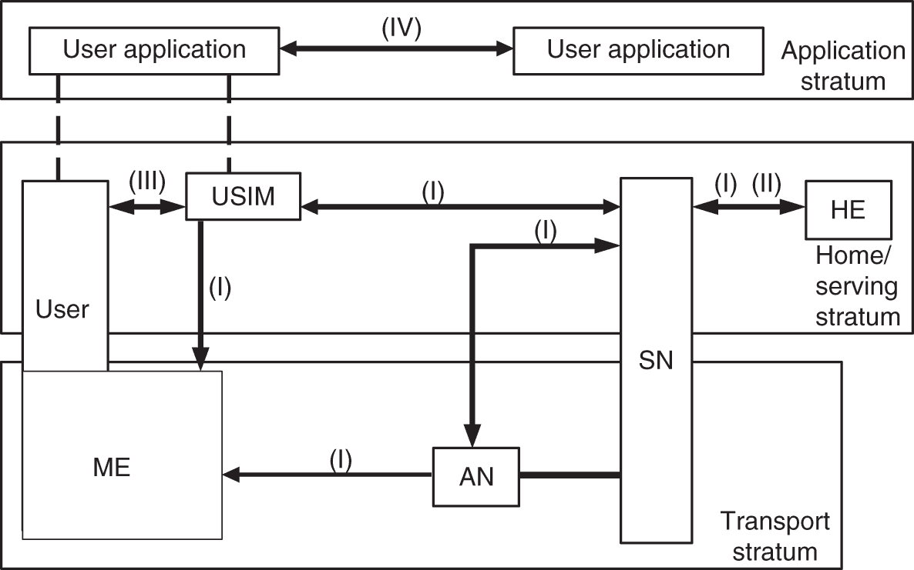

图 2.2 由 `3GPP TS 33.102` 定义的 3G 安全架构。

## 2.3.2 4G 安全架构

4G 网络同时采用 `3GPP access` 和 `non-3G access` 来连接演进分组系统 (`EPS`)。4G 的安全架构与 3G 类似，定义了五个安全组，如图 2.3 所示：

- **网络接入安全 (I)**：安全特征集旨在确保用户访问 `3GPP EPC` 提供的服务。为了实现这一目标，提供了包括认证、密钥管理、数据机密性、数据完整性和用户身份机密性在内的各种安全服务。

- **网络域安全 (II)**：与 3G 类似，该安全特征集旨在确保用户之间信令数据的安全交换并防止对 4G 无线系统有线网络部分的攻击。

- **用户域安全 (III)**：与 3G 中的用户域安全相同，在 4G 中，该组的安全特征集确保了移动站的安全访问。

- **应用域安全 (IV)**：与 3G 类似，该组的安全特征集旨在确保用户域和服务提供者域应用之间的安全消息传递。

- **非 3GPP 域安全 (V)**：该组侧重于为 `non-3GPP access` 具体提供安全特征。

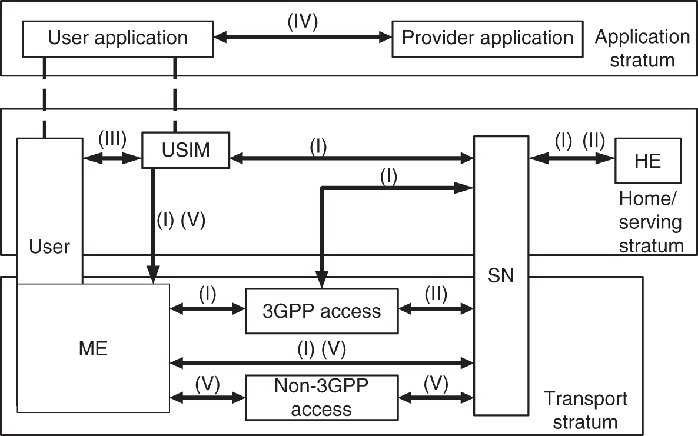

图 2.3 由 `3GPP TS 33.402` 定义的 4G 安全架构。

## 2.3.3 5G 无线安全架构

### 2.3.3.1 拟 5G 无线安全架构概述

在 [Fang 和 Qian, 2020] 中，作者提出了一种新的 5G 无线安全架构，如图 2.4 所示。由于下一代核心网的新特性，提出了虚拟演进分组核心 (`VEPC`) 的数据面和控制面分离，其中数据面可以是编程的以提高灵活性。`TR 23.799` 中识别了下一代核心网中主要的网络功能，它们在该安全架构中的利用如下：

- **接入和移动管理功能 (`AMF`)**：该功能用于管理控制接入和移动，在传统蜂窝网络的 `MME` 中实现。然而，其应用可能根据具体的用例而异。特别是，固定接入应用不需要移动管理功能。

- **会话管理功能 (`SMF`)**：该功能能够根据网络策略建立并管理会话。此外，当用户拥有多个会话时，可以分配不同的 `SMFs` 来管理每个会话，同时与单个 `AMF` 关联。

- **统一数据管理 (`UDM`)**：`UDM` 管理固定和移动接入的订阅者数据和配置（如用户的认证数据）。

- **策略控制功能 (`PCF`)**：该功能提供漫游和移动管理、服务质量以及网络切片。`AMF` 和 `SMF` 受 `PCF` 控制。可以通过 `PCF` 提供差异化安全。

`AMF` 和 `SMF` 集成到传统蜂窝网络的 `MME` 中。`AMF` 和 `SMF` 的分离可以支持更灵活的可扩展的架构。在基于网络函数的控制面上，不同的网络功能可以应用于不同的用例。

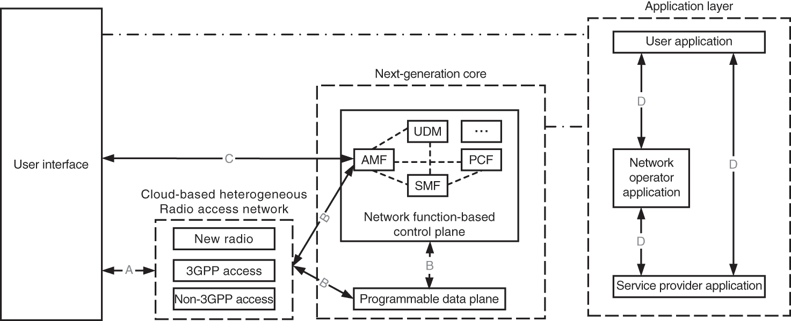

图 2.4 5G 无线安全架构。

### 2.3.3.2 安全域

与传统蜂窝网络类似，图 2.4 中定义了四个安全域 A、B、C、D。这些安全域的详细介绍如下：

- **网络接入安全 (A)**：实现用户接口安全接入下一代核心网的安全特征，并防止对无线接入链路的潜在攻击。应用于无线接入网的新物理层技术包括大规模多输入输出 (`MIMO`)、异构网络 (`HetNet`)、D2D 通信和毫米波 (`mmWave`)，为网络接入安全带来了新的挑战和机遇。该层的安全通过在用户接口和无线接入网之间实现的各种机密性和完整性保护机制得到了加强。网络接入安全的研究主要集中在确保用户身份和位置的机密性，以及用户和信令数据的机密性。此外，实体认证也是该领域的一个关注点。


*   **网络域安全 (B)**：一组用于保护 5G 系统有线网络部分免受攻击，并促进实体与功能之间信令数据和用户数据安全交换的安全特征。如图 2.4 所示，这种级别的安全存在于接入网与下一代核心网、控制面和用户面之间。由于云计算、网络切片和网络函数虚拟化 (`NFV`) 等新技术被应用于 5G 核心网和无线接入网，需要解决该级别的新漏洞。然而，随着控制面和用户面的分离，信令数据将显著减少。基于网络函数的控制面也减少了数据同步所需的信令开销。实体认证、数据机密性和数据完整性是该层面的主要的安全服务。由于 `AMF` 接入技术的独立特性，网络域安全的性能可以简化并改进。

*   **用户域安全 (C)**：一组在用户接口与下一代核心网之间建立双向认证的安全特征，确保从用户接口安全访问控制面。认证是该层面的重点。根据用例，认证可能涉及两个以上的参与方。例如，用户与网络运营商之间可能需要认证，用户与服务提供商之间也需要认证。此外，不同的服务提供商可能需要相互认证以共享相同的用户身份管理。与传统蜂窝网络中基于设备的身份管理相比，需要新的身份管理方法来提高安全性能。

*   **应用域安全 (D)**：一组能够保证接口处应用程序之间、用户接口与服务提供商之间以及用户与网络运营商之间安全消息交换的安全特征。

## 2.4 总结

本章介绍了从传统蜂窝系统到 5G 系统的无线网络安全，并讨论了 5G 无线系统中的安全攻击和预期的安全服务。最后，本章概述了从 3G 系统到 5G 系统无线安全架构的演进。

# 3 5G 无线系统中的安全机制

本章讨论了 5G 无线系统中的安全机制，重点关注提供如认证、可用性、数据机密性、密钥管理和隐私等不同的安全服务。这些机制可以分为两种主要方法：采用新网络协议的密码学方法和物理层安全 (`PLS`)。在深入研究 5G 安全解决方案之前，将介绍这两类方法的基础知识。

## 3.1 密码学方法与物理层安全

密码学技术是 5G 无线网络中广泛使用的机制，通常通过新的网络协议在较高层实现。现代密码学由对称密钥加密和公钥加密组成。对称密钥加密是指发送者和接收者共享秘密密钥的加密方法。公钥加密（也称为非对称加密）涉及两个不同的密钥：用于加密的公钥和用于解密的私钥。除了密码学方法外，`PLS` 在 5G 系统中也被广泛探索。

本节概述了基于密码学方法的安全解决方案，包括对称密钥加密和公钥加密。表 3.1 提供了密码学方法讨论的各种安全服务的概述。

*   **对称密钥加密**：对称密钥加密是指任何使用共享密钥进行加密和解密的加密算法。图 3.1 展示了基于对称的加密解密如何通过使用相同密钥来实现机密。这种方法通常用于确保数据机密性。

图 3.3 显示了基于公钥的加密与解密。Alice 拥有公钥 $K_A^{Pu}$ 和私钥 $K_A^{Pr}$，而 Bob 拥有他的公钥 $K_B^{Pu}$ 和私钥 $K_B^{Pr}$。Alice 和 Bob 拥有对方的公钥。Alice 可以 Bob 的公钥将明文 $M$ 加密为密文 $C$，Bob 可以使用他的私钥将密文 $C$ 解密为明文 $M$。这种方法也可以用于密钥交换和分发。

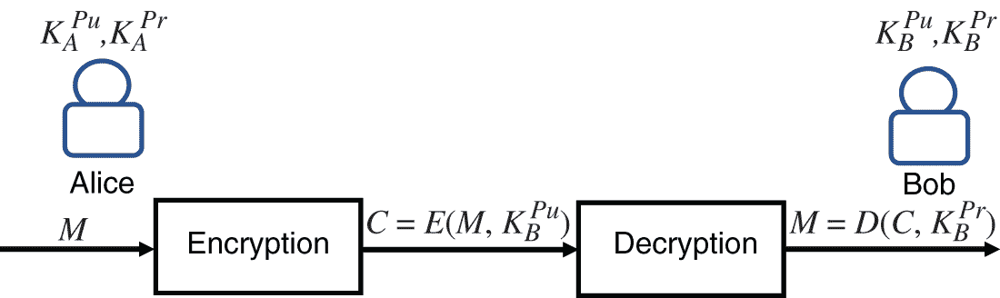

图 3.3 基于公钥的加密与解密。

除了机性和密钥交换外，公钥加密还可以提供数字签名，确保数据完整性、消息认证和不可否认性。与机密性不同，数字签名方案如图 3.4 所示。Alice 使用她的私钥对消息签名以生成数字签名。Bob 通过使用 Alice 的公钥解密签名来验证数字签名。

公钥加密通常用于密钥分发和提供不可否认性等安全服务，这是对称加密无法实现的。与对称密钥加密相比，公钥加密的密钥管理相对简单，用户共享他们的公钥，并由证书机构对所有用户的公钥进行签名。

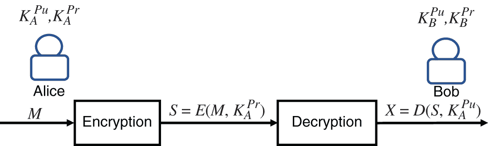

图 3.4 基于公钥的数字签名。

物理层安全（`PLS`）的目标是利用通信信道的物理特性建立安全通信。为了提高无线网络物理层的通信安全性，已经开发了多种方法，这些方法分为五大类：理论安全容量、信道、编码、功率和其他方法 Shiu et al., [2011]。`PLS` 技术主要关注于防止窃听和干扰攻击，如表 3.1 所示。

理论安全容量的研究主要集中在保密容量分析 Oggier and Hassibi, [2011]，这是授权用户与未授权用户之间数据速率的差异。保密容量 $C_s$ 定义为：

(3.1)
```
C_s = C_m - C_e,
```
其中 $C_m$ 是合法用户的信道容量，而 $C_e$ 是窃听者的信道容量。保密中断概率定义为瞬时保密容量小于目标速率：

(3.2)
```
P_o = C_s - C_e, P < R_t,
```
其中 $R_t > 0$，且 $P$ 是保密中断概率。

## 认证需求

### 低延迟需求

由于 5G 网络对低延迟的要求，认证方案必须比以往任何时候都要高效。为了利用软件定义网络（`SDN`）的优势，Duan 和 Wang [[2016]](#b01.xhtml#bref-bib-0022) 提出了一种 `SDN` 中的快速认证方案，该方案使用加权安全上下文信息（`SCI`）传输作为非加密安全技术，以提高异构网络（HetNet）中频繁切换期间的认证效率，满足延迟需求。所提出的快速认证协议包括全认证和基于加权 `SCI` 传输的快速认证。如图 3.5 所示，在一个小区内完成首次全认证后，可以通过 `MAC` 地址验证方便地应用到其他小区中，而这仅需要本地处理。此外，全认证甚至可以在不中断用户通信的情况下完成。使用一个有效时间段参数来灵活地调整安全级别需求。与加密认证方法相比，所提方法依赖于用户的固有物理层属性，因此较不容易受到攻击。`SCI` 利用多个物理层特性来增强需要高安全级别应用的认证可靠性。启用 `SDN` 的认证模型如图 3.5 所示。`SDN` 控制器采用一种模型来监控和预测用户位置，允许其在用户到达之前准备相关小区并实现无缝切换认证。物理层属性用于提供用户的唯一指纹并简化认证过程。利用三类型的物理层属性作为单个用户的指纹。一旦完成认证，即可获得验证过的初始属性。`SDN` 控制器通过对接收到的数据包采样各种物理层属性不断收集观测结果以验证原始属性。原始文件和观测结果均包含所选属性的均值和方差。然后，可以根据验证的原始属性和观测属性计算均值属性偏移。如果属性偏移小于预设阈值，则认为用户设备是合法的。为了评估该认证方法的性能，提出了一种使用优先级队列的 `SDN` 网络模型。到达的流量使用帕累托分布进行建模。在多种网络利用场景下比较了认证延迟。仿真结果比较了启用 `SDN` 的快速认证与传统加密认证方法的延迟性能。启用 `SDN` 的快速认证利用 5G 网络提供的灵活性和可编程性展现出优越的延迟性能。

![图 3.5 一个启用 SDN 的认证模型。¶ 源：改编自 Duan 和 Wang [2016]](images/c03f005.png)

图 3.5 一个启用 SDN 的认证模型。¶ 源：改编自 Duan 和 Wang [[2016]](#b01.xhtml#bref-bib-0022)

### 支持 D2D 通信

为了缓解由于 D2D 通信缺乏安全基础设施而产生的安全担忧，Abualhaol 和 Muegge, [2016] 引入了一种基于持续真实性的安全评分机制。该方法采用合法性模式的概念来实现持续真实性，允许检测攻击并测量系统安全分。合法性模式涉及在数据包中插入冗余位序列以促进攻击检测。仿真结果证明了所提出的使用合法性模式的安全评分的有效性。此外，作者建议兼考虑技术方面和人类行为可以增强合法性模式的性能。

### 高带宽利用率和低能耗

在他们的工作 Dubrova 等人，[2015] 中，作者引入了一种基于循环冗余校验（`CRC`）的新消息认证机制，该机制结合了 5G 网络中实现的高安全性和卓越的带宽利用率。值得注意的是，该方案能够检测单消息中的双位错误，增强了认证过程的可靠性。定义了基于 `CRC` 的加密哈希函数。使用线性反馈移位器（`LFSR`）高效地实现 `CRC` 编码和解码。消息认证算法根据密钥和消息产生认证标签。该方案的安全假设是攻击者拥有哈希函数族，但无法访问用于生成认证标签的特定多项式 $g(x)$ 和 $s$。生成多项式在每个会话开始时定期更改，每条消息都会更改 $s$。引入了基于 `CRC` 代码的新加密哈希函数族，其生成多项式为 $g(x)=(1+x)p(x)$，其中 $p(x)$ 是本多项式。在保持加密非安全 `CRC` 实现简单性的同时，所提的 `CRC` 整合了一个可重编程的 `LFSR`，这需要自适应连接。

## 计算能力有限的设备

无线射频识别（`RFID`）已广泛应用于许多行业和场景。由于低成本 `RFID` 标签存在各种局限性，应用于 `RFID` 系统的加密算法和身份验证机制必须非常高效。简单快速的哈希函数被用于 `RFID` 系统的身份验证机制。当使用单个 `RFID` 标签用于多个应用时，在认证方案中考虑撤销的可能性至关重要。在 Fan 等人 [[2015]](#b01.xhtml#bref-bib-0026) 中，作者针对 5G 用例场景下的 `RFID` 安全身份认证方案提出了一种撤销方法。该方法使用哈希函数和随机数通过典型的挑战-响应机制生成相应的模块。图 3.6 展示了 `RFID` 安全应用撤销方案的身份验证过程。读取器包含一个伪随机数生成器（`PNG`），服务器持有哈希函数和数据库（`HFD`）。服务器为每个合法标签建立标签记录 `(IDS, Di)`，并建立一组相应的应用记录 `(Ki,jol, Ki,now)`。`q` 是读取器生成的认证请求。`r1` 是读取器中的 `PNG` 生成的第一个随机数。收到认证请求后，标签生成第二个随机数 `r2`，计算两个哈希认证消息 `M1`、`M2` 以及异或（`XOR`）认证信息值 `F=E⊕Ki`，其中 `E` 是状态标志信息的当前值，用于确定是撤销还是认证该应用。所提出的安全性和复杂性结果表明，该方案比现有方案提供了更好的安全性，且具有相同水平的复杂度。

![图 3.6 RFID 安全应用撤销方案的身份验证过程。¶ Fan 等人 [2015]](images/c03f006.png)

**图 3.6** RFID 安全应用撤销方案的身份验证过程。¶ Fan 等人 [[2015]](#b01.xhtml#bref-bib-0026)

## 新安全服务的考量

考虑到医疗传感器之间 D2D（直对直）通信的开放性以及医疗数据对隐私的高要求，在 Zhang 等人 [[2017a]](#b01.xhtml#bref-bib-0114) 中，通过利用无证书通用签名加密（`CLGSC`）技术，作者在 m 健康系统中提出了一种轻量且稳健的安全感知（`LRSA`）D2D 辅助数据传输协议。m 健康系统的模型如图 3.7 所示。目标医生恢复。在使用正确的会话密钥恢复源身份后，应对对密文 `S` 进行解密。因此，即使私钥泄露，没有会话密钥，密文仍然安全。另一方面，通过验证签名加密 `S`，医生可以认证源客户端。中继节点可以验证签名，然后带上自己的签名转发数据。将提出的 `CLGSC` 与其他四种方案的计算和通信开销进行了对比。仿真结果表明，提出的 `CLGSC` 方案的计算开销低于其他四种方案。

![图 3.7 m 健康系统模型 Zhang 等人 [2017a]。¶ 来源：改编自 NINENII/Adobe Stock Photos](images/c03f007.png)


与 IEEE 802.11p 和传统蜂窝网络相比，5G 是为车载网络提供实时服务的非常有前景的解决方案。然而，为了确保交通系统的安全，需要增强安全性和隐私性。在 Eiza 等人 [[2016]](b01.xhtml#bref-bib-0024) 中，提出了一种支持实时视频服务的可靠、安全且感知隐私的 5G 车联网。该系统架构如图 3.8 所示，其中包含一个移动核心网 (`MCN`)、一个受信任权威 (`TA`)、车辆管理局 (`DMV`) 和一个执法机构 (`LEA`)。5G 车用通信采用了 `D2D` 通信和毫米波技术。如图 3.8 所示，应用了异构网络 (`HetNet`) 来扩展网络容量并实现高用户数据传输速率。云平台提供了海量存储和无处不在的数据访问。所提出的加密机制包括伪名认证方案、带有关键词搜索的公钥加密、密文策略属性基加密以及基于秘密共享的门限方案。具有强隐私保护的伪名认证方案 [[Sun 等人，[2010]](b01.xhtml#bref-bib-0088)] 被用于优化证书吊销列表的大小，该列表与被吊销车辆的数量呈线性关系，使得认证验证开销最低。认证需求包括车辆认证和消息完整性，其中车辆认证允许执法机构和官方车辆检查发送者的真实性。认证通过使用基于公钥的数字签名实现，该签名将加密的交通事故视频绑定到伪名以及发送者的真实身份上。伪名认证技术可以实现发送者的条件匿名性和隐私保护。

![图 3.8 支持 5G 的车载网络。¶ 源：改编自 Eiza 等人 [2016]。](images/c03f008.png)

**图 3.8** 支持 5G 的车载网络。¶ 源：改编自 Eiza 等人 [[2016]](b01.xhtml#bref-bib-0024)。

## 3.3 可用性

可用性是确保 5G 超高可靠通信的关键指标。通过随机发射无线噪声信号，干扰器可以显著降低移动用户的性能，甚至完全阻断服务的可用性。干扰是物理层用于发起拒绝服务（`DoS`）攻击的典型机制之一。大多数抗干扰方案使用跳频技术，用户通过在多个通道间跳频来避免干扰攻击并确保服务的可用性。5G 新技术和新用例出现后，面临的主要挑战是提高服务可用性的性能。

在 Li 等人 [[2011]](b01.xhtml#bref-bib-0052) 中，作者提出了一种秘密自适应跳频方案，作为 5G 系统中基于软件定义无线电平台的对抗 `DoS` 攻击的一种可能技术。所提出的基于物理层信息的比特错误率 (`BER`) 估计器被用于在 `DoS` 攻击下决定频率黑名单。由于切换速率高且干扰概率大，由于需要访问多个通道，动态频谱接入用户可能无法高效地使用跳频技术。

为了降低切换速率和干扰概率，Adem 等人 [[2015]](b01.xhtml#bref-bib-0006) 为 5G 中的认知用户提出了一种伪随机时间跳频抗干扰方案，以应对干扰攻击。模型中包含一个资源有限的认知干扰器，以分析频谱动态对移动认知用户性能的影响。文中给出了干扰概率、切换速率和错误概率的解析解。干扰概率与延迟性能和错误概率有关，当干扰器的接入机会有限时，干扰概率较低。与跳频系统相比，时间跳频系统表现出优越的切换概率。在使用相同的每焦耳平均符号能量时，时间跳频的错误率低于跳频。然而，性能增益在特定的符号能量水平下会达到饱和点。作者强调了所提时间跳频技术在 5G 无线网络 `D2D` 链路中的适用性，因为它在能量效率和频谱效率方面具有很强的性能。此外，该技术能够以最小的通信开销提供抗干扰能力。然而，时间跳频抗干扰技术需要一个预共享密钥。图 3.9 展示了伪随机时间跳频系统的框图。与跳频类似，时间跳频也需要预共享密钥来确定跳频序列。

![图 3.9 伪随机时间跳频系统框图。¶ 源：改编自 Adem 等人 [2015]。](images/c03f009.png)

**图 3.9** 伪随机时间跳频系统框图。¶ 源：改编自 Adem 等人 [[2015]](b01.xhtml#bref-bib-0006)。

为了保护 5G 网络中计算能力有限的节点免受恶意无线干扰攻击，Labib 等人 [[2015]](b01.xhtml#bref-bib-0049) 采用了融合中心。作为策略资源分配的一项练习，在干扰器和融合中心之间建立了一个非合作的柯布洛托游戏 (`Colonel Blotto game`)。图 3.10 显示了融合中心与恶意干扰器之间的资源分配模型。干扰器旨在通过在节点之间分配功率，在不被发现的情况下破坏网络。另一方面，融合中心作为防御者，旨在通过对某些节点的去中心化检测方案来检测此类攻击。融合中心可以为这些节点分配更多比特来报告测量的干扰。一旦检测到攻击，融合中心将指示目标节点增加发射功率，以为正常通信维持适当的信号加噪声比 (`SINR`)。仿真结果表明，随着融合中心拥有更多可用比特，错误率性能有了显著提高。此外，所提出的资源分配机制与随机分配可用比特的机制相比表现出更优的性能。

![图 3.10 资源分配模型。¶ 源：改编自 Labib 等人 [2015]。](images/c03f010.png)

**图 3.10** 资源分配模型。¶ 源：改编自 Labib 等人 [[2015]](b01.xhtml#bref-bib-0049)。

### 功率控制

安全功率控制的目标是调节发射功率，使得信号无法被窃听者恢复。基于配备单天线的单窃听者最简单的窃听攻击模型，Ghanem 和 Ara [[2015]](b01.xhtml#bref-bib-0036) 在研究中，作者提出了一种用于保障 5G 系统中 `D2D` 通信安全的分布式算法，该算法允许两个合法发送者选择是否合作，并根据所选的协作框架调整其最优功率分配。图 3.11 显示了一个带有窃听攻击的通用系统模型。在 Ghanem 和 Ara [[2015]](b01.xhtml#bref-bib-0036) 的系统模型中，发送者、中继或协作者、接收者和窃听者分别命名为 `Alice`、`John`、`Bob` 和 `Eve`。每个用户有一根天线。一个双向链路连接了 `Alice` 和 `John`。该问题被公式化为最大化 `Alice` 和 `John` 的可达秘密速率，如下 Ghanem and Ara, [2015]：

```
(3.3) Ca = max(Rjab - Rae)
(3.4) s.t. Pj + Pjb <= PJ
(3.5) Cj = max(Rjab - Rje)
(3.6) s.t. Pa + Pab <= PA
```

其中 `Ca` 和 `Cj` 分别代表 `Alice` 和 `John` 的秘密速率。`Rjab` 和 `Rjab` 分别代表 `Alice` 和 `John` 帮助中继数据的可达速率。`Rae` 和 `Rje` 分别代表窃听者从 `Alice` 和 `John` 处获得的可达速率。方程 (3.4) 和 (3.6) 代表两个发送者的发射功率限制。研究考虑了两种协作场景，即与中继协作和不与中继协作。在与中继协作场景下，`Alice` 和 `John` 可以通过共享的双向链路相互中继数据。在不与中继协作的情况下，`Alice` 和 `John` 协调各自的发射功率以最大化对方的秘密速率。非协作场景下的优化问题被作为一个对比点提出。合法发射器与窃听者之间的距离受到限制，以避免距离攻击，因为窃听者对传输消息的接收信号质量可能比合法接收者更好。仿真结果显示，相互中继数据可以提高 `Alice` 和 `John` 的可达秘密速率。随着发射器和接收器之间距离的增加，协作带来的收益会减少，在某些情况下，非协作对合法发射者更有利。

在没有中继或协作的情况下，仅基于功率控制和信道接入，Luo 等人 [[2015b]](b01.xhtml#bref-bib-0057) 作者开发了一个 `Stackelberg` 游戏框架，用于利用物理层安全（`PLS`）分析 5G 中蜂窝用户的获取速率和 `D2D` 用户的秘密速率。系统模型包括一个基站（`BS`）、若干蜂窝用户、一个 `D2D` 链路和一个窃听者，如图 3.12 所示。蜂窝用户获取速率和 `D2D` 用户秘密速率的效用函数表示为信道信息和传输功率的函数 Luo et al., [2015b]：

(3.7) $u_{c,i} = \log_2(1 + SINR_{c,i}) + \alpha \beta P_d h_{dc}$ (images/c03-math-0007.png)

$u_d = [\log_2(1 + SINR_d) - \log_2(1 + SINR_e)] + \alpha \beta P_d h_{dc}$ (images/c03-math-0008.png)

其中 $\alpha$ (images/c03-i0048.png) 是价格因子，$\beta$ (images/c03-i0049.png) 是比例因子。$u_{c,i}$ 中的第一项 (images/c03-i0050.png) 代表第 $i$ 个小区用户的数据速率，第二项补偿了来自 `D2D` 链路的干扰，其中 $P_d$ (images/c03-i0052.png) 是 `D2D` 用户的发射功率，$h_{dc}$ (images/c03-i0053.png) 是从 `D2D` 用户到小区用户的信道增益。`D2D` 用户的效用函数包含了秘密数据速率以及对小区干扰补偿。小区用户的游戏策略取决于价格因子 $\alpha$ (images/c03-i0054.png)，而 `D2D` 用户的游戏策略取决于发射功率 $P_d$ (images/c03-i0055.png)。形成 `Stackelberg` 博弈是为了在第一阶段最大化小区效用函数，然后在第二阶段最大化 `D2D` 用户的效用函数。

![图 3.12 带有 D2D 链路和监听者的系统模型。来源：改编自 Luo 等人 [2015b]。](images/c03f012.png)

**图 3.12** 带有 D2D 链路和监听者的系统模型。来源：改编自 Luo 等人 2015b。

功率控制是提高网络能量效率（`EE`）的一种常用机制。在 Bernardo 和 De Leon 2016 中，作者研究了异构网络中大规模 `MIMO` 的物理层安全（`PLS`）与能量效率之间的平衡。提出了一种优化模型，在假设基站对监听者的信道信息不完全的情况下，满足针对监听者的安全水平的同时，最小化网络总功耗。仿真结果表明，高密度网络拓扑是实现高容量的有效解决方案。

### 中继

如图 3.11 所示，与中继的协作可以帮助发送者保护信号。在 Nguyen 等人 2016 中，提出了两种中继选择协议，即最优中继选择（`ORS`）和部分中继选择（`PRS`），用于保护能量采集系统。系统模型如图 3.11 所示，由多个中继节点组成，并假设发送者和接收者之间没有直接链路。功率信标配备了多个天线，用于增强采集到的能量。`ORS` 在假设源完全获取每条链路信道状态信息（`CSI`）的情况下，选择辅助中继以最大化系统的秘密容量。`PRS` 则根据部分 `CSI` 选择辅助中继。系统由一个配备多个天线的高功率信标、几个中继、一个目的节点和一个监听者组成。研究了两种旨在最大化源和所选中继能量采集的能量采集场景。给出了两种中继协议的秘密中断概率的解析表达式和渐近表达式。数值结果显示，`ORS` 可以显著增强所提系统的安全性并实现全分集阶，而无论能量采集策略如何，`PRS` 只能实现单位分集阶。最大化中继能量采集的 `PRS` 策略秘密性能优于基于最大化源能量采集的策略。此外，结果显示所考虑系统的安全性受到能量采集过程持续时间的影响。

### 双向中继

为了解决具有大量中继和监听者的 5G 大规模安全双向中继放大中继（`TWR-AF`）系统中复杂的中继选择问题，Zhang 等人 2017b 提出了一种分布式中继选择准则，不需要源信号信噪比（`SNR`）、信道估计或中继监听者链路的知识。所提出的中继选择是基于中继的接收功率以及源与监听者之间的平均信道信息。系统模型包括两个源节点、若干合法中继节点和多个被动监听者。每个节点都有一个单天线。考虑了监听者的协作。在 `TWR-AF` 中，监听者在每个时隙接收来自两个源的重叠信号，其中一个信号作为干扰噪声。解析结果表明，监听者的数量对秘密性能有严重影响。仿真结果表明，所提低复杂度准则的性能与最优选择方案非常接近。

在考虑具有单天线多天线的窃听者和中继的情况下，Xu 等人 ([2016b] 在假设不知道窃听者数量或位置的情况下，研究了 5G 网络中安全中继通信的传输设计。窃听者的位置由同性泊松点过程生成。提出了一种随机转发（`RF`）中继策略以确保多跳通信的安全。推导了双跳传输的机密中断概率。建立了一个以机密中断概率为约束的机密速率最大化问题。该问题给出了最优功率分配和机密速率。仿真结果表明，通过为每个中继配备多天线，可以提高机密中断概率。通过合理使用中继策略，可以增强机密吞吐量并扩展安全覆盖。

- **人工噪声**：可以引入 `Artificial noise` 来保护目标信号传输的安全。在窃听者随机分布的异构小区网络中，Wang 等人,[2016b] 提出了一种关联策略，为每个用户采用接入阈值，以便在随机几何框架下，在人工噪声辅助的多天线安全传输中极大阈值外的截断平均接收信号功率。研究了随机分布的合法用户的连接概率和机密概率的可解表达式。给出了连接概率和机密概率约束下的网络机密吞吐量和每个用户的最小机密吞吐量。通过数值结果验证了分析的准确性。

假设发送端配备多天线，Ju 等人 ([2016] 提出了一种人工噪声传输策略，以确保毫米波系统中免受单天线窃听者攻击的安全。使用基于波束的空间通道模型对毫米波通道进行建模。发送端具有窃听者的部分信道状态信息（`CSI`）。所提出的传输策略取决于目标的方向和窃听者的传播路径。使用机密中断概率来分析传输方案。提出了一个以最小化机密中断概率为目标、机密速率为约束的优化问题。为了解决该优化问题，推出了信息信号与人工噪声之间的闭式最优功率分配。毫米波系统的机密性能受到目标与窃听者传播路径之间关系的显著影响。数值结果表明，如果公共路径较大或窃听者靠近发射器，则大多数会发生机密中断。

为了提高使用人工噪声的安全方法的能量效率（`EE`），Zappone 等人 ([2016] 建立了一个优化问题，在假设发射端具有窃听者不完美 `CSI` 的情况下使机密能量效率最大化。该系统建模为一个具有多天线的合法发射端、一个合法接收端和一个均具有单天线的窃听者。在发射端处使用人工噪声。使用资源分配算法解决具有发射天线相关性的优化问题。提出了一种采用分式规划和序贯凸优化的算法，以多项式复杂度计算一阶最优解。

- **信号处理**：除了上述三种提供数据机密性的方法外，Chen 等人 ([2016a] 提出了一种原始符号相位旋转（`OSPR`）安全传输方案，以防御单小区内拥有无限数量天线的窃听者。假设具有完美的 `CSI` 和完美的信道估计。基站（`BS`）在将原始符号发送到合法用户终端之前随机旋转符号的相位。窃听者无法截获信号；只有合法用户能够推导出正确的相位旋转并恢复原始符号。研究了窃听者的符号错误率，证明了只要基站配备足够数量的天线，窃听者就无法正确截获信号。

Qin 等人 ([2016] 在考虑多个窃听者的情况下，作者分析了使用非正交多接入（`NOMA`）的大规模下行系统的安全性能。所考虑的系统包含一个基站、`M` 个 `NOMA` 用户，以及在有限区域内随机部署的窃听者。源节点周围采用了保护区以增强网络安全性。给出了合法接收者和窃听者的信道统计信息以及机密中断概率。在 `NOMA` 用户之间采用了用户对技术。分析结果表明，`NOMA` 对的机密中断概率由信道条件较差的 `NOMA` 用户决定。仿真结果显示，当保护区半径增大时，机密中断概率降低，且随着路径损耗减小，通过减少用户范围可以提高机密中断概率。Xu 等人 ([2016a] 提出了一种用于基站选择的动态协同多点（`CoMP`）方案以增强安全覆盖。在考虑同道干扰和窃听者的情况下，分析了安全覆盖概率。分析和仿真结果均，通过利用具有适当基站选择阈值的 `CoMP` 可以提高安全覆盖性能，而安全覆盖概率会随着过度协作而降低。所提出的 `CoMP` 方案在抵抗更多窃听者方面性能优于无 `CoMP` 方案。Deng 等人 ([2015] 将大规模 `MIMO` 应用于异构网络（`HetNets`），以在存在多个窃听者的情况下确保数据机密性。给出了 `HetNet` 用户机密中断概率的可解上界表达式，揭示了通过使用大规模 `MIMO` 可获得的显著机密性能增益。此外，文章研究了微基站 `BS` 密度与异构网络用户机密中断概率之间的关系。

- **密码学**：除了前面讨论的物理层安全（`PLS`）解决方案外，还采用了加密技术通过使用密钥进行数据加密来确保数据机密性。公钥密码学为对称密钥的分发提供了可行方案。为了减少加密的计算成本，数据加密采用了对称加密。Eiza 等人 ([2016] 参与车辆可以发送其随机对称密钥，该密钥使用权威机构（`TA`）的公钥加密。对称密钥用于加密 `TA`、交通管理中心（`DMV`）和参与车辆之间的消息。一次性加密密钥也由公钥加密。该一次性加密密钥用于加密视频。

密钥管理是指在加密系统中安全地创建、存储、分发和撤销用于加密的密钥的过程。加密密钥用于加密和解密信息、验证数字签名，并在安全通信、数据存储和在线交易等各种应用中提供身份验证。

在 Sedidi 和 Kumar [[2016]](b01.xhtml#bref-bib-0077) 中，基于 `Diffie–Hellman` (`DH`) 方案，针对 `D2D`（设备到设备）通信提出了三种新颖密钥交换协议，这些协议在计算时间、计算复杂和安全性方面具有不同的水平。密钥交换方案的细节如图 3.13 所示。文中还展示了所有三种所提协议在常见的暴力破解和中间人（`MITM`）攻击下的威胁分析。作者们对所提协议进行了性能分析，以评估其安全服务的有效性，包括机密性、完整性、身份验证和不可否认性。该分析是基于理论评估与实际实验相结合的基础上。性能分析证实了所提协议的可行性，证明它们可以在合理的通信开销和计算时间水平下实现。

![图 3.13 Sedidi 和 Kumar [2016] 中的三种密钥交换方案。¶ 源：改编自 Sedidi 和 Kumar [2016]](images/c03f013.png)


图 3.13 Sedidi 和 Kumar [\[2016\]](#b01.xhtml#bref-bib-0077) 中的三种密钥交换方案。¶ 源：改编自 Sedidi 和 Kumar [\[2016\]](#b01.xhtml#bref-bib-0077)。

对于 D2D 组通信用例，Abd‐Elrahman 等人 [\[2015\]](#b01.xhtml#bref-bib-0003) 提出了一种组密钥管理（`GKM`）机制，以确保在发现和通信阶段交换的 D2D 消息的安全。所提出的 `GKM` 有五项安全需求，即：前向安全性（离开组的用户不应能访问未来的密钥）、后向安全性（加入会话的新用户不应能访问旧密钥）、抗合性（欺诈用户无法推导出当前的流量加密）、密钥独立性（一个组的密钥不应能发现另一个组的密钥）以及信任关系（不向同一域内的任何其他部分或不同域内的任何部分公开密钥）。介绍了一种基于椭圆曲线密码学（`ECC`）的标识加密（`IBC`）方案，用于保护多播组通信。所提协议的步骤包括密钥生成、椭圆曲线数字签名算法、签名验证、成组过程、密钥生成、加入过程和退出过程。主密钥和私钥的生成基于 `IBC` 和 `ECC` 方案。评估了通信、密钥更新和密钥存储的开销。比较了 `IBC` 方案的弱点以及创建和使用 `GKM` 的方法。整体性能对比表明，与其他工作相比，所提出的 `GKM` 在协议复杂性和安全性方面都有提升。

Zhang 等人 [\[2017a\]](#b01.xhtml#bref-bib-0114) 在所提出的 `LRSA` 协议中也采用了 `ECC`。网络管理器在注册后为客户端和医生生成一个部分私有和部分公有的密钥。一旦客户端和医生建立了客户端/服务器关系，就可以为数据传输建立初始系统会话密钥。

## 3.6 隐私

如前所述，5G 无线网络的出现及其对移动医疗保健和智能交通等垂直行业的支持，引发了人们对隐私泄露风险的高度关注 \Huawei, [2015]。在 Abd‐Elrahman 等人 [\[2015\]](#b01.xhtml#bref-bib-0003) 中，提出了一种组密钥管理（`GKM`）机制，以确保在发现和通信阶段交换的 D2D 消息的安全。所提出的 `GKM` 有五项安全需求，即前向安全性（离开组的用户不应能访问未来的密钥）、后向安全性（加入会话的新用户不应能访问旧密钥）、抗合性（欺诈用户无法推导出当前的流量加密）、密钥独立性（一个组的密钥不应能发现另一个组的密钥）以及信任关系（不向同一域内的任何其他部分或不同域内的任何部分公开密钥）。介绍了一种基于椭圆曲线密码学（`ECC`）的标识加密（`IBC`）方案，用于保护多播组通信。所提协议的步骤包括密钥生成、椭圆曲线数字签名算法、签名验证、成组过程、密钥生成、加入过程和退出过程。主密钥和私钥的生成基于 `IBC` 和 `ECC` 方案。评估了通信、密钥更新和密钥存储的开销。比较了 `IBC` 方案的弱点以及创建和使用 `GKM` 的方法。整体性能对比表明，与其他工作相比，所提出的 `GKM` 在协议复杂性和安全性方面都有提升。

Zhang 等人 [\[2017a\]](#b01.xhtml#bref-bib-0114) 中，上下文隐私被定义为源端和目的地的隐私。源端的身份通过医生的公钥使用无证书加密模式进行加密。同时，目的地的身份也通过网络管理器的公钥进行加密。通过这些加密步骤可以实现上下文隐私。对于 Eiza 等人 [\[2016\]](#b01.xhtml#bref-bib-0024) 提出的报告服务，隐私是获得人们接受和参与的关键需求。车辆的身份和位置信息应防止非法追踪。同时，报告车辆在特殊情况下能够向部门公开其身份。应用匿名认证方案来实现条件匿名和隐私。

## 3.7 总结

在本章中，综述了基于身份验证、可用性、数据机密性、密钥管理和隐私等不同安全服务的 5G 网络解决方案。针对每个安全服务对新环境的安全需求进行了评估。为了满足 5G 无线服务的性能需求，安全和隐私机制必须是高效、灵活且适应性强的。

# 4 基于物理层安全的 5G 高效解决方案

异构网络（`Hetnets`）的使用被认为是提高 5G 网络覆盖和吞吐量的有效方法。由于其异构特性，`HetNet` 提供了许多益处，包括更高的容量、更广的覆盖以及提高能量和频谱效率。然而，`HetNet` 也为网络带来了复杂的干扰管理。在 `HetNet` 干扰管理方面已有大量工作。许多方法基于减少干扰，这可能会增加网络中的窃听概率。本章的重点是提出一种物理层安全解决方案的安全分析，该方案不仅解决了干扰管理，还提供了针对窃听攻击的保护。

## 4.1 通过人工噪声和干扰利用增强 5G 安全

## 4.2 异构网络系统模型与安全分析

### 4.2.1 系统模型与威胁模型

图 4.1 展示了一个双层异构网络系统模型。在本研究的模型中，包含一个宏基站（`MBS`）、若干个小基站（`SBSs`）、一个窃听者以及多个用户。假设窃听者正在监听第一层中与 `MBS` 关联的用户。`MBS` 和 `SBSs` 配备了多天线，以应用大规模 MIMO 技术。每个用户和窃听者均采用单天线。令 `MBS` 和每个 `SBS` 的天线数量分别为 `A_m` 和 `A_s`。令 `MBS` 和每个 `SBS` 关联的最大用户数分别为 `M` 和 `N`，其中 `A_m > M` 且 `A_s > N`。

`MBS` 位于覆盖区域的中心，第一层的发射功率 `P_m` 如图 4.1 所示。D2D 通信在第一层中使用发射功率 `P_d` 实现，并使用与 `MBS` 下行链路相同的频谱。令 D2D 对的数量为 `D`，与 `MBS` 关联的用户的信号 QoS 要求为 `γ_m`，其中 `m ∈ [1, M]`。定义从 `MBS` 到关联的第 `m-th` 用户的信号和信道向量分别为 `s_m` 和 `h_m`。关联的第 `m-th` 用户的预编码向量为 `w_m`。基站采用了波束赋形技术。

第二层位于 `MBS` 的覆盖范围内。`SBSs` 按照独立的泊松点过程 `Φ_s` 分布，密度为 `λ_s`。定义每个 `SBS` 的发射功率为 `P_s`。本研究未考虑 D2D 通信可能对关联 `SBS` 的用户造成的任何干扰。令关联的第 `i-th` `SBS` 的第 `n-th` 用户的信号 QoS 要求为 `γ_in`，其中 `i ∈ [1, I]`，`n ∈ [1, N]`。表 4.1 列出了本研究中使用的所有变量。

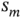

表 4.1 变量定义。

由于所有 `SBS` 都使用了大规模多输入输出（massive MIMO），来自 `SBS` 的干扰可以用于提高用户的秘密速率。对于这些彼此距离较近的 `SBS`，可以采用正交频谱来消除 `SBS` 之间的干扰。如图 4.1 所示，对于复用频谱的关联 `MBS` 用户，本研究将窃听视为攻击者类型的一种。由于信号强度的原因，关联 `MBS` 的用户更容易被窃听。假设窃听者正试图拦截合法用户与 `MBS` 之间的通信。

### 4.2.2 安全分析

本小节检查了异构网络（`HetNet`）系统中发生的干扰，分析了合法用户和任何监听者的接收信号及信噪比（`SINR`）。所研究异构网络中的干扰包括来自 `MBS`、`SBS` 和 D2D 通信的干扰。由于无线通信的距离限制，D2D 的干扰仅考虑在特定距离 `θ` 内对关联 `MBS` 的用户和监听者的影响。定义关联 `MBS` 的第 `m-th` 用户与第 `d-th` D2D 用户对之间的 D2D 干扰指示器为 `l_md`。

其中 `L_md` 代表与 `MBS` 关联的第 `m` 个用户与第 `d` 组 D2D 用户对之间的距离。与 D2D 干扰指标类似，可以定义来自 D2D 用户的窃听者干扰指标 `l_led`。本研究假设 `MBS` 在与 `MBS` 关联的用户的 `SINR` 要求下控制 D2D 通信。如果某对 D2D 通信导致第一层级中的某个合法用户不符合 `SINR` 要求，则该 D2D 对的通信将不被批准。否则，`MBS` 将批准该 D2D 对的通信。D2D 对的通信可能会根据距离导致窃听链路质量下降。因此，为了提高用户在窃听攻击下的机密率，假设 `MBS` 仅批准靠近可能窃听者且满足 `l_led=1` 的 D2D 对通信。令距离阈值内的 D2D 用户的干扰为 `f_D2D`，

```
f_D2D = P_d * h_dD2D^2D * ||θ||^(-α)
```

其中 `h_dD2D` 是衰落因子，`α` 是路径损耗指数，且 `α ≥ 2`。

除了 D2D 通信的干扰外，还存在频谱复用的干扰。对于与 `MBS` 关联的用户，每个用户都可能受到 `MBS` 内其他用户、与 `MBS` 相同频谱的 `SBS` 以及 D2D 通信的干扰。同时也考虑了高斯噪声。对于与 `MBS` 关联的第 `m` 个用户，该用户处的干扰由下式给出：

```
f_m = Σ_{i'=1}^{M} h_i' w_i' I(l_i'=1) + Σ_{i=1}^{N} h_i w_i I(l_i=1) + Σ_{n=1}^{I_m} Σ_{i=1}^{N_i} h_i w_i I(l_i=1) + f_D2D * l_md
```

第一项是来自第一层用户的 `MBS` 干扰。第二项表示来自 `SBS` 的干扰信号，这些 `SBS` 使用与 `MBS` 相同的频谱。`l_i` 是频谱分配的指示器。如果 `l_i=1`，表示第 `i` 个 `SBS` 分配了与 `MBS` 相同的频谱。为了提高小区用户的安全性，窃听者附近的 `SBS` 将被分配复用 `MBS` 的频谱。第三项代表来自 D2D 用户的干扰信号，最后一项是遵循独立同分布 `N(0, σ_m²)` 的高斯噪声。因此，与 `MBS` 关联的第 `m` 个用户的接收信号为：

```
y_m = h_m w_m s_m + f_m
```

其中第一项代表来自 `MBS` 的期望信号。根据 `MBS` 和 `SBS` 的天线数量，其中 `h_m ∈ C^{1 × A_m}`，`h_im ∈ C^{1 × A_s}`，`w_m ∈ C^{A_m × 1}` 以及 `w_in ∈ C^{A_s × 1}`。与 `MBS` 关联的用户编码向量应满足功率约束 `Σ_{m=1}^{M} |w_m|² = P_m`。同样，与 `SBS` 关联的用户编码向量应满足功率约束 `Σ_{n=1}^{N} |w_n|² = P_s`。因此，对于与 `MBS` 关联的第 `m-th` 用户，其 `SINR` 为：

(5) `SINR_m = |h_m w_m|² / IN_m`

where


## 4.3 问题建模与分析

本节对所提的干扰管理机制进行了安全性分析，并考虑了某些 SBS 之间的频谱复用、发射波束成形以及 D2D 通信。本文构建了受窃听攻击用户的保密速率优化问题，并考虑了来自 SBS 和 D2D 通信对关联 MBS 用户的干扰。

### 4.3.1 最大保密速率

受窃听攻击用户的保密速率优化问题被建模为公式 (4.15)：

```
max_{w_m, w_n, l_i, l_m^d, l_e^d} log(1 + SINR_1) - log(1 + SINR_e)
s.t. \sum_{m=1}^M |w_m|² \le P_m
sum_{n=1}^N |w_n|² \le P_{s,i}
SINR_m \ge \gamma_{m,m}
SINR_{in} \ge \gamma_{in,i}, n=1,N
```

前两个约束基于微基站 MBS 和小基站 SBS 的传输功率限制。最后两个约束基于关联 MBS 和 SBS 的用户的 SINR 要求。在这个优化问题中，考虑了传输波束形成、频谱复用和 D2D 通信，以利用干扰来最大化窃听用户的秘密速率。`w_m` 和 `w_{in}` 是传输波束形成的预编码向量。`l_i` 取决于 SBS 与 MBS 之间的频谱分配。`l_m^d` 和 `l_e^d` 是基于 D2D 对到第一层用户以及到窃听者距离的 D2D 通信干扰指示。

### 4.3.2 提议的算法

由于对数函数是增增函数，Eq. (4.15)中的优化问题等价于以下优化问题：

(4.16)
```
max_{w_m, w_{in}, l_i, l_m^d, l_e^d} (1 + SINR_1) / (1 + SINR_e)
```

具有与 Eq. (4.15)相同的约束条件。该优化问题不是凸的。有了这五个参数，无法基于线性优化方法求解。根据之前的分析，`l_i`、`l_m^d` 和 `l_e^d` 会影响合法用户和窃听者的 SINR。因此，频谱分配和 D2D 通信指示可以根据基站以及 D2D 对到窃听者和用户的距离进行预先。


设 $W_m = w_m$，$W_n = w_n$，$W_m = h_m h^T$，$W_i = h_i h^T$，$W_m = h_m h^T$，$W_e = h_e h^T$，$W_n = h_n h^T$，以及 $W_{m,in} = h_{m,in} h^T$。在不失一般性的情况下，假设 $\sigma_m^2 = \sigma_e^2 = \sigma_{in}^2 = 1$。基于第 4.3.1 节中初步分析中提供的 SINR 信息，Eq. (4.16)和所有约束条件可以重写为：

### (4.17)

```xml
<math display="block" overflow="scroll">
  <table>
    <mtr>
      <td>
        <underset>
          <mi>max</mi>
          <mrow><msub>w</mi</msub>/</msub>w</mi><mi>n</mi></msub>/</msub>l</mi</msub>/</msub>l</mi><mi>d</msub>,</msub>l</mi><mi>d</msub></mrow>
        </underset>
      </td>
      <td>
        <mfrac>
          <mrow>
            <mn>1</mn>
            <mfrac>
              <mrow><mi>T</mi><r></mo><msub>H</mi><mn>1</msub></times><msub>W</mi><mn>1</msub></mo>
              <mrow><mi>I</mi><msubsup><N</mi><mn>1</mn><&#8242;</msubsup></mrow>
            </mfrac>
          </mrow>
          <mrow>
            <mn>1</mn>
            <mfrac>
              <mrow><mi>T</mi><R></mo><msub>H</mi><mi>e</msub></times><msub>W</mi><mn>1</msub></mo>
              <mrow><mi>I</mi><msubsup><N</mi><mi>e</mi><mo>&#8242;</mo></msubsup></mrow>
            </mfrac>
          </mrow>
        </mfrac>
      </td>
    </mtr>
    <mtr>
      <td><mtext>s.&#8201;t.</mtext></td>
      <td>
        <munderover stretchy="false" movablelimits="false">&#8721;</mrow><mi>m</mi><mo>=</mn>1</mn></mrow><mi>M</munderover>
        <mi>T</mi><mi>r</mi><mo stretchy="false">(</mo><msub>W</mi><mi>m</mi></msub><mo stretchy="false">)</mo><mo>&#8804;</msub>P</mi><mi>m</msub></mo>,</
      </td>
    </mtr>
    <mtr>
      <td></td>
      <td>
        <munderover stretchy="false" movablelimits="false">&#8721;</mrow><mi>n</mi><mo>=</mn>1</mn></mrow><mi>N</munderover>
        <mi>T</mi><mi>r</mi><mo stretchy="false">(</mo><msub>W</mi><mrow><i</mi><mi>n</mi></mrow></msub><mo stretchy="false">)</mo><mo>&#8804;</msub>P</mi><mi>s</msub></mo>,</
        <mi>i</mi><mo>&#8712;</mo><mo stretchy="false">\[</mo><mn>1</mn><mo>,</mo><mi>I</mi><mo stretchy="false">\]</mo><mo>,</
      </td>
    </mtr>
    <mtr>
      <td></td>
      <td>
        <mfrac>
          <mrow><mi>T</mi><mi>r</mi><mo stretchy="false">(</mo><msub>H</mi><mi>m</mi></msub><mo>&#215;</mo><msub>W</mi><mi>m</mi></msub><mo stretchy="false">)</mo></mrow>
          <mrow><mi>I</mi><msubsup><N</mi><mi>m</mi><mo>&#8242;</mo></msubsup></mrow>
        </mfrac>
        <mo>&#8805;</mo><msub><mi>&#947;</mi><mi>m</msub></mo>,</mo><mi>m</mi><mo>&#8712;</mo><mo stretchy="false">\[</mo><mn>2</mn><mo>,</mo><mi>M</mi><mo stretchy="false">\]</mo><mo>,</
      </td>
    </mtr>
    <mtr>
      <td></td>
      <td>
        <mfrac>
          <mrow><mi>T</mi><mi>r</mi><mo stretchy="false">(</mo><msub>H</mi><mrow><i</mi><mi>n</mi></mrow></msub><mo>&#215;</mo><msub>W</mi><mrow><i</mi><mi>n</mi></mrow></msub><mo stretchy="false">)</mo></mrow>
          <mrow><mi>I</mi><msubsup><N</mi><mrow><i</mi><mi>n</mi></mrow><mo>&#8242;</mo></msubsup></mrow>
        </mfrac>
        <mo>&#8805;</mo><msub><mi>&#947;</mi><mrow><i</mi><mi>n</mi></mrow></msub><mo>,</mo><mi>i</mi><mo>&#8712;</mo><mo stretchy="false">\[</mo><mn>1</mn><mo>,</mo><mi>I</mi><mo stretchy="false">\]</mo><mo>,</mo><mi>n</mi><mo>&#8712;</mo><mo stretchy="false">\[</mo><mn>1</mn><mo>,</mo><mi>N</mi><mo stretchy="false">\]</mo><mo>.</mo>
      </td>
    </mtr>
  </table>
</math>
```

(4.18) 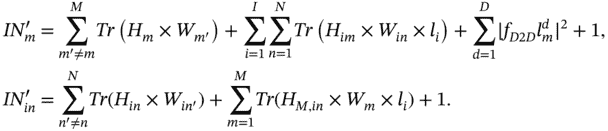


公式：

```math
<math display="block" overflow="scroll"><mtable><mtr><td columnalign="right"><mi>I</mi><msubsup><mi>N</mi><mi>m</mi><mo>&#8242;</mo></msubsup></td><td columnalign="center"><mo>=</mo></td><td columnalign="left"><munderover><mo stretchy="false" movablelimits="false">&#8721;</mo><mrow><msup><mi>m</mi><mo>&#8242;</mo></msup><mo>&#8800;</mo><mi>m</mrow><mi>M</mi></munderover><mi>T</mi><mi>r</mi><mfenced open="(" close=")" separators=""><msub><mi>H</mi><mi>m</mi></msub><mo>&#2115;</mo><msub><mi>W</mi><msup><mi>m</mi><mo>&#8242;</mo></msup></msub></mo><mo>+</mo><munderover><mo stretchy="false" movablelimits="false">&#8721;</mo><mrow><mi>i</mi><mo>=</mo><mn>1</mn></mrow><mi>I</mi></munderover><munderover><mo stretchy="false" movablelimits="false">&#8721;</mo><mrow><mi>n</mi><mo>=</mo><mn>1</mn></mrow><mi>N</mi></munderover><mi>T</mi><mi>r</mi><mfenced open="(" close=")" separators=""><msub><mi>H</mi><mrow><mi>i</mi><mi>m</mi></mrow></msub><mo>&#2115;</mo><msub><mi>W</mi><mrow><mi>i</mi><mi>n</mrow></msub><mo>&#2115;</mo><msub><mi>l</mi><mi>i</msub></mo><mo>+</mo><munderover><mo stretchy="false" movablelimits="false">&#8721;</mo><mrow><mi>d</mi><mo>=</mo><mn>1</mn></mrow><mi>D</mi></mo><mo stretchy="false">&#124;</mo><msub><mi>f</mi><mrow><mi>D</mi><mn>2</mn><mi>D</mi></mrow></msub><msubsup><mi>l</mi><mi>m</mi><mi>d</mi></msubsup><mo stretchy="false">&#124;</mo><mn>2</mn></msup><mo>+</mo><mn>1</mn><mo></mo></td></mtr><mtr><td columnalign="right"><mi>I</mi><msubsup><mi>N</mi><mrow><mi>i</mi><mi>n</mrow><mo>&#8242;</mo></mo></td><td><mo>=</mo></td><td><munderover><mo stretchy="false" movablelimits="false">&#8721;</mo><mrow><msup><mi>n</mi><mo>&#8242;</mo></msup><mo>&#8800;</mo><mi>n</mrow><mi>N</mi></munderover><mi>T</mi><mi>r</mi><mo stretchy="false">(</mo><msub><mi>H</mi><mrow><mi>i</mi><mi>n</mi></mrow></msub><mo>&#2115;</mo><msub><mi>W</mi><mrow><mi>i</mi><mi>n</mo>&#8242;</mo></mo></msub><mo stretchy="false">)</mo><mo>+</mo><munderover><mo stretchy="false" movablelimits="false">&#8721;</mo><mrow><mi>m</mi><mo>=</mo><mn>1</mn></mrow><mi>M</mi></munderover><mi>T</mi><mi>r</mi><mo stretchy="false">(</mo><msub><mi>H</mi><mrow><mi>M</mi><mo,mo><mi>i</mi><mi>n</mi></mrow></msub><mo>&#2115;</mo><msub><mi>W</mi><mi>m</msub><mo>&#2115;</mo><msub>l</mi><mi>i</msub></mo>+</mo><1></mo></mo></td></mtr></mtable></math>
```

`Eq. (4.17)` 中方方矩阵的 `Tr()` 不是凸的。为了将其转换为凸问题，首先需要根据基站和窃听者的位置确定频谱分配 `l_i`、`l_m` 和 `l_e`。因此，该问题可以简化如下：

(4.19) 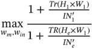

```math
<math display="block" overflow="scroll"><mtable><mtr><td columnalign="right"><mi>max</mi><mrow><msub>w</mi><mi>m</msub></mo><momo><msub>w</mi><mi>n</msub></mrow></td><td><mfrac><mn>1</mn><mo><mo><mfrac><mi>T</mi><mi>r</mi><msub><H</mi><mi>1</mi></msub><mo>&#2115;</mo><msub><W</mi><mn>1</mn></msub></mo></mo></mo></mfrac></mrow><mn>1</mn><mo>+</mo><mfrac><mi>T</mi><mi>r</mi><msub><H</mi><mi>e</mi></msub><mo>&#2115;</mo><msub>W</mi><mn>1</mn></msub></mo></mo></mo></mfrac></mrow><mrow><mi>I</mi><msubsup><N</mi><mi>e</mi><mo>&#8242;</mo></msubsup></mrow></td></mtr></varepsilon></math>
```

(4.20) ![StartLayout 1st Row 1st Column max Underscript w Subscript m Baseline comma w Subscript i n Baseline Endscripts 2nd Column StartStartFraction 1 plus StartFraction upper T r left-parenthesis upper H 1 times upper W 1 right-parenthesis) Over upper I N prime 1 EndFraction OverOver 1 plus xi EndEndFraction 2nd Row 1st Column s period. t. 2nd Column StartFraction upper T r left-parenthesis upper H Subscript e times upper W 1 right-parenthesis) Over upper I N prime subscript e EndFraction less-than-or-equal-to xi less-than-or-equal-to upper T r left-parenthesis upper H 1 right-parenthesis) P Subscript m EndLayout](img/c04-math-0020.png)

```math
<math display="block" overflow="scroll"><mtable><mtr><mtd><munder><mi>max</mi><mrow><msub><mi>w</mi><mi>m</mi></msub><mo><mo><msub><mi>w</mi><mrow><mi>i</mi><mi>n</mi></mrow></msub></mo></mo></mrow></munder></mtd><mtd><mfrac><mrow><mn>1</mn><mo>+</mo><mfrac><mrow><mi>T</mi><mi>r</mo stretchy="false">(</mo><msub><mi>H</mi><mn>1</mn></msub><mo>&#2115;</mo><msub><mi>W</mi><mn>1</mn></msub><mo stretchy="false">)</mo></mrow><mrow><mi>I</mi><msubsup><mi>N</mi><mn>1</mn><mo>&#8242;</mo></mtext></mrow></mfrac></mrow><mrow><mn>1</mn><mo>+</mo><mi>&#958;</mi></mrow></mfrac></mtd></mtr><mtr><mtd><mtext>s.&#8201;t.</mtext></td><mtd><mfrac><mrow><mi>T</mi><mi>r</mo stretchy="false">(</mo><msub><mi>H</mi><mi>e</mi></msub><mo>&#2115;</mo><msub><mi>W</mi><mn>1</mn></msub><mo stretchy="false">)</mo></mrow><mrow><mi>I</mi><msubsup><mi>N</mi><mi>e</mi><mo>&#8242;</mo></mtext></mrow></mfrac><mo>&#8804;</mo><mi>&#958;</mi><mo>&#8804;</mo><mi>T</mi><mi>r</mo stretchy="false">(</mo><msub><mi>H</mi><mn>1</mn></msub><mo stretchy="false">)</mo><msub><mi>P</mi><mi>m</mi></msub></td></mtr></mtable></math>
```

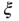 <math display="inline" overflow="scroll"><mrow><mi>&#958;</mi></mrow></math> 的约束代表了下界和上限。对于固定的 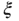 <math display="inline" overflow="scroll"><mrow><mi>&#958;</mi></mrow></math> 值，可以形成相应的优化问题值：

(4.21) 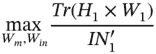

```math
<math display="block" overflow="scroll"><munder><mi>max</mi><mrow><msub><mi>W</mi><mi>m</mi></msub><mo><mo><msub><mi>W</mi><mrow><mi>i</mi><mi>n</mi></mrow></msub></mo></mo></mrow></munder><mfrac><mrow><mi>T</mi><mi>r</mo stretchy="false">(</mo><msub><mi>H</mi><mn>1</mn></msub><mo>&#2115;</mo><msub><mi>W</mi><mn>1</mn></msub><mo stretchy="false">)</mo></mrow><mrow><mi>I</mi><msubsup><mi>N</mi><mn>1</mn><mo>&#8242;</mo></mtext></mrow></mfrac></math>
```

具有 `Eq. (4.17)` 中相同的约束。根据  <math display="inline" overflow="scroll"><mrow><mi>&#958;</mi></mrow></math> 的值以及 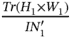 <math display="inline" overflow="scroll"><mfrac><mrow><mi>T</mi><mi>r</mo stretchy="false">(</mo><msub><mi>H</mi><mn>1</mn></msub><mo>&#2115;</mo><msub><mi>W</mi><mn>1</mn></msub><mo stretchy="false">)</mo></mrow><mrow><mi>I</mi><msubsup><mi>N</mi><mn>1</mn><mo>&#8242;</mo></mtext></mrow></mfrac></math> 的对应值，可以使用一维搜索法求解 `Eq. (4.17)` 中的问题。

由于 `Eq. (4.21)` 是线性分规划，可以通过 Charnes–Cooper 变换转换为线性规划：

(4.22) 

```math
<math display="block" overflow="scroll"><msub><mi>Y</mi><mi>m</mi></msub><mo>=</mo><mfrac><msub><mi>W</mi><mi>m</mi></msub><mrow><mi>I</mi><msubsup><mi>N</mi><mn>1</mn><mo>&#8242;</mo></mtext></mrow></mfrac><mo>,</mo><msub><mi>Y</mi><mrow><mi>i</mi><mi>n</mi></mrow></msub><mo>=</mo><mfrac><msub><mi>W</mi><mrow><mi>i</mi><mi>n</mi></mrow></msub><mrow><mi>I</mi><msubsup><mi>N</mi><mn>1</mn><mo>&#8242;</mo></mtext></mrow></mfrac><mo>,</mo><mi>&#950;</mi><mo>=</mo><mfrac><mn>1</mn><mrow><mi>I</mi><msubsup><mi>N</mi><mn>1</mn><mo>&#8242;</mo></mtext></mrow></mfrac></math>
```

那么 `Eq. (4.21)` 可以转换为半正定规划对偶 (SDD) 问题：


(4.23)

```math
<math display="block" overflow="scroll"><<table><mtr><mtd><munder><mi>max</mi><mrow><msub><mi>Y</mi><mi>m</mi></msub><mo>,</mo><msub><mi>Y</mi><mrow><mi>i</mi><mi>n</mi></mrow></msub></mrow></munder></mtd><mtd><mi>T</mi><mi>r</mi><mo stretchy="false">(</mo><msub><mi>H</mi><mn>1</mn></msub><mo>&#215;</mo><msub><mi>Y</mi><mn>1</mn></msub><mo stretchy="false">)</mo></mtd></mtr>
<mtr><mtd><mtext>s.&#8201;t.</mtext></mtd><mtd><munderover><mo stretchy="false" movablelimits="false">&#8721;</mo><mrow><mi>m</mi><mo>=</mo><mn>1</mn></mrow><mi>M</mi></munderover><mi>T</mi><mi>r</mi><mo stretchy="false">(</mo><msub><mi>Y</mi><mi>m</mi></msub><mo stretchy="false">)</mo><mo>&#8804;</mo><msub><mi>P</mi><mi>m</mi></msub><mi>&#950;</mi><mo>,</mo></mtd></mtr>
<mtr><mtd></mtd><mtd><munderover><mo stretchy="false" movablelimits="false">&#8721;</mo><mrow><mi>n</mi><mo>=</mo><mn>1</mn></mrow><mi>N</mi></munderover><mi>T</mi><mi>r</mi><mo stretchy="false">(</mo><msub><mi>Y</mi><mrow><mi>i</mi><mi>n</mi></mrow></msub><mo stretchy="false">)</mo><mo>&#8804;</mo><msub><mi>P</mi><mi>s</mi></msub><mi>&#950;</mi><mo>,</mo><mi>i</mi><mo>&#8712;</mo><mo stretchy="false">\[</mo><mn>1</mn><mo>,</mo><mi>I</mo><mo stretchy="false">\]</mo><mo>,</mo></mtd></mtr>
<mtr><mtd></td><mtd><mi>T</mi><mi>r</mi><mo stretchy="false">(</mo><msub><mi>H</mi><mi>m</mi></msub><mo>&#215;</mo><msub><mi>W</mi><mi>m</mi></msub><mo stretchy="false">)</mo><mo>&#8805;</mo><msub><mi>&#947;</mi><mi>m</mi></msub><mi>I</msubsup><mi>N</mi><mi>m</mi><mo>&#8243;</mo></mtext><mo>,</mo><mi>m</mi><mo>&#8712;</mo><mo stretchy="false">\[</mo><mn>2</mn><mo>,</mo><mi>M</mo><mo stretchy="false">\]</mo><mo>,</mo></mtd></mtr>
<mtr><mtd></td><mtd><mi>T</mi><mi>r</mi><mo stretchy="false">(</mo><msub><mi>H</mi><mrow><mi>i</mi><mi>n</mrow></msub><mo>&#215;</mo><msub><mi>Y</mi><mrow><mi>i</mi><mi>n</mi></mrow></msub><mo stretchy="false">)</mo><mo>&#8805;</mo><msub><mi>&#947;</mi><mi>I</mi></msub><mi>N</mi><mi>m</mi><mo>&#8243;</mo></mo><i</mi><mo>&#8712;</mo><mo stretchy="false">\[</mo><mn>1</mn><mo>,</mo><mi>I</mo><mo stretchy="false">\]</mo><mo>,</mo><mi>n</mi><mo>&#8712;</mo><mo stretchy="false">\[</mo><mn>1</mn><mo>,</mo><mi>N</mo><mo stretchy="false">\]</mo><mo>,</mo></mtd></mtr>
<mtr><mtd></td><mtd><mi>T</mi><mi>r</mi><mo stretchy="false">(</mo><msub><mi>H</mi><mi>e</mi></msub><mo)&#8805;</mo><msub><mi>9</4</mi><mi>N</mi><mi>e</mi></msub><mo>&#8243;</mo></></></mtr>
<mtr><mtd></td><mtd><munderover><mo stretchy="false" movablelimits="false">&#8721;</mo><mrow><mi>m</mi><mo>=</mo><mn>2</mn></mrow><mi>M</mi></munderover><mi>T</mi><mi>r</mi><mo stretchy="false">(</mo><msub><mi>H</mi><mi>m</mi></msub><mo>&#215;</mo><msub><mi>Y</mi><mi>m</mi></msub><mo stretchy="false">)</mo><mo>+</mo><munderover><mo stretchy="false" movablelimits="false">&#8721;</mo><mrow><mi>i</mi><mo>=</mo><mn>1</mn></mrow><mi>I</mi></munderover><munderover><mo stretchy="false" movablelimits="false">&#8721;</mo><mrow><mi>n</mi><mo>=</mo><mn>1</mn></mrow><mi>N</mi></munderover><mi>T</mi><mi>r</mi><mo stretchy="false">(</mo><msub><mi>H</mi><mn>1</mn></msub><mo>&#215;</mo><msub><mi>Y</mi><mi>i</mi></msub><msub>l</mi><mi>i</msub><mo stretchy="false">)</mo><mo>+</mo><mfenced open="("close)"><munderover><mo stretchy="false" movablelimits="false">&#8721;</mo><mrow><mi>d</mi><mo>=</mo><mn>1</mn></mrow><mi>D</mi></munderover><mo stretchy="false">&#124;</mo><msub><mi>f</mi><mrow><mi>D</mi><mn>2</mn><mi>D</mi></mrow></msub><msubsup><mi>l</mi><mi>m</mi><mi>d</mi></msubsup><msup><mo stretchy="false">&#124;</mo><mn>2</mn></msup><mo>+</mo><mn>1</mn></mfenced><mi>&#950;</mi><mo>=</mo><mn>1</mn><mo>,</mo></td></mtr>
<mtr><mtd></td><td><msub><mi>Y</mi><mi>m</mi></msub><mo>,</mo><mo>&#8805;</mo><mn>0</mn><mo>,</mo><mi>&#950;</mi><mo>&#8805;</mo><mn>0</mn><mo>.</mo></td></mtr></table></math>
```

where


## 数学公式

```math
<math display="block" overflow="scroll"><<table><mtr><mtd><mi>I</mi><msubsup><mi>N</mi><mi>m</mi><mo>&#8243;</mo></msubsup></mtd><mtd><mo>=</mo></mtd><mtd><munderover><mo stretchy="false" movablelimits="false">&#8721;</mo><mrow><msup><mi>m</mi><mo>&#8242;</mo></msup><mo>&#8800;</mo><mi>m</mrow><mi>M</mi></munderover><mi>T</mi><mi>r</mi><mo stretchy="false">(</mo><msub><mi>H</mi><mi>m</mi></msub><mo>&#2155;</mo><msub><mi>Y</mi><msup><mi>m</mi><mo>&#8242;</mo></msup></msub><mo stretchy="false">)</mo><mo>+</mo><munderover><mo stretchy="false" movablelimits="false">&#8721;</mo><mrow><mi>i</mi><mo>=</mo><mn>1</mn></mrow><mi>I</mi></munderover><munderover><mo stretchy="false" movablelimits="false">&#8721;</mo><mrow><mi>n</mi><mo>=</mo><mn>1</mn></mrow><mi>N</mi></munderover><mi>T</mi><mi>r</mi><mo stretchy="false">(</mo><msub><mi>H</mi><mrow><mi>i</mi><mi>m</mi></mrow></msub><mo>&#2115;</mo><msub><mi>Y</mi><mrow><mi>i</mi><mi>n</mi></mrow></msub><mo>&#2115;</mo><msub><mi>l</mi><mi>i</mi></msub><mo stretchy="false">)</mo><mo>+</mo><mfenced open="(" close=")" separators=""><munderover><mo stretchy="false" movablelimits="false">&#8721;</mo><mrow><mi>d</mi><mo>=</mo><mn>1</mn></mrow><mi>D</mi></munderover><mo stretchy="false">&#124;</mo><msub><mi>f</mi><mrow><mi>D</mi><mn>2</mn><mi>D</mi></mrow></msub><msubsup><mi>l</mi><mi>m</mi></mi><mo stretchy="false">&#124;</mo><mn>2</mn></2><mo>+</mo><mn>1</mn></mfenced><mi>&#950;</mi><mo>,</mtd></mtr><mtr><mtd><mi><mi>I</mi><msubsup><N</mi><i>i</i</mo>mi>mo></3></3></mtd><mtd><mo>=</mo></mtd></mtd><munderover><mo stretchy="false" movablelimits="false">&#8721;</mo><mrow><msup><mi>n</mi><mo>&#8242;</mo></msup><mo>&#8800;</mo><mi>n</mrow><mi>N</mi></munderover><mi>T</mi><mi>r</mi><mo stretchy="false">(</mo><msub><mi>H</mi><mrow><mi>i</mi><mi>n</mi></mrow></msub><mo>&#2115;</mo><msub><mi>Y</mi><msup><mi>i</mi><mo>&#8242;</mo></msup></msub><mo stretchy="false">)</mo><mo>+</mo><munderover><mo stretchy="false" movablelimits="false">&#8721;</mo><mrow><mi>m</mi><mo>=</mo><mn>1</mn></mrow><mi>M</mi></munderover><mi>T</mi><mi>r</mi><mo stretchy="false">(</mo><msub><mi>H</mi><mrow><mi>M</mi><momo><mi>n</mi></mrow></msub><mo>&#2115;</mo><msub><mi>Y</mi><mi>m</mi></msub><mo>&#2115;</mo><msub><mi>l</mi><mi>i</mi></msub><mo stretchy="false">)</mo><mo>+</mo><mi>&#950;</mi><mo>,</td></mtr><mtr><mtd><mi><mi>I</mi><msubsup><N</mi><mi>e</mi><mo>828343></3></3></mtd><mtd><mo>=</mo></mtd><mtd><munderover><mo stretchy="false" movablelimits="false">&#8721;</mo><mrow><mi>m</mi><mo>=</mo><mn>2</mn></mrow><mi>M</mi></munderover><mi>T</mi><mi>r</mi><mo stretchy="false">(</mo><msub><mi>H</mi><mi>e</mi></msub><mo>&#2115;</mo><msub><mi>Y</mi><mi>m</mi></msub><mo stretchy="false">)</mo><mo>+</mo><munderover><mo stretchy="false" movablelimits="false">&#8721;</mo><mrow><mi>i</mi><mo>=</mo><mn>1</mn></mrow><mi>I</mi></munderover><munderover><mo stretchy="false" movablelimits="false">&#8721;</mo><mrow><mi>n</mi><mo>=</mo><mn>1</mn></mrow><mi>N</mi></munderover><mi>T</mi><mi>r</mi><mo stretchy="false">(</mo><msub><mi>H</mi><mrow><mi>i</mi><mi>e</mi></mrow></msub><mo>&#2115;</mo><msub><mi>Y</mi><mrow><mi>i</mi><mi>n</mi></mrow></msub><mo>&#2115;</mo><msub><mi>l</mi><mi>i</mi></msub><mo stretchy="false">)</mo><mo>+</mo><mfenced open="(" close=")" separators=""><munderover><mo stretchy="false" movablelimits="false">&#8721;</mo><mrow><mi>d</mi><mo>=</mo><mn>1</mn></mrow><mi>D</mi></munderover><mo stretchy="false">&#124;</mo><msub><mi>f</mi><mrow><mi>D</mi><mn>2</mn><mi>D</mi></mrow></msub><msubsup><mi>l</mi><mi>e</mi><mi>d</mi></mi><mo stretchy="false">&#124;</mo><mn>2</mn></msup><mo>+</mo><mn>1</mn></mfenced><mi>&#950;</mi><mo>.</mo></td></mtr></</table>></math>
```

Eq. (4.23) 的优化解表示为 `\(Y_m^*, Y_{in}^*, \zeta^*\)`。根据 Eq. (4.22)，Eq. (4.21) 的最优解可以获得为 `\(W_m^* = \frac{Y_m^*}{\zeta^*}\)` 和 `\(W_{in}^* = \frac{Y_{in}^*}{\zeta^*}\)`。通过 `\(\xi\)` 的下界和上界，应用一维线搜索方法（如斐波那契搜索）可以获得最优解 `\(\xi^*\)`。Eq. (4.23) 中的优化问题可以通过 `CVX` [Guimaraes et al., 2015] 进行求解。Algorithm 4.1 的流程图如图 Figure 4.2 [Fang et al., 2017b] 所示。

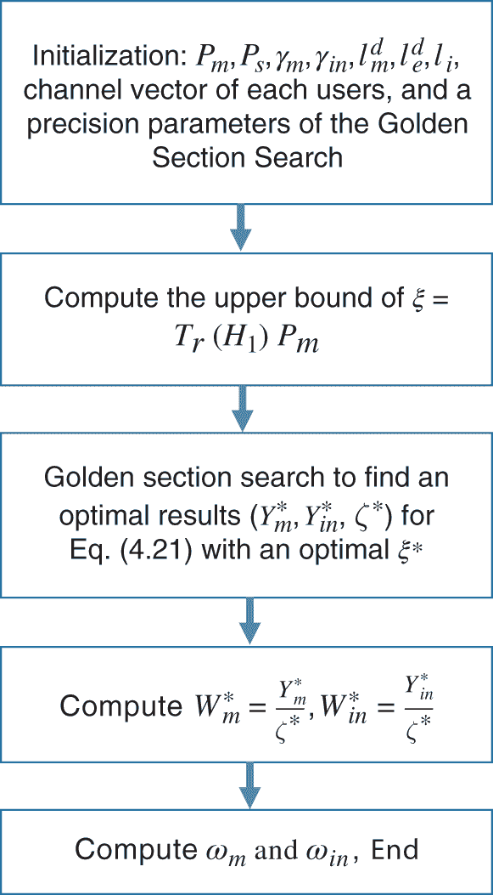

**Figure 4.2** Algorithm 4.1 的流程图。

## 4.4 数值与仿真结果

本节给出了数值结果和讨论。仿真使用 `Matlab` 完成。首先，在存在窃听的情况下，评估用户信息传输的安全性，通过将所提干扰管理机制实现的保密率与三种替代方法进行对比：通过不复用频谱分配进行的完全干扰消除、仅使用使用无波束成形的 D2D 通信进行干扰管理，以及仅使用 MBS 和 SBS 之间频谱复用的无波束成形干扰管理。分析了下行异构网络（HetNet）小区用户的保密率性能。在仿真中，系统模型包括一个 MBS 和两个频谱复用作为 MBS 的 SBS。在第一层，有两个用户与 MBS 关联。在每个 SBS 中，有一个用户。D2D 通信可以在距离窃听者位置不同的距离建立。假设 MBS 有 10 根天线，每个 SBS 有 4 根天线，MBS 的发射功率设置为 10 W。所有用户的 SINR 阈值设置为 0.6。


**Figure 4.3** 在窃听攻击下用户的保密率。

在 Figure 4.3 中对比了所提方法与其他三种干扰管理技术的保密率性能。标签“Non”指的是通过不复用频谱且无波束成形实现的总干扰消除。“Only SR”指的是 MBS 和 SBS 之间的频谱复用。“Only D2D”指的是 D2D 通信。“Proposed”指的是所提的干扰管理机制。


**Figure 4.4** 在窃听攻击下用户的保密率。


**Figure 4.5** 在窃听攻击下用户的保密率。

## 4.5 结论

本章利用物理层安全方法，为 5G 无线网络引入了一种有效的安全解决方案。所提方案依赖于干扰管理。对双层异构网络下行链路的提干扰管理机制进行了安全性分析，该机制包含了波束成形、频谱复用和 D2D 通信。与消除所有干扰的传统干扰管理机制不同，所提干扰管理机制可以利用波束成形以及频谱复用和 D2D 通信的选择性干扰来增强异构网络通信的安全性。

通信技术和集成电路的最新进展推动了物联网（IoT）应用的广泛采用和集成，创造了一个充满挑战与机遇的无处的环境。本章介绍了一种利用 5G 无线网络的物联网应用的综合系统架构。该架构考虑了 IoT 设备、用户、网络运营商和服务提供者的异构性。根据这些实体之间的信任关系，提出了并评估了多种信任模型。在之前讨论的系统架构和信任模型的基础上，针对使用 5G 无线系统的异构 IoT 设备，提出了一种安全且灵活的身份验证和数据传输方案 [Fang et al., 2020]。

## 5.1 IoT 应用模型与当前面临的安全挑战

确保 IoT 应用的安全和隐私是一个广泛研究的话题。然而，鉴于 IoT 应用场景的多样性，为通用的 IoT 应用创建一个全面的系统模型具有挑战性。此外，实体之间的信任关系可能根据具体的应用而异。在 Kumar 等人 [\[2017\]](#b01.xhtml#bref-bib-0048) 中，提出了一种用于连接智能家居的匿名且安全的框架。所使用的系统模型与无线传感器网络类似，不同在于网关连接到互联网。然而，以前的研究尚未充分解决 IoT 设备的异构性问题。此外，IoT 设备身份验证的各种场景尚未得到充分研究。在 Song 等人 [\[2017\]](#b01.xhtml#bref-bib-0084) 中，系统模型仅考虑了 IoT 设备和服务器，以确保这两者之间的通信安全。在 Zhang 等人 [\[2017a\]](#b01.xhtml#bref-bib-0114) 中，作者们提出了一个具有三个实体的移动医疗系统模型，它们分别是网络管理器、无线体域网客户端和医疗服务提供者。在所提出的协议中讨论了这些实体之间的信任关系。然而，该系统中并未考虑 IoT 设备的异构性。

除了 IoT 系统模型外，由于 IoT 设备物理暴露且易于获取，它们容易受各种类型的攻击，例如物理攻击、侧信道攻击和克隆攻击。物理不可克隆函数（`PUFs`）被认为内置在 IoT 设备中，以提供针对此类攻击的安全防护。`PUF` 是一种数字指纹，作为半导体设备的唯一身份，可以从集成电路的物理特性中导出密钥。`PUFs` 的两个主要应用是强认证和加密密钥生成 [Herder et al., 2014]。大量的研究致力于评估 `PUF` 硬件设计的属性 [Maiti et al., 2012; Yan et al., 2017b; Gao et al., 2017]。此外，已努力利用 `PUFs` 开发身份验证。例如，[Aman et al., 2017] 提出了一种双向认证。该协议设计用于在理想环境中运行并防止各种攻击。然而，在 [Saeed et al., 2018] 中，作者提出了另一种双向认证。协议设计用于两种场景：IoT 设备和服务器之间。然而，它没有考虑 IoT 设备的异构性。


## 考虑 IoT 设备限制的轻量级匿名身份验证研究

考虑到 IoT 设备计算能力和存储容量的限制以及隐私考量，目前的研究重点是开发轻量级且匿名的身份验证。在 Gope 等人 [\[2018\]](#b01.xhtml#bref-bib-0038) 中，作者提出了一种针对射频识别（`RFID`）系统的轻量级且可扩展的认证。该协议设计用于防御 `DoS`、窃听、冒充和克隆攻击。然而，诸如 Liu 等人 [\[2014\]](#b01.xhtml#bref-bib-0054)、Xiong [\[2014\]](#b01.xhtml#bref-bib-0101) 和 Zhao [\[2014\]](#b01.xhtml#bref-bib-0116) 以及 He 等人 [\[2017\]](#b01.xhtml#bref-bib-0041) 都提出了身份验证。然而，他们仅考虑了标签和服务器之间的场景。

## 5.2 基于 5G 的物联网应用通用系统模型

本节介绍了一个通用的系统架构以及相应的信任模型、威胁模型和设计目标。

### 5.2.1 系统架构

IoT 系统架构由四个主要部分组成：异构 IoT 设备（分类为 T1 和 T2 IoT 设备）、IoT 用户、网络运营商和 IoT 服务提供者。这如图 5.1 所示，其中两类类型的异构 IoT 设备根据其能力进行了区分。

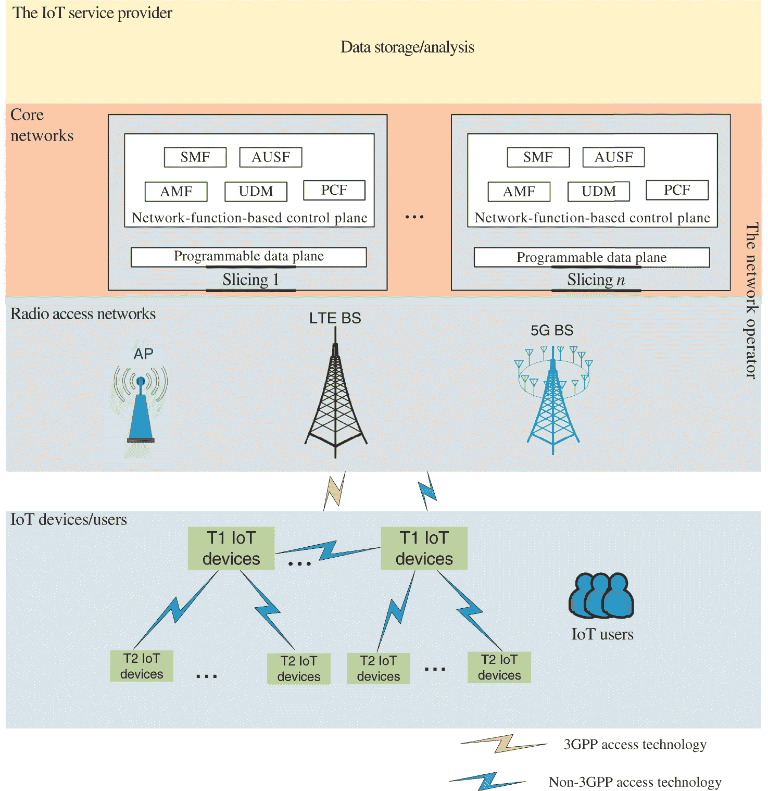

**图 5.1** 基于 5G 的物联网应用通用系统模型。

必须在所有参与的实体之间建立安全的通信通道。如图 5.1 所示，网络运营商负责管理无线接入网和核心网。在 5G 无线系统中，可以利用网络切片根据特定应用动态管理资源。5G 核心网与其 4G 版本的区别在于分离了控制面和数据面，这使得在部署期间能够提高性能并提供更大的网络灵活性 Fang et al., [2017a, 2017b, 2018]。在控制面中，分配了不同的网络功能，例如接入和移动性功能 (`AMF`)、会话管理功能 (`SMF`)、统一数据管理 (`UDM`)、认证服务器功能 (`AUSF`) 和策略控制功能 (`PCF`) Fang et al., [2017a]。可编程数据面使核心网更加灵活，并更好地支持 5G 中不同的用例。

IoT 服务提供商为 IoT 用户提供数据存储服务和可能的数据分析服务。如果需要，IoT 服务提供商还可以管理 IoT 设备的身份。IoT 用户可以与 IoT 设备以及相应的 IoT 服务提供商通信。IoT 用户与 IoT 设备之间的通信可以是基于无线的，也可以通过网络运营商。IoT 用户可以与 IoT 服务提供商通信数据访问和分析服务。

在系统模型中，假设有 $I$ 个 $T1$ IoT 设备、$J$ 个 $T2$ IoT 设备、$N$ 个 IoT 用户、一个 IoT 服务提供商和一个网络运营商。通常，$J$ 的值远大于 $I$。一个 $T1$ IoT 设备 $D_i^1$ 可以通过网络运营商与 IoT 用户和 IoT 服务提供商通信。一个 $T2$ IoT 设备 $D_j^2$ 需要通过一个 $T1$ IoT 设备向 IoT 服务提供商上传数据，并与其他 $T1$ IoT 设备及 IoT 用户通信。$T1$ IoT 设备、IoT 用户和 IoT 服务提供商在相互通信之前必须先向网络服务提供商注册。$T2$ IoT 设备必须先向 $T1$ IoT 设备注册以加入系统。两个实体在相互通信之前需要进行双向认证和初始会话密钥协商。$T2$ IoT 设备必须与 IoT 服务提供商实现双向认证才能连接到网络。通过 $T1$ IoT 设备，$T2$ IoT 设备在与 IoT 服务提供商认证后可以连接网络。此外，数据传输应受到机密性的保护。

### 5.2.2 信任模型

信任模型根据 5G 无线系统中的特定应用而异。本研究考虑了基于 5.2.1 节所示 IoT 系统模型的三个潜在信任模型，考虑了实体之间不同的信任程度。由于 IoT 设备、IoT 用户和 IoT 服务提供商直接与网络运营商通信，这些实体可以被共同视为“网络实体”。图 5.2 展示了基于 IoT 模型的 5G 网络信任模型。

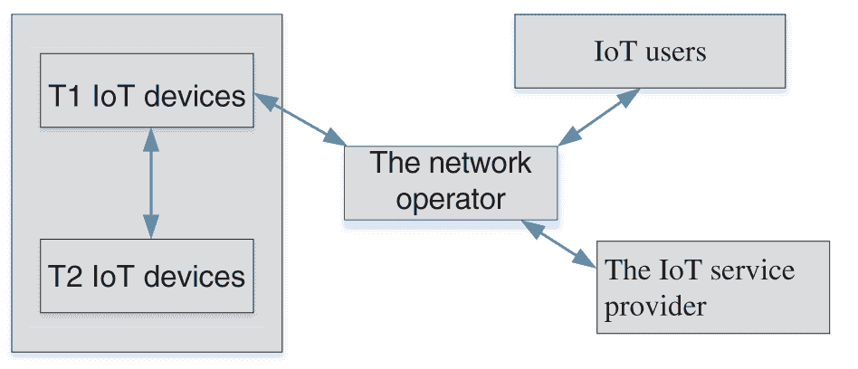

$T2$ IoT 设备依赖 $T1$ IoT 设备向其他实体转发消息，但为了维护端到端安全，$T1$ IoT 设备无法解析 $T2$ IoT 设备与其他实体之间交换的消息。根据 IoT 用户、$T1$ IoT 设备、网络运营商和 IoT 服务提供商之间的信任关系，可以分为以下若干场景：

*   **场景 1**：在这种场景下，网络运营商被所有其他实体完全信任。同样，IoT 用户和 IoT 设备完全信任 IoT 服务提供商。因此，系统模型可以将 IoT 服务提供商和网络运营商视为单一实体。这种配置被称为场景 1，在早期研究中常用。

*   **场景 2**：网络运营商和 IoT 服务提供商被 IoT 设备和 IoT 用户半信任。网络运营商被 IoT 服务提供商完全信任。网络运营商和 IoT 服务提供商对 IoT 设备和 IoT 用户之间传输的数据保持好奇。在这种情况下，IoT 服务提供商可以在核心网 `AUSF` 中存储 IoT 设备信息，以实现更好的延迟管理和移动性支持。系统模型可以将 IoT 服务提供商和网络运营商视为一个实体。场景 2 也常用于简化系统模型。

*   **场景 3**：网络运营商和 IoT 服务提供商被 IoT 设备和 IoT 用户半信任。网络运营商和 IoT 服务提供商对 IoT 设备和 IoT 用户之间传输的数据保持好奇。IoT 服务提供商仅使用网络运营商的服务，但不信任其管理 IoT 设备的信息。在这种情况下，IoT 服务提供商可以在 IoT 设备和用户部署服务器以缩短通信延迟。该场景尚未得到充分研究，但在实际应用中更具可行性。

### 5.2.3 威胁模型与设计目标

在所有可用的信任模型中，本研究选择了 `Case 3` 模型，原因因为它对实体之间的信任要求最低。考虑到 `T2` IoT 设备容易受到各种形式的攻击，例如物理攻击、侧信道攻击和克隆攻击，据此假设这些设备具有较弱的 `PUFs`。因此，IoT 服务提供者只需要为每个 `T2` 设备存储一对特定的 `(C, R)`。我们假设可以发起窃听攻击来获取 IoT 设备与其他网络实体之间的通信信息。可以通过克隆 IoT 设备的身份并连接网络来发起身份盗取攻击。此外，还要考虑网络运营商可能会捕获 IoT 设备的身份验证消息和服务数据，这些数据可用于泄露 IoT 用户的敏感信息。IoT 服务提供者为 IoT 设备和 IoT 用户提供各种服务，有强烈的动机保护服务数据以吸引更多 IoT 用户使用其服务。另一方面，IoT 服务提供者对用户的个人信息（用于广告推荐）以及 IoT 用户与其合作者共享的敏感信息感兴趣。因此，IoT 服务提供者有能力向第三方实体披露用户的个人信息。

在 `Case 3` 信任模型和前述威胁模型的基础上，本研究的目标是开发一种安全且自适应的身份验证和数据传输方案，以确保隐私和安全。所提方案的设计目标详见表 5.1。

**表 5.1** 设计目标。

| 安全服务 | 特性 |
| --- | --- |
| 双向身份验证 | 为了确保每个实体都是其所声称的身份，系统内的任何两个通信实体必须相互进行身份验证 |
| 初始会话密钥协商 | 身份验证成功后，必须确保初始会话密钥仅在两个验证的实体之间共享 |
| 数据机密性和完整性 | 在两个实体之间传输数据时，保持数据的机密性至关重要，确保数据隐私不泄露，且数据在整个传输过程中保持不变 |
| 匿名性 | 确保预期接收者是唯一能够访问发送者身份的方 |
| 上下文隐私 | 确保任何对手都无法关联消息的源和目的 |
| 前向安全性 | 即使实体的私钥泄露，也不会损害由之前的会话密钥保护的传输内容 |
| 端到端安全 | 只有两个通信实体可以访问传输数据，确保其对任何其他方都是不可见的 |
| 密钥托管韧性 | 网络运营商任何冒充其他实体的尝试都将被检测，防止其此类行为 |

## 5.3 5G 身份验证与安全数据传输方案

本节介绍了一种灵活且高效的身份验证与安全数据传输方案的研究，旨在保持匿名性的同时实现双向身份验证和初始会话密钥协商。除了身份验证外，该方案在传输数据包含了数据机密性、数据完整性保护和上下文隐私。该方案还确保了前向安全性、端到端安全和密钥托管韧性。在深入研究提方案的细节之前，将提供一个概述。

### 5.3.1 5G 身份验证与安全数据传输方案概述

为了在考虑通信和计算效率的同时实现设计目标，该方案为 `T2` IoT 设备和其他实体提供了不同的身份验证方法。

系统初始化是第一步，要求 `T1` IoT 设备、IoT 用户和 IoT 服务提供者向网络运营商注册，以生成各自的私钥和公钥。第二步是身份验证阶段，要求在任何数据传输之前，两个通信实体之间进行双向身份验证。身份验证成功后，有必要生成初始会话密钥。非 `T2` IoT 设备的身份验证与 `T2` IoT 设备的身份验证不同。在 `T2` IoT 设备与其他任何实体通信之前，需要与 `T1` IoT 设备和 IoT 服务提供者进行身份验证。通过使用 `T1` IoT 设备作为中继节点，可以促进 `T2` IoT 设备与服务提供者之间的身份验证。根据应用，IoT 服务提供者可以同时验证多个 `T2` IoT 设备。一旦 `T2` IoT 设备加入网络，中继 `T1` IoT 设备可以协助实现它们与其他实体之间的双向身份验证。然而，关键在于建立初始会话密钥时不向中继 `T1` IoT 设备公开。

### 5.3.2 详细方案

该灵活高效的身份验证与安全数据传输方案包含五个阶段：系统初始化、身份验证与初始会话密钥协商、数据传输、数据接收以及 `T2` IoT 设备身份验证与初始会话密钥协商。

#### 5.3.2.1 第一阶段——系统初始化

第一阶段涉及系统初始化，包括两个主要步骤——系统参数生成和注册。

##### 1. 系统参数生成

网络运营者根据决定计算问题输入大小的安全参数 `k`，生成两个大质数 `p` 和 `q`。令 `P` 为椭圆曲线密码学（ECC）中阶为 `q` 的循环群 `G` 的生成器 Stallings, [2017]。

网络运营者随机生成 `x_n ∈ Z_q*` 作为主私钥，并计算公钥 `X_n = x_nP`。此外，网络运营者选择六个安全哈希函数：

```
H0: {0, 1}* × Z_q* → Z_q*
H1: {0, 1}* × G × G × G → Z_q*
H2: {0, 1}* × G × G × G × {0, 1}* → Z_q*
H3: G → {0, 1}* × G × G × {0, 1}* × {0, 1}*
H4: G × {0, 1}* × {0, 1}* → Z_q*
H5: G × G × Z_q* → {0, 1}*
```

网络运营者将系统参数发布为 `pams(p, q, P)`。

##### 2. 注册

加入系统的注册过程涉及两个不同的阶段。在第一阶段，T1 IoT 设备、IoT 用户和 IoT 服务提供者直接向网络运营者注册。在第二阶段，T2 IoT 设备与其对应的 T1 IoT 设备注册以获得系统的访问。

对于网络运营者而言，T1 IoT 设备、IoT 用户和 IoT 服务提供者都是网络实体。令 `W` 为一个网络实体，其中 `W ∈ {D1, U, S}`。`W` 的注册步骤如下。

*   `W` 随机选择 `x_w ∈ Z_q*` 作为部分秘密值，并计算出 `X_w = x_w P` 作为其对应的部分公钥。
*   `W` 将其身份和部分公钥 `(W, X_w)` 发送给网络运营者进行注册。


### 密钥注册与验证

*   网络运营者随机选择 `y_w ∈ Z_q^*` 并计算 `Y_w = y_w P` 以及 `z_w = y_w + x_n H_1(W |X_w| |Y_w| |X_n|)` 来注册 `W` 的部分公钥 `X_w`。

*   网络运营者将部分私钥 `z_w` 和部分公钥 `Y_w` 通过安全通道发送给 `W` 并存储公钥 `(X_w, Y_w)`。

一旦 `W` 接收到 `(z_w, Y_w)`，它就可以通过对比 `z_w P` 与 `Y_w + X_n H_1(W |X_w| |Y_w| |X_n|)` 来验证这两个密钥的有效性。然后 `W` 存储完整的私钥 `(x_w, z_w)` 和公钥 `(X_w, Y_w)`。

### 5.3.2.2 阶段 2 – 身份验证与初始会话密钥协商

为了让 T2 IoT 设备加入系统，必须在中继 T1 IoT 设备处进行注册。假设第 $i$ 个 T2 IoT 设备的身份为 $D_i^2$。$R$ 代表中继 T1 IoT 设备。然后，中继 T1 IoT 设备计算 $l_i = H_0(|D_i^2|x_r)$ 和 $P_i^2 = H_5(|X_r||Y_r|l_i|)$。$l_i$ 和 $P_i^2$ 都将在 T2 IoT 设备部署到网络之前被程序化其中。

要在任意两个网络实体 $W_1$ 和 $W_2$ 之间建立安全的通信通道，需要进行双向身份验证，随后创建会话密钥。该过程涉及步骤如下：

*   $W_1$ 选择一个随机数 $a \in \mathbb{Z}_q^*$，获取当前时间 $ft$，并计算 $h_1 = H_1(|W_2||X_{w2}||Y_{w2}||X_n|)$，$n_1 = aP$，$h_2 = H_2(|W_1||X_{w1}||Y_{w1}|n_1|ft|)$，$Q_1 = h_2P$，$Q_2 = H_3(h_2(X_{w2}+Y_{w2}+X_nh_1)) \oplus (|W_1||X_{w1}||Y_{w1}|n_1|ft|)$。$W_1$ 向 $W_2$ 发送消息 $(Q_1, Q_2)$。


## 5.3.2 阶段 3

系统中的数据传输涉及两种类型：实体之间的传输，另一种是单实体传输。

### 1 实体之间的数据传输

为了将消息 `m` 从 `W1` 发送到 `W2`，两个实体必须首先找到当前会话 `t` 作为 `tw1,tw2`。随后，发送实体 `W1` 将承担以下操作：

- 发送方 `W1` 随机选择 `g*` 并计算 `h1 = H1(|Xw2||Yw2||Xn|)`，`v1 = gXw2`。

2. T2 IoT 设备与其他网络实体之间的数据传输，将在 T2 IoT 设备加入网络后的第 5 阶段进行详细讨论。

#### 5.3.2.4 阶段 4 – 数据接收


当 $W_2$ 接收到 $(E(X_{w2}(W_1)), (s_1, s_2, s_3, m', t))$ 时，$W_2$ 解密恒式 $D_{xw2}(E(X_{w2}(W_1)))$，并使用 $W_1 k_{t^{w1, w2}}$ 和 $W_1(X_1, Y_1)$ 的公钥找到会话密钥。然后执行以下步骤来解密和验证密文。

$W_2$ 计算 $v'_1 = x_{w2}s_1$，$v'_2 = z_{w2}s_1$ 以及 $m' = H_5(v'_1, v'_2, k_{t^{w1, w2}})$。计算 $H_4(s_1+s_2, W_1, m')$。如果 $H_4(s_1+s_2, W_1, m') + H_4(v'_1, W_2, m') = s_2$，则消息 $m'$ 被接受。

$W_2$ 刷新了 $W_1$ 之间的会话密钥，如 $k_{t+1}^{w1, w2} = H_0(t || k_t^{w1, w2})$。

#### 5.3.2.5 阶段 5 – T2 IoT 设备认证与初始会话密钥协商

T2 IoT 设备必须通过三个级别的身份验证。首先，它们必须与中继 T1 IoT 设备建立双向认证，以便在注册后建立连接。其次，通过 T1 IoT 设备，T2 IoT 设备必须与 IoT 服务提供者实现双向认证以获得系统访问权限。该认证使用 PUF 函数来验证 T2 IoT 设备和 IoT 服务提供者的合法性。第三，一旦连接到系统，T2 IoT 设备必须与其他网络实体进行双向认证。中继 T1 IoT 设备协助完成第二级和第三级认证。


对于 T2 IoT 设备与中继 T1 IoT 设备之间的认证，中继 T1 IoT 设备将其公钥 $X_r$ 发送到 T2 IoT 设备。该第 $i$th T2 IoT 设备随机生成 $N_0$ 并发送 $(PD_i^2, N_0, E_{X_r}(N_0|l_i))$ 给中继 T1 IoT 设备。中继 T1 IoT 设备解密并验证消息 $H_0(N_0|l_i)$ 并随机生成 $N_1$ 并发送 $(N_0 \oplus N_1, H_0(N_1|l_i))$。T2 IoT 设备获取 $N_1$ 并验证 $H_0(N_1|l_i)$。T2 IoT 设备和中继 T1 IoT 设备通过计算 $k_0^{Di^2,r} = H_0(N_0 \oplus N_1)$ 获得会话密钥，该密钥可用于它们之间的通信。

在 T2 IoT 设备与中继 T1 IoT 设备完成双向认证后，需要 T2 IoT 设备与 IoT 服务提供者之间的双向认证以允许 T2 IoT 设备加入网络。通过中继节点，IoT 服务提供者可以通过以下步骤认证 T2 IoT 设备：

* 中继 T1 IoT 设备将消息 $m_1 = (D_1^2, D_2^2, \dots, D_I^2)$ 发送到 IoT 服务提供者，其中 $D_i^2$ 是连接到中继 T1 IoT 设备的第 $i$th T2 IoT 设备。
* 在 T2 IoT 设备发送挑战消息后，IoT 服务提供商通过与相应的设备身份进行比对来身份验证该消息 $C = ((C_1, D_1^2), (C_2, D_2^2), \dots, (C_I, D_I^2))$。验证成功后，IoT 服务提供商将随机数 $N_0$ 以及经验证的消息发送给中继 T1 IoT 设备。
* 中继 T1 IoT 设备向每个 T2 IoT 设备发送相应的挑战 $(C_i, E_{k_0^{Di^2,r}}(N_0))$。
* 每个 T2 IoT 设备计算 $E_{k_0^{Di^2,r}}(H_0(N_0|f(C_i)))$ 的哈希值并将其发送给中继 T1 IoT 设备，在此处 $f(C_i) \in Z_q^*$。


- 中继 T1 IoT 设备解密消息并发送 $m_2 = H_0(N_0 || f(C_1)) \oplus H_0(N_0 || f(C_2)) \oplus \dots \oplus H_0(N_0 || f(C_I))$。

- IoT 服务提供商验证消息，将确认发送给中继 T1 IoT 设备，并在自身与第 $i$ 个 T2 IoT 设备之间生成一个密钥 $k^{D_i^2, s} = H_0(D_i^2 || f(C_i))$。

- 中继 T1 IoT 设备发送确认。中继 T1 IoT 设备和每个 T2 IoT 设备均刷新其会话密钥 $H_0(N_0 || k_0^{D_i^2, r})$。

*   第 $i$ th T2 IoT 设备在自身与 IoT 服务提供商之间生成会话密钥 $k^{D_i^2, s} = H_0(D_i^2 || H_0(N_0 || f(C_i)))$。T2 IoT 设备加入网络后，其他网络实体可以通过中继 T1 IoT 设备与 T2 IoT 设备通信。认证过程包含以下步骤。

*   $W$ 通过发送一个随机数 $N_0$ 和 T2 IoT 设备的伪名 $P D_i^2$ 给中继 T1 IoT 设备。

*   中继 T1 IoT 设备验证该网络实体并将网络实体 $W$ 的公钥 $X_w$ 以及 $N_0$ 发送给 T2 IoT 设备。

*   T2 IoT 设备随机生成 $N_1$ 并计算 $E_{X_w}(N_1)$ 和 $H_0(l_i || E_{X_w}(N_1))$，这些被发送到中继 T1 IoT 设备。T2 IoT 设备生成会话密钥 $k_0^{D_i^2, w} = H_0((N_0 \oplus N_1) || X_w)$。

*   中继 T1 IoT 设备验证 $H_0(E_{X_w}(N_1) || l_i)$ 并将 $E_{X_w}(N_1)$ 发送给网络实体 $W$。


网络实体使用其私钥解密消息并生成会话密钥 `k_0^D_i^2, w = H_0((N_0 ⊕ N_1) | X_w)`。

```
H_3((x_w2 + z_w2)Q_1 ⊕ Q_2) = H_3((x_w2 + z_w2)h_2P) ⊕ H_3(h_2(X_w2 + Y_w2 + h_1))
⊕ (W_1 || X_w1 || Y_w1 || n_1 || ft)
= H_3((X_w2 + Y_w2 + X_n h_1)h_2) ⊕ H_3(h_2(X_w2 + Y_w2 + X_n h_1))
⊕ (W_1 || X_w1 || Y_w1 || n_1 || ft)
= (W_1 || X_w1 || Y_w1 || n_1 || ft),
```

`h_1 = H_1(|W_2||X_w2|Y_w2|-X_n)` 和 `h_2 = H_2(|W_1||X_w1|Y_w1|n_1|-ft)`。此外，由于 `W_1` 生成 `a` 并从 `W_2` 获得 `n_2 = bP`，而 `W_2` 生成 `b` 并从 `W_1` 获得 `n_1 = aP`，实现了共享初始会话密钥的生成。因此，它们都可以生成初始会话密钥 `abP`。

对于数据传输协议的验证，一旦获取 `(E_Xw2(W_1), (s_1, s_2, s_3, m', t))`，接收者首先使用 `D_xw_2(E_Xw2(W_1))` 解密发送者身份，然后使用其完整私钥 `(x_w2, z_w2)` 和当前会话密钥 `k_t^{w_1, w_2}` 如下所示对密文进行解密。

```
m'' = H_5(v' | v' | k_t^{w_1, w_2}) ⊕ m'
= H_5(x_w2 g^P | z_w2 g^P | k_t^{w_1, w_2}) ⊕ H_5(g^X_w2 | g(Y_w2 + h_1 X_n)) | k_t^{w_1, w_2}) ⊕ m
= H_5(g^X_x2 | g(Y_w2 + h_1 X_n)) | k_t^{w_1, w_2}) ⊕ H_5(g^X_w2 | g(Y_w2 + h_1 X_n)) | k_t^{w_1, w_2}) ⊕ m
= m.
```


```xml
<math display="block" overflow="scroll">
<table>
  <tr>
    <td align="right"><msup><mi>m</mi><mi>&#8243;</mi></msup></</td>
    <td align="center"><mo form="prefix">=</mo></td>
    <td align="left"><msub><mi>H</mi><mn>5</mn></msub><mo stretchy="false">(</mo><mtext><mi>v</mi><mn>1</mn><mo>&#8242;</mo></mtext><mo stretchy="false">&#124;</mo><mo stretchy="false">&#124;</mo><mtext><mi>v</mi><mn>2</mn><mo>&#8242;</mo></mtext><mo stretchy="false">&#124;</mo><mo stretchy="false">&#124;</mo><mtext><mi>k</mi><mi>t</mi><mrow><msub><mi>w</mi><mn>1</mn></msub><mo>/</mo><msub><mi>w</mi><mn>2</mn></msub></mrow></mtext><mo stretchy="false">)</mo><mo>&#8853;</mo><msup><mi>m</mi><mo>&#8242;</mo></msup></</td>>
  </tr>
  <tr>
    <td align="right"/>
    <td align="center"><mo form="prefix">=</mo></td>
    <td align="left"><msub><mi>H</mi><mn>5</mn></msub><mo stretchy="false">(</mo><msub><mi>x</mi><msub><mi>w</mi><mn>2</mn></msub></msub><mi>g</mi><mi>P</mi><mo stretchy="false">&#124;</mo><mo stretchy="false">&#124;</mo><msub><mi>z</mi><msub><mi>w</mi><mn>2</mn></msub></msub><mi>g</mi><mi>P</mi><mo stretchy="false">&#124;</mo><mo stretchy="false">&#124;</mo><mtext><mi>k</mi><mi>t</mi><mrow><msub><mi>w</mi><mn>1</mn></msub><mo>/</mo><msub><mi>w</mi><mn>2</mn></msub></mrow></mtext><mo stretchy="false">)</mo><mo>&#8853;</mo><msub><mi>H</mi><mn>5</mn></msub><mo stretchy="false">(</mo><mi>g</mi><msub><mi>X</mi><msub><mi>w</mi><mn>2</mn></msub></msub><mo stretchy="false">&#124;</mo><mo stretchy="false">&#124;</mo><mi>g</mi><mo stretchy="false">(</mo><msub><mi>Y</mi><msub><mi>w</mi><mn>2</mn></msub></msub><mo>+</mo><msub><mi>h</mi><mn>1</mn></msub><msub><mi>X</mi><mi>n</msub><mo stretchy="false">)</mo><mo stretchy="false">&#124;</mo><mo stretchy="false">&#124;</mo><mtext><mi>k</mi><mi>t</mi><mrow><msub><mi>w</mi><mn>1</mn></msub><mo>/</mo><msub><mi>w</mi><mn>2</mn></msub></mrow></mtext><mo stretchy="false">)</mo><mo>&#8853;</mo><mi>m</mi></td>
  </tr>
  <tr>
    <td align="right"/>
    <td align="center"><mo form="prefix">=</mo></td>
    <td align="left"><msub><mi>H</mi><mn>5</mn></msub><mo stretchy="false">(</mo><mi>g</mi><msub><mi>X</mi><msub><mi>w</mi><mn>2</mn></msub></msub><mo stretchy="false">&#124;</mo><mo stretchy="false">&#124;</mo><mi>g</mi><mo stretchy="false">(</mo><msub><mi>Y</mi><msub><mi>w</mi><mn>2</mn></msub></msub><mo>+</mo><msub><mi>h</mi><mn>1</mn></msub><msub><mi>X</mi><mi>n</msub><mo stretchy="false">)</mo><mo stretchy="false">&#124;</mo><mo stretchy="false">&#124;</mo><mo stretchy="false">&#124;</mo><mtext><mi>k</mi><mi>t</mi><mrow><msub><mi>w</mi><mn>1</mn></msub><mo>/</mo><msub><mi>w</mi><mn>2</mn></msub></mrow></mtext><mo stretchy="false">)</mo><mo>&#8853;</mo><mi>m</mi></td>
  </tr>
  <tr>
    <td align="right"/>
    <td align="center"><mo form="prefix">=</mo></td>
    <td align="left"><mi>m</mi><mo>.</mo></td>
  </tr>
</table>
</math>
```

由于 `m double-prime equals m` 验证过程如下。

## 5.4.2 安全目标

本节基于所提方案验证已实现的安全目标。

### 5.4.2.1 双向身份认证

所提方案可以在多种场景下实现双向认证，包括发送方 `W_1` 需要向接收方 `W_2` 进行身份验证的情况。为了实现这一点，`W_1` 使用其私钥和 `W_2` 的完整私钥生成哈希值，确保只有 `W_2` 能验证该消息。具体而言，所提方案确保了接收方能够恢复发送者的身份并向发送者完成身份验证。T2 IoT 设备与其他实体之间的双向认证是通过中继 T1 IoT 设备协助实现的。为了加入系统，T2 IoT 设备必须先与中继 T1 IoT 设备进行双向认证。这是通过两个设备已知的预共享哈希值实现的。通过认证后，T2 IoT 设备可以继续向物联网服务提供商进行身份验证。这是通过使用 PUF 函数并在中继 T1 IoT 的辅助完成的。最后，为了向其他网络实体进行身份验证，T2 IoT 设备依赖于中继 T1 IoT 设备。

### 5.4.2.2 初始会话密钥协商


成功身份验证后，两个网络实体 $W_1$ 和 $W_2$ 能够共享一个安全的会话密钥。密钥材料 $a$ 和 $b$ 是这两个网络实体特有的，这意味着它们只能在它们之间共享。换句话说，这些密钥材料只能由这两个网络实体共享。具体而言，$k_0^{w_1,w_2}$ 只能由网络实体 $W_2$ 使用其完整的私钥 $(x_{w_2}, z_{w_2})$ 以及由 $W_2$ 生成的 $b$ 计算出来。而 $k_0^{w_1,w_2}$ 只能由网络实体 $W_1$ 使用其完整的私钥 $(x_{w_1}, z_{w_1})$ 以及由 $W_1$ 生成的 $a$ 计算出来。通过身份验证阶段交换的密钥，该方案可以确保双方已正确共享会话密钥。

## 5.4.2 数据机密性与完整性

该方案通过多种措施确保数据的机密性和完整性。具体而言，数据机密性通过会话密钥 $k_t^{w_1,w_2}$ 和公钥加密进行保护。发送方 $W_1$ 使用发送方 $W_1$ 与接收方 $W_2$ 之间共享的会话密钥以及接收方的公钥对消息 $m$ 进行加密，得到 $m' = H_5(v_1||v_2||m)$，其中 $v_1, v_2$ 只能通过接收方的完整私钥 $(x_{w_2}, z_{w_2})$ 恢复。会话密钥 $k_t^{w_1,w_2}$ 仅在发送方和接收方之间共享和存储。

通过发送者的签名确保数据完整性。通过解密和验证密文 $(E_{X_{w1}}(W_1), (s_1, s_2, s_3, m', t))$，结合 $H_4(s_3(X_{w1} + Y_{w1} + s_2P)|W_1|m') + H_4(v'_1|W_2|m) = s_2$，接收者可以恢复消息并检查消息的完整性。

### 5.4.2.4 上下文隐私

所提方案通过确保消息源身份不明文传输来实现上下文隐私。相反，只有目标接收者可以使用其私钥获取消息的源身份。

### 5.4.2.5 前向安全性

在初始会话密钥生成后，每次传输结束都会生成一个新的会话密钥，这有助于确保前向安全性。生成新的会话密钥需要对当前会话密钥进行哈希处理。由于单向函数的特性，攻击者即使获得当前的会话密钥也无法恢复之前的会话密钥。此外，即使网络实体的完整私钥泄露，由于之前的会话密钥无法恢复，之前的传输仍然保持保密。

### 5.4.2.6 端到端安全

所提方案确保了端到端安全，这意味着任意两个实体之间交换的消息网络运营商是无法访问的，因为他们缺乏用户生成的部分私钥。解密消息需要完整的私钥和会话密钥，而只有接收者同时拥有两者。此外，会话密钥仅由通信实体知晓，确保了端到端安全的维持。

### 5.4.2.7 密钥托管韧性

所提方案的特征是私钥生成过程，该过程涉及网络运营商和网络实体。每个实体的私钥由该实体自身生成的部分密钥以及网络运营商生成的另一个部分密钥组成。这种双重生成方法确保了网络运营商无法不被察觉的情况下冒充任何其他实体，因为实体生成的部分密钥起到了防止此类恶意尝试的保护作用。

## 5.5 性能评估

本节评估了所提方案在三个关键领域的性能：提供的安全服务、计算开销和通信开销。通过分析这些指标，可以评估该方案在提供稳健安全性的同时，如何最大限度地降低与其实现相关的计算和通信成本。

### 5.5.1 安全服务

本节将所提方案提供的安全服务与其他类似方案进行了比较。值得注意的是，由于系统模型简单，大多数现有身份验证方案仅限于涉及一种类型 IoT 设备和服务器的单一场景。然而，所提方案通过提供一组全面的、适应 IoT 生态系统中广泛场景和设备的安全服务，克服了这一局限性。得益于所提出的系统模型架构，该双向身份验证方案具有高度通用性，可以适应各种场景。此外，该方案超越了简单的认证，还提供了一系列稳健的安全服务，包括机密性、完整性以及数据传输的上下文隐私。这些措施有助于确保传输过程中敏感信息的隐私。安全服务比较的更多细节可参见表 5.2，其中 1 = Saeed 等人，[2018]，2 = Liu 等人，[2014]，3 = Xiong，[2014]，4 = Zhao，[2014]，5 = Wang 和 Zhang，[2015]，以及 6 = He 等人，[2017]。

表 5.2 安全服务比较。

| 方案 | 双向身份验证 | 上下文隐私 | 数据机密性 | 前向安全性 | 端到端安全 | 密钥托管韧性 |
| :--- | :--- | :--- | :--- | :--- | :--- | :--- |
| 1 | 是（单一场景） | 否 | 是 | 是 | 是 | 是 |
| 2 | 是（单一场景） | 否 | 是 | 否 | 是 | 是 |
| 3 | 是（单一场景） | 否 | 是 | 是 | 是 | 是 |
| 4 | 是（单一场景） | 否 | 是 | 否 | 是 | 是 |
| 5 | 是（单一场景） | 否 | 是 | 是 | 是 | 是 |
| 6 | 是（单一场景） | 否 | 是 | 是 | 是 | 是 |
| 所提方案 | 是（多场景） | 是 | 是 | 是 | 是 | 是 |

### 5.5.2 计算开销

表 5.3 提供了所提方案与 Saeed 等人 2018、Liu 等人 2014、Xiong 2014、Zhao 2014、Wang 和 Zhang 2015 以及 He 等人 2017 提出的现有身份验证方案之间的效率比较。这种比较基于两个关键指标：计算开销和计算耗时间成本。对这些指标的分析为所提方案与现有方案在效率方面的对比提供了有价值的见解。这反过来能够评估所提方案在 IoT 生态系统范围内提供安全、高效身份验证服务的有效性。由于与配运算、指数运算和点乘相比，算术运算和哈希函数的开销可以忽略，因此仅考虑了配运算、指数运算和点乘。在表 5.3 中，$p$、$e$、$*$ 分别代表 $G$ 中的配对计算、$G$ 中的指数运算以及 $G$ 中的点乘。

根据 Aranha 等人 2010 的实验结果，在基于 ATmega 128L 的平台上，为了在曲线 $E: y^2 = x^3 + ax^2 + b$ 上基于 ECC 的标量乘法实现 80 位安全级别需要 0.32s。为了达到相同的安全性，在基于 ATmega 128L 的平台上，配运算需要 1.90s，点乘需要 0.81s Oliveira 等人,[2011]。表 5.3 展示了所提方案与现有身份验证方案相关的计算开销和计算时间成本的详细比较。这些指标提供了关于所提方案效率及其在 IoT 生态系统内提供安全高效身份验证服务能力的关键见解。所提身份验证方案为网络实体和 T2 IoT 设备所需的计算开销和时间成本较低。由于 T2 设备的验证可以批量处理，与其他方案相比，IoT 服务提供商可以更高效地验证 T2 IoT 设备。所提方案与其他方案的计算开销比较如图 5.3 所示（包含 50% T2 IoT 设备）以及图 5.4 所示（包含 70% T2 IoT 设备）。从图 5.3 和 5.4 中可以看出，所提方案的计算开销小于现有方案。基于不同 T2 IoT 设备百分比的计算开销比较见图 5.5，该图表明在 IoT 设备总数相同的情况下，T2 IoT 设备的百分比越高，需要的开销越少。然而，由于计算成本的差异较小，所提方案并没有显著差异。

### 效率分析


从图 5.3 和图 5.4 可以看出，所提方案的计算开销小于现有方案。图 5.5 显示，在 IoT 设备总数相同的情况下，T2 IoT 设备的百分比越高，需要的计算成本越少。

本章首先研究了基于 5G 的通用 IoT 系统架构，并考虑了三种不同的信任模型。所研究的系统模型考虑了 IoT 设备的异构性，能够基于第三种信任模型设计出灵活高效的认证和安全数据传输方案。所提的认证和安全数据传输方案为多种场景提供了匿名双向认证，同时确保了数据传输的机密性、完整性和上下文隐私，以满足 5G 无线系统上新用例的需求。该方案还实现了会话密钥协商、前向安全、端端安全以及密钥托管恢复性。文中展示了安全性分析以验证所提方案的功能。通过在安全服务、计算开销和通信开销方面的性能评估表明，所提方案在提供灵活性和效率的同时，为 T2 IoT 设备实现了安全服务并降低了更低的开销。

# 6 5G 无线网络中安全高效的移动性管理

本章介绍了一种基于软件定义网络（SDN）架构的 5G 无线网络新型移动性管理方案。所提出的网络架构简化了移动性管理并提升了效率。此外，双连接技术的实现通过分离控制面和用户面的切换，实现了快速认证。本章深入探讨了三种不同的切换场景及其各自的流程。此外，针对用户注册和切换场景，本章还提出了两种认证协议：全认证协议和快速认证协议。

## 6.1 5G 无线网络中的切换问题与需求

目前已开展了大量的研究活动以提升切换性能，主要通过最大限度地减少切换频率 [Shen and van der Schaar, [2017], Chen et al., [2017], Semiari et al., [2017], Tang et al., [2016]] 来。根据 Lauridsen 等人 [[2017](https://example.com/b01.xhtml#bref-bib-0050)](https://example.com/b01.xhtml#bref-bib-0050)] 的研究，在长期演进（LTE）网络中，每次切换实现会导致中等水平的 40ms 数据中断。显而易见，仅减少切换频率无法满足特定 5G 应用的业务需求，因为切换延迟仍然是一个关注的问题。在切换频率由业务需求决定的情况下，减少频率并非一种可行的解决方案。因此，有必要关注降低与每次切换相关的延迟。

切换延迟可以分为控制面（CP）延迟和用户面（UP）延迟。根据 Lauridsen 等人 [[2017](https://example.com/b01.xhtml#bref-bib-0050)](https://example.com/b01.xhtml#bref-bib-0050)] 的研究，LTE 网络中 CP 和 UP 的延迟目标分别为 100ms 和 20 ms。LTE 网络中 CP 和 UP 的合并导致在接入网（RAN）与核心网（CN）之间的切换期间产生巨大的信令开销。因此，Prados-Garzon 等人 [[2016](https://example.com/b01.xhtml#bref-bib-0069)](https://example.com/b01.xhtml#bref-bib-0069)] 提出了一种解耦的 CP 和 UP 架构。在 Yan 等人 [[2017a](https://example.com/b01.xhtml#bref-bib-0108)](https://example.com/b01.xhtml#bref-bib-0108)] 中，延迟的……（此处原文为重复字符，已省略）

本研究提出的模型考虑了 `HetNet` 系统，如图 6.2 所示。`BSs` 与 `APs` 之间的连接是通过 `Xn` 接口。在此系统模型中，每个 `AP` 在接入网络时必须与其覆盖范围内的基站 `BSs` 建立秘密共享。为了确保可靠性和零切换中断时间，系统采用了双连接。每个 `UE` 可以同时与小小区和宏小区建立连接。小小区可以为高数据率服务提供 `UP` 连接。宏小区连接提供 `CP` 连接以及备份 `UP` 连接。对于基于 SDN 的核心网，`CP` 和 `UP` 是分离的。这种分离可以显著降低传统网关的成本。此外，在边缘网络部署多个 `UPs` 可以使其更靠近接入网（RAN）。在提出的网络系统架构中，每个 `BS` 都可以处理其覆盖范围内 `APs` 之间的切换。对于基站间的切换，位于重叠区域的 `APs` 可以协助维护 `UP` 连接，并在不中断正常业务的情况下促进无缝切换。

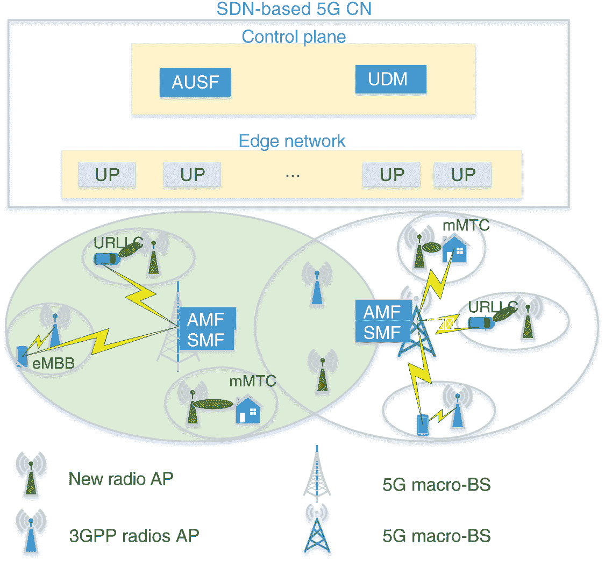

图 6.2 一个 5G HetNet 系统模型。

在分析 LTE CN 和 5G CN 后，发现移动管理涉及多个实体，包括 `UE`、`AP`、`BS/AMF/SMF`、`AUSF` 和 `UDM`。图 6.3 所示，在此背景下，`BS`、`AMF` 和 `SMF` 被视为单一实体。`UE` 的长期密钥和真实身份仅由 `UE` 和 `UDM` 知晓。`UE` 与 `BS/AMF/SMF`、`BS/AMF/SMF` 与 `AP` 以及 `UE` 与 `AP` 之间的通信链路是不安全的，如图 6.3 中的虚线所示。`BS/AMF/SMF` 与 `AUSF` 以及 `AUSF` 与 `UDM` 之间的通信链路是安全的，如图 6.3 中的实线所示。`BS/AMF/SMF`、`AP` 和 `AUSF` 是半信任的。

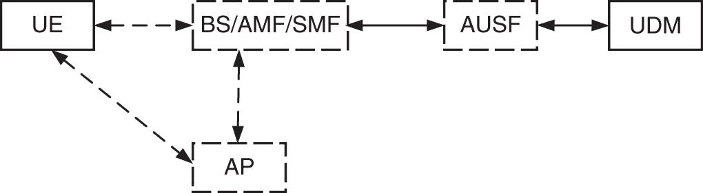

图 6.3 所研究系统模型中的信任模型。

所研究的系统模型考虑了以下攻击模型：

*   **窃听 (Eavesdropping)**：由于 `UE` 身份是以明文传输的，窃听攻击可以泄露其真实身份，这些身份用于网络注册，从而使攻击者冒充 `UE`。通过利用 LTE 中的 `AKA` 协议，攻击者可以通过将身份转发给 `MME` 来获取位置甚至对话信息。此外，攻击者可能发起中间人攻击 (`MITM`) 和 `DoS` 攻击。

*   **中间人攻击 (MITM)**：如果攻击者获取了 `UE` 的真实身份，他们还可以从 `MME` 获取随机挑战 (`RAND`) 和认证令牌 (`AUTN`)。通过将这些值转发给 `UE`，攻击者可以获得相应的响应 (`RES`)。这将允许攻击者向 `UE` 冒充 `BS`，或向真实的 `BS` 冒充 `UE`。

*   **DoS (DoS)**：攻击者可能向 `MME` 重复发送虚假或不同的 `UE` 身份，这可能会在为 `UE` 生成认证向量时耗尽 `HSS` 的计算资源。此外，`MME` 可能在等待攻击者的响应时被强制保留内存。

*   **重放攻击 (Replay attacks)**：通过截获 `UE` 与 `BS` 之间的通信，攻击者可以反复向 `BS` 发送消息，发起重放攻击。

## 6.3 5G 切换场景与流程

考虑到 5G 网络中小小区的高密度及其特定的业务需求，频率之间的切换是不可避免的。因此，确保安全高效的移动管理对于满足 5G 服务需求至关重要。小小区部署的灵活性对于有效处理不同场景是必要的。在公共安全等场景下，可以使用额外的小区来确保高网络吞吐量。因此，提出的模型包含了小区 `APs` 与 5G 宏基站之间的切换机制。为了提高切换性能，`AMF` 和 `SMF` 部署在 `BS` 附近，如图 6.2 所示。本节检查了系统模型中的各种切换场景并给出相应的切换流程。

### 6.3.1 切换场景

根据图 6.2 所示的 5G HetNet 系统模型，每个用户可以与宏小区 `BS` 和小小区 `AP` 建立双连接，其中 `BS` 连接提供通信可靠性，`AP` 连接确保高数据率。在每个小区中，`UE` 可以保留带有 `CP` 和 `UP` 的 `BS` 连接。小小区 `AP` 切换可能由于信号质量或高数据率需求而触发。当 `UE` 靠近宏小区 `BS` 时，由于信号质量需求，`UE` 可能需要将 `UP` 从小小区 `AP` 切换到宏小区 `BS`。当 `UE` 离开宏小区 `BS` 时，`UE` 可能需要将 `UP` 从宏小区 `BS` 切换到小小区 `AP`。当 `UE` 从一个 `AP` 移动到另一个 `AP` 时，会触发这两个 `APs` 之间的 `UP` 切换。当 `UE` 移动到宏小区 `BS` 边界时，需要进行切换。

因此，可能的切换场景有：

*   从宏小区 `BS` 切换到小小区 `AP`；
*   同一宏小区 `BS` 下的两个小区 `APs` 之间；
*   两个 5G 宏基站 `BSs` 之间。

### 6.3.2 切换流程

三种切换场景的对应流程如下所示。

*   **从宏小区基站到小小区 AP 的切换**：当用户设备（UE）移出宏小区基站范围并从小小区 AP 获取更强信号，或者业务需要更高数据速率时，就会发生从宏小区基站到小小区 AP 的切换。即使 UE 在宏小区基站的覆盖范围内，它也会保持与宏小区基站的连接，并将控制面（CP）和用户面（UP）均作为备份。因此，从宏小区基站切换到小小区 AP 时仅需要 UP 切换，如图 6.4 所示。

    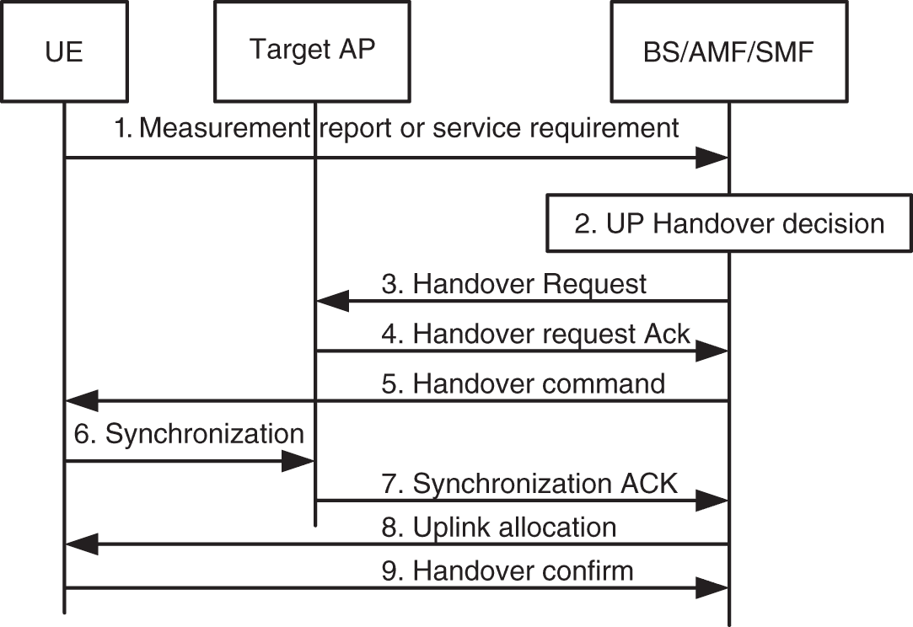

    UE 先向基站发送测量报告和服务需求。根据测量报告和服务需求，基站可以做出 UP 切换决策。随后，基站向目标 AP 发送切换请求。一旦基站收到切换请求确认，就会切换命令发送给 UE。UP 切换流程在无线接入网（RAN）内部管理，不需要核心网（CN）参与。在 UP 切换期间，UE 与基站之间的 CP 连接没有变化，这可以确保移动性管理的可靠性。由于基站到目标 AP 的 UP 切换完全在 RAN 内部管理，与涉及核心网的 LTE 切换相比，它的信令开销更低，传输路径更短。

*   **两个小小区 AP 之间的切换**：图 6.5 所示，同一宏小区基站覆盖下运行的两个小小区 AP 之间的切换，由于使用了超过 10 GHz 的高频无线频谱，可能会被频繁发起。针对这种场景下缓解频繁切换的努力已得到广泛研究。然而，LTE 的切换机制无法满足 5G 服务的低延迟需求。小小区 AP 之间基于 LTE 的切换需要 CP 和 UP 的参与，由于小小区 AP 与核心网之间的 CP 信令，会导致更高的延迟。此外，如果小小区 AP 之间使用了不同的无线接入技术（RAT），则需要额外的信令。

    所提出的异构网络系统模型适应了小小区 AP 之间不同 RAT 的。为了支持小区的灵活部署同时降低 AP 成本，AP 之间只需要 UP 切换。宏小区基站控制这些 AP 之间的切换，每个宏小区基站都配备了独立于 RAT 的的 AMF。因此，5G 中小小区 AP 之间的切换是不依赖 RAT 的。由于切换由宏小区基站处理，该过程类似于从宏小区基站到小小区 AP 的切换，如图 6.5 所示。

    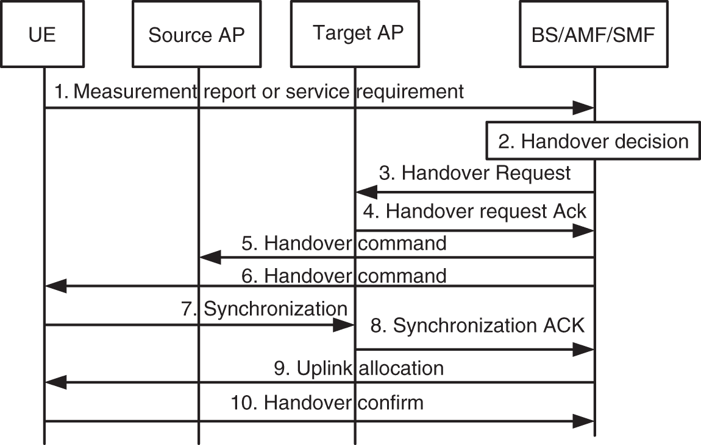

    UE 先向基站发送测量报告和服务需求。根据测量报告和服务需求，基站可以做出 UP 切换决策。随后，基站向目标 AP 发送切换请求。一旦基站收到切换请求确认，就会切换命令发送给 UE。UP 切换流程在无线接入网（RAN）内部管理，不需要核心网（CN）参与。在 UP 切换期间，UE 与基站之间的 CP 连接没有变化，这可以确保移动性管理的可靠性。由于基站到目标 AP 的 UP 切换完全在 RAN 内部管理，与涉及核心网的 LTE 切换相比，它的信令开销更低，传输路径更短。

为了确保蜂窝网络中的安全移动管理，通常使用 AKA 协议。LTE AKA 协议实现了用户设备（UE）与核心网（CN）之间的双方认证及密钥协商 Ouaissa 等，[2018]。然而，随着 5G 网络中引入下一代核心网，AKA 协议也需要更新。此外，LTE AKA 未解决 UE 身份隐私保护问题，这在 5G 无线网络的许多用场景中是一个备关注的问题。LTE AKA 存在 MITM（中间人攻击）和 DoS（拒绝服务攻击）等漏洞，这些问题预计将在 5G AKA 中得到解决 Abdrabou 等，[2015]。5G RAN 和 5G CN 的新功能需要不同的信任模型，因此对认证协议需要新的视角。尽管 5GAKA 草案已于 2018 年 1 月作为 3GPP TS 33.501 draft v0.7.0 发布，除涉及的实体外，其与 LTE AKA 相比变化不大，但 5G 切换的认证需要比 LTE AKA 更高效，以满足 5G 服务的高级需求。为了满足 5G 的服务需求，除了全认证协议外，快速认证协议也是必要的。此外，为了增强针对 MITM 和 DoS 攻击的安全性，认证协议还应提供机密服务。本节介绍了用于预认证、全认证和快速认证的 5G AKA 协议，旨在为认证提供机密服务，并在不利用公钥基础设施的情况下，对 UE 和 BS 到 AUSF 进行预认证。

### 6.4.1 假设

与 LTE 不同，新的 5G 认证协议为每个 UE 使用双重身份。这些包括一个真实身份和一个伪身份。在接入网络的初始期间，UE 作为预认证过程的一部分，通过无线接口以非加密方式将其伪身份发送给 BS/AMF/SMF。随后，伪身份将通过加密传输以增强安全性。为了便于安全通信，UE 和 BS/AMF/SMF 使用标记为 `E` 的轻量级对称加密函数。该函数在 UE 和网络元素之间共享，使它们能够对通信过程中交换的消息进行加密和解密。每个 UE 与其主网（HN）AUSF 共享密钥 `K'`、UE `PID` 和哈希函数 `H0`。BS/AMF/SMF 与 AUSF 共享密钥 `K'` 和哈希函数 `H1`。UE 与其 UDM 共享 UE PID、真实 ID、长期密钥 `K` 以及两个加密算法 `H2` 和 `F`，其中 `H2` 用于生成消息码，而 `F` 是密钥生成函数。对于每个接入点（AP），首次加入网络时需要向相应的 BS/AMF/SMF 进行注册。注册可以根据应用程序通过 `Xn` 接口完成。AP 注册应实现 AP 与 BS/AMF/SMF 之间的双方认证。注册成功后，AP 与 BS/AMF/SMF 之间将共享一个密钥。本研究未深入探讨 AP 注册的细节。在 AP 位于 BS 重叠区域的场景中，它们需要向相应的 BS 注册。在 BS 具有重叠区域的情况下，则使用共享密钥通过 `Xn` 接口确保它们之间的通信安全。

### 6.4.2 预认证

LTE AKA 协议在认证过程中不提供完全的机密保护，导致 UE 暴露在潜在的监听、身份隐私泄露、MITM 和 DoS 攻击风险中。因此，为首次接入网络的 UE 开发了预认证协议。图 6.8 展示了预认证方案，该方案包含步骤 0-1 到 0-5。图中的虚线表示非安全链路，而实线表示安全链路。

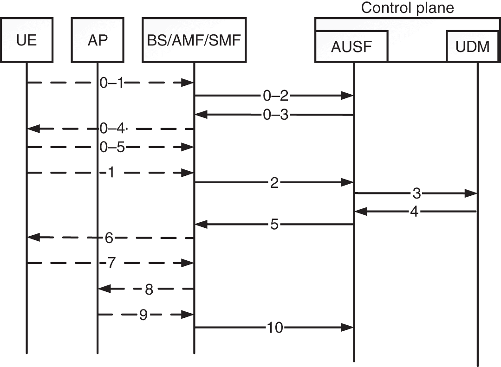

图 6.8 提出的全认证协议。

预认证协议旨在实现两个主要目标：首先向 AUSF 认证 UE 和 BS，其次在两者之间建立共享密钥，用于在整个认证过程中提供端到端的机密保护。通过满足这些需求，预认证协议实现了 UE 安全可靠地接入网络。以下是预认证过程涉及的步骤。

*   0-1：UE 将伪身份（PID）、时间戳（TS）和主网身份 `IDN` 发送给最近的 BS/AMF/SMF。
*   0-2：在验证 TS 后，BS/AMF/SMF 使用密钥 `K'` 生成消息认证码 `H1(K', (PID+IDN))`，并将 `PID` 和主网身份 `IDN` 一起发送给相应的网络实体进行进一步处理。

## 身份验证与生成流程


- **0-3**: `AUSF` 首先验证消息完整性算法。如果消息完整性通过，则 `AUSF` 检查其列表上的 `PID`。如果 `PID` 和 `ID_HN` 通过验证，则 `AUSF` 生成一个 `RAND_0` 并计算消息完整性算法 `H_0(K', RAND_0)` 和 `H_1(K'', (RAND_0 ⊕ H_0(K', RAND_0)))`。`AUSF` 将 `RAND_0`，`H_0(K', RAND_0)` 以及 `H_1(K'', (RAND_0 ⊕ H_0(K', RAND_0)))` 发送到 `BS/AMF/SMF`。

- **0-4**: `BS/AMF/SMF` 验证消息完整性算法 `H_1(K'', (RAND_0 ⊕ H_0(K', RAND_0)))`。如果消息完整性验证通过，则 `BS/AMF/SMF` 生成一个 `RAND_1` 并计算 `[H_0(K', RAND_0)]^{RAND_1}`。`BS/AMF/SMF` 将 (`RAND_0`, `H_0(K', RAND_0)`, `[H_0(K', RAND_0)]^{RAND_1}`) 发送到 UE。

- **0-5**: UE 验证 `H_0(K', RAND_0)` (images/c06-i0034.png)，生成 `RAND_2` (images/c06-i0035.png)，计算 `k_0=[H_0(K', RAND_0)]^{RAND_1 RAND_2}` (images/c06-i0036.png)。UE 将 `H_0(K', RAND_2)` (images/c06-i0037.png) 发送到 BS/AMF/SMF。随后，BS/AMF/SMF 验证哈希值并计算 `k'_0=[H_0(K', RAND_0)]^{RAND_1 RAND_2}` (images/c06-i0038.png)，其中 `k_0=k'_0` (images/c06-i0039.png)，这是 UE 与 BS 之间共享的密钥，用于为整个认证协议提供机密性服务。

### 6.4.3 全额认证

一旦预认证过程完成，每个首次接入网络的 UE 都必须经过全额认证程序，以建立与网络建立安全连接。这对于确保通信的机密性和完整性以及防止潜在的安全漏洞至关重要。新的全额认证协议支持多种安全功能，包括 UE 与 BS 之间、UE 与 UDM 之间以及 UE 与 AP 之间的相互认证。此外，它方便了用于加密和完整性保护的密钥生成与协商。这些措施对于在 UE 与网络之间建立安全可靠的连接至关重要。可以在 BS/AMF/SMF 中生成并存储批量认证向量，以加快基站之间的切换。

图 6.8 展示了全额认证，其包含步骤 1 到 10 步。这些步骤详细说明了通过相互认证、密钥生成和完整性保护在 UE 与网络之间建立安全连接的过程。通过利用预认证过程中共享的 `k_0=k'_0` (images/c06-i40)，全额认证可以为 UE 提供机密性保护。全额认证流程如下：

1. UE 生成时间戳 TS 并使用 `k'_0` (images/c06-i42) 加密 `ID` (images/c06-i041)，将 `E'_0(ID,T)` (images/c06-i043)、主网 `ID_H` (images/c06-i044) 和 `ID_A` (images/c06-i045) 发送到 BS/AMF/SMF。

2. BS/AMF/SMF 使用 `k_0` (images/c06-i046) 解密消息，验证 TS，生成消息认证码 `H1(K', ID_H+ID_A)` (images/c06-i047)，并将 `ID, ID_H, ID_A` (images/c06-i048) 连同消息认证码发送给 AUSF。

3. AUSF 验证消息认证码并将 `ID` (images/c06-i049) 发送到 UDM。


### 4: UDM 找到对应的真实 ID 和长期密钥 `K` 并生成一批 `m` 认证向量，每个向量包含一个随机数 `RAND`、一个认证令牌 `AUTH`，以及一个预期响应 `(RES)`。UDM 还生成一个密钥 `KAUSF`。UDM 将 `(PID, AV[1,...,m], KAUSF)` 发送到 BS/AMF/SMF。在每个认证向量中，`AUTN` 表示为消息认证码，标记为 `H2(K, RAND)`。该代码通过验证 UE 与网络之间交换消息的有效性，对确保认证过程的完整性和真实性起着至关重要的作用。

### 5: AUSF 从 `KAUSF` 派生密钥 `KAMF`，并将 `KAMF` 同 `(PID, AV[1,...,m])` 发送到 BS/AMF/SMF。

### 6: BS/AMF/SMF 基于密钥 `KAMF`，为 UE 与 BS/AMF/SMF 之间的链路机密性和完整性保护生成两个密钥 `Ke` 和 `Ki`，一个用于派生会话密钥 `KSMF` 的 `RAND'` 以及伪 ID。BS/AMF/SMF 选择一个认证向量 `AV` 并将加密的 `RAND`、`AUTH`、`RAND'` 和 `PID` 发送到 UE。

### 7: UE 验证 `AUTH`。如果 `AUTH` 验证通过，UE 根据 `RAND` 计算用于 UE 与 BS/AMF/SMF 链路机密性和完整性保护的 `RES`、`Ke` 和 `Ki`；以及根据 `RAND'` 计算用于 UE 与 AP 链路机密性和完整性保护的对 `Ke'` 和 `Ki'`。UE 将 `RES` 发送到 BS/AMF/SMF。

### 8: BS/AMF/SMF 验证从 UE 接收到的 `RES`。如果 `RES` 验证通过，BS/AMF/SMF 使用 AP 与 BS/AMF/SMF 之间的共享密钥发送加密的 `KSMF` 和 `PID`。

- 9: AP 解密消息并基于 `KSMSF` 生成用于 UE 与 AP 之间链路机密性和完整性保护的 `Ke'` 和 `Ki'` 密钥对，并将加密的 NPID 发送给 BS/AMF/SMF。

- 10: BS/AMF/SMF 验证加密的 `NPID` 并将包含 `NPID`、`PID` 和 `IDAP` 的认证确认发送给 AUSF。

### 6.4.4 快速认证

快速认证可以在两种场景下实现，即 AP 之间的切换和 BS 之间的切换。在两种场景下，首要目标都是尽快在 UE 与网络之间建立安全可靠的连接，以确保业务不间断并防止潜在的安全漏洞。

#### 6.4.4.1 AP 之间的切换

当小基站和 AP 加入网络时，它们会在 BS/AMF/SMF 处注册，后者在 AP 与 BS/AMF/SMF 之间建立共享密钥以确保通信安全。在快速认证场景下，BS/AMF/SMF 充当信任权威，在用户面切换期间为 UE 建立新会话。这种方法确保了 UE 在不同的接入点之间无缝转换，同时维持连接的安全性和完整性。

图 6.9 展示了新的快速认证协议，该协议不涉及核心网 (CN)。当 UE 与 BS/AMF/SMF 的连接时，它可以安全地向 BS/AMF/SMF 发送切换请求。快速认证协议由以下步骤组成，确保 UE 在不同接入点之间无缝切换的同时连接安全性。

- 1: UE 将加密的 PID、TS 以及目标 AP 标识 `IDTAP` 发送给连接的 BS/AMF/SMF 以进行用户面切换。

- 2: BS/AMF/SMF 验证 TS 并将切换请求发送到目标 AP。切换请求包含 NPID 和由 SMF 生成的会话密钥 `KSMSF`。切换请求由 BS/AMF/SMF 与目标 AP 之间的共享密钥进行加密。

- 3: 目标 AP 验证请求，向 BS/AMF/SMF 确认，并基于 `KSMSF` 生成一对机密性和完整性密钥。

- 4: BS/AMF/SMF 将包含 NPID 和会话密钥 `KSMSF` 的确认信息发送给 UE。确认消息使用 UE 与 BS/AMF/SMF 之间的共享密钥加密。UE 基于 `KSMSF` 生成一对机密性和完整性密钥。

图 6.9 当 UE 与目标 AP 之间交换 NPID 以及机密性和完整性密钥时，它们就可以建立安全通道。BS/AMF 将向目标 AP 更新 NPID。

#### 6.4.4.2 BS 之间的切换

除了 AP 之间的切换，本研究还考虑了 BS 之间的切换。为了实现这一点，使用了批量认证向量。在切换过程中，小 AP 维持用户面 (UP)。

图 10 展示了为 BS 设计的新型认证协议。

- 1: UE 将加密的 PID、目标 BS 标识 `IDBS` 和 TS 发送给源 BS/AMF/SMF。

- 2: 源 BS/AMF/SMF 验证 TS，生成会话密钥 `KS'`，并连同未使用的认证向量发送给目标 BS/AMF。

- 3: 目标 BS/AMF 验证请求并向源 BS/AMF/SMF 发送确认。

- 4: 源 BS/AMF/SMF 将加密的会话密钥 `KS'` 发送给 UE。

- 5: 目标 BS/AMF/SMF 基于 `AV` 中的 `RAND` 生成一对用于加密和完整性保护的密钥。目标 BS/AMF/SMF 将来自未使用认证向量的加密 `RAND` 和 `AUTH` 发送给 UE。

- 6: UE 验证消息认证码，计算 `RES` 以及一对基于 `RAND` 的用于加密和完整性保护的密钥，并将加密的 `RES` 发送给目标 BS/AMF/SMF。

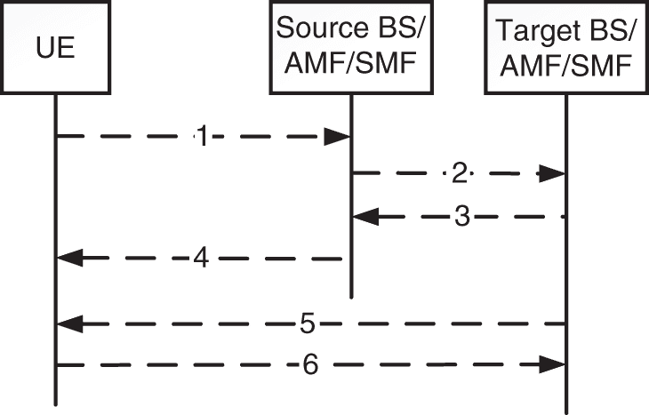

`图 6.10` 为基站（BSs）之间的切换设计的新型快速认证协议。

## 6.5 新 5G 认证协议的安全性分析

本节针对新认证协议在认证、机密性和隐私属性方面的安全性进行了分析。


- **身份验证**：为了防止在预认证期间出现伪造基站（BS）和中间人（MITM）攻击，必须使用共享密钥作为密钥以及消息认证函数，对 `BS/AMF/SMF` 到 `AUSF` 进行身份验证。`UE` 也需要根据共享哈希函数向 `AUSF` 进行自身的身份验证。一旦 `AUSF` 在预认证中验证了 `UE` 和 `BS/AMF/SMF`，它们就可以通过 Diffie–Hellman 密钥交换实现密钥共享。随后，利用 `UE` 与 `BS/AMF/SMF` 之间的共享密钥对两者进行身份验证，并为完整认证提供机密性服务。对于完整认证，`UE` 与 `UDM` 之间的双方认证是通过 `UE` 与 `UDM` 之间共享的长期密钥实现的。在 `UE` 与 `UDM` 完成双方认证后，在 `BS/AMF/SMF` 的帮助下实现 `UE` 与 `AP` 之间的双方认证。在 `UE` 与 `AP` 完成双方认证后，`UE` 与 `AP` 之间共享一对机密性和完整性密钥。为了在不在 `RAN` 和 `CN` 之间产生过多信令的情况下加速 `BS` 和 `AP` 的切换，创建了多个认证向量。AP 切换期间使用的快速认证过程（包括 `UE` 与目标 `AP` 之间的双方认证）与用于基站切换的涉及 `BS`、`AMF` 和 `SMF` 的完整认证过程相当。`UE` 与 `AP` 之间的会话密钥由 `BS/AMF/SMF` 生成。为了加速基站切换期间的认证过程，通过共享密钥实现基站之间的双方认证。此外，目标基站可以利用未使用的认证向量来建立新的会话密钥，而不是由源基站进行生成。总的来说，这里提出的新认证协议实现了 `UE` 与 `BS`、`UE` 与 `CN` 以及 `UE` 与 `AP` 之间的双方认证。

- **机密性**：预认证采用 Diffie–Hellman 密钥交换来促进 `UE` 与 `BS/AMF/SMF` 之间的密钥共享。该共享密钥用于在 `UE` 与 `BS/AMF/SMF` 之间的完整认证协议期间提供机密性，有效防止了窃听和中间人（MITM）攻击。在 `UE` 与 `UD` 完成双方认证后，`UE` 与 `BS/AMF/SMF` 之间的通信机密性由基于认证向量生成的机密密钥提供。`UE` 与 `AP` 之间的机密性通过在双方认证之前由 `BS/AMF/SMF` 创建的会话密钥生成机密密钥来建立。这种机密性服务通过确保认证参数不会被利用，有效缓解了中间人和攻击 DoS 攻击。

- **隐私性**：在预认证期间，`UE` 的 `PID` 以明文形式传输。但在预认证之后，`PID` 和 `NPID` 被加密，这有助于保护 `UE` 身份的隐私。`UE` 的真实身份只有 `UE` 和 `CN`Known。每当 `UE` 关联到 `AP` 时，都会为 `UE` 分配一个 `NPID`。由于所提出的机制，当前 `AP` 无法访问关于 `UE` 之前的或未来的 AP 关联相关信息。这确保了 `UE` 的位置隐私。

## 6.6 性能评估

本节展示了该协议在通信开销和计算开销方面的性能评估。

尽管在 5G 无线安全和隐私保护方面取得了进展，但仍有许多挑战和问题需要解决。本章旨在识别一些开放性问题，并概述潜在的研究方向，以增强 5G 无线网络的安全性和隐私性。

## 7.1 新型信任模型

随着 5G 无线网络提供的先进功能和服务，日益迫切需要将这些服务应用于各种垂直行业，例如智能电网、智能家居、车载网络和移动医疗（m-health）网络。与传统的蜂窝网络相比，5G 无线网络中的信任模型可能涉及额外的参与者，包括具有不同信任级别的新实体。因此，可能需要在具有多个信任级别的各种参与者之间实现认证机制 AB Ericsson, [2018, Wang et al., 2021a]。

针对各种用例的信任模型研究已经进行，如 Jellen et al. [\[2021\]](#b01.xhtml#bref-bib-0046) 所示。例如，在 Eiza et al. [\[2016\]](#b01.xhtml#bref-bib-0024) 中，作者提出了一种系统模型，以确保 5G 无线网络车载通信的安全数据传输。所提出的系统模型包括车辆管理局（DMV）、受信权威（TA）、执法机构（LEA）和车辆。5G 无线网络中的信任模型比传统蜂窝网络更复杂，特别是在涉及具有不同信任级别的多个参与者的场景中。考虑到 5G 网络中大量的设备，需要新的信任模型来改进物联网用例的安全服务（包括认证）。然而，尽管针对特定用例（如车载通信）的信任模型已有一些研究，但仍然缺乏一个整合所有相关参与者（包括设备和融合中心）的综合信任模型，如 Labib et al. [\[2015\]](#b01.xhtml#bref-bib-0049) 所观察到的。对于某些应用，网络可能连接了多种类型的设备，其中一些可能仅用于数据采集，而另一些可能访问互联网。因此，每个设备的信任需求可能不同，这需要相应的信任模型来满足其独特的安全需求。这些信任模型可能具有不同的安全需求，以满足额外的安全要求。例如，为了满足高安全级需求，可能需要如密码和生物识别认证等双重认证机制 Huawei, [2015]。在移动医疗网络的情况下，Zhang et al. [\[2017a\]](#b01.xhtml#bref-bib-0114) 提出了一种信任模型，该模型解决了隐私关注问题，并规定了客户端、网络管理和医生之间的关系。

总之，随着 5G 网络不断实现新的应用，需要新型信任模型来满足其安全需求和要求。

## 7.2 新型攻击模型

根据最近的研究活动，物理层安全（PLS）中最常用的攻击模型涉及配备单根天线的单个窃听者。然而，5G 无线网络中的窃听者数量可能很高，他们可能利用诸如大规模输入多输出（MIMO）等先进技术 \Chen et al., [2016a]。此外，实际场景可能涉及不同类型的攻击 \Li et al., [2020]，而仅考虑一种攻击类型忽略了干扰器或窃听者之间合作的可能性，使得物理层（PHY）安全更加复杂。虽然增加发送者的发射功率可以缓解干扰攻击，但也会增加受到窃听攻击的脆弱性。因此，有必要探索和开发更全面的攻击模型，以增强 5G 无线网络的 PLS 安全。

此外，在新服务交付模型中采用软件定义网络（SDN）和网络函数虚拟化（NFV）导致了更多暴露的脆弱点 \Dabbagh et al., [2015]。软件与硬件分离意味着软件的安全不再仅仅依赖于硬件平台的特定安全属性 AB Ericsson, [2018]。因此，对强虚拟化隔离的需求变得越来越关键。为了解决这个问题，NGMN 联盟在 \[\[2016\]](#b01.xhtml#bref-bib-0061) 中引入了网络切片以提供隔离的安全。此外，Luo et al. [\[2015a\]](#b01.xhtml#bref-bib-0056) 为基于 SDN 的移动网络提出了一种有效的漏洞评估机制，该机制使用了攻击图算法。他们还展示了 SDN 的综合安全攻击向量图。

在新兴技术和交付模型的推动下，5G 无线网络中的新型攻击模型与传统网络相比，对安全实现构成了巨大挑战 \Dai et al., [2020]。尽管如此，目前对这些攻击模型及其潜在解决方案的研究仍然有限。

## 7.3 隐私保护

新的 5G 应用中数据用量的增加，使得必须通过开放式网络平台传输大量敏感数据，从而引发了对潜在隐私泄露的担忧 Huawei, [2015, Huang et al., 2020]。因此，保护隐私对于实现各种应用至关重要。根据安全需求，不同用例的隐私保护可能会有所不同，涵盖位置隐私和身份隐私等问题 Fang, [2020]。由于开放式网络平台，5G 无线网络出现了各种隐私问题，这可能导致大量敏感数据的泄露。为了解决这些问题，需要根据具体的用例和安全需求采取不同的隐私保护措施。例如，在医疗应用中，隐私保护对于保护患者数据和身份至关重要。在这方面，Zhang et al., 2017a 提出了一种确保患者与医生之间安全数据访问和相互认证的协议。同样，对于车载通信，隐私保护涉及保护车辆身份和传输的内容。此外，为了避免异构网络（HetNets）中的位置泄露，Farhang et al., 2015 提出了一种差分隐私算法。然而，对用户提供的服务类型的感知可能正如 Eiza et al. \[2016] 和 Huawei \[2015] 中讨论的那样，对用户隐私构成威胁。因此，应该根据服务类型提供差异化的隐私保护质量，同时确保用户隐私。

由于传输了海量敏感数据以及开放的网络平台，5G 网络中的隐私保护面临着严峻挑战，这引发了人们对潜在隐私泄露的担忧。目前，主要使用加密机制来实现隐私保护，但加密解密过程可能会影响其他 5G 服务的需求，如延迟和效率。此外，机器学习等强大数据分析方法的使用增加了隐私保护的复杂性。然而，也可以智能地利用数据分析来降低加密成本，并在数据传输前保护敏感维度。对于身份隐私，应该考虑新的管理方法，而多种关联机制可以增强不同用场景下的位置隐私。所有这些因素共同构成了在 5G 无线网络中提供充分隐私保护的挑战。

## 7.4 统一安全管理

尽管访问认证和机密性保护等安全特性与传统蜂窝网络使用的功能相似，但由于使用了各种服务、接入技术和设备，5G 无线网络仍然需要一套标准且基础的安全特性 HUAWEI, [2016]。5G 无线网络中独特的安全视角，例如跨异构接入和针对大量设备的安全管理，需要一个新的安全框架。例如，第 5 章和 6 章中提出的安全架构引入了不同接入技术之间灵活的认证和切换，这需要定义针对异构接入的安全管理，以确保所有接入技术的灵活性。此外，还需要研究许多设备（如物联网 应用）突发接入行为的安全管理，以支持高效的访问认证。

# 参考文献

1. AB Ericsson. 5G security‐enabling a trustworthy 5G system. *Ericsson white paper, Ericsson AB, Torshamnsgatan*, 21, 2018.

2. Dariush Abbasi‐Moghadam, Vahid TabaTaba Vakili, and A. Falahati. Combination of turbo coding and cryptography in nongeo satellite communication systems. In *2008 International Symposium on Telecommunications*, pages 666–670. IEEE, 2008.

3. Emad Abd‐Elrahman, Hatem Ibn‐Khedher, and Hossam Afifi. D2D group communications security. In *2015 International Conference on Protocol Engineering (ICPE) and International Conference on New Technologies of Distributed Systems (NTDS)*, pages 1–6. IEEE, 2015.

4. M. A. Abdrabou, A. D. E. Elbayoumy, and E. A. El‐Wanis. LTE authentication protocol (EPS‐AKA) weaknesses solution. In *2015 IEEE Seventh International Conference on Intelligent Computing and Information Systems (ICICIS)*, pages 434–441, Dec 2015. doi: 10.1109/IntelCIS.2015.7397256.

5. Ibrahim Abualhaol and Steven Muegge. Securing D2D wireless links by continuous authenticity with legitimacy patterns. In *2016 49th Hawaii International Conference on System Sciences (HICSS)*, pages 5763–5771. IEEE, 2016.

6. Nadia Adem, Bechir Hamdaoui, and Attila Yavuz. Pseudorandom time‐hopping anti‐jamming technique for mobile cognitive users. In *2015 IEEE Globecom Workshops (GC Wkshps)*, pages 1–6. IEEE, 2015.

7. Mamta Agiwal, Abhishek Roy, and Navrati Saxena. Next generation 5G wireless networks: A comprehensive survey. *IEEE Communications Surveys & Tutorials*, 18(3):1617–1655, 2016.

8. Muhammad Naveed Aman, Kee Chaing Chua, and Biplab Sikdar. Mutual authentication in IoT systems using physical unclonable functions. *IEEE Internet of Things Journal*, 4(5):1327–1340, Oct 2017.

9. Jeffrey G. Andrews, Stefano Buzzi, Wan Choi, Stephen V. Hanly, Angel Lozano, Anthony C. K. Soong, and Jianzhong Charlie Zhang. What will 5G be? *IEEE Journal on Selected Areas in Communications*, 32(6):1065–1082, 2014.

10. Diego F. Aranha, Ricardo Dahab, Julio López, and Leonardo B. Oliveira. Efficient implementation of elliptic curve cryptography in wireless sensors. *Advances in Mathematics of Communications*, 4(2):169–187, May 2010.

11. Wade Baker, Mark Goudie, Alexander Hutton, C. David Hylender, Jelle Niemantsverdriet, Christopher Novak, David Ostertag, Christopher Porter, Mike Rosen, Bryan Sartin, et al. 2011 data breach investigations report. *Verizon RISK Team,* Available: [www.verizonbusiness.com/resources/reports/rp_databreach-investigationsreport-2011_en_xg.pdf](http://www.verizonbusiness.com/resources/reports/rp_databreach-investigationsreport-2011_en_xg.pdf), pages 1–72, 2011.

12. Neil Irwin Bernardo and Franz De Leon. On the trade‐off between physical layer security and energy efficiency of massive MIMO with small cells. In *2016 International Conference on Advanced Technologies for Communications (ATC)*.


## 参考文献

13. Y. Cao, Xianbin Wang, J. Chen, M. Jin, and L. Leung. Secure transmission for massive MIMO. *IEEE Journal on Selected Areas in Communications*.

14. Y. Cao, Xianbin Wang, J. Chen, M. Jin, and L. Leung. Software-defined mobile networks. *IEEE Transactions on Circuits and Systems*.

15. Y. Cao, Xianbin Wang, J. Chen, M. Jin, and L. Leung. Software-defined security. *IEEE Access*.

16. B. Chen, T. Hsu, W. Tang, and X. Yang. Improving handover in 5G HetNet. *2017 IEEE GLOBECOM*.

17. M. Conti, N. Dragoni, and V. Lesyk. A survey of man in the middle attacks. *IEEE Communications Surveys & Tutorials*.

18. M. Dabbagh, B. Hamdaoui, M. Guizani, and A. Rayes. Software-defined networking: pros and cons. *IEEE Communications Magazine*.

19. H. Eiza, Q. Ni, and Shi. Secure and privacy-aware cloud-assisted video service in 5G-enabled vehicular networks. *IEEE Transactions on Vehicular Technology*.

20. M. Dai, Z. Su, R. Li, Y. Wang, J. Ni, and D. Fang. An edge-driven security framework for intelligent Internet of Things. *IEEE Network*.

21. Y. Deng, L. Wang, K. Wong, A. Nallanathan, M. Elkashlan, and S. Laran. Safeguarding massive MIMO aided HetNets using physical layer security. *2015 International Conference on Wireless Communications & Signal Processing (WCSP)*.

22. X. Duan and X. Wang. Fast authentication in 5G HetNet through SDN enabled secure-context-information. *2016 IEEE International Conference on Communications (ICC)*.

23. E. Dubrova, M. Näslund, and G. Selander. CRC-based message authentication for 5G mobile technology. *2015 IEEE Trustcom/BigDataSE/ISPA*.

24. M. H. Eiza, Q. Ni, and Shi (重复).

25. ERICSSON. 5G security. *ERICSSON White Paper*.

26. K. Fan, Y. Gong, Z. Du, H. Li, and Y. Yang. RFID secure application revocation for IoT in 5G. *2015 IEEE Trustcom/BigDataSE/ISPA*.

27. D. Fang and Y. Qian. 5G wireless security and privacy: Architecture and flexible mechanisms. *IEEE Vehicular Technology Magazine*.

28. 方东峰, 钱义, 胡青阳 Rose. 5G 移动无线网络安全。*IEEE Access*, 6:4850–4874, 2017a.

29. 方东峰, 钱义, 胡青阳 Rose. 异构网络中物理层安全性的干扰管理。在*2017 IEEE 15th International Conference on Dependable Autonomic and Secure Computing*，页码 133–138。IEEE, 2017b.

30. 方东峰, 钱义, 胡青阳 Rose. 4G 和 5G 无线系统的安全需求与标准。*GetMobile: Mobile Computing and Communications*, 21(1):15–20, 2018.

31. 方东峰, 钱义, 胡青阳 Rose. 异构网络干扰安全分析。*Ad Hoc Networks*, 84:1–8, 2019a.

32. 方东峰, 徐胜杰, Hamid Sharif. 无线列车控制系统的安全性分析。在*2019 IEEE Globecom Workshops (GC Wkshps)*，页码 1–6。IEEE, 2019b.

33. 方东峰, 钱义, 胡青阳 Rose. 一种适用于物联网应用的灵活高效认证与安全数据传输方案。*IEEE Internet of Things Journal*, 7(4):3474–3484, 2020.

34. Sadegh Farhang, Yezekael Hayel, 朱 anyan. 下一代无线网络中的物理层隐私保护接入点选择机制。在*2015 IEEE Conference on Communications and Network Security (CNS)*，页码 263–271。IEEE, 2015.

35. Y. Gao, H. Ma, D. Abbott, 和 S. F. Al‐Sarawi. PUF 传感器：利用 PUF 不可靠性实现安全无线感知。*IEEE Transactions on Circuits and Systems I: Regular Papers*, 64(9):2532–2543, 2017 年 9 月.

36. Samah A. M. Ghanem 和 Munnujahan Ara. 基于 D2D 协作的安全通信。在*2015 International Conference on Communications, Signal Processing, and their Applications (ICCSPA'15)*，页码 1–6。IEEE, 2015.

37. 全球移动供应商协会. 通往 5G 之路：驱动因素、应用、需求与技术发展。*爱立信、华为和高通 GSA 执行报告*，2015.

38. P. Gope, J. Lee, T. Q. S. Quek. 基于物理不可克隆函数的 RFID 系统轻量级实用的匿名认证协议。*IEEE Transactions on Information Forensics and Security*, 13(11):2831–2843, 2018 年 11 月.

39. D. Adionel Guimaraes, G. H. Faria Floriano, 和 L. Silvestre Chaves. 用于建模和求解凸优化问题的 CVX 系统教程。*IEEE Latin America Transactions*, 13(5):1228–1257, 2015 年 5 月. ISSN 1548‐0992. doi: 10.1109/TLA.2015.7111976.

40. A. D. Harper 和 X. Ma. 使用携带数据的人工噪声 MIMO 无线安全通信。*IEEE Transactions on Wireless Communications*, 15(12):8051–8062, 2016 年 12 月. ISSN 1536‐1276. doi: 10.1109/TWC.2016.2611581.

41. Debiao He, Sherali Zeadally, Neeraj Kumar, 和 Jong‐Hyouk Lee. 具有证明安全性的无线体域网匿名认证。*IEEE Systems Journal*, 11(4):2590–2601, 2017 年 12 月.

42. Charles Herder, 孟大日, Farinaz Koushanfar, 和 Srinivas Devadas. 物理不可克隆函数及其应用：教程。*Proceedings of the IEEE*, 102(8):1126–1141, 2014 年 8 月.

43. 黄嘉其, 方东峰, 钱义, 胡青阳 Rose. V2X 通信安全与隐私的最新进展与挑战。*IEEE Open Journal of Vehicular Technology*, 1:244–266, 2020.

44. 华为。5G 安全：前瞻性。2015.

45. 华为。5G 场景与安全设计，2016.

46. Isabel Jellen, Joseph Callenes‐Sloan, 方东峰. 电子健康应用安全的异构系统模型。在*2021 IEEE International Conference on Communications Workshops (ICC Workshops)*，页码 1–6。IEEE, 2021.

47. 巨颖, 王辉明, 郑通星, 尹勤. 毫米波系统中基于人工噪声的安全传输。在*2016 IEEE Wireless Communications and Networking Conference*，页码 1–6。IEEE, 2016.

48. Pardeep Kumar, An Braeken, Andrei Gurtov, Jari Iinatti, 和 Phuong Hoai Ha. 联网智能家居中的匿名安全框架。*IEEE Transactions on Information Forensics and Security*, 12(4):968–979, 2017 年 4 月.

49. Mina Labib, Sean Ha, Walid Saad, 和 Jeffrey H. Reed. 物联网抗干扰的 blotto 博弈策略。在*2015 IEEE Global Communications Conference (GLOBECOM)*，页码 1–6。IEEE, 2015.

50. Mads Lauridsen, Lucas Chavarria Gimenez, Ignacio Rodriguez, Troels B. Sorensen, Preben Mogensen. 从 LTE 到 5G 的连接移动性。*IEEE Communications Magazine*, 55(3):156–162.

51. 李晓华和 E. Paul Ratazzi. 无线网络中用于密钥密钥协议的信息论保密 MIMO 传输。在*2005‐2005 IEEE Military Conference*。

52. 李姚, Bipjeet Kaur, 和 Birger Andersen. 5G 拒绝服务防护。*Wireless Personal Communications*, 57(3):365–376.

53. 李伟, 周峰, 张娟, Abderrahim Benslimane, 方东峰. 增强物理不可克隆函数的响应集。*IEEE Transactions on Science and Engineering*, 7(4):2642–2655, 2020.

54. 刘建, 张强, 陈晓. 软件定义移动网络的脆弱性评估。*IEEE Transactions on Parallel and Distributed Systems*, 25(2):332–342, 2014.

55. NGMN 协会. 5G 安全建议包：网络切片。*IEEE Security & Privacy*, 14(4):34–44, 2016.

56. 罗世波, 武军, 杨洋, 李峰. 干扰下 D2D 接入功率控制。在*2015 International Conference on Smart City/SocialCom*，页码 72–76。IEEE, 2015.

57. 方东峰. 5G 安全. 针对干扰信道的鲁棒型物理不可克隆函数。*IEEE Transactions on Information Forensics and Security*, 7(1):333–345, 2012 年 2 月.

58. Akshatha M. Nayak, Pranav Jha, 和 Abhay Karandikar. 5G 窝网中心化 SDN 架构。*arXiv preprint arXiv:1801.03824*,2018.

59. NGMN 协会. 5G 白皮书。*Next generation mobile networks, white paper*, 页码 1–125, 2015.

60. NGMN 协会。 5G 安全建议包 2：网络切片，2016.

61. 吴 Nam-Phong, 杜中强, 郭国, Zoran Hadzi-Velkov, 和 舒磊. 5G 安全无线通信：联合中继选择与无线功率传输。*IEEE Access*, 4:3349–3359, 2016.

62. 诺基亚。5G 移动网络挑战与机遇，2017.

63. Frédérique Oggier 和 Babak Hassibi. MIMO 窃听信道的秘密容量。*IEEE Transactions on Information Theory*, 57(8):4961–4972, 2011.

64. Leonardo B. Oliveira, Diego F. Aranha, Conrado P. L. Gouvêa, Michael Scott, Danilo F. Câmara, Julio López, 和 Ricardo Dahab. TinyPBC：用于传感器网络认证身份基的非交互密钥分发。*Computer Communications*, 34(3):485–493, 2011 年 3 月.

65. Mariya Ouaissa, A. Rhattoy, 和 M. Lahmer. 长期演进 (LTE) 接入网络认证与密钥协议 (AKA) 分析。在*Advances in Electronics, Communication and Computing*, 2018.

68. Nisha Panwar, Shantanu Sharma, and Awadhesh Kumar Singh. 5G 综述：下一代移动通信。*Physical Communication*, 18:64–84, 2016.

69. J. Prados ‘‘Garzon, O. Adamuz ‘‘Hinojosa, P. Ameigeiras, J. J. Ramos ‘‘Munoz, P. Andres ‘‘Maldonado, and J. M. Lopez ‘‘Soler. 基于 5G SDN 的移动网络架构中的切换实现。见于*2016 IEEE 27th Annual International Symposium on Personal, Indoor, and Mobile Radio Communications (PIMRC)*，第 1–6 页，2016 年 9 月。doi: 10.1109/PIMRC.2016.7794936.

70. Yi Qian, Feng Ye, and Hsiao ‘‘Hwa Chen. 无线通信网络中的安全。John Wiley & Sons, 2021.

71. Jian Qiao, Xuemin Sherman Shen, Jon W. Mark, Qinghua Shen, Yejun He, and Lei Lei. 毫米波 5G 蜂窝网络中的设备到设备通信。*IEEE Communications Magazine*, 53(1):209–215, 2015.

72. Zhijin Qin, Yuanwei Liu, Zhiguo Ding, Yue Gao, and Maged Elkashlan. 大规模网络中 5G 非正交多接入的物理层安全。见于*2016 IEEE International Conference on Communications (ICC)*，第 1–6 页。IEEE, 2016.

73. Qualcomm. 领领领先 5G，2016.

74. M. E. S. Saeed, Q. Liu, G. Tian, B. Gao, and F. Li. 基于物联网的无线体域网远程认证方案。*IEEE Internet of Things Journal*, 5(6):4926–4944,2018 年 12 月.

75. Neetesh Saxena, Santiago Grijalva, and Narendra S. Chaudhari. 支持 IoT 的 LTE 网络认证协议。*ACM Transactions on Internet Technology (TOIT)*, 16(4):1–20, 2016.

76. Peter Schneider and Günther Horn. 迈向 5G 安全。见于*2015 IEEE Trustcom/BigDataSE/ISPA*，第 1 卷，第 1165–1170 页。IEEE, 2015.

77. Ravindranath Sedidi and Abhinav Kumar. 5G 安全设备到设备（D2D）通信的密钥交换协议。见于*2016 Wireless Days (WD)*，第 1–6 页。IEEE, 2016.


# 参考文献

78. O. Semiari, W. Saad, M. Bennis, and B. Maham. 异构网络的移动性管理：利用毫米波实现无缝切换。见于 *GLOBECOM 2017 ‐ 2017 IEEE Global Communications Conference*，第 1–6 页，2017 年 12 月。doi: 10.1109/GLOCOM.2017.8254681.

79. A. Sheikholeslami, D. Goeckel, H. Pishro-Nik, and D. Towsley. 大型无线网络中跨会话干扰的物理层安全。见于 *2012 Proceedings IEEE INFOCOM*，第 1179–1187 页，2012 年 3 月。doi: 10.1109/INFCOM.2012.6195477.

80. C. Shen and M. van der Schaar. 3GPP 移动性协议中频繁切换缓解的学习方法。见于 *2017 IEEE Wireless Communications and Networking Conference (WCNC)*，第 1–6 页，2017 年 3 月。doi: 10.1109/WCNC.2017.7925950.

81. Yi-Sheng Shiu, Shih Yu Chang, Hsiao-Chun Wu, Scott C.-H. Huang, and Hsiao-Hwa Chen. 无线网络中的物理层安全：教程。*IEEE Wireless Communications*, 18(2):66–74, 2011.

82. L. Sibomana, Hung Tran, and H. J. Zepernick. 具有主用户干扰的认知无线网络物理层安全。见于 *MILCOM 2015 ‐ 2015 IEEE Military Communications Conference*，第 281–286 页，2015 年 10 月。doi: 10.1109/MILCOM.2015.7357456.

83. SIMalliance. 5G 市场安全需求分析，2016.

84. Tianyi Song, Ruinian Li, Bo Mei, Jiguo Yu, Xiaoshuang Xing, and Xiuzhen Cheng. 智能家居 IoT 应用的隐私保护通信协议。*IEEE Internet of Things Journal*, 4(6):1844–1852, 2017 年 12 月.

85. Chris Sperandio and Paul G. Flikkema. 通过色散信道上的发射预编码实现无线物理层安全：最优窃听攻击。见于 *MILCOM 2002. Proceedings*，第 2 卷，第 1113–1117 页。IEEE, 2002.

86. William Stallings. 密码学与网络安全：原理与实践。Pearson, Upper Saddle River, NJ, 2017.

87. William Stallings, Lawrie Brown, Michael D. Bauer. 计算机安全：原理与实践。Pearson, Upper Saddle River, NJ, 2012.

88. Yipin Sun, Rongxing Lu, Xiaodong Lin, Xuemin Shen, and Jinshu Su. 车用通信强隐私高效伪匿名认证。*IEEE Transactions on Vehicular Technology*, 59(7):3589–3603, 2010.

89. S. Tang, L. Ma, and Y. Xu. 用于垂直切换的基于 `GHMM` 的新型参数估计。见于 *2016 IEEE Global Communications Conference (GLOBECOM)*，第 1–6 页，2016 年 12 月。doi: 10.1109/GLOCOM.2016.784128.

90. Fengyu Tian, Peng Zhang, and Zheng Yan. C 网络综述。*IEEE Access*, 5:1372, 2017.

91. Zhijin Qin, Yuanwei Liu, Zhiguo Ding, Yue Gao, and Maged Elkashlan. 大规模网络中 5G 非正交多接入的物理层安全。见于 *2016 IEEE International Conference on Communications (ICC)*，第 1–6 页。IEEE, 2016.

92. Jian Qiao, Xuemin Sherman Shen, Jon W. Mark, Qinghua Shen, Yejun He, and Lei Lei. 毫米波 5G 蜂窝网络中的设备到设备通信。*IEEE Communications Magazine*, 53(1):209–215, 2015.

93. Tianyi Song, Ruinian Li, Bo Mei, Jiguo Yu, Xiaoshuang Xing, and Xiuzhen Cheng. 智能家居 IoT 应用的隐私保护通信协议。*IEEE Internet of Things Journal*, 4(6):1844–1852, 2017 年 12 月.

94. M. E. S. Saeed, Q. Liu, G. Tian, B. Gao, and F. Li. 基于物联网的无线体域网远程认证方案。*IEEE Internet of Things Journal*, 5(6):4926–4944, 2018 年 12 月.

95. Neetesh Saxena, Santiago Grijalva, and Narendra S. Chaudhari. 支持 IoT 的 LTE 网络认证协议。*ACM Transactions on Internet Technology (TOIT)*, 16(4):1–20, 2016.

96. Peter Schneider and Günther Horn. 迈向 5G 安全。见于 *2015 IEEE Trustcom/BigDataSE/ISPA*，第 1 卷，第 1165–1170 页。IEEE, 2015.

97. Ravindranath Sedidi and Abhinav Kumar. 5G 安全设备到设备（D2D）通信的密钥交换协议。见于 *2016 Wireless Days (WD)*，第 1–6 页。IEEE, 2016.

98. O. Semiari, W. Saad, M. Bennis, and B. Maham. 异构网络的移动性管理：利用毫米波实现无缝切换。见于 *GLOBECOM 2017 ‐ 2017 IEEE Global Communications Conference*，第 1–6 页，2017 年 12 月。doi: 10.1109/GLOCOM.2017.8254681.

99. A. Sheikholeslami, D. Goeckel, H. Pishro-Nik, and D. Towsley. 大型无线网络中跨会话干扰的物理层安全。见于 *2012 Proceedings IEEE INFOCOM*，第 1179–1187 页，2012 年 3 月。doi: 10.1109/INFCOM.2012.6195477.

100. C. Shen and M. van der Schaar. 3GPP 移动性协议中频繁切换缓解的学习方法。见于 *2017 IEEE Wireless Communications and Networking Conference (WCNC)*，第 1–6 页，2017 年 3 月。doi: 10.1109/WCNC.2017.7925950.

101. Yi-Sheng Shiu, Shih Yu Chang, Hsiao-Chun Wu, Scott C.-H. Huang, and Hsiao-Hwa Chen. 无线网络中的物理层安全：教程。*IEEE Wireless Communications*, 18(2):66–74, 2011.

102. L. Sibomana, Hung Tran, and H. J. Zepernick. 具有主用户干扰的认知无线网络物理层安全。见于 *MILCOM 2015 ‐ 2015 IEEE Military Communications Conference*，第 281–286 页，2015 年 10 月。doi: 10.1109/MILCOM.2015.7357456.

103. SIMalliance. 5G 市场安全需求分析，2016.

104. Chris Sperandio and Paul G. Flikkema. 通过色散信道上的发射预编码实现无线物理层安全：最优窃听攻击。见于 *MILCOM 2002. Proceedings*，第 2 卷，第 1113–1117 页。IEEE, 2002.

105. William Stallings. 密码学与网络安全：原理与实践。Pearson, Upper Saddle River, NJ, 2017.

106. William Stallings, Lawrie Brown, Michael D. Bauer. 计算机安全：原理与实践。Pearson, Upper Saddle River, NJ, 2012.

107. Yipin Sun, Rongxing Lu, Xiaodong Lin, Xuemin Shen, and Jinshu Su. 车用通信强隐私伪匿名认证。*IEEE Transactions on Vehicular Technology*, 59(7):3589–3603, 2010.

108. S. Tang, L. Ma, and Y. Xu. 用于垂直切换的基于 `GHMM` 的新型参数估计。见于 *2016 IEEE Global Communications Conference (GLOBECOM)*，第 1–6 页，2016 年 12 月。doi: 10.1109/GLOCOM.2016.784128.

109. Fengyu Tian, Peng Zhang, and Zheng Yan. C 网络综述。*IEEE Access*, 5:1372, 2017.

110. Zhijin Qin, Yuanwei Liu, Zhiguo Ding, Yue Gao, and Maged Elkashlan. 大规模网络中 5G 非正交多接入的物理层安全。见于 *2016 IEEE International Conference on Communications (ICC)*，第 1–6 页。IEEE, 2016.

108. L. Yan, X. Fang, and Y. Fang. A novel network architecture for C/U‐plane staggered handover in 5G decoupled heterogeneous railway wireless systems. *IEEE Transactions on Intelligent Transportation Systems*, 18(12):3350–3362, Dec 2017a. ISSN 1524‐9050. doi: 10.1109/TITS.2017.2685426.

109. W. Yan, F. Tehranipoor, and J. A. Chandy. PUF‐based fuzzy authentication without error correcting codes. *IEEE Transactions on Computer‐Aided Design of Integrated Circuits and Systems*, 36(9):1445–1457, Sept 2017b.

110. J. Yue, C. Ma, H. Yu, and W. Zhou. Secrecy‐based access control for device‐to-device communication underlaying cellular networks. *IEEE Communications Letters*, 17(11):2068–2071, Nov 2013. ISSN 1089‐7798. doi: 10.1109/LCOMM.2013.092813.131367.

111. Alessio Zappone, Pin-Hsun Lin, and Eduard Jorswieck. Artificial‐noise‐assisted energy‐efficient secure transmission in 5G with imperfect CSIT and antenna correlation. In *2016 IEEE 17th International Workshop on Signal Processing Advances in Wireless Communications (SPAWC)*, pages 1–5. IEEE, 2016.

112. Jianmin Zhang, Weiliang Xie, and Fengyi Yang. An architecture for 5G mobile network based on SDN and NFV. In *6th International Conference on Wireless, Mobile and Multi‐Media (ICWMMN 2015)*, 2015.

113. H. Zhang, T. Wang, L. Song, and Z. Han. Interference improves PHY security for cognitive radio networks. *IEEE Transactions on Information Forensics and Security*, 11(3):609–620, Mar 2016. ISSN 1556‐6013. doi: 10.1109/TIFS.2015.2500184.

114. Aiqing Zhang, Lei Wang, Xinrong Ye, and Xiaodong Lin. Light‐weight and robust security‐aware D2D‐assist data transmission protocol for mobile‐health systems. *IEEE Transactions on Information Forensics and Security*, 12(3):662–675, Mar 2017a.

115. Chensi Zhang, Jianhua Ge, Jing Li, Fengkui Gong, and Haiyang Ding. Complexity‐aware relay selection for 5G large‐scale secure two‐way relay systems. *IEEE Transactions on Vehicular Technology*, 66(6):5461–5465, 2017b.

116. Zhenguo Zhao. An efficient anonymous authentication scheme for wireless body area networks using elliptic curve cryptosystem. *Journal of Medical Systems*, 38(2):13, Jan 2014.

117. N. Zhao, F. R. Yu, M. Li, Q. Yan, and V. C. M. Leung. Physical layer security issues in interference‐alignment‐based wireless networks. *IEEE Communications Magazine*, 54(8):162–168, Aug 2016. ISSN 0163‐6804. doi: 10.1109/MCOM.2016.7537191.

118. N. Zhao, Y. Cao, F. R. Yu, Y. Chen, M. Jin, and V. C. M. Leung. Artificial noise assisted secure interference networks with wireless power transfer. *IEEE Transactions on Vehicular Technology*, 67(2):1087–1098, Feb 2018. ISSN 0018‐9545. doi: 10.1109/TVT.2017.2700475.

# 索引

### a

* 接入与移动性功能 (AMF) 16–17, 53, 72–85
* 人造噪声 11, 22, 29, 32, 37–38
* 攻击 8–15, 20–22, 27–30, 51–52, 55, 75, 79, 84–85, 90
* 认证 3, 7–9, 11–12, 14–17, 19–27, 52, 54–68, 72–87
* 认证与密钥同意 (AKA) 8–9, 12, 73–87
* 认证服务器 (AUSF) 53–55, 72–74, 79–82, 84
* 可用性 1, 11–14, 19–20, 27

### b

* 带宽 1, 12, 22, 24, 28
* 基站 2, 8, 11, 22, 37–88, 86
* 波束形 39, 42, 46

### c

* 信道 21–22, 28, 30–34, 37–46
* 密码密钥 8–9, 22
* 编码 21–22
* 通信加密 7–8
* 通信开销 63–69, 78, 85–86
* LTE 与 5G 的比较 72
* 计算开销 63–66, 85–86
* 机密性 8–9, 12–13, 15, 17, 19–21, 29–34, 56, 62, 84–85
* 上下文隐私 35, 54, 56–57, 62–64


* 控制面 4, 9, 16–17, 53, 71–74, 79
* 覆盖范围 1, 32–33, 37, 39, 73, 76
* 密码学方法 19, 21
* 循环冗余校验 (CRC) 12, 24

### d

* 数据完整性 8–9, 14–15, 19–22, 54, 56, 62
* 数据速率 1, 12, 30, 73, 75–76
* 数据接收 59
* 数据传输 54–68
* D2D 1, 24–26, 30, 34, 38
* 拒绝服务 (DoS) 10–11, 27, 75, 79, 85
* 盗窃/受破坏设备的检测 7–8
* 差分隐私 35
* Diffie-Hellman (DH) 方案 34, 84–85
* 数字签名 21, 27, 35
* 双连接性 71–73, 75

### e

* 窃听 3, 9–13, 20–22, 29–30, 37–47, 52, 55, 74, 90
* 边缘云 4–5
* 高效安全 37–68
* 椭圆曲线密码 (ECC) 34–35, 57, 64, 66
* 端到端安全 55–57, 63–64, 68, 80
* 能量效率 1, 3, 27, 38, 72
* 增强移动宽带 (eMBB) 73–74
* 演进数据包核心 (EPC) 4–5, 9, 15–16
* f
* 快速认证 12, 22–23, 71, 79–80, 83–87
* 5G 安全架构 16–17
* 灵活高效的认证 57–67
* 灵活的安全机制 2–3, 51–63
* 前向安全 56–57, 62, 64, 68
* 4G 8–9, 15–16
* 跳频 13, 27
* 全认证 22–23, 71, 79, 81–82, 85, 87
* g
* 高斯噪声 41–42
* 5G 网络上的通用 IoT 系统模型 52–56
* 5G 无线系统的通用架构 5
* 全球移动通信系统 (GSM) 7
* h
* 切换 9, 23, 71–84
* 哈希函数 24, 62, 80, 84
* IoT 设备的异构性 51–52, 67
* 异构 IoT 设备 51–52
* 异构网络 37–87
* i
* 基于标识的密码学 34
* 完整性 8–9, 11–12, 14–15, 17, 19, 56, 62–63, 68, 81–83
* 完整性密钥 8–9, 14, 22, 83, 85
* 干扰 11, 13, 28, 30, 37–43, 46–47
* 国际移动用户识别码 (IMSI) 7
* 物联网 (IoT) 51–63
* 入侵防护 35
* j
* 干扰 8, 10–11, 13, 20–22, 27–28, 31, 90
* k
* 密钥中心 (KDC) 20
* 密钥恢复性 56–57, 63–64
* 密钥交换 21, 34, 52, 84–85
* 密钥管理 9, 12, 15, 19, 33
* l
* 轻量级安全 3
* 对数函数 43
* 低延迟 1, 3, 12, 22, 73, 77–78
* m
* 宏基站 (MBS) 38–43, 46
* 宏小区 73, 75–78
* 中间攻击 (MITM) 10–11, 34, 75, 79–80, 84–85
* 大规模机器通信 (mMTC) 73–74
* 移动医疗 25, 35, 89–90
* 毫米波 1, 32
* 移动性管理 53, 71–80, 82, 84–87
* 多输入多输出 (MIMO) 1, 3, 5, 17, 22, 31, 33, 37, 90
* n
* 网络功能虚拟化 (NFV) 1–5, 17, 90
* 网络切片 2
* 非合作博洛托博弈 28
* 非正交多接入 (NOMA) 33
* o
* 优化问题 30–32, 38, 42–45
* p
* 被动攻击 9
* 性能评估 63–65
* 物理层属性 23
* 物理层安全 19–21, 37–38, 40–48, 90
* 物理不可克隆函数 (PUFs) 51–52, 55
* 策略函数 (PCF) 16, 53, 72
* 功率限制 41
* 功率消耗 31, 38
* 功率控制 22, 29
* 隐私属性 84
* 隐私保护 2, 11, 13, 35, 90
* 协议 61
* 伪标识 35
* 公钥 19, 33
* r
* 射频 (RFID) 24
* 随机数 (RAND) 7, 24, 27, 32, 52, 57–60, 75, 81–82, 84–85, 86
* 中继 25, 29–31, 53, 57–62
* 资源分配 4, 13, 28, 32
* s
* 可扩展性 4, 72
* 基于 SDN 的认证 22–23
* 2G 7–8
* 信容量 21, 31, 38
* 安全中断概率 21, 31, 33
* 安全传输率 22, 30, 32, 37–43, 46–48
* 会话管理功能 (SMF) 16–17, 53–54, 72–85
* 信号加噪声比 (SINR) 28, 40–43, 46–48
* 信噪比 (SNR) 31
* 小基站 (SBS) 38–42, 46–48
* 小小区 13, 75, 77, 83
* 软件定义网络 (SDN) 1–2, 4–5, 22–23, 71–74, 78, 90
* 频谱分配 41, 43–44, 46
* 频谱复用 39, 41–43, 46–47
* 对称密钥加密 19–22, 33
* 系统初始化 57
* t
* 临时移动用户标识 (TMSI) 7–8
* 理论安全容量 21
* 3G 8–9, 14–15
* 威胁 34, 38, 52, 55, 91
* 阈值 23, 27, 32–33, 40, 46
* 时跳 27–28
* T1 物联网设备 52–55, 57–62
* T2 物联网设备 52–69
* 流量分析 9, 11
* 发射功率 28–30, 39, 42–43, 46–48
* 信任模型 3, 51–52, 54–55, 67, 79, 89, 90
* 双层异构网络系统模型 38–40
* u
* 超高性低时延通信 (URLLC) 73–74
* 统一数据管理 (UDM) 16, 53–54, 72–74, 79–82, 85
* 统一安全管理 91
* 通用移动通信系统 (UMTS) 8
* 用例 2–6, 11, 13–14, 17, 24, 27, 34, 54, 68, 73, 78–79, 89–91
* 用户匿名性 7
* 用户身份认证 3, 7, 15
* 用户设备 (UE) 5, 9, 23, 72
* 用户面 4–5, 9, 17, 71–73, 83
* v
* 车载网络 2, 13, 26, 89
* 虚拟演进包核心网 (VEPC) 4–5, 16
* w
* 加权安全上下文信息传输 22–23

# WILEY 用户许可许可协议

访问 [`www.wiley.com/go/eula`](http://www.wiley.com/go/eula) 以访问 Wiley 的电子书 EULA。
