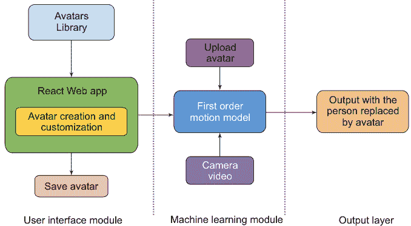
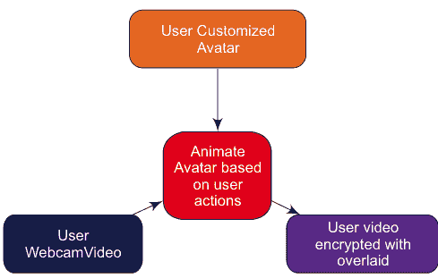
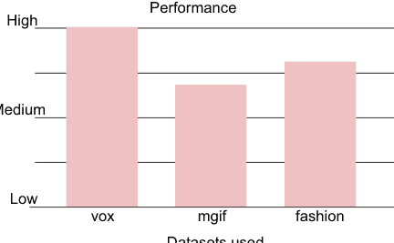
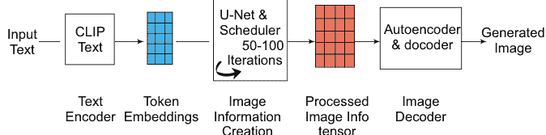
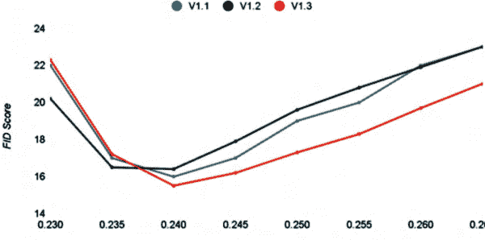
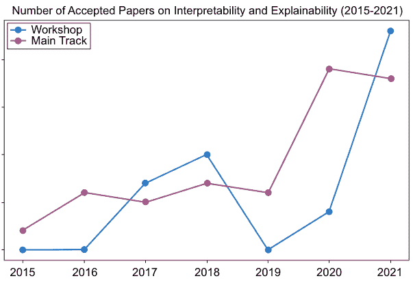
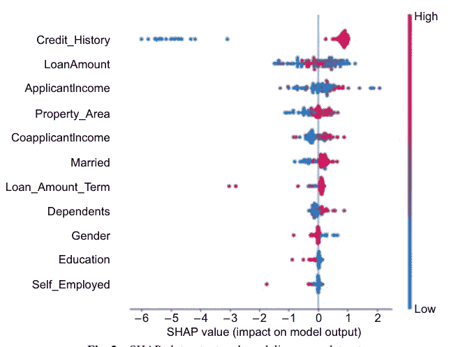
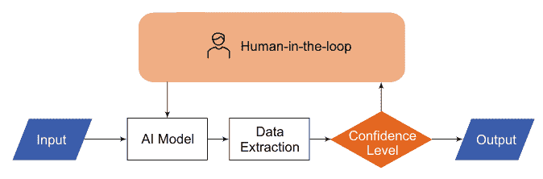

# 负责任的人工智能大全

**Deepak Kumar Jain**
副教授兼高级研究科学家
大连理工大学，大连，辽宁，中国

**Kirti Raj Bhatele**
助理教授，计算机科学与工程系，
马达夫理工与科学学院（被认可大学），古瓦里奥，
中央邦，印度

**Deepak Garg**
特聘教授，计算机科学与人工智能学院
SR大学，瓦朗加尔，特伦加纳邦，印度

**Gaurav Dhiman**
助理教授，科学与新兴技术学院
杰特古鲁纳纳克德旁遮普邦公开大学，帕蒂亚拉，印度

## 前言

人工智能的飞速发展使诚信的需求比以往任何时候都更加迫切。在一个AI系统日益融入日常生活、影响决策、塑造产业并改变社会规范的时代，此类技术的运作既带来了显著的机遇，也带来了重大的挑战。因此，确保这些技术的负责任开发和部署成为一项关键任务，需要一个结构化的框架。《以诚信为本的人工智能：负责任人工智能手册》旨在通过提供关于人工智能伦理、法律和实用解决方案的全面指南来弥补这一差距。

本书面向任何参与AI生态系统的人员，包括开发者、数据科学家、政策制定者、企业领导者和学者。本书深入探讨负责任的人工智能这一复杂且充满挑战的领域，为读者提供知识和实用工具，以确保AI系统透明、负责、公正并与价值观保持一致。本书采用多学科方法，融合计算机科学、伦理学、法律和公共政策等领域的见解，以提供对负责任人工智能实践的全面理解。本书的核心信念是：人工智能的创新技术有潜力通过积极创新推动市场发展，同时坚持公平、包容和人文关怀。事实上，所概述的伦理原则为实现这一愿景提供了框架，通过推动公正、透明和负责的人工智能系统。除了伦理考量之外，本书还作为风险缓解的实用工具，提供了关于人工智能法律框架和监管格局的见解。

本书收录了一些最佳的现实世界案例研究，突出了不足和成功之处。这些案例为未来提供了宝贵的教训。这些案例强调了需要在设计AI系统时将诚信置于核心，以防止对个人、社区和机构产生意外后果。《以诚信为本的人工智能》是对不断发展的人工智能伦理话语的及时贡献。这也是一本前瞻性的书籍，由致力于确保人工智能造福大众的人士撰写。随着人工智能革命的持续发展，本书照亮了关键辩论，有助于在人工智能的开发和应用中培养信任、公平和问责。我们希望本书不仅能激励读者，还能作为实用指南，帮助读者在遵循高标准伦理和法律规范的同时，探索负责任的AI技术创新与治理，以提升人类福祉。通过负责任地创建和治理AI技术的过程，我们推动一个未来，在该未来中，诚信是AI系统设计的基础。这确保了其负责任和公平的使用能够提升人们的生活质量。

泰勒与弗朗西斯

泰勒与弗朗西斯集团

http://taylorandfrancis.com

## 引言

人工智能（AI）的出现代表了我们时代最深刻的技术转型之一。正在重塑产业、加速科学发现，并影响我们日常生活的无数方面。随着其潜力的不断扩大，与其开发和部署相关的伦理、法律和社会挑战也随之增加。这些挑战不是遥远的理论问题，而是需要立即关注的紧迫问题，因为AI系统日益融入影响全球个人和社区的决策过程。

《以诚信为本的人工智能：负责任人工智能手册》是对这些挑战的关键且及时的回应。在一个AI创新经常超出我们理解其影响能力的时代，本书为驾驭负责任人工智能的复杂性提供了深思熟虑且全面的路线图。本书汇集了计算机科学、伦理学、法律和政策等多个学科的视角，为构建和治理坚持伦理原则并符合社会价值观的AI系统提供了实用的跨学科见解。使本书特别有价值的是其理论与实践的平衡。它超越了仅仅讨论人工智能的伦理基础，为开发者、数据科学家和决策者提供了可操作的策略。它为读者提供了减轻偏见、增强透明度并在AI系统中促进公平所需的工具。它强调，实际实施这些原则对于建立公众对人工智能技术的信任至关重要。

现实世界案例研究的加入为本书增添了引人注目且实用的维度。通过探讨负责任和不负责任地使用AI的案例，作者揭示了合乎道德或不道德的AI设计对个人和社会可能产生的具体影响。这些案例研究不仅具有指导意义，还强调了我们在AI设计、治理和部署方面所做的选择将产生持久影响。本书对跨学科思维的强调是另一项关键优势。人工智能不仅仅是一项技术工作——它与社会、法律和文化动态紧密交织。通过融合不同领域的视角，《以诚信为本的人工智能》对手头问题提供了全面的理解。这确保了不同背景的读者能够参与内容，并将其经验应用于各自的具体情境中。

在一个人工智能将塑造从医疗保健和金融到教育和治理等多个领域未来的世界里，负责任的人工智能的重要性不可估量。本书既是行动号召，也是实用指南，强调在人工智能的开发和使用中，伦理诚信和对共同利益的承诺至关重要。作者们值得称赞的是

他们对本领域及时且富有洞察力的贡献。面对前所未有的技术进步，“以诚信为本的 AI”提供了确保 AI 系统不仅展现人类智慧，更维护公平、问责以及尊重人类尊严等共同价值所需的清晰度、智慧与方向。这本书是任何旨在理解 AI 伦理、法律及社会维度的人必读之作。它旨在激励新一代创新者、政策制定者和学者开创负责任的 AI 发展。

**Abhishek Sharma**
学者，鲁斯塔姆吉技术学院，BSF 学院，泰坎普尔，印度。

**Ajay Singh**
鲁斯塔姆吉技术学院，边境安全部学院泰坎普尔，瓜廖尔，印度。

**Anand Jha**
助理教授，信息技术系，RJIT BSF 学院泰坎普尔，瓜廖尔，印度。

**Ankita Soni**
鲁斯塔姆吉技术学院，边境安全部学院泰坎普尔，瓜廖尔。

**Arpit Bhardwaj**
USICT，古塔姆·佛陀大学，大诺伊达，印度。

**Atulya K Nagar**
利物浦希望大学，英国。

**Ayush Katiyar**
教学助理，计算机科学与工程系，RJIT BSF 学院泰坎普尔，瓜廖尔，印度。

**Ayush Singh Bhadoriya**
学者，鲁斯塔姆吉技术学院，边境安全部学院，泰坎普尔，印度。

**Bagesh Kumar**
信息技术系，曼尼帕尔大学，斋普尔。

**Chiranjeevi M.**
本科生学者，SRM 瓦利亚麦工程学院，印度。

**Deepak Kumar Jain**
副教授兼高级研究科学家，达连理工大学人工智能学院，中国。

**Devanshu Tiwari**
MITS-DU，瓜廖尔，印度。

**Devesh Prajapati**
教学助理，计算机科学与工程系，RJIT BSF 学院泰坎普尔，瓜廖尔，印度。

**Harsha Vardh**
本科生学者，SRM 瓦利亚麦工程学院。

**Ishani Jaiswal**
SCSET，贝奈特大学，大诺伊达，印度。

**Kamna Chaudhary**
计算机科学系，印第安纳大学伯明顿分校，美国。

**Kapil Sharma**
副教授，阿米蒂大学阿塞特计算机科学与工程系，瓜廖尔，印度。

**KM Lalita**
鲁斯塔姆吉技术学院，边境安全部学院泰坎普尔，
瓜廖尔。

**Kusum Yadav**
计算机科学系，海尔大学，沙特阿拉伯。

**Mahakant Sharma**
助理教授，可爱专业大学，然德尔，印度。

**Mahima Kumari**
教学助理，计算机科学与工程系，RJIT BSF 学院泰坎普尔，
印度。

**Moaksh Kakkar**
SCSET，贝奈特大学，大诺伊达，印度。

**Mohammad Israr**
尼日利亚玛丽亚姆·阿巴查美国大学，尼日利亚。

**Mohammad Shakee**
本科生学者，SRM 瓦利亚麦工程学院。

**Moumita Ghosh**
AICT PVT, LTD 实习生，加尔各答。

**Priya Yadav**
RJIT BSF 学院泰坎普尔，瓜廖尔，印度。

**Pushkar Singh Gurjar**
学者，鲁斯塔姆吉技术学院，边境安全部学院，
泰坎普尔，印度。

**R. Deepa**
助理教授，人工智能与数据科学系，
SRM 瓦利亚麦工程学院，印度。

**Raja Prathap V M**
Peopleslink 统一通信私人有限公司。

**Rohit N.**
本科生学者，SRM 瓦利亚麦工程学院，印度。

**Saba Khan**
硬件工程师，RJIT，BSF 学院，泰坎普尔，印度。

**Sandeep Kumar Tiwari**
计算机科学与工程，维克特大学，瓜廖尔，印度。

**Sandhya Tomar**
RJIT BSF 学院泰坎普尔，瓜廖尔，印度。

**Sanjana Babu**
本科生学者，SRM 瓦利亚麦工程学院。

**Sanjay Patsariya**
鲁斯塔姆吉技术学院，边境安全部学院泰坎普尔，瓜廖尔。

**Shalini Budholiya**
学者，鲁斯塔姆吉技术学院，边境安全部学院，泰坎普尔。

**Shweta Shukla**
学者，鲁斯塔姆吉技术学院，边境安全部学院，泰坎普尔。

**Subhrajit Barman**
POOLSTACK PVT.LTD 实习生，瓜廖尔。

**Umesh Gupta**
SCSET，贝奈特大学，大诺伊达，印度。

**Vasu Jain**
SCSET，贝奈特大学，大诺伊达，印度。

**Venya Gupta**
学者，鲁斯塔姆吉技术学院，BSF 学院，泰坎普尔，印度。

**Victor Hugo C. de Albuquerque**
电信信息工程系 (DETI)，塞阿拉联邦大学，巴西。

**Wattana Viriyasitavat**
朱拉隆功大学，泰国。

**Yuvarani K.**
本科生学者，SRM 瓦利亚麦工程学院，印度。

## Taylor & Francis

## Taylor & Francis Group

http://taylorandfrancis.com

## 负责任 AI 入门

Victor Hugo C. de Albuquerque1, Baghesh Kumar2*, Moumita Ghosh3, Subhrajit Barman4 和 Anand Jha5

本章对负责任 AI 进行了基础性探讨，强调其在人工智能技术开发与部署中的伦理、社会和技术基础。从负责任 AI 的概念及其在建立信任和问责制中的作用入手，关键原则浮现：公平、透明、隐私和安全。这些原则对于避免偏见并确保公平结果至关重要。本章考察了案例研究和当前最佳实践，以突出组织在实施负责任 AI 框架时面临的挑战与机遇。其目的是为利益相关者（从政策制定者到实践者）提供负责任地驾驭 AI 复杂性所需的知识。这一努力有助于实现更广泛的目标，即确保 AI 的进步与社会价值观和人权保持一致。

### 导论

负责任 AI 是一个概念，涵盖了设计、部署和管理人工智能系统的伦理和原则化方法。负责任 AI 的概念涉及确保 AI 的开发与实施符合人类价值观、社会规范和法律法规。这包括在 AI 过程的所有阶段推动透明度、公平性、问责制和隐私保护 [1]。

负责任 AI 的概念意味着确保 AI 的开发和使用与人类原则、社会期望和法律法规保持一致。它要求在 AI 过程的每个阶段都保持透明度、公平性、问责制，并保护个人信息。使 AI 变得负责任意味着将其开发和使用与人类价值观、社会规范和法律标准保持一致。这要求在 AI 过程的每个阶段都坚持透明度、公平性、问责制和隐私保护 [2]。

- 1 电信信息工程系 (DETI)，塞阿拉联邦大学，巴西。
- 2 信息技术系，曼尼帕尔大学，斋普尔。
- 3 AICT PVT. LTD 实习生，加尔各答。
- 4 POOLSTACK PVT.LTD 实习生，瓜廖尔。
- 5 信息技术系，RJIT，BSF 学院，泰坎普尔。
- * 通讯作者: baghesh742@gmail.com

开发和部署AI的过程需要应用伦理原则，即负责任 AI。这确保了AI的进步能造福人类福祉并保护基本自由。

### 什么是负责任 AI?

采用符合伦理和负责任原则设计、开发和使用的人工智能系统被称为负责任 AI。这些系统旨在增强积极结果，并尽量减少AI进步可能带来的负面影响。构建以伦理为重点的AI系统至关重要。这意味着要在AI流程的每个阶段（从构思与创建到实施与监督）融入公平性、责任性、透明度和保密性等基本价值。负责任 AI考虑了AI在社会实际情境中对个人的更广泛影响。它保证AI算法公正，且其结论易于理解。此外，它还解决负面后果和道德问题。纳入利益相关方的包容性对于负责任 AI至关重要，因为它能在AI开发过程中促进公平性和包容性 [3]。

AI的开发和应用遵循一种名为负责任 AI的伦理框架，确保技术进步与人类价值观保持一致并服务于社会需求。虽然AI既有积极用途也有消极用途，但这种方法旨在防止危害和滥用，促进AI的积极应用。

### 负责任 AI的范围

负责任 AI的范围涵盖多个维度。在技术层面，它涉及设计健壮且公平、不会延续歧视或不公正的算法。制定准则以追究AI责任并促进透明度，包括实施监控系统并确保符合伦理标准。在法律层面，负责任 AI与旨在保护个人权利并增强公众信任的监管要求和标准相一致。这一交叉点凸显了AI对就业、独立性和社会福祉的影响。它强调了包容性及让所有利益相关方参与这一过程的重要性。

### AI中责任的重要性

负责任 AI的使用直接影响社会 [4]。负责任 AI实践对于确保人工智能系统以符合伦理标准并积极造福人类福祉的方式开发和部署至关重要。随着AI技术越来越多地融入日常生活，预计将对医疗、金融和教育等各个领域产生重大影响。谨慎对待AI系统的开发对于防止偏见、隐私泄露和意外后果等潜在风险至关重要。实施负责任 AI有助于通过确保其透明度和问责制来建立公众对AI技术的信任。通过主动解决伦理问题，组织可以避免歧视和不平等，从而促进包容性和公平性。此外，负责任 AI实践有助于实现可持续和公平的技术进步，在创新与保护基本人权和社会价值观的承诺之间取得平衡。整合负责任 AI对于确保社会从AI的优势中受益至关重要。

### 历史背景

要充分认识负责任 AI的价值，理解其影响和历史的重要性至关重要。尽管人工智能的概念已存在几个世纪，但直到20世纪中期才被正式承认为一个独立的研究领域。图灵的研究通过提出一种观点奠定了AI的基础：如果机器能够成功让人类相信它们本身也是人类，那么它们就能表现出智能 [5]。20世纪50年代和60年代早期算法和神经网络的发展点燃了人们对AI潜力的最初兴奋。在其历史上，AI的进步经历了大量投资和热情周期，随后是资金和兴趣减少的阶段，通常被称为“AI寒冬”。2000年代，由于计算能力的进步，AI迎来复兴，并因机器学习的进步取得了重大进展。AI的指数级发展令人兴奋，但也存在至关重要的道德担忧。重要议题包括有偏算法、数据保密性以及自动化对社会的影响。伦理原则有助于确保AI系统保持透明并与人类价值观保持一致。探索历史有助于我们理解创建公平且负责任的AI所面临的复杂性。

### AI的演进与伦理考量

人工智能（AI）的演进证明了人类在理解和复制认知过程方面取得的非凡进步。AI的发展可以追溯到20世纪中期艾伦·图灵和约翰·麦卡锡的努力。在AI的早期阶段，采用了符号和基于规则的系统，机器接收关于如何执行任务或解决问题的明确指令。这些早期系统的能力有限，主要受限于其算法不够灵活以及当时可用的计算资源。在20世纪80年代，数据和计算能力的日益丰富促使AI研究人员将重点转向统计学和机器学习。在此期间，从确定性系统转向设计用于从数据中学习并使用概率方法预测最可能未来行为的算法，发生了重大转变 [6]。神经网络的设计基于人脑结构，使机器能够识别模式并做出越来越先进的选择。深度神经网络是一种机器学习，能够处理大量非结构化数据。在此期间，自然语言处理、计算机视觉和自主系统的进步展示了AI颠覆行业和日常生活的潜力。自动驾驶汽车、虚�拟助手和高级数据分析等技术变得越来越普遍，凸显了AI以卓越的准确性执行复杂任务的能力。解决伦理问题是促进AI负责任开发和实施的关键。算法偏见对人工智能的发展有显著影响。人工智能系统通常从历史数据中学习，这些数据可能会延续现有的社会偏见。AI中的此类偏见可能导致不公正待遇或歧视性结果。例如，不完善的人脸识别程序可能对特定人群表现出较低的精度，引发人们对隐私和个人权利的担忧。数据隐私是另一个关键问题。人工智能系统会收集大量个人数据。这些信息受到强大的隐私协议保护。组织需要建立强大的数据保护措施和伦理准则，以防止滥用和未经授权的访问等潜在风险。人类很难理解AI的内部决策机制。这种不透明性可能会阻碍对AI系统进行审计并确保其伦理运行的努力。可解释人工智能旨在确保模型和系统提供易于理解和解释的信息。这一伦理挑战需要技术、伦理、政策和公众参与等各个领域的合作。负责任 AI实践旨在促进公平性、透明度和问责制，确保AI技术造福社会，同时尽量减少潜在危害。这包括制定行为准则、就AI的影响发起讨论、评估AI系统并对其进行改进以保护人权。总之，从早期符号推理到当今复杂的深度学习系统，AI的历程既凸显了其巨大潜力，也凸显了这种变革性技术固有的重大伦理挑战。通过实施负责任 AI原则，可以减轻AI带来的挑战。对于主导系统来说，要获得信任，必须遵循伦理准则。

### 负责任 AI的伦理基础

### 核心伦理原则

负责任 AI的负责任发展与实施依赖于基本的伦理原则 [7]。人工智能系统必须遵循这些指导原则，以维护人权、确保公平并促进社会福祉。遵守这些基本伦理原则能够增强信任并保证AI的负责任实施。公平性是一项基本原则，旨在解决人工智能系统避免延续或加剧的需要。

现有偏见。用于训练 AI 的历史数据可能会暴露社会偏见或不公。识别并纠正数据和算法中的这些偏见至关重要，以确保公平的结果。这一原则还涵盖了设计不基于种族、性别、年龄或其他受保护特征进行歧视的 AI 系统的需求。透明度是指关于 AI 系统如何运作的清晰、公开的沟通，包括其决策过程和所使用的数据。可解释性与之密切相关，侧重于理解和解释 AI 系统所做决策的能力。透明且可解释的 AI 系统对于建立信任至关重要，使用户能够理解和审查决策是如何达成的，并使系统对其行为负责。问责制是指建立机制来解决和纠正 AI 系统造成的任何负面影响或错误。这一原则涉及为 AI 系统的设计、部署和结果设定明确的责任界限。它包括创建强大的审计 AI 系统流程并解决错误或滥用问题。问责制确保开发者和组织对其 AI 系统对个人和社会的影响负责。隐私是 AI 伦理部署中的关键问题，因为涉及大量的数据收集和处理。这一原则强调保护个人和敏感信息的重要性，确保数据的收集、存储和使用符合隐私法规并尊重个人权利。实施强有力的数据保护措施并获得知情同意对于维护用户信任和保护隐私至关重要。AI 系统必须设计为安全可靠地运行，最大限度地降低风险和潜在危害。安全性是指确保 AI 系统能够抵御错误、故障和对抗性攻击。稳健性涵盖 AI 系统在各种条件下可靠运行并适应意外情况而不造成伤害的能力。这一原则还涉及严格的测试和验证，以确保 AI 系统按预期运行。

人类监督对于维护伦理标准并确保 AI 系统增强而非取代人类决策至关重要。这一原则强调需要建立机制，允许人类在必要时监控、审查和干预 AI 过程。它确保 AI 系统增强人类能力并支持知情决策，而不是自动化地剥夺人类的判断和责任。这一原则基于确保 AI 技术对社会产生积极贡献并避免造成伤害的伦理义务。利益原则是指使用 AI 来促进个人和社区的福祉和利益，而无害原则要求避免可能伤害或使人们处于不利地位的行为。这一原则强调将 AI 系统与促进人类福祉并减轻潜在不利影响的伦理目标相一致的重要性。这些核心伦理原则为指导负责任 AI 系统的开发和部署提供了全面框架。通过遵循这些原则，开发者和组织可以确保 AI 技术的设计和利用方式公平、透明、可问责，并与更广泛的社会价值观保持一致。

### AI 伦理的关键里程碑

AI 伦理里程碑数量的不断增加表明，人们越来越意识到开发和部署负责任 AI 的重要性。AI 技术的进步正以快速的速度进行。思考 AI 的社会影响并将伦理方面融入 AI 研究及其实际应用至关重要。AI 伦理中最早的重要时刻之一出现在 20 世纪 50 年代，当时艾伦·图灵提出了图灵测试。虽然图灵测试并非明确的伦理框架，但它为关于机器智能和类人认知的讨论奠定了基础，间接引发了关于制造能够模仿人类思维过程的机器的道德影响的问题。形式化 AI 伦理的一个重大里程碑出现在 20 世纪 70 年代和 80 年代，当时计算机伦理作为一门独立领域兴起。约瑟夫·魏岑鲍姆创建的 ELIZA 程序提高了人们对 AI 可能对人类行为产生的影响的认识。魏岑鲍姆的工作强调了需要批判性地审查 AI 如何与人类互动并影响人类，为更系统的伦理探究铺平了道路。在此期间，制定了基本的伦理标准和原则。1992 年，AAAI 制定了关注透明度、公平性和社会影响的 AI 开发伦理准则。21 世纪，AI 伦理取得了显著进步，特别是通过欧盟的《通用数据保护条例》(GDPR)，该条例对数据管理和同意标准提出了严格要求。GDPR 强调 AI 中的透明度和问责制，解决了伦理数据处理问题。欧委会关于可信 AI 的原则为开发既高效又符合基本权利和伦理标准的 AI 系统提供了指导。OECD 于 2020 年发布了“负责任算法原则”，以进一步推动关于人工智能伦理考量的讨论。这些指南旨在提高 AI 系统的开放性，以防止和消除偏见。围绕 AI 伦理的持续讨论和倡议仍在不断发展，各国和国际组织纷纷成立致力于制定伦理标准和准则的机构。2021 年，联合国教科文组织推出了 AI 伦理准则，为 AI 提供了一个优先考虑人权、包容性和可持续性的全面伦理框架。这些重要检查点显示出主动解决与 AI 相关伦理问题的紧迫性日益增加。随着 AI 技术的不断进步，建立伦理框架和指南以确保负责任的使用、最大化其利益并尽量降低潜在风险至关重要。目标是应用进步且符合道德的人工智能，造福社会，同时恪守人类原则。

### 公平性与偏见缓解

公平性与偏见缓解是人工智能 (AI) 伦理框架的基本支柱，对于确保这些技术公正且合理至关重要。随着 AI 系统日益影响生活的关键方面——从招聘决策到执法——解决公平性和偏见问题不仅是道德上的必然，也是维护公众信任和社会公正所必需的。其核心，AI 中的公平性是指设计公平对待所有人且不会延续或放大现有社会偏见的系统。AI 中的偏见可能来自多种来源，包括有偏见的训练数据、有缺陷的算法或体现在数据中的系统性不公。例如，如果 AI 系统在包含有偏见的招聘做法的历史数据上进行训练，它可能会无意中复制和强化这些偏见，导致求职招聘过程中出现歧视性结果。为了应对这些挑战，采用多种策略和技术来减轻偏见并促进 AI 系统的公平性。一个关键方法是确保训练数据的多样性。通过包含多样化且具有代表性的数据，开发者可以降低将历史偏见编码到 AI 模型中的风险。然而，仅靠数据多样性是不够的；它必须伴随严格的测试和验证，以识别和纠正可能仍然存在的任何偏见[8]。公平性的另一个关键方面是使用算法审计和公平性指标。算法审计涉及系统地评估 AI 系统，以评估其在不同人口群体中的表现并识别潜在的差异。公平性指标，如差异影响分析或平等机会度量，有助于量化偏见的程度并指导对算法的调整。这些工具对于在 AI 决策过程中创造透明度和问责制至关重要。除了技术措施外，伦理和组织实践在促进公平性方面也发挥着至关重要的作用。吸纳包括伦理学家、社会学家和领域专家在内的跨学科团队，可以提供关于潜在偏见和伦理问题的宝贵见解。此外，在开发和测试阶段让受影响的社区参与，可以确保考虑多元观点，并且 AI 系统能够解决现实世界的需求和关切。监管和政策框架也在不断发展，以解决 AI 中的公平性问题。例如，欧盟的《通用数据保护条例》(GDPR) 和拟议中的《人工智能法》强调 AI 系统中的透明度和公平性，规定组织必须进行影响评估并遵守伦理标准。此类法规为管理和减轻偏见提供了结构化方法，强化了 AI 开发中伦理考量的重要性。归根结底，实现 AI 中的公平性和缓解偏见需要一种整体方法，整合技术、伦理和监管措施。它需要持续警惕和专注，评估和改进 AI 系统，以确保它们公平且包容地运作。通过优先考虑这些原则，开发者和组织可以创造一个更加公正和公平的技术环境，确保 AI 系统公平地服务于所有个人，并维护平等和人的尊严的价值观。

### 透明度与可解释性

在人工智能 (AI) 的伦理框架中，透明度和可解释性对于培养信任、问责制和知情

决策制定。随着 AI 系统日益复杂并嵌入社会各个方面，了解其运作方式和决策过程至关重要，以确保其遵循道德标准和社会价值观。透明性涉及对 AI 系统及其底层过程进行清晰和开放的沟通。该原则包括多个方面，例如 AI 系统的数据源、算法和决策过程的透明性。透明性对于在 AI 开发者、用户和受影响的利益相关者之间建立信任至关重要。当 AI 系统作为“黑盒”运行，其内部机制不透明且难以理解时，评估其可靠性、公平性或潜在偏差就变得具有挑战性。相反，透明的 AI 系统对数据使用、决策制定以及潜在偏差的管理提供了清晰度。这种开放性使利益相关者能够审查 AI 系统，确保其符合道德规范和监管要求。可解释性与透明性密切相关，侧重于解释和理解 AI 系统结果的能力。它涉及提供清晰易懂的解释，说明 AI 系统如何得出其结论或建议。这在医疗保健、金融和刑事司法等高风险领域尤其重要，因为基于 AI 的决策可能会对个人生活产生重大影响。例如，当用于贷款审批的 AI 系统拒绝一份申请时，可解释性确保申请人能够理解决策背后的原因，从而使补救和问责成为可能。各种技术和方法可以增强 AI 系统的可解释性。一种方法涉及使用可解释模型，如决策树或线性回归，它们对其决策提供了更直接的解释。对于深度神经网络等更复杂的模型，可以采用本地可解释模型-不可知解释（LIME）和 SHapley 加权解释（SHAP）等技术来近似和解释黑盒模型的行为。这些方法将决策制定过程分解为可理解的组成部分，提供关于特征或输入如何影响结果的洞察。此外，可解释性必须与 AI 模型的技术复杂性和有效性相平衡。虽然更简单的模型可能提供更大的可解释性，但它们可能缺乏处理复杂模式和数据关系的能力。因此，在复杂模型中实现可解释性需要持续的研究和创新，以创造既能提供有意义的洞察，又不会影响模型性能的方法。对透明性和可解释性的承诺也扩展到监管和道德框架。指导方针和法规，例如欧盟的《通用数据保护条例》(GDPR) 和拟议中的人工智能法案，强调 AI 系统需要透明且可解释，特别是在自动化决策影响个人权利的情况下。这些框架有助于确保 AI 系统不仅有效，而且负责任且可理解。总之，透明性和可解释性对于 AI 技术的道德部署至关重要。它们使利益相关者能够理解和信任 AI 系统，促进问责制，并确保 AI 作出的决策是公平且有据可依的。随着 AI 的不断发展，保持对这些原则的关注对于开发符合道德标准并对社会产生积极贡献的系统至关重要。

### 责任与治理

在人工智能（AI）领域，责任与治理是支撑这些变革性技术负责任的开发与部署的关键组成部分。随着 AI 系统日益影响金融、医疗保健、执法等各个领域的决策过程，建立强有力的机制以确保问责制和有效治理的需求变得至关重要。AI 中的责任是指个人和组织对 AI 系统的结果和影响所承担的责任。这一原则要求设计、部署和管理 AI 系统的人员对其性能、道德影响以及任何意外后果负责。责任涵盖几个关键方面。AI 系统的开发者、组织和用户必须明确谁对 AI 作出的决策负责。这包括确保有指定的个人或团队来监督 AI 系统的设计、实施和监控。当 AI 系统产生有害或有偏见的结果时，必须有机制来处理申诉和纠正问题。定期对 AI 系统进行审计和评估对于保持问责制至关重要。这些过程涉及评估 AI 系统是否符合道德标准、监管要求和绩效指标。审计有助于识别潜在风险、偏差和改进领域，确保 AI 系统按预期运行并遵守既定的道德规范。责任还要求透明地报告 AI 系统的性能和影响。组织应提供有关 AI 系统如何运作、其使用的数据及其决策过程的清晰文档和披露。这种透明性使利益相关者能够审查 AI 系统，并追究其运营负责人的责任。有效的治理涉及指导 AI 伦理开发和使用的结构、政策和流程。它确保 AI 系统与法律、道德和社会期望保持一致。AI 治理的关键要素包括：

- (1) 建立并遵循道德准则和框架，为 AI 系统的设计、部署和管理提供一套原则和标准。这些准则涉及公平性、透明性、隐私和安全性，确保与社会价值观和人权保持一致。

- (2) 确保遵守相关法律法规，例如欧洲的《通用数据保护条例》(GDPR) 和新兴的 AI 特定法规。合规性有助于满足法律要求并避免潜在责任。

- (3) 吸纳包括伦理学家、政策制定者、技术人员和受影响社区在内的广泛利益相关方。多样化的视角有助于识别道德问题、评估社会影响，并开发包容和公平的 AI 系统。

- (4) 实施治理结构，如 AI 伦理委员会、监督委员会和跨职能团队，以有效监控和管理 AI 系统。这些结构提供监督，促进决策制定，并在整个 AI 生命周期中推动问责制。

总之，责任与治理是负责任 AI 的道德基础的核心。它们确保 AI 系统以透明、公平且符合道德标准的方式开发和使用。通过建立明确的责任线、实施强有力的治理框架并与多样化的利益相关方接触，组织可以应对 AI 技术的复杂性，并为其在社会中的负责任和有益的使用做出贡献。

### 道德理论与 AI

在人工智能领域，道德理论为指导技术的开发和部署提供了关键框架。功利主义主张采取能最大化整体幸福的行动，促使我们根据 AI 系统的社会利益和危害来评估它们。相反，义务论道德强调遵守道德规则，敦促我们考虑 AI 互动中涉及的权利和义务，确保技术尊重个人自主权和隐私。美德伦理学关注代理人的品格和意图，鼓励开发者在 AI 设计中培养诚实和同理心等美德 [9]。通过整合这些道德理论，我们可以构建不仅能推进技术能力，还能与基本人类价值观和道德原则保持一致的 AI 系统，为 AI 服务于更大善的未来奠定基础。

#### 功利主义

功利主义是一种后果主义道德理论，它根据行动的结果来评价行为的道德性，具体旨在最大化整体幸福并尽量减少痛苦。在人工智能的背景下，这一理论为评估 AI 系统对社会的影响提供了一种务实的方法。功利主义原则促进创造能为最多人群带来最大益处的 AI 技术。这涉及量化并平衡潜在利益（例如改善医疗保健、提高生产力或经济增长）与可能的危害（包括工作岗位流失或隐私侵犯）。通过优先考虑有助于集体福祉的结果，功利主义指导创建不仅能推动技术进步，还能解决社会不平等并促进公平利益的 AI 系统。因此，它为以寻求最大化社会利益的方式评估和指导 AI 发展提供了一个引人注目的框架。

### 道义论伦理学

道义论伦理学植根于伊曼努尔·康德的哲学，关注行为本身的内在道德，而非其后果 [10]。这种方法强调遵守道德义务和原则，主张某些行为无论其结果如何，在本质上都是对或错。在人工智能领域，道义论伦理学要求严格审查 AI 系统如何尊重个人权利并维护伦理规范。这包括确保 AI 尊重隐私、保持透明度，并且在不带有偏见的情况下运行，无论其可能带来的功利主义利益如何。例如，AI 的开发必须遵循公平和尊重自治的原则，拒绝可能剥削或操纵用户的做法。通过强调开发者的伦理责任和 AI 系统的道德完整性，道义论伦理学为开发与基本人权和道德义务相一致的技术提供了一个框架，确保 AI 进步以负责任和合乎伦理的方式进行。

### 美德伦理学

美德伦理学汲取亚里士多德的启示，强调个人的品格和道德美德，而非仅仅关注其行为的后果或规则。在人工智能领域，这种方法将重点从仅评估结果或遵循规则，转移到在 AI 设计过程中培养诚实、同理心和正直等美德。美德伦理学主张创建不仅遵循伦理标准，而且促进和体现美德行为的 AI 系统。这包括在 AI 开发者中培养责任文化，并确保技术体现促进人类繁荣的价值观。通过强调设计和部署 AI 人员的道德品格，美德伦理学促进创建与伦理原则相一致、并培育公正和富有同情心的社会的技术。因此，美德伦理学为负责任的 AI 提供了一个整体框架，强调伦理意图和品格在塑造技术在我们生活中的作用方面的重要性。

### 伦理框架与指南

伦理框架与指南是在人工智能复杂领域中导航的重要工具，提供结构化方法以将技术进步与道德原则相一致。这些框架提供了一种系统的方式来评估 AI 系统的伦理影响，解决公平性、问责制、透明度和隐私等问题。例如，欧盟的人工智能法案和 IEEE 的《符合伦理的设计》等框架提供了全面的指南，帮助开发者和组织在 AI 生命周期中融入伦理考量——从设计和部署到监测与评估。通过遵循这些框架，利益相关者可以确保 AI 系统不仅符合法律标准，而且维护基本伦理价值，培育信任并促进社会福祉。本质上，伦理框架与指南对于引导 AI 发展走向尊重人类尊严、提升公共福利并减轻潜在危害的实践至关重要，从而为负责任且合乎伦理的 AI 创新奠定基础。

### 领先组织的人工智能伦理指南

全球各地的领先组织已制定人工智能伦理指南，以应对快速发展的技术所带来的多方面挑战。例如，欧盟的人工智能法案为高风险 AI 应用程序概述了严格标准，强调透明度、问责制和数据保护，以保护基本权利。IEEE 的《符合伦理的设计》倡议提供了一个全面的框架，主张在 AI 设计中融入伦理考量，强调以人为本和公平等原则。同样，AI Now 研究所致力于促进透明度和解决偏见问题，强调需要持续监督和包容性政策制定。这些指南反映了共同的承诺，即确保 AI 技术以负责任的方式开发和实施，平衡创新与伦理责任。通过遵循这些指南，利益相关者可以应对 AI 开发的复杂性，培育与社会价值观相一致并增强公众信任的系统。

### 行业标准与最佳实践

在快速发展的人工智能领域，行业标准与最佳实践在指导伦理开发和部署方面发挥着关键作用。这些标准为确保 AI 系统以安全、公平和透明的方式设计和运行提供了基准。著名的示例包括 ISO/IEC JTC 1/SC 42 标准，该标准提供了关于 AI 术语、治理和风险管理的指南，以及 NIST AI 风险管理框架，该框架侧重于减轻风险并增强 AI 系统的可信度。严格的数据治理、频繁的影响评估和包容性的利益相关者参与等最佳实践是这些标准的重要组成部分，确保 AI 技术在开发过程中关注伦理考量和社会影响。遵循行业标准和最佳实践有助于组织不仅满足监管要求，而且构建强健、负责任的 AI 系统，使其与伦理价值观相一致并培育公众信心。

### 负责任人工智能的关键概念与挑战

#### 偏见与公平

偏见与公平是负责任 AI 话语中的关键概念，强调了公正且公平的技术解决方案的必要性。AI 系统中的偏见通常源于有偏差的数据、有缺陷的算法，或设计过程中嵌入的无意识偏见。这可能导致不公平的结果，强化现有不平等并延续歧视。解决偏见涉及实施多元化数据来源、算法透明度和严格测试等策略，以识别和缓解不公平做法。另一方面，公平性要求定义并遵循确保 AI 系统在不同人群中提供公平结果的原则。这包括开发用于评估公平性的框架，并纳入持续监测和调整机制。通过解决偏见并促进公平，AI 从业者可以增强其系统的完整性，确保技术进步公平地惠及所有用户并维护伦理标准。

#### AI 系统中的偏见类型

AI 系统中的偏见可以以多种形式表现，每种形式都对公平性和准确性提出了独特的挑战。数据偏见发生在训练数据不具代表性或存在偏差时，导致模型延续现有偏见或忽视少数群体。算法偏见源于算法的设计和实现，这些算法可能无意中偏袒某些结果或群体。选择偏见发生在选择数据或特征的过程对特定群体产生不成比例的影响，从而扭曲结果时。测量偏见涉及数据收集过程中的不准确性，影响 AI 系统的可靠性。最后，确认偏见可能会影响开发者对数据和结果的解释，强化既有信念而非质疑它们。解决这些偏见需要一种多方面的方法，包括多元化数据集、透明算法和持续评估，以确保 AI 系统在所有用户群体中公平、公正地运行。

#### 偏见检测与缓解技术

有效的偏见检测与缓解对于开发公平的 AI 系统至关重要。差异分析和公平性指标等统计技术通过评估不同人口群体之间的结果差异来帮助识别偏见。算法审计涉及系统地审查模型以检测和解决有偏见的模式。可以采用公平感知算法来调整模型训练过程，旨在平衡不同群体的性能。此外，多元化数据来源确保训练数据集反映广泛的视角和经验，降低固有偏见的风险。定期的影响评估和反馈循环允许对 AI 系统进行持续评估和改进。通过集成这些技术，开发者可以更好地识别和纠正偏见，促进公平性并增强 AI 技术的可靠性。

### 透明度与可解释性

透明度与可解释性是构建 AI 系统信任与问责制的基础。透明度意味着公开共享有关 AI 模型开发方式的信息，涵盖数据来源、算法和决策过程[11]。这种开放性使利益相关方能够理解 AI 系统的运作方式，并评估其可靠性和伦理合规性。可解释性则更进一步，提供清晰易懂的解释，说明 AI 模型如何得出特定决策或预测。诸如模型可解释性方法等技术，包括 LIME（局部可解释模型-不可知解释）和 SHAP（SHapley 加性解释），有助于揭示复杂算法的神秘面纱，使用户和监管机构更易于理解其输出。透明度与可解释性共同确保 AI 系统不仅可审计，而且易于理解，从而增强信心并实现更明智的监督。

### AI 中可解释性的重要性

可解释性在 AI 中至关重要，可确保系统值得信赖并承担责任。随着 AI 技术越来越多地影响决策过程，使用者、监管者和开发者了解这些系统如何得出结论至关重要。可解释性允许利益相关方解读 AI 决策背后的依据，这对于验证准确性、检测偏见和评估公平性至关重要。它还通过使 AI 系统更加透明、不那么晦涩来培养用户信任。对于高风险应用，如医疗保健或刑事司法，可解释性不仅是一种偏好，而且是伦理问责和法律合规的必要条件。通过揭示 AI 模型的内部运作，可解释性有助于弥合复杂算法与人类理解之间的差距，促进更好的决策并防止意外后果。

### 增强 AI 透明度的方法

增强 AI 透明度涉及几种关键方法，这些方法能揭示复杂系统的内部运作。文档是基础，提供有关数据来源、模型架构和设计选择的详细记录，以深入了解 AI 开发过程[12]。模型可解释性工具（如 LIME 和 SHAP）通过分解和可视化模型输出，使用户能够了解单个预测是如何得出的。算法审计涉及第三方评估，以评估和验证 AI 系统的公平性和准确性。开源实践通过使代码和方法论公开可访问，允许更大程度的审查和协作改进。可视化技术可以以直观的形式说明模型行为和决策路径。这些方法共同有助于构建更加透明的 AI 生态系统，促进信任、问责制和明智的监督。

### 问责制与治理

问责制和治理是负责任 AI 的基本组成部分，确保技术的开发和部署符合伦理标准和法律要求。问责制涉及个人和组织对 AI 系统产生的影响和决策负责的责任。这包括为设计、实施和结果建立清晰的责任界限。治理涉及创建强大的框架和政策来监督 AI 的开发和使用，涵盖定期审计、合规性检查和利益相关方参与等做法。有效的治理结构还涉及制定伦理准则、风险管理协议和处理申诉的机制。通过将问责制和治理纳入 AI 生命周期，组织可以降低风险、解决伦理问题并培养对 AI 技术的信任，确保其服务于公共利益并维护社会价值观。

### 问责制结构

AI 中的问责结构对于确保负责任和合乎伦理的技术部署至关重要。这些结构通常涉及在组织内建立明确的角色和职责，指定特定个人或团队来监督 AI 开发和决策过程。治理委员会和伦理委员会可以提供监督、制定政策并审查做法，以确保符合伦理标准和法规。此外，审计跟踪和文档做法通过记录决策、数据来源和模型变更来帮助保持透明度，便于追踪和审查。利益相关方参与机制（如公开咨询和反馈循环）确保考虑多元视角，而问责机制则能够响应问题和投诉。通过实施这些结构，组织可以增强管理风险、解决伦理问题并维护对其 AI 系统信任的能力。

### AI 开发和部署的治理模型

AI 开发和部署的治理模型对于确保技术以负责任和合乎伦理的方式创建和使用至关重要。有效的模型通常涵盖战略监督、运营管理和伦理审查的多层方法。在最高层，执行委员会和指导委员会制定战略方向，使 AI 举措与组织价值观和监管要求保持一致。运营治理包括跨职能团队，负责管理日常 AI 开发，包括数据科学家、工程师和法律专家，他们确保合规性并解决技术挑战。伦理审查委员会或 AI 伦理委员会提供额外的审查层，在部署前评估潜在影响、偏见和伦理考量。这些模型还强调利益相关方参与，纳入不同群体的反馈，以确保 AI 系统满足社会需求和期望。通过整合这些要素，治理模型有助于在整个 AI 生命周期中保持问责制、透明度和信任。

### 隐私与安全

隐私与安全在人工智能领域至关重要，因为 AI 系统通常处理大量敏感数据。隐私问题源于个人信息的收集、存储和处理，需要采取强有力的措施来保护个人数据免遭滥用和未经授权的访问[13]。诸如《一般数据保护条例》（GDPR）等法规为数据处理设定了严格标准，包括明确同意、数据最小化和被遗忘权等要求。实施隐私增强技术（PETs），如数据匿名化和加密，有助于在保护个人信息的同时实现有价值的数据分析，从而降低风险。安全同样至关重要，重点在于保护 AI 系统免受恶意攻击，并确保其对漏洞具有韧性。安全措施涵盖定期安全审计、漏洞评估和安全编码实践，以防范数据泄露和对抗性攻击等威胁。采用安全的数据存储解决方案和访问控制有助于防止未经授权的访问和数据泄露。此外，事件响应计划和持续监控对于迅速应对和减轻潜在安全漏洞至关重要。平衡隐私与安全涉及将这些考量整合到 AI 系统的设计和开发阶段，确保数据保护和系统完整性都得到维护。通过优先考虑隐私与安全，组织可以培养信任、遵守法律要求并保护用户权利，最终有助于 AI 技术的负责任开发和部署。

### 确保数据隐私

确保数据隐私是合乎伦理的 AI 开发和部署的基石，因为 AI 系统通常处理大量敏感个人信息。数据隐私涉及实施保护个人信息免遭未经授权访问和滥用的做法和技术。一种基本方法是数据匿名化，它将个人数据转换为无法追溯至个人的格式，从而降低隐私泄露的风险。此外，数据最小化原则规定只应收集和使用特定目的所需的数据，以限制暴露和潜在滥用。遵守《一般数据保护条例》（GDPR）或《加州消费者隐私法案》（CCPA）等监管框架对于合规至关重要。这些法规规定了诸如获取明确用户同意、提供数据收集和使用的透明度以及确保访问和删除个人数据的权利等做法。实施隐私设计原则

涉及从一开始就将隐私考量整合到 AI 系统的架构中，确保数据保护措施是开发过程固有的一部分。加密和安全数据存储是保护数据完整性和机密性的额外措施，特别是在数据传输和存储过程中。定期隐私影响评估有助于识别潜在风险并主动应对。通过实施这些策略，组织可以保护用户数据、建立信任，并确保 AI 技术以尊重和保护个人隐私权的方式部署。

### AI 系统的安全考量

AI 系统的安全考量对于防御各种威胁以及确保技术的完整性和可靠性至关重要。由于 AI 系统通常处理敏感数据并影响关键决策过程，因此强大的安全措施必不可少。漏洞管理涉及定期识别和解决 AI 算法和基础设施中的潜在弱点。这包括进行渗透测试和安全审计，以便在安全漏洞被利用之前检测并修复它们。数据保护是 AI 安全的关键方面，要求在数据传输和存储过程中都进行加密，以防止未经授权的访问。实施访问控制可确保只有授权人员才能与敏感数据或系统进行交互。对抗性攻击（恶意输入旨在欺骗或操纵 AI 模型）是另一个重要问题。对抗性训练和鲁棒性测试等技术可以帮助增强 AI 系统抵御这些威胁的韧性。安全编码实践也至关重要，通过严格的开发标准和定期代码审查来最大限度地减少软件漏洞。此外，事件响应计划对于在发生安全漏洞时迅速应对和缓解影响至关重要。对 AI 系统活动进行持续监控和日志记录有助于检测可疑行为并快速响应潜在威胁。通过整合这些安全措施，组织可以保护 AI 系统免受各种威胁，确保其可靠性，保护用户数据，并维持对 AI 技术的信任 [14]。

### 法律和监管方面

#### 当前法规和框架

世界各国正在迅速制定立法，以监管人工智能这一复杂领域。GDPR 是一项欧盟法规，为保护个人信息设立了严格标准。这要求组织透明地披露其数据收集方法、获得明确同意，并为个人提供访问和删除其数据的能力。CCPA 体现了美国现行的相同数据和消费者保护原则。此外，欧盟 AI 法案是监管 AI 最全面的努力之一，按风险级别对 AI 系统进行分类，并对高风险应用施加严格要求，强调透明度、文档和人工监督。OECD AI 原则旨在鼓励开发公平、开放且负责任的 AI。组织还必须注意可能适用的行业特定法规，例如管辖金融服务、医疗保健和自动驾驶汽车的法规。及时了解这些法规和框架对于确保合规性和降低法律风险至关重要。通过遵循这些标准，利益相关者可以培养信任、保护个人权利，并为 AI 技术的道德开发和部署做出贡献。

#### 现有 AI 法规概览

当前的 AI 法规为应对 AI 带来的伦理和法律问题提供了指导。GDPR 为欧盟的数据隐私和保护设定了严格指南。该立法强制要求在收集用户信息之前获得明确许可。它还强制要求公开数据处理方式，并为个人提供访问、修改或删除其数据的能力。CCPA 保护消费者的以下权利：

- 被告知正在收集的数据
- 了解其数据的接收方
- 删除其个人信息

两项法规都强调了数据最小化和透明度的重要性，这些原则对于维护用户信任并确保数据负责任地使用至关重要。它们还为处理数据泄露和违规行为设定了先例，并规定了不合规的重大处罚。随着 AI 的不断发展，这些法规凸显了组织将隐私和安全措施整合到 AI 系统中的必要性，确保其在法律界限内运行并坚持道德标准。遵循这些规则有助于防止法律后果，并鼓励在使用 AI 时采取道德和透明的做法。

#### 新兴 AI 立法和政策倡议

围绕 AI 的法律和政策正在制定中，以应对新兴和发展中的技术所带来的挑战和机遇。欧盟 AI 法案通过考虑风险水平实施了一种监管 AI 的新方法。它将 AI 应用分为低风险、高风险或不可接受的风险，并对高风险技术施加严格法规。该立法的目的是通过确保人工智能系统透明、公平并保护个人信息，来保护现代技术时代个人的权利。其他重要倡议包括英国国家 AI 战略，旨在在坚持道德标准和公众信任的同时促进创新，以及中国 AI 治理原则，优先考虑安全和社会稳定。OECD 等组织正在制定建议，以鼓励 AI 的通用标准。世界各国政府正在实施新的规则和指南，以在促进创新与确保 AI 开发和使用安全之间取得平衡。及时了解这些不断发展的框架对于组织遵守法规和法律修改至关重要。这将有助于创建一个将用户权利和道德原则置于优先地位的自觉 AI 环境。

### 合规与法律责任

在部署或开发 AI 系统时，确保其遵守法规和法律至关重要，因为必须履行法律责任。公司被要求遵守保护数据的复杂法规，例如 GDPR 和 CCPA。合规不仅涉及实施这些法规，还包括维护文档、进行定期审计以及建立强大的数据治理实践。此提示的长度不足以进行编辑。我认为，除非作者试图传达所提及工具（如文档等）的重要性，否则这句话是多余的。为促进道德 AI 使用，公司必须评估 AI 的影响、执行问责制，并增强 AI 决策的透明度。他们还应了解 AI 法规和准则，将法律考量整合到其 AI 策略中。通过主动合规和法律义务管理来降低风险、最大限度地减少处罚并培养信任也是必不可少的。

#### AI 开发者的法律责任

AI 开发者必须始终了解其法律义务。AI 系统在设计、创建和实施过程中必须遵守既定法律和法规。程序员必须成功应对知识产权的法律限制、数据保护法规以及道德准则。主要职责包括：按照 GDPR 和 CCPA 等隐私法律保护用户数据，确保 AI 决策过程的透明度和问责制，以及防止可能导致歧视性做法的偏见 [15]。AI 开发团队必须遵守道德法规，其中包括实施强大的安全协议以防止滥用。法律合规应作为一种主动措施，贯穿 AI 生命周期的所有阶段，以确保道德且合法的实施。

#### 组织的合规策略

在人工智能（AI）领域，有效的合规策略对于致力于遵守法律和监管要求的组织至关重要。为了应对这一复杂环境，组织应采取多方面的方法。首先，他们需要设立专门的合规团队或官员来监督法规遵循情况并确保持续警惕。强大的数据治理结构保护机密数据并确保遵守

诸如 GDPR 和 CCPA 等隐私法规。定期进行审计和影响评估非常重要，以识别任何可能的风险并确保遵守法律。此外，组织应投资于员工的持续培训，以使其了解法规变化和道德标准。透明的文档和报告机制对于证明合规性和问责制至关重要。通过整合这些方法，我们可以增强对 AI 的信心并降低潜在风险。

### 国际视角

由于各国对法律和监管框架的国际视角不一，在全球范围内驾驭人工智能（AI）领域是一项复杂的挑战。不同的文化、经济和法律体系影响着各国和地区处理 AI 影响的方式。欧盟已为 AI 实施了高度严格的法规，强调遵守道德标准。在美国，各州和各行业之间的法律和限制各不相同。与此同时，中国等国家专注于国家主导模式和大规模数据收集，以推动 AI 创新。因此，在国际上运营的组织必须对这些地区法规和标准有细致入微的了解，确保其 AI 系统符合当地法律，同时与全球最佳实践保持一致。采用灵活且知情的国际法规方法，有助于组织降低法律风险并支持跨境负责任的 AI 发展。

### 各国 AI 监管的差异

人工智能（AI）的监管在各国之间存在显著差异，反映了不同的法律、文化和经济优先事项。欧盟正在建议对高风险 AI 用途实施严格监管，重点关注透明度、问责制和人工监督。欧盟已制定了关于 AI 的广泛规则，但美国的监管呈分散状态，包括针对特定行业的指南和州级倡议。中国等国家采取更加集中化的方法，优先考虑国家控制和数据主权，以推动快速的 AI 发展，同时实施严格的数据和安全措施。这些国际差异要求全球组织仔细驾驭不同的监管环境，在遵守当地法律的同时努力维护普遍的道德标准。考虑到各地区对 AI 的看法和偏好存在差异，这一点对于在全球范围内负责任地创建和实施 AI 系统至关重要。

### 全球协调努力

在追求负责任的人工智能（AI）的过程中，全球协调努力变得日益重要。随着 AI 技术超越国界，支离破碎的监管框架可能会为国际合作和创新带来复杂性。为应对这些挑战，各种国际组织和联盟正在致力于制定统一的标准和指南。这些指南为 AI 的发展建立了共同的道德框架，并保证数据处理中的保密性和透明度。这些举措鼓励采用最佳实践，并促进跨境信息流动。通过遵循核心原则，利益相关方可以加强全球合作，减轻监管冲突，并创造一个既支持创新又支持道德责任的统一环境。如果没有全球协调，AI 的潜力将受到限制，因为辖区的多样性将构成障碍。

### 实施负责任 AI 的实用方法

#### 设计负责任的 AI 系统

AI 开发过程应在每个阶段都融入伦理考量。透明、公平和问责的设计原则是负责任 AI 的核心。它们为创建能够减轻偏见和歧视的 AI 算法建立了明确的道德标准。进行测试和验证对于识别和解决 AI 系统中的问题至关重要。持续监控其性能可保证其在实际环境中正常运行。纳入伦理学家、领域专家和受影响社区可以增强系统的韧性。

#### AI 设计与开发的最佳实践

实现伦理和负责任的结果依赖于在 AI 设计和开发中实施顶尖技术。关键实践包括从一开始就嵌入伦理考量，这涉及定义与社会价值和利益相关方利益保持一致的明确目标。采用透明的方法，例如记录决策过程和算法选择，有助于建立信任并促进问责制。在实施 AI 系统之前，进行全面的测试和验证至关重要，以识别并纠正任何偏见、错误或意外结果。通过持续监控并纳入反馈循环，AI 系统可以保持高效并适应不断变化的环境。此外，通过吸引伦理学家、领域专家和多样化的用户群体来促进跨学科合作，可以提供全面的洞察并增强系统的稳健性。通过实施最佳方法来开发人工智能，将产生在道德上可靠且对社会产生积极影响的解决方案。

#### 负责任 AI 开发的工具和技术

为促进负责任的 AI 开发，利用各种工具和技术至关重要。评估 AI 是否对不同年龄、种族和性别的个人公平是必不可少的。数据治理平台确保数据的保护和保密性，帮助公司遵守 GDPR 和 CCPA 等政策。可解释 AI（XAI）框架等技术通过阐明复杂模型如何做出决策来增强透明度。模拟环境允许在受控环境中测试 AI 系统，在实际实施之前识别和解决潜在问题。纳入利益相关方反馈可以纳入各种观点。通过在 AI 开发中遵循伦理和监管指南，我们可以创建可靠且合乎道德的技术。

### 案例研究与真实案例

通过分析具体的案例研究和真实场景，我们了解如何融入伦理 AI 实践。例如，IBM 的 Watson for Oncology 是一个在伦理监督下设计的系统，采用了广泛的验证流程，以确保其为不同患者群体提供公平且准确的治疗建议。鉴于最近关于执法部门使用面部识别技术的辩论，实施严格的隐私措施和减少偏见的方法至关重要。由 Google 拥有的 DeepMind 公司有效地将人工智能应用于医疗诊断，强调了仔细监督和所有相关方参与的重要性，以解决伦理问题。从成功和挑战中学习对于指导负责任且一致的 AI 系统的发展至关重要，而不仅仅是有效的系统。

### 负责任 AI 的成功实施

负责任 AI 的成功实施说明，深思熟虑的设计和伦理考量可以产生既创新又有益的结果。通过利用机器学习，AI 提高了医疗诊断的精度，PathAI 等公司利用这一点来增强病理学。通过将先进算法与严格的验证和持续监督相结合，PathAI 在遵守严格的道德标准和数据隐私法规的同时提高了诊断精度。同样，Microsoft 的 AI for Good 计划体现了负责任 AI，利用技术解决紧迫的全球挑战，如环境可持续性和人道主义危机，同时保持透明度和利益相关方参与。这些实例说明，负责任的 AI 实践——如透明度、利益相关方参与和严格的测试——可以带来有影响力且合乎道德的解决方案，为未来的 AI 发展树立标杆。

### 伦理失败的教训

探索 AI 开发中的伦理失败为改进未来实践提供了关键教训。保持数据安全至关重要，

尤其考虑到剑桥分析公司丑闻等事件，这些事件暴露了数据隐私和同意管理的不足。我们必须彻底检测并解决刑事司法系统中使用的算法中的偏见。将伦理考量纳入从设计到部署的所有开发阶段至关重要，以防止人工智能造成不可预见的后果。通过从错误中吸取教训，我们可以避免在人工智能应用中走错路。这可以带来更持久、更符合伦理的人工智能系统的开发，这些系统符合社会和伦理标准，最终建立信任和可靠性。

### Future Directions and Emerging Trends

#### Advancements in AI and Ethics

人工智能的最新发展引发了关于道德原则的新担忧。随着人工智能系统能力的提升，无论是积极还是消极的潜在结果都在增加。关键发展包括先进的机器学习算法，它们能提高预测准确性和决策能力，以及独立于人工监督运行的自主系统的出现。这些创新引发了关于问责制、偏见和透明度的关键伦理问题。例如，随着人工智能算法变得越来越不透明，确保它们在不延续或放大偏见的情况下运行变得至关重要。此外，人工智能系统的自主性挑战了传统的责任概念，因为确定谁应对这些系统做出的决策负责变得越来越复杂。为了解决人工智能的伦理困境，有必要将道德原则融入开发阶段，并确保人工智能符合社会价值观。确保伦理人工智能涉及管理道德冲突，并在推动技术进步的同时，同样重视保护人类尊严和公平。

#### Emerging Technologies and Their Ethical Implications

人工智能的迅速发展引发了众多需要立即关注的伦理问题。神经网络、生成模型和量子计算等先进技术的实施正在提升包括医疗和金融在内的各个领域。然而，这些创新伴随着重大的伦理影响。例如，深度学习模型现在可以生成超现实的合成媒体，引发了关于错误信息和数字操纵的担忧。同样，人工智能在监控和安全部门的部署可能导致隐私侵犯，以及被威权政权滥用的潜在风险。伦理困境还延伸到对就业的影响，因为自动化威胁要取代工作，同时造成新的不平等形式。制定开放、公正和负责任的积极策略用于伦理实践至关重要。随着新技术不断发展，在其开发和使用中融入伦理考量至关重要。应采取措施，确保其优势不违反社会道德或个人自由。

### Future Challenges and Opportunities

当我们迈向人工智能的下一个前沿时，这一领域既充满艰巨的挑战，也充满前所未有的机遇。确保人工智能系统遵循伦理和公平标准。人工智能算法的复杂性可能阻碍对潜在偏见的识别。在决策中使用人工智能可能因缺乏透明度、公平性和问责制而加剧当前的不平等。随着人工智能技术越来越多地嵌入对个人产生重大影响的领域，防止滥用并确保安全至关重要。相反，人工智能带来的机遇广泛且具有变革性。先进的人工智能可以推动个性化医疗等领域的重大进步，在该领域中，预测模型使针对个人的定制治疗成为可能；在气候科学领域，人工智能增强了我们模拟和应对环境挑战的能力。通过合作，技术人员、伦理学家和政策制定者可以建立一个既促进创新又保护社会福祉的框架。为了促进人工智能技术的负责任发展，应优先考虑透明度、公平性和包容性。人工智能的进步取决于我们平衡利用其能力与解决其伦理后果的能力。

#### Evolving Standards and Best Practices

在不断变化的人工智能领域，及时了解不断发展的标准并遵循最佳实践，对于负责任的开发和部署至关重要。人工智能的进步要求制定标准来解决其带来的问题。这一框架必须具有灵活性，能够适应不断发展的人工智能技术及其各种应用。目前正在努力制定伦理人工智能的新指南。IEEE和ISO等组织制定的标准和规则旨在鼓励行业运作的一致性。秉持透明度、公平性、问责制和稳健性，为促进维护人权并有助于社会进步的伦理人工智能发展提供了广泛的指南集合。需要制定解决偏见减少、保护数据隐私以及在人工智能系统内促进算法透明度的策略。为了确保人工智能系统的可靠性和可理解性，重要的是融入多样化且包容性的数据集，进行彻底测试以检测和解决偏见，并确保系统能够被用户轻松理解和解释。可以通过多种策略来增强人工智能系统的信任并降低风险。越来越多的机构正在成立人工智能伦理委员会和跨学科评估委员会。这些组织监督人工智能项目，以确保它们在实施前符合伦理指南和社会原则。随着人工智能能力的提升，围绕其应用的伦理指南也必须进步。适应和演变对于有效应对挑战并负责任地抓住新机遇至关重要。持续改进和监控人工智能对于最大限度地减少负面影响至关重要。

### The Role of Continuous Improvement

持续改进的概念在人工智能领域发挥着至关重要的作用。它使研究人员能够应对棘手的问题并处理伦理问题。随着人工智能变得更加普遍，人们越来越有责任确保其持续的相关性。持续改进不仅仅是渐进式的技术升级，而是涉及对不断发展的实践、政策和伦理标准采取全面方法。其核心，持续改进意味着定期重新审视和评估人工智能系统，以解决其局限性、适应新挑战，并吸收来自不同利益相关者的反馈。这一过程的重复对许多重要因素具有重大意义。首先，人工智能技术及其应用正在快速发展，往往超越现有的指南和监管框架。持续改进将帮助组织保持其人工智能系统的伦理和技术相关性。通过监控和评估人工智能系统，可以识别潜在风险，包括算法偏见等意外结果。定期审计和影响评估使从业人员能够尽早发现问题并做出必要的调整，从而培养更大的透明度和问责制。通过持续改进可以实现的多元化视角对于解决伦理问题至关重要。鼓励跨伦理学家、技术人员、政策制定者和公众等多元化群体的协作，以开发伦理和公平的人工智能。人工智能的持续进步导致了一个不断演变的反馈循环，在推动进步的同时防止潜在问题。通过持续致力于人工智能的发展，提高您的人工智能的公平性、透明度和可靠性，并为社会进步做出贡献。这保证了人工智能的进步符合我们共同的原则和抱负。

### Adapting to New Ethical Considerations

随着人工智能技术以前所未有的速度发展，适应新的伦理考量已成为负责任的人工智能发展的一个基本方面。人工智能融入我们生活的各个方面，例如汽车和执法，正在快速发生。因此，存在许多需要深思熟虑的伦理问题。适应新的伦理考量涉及多方面的方法，既包括主动策略，也包括被动策略。在适应过程中，重要的是要经常重新评估伦理框架。随着人工智能技术的进步，先前建立的指南可能变得不足或过时。例如，人工智能在医疗保健中的伦理影响——例如在患者诊断中使用预测算法——引发了关于同意、隐私以及可能产生偏差的治疗结果的担忧。

为应对这些问题，组织必须根据新出现的挑战和社会期望更新其伦理标准和政策。

另一个关键组成部分是纳入跨学科视角。AI的伦理影响常常跨越多个领域，需要来自伦理学家、技术人员、社会学家和法律专家的投入。通过营造协作环境，组织可以更好地预见和解决随着AI技术发展而出现的多方面伦理问题。此外，与更广泛的公众接触对于适应新的伦理考量至关重要。公众情绪和社会价值观在塑造伦理格局方面发挥着重要作用。组织应主动寻求公众意见，并对其AI实践保持透明，以确保其系统与社会规范和价值观保持一致。最后，对AI从业者的持续教育和培训对于跟上伦理发展至关重要。随着AI技术及其应用变得更加复杂，持续的职业发展可以帮助从业者驾驭复杂的伦理地形并实施最佳实践。总之，适应AI中的新伦理考量需要一种动态且包容的方法，整合更新的框架、跨学科见解、公众参与和持续学习。这种主动姿态确保AI技术以维护伦理原则并服务于更广泛社会利益的方式进行开发和部署。

### References

- [1] Arrieta, A.B., Diaz-Rodriguez, N., Del Ser, J., Bennetot, A., Tabik, S. 等 (2020). 可解释人工智能（XAI）：面向负责任AI的概念、分类学、机遇与挑战. 信息融合, 58, 82–115.
- [2] Diaz-Rodriguez, N., Del Ser, J., Coeckelbergh, M., de Prado, M.L., Herrera-Viedma, E. 等 (2023). 连接可信人工智能的要点：从AI原则、伦理和关键要求到负责任的AI系统与监管. 信息融合, 99, 101896.
- [3] Dignum, V. (2020). 责任与人工智能. 《AI伦理牛津手册》, 4698, 215.
- [4] Setra, H.S. (2021). AI语境与可持续发展目标：考虑社会技术系统的不可持续性. 可持续性, 13(4), 1738.
- [5] Guo, T. (2015). 艾伦·图灵：人工智能作为人类自我认知. 今日人类学, 31(6), 3–7.
- [6] Druzdzel, M.J. (1993). 决策支持系统中的概率推理：从计算到常识. 卡内基梅隆大学.
- [7] Floridi, L. (2023). 人工智能伦理：原则、挑战与机遇.
- [8] Sue, S. (1999). 科学、种族与偏见：我们哪里出错了？美国心理学家, 54(12), 1070.
- [9] Hagendorff, T. (2022). 基于德性的框架以支持将AI伦理付诸实践. 哲学与技术, 35(3), 55.
- [10] Udayakumar, L., Babu, V.V.S.S. and Babu, V.V.S.S. (2021). 伊曼努尔·康德的义务论理论. IJRAR-国际研究与分析评论杂志 (IJRAR), 8(2), 235–43.
- [11] Felzmann, H., Fosch-Villaronga, E., Lutz, C. and Tamo-Larrieux, A. (2020). 面向人工智能的设计透明化. 科学与工程伦理, 26(6), 3333–3361.
- [12] Van Heesch, U., Avgeriou, P. and Hilliard, R. (2012). 架构决策的文档框架. 系统与软件期刊, 85(4), 795–820.
- [13] Turn & Ware. (1976). 信息系统中的隐私与安全问题. IEEE计算机汇刊, 100(12), 1353–1361.
- [14] Habbal, A., Ali, M.K. and Abuzaraida, M.A. (2024). 人工智能信任、风险与安全管理（AI TRiSM）：框架、应用、挑战与未来研究方向. 专家系统与应用, 240, 122442.
- [15] Yanamala, A.K.Y. and Suryadevara, S. (2024). 人工智能时代数据保护挑战导航：全面综述. 医学人工智能杂志, 15(1), 113–46.

## 2 Avatar Guard：视频会议的可定制、安全和私密虚拟身份

R. Deepa1*, Raja Prathap V M2, Deepak Kumar Jain3, Sanjana Babu4, Mohammad Shakeel4 and Harsha Vardh4

1 助理教授，人工智能与数据科学系，SRM瓦利亚迈工程学院.
2 PeopleLink统一通信有限公司.
3 副教授兼高级研究科学家，大连理工大学人工智能学院，中国.
4 本科生，SRM瓦利亚迈工程学院.
* 通讯作者：deepa.research16@gmail.com

在当今远程工作和虚拟会议的时代，确保视频会议的隐私与安全至关重要。居家办公、在线学习和虚拟社交的兴起显著增加了视频会议应用的使用。虽然这些平台极大地增强了我们数字连接的能力，但也引发了隐私担忧。许多用户担心个人信息可能被未经授权的访问，私人空间可能被侵犯。许多传统的视频会议平台在保护信息和个人身份方面往往力不从心。然而，有一个解决方案旨在解决这些问题：介绍AvatarGuard，一个提供安全和私密虚拟身份的平台。AvatarGuard允许用户创建可在虚拟世界中代表他们的化身。用户可以为视频会议个性化他们的化身，从而在不暴露外貌或个人详细信息的情况下参与会议。这些化身可以定制以反映用户的舒适程度和个性，在会议期间提供一种控制感和个性化体验。使这个解决方案与众不同的是其先进的面部识别技术和背景替换功能，两者共同大大增强了视频会议中的安全性和隐私性。通过用化身替代面部，用户可以保持匿名并保护其身份免受不想要的曝光。此外，该平台提供外观和虚拟背景的自定义选项，允许用户在会议期间自由表达自我。这种程度的个性化通过促进参与者之间的放松和乐趣，营造了协作的会议环境。

### Introduction

在当今远程工作、在线学习、虚拟社交和视频会议快速发展的时代，视频会议已成为我们日常生活不可或缺的一部分。这种数字通信媒介的普遍性无疑促进了全球连接，使人们能够不受地理界限限制地连接、协作和参与。然而，这种数字化转型引发了一个引人深思的难题——如何在日益增加的数字互动和大量在线会议的环境中保护隐私并确保安全。随着包括Zoom、Microsoft Teams和Google Meet在内的视频会议平台的采用不断激增，关于未经授权的访问、数据泄露以及私人空间无意暴露的担忧也随之增加。为回应这些日益增长的隐私和安全顾虑，一种新的解决方案应运而生：AvatarGuard。

AvatarGuard是一个为用户提供在视频会议期间创建、自定义和使用安全且私密虚拟身份的手段的解决方案。这一革命性概念使个人能够在不透露其外貌或个人信息的情况下参与会议，从而解决了困扰传统视频会议平台的问题 [1][2]。使AvatarGuard与众不同的是其尖端的面部识别技术和背景替换功能。这些功能共同增强了视频会议期间的安全性和隐私性，确保用户的匿名性并保护其身份免受未经授权的曝光 [3] [4]。此外，这项工作更进一步，提供了化身外观和虚拟背景的自定义选项，这有助于通过鼓励参与者之间的放松和乐趣来创建协作会议环境 [5] [7]。

除了这些功能之外，该解决方案还融合了第一阶运动模型的原理，这是一种突破性技术，可确保化身的运动和表情与用户同步 [8]。这种创新集成进一步增强了用户体验，使虚拟互动更具吸引力和自然感。本章全面探讨了这项工作、其在现有研究中的基础，以及在数字时代对可定制、安全和私密虚拟身份的迫切需求。后续部分将深入探讨广泛的文献综述，考察从视频会议隐私和基于化身的身份到虚拟会议网络安全以及新兴技术的未来等一系列主题 [6] [9] [10]。

### Literature Survey

在当今的数字环境中，视频会议平台的普及改变了人们为工作、教育和社交互动而连接的方式。然而，伴随着这种转变而来的是关于隐私和安全的紧迫问题，推动了诸如AvatarGuard之类解决方案的开发。

本节提供文献综述，涵盖与视频会议隐私、基于头像的身份解决方案以及支撑本工作开发的技术相关的重要研究。

Singh 和 Smith (2019) 探讨了当代视频会议平台面临的挑战和担忧。Zoom 和 Microsoft Teams 等视频会议平台的快速普及，引发了人们对潜在隐私和安全漏洞的关注 [1]。

关于头像的研究涵盖了从虚拟现实环境中的应用到在线游戏和社交媒体中的使用。头像为个人在数字空间中自我表征提供了一种方式 [11]。这一概念是 AvatarGuard 安全私密虚拟身份方法的基础元素。

基于头像的身份系统提供的个性化和定制选项显著影响虚拟会议中的用户体验和参与度 [12]。这些功能增强了虚拟交互的协作性和趣味性。

Davis 和 Wilson (2018) 关注虚拟头像中的用户体验和个性化。基于头像的身份系统提供的个性化和定制选项显著影响虚拟会议中的用户体验和参与度，增强了虚拟交互的协作性和趣味性 [7]。

面部识别技术的进步对生物特征认证和隐私问题都有影响 [13]。面部识别在视频会议中的应用对用户隐私构成潜在威胁，并凸显了替代身份保护方法的必要性。

### 表 1 五大相关参考文献

| 标题 | 作者 | 出版年份 | 期刊/会议名称 |
|---|---|---|---|
| 虚拟身份和头像的进步 | L. Johnson, R. Brown | 2021 | 虚拟环境期刊 |
| 虚拟头像中的个性化和用户参与度 | A. Brown, S. Davis | 2020 | IEEE 人机系统交易 |
| 当代视频会议平台的挑战与担忧 | A. Singh, J. Smith | 2019 | 国际网络安全会议 |
| 面部识别技术：进展、应用与隐私问题 | X. Li, Y. Wang | 2019 | IEEE 信号处理杂志 |
| 头像在虚拟环境中的作用 | R. Bailenson, L. Smith | 2008 | IEEE 虚拟现实会议 |

该项目通过所引用文献提供的洞察得到了显著增强。Johnson 和 Brown (2021) 论文中强调的虚拟身份和头像的最新进展，塑造了项目在安全个性化虚拟身份方面的方法。此外，Brown 和 Davis (2020) 关于虚拟头像个性化和用户参与度的研究，有助于在项目中创造更具吸引力和以用户为中心的体验。模型架构通过图 1 进行说明。

### 模型架构

图 1 模型架构

React Web 应用程序是用户创建和自定义头像的前端界面。它使用 avatars 库，这是一个用于生成和操作头像图像的 JavaScript 库。该库提供了广泛的头像功能，包括面部特征、头发、服装和配饰。用户可以轻松选择和修改这些功能，以创建个性化的头像。

### 头像创建过程

- 1. 头像选择：用户可以从各种预定义的头像模板中选择，也可以从零开始创建新头像。
- 2. 功能自定义：用户可以自定义头像外观的各个方面，例如面部特征、头发、服装和配饰。avatars 库提供了用户友好的界面来选择和修改这些功能。
- 3. 头像预览和下载：用户可以预览其自定义的头像，并以各种格式（例如 PNG 或 JPEG）下载为图像。

### 一阶运动模型

允许头像模仿用户表情和动作的主要组件称为一阶运动模型。该模型在名为 VoxCeleb2 的数据集上进行训练，该数据集包含展示人们说话的视频集合。该数据集提供了丰富的表情、嘴唇动作和头部动作，这些对于为头像创建逼真的动画至关重要。

一阶运动模型采用编码器-解码器架构。编码器在像素级别分析每个视频帧，以提取特征和动作的表示。这种潜在表示捕捉了用户表情和动作的本质，从而驱动头像的动画。编码器包含一个卷积神经网络（CNN），用于检查图像的各个元素，包括面部关键点、边缘和纹理细节。这些特征随后通过连接层进行处理，以形成面部特征和动作的表示。解码器利用这种潜在表示生成视频帧，其中头像复制用户的表情和动作。它包含一个基于潜在表示创建图像的 CNN，然后通过上采样和激活层进行细化，以生成最终的视频帧输出。

一阶运动模型以用户捕获的视频帧作为输入，并生成相应的输出帧，头像在其中模仿用户的动作。该模型实时运行，处理每个输入帧并生成相应的输出帧，延迟最小。

### 增强隐私

虚拟通信领域的发展正在越来越多地引起人们对数据保护和隐私问题的担忧，而人们正在通过视频会议举行在线会议。然而，这是一个旨在彻底改变视频会议过程中的隐私的创新项目。

图 2 隐私保护流程

该解决方案改变了人们进行在线会议的方式，通过使用个性化头像和一套复杂的隐私措施，保护用户免受任何侵犯。

事实上，该工作改善隐私的最重要方式之一是通过创建唯一头像。这些仅仅是作为屏障的数字图像，允许在保持真实性的同时进行匿名通信。头像由用户生成，允许他们按照自己希望呈现的方式设计反映自身的形象，同时保持匿名性，防止任何试图窥探其真实性的人。首先，这一特征保护了买方和卖方的身份，同时使他们能够公开开展业务，而无需担心自己的行为最终会被公开展示。

该解决方案增强了个人在在线通信中的匿名性。使用头像技术，用户可以进行私密视频会议，在其中保持匿名，使用可以根据其偏好自定义的头像。它们还允许人们自由表达，而不会侵犯其隐私。此外，端到端加密的使用确保所有通信都在安全环境中进行，保护姓名和详细信息免受任何入侵者的侵害。在此背景下，AvatarGuard 提供了一系列虚拟背景，可在视频会议期间保护用户身份并隐藏其物理位置，从而减轻与披露地理数据相关的风险。借助这些创新功能，AvatarGuard 允许用户安全地加入在线会议，而无需透露其完整身份。

### 性能和结果

在 VoxCeleb2 数据集上训练的一阶运动模型 (FOMM) 始终产生最高质量的输出，就准确模仿

### 图 4 视频融合输出

用户的面部表情、唇部动作和头部动作。该模型捕捉了用户动作中的微妙细节，并生成了逼真且自然的头像动画。在 Fashion 数据集上训练的 FOMM 产生了中等质量的输出。虽然它能够捕捉用户的一些面部表情，但在更复杂的动作方面遇到困难，与在 VoxCeleb2 数据集上训练的模型相比，生成的动画不够逼真。在 MGIF 数据集上训练的 FOMM 产生了质量最低的输出。它经常生成扭曲且不自然的头像动画，尤其是当用户的面部表情更复杂时。

### 图 5 使用不同数据集的模型性能

VoxCeleb2 数据集是面部表情、唇部动作和头部动作的丰富来源，使其成为用于头像动画的 FOMM 的理想训练数据集。该数据集的多样性和大规模性有助于模型捕捉面部动作中的微妙细节并生成逼真的动画。Fashion 数据集虽然包含人物图像，但主要关注时尚物品和姿势。这种表情和动作范围有限可能无法为 FOMM 提供足够的训练数据，以便将其很好地推广到更复杂的面部表情。MGIF 数据集由卡通角色 GIF 组成，可能无法准确代表人类面部表情和动作的范围。GIF 的风格化特性可能导致 FOMM 对数据集的特定特征产生过拟合，从而在应用于现实世界面部表情时产生不够逼真的动画。

### 结论

总之，将头像引入视频会议具有多种优势，包括个性化、提高参与度和改善可访问性。用户可以定制自己的头像以反映其个性，或选择富有想象力的表现形式，培养一种控制感和舒适感。此外，头像的集成丰富了非语言沟通和社交在场感，有效地弥合了物理交互与数字交互之间的差距。沉浸式实时头像会议的基础算法是该技术的基石。该算法管理头像创建、动画、实时通信、空间交互、隐私和安全。其对不同网络条件的适应性以及对空间感知的提供，对于创建逼真且沉浸式的虚拟环境至关重要。沉浸式实时头像会议是一项新兴技术，有可能彻底改变我们在数字世界中连接和协作的方式。该技术的未来前景在虚拟通信和协作领域具有变革性发展的巨大潜力和希望。随着技术的不断发展，可以识别出几个关键领域，它们代表了增长和创新的令人兴奋的机会。

- 增强的真实感与在场感：沉浸式实时头像会议的未来进步可能会专注于实现更高的真实感和在场感。这包括改进面部动画、身体动作和手势识别，使头像几乎与真人无法区分。先进的人工智能和机器学习的使用将有助于打造更自然、更具表现力的头像，在虚拟互动中培养更深的在场感。

- 互操作性与标准化：为了促进广泛采用，这项技术的未来可能会推动互操作性和标准化。这意味着不同平台和系统应能够无缝通信和相互交互。这将允许用户无论使用哪个平台都能参与头像会议，类似于不同电子邮件提供商之间的互操作性。

- 可访问性与包容性：将会做出共同努力，以确保沉浸式实时头像会议变得更加可访问和包容。这包括为残障人士提供功能，例如为行动不便或感官障碍用户设计的定制头像。确保多样化的用户群体能够公平地访问将是一个重要关注点。

- AI 驱动的头像与内容创作：将人工智能集成到头像会议中将超越逼真的动画。AI 驱动的头像将能够生成动态且具备上下文感知的内容。

### 参考文献

- [1] Singh, A. 和 Smith, J. (2019). 当代视频会议平台的挑战与顾虑。International Conference on Cybersecurity, 2019。
- [2] Johnson, L. 和 Brown, R. (2021). 虚拟身份与头像的进展。Journal of Virtual Environments, 35(2), 123–140。
- [3] Li, X. 和 Wang, Y. (2019). 面部识别技术：进展、应用与隐私顾虑。IEEE Signal Processing Magazine, 36(1), 99–124。
- [4] White, M. 和 Patel, P. (2020). 使用调制技术增强语音隐私。IEEE Transactions on Audio, Speech, and Language Processing, 25(4), 678–92。
- [5] Jones, K. 和 Green, A. (2022). 视频会议中的背景替换与增强现实。International Symposium on Mixed and Augmented Reality, 2022。
- [6] Chen, S. 和 Zhang, L. (2021). 确保虚拟会议隐私的网络安全措施。IEEE Transactions on Network and Service Management, 18(2), 235–47。
- [7] Davis, A. 和 Wilson, S. (2018). 虚拟头像中的用户体验与个性化。Human-Computer Interaction Journal, 32(3), 450–65。
- [8] Wiles, O. 和 Johansen, S. (2019). 物体识别与定位的体积方法。IEEE Conference on Computer Vision and Pattern Recognition (CVPR), 2019。
- [9] 欧盟。 (2018). 通用数据保护条例 (EU) 2016/679。欧洲联盟官方公报，2018。
- [10] Smith, L. 和 Patel, P. (2022). 在视频会议中实施隐私和安全解决方案的案例研究。IEEE Security & Privacy Magazine, 25(4), 56–68。
- [11] Bailenson, R., Smith, L. “虚拟环境中头像的作用”，IEEE Virtual Reality Conference, 2008。
- [12] Brown, A. 和 Davis, S. “虚拟头像中的个性化与用户参与”，IEEE Transactions on Human-Machine Systems, vol. 40, no. 4, pp. 512–27, 2020。
- [13] Li, X. 和 Wang, Y. “面部识别技术：进展、应用与隐私顾虑”，IEEE Signal Processing Magazine, vol. 36, no. 1, pp. 99–124, 2019。

## 3 AI 伦理：深度探讨

Anand Jha¹*, Kamna Chaudhary², Mahima Kumari³,
Ajay Singh³ 和 Devanshu Tiwari⁴

本章探讨了与 AI 相关的伦理问题，包括其开发和部署中的挑战与两难困境。起初，作者讨论了公平性、问责制和透明度等基础原则，并阐述了它们在各种 AI 实现中的应用。本章考察了特定的伦理问题，例如算法偏见、自主决策的潜力以及监控技术的社会和政治影响。这些讨论通过案例研究和大量现实世界示例来支持，说明了 AI 技术的风险和机遇如何在医疗保健到刑事司法等各个领域显现。本章将通过探讨定义 AI 伦理边界的技术、哲学、法律和社会科学之间的交叉点，来增强先前的讨论。其目的是通过可操作的洞察和伦理 AI 实践框架，赋予利益相关者负责任地应对 AI 不断变化的格局的能力，正如对话呼吁在人权与社会福祉之间取得平衡。

### AI 伦理简介

AI 伦理围绕指导人工智能系统设计、部署和使用的道德原则展开。随着 AI 越来越多地融入生活的方方面面——从医疗保健和金融到社交媒体和自动驾驶汽车——掌握其伦理影响至关重要。从本质上讲，AI 伦理旨在确保 AI 技术与人类价值观保持一致，培养公平性、问责制、透明度和隐私，同时尽量减少潜在危害。

AI 伦理的范围广泛且多维。从技术角度看，它涉及开发公平且无偏见的算法，确保 AI 系统不会延续或加剧现有不平等。它还包括使这些

¹ RJIT BSF Academy Tekanpur，Gwalior，印度。
² 美国印第安纳大学布鲁明顿分校计算机科学系。
³ RJIT BSF Academy Tekanpur，Gwalior，印度，计算机科学与工程系教学助理。
⁴ MITS-DU，Gwalior，印度。
* 通讯作者：anandjha@rjit.org。

系统透明且可解释，以便利益相关者能够理解并信任AI驱动的决策。

从法律角度看，AI伦理与应对AI带来的独特挑战的监管框架需求相交汇。这包括制定法律，以便在AI系统造成伤害或不可预测地运行时管理问责制。在社会层面，AI伦理审视该技术对就业、隐私和个人自主权的影响，努力在创新与社会福祉之间取得平衡。

在哲学层面，AI伦理提出了关于意识本质、机器在决策中的作用以及人类与AI不断演变的关系的基本问题。随着AI技术的进步，它引入了新的伦理困境和伦理格局的转变，需要持续对话和调整伦理原则。

本章旨在提供AI伦理的全面概述，探讨其定义、范围以及技术与人类价值观之间的复杂相互作用。通过考察案例研究和当前辩论，我们将了解伦理考量如何塑造AI的发展和应用，以及如何在智能机器时代负责任地应对这些挑战。

### 什么是AI伦理？

AI伦理是一个审视与人工智能系统开发、部署和利用相关的道德影响和责任的领域[1]。随着AI技术的进步和越来越深入地融入我们的日常生活，AI伦理作为一个关键的研究领域应运而生，确保这些强大工具的使用方式能够维护社会价值观和人的尊严。

从本质上讲，AI伦理旨在回答关于AI对个人和社会影响的基本问题。它探讨这些技术如何与公平、问责制、透明度和隐私等伦理原则相契合。例如，AI伦理审视算法是否延续偏见或强化歧视，以及如何创建公平公正的系统。它还考虑如何设计AI系统，以确保其决策过程可以被人类理解和审计。

此外，AI伦理还解决AI的更广泛后果，包括其对就业、个人自主权和社会规范的影响。它涉及制定政策和指导方针，不仅减轻潜在危害，还促进AI的积极潜力。这包括在保护免受滥用的同时促进创新，并确保AI进步的益处在社会不同群体中公平分配。

总而言之，AI伦理是一个交叉学科领域，融合了技术、哲学、法律和社会科学，以驾驭人工智能复杂的道德领域。它致力于确保，随着AI系统变得越来越复杂和普遍，其开发和部署方式能够反映并尊重我们最高的伦理标准。

### AI中伦理考量的重要性

人工智能（AI）正通过自动化流程、增强决策能力和开辟创新新领域来革新各行各业。然而，伴随着这些进步，伦理考量已成为AI开发和部署中至关重要的方面。忽视伦理问题可能导致意想不到的后果，这些后果可能会伤害个人、社会乃至全球系统。

最紧迫的伦理问题之一是AI系统中的偏见。AI模型在数据上进行训练，如果该数据反映了历史偏见或成见，模型就会延续这些偏见。这可能导致在招聘、贷款或执法等领域出现歧视性结果。因此，确保AI系统的公平和公正对于防止对边缘化或弱势群体造成伤害至关重要。

此外，AI对隐私的影响是一个重要的伦理考量。随着AI系统越来越多地依赖于通常由敏感个人信息组成的大型数据集，关于数据保护、同意和监控的问题随之而来。存在AI可能被用来侵犯个人隐私的风险，导致对技术信任的削弱。

此外，AI取代人类工作的潜力带来了与经济流离失所相关的伦理挑战。虽然AI可以提高效率并降低成本，但也可能导致失业，尤其是对技能较低的工人。因此，伦理AI开发应着重于在创新与人类福祉之间创造平衡。

### 历史背景

人工智能中伦理的概念并非新鲜事物。事实上，对机器伦理的担忧可以追溯到计算机的早期，甚至更早地追溯到文学和哲学。最著名的早期参考出现在艾萨克·阿西莫夫的《机器人三定律》（1942年）中，该定律旨在防止机器人伤害人类。这个虚构框架突出了一个基本的伦理问题：智能机器可能超出人类控制或理解运行的潜力。

随着AI研究在1950年代和1960年代获得动力，伦理考量大多仍是推测性的，因为技术仍处于起步阶段。然而，随着计算能力的增长，促进了更先进AI系统的发展，伦理问题开始变得更加具体。在1970年代和1980年代，专家们开始讨论机器学习和自主系统的影响，特别是在无人机和自动武器等军事应用中。

20世纪末，互联网和大规模数据收集兴起，加剧了关于AI伦理的讨论。随着公司和政府开始使用AI进行监控、预测分析和决策，对话转向了隐私、问责和偏见等问题。著名的例子包括对刑事司法系统中有偏见算法的担忧以及2018年剑桥分析公司丑闻，其中AI被用来操纵选民数据。

如今，面部识别、自动驾驶汽车和深度学习等AI技术的迅速发展，将伦理讨论推向了前沿。政策制定者、技术人员和伦理学家现在正在合作制定指导方针和监管框架，以确保AI在考虑人类福祉的前提下得到负责任的发展。

了解AI伦理的历史背景有助于我们认识到，在继续推动技术创新边界的同时，解决这些挑战的紧迫性。

### AI中伦理问题的演变

人工智能（AI）正在从医疗保健到交通等众多领域重塑社会[2]。然而，这种快速演变带来了紧迫的伦理问题，必须加以解决，以确保AI造福人类而不造成伤害。

关于AI的伦理话语始于20世纪中叶。1942年，艾萨克·阿西莫夫的 *机器人三定律* 引入了防范智能机器造成伤害的理念，这一关切至今仍然相关。这些早期的推测性讨论为未来关于机器行为与人类价值观相契合的辩论奠定了基础。

随着AI的进步，特别是在1970年代，其在军事应用中的使用引发了关于机器生死决策的道德问题。这凸显了AI的潜在社会影响，使伦理问题从理论转向现实。

1990年代，随着互联网和大数据的兴起，带来了新的挑战。AI系统开始依赖于大量个人数据，引发了关于隐私、同意和监控的问题。决策过程中缺乏透明度进一步复杂化了这些担忧。

进入21世纪，AI扩展到各个领域，揭示了偏见问题。在有偏见数据上训练的算法在招聘和贷款等领域产生了歧视性结果。这加剧了关于AI系统公平性、问责制和透明度的讨论。

深度学习和生成式AI的最新进展引入了复杂的伦理困境，包括虚假信息、工作流失以及对AI超越人类控制的担忧。AI的快速发展和缺乏全面的监管框架，增加了对更强大治理的呼吁，以确保伦理实践。

### AI伦理的里程碑

AI伦理的发展与AI技术的进步同步进行，关键里程碑标志着解决智能系统伦理挑战的重要节点。

- 1. **Asimov’s Three Laws of Robotics (1942):** 科幻作家艾萨克·阿西莫夫提出了为机器人编程以避免伤害人类的理念，引发了关于机器伦理约束的早期讨论。

- 2. **The Dartmouth Conference (1956):** AI作为正式学科的诞生，引发了关于AI潜在社会影响以及限制其自主权必要性的早期伦理问题。

- 3. **The First AI Winter (1970s-1980s):** AI的军事应用（如自动武器）导致了关于AI在战争和生死攸关决策中使用的伦理辩论。

- 4. **Big Data and Privacy Concerns (1990s):** 互联网的兴起带来了新的伦理挑战，尤其是关于数据隐私和监控的问题，因为AI被用于收集和分析大量个人数据。

- 5. **Machine Learning Algorithms (2000s):** AI转向机器学习引发了对偏见和公平性的担忧，特别是在招聘和刑事司法等领域，其中有偏数据导致了歧视性结果。

- 6. **Cambridge Analytica Scandal (2018):** 美国选举期间利用AI操纵选民，凸显了AI在社会操纵、数据滥用和隐私侵犯方面的风险。

- 7. **EU General Data Protection Regulation (2018):** GDPR为AI伦理设定了全球先例，侧重于数据隐私、透明度以及AI驱动决策中的用户权利。

- 8. **Ethical AI Frameworks by Tech Companies (2019):** 谷歌和微软等科技巨头引入了伦理AI原则，以促进公平和问责制，明确反对有害的AI应用。

- 9. **UNESCO’s Recommendation on the Ethics of AI (2021):** 联合国教科文组织制定了伦理AI发展的全球框架，涉及公平、透明度以及边缘化社群的权利。

这些里程碑反映了社会在管理AI伦理挑战方面不断演变的方法，为未来的法规和框架提供指导。

### AI的核心伦理原则

随着人工智能（AI）在我们的生活中变得越来越重要，遵循核心伦理原则对于其负责任的发展和使用至关重要。AI的基本伦理原则包括：

- 1. **公平：** AI系统必须设计为确保对所有个体的平等待遇，避免与种族、性别或社会经济地位相关的偏见。实现公平涉及解决和纠正数据和算法中的偏见，以防止歧视性结果。

- 2. **透明度：** AI系统应透明运行，使其决策过程易于理解并接受审查。透明度通过让用户了解决策是如何做出的，并确保AI系统对其行为负责，从而建立信任。

- 3. **问责制：** 必须为AI技术建立清晰的问责线。开发者、组织和监管机构应监督AI系统，以确保它们与社会价值观和法律标准保持一致，对任何意外后果负责，并解决造成的任何损害。

- 4. **隐私：** 尊重隐私至关重要，因为AI系统通常处理大量个人数据。伦理AI发展要求强大的数据保护措施，获得个人的知情同意，并遵守隐私法规，以保护敏感信息并维护用户信任。

### AI中的公平与非歧视

公平与非歧视是人工智能（AI）系统开发和部署中的关键伦理原则[3]。随着AI越来越多地影响招聘、执法、医疗保健和贷款等关键领域，确保这些技术在没有偏见的情况下运行，并公平对待所有个体至关重要。

AI中的公平性涉及无论个人特征（如种族、性别或社会经济地位）如何，都提供平等的机会和待遇。实现公平具有挑战性，因为AI系统通常在历史数据上训练，这些数据可能反映并延续现有的社会偏见。例如，如果历史招聘数据有偏见，用于招聘的AI系统可能会偏袒某些人口群体。同样，如果训练数据反映了历史不公，执法或法律判决中的AI应用可能会对特定种族或族裔社区产生不成比例的影响。

非歧视与公平性紧密相关，旨在确保AI系统不会使特定群体处于不利地位。当AI决策产生重大现实后果（例如确定贷款资格、就业机会或法律结果）时，这一原则至关重要。为应对这些挑战，开发者必须严格测试AI模型以识别和缓解偏见，确保数据多样且具有代表性，并在决策过程中保持透明度。通过促进问责制和建立信任，公平与非歧视可以成为伦理AI发展的重要组成部分。

### 定义AI中的公平性

人工智能（AI）中的公平性是指AI系统应公正对待所有个体，不延续偏见或不平等的原则。它确保AI决策不会不公平地使任何群体处于不利地位，并致力于促进公正和公平的结果。然而，公平性是一个复杂且依赖上下文的概念，因社会价值观和应用领域而异。

从本质上讲，AI中的公平性旨在确保算法决策没有偏见，并且不基于种族、性别或社会经济地位等个人特征进行歧视。例如，公平的招聘AI将仅根据能力评估候选人，而公平的金融AI系统将基于偿还能力评估贷款申请，而不偏向人口统计因素。

对公平性的不同解读使其定义变得复杂。有些人认为公平是平等对待每个人（群体公平），而另一些人则主张补偿历史上处于劣势的群体（个体公平）。这些不同的观点表明，公平可以意味着以类似方式对待不同群体，或确保相似个体得到相似对待。

AI中公平性的核心挑战是算法偏见，即AI系统从有偏历史数据中学习并做出偏颇决策。例如，在刑事司法领域，使用有偏数据训练的AI系统可能会不成比例地针对某些种族群体。实现公平需要对数据和算法进行彻底审查，并辅以AI系统中的透明度和问责制。

本质上，AI中的公平性是一个动态概念，随着AI在新领域的应用和社会规范的转变而演变。最终目标是确保AI促进平等机会，并减少而非加剧现有的不平等。

### 识别和减少人工智能中的偏见

人工智能（AI）中的偏颇引发了重大伦理困境，可能因信息失衡或编程缺陷而导致有偏见的结论。承认并解决这种偏见至关重要，以确保AI系统按照伦理标准运行，并不延续社会不平等，尤其是在医疗保健、就业、金融和刑事司法等关键领域。这种偏见往往源于错误数据，例如招聘算法在过去偏爱男性担任领导职位的数据上进行训练。这使性别偏见的循环持续下去。同样，如果面部识别技术主要在肤色较浅的人群身上训练，由于固有的种族偏见，它在识别肤色较深的人群时可能更容易出错。为解决这个问题，确定偏见的根本原因（包括有偏数据、有偏算法和有偏用户）至关重要。有效措施包括确保训练数据具有包容性并准确代表所有人口群体，这可能需要收集新数据或调整现有数据集。利用促进算法公平性的方法也有助于将公平标准纳入AI模型，确保预测不会不公平地使特定群体受益或受害。人工监督在减少偏见方面至关重要。由伦理专业人员、学科专家和数据专家组成的跨学科团队定期进行评估，可以在实施前识别和解决偏见。在现实情境中持续监控AI系统有助于检测和纠正新出现的偏见。透明度和可理解性也至关重要，因为它们使用户能够理解

并挑战有偏见的决策。可解释人工智能（XAI）通过提供对决策过程的洞察来促进这一点。总之，有效地识别和减轻人工智能中的偏见涉及解决数据、算法和用户交互中的偏见，从而确保人工智能系统公平、合乎道德地运行，促进一个更公正的社会。

### 识别和减轻偏见

人工智能（AI）中存在偏见可能会由于数据不平衡或算法故障而导致不公正的后果，影响医疗保健、就业、金融和刑事司法等关键领域。这种偏见通常根植于反映过去或社会偏见的数据集中。例如，在偏好男性担任管理职位的数据上训练的就业算法可能会维持性别偏见，而主要在浅色皮肤面孔上训练的人脸识别系统可能难以准确识别深色皮肤人士，表明存在种族偏见。

为了解决这些问题，利用一系列全面且包容性的数据集至关重要。这可能涉及收集新数据或修改现有数据集，以纳入常被忽视的个人或群体。此外，实施算法公平性技术可以帮助修改人工智能决策过程，以防止对某些人群产生不成比例的影响。重要的是，算法应被开发以识别和纠正数据中存在的任何偏见。

在减轻偏见方面，人工监督至关重要。由包括伦理学家和数据科学家在内的跨学科团队定期进行审计，可以在部署前检测并解决偏见。在实际情境中持续观察对于检测和解决新出现的偏见至关重要。促进透明度和可解释性也有助于减少偏见，使用户能够理解并质疑有偏见的结果，从而最终促进人工智能系统中的责任和公正性。

### 在人工智能中实现公平性的方法

促进人工智能（AI）系统中的公平性至关重要，以避免加强偏见并基于种族、性别或年龄等人口特征不公平地歧视人们。可以在整个人工智能生命周期中采用多种技术来实现公平性。数据预处理是基础，在训练开始之前解决偏见。这包括通过使用重采样等技术来保证数据集准确代表各种人群，重采样通过修改各组的比例来平衡数据集，以及数据增强，为边缘化群体生成人工数据以准确反映现实世界中的多样性。算法公平性将公平性约束直接纳入人工智能模型。人口平价等技术旨在使不同人口群体之间的结果均等分配，确保例如招聘算法对来自不同性别或种族的候选人给予平等考虑。均等几率是另一种方法，专注于使各组之间的错误率均等，例如确保医疗诊断工具对所有性别的表现都同样出色。后处理技术在模型训练后调整输出，其中校准方法修改预测以满足公平性目标，例如在保持整体准确性的同时使不同种族群体的批准率均等。基于透明度的公平性利用可解释人工智能（XAI）来使人工智能决策过程更易于理解，帮助在执法或医疗保健等敏感领域识别和纠正偏见。人工监督和持续监测至关重要，涉及由跨学科团队定期审计，以确保随着人工智能系统的发展和与新数据交互，持续保持公平性和问责制。通过整合这些技术，人工智能系统可以被设计为维护公平性和公正性，促进公正和合乎道德的结果。

### 人工智能中的清晰度和可理解性

对于人工智能（AI）系统的合乎道德的发展和实施，优先考虑透明度和可解释性至关重要。透明度是指人工智能系统的功能、数据利用和决策方法的透明性，使其易于访问和理解。这包括揭示数据来源、其可靠性、潜在偏见，并提供算法和决策程序的全面文档。这种开放程度促进信任，允许用户和监管者理解和验证决策过程，并使用户能够挑战或申诉他们认为不公正或不正确的决定。

可解释性是人工智能系统的一个重要方面，因为它专注于使其决策过程易于理解，尤其是对于该领域非专业人士而言。这在医疗保健、金融和刑事司法等领域尤为重要，因为人工智能的决策可能对人们的生活产生重大影响。可解释人工智能（XAI）的概念涉及简化复杂算法并为其产生的结果提供清晰、可理解的解释。这是通过 LIME（局部可解释模型-不可知解释）和 SHAP（SHapley 加法解释）等技术实现的，这些技术用更简单的模型近似复杂模型，并揭示输入特征如何影响决策。另一方面，决策树和线性回归等特定于模型的方法由于其过程简单，更容易解释。

尽管努力实现透明度和可理解性，但在深度学习模型等复杂的人工智能系统中实现这些特性仍然具有挑战性。这些系统通常被称为“黑箱”，需要持续调查来创建更先进的方法，在性能和可解释性之间取得平衡。这确保了人工智能系统不仅高效，而且易于理解。

### 人工智能系统中透明度的重要性

人工智能合乎道德发展的根本基础是透明度，这对各种原因来说至关重要。其主要好处之一是通过展示人工智能系统的工作方式来让人们信任它们。这包括其组织、数据来源和决策过程。在医疗保健和金融等关键领域，用户需要确信人工智能判断依赖于可靠的算法和无偏见、精确的数据。通过对数据使用和决策过程提供清晰的解释，建立信心并减少怀疑。

此外，透明度促进问责制。通过记录并提供对人工智能模型内部操作的访问，利益相关者可以监控决策并识别偏见、错误或意外影响等问题。例如，如果刑事司法系统中的人工智能系统做出不公平的决策，透明度使我们能够查看结果不公平的所有原因。这确保了系统遵循道德和法律规则。

同样，透明度促进公平性。它允许利益相关者通过审查训练数据、理解特征如何影响决策以及验证结果是否不成比例地不利于任何人口群体，来评估人工智能系统是否公平对待所有个人和群体。这有助于设计和运行防止歧视的人工智能系统。

透明度还便于遵守不断发展的人工智能法规，这些法规通常要求系统为自动化决策提供解释并披露数据来源。这有助于组织避免法律后果，并展示对道德实践的承诺。

最后，透明度通过澄清如何使用他们的数据、决策如何受到影响以及如何与这些决策进行交互或挑战，来增强用户的理解。它支持知情决策，尤其是在敏感领域。此外，透明的人工智能系统邀请反馈，通过揭示改进领域来推动持续改进和创新。

### 可解释性 vs. 可理解性

可解释性和可理解性经常被混用，然而，在讨论人工智能（AI）时，它们具有不同的含义。可理解性是指人类理解人工智能模型内部工作原理的难易程度。被认为具有可理解性的模型具有简单易懂的决策过程。例如，决策树和线性回归模型本质上具有可理解性，因为它们的功能（如划分节点或为变量分配重要性）可以轻松理解。

另一方面，可解释性专注于为模型的预测提供可理解的解释，尤其是针对深度神经网络等复杂的“黑箱”模型。这些模型准确性很高，但缺乏透明度，使得直接解释其内部工作原理变得困难。

可解释性技术，例如 SHAP（Shapley 加法解释）或 LIME（局部可解释模型-不可知解释），旨在解释此类模型做出的特定决策，在不完全揭示模型复杂性的情况下，提供关于为何做出特定预测的见解。

总而言之，可解释性侧重于使模型易于理解，而可说明性旨在为通常难以理解的模型所做决策提供理由。这两者对于促进 AI 系统的信任、公平性和责任感都至关重要。

### 改善 AI 系统清晰度的方法

增强 AI 系统的透明度对于伦理运行、问责制和用户信任至关重要。全面的模型文档是一项基础方法，详细说明了 AI 系统的设计、数据来源、算法和决策过程。这份文档使用户能清楚了解系统的功能、局限性以及开发过程中所做的假设。可解释 AI（XAI）技术，例如 SHAP（Shapley 加法解释）和 LIME（局部可解释模型-不可知解释），通过提供局部解释来阐明单个特征如何影响决策，从而解决复杂模型的“黑盒”特性。独立第三方定期进行算法审计对于识别偏差和错误、确保系统公平、透明地运行至关重要。开源模型通过允许外部专家审查和修改代码来促进透明度，鼓励社区投入和改进。使用带有清晰视觉辅助和交互功能的用户友好型界面也有助于提高透明度，因为它简化了用户输入如何影响结果和预测可靠性的理解。伦理准则和治理使保持 AI 透明和合乎伦理变得更加容易。最后，让用户、伦理专家和领域专家等人员参与，有助于 AI 系统处理公平性和问责问题。这能让人们更加信任和理解这些系统。

### 确保 AI 系统承担责任与问责

随着人工智能（AI）在医疗、金融和刑事司法等关键领域的应用不断增加，坚持问责制和责任原则至关重要。问责制意味着开发、实施和监督 AI 系统的人员需对其结果负责。这包括监控和记录 AI 系统的决策过程和性能。例如，如果招聘 AI 算法显示出有偏差的结果，使用它的组织必须能够阐明系统的设计、数据处理方法以及采取的解决偏差的步骤。然而，先进 AI 模型（包括深度学习网络）的复杂性使得问责制变得具有挑战性，因为它掩盖了决策过程。为克服这一问题，优先考虑可说明性和透明度至关重要。可解释 AI（XAI）方法有助于人们理解复杂系统的内部工作原理。这使得理解更加容易，并允许人们审查选择，从而帮助他们承担责任。

相比之下，责任是指开发者、操作员和用户有道德义务确保 AI 系统遵循社会价值观和法律。这意味着主动设计系统以防止伤害、最小化偏差并确保公平性。责任不仅限于技术开发，还包括伦理部署和使用。例如，在监控或执法中使用 AI 的公司必须解决潜在的隐私侵犯和不公正结果。此外，责任还包括在 AI 系统产生有害结果时采取纠正措施。这可能涉及重新训练系统、更改算法，甚至在必要时停止其使用。在复杂的 AI 系统中，责任通常由开发者、数据提供者、监管者和最终用户共同承担，因此需要明确指南，规定各方在确保伦理和有效的 AI 运行中的角色。

### AI 中的问责结构

建立问责结构对于保证 AI 系统的伦理和透明运行至关重要[4]。明确的角色和职责至关重要：开发者确保技术准确性，部署者管理实际应用，监管者执行标准，最终用户需要了解 AI 的能力和局限性。定期审计和持续监控评估 AI 性能、伦理原则遵守情况以及法规合规性，检测偏差并确保系统完整性。全面记录 AI 开发（包括数据来源、设计决策和算法）对于理解和解决问题至关重要，可追溯性有助于精准定位问题。负责伦理治理的团队利用多样化团队评估 AI 系统，确保其符合社会原则并能够应对伦理困境。外部监管框架对 AI 施加法律标准，涵盖数据隐私、公平性和透明度等方面，并通过法律要求和处罚强制执行合规性。在 AI 系统造成伤害时，确定谁应负责的有效方法也很重要。这将确保责任人受到追究，并为受害者提供解决方案。人工监督，尤其是在敏感领域，可确保 AI 决策受到监督，而非由系统自行做出。这可以防止不良结果。综上，这些问责方法有助于确保 AI 系统以负责任和合乎伦理的方式被使用。

### 为 AI 结果分配责任

确定归责的有效方法也很重要，以便在 AI 系统造成伤害时找出谁应负责。这将确保责任人受到追究，并为受害者提供解决方案。人工监督，尤其是在敏感领域，可确保 AI 决策受到监督，而非由系统自行做出。这可以防止不良结果。综上，这些问责方法有助于确保 AI 系统以负责任和合乎伦理的方式被使用。为防止出现偏差结果（尤其是在医疗等敏感领域），数据提供者必须确保其数据干净、无偏差且具有代表性。部署者和用户有责任依据法律和伦理规范使用 AI 系统，了解其局限性并在必要时进行干预。在医学等高风险领域，最终用户（包括操作员和决策者）必须合乎伦理地使用 AI 建议，避免盲目依赖。监管机构和政策制定者在制定和执行透明度、公平性和问责制准则方面发挥着关键作用，确保 AI 系统遵循法律和伦理标准。在复杂系统中，必须明确制造商、开发者、数据提供者和监管者之间的角色，共同承担责任至关重要。法律框架还必须明确谁应对设计缺陷或滥用负责。这将帮助人们了解如何公平地使用 AI 并保护其权利。

### 确保问责制的机制

建立 AI 系统的问责措施以维护伦理规范、促进透明度并建立信任，势在必行。随着 AI 复杂性的提高，需要强有力的机制来让个人和团体对其系统的结果负责，解决偏差问题，并坚持伦理原则。法律和监管框架在强制执行问责制方面发挥着关键作用。例如，欧盟的《一般数据保护条例》（GDPR）等法律制定了算法透明度和清晰度规则。这些法律将公司不公平和不透明的行为定为犯罪。不遵守这些法规可能会导致处罚，从而确保组织遵守既定规则。审计和外部审查是重要的问责机制，可对 AI 系统提供独立评估。这些评估审查公平性、偏差和透明度，提供客观反馈和建议。例如，审计可以检查招聘算法中的歧视问题或自动驾驶汽车的安全性。定期外部审查通过主动识别和解决问题来帮助维持问责制。可追溯性和文档同样至关重要。从数据收集到决策的整个 AI 过程的完整文档，能够跟踪和追踪其进展。这份文档使开发者能够解释模型功能和决策，并帮助有效识别和解决问题，确保及时采取纠正措施。

### Privacy and Data Protection in AI

在创建和实施 AI 技术时，保护隐私和保障数据安全是至关重要的考量。AI 高度依赖大量数据集，这些数据集可能包含敏感个人信息，从而增加隐私泄露的潜在风险。为了保护个人信息，必须采取有效措施，按照《通用数据保护条例》(GDPR) 等法律法规安全地收集、存储和处理数据。一些重要的做法包括对数据进行匿名化处理、限制数据收集以及征得用户的知情同意。此外，推动 AI 系统在数据使用方面的透明度，对于维护信任、防止滥用或未经授权的访问至关重要。将隐私保护放在首位并实施强大的数据保护策略，对于构建合乎伦理且负责任的 AI 系统至关重要。

### Data Privacy Principles

合乎伦理的 AI 系统依赖于数据隐私原则来保护个人信息并推动负责任的使用。这些原则包括合法性、公平性和透明性，要求合法处理数据，并向用户披露第三方访问情况。目的限制原则规定只能为了特定且合法的目的收集数据，防止其用于无关活动。数据最小化原则指仅收集必要数据，以降低数据泄露风险。准确性原则确保数据保持最新且准确，以防止出现偏见或有害的结果。存储限制原则要求数据仅在其预定目的实现前保留，之后应进行删除或匿名化处理。完整性和保密性原则要求采取强有力的安全措施，防止未经授权的访问或数据泄露。问责原则强调组织必须遵守数据隐私规则。他们必须持续监控其系统，并对如何维护和更新这些规则保持透明。这些原则促进负责任的数据处理，并建立对 AI 系统的信任。

### Strategies for Guaranteeing Data Protection in Artificial Intelligence

在 AI 系统中，保护敏感信息免受未经授权的访问和滥用，对于确保数据安全至关重要 [5]。重要方法包括加密，它将信息转换为仅凭特定密钥即可访问的代码，从而在存储和传输过程中确保安全。匿名化和去标识化通过移除或替换个人身份信息 (PII) 来保护用户隐私，这使得在不共享敏感信息的情况下进行分析成为可能。访问控制根据用户角色限制数据访问权限，仅授权给获准的人员，从而降低内部泄露的可能性。数据屏蔽通过修改原始数据来隐藏敏感信息，使处理过程中无需泄露机密细节，尤其适用于测试环境。

**安全的数据存储**涉及使用受保护的环境，配备强大的安全协议、加密和定期更新，以解决漏洞。**MFA** 通过强制要求多种验证方式来增强安全性，最大限度地降低未经授权访问的可能性。**定期审计和监控**提供持续的监督，以检测和处理漏洞或异常活动，确保符合安全标准。**数据完整性检查**采用校验和或加密哈希函数等技术，确保数据未被篡改或修改。数据分段的做法是将数据存储在不同位置，以最大限度地减少安全漏洞的影响。这有助于防止被破坏的数据暴露整个数据集。此外，事件响应计划说明如何发现、处理和修复漏洞，这有助于快速解决安全事件。这些方法共同作用于保护 AI 系统中的数据。它们保护私人数据，并帮助人们合乎伦理地管理信息。

### Adherence to Privacy Legislations and Statutes

遵守隐私法律和法规对于确保 AI 技术的合乎伦理且合法的使用至关重要。随着 AI 系统在处理个人数据方面参与度不断提高，遵循数据保护法律以保护用户隐私、防止滥用至关重要。一些关键法规包括《通用数据保护条例》(GDPR) 和《加州消费者隐私法》(CCPA)。GDPR 由欧盟强制执行，要求组织以合法、公平和透明的方式处理个人数据，征得用户同意，并根据“解释权”对自动化决策提供说明。《加州消费者隐私法》(CCPA) 赋予加州居民对其数据的控制权。它要求公司告知用户其数据是如何收集的，让人们有权停止数据销售，并允许人们删除数据。这两部法律都优先考虑数据最小化和目的限制，即只能收集必要的数据，并将其用于特定目的。对于跨境数据传输，AI 系统必须遵守国际数据流动法规，例如欧盟-美国数据隐私框架，以确保提供足够的保护。控制用户权利和同意同样重要。在收集数据之前，用户必须给予明确同意，并且他们应当能够随时撤回同意。对于风险较高的数据处理活动，需要进行数据保护影响评估（DPIAs）。这些评估有助于识别隐私风险并制定降低风险的方法。隐私法律要求公司承担责任并保持透明。他们需要进行定期审计，制定明确的数据政策，并以用户友好的方式解释 AI 做法，以证明其遵守相关规则并维护用户信任。

### Ethical Theories and AI

在人工智能领域，伦理理论是帮助我们应对 AI 技术带来的伦理问题的重要工具。这些技术在医疗保健和刑事司法等领域产生的影响日益增大。熟悉这些理论对于正确指导 AI 系统的创建和使用至关重要。

功利主义是一种重视能带来最高水平幸福或福祉的行为的信念体系。AI 的目标是构建能造福最多人的系统。它旨在实现最佳结果，同时尽量减少负面影响。然而，有人认为功利主义可能会合理化为了多数人的利益而伤害少数群体的行为。

义务论（也称为基于责任的伦理学）优先遵循规则或责任，而不考虑结果。这一意识形态提倡维护基本权利、公正性和公平性。在 AI 中，义务论为构建维护隐私、同意和非歧视的系统提供指导，即使以牺牲效率为代价，也将优先考虑伦理规范。

美德伦理学将关注点转移到个人的品格和美德上，例如诚实和同情心。这一理念支持行为正确并有助于社会的 AI 系统。它还强调为开发 AI 的人员制定伦理准则的重要性。

基于权利的伦理学概念强调保护个人权利（如隐私和自主权）的重要性。这一原则对于防止 AI 系统侵犯用户权利具有重要意义。它还有助于制定保护个人信息并避免侵入式监控的设计。

关怀伦理学优先考虑关系、同理心和福祉，特别是针对弱势群体。文本表明，AI 系统应融入同理心和支持，同时考虑其实施所影响人群的需求。

社会契约理论认为，道德义务源于社会契约。在 AI 中，这一理论强调将系统与社会规范和价值观保持一致，确保 AI 服务于共同利益并维护公众信任。

### Utilitarianism

功利主义是一种关注行为后果并旨在最大化整体幸福或福祉的道德理论。它遵循一个简单的原则：如果某项行为能为最多数人带来最大收益，则该行为在道德上是正确的。当应用于人工智能 (AI) 领域时，功利主义为根据 AI 系统对社会的影响来评估其有效性和伦理意义提供了一个框架。

当应用于 AI 时，功利主义强调设计能为多元群体优化收益的系统。例如，医疗保健领域的 AI 应用可以开发出来以提高诊断准确性和治疗效率，从而改善许多患者的健康结果。同样，用于公共服务（如交通管理或灾害响应）的 AI 系统，其评估标准在于它们在多大程度上能够降低风险并提升整体社会福祉。

然而，功利主义有其局限性。如果某项行为有利于多数人，功利主义可能会合理化那些对少数群体产生不利影响的行为。在 AI 中，这可能意味着一个 AI 系统

旨在最大化整体效率可能会无意中使某些群体处于不利地位或忽视个人需求。例如，在招聘中，以效用最大化为目标的 AI 可能会在优先考虑速度和效率而非公平性和包容性时，无意中延续偏见。

功利主义可以作为评估 AI 系统的有效方法，但必须谨慎应用，以确保在追求更大利益的过程中，不会忽视或伤害弱势个体。在伦理化地开发 AI 时，平衡整体利益与个人权利保护至关重要。

### 最大化收益与最小化伤害

在最大化收益与最小化伤害之间找到平衡，是人工智能（AI）领域中一个至关重要的伦理难题。虽然这些原则与功利主义一致，但仔细评估 AI 技术的开发和实施至关重要，以确保其有益且不侵犯个人权利。

**最大化收益**涉及设计 AI 系统以产生最大的积极影响。这可能意味着创造改善医疗保健结果、提升公共安全或简化流程以提高效率的技术。例如，能够预测疾病爆发或在紧急情况下优化资源分配的 AI 系统，可以通过拯救生命和改善整体福祉，为广大人口带来显著收益。

然而，追求最大化收益有时可能会忽视潜在的负面后果。这时，**最小化伤害**原则就变得至关重要。它强调，在追求积极结果的同时，同样重要的是降低潜在风险，防止对个人或群体造成伤害。在 AI 领域，降低伤害意味着解决诸如保护数据隐私、消除算法偏见，以及确保 AI 系统的实施不会导致不公平歧视或其他负面后果等问题。

例如，当公司雇佣 AI 系统用于招聘时，其目标是简化流程并使组织受益。然而，它可能会无意中引入对某些候选人不利的偏见。在此背景下，确保公平性涉及在效率收益与防止偏见的保障措施之间取得平衡，从而与最小化伤害原则保持一致。

### AI 决策中的应用

在 AI 决策领域，融入伦理原则以恰当引导技术的负责任发展和实施至关重要 [6]。功利主义通过确保 AI 系统造福大多数人来优先最大化整体福祉。例如，在医疗保健领域，AI 可能会优先选择对患者群体产生最深远积极影响的治疗方案。尽管如此，必须谨慎行事，以防止忽视或伤害边缘群体。**道义论伦理学**（或称义务论伦理学）强调遵守基本原则和权利，而不考虑结果。这种方法要求 AI 系统维护隐私、公平和透明度，例如在刑事司法应用中确保正当程序，即使这会牺牲效率。德性伦理学关注做出 AI 决策的个人的道德品质和美德。它强调开发者和用户都应具备诚实、同理心和责任感的重要性。这种方法鼓励设计反映并支持美德行为和社会价值观的 AI 系统。基于权利的伦理学的主要原则是保护个人权利，包括隐私和自主权。为了实现这一目标，AI 系统应设计为保护个人数据，并赋予用户控制其信息的权利。这确保了基本自由得到维护。最后，**关怀伦理学**强调同理心和支持性关系的重要性。在 AI 中，这意味着开发考虑弱势群体需求并促进积极关怀互动的系统，例如在社会服务领域。通过应用这些伦理理论，AI 决策可以得到指导以符合道德原则，并为所有利益相关方促进公平、尊重和有益的结果。

#### 道义论伦理学

道义论伦理学，也称为义务论伦理学，优先遵循道德规则和原则，而非行为的后果。在人工智能（AI）领域，这种伦理视角强调在 AI 系统的开发和实施过程中维护基本权利和伦理规范的重要性。根据这种方法，AI 系统的道德性基于其对诸如保护用户隐私、促进公平和保持透明度等义务的遵守情况来评估，而不考虑其产生的结果。例如，用于招聘程序的 AI 系统必须设计为避免歧视并维护平等机会原则，即使这意味着牺牲潜在的效率提升。这种方法挑战开发者构建遵循伦理规则并尊重个人权利的 AI 系统。这有助于在技术中建立信任和伦理完整性。道义论伦理学强调，伦理 AI 不仅要追求积极结果，还必须确保其构思和执行的每个方面都符合既定的道德原则。

#### AI 伦理中的义务论方法

根植于道义论原则的 AI 伦理义务论方法，强调遵守道德规则和义务，而非关注结果。这一观点要求 AI 系统遵守公认的伦理原则，而不论其结果如何。重要元素包括遵循公正、开放和尊重个人自由等道德义务。例如，AI 系统应优先保护隐私和独立，即使这意味着牺牲某些功能。义务论伦理学还强调 AI 开发者和用户对利益相关方的义务，包括确保知情同意和清晰的数据使用说明。重要的是，这种方法因其内在价值而重视伦理行为，这意味着透明度和问责制等原则是 AI 系统不可或缺的一部分，而不仅仅是实现积极结果的工具。通过将 AI 开发建立在这些伦理义务之上，义务论方法确保技术与核心道德原则保持一致，从而在其部署中培养信任和完整性。

#### 尊重权利与自主权

基于义务的 AI 伦理基本信念强调保护个人自主选择权利的重要性。这一原则要求以尊重用户独立性并防止操纵的方式开发和实施 AI 系统。例如，使用 AI 的算法必须清楚地解释其工作原理和决策过程。这将帮助用户更好地了解和管理其数据的使用情况。这种透明度对于获得知情同意至关重要，可确保用户能够就其个人信息的使用做出知情决策。尊重用户的自主权意味着不采用让用户感到过度压力或受影响的做法。这保护了他们做出符合其价值观和偏好的决策的能力。这一原则对于维护用户信心并鼓励人与技术之间的伦理互动至关重要。尊重自主权的 AI 系统不仅遵循伦理规则，还能使事物更加开放和以用户为中心。这将改善用户体验，并让他们更加信任 AI 技术。

#### 德性伦理学

德性伦理学的概念与传统伦理理论有显著不同，传统理论优先考虑规则或结果。源自亚里士多德的教导，德性伦理学强调培养道德品格和美德作为伦理行为基础的重要性。与道义论或后果论视角不同，后者分别强调遵守规则或评估结果，德性伦理学关注个人的道德品格及其美德品质的培养。

AI 从业者被敦促体现诚实、公平和同理心等美德，以促进技术的伦理开发和利用。这种被称为德性伦理学的视角，通过考虑相关人员的品格和美德来评估 AI 的影响。通过培养这些美德，不仅能维护伦理标准，社会还将从 AI 的积极贡献中受益。

例如，在设计 AI 系统时，受德性伦理学指导的开发者将优先创造促进社会福祉、尊重用户隐私并避免伤害的技术。他们会考虑其决策如何反映美德

诸如正直与责任，而非仅仅遵循既定规则或评估结果。这种方法培养优先考虑伦理与进步的心态。它强调了参与确保伦理AI实践的人员个人价值观与美德的重要性。

美德伦理学强调道德教育与个人发展的重要性。在AI领域，这意味着在开发者、用户和政策制定者中推广伦理意识与美德行为。美德伦理学通过关注品格与美德，为AI伦理提供了一种完整的方法。其旨在促进道德卓越，并确保AI的进步与人类成功与幸福的目标保持一致。

### AI设计中的品格完整性与伦理

在人工智能领域，关注品格与道德完整性至关重要。这将确保技术出于正确的原因被使用，并遵循社会的价值观。这种方法遵循美德伦理学的原则，美德伦理学强调培养道德价值观和品格。它鼓励在AI开发的每个步骤中都运用正直。AI设计中的品格，是指负责创建这些技术的人员和组织的伦理品质。开发者和利益相关者应当体现诚实、公平和责任等美德。这意味着做出不仅满足技术标准，而且恪守伦理原则的决策。例如，一位具有坚强道德品格的开发者将优先保护用户隐私、避免偏见，并在AI系统中促进透明度。道德完整性涉及遵循伦理原则和价值观，确保AI系统在设计时承诺坚守伦理标准。这包括彻底的伦理审查流程、负责任的数据管理以及防止伤害。开发者必须始终按照自己的道德信念行事，即使面临可能让他们放弃伦理标准的压力或挑战。通过将品格和道德完整性融入AI设计，开发者可以创造不仅满足功能需求，而且恪守伦理价值观的技术。这种方法让用户信任技术，造福社会，并将AI系统与人类成长和伦理进步的更大目标联系起来。

### 构建伦理AI文化

构建伦理AI文化对于使AI技术与社会价值观和伦理原则保持一致至关重要 [7]。这始于向AI从业者教育和培训其伦理责任，确保他们理解AI的影响及其道德义务。将伦理实践融入开发流程，涉及建立伦理审查协议，纳入多元视角以防止偏见，并保持透明度。定期的伦理审计有助于识别和解决潜在问题。应促进开放对话，让团队成员讨论伦理问题并协作寻求解决方案，及早解决担忧。责任至关重要，需要有清晰的伦理决策界线以及处理违规行为的机制，例如伦理委员会。领导层应当以身作则，展示伦理行为，并将伦理作为核心组织价值观。持续改进至关重要，需要定期审查和更新伦理实践，以适应不断变化的挑战并保持高标准。这种全面的方法确保AI的开发与部署与伦理原则和社会期望保持一致。

### 伦理挑战与困境

当个人或群体面临相互对立的道德、信仰或目标时，就会出现伦理困境和障碍，从而形成复杂的决策过程。这些情形通常要求在两个同样令人信服但互斥的替代方案之间做出选择，每个方案都可能带来潜在后果。例如，医疗专业人员可能面临在尊重患者自主权与追求其认为符合患者最佳利益的治疗之间做出选择的困境。同样，企业可能会为在逐利与社会责任（例如环境可持续性）之间取得平衡而苦恼。伦理困境还受到文化、社会和个人信仰的进一步复杂化，这些信仰在利益相关者之间可能存在巨大差异。应对这些挑战需要强大的伦理框架、批判性思维，并且通常需要有勇气做出与核心价值观一致的艰难决策，即使这些决策会带来代价。

### 偏见与歧视

偏见与歧视是普遍存在的问题，影响社会各领域的个人和群体，深刻地塑造着经历和机会。偏见，无论是故意还是无意，都是指基于种族、性别、年龄、信仰或经济地位等因素，对个人或群体持有先入为主的看法或进行歧视。歧视发生在当这些偏见转化为行动、政策或行为，不公平地使某些人处于不利地位而使另一些人受益时。两者都可以通过微侵犯和刻板印象等方式隐蔽地表现，也可以通过教育、就业和执法等领域的系统性不平等公开地表现。其后果深远，延续不平等循环，限制社会流动性，并侵蚀社区内的信任。解决偏见与歧视需要采取主动方法，包括提高意识、教育、政策改革以及对公平与公正的个人承诺。这包括挑战我们自己的偏见，为边缘群体发声，并创造包容性环境，其中多样性真正受到重视和接纳。

### 人工智能系统中偏见的不同形式

随着人工智能在医疗、金融、招聘和执法等各个领域决策中产生日益增长的影响，AI中的偏见问题引起了广泛关注。AI中可能出现多种形式的偏见，每种都有其自身的来源和后果。数据偏见发生在用于训练AI的数据集没有准确反映总体人群或包含过去偏见时，导致有偏见或不公正的结果。算法偏见发生在算法本身被设计或优化的方式倾向于某些群体优于其他群体时，这通常并非有意。人为偏见是由开发者和设计师引入的，他们可能会无意识地将自己的偏见或文化假设嵌入AI模型中。测量偏见源于数据收集或标记中的缺陷，可能会对某些群体产生错误表征。最后，部署偏见发生在AI系统被应用于其未设计用于的场景时，导致不可靠或具有歧视性的结果。为了应对这些偏见，我们需要一套多样化的策略。我们需要收集多样化的数据，严格测试和审计AI，保持AI设计的透明度，并持续监控，以确保AI驱动的决策公平公正。

### 歧视的伦理影响

基于某人的种族、性别、年龄、残疾、宗教或其他特征而歧视他人，具有深远的伦理影响，违反了平等、公平和尊重人类尊严的原则。其核心，歧视违反了平等的伦理概念，剥夺了个人受到平等对待的权利，并限制了他们获得机会、资源和社会参与的途径。这延续了系统性不平等，边缘化了某些群体，并加固了社会分歧。歧视还会削弱对机构的信任，损害社会凝聚力，并延续不利与排斥的循环。此外，歧视的伦理危害不仅限于直接受害者；它通过抑制多样性、创新和进步，影响整个社会。解决歧视的伦理影响需要共同努力，创造包容性文化，执行反歧视法律，并在多元群体中培养同理心和理解。这不仅是道德责任，也是建设公正与公平社会的基础步骤。

### 偏见检测与纠正策略

解决人工智能（AI）系统中的偏见对于促进公平、透明和伦理决策至关重要 [8]。在AI开发过程中，可以采用多种方法来识别和尽量减少偏见。

- 收集多样化且包容性的数据：导致偏见的一个主要因素是使用不具代表性的训练数据。包括所有人口统计群体在内的多样化数据集至关重要。这需要从各种来源收集信息，并深思熟虑地进行平衡，以防止对任何特定群体的过度或不足代表。

- 2. **偏差审计与测试：** 定期审计和测试对于检测 AI 模型中的偏差至关重要。这些审计可能涉及各种统计技术，例如差异测试或公平性指标，用于衡量模型结果在不同群体之间是否存在显著差异。偏差审计应在模型开发的多个阶段进行，从数据准备到部署。

- 3. **算法透明度与可解释性：** 提高 AI 系统的透明度有助于更有效地检测有偏见的元素。这包括增强 AI 算法的可理解性，使开发者、用户和审计人员能够理解决策背后的推理过程。LIME 和 SHAP 值等工具可提供关于模型决策过程的宝贵信息，从而协助识别偏差。

- 4. **融入公平性约束：** 将公平性约束嵌入到算法本身中有助于纠正偏差。例如，重加权、数据增强或对抗式去偏见等技术可以调整模型从数据中学习的方式，以确保所有群体获得公平的结果。

- 5. **人机协同方法：** 在 AI 开发过程中引入多元化的人工审核团队，有助于发现和纠正自动化方法可能遗漏的偏见。人工监督在验证训练数据、评估模型输出以及对伦理影响做出判断方面尤其有价值。

### 自主系统与决策

自主系统（如自动驾驶汽车、无人机和由 AI 驱动的机器人）可以独立运行。它们使用复杂的算法、机器学习模型和大型数据集来做出独立决策。这种独立性带来了重大的伦理、技术和社会挑战。一个重要的问题是将这些系统与人类价值观和伦理标准相协调。例如，在不可避免的事故等紧急场景中，自动驾驶汽车必须就将危害降至最低做出道德决策，这引发了类似于“电车难题”的问题。这些决策涉及优先保障行人、乘客和其他驾驶员的安全，这在伦理上可能非常复杂且具有争议性。

在自主决策中，一个障碍是确保透明度和问责制。许多系统使用复杂且晦涩的算法，这导致了“黑箱”问题，即决策过程难以理解。这种缺乏透明度会削弱公众信任，尤其是在系统做出导致意外伤害或似乎不公正的决策时。为了建立和维持信任，自主系统必须具备可解释性，并对决策过程提供清晰的说明。通过使事务更加公开和负责，可以解决这些担忧。这将确保自动驾驶系统以合乎伦理的方式运行，并能得到有效控制。

### AI 自主性中的伦理问题

AI 自主性是指人工智能在无需人工干预的情况下运行，其中存在许多伦理问题。这些担忧正在改变我们对责任、法律责任和个人自由的看法。这些伦理问题源于 AI 系统在现实世界中做出选择和采取行动的固有能力，这往往会对个人和社区产生重大影响。

一个亟待关注的主要道德问题是责任。随着 AI 技术在决策中变得更加普及和自主，关于任何负面结果的问责问题引发了担忧。责任应由创建者、操作者还是 AI 系统本身承担？缺乏问责法规使得确定什么是合法和合乎伦理的变得复杂，在出现问题时难以归咎责任或确定法律责任。

**透明度与可解释性**也是关键的伦理问题。许多 AI 系统（特别是采用深度学习的系统）作为“黑箱”运行，使得其决策过程即使对开发者来说也难以理解。这种缺乏透明度在刑事司法和医疗保健等关键领域可能会带来问题。理解决策背后的原因对于建立信任和确保公平至关重要。如果没有透明度，受影响的个人对挑战或申诉决策的能力有限，可能导致不公正的结果。

### 平衡人工控制与机器自主性

随着 AI 和自主系统的不断发展和扩展，确定人类介入与机器独立之间的适当比例已变得至关重要。自动驾驶系统在医疗保健、交通和金融等行业中为提高效率、激发创造力和解决问题提供了巨大机遇。但不受限制的机器自主性也存在伦理、社会和安全问题。在这些因素之间取得平衡，是充分利用 AI 优势并降低潜在风险的关键。

HITL 方法为在控制与自主之间取得平衡提供了一种可行的方式。在这些模型中，人类负责监控 AI 系统的决策过程，并在需要时进行干预。这在军事行动、自动驾驶汽车和医疗诊断等关键情况下尤其重要，因为错误的决策可能会产生严重后果。通过采用 HITL 方法，AI 系统与人类判断协同工作，而非取代它，从而实现细致的决策和责任追究。

#### 监控与隐私

**在数字时代** 监控与隐私如今比以往任何时候都更加紧密相连。新技术极大地增强了观察和收集信息的能力 [9]。随着政府、企业和个人使用用于监控的复杂工具——从闭路电视摄像头和人脸识别系统到数据分析和互联网追踪——隐私这一根本问题被凸显出来。

监控技术提供了显著的好处，例如提升公共安全、改善安全性和提供更高效的服务。例如，监控摄像头可以威慑犯罪并协助执法部门进行调查，而数据分析可以帮助组织了解消费者行为并优化服务。然而，这些进步也带来了关于隐私的显著担忧。收集和研究的大量数据可能导致监控、数据可能被滥用以及基本自由的丧失。

隐私入侵是监控辩论中的一个核心问题。个人享有隐私权，包括对其个人信息的控制权以及免受不合理侵扰的自由。如果没有适当的规则，监控技术可能会通过持续监视人们的行为（无论是在公共场所还是私人场所）来侵犯这一权利。

### 监控技术中的伦理问题

监控技术（从闭路电视摄像头到高级数据分析和生物识别系统）存在若干必须谨慎解决的伦理问题，以平衡安全效益与个人权利的保护。随着这些技术的发展和普及，它们越来越影响隐私、个人自由和社会互动，从而引发伦理问题。

隐私入侵或许是最突出的伦理问题。监控技术能够观察和记录个人的行为，且往往在未经其知情或许可的情况下进行。这种入侵既可能发生在人们期望有一定隐私的公共场所，也可能发生在家庭和互联网等私人空间。收集的信息量以及创建详细档案的可能性，引发了关于隐私权以及对个人持续监控是否可接受的担忧。

监控技术的使用依赖于两项关键的伦理价值：同意和透明度。人们必须清楚地被告知其监控的时间范围、方式和目的。数据收集和使用缺乏清晰度会削弱信任，并阻碍关于其参与的知情决策。为了遵守监控领域的伦理标准，保持透明度并获得明确同意至关重要，以确保个人知晓并同意监控做法。

鉴于通过监控收集的信息具有敏感性，数据安全与保护是一个关键问题。确保数据安全存储并防止未经授权的访问或泄露，对于防止滥用或恶意使用至关重要。伦理考量包括实施强大的安全措施、将数据访问限制在授权人员范围内，并采用加密来保护数据的完整性。

### 对个人隐私和宪法自由的影响

先进的监控技术和数据分析的兴起对个人隐私和公民权利产生重大影响。随着政府、公司和其他团体使用更多的监控和数据收集工具，公共和私人之间的界限变得模糊。这种加强的监控可能导致严重的隐私侵犯，个人在未经明确同意的情况下被持续观察和数据收集。这种侵入损害了隐私的基本权利，因为个人信息、行为和通信通常会被记录、分析，并可能被滥用。

此外，现代监控的无处不在性质可能会抑制公民自由，例如言论自由和集会自由。知道自己正在被监视可能会阻止人们参与合法行为或分享不同观点，从而导致言论自由和参与民主进程的压制。数据可能被滥用或不公平使用（例如通过歧视和有偏见的画像）的可能性加剧了这些担忧，对弱势或易受伤害的社区影响更大。

### 战争与安全中的人工智能

将人工智能（AI）融入战争和安全领域标志着一场具有重大影响的变革[10]。AI技术通过自主武器系统、监控和战略分析的进步增强了军事能力。自主无人机和机器人可以以更高的效率和对人类士兵更低的风险执行精确打击并执行侦察任务。AI驱动的系统还提高了发现和应对可能威胁的能力。它们利用海量数据的实时分析来预测和消除安全风险。

在上述领域实施AI引发了根本性的道德和战术问题。自主武器可以在没有人类参与的情况下做出重要选择。这可能会导致严重风险，例如计划外升级和非故意伤害的可能性。此外，AI驱动的监控工具的普及可能导致侵入性监控和公民自由的削弱。AI系统的复杂性和不透明性进一步使冲突情况下的责任归属变得复杂，引发了关于战争中责任和道德行为的疑问。

### 在军事环境中使用人工智能的道德后果

将人工智能（AI）融入军事行动引发了重大伦理问题，挑战了长期存在的战争标准。随着AI的不断发展，其在自主武器、复杂监控和网络战等领域的应用引发了关键的伦理困境。

自主武器系统尤其引起争议。这些AI驱动的技术能够做出独立的目标定位和交战决策，引发严重的伦理担忧。在生死攸关的场景中缺乏人类监督可能导致非故意升级和平民伤亡。此类决策的问责责任，包括如何处理附带损害，仍然是一个紧迫的问题。

问责与责任是军事AI应用中必须考虑的关键因素。传统的军事问责框架因自主系统的介入而变得复杂。必须为这些系统的行为确定责任，无论是由故障还是程序化决策造成，以维护伦理规范并遵守国际人道法。

人类监督和决策的存在对于确保AI技术用于辅助而非取代人类判断至关重要。在战争中保持人类对重要决策的控制至关重要，以防止潜在滥用并确保道德和法律原则指导军事行动。实施有效的人类监督系统可以帮助减轻AI自主能力的潜在风险，并确保遵守伦理和法律标准。

### 自主武器系统的风险

部署能够在无需直接人类干预的情况下运行的自主武器系统，引入了一系列重大风险和挑战，引发关键的伦理和战略担忧。这些系统包括自主无人机、机器人战斗部队和AI制导导弹，它们有潜力提高军事行动的精度和效率，但也带来必须谨慎管理的相当风险。

非故意升级是与自主武器相关的主要风险。这些系统在没有人类监督的情况下快速、独立做出决策的潜力可能导致非故意的军事升级或冲突。自主系统可能会误读情况或未能识别关键背景，从而导致升级紧张局势或引发对手反应的行为。这种风险在容错率极低的高风险环境中尤其令人担忧。

问责与责任是使用自主武器中的关键问题。确定这些系统行为的责任方（无论是开发者、操作员还是指挥官）可能具有挑战性。在发生故障或操作不当的情况下，建立明确的责任界限以维持问责并确保遵守法律和伦理规范至关重要。自主系统中缺乏人类决策会使确定谁应对任何非预期结果负责变得复杂。

### 监管与治理框架

随着人工智能（AI）领域以快速步伐不断发展，建立监管和治理框架以促进AI技术的伦理使用和进步至关重要。这些框架旨在确保AI系统保持公平、开放和可问责。它们还致力于保护个人和整个社会的权利和福祉。

AI中的**监管**侧重于建立规则和指南，以防止侵犯人权、偏见和伤害。GDPR和CCPA等重要法律为保护数据制定了严格规则。它们侧重于获得用户同意、限制数据收集以及允许人们删除自己的信息。这些法规保证AI不会助长不公平的监控或偏见。

**治理框架**提供更广泛的监督结构，涵盖伦理指南、最佳实践和标准。经42个国家批准的经合组织（OECD）AI原则，倡导使用尊重人权和民主原则的AI系统。联合国教科文组织（UNESCO）的AI伦理建议书帮助各国应对围绕AI的伦理问题。透明度起着关键作用，通过使用可解释AI（XAI）方法来增强决策过程的可理解性。问责意味着确保人们可以自由表达不满，不受监督限制。这在欧洲委员会提议的AI法案中得到了体现。该法案根据AI系统的风险程度进行分类，并对高风险用途制定更严格的规则。

政府、行业、公民社会和学术界等利益相关方之间的合作对于制定协调的国际标准以及应对技术进步速度和在创新与监管之间取得平衡等挑战至关重要。建立高效的监管和治理系统对于保护人权、增强信心以及确保AI进步对社会产生积极影响、同时适应技术进步和不断变化的伦理标准，至关重要。

### 现有指南与标准

随着AI技术的发展，已制定了各种指南和标准，以确保其伦理开发和部署。超过40个国家采纳的经合组织（OECD）AI原则倡导促进社会福祉、透明度、稳健性以及尊重人权和民主价值观的AI。欧盟的可信赖AI伦理准则概述了具体标准，例如人类监督、技术可靠性、隐私保护、透明度、无偏见和责任，用于开发伦理AI系统。

ISO和IEC等组织已制定全球规则，提供技术指南以解决AI偏见和可靠性问题，从而确保安全有效的AI。IEEE的伦理对齐设计（Ethically Aligned Design）计划优先考虑透明度和责任。AI合作伙伴关系（Partnership on AI）为公正性和问责制提供了最有效的指导。

国家指南，例如加拿大的《自动化决策指令》和中国的《AI治理原则》，反映了针对特定社会政治背景量身定制的不同方法。尽管有这些全面的框架，但在其实施和协调方面仍面临挑战，因为许多指南是自愿的，缺乏普遍的执法机制。持续更新对于应对新的伦理和技术挑战至关重要，但这些框架为培育负责任的AI生态系统奠定了重要基础。

### 关键AI伦理指南概述（例如，IEEE、欧盟AI法案）

负责任地推进和利用AI技术需要实施伦理指南 [11]。两个突出的框架是IEEE的EAD指南和欧盟的AI法案。EAD指南为推动AI中的伦理实践提供了一种彻底的方法，重点在于使技术与人类价值观保持一致。它们优先考虑透明度、问责制和维护人权，提议AI系统应该改善人类福祉、易于理解且没有偏见。

另一方面，欧盟的AI法案是制定欧洲范围内监管AI法律的一次有力尝试。该法案于2021年提出，根据风险等级对AI系统进行分类，范围从低到高。该法案对在危险场所使用AI制定了严格规则，例如重要建筑物或执法领域。这些用途需要经过测试、记录和遵循，以确保其安全、开放和平等。此外，它们还包括治理和监督措施，以防止滥用并保护基本权利。

这些框架，连同OECD AI原则和《UNESCO关于AI伦理的建议》等指南，表明全世界的人都同意需要伦理AI治理。它们侧重于公平、问责和尊重人权。

### 伦理标准：比较分析

在比较AI的重要伦理标准时，很明显，虽然IEEE的《伦理对齐设计(EAD)指南》、欧盟AI法案、OECD AI原则和《UNESCO关于人工智能伦理的建议》等框架有一些相似之处，但它们也存在显著差异。

IEEE的EAD指南不是强制性的，而是基于原则的。它们侧重于使事物更加开放、负责任和有益于人类。这些指南提供了一个多功能的框架，但没有官方的执法方法。另一方面，欧盟AI法案提出了一种具有法律约束力的方法，根据风险等级对AI系统进行分类，并对高风险用途施加严格要求。该框架具有可执行性，不遵守将面临后果，但可能会阻碍创新，特别是对小型组织。

OECD AI原则和UNESCO指南提供了广泛的全球视角。OECD强调以人为本的AI和可持续性，而UNESCO则强调人权和文化多样性。这些框架旨在促进国际共识与合作，但缺乏约束力，这可能会限制其实际影响。

总体而言，灵活的原则性指南与严格的监管框架之间存在张力。虽然自愿指南促进了适应性和创新，但监管框架确保了强有力的保护，但可能会抑制技术进步。全球指南努力平衡这些方法，在多样化的环境中促进伦理一致性。

### 开发与实施

在人工智能（AI）领域，制定和实施政策是影响AI技术治理、监管及其与社会价值观和伦理原则保持一致的关键要素 [12]。有效的AI政策必须在鼓励新想法的需求与确保AI系统安全、公平、开放和负责任之间取得平衡。这需要对政策制定采取细致入微且富有洞察力的方法，涉及政府、企业、民间社会、学术机构和国际组织等各方，以应对AI带来的复杂伦理、法律和社会困境。

为了制定有效的AI政策，充分理解这项技术的潜在优势和弊端至关重要。这意味着要审视AI可能对各行各业产生的影响，例如医疗、金融、教育和执法。这也意味着要思考它可能对隐私、安全、就业市场和人权产生的影响。这项评估对于发现需要规则的重要领域非常重要，也有助于制定鼓励负责任地使用AI的政策。例如，政策可能优先考虑诸如保护数据、减轻偏见、提高算法透明度以及实施问责机制等措施，以防止AI被滥用。

### 制定有效的AI伦理政策

制定成功的AI伦理政策需要构建一个完善的框架，确保AI的进步在开发、实施和利用过程中都遵循基本伦理价值观，例如公正、开放、责任和尊重人权。为了实现这一目标，这些政策必须基于对AI能力和风险（包括技术、社会和伦理方面）的全面阐述。一项强有力的AI伦理政策首先要明确目标和伦理原则，以指导其开发和利用。这些原则应当全面，包含所有相关利益方（包括政府、企业、民间社会和受影响的社区）的多元观点和价值观。

成功的AI伦理政策的一个关键组成部分是利用透明的规则和指南，使伦理原则具有强制性。这可能涉及制定数据准确性、公平算法、隐私、保障、透明度和可理解性的基准。例如，政策可能要求AI系统定期接受偏见评估，要求披露AI决策流程，或强制执行在处理数据时保护隐私的方法。通过提供明确的标准，这些指南确保在AI创建和实施的所有阶段始终如一地应用伦理原则。

### 成功的政策实施示例

有效的AI策略在进步与伦理关切之间取得了和谐平衡，在保障公众福祉的同时促进技术进步。一个典型的例子是欧盟的《通用数据保护条例》(GDPR)。GDPR主要关注数据保护。但它也通过对数据隐私、用户同意和透明度制定严格规则，帮助塑造了AI治理。这项法律为所有AI系统设定了标准，并帮助制定了类似的法律，例如《加州消费者隐私法案》(CCPA)。它还使全球的AI系统更加透明。

加拿大的《自动化决策指令》是另一项成功的政策。它要求对政府机构使用的AI实施严格的评估标准，对高风险系统需要更严格的审查、透明度和问责制。该指令确保基于AI的选择可以被理解，并且在使用前会进行影响测试。这鼓励了在政府服务中负责任地使用AI。

英国的《AI产业协议》是将伦理原则融入推动AI进步的典范。该计划为AI研发提供资金，并结合伦理指南，培育负责任的AI生态系统。通过与学术机构和私营部门合作，英国增强了公众信任和投资，为在AI领域平衡经济增长与伦理实践树立了先例。

### 国际视角

关于AI治理的国际视角反映了由文化、政治和经济背景塑造的不同方法。在欧洲，欧盟以以人为本的模式领先，强调基本权利和透明度。已提议的AI法案根据风险等级对AI系统进行分类。它对被认定为高风险的应用实施严格监管。这体现了欧洲在保护数据以及确保AI植根于民主原则和尊重人权方面的承诺。这一计划与《通用数据保护条例》(GDPR)保持一致。GDPR对数据隐私制定了严格规则，并显著改变了全球的数据保护实践。

另一方面，中国强调快速发展人工智能以推动经济增长和国家安全。《新一代人工智能发展规划》的目标是到2030年使中国成为全球人工智能领导者。虽然《人工智能治理原则》等伦理准则强调可控性和透明度，但中国的方法更偏向自上而下，侧重于国家控制、监控和社会稳定性，反映了其集权政治体制。

在美国，重点是通过市场导向的方式促进创新和竞争力。政府实施了“美国人工智能倡议”和“国家人工智能研究与开发战略计划”等举措，以鼓励研究和开发，同时将监管降到最低。然而，加利福尼亚州等一些州已采取自身措施，例如通过《加州消费者隐私法案》(CCPA)。这导致全国范围内规则各异。

### 全球人工智能伦理方法

全球人工智能伦理方法反映了由不同文化、政治和经济背景塑造的丰富多样的优先事项。

在人工智能领域，欧洲在伦理考量方面优先考虑人权和民主原则。欧盟已实施《人工智能法案》。该法案根据人工智能应用的可能风险进行分类，并对被认为是高风险的应用实施严格规则。这一战略凸显了透明度、责任和保护基本权利的重要性，以增强对人工智能进步的信心。欧盟《可信赖人工智能伦理准则》也倡导人类监督和不歧视等价值观。这些准则为人工智能的伦理管理设定了高标准。

在亚洲，方法差异显著。中国的战略将快速的人工智能发展与伦理考量相结合，正如《人工智能治理原则》中所概述的，强调可控性与国家利益的一致性。该战略反映了中国的集权治理模式，侧重于国家控制和监控。

相比之下，日本的“社会5.0”倡议倡导以人为本的人工智能愿景，旨在将技术进步与包容性和福祉等社会价值观相协调。

该倡议突出了人工智能改善生活质量和解决社会挑战的潜力。

这些全球视角说明了不同地区如何优先考虑人工智能伦理的各个方面，从欧洲的人权和透明度到亚洲的国家控制和社会融合。

### 国际监管与协调面临的挑战

在全球范围内监管人工智能（AI）面临诸多挑战，主要源于各国优先事项和价值观的多样性。各国在人工智能治理方面的方法存在显著差异：欧盟（EU）强调严格监管以保护隐私和人权，而中国则侧重于国家控制、经济增长和国家安全。这些相互冲突的目标使制定普遍适用的人工智能伦理与监管标准的努力变得复杂。

另一挑战是各国法律框架和监管能力的差异。拥有强大法律体系和资源的国家能有效执行人工智能法规，但其他国家可能因制度能力有限或缺乏政治意识而困难重重。这种差异可能阻碍国际协调，因为各国可能不愿采用超出其执行能力或与国内法律相冲突的标准。

对公平、责任和开放等核心道德价值缺乏共识也带来了挑战。不同文化和法律体系对这些概念的解读不同，导致标准和法规各异。

此外，发达国家和发展中国家之间的技术差距可能导致紧张局势，先进经济体可能实施保护其竞争优势的法规，而新兴经济体则寻求更灵活的政策以促进增长。

人工智能的快速发展往往超出了国际组织实施高效法规的能力。随着人工智能技术迅速演进，既定法规可能迅速过时，使执行变得复杂，并在管理跨境应用方面带来挑战。

### 伦理人工智能的实用方法

推动伦理人工智能的有效方式包括在人工智能创建和实施的全过程中应用伦理标准。这将确保这些系统与社会信念保持一致，并减少潜在的负面影响。

一项基本策略是“设计即伦理”（Ethics by Design），它在整个开发过程中融入伦理考量。这包括从一开始就融入解决公平性、透明度和问责制的功能。

这些技术包括使用多样化数据集来减轻偏见、实施算法公平性措施，以及设计可解释性以增强系统的可靠性和可信度。

定期进行审计和影响评估至关重要。

这些评估对于识别和解决人工智能系统中围绕数据隐私、偏见和决策的问题至关重要。

内部团队或公正的第三方可以执行这些审计以确保客观性。

在使用人工智能之前和之后，影响评估可以帮助组织了解人工智能可能对个人和社区产生的影响。

这有助于快速实施变更。

保持问责制机制对于监督人工智能系统至关重要。

这包括建立明确的职责和义务、设立监督委员会，并指定伦理官员，以确保遵守、处理伦理困境并强制执行纠正措施。

利益相关者参与和开放沟通对于推动伦理人工智能使用至关重要。

这包括吸引广泛的利益相关者，例如受人工智能影响的人群和行业专业人士，为开发过程带来不同的观点。

此外，关于人工智能系统的能力和决策程序的透明度可以建立信任，并鼓励就其伦理影响进行有意义的讨论。

### 以伦理为重点的人工智能开发

以伦理原则构建的人工智能将保护人权、提升公平性并造福社会。

这种方法在人工智能开发过程的每一步都融入伦理因素，从最初构思到最终实施。

启动这一进程时，制定明确的道德价值观至关重要，包括公正性、开放性、责任性、保密性和安全性。

这些标准有助于开发人员在早期开发阶段应对偏见和公平结果等微妙问题。

包容性设计实践至关重要。

积极融合来自用户、伦理学家和领域专家的多样化观点，有助于识别和缓解偏见。

为了确保人工智能系统在不同场景下的公平性和有效性，必须使用涵盖各类群体的多样化数据集进行训练。

透明度和可解释性是关键组成部分。

人工智能系统应设计为能够做出清晰易懂的决策。

这将体现责任和信任。

实施可解释模型、详尽文档和用户输入系统等方法对于维护透明度至关重要。

严格的测试和验证对于检测和解决伦理问题至关重要。

这包括公平性审计以识别和纠正偏见、隐私影响评估以确保数据保护，以及用于可靠性的鲁棒性检查。

在整个开发生命周期中持续测试有助于在部署前满足伦理标准。

伦理监督和治理同样至关重要。

开发团队内部的伦理委员会或伦理官员提供持续监督，确保遵守准则并解决伦理困境。

这种结构支持遵循伦理原则，并根据需要促进改进。

### 在人工智能项目中整合伦理的最佳实践

将道德原则融入人工智能倡议对于确保负责任的创建和实施至关重要。

以下是将伦理问题融入人工智能流程各阶段的重要指南：

- 1. 为人工智能建立明确的伦理准则：首先，制定与人工智能倡议相关的伦理准则，例如公正性、开放性、责任性和保密性。向整个团队清晰传达这些原则，以保证所有选择和行为

体现这些基本信念。该框架有助于指导伦理决策，并促进对严谨的人工智能发展的集体奉献。

- 2. **在设计早期嵌入伦理：** 在项目开始阶段纳入伦理考量。通过伦理影响评估评估可能的风险和效益，并创建支持公平性和包容性的系统。早期检测并解决偏见来源，以避免开发过程中的伦理问题。

- 3. **培养多元化和包容性团队：** 组建具有不同背景、视角和专长的团队。多元化团队能更好地识别和解决偏见，改进决策，并确保技术服务于广泛的用户群体。在整个开发过程中，吸引来自不同人口群体和领域的利益相关者提供有价值的意见。

- 4. **实施透明度与可解释性：** 确保人工智能系统具有透明度和可解释性。提供关于系统运行、数据使用和决策的详细文档。包含使用户能够理解和质疑人工智能结果的功能，从而促进信任和责任。

- 5. **进行定期审计和评估：** 执行持续审计以监测人工智能系统的伦理表现。定期评估应评估偏见，验证是否符合伦理准则，并审查系统对用户和社会的影响。这种主动方法有助于及时识别和解决问题。

- 6. **将数据隐私和安全作为最高优先事项：** 使用严格的隐私和安全协议（如匿名化和加密）管理数据。遵守数据保护法律，并定期评估数据处理方法，以避免未经授权的访问和滥用。

### 创建伦理人工智能的方法和策略

伦理人工智能使用各种方法，以确保贯穿始终[13]的公开进程符合社会价值。使用公平性指标和人工智能公平性 360 等基本工具来识别和解决人工智能模型中的偏见。通过实施数据集重新加权和公平性约束等方法，开发人员可以分析人口统计学的影响并减少潜在偏见。为了增强透明度，LIME 和 SHAP 等框架提供了对人工智能决策过程的洞察，使用户能够理解并信任输出。此外，伦理影响评估 (EIA) 和隐私影响评估 (PIA) 等评估会查看隐私、歧视和意外后果的可能风险。这样我们就可以制定计划来避免这些问题。为了保护用户数据并遵守隐私法规，使用数据匿名化和差分隐私等工具来保护敏感信息免受未经授权的访问。最后，治理和合规平台提供规则和工具，以使人工智能实践与伦理标准和法律相匹配。它们还提供模板和清单，以确保有人监督并遵守法律。这些工具共同支持负责任、透明且公平的人工智能系统的发展。

### 来自现实生活案例和案例研究的示例

研究伦理人工智能的真实案例有助于理解想法如何实施以及伴随的挑战。

- 1. **IBM 的 AI Fairness 360 工具包：** IBM 的 AIF360 工具包旨在帮助组织识别并解决其人工智能模型中的偏见。例如，在招聘项目中，AIF360 被用于解决性别和种族偏见。通过应用该工具包的公平性算法，IBM 调整了模型的训练数据和算法，从而促成了更公平的招聘实践并减少了歧视性结果。

- 2. **Google 的人工智能原则和偏见缓解：** Google 的人工智能原则强调开发社会有益的人工智能并避免偏见。旨在改善语音障碍人士语音识别的“尤福尼亚”项目（Project Euphonia）体现了这一承诺。通过使用多样化的数据集并让受影响的社区参与测试，Google 一直致力于创建更具包容性的系统，满足边缘群体的需求，并将伦理考量融入人工智能开发。

- 3. **使用 PredPol 进行预测性警务：** PredPol 用于预测犯罪地点，说明了人工智能中的伦理挑战。一些批评者表示，使用过去的犯罪统计数据会让人们相信不真实的事情。这导致他们过度关注贫困社区的警察。这一情况强调了持续评估的重要性，以防止人工智能系统放大社会差距。

- 4. **COMPAS 风险评估工具：** 美国法院用于预测再犯的 COMPAS 系统因其种族偏见而受到批评。它倾向于预测黑人被告再次入狱的可能性更高。这一情况凸显了彻底验证和应对偏见措施的必要性，尤其是在刑事司法系统等关键领域，以维护人工智能系统的公平性和准确性。

### 伦理人工智能实施示例

伦理人工智能实施示例展示了技术如何以负责任的方式开发和利用，在满足社会需求的同时遵循公平性和包容性等原则。

- **Microsoft 的 Seeing AI** 是一个值得注意的伦理人工智能示例，旨在增强无障碍访问。该应用程序使用计算机视觉和自然语言处理，向视障用户提供环境、人物和文本的实时描述。通过关注包容性，Seeing AI 赋予视障人士权力，体现了改善生活质量和人类能力的承诺。

在医疗保健领域，**IBM Watson for Health** 通过其透明且协作的方法体现了伦理人工智能。Watson 分析医学文献和患者数据，以协助医生诊断和治疗疾病。其设计强调可解释性，提供关于推荐如何做出的清晰见解，从而在支持医疗专业人员的同时不削弱其专业知识。

**Hirevue 的人工智能驱动招聘工具** 说明了在招聘中促进公平性的努力。这些工具尝试根据技能和资格寻找候选人，而不是使用有偏见的标准。他们通过查看视频面试和评估回答来实现这一点。Hirevue 集成了公平性审计和偏见缓解策略，以减少歧视性做法并促进平等机会，与伦理招聘标准保持一致。

### 从人工智能道德困境中获得的见解

我们在面对人工智能伦理问题时所学到的教训表明了需要改进的地方。这将帮助我们在技术开发和使用过程中，使技术与社会价值观和人权保持一致。

**主动偏见缓解** 是一个关键教训。许多人工智能系统已表现出显著偏见，例如招聘算法中的歧视性做法或有偏见的刑事司法工具。在人工智能流程的每个步骤（从数据选择到模型测试）中制定查找和修复偏见的详细计划非常重要。持续监测并进行必要调整，对于确保人工智能系统的公平性和平等性至关重要。

**透明度和可解释性** 也已被证明至关重要。人工智能系统决策过程中缺乏透明度可能导致伦理违规。为了建立信任和问责制，人工智能模型必须易于理解并具有可解释的决策。预测性警务工具在确保公平性方面存在问题。这表明清楚地解释预测是如何做出的并让公众监督有多么重要。

**利益相关者参与** 是另一个关键因素。在人工智能系统的开发和实施中，未能充分包含多元群体往往会引发伦理问题。包括受影响的社区和伦理专家等各类人士，可以确保在设计人工智能系统时充分了解其可能的影响和伦理考量。这将产生审慎的结果。

**持续监测和自适应治理** 对于应对不断变化的伦理挑战至关重要。人工智能系统是动态的，其影响可能会随时间而变化。实施持续评估和反馈机制，可以识别和缓解意外问题，适应新的伦理标准，并有效应对社会变化。这种方法

解决静态监管框架在管理新兴伦理问题方面的局限性。

### 人工智能伦理考量的潜在路径

预计未来的人工智能伦理发展将集中于多个关键方面，以确保 AI 技术与社会原则和人权保持一致。

#### 不断演变的监管框架

随着人工智能技术变得更加普及和复杂，这将至关重要。政府和国际机构需要制定适应性强、具有前瞻性的法规，以应对新兴的伦理问题而不抑制创新。这包括创建能够适应快速技术变革并促进全球合作的动态框架。

#### 增强的透明度和可解释性

这将继续是优先事项。随着人工智能技术的进步，优先考虑其决策的可理解性和可解释性以赢得大众信任将至关重要。未来的发展可能包括可解释人工智能的先进技术，更加注重用户友好的界面，以揭开复杂模型的神秘面纱。

#### 伦理 AI 设计

将越来越多地融入包容性和公平性原则。未来的 AI 系统必须以减轻偏见并确保不同人群获得公平结果为重点进行设计。这包括改进偏见检测和纠正方法，并吸引更广泛的利益相关者参与，将多元化的观点和需求纳入 AI 开发流程。

多方利益相关者的有效协作和参与将在塑造围绕 AI 的伦理方面发挥关键作用。鉴于 AI 对社会的广泛影响，技术人员、伦理学家、政策制定者和受影响社区必须共同努力，这势在必行。未来，这可能涉及全球合作伙伴关系和协作平台，以促进关于伦理 AI 实践的讨论和联合决策。

### 人工智能中新出现的道德关切

随着人工智能（AI）技术的进步，伦理问题日益凸显。一个主要问题是算法偏见，即 AI 系统可能由于有缺陷的数据或算法而产生带有偏见的结果。继续完善减轻偏见的方法，并强调纳入不同群体的数据以促进公平并防止社会不平等，至关重要。

AI 在监控工具中的广泛使用引发了关于隐私和监控的担忧。AI 系统可以收集和分析大量个人信息。这可能会损害隐私和公民权利，因此制定强有力的数据保护规则并限制监控应用非常重要。自主技术（如无人驾驶汽车和军用无人机）的出现引发了关于责任和判断的伦理担忧。在由这些系统造成伤害或做出有争议的选择的案件中确定责任方，面临着错综复杂的挑战，凸显了建立强有力的伦理结构和指南的必要性。

深度伪造和虚假信息进一步复杂化了伦理格局，因为 AI 生成逼真但捏造内容的能力可能会欺骗和操纵公众舆论。应对这些风险需要先进的检测技术和监管措施。总之，随着 AI 在各种决策任务（如信贷评估和法律判决）中发挥关键作用，优先考虑 AI 驱动决策结果的透明度和公平性势在必行。这需要清晰、可理解的模型和人工监督，以防止歧视并确保问责制。

### 新技术及其伦理影响

新技术的出现带来了重要进步，但也带来了需要深思熟虑的错综复杂的伦理问题 [14]。

生成式 AI 可以制作令人信服的假媒体，例如深度伪造。它也可能对虚假信息和真实性构成危险，因此制定其使用和共享的严格规则很重要。

量子计算虽然在数据处理方面有望取得突破，但也威胁着当前的加密方法，凸显了需要先进的密码学解决方案来保护敏感信息。

生物技术和基因编辑（如 CRISPR-Cas9）有望治愈遗传疾病，但也引发了关于基因改造、长期影响和潜在不平等的伦理担忧，需要负责任地使用并进行彻底的伦理审查。

包括自动驾驶汽车和机器人在内的自主系统，在安全性、责任和决策方面面临两难困境，需要明确的问责框架和复杂情况的伦理准则。

此外，物联网（IoT）允许广泛收集数据，引发了关于隐私和安全的担忧，因为存在加强监控和利用个人信息的可能性。建立强有力的数据保护措施、获得用户同意并就数据使用提供透明度，对于有效应对这些伦理困境至关重要。

### 为人工智能未来的伦理困境做准备

在开发 AI 时，思考可能的伦理问题很重要。这将有助于确保技术进步与社会价值观和人权相一致。一个重大担忧是高度自主系统（如自动驾驶汽车）的伦理影响。这些系统可能面临在平衡乘客和行人安全方面的艰难抉择。建立强有力的伦理决策和问责框架以应对这些挑战将至关重要。另一个问题是，AI 可能被用来操纵人们并改变他们的行为。其分析个人数据的能力可能会在政治、消费行为以及人际关系等领域导致操纵行为。制定防止滥用的指南并促进数据使用的透明度将至关重要。此外，AI 的广泛使用引发了对数据隐私和安全的担忧，因为存在复杂数据泄露和滥用的风险。为解决这个问题，我们需要遵循数据最小化和用户同意规则。我们还需要使用联邦学习和差分隐私等隐私保护技术。积极应对这些挑战对于引导 AI 的负责任和伦理发展至关重要。

### 人工智能（AI）的研究与发展

人工智能（AI）在不断变化，因此研究人员和开发者需要考虑伦理问题，以实现负责任的进步。伦理 AI 研究不仅关乎技术进步，还要考虑新发展的社会、经济和伦理影响。研究人员有责任评估其工作可能如何影响隐私、偏见和问责制。在研发过程中实施伦理准则并进行影响评估，有助于降低风险并使进步与社会价值观保持一致。

跨学科合作对于成功解决 AI 研发中涉及的伦理困境至关重要。通过让计算机专家、伦理学家、政策制定者和其他关键参与者参与，全面的方法可以解决伦理问题，并促进 AI 实践和技术的负责任发展。这种合作努力允许识别潜在问题并实施创造性和伦理的解决方案。

透明度和可重复性是伦理 AI 研发的基础。清晰的研究实践和可重复的结果对于建立信任和实现外部审查至关重要。通过公开共享方法论、数据集和研究结果，研究人员促进独立验证，并营造更具问责性和开放性的研究环境。这种方法不仅推动了技术进步，还维护了 AI 创新的完整性和社会影响。

### 人工智能伦理研究的主要焦点

随着人工智能技术的使用不断增长并扩展到不同行业，研究 AI 伦理以确保负责任的发展至关重要。这一研究的一个关键方面是解决偏见和公平性相关的问题。研究人员努力发现并消除可能来自训练数据和算法的偏见。他们还试图创建方法和工具来检查 AI 系统中是否存在任何歧视性做法。这确保了 AI 系统为所有人促进公平和平等，而非延续现有的不平等。另一个重要关注领域是透明度和可解释性。随着 AI 模型复杂度的增加，确保其决策可理解且可解释至关重要。因此，研究工作集中于开发可解释 AI 模型，这些模型可以对其决策过程提供清晰的解释。这种透明度有助于建立信任和

问责制，使 AI 系统对用户和利益相关者更加可及。通过解决这些关键领域，AI 伦理领域旨在确保技术进步坚守社会价值和人权。这将导致更公平和负责任的 AI 应用。

### 伦理 AI 实践的创新

不断变化的人工智能（AI）领域正在涌现出旨在解决伦理问题并促进负责任发展的新解决方案。一个重要的例子是可解释 AI（XAI）。这是一种开发能够清晰且易于理解地解释其决策和行为的 AI 系统的人工智能类型。利用非模型工具、可视化和事后解释正在增强 AI 系统的透明度和问责制。另一个重要的发展是公平意识算法。这些算法旨在发现和减少训练过程中的偏见，目标是确保不同人口群体获得平等的结果。对抗性去偏、训练数据重权以及将公平性约束纳入 AI 模型等方法正在被用来解决和纠正偏见。这些改进对于使 AI 技术与社会价值观和伦理原则保持一致非常重要。它们还有助于使其在不同行业中公正和负责任。

### AI 伦理中的协作与对话

为了确保 AI 有效运作，协作和开放对话对于解决现代技术带来的复杂伦理问题至关重要 [15]。这涉及汇集来自各个领域的专家，包括计算机科学、伦理学、法律、社会学和心理学，以解决 AI 中多方面的伦理问题。此外，与受影响社区、行业专业人士、政策制定者和学者等利益相关者接触是必要的，以确保 AI 在全面了解其潜在影响的前提下开发，并创造包容性和代表性的解决方案。行业与学术界合作伙伴之间的协作也至关重要，旨在结合理论研究与实际应用，制定解决现实世界挑战并促进负责任创新的伦理准则、标准和技术。最后，国际合作对于解决超越国界的伦理问题至关重要。国际规则和全球 AI 伦理峰会等努力有助于标准化做法、分享最佳实践并解决全球性问题。这有助于确保每个人都能以协调和有效的方式回应 AI 的伦理层面。

### 鼓励 AI 伦理中的利益相关者协作

促进利益相关者之间的有效协作对于应对 AI 发展中的伦理挑战至关重要 [16]。为此，设定清晰的目标和宗旨很重要。这将确保所有参与者了解自己的角色和前进方向。建立论坛和研讨会有助于研究人员、实践者、政策制定者和社区领袖等多元群体之间进行开放对话，确保考虑广泛的观点。形成结合技术、法律、伦理和社会学专业知识的跨学科团队，能够增强讨论的深度和广度，从而制定出更全面的解决方案。透明度和开放沟通对于建立信任至关重要；公开共享信息和研究成果能让所有利益相关者保持知情和参与。此外，通过反馈和决策鼓励积极参与，可确保利益相关者的贡献得到重视并产生影响。通过实施这些策略，利益相关者可以有效协作，解决 AI 的伦理挑战并促进负责任的发展，确保 AI 技术与社会价值观和人权保持一致。

### 鼓励就 AI 伦理考量进行公开讨论

推动关于 AI 伦理影响的公开话语对于确保 AI 技术与社会价值观一致并有效解决不同社区的关切至关重要。社区论坛和在线讨论等包容性平台为不同背景的人提供了参与 AI 伦理对话的机会。教育举措也对促进这些对话作出了重要贡献。通过研讨会、网络研讨会和易于获取的资源，公众可以更好地了解 AI 技术，从而更有兴趣参与其中。AI 开发者、研究人员和政策制定者必须保持透明度以建立信任。通过提供有关 AI 系统运作方式及其保障措施的清晰信息，他们可以缓解公众的担忧和怀疑。与社区团体和地方领袖合作，讨论现实世界的经验和需求，使这些对话更具相关性和影响力。此外，实施有效的反馈渠道，例如调查和互动平台，使公众能够表达自己的意见和建议。这种反馈确保伦理考量与公众的价值观和期望保持一致。通过采用这些方法，可以加强关于 AI 伦理的公众对话，从而促进更负责任和更透明的 AI 发展。

### 参考文献

- [1] Rivis-Tipei, I. (2023). 人工智能开发和部署中的伦理考量。SCIENTIA MORALITAS-国际多学科研究期刊, 8(2), 13–26.
- [2] Kondam, A. 和 Yella, A. (2023). 人工智能的进步：塑造技术与社会的未来。计算机科学进展, 6(1).
- [3] Akhtar, M.A.K., Kumar, M. 和 Nayyar, A. (2024). 确保可解释 AI 中的公平性和非歧视。载于 面向伦理和社会责任的可解释 AI：挑战与机遇（第 165–92 页）。Cham: Springer Nature Switzerland.
- [4] Diaz-Rodriguez, N., Del Ser, J., Coeckelbergh, M., de Prado, M.L., Herrera-Viedma, E. et al. (2023). 连接可信人工智能的要点：从 AI 原则、伦理和关键要求到负责任的 AI 系统和监管。*信息融合*, 99, 101896.
- [5] Mughal, A.A. (2018). 信息安全中的人工智能：探索优势、挑战和未来方向。*管理中的人工智能与机器学习期刊*, 2(1), 22-34.
- [6] Nassar, A. 和 Kamal, M. (2021). AI 驱动决策中的伦理困境：深入探讨大数据驱动的伦理考量。*国际负责任人工智能期刊*, 11(8), 1-11.
- [7] Gabriel, I. (2020). 人工智能、价值观与对齐。*心智与机器*, 30(3), 411-37.
- [8] Modi, T.B. (2023). 人工智能伦理与公平性：一项解决 AI 系统中偏见和公平性问题以及 AI 应用伦理影响的研究。*多学科评论索引期刊*, 3(2), 24-35.
- [9] Millet, L.L., Lin, H.S. 和 Waldo, J. (Eds.). (2007). 数字时代的隐私与信息技术参与。国家科学院出版社.
- [10] Johnson, J. (2019). 人工智能与未来战争：对国际安全的影响。*国防与安全分析*, 35(2), 147-69.
- [11] Jobin, A., Ienca, M. 和 Vayena, E. (2019). AI 伦理指南的全球格局。*自然机器智能*, 1(9), 389-399.
- [12] de Almeida, P.G.R., dos Santos, C.D. 和 Farias, J.S. (2021). 人工智能监管：一种治理框架。*伦理与信息技术*, 23(3), 505-525.
- [13] Floridi, L., Cowls, J., Beltrametti, M., Chatila, R., Chazerand, P. et al. (2018). AI4People——构建美好 AI 社会的伦理框架：机遇、风险、原则和建议。*心智与机器*, 28, 689-707.
- [14] Burr, C. 和 Leslie, D. (2021). 伦理保障：数据驱动技术负责任设计、开发和部署的实用方法。arXiv 预印本 arXiv:2110.05164.
- [15] Stahl, B.C. (2021). 面向更美好未来的人工智能：AI 和新兴数字技术伦理的生态系统视角（第 124 页）。Springer Nature.
- [16] Akinrinola, O., Okoye, C.C., Ofodile, O.C. 和 Ugochukwu, C.E. (2024). 应对和审查 AI 发展中的伦理困境：透明度、公平性和问责制策略。*GSC 高级研究与评论*, 18(3), 50-58.

## 4 AI 中的偏见：原因与缓解

Atulya K Nagar, Anand Jha*, Ayush Katiyar, Devesh Prajapati 和 Kapil Sharma

本章深入探讨了人工智能中普遍存在的偏见问题，考察其起源、表现形式和社会影响。它将偏见分为三种主要类型：数据偏见、算法偏见和人为偏见，强调每种偏见如何导致不公平和歧视性的结果。本章详细介绍了各种偏见因素，例如数据表示不足、建模技术不佳以及设计过程中的人为判断影响。它还提供了缓解 AI 偏见的策略，包括多样化数据、实施 FAIR 算法以及建立强大的评估框架。本章旨在强调解决 AI 偏见问题的关键重要性，为利益相关者提供必要的工具，以开发更公平、更公正的技术解决方案。

### 简介

AI 中的偏见是指人工智能系统中可能出现的系统性不公平歧视，其影响以延续不平等和不公正的方式影响系统的输出和决策 [1]。当 AI 算法从历史数据中学习时，会无意中将数据或系统设计中预先存在的偏见纳入并放大，从而产生这种现象。AI 中的偏见可以以多种形式表现出来，例如招聘偏差、歧视性贷款决策或服务获取不平等。AI 偏见的根源是多方面的，通常源于有偏的训练数据、有缺陷的算法设计，或开发过程中缺乏多元化视角。解决 AI 中的偏见问题对于确保这些技术在不同人口群体和用例中公平、公正地运行至关重要。本章探讨了 AI 偏见的根本原因，包括数据表示问题和算法局限性，并讨论了缓解其影响的策略。通过考察案例研究和最佳实践，我们旨在提供有关如何构建更具包容性、无偏见的 AI 系统的见解，最终推动创造公平有效地服务于整个社会的技术这一目标。

#### 1. 偏见类型

在 AI 领域，偏见表现为多种形式，但两种基本类型是统计偏见和系统偏见。统计偏见源于数据的不完美或模型对其解释的方式。当数据集不平衡时，它常常发生，导致歪曲结果并错误地代表某些群体。例如，一个主要在浅色皮肤个体图像上训练的人脸识别系统，可能在深色皮肤个体身上表现不佳，反映了统计上的不平衡。

另一方面，系统偏见根植于影响数据及其解释的更广泛的社会结构和实践中。这种类型的偏见反映了在 AI 系统中得到映射的根深蒂固的不平等和偏见。例如，如果用于刑事司法的 AI 模型在警务行为不成比例的地区使用历史逮捕数据进行训练，它可能会延续现有的差异，而不是纠正它们。

解决这两种偏见对于创建公平和公正的 AI 系统至关重要。虽然统计偏见通常可以通过数据平衡和模型调整来缓解，但系统偏见需要对社会规范和实践进行更深入的审查。这两种形式的偏见都需要严格的审查，以确保 AI 技术不会强化现有的不公平，而是有助于创造一个更公正、更具包容性的社会。

#### 解决偏见的重要性

#### 对公平与公正的影响

AI 中偏见对公平与公正的影响深远且广泛。当 AI 系统表现出偏见时，它们可能会延续甚至加剧现有的社会不平等，破坏实现公平的努力。例如，招聘实践中有偏见的算法可能会使代表性不足群体的合格候选人处于不利地位，而歧视性的贷款实践可能会基于有缺陷的风险评估拒绝向个人发放贷款。此类结果不仅强化了历史不公，还削弱了公众对技术的信任。AI 中公平与公正的追求涉及确保这些系统公平且包容地运行。这需要实施严格的偏见检测和缓解策略，例如多样化训练数据集、应用公平意识算法，以及进行持续的监控和审计。除了技术解决方案之外，它还需要更广泛地承诺道德标准和社会责任，包括利益相关者参与和决策过程的透明度。通过直面这些偏见，我们可以努力创建真正反映和支持公平与公正价值观的 AI 系统，从而促进一个更公正、更平衡的社会。

#### 对信任和采用的影响

AI 系统中存在偏见对信任和采用有重大影响。当用户认为 AI 系统不公平或具有歧视性时，他们对其可靠性和诚信的信心会降低。这种信任的削弱可能会阻止个人和组织采用此类技术，可能会阻碍创新以及 AI 能够提供的益处。例如，不成比例地影响某些患者人群的有偏见的医疗保健算法，可能会导致患者和提供者之间的怀疑，阻碍 AI 在临床实践中的整合。

此外，影响还扩展到监管和公众审查，有偏见的 AI 系统通常会面临更严格的监督和潜在的法律挑战。这可能会为希望部署 AI 解决方案的公司和机构创造额外的障碍。建立和维持信任需要采取主动的偏见缓解方法，包括透明地报告 AI 实践、在开发过程中纳入多元化视角，并承诺持续评估和改进。通过解决这些问题，开发者和组织可以培养对 AI 技术的更高接受度和信心，最终促进更广泛和更公平的采用。

#### AI 中偏见的原因

AI 中的偏见源于多种因素，主要根植于开发这些系统所使用的数据和过程。训练数据通常反映了先前存在的不平等或不平衡的代表性，导致模型无意中强化社会偏见[2]。抽样偏见（即数据未能代表现实场景的多样性）进一步放大了这一问题。此外，有偏见的标注实践将人为主观性引入 AI，而设计不良的算法可能会以牺牲公平性为代价来优化准确性，不成比例地影响某些群体。预训练模型也带有先前系统的偏见，延续了先前数据集中的模式。反馈循环（即用户交互强化有偏见的预测）会随时间进一步加剧这一问题。社会和文化因素，如少数群体代表性不足，会导致 AI 系统在不同人群中无法公平运行。缓解这些偏见需要全面的策略，从多样化数据集到改进算法目标，再到严格测试 AI 模型的公平性。

#### 数据相关原因

#### 数据收集偏见

数据收集偏见是 AI 系统中偏见的基础性原因之一。当用于训练 AI 模型的数据无法代表更广泛的人群或任务时，就会发生这种情况，导致结果偏差和不准确。这可能由多种因素引起，例如抽样偏见（某些群体或观点被过度或不足代表），以及选择偏见（数据是基于便利性而非相关性而选择的）。历史数据通常包含根深蒂固的社会偏见，AI 模型可能会学习并延续这些偏见。此外，地理、文化或经济差异可能会进一步扭曲数据集，使 AI 对少数或边缘群体的效果降低。数据收集中的偏见可能会影响预测准确性、公平性和包容性，特别是在医疗保健、刑事司法和招聘等高风险应用中。为了缓解数据收集偏见，确保多样化的、具有代表性的数据集，并纳入包容性的数据来源方法至关重要，以创建更公平的 AI 系统。

#### 抽样偏见：非代表性数据

当用于训练 AI 模型的数据无法代表模型在现实世界中可能遇到的更广泛人群或场景时，就会发生抽样偏见。这种非代表性数据会扭曲模型的学习，导致有偏见的预测或决策，不公平地使某些群体或环境受益，而使其他群体处于不利地位。例如，如果一个人脸识别 AI 系统主要在浅色皮肤面孔上进行训练，它可能在深色皮肤个体身上表现不佳，反映了根本的代表性不足。同样，主要在西方文本来源上训练的语言模型可能无法理解或恰当处理来自其他文化的内容。抽样偏见通常源于数据收集中的无意疏忽，便利性、成本或历史先例决定了数据池。解决抽样偏见需要有意识地努力收集多样化且具有代表性的数据，确保 AI 系统在不同的人口群体和现实条件下公平运行。

#### 标注偏见：不准确或不一致的标注

当数据收集过程中分配给数据的标注或标签不准确、不一致或受到人为主观性影响时，就会发生标注偏见[6]。在 AI 系统中，标注数据的质量至关重要，因为模型依赖这些标签来学习模式并进行预测。如果人类标注者具有固有的偏见，他们的决定可能会反映社会、文化或个人的偏见，导致数据偏差。例如，在图像分类或情感分析等任务中，不同的标注者可能以不同的方式解释内容，在标注过程中引入不一致性。这种不一致性会扭曲训练过程，导致 AI 模型学习不可靠或有偏见的关联。此外，缺乏明确的标注指南会加剧这一问题，导致分类错误，不成比例地影响代表性不足的群体。解决标注偏见需要明确的指南、多元化的标注者视角以及严格的质量检查，以确保标签准确反映数据，从而降低在 AI 系统中延续偏见的风险。

### 数据预处理偏差

数据预处理偏差产生于 AI 开发的早期阶段，此时原始数据会被清洗、转换并准备用于建模。此阶段至关重要，因为在此阶段做出的决定可能会显著影响 AI 系统的公平性和准确性。预处理偏差可通过多种机制产生：选择偏差，即某些数据点被排除或过度代表；特征工程，它可能通过优先考虑某些属性而引入或放大偏差；以及数据转换，其中归一化或缩放等方法可能会以有利于某些群体和环境而非其他群体的方式，无意中扭曲变量之间的关系。例如，如果预处理不成比例地删除代表性不足群体的异常值，模型可能会对这些群体表现不佳。为了缓解预处理偏差，确保数据具有多样性和代表性至关重要，应采用公平的数据处理实践，并持续评估预处理选择对模型结果的影响，努力在所有人口群体中实现公平的性能[3]。

### 数据清洗和转换问题

数据清洗和转换是 AI 预处理中的关键步骤，但它们可能会无意中引入或加剧偏差。在数据清洗过程中，关于删除或修正哪些数据的决定可能会不成比例地影响某些群体，如果数据不具代表性的话。例如，删除异常值或异常点可能会无意中消除代表性不足人群中的关键数据点，从而扭曲结果。转换过程（如归一化或编码）如果处理不当，也可能引入偏差。例如，如果在不考虑某些类别的上下文或相关性的情况下对类别特征进行编码，模型可能会产生偏颇的关联。此外，在数据插补过程中——基于一般趋势而非特定上下文填充缺失值——所做的带有偏见的假设，可能会强化现有的差距。解决这些问题需要一种细致入微的方法，确保数据清洗和转换实践既彻底又留意对模型公平性和性能的潜在影响。

### 特征选择与工程偏差

特征选择和工程是数据预处理中的关键步骤，但它们可能会向 AI 系统引入显著偏差。在特征选择过程中，关于包含哪些变量的选择可能会无意中优先考虑某些属性而非其他属性，从而可能强化数据中现有的偏差。例如，选择与敏感特征（如种族或性别）相关的特征，即使这些特征并非明确旨在歧视，也可能导致偏差结果。同样，特征工程——即从原始数据创建新特征的过程——如果在未仔细考虑公平性和代表性的情况下进行，可能会植入人为偏差。这可能会扭曲模型预测并加剧差距，尤其是当工程特征放大或掩盖潜在偏差时。为了缓解这些风险，从业者必须采用严格的偏差审计、包容性特征分析以及特征选择过程的透明文档等策略，以确保 AI 系统在不同人群中公平且公正。

### 算法原因

#### 模型选择与偏差

AI 模型的选择显著影响其预测中偏差的存在和程度。不同模型对有偏训练数据的敏感程度各异，且从中学习的能力也不同。例如，容量较高的复杂模型（如深度神经网络）可能会对数据中的有偏模式进行过拟合，从而放大现有的不平等。相反，简单模型可能无法捕捉微妙的模式，从而可能忽略微妙但重要的偏差。此外，算法方法的选择会影响公平性；例如，仅针对准确性进行优化的模型，如果其性能指标不平衡，可能会无意中使边缘群体处于不利地位。

#### 模型假设与参数中的偏差

在 AI 中，偏差通常源于塑造模型选择的底层假设和参数。每个模型都基于一组关于数据及其关系的假设构建而成，如果这些假设与问题的现实世界复杂性不一致，可能会无意中引入偏差。例如，假设数据集存在线性关系的模型可能无法捕捉复杂的非线性模式，从而导致偏差预测。参数选择（如控制正则化或特征选择的参数）也会影响公平性；针对整体性能指标进行优化可能会忽略不同群体之间的差异。此外，模型架构的选择——无论是简单的线性回归还是复杂的神经网络——都会影响模型在不同人群中泛化的效果。解决这些偏差需要仔细考虑模型假设、进行强健的参数调优，并引入公平性约束，以确保所有相关子群体都能获得公平的结果。

#### 算法设计中的偏差

在算法设计中，模型及其底层框架的选择在塑造偏差方面起着关键作用。算法由定义其学习目标的目标函数指导；然而，这些目标可能会无意中优先考虑某些结果而非公平性。例如，仅针对准确性进行优化的模型可能会忽略对不同人口群体的公平对待。特征选择也会影响偏差，因为某些特征可能与种族或性别等受保护特征不成比例地相关，从而将社会偏差嵌入模型。此外，基于历史数据的算法如果不经过仔细管理，可能会复制和放大先前存在的偏差。因此，算法设计中的偏差既反映了数据，也反映了模型开发过程中做出的选择，凸显了有意设计实践的必要性。解决这些偏差需要修订目标函数、多样化特征集，并实施公平性感知算法，以确保 AI 系统在所有用户群体中公正运行。

### 训练与评估偏差

AI 中的训练与评估偏差源于用于构建模型的数据与其旨在解决的现实场景之间的差异。训练偏差产生于输入模型的数据不具代表性或存在偏斜时，这通常反映了历史偏见或不平衡。例如，如果面部识别系统主要在浅肤色个体的图像上进行训练，那么它很可能在深肤色个体身上表现不佳。另一方面，评估偏差发生在评估阶段，此时模型的性能是根据可能无法完全捕捉多样化上下文或边缘情况的数据集进行衡量的。这可能导致对模型在现实应用中的有效性高估。解决这些偏差需要确保训练数据全面且具有代表性，并且评估指标与公平性和包容性目标保持一致，从而能够对 AI 系统进行更准确、更公平的评估[2]。

#### 过拟合与泛化问题

过拟合和泛化问题是 AI 偏差领域中的关键关切，影响训练和评估两个阶段。过拟合发生在模型不仅学习了训练数据中的底层模式，还学习了其中的噪声和异常时，导致训练数据上表现优异但对未见样本泛化能力差。当训练数据存在偏差时，这一问题会加剧，因为模型会对这些偏差进行过度调整，无法在多样化的现实场景中公平地运行。泛化问题产生于模型难以将学习到的模式应用于新的、多样化的数据时，通常是因为训练集中对不同人群的代表性不足。这种缺乏泛化的情况可能会延续并放大偏差，尤其是当模型基于偏斜数据对其预测过于自信时。应对这些挑战需要采用正则化、交叉验证等技术，并确保数据集多样且具有代表性，以增强模型的稳健性和公平性。

#### 评估指标及其对偏差的影响

评估指标在塑造 AI 模型及其偏差方面起着至关重要的作用。传统指标，例如准确率、精确率和召回率，常常忽略了

公平性的细微差别，如果它们优先考虑整体性能而不考虑特定子群体，可能会无意中延续偏见。例如，针对准确性进行优化可能会导致模型在平均水平上表现良好，但无法解决不同人口统计群体之间的性能差异。人口统计平等、机会平等和差异影响等指标通过衡量不同群体之间结果的差异，提供了更细致入微的公平性视角。评估指标的选择可以显著影响训练和评估阶段，引导开发走向更公平的模型。因此，选择和设计适当的指标对于识别和减轻偏见至关重要，确保AI系统公平、公正地为所有用户服务。

### 人为因素

#### 开发者和设计师决策中的偏见

AI中的偏见通常源于开发者和设计师在系统整个生命周期中所做的决策。这些偏见可以以多种方式表现出来：从功能的选择和算法的设计到用户界面的实现[4]。开发者在选择包含或排除哪些数据时，可能会无意中引入自己的偏见，从而以微妙的方式塑造模型的行为。设计选择，例如性能指标的制定或用户交互的框架，也可能反映出关于什么被认为是“正常”或“可接受”的偏见假设。此外，团队中多样性有限可能导致同质化视角，从而产生忽视代表性不足群体需求的产品。解决这些偏见需要有意识地努力，融合多元观点，采用包容性设计实践，并保持警惕以防个人偏见的影响，确保AI系统公平且响应所有用户。

#### 隐性偏见和认知偏见

隐性偏见和认知偏见显著影响开发者和设计师的决策，以可能无意中延续偏见的方式塑造AI系统[7]。隐性偏见是指个人持有的无意识态度或刻板印象，它可能影响数据选择、特征工程和模型调优过程中做出的选择。例如，开发者的个人偏见可能导致他们偏爱某些人口统计特征而非其他特征，从而扭曲系统的性能。认知偏见，例如确认偏见，即个人寻求证实其先前信念的信息，可能导致忽视挑战这些假设的关键数据。这些偏见在AI开发的各个阶段表现出来，从算法设计到模型输出的解释。解决这些偏见需要有意识的策略，包括多元化的开发团队、意识培训和严格的验证流程，以确保AI系统对所有用户都是公平和公正的。

### 个人和组织偏见的影响

个人和组织偏见显著塑造AI的开发和设计，微妙地将技术引向不公平的结果。开发者和设计师将自己的经验、信念和隐性偏见带入工作中，这可能体现在他们关于数据收集、特征选择和模型调优所做的选择中。例如，设计师的个人偏见可能导致他们优先考虑反映自己兴趣或价值观的功能，可能边缘化代表性不足的群体。组织偏见，例如公司文化或市场压力，可能影响设计决策，导致产品符合利益相关者的主导视角，而非满足多样化的用户需求。个人和机构偏见的这种汇合可能导致AI系统延续刻板印象或忽视影响少数群体的关键问题。为了抵消这些偏见，培养多元化团队、实施包容性设计实践以及在开发过程中积极开展偏见审计至关重要。

#### 社会和文化影响

社会和文化影响在塑造AI系统中存在的偏见方面起着关键作用。AI模型通常从特定社会背景中生成的数据进行学习，反映了普遍的规范、偏见和权力动态。这可能导致系统无意中延续刻板印象或加强现有的不平等。例如，文化偏见可能以边缘化少数群体或未能代表多元视角的方式扭曲数据。关于性别、种族和社会经济地位的社会规范也可能塑造AI的开发和应用，影响数据的收集和解释方式。此外，在不同文化环境中部署的AI系统可能在跨文化适用性方面遇到困难，在面临不熟悉的情境时可能导致偏见结果。解决这些问题需要意识到社会和文化因素，并有意识地努力将多元视角和公平实践融入AI开发中，确保模型在不同社会阶层中都是公平和有代表性的[8]。

#### 数据中反映的历史和社会偏见

历史和社会偏见深刻地塑造了用于训练AI系统的数据，经常将系统性不平等嵌入技术解决方案中。从历史记录或社会互动中收集的数据可以反映根深蒂固的偏见，例如性别歧视或种族刻板印象，这些偏见会被AI无意中延续。例如，就业记录或刑事司法数据可能反映招聘实践或司法结果中的偏见，导致AI系统加强这些不公平现象。此外，社会规范和文化影响会影响数据收集方法和代表性做法，常常边缘化少数群体并扭曲AI性能。当AI系统从这些带有偏见的数据中学习时，它们可以延续和放大现有的差异，影响招聘、贷款和执法等关键领域的决策。解决这些问题需要有意识地努力，识别和纠正数据中的历史和社会偏见，确保AI技术为更公平、更具包容性的社会做出贡献。

### 识别和衡量偏见

在AI中识别和衡量偏见需要多方面的方法，涉及统计分析和上下文分析。首先，对数据中的不平衡（例如人口统计代表性不足或分布偏斜）进行彻底检查至关重要。分组分析（即检查不同子群体之间的模型性能）等技术有助于检测结果中的差异。差异影响、机会平等和预测平价等指标被用来量化偏见对各群体的影响。此外，公平性审计和敏感性分析可以揭示数据或模型参数的微小变化如何影响偏见行为。还应考虑上下文因素（包括社会和文化影响），以了解检测到的偏见的更广泛影响。通过将定量指标与定性洞察相结合，研究人员可以更准确地评估偏见并实施有针对性的干预措施，以促进AI系统的公平性。

### 偏见检测技术

#### 统计和计算方法

解决AI中的偏见需要强大的统计和计算方法，旨在识别、量化和减轻模型中的不公平性。差异分析和公平性指标等统计技术有助于衡量AI系统如何对待不同群体，突出不同人口统计群体之间预测率或错误率的不平衡。对抗性去偏等计算方法涉及在训练模型时增加约束条件，以在优化过程中抵消偏见。重新加权或重新采样等技术调整训练数据，以确保更平衡的代表性。公平感知算法（即直接将公平性约束纳入学习过程的算法）寻求使模型预测与伦理标准保持一致。此外，后处理方法可以调整模型输出以满足公平性标准。通过利用这些统计和计算策略，从业人员可以提高AI系统的公平性，确保它们在多样化的人口和环境中公平运行。

#### 差异影响分析

差异影响分析是评估和减轻AI系统中偏见的关键工具。该方法检查AI模型是否不成比例地影响某些人口统计群体，而不考虑其设计背后的意图。在

在统计学术语中，差别影响是指受保护群体——如基于种族、性别或年龄的群体——与非受保护群体相比，其结果存在显著差异。在计算层面，这涉及分析模型的预测及其对各个子群体的影响，以识别任何差异。公平性指标等工具，例如差别影响比率、机会均等和统计检验，有助于量化这些差异。通过应用这些技术，从业者可以发现算法和数据处理中嵌入的无意偏见，确保 AI 系统促进公平的结果。有效的差别影响分析不仅能指出需要改进的领域，还能通过调整算法和数据实践来缓解已识别的偏见，从而指导更具包容性的模型开发。

### 公平性指标：机会均等与均等化几率

公平性指标是评估和确保 AI 系统公平性的关键工具。两个主要指标是机会均等和均等化几率。机会均等侧重于确保不同群体的个体在资格相同时，获得积极预测的机会均等。它要求不同群体的真正率保持一致，旨在纠正在获取有利结果方面的不平衡。另一方面，均等化几率要求不同群体的真正率和假正率均相等，从而解决积极和消极预测中的差异。这些指标有助于量化并解决 AI 系统中的偏见，指导开发不仅在统计上表现良好，而且符合道德标准的模型。实施这些公平性指标需要微妙的平衡，因为优化其中一项有时可能会影响其他项。因此，需要采取细致入微的方法，以实现不同应用和场景下的公平结果。

### 定性评估

定性评估在理解和缓解 AI 系统偏见方面发挥着至关重要的作用。与侧重于统计度量和数值分析的定量方法不同，定性评估能深入洞察 AI 模型在现实世界情境中的表现。这种方法涉及评估 AI 决策过程的细微差别，审视其对不同用户群体的影响，并理解偏见结果的更广泛社会含义。通过访谈、用户反馈会议和案例研究，研究人员可以发现单靠数字可能无法揭示的隐藏偏见和特定于上下文的问题。定性评估还能帮助识别偏见表现的微妙方式，从而实施更有效且具有针对性的干预措施。这种全局视角对于开发更公平的 AI 系统至关重要，因为它确保模型不仅在统计上站得住脚，而且符合伦理和社会期望。

#### 专家评审与用户反馈

在 AI 领域，通过专家评审和用户反馈进行的定性评估在识别和缓解偏见方面发挥着至关重要的作用。专家评审由领域专家对 AI 系统进行评估，以确保其遵循公平性和伦理标准，并提供仅通过定量措施可能无法察觉的潜在偏见的洞察。这些专家利用其对主题的深刻理解来评价模型性能并提出改进建议。同样，用户反馈提供了宝贵的现实世界视角，突出了 AI 系统在不同情境和人群中的表现。与广泛的用户群体互动有助于发现可能对某些群体产生不成比例影响的偏见，并提供关于系统影响的实际洞察。专家评审和用户反馈对于全面的定性评估都至关重要，使开发人员能够优化 AI 模型、解决已识别的偏见，并提升整体公平性和有效性。

### 评估影响

#### 对不同人口群体的影响

AI 偏见对各个人口群体的影响是深远而广泛的。当 AI 系统反映历史偏见时，它们往往会延续差异，导致在性别、种族、年龄和社会经济地位方面出现不平等的结果。例如，人脸识别技术对肤色较深的人群往往准确率较低，不成比例地影响少数群体。在刑事司法系统中，带有偏见的预测性警务工具可能不公平地针对边缘化社区，强化不利循环。在招聘实践中，算法可能偏爱代表性更强群体的候选人，阻碍多元化和包容性工作。这种偏见不仅加剧了现有的不平等，还削弱了人们对技术的信任。解决这些差异需要共同努力，确保 AI 系统采用包容性数据、公平算法和持续审查来防范歧视性影响。如果没有这些措施，AI 的收益可能分配不均，从而延续历史不公，而非缓解它们。

#### 评估对利益相关者的影响

评估 AI 偏见对利益相关者的后果，对于了解带有偏见系统的现实影响至关重要。当 AI 系统延续或放大现有偏见时，包括个人、社区和组织在内的利益相关者可能会面临重大不良影响。对于个人，特别是来自边缘化或代表性不足群体的个人，带有偏见的 AI 可能导致在招聘、贷款和执法等关键领域受到不公平对待。如果 AI 驱动的决策强化历史劣势或歧视性做法，社区可能会经历系统性不公平。另一方面，如果发现其 AI 系统存在偏见，组织可能会面临声誉受损、法律后果和财务损失。为了全面评估这些后果，必须进行彻底的影响评估，考虑对所有利益相关者的直接和间接影响。这包括与受影响的群体互动、评估结果中潜在的差异，并实施缓解危害的策略，以确保 AI 系统维护公平和公正。

### 偏见缓解策略

解决 AI 中的偏见需要一种多方面的方法，涵盖模型开发的整个生命周期。首先，确保训练数据多样且具有代表性至关重要；这涉及收集反映各种人口、文化和情境因素的数据，以减少抽样偏差和历史偏差。实施公平意识算法（在准确性与公平性之间取得平衡）有助于使不同群体的模型性能保持一致。严格的测试和验证过程应包括公平性评估，其中人口平价和机会均等等指标会得到评估。定期审计和模型决策的透明度可以发现并纠正隐性偏见。此外，纳入受影响社区的反馈机制可以提供现实影响的洞察，并指导迭代改进。最后，培养包容性的开发团队有助于在设计和实施阶段带来不同的视角，促进更全面的偏见缓解策略。

#### 数据相关缓解

#### 改进数据收集实践

AI 中的偏见通常源于带有偏见、不完整或不具代表性的数据。改进数据收集实践对于缓解这些偏见至关重要。首先，必须通过从广泛的人群来源获取信息来确保数据多样性，考虑不同的人口统计因素，如性别、种族、社会经济背景和地理位置。这可以最大限度地减少偏向某些群体的歪曲结果。

其次，有必要定期对数据进行偏见审计，以识别代表性不足的群体或过度代表的特征。这涉及使用公平性指标并积极寻找数据集中的缺口。此外，数据收集过程的透明度确保利益相关者能够理解并质疑潜在偏见。

最后，当现实世界数据不足时，利用合成数据或对少数群体进行超采样技术可以帮助平衡数据集。通过这些方式改进数据收集，可以培育更公平的 AI 系统，降低偏见结果的风险。

### 确保多样且具有代表性的采样

确保多样且具有代表性的采样对于降低 AI 系统中的偏差至关重要。当数据集反映广泛的人口统计变量（如种族、性别、年龄和社会经济地位）时，可以最大限度地降低 AI 模型偏向某些群体的风险。缺乏多样性可能导致偏向的结果，特别是在模型在过度代表多数群体且代表性不足的少数群体的数据上进行训练时。

为解决这一问题，数据收集必须优先考虑包容性，纳入来自各种人群和环境的样本。研究人员应制定指导方针，根据 AI 系统的特定用例定义比例代表性。此外，与代表性不足社区的专家合作有助于识别系统设计者可能不明显的偏差。

在无法获得天然多样化数据的情况下，数据增强或有针对性的抽样等技术可以确保即使是稀有或少数群体的特征也能得到充分反映，从而产生更公平的 AI 模型。

### 解决标注错误和不一致性

训练数据中的标注错误和不一致性会向 AI 模型引入显著偏差，导致不准确或不公平的结果。当标签被错误分配或应用不一致时，模型会学习有缺陷的模式，从而在决策过程中放大偏差。为缓解这一问题，可以实施多种策略。首先，采用彻底的质量控制措施，例如多级标注检查，有助于识别和纠正标注错误。这涉及让多个标注人员审查相同的数据，以确保准确性和共识。其次，利用主动学习或异常检测等自动化工具可以标记不一致或错误的标签，进一步提高数据可靠性。

此外，为人工标注人员提供明确的指导方针——特别是针对主观或复杂的数据——可以确保标签之间的一致性。定期重新审视和更新标注指导方针也有助于应对不断变化的上下文并减少歧义，最终导致偏差更小、更稳健的 AI 模型。

### 增强数据预处理

增强数据预处理对于减轻 AI 系统中的偏差至关重要。预处理涉及清理和转换原始数据，以确保在训练 AI 模型之前数据准确、完整且无偏差。如果数据包含缺失、重复或偏斜的信息，则可能引入偏差，从而影响模型预测。

为缓解这一问题，归一化或标准化数据等技术对于消除某些特征的不成比例影响至关重要。有效处理缺失数据——无论是通过插值还是排除——可确保缺口不会不公平地影响模型。检测和纠正异常值或被错误表示的数据点也很重要，因为这些异常可能会扭曲预测并导致偏向的结果。

另一个关键方面是去偏算法，可以识别和纠正数据集中的不平衡。使用特征选择和降维可以消除可能延续偏差的变量。通过确保彻底且一致的预处理，AI 系统可以更公平且更可靠。

### 平衡数据的技术

在预处理过程中确保数据平衡对于减少 AI 系统中的偏差至关重要。当某些群体在数据中被过度代表或代表性不足时，模型可能会学习偏向的模式，导致不公平的结果。促进数据平衡的技术可以解决这些差异，并帮助创建更公平的 AI 模型。

一种关键方法是 **重采样**，包括过采样少数群体或欠采样多数群体，以实现更均匀的代表性。**合成数据生成**，例如使用 SMOTE（合成少数类过采样技术），也可以为代表性不足的类别创建人工实例，在不丢失多样性的情况下平衡数据集。

**类别权重** 是另一种方法，其中模型为少数类别分配更高的重要性，确保它们在训练期间不会被淹没[9]。此外，**分层抽样** 确保数据集中不同类别的比例在训练、验证和测试集中保持一致，防止偏差在模型评估过程中产生。

这些预处理技术通过确保所有群体在数据中都得到充分代表，帮助 AI 系统做出更公平、更具包容性的预测。

### 数据增强和合成数据

数据增强和合成数据生成是解决 AI 系统中偏差的强大技术。当现实世界数据不平衡或缺乏多样性时，这些方法有助于创建更具代表性的数据集，确保少数群体或代表性不足的群体得到公平包含。

**数据增强** 涉及创建现有数据的变体，例如通过旋转、翻转或修改图像，或对文本或数值数据应用噪声和变换。这有助于在不需要额外现实世界数据的情况下增加数据集的多样性，提高模型在不同场景下泛化的能力并减少偏差。

**合成数据** 生成进一步利用生成模型（例如 GANs）或模拟等技术创建全新的数据点。这在某些人群或敏感领域的数据稀缺时特别有用，因为它有助于填补数据集中的空白。合成数据可以反映代表性不足的群体，确保它们得到准确建模并减少偏斜结果。通过利用这些技术，AI 系统可以从更平衡、更具包容性的数据集中学习，从而做出更公平、偏差更小的预测。

### 算法缓解

### 算法公平性技术

算法公平性技术对于减轻 AI 系统中的偏差至关重要，通过确保模型在不同群体之间做出公平的决策。这些技术旨在纠正模型训练过程中产生的偏差，并提高预测的公平性。

一种关键方法是 **预处理技术**，例如重新加权或修改训练数据，以确保所有人口统计群体均等代表。这可以在模型从数据中学习之前减少偏差。

另一种技术是 **训练中算法**，其重点在于模型训练期间的公平性。可以应用对抗性去偏或公平性约束等方法，以在模型做出偏向预测时对其进行惩罚，鼓励它平等对待不同群体[5]。

**后处理方法** 在训练后调整模型输出。例如，校准技术确保预测在所有人口统计群体中都同样准确，而公平性约束可以修改结果，以在均等机会或人口统计平等等方面实现平价。

通过集成这些算法公平性技术，AI 系统可以更好地考虑偏差，并为所有用户产生更公平的结果。

### 公平意识算法

公平意识算法专门设计用于通过在模型开发过程中纳入公平性目标来减轻偏差。这些算法旨在确保 AI 系统在不同人口统计群体之间做出公平和公正的决策。

一种常见的公平意识方法是 **对抗性去偏**，其中模型在公平性目标与准确性目标的同时进行训练。如果模型对任何特定群体做出偏向预测，则会受到惩罚，从而确保更平衡的结果。

另一个例子是 **公平表征学习** 方法，其中算法将输入数据转换为新的表示，以降低偏差风险。这种新的数据表示旨在尽量减少敏感属性（如种族或性别）与模型预测之间的任何关联。

**公平分类算法**，例如实施人口统计平等或均等概率的算法，明确纳入公平性约束，以防止模型偏袒某一群体。这些方法强制执行公平性

在训练期间的指标，以确保结果在受保护类别之间均匀分布。通过将公平性嵌入算法设计，公平感知算法有助于创建减少偏差并促进伦理决策的 AI 系统。

### 正则化与偏差校正方法

正则化和偏差校正方法是解决和减轻 AI 模型偏差的有效算法策略。这些技术有助于防止模型过度拟合数据中的有偏模式，并确保更公平、更平衡的结果。

正则化在学习过程中引入惩罚项以降低模型复杂度，从而限制对有偏或噪声数据的过度拟合。L1（Lasso）和 L2（Ridge）等正则化方法通过控制单个特征的影响来提供帮助，尤其是与种族和性别等敏感属性相关的特征。这降低了模型学习并强化某些特征中存在偏差的风险。

公平感知正则化通过在正则化项中添加公平性约束来扩展这一概念。这些约束最大限度地减少了不同人口统计群体之间模型预测的差异，确保没有任何群体会不成比例地受到算法决策的影响。

重加权等偏差校正方法根据样本的群体成员身份调整不同样本的重要性，确保在模型训练期间对表示不足的群体赋予更高权重。同样，域自适应技术通过对齐不同人口统计群体之间的分布来纠正偏差，从而使模型在不同人群中的预测保持一致且无偏差。

这些方法共同确保 AI 模型不太可能复制或放大偏差，从而带来更公平、更具包容性的结果。

### 模型监控与更新

持续的模型监控和更新是随时间推移减轻 AI 系统偏差的重要策略。AI 模型一旦部署，可能会由于数据分布的变化、社会规范的转变或用户行为的改变而开始表现出偏差。监控使组织能够检测并解决现实世界使用中可能出现的偏差。

模型监控涉及跟踪不同人口统计群体的性能指标，确保模型预测保持公平且无偏差。人口统计平价、等价机会和差异影响等关键公平性指标有助于尽早识别偏差模式。定期审计对于检测任何偏离预期公平标准的情况并纠正意外后果是必要的。

当检测到偏差时，**模型更新**变得至关重要。这可能涉及使用更新、更多样化且更具代表性的数据重新训练模型，或调整模型参数以解决已识别的问题。更新还包括修改算法以反映公平性法律和伦理标准的变化，确保持续合规。

通过持续监控和更新模型，AI 系统可以适应随时间出现的新偏差，在其整个生命周期内保持公平和公正的性能。

#### 持续监控偏差漂移

持续监控偏差漂移对于确保 AI 模型随时间推移保持公平性至关重要。**偏差漂移**是指 AI 模型的行为因其处理的数据发生变化而改变，导致特定群体出现有偏结果。随着现实世界环境的演变，这种情况可能发生，因此超出模型初始部署阶段跟踪偏差至关重要。

要监控偏差漂移，组织必须定期评估关键**公平性指标**，如人口统计平价、均等化几率和差异影响。通过评估模型在不同人口统计群体中的性能，可以尽早识别偏差或不公平趋势。自动化工具可以提醒团队注意与种族、性别或年龄等敏感属性相关的模型输出发生重大变化。

此外，**持续审计和重新训练**是纠正偏差漂移的关键。当检测到漂移时，使用更新且更具代表性的数据重新训练模型，或调整新的社会或人口统计变化，有助于使其重新符合公平性标准。这一持续过程确保 AI 系统在整个运行期间保持公平、准确且无偏差。

#### 自适应学习与模型重新训练

自适应学习和模型重新训练是持续减轻 AI 系统偏差的关键策略。随着时间的推移，如果不对模型进行相应更新，数据分布、社会规范或用户行为的变化可能导致有偏结果。自适应学习和重新训练确保 AI 系统得以演进以保持公平性。

**自适应学习**涉及在新数据可用时动态更新模型，使其能够从最近的趋势中学习，并减轻由于过时或有偏历史数据可能出现的潜在偏差。这种方法确保模型对人口统计或行为模式的变化保持敏感，防止偏差漂移。

当检测到显著偏差或性能问题时，**模型重新训练**至关重要。通过引入新鲜、多样化且更具代表性的数据集，重新训练有助于纠正初始模型开发过程中可能引入的偏差。此外，使用公平性约束或去偏技术进行重新训练，可确保敏感属性不会不成比例地影响模型结果。

自适应学习与定期重新训练共同构建了一个反馈循环，使 AI 系统能够从环境中持续学习，同时保持公平性并减轻新出现的偏差。

### 以人为本的方法

#### 开发者偏差培训与意识提升

开发者偏差培训与意识提升是降低 AI 系统偏差的以人为本方法的关键组成部分。由于开发者在设计、训练和部署 AI 模型方面发挥着关键作用，他们对数据、算法和结果中潜在偏差的理解对于创建公平的 AI 系统至关重要。

**偏差培训**教育开发者了解可能渗透到 AI 系统中的各种偏差形式——例如历史偏差、选择偏差和算法偏差。通过培训计划，开发者了解偏差如何在数据收集、模型训练和决策过程中产生，以及有偏 AI 的伦理影响。这些计划通常包括识别数据集中偏差的指南、确保数据多样化表示，并在模型开发期间应用公平性约束。

意识提升举措强调定期使用偏差检测框架和公平性指标等工具评估 AI 模型公平性的重要性。此外，在 AI 开发团队中培养**多元化与包容性**的文化，可确保考虑各种观点，帮助检测和预防否则可能被忽视的潜在偏差。

通过为开发者提供识别和解决偏差所需的知识和工具，这些计划有助于促进创建更公平、更公正的 AI 系统。

#### 隐性偏差与伦理 AI 教育

教育开发者了解隐性偏差和伦理 AI 是减轻 AI 系统偏差的重要以人为本方法。隐性偏差是可能影响决策的无意识态度或刻板印象，包括 AI 模型的设计、训练和部署方式。开发者必须意识到这些偏差，以创建更公平的 AI 系统。

**隐性偏差培训**帮助开发者识别自己的潜意识偏差，这些偏差可能影响数据选择、特征工程和模型调优等选择。通过了解个人和社会偏差如何塑造 AI 结果，开发者能够更好地在模型开发中做出知情且合乎伦理的决策。

**伦理 AI 教育**关注 AI 技术的更广泛社会影响。它涵盖公平性、透明度、问责制等原则，以及部署有偏模型可能带来的后果。开发者学习如何

将公平性约束纳入算法，评估不同人口群体的模型输出，并确保 AI 系统符合伦理准则。

对隐性偏见和伦理 AI 的这种综合关注使开发者能够在 AI 开发的每个阶段主动解决偏见问题，从而构建负责任、公平且公正的 AI 系统。

### 鼓励多元化团队和视角

鼓励多元化团队和视角是减少 AI 开发中偏见的关键以人为本的方法。多元化团队带来广泛的经验、背景和观点，有助于识别和解决同质化团队可能忽略的偏见。这种多元化是创建更具包容性和公平性的 AI 系统的关键。

**多元化团队**——无论是在性别、种族、民族、社会经济地位还是专业背景方面——在 AI 开发过程中更有可能质疑假设、发现偏见并提出独特的解决方案。由不同观点组成的团队能更好地识别可能对某些人口群体产生不成比例影响的数据缺口或问题模式。

此外，培养**包容性工作环境**鼓励开放对话与协作，使挑战数据集或算法中嵌入的偏见和先入之见变得更加容易。多元化团队还有助于确保正在开发的 AI 系统反映更广泛人群的需求和关切，从而降低产生偏见结果的风险。

通过在 AI 开发中优先考虑多样性和包容性，组织可以构建更公平、更合乎伦理的 AI 模型，这些模型能够涵盖更广泛的人类经验，并减少无意的偏见。

### 利益相关方参与

在整个 AI 开发过程中让多元化的利益相关方参与是减轻 AI 偏见的关键以人为本的方法。利益相关方包括用户、伦理学家、领域专家以及受影响社区的代表，他们提供宝贵的见解，帮助确保 AI 系统公平、透明，并与社会价值观保持一致。

**利益相关方参与**提供多种视角，帮助识别开发者可能忽略的数据集、算法和决策过程中的潜在偏见。与边缘化或代表性不足的群体接触，可以确保考虑他们的关切，从而防止 AI 系统对他们产生不成比例的影响。

**共同设计和参与式方法**鼓励开发者与利益相关方在设计、测试和部署阶段进行协作。这确保 AI 模型在构建时考虑其现实世界影响，并有助于将技术决策与伦理和社会考量保持一致。

此外，**持续反馈机制**允许利益相关方在部署后不断评估 AI 系统的公平性和有效性，确保长期问责。通过整合利益相关方参与，AI 开发变得更加包容、透明，且不太可能产生偏见结果。

### 参与受影响社区

参与受影响社区是减轻 AI 偏见的重要以人为本的方法。让直接受 AI 系统影响的人参与，可以确保在整个开发过程中考虑他们的需求、关切和生活经验。这降低了创建对某些群体造成不成比例伤害或不利影响的模型的风险。

**社区参与**有助于更好地理解开发者可能不明显的挑战和偏见，尤其是 AI 系统如何强化或延续不平等方面。通过在设计和决策过程中尽早让这些社区参与，开发者可以将其反馈纳入数据集选择、特征工程和模型评估，从而使 AI 系统更加公平和包容。

**参与式设计方法**是这种方法的关键，受影响的社区与开发者合作，识别潜在问题、测试 AI 应用程序并评估结果。这确保 AI 系统与其服务对象的价值观和期望保持一致，从而培养信任和问责制。

通过积极与受影响的社区接触，AI 开发者可以构建更具公平性的系统，减少偏见，并最大限度地降低不成比例地影响弱势群体的意外后果的风险。

### 在开发中纳入多元反馈

在整个 AI 开发过程中纳入多元反馈是减轻偏见的关键以人为本的方法。通过从广泛的利益相关方（包括用户、领域专家、伦理学家和受影响社区）收集意见，开发者可以更好地识别和解决数据、算法和决策框架中的潜在偏见。

**多元反馈**确保 AI 系统反映各种观点，并考虑不同人口群体的需求和关切。这有助于开发者避免构建仅迎合大多数人群或无意中伤害代表性不足群体的模型。定期反馈循环（利益相关方审查和批评系统输出的循环）对于尽早识别问题至关重要。

**包容性开发实践**涉及在每个阶段征求反馈——从数据集选择和特征工程到模型验证和部署。此外，部署后加入反馈机制可确保 AI 系统在与现实世界用户交互时继续受到监控和改进。

通过将多元观点融入开发周期，AI 系统更有可能做到公平、合乎伦理且公正，最终减少偏见并改善所有利益相关方的结果。

### 案例研究与实际应用

#### AI 系统中的偏见示例

几个现实世界的例子突显了 AI 系统中的偏见如何导致歧视性结果，往往不成比例地影响边缘化群体。

- 1. **面部识别偏见：** 最著名的例子之一涉及面部识别系统，研究发现这些系统对肤色较深的人（尤其是女性）的准确率显著降低。MIT 媒体实验室的一项研究揭示，一些商业面部识别工具高达 34.7% 的时间将深肤色女性误分类，而浅肤色男性的错误率低于 1%。这种偏见源于主要包含浅肤色个体的训练数据集，导致对其他群体的结果出现偏差。

- 2. **AI 招聘：** 2018 年，亚马逊开发的一款招聘工具被发现倾向于男性候选人而非女性候选人。该算法在过去 10 年提交给公司的简历上进行训练，反映了招聘中的历史偏见，惩罚了包含与女性相关术语（如“女性国际象棋俱乐部”）的简历。这凸显了有偏见的训练数据如何在 AI 中强化和延续性别歧视。

- 3. **预测性警务：** 基于 AI 的预测性警务工具（如 COMPAS）已被证明不公平地针对少数族裔社区。ProPublica 的调查揭示，COMPAS（用于预测再犯率的工具）与白人被告相比，不成比例地将黑人被告标记为高风险，尽管两者的犯罪记录相似。这种偏见源于反映司法系统长期存在的种族差异的历史犯罪数据。

这些例子展示了有偏见 AI 的现实后果，并强调了在 AI 开发中仔细考虑数据、透明度和公平性的必要性，以减轻歧视性结果。

### 原因与影响分析

研究 AI 系统中偏见的原因和影响对于了解这些偏见如何表现以及如何影响各利益相关方至关重要。以下是基于一些著名案例研究的分析：

#### 面部识别偏见

**原因：** 主要原因是训练数据集缺乏多样性。许多面部识别系统在训练数据集中过度代表浅肤色-

浅肤色个体，且表现不足地代表深肤色个体。此外，算法本身可能未被设计为考虑肤色的差异性。

**影响：** 面部识别系统的表现不准确可能导致误识别或误分类。这对隐私和安全有严重影响，可能导致执法中的误认或有偏见的监控行为。它还可能导致边缘化社区对技术缺乏信任。

### AI 在招聘中的应用

**原因：** 招聘 AI 工具中的偏见往往源于对反映现有性别偏见的历史招聘数据进行训练。如果数据显示历史上偏好男性候选人，AI 模型就会学会偏好类似模式，从而延续现有偏见。

**影响：** 招聘 AI 工具中的性别偏见可能导致歧视性做法，合格的女性候选人被不公平地排除在工作机会之外。这不仅加剧了劳动力中的性别差距，还限制了组织内部的多样性和创新。

### 预测性警务

**原因：** 预测性警务算法通常在历史犯罪数据上进行训练，这些数据可能反映执法实践中的系统性偏见，例如种族画像。这些数据可能通过将更多警力资源导向已被过度执法的社区，从而延续现有的差距。

**影响：** 使用有偏见的预测性警务工具可能导致少数群体中不成比例的高警务和逮捕率，强化不平等和对执法的不信任循环。它还通过延续现有偏见而非解决这些偏见，破坏了司法系统的公平性。

### AI 中偏见的常见原因

- 1. **数据质量：** 不充分、不具代表性或有偏见的训练数据可能导致 AI 结果偏差。
- 2. **算法设计：** 算法可能本质上偏好某些模式，或未能考虑不同群体之间的差异性。
- 3. **历史偏见：** 在历史数据上训练的 AI 系统可能会复制和放大现有的社会偏见。

### AI 中偏见的常见影响

- 1. **歧视：** AI 系统可能会不成比例地使某些群体处于不利地位，导致不公平对待并延续不平等。
- 2. **信任丧失：** 偏见可能削弱公众对 AI 技术及其部署组织的信任。
- 3. **法律和伦理问题：** 歧视性结果可能导致法律挑战和伦理问题，影响 AI 系统的可信度和合规性。

解决这些原因和影响需要严格的偏见检测、包容性的数据实践以及持续监控，以确保 AI 系统公平且负责任地运行。

### 有效偏见缓解的案例研究

多个案例研究展示了在解决和缓解 AI 系统偏见方面的成功努力。这些示例突出了可应用于各个领域的有效策略和干预措施。

### IBM 的 AI Fairness 360 工具包

概述：IBM 开发了 AI Fairness 360 工具包，这是一个开源库，提供了一套用于检测和缓解 AI 模型偏见的算法和指标。

有效策略：该工具包包括预处理技术（例如，重新加权训练数据）、训练中算法（例如，模型训练过程中的公平性约束）以及后处理调整。它允许用户评估和改进 AI 生命周期不同阶段的公平性。

影响：该工具包已在学术研究和工业应用中被广泛采用，帮助组织识别和解决其 AI 系统中的偏见，从而实现更公平的结果。

### 微软的 AI 公平性研究

概述：微软已实施多项措施以促进 AI 的公平性，包括针对公平感知算法的研究以及开发公平性仪表板等工具。

有效策略：微软的公平性仪表板帮助用户可视化和理解不同人口群体之间的公平性指标。该公司还通过其内部 AI 原则和指南，在 AI 开发生命周期中强调公平性。

影响：微软的努力提高了 AI 系统的透明度和问责制，在公司及其合作伙伴中培育了公平和包容的文化。

### Google 的包容性 ImageNet 项目

概述：作为回应图像识别系统中的偏见问题，Google 与研究人员合作，改进了 ImageNet 数据集的多样性和代表性，ImageNet 是视觉识别任务中广泛使用的基准。

有效策略：该项目涉及修订图像标签、扩展类别以包含更多样化的示例，并纳入来自不同利益相关方的反馈，以确保更好的代表性。

影响：通过增强数据集的包容性，Google 提高了其图像识别模型在不同人口群体中的性能，降低了偏见，并提高了对代表性不足类别的准确性。

### Amazon 的 AI 招聘公平性

概述：在发现其招聘工具存在性别偏见后，Amazon 对系统进行了改造，以解决这些问题并防止偏见结果。

有效策略：Amazon 修订了模型以排除有偏见的特征，并将公平性约束纳入算法。该公司还实施了严格的审计流程，以确保持续的公平性。

影响：改进后的系统更符合公平性原则，有助于缓解招聘过程中的性别偏见，促进更公平的招聘实践。

### ProPublica 的 COMPAS 分析

概述：ProPublica 对 COMPAS 预测性警务工具进行了深入分析，揭示了其风险评估中存在显著的种族偏见。

有效策略：该分析引发了围绕预测算法的透明度和问责制的讨论和改革。它还导致了更严格的审查，并呼吁在类似系统中纳入公平性指标。

影响：ProPublica 的工作有助于提高对刑事司法系统中更公平的预测工具的意识和倡导，影响了政策变化，并鼓励更透明的做法。

这些案例研究说明了有效缓解 AI 系统偏见的各种方法，从工具包和仪表板到数据集改进和算法调整。它们为开发更公平的 AI 技术提供了宝贵的经验，并强调了在偏见检测和纠正中持续努力的重要性。

### 经验教训和最佳实践

考察成功的缓解措施，可深入了解解决 AI 中偏见的有效策略。以下是从这些努力中得出的关键经验教训和最佳实践：

#### 经验教训

#### 多样化数据至关重要

**经验：** 偏见往往源于不具代表性或不平衡的训练数据。确保多样化且具代表性的数据集是减少偏见的基础。

**最佳实践：** 主动寻找并纳入来自不同人口群体和场景的数据。定期审计和更新数据集，以反映现实世界的变化。

#### 透明度增强信任

**经验：** AI 开发中的透明度有助于建立信任和问责制。利益相关方需要了解模型的工作原理以及为确保公平性所采取的措施。

**最佳实践：** 记录并传达用于偏见检测、缓解策略以及不同群体模型性能的方法。使用公平性仪表板等工具使这些方面可见。

#### 持续监控至关重要

**经验：** 偏见可能会随时间出现或演变，因此需要持续监控来检测和解决出现的问题。

**最佳实践：** 实施持续监控系统，以跟踪模型性能和公平性指标。根据新数据和反馈，定期审查和调整模型。

#### 利益相关方参与改善结果

**经验：** 吸引包括受影响社区在内的多样化利益相关方，可提供关键洞察，并帮助识别开发者可能遗漏的潜在偏见。

**最佳实践：** 在整个 AI 开发生命周期中吸引一系列利益相关方。使用参与式设计方法和反馈机制，确保考虑多样化的观点。

#### 偏见检测工具很有价值

**经验：** 专门用于偏见检测和缓解的工具和框架可以显著提高公平性。

**最佳实践：** 使用已建立的工具包，例如 IBM 的 AI Fairness 360 或 Google 的 Fairness Indicators，来识别和解决偏见。根据模型和数据集的特定需求调整这些工具。

### 道德准则与培训至关重要

**经验教训：** 理解并解决开发人员中的隐性偏见，并确保遵守道德准则，对公平的人工智能开发至关重要。

**最佳实践：** 为开发团队提供关于道德人工智能实践和隐性偏见的定期培训。制定明确的道德准则，并将其纳入开发流程。

### 迭代改进是必要的

**经验教训：** 偏见缓解不是一次性任务，而是一个需要定期更新和改进的迭代过程。

**最佳实践：** 采用迭代方法进行偏见缓解。根据新发现和利益相关者反馈，定期审查和改进算法、数据集和公平性策略。

### 缓解人工智能偏见的最佳实践

#### 数据管理

- 确保数据集的多样性和平衡性
- 定期审计和更新数据

#### 算法公平性

- 在训练过程中应用公平性约束
- 使用公平意识算法

#### 透明度与问责制

- 记录偏见检测和缓解策略
- 创建和使用公平性仪表板

#### 利益相关者参与

- 让受影响的社区参与设计和测试阶段
- 收集并整合多样化的反馈

#### 持续监控

- 实施持续性能和公平性监控系统
- 根据反馈和新数据调整模型

#### 教育与培训

- 为开发团队提供偏见和伦理培训
- 制定并遵守道德人工智能准则

通过遵循这些经验教训和最佳实践，组织可以改善其人工智能系统的公平性和有效性，确保它们公平、合乎道德地服务于所有用户。

### 道德与监管考量

### 偏见减少的道德责任

减少人工智能系统偏见的道德责任在于多个利益相关者，包括开发者、组织和决策者[10]。鉴于有偏见的人工智能产生重大的社会影响，参与人工智能开发和部署的人员必须采取主动措施来缓解偏见并确保公平性。

### 开发者的责任

- **偏见意识：** 开发者必须认识到，他们在数据选择、算法设计和特征工程方面的选择可能会无意中引入或放大偏见。使用偏见检测工具、公平性算法和多样化数据集来缓解偏见是他们的道德责任。

- **偏见测试与评估：** 开发者应持续在不同人口群体中测试人工智能系统，以确保公平性和透明度。在模型开发过程中融入公平性指标并定期审计模型，是尽量减少偏见的关键。

- **伦理培训：** 开发者必须接受培训，以理解隐性偏见、其来源以及有偏见系统的伦理影响。这种意识有助于培养负责任的人工智能实践。

### 组织的责任

- **多元化与包容性团队：** 组织有道德责任组建多元化的开发团队，这可以减少盲点风险，并在人工智能系统设计过程中确保更广泛的视角。

- **道德准则与治理：** 建立和执行道德人工智能准则至关重要。组织必须制定包含公平性协议、透明度要求以及检测到偏见时处理机制的治理框架。

- **问责制与透明度：** 组织应确保人工智能决策的透明度，使用户和利益相关者了解模型如何运作以及采取了哪些措施来减少偏见。定期审计和发布公平性报告有助于问责制。

### 决策者的责任

**监管与监督：** 决策者在制定要求人工智能系统公平性和透明度的法规方面发挥着关键作用[12]。确保非歧视性做法、数据保护和算法问责制的法律对于道德人工智能至关重要。

**指南与标准：** 政府和国际组织应制定公平人工智能开发的标准化框架。这些标准可以指导组织实施道德人工智能系统，同时保护个人免受偏见结果的影响。

### 用户和社区

**知情参与：** 受人工智能系统影响的社区，特别是边缘群体，必须获得权力，参与影响其人工智能系统的设计和决策过程。

**倡导公平人工智能：** 个人和公民社会团体应倡导人工智能中的透明度、公平性和偏见减少，推动公司和监管机构承担责任。

### 关键伦理考量

- 1. **公平性：** 人工智能系统必须公平且不歧视，在不同人口群体中提供公平的结果。
- 2. **问责制：** 开发者和组织必须对有偏见的系统负责，并在检测到偏见时采取纠正措施。
- 3. **透明度：** 清晰地传达人工智能系统如何运作（包括其偏见缓解策略）对于维持公众信任至关重要。
- 4. 减少人工智能偏见的伦理责任在人工智能生态系统的各个层级共享。通过培养公平、问责和透明的文化，利益相关者可以确保人工智能系统造福整个社会，而不会强化有害的偏见。
- 5. **平衡公平性与其他目标：** 在人工智能中平衡公平性与其他目标（如准确性、效率和创新）是一项复杂的挑战。确保人工智能系统公平的同时，也要满足性能和运营目标，需要仔细考虑和战略规划。

### 关键考量

#### 公平性 vs. 准确性

**挑战：** 在实现公平性和最大化准确性之间可能存在权衡。例如，准确性极高的模型可能对某些群体表现更好，而对其他群体表现不佳。

**方法：** 使用公平性约束和指标来指导模型开发，而不牺牲整体准确性。采用公平意识机器学习等技术来平衡这些目标。如果有必要，考虑为不同群体创建分别优化的模型。

#### 公平性 vs. 效率

**挑战：** 实施公平性措施有时会导致计算成本增加或处理时间更长，从而可能影响系统效率。

**方法：** 优化算法以在保持效率的同时融入公平性约束。通过评估公平性干预措施对性能的影响来探索权衡，找到符合运营要求的平衡点。

#### 公平性 vs. 创新

**挑战：** 仅关注公平性可能会限制探索可能带来人工智能突破性进展的创新方法。

**方法：** 将公平性考量融入创新过程。鼓励研究能够同时提升公平性和创新的新方法和新技术。促进跨学科合作，以在新型人工智能应用中解决公平性问题。

#### 公平性 vs. 可解释性

**挑战：** 有些高级模型，例如深度学习系统，虽然准确性很高，但通常被视为“黑箱”，可解释性低，难以理解和解决偏见问题。

**方法：** 致力于既可解释又公平的模型。使用可解释人工智能技术来增强模型透明度，同时实施公平性措施。开发能够更好地理解和监控偏见的工具。

### 平衡目标的最佳实践

- 1. 制定明确目标：为公平性、准确性、效率及其他相关因素制定明确目标。根据具体应用和利益相关者需求对这些目标进行优先级排序。

- 2. 迭代评估：持续评估公平性与其他目标之间的权衡。使用迭代测试和反馈来改进模型并解决任何不平衡问题。

- 3. 利益相关者参与：让利益相关者参与关于权衡和优先级的讨论。他们的意见有助于在公平性与其他目标之间取得平衡，并确保人工智能系统满足多样化需求。

- 4. **多目标优化：** 采用多目标优化技术，允许同时考虑公平性、准确性、效率等因素。这种方法有助于找到满足多个目标的平衡解决方案。

- 5. **透明决策：** 记录并传达决策过程，包括如何管理公平性与其他目标之间的权衡。透明度能建立信任，并帮助利益相关者理解模型选择背后的依据。

- 6. **伦理准则与治理：** 制定伦理准则和治理框架，指导公平性与其他目标之间的平衡。确保这些框架与组织价值观和社会期望保持一致。

### 公平性平衡示例

#### 医疗AI

在医疗应用中，平衡公平性与准确性至关重要。例如，用于疾病诊断的AI系统必须确保在不同人口群体中表现良好，同时保持高诊断准确性。分层验证和公平性感知算法等技术有助于实现这一平衡。

#### 招聘算法

在招聘中，平衡公平性与效率涉及设计既避免歧视性做法又能加快招聘流程的算法[11]。使用多样化的训练数据，并将公平性约束纳入算法，有助于应对这些挑战。

通过仔细考虑这些因素并采用最佳实践，组织可以开发出在公平性与其他重要目标之间实现平衡的AI系统，确保既合乎伦理又有效的结果。

### 监管框架

#### 解决偏见的法规概述

解决AI偏见的监管框架旨在确保AI系统公平、透明且合乎伦理地运行。这些法规制定了预防和缓解偏见的标准，保护个人免受歧视性做法的影响，并促进问责制。以下是一些关键法规的概述：

### 《欧盟人工智能法案》

#### 概述

《欧盟人工智能法案》是欧盟委员会提出的一项全面监管框架，用于管理欧盟境内的人工智能使用。它根据风险等级对AI系统进行分类，并设定管理这些风险的要求，包括专门针对偏见和公平性的条款。

#### 关键条款

- 1. 基于风险的分类：AI系统根据其对权利和安全的风险分为四类：最低风险、有限风险、高风险和不可接受风险。用于就业或执法等领域的高风险AI系统受到更严格的监管。
- 2. 透明度要求：高风险AI系统必须提供关于其目的、运作方式和潜在偏见的清晰信息。这包括关于偏见如何被评估和缓解的文档。
- 3. 偏见缓解：高风险AI系统的开发者被要求实施检测、预防和缓解偏见的措施。这包括进行影响评估，并确保不同人口群体之间的公平性。
- 4. 人类监督：高风险AI系统必须具备人类监督机制，以确保自动化决策不会导致不公平或歧视性的结果。

### 《美国民权法案》（第六章）和《公平住房法案》

#### 概述

在美国，现有的民权立法，如《民权法案》（第六章）和《公平住房法案》，为解决AI中的偏见奠定了基础，特别是在就业和住房等领域。

#### 关键条款

- 1. 禁止歧视：这些法律禁止在各个领域基于种族、肤色、宗教、性别或国籍进行歧视。它们适用于这些领域使用的AI系统，要求其不得产生歧视性结果。
- 2. 执行：平等就业机会委员会（EEOC）和住房与城市发展部（HUD）等监管机构负责执行这些条款，并处理与有偏见的AI系统相关的投诉。

### 《加州消费者隐私法案》（CCPA）

#### 概述

《加州消费者隐私法案》（CCPA）在加州颁布，侧重于数据隐私，但通过增强透明度和用户对个人数据的控制，对偏见缓解有影响。

#### 关键条款

- 1. 数据访问与控制：消费者有权访问、删除并退出其个人数据的销售。这种透明度有助于确保个人能够理解和控制AI系统如何使用其数据。
- 2. 非歧视：CCPA包括防止基于行使隐私权而进行歧视的条款，这可以通过促进公平的数据实践间接影响AI系统的公平性。

### 《通用数据保护条例》（GDPR）

#### 概述

《通用数据保护条例》（GDPR）是欧盟一项全面的数据保护条例，通过关注数据保护和个人权利，对AI中的偏见产生影响。

#### 关键条款

- 1. 解释权：个人有权获得关于显著影响他们的自动化决策的有意义解释。这包括了解决策是如何作出的以及背后的逻辑。
- 2. 数据保护影响评估（DPIA）：组织在部署对数据主体权利和自由构成高风险的AI系统时，必须进行DPIA。这一过程有助于识别和缓解潜在偏见。

### 《算法问责法案》（美国拟议立法）

#### 概述

《算法问责法案》是美国的一项拟议法案，旨在通过加强问责制和透明度来解决AI中的偏见和公平性问题。

#### 关键条款

- 1. 算法审计：要求公司定期审计其AI系统，以评估偏见和歧视性影响。
- 2. 披露要求：规定公司必须披露其使用的AI系统的信息，包括其影响评估和为缓解偏见所采取的措施。

#### 合规最佳实践

- 1. 定期审计：定期审计AI系统，以确保符合监管要求并识别和解决偏见。
- 2. 透明度：提供关于AI系统如何运作的清晰且易于访问的信息，包括如何检测和缓解偏见。
- 3. 文档：保存偏见评估、缓解策略和影响评价的全面记录，以证明符合法规要求。

这些监管框架和最佳实践旨在促进AI中的公平性、问责制和透明度，帮助确保AI系统的开发和部署方式尊重个人权利并防止歧视性结果。

### 组织合规策略

为了有效导航和遵守解决AI偏见的监管框架，组织需要实施全面的合规策略。这些策略确保AI系统满足法律和伦理标准，同时促进公平性和问责制。以下是关键的合规策略：

#### 制定合规框架

#### 建立政策和程序

- 制定清晰的政策和程序，概述组织对偏见缓解和遵守相关法规的承诺。
- 为数据处理、算法开发和偏见检测制定具体协议。

#### 指定合规官

指定一名合规官或团队，负责监督法规遵从情况、管理偏见相关问题，并确保合规措施得到有效实施。

#### 定期进行偏见审计

#### 实施偏见检测工具：

- 使用偏见检测工具和框架来识别AI系统中的潜在偏见。IBM的AI Fairness 360或Google的Fairness Indicators等工具大有裨益。
- 定期审计算法，以评估其对不同人口群体的影响，并确保偏见得到解决。

#### 进行影响评估：

进行数据保护影响评估（DPIA）和算法影响评估，以评估与AI系统相关的风险以及偏见缓解措施的有效性。

#### 确保数据透明度和质量

#### 保持高质量、具有代表性的数据

- 确保训练数据集多样化、具有代表性且不受历史偏见影响。定期审查和更新数据以反映当前状况。
- 记录数据来源、收集方法和预处理技术，以保持透明度并支持合规工作。

#### 实施数据治理实践

制定数据治理政策，确保数据的准确性、相关性和合乎伦理的使用。建立数据清洗、验证和文档化的程序。

### 促进伦理 AI 发展

#### 将公平性纳入开发流程

- 从一开始就将公平性考量纳入 AI 系统的设计和开发中。在模型训练和评估期间使用公平感知算法和技术。
- 为开发团队提供有关伦理 AI 实践和偏见缓解策略的培训。

#### 开展定期培训和意识提升计划

为员工提供有关偏见、公平性和监管要求的持续培训。确保团队了解自身职责以及解决偏见的重要性。

### 增强透明度和沟通

#### 记录和报告偏见缓解工作

- 保存偏见检测、缓解工作和合规活动的详细记录。确保这些记录可用于审计和监管审查。
- 编制透明度报告，传达组织解决偏见和遵守法规的努力。根据需要将这些报告共享给利益相关方和监管机构。

#### 与利益相关方接触

- 积极与受影响的社区、行业专家和监管机构接触，收集反馈并解决与偏见和公平性相关的问题。
- 将利益相关方反馈纳入 AI 开发和合规策略，以确保考虑多元视角。

### 实施治理和监督机制

#### 建立监督委员会

成立监督委员会或伦理委员会，审查和监控 AI 系统，以确保其符合公平性和监管标准。

这些委员会应包括在伦理、法律和技术方面具有专业知识的多元成员。

#### 监控和更新合规实践：

持续监控法规变化和行业最佳实践，以确保持续合规。根据需要更新政策和实践，以应对新的发展或要求。

### 为监管审查和审计做准备

#### 进行内部审查

定期进行内部审查和模拟审计，以评估对外部监管审查的准备情况。识别并解决合规方面的任何缺口。

#### 与外部审计师接触

- 与外部审计师或顾问合作，审查 AI 系统和合规实践。利用他们的反馈来加强合规工作并解决任何发现的问题。
- 通过实施这些合规策略，组织可以有效管理 AI 系统中的偏见，确保遵守监管要求，并促进其 AI 实践中的公平性和问责制。

### 偏见缓解的未来方向

#### 偏见检测和缓解的进步：新兴工具和技术

#### 先进的公平感知算法

**公平性约束和正则化：** 在模型训练期间集成公平性约束，以平衡公平性和准确性。技术包括对抗性去偏。

**多目标优化：** 同时针对多个目标（例如公平性和准确性）进行优化，使用公平感知正则化学习 (FaRL) 等算法。

#### 可解释 AI (XAI)

- **可解释模型：** 使用更易于理解的模型（例如决策树）来识别和解决偏见。
- **可解释性工具：** LIME 和 SHAP 等工具可提供对复杂模型决策的洞察，帮助发现和纠正偏见。

#### 合成数据和数据增强

- **生成模型：** 使用 GAN 创建合成数据，以解决数据不平衡和表示不足的问题。
- **数据增强技术：** 修改现有数据以创建新变体，提高模型公平性和泛化能力。

#### 自动化偏见检测工具

- **公平性工具包：** IBM 的 AI Fairness 360 和 Google 的 Fairness Indicators 等工具可自动化偏见测量和纠正。
- **偏见检测框架：** 用于在整个 AI 生命周期中评估和缓解偏见的标准化方法和框架。

#### 因果推断方法

使用因果图和反事实分析来识别偏见的根本原因，以指导纠正措施。

#### 联邦学习中的公平性

- **联邦学习方法：** 在保护隐私的同时，确保跨去中心化数据源训练的模型的公平性。
- **隐私保护型公平性：** 结合隐私技术和公平性措施，以解决敏感数据中的偏见。

#### 实时偏见监控与自适应

- **持续监控工具：** 实时跟踪模型性能和公平性，以检测和解决新出现的偏见。
- **自适应学习：** 根据新数据和反馈动态更新模型，以持续改进公平性。

这些进步增强了检测和缓解偏见的能力，有助于构建更公平、更透明的 AI 系统。

### 公平性算法的创新

随着 AI 领域的发展，确保机器学习模型公平性的方法也在不断进步。最近的创新着重于改进算法处理公平性和缓解偏见的方式。以下是一些关键进展：

#### 公平感知学习算法

- **对抗性公平性算法：** 这些算法使用对抗网络来检测和缓解偏见。会训练一个公平感知对抗者来识别有偏结果，从而帮助调整主模型以减少偏见[13]。
- **公平表征：** 公平表征学习框架等技术旨在将数据转换为对受保护属性（例如种族、性别）不变的表征，同时保留用于预测的有用信息。

#### 训练期间的偏见缓解

- **正则化技术：** 新的正则化方法将公平性约束直接纳入损失函数[15]。这确保模型的学习过程在准确性与公平性目标之间取得平衡，减少不同群体之间的差异。
- **均衡几率和校准：** 均衡几率等算法调整模型的预测，以确保各组间真阳性率和假阳性率相等，而校准技术确保预测概率与实际结果一致。

#### 后处理公平性调整

- **决策中的公平性约束：** 后处理技术调整模型的输出以纠正有偏预测。这包括重新加权或重新校准等技术，以确保初始模型做出预测后获得公平结果[15]。
- **公平感知阈值调整：** 这涉及为不同群体调整决策阈值，以在各项结果之间平衡公平性，确保最终决策中的公平对待。

#### 多目标优化中的算法公平性

- **帕累托优化：** 多目标优化技术使用帕累托效率来平衡公平性与其他目标（例如准确性）。这种方法找到在不恶化另一个目标的情况下无法改善任何目标的解决方案，从而允许更公平的权衡[16]。
- **公平性指标集成：** 将多个公平性指标纳入优化过程，有助于在各种公平性标准（例如人口统计平等或均衡几率）上实现平衡性能。

#### 强化学习中的公平性

- **公平强化学习：** 专为强化学习设计的技术专注于确保奖励结构和政策决策的公平性。创新包括公平感知奖励函数，这些函数会惩罚有偏行为并促进公平结果。
- **探索策略中的偏见缓解：** 调整探索策略，以防止有偏行为在学习过程中被强化，确保不同群体之间的探索保持平衡。

#### 伦理 AI 框架和指南

伦理 AI 指南集成：将伦理准则纳入算法设计，有助于确保公平性考量被构建到模型开发生命周期中。来自各组织的 AI 伦理指南等框架为公平性和问责制提供了标准。

#### 动态公平性自适应

- **实时公平性调整：** 算法可动态适应数据或上下文的变化，以应对新出现的偏见。这包括持续监控公平性指标并实时调整模型参数的技术[18]。
- **反馈驱动型公平性：** 结合用户和利益相关方的反馈，动态调整算法，并根据现实世界的影响和不断变化的要求改善公平性。

公平性算法的这些创新正在推动构建更公平、更负责任的 AI 系统的能力，更有效地解决偏见，并确保在不同应用中实现更公平的结果。

### 持续研究与开发：进一步研究的关键领域

随着 AI 领域的不断发展，持续的研究与开发工作集中在解决偏见与公平性的复杂挑战上[17]。进一步研究的关键领域包括：

#### 交叉公平性

#### 概述

审视多个属性（例如种族、性别、社会经济地位）如何相互作用以影响公平性。交叉公平性旨在解决可能由受保护属性组合产生的偏见，而非将它们孤立地处理。

#### 关注领域

开发考虑交叉效应的模型和方法，创建更公平的表征，并确保多个维度上的公平结果。

#### 非结构化数据中的偏见

#### 概述

调查非结构化数据来源（如文本、图像和音频）中的偏见，这些数据在自然语言处理（NLP）和计算机视觉中广泛存在。

#### 关注领域

设计技术以识别和缓解数据提取、标记和特征表征中的偏见，并提升情感分析和图像识别等应用的公平性。

#### 可解释性与透明度

#### 概述

提升 AI 系统的透明度和可解释性，以更好地理解和解决偏见。可解释 AI（XAI）旨在使复杂模型更易于理解。

#### 关注领域

开发解释模型决策的新方法，提高公平性指标的可解释性，并创建有助于利益相关者理解和建立信任的工具。

#### 新兴 AI 技术中的公平性

#### 概述

解决前沿 AI 技术中的公平性问题，包括强化学习、生成式模型和自主系统[19]。

#### 关注领域

确保新技术不会引入或加剧偏见，并开发针对这些高级模型及其独特挑战的公平意识技术。

#### 伦理与社会影响

#### 概述

探讨有偏见的 AI 系统的更广泛伦理和社会影响，包括其对边缘化社区的影响以及偏见缓解所涉及的伦理权衡。

#### 关注领域

分析 AI 决策的社会后果，开发伦理决策框架，并制定使 AI 实践与社会正义原则相一致的指南。

#### 偏见检测与缓解技术

#### 概述

改进现有方法，并开发用于检测和缓解 AI 模型及数据集中偏见的新技术。

#### 关注领域

推进实时偏见检测方法，增强事后偏见纠正技术，并创建更强大、可扩展的公平意识算法。

#### 监管与治理框架

#### 概述

审视现有监管框架的有效性，并制定新政策以应对 AI 公平性和偏见方面的新兴挑战。

#### 关注领域

评估法规的影响，提出新的治理模式，并制定符合伦理的 AI 开发和部署标准。

#### 人机协同方法

#### 概述

将人类反馈和监督整合到 AI 系统中，以有效提升公平性并解决偏见问题。

#### 关注领域

设计包含多方利益相关者意见的系统，创建持续改进的反馈机制，并探索偏见缓解的协作方法。

#### 跨文化与全球公平性

#### 概述

调查不同文化和全球背景下公平性的认知和实施方式。

#### 关注领域

开发适应多元文化视角的模型，确保全球适用性，并解决国际 AI 应用中的公平性问题。

#### AI 与不平等性削减

#### 概述

探讨如何利用 AI 减少现有不平等并促进公平结果。

#### 关注领域

设计利用 AI 解决系统性不平等的干预措施，评估 AI 驱动解决方案对弱势社区的影响，并创建支持社会公平的工具。

这些领域代表了持续努力使 AI 系统更公平、更透明、更公正的关键前沿，体现了继续创新和研究以应对偏见与公平性复杂性的必要性[19]。

### 参考文献

- [1] Mensah, G.B. (2023). 人工智能与伦理：偏见缓解、透明度和 AI 系统问责制的全面综述。预印本，11 月 10 日。
- [2] Schwartz, R., Schwartz, R., Vassilev, A., Greene, K., Perine, L., Burt, A. 和 Hall, P. (2022). 面向人工智能偏见识别与管理标准的制定（第 3 卷，第 00 页）。美国商务部，国家标准与技术研究院。
- [3] Chen, P., Wu, L. 和 Wang, L. (2023). 数据管理与分析中的 AI 公平性：挑战、方法与应用综述。应用科学，13(18)，10258。
- [4] Scatiggio, V. (2020). 应对人工智能中的偏见问题，以设计 AI 驱动的公平包容性服务系统。人类偏见如何渗透到 AI 算法中，对个人和社会造成严重影响，以及设计师可以做些什么来应对这一现象并推动改进。
- [5] Wan, M., Zha, D., Liu, N. 和 Zou, N. (2023). 机器学习公平性中的内处理建模技术：调查。ACM 知识发现与数据汇刊，17(3)，1–27。
- [6] Fabbrizzi, S., Papadopoulos, S., Ntoutsi, E. 和 Kompatsiaris, I. (2022). 可视数据集中偏见的调查。计算机视觉与图像理解，223，103552。
- [7] Lin, Y.T., Hung, T.W. 和 Huang, L.T.L. (2021). 工程公平性：AI 如何帮助减少隐性偏见的危害。哲学与技术，34(增刊 1)，65–90。
- [8] Ferrara, E. (2023). 人工智能中的公平性与偏见：来源、影响及缓解策略简述。Sci，6(1)，3。
- [9] Alcover-Couso, R., Escudero-Viñolo, M., SanMiguel, J.C. 和 Bescós, J. (2024). 基于梯度的类别加权用于密集预测视觉任务中的无监督域自适应。arXiv 预印本 arXiv:2407.01327。
- [10] Mensah, G.B. (2023). 人工智能与伦理：偏见缓解、透明度和 AI 系统问责制的全面综述。预印本，11 月 10 日。
- [11] Köchling, A. 和 Wehner, M.C. (2020). 被算法歧视：在人力资源招聘与人力资源开发背景下算法决策中的歧视与公平性系统综述。商业研究，13(3)，795–848。
- [12] Diaz-Rodriguez, N., Del Ser, J., Coeckelbergh, M., de Prado, M.L., Herrera-Viedma, E. 等 (2023). 连接可信人工智能的要点：从 AI 原则、伦理和关键要求到负责任的 AI 系统与监管。信息融合，99，101896。
- [13] Chang, H., Nguyen, T.D., Murakonda, S.K., Kazemi, E. 和 Shokri, R. 等 (2020). 关于对抗性偏见与公平机器学习的鲁棒性。arXiv 预印本 arXiv:2006.08669。
- [14] Balseiro, S., Lu, H. 和 Mirrokni, V. (2021 年 7 月). 正则化在线分配问题：公平性及其之外。载于国际机器学习会议（第 630–39 页）。PMLR。
- [15] Siddique, S., Haque, M.A., George, R., Gupta, K.D., Gupta, D. 等 (2023). 机器学习偏见与缓解技术调查。Digital，4(1)，1–68。
- [16] Karl, F., Pielok, T., Moosbauer, J., Pfisterer, F., Coors, S. 等 (2022). 多目标超参数优化——概述。arXiv 预印本 arXiv:2206.07438。
- [17] Li, Z. (2024). 人工智能的伦理前沿：驾驭偏见、隐私和问责制的复杂性。工程与管理研究国际期刊，14(3)，109–116。
- [18] Chen, P., Wu, L. 和 Wang, L. (2023). 数据管理与分析中的 AI 公平性：挑战、方法与应用综述。应用科学，13(18)，10258。
- [19] Kumar, S. (2019). 人工智能、技术创新与社会变革的最新进展综述。先进工程技术与创新国际期刊，1(3)。

## 5 | AI 中的透明度与可解释性

Wattana Viriyasitavat¹, Sandeep Kumar Tiwari²*, Sandhya Tomar³ 和 Priya Yadav³

本章深入探讨了人工智能领域中的透明度与可解释性，阐述它们如何有助于 AI 系统的问责制与信任。本章首先定义这两个概念，区分它们，并考察其相互关系。本章讨论了这些原则在应用中的影响，特别关注医疗保健、金融和刑事司法等高风险领域，在这些领域中，决策直接或间接影响个人和社会。其他涉及的挑战包括模型复杂性与可解释性之间的权衡，以及增强解释性响应的潜在策略，例如使用可解释模型和事后解释技术。本章还回顾了旨在引入更高 AI 透明度的监管框架和伦理准则。这涵盖了最佳实践和研究，使从业者和政策制定者能够创建有效、可理解且公正的 AI 系统。最终目标是促进关于 AI 技术部署的更知情的公共话语。

### 引言

透明度和可解释性已成为快速发展的人工智能（AI）领域中的关键原则，以确保这些技术被负责任且高效地用于造福社会 [1]。透明度是指 AI 系统内部运作的公开性和可访问性水平，使利益相关者能够了解决策过程。相比之下，可解释性是指 AI 系统为其结果提供逻辑清晰且易于理解的解释的能力。随着 AI 系统变得更加复杂，其决策可能看起来不清楚，从而在建立信任、责任和伦理应用方面造成困难。本章探讨了透明度和可解释性的基本原则，强调它们在降低风险、建立信任和促进 AI 进步的伦理利用方面的重要性。我们的重点将放在探索旨在提高 AI 系统透明度和可理解性的不同方法和结构上 [1]。

¹ 泰国朱拉隆功大学。
² 印度古瓦廖尔瓦克兰特大学计算机科学与工程系。
³ 印度古瓦廖尔泰坎普尔 RJIT BSF 学院。
* 通讯作者：sandeep72128@gmail.com

### AI 中的透明度是什么？

AI 中的透明度是指人工智能系统的机制、流程和决策标准对其用户和利益相关者公开且可访问的程度。这一概念涉及多个方面，包括算法的清晰度、用于训练模型的数据，以及系统输出背后的依据。透明度使用户能够理解决策过程和数据处理，这对于建立信任和保持责任至关重要。透明度超越了单纯的开放性；它意味着为利益相关者提供足够的细节，以便对 AI 系统的可靠性、公平性和伦理影响进行批判性评估。通过去神秘化 AI，透明度促进知情决策并加强监督，从而带来 AI 的更伦理和高效的使用 [2]。

### AI 中的可解释性是什么？

可解释性是指 AI 系统为其决策或预测提供可理解的解释或依据的能力。虽然透明度专注于使 AI 系统的内部机制可见，但可解释性专注于将这些机制转化为人类易于理解的术语。可解释性的深度可以有所不同，从面向非专业用户的高级概述，到面向 AI 开发者和监管者的详细技术解释。可解释的 AI 模型允许利益相关者了解它为何做出特定决策，有助于识别错误、偏见或意外后果，并最终建立信任。

### 为什么透明度和可解释性很重要？

透明度和可解释性的重要性至关重要，因为它们对于确保 AI 系统的公平性、问责制和可靠性至关重要。医疗保健、金融和刑事司法等关键领域依赖 AI 进行决策，这些决策对人们的生活产生重大影响。在没有透明度和可解释性的情况下，用户和利益相关者可能无法充分理解这些决策或了解其制定过程，从而引发关于偏见、公平性和伦理使用的担忧。此外，监管机构越来越要求可解释的 AI，以确保系统符合问责制和公平性的法律标准。

### 历史背景与演变

#### 透明度和可解释性概念的发展

AI 中透明度和可解释性理念的发展，是由 AI 技术日益复杂以及对更高问责制的需求所推动的。在 AI 发展的早期阶段，系统相对简单，例如基于规则的专家系统，这些系统本质上是可解释的。然而，随着机器学习（尤其是深度学习）成为 AI 的主导方法，“黑盒”问题出现了。缺乏对 AI 系统如何得出决策的理解，导致公众和监管机构的日益担忧。透明度和可解释性框架的发展，是由去神秘化 AI 并确保利益相关者能够理解这些系统如何运作的需求所驱动的。

#### 关键里程碑与进展

几个关键里程碑标志着 AI 中透明度和可解释性的演变：

- **早期 AI（1950 年代-1980 年代）：** 这一时期的重点在于符号主义 AI 和专家系统，它们在设计上即具有透明性。像医疗保健中的 MYCIN（1970 年代）这样的基于规则的系统易于解释，因为它们基于预定义规则做出决策。
- **机器学习繁荣期（1990 年代-2000 年代）：** 随着 AI 转向机器学习和统计方法，透明度开始下降。神经网络和支持向量机等方法因其高性能而流行，但其可解释性付出了代价。
- **深度学习时代（2010 年代-至今）：** 深度学习的进步在图像识别和自然语言处理等领域取得了显著成就，特别是使用卷积神经网络（CNNs）和循环神经网络（RNNs）。然而，由于其复杂性，这些模型常被贴上“黑盒”标签，从而引发了对可解释 AI 的需求。
- **现代可解释性工具（2016 年-至今）：** 随着监管压力和社会对问责制的需求上升，LIME 和 SHAP 等工具被开发出来，以使 AI 系统更具可解释性。这些工具代表了在不牺牲预测能力的情况下解释复杂模型的重大进展。
- **监管影响（2020 年代）：** 透明度和解释权在最近的法规中得到强调，包括欧盟《人工智能法案》和《一般数据保护条例》（GDPR）。这一监管环境加速了行业和学术界开发更透明、更具可解释性的 AI 系统的需求。

### 透明度的核心概念

AI 中的透明度是指 AI 系统关于其内部机制提供透明信息的能力，使用户能够理解其决策。这涉及四个核心概念：模型可解释性、算法透明度、数据透明度和可解释性。模型可解释性阐明 AI 模型如何得出决策，而算法透明度澄清底层算法。数据透明度确保数据的准确性和公平性，而可解释性为 AI 结果提供清晰的原因 [3]。

### 透明度的类型

#### 流程透明度

流程透明度对于促进 AI 开发中的信任、问责制和协作至关重要。通过阐明开发过程，利益相关者可以更全面地了解系统的优势、劣势和潜在偏见。这种透明度水平允许开发者改进其设计、相互交流见解并复制有效的方法。此外，它促进了开发者、监管者和用户之间的团队合作，以确保 AI 系统与伦理和社会原则保持一致。在流程透明度下，AI 系统的开发变得更加可靠、高效和负责任，最终带来更好的决策和结果。通过促进开放和清晰，流程透明度有助于构建更值得信赖和可持续的 AI 生态系统 [4]。

#### 模型透明度

AI 透明度包含人工智能系统所使用的决策机制和算法的可理解性与可解释性。这涉及揭示 AI 模型和算法的内部工作原理，使个人能够掌握它们如何分析数据、获取知识并做出决策。透明度对于建立对 AI 系统的信任至关重要，因为它允许开发者、监管者和用户识别偏见、错误和缺陷。透明度对于促进符合伦理和社会价值的负责任且可靠的 AI 系统至关重要。它使对决策过程有更好的理解，并鼓励 AI 的协作、改进和负责任的开发。最终，透明度是建立值得信赖的 AI 的关键要素。

#### 数据透明度：数据来源与使用的清晰度

流程透明度、模型透明度和数据透明度是 AI 系统的必要方面。流程透明度确保开发过程的开放性，而模型透明度则专注于理解 AI 算法。数据透明度是一个关键组成部分，提供有关数据来源、质量、预处理和偏差管理的清晰信息。数据透明度对于建立对 AI 驱动的决策和结果的信任至关重要。它确保用户了解数据是如何收集、使用以及如何影响 AI 模型的决策过程的。通过提供数据来源和使用情况的见解，数据透明度有助于识别和解决偏见，确保 AI 系统公平、可靠且值得信赖。最终，数据透明度在建立对 AI 驱动的决策和结果的信心方面发挥着重要作用 [5]。

### 透明度的优势

#### 增强信任与问责制

透明度在创建可靠的人工智能方面发挥着至关重要的作用，在程序员、用户和监督者中促进责任感和信心。通过提供对人工智能决策内部工作原理的可见性，透明度允许检测错误、偏见和弱点，从而促进及时的纠正措施。当人工智能系统透明时，用户可以了解其数据是如何被使用的，监管者可以确保遵守道德和法律标准。透明度对于确保人工智能系统开发者和运营者的问责制至关重要，因为它允许对其系统的行为和结果承担责任。这是在人工智能中建立和保持信任、促进其广泛应用和负责任发展的基本因素。

#### 改善系统可靠性和用户接受度

透明度是人工智能中用户接受度和系统可靠性的关键驱动力。通过为利益相关者提供对系统工作原理的清晰理解，透明度培养信任和信心，从而增加采用和依赖。此外，透明度能够早期发现缺陷、偏见和错误，允许及时纠正和改进。这反过来又提高了系统可靠性，降低了错误和失败的可能性。随着用户深入了解人工智能决策过程，他们更有可能接受和信任系统，最终推动人工智能解决方案的广泛采用和成功集成。

### 实现透明度的挑战

#### 人工智能系统的复杂性

现代人工智能系统（特别是深度学习算法）的复杂性对实现透明度构成了重大挑战。理解其复杂的内部工作原理需要高级技术专业知识，为非专家创造了可访问性障碍。这种复杂性使得提供有意义的透明度变得困难，因为底层机制和决策过程通常是不透明的。因此，利益相关者可能难以理解系统决策背后的推理，阻碍了信任和问责制的建立。为了解决这一挑战，需要创新的解决方案和技术来简化和澄清复杂人工智能系统的工作原理，确保所有利益相关者的透明度和可解释性 [6]。

#### 专有和机密信息

许多人工智能系统是专有的，披露其内部工作原理可能会泄露机密商业信息或知识产权。这需要在透明度和保护商业利益之间取得平衡。组织必须在保持透明度和保护敏感信息之间谨慎取得平衡。创新的透明度方法，如匿名化、聚合和选择性披露，可以有效平衡问责制和商业机密。通过采用这些策略，公司可以确保利益相关者对人工智能系统的信心，同时保护自身的商业利益。最终，找到这种平衡对于建立信任和促进负责任的人工智能发展至关重要。

### 可解释性的核心概念

人工智能透明度依赖于可解释性，使个人能够理解人工智能驱动决策背后的逻辑。这涉及为人工智能结果提供清晰简洁的解释，帮助识别决策过程中的偏见、错误或弱点。通过阐明人工智能系统的内部工作原理，特征归因、模型可解释性和模型无关解释等技术建立了信任和问责制。这带来了更可靠的人工智能应用，因为用户可以理解人工智能驱动决策背后的原因，促进人工智能技术的更知情和负责任的使用。

#### 什么是可解释性？

#### 定义和理论基础

人工智能中可解释性的概念是指系统使其决策方法、结果和预测对用户可理解的能力。这一概念植根于认知科学，其中有效的沟通和理解至关重要。通过提供清晰的解释，人工智能系统可以增强用户信任，促进透明度，并能够做出更明智的决策。可解释性的理论基础涉及理解人类如何处理和解释信息，以及人工智能模型如何设计以与人类认知能力保持一致 [7]。

#### 可解释人工智能与可理解人工智能

可解释人工智能（XAI）和可理解人工智能（IAI）经常被互换使用，但它们有明显的区别。可解释人工智能为其决策提供事后解释，提供对其输出背后推理的见解。相比之下，可理解人工智能的设计目标是在实时中保持透明和可理解，而不需要额外的工具或解释。IAI 固有的透明度使用户能够在决策过程中理解它，培养信任并促进即时反馈。虽然 XAI 提供了回顾性的清晰度，但 IAI 提供了主动性的理解，使其成为构建可信赖人工智能系统的一个重要方面。

### 可解释性的层次

#### 全局可解释性：理解整个模型

全局可解释性深入探讨人工智能模型的内部工作原理，提供对其整体架构、功能和决策过程的全面理解。它关注的是解释模型在各种输入下的行为，而不是关注特定实例。通过分析模型的框架、算法和超参数，全局可解释性提供了对模型能力、局限性和偏见的更深入理解。这种透明度对于理解模型在不熟悉数据上的表现以及识别潜在的改进领域至关重要。

#### 局部可解释性：理解单个预测

局部可解释性深入探讨人工智能系统做出的单个预测或决策，提供对每个结果背后推理的详细理解。它回答诸如“模型为什么将此图像分类为猫？”或“为什么拒绝了此贷款申请？”之类的问题。通过分析模型在实例级别的行为，局部可解释性识别最具影响力的特征及其对预测的贡献。清晰了解人工智能系统的工作原理对于建立信心至关重要，尤其是在关键情况下，单个预测可能产生重大影响。

### 可解释性的优势

#### 促进用户理解和信任

可解释性帮助用户理解决策是如何以及为什么做出的，从而促进对系统的信任。当个人能够理解决策背后的推理时，他们更有可能接受它并信任人工智能。

#### 支持遵守法规和标准

随着围绕人工智能问责制和公平性的法规不断演变，可解释性正成为一项关键要求。一个示例是《通用数据保护条例》（GDPR）对自动化决策系统要求向受影响的人提供解释的要求 [8]。

### 实现可解释性的挑战

#### 准确性与可解释性之间的权衡

通常，模型的精度与其可理解性之间存在权衡。复杂模型（如深度神经网络）通常提供更高的精度但缺乏可解释性，而更简单的模型更容易解释但可能会牺牲一些精度。

#### 复杂模型中的可解释性（例如，深度学习）

深度学习模型的复杂层次使它们臭名昭著地难以理解，从而导致 SHAP 和 LIME 等可解释性技术的产生。这些方法旨在更好地理解这些模型如何做出决策。

### 透明度的技术和方法

实现人工智能透明度涉及利用各种技术和方法来理解人工智能的决策过程。模型可解释性方法（如 LIME 和 SHAP）解释模型如何得出预测。特征归因技术（如显著性图）突出显示对人工智能结果有贡献的输入特征。模型无关解释（如部分依赖图）提供了对人工智能模型的更深入理解。此外，注意力机制和可视化等技术为人工智能决策提供了透明的视图，使用户能够识别偏见和错误，并最终建立对人工智能系统的信任。

### 记录人工智能开发过程

#### 记录模型设计和开发的最佳实践

由于其复杂的层次，深度学习模型臭名昭著地难以解释。因此，开发了 SHAP 和 LIME 等方法来提供关于这些模型如何做出决策的见解。

#### 跟踪开发变更的工具

GIT（全局信息跟踪器）以及其他版本控制系统，允许开发人员跟踪模型开发中的变更并记录每次修改的依据。

### 提供对数据和模型的访问

#### 开源数据和模型共享实践

开源模型和公开可用的数据集对于透明度至关重要，允许第三方审查、复制或改进现有系统。

#### 在透明度与隐私和安全问题之间取得平衡

虽然透明度很重要，但共享敏感数据或专有模型可能会带来隐私和安全风险。开发人员必须在开放性与保护敏感信息的需求之间取得平衡。

### 法规和行业标准

欧盟AI法案中概述的一项规则是要求AI系统（特别是用于高风险场景的系统）具备透明度，此外还有其他法规。合规策略包括采用透明的文档流程，并遵循AI开发开放性的行业标准 [9]。

### 可解释性的技术和方法

AI中可解释性的重要性在于建立对AI决策的信心和理解。这涵盖了阐明决策过程的各种方法和策略。模型无关解释，例如LIME和Tree Explainer，可提供对AI预测的洞察。特征重要性和部分依赖图能更深入地理解AI模型。SHAP值和注意力机制等技术能识别驱动AI结果的关键输入特征。此外，使用可视化和可解释性技术可以清晰地理解AI如何做决策，从而更容易识别任何偏见或错误。通过利用这些方法，开发者可以设计更透明、更负责任的AI系统，最终提高对AI技术的接受度和信心。

### 模型无关技术

#### 局部可解释模型无关解释（LIME）

LIME是一种用于理解机器学习模型预测背后推理过程的方法。它通过操纵输入数据并观察对输出的影响，创建一个更简单、更易理解的模型来近似原始模型。这使得LIME能够为特定预测提供解释。LIME的优点在于它不局限于特定模型，因此可以应用于广泛的AI模型，而无需了解其内部机制。

#### Shapley加法解释（SHAP）

使用合作博弈论，SHAP为每个特征计算一个代表其对预测影响的权重。这些SHAP值为解释机器学习模型结果提供了一种全面的方法，揭示了单个特征对特定预测的影响。与LIME一样，SHAP也是模型无关的，对于具有许多特征或复杂交互的模型尤其有用 [10]。

### 模型特定技术

#### 决策树和基于规则的模型

决策树和基于规则的模型天然可解释，因为它们创建一系列导致最终决策的可理解规则。由于其简单性和透明性，这些模型常被用作与更复杂模型进行比较的基线。

#### 神经网络的可视化技术

理解神经网络（尤其是深度学习模型）可能面临挑战。为了更好地理解，可以采用热图和激活图等可视化方法来阐明网络的内部工作原理。例如，在图像分类时，热图可以揭示模型为得出结论而分析的图像特定区域。

### 可解释性的评估与验证

为确保AI系统向用户提供精确且相关的信息，评估和验证其可理解性至关重要。可使用多种方法评估可解释性，包括忠实度和充分性等定量指标，以及用户研究和专家评估等定性方法。定量指标评估解释的正确性和彻底性，而定性方法则提供关于解释可用性和可理解性的洞察。此外，还可使用健全性检查和消融研究等验证技术来验证解释的正确性和相关性。为了全面评估和确认AI系统的可解释性，至关重要的是要结合使用这些方法。这确保开发者能够提供可靠且有用的解释，以满足广泛用户的需求。

### 有效解释的标准

在建立信任和促进AI领域责任方面，清晰阐述的解释的重要性无论如何强调都不为过。要使解释有效，必须满足某些标准，包括准确性、完整性、相关性、可用性和可理解性。

#### 准确性、完整性和相关性

精确的解释符合模型的真实决策过程，保证用户理解AI系统做出特定决策背后的推理。彻底性涉及涵盖模型行为的所有重要方面，使用户全面理解决策过程。此外，相关性至关重要，因为解释应集中于在用户特定情境或选择中具有重要性的元素。

#### 可用性和可理解性

提供的解释应对目标受众而言简单且易于访问，并且还应帮助用户根据AI模型的输出做出明智的决策。过于技术化或复杂的解释可能无法达到目的，尤其是对于非专家用户。因此，设计直观且对广泛用户群体可访问的解释至关重要。

#### 用户研究和反馈

- **开展关于解释有效性的用户研究：** 用户研究对于衡量AI系统解释的有效性至关重要。这些研究的一种方法是进行受控实验，用户在其中与AI系统交互，并评估其收到的解释的清晰度、实用性和全面性。
- **基于用户反馈的迭代改进：** 可解释性的过程应是迭代的，AI解释会随时间不断改进，以更好地满足不同受众的需求。根据用户反馈，可以改进解释，以确保它们保持相关性、实用性和可理解性。这种迭代方法使AI系统能够适应不断变化的用户需求和偏好，最终导致更有效、更可信的AI系统。

### 案例研究与实际应用

在当前以AI为中心的世界中，了解AI系统如何做出决策对于建立信任和责任至关重要。这就是AI透明度概念变得重要的地方。透明的AI系统提供关于其决策过程的透明且可理解的解释，使用户能够理解AI生成结果背后的依据。在实践中，这是通过多种技术实现的，包括模型可解释性、特征归因和可视化。例如，在医疗保健领域，透明的AI系统可以帮助医生了解AI驱动的诊断是如何做出的，从而增加对系统的信任。在金融行业，透明的AI系统可以通过为AI做出的投资选择提供明确的理由，帮助满足监管合规要求。

#### 透明AI系统示例

#### 展示有效透明实践的案例研究

AI透明度的一个绝佳体现体现在Google的AI Explainability 360工具包中。该工具包包含一系列专门为帮助用户理解机器学习模型而创建的算法。另一个案例是OpenAI的透明度方法，他们通过发布研究论文以及公布模型细节和训练数据集，使GPT和DALL-E等模型更加透明。

#### 从透明度挑战中汲取的经验教训

现实应用中的一个关键经验是，透明度必须与安全和隐私问题相平衡。例如，在医疗保健领域部署的AI系统必须在不损害患者保密性的前提下提供透明的洞察。另一个经验是，过于技术化的透明度会疏远非专家用户，因此需要解释易于访问。

### 可解释AI系统示例

#### 可解释AI技术的著名实现

IBM的Watson是一个向医生提供可解释建议的AI系统的典型示例。Watson为医生提供了用于创建其建议的医学文献的更深入理解，使他们能够理解其建议背后的依据。这种透明度建立了对系统的信任和信心，最终带来更好的医疗结果。

同样，FICO信用评分算法使用可解释技术来告知消费者为何获得特定信用评分。通过提供关于促成该评分的因素的清晰解释，FICO帮助消费者理解决策过程，并就其财务生活做出明智的决策 [11]。

### 对用户信任和决策的影响

研究一再表明，如果个人了解AI系统选择背后的推理，他们更有可能信任并依赖该系统。例如，在金融服务领域，当使用为批准或拒绝提供理由的AI系统时，客户更愿意接受信用决定。这种更高层次的透明度带来了更高的用户信心，这对于AI系统的广泛采用至关重要。

此外，可解释AI系统有可能通过为用户提供可操作的洞察来增强决策。当用户理解AI做出决策背后的逻辑时，他们可以确定改进领域并基于数据做出决策。因此，这可以带来更好的结果和更简化的决策流程。

在不同领域采用可解释AI方法，正在带来用户更大的信心、增强的决策能力以及更大的

对 AI 系统运作机制的可见性。随着可解释人工智能的不断发展，我们可以预见这些技术在未来几年将有更多创新应用。

### 道德与监管考量

随着 AI 系统日益影响决策过程，透明度成为一项至关重要的道德与监管要求。AI 领域的透明度可确保 AI 驱动的决策可解释、可问责且公平。这使利益相关方能够识别偏见、错误和不公平结果，从而推动伦理化的 AI 开发与部署。监管机构亦可利用透明度来强制执行问责制、监测合规性并制定明智的政策。通过培育透明度，组织能够与客户建立信任、保护声誉并避免法律责任。归根结底，AI 的透明度对于创建一个既造福个人也造福整个社会的负责任且可信的 AI 生态系统至关重要。

#### 透明度与可解释性的伦理影响

随着 AI 系统日益普及，有必要深入审视围绕透明度和可解释性的伦理问题。尽管透明度对于建立信任和维护责任至关重要，但也必须与知识产权和商业利益的保护相协调。

#### 在透明度与商业利益之间取得平衡

公司通常拥有对其竞争优势至关重要的专有算法。完全披露这些算法可能会损害其知识产权，并使竞争对手获得不正当优势。因此，伦理化的 AI 开发必须在透明度与知识产权保护之间取得平衡，尤其是在 AI 系统应用于金融或医疗等敏感领域时。

这种平衡可以通过实施模型可解释性等技术来实现，这些技术能够提供对决策过程的洞察，而无需揭示底层算法。此外，公司可以在不泄露专有信息的前提下，为其 AI 系统提供高层次的解释。

#### 明确沟通的伦理责任

开发者和组织有责任确保 AI 系统向最终用户清晰传达其决策。这包括使用非专家也能理解的语言，并确保解释不具误导性或过于简化。有效的沟通对于建立信任以及确保用户理解 AI 系统如何做出决策至关重要。

此外，开发者还必须考虑其 AI 系统的潜在偏见和局限性，并将其告知最终用户。这包括提供有关模型训练所用数据、模型的潜在偏见和局限性以及结果相关不确定性水平的详细信息。

通过强调有效沟通和开放性，开发者和组织可以保证 AI 系统的伦理化和负责任的使用。因此，这可以增强用户信心、改善决策并扩大 AI 系统的接受度。

### 监管框架与要求

随着人工智能（AI）系统日益普及，监管结构的发展也在推进，旨在保障 AI 决策过程的公开性和可理解性。全球各国政府和监管机构正在制定指南和条款，以促进 AI 系统的问责制和信任。

欧盟引入的重要法规《通用数据保护条例》（GDPR）包含促进透明度的指南，具体体现在“解释权”中。该规则赋予用户有权要求对可能影响他们的自动化决策进行澄清，从而更深入地了解 AI 系统如何涉及他们做出选择。欧盟《人工智能法案》也重视透明度和可解释性的重要性，特别是针对可能影响个人和社会的高风险 AI 系统。

### 合规策略与指南

为遵守这些法规，组织可以采纳促进透明度和可解释性的最佳实践。欧盟《通用数据保护条例》的主要方法是妥善记录 AI 模型，涵盖模型训练数据、使用的算法以及可能的偏见和局限性等数据。这些文档可帮助组织对 AI 输出提供清晰解释，并确保用户了解决策是如何作出的。

另一项重要策略是确保高风险决策（如贷款申请、医疗或教育相关决策）的可解释性。通过对 AI 输出提供清晰解释，组织可以与用户建立信任，并确保他们得到公平、无偏见的对待。

实施提供 AI 输出清晰解释的用户友好界面对于合规性也至关重要。这些界面有助于用户理解 AI 系统的决策过程，并为他们提供做出明智选择所需的信息。

组织可以通过实施这些策略来保持合规并赢得用户信任。随着法规的不断变化和发展，组织保持与时俱进，并在其 AI 系统中优先考虑透明度和清晰度至关重要。这将保证其 AI 系统负责任、可靠。

### 未来方向与创新

AI 的未来将高度依赖透明度，随着 AI 继续进步，这一点愈发重要。可解释 AI、模型可解释性和可视化方法的改进将促进更透明 AI 系统的创建。未来的发展将专注于开发不仅精确而且具有内在透明性的 AI 模型，从而能够即时解释其决策过程。此外，将透明度集成到 AI 开发框架和工作流中将变得更加普遍，从而促进可信 AI 解决方案的创建。随着透明度成为 AI 开发的基石，我们可以期待在自动驾驶系统、医疗和金融等领域出现重大突破，最终实现一个更负责任、以人为本的 AI 未来。

#### 透明度与可解释性的进展

可解释性领域正在快速发展，其驱动力是对 AI 决策过程更直观、更有效的解释的需求。正在开发新兴工具和技术，以提供更透明、更具可解释性的 AI 系统。

#### 新兴工具与技术

一个新概念的例子是反事实解释，它说明输入变化如何影响模型结果。这种解释能更详细地理解模型行为，并能揭示任何偏见或错误。此外，AI 治理平台的进步使公司能够更有效地监控其系统的透明度。

#### 模型可解释性的创新

另一个重要的创新领域是模型可解释性。神经符号系统将深度学习与基于规则的逻辑相结合，使 AI 模型具有更好的可解释性。将可解释算法与复杂模型相结合的混合模型也在高风险应用中越来越流行，因为它们在性能和可解释性之间取得了平衡。

#### 持续的研究与开发

可解释 AI 的研究继续专注于在不牺牲性能的前提下提高可解释性，特别是在深度学习和强化学习方面。另一个关键研究领域是设计适应不同用户需求的解释，为开发人员提供技术细节，同时为最终用户提供简化的解释。

#### 学术界、工业界和政策制定者之间的合作

学术界、工业界和政策制定者之间的合作对于可解释性的未来至关重要。学术研究人员正在开发更强健的可解释性理论框架，而政策制定者则专注于制定监管指南，行业领袖致力于这些理念的实际实现。共同参与这项工作将有助于推进既透明又可靠的 AI 系统。

推动透明度和可理解性的进展正在为更负责、更可靠的 AI 系统奠定基础。随着研究和改进的不断推进，我们可以期待涌现出兼顾有效性与可解释性的创新解决方案，最终增强对 AI 技术的信心和采用率 [11]。

### 参考文献

- 1. Balasubramaniam, N., Kauppinen, M., Hiekkanen, K. and Kujala, S. (2022, March). AI 系统的透明度与可解释性：伦理指南的实践。在 国际需求工程工作会议：软件质量基础 (pp. 3–18). Cham: Springer International Publishing.
- 2. Pillai, V. (2024). 增强 AI 决策过程中的透明度与理解。*图标研究与工程期刊*, 8(1), 168–72.
- 3. Patidar, N., Mishra, S., Jain, R., Prajapati, D., Solanki, A. et al. (2024). AI 决策中的透明度：可解释 AI 方法及应用综述。*机器人技术进展*, 2(1).
- 4. Goktas, P. (2024). 生成式 AI 决策系统中的伦理、透明度与可解释性：一项全面的文献计量学研究。*决策系统期刊*, 1–29.
- 5. Balasubramaniam, N., Kauppinen, M., Rannisto, A., Hiekkanen, K. and Kujala, S. et al. (2023). AI 系统的透明度与可解释性：从伦理指南到需求。*信息与软件技术*, 159, 107197.
- 6. Larsson, S. and Heintz, F. (2020). 人工智能中的透明度。*互联网政策评论*, 9(2).
- 7. Ehsan, U., Liao, Q.V., Muller, M., Riedl, M.O. and Weisz, J.D. et al. (2021, May). 扩展可解释性：迈向 AI 系统的社会透明度。在 2021 年 CHI 人机因素计算系统会议论文集 (pp. 1–19).
- 8. Hois, J., Theofanou-Fuelbier, D. and Junk, A.J. (2019). 如何在人机交互中实现可解释性和透明度。在 HCI International 2019-Posters：第 21 届国际会议，HCII 2019，奥兰多，佛罗里达州，美国，2019 年 7 月 26–31 日，论文集，第 II 部分 21 (pp. 177–83). Springer International Publishing.
- 9. Pillai, V. (2024). 增强 AI 决策过程中的透明度与理解。*图标研究与工程期刊*, 8(1), 168–72.
- 10. Felzmann, H., Fosch-Villaronga, E., Lutz, C. and Tamò-Larrieux, A. (2020). 面向人工智能的透明化设计。*科学与工程伦理*, 26(6), 3333–3361.
- 11. Mittelstadt, B. (2021). 人工智能中的可解释性与透明度。The Oxford Handbook of Digital Ethics (online edn, Oxford Academic, 10 Nov. 2021), https://doi.org/10.1093/oxfordhb/9780198857815.013.20.

## 6 PromptCraft: 通过文本到图像生成中稳定扩散以高清晰度光辉照亮创意

R. Deepa¹*, Deepak Kumar Jain², Rohit N.³, Chiranjeevi M.³ 和 Yuvarani K.³

在我们技术先进的世界中，现代化教育对每个人都至关重要。AI 可以增强教育中的教学-学习过程。文本到图像合成或生成提供对文本描述的视觉理解，源于对教科书语境的日常分析，供学生使用。自然语言处理（NLP）以及包括神经网络（NN）在内的人工智能技术与视觉媒体交互以处理文本信息。理解文本描述和图像依赖于某些 NLP 技术，包括文本编码和分词。这些过程使神经网络能够有效解释说明性信息和图像。在教育中，文本到图像转换对创造力有巨大影响，提高阅读材料的理解力，并让学生参与学习。此外，文本到图像转换工具能吸引儿童的注意力，拓宽他们的想象力，并帮助他们学习新概念。基本上，这种现代技术时代的创新方法为学生的学习之旅提供了多维度的改进。

### 引言

需要不断创新的方法来从文本描述生成图像。因此，本工作介绍了一种新方法，通过利用 Stable Diffusion 模型来探索文本到图像生成流水线。该方法受概率建模稳定性的启发，能够根据文本描述生成高分辨率图像。它提供了一种可靠且多功能的工具，可应用于艺术创作、设计、教育和多媒体开发等各个领域 [1]。

文本到图像生成中的生成模型解决了传统方法的局限性，产生连贯且逼真的图像 [3]。变分自编码器（VAEs）和生成对抗网络（GANs）已取得了有希望的结果。然而，模型崩溃和不稳定性等挑战依然存在。稳定扩散模型受概率建模驱动，旨在管理甚至最复杂的文本提示 [4]。

这种文本到图像合成的成功实施正在改变创意产业、内容创作以及各种需要逼真且相关视觉内容的领域 [5]。稳定扩散模型的多功能性使其成为艺术家、设计师、教师和内容创作者的宝贵资产，简化工作流程并为视觉表达开辟新途径。本工作旨在解决当前文本到图像系统的局限性，并生成高质量、稳定的图像。利用已被证明在图像去噪和修复应用中有效的稳定扩散，符合开发能够将人类意图转换为视觉输出的 AI 系统的目标 [2]。

本工作的主要目标是通过整合稳定扩散模型来开发稳定的文本到图像合成模型。这包括改进上下文理解、解决不稳定性问题，并确保在不同领域中的可扩展性。

本工作显著推进了艺术表达，并促进了 AI 系统在教育中的整合，使从人类意图到 AI 驱动结果的过渡更加平滑。

### 文献综述

Nazia Siddiqui 的研究 [8] 全面评估和比较生成模型，重点关注扩散模型的独特属性，这些模型通过受控扩散过程创建所需数据样本。关于生成模型及其在内容创作、营销和设计中的影响的大量研究，为从业者和研究人员选择最适合实际应用的模型提供了指导。例如，Sadia Ramzan 等人 [6] 探索了文本到图像生成领域，开发了先进的深度学习技术，用于从文本描述创建视觉内容。他们的工作提供了关于语言与视觉交汇点的宝贵见解，展示了 AI 在塑造多媒体内容未来中的作用。Nikunj Gupta [7] 调查了文本到图像合成中的技术和方法，以自动从文本描述生成图像。这项研究增强了将文本信息转换为引人注目的视觉内容的理解，可能会彻底改变创意领域。Anushree Dandekar 等人 [2] 研究了 GANs 和 VAEs 等生成模型在文本到图像合成中生成高质量图像的能力。他们的工作展示了各个领域的实际应用，强调了 AI 对重新定义视觉内容创造的深远影响。

Scott Reed 等人 [5] 研究了深度卷积 GAN 在文本到图像合成中的应用。这项研究展示了 GAN 生成与特定文本描述相一致图像的潜力，说明了它们在弥合文本叙事与视觉表现之间差距方面的变革性影响。

#### 表 1 文献综述摘要

| 序号 | 标题 | 作者 | 发表年份 |
|---|---|---|---|
| 1 | 文本到图像生成生成模型比较研究 | Nazia Siddiqui | 2023 |
| 2 | 使用深度学习进行文本到图像生成 | Saad Ahmed Qazi | 2022 |
| 3 | 文本到图像合成 | Nikunj Gupta | 2019 |
| 4 | 使用生成对抗网络的文本到图像合成 | Anushree Dandekar 等人 | 2018 |
| 5 | 生成对抗文本到图像合成 | Scott Reed 等人 | 2016 |

尽管现有系统可以从文本数据生成图像，但它们常常面临图像质量和对描述性语言快速理解方面的挑战 [9]。所提出的模型通过利用先进技术并结合对语言趋势的复杂理解来克服这些问题。

### 模型架构

#### 图 1 架构图

上面的架构图（图 1）展示了将自然文本转换为图像上下文以增强内容理解的过程。系统的工作原理如下：

- 首先提供文本描述作为输入。
- 然后，使用编码技术将文本转换为数值形式。
- 使用嵌入（embeddings）将文本中的单词表示为向量。
- 使用基于文本和嵌入的 U-Net [10] 调度器创建初始图像。
- 通过卷积层和反卷积层处理初始图像以生成高质量图像。
- 将处理后的数据组织成信息张量以进行结构化表示。
- 应用自编码器压缩和重构信息张量，生成最终图像。
- 结果是一张反映初始文本描述的生成图像，弥合了文本与视觉内容之间的差距。

#### 架构图步骤

- 1. 文本输入
- 2. 文本编码
- 3. 标记嵌入
- 4. U-Net 调度器
- 5. 图像生成
- 6. 信息张量
- 7. 自编码器和解码器
- 8. 图像输出

架构图的步骤简要说明如下：

**文本输入：** 该过程的初始步骤将自然语言文本作为输入。此文本可以是描述或任何旨在转换为图像的文本信息形式。

**CLIP 文本编码：** 此过程涉及将文本分解为更小的、有意义的片段或标记，以便于进一步处理。

**标记嵌入：** 标记嵌入是文本片段的数值表示，使其适合机器学习模型使用。这些嵌入捕捉文本中单词或标记之间的语义含义和关系。

**U-Net 调度器：** U-Net 架构是一种常用于图像分割和生成任务的神经网络类型。U-Net 架构用于创建图像。U-Net 的独特结构允许进行详细且上下文准确的图像生成。

**图像创建：** 此步骤将标记嵌入或文本信息转换为实际图像。U-Net 可能同时利用标记的语义内容和网络生成详细视觉元素的能力。

**处理后的信息张量：** 生成初始图像后，将其处理并表示为信息张量。该张量包含关于生成图像的编码信息，可用于进一步改进或分析。

**自编码器和解码器：** 自编码器和解码器协同工作以增强和改进生成的图像。解码器在从处理后的信息张量重构图像方面发挥作用，确保其与原始文本输入一致 [9]。

图像生成：此过程的结果是图像生成。自动编码器和解码器根据原始文本输入共同工作以创建图像。这些生成的图像是文本的实际视觉表现。

Stable Diffusion 是一种在大量图像数据集上训练的大规模文本到图像扩散模型。该模型旨在通过逐步添加噪声来对图像进行去噪，在一段时间内将给定图像‘zo’转换为噪声图像‘zt’。随着‘t’增加，图像接近纯噪声状态。Stable Diffusion 将训练数据中的隐式图像用作输入，这使其独具特色 [11]。

此外，Stable Diffusion 还会考虑外部输入，例如时间步‘t’、文本提示以及可能的其他因素，以帮助预测添加到不断演变的噪声图像‘zt’中的噪声。本质上，它采用训练有素的网络来估计不同时间步的噪声水平，从而增强其生成、操作和去噪图像的能力。

Stable Diffusion 的过程通过一系列精心编排的组件展开。变分自编码器 (VAE) 作为初始步骤，接收高分辨率图像并将其缩减为更低维的隐式表示，其尺寸通常显著更小。这种隐式编码构成了后续图像生成的基础。VAE 解码器执行 VAE 的逆操作，将去噪后的隐式表示转换为完整的图像。这种编码-解码循环为整个 Stable Diffusion 流程提供了坚实的基础 [12]。

下一个关键元素是 U-Net，它用于对图像表示进行去噪。U-Net 的主要作用是预测并从隐式表示中去除噪声，从而提高生成图像的质量和清晰度。扩散过程中的带噪声隐式表示充当 U-Net 的输入，而模型的输出由噪声预测组成。通过从带噪声隐式表示中减去这些预测的噪声模式，U-Net 有效地恢复了原始的纯净隐式表示。此外，U-Net 会考虑带噪声隐式表示、时间步和文本嵌入等因素来执行其去噪操作。这种全面的方法确保了高质量图像的生成，同时高效管理计算资源 [13]。

### 结果与性能

图 1 和图 2 简单地说明了以下图像生成输出 1 和图像生成输出 2。

SDXL 在文本对齐方面相较于先前版本仅有轻微改进（以 CLIP-score 衡量），且与人类评估者的判断不一致。尽管 FID 差于 SD-1.5 和 SD-2.1，但人类评估者更偏好 SD-XL 相较于先前模型的生成结果。

### 结论

这种拟议的 AI 驱动文本到图像生成模型，发挥了 Stable Diffusion 模型的力量，展现了将文本描述

图 2 图像生成输出 1

图 3 图像生成输出 2

### 稳定扩散的 FID 与 CLIP

图 4 稳定扩散模型的 FID 和 CLIP 分数

转化为动画化叙事和动态图像，超越语言障碍，克服传统方法的不足，使合成图像生成为视觉现实。

这项工作展示了先进技术的融合，包括捕获隐式表示的变分自编码器 (VAE)、用于细化细节的 U-Net 架构，以及将语言与视觉无缝连接的文本编码器。这些元素协调一致，使文本描述栩栩如生，创造出超越单纯像素并演变为视觉叙事的图像。

### 未来展望

拟议模型“自然语言到动画现实”：探索 AI 驱动文本到图像动画（合成图像生成）的魔力，具有广阔的未来潜力，为无数可能性敞开了大门。这项技术可能重新定义内容创作、个性化营销和沉浸式叙事。它促进跨文化交流，增强医学影像，赋能艺术家，并在实时报道和游戏中找到应用。随着 AI 越来越融入我们的生活，伦理考量将始终至关重要。持续的研究将带来更复杂的 AI 模型和先进的硬件，而跨学科合作将推动创新。在教育领域，AI 驱动的视觉效果将彻底改变学习，使复杂话题更易于理解。文本到图像生成的未来光明而充满希望，不断发展并改变人类创造、沟通和学习的方式。

### 参考文献

- [1] Kingma, D.P. 和 Dhariwal, P. (2018)。Glow：具有可逆 1x1 卷积的生成流。神经信息处理系统进展，31。

- [2] Santurkar, S., Ilyas, A., Tsipras, D., Engstrom, L., Tran, B. 等人。(2019)。使用单个（强健）分类器进行图像合成。神经信息处理系统进展，32。

- [3] Dandekar, A., Malladi, R., Gore, P. 和 Dalal, V. (2023)。使用生成对抗网络进行文本到图像合成。应用科学与工程技术研究国际期刊 (IJRASET)，11(4)，2723–30。

- [4] Grathwohl, W., Chen, R.T., Bettencourt, J., Sutskever, I. 和 Duvenaud, D. 等人。(2018)。Ffjord：用于可扩展可逆生成模型的自由形式连续动力学。arXiv 预印本 arXiv:1810.01367。

- [5] Reed, S., Akata, Z., Yan, X., Logeswaran, L., Schiele, B. 等人。(2016 年 6 月)。生成对抗文本到图像合成。载于国际机器学习会议 (第 1060–69 页)。PMLR。

- [6] Ramzan, S., Iqbal, M.M. 和 Kalsum, T. (2022)。使用深度学习进行文本到图像生成。工程论文集，20(1)，16。

- [7] Repo, G., Tool, G.P. 和 Sharvani, H.V. Nikunj-Gupta (2019)。文本到图像合成。https://medium.com/ai-club-iiitb/text-to-image-synthesis-62eb44e65cd0。

- [8] Siddiqui, N. (2023)。文本到图像生成生成模型比较研究（硕士论文，温莎大学（加拿大））。

- [9] Shende, R. (2023)。自动编码器、变分自编码器 (VAE) 和 β-VAE。检索，8(16)，2024。

- [10] Zhang, J. (2019)。UNet 逐行解释。面向数据科学，4。

- [11] Podell, D., English, Z., Lacey, K., Blattmann, A., Dockhorn, T 等人。(2023)。SDXL：改进高分辨率图像合成的隐式扩散模型。arXiv 预印本 arXiv:2307.01952。

- [12] Kingma, D., Salimans, T., Poole, B. 和 Ho, J. (2021)。变分扩散模型。神经信息处理系统进展，34，21696–21707。

- [13] Song, H., Dong, L., Zhang, W.N., Liu, T. 和 Wei, F. 等人。(2022)。CLIP 模型是少样本学习者：VQA 和视觉蕴含的实证研究。arXiv 预印本 arXiv:2203.07190。

## 7 为自主应用构建负责任的 AI

Sanjay Patsariya*¹, KM Lalita¹, Ankita Soni¹ 和 Devanshu Tiwari²

本章探讨了将负责任的 AI 原则整合到自主系统（包括自动驾驶汽车、无人机和机器人）的开发和部署中。本章首先界定了这些技术提出的独特伦理和运营挑战，例如在复杂环境中的安全性、决策、透明度和问责制。本章介绍了设计自主伦理系统的框架，其中讨论了偏见、隐私问题以及机器自主性的人类代理影响等相关要素。接着，本章介绍了案例研究和实际应用，深入探讨了评估和降低风险的新方法，包括利益相关方参与和法规遵从性。本章还涉及跨学科合作，强调通过自主系统对社会影响的广泛理解。本章旨在通过为从业者提供可操作的见解和指南，填补差距，以促进以人类价值观和社会福祉为中心的更负责任的自主技术发展，为更安全、更公平的未来铺平道路。

### 引言

### 负责任的 AI 现状

在我们驾驭飞速发展的人工智能格局时，围绕 AI 与责任的讨论从未像今天这样至关重要。当今的 AI 系统高度复杂且无处不在，渗透到从医疗保健到金融等各个领域，甚至通过社交媒体算法影响我们的日常互动。尽管具有变革潜力，但这些技术带来了深刻的伦理和社会挑战，要求我们重新审视 AI 开发和部署的方法。

AI 的现状以机器学习、自然语言处理和自主系统的重大进步为特征。然而，这一进步暴露了透明度、问责制和

¹ Rustamji 技术学院，边境安全部队学院 Tekanpur，Gwalior。
² MITS-DU，Gwalior。
* 通讯作者：sanjaypatsariya@gmail.com

公平性。例如，嵌入在 AI 算法中的偏见可能会延续甚至加剧现有的社会不平等，而不透明的决策过程可能会破坏公众信任。此外，在敏感领域（如刑事司法和监控）部署 AI 引发了对隐私和公民自由的担忧。

应对这些挑战需要采取多方面的责任方法。首先，必须承诺遵循伦理 AI 设计，这包括从一开始就融入公平性和包容性。这不仅涉及多样化的数据集，还涉及跨学科合作以识别和缓解偏见。此外，必须将透明度置于优先地位，以确保 AI 系统以公众可理解且可问责的方式运行。

监管框架在指导负责任的 AI 发展方面也至关重要。政府和机构开始制定旨在促进伦理 AI 实践的政策，但这些努力必须不断完善，以跟上技术进步的步伐。行业自律与强有力的监管相结合，有助于弥补正式监管不足的地方 [1]。

归根结底，走向负责任的 AI 是一个持续的过程，需要警惕、创新和集体行动。通过解决这些核心问题——透明度、公平性和监管——我们可以发挥 AI 的力量，同时保护伦理原则和社会价值观。

### 当前 AI 技术和实践概览

在规划负责任 AI 未来的过程中，掌握当今塑造世界的当前 AI 技术和实践格局至关重要。这一格局的前沿是推动各个领域进步的复杂算法和模型。机器学习，尤其是深度学习，已彻底改变了计算机视觉、自然语言处理和自主系统等领域。这些技术使 AI 能够以卓越的准确性执行图像识别、语言翻译和实时决策等复杂任务。

当前的 AI 实践通常围绕大规模数据处理和在海量数据集上训练模型展开。监督学习、无监督学习和强化学习等技术被广泛用于完善 AI 基于数据进行解释和预测的能力。值得注意的是，GPT-4 和 DALL-E 等生成模型展示了 AI 生成类人文本和图像的潜力，凸显了该技术生成新颖内容的能力。

尽管取得了这些进展，但一些实践仍值得批判性审视。对大量数据的依赖引发了与隐私和数据安全相关的问题。AI 系统的部署还必须解决关于偏见和公平性的担忧，因为在歪斜或不具代表性的数据上训练的算法可能会延续不平等。此外，许多 AI 系统的不透明性——即使开发者也难以理解决策是如何作出的——给问责制和信任带来了挑战。

为了迈向负责任的 AI，将伦理考量融入 AI 开发和部署的每个阶段至关重要。这包括采用可解释 AI 等实践，旨在使 AI 决策过程更加透明，并纳入严格的测试以检测和缓解偏见。此外，技术人员、伦理学家和政策制定者之间的跨学科协作至关重要，以创建确保 AI 技术以既创新又符合社会价值观的方式使用的框架。随着我们不断前进，这些实践将在塑造既前沿又合乎伦理的 AI 格局中发挥关键作用[2]。

### 负责任 AI 原则和实践回顾

在规划负责任 AI 未来的过程中，回顾支撑伦理 AI 发展的核心原则和实践至关重要。负责任的 AI 由若干关键原则指导，这些原则旨在确保技术造福社会，同时将危害降到最低。这些原则的核心是公平性，它通过促进数据和算法设计的包容性来消除偏见并防止歧视性结果。紧随其后的是透明度，主张清晰、可理解的 AI 过程，使利益相关者能够审查并信任 AI 系统做出的决策。

问责制是另一项基础原则，强调开发者和组织必须对其 AI 系统的行为和影响负责。这涉及实施监督机制并处理出现的任何不良影响。隐私也至关重要，要求 AI 系统保护用户数据并遵守数据保护法规，以保持机密性和安全性。

在实践中，负责任的 AI 涉及几项具体行动。偏见检测和缓解技术被采用，以确保算法在不同人群中公平运行。可解释 AI 被实施以增强透明度，使用户能够了解决策是如何及为什么做出的。此外，定期进行审计和影响评估，以评估 AI 系统的性能及其与伦理标准的一致性。

对这些原则和实践的承诺不仅有助于培养对 AI 技术的信任和接受，还能帮助我们驾驭创新的复杂伦理格局。随着我们不断前进，将这些负责任的 AI 实践相结合，对于确保 AI 对社会产生积极贡献，同时遵循我们共同的伦理规范和价值观，将起到关键作用。

### 前瞻性视角的重要性

在人工智能快速发展的格局中，采取前瞻性视角对于确保 AI 技术的负责任开发和部署至关重要。这种主动的方法使我们能够预见挑战、塑造伦理框架，并将 AI 创新引导至对人类有利的结果。AI 中的前瞻性视角涉及几个关键要素：

- **情景规划：**设想各种未来场景有助于识别 AI 潜在的伦理困境和社会影响。这一练习为政策制定提供信息，并指导研究优先事项。
- **长期影响评估：**考虑 AI 系统对社会、经济和环境的长期影响，对于可持续和负责任的发展至关重要。
- **可适应的伦理框架：**随着 AI 的发展，我们的伦理准则必须足够灵活，以应对新挑战，同时扎根于核心人类价值观。
- **跨学科协作：**汇集从技术人员到伦理学家、从社会科学家到政策制定者等多元化的专家，可确保对未来 AI 影响的全面视角。
- **主动监管：**制定能够跟上 AI 进步步伐的前瞻性政策和法规，对于保持监督和公众信任至关重要。
- **公众参与：**让公众参与关于 AI 未来的讨论，有助于培养透明度，并帮助将 AI 发展与社会期望和价值观保持一致。

通过拥抱前瞻性视角，我们可以塑造一个 AI 增强人类能力、维护伦理标准并积极应对全球挑战的未来。这种方法不仅仅是预测未来，而是积极创造一个负责任且有益的 AI 生态系统，以服务于人类的最大利益。在规划负责任 AI 的未来时，这些前瞻性视角将在驾驭技术创新、伦理考量和社会影响之间复杂的相互作用中发挥关键作用。它们使我们能够超越被动措施，在指导 AI 轨迹方面采取主动立场，确保我们的技术未来与我们最高的期望和价值观保持一致。

### 预期在塑造负责任 AI 中的作用

预期在负责任 AI 的发展中发挥着关键作用，作为一种主动方法来预见和减轻潜在风险和伦理困境。通过设想各种未来场景，利益相关者可以在问题出现之前识别和解决它们，确保 AI 技术与社会价值观和伦理标准保持一致。这种前瞻性战略不仅涉及技术远见，还涉及技术人员、伦理学家、政策制定者和公众之间的包容性对话。这种协作努力有助于制定既强大又能适应 AI 不断演变格局的法规和指南。预期是塑造负责任 AI 的基石。它将我们的方法从被动转变为主动，使我们能够引导 AI 发展走向与人类价值观和社会需求一致的结果。在规划负责任 AI 的未来时

负责任 AI，培养这种前瞻性思维对于确保 AI 成为向善的力量、增强人类能力并为构建更公平、更可持续的世界做出贡献至关重要。通过拥抱前瞻性，我们将自己定位为技术变革的积极建设者，而非被动观察者，共同构建一个 AI 与人类利益和谐一致的未来。这种面向未来的方法对于实现 AI 的全部潜力、防范其风险至关重要，最终将引领 AI 更负责任、更有益地融入社会方方面面 [3]。

### 新应用与用例

负责任 AI 的未来在于其在各行业中的变革潜力，能够创造重塑社会运行方式的新应用。从个性化医疗到智慧城市，AI 正在释放针对个人和社区不断变化的需求量身定制的创新解决方案。在医疗保健领域，AI 驱动的系统正在彻底改变诊断、预测分析和个性化治疗，在降低成本的同时改善治疗效果。自动化系统正在交通和物流领域涌现，通过智能导航和实时优化提升效率与安全性。在教育领域，AI 驱动的平台提供适应性学习体验，满足个别学生的需求；而在金融领域，AI 正在推动欺诈检测和个性化财务规划。环境管理中 AI 的兴起为应对气候变化、优化能源使用和保护生物多样性提供了新途径。然而，随着这些新用例的出现，设计透明、公平且可问责的 AI 系统也成为当务之急。随着 AI 重塑各行各业，负责任的开发和部署将是确保这些应用提升社会福祉、同时降低风险的关键。AI 技术的快速发展催生了大量新的应用和用例，每一例都展示了负责任 AI 的变革潜力。

随着 AI 继续融入各行各业，对负责任 AI 实践的重视确保了这些技术在开发和部署过程中秉持道德原则，注重公平、透明和问责。这种方法不仅能降低潜在风险，还能最大限度地发挥 AI 创新的社会效益。

### 医疗保健、金融及其他行业中的 AI

人工智能（AI）正在彻底改变各行各业，推动创新与效率，同时也引发了重要的伦理考量。在医疗保健领域，AI 提升了诊断准确性，个性化治疗方案，并简化了行政任务。例如，AI 算法可以分析医学图像，在疾病早期阶段进行检测，显著改善患者预后。此外，AI 驱动的预测分析有助于更有效地管理患者护理，在潜在健康问题变得危急之前预见到它们。在金融领域，AI 正在改变金融机构的运作方式。从欺诈检测到算法交易，AI 系统正在改善安全性并优化投资策略。AI 驱动的聊天机器人和虚拟助手也通过提供个性化的财务建议和支持来提升客户服务。这些应用不仅提高了运营效率，还确保了金融交易更高的准确性和可靠性。除医疗保健和金融外，AI 在制造、零售和交通等其他行业也取得了显著进步。在制造业中，AI 驱动的自动化和预测性维护正在减少停机时间并提高生产力。零售商利用 AI 进行个性化营销和库存管理，确保客户收到定制化推荐，且库存水平得到优化。在交通领域，AI 提升了路线规划和物流，使供应链更高效、更可持续。

随着 AI 继续融入各个领域，优先考虑负责任的 AI 实践至关重要。这包括确保 AI 系统的透明度、公平性和问责制，以防止偏见并保护用户隐私。通过采用这些原则，我们可以充分挖掘 AI 的潜力，同时保护伦理标准和社会价值观。

### 人工智能在新兴技术中的作用——量子计算

人工智能（AI）正在新兴技术的发展中发挥着变革性作用，尤其是在量子计算领域。量子计算凭借其以史无前例的速度处理复杂计算的能力，有望彻底改变各个领域，而 AI 正处于这场变革的最前沿。AI 技术正在被用于优化量子算法、增强错误纠正，并提高量子系统的整体效率。最有前景的交叉领域之一是量子机器学习，其中量子计算机被用于加速机器学习任务，可能解决目前经典计算机无法处理的问题。这种协同效应不仅增强了 AI 的能力，还拓展了量子计算所能实现的边界。例如，AI 可以帮助设计更好的量子电路并优化量子硬件，使这些系统更加实用和可扩展。此外，AI 与量子计算的融合预计将对密码学、材料科学和药物发现等领域产生重大影响。通过发挥两种技术的优势，研究人员可以探索科学发现与创新的新领域。然而，以负责任的 AI 实践为重点来推进这些进步至关重要，以确保这些技术的开发和部署符合伦理标准和社会价值观。

AI 与量子计算等新兴技术之间的协作无疑将在塑造更先进、更公平的技术格局中发挥关键作用 [4]。

### AI 与物联网（IoT）

人工智能（AI）与物联网（IoT）的融合正在创造一种被称为人工智能物联网（AIoT）的变革性协同效应。这种融合利用 IoT 设备的连接和数据采集能力，结合 AI 的分析和决策过程。AIoT 实现了更高效的运营、增强的人机交互以及更好的数据管理与分析。从实际应用来看，AIoT 正在彻底改变各个行业。在智能家居中，AI 算法分析 IoT 设备的数据，以优化能源使用、增强安全性并提供个性化的用户体验。在医疗保健领域，AIoT 系统实时监测患者体征，预测潜在健康问题，并建议及时干预，从而改善患者预后并降低医疗成本。工业自动化是 AIoT 取得重大进展的另一个领域。由 AI 驱动的预测性维护可以在设备故障发生前预见到，最大限度地减少停机时间和维护成本。在智慧城市中，AIoT 应用管理交通流量、降低能源消耗并增强公共安全，有助于打造更可持续、更宜居的城市环境。

AI 与 IoT 的融合不仅关乎技术进步，更关乎负责任的创新。确保数据隐私、安全性以及 AIoT 系统的伦理使用至关重要。通过优先考虑这些原则，我们可以充分挖掘 AIoT 的潜力，创造更智能、更安全、更高效的环境。

### AI 与区块链

人工智能（AI）与区块链技术的融合正在创造一种强大的协同效应，有望彻底改变各行各业。AI 凭借其先进的数据处理和决策能力，与区块链安全、透明且去中心化的账本系统相辅相成。这种组合增强了数据完整性、安全性和运营效率。将 AI 与区块链集成的一个关键优势是提高数据的可信度。区块链的不可篡改账本确保 AI 模型使用的数据准确且无法被篡改，这对于需要高度数据完整性的应用（如金融交易和医疗记录）至关重要。此外，AI 可以通过自动化复杂流程并利用智能合约提高交易速度和准确性，来优化区块链操作。

在供应链管理中，AI 和区块链共同提供端到端的可见性和可追溯性，确保产品以合乎道德且高效的方式进行采购、制造和交付。这种集成还通过利用 AI 检测异常的能力和区块链的安全数据存储，便于欺诈检测和网络安全。此外，AI 与区块链的结合正在为新的商业模式和应用铺平道路，例如去中心化的 AI 市场，其中 AI 模型和数据可以安全共享并变现。这不仅促进创新，还确保 AI 的发展更加

协作且透明。AI 与区块链的融合堪称一项变革性趋势，有望在各个领域增强信任、安全性和效率，同时遵守伦理标准和社会价值观 [5]。

### 不断演变的伦理与社会考量

### 未来 AI 的伦理挑战

随着 AI 的不断发展，它带来了大量必须解决的伦理挑战，以确保其负责任的开发与部署。首要关切之一是偏见与公平性。AI 系统通常从历史数据中学习，而这些数据可能包含偏见，随后被 AI 延续甚至放大，从而在招聘、执法和贷款等关键领域导致不公平的结果。确保 AI 系统公平且无偏见，需要严格的测试、多样化的训练数据集以及持续监控。

另一项重大挑战是透明度与问责制。许多 AI 系统如“黑盒”般运行，做出的决策难以解释和说明。这种缺乏透明度的情况可能导致不信任并阻碍问责，尤其是当 AI 系统做出影响人们生活的关键决策时。开发可解释的 AI 模型并建立清晰的问责框架，是解决此问题的关键步骤。隐私与数据保护也是至关重要的关切。AI 系统通常依赖大量个人数据，引发关于如何收集、存储和使用这些数据的疑问。确保强大的数据保护措施，并赋予个人对其数据的控制权，对于维护信任和遵守法规至关重要。对就业的影响是另一个伦理考量。虽然 AI 有潜力创造新的就业机会，但它也带来了工作岗位流失的风险，尤其是在易受自动化影响的行业。应对这一挑战需要重新思考教育和劳动力发展，以使个人为未来的工作做好准备。

最后，AI 的环境影响不容忽视。大型 AI 模型和数据中心的能源消耗导致碳排放，因此有必要开发更节能的技术和可持续实践。应对这些伦理挑战需要技术人员、伦理学家、决策者以及社会各界的协作努力。通过将伦理考量置于优先位置，我们可以确保 AI 的未来不仅具有创新性，而且公平且负责任。

### 先进 AI 系统中预期的伦理困境

随着 AI 系统变得更加先进，若干伦理困境预计将出现，这对我们确保负责任的开发与部署的能力提出了挑战。一项主要关切是自主决策。先进 AI 系统（尤其是医疗、执法和自动驾驶汽车等关键领域使用的系统）将越来越多地在没有人工干预的情况下做出决策。这引发了关于问责制和潜在意外后果的问题。另一项重大困境是偏见与歧视。尽管已做出减轻偏见的努力，先进 AI 系统仍可能延续甚至加剧现有的社会不平等。确保 AI 决策过程中的公平与公正仍然是一项复杂的挑战。隐私与监控也引发伦理担忧。随着 AI 系统处理大量个人数据的能力不断增强，侵入式监控和隐私泄露的潜在风险增加。在 AI 的益处与保护个人隐私的需求之间取得平衡至关重要。对就业的影响是另一个关键问题。先进 AI 系统有潜力自动化广泛的工作，导致大量劳动力流失。应对 AI 驱动自动化的社会经济影响需要采取主动政策和策略来支持受影响的工人。

最后，AI 的环境影响不容忽视。先进 AI 系统所需的计算能力导致大量能源消耗和碳排放。开发可持续的 AI 实践对于减轻 AI 技术的环境足迹至关重要。应对这些伦理困境需要技术人员、伦理学家、决策者以及社会各界的协作努力。通过预见并应对这些挑战，我们可以确保 AI 的未来既具有创新性，又在伦理上站得住脚。

### 应对新型 AI 应用中的伦理问题

随着 AI 技术不断发展并找到新的应用，应对伦理问题变得越来越关键。首要关切之一是偏见与公平性。AI 系统可能会无意中延续其训练数据中存在的现有偏见，从而在招聘、贷款和执法等领域导致不公平的结果。为应对这一问题，开发人员必须使用多样化且具有代表性的数据集，实施偏见检测和缓解技术，并确保 AI 决策过程的透明度。隐私与数据保护也至关重要。由于 AI 应用通常依赖大量个人数据，保护这些信息免受泄露和滥用至关重要。实施强大的数据加密、匿名化技术和严格的访问控制可以帮助保护用户隐私。

另一项重要的伦理问题是问责制。随着 AI 系统变得更加自主，确定谁应对其行为负责变得复杂。建立清晰的问责框架并确保 AI 系统可解释且可审计，是应对这一挑战的关键步骤。鉴于大型 AI 模型的能源消耗量巨大，环境影响是一个新兴问题。开发更节能的算法并为数据中心利用可再生能源，可以减轻 AI 技术的环境足迹。

通过主动解决这些伦理问题，我们可以确保新型 AI 应用以公平、透明和负责任的方式进行开发和部署，从而最终建立信任并最大化 AI 的社会效益 [6]。

### 对社会的影响

人工智能（AI）的快速发展正在深刻地改变社会，带来机遇与挑战。一方面，AI 有潜力彻底改变各行各业，提高生产力，改善生活质量。例如，医疗保健领域的 AI 驱动创新可以实现早期疾病检测和个性化治疗，显著改善患者预后。在教育领域，AI 驱动的工具可以提供个性化的学习体验，满足个别学生的需求，并营造更具包容性的教育环境。然而，这些进步也引发了重大的伦理和社会问题。自动化导致工作流失的潜在风险是一个重大问题，需要采取主动措施对劳动力进行再技能培训和技能提升。此外，AI 在监控和数据收集方面的普遍使用对隐私和公民自由构成风险。确保 AI 系统透明、公平且负责任，对于维护公众信任和防止滥用至关重要。此外，AI 的环境影响（尤其是大规模 AI 模型的能源消耗）是一个新兴问题，需要可持续的实践和创新。随着 AI 继续融入日常生活的各个方面，通过负责任的 AI 发展来应对这些挑战至关重要，以确保 AI 的益处得到公平分配并符合社会价值观。

### 社会潜在变革与颠覆

将先进的 AI 系统融入社会，势必会带来重大的变革与颠覆。最深远的影响将体现在劳动力市场上。AI 驱动的自动化预计将取代许多传统工作，特别是制造业、物流业和客户服务业等领域。这种转变迫使我们重新评估劳动力发展策略，强调再技能培训和技能提升的必要性，以使工人为 AI 驱动型经济中的新角色做好准备。经济不平等是另一种潜在的颠覆。虽然 AI 有潜力推动经济增长和创新，但其带来的益处可能无法均匀分配，从而加剧现有的差距。政策制定者需要采取措施，确保 AI 带来的经济收益在社会各界广泛共享。工作的本身性质也可能发生改变，更加强调需要人类创造力、情商和复杂问题解决能力的任务。这种转变可能会让许多人拥有更具成就感和意义的工作，但也要求对教育系统进行变革，以使下一代掌握所需技能。隐私和监控问题也至关重要。广泛部署

AI技术的应用，特别是在公共场所和在线平台上，引发了关于数据隐私和潜在侵入性监控的重大伦理问题。确保强大的数据保护和伦理准则对于维持公众信任至关重要。

最后，AI的环境影响，特别是大规模AI模型的能源消耗，是一个新兴问题。开发可持续的AI实践和技术对于减轻AI进步带来的环境足迹至关重要。应对这些潜在的社会变化和颠覆需要采取主动且协作的方法，涉及技术人员、政策制定者和整个社会。通过预测和规划这些挑战，我们可以利用AI的好处，同时将其负面影响降到最低。

### 就业、隐私和平等的长期影响

AI对就业、隐私和平等的长期影响深远且多方面。就就业而言，由AI驱动的自动化预计将显著改变就业市场。虽然AI可以提升生产力并创造新的就业机会，但它也存在取代工人的风险，特别是在常规和体力职业中。这一转变要求我们着重对劳动力进行再培训和技能提升，以准备那些需要人类创造力、情感智能和复杂问题解决能力的新角色。

隐私是受AI影响的另一个关键领域。AI在数据收集和分析中的广泛使用引发了关于数据安全和个人隐私的重大担忧。AI系统通常需要大量个人数据才能有效运行，这可能导致敏感信息的潜在滥用或泄露。确保强大的数据保护措施和透明的数据使用政策对于维持公众信任和保护隐私权至关重要。

就平等而言，AI既有可能缓解，也有可能加剧现有的不平等。一方面，AI可以通过提供个性化的教育和医疗保健，改善服务欠发达人群的服务获取途径，从而促进平等。另一方面，如果管理不当，AI系统可能会延续其训练数据中存在的偏见，导致歧视性结果。应对这些挑战需要致力于开发公平且无偏见的AI系统，并实施确保公平获取AI益处的政策。应对这些长期影响涉及技术人员、政策制定者和整个社会的协作努力。通过优先考虑伦理因素和主动措施，我们可以利用AI的变革潜力，同时降低其风险，确保一个公平和包容的未来。

### 平衡创新与责任

平衡AI开发中的创新与责任，对于利用该技术的潜力同时降低其风险至关重要。创新推动进步，使AI能够解决复杂问题，并改善从医疗保健到交通等生活的各个方面。然而，这种快速发展必须由一个强大的伦理框架来约束，以确保AI系统得到负责任的开发和部署。一个关键方面是人类监督。AI系统应设计为允许人类干预的机制，确保AI做出的决策可以被监控并在必要时纠正。这种监督有助于防止意外后果并维持问责制。透明度和可解释性也至关重要。AI系统在其运营中必须保持透明，让用户了解决策是如何做出的。这种透明度建立信任，并确保AI系统被道德地使用。数据隐私和安全是至关重要的问题。由于AI系统通常依赖大型数据集，保护这些数据免受泄露和滥用是必不可少的。实施强大的数据保护措施有助于保护用户隐私并维持公众信任。最后，培养以人为本的方法确保AI开发优先考虑人类福祉。这包括考虑AI的社会和伦理影响，并努力创造增强人类能力而非取代人类的系统。通过整合这些原则，我们可以在创新与责任之间取得平衡，确保AI技术造福社会，同时坚持伦理标准。

### 确保伦理创新的策略

确保AI中的伦理创新需要一种多方面的方法，在技术进步与社会价值之间取得平衡。一个关键策略是教育和意识提升。通过增加公众对AI伦理的理解，我们可以在开发者、政策制定者和最终用户中促进知情的讨论和决策。这包括将伦理融入AI课程，并促进关于新兴伦理挑战的持续学习。监管和治理也至关重要。为AI开发和部署制定明确的指导方针和标准，有助于确保伦理考量贯穿创新过程的每个阶段。这包括创建解决偏见、透明度和问责制等问题的监管框架。在包括技术人员、伦理学家、政策制定者和公众在内的多元利益相关者之间进行协作和对话，对于制定全面且包容的伦理准则至关重要。这种协作方法确保考虑多种观点，从而制定出更强大且具有社会责任感的AI解决方案。伦理设计和开发实践，例如融入公平性、透明度和隐私设计原则，是创建符合伦理标准的AI系统的基础。这涉及使用多样化的数据集，实施偏见检测和缓解技术，并确保AI系统可解释且可审计。

最后，对AI系统进行持续的监测和评估是必要的，以便识别和解决出现的伦理问题。这种持续的监督有助于维护AI技术的完整性和可信度，确保它们继续造福公众。通过采用这些策略，我们可以推动伦理创新，不仅推动技术进步，而且维护公正和平等社会所必需的价值观和原则。

### 鼓励负责任的开发实践

鼓励AI中的负责任开发实践涉及一种综合方法，在创新过程的每个阶段整合伦理考量。一个有效的策略是实施伦理设计原则。这包括融入公平性、透明度和隐私设计，确保AI系统从一开始就将这些价值观嵌入其中。利益相关者参与是另一个关键要素。通过让包括伦理学家、政策制定者和公众在内的多元利益相关者群体参与，开发者可以获得对AI技术潜在影响的更广泛视角，并主动解决担忧。这种协作方法促进信任，并确保AI系统与社会价值观保持一致。监管框架在促进负责任的AI开发方面发挥着至关重要的作用。制定明确的指导方针和标准有助于确保AI技术得到符合伦理的开发和部署。这些框架应具备适应性，以跟上快速的技术进步，并应包含问责和监督机制。持续的监测和评估对于维护AI系统的完整性至关重要。定期的审计和评估可以帮助识别和缓解出现的伦理问题，确保AI技术长期保持与伦理标准一致。

最后，在组织内培养伦理意识和教育的文化是关键。提供AI伦理方面的培训和资源，有助于开发者和决策者了解负责任创新的重要性，并为他们提供有效实施伦理实践所需的工具。通过采用这些策略，我们可以推动负责任的开发实践，在创新与伦理考量之间取得平衡，确保AI技术造福社会，同时维护基本价值观

### 自主技术的进步

自主技术取得了重大进步，正在改变交通、医疗保健、制造和物流等行业。机器学习、计算机视觉和传感器技术的兴起，使系统能够以最少的人类干预来理解、分析并响应环境。例如，自动驾驶汽车正在利用AI在复杂的城市环境中导航，减少伤害并提高效率。在医疗保健领域，自主机器人以精确的方式协助手术和患者护理，正在改变医疗方法。然而，随着这些改进，确保负责任的AI部署也面临挑战。算法、数据、隐私以及关键场景中的伦理决策方面的偏见是关键问题。随着AI技术的发展，重点应放在开发强大的，

可解释、透明的系统，以维持公众信任并在自主操作中保持问责。

### 自主系统中的新兴技术与创新

新兴技术正在推动自持系统改进的后续浪潮，不断拓展机器能够实现的边界。先进的人工智能算法，特别是在深度学习和强化学习方面，使系统能够以更高的智能和精度适应动态环境。传感器融合的创新整合了来自LiDAR、雷达和摄像头的数据，使自动驾驶汽车、无人机和机器人能够以空前的准确性感知环境。边缘计算正在彻底改变这些系统实时处理信息的方式，降低延迟并提高响应能力。与此同时，群体机器人技术的进步正在促进机器群之间协调的自主行为，为灾难响应和物流等领域开辟新的可能性。然而，这些进步也带来了一项责任：确保人工智能的合乎伦理且安全的部署，尤其是在安全关键型应用中。应对这些挑战对于建立信任并充分释放自主技术潜力至关重要。

### 案例研究与实际应用

#### 创新负责任人工智能计划示例

创新的负责任人工智能计划展示了组织如何将伦理考量和社会价值融入人工智能技术的开发与部署中。一个显著的例子是IBM的AI Fairness 360工具包，这是一个全面的开源库，旨在检测和缓解人工智能模型中的偏见。该工具包提供工具和算法来评估公平性并实施纠正措施，促进各种应用中人工智能驱动决策的公平性。

另一项重要计划是Google的人工智能原则，这些原则概述了人工智能开发的伦理准则，包括承诺避免创建或强化不公平偏见、确保隐私和安全，并致力于社会效益。Google的原则指导内部实践和外部合作，确保人工智能创新遵循高标准的伦理规范。

微软的人工智能向善计划体现了负责任的人工智能如何应对全球挑战。该计划支持利用人工智能产生社会影响的项目，例如改善残障人士的可访问性、推进环境可持续性以及增强灾害响应能力。通过将人工智能技术与人道主义目标相结合，微软展示了利用人工智能产生积极社会影响的承诺。

此外，OpenAI开发安全且有益的人工智能的方法包括对人工智能对齐和安全进行广泛研究。OpenAI积极发布研究、与社区互动并征求公众意见，以确保其人工智能系统被负责任地开发和合乎伦理地使用。

这些计划说明了组织将负责任的做法融入人工智能开发的多种方式，为合乎伦理的创新树立了先例，并展示了人工智能积极造福社会的潜力。

### 负责任自主系统示例

负责任的自主系统是在复杂现实环境中运行时优先考虑安全、伦理和问责的系统。这些系统旨在解决社会问题、减少损害并透明地运行。合适的示例包括自动驾驶汽车、医疗机器人和自动无人机。

### 展示成功实施的案例研究

此示例说明了遵循负责任人工智能开发最佳实践的影响。

#### Waymo的自动驾驶汽车

Waymo是自动驾驶汽车技术的先驱，已在亚利桑那州凤凰城成功部署自动驾驶汽车。其车辆配备了先进的人工智能和传感器系统，使其能够在无需人工干预的情况下在城市中导航。Waymo通过持续监控、广泛的模拟测试和现实世界测试来优先保障安全。通过结合透明度和人性化关怀等伦理考量，Waymo确保乘客和行人的安全与信心。

#### 自动化手术环境

达芬奇手术系统是医疗保健领域负责任人工智能的示例。该机器人系统用于微创手术，通过精确施加力量来辅助外科医生，并降低人为错误的风险。该系统确保人工智能仅作为支持工具发挥作用，且外科医生保持完全控制，从而确保患者安全并遵守临床实践中的严格伦理标准。

这些案例研究表明，负责任的人工智能如何能够在现实世界中更高效地部署自主系统，在优先考虑安全、伦理和问责的同时带来切实效益。

### 案例研究与未来场景

#### 成功面向未来的人工智能项目案例研究

成功面向未来的人工智能项目案例研究提供了宝贵见解，说明创新方法如何在应对伦理和社会挑战的同时推动积极成果。一个显著的例子是DeepMind的AlphaFold，它显著推进了蛋白质折叠预测，这一突破对药物发现和疾病理解具有深远影响。通过利用人工智能解决复杂生物学问题，AlphaFold不仅展示了人工智能应对紧迫科学问题的潜力，还强调了将人工智能研究与长期社会效益相结合的重要性。

另一项典范项目是IBM的Watson for Health，它利用人工智能协助诊断和治疗癌症。Watson for Health整合了大量医疗数据，包括研究论文和患者记录，为肿瘤科医生提供基于证据的治疗建议。该计划展示了人工智能如何在关键领域增强决策能力，同时强调需要与医疗专业人员保持透明和合作，以确保合乎伦理的应用和可靠性。

OpenAI的GPT-3是一种强大的语言模型，凭借其在自然语言理解和生成方面的多用途应用，代表了一个成功的面向未来的人工智能项目。GPT-3的开发体现了推进人工智能能力的承诺，同时通过对偏见、滥用和大规模模型影响的持续研究来应对伦理考量。

这些案例研究说明了面向未来的人工智能项目如何通过专注于解决现实问题、促进合作并保持伦理完整性来实现重要里程碑。它们提供了在追求长期积极社会影响的同时，应对人工智能开发复杂性的实际示例。

### 从先锋努力中汲取的经验教训

负责任人工智能计划中的先锋努力提供了宝贵的经验教训，可以指导未来在合乎伦理的技术开发方面的努力。一个关键经验是尽早并持续地吸引利益相关方参与的重要性。例如Google的人工智能伦理委员会和微软的人工智能原则等计划，强调了从一开始就让多元化观点参与的重要性。与广泛的利益相关方（包括伦理学家、政策制定者和受影响社区）接触，有助于识别潜在风险并使人工智能系统与社会价值观保持一致。

另一个关键经验是需要建立强大的透明度和问责机制。例如IBM的AI Fairness 360工具包等项目，展示了算法决策的透明度和公平性审计的纳入如何能够增强信任并缓解偏见。这些努力凸显了，清晰的文档和定期报告对于维护问责制和主动解决伦理问题至关重要。

此外，迭代学习和适应性成为关键主题。那些成功应对伦理挑战的计划，例如OpenAI的渐进式部署和反馈循环方法，强调了适应性策略的必要性。来自现实世界部署的持续学习，结合

通过对新出现问题的敏捷响应，确保 AI 系统的发展符合伦理标准和用户期望。

最后，跨学科合作的重要性是一个反复出现的教训。有效的负责任 AI 举措通常涉及跨多个领域的合作伙伴关系——将技术专长与社会科学、法律和伦理的洞察相结合。这种整体方法丰富了开发过程，并支持对复杂伦理困境提供更全面的解决方案。

这些来自先锋努力的教训表明，构建负责任 AI 需要承诺透明度、利益相关者参与、适应性和跨学科合作，为伦理技术的未来创新奠定坚实基础。

### 构建负责任 AI 生态系统

### 协作努力

构建负责任 AI 生态系统需要各方利益相关者（包括技术人员、政策制定者、行业领袖和民间社会）的协同努力。协作努力对于培育以伦理考量、透明度和社会影响为优先的 AI 发展整体方法至关重要。这种合作始于跨学科伙伴关系，其中来自各个领域（如数据科学、伦理学、法律和社会学）的专家聚集在一起，共同应对 AI 带来的多方面挑战。这些伙伴关系有助于制定全面的指南和最佳实践，以涵盖广泛的视角和专业知识。

公私合作伙伴关系在推进负责任 AI 方面也发挥着至关重要的作用。通过协调技术开发者和监管机构的利益，这些合作有助于创建平衡的框架，既支持创新，又确保问责制和遵守伦理标准。联合研究项目、政策对话和行业联盟等举措，有助于建立规范和标准，以管理 AI 的负责任使用。

此外，吸引社区利益相关者（包括用户、倡导团体和受影响社区）的参与，可确保 AI 技术的部署符合公共价值观并回应社会关切。包容性对话和反馈机制有助于识别和缓解潜在风险和偏见，提高 AI 系统的整体可信度。

最后，AI 社区内部的知识共享和能力建设，支持最佳实践的传播以及负责任 AI 部署所需技能的发展。通过促进对研究、工具和教育资源的开放获取，协作努力使更广泛的利益相关者能够为伦理 AI 进步做出贡献并从中受益。这些集体行动对于构建优先考虑伦理诚信和社会福祉的强健负责任 AI 生态系统至关重要 [7]。

### 鼓励产业、学界和政府之间的合作

促进产业、学界和政府之间的合作，对于推进 AI 技术并有效应对其复杂挑战至关重要。产学研合作利用学术研究推动实际应用中的创新，确保前沿发现转化为现实世界的解决方案。这些合作通常涉及联合研究项目、技术转让协议和实习，弥合理论知识与行业需求之间的差距。

政府参与在创造有利于合作的环境中发挥着关键作用。通过制定明确的监管框架并为联合倡议提供资助机会，政府可以激励合作，并确保 AI 发展与公共政策目标和伦理标准保持一致。公私合作伙伴关系（如创新中心和研究联盟）有助于交流专业知识和资源，加快进展并应对社会挑战。

跨部门对话与协调对于解决数据隐私、伦理 AI 和国家安全等更广泛的问题也至关重要。咨询委员会和多方利益相关者论坛等平台，使不同声音能够参与政策制定和监管设计，确保广泛的视角为决策提供信息。

通过鼓励这些协作努力，来自产业、学界和政府的利益相关者可以结合各自的优势——学术严谨性、实践经验和政策专长——来推动负责任 AI 创新。这种协同效应不仅增强了技术进步，还确保 AI 系统的开发和部署能够造福社会，遵守伦理标准，并促进可持续增长。

### 为负责任 AI 构建多学科团队

构建多学科团队对于开发符合伦理、有效且与社会价值观保持一致的负责任 AI 系统至关重要。此类团队汇集了来自多个领域的专业知识，包括数据科学、计算机工程、伦理学、法律、社会科学以及领域特定知识。这种多样性促进了 AI 发展的整体方法，全面解决技术、伦理和实际考量问题。

跨职能协作使团队能够从多个角度应对复杂挑战。例如，数据科学家和工程师专注于优化算法并确保技术性能，而伦理学家和法律专家可以处理与公平性、隐私和法规合规相关的问题。社会科学家提供关于 AI 社会影响的洞察，确保系统在设计时考虑用户需求和社会影响。

定期的跨学科研讨会和联合问题解决会议可以增强团队成员之间的沟通与合作，促进对目标和挑战的共同理解。这种协作环境有助于识别潜在的盲点，并开发在单一学科环境中可能无法出现的创新解决方案。

此外，培养相互尊重和学习的文化至关重要。团队成员应重视彼此的专业知识，并乐于将多元观点融入开发过程。通过构建和培养多学科团队，组织可以创建更加强健、符合伦理且具有社会责任感的 AI 系统，从而有效应对现实应用的复杂性。

### 教育与培训

构建负责任 AI 生态系统需要在教育和培训方面协同努力，为利益相关者提供进行伦理 AI 开发和部署所需的知识和技能。全面的教育计划至关重要，提供 AI 原理、伦理以及技术社会影响的基础课程。这些计划应针对不同受众（包括开发人员、决策者和最终用户）量身定制，确保每位参与者都理解 AI 系统所涉及的复杂性和责任。

持续的培训和专业发展同样重要，因为它们帮助个人掌握 AI 领域的最新进展和最佳实践。这包括针对可解释性、公平性和数据隐私等新兴主题的专题研讨会，这些对于应对 AI 格局中不断演变的挑战至关重要。培训计划应强调实践技能，例如实施伦理准则和进行影响评估，以确保理论知识能够有效转化为可操作的做法。

伦理与治理培训应融入技术教育中，培养责任和问责的文化。这不仅包括教授如何构建和部署 AI 系统，还包括如何评估其社会影响，并确保遵守伦理标准和法规要求。

此外，培养协作式学习环境，让利益相关者能够进行讨论、分享见解并从现实案例中学习，能够增强集体理解和问题解决能力。通过将教育与培训置于优先地位，组织可以建立一个知识丰富、富有责任感的 AI 社区，能够开发和管理与伦理价值观和社会需求保持一致的 AI 系统。

### 推动负责任 AI 实践的教育

推动负责任 AI 实践的教育，对于培养能够驾驭人工智能伦理与技术复杂性的劳动力和社会至关重要。这始于将 AI 伦理与责任融入各级教育课程，从基础教育到高等教育及专业发展。课程应涵盖关键主题，如

作为公平性、透明度、问责制和隐私等方面，使学生和专业人士全面了解 AI 技术的伦理影响和社会影响。

产业界与学术界的合作在弥合理论知识与实际应用之间的差距方面发挥着关键作用。通过与教育机构合作，组织可以帮助设计和提供专门的培训计划，解决现实世界挑战，并培养与负责任的 AI 开发相关的技能。这些合作还可以促进研讨会、讲座和认证计划，使专业人士了解 AI 伦理领域的最新进展和最佳实践。

此外，公众意识宣传活动对于将教育延伸至正式场合之外至关重要。通过在线资源、社区活动和交互式平台向大众揭开 AI 神秘面纱的举措，帮助个人了解 AI 在其生活中的作用以及伦理考量的重要性。通过促进知情且积极参与的公众，组织可以推动社会对负责任的 AI 实践的更广泛支持。

最终，在 AI 社区内培养持续学习和伦理反思的文化，可以确保随着技术的发展，从业者始终致力于负责任的实践，为开发公平、透明并与社会价值观一致的 AI 系统做出贡献。

### 为 AI 专业人士开发培训计划

为 AI 专业人士开发有效的培训计划对于推动该领域发展并确保从业者掌握最新技能和知识至关重要。这些计划应包含涵盖基础和高级主题的全面课程，包括机器学习算法、数据伦理和可解释性技术。通过基于项目的学习和现实世界案例研究融入实践经验，使专业人士能够在实际场景中应用理论概念，培养更深入的理解和解决问题的能力。

跨学科培训也是必不可少的，因为 AI 应用越来越多地与医疗保健、金融和社会科学等多个领域交叉。计划应包括针对这些领域特定挑战和伦理考量的模块，使专业人士能够应对复杂的领域特定问题。

在快速发展的 AI 领域中，持续学习和职业发展机会至关重要。提供关于新兴技术和最佳实践的认证、研讨会和讲座，帮助专业人士跟上进展并保持其专业知识。此外，通过行业会议、同行评议期刊和在线论坛培养协作和知识共享的文化，可以增强集体学习并推动创新。

最后，融入伦理和负责任的 AI 培训对于确保 AI 专业人士意识到并能够解决其工作的社会影响至关重要。通过强调伦理考量、公平性和透明度，培训计划可以培养一支致力于开发既创新又具有社会责任感的 AI 技术的劳动力。

### 公众参与

公众参与是构建负责任 AI 生态系统的基石，确保 AI 技术的开发和部署与社会价值观和期望保持一致。有效的公众参与涉及关于 AI 系统如何工作、其潜在影响以及支撑其使用的伦理考量的透明沟通。这种透明度有助于向大众揭开 AI 神秘面纱，培养更大的理解和信任。

与包括消费者、倡导组织和社区领袖在内的多元化利益相关者群体接触，对于捕捉广泛的观点和担忧至关重要。通过公众咨询、焦点小组和市政厅会议，组织可以收集关于其 AI 系统伦理和社会影响的宝贵意见。这种协作方法有助于识别潜在风险，并确保技术服务于社会所有群体的需求和利益。

教育举措在公众参与中发挥着关键作用，通过提供关于 AI 及其影响的可访问信息。通过支持教育计划和资源，组织可以赋予个人参与关于 AI 政策和实践讨论所需的知识，以便进行有意义的参与。

此外，负责任的 AI 实践应体现在组织处理公众反馈的方式中。积极回应公众关切并将反馈纳入决策过程，体现了对问责制和道德管理的承诺。通过与公众保持持续对话并将其见解整合到 AI 开发中，组织可以构建一个更具包容性和责任感的 AI 生态系统，造福整个社会。

### 提高公众对 AI 的认识和理解

提高公众对 AI 的认识和理解对于培养能够与技术进步进行有意义互动的知情社会至关重要。要实现这一目标，需要采取多方面的方法。教育活动和公众外展计划在用清晰、通俗易懂的语言解释 AI 的能力、局限性和影响方面发挥着关键作用，从而揭开 AI 神秘面纱。这些举措可以包括媒体文章、社交媒体内容和公开演讲，突出现实世界应用并解决常见误解。

与教育机构的协作努力也是至关重要的。通过将 AI 主题纳入学校课程并提供社区研讨会，学生和成年人都可以获得基础知识并对 AI 产生细致入微的理解。交互式工具和资源，例如 AI 模拟器和教育应用程序，提供动手体验，使 AI 学习变得引人入胜且具体。

此外，让思想领袖和专家参与公开讨论有助于弥合复杂 AI 概念与日常理解之间的差距。通过参与访谈、小组讨论和问答环节，这些专家可以提供见解并回答公众的问题，增强透明度和信任。

最终，提高公众对 AI 的认识和理解不仅能赋予个人做出明智决策的能力，还能鼓励关于 AI 技术的伦理和社会影响进行更具包容性的对话。这种知情参与对于塑造一个 AI 服务于公共利益并与集体价值观保持一致的未来至关重要。

### 与社区互动以解决关切和期望

与社区互动以解决他们的关切和期望是培养 AI 技术开发和部署中信任与协作的基本方面。有效的社区互动始于积极倾听——组织必须创建公开对话的渠道，例如公开论坛、调查和社区研讨会，以了解不同人群的具体忧虑和期望。这种互动允许对当地需求和伦理考量进行更细致入微的理解，这可以显著影响 AI 政策和实践 [8]。

与社区领袖和地方组织建立关系也至关重要。这些合作伙伴关系有助于弥合技术开发者与公众之间的差距，确保 AI 系统的设计和实施反映社区的价值观和优先事项。通过在流程早期让这些利益相关者参与，组织可以协作解决隐私、安全和公平等问题，并调整其技术以更好地符合社区期望。

此外，关于 AI 能力和局限性的沟通透明度有助于建立信任。提供清晰、无行话的 AI 项目解释和更新有助于揭开技术神秘面纱并缓解担忧。此外，允许社区表达意见和提出改进建议的反馈机制确保其观点始终被考虑，从而促进更负责任和更具响应性的 AI 发展。

通过优先与社区进行真诚互动，组织不仅可以解决眼前的关切，还可以为其 AI 举措建立长期关系和支持，为更公平、更有效的技术解决方案铺平道路。

### 监管与治理创新

### 未来监管框架

随着 AI 技术不断发展，对强大且具适应性的监管框架的需求变得越来越关键。未来监管框架必须在促进创新和确保遵守道德标准之间取得平衡。一个关键方面是开发灵活且具适应性的法规，这些法规能够跟上快速的技术进步。这包括制定并非过度规定性的指南，而是为道德 AI 开发和部署提供清晰原则。国际合作也是必不可少的。鉴于 AI 的全球性，协调不同司法管辖区的监管有助于防止监管碎片化，并确保 AI 治理的一致性方法。这包括为数据隐私、安全性和道德 AI 实践建立国际标准。利益相关方参与是另一个关键要素。让包括技术人员、伦理学家、政策制定者和公众在内的多样化利益相关方参与，可确保在监管过程中考虑多种观点。这种协作方法有助于制定更全面、更具包容性的法规，以解决所有受影响方的关切。

持续监控和评估 AI 系统是确保遵守监管标准以及识别和解决新兴道德问题所必需的。这包括定期审计、影响评估，以及利用 AI 本身来监控合规性和检测潜在风险。通过采用这些策略，未来的监管框架可以支持 AI 技术的负责任开发和部署，确保它们在维护道德标准和保护个人权利的同时，造福社会。

### AI 监管的预期变化

随着 AI 技术不断进步，监管框架正在演变，以应对其带来的独特挑战和机遇。一项重大的预期变化是转向基于风险的监管。这种方法以欧盟的人工智能法案为例，根据 AI 应用对健康、安全和基本权利可能造成的潜在风险对其进行分类，并对高风险系统施加更严格的要求。这确保了监管工作集中在最需要的地方，同时不会抑制低风险领域的创新。另一项预期变化是转向更具敏捷性和适应性的监管框架。例如，英国正在开发一种监管系统，允许快速应对新兴的 AI 风险，同时为开发人员提供创新的灵活性。这包括为监管机构提供必要的技能和工具，以有效监控和应对与 AI 相关的风险。国际合作也预计将在未来的 AI 监管中发挥关键作用。协调不同司法管辖区的法规有助于防止监管碎片化，并确保 AI 治理的一致性方法。这包括为数据隐私、安全性和道德 AI 实践建立国际标准。

此外，人们越来越重视透明度和问责制。未来的法规可能会要求 AI 系统在其运营中更加透明，并建立清晰的问责机制。这有助于建立公众信任，并确保 AI 技术被负责任地使用。通过预测和实施这些变化，监管框架可以支持 AI 技术的负责任开发和部署，确保它们在维护道德标准和保护个人权利的同时，造福社会。

### 新兴 AI 技术的拟议法规与政策

随着 AI 技术快速发展，政府和国际组织正在提出新的法规和政策，以确保其负责任的开发和部署。一个突出的例子是欧盟的人工智能法案，该法案根据 AI 应用的风险级别对其进行分类，并对高风险系统（如医疗和执法领域使用的系统）施加更严格的要求。这种基于风险的方法旨在平衡创新与安全及道德考量。在美国，最近的关于 AI 的行政命令强调透明度、问责制以及特定行业法规的发展。这包括增强 AI 系统可解释性的措施以及防止偏见的措施，确保 AI 技术被公平和负责任地使用。

在国际上，经合组织（OECD）等机构正致力于跨境协调 AI 法规，促进互操作性和道德标准。这种协作努力有助于小型组织在全球范围内扩张，同时遵循一致的道德准则。这些拟议的法规和政策反映了日益增长的认识，即需要审慎地治理 AI 技术，确保其造福社会的同时减轻潜在风险。通过建立清晰且具适应性的监管框架，我们可以营造一个让 AI 创新负责任地蓬勃发展的环境。

### 治理模式

有效的治理模式对于确保 AI 技术的负责任开发和部署至关重要。这些模式为管理 AI 的伦理、法律和社会影响提供了结构化框架。一种突出的方法是多利益相关方模式，涉及政府、行业、学术界和公民社会之间的协作。这种包容性模式确保考虑多样化的观点，从而实现更加平衡和全面的治理。另一个关键模式是监管沙盒，它允许在监管监督下在受控环境中测试 AI 创新。这种方法使开发人员能够在确保遵守道德和法律标准的同时，尝试新技术。它还为监管机构提供关于新兴技术的洞察，帮助他们制定更明智且具适应性的政策。伦理委员会和咨询委员会也是 AI 治理不可或缺的一部分。这些机构由各领域专家组成，为伦理问题提供指导，并帮助确保 AI 系统与社会价值观保持一致。它们在审查 AI 应用程序以及就道德实践提出建议方面发挥着关键作用。

行业参与者的自我监管是另一个重要方面。公司可以采用内部政策和标准来促进道德 AI 开发，例如 AI 决策中的透明度和强大的数据保护措施。这种主动的方法有助于建立公众信任，并体现了对负责任创新的承诺。通过实施这些治理模式，我们可以创建一个强大的框架，支持 AI 技术的道德和负责任的开发，确保它们造福社会，同时减轻潜在风险。

### AI 治理结构的创新

AI 治理结构的创新对于跟上 AI 技术的快速进步至关重要。一项显著的创新是开发动态监管框架。与传统的静态法规不同，这些框架旨在响应新的技术发展和新兴的伦理挑战而不断演变。这种适应性确保了随着 AI 技术的进步，治理仍然保持相关性和有效性。另一项重要创新是实施算法审计和认证。独立机构会对 AI 系统进行彻底审计，以确保其符合既定的道德和技术标准。认证流程提供了认可印章，表明 AI 系统已针对公平性、透明度和问责制经过严格评估 [9]。

去中心化治理模式也日益受到关注。这些模式利用区块链技术创建 AI 决策过程的透明且不可篡改的记录。这种去中心化通过提供 AI 行动和决策不可更改的审计痕迹，增强了信任和问责制。参与式治理是另一项新兴趋势。这种方法涉及将包括公众在内的广泛利益相关方纳入治理过程。通过吸纳多样化的观点，参与式治理确保 AI 系统的开发和部署方式能够反映社会价值观和优先事项。

最后，建立 AI 伦理实验室和创新中心，为技术人员、伦理学家和政策制定者合作应对伦理挑战、制定 AI 治理最佳实践提供了协作环境。这些中心充当新想法和新解决方案的孵化器，推动 AI 技术负责任的发展。通过采用这些创新的治理结构，我们可以构建一个强大的框架，支持 AI 的道德和负责任的进步，确保在减轻潜在风险的同时，实现其带来的益处。

### 国际协作与标准协调努力

这些努力对于建立超越国界的有效AI治理模式至关重要。鉴于AI技术的全球性，协调不同管辖区的法规和政策有助于防止监管碎片化，并确保AI治理采取一致的方法。在这方面的一项重要举措是经济合作与发展组织（OECD）的工作，该组织致力于推动AI伦理、透明度和问责制的国际标准。

联合国在促进AI治理国际协作方面也发挥着关键作用。通过其AI高级别咨询机构，联合国正致力于制定和协调标准、安全及风险管理框架，并推动为可持续发展负责任地共享AI技术。这些努力旨在构建一个连贯的全球框架，以支持AI的伦理和负责任使用。

此外，已有提议，参照政府间气候变化专门委员会（IPCC）等现有机构的模式，建立国际AI机构。此类机构将促进全球合作，监测AI风险，协调应急响应，确保AI技术的开发和部署造福人类，同时减轻潜在风险。通过加强现有机构之间的协调并开发新的协作框架，国际努力可以确保AI技术以符合伦理、透明并契合全球价值的方式进行治理。

### 合规与执行

确保AI治理中的合规与执行对于维护伦理标准和公众信任至关重要。有效的合规框架涉及建立AI开发者和用户必须遵循的明确指南和协议。这些框架应与法律要求、伦理标准和最佳实践保持一致。一种方法是实施算法审计和认证。独立审计可以验证AI系统是否遵循公平性、透明度和问责制的既定标准，提供信任印章，从而建立用户和利益相关者之间的信任。

监管沙盒提供了另一种创新解决方案。这些受控环境允许AI开发者在监管监督下测试新技术，在确保合规的同时促进创新。这种方法有助于在开发过程中早期识别潜在风险和伦理问题，从而及时采取干预措施。持续监测和评估对于有效执行至关重要。定期审计、影响评估以及利用AI本身监控合规性可以帮助识别和解决新出现的伦理问题。这种持续的监督确保AI系统随时保持与伦理标准和法律要求的一致性。

通过实施强有力的合规与执行机制，我们可以确保AI技术被负责任地开发和部署，保护公众信任并最大限度地发挥社会效益。

### 不断演变的合规策略

随着AI技术的进步，合规策略必须不断演变，以应对新的伦理和监管挑战。一种新兴方法是采用预测性合规。通过利用AI分析海量数据，组织可以在合规问题出现之前识别出潜在的合规问题，从被动应对转向主动预防。这种预测能力在金融和医疗保健等高风险行业尤其有价值，因为早期风险检测可以防止重大危害。另一种演进中的策略是在组织内部建立集中的AI治理机构。这些机构负责监督AI战略、政策和实践，确保合规工作保持一致并与更广泛的组织目标保持一致。这种集中化方法有助于简化合规流程，并培养伦理AI使用的文化。算法审计和认证也正在成为标准做法。独立审计验证AI系统是否符合既定的伦理和技术标准，为利益相关者提供保证并建立公众信任。认证流程进一步增强了透明度和问责制，表明AI系统已经过严格评估。

监管沙盒为在监管监督下测试新AI技术提供了受控环境。这种方法允许开发者在确保符合伦理和法律标准的同时进行创新。沙盒有助于早期识别潜在风险，并为监管者提供有价值的见解，从而制定更加明智和灵活的政策。通过采用这些不断演变的合规策略，组织可以应对复杂的AI监管环境，确保其技术被负责任地开发和部署。

### 执法与监督的新方法

随着AI技术的进步，采用新的执法和监督方法对于确保AI的伦理和负责任使用至关重要。一种创新方法是建立算法审计和认证。独立审计可以验证AI系统是否符合伦理标准和监管要求，提供透明度并建立公众信任。认证流程通过表明AI系统已经过严格评估，进一步增强问责制。监管沙盒提供了另一种有前景的解决方案。这些受控环境允许AI开发者在监管监督下测试新技术，在确保合规的同时促进创新。沙盒有助于早期识别潜在风险，并为监管者提供有价值的见解，从而制定更加明智和灵活的政策。

持续监测和评估对于有效监督至关重要。利用AI本身来监控合规性可以帮助实时检测和解决伦理问题。这种主动方法确保AI系统长期保持与伦理标准和法律要求的一致性。

国际协作也至关重要。协调不同管辖区的法规可以防止监管碎片化，并确保AI治理采取一致的方法。这包括制定数据隐私、安全和伦理AI实践的国际标准。通过采用这些方法，我们可以建立一个强有力的执法与监督框架，确保AI技术被负责任地开发和部署，保护公众信任，并最大限度地发挥社会效益。

#### 实施负责任的AI实践

将负责任的AI（RAI）实践集成到自足系统中，对于确保AI技术的道德、安全和透明使用至关重要。负责任的AI涉及设计与人类价值观相一致的算法，促进公平性、责任感和透明度。对于自足系统，这包括严格的数据治理、偏差检测和缓解策略，确保决策方法具有可解释性和可审计性。

实施始于采用明确的伦理框架和监管合规要求。AI模型应在多样且具有代表性的数据集上进行训练，以减少可能对特定群体产生不成比例影响的偏差。此外，将可解释性功能嵌入这些系统，允许利益相关者理解和审查AI驱动的决策，从而增强责任感。还应建立监测机制，以持续评估性能并确保AI行为遵守预定义的伦理边界。

#### 设计与开发最佳实践

为自足系统设计负责任的AI涉及关键的最佳实践，包括确保决策透明度、融入偏差检测工具，以及促进AI工程师、伦理学家和领域专家之间的协作。严格的现实世界测试和持续监测对于保持安全性和可靠性至关重要。通过整合这些实践，独立系统可以被设计为优先考虑伦理、公平性和可信度。

#### 将伦理考量融入设计

将伦理关切融入自给自足系统的设计中，可以确保AI行为负责任，并避免对社会产生负面影响。让我们通过一些现实世界示例来探讨这一点：

#### AI模型中的偏见

想象公司用于筛选候选人的自主招聘系统。如果系统在有偏见的数据上进行训练——例如，来自一家历史上主要雇用男性申请人的公司的数据——AI 可能会无意中偏袒男性候选人，从而延续性别歧视。为解决这个问题，开发人员必须确保训练数据具有多样性，并能代表所有性别、种族和背景。这种方法可以降低偏见，并使系统在决策中更加公平。

#### 自动驾驶汽车中的可解释性

想象一辆自动驾驶汽车在避免事故时做出瞬间决策。如果它突然变道或紧急刹车，这些行为背后的原因需要可解释。可解释的 AI 功能可以清晰地解释车辆为何做出某项选择，例如检测到障碍物或分析路况。这种透明度不仅能建立消费者信任，还能让工程师和监管机构在事故或故障发生时对系统进行审计。

#### 智能医疗中的数据隐私

在医疗保健领域，由 AI 驱动的可穿戴设备可监测患者体征，但这些系统会处理敏感的个人数据。伦理设计要求这些系统通过确保数据安全存储并且仅在获得患者同意的情况下才能访问，来保护个人隐私。例如，可以实施加密和严格的访问控制来保护个人健康信息，确保遵守诸如《健康保险可移植性与责任法案》(HIPAA) 等隐私法律 [10]。

### 安全可靠系统开发的最佳实践

确保自主系统开发的安全性和可靠性至关重要，尤其是当这些系统与不可预测的现实环境交互时。为实现这一目标，开发人员必须遵循一组最佳实践，优先考虑系统鲁棒性、容错性和用户安全。

首先，在各种场景中进行严格测试至关重要。包括自动驾驶汽车或无人机在内的自主系统，需要经历多样化的环境和边缘情况，以确保它们能妥善处理意外情况。通常会采用仿真环境来评估系统在压力下的表现，例如在硬件故障或网络中断期间。

其次，系统组件的冗余可以提高可靠性。例如，在自动驾驶汽车中融合多种传感器类型（如摄像头、雷达和激光雷达），可确保如果某个传感器发生故障或出现故障，其他传感器可以补偿，从而使车辆继续安全运行。

对 AI 模型进行持续跟踪和更新是必不可少的实践。随着系统运行，需要定期评估性能退化或新出现的风险。当问题浮出水面时，应立即部署更新以解决漏洞。此外，集成实时反馈循环可以增强系统随时间的适应性和学习能力。

通过采用这些实践——全面测试、冗余和持续监控——开发人员可以构建既安全又可靠的自主系统，最大限度地降低现实世界应用中故障或事故的风险 [11]。

### 测试与验证

包括无人机、机器人和自动驾驶汽车在内的自主系统开发，需要采用全面的测试和验证方法，以确保这些系统准确可靠地运行。以下是用于测试和验证自主系统的关键策略：

#### 测试和验证自主系统的方法

- **模拟测试：** 模拟测试是评估自主系统的关键初步步骤。此过程涉及创建模拟现实条件的虚拟环境，使开发人员能够在没有物理风险的情况下评估系统性能。这些模拟可以包含各种情况，如不同的天气状况、交通模式或意外障碍物。

  例如，自动驾驶汽车可以在模拟城市或高速公路场景的仿真环境中进行测试。这使开发人员能够评估车辆对意外事件（例如行人横穿马路或另一辆车变道插入）的响应情况。仿真提供了一种安全且成本效益高的方法来进行大量测试，包括现实世界中可能不常发生但对系统至关重要的边缘情况（罕见事件）。这一过程有助于在过渡到现实世界测试之前完善系统的决策流程并识别弱点。

- **实地测试：** 仿真之后，实地测试对于在现实环境中验证系统性能至关重要。虽然仿真可以模拟大多数场景，但现实世界中的变量——例如光照、天气或传感器不准确——可能会有所不同。实地测试确保系统能够适应这些不可预测的因素。

  例如，在受控的室外环境中测试无人机，使开发人员能够评估无人机如何在阵风或不同高度下导航。自动驾驶汽车在实际道路上测试时，会遇到多样的交通行为、不同的路面甚至与人类驾驶员的交互等动态条件，有助于确定系统在实际中的表现。

  通常会使用受控环境——例如车辆的专用测试赛道或无人机的限制空域——来降低初始实地测试中的风险。这些测试使工程师能够精细调整系统，并确保它们能正确响应现实世界的元素。

- **压力测试：** 压力测试将自主系统置于正常操作条件之外，以识别漏洞并评估容错性。这种测试对于了解系统如何应对极端或意外情况（例如硬件故障、电力短缺或网络中断）至关重要。

  例如，可以通过给自主机器人的传感器超载或切断其部分通信网络来进行测试。压力测试有助于确保系统能够优雅地处理故障，并在压力下继续安全运行。

  压力测试还评估系统在紧急情况下的行为。例如，如果自动驾驶汽车的传感器在隧道中失效，或者无人机丢失 GPS 信号，系统应具有回退机制——例如切换到安全模式或使用替代传感器以保持安全运行。

- **形式化验证：** 形式化验证使用数学和逻辑模型来证明自主系统在各种条件下都会按预期行为。这种方法在安全关键型系统（包括自主医疗设备、飞机或商业机器人）中尤为重要，因为错误可能导致严重伤害。

  通过应用数学证明，形式化验证保证了特定安全措施（例如避免碰撞或确保系统平衡）得以保障。例如，在自动驾驶汽车中，形式化验证可能被用于在数学上证明汽车在任何情况下都不会闯红灯。

  虽然这是一项耗时的程序，但形式化验证是消除关键设计缺陷并确保系统符合严格监管和道德标准的有效方法，特别是在对安全性有高要求的行业中 [11]。

#### 持续监控与验证

一旦自主系统部署，测试就不会停止。持续监控和验证对于确保系统在现实世界环境中安全且合乎伦理地运行至关重要。

自主系统在部署后经常会遇到开发期间未预料到的新情况。持续监控使开发人员能够跟踪系统性能、识别异常并收集反馈以改进未来迭代。这对于 AI 驱动的系统尤其关键，因为模型可能会随着时间的推移而退化，或难以适应新环境。

此外，持续验证确保系统始终与不断发展的法规、安全标准和社会期望保持一致。AI 模型可能还需要重新训练，以跟上新数据集或解决新发现的伦理问题，例如偏见或公平性问题。

#### 确保现实场景中的稳健性能

为了让自主系统正常且高效地运行，确保在现实场景中具有稳健的性能至关重要。与受控环境不同，

现实世界环境是不可预测的，包含气候条件、人类行为和硬件故障等众多变量，这些都可能挑战 AI 系统的能力。

实现鲁棒性始于训练期间的广泛和多样化的数据收集。AI 模型需要在广泛的现实世界数据上进行训练，以确保它们能够在各种场景中泛化其性能。例如，自动驾驶汽车必须使用不同光照条件、道路类型和交通模式的数据进行训练，以确保在任何驾驶环境下安全运行。

自适应算法对于使系统能够抵御突发事件至关重要。这些算法使自主系统能够根据变化调整其行为，例如无人机因意外天气条件而重新校准其飞行路径。此外，实时监控和反馈循环允许系统检测异常并应对不可预见的情况，从而最大限度地降低潜在风险。

冗余和容错在强健的系统设计中也是必不可少的。通过集成备份系统——例如几个传感器或机会数据资源——自主系统即使在一个组件失效时也能保持正常运行。这确保了即使在困难条件下，操作的连续性和保护也能得到保障。

### 持续监控与改进

持续监控和改进对于确保自主系统的长期安全性、可靠性和道德完整性至关重要。即使在部署后，AI 系统也必须针对现实情况进行定期评估，以检测和解决可能出现的任何非预期行为或偏见。这种持续监督允许及时更新和调整，确保系统能够响应不断变化的环境和道德标准。此外，用户和利益相关者的反馈有助于改进 AI 行为并促进透明度。通过持续监控和迭代改进，自主系统可以随着时间的推移负责任且有效地适应。

#### 持续监控与评估的策略

持续监控确保系统能够适应新环境，符合监管要求，并高效处理突发情况。为此采用了几种关键策略。

首先，实时信息收集和评估允许自主系统在运行过程中持续接受评估。例如，自主车辆可以将遥测数据传输到相关服务器，在那里对数据进行分析以发现异常、性能问题或安全隐患。这种实时监控有助于在故障升级为更大问题之前检测并解决它们。

其次，反馈循环对于设备改进至关重要。这些循环收集用户输入或系统性能数据，并将其反馈到 AI 模型中以进行进一步训练和优化。在医疗机器人等应用中，临床医生的反馈有助于微调系统，以提高准确性和可用性。

另一个关键方法是自动诊断。通过将自诊断工具纳入系统，开发人员可以确保自主系统定期检查其内部功能、传感器性能和决策过程。这允许早期发现诸如硬件劣化或软件故障等问题。

最后，定期审计系统的道德和监管合规性对于确保其在法律和道德边界内运行至关重要。定期审查数据隐私、公平性和安全性指标，可以识别需要解决的新出现的风险或偏见。

#### 适应新风险与挑战

在动态的自主系统世界中，适应新风险和新挑战对于维持安全性、可靠性和道德完整性至关重要。这些系统在部署后，将面临法律法规变化、技术进步和不可预见问题等不断变化的情况。持续监控和开发使自主系统能够有效地响应并应对这些新出现的威胁。

一个关键方法是主动风险评估，涉及监控系统以发现故障或道德问题的迹象。例如，人工智能驱动的无人机可以识别新的环境危害，例如不可预测的天气中断或信号损坏，通过定期更新和重新评估可调整其实践以减轻这些风险的危害模型和政策 [6]。

定期的软件更新和模型重新训练对于适应新挑战是必要的。由于 AI 模型会随时间而退化，根据现实世界反馈更新或维护新数据，可确保系统在医疗等项目中保持强健和可靠。使用最新患者数据重新训练自主医疗设备，可确保持续准确和安全的结果。

此外，工程师、伦理学家和监管机构之间的联合评审有助于识别新风险，并确保独立系统与社会规范和监管框架保持一致。

### 潜在的未来发展及其影响

#### 自主交通网络的演进

完全自主的交通网络涉及不需要人类驾驶员并相互协调以优化交通流和安全性的车辆（例如汽车、公共汽车、无人机）。随着自动驾驶技术的进步，这些交通系统最终可能完全取消对人类驾驶员的需求。车辆将相互通信，并与智慧城市基础设施通信，以避免碰撞、优化路线并减少交通拥堵。虽然减少事故和更高效的交通潜力是一大好处，但专业驾驶员的工作流失和城市基础设施的重新配置将产生经济和社会影响。此外，在生死攸关的情况下，关于机器控制决策可能会引发伦理问题。

#### 自主农业与精准农业

农业中的自主无人机、机器人和机器可以在最少人类干预的情况下监测作物、施肥和收获农产品。这项技术通过提高作物产量并减少水和农药等资源浪费来优化耕作。自主系统将分析环境情况并实时调整其行为以最大限度地提高生产力。尽管这一创新有助于解决粮食安全挑战并减少环境影响，但人们担心其对农场工人和小规模农民的经济影响。此外，对这些自主系统收集的数据进行负责任的管理对于防止滥用或隐私侵犯至关重要。

### 伦理与社会影响

- **工作岗位流失：** 当机器和自主系统接管传统上由人类执行的任务时，交通、制造和农业等行业存在大量工作岗位流失的风险。这需要采取强有力的政策应对措施，包括重新培训工人以及在自动化时代重新定义社会契约。
- **算法偏见：** 随着 AI 系统承担更多决策角色，确保这些系统没有偏见至关重要。自主系统中有偏见的算法可能导致医疗和刑事司法等重要领域出现不公平的结果。
- **自主决策：** 随着自主性的增加，问责问题变得至关重要——当自主系统做出有害决策时，谁应该负责？例如，在医疗领域，如果人工智能驱动的机器人误诊患者，将很难确定责任归属。

### 持续的研究与开发

负责任 AI 领域的研究与改进（针对自主系统）正处于技术创新的前沿。各行各业正在致力于增强 AI 驱动系统的伦理、安全性和透明度。例如，在自动驾驶汽车领域，研究人员正在开发更强健的传感器融合技术和故障安全算法，以提高在不可预测环境中的可靠性。在机器人领域，重点是创建更

explainable AI models that allow machines to justify their actions, especially in high-stakes applications like healthcare and defense. Simultaneously, advancements in machine learning are enabling AI to better understand and mitigate bias in decision-making processes. Collaborative efforts among academia, industry, and governments are pushing for the development of global AI standards, ensuring that AI systems remain responsible, transparent, and aligned with societal values. Ongoing research in this area is vital for fostering public trust and ensuring that the deployment of autonomous systems is both innovative and ethically sound.

### Key Areas for Future Research in Autonomous Systems

#### Explainability and Transparency in AI

- **Ongoing Research:** Current efforts are focused on making AI systems more interpretable. This involves developing models and tools that enable humans to understand how AI makes decisions, especially within complex algorithms like deep learning or neural networks. Techniques such as Explainable AI (XAI) aim to make the “black box” nature of AI systems more transparent, particularly in critical applications like healthcare, finance, and legal decision-making.

- **Future Research Focus:** Future studies will possibly refine these methods to ensure explainability without compromising performance. The challenge will be to balance making AI understandable to non-experts while maintaining its performance and complexity. Research may also delve into developing frameworks in which AI structures can justify their decisions in real time, enabling higher human oversight [8].

#### Bias Detection and Mitigation

- **Ongoing Research:** AI systems can inherit biases from datasets they are trained on, leading to unfair outcomes in areas like hiring, credit scoring, and policing. Researchers are actively working on methods to detect and mitigate these biases, including developing fairness-aware machine learning models that aim to create more balanced algorithms.

- **Future Research Focus:** As AI becomes more prevalent, future research will focus on more sophisticated techniques for bias mitigation, including algorithms that can continually learn and adjust based on new data, reducing bias dynamically. There will also be an emphasis on developing diverse and representative datasets that minimize the introduction of bias from the outset. Additionally, establishing regulatory frameworks to enforce bias detection in AI could become a key area of study.

#### Ethical AI and Decision-Making

- **Ongoing Research:** Researchers are investigating how AI systems may be programmed to make ethical choices, mainly in scenarios requiring ethical selections. For example, in autonomous vehicles, AI must figure out how to prioritize safety in potentially dangerous situations (e.g., the “trolley problem”).

- **Future Research Focus:** Future research will focus on developing standardized ethical frameworks for AI across different industries. There will also be extensive studies on how AI can integrate ethical reasoning into its decision-making processes. This could involve AI that learns moral behaviors over time or is guided by ethical guidelines that vary across different cultural or societal contexts.

#### AI Accountability and Liability

- **Ongoing Research:** Legal scholars and technologists are investigating who is accountable when an AI device makes a mistake or causes harm. Research is focusing on frameworks for assigning responsibility, whether it lies with the developers, the organizations deploying the AI, or the end users.

- **Future Research Focus:** Future research could involve AI-specific laws and regulations that clearly define liability in various contexts, including healthcare, autonomous driving, or financial AI. As AI becomes more autonomous, the question of responsibility will become increasingly urgent, prompting research into solutions like self-regulating AI or systems that can “audit” their own decisions [9,10].

#### Collaborations Between Industry, Academia, and Government

In the realm of accountable AI for autonomous systems, collaborations among industry, academia, and government are pivotal in advancing research and addressing the multifaceted challenges related to AI deployment. These partnerships leverage the distinct strengths of every sector: the industry’s practical know-how and technological resources, academia’s cutting-edge research and theoretical insights, and government’s regulatory frameworks and public policy views. Such collaborations often result in the development of complete standards and best practices that guide the ethical development and deployment of AI systems. For instance, joint projects among universities and tech organizations can cause modern breakthroughs in AI algorithms, while government-funded research programs can be aimed at creating regulatory guidelines that ensure the responsible use of AI technologies. Moreover, these partnerships facilitate the exchange of information and foster interdisciplinary research, which is crucial for tackling complex problems like bias mitigation, transparency, and accountability in AI systems. By collaborating, industry, academia, and government can develop robust frameworks and solutions that promote the responsible development of AI technology. This approach benefits society as a whole and ensures that autonomous systems are developed in a manner that is both ethical and effective.

### References

- 1. Wang, Z.J., Kulkarni, C., Wilcox, L., Terry, M. and Madaio, M. et al. (2024, May). Farsight: Fostering Responsible AI Awareness During AI Application Prototyping. In Proceedings of the CHI Conference on Human Factors in Computing Systems (pp. 1–40).
- 2. Lu, Q., Zhu, L., Xu, X., Xing, Z., Harrer, S. et al. (2024, June). Towards responsible generative AI: A reference architecture for designing foundation model based agents. In 2024 IEEE 21st International Conference on Software Architecture Companion (ICSA-C) (pp. 119–126). IEEE.
- 3. Banafa, A. (2024). Transformative AI: Responsible, Transparent, and Trustworthy AI Systems. CRC Press.
- 4. Schraagen, J.M. Introduction to Responsible Use of AI in Military Systems. In Responsible Use of AI in Military Systems (pp. 1–13). Chapman and Hall/CRC.
- 5. Olayiwola, O., Elsden, M. and Dhimish, M. (2024). Robotics, Artificial Intelligence, and Drones in Solar Photovoltaic Energy Applications—Safe Autonomy Perspective. Safety, 10(1), 32.
- 6. Baburajan, B. (2024). Beyond the Code: Ensuring Ethical AI Development. Available at SSRN 4773890.
- 7. Lu, Q., Zhu, L., Whittle, J. and Xu, X. (2023). Responsible AI: Best Practices for Creating Trustworthy AI Systems. Addison-Wesley Professional.
- 8. Michael, K., Abbas, R., Roussos, G., Scornavacca, E. and Fosso-Wamba, S. et al. (2020). Ethics in AI and autonomous system applications design. IEEE Transactions on Technology and Society, 1(3), 114–27.
- 9. Yazdanpanah, V., Gerding, E.H., Stein, S., Dastani, M., Jonker, C.M. et al. (2023). Reasoning about responsibility in autonomous systems: challenges and opportunities. AI & SOCIETY, 38(4), 1453–64.
- 10. Jedlčková, A. (2024). Ethical approaches in designing autonomous and intelligent systems: a comprehensive survey towards responsible development. AI & SOCIETY, 1–14.
- 11. Dignum, V. (2019). Responsible artificial intelligence: how to develop and use AI in a responsible way (Vol. 2156). Cham: Springer.

## 8 Responsible AI Governance and Regulation

Mohammad Israr¹, Saba Khan²*, Venya Gupta³, Abhishek Sharma³ and Devanshu Tiwari⁴

This chapter looks into the critical role of governance and regulation toward promoting Responsible AI through frameworks and practices that ensure the ethical and accountable development and deployment of artificial intelligence. It begins with the five key principles that define Responsible AI governance, focusing on transparency, fairness, and stakeholder engagement amidst the analysis of current and emerging regulatory landscapes at regional and sectoral levels. It addresses challenges related to existing policies that need to be overcome to keep pace with the rapid development of technology advocating for more adaptive regulatory approaches. The chapter includes case studies showcasing successful governance models that illustrate best practices in collaboration with governments, industry, and civil society. It also emphasizes the importance of international cooperation in standardizing common standards and guidelines in AI governance. Written to provide policymakers and practitioners with actionable insights, it guides them through the complexities of AI governance to ensure AI technologies support societal values and lead to public good.

### Introduction to AI Governance and Regulation

### *AI Governance Framework for Responsible AI*

The guiding principles of AI ensure that artificial intelligence technology is created and used in an ethical, conscientious and responsible manner. This encompasses a set of policies, practices, and principles that govern the development and deployment of AI systems in alignment with societal values and relevant laws and regulations [1].

At its core, AI governance aims to balance possible benefits of AI with its associated risks and challenges. To provide a brief overview: How do we ensure

¹ Maryam Abacha American University of Nigeria, Nigeria.
² Hardware Engineer, RJIT, BSF Academy, Tekanpur, India.
³ Scholar, Rustomji Institute of Technology, BSF Academy, Tekanpur, India.
⁴ MITS, Gwalior, India.
* Corresponding author: saba.khan07@rijit.org

AI 系统的设计与使用是否公平、透明且负责任？我们如何减轻 AI 系统可能引入的偏见和歧视风险？在 AI 时代，我们如何保障人们的隐私和数据权利？

AI 治理涵盖广泛的活动，包括：

- 建立伦理标准：这涉及制定有关 AI 开发和使用的具体价值观和规则，包括但不限于公平性、透明度、问责制和隐私。
- 建立监管框架：制定 AI 开发和部署的法律与伦理准则，确保遵守既定法律法规。
- 建立治理结构：这涉及创建负责 AI 治理的组织和委员会，确保遵守伦理和法律标准。
- 实施风险管理策略：解决歧视、偏见和隐私泄露等问题。
- 鼓励透明度和可理解性：这涉及确保 AI 系统是透明的，其决策过程易于理解。
- 促进协作和利益相关者参与：这涉及与研究人员、开发者、政策制定者以及更广泛的社会等多元化的个人和组织合作，确保 AI 的开发和使用既负责任又有益。

有效的 AI 治理形成多方面的协作，让政府、产业界、学术界和公民社会参与对话，制定明确的指南和标准，并促进透明度和问责制。有必要识别 AI 的风险和伦理影响并加以解决，以便在不产生有害后果的情况下探索 AI 的潜力，并确保其造福社会 [2]。

### 监管 AI：迈向负责任创新的框架

AI 监管是复杂且不断演变的，旨在平衡人工智能的巨大潜力与保护个人、社会和环境的需求。随着 AI 技术的快速发展，政府、政策制定者和行业领袖面临着应对其建立所带来的道德、法律和社会影响的挑战。基本上，AI 监管是指制定标准、规则和法律的过程，以指导 AI 系统的开发、部署和使用。这些规则本质上涵盖广泛的问题，如隐私、偏见、开放性、责任和安全。在这方面，通过制定 AI 伦理管理指南，监管可以确保 AI 工具在社会中的目的和应用对社会是积极的。

AI 监管的另一个挑战是定义 AI 系统的性质。由于 AI 技术日益复杂和多样化，要区分什么是真正的人工智能，什么仅仅是自动化或决策，这有点困难。因此，要制定一个既可行又公平的监管框架变得艰巨。因此，另一个关键因素是在有时在创新与风险缓解之间相互冲突的考量之间找到平衡。迫切需要推动 AI 技术的发展，同时，同样重要的是要确保这些技术的应用不会对个人或整体社会造成危害。这需要仔细权衡 AI 各种应用中的风险与收益。

此外，AI 监管可能采取多种形式，例如自愿行业标准和强制性政府监管。监管 AI 的一些常见方法包括：

- 隐私指令：这是一项指令，确保从个人处收集的个人数据未经许可不会被利用或透露给第三方。
- 偏见缓解监管：该监管旨在解决 AI 系统中的偏袒问题，因为这往往会导致不公正或歧视性的结果。
- 透明度规则：这要求说明 AI 系统所做行为背后的理由，从而允许理解和质疑其决策的正确性。
- 问责监管：这些监管使组织和个人对 AI 系统造成的损害承担责任。
- 安全规则：这些是旨在确保 AI 系统安全性和可靠性的指南，尤其是在医疗、交通和金融等关键领域。

然而，随着 AI 技术的进步，人们预期 AI 监管也将发生变化。为了制定和实施有效的监管框架，政府、政策制定者、行业领袖和民间社会组织需要相互协作。通过共同努力，他们可以将 AI 的全部能力用于造福人类，同时减轻其潜在的危险。因此，治理和监管对于确保负责任的 AI 变得至关重要。

技术进步开启了一个新时代，正在改变各行各业，并显著影响人类的生存。随着发展加速，负责任的 AI 使用和开发的重要性变得愈发关键。这需要立即的治理和监管，以确保 AI 系统的开发和使用有利于社会。有效的政府框架和监管可以缓解潜在风险，甚至在 AI 进步中增强对个人自由的保护。

政府和监管机构必须制定关于 AI 系统完整开发、部署和使用的规则和标准。这些准则必须涵盖以下伦理原则：公平性、问责制、透明度和隐私。清晰的法规和限制可以防止 AI 加剧许多滥用行为——例如对代表性不足群体的偏见和隐私侵犯等。法规还将为公司和研究人员提供可用的法律确定性来源，以鼓励负责任的 AI 创新。

监督和问责制应是负责任的 AI 良好治理的基础。这意味着有必要建立一个独立的办公室或委员会，以监督 AI 的开发和应用，识别潜在危害并强制执行法规。监管机构必须具备审计能力，有能力审查算法，并要求 AI 开发者在其一方提供透明度。监管框架当然可以让开发者对其可能的道德影响负责，从而促进负责任的 AI 开发实践。

但更重要的是，AI 技术的快速增长对治理和监管提出了挑战。AI 系统复杂性和精巧程度的提升要求政策制定和监管对当前或新兴趋势做出响应和适应。这意味着要对现有法规进行审查和更新，并针对 AI 的特定应用或各种问题制定新的指南。这将使监管框架能够领先于技术变化，并减轻可能产生的风险，以确保 AI 造福于人民。

除了政府努力外，行业自律也是推动负责任的 AI 的动力。行业协会和企业可以制定自愿行为准则，明确开发和部署 AI 的原则和最佳实践。这些准则不仅可以由企业遵循，还将在为构建更好的 AI 伦理生态系统而努力的过程中注入共同责任感。然而，必须在行业自律和适当的政府监督之间取得平衡，以避免监管空白和任何可能的利益冲突 [3]。

### 历史背景与发展

#### AI 治理和监管框架的发展

按 AI 治理和监管框架的标准来看，这是一种非常新的现象，尽管与技术的迅速崛起相似。虽然对技术本身的监管并非新鲜事物，但 AI 带来的挑战使其需要量身定制的框架。

在早期阶段，AI 研发高度缺乏监管。随着系统复杂性的增加，其对社会的潜在影响随之而来，进而导致了某种形式的监督和问责。正如稍后将观察到的，这促成了 AI 社区内非正式指南和自愿行为准则的发展。

然而，日益增加的复杂性和潜在危害足以对通过更正式措施监管 AI 应用的需求施加压力。各国政府和国际组织开始寻找应对 AI 所引发的伦理和社会影响的方法。诸如经济合作与发展组织（OECD）AI 原则、欧盟 AI 法案和七国集团（G7）AI 原则等倡议即为此类成果。

这些框架是构建全球 AI 治理格局的重要一步。这些框架表明了伦理考量、透明度、问责制和人类监督的要求。尽管监管要求和执行机制在不同司法管辖区可能有所不同，但它们为审议 AI 带来的挑战和机遇提供了共同平台。

治理和监管框架可能需要持续升级，以跟上 AI 发展所带来的新兴挑战和机遇。例如，应为特定类型的 AI 应用制定更具针对性的规则、建立国际合作机制，并测试创新监管形式的可能性 [4]。

### AI 监管的关键里程碑与新兴趋势

一系列里程碑和新兴趋势影响了 AI 监管的发展。最早的努力之一是针对算法偏见和隐私侵犯等特定问题。主要进展包括欧洲联盟于 2018 年发布的 GDPR（通用数据保护条例），其提供了严格的数据隐私要求，并进一步增强了个人对其个人信息的控制。GDPR 对欧盟及其他拥有类似数据保护框架的国家中 AI 的开发与部署产生了深远影响。

最近，人们越来越认识到需要对 AI 进行更全面、更主动的监管。政府和国际组织终于开始考虑能够覆盖所涉及的广泛伦理和社会问题的框架。例如，经济合作与发展组织（OECD）于 2019 年发布了其 AI 原则，作为指导 AI 负责任开发和使用的一套准则。七国集团（G7）国家也发布了联合声明。

另一个重要趋势是行业监管。随着 AI 应用在各个行业推广，需要针对特定类型应用的风险与挑战，采取风险和挑战特定的监管方法。在医疗领域，已采用针对 AI 用于诊断和治疗的指南和标准。在金融领域，已针对 AI 用于信用评分和风险评估提供监管规定。领域特定的监管对于确保 AI 在不同领域被负责任且有效地使用尤其有用 [5]。

### 负责任 AI 治理的原则

#### 核心治理原则

#### 问责与监督

这包含了问责与监督的原则，通过这些原则确保负责任的 AI 治理，使 AI 系统的开发和部署旨在实现透明、伦理以及对各利益相关方的问责。这类原则倾向于：一方面，以规避风险的方式规范 AI 系统未来发展的方向；另一方面，在公共领域促进负责任的 AI 创新。

在 AI 治理中，问责是指让开发者、运营者和其他利益相关方对其 AI 系统对伦理产生的影响负责。这涵盖了 AI 系统的开发与部署，需遵守所有相关的法律、法规和伦理标准。实现问责的方式包括：AI 算法和决策过程的透明性、清晰的责任界定，以及强有力的审计与监控。

在此意义上，监督是指对 AI 系统进行监督和审查的过程，以确保其开发和应用的责任性。这可能包括独立审计、评估 AI 系统的伦理影响，以及对潜在危害的调查。监督机构（如监管机构或独立委员会）在确保 AI 系统的开发与部署符合伦理原则和社会价值方面起着关键作用。

这一原则使监管框架能够调整问责与监督，以防止 AI 系统造成危害、建立个人权利保护，并增强公众对 AI 技术的信任和信心。此外，这一原则可以通过为开发者创造公平的竞争环境，并营造一种在伦理上健全的方式开发 AI 的文化，从而激发负责任的 AI 创新 [6]。

#### 透明与开放

透明与开放的原则将成为良好 AI 治理的基石。这些原则确保 AI 系统以可理解、可问责且可信赖的方式开发和部署。这些主张必将增强公众对 AI 技术的信任，减轻潜在风险，并确保 AI 造福整个社会。

透明度是指尽可能公开 AI 系统、算法及其决策过程相关的信息。这意味着呈现用于训练 AI 模型的数据、收集数据所采用方法的详细信息、数据的处理方式，以及其潜在的偏差和局限性。通过了解这些 AI 系统的运作方式，人们可以做出明智的决策，并让开发者承担责任。

开放性是指与 AI 开发和部署相关的信息共享与知识普及。这包括开源 AI 算法、发布所有人都可使用的数据集，以及汇集所有研究人员和开发者。因此，在推动开放性的过程中，我们能够激发创新、提前发现问题，并确保 AI 带来的所有利益得到公平分配。

透明度与开放性是两种关系密切的概念。AI 系统反映的透明度越高，其展现的开放性也越多，前提是开发者愿意披露信息。

关于他们的工作，开放的人会分享知识。对于开放式 AI 开发来说，情况则相反：尽管同行和公众可能会辩论，并促使开发者就其方法和假设变得透明，但这可能会带来更多的透明度。

然而，透明度与开放性本身就存在固有的挑战和权衡。在某些情况下，披露有关 AI 系统的敏感信息可能会引发国家安全或知识产权方面的风险。此外，AI 系统所涉及算法的复杂性阻碍了对其决策过程做出清晰、易懂的解释。应制定适当的指南和标准来应对这些挑战，同时权衡开放性和透明度的影响与其他可能重要的因素。

AI 治理中的透明度和开放性使 AI 生态系统更加可信赖和公平。透明且开放的 AI 系统可能更具可接受性，不会导致恶意偏见或对公众造成更多危害。此外，透明度和开放性有助于促进协作、创新，并创造可能造福整个社会的 AI 技术。

### 偏见与社会公正

在 AI 系统中，治理必须坚持公平与包容的基本原则。这些原则确保算法在开发和部署过程中不存在偏见、歧视或偏见，同时也保障 AI 技术带来的利益和机会得到公平分配。

AI 治理中的公平性要求，在开发和测试 AI 系统时，不得对任何个人或群体产生不利的歧视性歧视。这一原则同样适用于：通过数据集或社会结构，遏制根植于历史的不利歧视性歧视。为了实现公平，AI 开发者应批判性地考虑偏见，并采取多项措施：

#### 应对此问题的步骤

这包括尽可能多样化的数据来源、不同的偏见识别与缓解技术，以及用于评估系统的公平指标。

### 包容性 AI 治理

*面向不同人群的可及且有用的 AI：* 一个承认人们不同背景和能力或社会经济状况的系统。包容性 AI 治理意味着使这些系统对社会广大群体都可及且有用，不基于背景、能力或社会经济地位对任何社会群体产生偏见。与算法偏见、访问权限以及数字与非数字之间的鸿沟相关的问题都应予以考虑。AI 开发者应努力包容残障人士、边缘化社区以及获取此类技术机会较少的弱势家庭。这可能包括为弱势社区提供 AI 友好的系统设计、培训和支持，并确保 AI 利益得到公平分享。

公平与包容性在许多方面相互关联。不公平的 AI 系统很可能是排他性的，反之亦然。为确保 AI 治理既公平又包容，必须解决社会中的偏见和歧视问题。这可能包括提升 AI 开发团队多样性和公平性的政策、对 AI 系统进行社会影响评估，以及与不同利益相关者接触，以确保所有各方的需求都得到考虑。

通过倡导 AI 治理中的公平与包容，我们将更有能力以公平而非不公的方式利用 AI 技术放大社会利益。公平与包容既是道德要求，也是 AI 系统长期可持续性和可接受性的关键因素。一旦这些原则被视为既定事实，公众对 AI 的信任将增长，这种变革性技术的全部潜力也将得以实现。

### 治理框架与类型

#### 集中式与分散式治理

在构建和部署可问责的 AI 系统时，必须将集中式或分散式治理结构视为首选考量。集中式治理形式的特征是拥有一种控制或治理机制，可以做出有效决策，一贯实施政策，并真正关注机构顶层的超越性目标。问题在于这种治理可能过于僵化，难以适应变化的情况。权力越界和滥用也可能成为问题，因为权力集中可能导致在 AI 开发和部署方面过多控制掌握在单一权威手中。

另一方面，分散式治理模式的特征是不同权威之间的决策分散。此类模式可以通过实验及其可能性传播创新、灵活性和稳健性。此外，分权可以赋予不同层级的利益相关者对 AI 系统的包容性所有权。然而，协调可能会变得复杂，因为存在基于不同利益或优先事项的多个竞争性权威，这会增加管理层面的复杂性。还存在政策实施方面碎片化和不一致的问题，这可能削弱有效的监督和问责。

负责任的 AI 的最佳治理结构再次取决于多个变量，例如背景、应用性质和预期结果。在某些情况下，集中式效果最好，而在其他情况下，完全分散式才是正确选择。也可以是混合模式——结合两种方法的元素，以平衡各自的优劣。

一般而言，追求负责任的 AI 治理归根结底是设计和部署最有利且保护个人权利的 AI 系统。通过审慎考虑这些治理模式的优势和劣势，政策制定者和利益相关者可以选择最合适的结构，以促进 AI 的负责任开发和部署 [7]。

### 多方利益相关者治理模式

多方利益相关者治理模式为解决在负责任的 AI 开发和部署过程中必须应对的复杂挑战提供了一条有希望的途径。此类模式汇集了政府、行业代表、公民社会和学术界，有助于促进合作、透明度和问责制。因此，有效的多方利益相关者治理结构和模式应基于一组基本原则或核心原则，旨在指导决策，确保 AI 的负责任和合乎伦理的开发和使用。

多方利益相关者治理的核心方面之一是包容性，即所有直接受影响的利益相关者都参与治理进程，并得到适当的利益代表。在这方面，当所有多元化代表都得到考虑时，多方利益相关者治理具备防止 AI 系统成为边缘群体偏见或其他形式歧视的延续者的能力。理想情况下，包容性有助于进一步建立公众对 AI 技术的信任，因为 AI 的开发和最终部署被视为一个协作过程，其中不同利益相关者的需求和关切得到考虑。

第二个核心原则是透明度。该原则要求决策过程所遵循的程序公开，并可获取与 AI 系统开发和部署相关的信息。在更高透明度下，多方利益相关者治理可以建立信任和问责，同时确保 AI 不被用于不当目的。此外，这种开放允许公众监督，并赋予利益相关者权力，使参与 AI 开发过程的个人对其行为负责。

多方利益相关者治理的第三个基本要素是问责制。所有与 AI 相关的各方——政府、行业代表和公民社会组织——都必须对其在 AI 方面的行动和决策负责。问责机制将提供一个清晰的框架，使多方利益相关者治理在出现问题时能够采取适当措施进行补救，从而防止 AI 相关危害。问责还可以促进负责任的文化，并挑战利益相关者为社会利益行事。

最后，多方利益相关者治理模式应对不断发展的 AI 技术保持灵活和响应。治理结构和模式必须跟上 AI 系统不断增加的复杂性和精巧性。这将包括对现有治理框架进行持续审查和修订，以及设计新框架以解决新出现的问题。通过保持灵活和响应，多方利益相关者治理可以确保 AI 的开发和使用符合社会和人类的最佳利益 [8]。

### 治理框架与标准

#### 现有框架概述：例如，OECD 原则，IEEE 标准

负责任的 AI 开发需要一个有效的治理框架，以确保 AI 的开发和部署合乎伦理、清晰且可问责。许多组织和机构已为 AI 的开发和使用提出了原则、标准和指南。此类框架为从政府到商业界再到公民社会的利益相关者创造了一种共享的语言和对期望的理解。

在这些框架中，OECD 人工智能原则具有重要意义。这些由经济合作与发展组织制定的一套原则，为 AI 的开发和部署概述了各种伦理准则。这些原则强调 AI 系统需要包容、公平和透明，同时还涉及与隐私、问责和鲁棒性相关的问题。OECD 原则已被设计为一个综合框架，以便政府和组织可以根据其制定 AI 政策或法规进行定制 [9]。

IEEE 标准协会还制定了一套与 AI 伦理和治理相关的标准。该套件包括 IEEE 7000 系列系统工程标准，适用于为 AI 开发的各个方面提供指导。它还扩展到风险管理、安全和安保。IEEE 标准旨在适用于广泛的 AI 系统，因此，工程师、研究人员和政策制定者可以使用它们，以确保 AI 以负责任的方式开发和部署。

它还推动了 AI 治理框架的发展。最近，欧盟人工智能高级别专家组刚刚发布了关于面向可信 AI 的伦理对齐设计指南，该

emphasize human oversight, technical robustness, and social well-being. The EU will further legislate, leading to the Artificial Intelligence Act, which will establish laws regarding AI development and use within the EU.

However, beyond these structures of international governance, countries and regions have each developed their own distinct governing principles and rules for AI. These guidelines based on the principles and standards of the OECD and IEEE can also consider national or regional-specific issues that may implicate issues like data privacy, national security, or concerns related to economic development.

Development and adoption of governance AI frameworks are continually an ongoing process, and new frameworks and standards will likely emerge into the future. As the technologies in AI continue to evolve, so too should its governance frameworks be applicable and effective. Such frameworks can help promote responsible and ethical development and use of AI by providing a common language and set of expectations [10].

### Comparative Analysis of Governance Models

Developing responsible AI necessitates the establishment of robust governance frameworks and standards. These frameworks provide a guiding structure for the development, deployment, and usage of AI systems so that they are aligned with ethical principles as well as societal values. The specific approaches may vary, but there are some core governance principles that are considered important across the models.

#### Accountability

AI systems should be designed and deployed to ensure accountability for their actions. This would include who might be accountable for decisions made by the AI system, and policies on how any adverse consequences or harms may be redressed. Accountability mechanisms can be adopted in forms such as transparency, traceability, clear roles, and defined responsibilities. For example, under the General Data Protection Regulation of the European Union, organizations are mandatorily required to appoint a Data Protection Officer who is responsible for ensuring compliance of their organization with the data protection laws.

#### Transparency

AI systems must be designed and operated in such a way that their decisions make sense. It clearly explains algorithms, data, and processes used within the system. Techniques include explainable AI, data provenance, and public disclosure of AI system capabilities and limitations to improve transparency. The framework for AI risk management as established by the US National Institute of Standards and Technology is of primary relevance since it focuses on the aspect of transparency. This requirement stands at a high level in terms of compliance, ensuring that stakeholders are informed regarding the purpose, design, and limitations of the AI system.

#### Fairness

AI systems should be developed and deployed in ways that are fair and equitable. This, in other words, would prevent biases or discriminative actions against different groups or individuals. For example, some of the methods that can be utilized in increasing fairness include data diversity, bias detection, and discriminative algorithm design in the development process of AI. The High-Level Expert Group on AI published the ethical guidelines of the European Commission that emphasize fairness in AI systems, including the avoidance of discrimination or exclusion.

#### Privacy

AI systems should respect the privacy of individuals and protect personal data. Providing appropriate data protection, getting informed consent, and limiting the collection and use of personal information are all part of it. Compliance to data protection laws and regulations and the adoption of privacy-enhancing technologies help safeguard privacy. Besides other global firsts, a US law like the California Consumer Privacy Act gives individuals the right to know what personal information is collected about them.

An individual has specific rights concerning their personal data including the right to access collected information, the right to delete personal data, and the right to opt out of the sale of their personal information [10].

#### Safety and Robustness

AI systems should be developed and designed to be safe and robust, thereby minimizing the risk of unintended or harmful consequences. This would encompass systems to ensure the system is reliable and accurate, identify and mitigate risks. Safety and robustness would be achieved through extensive testing, validation, and designing of failsafe mechanisms. The US Department of Defense established a Joint Artificial Intelligence Center, JAIC, responsible for the development and application of AI capabilities for the US military. The JAIC establishes guidelines governing the development and deployment of AI systems to ensure safety and robustness.

#### Human Oversight

The development and deployment of AI systems are overseen by humans to ensure that these systems can be applied responsibly and ethically. This would involve maintaining control over the AI system, monitoring its performances, and intervening appropriately to rectify or adapt to emerging problems. Thus, human oversight may be achieved through committees, the development of ethical guidelines, and the training of AI developers and users. The OECD has developed principles for AI governance that emphasize not just what AI “ought” to do in itself but also the necessity of ensuring that AI systems are used in accordance with human values and rights.

These core governance principles form a basis for the development of responsible AI. By adhering to these principles, organizations can more effectively ensure that AI systems are used beneficially and do not cause harm.

### Regulatory Frameworks for AI

#### Current AI Regulations and Policies

#### Overview of Key Regulations (e.g., EU AI Act, GDPR)

The rapid development of artificial intelligence has created an urgent need for regulatory frameworks to ensure responsible and ethical deployment of AI. Recent years have seen the development of a number of key regulations and policies aiming at solving AI-related challenges and opportunities.

The most crucial development from the point of view of AI regulation has come in the form of the EU AI Act. This extended legislation, currently being negotiated, will harmonize the regulatory framework of the European Union regarding AI systems. The EU AI Act categorizes AI systems according to risk but has tighter requirements than others, such as transparency, accountability, human oversight, and robust data governance. Certain AI applications, especially critical infrastructure, law enforcement, and employment-related applications, are regulated under the EU AI Act to ensure that such developments and deployments are made in respect of the fundamental rights and values of persons.

Another highly significant regulation is the General Data Protection Regulation (GDPR). The GDPR regulates personal data processing within the territory of the EU. While not specifically aimed at AI, the GDPR has significant implications for AI development and deployment. Traditionally, AI is built on very large datasets that contain personal information. Therefore, it strictly regulates data collection, storage, processing, and sharing to adequately protect privacy rights. Organizations have developed or are utilizing AI systems that process personal data, which is impacted by the GDPR.

Apart from these country-specific laws, other countries and jurisdictions have their particular AI-specific policies and guidelines. For example, the United States has developed a multi-stakeholder approach that engages government agencies, industry, and civil society organizations. There is no federal all-encompassing AI law, but the US has made movements toward producing guidance and recommendations on issues such as fairness, transparency, and accountability [11].

The country has also established regulations to control AI development and use. The Cyberspace Administration of China has implemented these regulations. This includes collecting and making use of personal information as well as developing and applying deep learning technology. Through these provisions, the rules aim at harmonizing AI use with Chinese values and national interest.

Other nations like Canada, Singapore, and Japan have outlined AI guidelines and policies. These guidelines most notably identify issues on fairness, transparency, accountability, and control with humans being accountable. The scope may differ, but the idea is basically aimed at urging responsible AI utilization and development.

### Regional Differences in AI Regulations

The AI regulatory landscape is rapidly evolving across various regions, with each adopting distinct approaches to manage the development and deployment of AI technologies. While a growing consensus exists on responsible AI, regulatory frameworks and policies vary significantly across countries and regions. Each country or region would have a different cultural, political, economic context, as well as varying levels of technological development and regulatory maturity.

欧盟目前正在制定一项全面的人工智能法律框架；该框架旨在建立一套协调的规则，以涵盖人工智能系统，重点关注透明度、问责制和风险管理。事实上，欧盟的方法似乎强烈倾向于人权、数据保护和“设计合规”监管——即尊重伦理和负责任的人工智能开发原则应从其早期设计阶段开始贯彻。

在美国，人工智能监管在很大程度上交由自愿标准和行业自律。没有单一的联邦法律来管辖人工智能，但各种机构，如联邦贸易委员会（FTC）和平等就业机会委员会（EEOC），各自提供了针对人工智能相关问题的指南。美国的方法通常以关注市场为基础的解决方案为特征，并优先防止可能扼杀创新的过度监管。

在中国，政府的人工智能监管采取更为积极的态度，强调国家安全和经济竞争力。中国监管机构已制定了一些关于人工智能开发的指南和标准，主要涉及数据隐私、算法透明度和负责任的人工智能。中国模式通常被归类为主要由政府控制和监督构成，并大力推动国内人工智能发展。

在亚太和拉丁美洲等地区，人工智能监管仍处于起步阶段。虽然少数国家最近开始起草专门的人工智能法规，但许多国家仍依赖现有的法律框架和国际组织提供的指南。这些地区存在独特的机遇和挑战，包括在促进人工智能创新与保护当地文化和价值观之间取得微妙的平衡。

不同地区对人工智能监管的方法各不相同，这使得制定统一的负责任人工智能框架变得复杂。应鼓励国际合作与协调以满足不断增长的需求；然而，必须注意的是，并非每个国家和地区都可能相应地优先考虑并参与其中。人工智能监管的最终目标应指向确保人工智能技术以负责任和合乎伦理的方式开发和应用，同时促进创新和进一步的经济增长 [12]。

### 合规要求

### 人工智能开发者和组织的法律义务

人工智能的开发和部署促使制定了关于此类技术法律和伦理影响的监管标准。这些标准确保开发和使用以不侵犯他人权利并服务于更大利益的方式进行。

开发者或开发人工智能的组织必须遵守的主要法律义务包括现有的数据保护法。其中包括《通用数据保护条例》（GDPR）。该立法对个人数据的收集、使用和存储提出了严格标准：例如，欧盟的《通用数据保护条例》（GDPR）和美国的《加州消费者隐私法案》（CCPA）。人工智能系统代表他人处理的个人数据应与此类法规保持一致，并确保数据以合法、公平和透明的方式处理。

除数据保护法外，人工智能开发者和组织可能还需要根据应用或行业遵守其他适用法规。例如，如果用于医疗领域，人工智能系统必须遵守医疗器械监管或患者隐私法规。同样，如果人工智能系统用于金融行业，则必须遵守有关金融服务或证券交易的规则。

遵守这些监管要求需要在人工智能开发中大力监督数据，要求组织考虑以下事项：

- 数据最小化：仅收集针对特定结果所需的数据。
- 数据保留：仅在合理期限内保留数据。
- 数据安全：确保采取适当的技术和组织措施，防止未经授权或未请求访问此类数据。
- 数据主体权利：应授予个人访问、更正或请求删除其个人数据的权利。
- 问责制：证明组织已实施适当的保障措施，以确保遵守数据保护法律。

此外，人工智能开发者和组织可能还会遵循伦理准则或行为规范，这些规范说明了如何负责任地开发和使用人工智能。此类指南通常涵盖公平性、透明度、问责制和人工监督等方面。

建立对人工智能的信任至关重要，而这只有通过尊重法律和伦理义务才能实现，从而避免法律和声誉风险。未能遵守可能会招致重罚、处罚以及对组织声誉的损害。只有理解和解决人工智能的法律和伦理影响，开发者和组织才能开发出负责任且有益的人工智能系统。

### 如何满足合规标准

人工智能系统的开发和部署必须考虑各司法管辖区不同、不断演变的复杂监管框架格局，这些框架试图解决与人工智能相关的伦理、社会和法律问题。组织必须能够采取主动措施和被动响应相结合的立场，以更好地遵守这些法规。

监管框架因可能因地区和国家而异的多样性而进一步增加了复杂性，尤其是在人工智能的其他方面。不同的监管要求意味着人工智能法律和指南的复杂分布。在多个司法管辖区运营的组织必须弄清楚如何应对这种复杂性，深入评估每个法律区的监管要求，制定全面的综合合规计划，并识别相关法规。这包括了解这些法规的范围和适用性，并评估不合规相关的风险和影响。

为应对动态的人工智能法规，组织必须采取持续监控和更新的流程。组织应了解监管要求的发展，跟踪法律和立法的变化，并相应更新合规性。通过持续监控，可以确保与时俱进，并适应与不合规相关的风险优化。

除了理解和遵守特定的监管要求外，组织还需要遵循人工智能治理的广泛原则和价值观。这些领域包括公平性、透明度、问责制和隐私。通过实现与这些原则的一致性，组织展示了对人工智能的负责任应用，并赢得其他各方的信任。

因此，为确保遵守监管框架，组织需要采取以下不同的策略：

- **监管影响评估**：识别人工智能系统是否会产生监管影响所采取的措施。
- **风险管理**：识别并减轻与不合规相关的潜在风险，例如罚款、声誉损害和法律责任。
- **数据治理**：建立强大的数据治理框架，确保数据的收集、使用和存储符合相关法规。
- **算法审计**：定期对人工智能算法进行审计，以识别和解决潜在的偏见或歧视性结果。
- **隐私影响评估**：评估人工智能系统的隐私影响，并实施适当措施保护个人数据。
- **伦理准则**：为人工智能开发和部署制定内部伦理准则，使其与监管要求和组织价值观保持一致。
- **培训与教育**：向员工提供人工智能伦理、合规和最佳实践方面的培训和教育。
- **第三方监督**：与第三方审计师或合规专家合作，确保遵守监管标准。
- **利益相关方参与**：与包括监管机构、客户和民间社会组织在内的利益相关方合作，以建立信任和透明度。

通过采用这些策略，组织可以有效地应对复杂的人工智能法规格局，并展示其对负责任的人工智能开发和部署的承诺。

### 新兴法规与政策趋势

#### 即将出台的法规与立法提案

AI 的快速发展导致人们日益认识到需要建立监管框架，以应对这些技术的潜在风险和收益。全世界的政府和国际组织正在积极制定和实施法规，以确保 AI 的负责任和合乎伦理的使用。虽然具体方法可能有所不同，但 AI 监管中正在出现几个关键趋势。

一个重要的关键趋势是日益关注算法透明度和问责制。各国政府正在寻求制定要求，使 AI 系统具有可解释性，从而理解决策是如何作出的。这有助于防止偏见和歧视，以及提高公众对 AI 的信任。此外，越来越多地强调让 AI 开发者和部署者对其系统的后果（包括潜在危害）负责。

另一个新兴趋势是专门针对高风险 AI 应用制定法规。这些法规可能会对用于医疗保健、金融和交通等关键领域的 AI 系统施加更严格的要求。此类法规可能包括严格测试、安全评估和人工监督等措施 [11]。

此外，人们越来越认识到 AI 监管需要国际合作。随着 AI 技术日益全球化，建立可在不同司法管辖区适用的一致标准和指南至关重要。经济合作与发展组织（OECD）和二十国集团（G20）等国际组织正在制定 AI 治理原则和指南，促进成员国之间的合作与协调。

除了政府主导的倡议，行业自律在 AI 中也发挥着越来越大的作用。行业协会和公司正在制定自愿行为准则，概述 AI 开发和部署的伦理原则和最佳实践。这些准则可以为企业提供指导，培养共同责任感，并有助于构建更具伦理的 AI 生态系统。然而，重要的是要确保行业自律辅之以强有力的政府监管，以防止监管空白并解决潜在的利益冲突。

随着 AI 技术的不断发展，监管环境可能也会发生重大变化。政府和国际组织需要调整其框架，以应对新兴的挑战和机遇，同时确保 AI 的使用方式有利于整个社会。通过主动制定和实施有效的法规，政策制定者可以帮助以负责任和合乎伦理的方式塑造 AI 的未来。

### AI 政策预期变化

随着 AI 技术的不断发展和日益普及，人们越来越认识到需要建立全面且可适应的监管框架。新兴法规和政策趋势正在塑造 AI 治理的格局，旨在解决这些技术的伦理、社会和经济影响。这些发展的动力在于确保 AI 被负责任且有益地开发和部署，保护个人权利，促进公平，并减轻潜在风险。

AI 政策的一个关键趋势是日益关注透明度和可解释性。监管机构正在寻求确保 AI 系统可理解且可问责，从而更容易理解决策是如何作出的并识别潜在偏见。这可能涉及要求 AI 开发者提供其算法的解释、记录数据来源，并披露其系统的局限性。此外，越来越多地关注开发可解释 AI 的技术，这些技术可以帮助用户理解 AI 驱动决策背后的推理过程。

AI 政策的另一个新兴领域是自主系统的监管。随着 AI 驱动系统变得越来越能够独立运行，需要解决其行为的伦理和法律影响。这可能涉及制定自主系统开发和部署的指南，确保它们安全可靠，并在事故或危害发生时处理责任和问责等问题。

此外，越来越强调解决 AI 加剧现有社会和经济不平等的潜在风险。监管机构正在探索确保 AI 系统的开发和使用方式能够促进公平和公正的方法。这可能涉及防止 AI 延续偏见、确保 AI 效益公平分配、以及解决 AI 可能取代工人的潜在风险等措施。

最后，人们越来越认识到需要在 AI 治理方面开展国际合作。由于 AI 技术具有全球影响，制定协调一致的方法以确保一致性并避免监管碎片化至关重要。这可能涉及制定国际标准、建立全球治理机构，以及促进不同国家之间的对话与合作 [12]。

### 实施负责任的 AI 治理

#### 治理策略与最佳实践

#### 制定治理政策与程序

实施负责任的 AI 治理需要制定全面的政策和程序，以指导 AI 系统的开发、部署和使用。这些政策和程序应与前面概述的核心治理原则保持一致，并针对组织的特定需求和情境进行定制。有效的治理策略和最佳实践包括：

- 建立专门的 AI 治理委员会：该委员会应负责监督 AI 治理政策和程序的开发与实施，以及监控合规性并解决任何问题。
- 进行风险评估：组织应进行彻底的风险评估，以识别其 AI 系统相关的潜在风险，并制定缓解策略。
- 制定伦理准则：伦理准则可以为决策提供框架，并有助于确保 AI 系统以负责任且合乎伦理的方式开发和使用。
- 实施数据治理框架：数据治理框架可以帮助确保数据以负责任且合乎伦理的方式收集、存储和使用。
- 对员工进行 AI 伦理与治理培训：员工应接受 AI 伦理、治理原则及其与 AI 系统相关职责的培训。
- 定期审查和更新政策与程序：随着 AI 技术的发展和新风险的出现，定期审查和更新治理政策和程序以确保其仍然有效非常重要。
- 与利益相关方接触：组织应与利益相关方（包括员工、客户和更广泛的公众）接触，以收集反馈，并确保 AI 系统的开发和使用方式符合社会价值观。
- 寻求外部专业知识：组织可以从寻求外部专业知识中受益，以帮助开发和实施有效的 AI 治理策略。这可能包括咨询 AI 伦理、数据隐私或风险管理方面的专家。

通过实施这些治理策略和最佳实践，组织可以为负责任的 AI 治理建立坚实基础，并有助于确保其 AI 系统的开发和使用方式能够造福社会并避免负面后果 [12]。

#### 建立治理机构和委员会

实施负责任的 AI 治理需要建立专门的机构和委员会，以监督 AI 系统的开发、部署和使用。这些治理结构在确保 AI 以符合伦理、透明且有利于社会的方式开发和使用方面发挥着至关重要的作用。有效的治理机构和委员会应由具有多样化专业知识的个人组成，包括 AI 专家、伦理学家、法律专业人士以及相关利益相关方的代表。

治理机构和委员会可以在各级建立，从国际组织到国家政府和行业协会。在国际层面，经济合作与发展组织（OECD）和欧盟等机构已为人工智能治理制定了指导原则和准则。国家政府可以设立专门的人工智能机构或咨询委员会，为人工智能的开发和部署提供监督和指导。行业协会也可以成立治理机构，制定行业特定的标准和最佳实践。

治理机构和委员会应有明确的授权和职责，包括制定伦理准则、审查人工智能系统、调查潜在危害以及执行法规合规性。这些机构应有权进行审计、要求人工智能开发者提供透明度，并在必要时采取纪律处分措施。此外，治理机构和委员会应能够获取相关数据和信息，以有效监控人工智能的开发和使用。

为确保治理机构和委员会的有效性，需要考虑几项最佳实践。首先，这些机构应由具有多样化专业知识和背景的人员组成，以确保人工智能治理汲取各种视角。其次，治理机构应拥有足够的资源和支持，以有效履行其职责。第三，治理机构应对公众保持透明和问责，设有清晰的公众意见和监督机制。最后，治理机构应能够适应人工智能技术快速发展的环境，具备根据需要审查和更新其指南和标准的能力。

### 监控与执法

#### 监控人工智能系统和合规性的技术

有效的监控和执法对于确保遵守负责任的人工智能治理框架和标准至关重要。通过密切跟踪人工智能系统的开发、部署和使用，组织可以识别潜在风险、解决伦理问题并维护公众信任。可以采用多种技术来监控人工智能系统并执行合规性：

- **定期审计和评估**：对人工智能系统进行定期审计和评估，有助于识别合规性差距和改进领域。这些评估应涵盖广泛的因素，包括系统的设计、开发、部署和使用。审计可以由合格的内部人员进行，也可以由独立审计师在外部进行。

- **数据日志记录和跟踪**：实施数据日志记录和跟踪机制，可以深入了解人工智能系统的行为和性能。通过记录系统输入、输出和决策的数据，组织可以识别潜在的偏见、错误或意外后果。这些数据还可用于评估系统是否符合伦理原则和法规要求。

- 可解释人工智能技术：可解释人工智能技术有助于了解人工智能系统如何做出决策，并识别潜在的偏见或不公平性。通过提供影响特定决策的因素的解释，组织可以评估系统是否按照伦理原则和法规要求运行。

- 伦理影响评估：伦理影响评估有助于在人工智能系统部署前评估其潜在的伦理影响。通过识别潜在风险和收益，组织可以采取措施减轻负面后果，并确保系统以负责任的方式使用。

- 第三方监督：聘请第三方组织来监控和评估人工智能系统，可以提供独立视角并增强公众信任。这些组织可以进行审计、审查算法，并调查潜在危害。

- 执行机制：为了确保遵守负责任的人工智能治理框架和标准，组织应实施有效的执行机制。这可能包括对违反规定的个人或团队采取纪律处分，以及对不遵守规定的公司实施财务处罚或其他制裁。

通过结合这些技术，组织可以制定全面的监控人工智能系统和确保遵守负责任的人工智能治理框架的方法。这将有助于保护个人权利、减轻潜在风险，并增强公众对人工智能技术的信任 [13]。

### 执行机制和制裁

实施负责任的人工智能治理需要有效的执行机制，以确保遵守既定的法规和标准。这些机制包括监控人工智能系统的开发和部署，识别潜在违规行为，并对不合规实体实施适当的制裁。

- 监控与监督：为了有效监控人工智能的开发和使用，监管机构可以采用多种方法的组合。这可能包括对人工智能开发设施进行定期检查、数据审计，以及分析人工智能系统的输出。此外，监管机构可能要求人工智能开发者定期提交其活动和遵守相关法规的报告。这些报告可以深入了解人工智能系统的开发和部署，从而及早识别潜在风险或违规行为。

- 违规识别：识别人工智能法规的违规行为可能具有挑战性，因为人工智能系统可能很复杂，其行为可能不会立即显现。监管机构可能需要开发专门的工具和技术来检测潜在违规行为。这可能涉及使用数据分析、机器学习算法和专家人工分析。此外，监管机构可能依赖于认为其权利受到人工智能系统侵犯的个人或组织的投诉。

- **制裁和处罚**：对于被认定违反人工智能法规的实体，监管机构可以实施一系列制裁和处罚。这些可能包括罚款、法律行动，或暂停或吊销执照或许可证。制裁的严重性应与违规行为的性质和程度相称。此外，监管机构可能要求不合规实体采取纠正措施以解决已识别的问题。

- **执法合作**：有效执行人工智能法规通常需要国内外不同监管机构之间的合作。这可能涉及共享信息、协调调查和协调执法方法。国际合作对于解决跨境数据流动以及在多个司法管辖区开发和部署人工智能系统相关的问题尤其重要。

- **公众问责**：监管机构应对其执法活动保持透明，定期通报调查、制裁和执法行动结果的进展情况。这有助于建立公众对监管框架的信任并阻止未来的违规行为。此外，公众问责可以鼓励人工智能开发者遵守法规，避免潜在的法律后果。

通过实施有效的执行机制，监管机构可以帮助确保人工智能系统以负责任和合乎伦理的方式进行开发和部署。这有助于打造更值得信赖、更有益的人工智能生态系统，同时保护个人和整个社会的权利和利益 [14]。

### 风险管理与缓解

#### 识别和管理人工智能风险

实施负责任的人工智能治理需要采取主动的风险管理和缓解方法。通过在开发和部署过程早期识别潜在风险，组织可以采取措施预防或最大限度地减少其影响。风险管理涉及一种系统的方法，用于识别、评估和应对人工智能系统在伦理、法律和社会影响方面的潜在威胁。

风险管理的关键步骤之一是识别潜在的人工智能风险。这涉及考虑广泛的因素，包括人工智能系统的性质、其预期用途以及滥用或故障的潜在后果。一些常见的人工智能风险包括偏见、歧视、隐私侵犯、安全隐患和工作岗位流失。通过进行彻底的风险评估，组织可以更好地了解潜在威胁，并优先安排其缓解工作。

一旦识别出潜在风险，组织必须评估其发生可能性和潜在影响。这包括评估后果的严重性、发生概率以及升级的潜在可能性等因素。通过了解不同风险的相对重要性，组织可以相应地分配资源并确定缓解策略的优先级。

AI风险的缓解策略会根据威胁的具体性质而有所不同。一些常见的方法包括：

- **伦理指南与框架：** 制定和实施伦理指南与框架，有助于确保 AI 系统以负责任和合乎伦理的方式开发和部署。这些指南可以解决公平性、透明度、问责制和隐私等问题。
- **偏差检测与缓解：** 如果用于训练 AI 系统的数据存在偏差，AI 系统可能会产生偏差。组织可以实施技术来检测和缓解偏差，例如数据多样性、偏差检测算法和公平性指标。
- **隐私保护：** 实施严格的隐私措施有助于保护个人的个人数据并防止隐私侵犯。这包括获得知情同意、限制个人数据的收集和使用，以及实施适当的安全措施。
- **安全性测试与验证：** 严格的测试和验证有助于确保 AI 系统的安全性和可靠性。这包括在各种条件下测试系统、识别潜在漏洞，并实施措施来缓解风险。
- **人工监督与控制：** 保持对 AI 系统的人工监督和控制有助于防止意外或有害的后果。这包括建立监督委员会、制定伦理指南，以及培训 AI 开发者和用户。

通过实施有效的风险管理和缓解策略，组织可以帮助确保 AI 系统以负责任和合乎伦理的方式开发和部署。这可以有助于构建一个更具信任度和更有益的 AI 生态系统 [14]。

### 制定风险缓解策略

有效的风险管理和缓解是负责任的 AI 治理的重要组成部分。通过主动识别和解决潜在风险，组织可以最大限度地减少负面后果，并确保 AI 系统以安全且合乎伦理的方式部署。风险缓解策略应根据 AI 系统的具体特征及其使用场景进行定制。

风险缓解的关键步骤之一是进行彻底的风险评估。这包括识别潜在风险、评估其可能性和影响，并根据严重程度进行优先级排序。风险评估应考虑广泛的因素，包括技术风险（例如，系统故障、数据泄露）、伦理风险（例如，偏见、歧视）以及社会风险（例如，工作岗位流失、隐私侵犯）。一旦识别出潜在风险，组织就可以制定并实施缓解策略来应对这些风险。这些策略可能包括：

- 技术防护措施：实施技术措施来预防或缓解风险，例如健全的安全协议、数据隐私保护和容错机制。
- 伦理指南：制定并强制执行 AI 开发和使用的伦理指南，确保 AI 系统与社会价值观保持一致并避免有害后果。
- 人工监督：建立对 AI 系统的人工监督机制，包括监控其性能、在必要时进行干预，并确保其以负责任的方式使用。
- 测试与验证：在部署前对 AI 系统进行严格的测试和验证，以识别和解决潜在问题。
- 透明度与可解释性：确保 AI 系统具有透明度和可解释性，从而理解决策是如何做出的，并实现问责制。
- 持续监控与评估：持续监控 AI 系统的性能，并评估其在实现预期结果方面的有效性。

需要注意的是，风险缓解是一个持续的过程。随着 AI 系统的发展和新风险的出现，组织必须相应地调整其缓解策略。定期进行风险评估并更新缓解计划，对于确保 AI 系统保持安全、合乎伦理，并与负责任的 AI 治理原则保持一致至关重要。

通过制定和实施有效的风险缓解策略，组织可以帮助减轻潜在风险，并确保 AI 系统以负责任和有益的方式部署。这将有助于建立公众对 AI 的信任，并促进积极的 AI 生态系统。

### AI 监管中的伦理考量

### 平衡创新与监管

### 确保监管不会扼杀创新

在不断变化的人工智能世界中，防止监管阻碍进步是政策制定者和行业领导者面临的一个关键问题。虽然监管对于保护社会价值观、隐私、安全和公平至关重要，但过于限制性或僵化的框架可能会无意中阻碍技术进步和经济增长。要找到正确的平衡点，需要采取一种细致入微的方法——既要鼓励创新，又要执行伦理标准。政府和监管机构应采取自适应、灵活的政策，使其随技术发展而演变，让创新者能够在没有过度法律障碍的情况下进行实验和迭代，同时，这些法规必须足够清晰，为负责任的 AI 开发提供边界。行业、学术界和监管机构之间的合作至关重要，以建立一个既促进创新又确保责任的监管体系。监管沙盒允许企业在受控环境中尝试新的 AI 技术，提供了一种可行的补救措施。通过实施可适应的治理结构并推广透明且合乎伦理的 AI 实践，社会可以有效地利用 AI 的全部潜力，同时将潜在弊端降到最低。

### 支持负责任的创新实践

仔细平衡创新与监管是伦理 AI 管理的一个基本方面。过度监管可能会阻碍 AI 发展的创造性能力，阻碍进步并限制技术的优势。然而，完全缺乏监督可能导致滥用、伦理困境和社会伤害。关键在于建立一个既能促进创新又能降低风险的监管框架。需要一种微妙的策略，在适应性与问责的必要性之间取得平衡。通过深思熟虑地审视 AI 使用的潜在影响，政策制定者可以制定鼓励负责任的增长和实施的规则，确保 AI 优先考虑社会福祉。一种可能的方法是采用基于风险的策略，这意味着对高风险应用实施更严格的监管，同时为低风险领域提供更多余地。此外，行业、学校和政府之间的合作可以确保监管既建立在技术专长之上，也建立在社会原则之上。

### 监管决策的伦理影响

### 在监管框架中解决伦理困境

在 AI 的监管框架中解决伦理困境，需要仔细考虑治理这种变革性技术所引发的道德、社会和人权影响。在涉及 AI 时，监管选择不仅仅是遵守指南和技术要求。它们还在决定 AI 对个人和社会的道德影响方面发挥着至关重要的作用。一个关键障碍是在促进创新与保护隐私、独立性和公正性等基本权利之间找到平衡。例如，旨在防止数据滥用或有偏见算法的监管，也必须小心不要阻碍医疗保健和教育等领域有价值的 AI 进步。当监管者面临将经济或技术进步与潜在危害进行权衡的决策时，就会出现伦理困境，尤其是在 AI 可能延续不平等或不成比例地

影响边缘群体。此外，AI发展的全球性质增加了复杂性，因为监管框架必须考虑多样的文化价值和法律标准，因此采取协作的国际方法至关重要。纳入伦理学家、技术人员、公民社会和受影响利益相关者意见的透明、包容的政策制定过程对于应对这些困境至关重要。将伦理因素纳入AI法规的基础，既能促进发展，也能保证AI系统的负责任和公平使用，使其与社会原则保持一致。

### 利益相关者参与以解决伦理问题

在AI治理和监管领域，让多元化的利益相关者群体参与其中，对于有效解决监管决策所引发的伦理问题至关重要。由于AI技术的复杂性和深远影响，没有任何单一群体能预见所有潜在的伦理挑战。成功的利益相关者参与需要与各种利益相关者（如技术创建者、政府官员、伦理专家、非营利组织、受影响的社区以及最终技术使用者）进行开放沟通。在制定法规的过程中考虑这些不同观点，负责人可以更有效地识别和解决诸如偏见、不公平对待、隐私泄露以及社会差距扩大等伦理问题。这种合作促进了更全面、更符合社会价值的监管框架。此外，利益相关者参与提供了持续反馈的渠道，使法规能够随着AI技术和社会期望的演变而调整。这种参与式方法不仅增强了监管决策的伦理基础，还提高了公众对AI治理的信任，确保创新由共享的伦理原则指导，而非由短期商业或政治利益驱动。

### AI治理与监管的国际视角

#### 全球监管方法

#### 各国AI治理与监管对比

由于政治、文化和经济环境的不同，各国的AI治理和监管差异很大。在欧盟，伦理和人权考量是监管AI的基础。例如，欧盟的《AI法案》根据AI系统的风险等级提出了严格的监管措施。这种基于风险的方法旨在确保高风险AI应用（如医疗或执法领域的应用）遵循透明度、问责制和公平性的严格标准，从而保护公众信任。另一方面，美国倾向于通过自我监管、市场竞争和行业特定指南来促进创新，而非实施全面的联邦AI法律。与此同时，中国采用了由国家主导的AI治理方法，将AI纳入国家发展战略，同时对数据使用和AI驱动的监控技术实施严格控制，通常优先考虑国家安全和社会稳定。日本和加拿大等其他国家则专注于创建灵活、协作的框架，通过政府、行业和学术界的合作伙伴关系鼓励负责任的AI创新。这些不同的方法强调了全球协作和沟通的重要性，以制定统一标准、鼓励AI的伦理使用并防止监管冲突，尤其是在AI跨越国界不断发展的背景下。实现AI治理的全球协调需要在国家优先事项与共享的全球伦理标准之间取得平衡，以确保AI公平地惠及人类[14]。

#### 国际协调努力

随着世界日益互联，协调国际标准的努力对于确定AI在全球范围内如何进行伦理治理至关重要。AI技术超越国界，影响着全球的经济、社会和产业，因此需要一个统一的监管框架来应对全球范围内的伦理、法律和运营挑战。各国之间法规的多样性可能导致监管碎片化，抑制创新并增加跨国组织的合规复杂性。因此，国际协调旨在使各司法管辖区的AI治理原则和标准保持一致，以促进一致性、公平性和效率。欧盟（EU）、联合国（UN）和经济合作与发展组织（OECD）等团体正在推动各国之间的沟通，以制定关于AI伦理使用、数据安全、透明度和责任的共同指南。这些努力不仅促进跨境创新和贸易，还建立了全球保障措施，防止不道德行为，例如AI驱动的人权侵犯或对弱势群体的剥削。协调还为应对新兴AI风险提供了协作响应平台，确保国际监管方法具有主动性、连贯性，并植根于负责任技术进步的共同愿景。最终，通过致力于全球监管协调，各国可以营造一个既创新又符合伦理的AI发展环境[15]。

### 跨境数据与AI合规

#### 管理跨司法管辖区的合规性

在负责任的AI治理中，最大的困难之一是处理不同地区的合规性，尤其是在面对国际数据传输和各种法规集时。AI技术经常使用跨越多个国家的大量数据集。每个国家都有关于数据保护、隐私和确保算法问责制的自身立法。对于参与全球AI开发或应用的公司来说，这导致了一个复杂的重叠且偶尔相互矛盾的合规要求网络。应对这些挑战不仅需要深入了解当地法规，还需要开发能够将内部实践与不同法律标准协调一致的持久治理框架。欧盟的《一般数据保护条例》（GDPR）以及加州《CCPA》或中国《数据安全法》等其他地区的类似法律，凸显了AI中跨境数据合规的重要性，特别是在同意、数据最小化和用户权利等问题上。为了管理这些复杂性，公司必须采用适应性的合规策略，例如针对特定监管环境的本地化AI模型、实施多层数据治理结构，以及利用联邦学习或隐私增强技术等技术。此外，促进法律团队、数据科学家和合规官员之间的协作对于确保AI系统既符合全球最佳实践也符合特定当地法规至关重要。通过确保跨国合规性，组织不仅可以降低法律风险，还可以建立利益相关者的信任，展示其对全球范围内伦理AI发展的承诺。

#### 解决跨境数据传输问题

跨境数据传输是AI治理中一个关键且复杂的问题。这一点在AI技术越来越依赖来自不同地区的大量数据来训练和改进其模型时尤其明显。难点在于在通过顺畅的数据传输促进创新与满足不同国家多样化的数据保护和隐私法律要求之间取得平衡。欧盟的《一般数据保护条例》（GDPR）和美国的行业特定数据法等不同法律框架，可能会为寻求跨境传输数据的组织造成障碍。解决这些问题需要在保护个人权利和保护敏感信息的同时，应对相互冲突的监管要求。强制数据本地存储、建立充分性协议、实施标准合同条款和执行约束性公司规则等方法常被用来解决这些障碍。然而，鉴于AI的快速发展，有必要采用适应性强且具有普遍适用性的跨境数据管理方法。国际协议和合作框架对于协调法规、减轻合规负担以及防止全球数字经济碎片化至关重要。在跨境数据传输中建立透明度、问责制和伦理数据处理，对于在所有相关方（包括个人、政府和跨国公司）之间建立信任至关重要。通过制定在保障隐私和安全的同时

### 案例研究与实际应用

#### 有效的人工智能治理示例

#### 成功治理实施案例研究

研究成功的人工智能治理实施的真实案例，有助于获得有关负责任治理框架有效应用的宝贵经验。欧盟的《通用数据保护条例》(GDPR) 是一个值得注意的案例，它在人工智能时代为保障数据和隐私设定了全球标准。GDPR 的问责制、透明度和个人权利原则，塑造了公司处理个人数据的方式，要求它们实施符合道德和法律标准的数据治理实践。这一法规推动人工智能开发者在其系统中嵌入“隐私设计”和“隐私默认”功能，从而在各行业中培养信任和合规。新加坡的人工智能治理框架是成功的典范，因为它为人工智能的道德实施制定了明确指导方针，重点强调责任、以人为本的开发和开放性。该框架因其清晰和灵活的特性而受到赞誉，使企业能够在推广负责任的人工智能技术使用的同时进行创新。在私营部门，微软和 IBM 等公司通过设立内部人工智能伦理委员会并实施人工智能伦理使用的详细准则，采取了主动措施，具体解决公平性、透明度和可解释性问题。这些案例说明，经过深思熟虑设计和实施的强大人工智能治理，能够促进负责任的创新，保障道德价值，并营造有利于社会和企业的问责文化 [15]。

#### 从治理挑战中汲取的经验教训

走向有效人工智能治理的历程揭示了早期治理挑战中的关键经验，强调了适应性、利益相关方协作和主动监管的重要性。最初监管人工智能的努力往往难以跟上技术进步的步伐，这凸显了需要敏捷且能够与人工智能创新共同发展的治理框架。例如，在数据隐私和算法透明度等方面早期存在的监管空白，导致了公众对人工智能引发的偏见和监控的广泛担忧。作为回应，制定了更全面的法律，例如欧盟的《通用数据保护条例》(GDPR)，它强调了数据处理和个人权利保护方面明确指导方针的重要性。这为全球数据管理设定了标准。同样，人工智能在人脸识别技术中的应用因种族画像和隐私侵犯的伦理担忧而遭到公众强烈反对，导致旧金山等城市实施临时禁令和暂停令。这些事件表明，在制定人工智能治理时，吸纳包括公民社会、技术开发者和政府在内的多元利益相关方至关重要。这些挑战的经验表明，有效的人工智能治理必须优先考虑透明度、公平性和问责制，同时保持应对新兴风险的灵活性。最终，成功的治理框架不仅能保护社会免受人工智能潜在危害，还能通过培养信任并使监管实践与社会价值保持一致来促进创新。

### 人工智能监管的实际案例

#### 著名监管行动及其影响

人工智能领域的著名监管行动显著塑造了负责任治理的格局，说明了在实际操作中实施监管框架的挑战和成功。一个重要实例是欧盟实施《人工智能法案》，旨在为所有成员国监管人工智能制定一套全面的规则。这项重要法律根据人工智能系统的潜在风险进行分类，对生物识别和关键基础设施等高风险用途实施严格规定，同时鼓励低风险领域的进步。《人工智能法案》为监管机构应对人工智能进步带来的复杂问题树立了榜样，优先考虑开放性、责任和安全性。值得注意的监管措施还包括美国各州实施的算法问责立法。该立法要求公司对其算法的影响进行评估，并披露任何可能存在的偏见。这种方法提高了对人工智能系统的认识和审查，推动组织采用更合乎道德的做法并改善算法公平性。此外，欧盟引入的《数字服务法案》(DSA) 旨在监管在线平台并解决错误信息和有害内容等问题，这直接影响人工智能驱动的内容审核。这些监管行动凸显了制定针对特定风险的同时支持技术进步的定制化法规的重要性。从评估这些努力的结果可以看出，成功监管人工智能需要在保护公众利益和鼓励创新的氛围之间找到平衡点 [17]。

#### 对人工智能事件监管响应的分析

研究各主管部门如何应对新技术及其对社会的挑战，可以深入了解它们如何应对涉及人工智能的事件。例如，剑桥分析公司丑闻揭示了由人工智能驱动的分析所助长的数据隐私和政治操纵方面的重大问题。欧盟通过采用《通用数据保护条例》(GDPR) 加强了其数据保护法。该法规对获得数据同意、确保透明度和保持问责制制定了严格准则。同样，人工智能在预测性警务和人脸识别技术中有争议的使用，促使采取监管行动以解决偏见和公民自由侵犯问题。为回应这些担忧，旧金山和波士顿等城市已禁止公共机构使用人脸识别技术，体现了缓解潜在危害、增强公众信任的主动方法。此外，欧盟提议的《人工智能法案》旨在根据风险等级对人工智能系统进行分类，并根据技术的潜在后果实施不同的监管义务。这些实例表明，人工智能监管不断演变，特定事件会推动更广泛的改革，这些改革努力在进步与伦理关切和社会福祉之间取得平衡。通过分析这些反应，政策制定者和利益相关方可以更好地了解成功的监管策略以及不断适应技术快速发展的重要性 [18]。

### 人工智能治理的未来方向与创新

#### 治理模式的进步

#### 人工智能治理结构的新兴趋势

人工智能治理模式不断变化的模式表明，正朝着更具适应性和合作性的方法发展，旨在应对快速技术进步带来的复杂问题。一个显著的趋势是多利益相关方治理框架的兴起，这些框架融合了行业领导者、政策制定者、伦理学家和公众的不同视角。这些框架旨在促进包容性对话和协作决策，确保人工智能监管不仅全面，而且能回应不同的社会需求。一项显著进展是实施监管沙盒，允许对新兴人工智能技术进行受监管的试验。这种策略旨在通过促进实际实验的同时保障公众福祉，在进步与风险控制之间取得平衡。此外，越来越多地关注将伦理价值观纳入治理结构，例如电气和电子工程师学会 (IEEE) 和人工智能伙伴关系等机构致力于制定人工智能使用的伦理原则和推荐方法。对透明度和问责制的关注也在增强，这源于对人工智能系统更大可解释性的呼吁，以及为算法决策建立审计追踪的需求。治理模式的进步不仅改善了监管环境，还确保人工智能进步遵循伦理标准、公平性，并与社会信念保持一致。随着这些

随着发展不断推进，它们有望建立起一个更强大、更灵活的系统，来管理人工智能进步的复杂性。

### 治理实践的创新

治理实践的创新正在重塑人工智能技术的监管和管理方式，反映出向更具动态性、包容性和适应性的模式转变。传统的监管方法通常以僵化的框架和缓慢的适应性为特征，正越来越多地得到强调灵活性、利益相关方参与和迭代监督的创新实践的补充。一项重要进展是实施监管沙盒，它使人工智能开发者能够在受监控的环境中试验新技术，并立即获得监管机构的反馈。这种方法不仅促进了试验，还确保在新兴技术大规模部署之前，对其风险和合规性进行评估。此外，多利益相关方治理结构的出现，在将多种观点纳入监管程序方面发挥了关键作用。像“AI 伙伴关系”和“人工智能全球伙伴关系（GPAI）”这样的计划，联合学术界、产业界、非政府组织和政府机构，共同应对人工智能周围的伦理、技术和社会问题。这些平台促进了知识交流和有效策略的制定，推动了治理的全面且普遍适用的方法。此外，利用人工智能驱动的工具进行监管和执法，通过提供对人工智能系统行为的即时洞察和预测分析，正在提升监管能力。这些进步代表了一种前瞻性的变革，转向超越被动反应、主动预见问题并促进更负责任、更可持续的人工智能环境的治理模式。

### 持续的研究与开发

#### 人工智能治理未来研究的关键领域

鉴于人工智能技术进步的步伐依然无与伦比，确定在人工智能治理方面需要进一步调查的关键方面至关重要。研究与开发应优先考虑关键领域，以应对新出现的障碍并改进治理方法。首先，探索增强人工智能系统清晰度和可理解性的方法至关重要。该领域的研究可能会为解释人工智能决策过程提供更强大的框架，从而提高公众信任并促进更好的监督。此外，探索减轻算法偏见和确保公平性的机制至关重要，因为人工智能系统日益影响生活的方方面面，从招聘做法到刑事司法。研究的一个主要焦点是创建能够与快速技术进步保持同步的适应性监管结构。这涉及探索优化监管沙盒和灵活合规框架的方法，以在促进创新和维护伦理标准之间取得平衡。此外，调查人工智能的社会影响，包括其对劳动力市场、隐私和人权的影响，将为制定促进公平和可持续发展的法规提供宝贵见解。未来研究的一个关键方面是全球人工智能治理的协调。这将涉及统一国际标准并促进跨境合作伙伴关系，以应对人工智能挑战的全球影响。通过解决这些方面，未来的研究可以在开发成功、符合伦理且灵活的人工智能治理框架方面产生重大影响 [19]。

### 治理创新中的合作与倡议

人工智能治理领域通过合作和创新项目不断推进，目标是应对快速变化的技术所带来的复杂障碍。学术机构、行业领袖和政府机构正在开展开创性的研究项目合作，以制定新的治理框架、伦理准则和技术标准。一个例子是大学与科技公司合作建立人工智能伦理研究机构，例如纽约大学的 AI Now 研究所。其主要目标是了解人工智能对社会的影响，并为负责任的管理提出实用建议。此外，像“自主与智能系统伦理IEEE全球倡议”这样的组织正在联合来自不同背景的专家，以建立人工智能发展和部署的伦理规范和推荐程序。在全球范围内，经济合作与发展组织（OECD）等实体正在引领制定人工智能治理的普遍原则和协议，强调透明度、责任和保护人权的重要性。这些合作和倡议对于推进我们对人工智能影响的理解以及制定有效的治理策略至关重要。通过协作和整合资源，利益相关方可以有效解决复杂问题，并确保人工智能系统的创建和使用符合伦理原则和社会信念。这一共同努力不仅加强了治理结构，还鼓励对人工智能进步的复杂性和潜在益处做出一致且知情的反应 [20]。

### 参考文献

- 1. Gianni, R., Lehtinen, S. and Nieminen, M. (2022). 负责任的人工智能治理：从伦理准则到合作政策。*计算机科学前沿*, 4, 873437.
- 2. Jacobs, A.Z. (2021). 作为负责任人工智能治理的测量。arXiv 预印本 arXiv:2109.05658.
- 3. Lu, Q., Zhu, L., Xu, X., Whittle, J., Zowghi, D. 等人 (2024). 负责任的人工智能模式目录：人工智能治理与工程的最佳实践集合。*ACM 计算机调查*, 56(7), 1–35.
- 4. Palaniappan, K., Lin, E.Y.T. and Vogel, S. (2024, 2月). 医疗保健服务领域人工智能（AI）应用的全球监管框架。载于《医疗保健》（第 12 卷，第 5 期，第 562 页）。MDPI.
- 5. Olorunfemi, O.L., Amoo, O.O., Atadoga, A., Fayayola, O.A., Abrahams, T.O. 等人 (2024). 面向 IT 系统中伦理人工智能开发的概念框架。计算机科学与 IT 研究期刊, 5(3), 616–627.
- 6. Camilleri, M.A. (2024). 人工智能治理：伦理考量及其对社会责任的影响。专家系统, 41(7), e13406.
- 7. Müller, R., Alix-Séguin, C., Alonderienė, R., Bourgault, M., Chmieliauskas, A. 等人 (2024). 用于跨组织项目网络多级治理的（元）治理框架。生产计划与控制, 35(10), 1043–1062.
- 8. Puschmann, T. and Huang-Sui, M. (2024). 去中心化金融的分类学。国际金融分析评论, 92, 103083.
- 9. Michael, K. (2024). 利用设计标准降低风险并确保人类繁荣：IEEE 2089-2021 面向儿童的适龄数字服务框架。IEEE 科技与社会交易.
- 10. Boyes, H. and Higgins, M.D. (2024). 信息与网络安全标准概述。ICT 标准化期刊, 12(1), 95–134.
- 11. CanteroGamito, M. and Marsden, C.T. (2024). 人工智能共同监管？欧盟人工智能法案中标准的作用。国际法律与信息技术期刊, 32(1), eaea011.
- 12. Pathak, M. (2024). 重新定义数据治理：从 GDPR 到 DMA、DSA、DGA、数据法案和人工智能法案的欧盟数据法规演变。DSA、DGA、数据法案和人工智能法案。（2024 年 2 月 6 日）.
- 13. Padmanaban, H. (2024). 通过 AI/ML 革新监管报告：提升合规性和效率的方法。人工智能通用科学期刊 (JAIGS) ISSN: 3006-4023, 2(1), 71–90.
- 14. Balakrishnan, A. (2024). 利用人工智能增强金融领域的监管合规性。国际计算机趋势与技术期刊.
- 15. Walter, Y. (2024). 管理登月竞赛：人工智能监管的全球政策与治理——当代概述及社会经济后果分析。发现人工智能, 4(1), 14.
- 16. Kan, C.H. (2024). 民主与人权时代的人工智能（AI）：规范性挑战与监管视角。国际欧亚教育与文化期刊, 9(25), 145–166.
- 17. Cominale, M. and Manera, A. (2024). 人工智能的经济影响与监管：学术文献与政策行动综述.
- 18. Novelli, C., Taddeo, M. and Floridi, L. (2024). 人工智能问责制：它是什么以及如何运作。AI 与社会, 39(4), 1871–82.
- 19. Bullock, J.B., Chen, Y.C., Himmelreich, J., Hudson, V.M., Korinek, A. 等人（编）。(2024). 《人工智能治理牛津手册》。牛津大学出版社.
- 20. Liebig, L., Güttel, L., Jobin, A. and Katzenbach, C. (2024). 次国家人工智能政策：在多级治理体系中塑造人工智能。AI 与社会, 39(3), 1477–90.

## 9 规划负责任 AI 的未来

Saba Khan¹*, Shweta Shukla², Shalini Budholiya² and Mahakant Sharma³

本章通过审视将塑造其演进的新兴趋势、技术和伦理考量，展望负责任 AI 的未来。本章首先评估当前 AI 发展的现状，描绘其在偏见、问责制和透明度挑战中所实现的增长。本章探讨新的框架和方法论，旨在将伦理考量融入 AI 的设计与部署之中，并强调技术专家、政策制定者和社区等利益相关方的参与。同样重要的是制定法规，以及普及负责任实践的公共意识和教育。本章旨在为负责任 AI 制定一条路线图，考虑潜在的未来情景，以及联邦学习、可解释 AI 和人本设计等技术的影响。它鼓励各方共同努力，确保 AI 最终造福社会，使技术进步与人类价值观和可持续发展相一致。

### 面向负责任 AI 未来的导论

### AI 与责任的现状

**讨论**人工智能与责任的重要性随着近期技术进步而日益凸显。当今复杂的 AI 系统无处不在，影响从医疗到金融等各个领域，甚至通过社交媒体算法塑造我们的日常互动。尽管具有潜在益处，AI 技术仍可能引发社会和伦理问题，这要求我们重新审视如何设计和使用 AI。

AI 的进步涵盖机器学习、自然语言处理和自主系统。然而，这一进步也暴露出透明度、问责制和公平性方面显而易见的差距。例如，嵌入 AI 算法中的偏见可能会延续甚至加剧现有的社会不平等，而不透明的决策过程可能会破坏公众信任。此外，AI 还被应用于刑事司法和监控等关键领域。这引发了隐私和公民自由方面的担忧。

应对这些挑战需要一种多方面的责任方法。首要的是，设计伦理 AI 应当融入公平性和包容性。这不仅涉及多样化的数据集，还涉及跨学科合作以识别和缓解偏见。此外，AI 系统必须对公众保持透明和问责，以避免意外后果。

监管框架在指导负责任的 AI 发展方面也至关重要。政府和机构开始制定新政策以推广伦理 AI 实践，但这些政策应定期更新，以反映最新的技术进步。行业自律配合强有力的监管，有助于弥合正式法规不足之处的差距 [1]。

负责任 AI 是一个需要持续警惕、创新和协作的长期旅程。通过解决透明度、公平性和监管问题，可以在保护伦理原则和社会价值观的同时，发挥 AI 的力量。

### 当前 AI 技术和实践概览

了解当今的 AI 实践是规划负责任 AI 未来的关键。这一领域的前沿是推动各个领域进步的复杂算法和模型。特别是深度学习的机器学习，在计算机视觉、语言处理和自主系统方面取得了突破。这些技术赋予 AI 以卓越的准确性，使其能够执行图像识别、语言翻译和实时决策等复杂任务。当前的 AI 实践通常围绕大规模数据处理以及在海量数据集上训练模型展开。监督学习、无监督学习和强化学习技术提高了 AI 基于数据进行解释和预测的能力。像 GPT-4 和 DALL-E 这样的生成模型可以创建类似人类的文本和图像，展示了 AI 创造新颖内容的能力。尽管取得了这些进步，但有几种实践值得批判性审视。对大量数据的依赖引发了与隐私和数据安全相关的问题。AI 系统的部署也必须解决偏见和公平性方面的担忧，因为在偏颇或不具代表性的数据上训练的算法可能会延续不平等。此外，AI 系统缺乏透明度会带来信任和问责方面的挑战。即使是开发人员也可能难以理解其 AI 系统如何做出决策 [1]。

要迈向负责任的 AI，至关重要的是将伦理考量融入 AI 开发和部署的每个阶段。这包括采用可解释 AI 等实践，旨在使 AI 决策过程更加透明，并纳入严格的测试以检测和缓解偏见。此外，技术专家、伦理学家和政策制定者之间的合作对于制定 AI 使用框架至关重要。这些实践是构建既具创新性又符合伦理的 AI 格局的关键。

### 负责任 AI 原则与实践回顾

当我们规划负责任 AI 的未来时，重新审视支撑伦理 AI 发展的核心原则和实践至关重要。负责任 AI 由一套原则指导，旨在确保技术有益的同时将危害降至最低。这些原则的核心是公平性，旨在消除偏见并防止歧视性结果。紧随其后的是透明度，主张清晰、可理解的 AI 流程，使利益相关方能够审查并信任 AI 系统所做的决策，即当系统做出的决策透明时，对 AI 系统的审查和信任度会增加。问责制是另一项基础原则，强调开发人员和组织必须对其 AI 系统的行为和影响负责。这包括实施监督机制并解决出现的任何不良影响。隐私同样至关重要，要求 AI 系统应保护用户数据，以符合保密和安全法规。在实践中，负责任 AI 涉及几项具体行动。算法使用偏见检测和缓解技术，在不同人群中公平运行。可解释 AI 通过允许用户理解决策来增强透明度。此外，还会进行定期审计和影响评估，以评估 AI 系统的性能及其与伦理标准的一致性。

承诺遵循这些 AI 原则和实践，有助于建立对 AI 技术的信任。这有助于应对 AI 创新中的伦理挑战。整合这些实践可确保 AI 造福社会，并与共享的伦理价值观保持一致 [2]。

### 前瞻性视角的重要性

快速发展的 AI 需要采取前瞻性方法，以负责任地开发和部署 AI 技术。这使我们能够预见挑战、制定伦理框架，并将 AI 创新引导向积极的结果。创新中的前瞻性方法涉及几个关键要素：

- **情景规划**：设想 AI 的潜在结果有助于识别伦理挑战及其对社会的影响。这些见解可以为政策决策和研究计划提供信息。
- **长期影响评估**：思考 AI 如何影响长期后果。这些后果将影响社会、经济和环境。
- **可适应的伦理框架**：随着 AI 的发展，伦理准则也会发生变化。准则必须适应新挑战，同时仍保持与核心人类价值观一致。
- **跨学科合作**：将 AI 专家、伦理学家、社会科学家等聚集在一起，以全面了解 AI 的未来影响。
- **主动监管**：制定前瞻性法规可确保在 AI 技术发展过程中保持公众信任。

- 公众参与：与公众讨论 AI 可以帮助确保我们构建的 AI 系统反映他们的价值观和期望。

拥抱前瞻性视角，我们可以利用 AI 增强人类能力，创造更美好的未来，同时坚持伦理标准。这种方法不仅仅是预测未来，而是通过主动设计创造负责任的 AI，帮助社会实现最佳未来。这些前瞻性视角在应对技术创新、伦理考量与社会影响之间的复杂相互作用方面将发挥关键作用。它们使我们能够超越被动措施，在指导 AI 轨迹方面采取主动立场，确保 AI 的演进与价值观和期望保持一致。

### 为何规划未来至关重要

在迅速发展的人工智能领域，规划未来不仅有益，而且至关重要。随着 AI 系统的迅速发展，规划未来变得必不可少。其重塑社会的潜力正在指数级增长。这使得前瞻性方法对于确保 AI 发展与人类价值观、社会需求和伦理原则保持一致至关重要 [3]。

- 风险缓解：预见挑战和伦理问题有助于开发防护措施和指南，以防止意外后果。这一点很重要，因为一旦 AI 系统集成到关键基础设施和决策过程中，这些后果可能难以逆转。

- 塑造技术轨迹：规划未来使我们能够引导 AI 发展，最大限度地发挥其效益并最小化其风险。设定明确的目标和边界，使研究与人类价值观和需求保持一致。

- 建立公众信任：AI 规划的透明度能提高公众信心。人们更有可能接受那些展现出周密规划的 AI 系统。

- 实现自适应治理：监管框架无法跟上 AI 技术的步伐。灵活的治理结构确保监督保持相关性。

- 为社会转变做准备：AI 有可能戏剧性地改变就业市场、经济结构和社会动态。通过规划，可以最大限度地减少中断，重新培训员工，并创造利用 AI 支持人们的机会。

- 应对全球挑战：AI 可以应对气候变化、医疗保健和资源管理等全球性问题。将 AI 发展与这些长期目标保持一致，可以最大限度地发挥其积极影响。

- 伦理远见：规划未来，以便在复杂的伦理问题变成紧迫关切之前加以解决。围绕 AI 伦理进行深思熟虑的讨论和共识构建，比面对意外困境时的被动决策更好。

- 跨学科协作：在技术、伦理、法律和社会科学等领域开展协作，丰富了我们对 AI 影响的理解，并带来更好的发展策略。

- 资源分配：有效地优先排序和分配资源，以支持 AI 研究、开发和监管。这将确保对 AI 的投资为社会带来最大的长期效益。

总而言之，规划未来对于规划负责任 AI 的方向至关重要。AI 是一种强大的工具，我们将在伦理原则的指导下利用它来塑造未来。当我们站在前所未有的技术能力门槛上时，我们今天的远见和规划将决定 AI 将成为前所未有的善的力量，还是失控的颠覆者。AI 的未来并非注定。我们今天的规划将决定它是善的力量还是颠覆性力量。

### 预见在塑造负责任 AI 中的作用

预见对于负责任地开发 AI 至关重要，因为它可以减轻潜在风险和伦理困境。通过构想各种未来场景，利益相关方可以通过考虑各种未来场景，在问题出现之前发现潜在的 AI 对齐和伦理问题。这种前瞻性策略需要技术专家、伦理学家、政策制定者和公众之间的对话。这种合作创造了随着 AI 演进而调整的法规和指南。预见是塑造负责任 AI 的基石。

它将我们的方法从被动转变为主动，使我们能够引导 AI 发展朝着与人类价值观和社会需求保持一致的结果迈进。培养这种预见性思维对于确保 AI 成为善的力量将至关重要。AI 应该增强人类能力，创造一个更公正、更可持续的世界。通过拥抱预见，我们将不仅仅是观察技术变化的旁观者。我们将积极塑造未来，在这个未来中，AI 与人类和谐共存。这种前瞻性方法对于实现 AI 的全部潜力并防范其风险至关重要，最终将带来 AI 更负责任、更有益地融入社会的方方面面 [4]。

### AI 技术的新兴趋势

#### AI 研究进展

AI 研究的近期进步为负责任的 AI 奠定了基础。大型语言模型显著提升了自然语言处理、生成和理解能力。这些模型正在不断突破模型规模和训练数据的边界，将语言理解与视觉、音频和触觉输入相结合。它们在几乎不需要特定训练的任务中也表现出色，为适应性 AI 开辟了新的前景。严肃的研究包括在开发认知架构和迁移学习框架方面研究通用人工智能。此类研究直接引发了关于机器意识、权利甚至对人类可能存在的生存性风险的问题。可解释 AI 研究旨在通过使用可解释神经网络和因果 AI 模型，使 AI 决策过程人类可以理解。

量子 AI 承诺通过量子机器学习算法和神经网络彻底改变该领域。伦理担忧包括数据隐私，因为其有能力破解当前的加密方法。另一方面，受人类大脑启发的神经形态计算，通过开发类脑芯片和神经网络的普及，旨在构建更强大、更高效的硬件。AI 越来越多地被用于科学发现——从药物发现、气候建模到基础物理。AI 在科学研究中的诠释凸显了人类科学家不断演变的角色以及由 AI 驱动的科学探索方向 [5]。

因此，我们如何在这些复杂的伦理领域中导航——我们的选择既受技术能力引导，也受我们的价值观和社会需求引导——将最终塑造 AI 的未来：AI 应始终造福于人类。

#### 机器学习和深度学习的创新

人工智能的近期快速进步由机器学习和深度学习的创新推动，这些创新扩展了 AI 的能力。这些发明增强了 AI 的潜力，同时也为负责任的发展带来了新的挑战和机遇。

- 自监督学习：ML 中一个有前途的趋势是自监督学习，它使模型能够从大量未标记数据中学习，而无需昂贵的标注。显著示例包括：

对比学习方法，例如 SimCLR，在计算机视觉方面已经表现良好，通过学习无需明确标签的强健表示。

掩码语言建模曾对 BERT 有所帮助，但新模型对上下文和语义的把握比以往任何时候都更加准确。

这些措施包括通过自监督学习减少对标记数据的依赖、保护数据隐私，以及解决大量未经策划的数据集中的偏差。

- 联邦学习：这使得在持有本地数据样本的设备或服务器上，能够以去中心化的方式训练 ML 模型。

- AI 中的隐私：联邦学习使得无需将敏感数据汇集到中心位置即可开发强大模型成为可能。

- Edge AI: 模型的训练在边缘设备上进行，这些设备更靠近数据源。

- Ethical Concerns: 在增强隐私的同时，联邦学习带来了另一个潜在挑战，即应对不公平性以及针对安全性的恶意威胁。

- Transformers and Attention Mechanisms: 虽然最初为NLP设计，但Transformer已从根本上改变了AI研究的大部分方面。

- Vision Transformers: 虽然仅最近才被提出，这些技术在计算机视觉任务中已经展现出与卷积神经网络相比的强大性能。

- Multimodal Transformers: 创新架构，能够同时处理并对齐来自文本、图像和音频的信息。

- Ethical Considerations: 虽然Transformer能够有效泛化，但它们也带来了多种滥用风险，包括创建深度伪造和传播错误信息。

- Few-Shot & Meta-Learning: 这些技术将增强AI系统的通用性，使其能够以更少的示例学习新任务。

- Prototypical Networks: 该模型仅使用少量示例即可将新数据分类到各个类别中。

- MAML: Model-Agnostic Meta-Learning。这种方法为在新任务上快速且自适应地训练模型提供了统一接口，类似于人类学习。

- Ethical considerations: 可适应的AI系统必须在各种不可预见的情况下合乎道德地行动，这带来了巨大的技术挑战。

- Reinforcement Learning: 最近的发明正在将强化学习的应用扩展到游戏以外的领域。

- Offline Reinforcement Learning: 这使AI代理能够从静态数据集中学习。这对于在线探索不安全或不切实际的应用至关重要。

- Multiagent Reinforcement Learning: 研究进展强化了AI行为中的协作与竞争性。

- Ethical issues: 强化学习应用越强大，将这些技术用于自主武器和金融交易等敏感领域所关联的风险就越大。

- Neuro-Symbolic AI: 这一新兴领域旨在将神经网络与符号推理相结合；显著增强AI在模式识别和逻辑推理方面的能力。

可微分神经计算机是集成外部存储器以解决复杂问题的模型。例如，逻辑张量网络在神经网络中编码逻辑规则，使AI决策更具可解释性，并类似于人类推理。

- Ethical Issues: 神经符号AI将在决策过程中提供更大的透明度，但它也带来了系统逻辑规则内部的伦理和偏见问题。

- Energy-Efficient AI: 尽管AI模型规模和复杂性不断增加，但创新旨在最大限度地降低其环境足迹。

- Quantization and pruning: 这些方法在性能上略有损失，但能显著减小模型大小，从而大幅降低计算需求。

- Neuromorphic Computing: 通过受大脑启发的硬件，为AI实现显著的能源效率改进。

- Ethical Considerations: 提高AI模型的能源效率必须与提升模型性能和公平性同步进行。否则，环境效益可能会因准确率降低或偏见增加而受到损害。机器学习和深度学习的每一次进步都加剧了对负责任AI开发的需求。能力提升带来了必须权衡的新伦理考量。未来，AI的进步将取决于创新、与人类价值观保持一致、公平性和隐私保护。伦理考量将随每一次技术进步而演进，以创造造福人类的负责任且值得信赖的AI系统。

### 通用人工智能的发展

通用人工智能（GAI）的发展代表了AI领域中最雄心勃勃且最具变革性的目标之一。与为特定任务设计的窄人工智能不同，GAI是一种模拟人类智能的人工智能。它可以执行人类能够完成的任何智力任务。这一追求涉及几个关键领域的重大进步：

- Multimodal Learning: 利用不同类型的数据创建更强大的AI，使其能够以更人性化的方式理解和与世界交互 [6]。

- Reinforcement Learning: 通过试错来训练AI，使用奖励和惩罚。这类似于人类如何适应并从环境中学习，这种训练对于AI以相同方式发展至关重要。

- Neuro-symbolic AI: 它将神经网络与符号推理相结合，以改善理解和决策。这是实现通用AI的关键技术。

- Ethical and Responsible AI: AI系统在开发和部署过程中应当合乎道德、透明并与人类价值观保持一致。它防止滥用，并确保GAI的利益得到广泛和公平的分配。

- Scalable Architectures: 这种架构设计能够随着数据和计算资源增加而高效扩展的AI系统。它使更强大、更强健的AI系统成为可能，推动GAI的边界。通往GAI的道路充满了持续的创新和跨学科合作。这确保了在平衡技术进步的同时考虑伦理因素，从而让GAI的进步造福全人类。

### 新应用与用例

负责任的AI将改变各行各业，创造影响社会的新应用。从个性化医疗到智慧城市，AI正在解锁针对个人和社区不断变化需求的创新解决方案。AI通过改善诊断、使个性化医疗成为可能以及预测护理需求，帮助改善医疗保健成果。它通过实现更高效的资源利用来降低成本。自主系统提高了运输和物流的效率和安全性。它们使用智能导航和实时优化。AI平台在教育中根据个别学生的需求调整课程，而在金融领域，AI增强了欺诈检测和个性化财务规划。AI在环境管理中有助于应对气候变化、优化能源使用并保护生物多样性。然而，随之而来的新用例要求我们必须设计透明、公平且可问责的AI系统。随着AI重塑各行各业，我们必须优先考虑负责任且审慎的发展，以降低风险并确保社会福祉。负责任AI的变革潜力由快速发展的AI进步所驱动的大量新应用和用例所体现。它还强调了AI技术的伦理开发和部署，优先考虑公平性、透明度和问责制。这些做法有助于降低潜在风险并最大限度地提高社会效益 [6]。

### 医疗、金融及其他行业中的AI

人工智能（AI）正在改变各个行业，推动创新和效率，同时也引发了重要的伦理考量。AI在医疗领域提高了诊断准确性，制定个性化治疗方案，并简化了行政任务。例如，AI算法可以分析医学图像以在早期阶段检测疾病，显著改善患者预后。AI驱动的预测分析有助于管理患者护理，在问题变得严重之前预见它们。AI通过欺诈检测提高安全性，并通过算法交易优化投资策略，从而从多方面改善金融。AI驱动的聊天机器人和虚拟助手可以提供个性化的财务建议并改善客户服务。这些应用可以提高运营效率，并确保金融交易具有更高的准确性和可靠性。AI在医疗和金融之外的制造业、零售业和运输业等领域也取得了重大进展。在制造业，AI驱动的自动化和预测性维护减少了停机时间并提高了生产力。零售商利用AI进行个性化营销，确保客户收到最合适的推荐。AI还优化库存水平。在运输业，AI用于改进路线规划和物流，从而实现更高效、更可持续的供应链。在集成AI时，优先考虑负责任的AI做法至关重要。这意味着确保透明度、公平性和问责制，以防止偏见并保护

用户隐私。这些原则在坚持伦理和社会价值的同时，充分释放了 AI 的全部潜力。

### AI 在新兴技术中的作用（例如，量子计算）

人工智能（AI）正在借助量子计算等新兴技术的进步，彻底改变世界。

量子计算机以极快的速度处理复杂计算。

AI 正处于这场革命的前沿。

AI 技术被用于优化量子算法、增强错误缓解，并提高量子系统的整体效率。

最有前景的交叉领域之一是量子机器学习，它利用量子计算机加速机器学习任务，并可能解决经典计算机目前无法解决的问题。

AI 和量子计算相互协作，相互增强。

量子计算帮助我们改进 AI，而 AI 帮助我们让量子计算更加有用。

例如，AI 帮助设计更实用、更可扩展的量子电路和硬件。

此外，AI 与量子计算的融合有可能彻底改变多个领域，例如密码学、材料科学和药物发现。

AI 结合多种技术的优势，推动科学发现和创新。

负责任地使用 AI，并确保其与伦理标准和社会价值保持一致，至关重要。

随着 AI 与新兴技术（例如量子计算）协作，它们将在塑造更先进、更公平的技术格局中发挥关键作用 [7]。

### 技术

#### AI 与物联网（IoT）

人工智能（AI）与物联网（IoT）的融合正在创造一种被称为人工智能物联网（AIoT）的变革性协同效应。

这种集成将 IoT 设备的数据收集和连接能力与 AI 的数据分析及决策能力相结合。

AIoT 使运营更高效，改进数据管理和分析，并增强人机交互。

从实际角度来看，AI 和 IoT 结合来分析数据并创造个性化的智能家居体验。

它们还优化能源使用并提升安全性。

在医疗保健领域，AIoT 系统实时监测患者体征，以预测潜在健康问题并建议干预措施。

这改善了患者预后并降低了医疗成本。

工业自动化是 AIoT 取得重大进展的另一个领域。

由 AI 驱动的预测性维护可以在设备故障发生前预见，从而最大限度地减少停机时间和维护成本。

在智慧城市中，AIoT 应用程序管理交通流量、降低能耗并提升公共安全，为更可持续、更宜居的城市环境做出贡献。

AI 与 IoT 的融合不仅关乎技术进步，也关乎负责任的创新。

优先考虑数据隐私、安全性和 AIoT 系统的伦理使用，使我们能够充分发挥其潜力，创造更智能、更安全、更高效的环境 [8]。

#### AI 与区块链

AI 与区块链是一种强大的组合，将彻底改变许多行业。

AI 的高级数据处理和决策能力与区块链安全、透明且去中心化的账本系统相辅相成。

这种组合增强了数据完整性、安全性和运营效率。

将 AI 与区块链相结合的关键优势之一是提高数据可信度。

区块链的安全账本保证了 AI 模型的数据准确且不可更改，这在数据完整性至关重要的应用中至关重要，例如金融交易和医疗记录。

此外，AI 通过自动化流程以及快速准确的智能合约交易优化区块链操作。

结合起来，AI 和区块链在供应链管理中提供全面的可见性和可追溯性。

这确保了合乎道德且高效的采购、制造和交付。

这种集成还通过利用 AI 检测异常的能力和区块链的安全数据存储，有助于欺诈检测和网络安全。

此外，AI 与区块链的结合正在为新的商业模式和应用铺平道路，例如去中心化的 AI 市场，其中 AI 模型和数据可以安全共享并变现。

这促进创新，并确保 AI 开发是协作且透明的。

AI 与区块链的集成作为一项变革性趋势脱颖而出，承诺在遵循伦理标准和社会价值的同时，提升各个领域的信任、安全性和效率 [9]。

### 不断发展的伦理和社会考量

#### 未来 AI 的伦理挑战

随着 AI 的不断发展，它带来了该领域需要解决的伦理挑战。

首要关切之一是偏见和公平性。

从历史数据中学习的 AI 系统可能存在偏见。

这可能导致在招聘、执法和贷款等关键领域出现不公平的结果。

必须对 AI 系统进行严格测试，使用多样化数据进行训练，并持续监控，以确保公平性并避免偏见。

另一个重大挑战是透明度和问责制。

许多 AI 系统在缺乏透明度的情况下运行，做出难以理解的决策。

缺乏透明度会导致不信任并阻碍问责制，特别是当 AI 做出影响人们生活的关键决策时。

可解释的 AI 模型和明确的问责制至关重要。

隐私和数据保护也很重要。

AI 系统通常依赖个人数据，这引发了关于其收集、存储和使用的问题。

为了赢得人们的信任，强大的数据保护措施对于合规性至关重要。

个人数据控制也是关键，同时还要考虑对就业的伦理影响。

AI 有可能创造新的就业机会，也可能取代现有工作，尤其是在易受自动化影响的行业。

应对这一挑战需要重新思考教育和劳动力发展，以使个人为未来的工作做好准备。

最后，AI 对环境的影响不可忽视。

训练大型 AI 模型和运营数据中心需要大量能源。

这会导致气候变化。

我们需要更节能的技术和实践来减少这种影响。

我们需要共同努力解决 AI 中的伦理问题。

技术人员可以开发我们需要的工具，伦理学家可以帮助我们理解 AI 的伦理影响，政策制定者可以制定指导 AI 发展的法律法规，广大社会可以帮助我们理解我们希望 AI 反映什么价值观。

通过优先考虑伦理因素，我们可以确保 AI 的未来不仅具有创新性，而且公平且负责 [10]。

### 高级 AI 系统中预期的伦理困境

随着 AI 系统变得更加先进，预计将出现多个伦理困境，挑战我们确保负责任的开发和部署的能力。

一个主要担忧是自主决策。

先进的 AI 系统，特别是用于医疗保健、执法和自动驾驶汽车等关键领域的系统，将越来越多地在没有人类干预的情况下做出决策。

这引发了关于问责制和意外后果潜在风险的问题。

另一个重大困境是偏见和歧视。

尽管努力减轻偏见，先进的 AI 系统仍可能延续甚至加剧现有的社会不平等。

确保 AI 决策过程的公平性和公正性仍然是一个复杂的挑战。

隐私和监控也引发伦理担忧。

随着 AI 系统处理大量个人数据的能力越来越强，侵入性监控和隐私泄露的风险也随之增加。

平衡 AI 的好处与保护个人隐私的需求至关重要。

对就业的影响是另一个关键问题。

先进的 AI 系统有可能自动化各种工作，导致大规模劳动力流失。

应对 AI 驱动自动化的社会经济影响需要主动的政策和策略来支持受影响的工人。

最后，AI 对环境的影响不可忽视。

先进 AI 系统所需的计算能力会导致大量能源消耗和碳排放。

发展可持续的 AI 实践对于减轻 AI 技术对环境的影响至关重要。

应对这些伦理困境需要技术人员、伦理学家、政策制定者和广大社会的共同努力。

通过预见和应对这些挑战，我们可以确保 AI 的未来既创新又合乎伦理 [11]。

### 解决新型 AI 应用中的伦理问题

在带有偏见的数据上训练的 AI 系统可能会在招聘和执法等领域延续偏见。AI 的公平性日益受到关注。为应对这一问题，开发者必须使用多样且具有代表性的数据集，实施偏见检测和缓解技术，并确保 AI 决策过程的透明度。隐私和数据保护同样至关重要。由于 AI 应用通常依赖大量个人数据，保护这些信息免受泄露和滥用至关重要。实施强大的数据加密、匿名化技术和严格的访问控制可以帮助保护用户隐私。

另一个重要的伦理问题是问责制。AI 自主性的提高使得更难确定谁应对 AI 的行为负责。建立明确的问责框架，并确保 AI 系统具有可解释性和可审计性，是应对这一挑战的关键步骤。大型 AI 模型可能会消耗大量能源，从而引发环境问题。开发更节能的算法并利用数据中心的可再生能源可以减轻 AI 技术对环境的影响。通过早期解决伦理问题，我们可以确保 AI 应用公平、透明且负责任，建立信任并最大限度地发挥 AI 对社会的益处。

### 对社会的影响

人工智能（AI）的快速进步正在深刻地改变社会，带来机遇和挑战。一方面，AI 可以彻底改变行业、提高生产力并丰富我们的生活。AI 驱动的医疗保健创新可以改善患者预后。例如，AI 可以早期发现疾病并提供个性化治疗。在教育领域，AI 驱动的工具可以提供个性化的学习体验，满足个别学生的需求，并促进更加包容的教育环境。然而，这些进步也引发了重大的伦理和社会担忧。由于自动化可能导致工作岗位流失，因此对劳动力进行技能提升和再培训至关重要。

AI 在监控和数据收集方面的广泛使用威胁着隐私和公民自由。AI 系统必须透明、公平且可问责，以维护公众信任并防止滥用。大规模 AI 模型具有大规模的能源消耗，产生环境影响。需要进行可持续实践和创新的研究来减轻这种影响。负责任的 AI 发展至关重要，以确保在 AI 继续融入日常生活的各个方面时，利益能公平分配并符合社会价值观 [12]。

### 潜在的社会变革与颠覆

将先进的 AI 系统融入社会有望带来重大的变革和颠覆。劳动力市场将受到深远影响。AI 驱动的自动化可能会消除制造业、物流和客户服务等行业的传统工作岗位。这一转变要求重新评估劳动力发展策略，强调再培训和技能提升的必要性，以使工人为 AI 驱动型经济中的新角色做好准备。财富和收入差异有可能造成颠覆。如果 AI 不能让每个人平等受益，可能会加剧现有的差距。政策制定者需要确保每个人都能从 AI 的经济增长中受益。未来的工作将需要创造力、情商和解决问题的能力。教育系统需要适应变化，为未来几代人做好准备。隐私和监控问题也至关重要。AI 技术的广泛部署，特别是在公共场所和在线平台，引发了关于数据隐私和潜在入侵性监控的重大伦理问题。确保强大的数据保护和伦理准则对于维护公众信任至关重要 [13]。

最后，大规模 AI 模型的能源消耗很高。这引发了人们对 AI 环境影响的日益担忧。可持续的 AI 实践和技术可以减轻 AI 对环境的影响。潜在的社会变革和颠覆需要技术人员、政策制定者和社会主动合作。早期规划 AI 挑战，以便有效利用 AI 并降低风险。

### 对就业、隐私和平等的长期影响

AI 对就业、隐私和平等的长期影响深远且多方面。在就业方面，AI 将给就业市场带来大规模变化。虽然 AI 可以提高生产力并创造新的工作机会，但它也存在取代工人的风险，特别是在常规和体力职业中。AI 将显著改变就业市场，取代常规和体力职业中的工人。作为回应，劳动力将需要进行再培训和技能提升。隐私是 AI 影响的另一个关键领域。AI 广泛用于数据收集和分析，引发了严重的数据安全和个人隐私问题。AI 系统可能需要大量数据，从而可能导致隐私侵犯风险。确保强大的数据保护措施和透明的数据使用政策对于维护公众信任和保障隐私权至关重要。

在平等方面，如果 AI 不能让每个人平等受益，可能会加剧现有的差距。一方面，AI 可以通过提供个性化教育和医疗保健，改善服务不足人群的服务获取途径，从而促进平等。另一方面，AI 系统可能会延续其训练数据中的偏见并产生歧视性结果。通过致力于开发公平/无偏见的 AI 和政策来解决这些 AI 偏见挑战，将确保公平地获取 AI 的益处。技术人员、政策制定者和社会各界应合作，以管理未来 AI 的长期后果。通过在伦理上优先考虑 AI 涉及的风险，我们可以减轻这些风险，并利用其变革潜力，确保一个公平和包容的未来 [14]。

#### 平衡创新与责任

在 AI 开发中平衡创新与责任，可以让我们从技术中获得最佳效果而不产生风险。创新推动进步，使 AI 能够解决复杂问题并改善生活的各个方面，从医疗保健到交通。然而，重要的是要确保 AI 系统在开发和部署过程中遵循严格的伦理准则。一个关键方面是人工监督。AI 系统应具备人工干预机制。可以通过这些机制监控和纠正 AI。这可以防止意外后果，并允许问责。我们优先考虑透明度和可解释性。AI 系统必须透明地说明其决策方式。这能建立信任并确保伦理使用。隐私和安全是首要关注点。由于 AI 系统通常依赖大型数据集，保护这些数据免受泄露和滥用至关重要。实施强大的数据保护措施有助于保障用户隐私并维护公众信任。以人为本的 AI 优先考虑人类福祉，考虑 AI 的社会和伦理影响，并增强人类能力。这些原则通过确保 AI 造福社会同时坚持伦理标准，来平衡创新与责任 [15]。

#### 确保伦理创新的策略

平衡技术进步与社会价值观是 AI 中伦理创新的关键。一个关键策略是教育和意识。公众对 AI 伦理的理解可以为开发者、政策制定者和最终用户之间的讨论和决策提供信息。这包括将伦理纳入 AI 课程，并促进关于新兴伦理挑战的持续学习。监管和治理也至关重要。明确的指南和标准确保在 AI 产品开发的每个阶段都考虑伦理问题。这包括制定解决偏见、透明度和问责制等问题的监管框架。技术人员、伦理学家、政策制定者和公众之间的合作与讨论对于制定公平和包容的伦理准则至关重要。这种协作方法确保考虑多种观点，从而产生更加强大和具有社会责任感的 AI 解决方案。伦理 AI 设计和开发实践对于创建符合伦理标准的 AI 系统至关重要。这包括使用多样化数据集、实施偏见检测和缓解技术，并确保 AI 系统具有可解释性和可审计性。最后，对 AI 系统进行持续监控和评估是必要的，以便在问题出现时识别和解决伦理问题。监控 AI 技术的完整性和可信度，有助于它们继续为公共福利服务。通过采用这些策略，我们可以促进伦理创新，不仅推动技术进步，还坚持公正和平等社会所必需的价值观和原则。

### 鼓励负责任的开发实践

鼓励负责任的人工智能发展需要综合性的方法。一项有效的策略是在创新过程中贯彻实施伦理设计原则。该系统在设计之初即嵌入公平性、透明度和隐私性。利益相关方参与同样至关重要。通过让包括伦理学家、政策制定者和公众在内的多元化利益相关方群体参与，开发者可以更广泛地了解人工智能技术的潜在影响，并主动解决相关担忧。这种协作方式能够建立信任，并确保人工智能系统与社会价值观保持一致。监管框架通过制定指南促进负责任的人工智能发展。指南有助于确保人工智能按照伦理标准开发。这些框架应具备适应性，以跟上快速发展的技术步伐，并应包含问责和监督机制。为了保持人工智能系统的伦理性，需要定期对其进行监测和评估。这有助于在伦理问题出现时及时发现，并确保人工智能技术始终符合伦理标准。

最后，组织内部的伦理意识和教育文化至关重要。为开发者和决策者提供人工智能伦理方面的培训和资源，帮助他们理解负责任创新的重要性，并有效实施伦理实践。通过采用这些策略，我们可以负责任地开发造福社会的技术。

### 监管与治理创新

#### 未来监管框架

随着人工智能技术的发展，法规也必须同步进步，以确保技术用于造福社会。为了兼顾创新与伦理标准，未来的监管框架需要保持平衡。一个关键方面是制定灵活且可适应的监管措施，使其能够跟上技术快速发展的步伐。这些指南将为伦理化的人工智能发展设定明确原则。它们不会包含不必要或重复的信息。国际合作同样不可或缺。在全球范围内协调法规可以防止监管碎片化，并支持统一的人工智能治理。这包括为数据隐私、安全性和伦理化人工智能实践制定国际标准。利益相关方参与是另一个关键要素。让包括技术专家、伦理学家、政策制定者和公众在内的广泛利益相关方参与，能够确保监管过程中考虑多方观点。这种协作有助于制定更全面的法规，回应所有受影响方的关切。

持续监测和评估人工智能系统是监管合规和应对新兴伦理问题的关键。这包括定期审计、影响评估，以及利用人工智能本身来监测合规性和检测潜在风险。人工智能监管框架可以支持人工智能技术的负责任发展。此类框架可以确保人工智能技术造福社会，同时维护伦理标准并保护个人权利 [17]。

#### 人工智能监管的预期变化

随着人工智能的发展，监管框架会适应其挑战与机遇。一项重大的预期变化是转向基于风险的监管。这种方法根据人工智能应用对健康、安全和权利所构成的风险水平进行分类。风险较高的应用面临更严格的要求。这确保监管工作集中在最需要的领域，同时不会抑制低风险领域的创新。监管正变得更加适应性强。这既能对新兴的人工智能风险做出快速反应，也能为开发者提供创新自由。这包括培训监管机构，使其能够有效监测和应对与人工智能相关的风险。国际合作也预计在未来的人工智能监管中发挥关键作用。在不同司法管辖区之间协调法规，有助于防止监管碎片化，并确保人工智能治理采取一致的方法。这包括为数据隐私、安全性和伦理化人工智能实践制定国际标准。

此外，越来越多地强调透明度和问责制。未来的法规可能要求人工智能系统在运行中更加透明，并建立明确的问责机制。这能够建立公众信任，并通过预测和实施支持其伦理化发展和部署的监管变化，确保负责任地使用人工智能技术。同时，这也确保人工智能在维护伦理标准和保护个人权利的同时造福社会。

#### 新兴人工智能技术的拟议法规与政策

各国政府和国际组织正在提出新法规，以确保人工智能的负责任发展。欧盟的人工智能法案根据风险等级对人工智能应用进行分类，并对高风险系统（如医疗和执法领域使用的系统）实施更严格的要求。这种基于风险的方法在创新与安全和伦理之间取得了平衡。美国行政令强调透明度、问责制以及针对特定领域的法规。这使人工智能系统更容易理解，并确保其使用公平且负责任。

在国际上，经合组织（OECD）等机构正致力于跨境协调人工智能法规，促进互操作性和伦理标准。这种协作努力有助于小型组织在遵循一致伦理指南的同时实现全球扩张。这些拟议的法规和政策反映了日益增长的认知，即需要审慎地治理人工智能技术，确保其造福社会，同时降低潜在风险。通过建立清晰且具适应性的监管框架，我们可以营造一个让人工智能创新负责任地蓬勃发展的环境 [18]。

### 治理模式

有效的治理模式对于确保人工智能技术的负责任发展和部署至关重要。这些模式为管理人工智能的伦理、法律和社会影响提供了结构化的框架。一种重要的方法是多利益相关方模式，涉及政府、产业、学术界和公民社会之间的合作。这种包容性模式确保考虑多元视角，从而实现更平衡、更全面的治理。另一个关键模型是监管沙盒，它允许在监管监督下的受控环境中测试人工智能创新。这种方法使开发者能够尝试新技术，同时确保遵守伦理和法律标准。它还为监管机构提供关于新兴技术的见解，帮助他们制定更具知情性和适应性的政策。伦理委员会和咨询委员会也是人工智能治理的组成部分。这些由不同领域专家组成的机构，就伦理问题提供指导，并帮助确保人工智能系统与社会价值观保持一致。它们在审查人工智能应用并提出伦理实践建议方面发挥着关键作用。

行业参与者的自我监管是另一个重要方面。公司可以采用内部政策和标准，以促进伦理化的人工智能开发，例如人工智能决策的透明度和强大的数据保护措施。这种主动的方法有助于建立公众信任，并体现对负责任创新的承诺。通过实施这些治理模式，我们可以构建一个强大的框架，支持人工智能技术的伦理化和负责任的发展，确保其造福社会，同时降低潜在风险。

### 人工智能治理结构创新

人工智能治理结构的创新对于跟上人工智能技术的快速进步至关重要。一项显著的创新是动态监管框架的开发。与传统的静态法规不同，这些框架旨在响应新的技术发展和新兴的伦理挑战而不断演变。这种适应性确保随着人工智能技术的进步，治理仍然保持相关性和有效性。另一项重要创新是算法审计和认证的实施。独立机构对人工智能系统进行彻底审计，以确保其符合既定的伦理和技术标准。认证流程提供了认可印章，表明一个人工智能系统在公平性、透明度和问责制方面经过了严格评估。

分散化治理模式也日益受到关注。这些模式利用区块链技术，为人工智能决策过程创建透明且防篡改的记录。这种去中心化通过提供人工智能行为和决策的不可更改审计轨迹，增强了信任和问责制。参与式治理是另一个新兴趋势。这种方法涉及

让广泛的利益相关者（包括公众）参与治理进程。通过融合多元视角，参与式治理确保 AI 系统的开发和部署能够反映社会价值观和优先事项。

最后，建立 AI 伦理实验室和创新中心，为技术人员、伦理学家和政策制定者营造协作环境，共同应对伦理挑战并制定 AI 治理的最佳实践。这些中心是新想法和解决方案的孵化器，推动 AI 技术的负责任发展。通过采用这些创新治理结构，我们可以构建一个强健的框架，支持 AI 的伦理和负责任发展，确保其优势得以实现，同时降低潜在风险。

### 国际协作与协调努力

这些对于建立超越国界的有效 AI 治理模型至关重要。鉴于 AI 技术的全球性，协调不同司法管辖区的法规和政策有助于防止监管碎片化，并确保 AI 治理的一致方法。在这方面的一项重要倡议是经济合作与发展组织（OECD）的工作，该组织推动 AI 伦理、透明度和问责制的国际标准。

联合国也在促进 AI 治理的国际协作方面发挥着关键作用。通过其 AI 高级别咨询机构，联合国正致力于制定和协调标准、安全及风险管理框架，并推动 AI 技术在可持续发展中的负责任共享。这些努力旨在创建一个连贯的全球框架，支持 AI 的伦理和负责任使用。

此外，有人提出建立参照政府间气候变化专门委员会（IPCC）等现有机构模式的国际 AI 机构。此类机构将促进全球合作，监测 AI 风险，并协调应急响应，确保 AI 技术的开发和部署造福人类，同时降低潜在风险。通过加强现有机构之间的协调并开发新的协作框架，国际努力可以确保 AI 技术以符合伦理、透明并契合全球价值观的方式进行治理。

### 合规与执法

确保 AI 治理中的合规性和执法对于维护伦理标准和公众信任至关重要。有效的合规框架涉及制定 AI 开发者和用户必须遵循的明确指南和规程。这些框架应与法律要求、伦理标准和最佳实践保持一致。一种方法是实施算法审计和认证。独立审计可以验证 AI 系统是否遵循公平、透明和问责的既定标准，为用户和利益相关者提供信任背书。

监管沙盒提供了另一种创新解决方案。这些受控环境允许 AI 开发者在监管监督下测试新技术，在促进创新的同时确保合规。这种方法有助于在开发过程中早期识别潜在风险和伦理问题，从而进行及时干预。持续监测和评估对于有效执法至关重要。定期审计、影响评估以及使用 AI 监控合规性，有助于识别和解决新出现的伦理问题。这种持续的监督确保 AI 系统长期保持与伦理标准和法律要求的一致性。

通过实施强健的合规和执法机制，我们可以确保 AI 技术得到负责任的开发和部署，维护公众信任并最大限度地发挥社会效益。

### 演进的合规策略

随着 AI 技术的发展，合规策略必须不断演进，以应对新的伦理和监管挑战。一种新兴方法是采用预测性合规。通过利用 AI 分析海量数据，组织可以在合规问题出现之前识别出潜在的合规问题，从被动应对转向主动预防。这种预测能力在金融和医疗保健等高风险行业尤其有价值，因为早期风险检测可以防止重大损害。另一种演进策略是在组织内部建立集中的 AI 治理机构。这些机构负责监督 AI 战略、政策和实践，确保合规工作保持一致，并与组织的总体目标保持一致。这种集中式方法有助于简化合规流程，并培养伦理 AI 使用的文化。算法审计和认证也正在成为标准做法。独立审计验证 AI 系统是否符合既定的伦理和技术标准，为利益相关者提供保障并建立公众信任。认证流程进一步增强了透明度和问责制，表明 AI 系统已经过严格评估。

监管沙盒为在监管监督下测试新 AI 技术提供了受控环境。这种方法允许开发者在确保符合伦理和法律标准的同时进行创新。沙盒有助于尽早识别潜在风险，并为监管者提供宝贵的洞察，从而实现更明智和更具适应性的政策制定。通过采用这些演进的合规策略，组织可以驾驭复杂的 AI 监管环境，确保其技术得到负责任的开发和部署。

### 执法与监管的新方法

随着 AI 技术的发展，采用新的执法和监管方法对于确保 AI 的伦理和负责任使用至关重要。一种创新方法是建立算法审计和认证。独立审计可以验证 AI 系统是否符合伦理标准和监管要求，提供透明度并建立公众信任。认证流程进一步增强问责制，表明 AI 系统已经过严格评估。监管沙盒提供了另一种有前景的解决方案。这些受控环境允许 AI 开发者在监管监督下测试新技术，在促进创新的同时确保合规。沙盒有助于尽早识别潜在风险，并为监管者提供宝贵的洞察，从而实现更明智和更具适应性的政策制定。

持续监测和评估对于有效的监管至关重要。利用 AI 本身来监控合规性，有助于实时检测和解决伦理问题。这种主动方法确保 AI 系统长期保持与伦理标准和法律要求的一致性。

国际协作也至关重要。协调不同司法管辖区的法规可以防止监管碎片化，并确保 AI 治理的一致方法。这包括为数据隐私、安全和伦理 AI 实践建立国际标准。通过采用这些方法，我们可以建立一个强健的执法和监管框架，确保 AI 技术得到负责任的开发和部署，维护公众信任，并最大限度地发挥社会效益。

### 公平性与包容性的进展

#### 确保公平性的新方法

确保 AI 系统的公平性是一个需要创新方法的关键挑战。一种有前景的方法是使用因果推理和反事实推理。这些技术通过理解变量之间的因果关系，并评估一个变量的变化如何影响结果，来帮助识别和缓解偏见。这种方法允许进行更精确的调整，以确保更公平的 AI 决策。另一种方法涉及算法透明度和可解释性。通过使 AI 模型更加透明，并使其决策过程更易于理解，利益相关者可以更好地识别和解决潜在偏见。SHAP（夏普利增量解释）和 LIME（局部可解释模型-不可知解释）等工具越来越多地被用于提供关于 AI 模型如何做出决策的洞察。

公平感知的机器学习算法也在开发中。这些算法将公平性约束直接纳入模型训练过程，确保生成的 AI 系统符合预定义的公平性标准。对抗性去偏差和重新加权训练数据等技术就是这种方法的示例。数据质量改进是另一项关键策略。确保

训练数据集具有多样性并能代表其服务的人群，可以显著降低AI系统中的偏见。这涉及严格的数据收集和预处理方法，以消除数据中任何固有的偏见 [19]。

通过采用这些方法，我们可以创建不仅更准确而且更公平、更公正的AI系统，与负责任的AI开发原则相一致。

### 偏差检测与缓解的创新

偏差检测与缓解的创新对于确保AI系统的公平性至关重要。一项重要进展是算法审计工具的开发。这些工具，例如IBM的AI Fairness 360和Google的What-If Tool，允许开发者评估并缓解其AI模型中的偏见，方法是提供不同变量如何影响结果的见解。这些工具帮助在开发过程早期识别潜在偏见，从而实现及时干预。另一种创新方法是使用公平感知机器学习算法。这些算法将公平性约束直接纳入模型训练过程，确保生成的AI系统符合预定义的公平性标准。对抗性去偏差和重新加权训练数据等技术是这种方法的示例，有助于创建更公平的AI系统。

因果推断和反事实推理也正作为偏差检测与缓解的方法获得关注。通过理解变量之间的因果关系并评估某一变量的变化如何影响结果，这些技术允许更精确的调整，以确保更公平的AI决策。数据质量改进仍然是一项基本策略。确保训练数据集具有多样性并能代表其服务的人群，可以显著降低AI系统中的偏见。这涉及严格的数据收集和预处理方法，以消除数据中任何固有的偏见。

通过采用这些创新方法，我们可以创建不仅更准确而且更公平、更公正的AI系统，与负责任的AI开发原则相一致。

### 复杂AI系统中实现公平性的高级技术

在人工智能快速发展的格局中，确保复杂AI系统的公平性已成为一项首要关注。传统方法往往难以解决在复杂模型中可能出现的微妙偏见。为应对这一问题，研究人员正在开创性地探索承诺带来更强健、更公平结果的高级技术。其中一种方法是对抗性去偏差，涉及使用专门设计以最小化偏见的对抗性网络来训练AI模型。这种技术采用双模型方法：一个模型预测结果，而另一个模型识别并缓解偏见，确保最终预测更公平。另一种创新方法是公平表示学习。该方法专注于将输入数据转换为对偏见不那么敏感的新表示。通过这样做，它确保在此基础上训练的下游AI模型固有地更公平。此外，因果推断技术正被用于理解和纠正AI系统中偏见的根本原因。通过识别因果关系而非单纯的相关性，这些技术能够实现更精确的干预以消除不公平。这些高级方法代表了在追求AI公平性道路上的重大飞跃。随着我们规划负责任AI的未来，整合这些技术对于构建不仅强大而且公正、公平的系统至关重要。

### 促进包容性

在不断发展的人工智能格局中，促进包容性对于确保技术进步造福社会各个阶层至关重要。AI系统中公平性和包容性的最新进步正在重塑我们对负责任AI开发的方法。这些进步着重于缓解偏见、增强透明度，并促进公平获取AI技术。

一项重要进展是实施旨在检测和纠正数据及决策过程中偏见的公平感知算法。这些算法对于防止不成比例地影响边缘化社区的歧视性结果至关重要。此外，整合代表广泛人口统计特征的多样化数据集，可确保AI系统在更具代表性的数据上进行训练，从而降低偏见输出的风险。而且，对AI模型可解释性的重视日益增加，使用户能够理解并信任AI决策。可解释AI（XAI）技术提供了关于决策如何做出的见解，使识别和纠正任何不公平行为变得更加容易。这种透明度对于建立AI系统的信任和问责制至关重要。

AI中的包容性还延伸到可访问性，确保AI工具和应用程序可供能力不同的个人使用。这包括开发适应不同需求的用户界面，并促进数字素养以弥合技术与服务不足人群之间的差距。继续推进公平性和包容性至关重要。通过优先考虑这些原则，我们可以创造不仅推动创新而且维护公平与正义价值的AI系统，最终有助于构建一个更具包容性、更公平的社会。

### 增加AI设计与部署中包容性的策略

在AI设计与部署中促进包容性对于创造公平服务于不同人群的技术至关重要。可以采用多种策略，以确保AI系统从构思到实施都具有包容性和公平性。

- **多样化团队构成：** 构建AI系统需要多样化的团队。由来自不同背景的个人组成的团队，包括不同性别、种族和社会经济地位的人，能贡献广泛的视角。这种多样性有助于识别潜在偏见，并设计出更具包容性的解决方案。

- **包容性数据收集：** 任何AI系统的基础是其训练数据。确保数据集代表整个人口至关重要。这涉及从多种来源收集数据，并持续更新数据集以反映不断变化的人口统计特征和社会规范。

- **偏见检测与缓解：** 实施工具和技术以检测和缓解AI模型中的偏见是必不可少的。这包括使用公平感知算法、进行定期审计，并采用重新采样、重新加权和对抗性去偏差等偏见缓解策略 [20]。

- **以用户为中心的设计：** 在设计和部署过程中始终参与最终用户，可确保AI系统满足不同用户群体的需求。这可以通过参与式设计方法、与不同群体进行用户测试以及引入反馈循环来持续完善AI系统来实现。

- **可访问性考量：** 设计可供能力不同的个人使用的AI系统至关重要。这包括创建易于导航的用户界面、提供替代输入方法，并确保与辅助技术兼容。

- **道德准则与治理：** 建立优先考虑包容性的道德准则和治理框架是必不可少的。这些框架应阐明公平且包容的AI开发原则，并提供问责制和监督机制。

通过实施这些策略，我们可以确保AI系统的设计和部署方式能够促进包容性，最终有助于构建一个更公平、更公正的社会。在规划负责任AI的未来时，优先考虑包容性对于充分发挥AI的潜力以造福所有人至关重要。

### 应对新兴包容性挑战

随着人工智能的不断发展，新的包容性挑战不断涌现，需要采取主动策略以确保公平的AI开发和部署。最主要的挑战之一是技术进步的快速步伐，这可能会超越监管框架和道德准则跟上的能力。这可能导致包容性方面的差距，某些群体可能会被AI系统无意中排除或处于不利地位。为应对这些挑战，采用多方面的方法至关重要。

- **持续监控和更新数据集：** 确保AI系统在多样且最新的数据集上进行训练至关重要。这不仅涉及从广泛的来源收集数据，还包括定期更新这些数据集以反映社会变化和新兴趋势。

- **包容性设计实践**：从一开始就纳入包容性设计原则有助于减轻偏见。这包括在设计阶段与多元化用户群体接触，了解他们的需求和观点，并确保 AI 系统对不同能力的个人可及。

- **道德与监管监督**：加强道德准则和监管框架以应对新兴的包容性挑战至关重要。这包括为公平性和包容性制定明确标准，并创建问责和监督机制以确保合规性 [21]。

- **教育与意识**：推广关于 AI 中包容性重要性的教育和意识同样至关重要。这包括培训 AI 从业者掌握道德考量和包容性原则，并培育持续学习与改进的文化。

通过应对这些新兴的包容性挑战，我们可以确保 AI 系统以造福社会所有成员的方式进行设计和部署，最终有助于构建一个更加公平和公正的未来。在规划负责任 AI 的未来时，必须保持警惕并积极主动地推动包容性。

### 增强透明度和可解释性

#### 可解释性的未来方向

随着人工智能（AI）和机器学习（ML）系统日益融入关键决策过程，对更高透明度和可解释性的需求至关重要。可解释性方面的未来研究可能集中于开发在模型复杂性与可解释性之间取得平衡的技术。一个主要方向是创建上下文感知的可解释模型，这些模型提供量身定制的解释，以适应从技术专家到非专家等不同用户的特定需求和理解。此外，因果可解释性旨在揭示模型预测中不仅仅是相关性，还有因果关系，从而深入了解系统为何以特定方式运行 [22]。

另一个重要途径是开发多模态可解释性，结合文本、图像和传感器数据等不同数据源的洞察，以生成更丰富的解释。此外，实时可解释性的进步将使系统能够提供即时的交互式解释，这对于自动驾驶汽车或医疗诊断等动态环境至关重要。道德考量也将推动未来工作，强调公平性和偏见缓解，以确保解释与正义和问责的价值保持一致。这些方向将使用户能够信任、审计并有效利用 AI 系统，促进负责任的 AI 部署 [22]。

### 可解释 AI 技术的进步

可解释 AI（XAI）技术的最新进展显著提高了我们解释复杂机器学习模型的能力，使 AI 系统更加透明和值得信赖。一个重大突破在于模型无关的方法，例如 SHAP（Shapley 加性解释）和 LIME（局部可解释模型无关解释），无论使用何种算法，这些方法都能提供关于模型如何进行单个预测的清晰、可解释的洞察。这些技术让用户了解哪些特征最影响结果，即使在深度神经网络等不透明模型中也能提供更高的透明度。

另一个重要发展在于本质可解释的模型，例如广义可加模型（GAMs），其中透明度直接嵌入到架构本身。这些模型在准确性和可解释性之间取得了平衡，在不牺牲性能的情况下提供清晰的解释。此外，可视化技术的进步使 AI 决策过程的表示更加直观，使利益相关者能够通过交互式和图形化界面探索 AI 输出背后的推理过程。反事实解释等技术（通过展示替代情景来阐明模型决策）也日益受到重视。这些创新在弥合 AI 技术复杂性与人类理解之间的差距方面至关重要，确保随着 AI 系统日益融入社会，它们仍然可解释、合乎道德且可靠。

### 增强模型透明度的新方法

AI 和机器学习的进步正在推动模型透明度的边界，新方法不断涌现，以解决复杂算法的 "black box" 特性。一种有前途的方法是模型蒸馏，它涉及将复杂模型简化为更具可解释性的模型，同时不显著牺牲准确性。这使我们能够更深入地了解决策是如何做出的，同时保留深度学习等复杂架构的性能优势。

另一种尖端技术是特征归因分析，它识别并排序对模型输出影响最大的输入特征。SHAP（Shapley 加性解释）和 LIME（局部可解释模型无关解释）等方法广泛用于此目的，提供粒度细且针对特定实例的透明度。

此外，可视化工具在促进透明度方面变得越来越重要。交互式仪表板和模型行为的图形化表示帮助用户更好地理解决策路径和数据流。此外，自解释模型（即可解释性内置于设计之中）也日益受到重视，特别是在医疗和金融等领域，透明度对于信任和合规性至关重要。这些方法共同正在为更具可解释性和可信度的 AI 系统铺平道路。

### 工具与技术

随着对 AI 系统透明度和可解释性需求的增长，一系列专业工具和技术应运而生，以弥合复杂模型与人类理解之间的差距。最突出的一类是可解释框架，例如 SHAP（Shapley 加性解释）和 LIME（局部可解释模型无关解释），它们通过突出单个预测中每个特征的贡献，详细揭示机器学习模型如何做出决策。这些框架使用户能够可视化决策过程，使不透明的模型更具可解释性。

除此之外，Fiddler 和 ExplainX 等 AI 监控平台提供对模型行为的实时跟踪和报告，关注透明度、公平性和偏见检测。这些工具使组织能够监控和审计其模型的决策路径，帮助确保合乎道德的使用和监管合规。

来自 Google 的 TensorBoard 等可视化工具为检查模型性能、公平性和可解释性提供直观的界面，以图形化方式展示模型如何响应不同的输入和条件。这些工具使开发者和利益相关者更容易审查和调试复杂算法。

此外，新兴的神经符号 AI 技术将符号系统的推理能力与神经网络的模式识别能力相结合，本质上提供了更具可解释性的 AI 解决方案。这些工具和技术共同使用户能够深入了解 AI 系统，促进信任、问责制和负责任的 AI 部署。

### 透明度和可解释性的新兴工具

随着 AI 系统变得越来越复杂，对能够增强透明度和可解释性的创新工具的需求，促使开发出旨在解码复杂模型决策过程的新技术。其中一项新兴工具是 IBM 的 AI Explainability 360，这是一个开源工具包，提供多种算法用于为机器学习预测生成解释，以满足从开发者到最终用户等不同利益相关者的需求。另一项重要进展是 Google 的 Model Cards，它提供了一种记录 AI 模型的标准方式，突出其预期用途、性能指标和潜在偏见，有助于更透明的部署。

在公平性和偏见缓解领域，Fairness Indicators 等工具可帮助识别和可视化模型结果中的偏见，使利益相关者能够评估和缓解不同人口群体之间的差异。同样，可解释增强机（EBM）是一种新型可解释模型，可在不牺牲准确性的情况下提供人类可读的洞察，在性能与透明度之间取得平衡。

此外，神经网络可解释性工具，如 DeepLIFT 和 Captum，正变得日益突出，使用户能够分析深度学习模型中神经元和层的贡献。这些新兴工具正在赋能研究人员、开发者和企业，使 AI 系统更加透明、可解释，并与伦理标准保持一致，为更具问责性的 AI 实践铺平道路 [23]。

### 以用户为中心的解释界面创新

AI 系统日益增长的复杂性推动了以用户为中心的解释界面的开发，这些界面旨在使 AI 决策对广泛的用户群体更加易于访问和理解。一项关键创新是使用交互式仪表板，允许用户探索模型行为并获取针对其专业水平量身定制的解释。这些界面提供直观的可视化，例如特征重要性图、决策树和反事实解释，使用户能够提出“如果…会怎样”的问题，并尝试不同的输入场景，以查看模型预测如何变化。

此外，自然语言解释的进步通过使用日常语言提供解释，使 AI 输出更具可解释性，帮助非技术用户理解复杂模型。例如，像可解释提升机（EBMs）和 Google 的 AutoML Tables 这样的工具会在预测的同时生成文本解释，详细说明之所以达到某些结果的原因，以一种与业务领导者、监管者或消费者产生共鸣的方式。

此外，根据用户反馈和偏好调整解释的自适应界面也正日益受到重视。这些系统从用户的交互中学习，根据用户需求提供更相关、简洁或详细的解释。这种适应性增强了参与度，并确保解释具有可操作性和情境感知能力，支持各行业 AI 系统中的信任和问责制 [24]。

### 应对未来风险与不确定性

#### 识别潜在风险

随着 AI 和机器学习系统越来越多地集成到医疗保健、金融和自主系统等关键领域，识别潜在风险对于负责任的部署至关重要。一项重要风险是训练数据中嵌入偏见的放大。如果 AI 模型在有偏见或不具代表性的数据集上进行训练，它们可能会产生歧视性结果，在招聘、贷款或执法决策中延续不平等。

另一项潜在风险是复杂模型缺乏透明度，通常被称为“黑盒”系统。当用户或利益相关者无法理解或解释模型如何做出决策时，会引发伦理担忧，尤其是在医疗诊断或刑事司法等高风险应用中。这种不透明性可能会破坏信任，并导致问责方面的挑战。

决策过程中过度依赖 AI 且缺乏适当的人工监督是另一项风险，因为如果系统出现判断失误，可能会导致灾难性故障，尤其是在自动驾驶汽车等安全关键型应用中。此外，数据安全和隐私漏洞仍然是主要关注点，因为 AI 系统通常需要大量敏感数据，使其成为网络攻击或数据泄露的主要目标。最后，AI 在新情况中的不可预测性也带来风险，因为在受控环境中训练的系统在现实世界场景中可能会出现意外行为。早期识别和减轻这些风险对于确保 AI 系统负责任且可持续地部署，并建立治理和伦理监督框架至关重要 [25]。

#### 与先进 AI 技术相关的风险

先进 AI 技术（如深度学习、强化学习和生成式 AI）的快速发展带来了必须谨慎管理的重大风险。最紧迫的担忧之一是自主决策，即高度复杂的 AI 系统可能在缺乏足够人工监督的情况下采取行动。在医疗、交通或军事等关键领域，AI 驱动决策中的错误或意外结果可能导致毁灭性后果，包括对个人造成伤害或大规模安全故障。

另一项重大风险是 AI 生成的虚假信息的泛滥。由于生成式 AI 能够创建高度逼真的图像、视频和文本，事实与虚构之间的界限变得日益模糊，助长了深度伪造和其他欺骗性内容的传播。这对信息系统的信任、政治稳定和公共话语构成严重威胁 [26]。

此外，先进 AI 系统容易受到对抗性攻击，即对输入数据进行微妙操纵即可诱骗 AI 模型做出错误预测或决策。这在人脸识别或金融欺诈检测等安全敏感领域尤其危险。

少数掌握先进 AI 能力的公司或政府手中权力的集中也引发了伦理担忧。这些实体可能对经济、社会和地缘政治格局施加不成比例的影响，加剧不平等，并在权力动态中造成失衡。

应对这些风险需要严格的监管框架、合乎伦理的 AI 开发实践以及持续监测，以确保先进 AI 技术被负责任地使用，不会无意中造成伤害。

#### AI 开发与部署中的不确定性

AI 技术的快速演变在开发和部署方面都带来了重大不确定性。主要不确定性之一围绕泛化能力展开——在特定环境中训练的 AI 模型可能难以适应新的、未预见的上下文。这一挑战在医疗或自动驾驶等领域尤其令人担忧，因为系统可能会遇到训练数据中不存在的新场景，导致不可预测的结果。

另一项不确定性在于 AI 决策的长期影响。尽管可以优化短期性能，但 AI 系统做出自主决策（尤其是在缺乏人工监督的情况下）的累积影响尚不完全清楚。在关键行业过度依赖 AI 可能导致系统性风险，如果模型开始偏离预期行为，或者其预测对人类决策模式产生负面影响 [27]。

围绕 AI 监管和伦理标准也存在不确定性。由于不同政府和机构采用了不同的 AI 治理框架，全球合规性和伦理一致性仍然不确定。随着 AI 系统跨越国界和行业，确保隐私、安全和公平方面的统一标准变得更加具有挑战性。

最后，经济和社会影响构成了另一层不确定性。由于自动化导致的工作岗位流失、技能差距扩大，以及 AI 权力可能集中在少数公司或国家手中，都可能导致意想不到的社会和经济动荡。解决这些不确定性将需要灵活、适应性的政策、持续的研究以及协作式的全球努力，以确保负责任的 AI 发展。

#### 风险缓解策略

随着 AI 技术的演进并越来越多地集成到各个领域，应对相关风险和不确定性对于确保其安全、合乎伦理的部署至关重要。有效的风险缓解策略始于强大的模型验证与测试，在此过程中会进行详尽的模拟和压力测试，以评估模型在不同条件下的表现并识别潜在漏洞。这种方法有助于在 AI 系统部署到现实世界应用之前，了解其局限性和鲁棒性。

透明度和文档也是风险缓解的关键组成部分。通过保存模型开发过程、决策标准和数据来源的全面记录，组织可以确保其 AI 系统可理解且可追责。这种透明度有助于外部审计和审查，而这对于检测偏差、错误和意外后果至关重要。

持续监测和适应在管理不断变化的风险方面发挥着至关重要的作用。实施实时监测系统允许对模型性能和行为进行持续评估，从而在检测到异常或数据模式变化时及时进行调整。此外，纳入最终用户和利益相关者的反馈机制有助于识别和解决新出现的问题，确保 AI 系统始终与伦理标准和社会期望保持一致 [28]。

最后，通过定期培训和意识培养计划营造合乎伦理的 AI 开发文化，可确保所有团队成员都得到充分告知

关于潜在风险及缓解这些风险的最佳实践。通过结合这些策略，组织可以主动管理风险，增强 AI 系统的可靠性，并赢得用户和利益相关者的信任。

### 制定主动风险管理方法

主动风险管理对于预先解决与 AI 技术相关的潜在问题至关重要，而非仅在问题出现时被动应对。制定有效的主动方法始于前瞻性风险评估，即在 AI 开发的早期阶段识别潜在风险和不确定性。这包括进行情景分析和预测建模，以预测可能的挑战及其影响，从而让团队在风险显现之前制定缓解策略。

另一个关键组成部分是实施动态风险管理框架，该框架会随着新洞察和变化条件而演进。这些框架包含定期风险审查和压力测试，以在各种情况下持续评估 AI 系统的稳健性。通过集成反馈循环和自适应机制，组织可以迅速调整其风险管理策略，以应对新出现的威胁或运营环境的变化。

利益相关者参与对于主动风险管理同样至关重要。让包括最终用户、领域专家和伦理学家在内的多样化利益相关者参与风险评估过程，可以确保从多个角度全面理解潜在风险。这种协作方法有助于识别盲点并制定更细致的风险缓解策略。

最后，在组织内嵌入风险意识文化，可以促进团队成员的持续警惕和责任感。通过优先开展风险管理最佳实践的持续教育和培训，组织营造了一种环境，其中主动风险识别和缓解是 AI 开发生命周期不可或缺的一部分。这些主动措施不仅提升了 AI 系统的可靠性和安全性，还建立了利益相关者的信任并确保合乎道德的合规性 [29]。

### 应对不可预见挑战的策略

在不断演变的 AI 和技术领域中，不可预见的挑战是不可避免的。为了有效应对这些意外障碍，组织必须实施强大的适应策略。一种关键方法是建立灵活的响应框架，该框架允许针对新出现的问题快速重新配置流程和技术。这些框架应包括应急计划和危机管理协议，概括应对一系列潜在中断的可操作步骤，确保团队能够迅速调整并管理不可预见事件的影响。

持续学习和反馈循环对于适应新挑战也至关重要。通过培养持续学习的文化，并鼓励用户和利益相关者定期提供反馈，组织可以在问题出现时迅速识别和理解新问题。实施迭代改进流程可以让团队实时改进和增强其 AI 系统，将从不可预见挑战中吸取的教训纳入未来的开发中。

此外，协作式问题解决可以显著增强适应能力。与外部专家、行业同行和学术研究人员合作，可以为应对意外挑战提供新视角和创新解决方案。这种协作方法确保更广泛的洞察和策略，从而促成更有效、更具创意的响应 [30]。

最后，投资于强大的监控和诊断工具，可以实现异常和潜在问题的早期检测，从而在问题升级前进行及时干预。通过将实时监控系统和诊断工具集成到 AI 工作流中，组织可以主动解决问题，并调整策略以保持韧性和可靠性。这些策略共同增强了组织在动态技术环境中应对和克服不可预见挑战的能力，确保持续成功。

### 构建负责任的 AI 生态系统

### 协作努力

构建负责任的 AI 生态系统需要技术人员、政策制定者、行业领袖和公民社会等多元利益相关者之间的协同努力。协作努力对于培育一种优先考虑伦理、透明度和社会影响的全面 AI 开发方法至关重要。这种协作始于跨学科伙伴关系，其中来自数据科学、伦理学、法律和社会学等不同领域的专家共同应对 AI 带来的多方面挑战。这些伙伴关系有助于制定全面的指南和最佳实践，涵盖广泛的视角和专业知识。

公私合作伙伴关系在推动负责任的 AI 方面也发挥着关键作用。通过协调技术开发者和监管机构的利益，这些合作有助于创建既支持创新又确保问责制和符合伦理标准的平衡框架。联合研究项目、政策对话和行业联盟等举措，有助于建立规范负责任 AI 使用的标准和规范。

此外，让包括用户、倡导团体和受影响社区在内的社区利益相关者参与，可以确保 AI 技术的部署与公共价值观保持一致并解决社会关切。包容性对话和反馈机制允许识别和缓解潜在风险和偏见，增强 AI 系统的整体可信度 [31]。

最后，AI 社区内的知识共享和能力建设支持最佳实践的传播，并为负责任的 AI 部署发展必要的技能。通过推广对研究、工具和教育资源的开放访问，协作努力使更广泛的利益相关者能够为合乎道德的 AI 进步做出贡献并从中受益。这些集体行动对于创建一个优先考虑伦理完整性和社会福祉的强大、负责任的 AI 生态系统至关重要。

### 鼓励产业、学术界和政府之间的合作

促进产业、学术界和政府之间的合作对于推进 AI 技术并有效应对其复杂挑战至关重要。产学合作利用学术研究推动实际应用中的创新，确保前沿发现转化为现实解决方案。这些合作通常涉及联合研究项目、技术转让协议和实习，弥合理论知识与行业需求之间的差距。

政府参与在创造有利于合作的环境方面发挥着关键作用。通过制定明确的监管框架并为联合倡议提供资金机会，政府可以激励合作，并确保 AI 发展与公共政策目标和伦理标准保持一致。创新中心和研究联盟等公私合作伙伴关系，促进了专业知识和资源的交流，加速了进步并解决了社会挑战。

跨部门对话和协调对于解决数据隐私、合乎道德的 AI 和国家安全等更广泛问题也至关重要。咨询委员会和多利益相关者论坛等平台使不同声音能够参与政策制定和监管设计，确保广泛的观点为决策提供信息。

通过鼓励这些协作努力，来自产业、学术界和政府的利益相关者可以结合各自的优势——学术严谨性、实践经验和政策专业知识——来推动负责任的 AI 创新。这种协同效应不仅增强了技术进步，还确保 AI 系统以造福社会、遵循伦理标准并促进可持续增长的方式进行开发和部署。

### 为负责任的 AI 构建多学科团队

构建多学科团队对于开发符合伦理、有效且与社会价值观保持一致的负责任 AI 系统至关重要。此类团队汇集了数据科学、计算机工程、伦理学、法律、社会科学和领域特定知识等多个领域的专业知识。这种多样性促进了 AI 开发的全面方法，全面解决技术、伦理和实际考量问题。

跨职能协作使团队能够从多个角度应对复杂挑战。例如，虽然数据科学家和工程师专注于优化算法并确保技术性能，但伦理学家和法律专家可以解决与公平性、隐私和监管合规相关的问题。社会科学家提供关于 AI 社会影响的见解，确保系统在设计时充分考虑用户需求和社会影响。

定期的跨学科研讨会和联合问题解决会议可以增强团队成员之间的沟通与协作，促进对目标和挑战的共同理解。这种协作环境有助于发现潜在盲点，并开发出可能在单一学科背景下无法产生的创新解决方案。

此外，培育相互尊重和学习的文化至关重要。团队成员应重视彼此的专业知识，并愿意将多样化的观点纳入开发过程。通过构建和培养多学科团队，组织可以创建更稳健、更具伦理且更具社会责任感的 AI 系统，从而有效应对现实世界应用的复杂性。

### 教育与培训

构建负责任的 AI 生态系统需要在教育和培训方面进行协调努力，为利益相关者提供负责任的 AI 开发和部署所需的知识和技能。全面的教育计划至关重要，应开设关于 AI 原理、伦理及技术社会影响的基础课程。这些计划应针对不同受众（包括开发人员、决策者和最终用户）量身定制，确保每位参与者都理解与 AI 系统相关的复杂性和责任。

持续培训和职业发展同样重要，因为它们有助于个人了解 AI 的最新进展和最佳实践。这包括关于可解释性、公平性和数据隐私等新兴主题的专题研讨会，这些对于应对 AI 领域不断演变的挑战至关重要。培训计划应强调实践技能，例如实施伦理准则和进行影响评估，以确保理论知识能够有效转化为可操作的做法。

伦理与治理培训应融入技术教育中，培养责任和问责文化。这不仅要教授如何构建和部署 AI 系统，还要教授如何评估其社会影响，并确保符合伦理标准和监管要求 [32]。

此外，促进协作式学习环境，让利益相关者能够参与讨论、分享见解并从现实世界案例中学习，可以增强集体理解和问题解决能力。通过优先考虑教育和培训，组织可以构建一个知识丰富、负责任的 AI 社区，能够开发和管理与伦理价值观及社会需求相一致的 AI 系统。

#### 推动负责任 AI 实践的教育

推动负责任 AI 实践的教育对于培养能够应对人工智能伦理与技术复杂性的劳动力和社会至关重要。这始于将 AI 伦理与责任融入各级教育课程，从基础教育到高等教育及职业发展。课程应涵盖公平性、透明度、问责制和隐私等关键主题，使学生和专业人士全面理解 AI 技术的伦理影响和社会影响。

产学研合作在弥合理论知识与实践应用之间的差距方面发挥着关键作用。通过与教育机构合作，组织可以帮助设计和提供针对现实世界挑战的专项培训计划，培养负责任 AI 所需的相关技能。这些合作还可以促进研讨会、讲座和认证项目，使专业人士了解 AI 伦理领域的最新进展和最佳实践。

此外，公共意识活动对于将教育推广到正式场合之外至关重要。通过在线资源、社区活动和互动平台，向公众揭开 AI 的神秘面纱，帮助个人了解 AI 在他们生活中的作用以及伦理考虑的重要性。通过推动公众知情并积极参与，组织可以为负责任的 AI 实践争取更广泛的社会支持。

最终，在 AI 社区内培养持续学习和伦理反思的文化，可以确保随着技术的发展，从业者始终致力于负责任的实践，从而为开发公平、透明且与社会价值观相一致的 AI 系统做出贡献。

#### 为 AI 专业人员开发培训计划

为 AI 专业人员开发有效的培训计划对于推动该领域发展并确保从业者掌握最新技能和知识至关重要。这些计划应涵盖全面的课程，包括基础和高级主题，如机器学习算法、数据伦理和可解释性技术。通过基于项目的学习和现实世界案例研究融入实践经验，使专业人士能够在实际场景中应用理论概念，从而培养更深入的理解和问题解决能力。

跨学科培训也至关重要，因为 AI 应用程序越来越多地与医疗保健、金融和社会科学等多个领域交叉。计划应包含针对这些领域特定挑战和伦理考虑的模块，使专业人士能够应对复杂的领域特定问题。

在快速发展的 AI 环境中，持续学习和职业发展机会至关重要。提供关于新兴技术和最佳实践的认证、研讨会和讲座，有助于专业人士跟上进步并保持专业水平。此外，通过行业会议、同行评审期刊和在线论坛培养协作和知识共享的文化，可以增强集体学习并推动创新。

最后，整合伦理和负责任 AI 培训至关重要，以确保 AI 专业人员意识到并能够解决其工作的社会影响。通过强调伦理考虑、公平性和透明度，培训计划可以培养一支致力于开发既创新又具有社会责任感的 AI 技术的劳动力。

### 公众参与

公众参与是构建负责任 AI 生态系统的基石，确保 AI 技术的开发和部署与社会价值观和期望保持一致。有效的公众参与涉及透明地沟通 AI 系统的工作原理、潜在影响以及支撑其使用的伦理考量。这种透明度有助于向公众揭开 AI 的神秘面纱，培养更大的理解和信任。

与包括消费者、倡导组织和社区领袖在内的多样化利益相关者群体接触对于捕捉广泛的观点和担忧至关重要。通过公众咨询、焦点小组和市政厅会议，组织可以收集有关其 AI 系统伦理和社会影响的宝贵意见。这种协作方式有助于识别潜在风险，并确保技术服务于社会所有群体的需求和利益。

教育举措在公众参与中发挥着关键作用，通过提供关于 AI 及其影响的易懂信息。通过支持教育计划和资源，组织可以赋予个人所需的知识，使其能够就 AI 政策和实践进行有意义的讨论。

此外，负责任的 AI 实践应体现在组织处理公众反馈的方式中。积极回应公众关切并将反馈纳入决策过程，体现了对问责和伦理管理的承诺。通过与公众保持持续对话，并将其见解整合到 AI 开发中，组织可以构建一个更具包容性、更负责任、惠及整个社会的 AI 生态系统 [33]。

### 提高公众对人工智能的认识与理解

提高公众对人工智能的认识与理解，对于培育能够有意义地参与技术进步的知情社会至关重要。要实现这一目标，需要采取多方面的方法。教育活动和公众外展项目在通过清晰、通俗易懂的语言解释人工智能的能力、局限性和影响方面发挥着关键作用，从而消除对人工智能的神秘感。这些举措可以包括媒体文章、社交媒体内容和公开演讲，突出现实世界的应用并解决常见的误解。

与教育机构的合作同样至关重要。通过将人工智能主题融入学校课程并提供社区研讨会，学生和成年人都可以获得基础知识，并对人工智能形成细致入微的理解。人工智能模拟器和教育应用程序等交互式工具和资源，提供动手体验，使学习人工智能既引人入胜又具体。

此外，让思想领袖和专家参与公开讨论，有助于弥合复杂的人工智能概念与日常理解之间的差距。通过参与访谈、小组讨论和问答环节，这些专家可以提供见解并回答公众的问题，增强透明度和信任。

最终，提高公众对人工智能的认识与理解，不仅能赋予个人做出明智决策的能力，还能鼓励就人工智能技术的伦理和社会影响展开更具包容性的对话。这种知情的参与对于塑造一个人工智能服务于共同利益并符合集体价值观的未来至关重要。

### 参与社区以解决关切与期望

与社区互动以解决其关切和期望，是在人工智能技术开发和部署过程中培养信任与协作的基本方面。有效的社区互动始于积极倾听——组织必须创建开放对话渠道，例如公共论坛、调查和社区研讨会，以了解不同人群的具体担忧和希望。这种互动有助于更细致地了解当地需求和伦理考量，这些因素可能对人工智能政策和实践产生重大影响。

与社区领袖和地方组织建立关系也至关重要。这些伙伴关系有助于弥合技术开发者与公众之间的差距，确保人工智能系统的设计和实施能够反映社区的价值观和优先事项。通过在流程早期让这些利益相关者参与，组织可以共同解决隐私、安全和公平性等问题，并调整其技术以更好地符合社区期望。

此外，在传达人工智能的能力和局限性时保持透明有助于建立信任。提供清晰、无行话的人工智能项目解释和更新，有助于消除技术的神秘感并减轻恐惧。此外，允许社区表达意见并提出改进建议的反馈机制，确保其视角始终得到考虑，从而推动更负责任的人工智能发展。

通过优先与社区进行真诚互动，组织不仅可以解决眼前的关切，还可以为其人工智能倡议建立长期关系和支持，为更公平、更有效的技术解决方案铺平道路。

### 案例研究与未来场景

#### 创新负责任人工智能倡议示例

创新的负责任人工智能倡议展示了组织如何将伦理考量和社会价值观融入人工智能技术的开发和部署中。一个著名的示例是 IBM 的 AI Fairness 360 工具包，这是一个全面的开源库，旨在检测和缓解人工智能模型中的偏见。该工具包提供工具和算法来评估公平性并实施纠正措施，促进各种应用中人工智能驱动决策的公平性。

另一项重要倡议是 Google 的 AI 原则，该原则概述了人工智能开发的伦理准则，包括承诺避免创建或强化不公平偏见、确保隐私和安全，并致力于社会效益。Google 的原则指导内部实践和外部合作，确保人工智能创新遵循高标准的伦理规范。

微软的 AI for Good 项目体现了负责任的人工智能如何应对全球挑战。该倡议支持利用人工智能产生社会影响的项目，例如改善残疾人士的无障碍环境、推动环境可持续性以及增强灾害响应。通过将人工智能技术与人道主义目标相结合，微软展示了利用人工智能产生积极社会影响的承诺。

此外，OpenAI 开发安全且有益的人工智能的方法包括进行大量的人工智能对齐和安全研究。OpenAI 积极发表研究、与社区互动并征求公众意见，以确保其人工智能系统被负责任地开发和合乎伦理地使用 [34]。

这些倡议展示了组织将负责任的实践嵌入人工智能开发的多种方式，为伦理创新树立了先例，并展示了人工智能积极造福社会的潜力。

#### 面向未来的成功人工智能项目案例研究

面向未来的成功人工智能项目案例研究，为如何通过创新方法推动积极成果并同时解决伦理和社会挑战提供了宝贵见解。一个著名的示例是 DeepMind 的 AlphaFold，它显著推进了蛋白质折叠预测，这一突破对药物发现和疾病理解具有深远影响。通过利用人工智能解决复杂的生物学问题，AlphaFold 不仅展示了人工智能解决紧迫科学问题的潜力，还凸显了将人工智能研究与长期社会效益相结合的重要性。

另一个典范项目是 IBM 的 Watson for Health，它利用人工智能协助诊断和治疗癌症。Watson for Health 整合了大量医疗数据，包括研究论文和患者记录，为肿瘤科医生提供基于证据的治疗建议。该倡议展示了人工智能如何增强关键领域的决策，同时强调需要与医疗专业人员保持透明并合作，以确保合乎伦理的应用和可靠性。

OpenAI 的 GPT-3 是一个强大的语言模型，代表了面向未来的成功人工智能项目，其在自然语言理解和生成方面具有多功能的应用。GPT-3 的开发体现了推进人工智能能力的承诺，同时通过对偏见、滥用和大规模模型影响的持续研究来解决伦理问题。

这些案例研究展示了具有前瞻性的人工智能项目如何通过专注于解决现实问题、促进协作和保持伦理完整性来实现重要里程碑。它们提供了在人工智能开发的复杂性中导航、同时致力于长期积极社会影响的实践示例。

#### 先锋努力的经验教训

负责任的人工智能倡议中的先锋努力提供了宝贵的经验教训，可以指导未来在伦理技术发展方面的努力。一个关键教训是早期和持续的利益相关者参与的重要性。例如，Google 的人工智能伦理委员会和微软的人工智能原则等倡议强调了从一开始就让多样化视角参与的价值。让包括伦理学家、政策制定者和受影响社区在内的广泛利益相关者参与，有助于识别潜在风险并将人工智能系统与社会价值观保持一致。

另一个关键教训是需要强大的透明度和问责制机制。例如，IBM 的 AI Fairness 360 工具包等项目展示了算法决策透明度和纳入公平性审计如何增强信任并缓解偏见。这些努力强调，清晰的文档和定期报告对于保持问责制和主动解决伦理问题至关重要。

此外，迭代学习和适应性成为关键主题。成功应对伦理挑战的倡议，例如 OpenAI 增量部署和反馈循环的方法，强调了自适应策略的必要性。从现实部署中不断学习，加上对新出现问题的敏捷响应，确保人工智能系统的发展符合伦理标准和用户期望。

最后，跨学科协作的重要性是一个反复强调的教训。有效的负责任 AI 倡议通常涉及跨各个领域的合作——将技术专长与社会科学、法律和伦理的洞察相结合。这种整体方法丰富了开发过程，并支持针对复杂伦理困境制定更全面的解决方案。

这些来自开拓性努力的教训表明，构建负责任的 AI 需要致力于透明度、利益相关者参与、适应性和跨学科协作，为未来伦理技术的创新奠定坚实基础。

### 探索未来场景

探索未来场景对于理解 AI 技术的潜在发展轨迹及其更广泛的社会影响至关重要。这种前瞻性方法涉及基于当前趋势、新兴技术和潜在颠覆构建一系列合理的场景。通过设想多样化的未来，从乐观的突破到挑战性的困境，利益相关者可以更好地预见并为各种结果做好准备。

场景探索的一个关键方面是场景规划，它涉及创建关于不同因素——例如监管变化、技术进步或公众情绪的转变——如何影响 AI 的发展和部署的详细叙述。这些场景帮助组织和政策制定者识别战略机遇、潜在风险和关键决策点。

此外，伦理和社会考量是场景探索的组成部分。通过审视 AI 可能如何影响隐私、就业和社会公平等问题，利益相关者可以制定更稳健的策略来减轻负面影响并促进积极结果。在该过程中参与跨学科专家和多元社区，可确保考虑广泛的观点，从而制定出更全面、更具包容性的场景。

归根结底，探索未来场景能够实现主动规划和明智决策，帮助塑造与社会价值观和目标相一致的 AI 格局。通过预见各种可能性并为潜在挑战做好准备，组织可以以更强的韧性和远见应对 AI 开发的复杂性。

### AI 未来的推测性场景

针对 AI 未来的推测性场景提供了一个创造性且分析性的视角，用以设想先进技术如何演进并影响社会。这些场景探索了一系列可能性，从变革性创新到反乌托邦式的结果，为潜在路径及其影响提供了宝贵的见解。

一种推测性场景涉及自主决策系统的兴起，这些系统可能通过以空前的效率优化流程来彻底改变各行各业。在这个未来中，AI 系统可能会管理从全球供应链到城市基础设施的一切，有可能推动经济增长并提高生活质量。然而，这个场景也引发了关于工作岗位流失、伦理治理和权力集中的担忧。

另一个场景探讨了 AI-人类协作的概念，其中智能系统作为增强型工具来提升人类能力，而非取代他们。在这个愿景中，AI 可能成为创意领域、科学研究和日常问题解决中普遍存在的伙伴，促进一种协同关系，扩大人类潜能，同时协作应对伦理和监管挑战。

相反，一个更具警示意味的场景探讨了这样一个未来：AI 偏见和监管导致普遍的不平等和隐私侵蚀。在此背景下，不受约束的 AI 系统可能会加剧社会分裂并侵犯个人自由，需要严格的监督和伦理框架来防止此类结果。

通过参与这些推测性场景，利益相关者可以预见并应对潜在的未来，培养准备和韧性。这种主动方法能够制定策略来利用 AI 的益处，同时应对其风险，确保技术进步对社会产生积极贡献。

### 分析潜在结果及其影响

分析潜在结果及其影响是探索 AI 开发未来场景的关键组成部分。该过程涉及评估 AI 技术可能采取的各种路径，并评估其对社会、经济和环境的可能影响。通过系统地审视这些结果，组织和政策制定者可以更好地了解可能影响的全貌，并为机遇和挑战做好准备。

此分析的核心在于评估不同场景相关的风险和回报。这包括评估潜在收益，如效率提高或创新，以及识别风险，如伦理困境、意外后果或社会动荡。利用影响评估、模拟和预测分析等工具，可以提供宝贵的见解，了解不同场景如何展开及其可能产生的影响。

此外，理解结果之间的相互关联至关重要。AI 技术通常与其他社会因素相互作用，例如监管变化或公众舆论的转变，这些因素可能放大或减轻其影响。分析这些相互作用有助于预见连锁反应并设计更具韧性的策略。

通过考虑潜在结果的更广泛影响，包括经济差距、隐私担忧和社会变化，利益相关者可以制定更明智的政策和策略。这种全面的方法确保 AI 技术的开发和实施方式与社会价值观保持一致，并对未来做出积极贡献。

### 参考文献

- [1] Cheong, B.C. (2024). AI 系统中的透明度与问责制：算法决策时代的福祉保障。*人类动力学前沿*，6，1421273。
- [2] Arrieta, A.B., Díaz-Rodríguez, N., Del Ser, J., Bennetot, A., Tabik, S. 等 (2020). 可解释人工智能 (XAI)：面向负责任 AI 的概念、分类学、机遇与挑战。*信息融合*，58，82–115。
- [3] Agarwal, S. 和 Mishra, S. (2021). *负责任 AI*. Springer International Publishing。
- [4] Minkkinen, M., Mäntymäki, M. 和 Zimmer, M.P. 社会技术预期中的工件与框架：负责任 AI 的案例。
- [5] Gill, S.S., Xu, M., Ottaviani, C., Patros, P., Bahsoon, R. 等 (2022). 面向下一代计算的 AI：新兴趋势与未来方向。*物联网*，19，100514。
- [6] Goertzel, T. (2014). 通向更通用人工智能的路径。*实验与理论人工智能杂志*，26(3)，343–54。
- [7] Abuarqoub, A., Abuarqoub, S., Alzu'bi, A. 和 Muthanna, A. (2021 年 12 月). 量子计算对新兴技术安全的影响。载于第 5 届未来网络与分布式系统国际会议论文集 (第 171–76 页)。
- [8] Ghosh, A., Chakraborty, D. 和 Law, A. (2018). 物联网中的人工智能。*CAAI 智能技术交易*，3(4)，208–218。
- [9] Hussain, A.A. 和 Al-Turjman, F. (2021). 人工智能与区块链：综述。*新兴电信技术交易*，32(9)，e4268。
- [10] Al-khafaji, M., Mustafa, D., Kshetri, N., Insiew, M. 和 Alfiandi, O. 等 (2024 年 8 月). 生成式 AI 的伦理挑战与解决方案：跨学科视角。载于《信息学》(第 11 卷，第 3 期，第 58 页)。MDPI。
- [11] Shafik, W. (2024). 迈向人工智能与数据科学更具伦理的未来。载于《AI 与数据分析的伦理前沿》(第 362–88 页)。IGI Global。
- [12] Konidena, B.K., Malaiyappan, J.N.A. 和 Tadimarri, A. (2024). AI 系统开发与部署中的伦理考量。*欧洲技术杂志*，8(2)，41–53。
- [13] Mehan, J. (2024). 人工智能：当前和未来的伦理、社会与安全影响。
- [14] Arefin, S. (2024). AI 正在彻底改变医疗保健：创新、挑战与伦理考量。*MZ 人工智能杂志*，1(2)，1–17。
- [15] Krishna, V.V. (2024). AI 与当代挑战：好的、坏的和可怕的。*开放创新杂志：技术、市场与复杂性*，10(1)，100178。
- [16] Ara, A. 和 Ara, A. (编). (2024). 探索生成式 AI 的伦理影响。IGI Global。
- [17] Wang, X. 和 Wu, Y.C. (2024). 生成式人工智能时代的创新与监管平衡。*信息政策杂志*，14。
- [18] Zhao, J. (2024). 通过智能监管在董事会中推动更具问责制的 AI。*计算机法律与安全评论*，52，105939。
- [19] Onebunne, A.P. 和 Alade, B. AI 模型中的偏见与公平性：解决机器学习应用中的差距。
- [20] Song, Y., Weisberg, L.R., Zhang, S., Tian, X., Boyer, K.E. 等 (2024). 面向多样化学习者的包容性 AI 学习设计框架。*计算机与教育：人工智能*，100212。

- [21] Fernandes, S., Sheeja, M.S. and Parivara, S. (2024). AI 为可持续、包容和合乎伦理负责的未来的潜力. *促进可持续发展的多学科研究*, 196.

- [22] Patidar, N., Mishra, S., Jain, R., Prajapati, D., Solanki, A. et al. (2024). AI 决策透明度：可解释 AI 方法和应用调查. *机器人技术进展*, 2(1).

- [23] Muthusubramanian, M., Jangoa, S., Sharma, K.K. and Krishnamoorthy, G. 可解释 AI 的去神秘化：理解、透明度和信任.

- [24] Kaplan, S., Uusitalo, H. and Lenzu, L. (2024). 面向可解释人工智能的统一且以用户为中心的实用框架. *基于知识的系统*, 283, 111107.

- [25] Tekdii, S. and Aven, T. (2024). 理解风险研究中低知识和高不确定性的含义. *风险分析*, 44(7), 1651–65.

- [26] Bengio, Y., Hinton, G., Yao, A., Song, D., Abbeel, P. et al. (2024). 在快速进步中管理极端 AI 风险. *科学*, 384(6698), 842–45.

- [27] Deuschel, J., Foltyin, A., Roscher, K. and Scheele, S. (2024). 不确定性量化在可信 AI 中的作用. In *从理论到应用解锁人工智能* (pp. 95–115). Cham: Springer Nature Switzerland.

- [28] Nel, J.D. (2024). 供应链风险缓解策略在管理供应链中断中的作用. *运输与供应链管理杂志*, 18, 1–12.

- [29] Chukwurah, E.G. (2024). 主动隐私：美国产品开发的高级风险管理策略. *计算机科学与 IT 研究杂志*, 5(4), 878–91.

- [30] Moșteanu, N.R. (2024). 适应不可预测性：在不断变化的环境中构建业务连续性的韧性. *欧洲理论与应用科学杂志*, 2(1), 444–57.

- [31] Sharma, M.K., Prasad, S.V., Anusha, G., Das, A. and Sambathkumar, M. et al. (2024). 基于 AI 协作流程的环境保护技术驱动解决方案. In *碳基材料的环境应用* (pp. 1–29). IGI Global.

- [32] AlerTubella, A., Mora-Cantallops, M. and Nieves, J.C. (2024). 如何在高等教育中教授负责任的 AI：挑战与机遇. *伦理与信息技术*, 26(1), 3.

- [33] Huang, Z.X., Gasco-Hernandez, M., Prasad, A. and Gil-Garcia, J.R. (2024, June). 公共图书馆及其在提高 AI 认识和促进包容性公民参与方面的作用：当前实践与未来发展. *第 25 届年度国际数字政府研究会议论文集* (pp. 703–710).

- [34] Bolón-Canedo, V., Morán-Fernández, L., Cancela, B. and Alonso-Betanzos, A. (2024). 绿色人工智能综述：迈向更可持续的未来. *神经计算*, 128096.

## 10 良善 AI：社会与环境影响

Devanshu Tiwari1*, Kusum Yadav2, Ayush Singh Bhadoriya3, Pushkar Singh Gurjar3 and Sanjay Patsariya4

AI 的变革潜力：解决最紧迫的社会和环境挑战。这始于定义“良善 AI”并探索 AI 可以产生重大影响的各个领域，包括医疗保健、教育、减贫和环境。应用包括用于灾害预防和响应的预测分析、用于野生动物保护的机器学习，以及应对气候变化的数据驱动方法。讨论了与公平性、可及性和问责制相关的伦理问题和部署挑战。本章通过案例研究和成功案例突出最佳实践，说明政府、非政府组织和私营部门如何合作推动 AI 造福社会。这旨在激励利益相关方负责任地利用 AI 的力量，构建更加包容和可持续的未来。

### 良善 AI 简介

人工智能（AI）有望成为解决一些最紧迫的全球、社会和环境挑战的强大工具 [1]。“良善 AI”指的是利用 AI 技术在医疗保健、教育、气候变化和社会正义等领域推动积极成果。通过利用 AI 的能力——例如数据分析、模式识别和预测建模——组织可以解决以前难以应对的复杂问题。从增强灾害响应工作到优化资源管理和改善优质医疗保健的可及性，良善 AI 专注于以对整个社会有益的方式应用技术。随着 AI 影响力的增长，确保这些技术得到负责任和公平的开发的需求也随之增加，以确保其惠及每个人，特别是边缘化社区。本章探讨了 AI 如何被用于推动社会和环境事业，

1 MITS-DU, 古瓦利尔, 印度。
2 海尔大学计算机科学系, 沙特阿拉伯。
3 学者, Rustamji 技术学院, 边境安全部队学院, 特坎平, 印度。
4 助理教授, RJIT 信息技术系, 边境安全部队学院, 特坎平, 印度。
* 通讯作者: devanshutiwarinptel@gmail.com

说明了在以诚信和为更大的善行使用 AI 时的变革潜力。

### 定义与范围

### “良善 AI”意味着什么？

“良善 AI”技术利用人工智能（AI）来解决关键的社会、环境和人道主义挑战，将社会福祉置于商业利益之上。这一过程利用 AI 的优势，例如数据分析、机器学习和预测算法，来解决环境恶化、医疗保健可及性、教育不平等和贫困等全球问题。良善 AI 旨在创建合乎伦理、透明且包容的系统，以促进公平并减少偏见，确保技术惠及每个人，特别是服务不足的社区。这一运动促进政府、非营利组织、学术界和工业界之间的合作，以开发与社会价值观和可持续发展目标相一致的 AI 技术。无论是通过改进灾害响应、监测环境变化还是增强医疗保健，良善 AI 都强调负责任的创新。通过优先考虑共同利益，AI 可以成为一种变革性工具，为人类和地球创造积极、公平的成果。

### 关键影响领域：社会与环境

人工智能（AI）在解决社会和环境问题方面正在取得重大进展，并在各个领域产生变革性影响 [2]。在社会方面，AI 通过实现早期诊断和个性化治疗来增强医疗保健，并通过针对每个学生特定需求的个性化学习技术来改善教育。AI 还通过识别和减轻执法和招聘实践等系统中的偏见，有助于推进社会正义。在环境方面，AI 通过优化能源使用、监测森林砍伐和预测极端天气事件，支持应对气候变化的努力。在农业中，AI 驱动的精准农业技术节约资源并提高作物产量。此外，AI 通过详细的数据分析和预测建模，帮助管理自然资源和保护生物多样性。这些应用说明了 AI 推动积极变革、促进可持续发展和公平的潜力。然而，将这些进步与伦理考量相平衡对于确保 AI 的惠益得到公平分配并有效解决其旨在应对的挑战至关重要。

### AI 在应对全球挑战中的重要性

AI 正在改变社会和环境领域。在社会方面，AI 通过早期诊断和个性化治疗改善医疗保健，同时通过自适应学习和无障碍工具增强教育。它还有助于社会正义

通过检测偏见并提高透明度。在环境方面，AI 通过优化能源使用、监测森林砍伐和预测极端天气来帮助应对气候变化。在农业中，AI 驱动的精准农业在节约资源的同时提高作物产量。这些应用展示了 AI 推动积极变革的潜力，但负责任的治理对于确保其惠及所有人且公平可持续至关重要。

### 人工智能（AI）推动积极变革的潜力

人工智能（AI）具有巨大的潜力，可以在广泛的领域推动积极变革，为社会和环境构建更美好的未来。人工智能分析大型数据集、识别模式和进行预测的能力，使其能够应对复杂的全球问题，例如医疗保健不公平、环境退化和教育可及性。通过利用人工智能，我们可以创造改善早期疾病检测、优化资源管理以应对气候变化，并为全球学生提供个性化学习体验的解决方案。此外，人工智能可以通过在决策系统中促进公平、透明和减少偏见来支持社会正义倡议。然而，实现人工智能的全部潜力需要负责任且合乎伦理的使用，确保其惠及所有社区，并解决我们时代最紧迫的挑战。在开发过程中注重包容性和可持续性，人工智能可以成为一种变革性力量，推动积极变革，培育一个更公平、更具韧性的世界。

### 平衡创新与社会责任

随着人工智能（AI）的不断发展，平衡创新与社会责任至关重要，以确保技术进步造福整个社会 [3]。虽然人工智能有能力彻底改变包括医疗保健在内的各个领域，例如医疗保健行业，但它也引发了伦理担忧，包括隐私侵犯、偏见决策和工作岗位流失。为应对这些挑战，开发者和政策制定者必须优先尊重人权，以负责任的方式开发人工智能，使其与社会价值观保持一致并恪守道德标准。这包括创建透明、可问责且公平的人工智能系统，保护个人权利并促进包容性。通过将社会责任融入人工智能创新，可以利用人工智能推动进步的潜力，同时保护公众信任、公平和所有社区的福祉。实现这种平衡需要跨部门协作、强有力的法规，以及致力于确保人工智能的利益公平分配，防止对弱势群体造成伤害并减轻意外的负面后果。

### 人工智能（AI）的社会影响

人工智能（AI）的社会影响深远，为各个领域提供了变革性的解决方案。在医疗保健方面，人工智能改善了诊断、个性化治疗和医疗服务的可及性，尤其是在医疗资源不足的地区。在教育领域，人工智能驱动的工具通过提供个性化内容和消除获取障碍来增强学习效果。人工智能还在招聘、执法和公共服务等系统中识别和减少偏见方面发挥作用，从而促进社会正义。然而，尽管人工智能有潜力推动积极变革，但必须负责任地开发，以避免加剧现有的不平等或造成新的社会分裂。

### 提升医疗保健

人工智能通过增强诊断、利用先进的数据分析实现癌症和心脏疾病等疾病的早期检测，正在彻底改变医疗保健 [4]。个性化治疗也成为可能，根据每位患者的遗传和医学特征定制护理方案。此外，人工智能驱动的远程医疗扩大了偏远地区的医疗保健可及性。基于人工智能的虚拟助手的集成增强了患者参与度，提供即时帮助并减轻医务人员的工作量。这一变革使医疗保健更加高效和可及。

### 人工智能在疾病诊断与治疗中的应用

人工智能（AI）通过显著提高医疗保健的准确性、速度和个性化程度，正在彻底改变疾病诊断与治疗。包括影像扫描、化验结果和患者记录在内的精密医疗数据，可由诊断工具进行评估，以便在更早期阶段（往往在症状出现前）发现疾病。例如，放射学中的 AI 算法可以提高对癌症、心血管疾病和神经系统疾病等疾病的早期识别能力。人工智能还通过个性化医疗正在改变治疗方式，根据个体患者档案、遗传信息和实时健康数据定制疗法。这种方法提高了治疗效果并减少副作用，从而带来更好的患者预后。人工智能驱动的预测模型帮助医生预测疾病进展，从而实现主动干预。此外，人工智能通过快速分析海量数据集来支持药物发现，以确定潜在治疗方法，加速救命药物的研发。为了促进医疗保健中人工智能的公平使用，必须考虑与数据隐私和可及性相关的伦理问题。

### 个性化医疗与人工智能驱动的健康监测

人工智能（AI）通过实现定制化的医疗保健治疗和持续的健康监测，正在推动个性化医疗的未来发展。个性化医疗侧重于创建定制疗法并解释这些信息。人工智能在检查和解释来自个人遗传组成、生活方式及特定医疗问题的数据方面发挥着关键作用。通过分析大量的基因组数据、病历和环境因素，人工智能可以为每位患者推荐量身定制的精准治疗方案。这种方法将用药中的试错过程降到最低，从而在减少副作用的同时取得更好的效果。

人工智能驱动的健康监测更进一步，利用可穿戴设备和传感器实时追踪生命体征。这些系统可以向医疗保健提供者发出心脏病、糖尿病或呼吸系统问题等疾病早期预警信号，从而实现及时干预。持续监测还使患者能够掌控自身健康，促进预防性护理。个性化医疗和人工智能驱动的监测正在改变医疗保健，使治疗更加高效、预防性并以患者为中心，从而提升整体健康结果。

### 改善教育

人工智能（AI）通过使学习体验更加个性化、可及和高效，正在彻底改变教育。人工智能驱动的工具可以根据每个学生的特定需求定制教育材料，根据其优势和劣势创建个性化的学习路径。这种自适应学习帮助学生按自己的节奏掌握概念，从而提高学习效果。此外，人工智能通过在线平台和语言翻译工具，为服务不足的人群提供优质教育的机会，打破了地理和语言障碍。人工智能驱动的分析还使教师能够及早识别学习困难的学生，从而进行及时干预。通过自动化行政任务，人工智能为教师腾出更多时间专注于教学和学生互动，最终提升整体学习体验。

### 人工智能增强的学习工具和平台

人工智能增强的学习工具和平台正在改变教育。通过利用人工智能评估学生的学习行为、偏好和表现数据，这些平台提供定制、自适应且高效的教育机会。这使得能够创建针对个人需求量身定制的个性化学习路径。人工智能增强的学习工具和平台正在改变教育。自适应学习系统调整课程的进度和难度，确保学生按自己的节奏理解概念。基于人工智能的辅导系统提供实时反馈，帮助学生快速克服挑战 [5]。此外，人工智能驱动平台提供的翻译服务使非母语者能够更轻松地获得教育。这些技术还使教育工作者能够跟踪学生进步、识别差距并提供有针对性的干预措施，从而最终提升教学和学习体验。

### 利用 AI 消除教育不平等

人工智能（AI）有潜力通过使学习更具可及性和包容性来消除教育不平等。

在教育资源有限的地区，AI 驱动的平台提供远程学习机会，让学生无论身处何地都能获得优质教育。

自适应学习系统可以个性化课程，以适应不同的学习能力，帮助那些在传统课堂中可能遇到困难的学生。

AI 驱动的翻译工具打破语言障碍，使非母语者能够参与教育内容。

此外，AI 可以通过分析绩效数据并提供早期干预来识别和支持有风险的学生，确保每个学生都得到包容。

通过这些创新，AI 帮助弥合教育差距，为所有学习者促进平等机会。

### 推动人权

人工智能（AI）在促进公平、透明和问责制方面对推动人权变得越来越关键。

AI 工具被用于监测和记录人权侵害、分析歧视模式，以及支持保护弱势群体的法律框架。

例如，AI 可以处理来自社交媒体、卫星图像和公共记录的大量数据，以识别和追踪人口贩卖、非法砍伐森林或战争罪行等情况。

在司法系统中，AI 驱动的算法有助于检测偏见并确保更公平的决策。

此外，AI 增强了对法律资源的获取，使边缘化社区能够更好地理解和捍卫自己的权利。

通过合乎伦理地利用 AI，我们可以加强全球保护和推动人权的努力 [6]。

### 用于监测和报告人权侵害的 AI

人工智能（AI）越来越多地被用于监测和报告人权侵害，为识别侵权行为提供了强大的工具。

AI 算法可以实时评估来自卫星图像、社交媒体和新闻来源的大量信息，以检测人权侵害模式，例如非法拘禁、强制流离失所或环境破坏。

例如，AI 可以追踪受保护地区的森林砍伐，或检测剥削弱势社区的非法采矿活动。

此外，AI 系统可以标记煽动暴力的仇恨言论和在线宣传，使当局能够更有效地响应。

通过自动化分析和记录人权侵害行为，AI 能够实现更快的报告和响应，帮助组织、政府和活动人士让肇事者承担责任。

但是，为了确保这些系统公平且无偏见，必须优先考虑关于数据隐私和准确性的伦理问题。

AI 支持人权监测的能力可能具有变革性，能够推动全球保护处于风险中的人群的努力。

### 倡导和法律援助中的 AI

人工智能（AI）正在通过使法律资源更具可及性、高效性和有效性来彻底改变倡导和法律援助。

AI 驱动的工具正在被用于分析法律文件、简化案件研究和预测案件结果，帮助律师和人权组织构建更有力的案件。

例如，AI 可以快速筛选大量法律信息以识别适用的案例研究，同时节省时间和精力并提高准确性。

在倡导方面，AI 驱动的平台通过分析趋势和生成洞察来提高对社会正义问题的认识，从而为活动提供信息。

聊天机器人和虚拟法律助手为边缘化社区提供免费、实时的法律建议，帮助他们在复杂的法律系统中导航并更好地了解自己的权利。

这些工具使司法民主化，使个人能够在不需要雇佣律师的情况下寻求正义。

通过将 AI 集成到倡导和法律援助中，我们可以增强为所有人促进公平、平等和正义的努力。

### 支持经济发展

使用 AI 对促进经济增长至关重要，因为它能够培养创造力、提高效率并产生新机遇。

AI 技术帮助跨行业优化供应链、改善决策并提高商业效率。

在发展中地区，AI 支持创业，通过数字平台提供金融服务，并帮助小企业蓬勃发展。

通过促进经济包容和增长，AI 可以减少贫困、创造就业，并推动全球可持续经济进步。

### 小企业和创业中的 AI

人工智能（AI）正在通过提供增强效率、创新和竞争力的工具来改变小企业和创业。

AI 驱动的解决方案，例如聊天机器人和客户关系管理（CRM）系统，使小企业能够自动化客户服务、营销和销售等任务，改善运营并降低成本。

AI 还通过数据驱动的洞察实现更好的决策，帮助企业家了解市场趋势、客户偏好并优化其产品。

对于资源有限的初创企业和小企业，AI 驱动的平台提供了以负担得起的成本获取高级分析、财务管理和供应链优化的机会。

此外，AI 通过实现快速原型开发和个性化产品开发来支持创新，培养商业模式的创造力。

通过公平竞争，AI 帮助小企业与大公司竞争并促进创业，使个人能够构建和扩大可持续的企业，推动经济增长并创造新机会。

### AI 驱动的经济分析与政策建议

人工智能（AI）正在通过提供先进的工具来处理和分析大量经济信息，从而彻底改变经济分析。

AI 模型可以快速而准确地分析市场趋势、预测波动并评估潜在政策变化的影响。

这种实时分析使政策制定者能够做出更明智的决策，以解决通货膨胀、失业和收入不平等等关键问题。

AI 还帮助识别新兴经济风险，使政府和机构能够实施主动措施 [7]。

除了数据分析，AI 还支持制定更有针对性和更有效的政策建议。

通过评估各种经济因素之间的复杂关系，AI 驱动的系统为长期经济规划提供了更深入的洞察。

这些工具对经济动态提供了更全面的理解，使政策制定者能够制定促进可持续增长、经济稳定和应对全球挑战韧性的政策。

### AI 的环境影响

AI 对环境具有双重影响。

一方面，AI 驱动的工具通过优化能源使用、监测森林砍伐和加强资源管理来帮助应对气候变化。

另一方面，AI 系统本身需要大量计算能力，导致高能耗和碳排放。

为了最大限度地发挥 AI 的积极环境影响，开发更节能的算法和 AI 技术的可持续基础设施至关重要。

### 气候变化缓解

人工智能（AI）通过提供减少温室气体排放和促进可持续发展的新方法，在气候变化缓解中发挥着关键作用。

AI 技术优化各个领域的能源消耗，从智能电网和可再生能源系统到高效交通和工业流程。

通过分析大量数据集，AI 可以改进碳足迹追踪，识别排放源，并提出可操作的减排策略。

AI 驱动的模型还支持重新造林工作并监测环境变化，帮助评估缓解策略的有效性。

通过预测分析，AI 有助于开发更准确的气候预测，从而采取主动措施来应对和适应气候影响。

以这些方式利用 AI 加速了向低碳经济的转型，支持全球应对气候变化并为后代保护我们星球的举措。

### AI 在气候建模与预测中的应用

人工智能（AI）正在通过提高海量气候数据分析的准确性和速度，改变气候建模与预测。传统模型依赖于耗时较长的复杂计算，但 AI 驱动的系统处理数据更快，能更精准地识别模式和趋势。AI 通过分析历史天气数据和实时卫星影像，能更准确地预测飓风或干旱等极端天气事件。这有助于政府和组织更有效地规划气候相关灾害应对，降低对社区和基础设施的风险。此外，AI 模型还用于预测长期气候变化，从而在环境保护、能源利用和可持续发展努力方面做出更明智的政策决策。通过利用 AI，我们可以更好地理解和应对气候变化带来的挑战，最终支持全球减缓其影响的努力 [8]。

### AI 在降低碳足迹方面的应用（例如智能电网、能源效率）

人工智能（AI）正在通过智能电网和能源效率的进步，改变我们降低碳足迹的方式。AI 算法擅长分析复杂的能源消耗数据，预测需求模式，并优化能源分配。这一能力使得风能和太阳能等可再生能源能高效融入电网。通过实时平衡供需，AI 有助于最大限度地减少对化石燃料的依赖并降低整体能源浪费。由 AI 驱动的智能电网增强了能源系统的稳定性和可靠性，使其更加可持续且碳强度更低。

除智能电网外，AI 还显著提升了建筑物和工业流程的能源效率。AI 驱动的系统通过响应实时占用情况和环境条件，更有效地管理供暖、制冷和照明，从而大幅减少能源使用。对于工业领域，AI 有助于识别低效环节并优化运营，进一步降低碳排放。通过利用这些 AI 技术，我们可以在减少温室气体排放和实现全球气候目标方面取得有意义的进展，促进更加环保和可持续的未来。

### 保护与生物多样性

人工智能（AI）对于推进保护和生物多样性工作至关重要。AI 驱动的工具分析卫星图像和环境数据，以监测野生动物数量、追踪栖息地变化，并识别偷猎和毁林等非法行为。通过识别模式和趋势，AI 帮助确定保护行动的优先顺序并衡量其效果。这种数据驱动的方法支持更明智的决策，增强保护措施，并确保生态系统和濒危物种的保存。

### AI 在野生动物监测与保护中的应用

人工智能（AI）正在通过为追踪和保护濒危物种提供先进工具，革新野生动物监测与保护。集成机器学习算法的 AI 驱动摄像头和传感器，可以分析海量的视觉和声学数据来监测动物种群，并发现偷猎等非法活动 [9]。这些系统能够识别和分类物种，实时追踪其活动并评估其栖息地，为保护工作提供关键信息。

此外，AI 通过预测野生动物及其栖息地面临的潜在威胁，支持主动防护措施。预测分析帮助保护人士预见生态系统的变化，并有效应对栖息地破坏或气候变化影响等新出现的问题。AI 驱动的数据分析还通过优化资源分配和提高反偷猎策略的效率，增强保护措施的效果。通过发挥 AI 的能力，我们可以更好地保护野生动物，并确保为后代保存生物多样性。

### AI 在自然资源与生态系统管理中的应用

人工智能（AI）在自然资源和生态系统管理中日益至关重要，为监测、分析和保护提供了复杂的工具。AI 系统分析卫星图像和环境数据，以评估生态系统的健康状况、追踪土地利用变化，并识别面临退化风险的区域。这一功能使得对森林、水体和动物栖息地等环境资产进行实时追踪成为可能，从而能够及时采取干预措施防止环境危害。

AI 还通过优化自然资源利用来增强资源管理。例如，AI 驱动的模型可以预测水需求，更高效地管理灌溉系统，并减少农业中的浪费。在渔业领域，AI 有助于监测鱼类种群，并通过提供物种分布和数量的数据来确保可持续做法。这些应用支持更明智的决策，并帮助平衡资源利用与保护工作。

此外，AI 通过分析环境变化模式并提出针对性的恢复策略，为生态系统恢复提供帮助 [10]。通过将 AI 融入自然资源管理，我们可以采取措施增强生态系统的复原力，保护生物多样性，并确保地球自然保护区的长期健康。

### 可持续农业

人工智能（AI）正在通过优化农业实践来提高效率并减少对环境的危害，从而改变可持续农业。AI 驱动的技术分析土壤健康和天气模式，通过评估作物状况并为灌溉、施肥和病虫害管理提供准确建议。这种数据驱动的方法减少资源使用，降低浪费，并最大限度地减少农业的环境足迹。通过支持高效和环保的农业实践，AI 促进粮食生产的长期可持续性。

### AI 在精准农业与作物管理中的应用

人工智能（AI）正在通过为农民提供先进工具来提高生产力和可持续性，从而革新精准农业与作物管理。AI 技术利用来自卫星图像、传感器和气象预测等多种来源的信息进行分析，为作物健康、土壤条件和最佳种植策略提供可操作的洞察。这些 AI 驱动的系统使农民能够更精确地施用水、肥料和农药等资源，减少浪费并提高作物产量。

此外，AI 通过预测和管理虫害入侵和疾病爆发等潜在问题，支持精准农业。机器学习算法处理历史数据和实时观测结果，以识别问题的早期迹象，从而允许及时干预和针对性治疗。这种主动方法不仅提高了作物的复原力和生产力，还最大限度地减少了环境影响，促进了更可持续的农业实践，并为全球粮食安全做出了贡献。

### 利用 AI 减少食物浪费

人工智能（AI）正在通过优化食品供应链的各个阶段，在减少食物浪费方面取得显著进展。AI 技术分析生产、分销和消费的数据，以更准确地预测需求并相应调整供应水平。例如，AI 驱动的库存管理系统帮助零售商和餐馆通过预测销售趋势并更高效地管理库存来最大限度地减少过度库存。

此外，AI 驱动的平台提供关于食品新鲜度和变质的实时洞察，从而能够及时调整储存和分销实践。机器学习算法还能识别食物浪费产生的模式，使企业能够实施针对性的减少浪费策略。通过提升供应链效率并促进更智能的食品管理实践，AI 有助于减少食物浪费、节约资源，并支持全球食品系统的可持续性。

### 污染与废弃物管理

AI 通过改进监测和优化方法，对污染和废弃物管理产生了关键影响。AI 算法分析来自传感器和卫星图像的数据，以追踪污染源并预测环境影响。在废弃物管理中，AI 系统优化收集路线，分类可回收物

更高效地，并识别废弃物产生中的模式。这些应用有助于减少污染、提高回收率，并支持更可持续的废弃物管理实践。

### AI 用于追踪和减少污染

人工智能（AI）通过提供用于实时监测和数据分析的先进工具，正在改变污染追踪和减少方式。AI 驱动的系统利用传感器和卫星图像来检测和追踪空气、水和土壤中的污染物。这些技术分析大量环境数据，以识别污染源、测量浓度并预测扩散模式。通过提供详细且及时的信息，AI 帮助政策制定者和环保机构锁定关注区域并实施针对性干预措施。

此外，AI 通过使用机器学习技术进行预测性数据分析和优化，监控过去和当前的数据来预测污染水平并评估控制措施的有效性，从而帮助减少污染。这使得对工业排放、交通管理和废弃物处理的监管更加高效。通过提高污染监测的准确性并优化减少策略，AI 支持改善空气和水质、保护生态系统和保障公共卫生的努力 [11]。

### AI 在回收和废弃物管理系统中的应用

人工智能（AI）通过使回收和废弃物管理系统更高效、更有效，正在彻底改变这些系统。AI 技术通过计算机视觉和机器学习增强分拣流程，使可回收物与不可回收物能够自动分离。这些系统可以高精度地识别和分类材料，减少污染并提高回收材料的质量。

AI 还通过使用预测分析为废弃物卡车规划更高效的路线来优化废弃物收集，从而降低燃料消耗和运营成本。此外，AI 驱动的数据分析帮助市政府和企业了解废弃物产生模式，从而制定更好的废弃物减少策略和更具针对性的回收计划。通过将 AI 集成到这些系统中，我们可以显著提高回收率、减少填埋场使用，并推广可持续的废弃物管理实践，最终为环境保护和更循环的经济做出贡献。

### AI 善用案例研究

AI 善用通过各种有影响力的项目得以体现。例如，Wildbook 使用 AI 监测濒危物种并支持生物多样性保护。Google 在印度的 AI 洪水预测系统为易受影响的社区提供早期预警，帮助挽救生命。在医疗保健领域，IBM Watson 协助疾病诊断和个性化治疗。这些案例研究突显了 AI 解决关键社会和生态问题的潜力，倡导一个更持久、更公平的未来。

### 成功的社会影响力倡议

AI 推动了众多社会影响力倡议，例如医疗保健领域的 **IBM Watson**，它协助疾病诊断和个性化治疗。在教育领域，AI 驱动的平台提供定制的学习体验，帮助服务不足的学生。在印度，**Google 的 AI 洪水预测系统**通过提供早期预警挽救生命。这些例子突显了 AI 在应对医疗保健、教育和灾害挑战方面的潜力，改善全球福祉。

### 改善健康、教育和人权的 AI 项目示例

AI 正在推动健康、教育和人权方面的重大改进。在医疗保健领域，像 *Babylon Health* 这样的项目使用 AI 提供远程诊断和健康咨询，增加医疗服务的可及性，尤其是在服务不足的地区。在教育领域，*可汗学院的 AI 驱动学习平台*提供个性化辅导，使学生能够按自己的节奏学习，并减少教育不平等 [12]。

在人权方面，*大赦国际的 AI 项目*利用 AI 分析卫星图像和社交媒体，以检测和报告冲突地区的人权侵害行为。这些例子说明了 AI 如何应对关键全球问题，改善医疗保健可及性，促进公平教育，并加强人权保护。通过这些倡议，AI 有助于推动积极的社会变革和全球福祉。

### 从社会影响力 AI 倡议中汲取的经验教训

社会影响力 AI 倡议为利用技术造福全球提供了宝贵经验。一个关键经验是 AI 开发者、政策制定者和当地社区之间 *协作努力* 的重要性，以确保解决方案具有文化相关性和影响力。像 AI 驱动的医疗保健平台这样的项目表明，伦理考量（如数据隐私和偏差降低）对于建立信任和提供公平结果至关重要。

另一个经验是，*AI 的成功取决于优质数据的获取*。例如，教育和人权领域的 AI 系统常常因数据有限或存在偏差而面临挑战，这凸显了对多样且可靠数据集的需求。此外，这些倡议强调 *可持续性和可扩展性* 的重要性，确保 AI 解决方案不仅有效，而且能够随时间适应不同的情境。这些经验强调了需要经过深思熟虑、包容且负责任的 AI 设计，以最大限度地发挥其社会影响。

### 成功的环境影响力倡议

AI 正在推动有影响力的环境倡议。Google 的 AI 工具监测森林砍伐和非法采伐，从而更快地应对环境威胁。Microsoft 的 AI for Earth 应对气候变化和生物多样性丧失等挑战。此外，Wildbook 使用 AI 追踪濒危物种，支持保护工作。这些倡议展示了 AI 保护环境和促进可持续发展的潜力 [13]。

### 气候行动、保护和可持续发展领域的 AI 案例研究

AI 已成为应对气候行动、保护和可持续发展的重要工具。一个值得注意的案例是 Google 的 AI 驱动型环境洞察探索器（EIE），它帮助城市衡量碳排放和能源使用，从而制定更明智的气候行动政策。同样，Microsoft 的 AI for Earth 应用 AI 来预测环境变化、优化农业实践并解决水资源短缺问题。

在保护方面，Wildbook 利用 AI 监测濒危物种，使用机器学习通过照片和视频识别和追踪野生动物，从而辅助保护工作。此外，The Ocean Cleanup 项目采用 AI 优化其技术，以清除海洋中的塑料废弃物，提高效率和规模。这些案例研究突显了 AI 推动全球环境保护工作的多种方式，推动可持续发展创新，并改善保护实践，为更健康的地球做出贡献。

### 应对环境挑战的 AI 项目经验

应对环境挑战的 AI 项目凸显了至关重要的经验：数据质量和整合对于准确分析和有效解决方案至关重要，正如 Google 的环境洞察探索器所显示的那样。协作方法能够提高成功率，The Ocean Cleanup 项目便是例证。此外，适应性和可扩展性至关重要，确保 AI 解决方案能够发展和扩展。这些见解强调了在环境 AI 倡议中，可靠的数据、合作伙伴关系和灵活性的重要性。

### 挑战与注意事项

为社会和环境福祉实施 AI 面临着必须谨慎解决的诸多挑战和注意事项，以确保产生积极成果。主要挑战之一是数据偏差。AI 系统的好坏取决于其训练数据，有偏差的数据可能导致不公平或不准确的结果，尤其是在医疗保健和社会正义等敏感领域。确保数据隐私是另一个关键问题，因为 AI 应用程序通常需要大量个人数据，引发关于同意和安全性的伦理问题。

此外，AI 本身的环境影响不容忽视。训练大型 AI 模型需要大量的计算能力，进而消耗大量能源并导致碳排放。在可持续发展中，平衡 AI 的益处与其环境足迹至关重要。伦理考量也发挥着关键作用。AI 的部署必须透明且包容，涉及多元利益相关方，以避免加剧现有不平等。此外，还需要健全的监管框架来规范 AI 的使用，确保问责制并防止滥用。

### 伦理问题

随着人工智能被越来越广泛地用于解决社会和环境问题，道德考量已成为不可忽视的关键方面。AI 系统中的公平性与偏差是两个主要的伦理难题。虽然 AI 能够提供创新答案，但它经常会复制训练数据中存在的偏差，其意外后果是延续已有的差异，尤其是在弱势群体中。这引发了这样一个问题：如何确保 AI 驱动的社会公益项目不会以牺牲其他群体为代价而不公平地有利于某些群体 [14]。

此外，透明度和问责制是关键的伦理考量。许多 AI 系统作为“黑盒”运行，其决策过程不易理解或获取。这种不透明可能导致缺乏信任和问责制，尤其是在 AI 系统失败或做出有争议的决策时。此外，当 AI 部署在医疗或社会服务等敏感领域（这些领域大量使用个人数据）时，隐私问题也会出现。在利用 AI 造福社会的同时保护个人隐私，是一项复杂的平衡工作。

### 确保 AI 应用中的公平与公正

随着人工智能（AI）越来越多地融入影响医疗、教育、金融和执法等领域决策的系统，确保公平与公正是其产生积极社会影响的关键。AI 模型从历史数据中学习，如果该数据反映了社会不平等，可能会无意中强化偏见。这可能导致不公平的结果，并不成比例地影响边缘化社区。确保公平需要通过仔细的数据选择、算法设计和持续监控来解决这些偏见（7）。最大限度地减少歧视性后果需要 AI 团队中的多元化代表、透明的开发流程以及法律框架。通过将正义与平等融入 AI 系统，我们可以利用技术来缓解社会不平衡，并促进对所有人都有益且包容的影响。

### 应对潜在偏见和意外后果

使用 AI 实现社会和环境影响的最大障碍之一，就是这些系统可能存在偏见并产生意外效果的可能性。用于训练 AI 模型的历史数据经常包含关于性别、种族和社会经济地位的社会偏见。如果这些偏见没有得到妥善处理，可能会产生扭曲的结果，从而强化而非减轻现有的不公平现象。例如，如果训练数据反映了历史差异，一个旨在优化贫困地区资源分配的 AI 系统可能会无意中优先考虑富裕社区。

此外，随着 AI 系统规模扩大，意外后果也可能出现。旨在保护环境的解决方案（例如 AI 驱动的森林砍伐或碳排放监测）可能导致对某些地区或行业的过度监管。如果没有保障措施，这可能不成比例地影响易受伤害的人群，例如小规模农民或原住民社区。

### 数据隐私与安全

数据隐私是指确保个人数据的收集、维护和利用方式尊重人们的权利。为了避免敏感数据泄露、篡改或未经授权的访问，AI 系统需要采用强大的安全措施进行构建。相反，安全性则涉及保护这些数据免受黑客攻击和网络攻击等外部威胁，这些威胁可能危及关键系统的完整性以及个人隐私。

AI 开发者需要将用户同意、加密和透明度放在首位，以缓解这些担忧。如《通用数据保护条例》（GDPR）等法律要求以及伦理框架，为在促进创新的同时保护隐私提供了指导。为了最大限度地发挥 AI 技术的积极影响并建立公众信任，同时保护个人的权利和安全，确保数据隐私和安全至关重要。

### 保护社会和环境 AI 项目中的敏感信息

致力于解决社会和环境挑战的 AI 项目通常需要访问敏感数据，例如个人信息、社区档案或深入的环境参数。构建高效的 AI 模型（例如，用于定向灾害救援、改善医疗保健获取或跟踪环境退化）需要这些数据。但伴随这种权力而来的，是保护私人数据以避免意外损害的责任。

在这些倡议中，敏感数据可能包括个人身份信息、位置数据或涉及弱势群体的机密信息。如果处理不当或公开，可能导致隐私侵犯、歧视甚至剥削。AI 开发者必须采用严格的数据保护技术，如数据匿名化、加密和安全访问控制，以降低这些威胁。

遵循道德准则和监管要求（如《通用数据保护条例》（GDPR））时，也会负责任地使用敏感信息。AI 系统应在设计时考虑透明度和问责制，确保所有相关方了解收集、使用和保护数据的程序。

AI 驱动的社会和环境项目可以通过优先保护敏感数据，在不危及其所服务社区安全或权利的前提下实现其目标。保持这种平衡对于培育长期影响和信任至关重要。

### 确保符合数据保护法规

在致力于社会和环境效益的 AI 领域，遵守数据保护法规至关重要。《通用数据保护条例》（GDPR）和《加州消费者隐私法案》（CCPA）等法律对处理个人数据制定了严格指南。AI 系统必须通过获取明确的用户同意、将数据收集限制在必要范围内，并确保数据匿名化和受到保护来遵守这些规定 [15]。

组织必须对数据使用保持透明，允许个人访问或删除其信息，并及时报告任何泄露事件。合规性有助于防止法律问题并建立用户信任。通过整合隐私设计原则和强大的安全措施，AI 可以负责任地使用，同时保护个人信息。

### 可扩展性与实施

在实施具有社会和环境影响的 AI 解决方案时，可扩展性和执行是需要考虑的重要因素。“可扩展性”描述了 AI 系统在不出现性能下降的情况下容纳不断扩大的数据集或用户数量的能力。例如，随着一个旨在预测环境威胁的 AI 模型在全球范围内越来越广泛地使用，它必须能够有效处理来自不同来源的海量数据。

将 AI 融入当前工作流程和系统所需的实际行动称为实施。由于基础设施、数据质量和地方法律的差异，这可能具有挑战性。成功的实施需要充分的准备，包括确保与现有技术的兼容性、培训用户以及将 AI 系统定制以适应当地情况。

为应对这些挑战，AI 解决方案应在设计时考虑灵活性和适应性。模块化架构和基于云的系统可以促进更轻松的扩展，而彻底的测试和试点项目有助于改进实施策略。与当地利益相关方合作以及持续监控同样至关重要，可用于将解决方案适应不同环境并确保其长期有效性。通过深思熟虑地解决可扩展性和实施问题，AI 可以在更广泛的范围内更有效地为积极的社会和环境结果做出贡献。

### 扩大 AI 解决方案以产生更广泛影响所面临的挑战

在将 AI 解决方案从试点项目扩展到更广泛的应用时，需要解决许多重大挑战。由于数据和场景的差异，AI 模型在受控环境中最初可能表现有效，但在多样化的环境中却可能效果不佳。在更大规模上，这种差异可能导致部署效果不佳。

进一步的障碍来自资源限制，例如对大量基础设施和处理能力的需求。持续的监控和调整对于确保 AI 系统在扩展过程中保持相关性和有效性至关重要。

此外，需要考虑伦理问题，以提供公平的访问并避免延续现有的差距。为了最大限度地发挥人工智能对社会和环境的有益影响，克服这些障碍将需要利益相关方之间的合作、开发灵活的系统以及大量的基础设施投资。

### 有效实施和采用的策略

为社会和环境公益成功实施和采用 AI，需要采取多元化的方法。首先，将 AI 解决方案与明确、具体的目标相结合，可确保它们成功应对现实需求。在设计过程中让利益相关方参与，有助于提高接受度和相关性。通常，利益相关方包括最终用户、立法者和社区领导者。全面的支持和培训对于用户有效利用 AI 解决方案至关重要。小规模的试点举措可以在更大规模推出前帮助完善系统。最后，持续的评估和反馈循环有助于逐步改进，确保 AI 系统在应对不断变化的需求时始终高效且灵活。

### AI 善用的政策与监管

随着人工智能以惊人的速度发展，建立强有力的政策和监管对于确保这些技术对社会和环境福祉做出积极贡献至关重要。有效的治理框架应解决几个关键领域：伦理标准、透明度和问责制。政策必须强制执行 AI 的道德使用，优先考虑公平性并防止可能加剧社会不平等的偏见。透明度要求应规定 AI 系统可解释，并且其决策过程可接受审查。此外，法规应让组织对其 AI 基础设施的环境影响负责，鼓励最大限度地降低能源消耗并促进可持续性的做法。政府、行业领袖和公民社会之间的合作对于制定不仅利用 AI 的好处，而且降低风险并确保创新造福大众的法规至关重要。

### 当前政策与框架

AI 善用领域的当前框架和规则对于引导 AI 技术的道德发展和应用至关重要。越来越多的政府和国际组织正在认识到，AI 可以用于解决不平等和气候变化等紧迫的社会和环境问题。为了确保 AI 系统被合乎伦理且包容地使用，政策正在发生变化。例如，欧盟的《人工智能法案》侧重于监管高风险 AI 应用，要求公开和负责任，以保护公共利益。类似地，经合组织（OECD）《人工智能原则》等框架优先考虑问责制、稳健性和正义性。这些规则旨在防止滥用、提供公平的访问，并鼓励造福全社会的创新解决方案。

### 支持 AI 用于社会与环境公益的现有政策概览

近年来，决策者认识到人工智能（AI）在解决全球社会和环境问题方面的革命性潜力，从而制定了有针对性的框架和政策。上述努力旨在利用 AI 的潜力，同时尽量减少风险并确保合乎道德的应用。关键政策包括欧盟的《人工智能法案》，该法案强调 AI 系统中的透明度、问责制和可持续性，鼓励与社会和环境目标相一致的创新。同样，美国《全国人工智能倡议法案》促进 AI 应用的研究和开发，以应对气候变化和公共卫生等关键问题。在亚洲，日本和中国等国正在将 AI 融入其可持续发展国家战略，重点是通过 AI 技术提高资源效率和灾害响应能力。此外，联合国等国际组织已认可 AI 原则，指导成员国部署 AI 以实现可持续发展目标（SDGs）。这些政策共同旨在确保 AI 不仅推动经济增长，还对社会福祉和环境管理产生积极影响。

### 当前法规的有效性分析与缺口

欧盟《人工智能法案》是目前旨在通过强调责任、透明度和公平性来促进合乎伦理的 AI 发展的 AI 政策之一。这些框架在确保 AI 系统对社会和环境目标产生积极影响方面已取得重大进展。但是，巨大的差距依然存在。一个重要问题是技术发展的速度，这往往超过了迟缓的监管进程，导致法规过时，可能无法充分应对新出现的问题。此外，监管倡议往往缺乏全球一致性，这给跨国公司带来问题并导致监管碎片化。

此外，现有法规有时在吸纳包括边缘化社区在内的多样化利益相关方方面存在不足，而这些社区往往受 AI 应用影响最大。这种包容性不足可能导致法规无法充分考虑所有社会影响。为了更好地利用 AI 造福社会和环境，监管框架需要更具适应性并能响应技术变化，并必须吸纳更广泛的利益相关方意见，以全面解决多样且不断变化的需求。

### 拟议政策与建议

建议实施一系列政策，以最大限度地发挥 AI 的积极社会和环境影响。首先，监管框架需要灵活且动态，以保持与技术快速发展的一致。第二，鼓励全球合作可以帮助避免监管碎片化并建立统一的全球标准。吸纳包括弱势群体在内的广泛利益相关方对于制定包容性和有效性的规则至关重要。通过确保算法问责和影响评估的精确规则来实现透明度，将增强公众信任。最后，鼓励多学科研究和跨部门合作可以催生最佳实践和创新，使 AI 的发展与更广泛的社会目标相协调。

### 增强 AI 积极影响的政策建议

为了提升 AI 对社会和环境挑战的积极影响，需要特定的政策建议。首要的是，法律框架应足够灵活以适应新问题，并足够及时以跟上技术变化。第二，促进全球合作有助于标准化并防止监管碎片化，使 AI 治理能够采取统一的全球策略。吸纳包括代表性不足的社区在内的广泛利益相关方对于制定考虑各种需求和观点的包容性政策至关重要。为了建立信任并确保合乎伦理的使用，AI 系统应保持透明。应强制执行算法问责和全面影响评估的明确标准。此外，促进多学科研究和跨部门合作可以促进创新并便于共享最佳实践，确保 AI 的增长与既定标准保持一致。

### 鼓励负责任 AI 发展的框架

可靠的框架对于促进与社会和环境目标相一致的负责任 AI 发展是必要的 [16]。这些框架应包括道德 AI 程序的全面规则，例如强制性影响分析和透明度协议。这些建议有助于确保

技术的开发和实施应以尽量减少负面影响并最大限度提升有益影响的方式进行，迫使组织定期评估其 AI 系统的社会和环境影响。框架还应通过概述处理和解决偏见及滥用实例的精确程序来鼓励问责制。促进开发过程中的多方利益相关者参与（包括工程师、伦理学家和受影响社区），可以带来更具包容性和效率的 AI 解决方案。同样重要的是，鼓励开发人员和立法者接受关于道德 AI 实践的持续教育和培训。

### 国际合作

为了以优化 AI 技术对社会和环境效益的方式推进其发展，国际合作至关重要。各国必须合作制定共同标准和最佳实践，因为 AI 是一项全球技术，其应用具有跨境影响。合作有助于协调规则，保证统一的伦理标准，并降低监管碎片化的可能性。各国可以通过交流研究、资源和专业知识，共同解决类似问题，如改善数据隐私和消除算法偏见。此外，通过利用多样化的观点和专业领域，国际联盟有助于开发创新解决方案。全球 AI 伦理框架和协作研究项目等举措，可能推动进步并鼓励在全球范围内负责任地使用 AI。通过协调一致的国际努力，各国可以将其 AI 战略与全球社会和环境目标保持一致，为所有人营造一个更公平、更可持续的未来。

### 全球倡议和伙伴关系的作用。

出于社会和环境效益，对人工智能（AI）的伦理化开发与应用，在很大程度上受到国际合作与努力的影响。政府、商业高管、学者和非政府组织合作，为 AI 伦理和应用制定共同指南和最佳实践。如 AI4Good 基金会和人工智能全球伙伴关系（GPAI）等全球伙伴关系，展示了整合资源共享、研究协调和对话如何在全球范围内推动发展。这些合作在应对气候变化和健康等全球问题中发挥着关键作用，因为它们将 AI 策略与共同目标相匹配，并利用多样化的技能组合。全球倡议还可以通过促进对 AI 技术的公平获取和知识交流，确保 AI 技术的优势公平、广泛地惠及各方。通过在这些方面开展合作，全球行为者可以增强 AI 的积极影响，同时降低风险，营造一个更具包容性和可持续性的技术未来。

### 推动 AI for Good 项目中的跨境合作。

跨境合作对于增强 AI for Good 的社会和环境影响至关重要。随着人工智能技术跨越国界，它们在应对包括人道主义灾难、健康不公平和气候变化在内的全球问题方面变得更加多功能。成功的国际合作汇集了知识、资源和观点的混合体，改善了 AI 的开发和应用。例如，合资企业可以确保 AI 应用适用于不同的文化和背景，加速创新，并简化国家间数据和最佳实践的共享。此外，通过制定全球规范和法律框架，跨国合作有助于降低风险和伦理困境。要充分发挥 AI for Good 的全部潜力，必须在政府、研究机构和私营部门实体之间培养合作精神，从而在应对全球挑战中形成统一战线，推动可持续、包容性的进步。

### 未来方向与创新

AI for Good 的未来发展有潜力完全改变解决环境和社会问题的方法。为了能够对气候变化做出更精确和主动的响应，一个有趣的方向是将尖端机器学习技术与实时环境监测系统相结合。可解释 AI 的创新也预计将通过使 AI 驱动的判断更易于理解来改善问责制和透明度。此外，联邦学习和去中心化 AI 模型的出现，为利用集体智慧、民主化数据访问和保护隐私提供了机会。将区块链等尖端技术相结合，可以改善监测和验证可持续供应链实践的努力。另外，AI 驱动的诊断和个性化医疗的扩展，有望带来更公平的医疗结果。随着这些创新的展开，它们不仅将提升 AI 应用的效果，还将确保这些技术以符合伦理、包容性并与社会和环境改善的更广泛目标保持一致的方式被利用。

### AI 社会公益的新兴趋势

随着 AI 的进步，许多新的 AI 发展可能会影响其对社会公益项目的影响 [17]。一个值得注意的趋势是 AI 驱动的社区参与平台的出现，这些平台使用情感分析和自然语言处理来促进更具响应性和包容性的公民话语。这些平台有能力提升代表性不足的观点，并能够对公共政策和服务提供即时反馈。此外，AI 与边缘计算的融合正在改善社会公益倡议的效率和可访问性，尤其是在连接可能匮乏的服务不足或偏远地区。生成式 AI 在创造性问题解决中的应用，从创建尖端教学资源到打造可持续城市区域，是另一项值得注意的发展。此外，AI 伦理的进步正在推动框架和工具的发展，以确保 AI 系统公平、透明和可问责，这对于维护公众信任和解决偏见至关重要。随着这些趋势获得关注，它们为提升 AI 在应对复杂社会挑战和促进更公平、更可持续未来方面的效果提供了令人兴奋的机会。

### 健康、教育和人权领域 AI 应用的创新

AI 在未来改善社会影响方面具有巨大潜力，而且有许多选择可能彻底改变人们应对全球问题的方式。最有趣的未来方向之一是将 AI 应用于灾害响应和管理中的预测分析，这使得在紧急情况中能够进行更精确的预测和资源分配。此外，AI 处理和分析大量数据的能力可以推动社会问题早期干预方面的进步，例如识别处于风险中的年轻人，或在疾病爆发恶化之前预测其发生。通过定制内容以满足每个学生的需求和学习偏好，利用 AI 的个性化学习平台有可能彻底改变教育并缩小成就差距。此外，AI 驱动的心理健康工具的进步可以为有需要的人提供更易于获取和可扩展的支持，并与远程医疗系统无缝集成。随着这些机会的展开，它们不仅将提升社会影响倡议的效果，还将确保 AI 为建设一个更公平、更有韧性的社会做出贡献，利用技术的潜力推动有意义且持久的变革。

### AI 在社会影响领域的未来机遇

在未来，人工智能与社会影响交汇处将出现各种革命性的可能性，以应对紧迫的全球问题。利用 AI 改善对弱势群体的资源分配和服务交付的准确性，是一个重要的机遇。例如，AI 可以使用预测分析来将公共卫生计划瞄准特定人群，或优化人道主义物资供应的物流。利用 AI 实时监测和改善社会服务，如教育和心理健康支持，是另一个令人兴奋的前景。这种方法能够根据每个人的需求进行动态调整。此外，由于辅助技术的进步，AI 在促进包容性方面发挥着越来越大的作用，这可能赋予残疾人权力并缩小无障碍差距。AI 与区块链等新兴技术的融合，也有潜力用于创建透明、高效的系统

慈善捐赠和社会影响力投资。随着这些创新的成熟，它们承诺提供一种更公平、更灵敏的应对社会挑战的方法，推动与全球福祉和可持续发展更广泛目标相一致的系统性变革。

### 环境领域人工智能的新兴趋势

展望未来，人工智能的创新正在以前所未有的规模和精度影响着应对环境问题的努力。一个有趣的发展是将人工智能应用于复杂的气候建模，这提高了我们理解和预测复杂环境变化的能力，从而为减缓气候变化提供更高效的方法。人工智能驱动的环境监测领域也在发展，无人机和卫星摄影等新进展与机器学习算法相结合，可提供关于污染、森林砍伐和生物多样性丧失的实时信息。利用人工智能优化能源使用并推动可再生能源整合是另一项值得关注的进展。借助智能系统，电网可以得到更有效的管理，可持续能源的转型也可以得到支持。此外，(9) 这些趋势反映了对利用人工智能进行主动且数据驱动的环境管理日益增长的承诺，为更可持续的实践和增强的生态恢复力铺平了道路。

### 气候行动、保护和可持续发展的人工智能创新

人工智能创新的前沿正在将其重点转向应对可持续发展、保护和气候变化，在这些关键领域带来了革命性的突破。使用人工智能驱动的气候模型——该模型能提供气候模式的高分辨率模拟，并实现对极端天气及其影响的更精确预测——是一项里程碑式的突破。决策者可以借助这些模型制定更有效的气候适应计划。借助复杂的图像识别算法和声学监测，人工智能（AI）正在改变保护工作，使其能够实时追踪动物种群并识别非法偷猎活动，从而彻底改变物种监测和栖息地保护。此外，人工智能在可持续发展方面的作用正在扩大，智能农业系统利用机器学习优化作物产量、减少用水量并尽量降低环境足迹。人工智能驱动的工具也在开发中，旨在通过改进回收流程和利用预测分析减少废弃物来增强循环经济实践。这些创新共同不仅增强了我们应对环境挑战的能力，也为一个更加可持续和富有韧性的未来铺平了道路。

### 人工智能在环境影响方面的未来机遇

人工智能（AI）有潜力在未来显著改善环境影响。预计将出现推动这一发展的新机遇。创建用于复杂环境风险评估的人工智能系统是一个重要领域。这些系统可以以前所未有的准确性预测和建模环境变化的影响，从而实现更主动、更高效的政策响应。人工智能（AI）与物联网（IoT）设备的整合为实时环境监测提供了一条可行的途径。这种整合将能够准确追踪污染物、资源利用和生态系统健康状况。借助能够改进节水措施、通过自动分类和回收进行废弃物管理，以及提升建筑和工业运营能源效率的智能算法，人工智能（AI）有潜力以更多方式优化资源管理。此外，人工智能可以在支持农业适应性策略和自然灾害准备方面发挥关键作用，从而增强气候韧性。随着这些机遇的演变，它们有望增强我们减轻环境影响、促进可持续发展并为更健康的地球推动创新解决方案的能力。

### 研究与开发

研究与开发（R&D）是 AI for Good 的关键组成部分，因为它推动未来的发现并扩大对社会和环境的影响。持续的研究与开发对于创建能够更准确、更有效地解决挑战性现实问题的越来越复杂的人工智能模型和算法至关重要。这包括改进气候建模的人工智能方法、简化资源管理，并在环境背景下加强生物多样性保护工作。在社会影响方面，研究与开发集中于开发能够改善医疗保健提供、加快教育进步并鼓励公平获取技术的人工智能解决方案。加速这些进步并保证人工智能技术不仅是尖端技术，而且在伦理上经过构思并符合社会需求，需要学术机构、商业实体和政府机构之间的合作。此外，投资于跨学科研究可能会带来人工智能的新应用，弥合技术与社会科学之间的差距，为全球挑战推动整体解决方案。随着 R&D 不断突破边界，它将解锁新的机遇，让人工智能在各个领域推动有意义且可持续的进步。

### AI for Good 未来研究的关键领域

AI for Good 的未来研究正在聚焦于推动对社会和环境影响所必需的关键领域 (10)。创建在考虑伦理问题并确保决策过程中的公正性、问责制和透明度的人工智能模型是一个关键领域。为了避免强化现有的不平等并确保公平的结果，对人工智能系统中偏见最小化的研究至关重要。提高人工智能进行实时环境监测和预测的能力是另一个关键关注领域，因为这可以显著提高对自然灾害和气候变化的响应能力。此外，探索个性化和上下文感知的人工智能解决方案如何帮助弱势社区变得更具韧性和适应性似乎是一个有前景的方向。将人工智能与其他新兴技术（如区块链和量子计算）相结合的研究也可能在可持续资源管理和清洁能源等领域带来突破。最后，审视人工智能对就业、隐私和人际互动的长期社会影响对于创建与更广泛社会价值相一致并有助于构建更具包容性和可持续性的未来的技术至关重要。

### 鼓励协作研究与创新

鉴于复杂的全球挑战需要全面的响应，最大化 AI for Good 计划的效果需要促进联合研究与创新。鼓励教育机构、企业巨头、非政府组织和政府部门之间的合作，可以提供丰富的信息和资源共享。通过结合不同的视角和经验，这些合作可以加速尖端人工智能技术的创建。协作研究项目有可能产生更具韧性和全面的人工智能模型，以解决更广泛的环境和社会问题。跨部门合作还可以改善创新解决方案的可扩展性和实施，确保它们能够触达最需要它们的地区和社区。通过支持开放的研究平台和协作网络，利益相关方可以共享数据、洞察和最佳实践，推动集体进步并解决创新障碍。归根结底，协作方法不仅增强了人工智能应用的有效性，还促进了应对全球挑战和实现可持续发展目标的更集成和整体的战略。

### 构建负责任的 AI for Good 生态系统

劳动力合作、道德和可持续性对于构建合乎伦理的 AI for Good 环境是必要的。政府、IT 公司和公民社会合作伙伴共同努力，为环境和社会问题提供包容且可扩展的解决方案。将问责制、透明度和公正性等伦理概念纳入人工智能研究的好处包括减少偏见和建立信任。人工智能的可持续使用确保了长期的益处，在创新与问责制之间取得平衡，以促进重大的全球进步。

### 吸引利益相关者

利益相关者参与对于强调社会和环境影响的 AI 项目的成功至关重要。与社区、企业、非政府组织和政府合作，可确保 AI 解决方案满足实际需求，促进透明度，并建立信任。吸引各类利益相关者可促进共同责任、道德行为以及更具可扩展性和成功的结果。

### 非政府组织、政府和企业的作用

政府、企业和非政府组织（NGO）都对推动 AI 造福社会和环境至关重要。NGO 充当专家、倡导者和信息经纪人，以确保 AI 在弱势社区中以道德且实用的方式得到应用。他们支持解决医疗保健、教育和贫困等社会问题的努力。

**政府** 至关重要，负责制定法规和框架，确保 AI 发展与社会价值观、伦理和隐私问题保持一致。通过政策、资金和公共服务，他们可以将 AI 力量引向可持续发展目标。

**企业** 提供技术创新和资源，以规模化 AI 解决方案。通过投资负责任的 AI 发展，他们推动可再生能源、医疗保健和环境保护等领域的进步，同时培养企业社会责任。这些利益相关方共同确保 AI 的积极全球影响。

### 为 AI for Good 项目建立多学科团队

建立多学科团队对于 AI for Good 倡议的成功至关重要。这些团队汇集了来自数据科学、工程、伦理学、法律和社会科学等多个领域的专业人士，以解决 AI 项目面临的各种挑战。伦理学家和法律专家确保解决方案符合法律并符合社会规范，而数据科学家和 AI 开发人员则专注于技术方面。此外，**社会科学家和社区领袖** 提供关于现实世界影响的洞察，确保 AI 解决方案切实可行且符合文化相关性。这种观点多样性促进创新，促进合作，并减少与偏见、隐私和意外后果相关的风险。多学科团队对于确保 AI for Good 项目具有影响力、合乎道德且可持续至关重要。

### 教育与意识

为了最大限度地发挥 AI 对社会的有益影响，意识和教育至关重要。我们可以通过向公众、立法者和组织宣传与 AI 相关的潜在益处、风险和伦理考量，来鼓励负责任的使用和明智的决策。提高对 AI 在社会和环境方面潜力的认识，能促进各个部门之间的合作与信任，确保 AI 驱动的解决方案得到理解、接受，并为所有人的利益成功实施。

### 促进对 AI 在社会和环境方面潜力的认识

为了充分实现 AI 的潜力，有必要提高公众对其对社会和环境可能产生的影响的理解。公众讨论、企业与非政府组织合作项目以及教育活动可以引起对 AI 在医疗保健、贫困缓解和气候行动等领域潜在应用的关注。提高认识能确保 AI 被负责任地使用，激发创新，并专注于长期的、符合道德的解决方案，造福人类和环境。

### 为 AI 从业者开发培训计划

为 AI 从业者提供高效的培训计划，对于确保负责任的 AI 开发和使用至关重要 [18]。除技术专长外，这些计划还必须强调伦理框架，以及 AI 系统中问责制、透明度和公正性的重要性。从业者可以通过使用现实世界案例研究，更好地了解人工智能对社会和环境的影响。

跨学科培训也至关重要，将对人工智能的理解与社会学、法律和环境科学等学科的专业知识相结合。这种策略确保 AI 专业人员能够解决复杂问题并创建符合国际伦理规范的解决方案。持续学习机会（包括认证和研讨会）对于让专业人员了解 AI 技术和法规的最新进展至关重要。这些计划有助于培养一代致力于积极社会和环境成果的负责任的 AI 从业者。

### 公众和社区参与

公众和社区参与对于塑造具有社会和环境影响的 AI 计划至关重要。通过包括当地社区，AI 项目可以更好地解决现实世界需求，确保相关性和文化敏感性。吸引公众能在 AI 部署中促进透明度、信任和问责制，使人们能够参与决策。这种协作方式有助于确保 AI 技术合乎道德地开发并造福所有人，尤其是服务不足的人群。

### 鼓励公众参与 AI for Good 倡议

公众参与对于 AI for Good 倡议的成功至关重要。让个人和社区参与这些努力，可以培养**透明度、信任和包容性**。鼓励公众参与可以通过教育、公开对话以及允许公民参与 AI 驱动项目的平台来实现。这确保 AI 解决方案反映其旨在服务的社区的需求和价值观。

此外，公众意见可以帮助在发展早期识别潜在的伦理问题和偏见，确保更公平的结果。通过赋予人们参与决策和实施的权力，AI for Good 倡议可以变得更加有效、负责任和具有社会责任感，协作解决现实世界挑战。

### 在 AI 驱动的解决方案中吸引社区

在 AI 驱动的解决方案中吸引社区，对于确保这些技术有效解决当地需求至关重要。让社区参与可以培养**协作、信任和文化相关性**，使 AI 工具更适用于现实问题。这可以通过参与式设计来实现，社区成员在开发过程中提供见解和反馈，确保 AI 解决方案反映他们的优先事项和价值观。

吸引社区还能赋予个人权力，让他们在塑造社会公益技术方面拥有归属感和责任感。它确保 AI 包容且合乎伦理，减少偏见风险并促进公平结果。通过吸引社区，AI 驱动的解决方案会更具影响力、适应性和广泛接受度。

### 参考文献

- [1] Dauvergne, P. (2020). _AI in the Wild：人工智能时代的可持续性_. MIT出版社.
- [2] Kar, A.K., Choudhary, S.K. and Singh, V.K. (2022). 人工智能如何影响可持续性：系统文献综述. _清洁生产杂志_, 376, 134120.
- [3] Khakurel, J., Penzenstadler, B., Porras, J., Knutas, A. and Zhang, W. 等. (2018). 可持续性视野下的人工智能兴起. _技术_, 6(4), 100.
- [4] Zeb, S., Nizamullah, F.N.U., Abbasi, N. and Fahad, M. (2024). 医疗保健中的 AI：革新诊断与治疗. _多学科科学与艺术国际杂志_, 3(3), 118–28.
- [5] Alam, A. (2023). 利用人工智能创建智能辅导系统以提升课堂体验和改善学习成果. 收录于 _智能通信技术与虚拟移动网络_ (第 571–91 页). 新加坡：Springer Nature Singapore.
- [6] Latonero, M. (2018). 人工智能治理：维护人权与尊严. _数据与社会_, 38.

- [7] Dwivedi, Y.K., Hughes, L., Ismagilova, E., Aarts, G., Coombs, C. et al. (2021). 人工智能（AI）：关于新兴挑战、机遇以及研究、实践和政策议程的多学科视角. International journal of information management, 57, 101994.

- [8] Seddon, N., Chausson, A., Berry, P., Girardin, C.A., Smith, A. et al. (2020). 了解基于自然的解决方案在气候变化和其他全球挑战中的价值与局限. Philosophical Transactions of the Royal Society B, 375(1794), 20190120.

- [9] Kamminga, J., Ayle, E., Meratnia, N. and Havinga, P. (2018). 盗猎检测技术——一项综述. Sensors, 18(5), 1474.

- [10] Jayanthi, J. and Kumar, K.A. (2024). AI驱动的恢复：增强生物多样性保护与生态系统韧性. In Explainable AI (XAI) for Sustainable Development (pp. 180–93). Chapman and Hall/CRC.

- [11] Nti, E.K., Cobbina, S.J., Attafuah, E.E., Senanu, L.D., Amentyeku, G. et al. (2023). 利用先进技术进行水污染控制与复原：揭示面向环境健康保护、可持续性和水安全的人工智能选择. Heliyon, 9(7).

- [12] Kim, J.H. and Taylor, K.A. (2008). 重新思考替代教育以打破教育不平等和不公正的循环. The Journal of Educational Research, 101(4), 207–219.

- [13] Bibri, S.E., Krogstie, J., Kabol, A. and Alahi, A. (2024). 更智能的生态城市及其面向环境可持续性的领先的人工智能万物互联解决方案：一项全面的系统综述. Environmental Science and Ecotechnology, 19, 100330.

- [14] Scatiggio, V. (2020). 解决人工智能中的偏见问题以设计公平包容的AI驱动服务系统。人类偏见如何渗入AI算法，以及对个人和社会的严重影响，设计师可以如何应对这一现象并改进.

- [15] Timan, T. and Mann, Z. (2021). 人工智能时代的数据保护：趋势、现有解决方案及面向隐私保护技术的建议. In The elements of big data value: Foundations of the research and innovation ecosystem (pp. 153–75). Cham: Springer International Publishing.

- [16] Chang, Y.L. and Ke, J. (2024). 面向可持续发展的社会责任人工智能驱动的人员分析：一种新框架. Human Resource Development Review, 23(1), 88–120.

- [17] Dwivedi, Y.K., Hughes, L., Ismagilova, E., Aarts, G., Coombs, C. et al. (2021). 人工智能（AI）：关于新兴挑战、机遇以及研究、实践和政策议程的多学科视角. International Journal of Information Management, 57, 101994.

- [18] Diaz-Rodriguez, N., Del Ser, J., Coeckelbergh, M., de Prado, M.L., Herrera-Viedma, E. et al. (2023). 连接可信人工智能的要点：从AI原则、伦理和关键要求到负责任的AI系统与监管. Information Fusion, 99, 101896.

## AI in Finance：驾驭伦理难题

Umesh Gupta¹, Vasu Jain², Moaksh Kakkar³, Ishani Jaiswal⁴ 和 Arpit Bhardwaj⁵

想象在一艘配备先进技术的船只上航行于广袤的海洋；大海变幻莫测，既藏匿着财宝，也潜伏着危险的风暴。同样，将人工智能（AI）融入金融领域能够提升效率与及时性。然而，如同变幻莫测的大海，这也带来了一些挑战。本章考察了这些挑战，从AI模型的独特性如何使算法中的透明度与问责制变得复杂、可能加剧社会不平等，到不断变化的工作场所与市场动态。它探讨了经济海域、避港信号与解决方案。研究强调可解释人工智能（XAI）及负责任AI的原则，支持以人为本且符合伦理的AI方法。通过引用真实案例，探讨了这些问题的影响及其管理。它明确了已准备好的变量图谱。本章强调了国际合作在构建进步且符合伦理的AI驱动金融旅程中的关键重要性。

AI在大多数行业中拥有广泛而重大的影响，其对金融领域的影响既是潜力的灯塔，也是争议的根源。本章聚焦于AI与金融之间复杂的关系及其带来的道德困境。本章深入探讨了算法偏见导致无意的社会不平等、复杂AI模型中透明度的必要性等话题，强调了AI驱动金融的伦理环境。观察金融领域拥抱AI用于从信用评分到算法交易等任务的速度之快，理解其伦理含义至关重要。因此，本章在阐述所遇挑战的同时提出可能的解决方案，重点关注XAI和负责任AI。通过这样做，它对当前AI在金融领域用户面临的未来机遇与风险进行了全面分析，从而为当今处理金融领域AI技术的学者、从业者和决策者提供了及时的参考资源。

### 引言

AI的到来在各个领域开启了革命性的时代，金融是受影响最深的领域之一。金融传统上以依赖定量分析和决策而闻名，发现AI是其可靠的合作伙伴，从而推动了众多创新与改进[1]。然而，将AI融入该行业并非易事。AI在金融中的应用超越了技术进步；它与伦理、社会和法律层面交汇，需要详细理解其含义[2]。

AI在金融中占据多重地位，包括通过聊天机器人提升客户服务，以及采用复杂算法进行高频交易（HFT）。这些发展使运营更加高效，同时在金融分析与预测方面打开了新的大门[3]。然而，随着信用评分和欺诈检测等更多关键任务由AI系统自动化，人们对偏见、透明度和问责制等问题发出了强烈关切[4]。金融领域使用AI所引发的伦理问题不仅仅是理论上的，而且对个人和企业产生真实影响。因此，解决这些伦理问题至关重要，因为全球金融机构日益依赖AI。

### 各领域AI兴起的简要概述

AI在几乎所有领域的广泛部署是技术版图中的规则改变者，在医疗保健、教育以及尤为重要的商业等多个领域留下了重大影响。AI的穿透能力在于其能够处理大量数据、实现标准化并执行高级流程，从而可能颠覆不同领域的原有方法[5]。AI已经成为商业和工业中效率与创造力最重要的推动者之一。AI技术的商业应用促成了其他形式的合作伙伴关系与服务提供，从根本上改变了商业生态系统[5]。

AI以显著的方式彻底改变了医疗保健的各个方面，包括疾病诊断[6]、患者护理和电子健康服务。医疗保健中的AI技术减少了许多行政和业务流程，并能够做出更好的临床决策，这在COVID-19大流行期间得到了体现[7]。此外，随着AI创新的兴起，教育领域也有了巨大改善。疫情后，管理教育在教育机构中主要掀起了采用AI和虚拟现实技术的热潮。这种整合让儿童学会了在技术驱动的世界中茁壮成长所需的信息和技能[8]。

因此，AI对金融领域的影响与其在其他行业的影响相呼应。在近期及未来几年里，银行业的AI应用预计将提升客户服务并改善欺诈检测和信用评分等流程的效率。AI驱动的工具，包括聊天机器人和预测分析，提供专业知识、速度和

convenience。然而，这些机构必须采取合乎道德的人工智能方式，其中法律和政策防止滥用。AI 优先的方法使银行能够促进增长和信任，使企业在当前和未来的金融格局中取得成功 [9]。AI 渗透金融行业的程度，例如通过金融数据分析、高频交易 (HFT) 和个性化银行服务，已使传统银行流程焕发活力。尽管如此，这些技术也带来了重大的道德挑战，包括有偏见的算法、隐私问题以及与 AI 决策相关的透明度问题。

### 金融领域中 AI 的重要性：概览

积极的进步包括利用 AI 技术和机器学习的竞争策略，以优化金融各个方面的风险管理。支撑这些服务的流程已随着 AI、数字交易技术 (DTT)、外包和自助服务的使用而发生根本性转变，显著降低了保险和房地产等行业的客户摩擦，并总体上改善了行业 [10]。

AI 在金融领域执行多种功能，特别是在欺诈检测、保险评估与管理、消费者信贷关怀以及投资职责方面。这些技术在开发能够提升决策质量、降低运营费用并增加盈利能力的 AI 解决方案方面也发挥了关键作用 [10]。AI 使高级风险管理算法、财富管理代理、咨询分析和客户预测的使用成为可能，显著提升了客户体验的完整性和有效性 [11]。

金融行业迅速拥抱人工智能 AI 的主要原因是期望实现大幅节省、增强保护以及更快、更具成本效益的服务交付。这一趋势在沙特阿拉伯尤为明显，AI 在金融交易中的效用正在上升。该国机构对技术的采用以及政府对 AI 的认可，与其在金融领域日益增长的使用相一致 [12]。

然而，将 AI 融入金融领域面临其自身的挑战。关于信息安全、歧视和社会影响的重大担忧意味着部署 AI 并非易事。道德和监管工具对于在银行业务中安全应用人工智能及其扩展到其他领域至关重要 [12]。虽然人工智能提供了前所未有的效率、准确性和服务定制，但它也引发了必须解决的关键问题，以便负责任且合乎道德地使用此类工具。

### AI 与金融的交汇

对 AI 在金融领域作用的简要概述。AI 作为基础支柱显现出其显著地位，从根本上改变了金融服务。AI 的影响涵盖从增强运营流程到彻底改变消费者参与和风险管理的各个维度，如表 1 所示。

#### 表 1 AI 与金融的交汇

| 参数 | 说明 | 参考文献 |
| :--- | :--- | :--- |
| 运营效率与决策 | • 金融公司注意到决策流程向高级分析的显著转变，决策依赖于定量分析。 • 这一转变将加速金融行业的运营，因为执行交易的准确性和速度将得到提升。 | [13] |
| 欺诈检测与风险管理 | • AI 已帮助通过模式和异常检测趋势并识别欺诈技术。 • 使用 AI 进行信用评分风险评估也变得更加容易，因为其预测能力有助于筛选借款人。 | [10] |
| 客户服务与个性化 | • 由于 AI 的重要性，银行与客户互动的方式有所改善。 • 还可以将 AI 扩展到银行的目标客户，通过创建关于客户财务构成的相关建议来提供更具个性化的金融服务。 | [10] |
| 投资管理 | • 投资决策允许个人使用此类 AI 算法来进行市场感知。 • 在该应用领域，随着 HFT 的出现，AI 产生了巨大影响，在 HFT 中，由 AI 驱动的计算机按顺序执行交易，超越了人类能力。 | [13] |
| 难题与伦理因素 | • 尽管预期有此类好处，但 AI 在金融领域的应用并非易事。数据错位、算法中内置的偏见以及伦理影响等问题不易缓解。 • 还必须将 AI 的应用与责任保持一致，在此情况下，它寻求 AI 应用中的问责制和透明度，以赢得金融服务的信任。 | [10]。 |

### 突显 AI 在金融领域的前景与潜在陷阱

在金融领域拥抱 AI 既创造了机遇，也带来了重大负担。本节将审视 AI 在金融领域的主要优势和劣势。

### AI 在金融领域的前景

AI 为金融领域带来了诸多益处，包括提高效率、改善决策和提升客户体验。AI 算法正在彻底改变金融运营，能够更快速、更可靠地处理海量数据。这种能力在市场分析、投资组合管理和风险评估等任务中尤为宝贵，预测分析可以揭示人类可能无法立即察觉的风险和未来趋势 [14]。

在银行和投资规划方面，AI 促进了复杂财务规划和投资咨询工具的出现，这些工具可向客户推荐定制的投资计划和服务。客户满意度如预期有所提高，同时，AI 技术还增强了金融机构处理和部署其资源的方式 [11]。

### AI 在金融领域的潜在陷阱

尽管 AI 看似有利，但在银行业实施 AI 并非易事。也许其中一项关键挑战是 AI 部署的伦理层面，例如隐私问题以及与算法相关的偏见。在构建性地做出金融决策时部署 AI 技术，取决于这些结构是否以公正和公平的方式呈现的重大问题。此外，还存在这样的压力：这些人工智能系统会巩固现有思维或创造新的歧视模式，尤其是在信用评分和欺诈活动检测方面 [12]。

另一个必须充分解决的风险是以客观且免责的方式为用户提供 AI 系统。如果金融机构为其核心流程利用 AI，网络攻击和数据窃取的概率也将增加。受金融机构管理资金的客户的信心和保证取决于 AI 支持系统的安全性 [14]。

### 平衡前景与陷阱

为了充分实现 AI 在银行业的潜力，需要采取清醒的方法，既拥抱 AI 在银行业提供的机遇，同时又遏制其风险。AI 有助于提高生产力并推动发展，但也不可避免地带来必须处理的伦理、监管和安全问题 [12]。这就是为什么需要制定金融领域伦理和负责任地使用人工智能的规则和原则，以确保 AI 在银行业的优势得以实现，同时保持对道德原则和客户信任的尊重。

众所周知，AI 在转变金融领域方面大有可为，但关于可能出错的问题必须摆在桌面上。因此，有必要采取更审慎、更平衡的方法，考虑伦理问题等风险，以确保 AI 的优势得到充分实现。

### AI 驱动的金融领域中的伦理困境

#### 偏见与公平性

将 AI 应用于现有金融服务，尤其是信用评估和贷款发放，引发了包括偏见和公平性在内的各种道德问题。

本小节运用最近研究的证据，探讨了歧视性信用评分模型和贷款实践的细微差别。

### 信用评分和贷款中的歧视性算法

信用评分算法在决策过程中至关重要，在使用人工智能和其他机器学习算法方面经历了各种变化。尽管这些模型致力于在效果和效率方面取得更好的成果，但强化或加剧现有偏见的可能性更高。一项针对印度尼西亚金融部门的研究凸显了创新信用评分（ICS）系统面临的挑战，这些系统试图更具包容性，但面临着数据隐私不足、数据不准确和潜在歧视等问题。印度尼西亚的经验揭示了世界许多地区对人工智能增强型信用评分公平性和透明度的担忧 [15]。

越南算法信用评分（ACS）技术迅速普及，引发了人们对不公正和个人隐私受到威胁的普遍担忧。由于缺乏任何管理机构，这一情况进一步恶化，表明需要建立法律体系，使 ACS 的使用不会对社会正义产生适得其反的影响 [16]。

### 标准化人工智能系统的公平性

标准化评估方法对于解决基于人工智能的金融中的伦理问题至关重要。强调小额消费贷款借贷能力评估的研究发现，人工智能（主要是金融服务）中必须建立最低伦理标准。这些因素包括对算法结果进行内部审计、减少偏见因素及其他相关做法，以及为所应用的算法提供足够易懂且合理的说明。这种实践性的标准化有助于缓解信用评分中的不公正影响和滥用行为 [17]。

### 减轻信用评分模型中的种族偏见

信用评分模型中的种族偏见问题也是令人担忧的另一个问题。一项旨在解决基于 P2P 贷款数据的信用评分模型种族偏见的研究，阐明了将公平性算法与决策树相结合的潜在益处。这种方法降低了信用评分模型中的不公平性和平均成本，并指明了金融领域人工智能更公平应用的方向 [18]。

### 人工智能驱动型信用评分的比较研究

不同地区和机构在人工智能驱动型信用评分系统中表现出不同程度的偏见和公平性。在某些情况下，人工智能通过捕捉支撑传统信用评级的因素之外的更多变量，缓解了偏见。然而，如表 2 所示，人工智能系统也通过使用受影响特征（如性别或种族）的代理变量，加剧了歧视 [10]。

### 表 2 人工智能驱动型信用评分的比较研究

| 研究重点 | 关键发现 | 参考文献 |
| :--- | :--- | :--- |
| 印度尼西亚的创新信用评分 | 公平性和数据隐私方面的挑战；存在歧视的潜在可能性 | [15] |
| 信用度评估中的公平性 | 标准化人工智能系统公平性评估的提案 | [17] |
| 减轻信用评分中的种族偏见 | 公平性算法在减少种族偏见方面的有效性 | [17] |

就某些伦理争议而言，金融机构必须采取积极措施，监控和管理可能成为人工智能系统一部分的偏见。其中包括定期审计人工智能模型以识别歧视性影响、在人工智能模型创建过程中纳入防止偏见的措施，以及披露人工智能系统的决策过程。此外，有必要建立法律框架，确保精算师和法律专业人士在使用人工智能系统进行信贷决策和提供贷款时，遵守公平性和不歧视的标准。

### 展示偏见结果的案例研究

金融界在将人工智能技术推向市场并提供支持性服务时，主要因部署存在偏见而遭受了重大挫折。本小节探讨了案例研究，并展示了该领域最近研究中的几种偏见。

#### i. 案例研究 1：预训练视觉-语言模型中的性别偏见

遵循先前关于视觉-语言预训练模型中存在的性别偏见范围的研究 [18]，该研究聚焦于偏见转移，特别是三组不同模型在微调前后偏见的增强或减少。研究发现，微调前后的不公平放大是独立的，长期的性别中立预训练减少了群体差异。此案例研究具有重要意义，因为它解释了偏见如何被建设性地嵌入此类系统，以及为遏制偏见所采取的措施。

#### ii. 案例研究 2：招聘中算法公平性的感知

该研究对群员工感知进行了实证回顾，重点关注算法（特别是招聘算法）在招聘过程中是否实行民主 [19]。研究表明，当用户获得关于判断程序的信息时，即使决策基于性别等敏感特征，用户感知到的公平性水平也更高。此案例研究强调了意识在人工智能系统中培养公众公平性感知方面的作用。

#### iii. 案例研究 3：解决机器学习系统中的偏见

此案例研究为机器学习系统中的偏见和公平性提供了一种详尽的方法 [20]。本课强调了为数据科学家和其他从业者提供技能以在实践中解决和防止歧视的重要性，以及在整个项目生命周期中决策时针对偏见的具体要求。

#### iv. 案例研究 4：人类偏好与公平人工智能

该研究解释了，当公平人工智能算法的使用者本身也是人类时，为什么可能会出现问题，并明确以大学推荐为案例研究。调查显示，受访者更倾向于使用最初存在偏见的系统而非无偏见系统，因此存在人类偏好与正义之间的紧张关系。此案例分析解释了纠正人工智能推荐中偏见的挑战，以及考虑用户偏见的重要性。

### 透明度与可解释性

#### “黑盒”问题及其对金融决策的影响

银行业日益增加的人工智能使用导致了“黑盒”问题。这一担忧指的是人工智能系统中缺乏对充分透明度和合理性的需求，尤其是在高精度和高价值的决策中，例如金融领域的决策。本节借助特定研究的现有证据，探讨了这一问题的后果。

许多银行业使用的人工智能模型中往往存在“黑盒”，这成为用户甚至监管机构理解模型内部决策过程的障碍，因此变得成问题。这种不透明可能会引发信任问题，尤其是在涉及金融领域高度敏感的关键领域时。Thanos Konstantinidis 的研究 [21] 强调了这一点，他指出这就是为什么大多数金融专业人士更喜欢传统模型而非深度学习模型，因为后者不太容易产生过度自信偏见。金融领域可解释人工智能（XAI）的快速发展为解决自动化系统的透明度挑战提供了新视角 [22]。它说明了，在金融等关键任务流程中，黑盒人工智能的可解释性对于采用 XAI 提供的解释性界面至关重要。他们的工作还旨在澄清这些模型，并致力于开发用于图像分割和诊断的 XAI，以及将 XAI 集成到模型中。

尽管 XAI 具有前景广阔的潜力，但将其集成到银行环境中仍面临许多障碍。像 Matthew 这样的 AI 模型的可解释性

具有挑战性，因为金融模型本质上复杂，其优势在于精确和快速决策的必要性。Farhad Rezazadeh [23] 从事的工作主要基于解释引导的深度强化学习，指出了在金融实践中解释 AI 模型的困难。

### 金融中可解释模型的需求

可解释建模在金融 AI 应用中的重要性已显著提升，尤其是在呈现结果和理解模型复杂性方面。金融决策极其复杂，涉及众多因素，仅了解 AI 为何做出特定选择是不够的；还需考虑法律和伦理框架。以下综述立足于当代学术文献，探讨了时间序列预测在金融领域中的作用、监管机构要求可解释模型的原因，以及采用和实施可解释性的挑战与最佳实践。

### 可解释性的必要性

然而，将可解释性提供给金融中应用的 AI 模型，这一愿望在技术层面上与信任、合规性和伦理决策有所区别。阻碍深度网络在日常决策中应用的限制之一，在于其“黑盒”模型的不可解释性。通过结合可解释模块和可视化技术 [24]，该方法为增强深度学习架构的可理解性和可信度提供了一种创新策略。他们在最优设置中使用显著性图、特征归属以及局部可解释模型无关解释（LIME）作为工具，并指出在不损害模型性能的前提下，使模型更具可解释性是可行的。该研究强调，有必要努力创建可靠且易于理解的 AI 系统，包括空间推理能力，尤其在需要理解和信任 AI 决策的敏感应用中至关重要。

### 实现可解释性的挑战

众所周知，理解 AI 模型并非易事，尤其是在节奏快速的金融领域。[25] 研究中讨论的一个概念是混合可解释模型，旨在处理既可以简单又可以复杂的模型。该工作侧重于此类模型的理论、分类学和方法，并强调性能与透明度之间的权衡。据我们所知，该研究为增强对混合模型的信念提供了一种新的 PAC 方法，建议应为模型提供的信息设定明确的可接受上限，或者混合模型可能与完全不透明的模型一样有效，甚至更有效。相比之下，仅提供部分模型信息，而更有帮助的信息被保留。

#### 可视化解释与透明度

可视化解释作为改进 AI 模型可解释性的一种技术，其作用不言而喻。随后，它探讨了各种 AI 可解释性范式所提供的图形解释特征，以及卷积神经网络输出如何进行可视化合理化 [26]。对 Grad-CAM、Ablation-CAM、Score-CAM 和 Eigen-CAM 技术的研究表明，增强可视化旨在改进可解释性。然而，这种技术在金融领域更具适用性，因为利益相关者有时需要理解复杂的 AI 决策，而可视化解释有助于阐释这些决策。

### 数据隐私与安全

#### 金融数据的处理与潜在滥用

考虑到 AI 驱动金融中数据保密性和网络安全的重要性，尤其是涉及金融信息和数据的使用后混乱问题，在将 AI 集成到金融领域时，这些方面会带来重大风险。AI 与金融服务的集成导致大量个人和财务信息的获取、组织和挖掘。这种可验证性改善了服务交付和流程，但也带来了潜在的伦理风险，尤其是关于隐私、安全和潜在滥用，如表 3 所示。

| 调查方面 | 详细分析 | 参考文献 |
|---|---|---|
| 金融数据中的隐私悖论 | - 在这种情况下，隐私悖论在于利用数据提供更好的服务与数据来源个人隐私之间的矛盾。在后者中，金融机构使用 AI 分析数据，以便就消费者信用度、欺诈风险以及提供定制服务等方面做出决策。 - 该报告强调了在金融市场应用 AI 和机器学习技术时应采取的安全措施。 | [27] |
| AI 驱动金融中的安全问题 | - 在金融中使用 AI 所带来的入侵风险不仅侵犯隐私，还涉及对 AI 系统可信度和可靠性的担忧。这种针对性使得此类机构中的 AI 系统易受网络攻击。 - 该报告强调了在金融市场应用 AI 和机器学习技术时应采取的安全措施。 | [27] |
| 金融数据的潜在滥用 | - 与 AI 系统滥用金融数据相关的主要担忧不仅限于隐私和安全侵犯。它还涉及社会问题，包括信息的不当利用、种族主义行为以及缺乏自由意志。 - 金融服务领域的 AI 治理需要在数据滥用等目标面前强调重大挑战，正如行业 AI 的伦理研究一样。 | [28] |
| 减轻数据处理中的风险 | - 金融机构和 AI 开发者应优先采用更复杂的方法来降低这些威胁。必须实施有效的数据治理框架、数据可信度和隐私增强技术。 - 特别是，规定了欧盟《通用数据保护条例》(GDPR)，强调许可、目的限制和数据最小化的概念。此外，技术采纳不应发生在政治真空中，而应受社会规范的监管，以确保在金融服务中使用 AI 时保护个人及其信息。 | [28] |

### 在隐私与定制之间取得平衡

AI、金融以及一般社会文化活动之间的交互所导致的最具挑战性的道德问题之一，就是如何确保隐私与定制。在金融服务中引入 AI，使得为金融产品和咨询服务的最终用户提供前所未有的定制水平成为可能。然而，收集和处理大量个人数据，并让人们在隐私问题上感到十分困惑，是实现这种个性化效果所必需的。金融服务行业中个性化的吸引力不容低估。基于数据洞察，AI 模型能够更好地理解和预测个别客户需求，进行风险评估，并提供更贴合客户经济活动和愿望所需的金融服务。这不仅仅是关于改善客户体验（CX）；这种程度的个性化在金融行业创造了竞争优势和运营效率。尽管如此，对个人隐私存在明显的权衡。要运行此类 AI，需要海量数据，包括敏感的财务数据、财务习惯和行为，以及一旦被滥用可能危及隐私的个人信息。

在 AI 与金融中涉及的隐私压力分为两类。其中最重要的一类是关于数据使用缺乏清晰度。客户常常会对受限信息留下一些疑问，

为何建议开展此类流程、此类数据如何被使用，以及在多大程度上会使客户面临相关金融服务的风险。这种认知不足可能导致不适甚至恐惧，因为大多数客户会感知到其信息使用缺乏充分披露。针对其中一些问题的担忧在一定程度上已通过 GDPR 等立法得到回应。这些法律侧重于保护客户数据，并要求金融机构遵循数据最小化、目的限制和透明度等原则。尽管如此，在基于 AI 的个性化背景下执行这些任务并非易事。AI 算法动态且常常不透明的特性，使得合规性和用户信任管理变得具有挑战性。

此外，金融服务背景下客户知情同意的问题正在发生变化——在货币交易中提供同意的过程曾经非常简单。但现在，随着人工智能的普及，数据被用于完成现金交易初始目的之外的场景，同意的定义正在改变。客户需要了解将收集关于他们的哪些信息、证明需要此类知识的理由，以及此类知识可能引发的影响（例如隐私侵犯）。这种权衡在 AI 金融中可以而且应该实现，其中个性化与隐私必须进行取舍。在这里，这不会被当作一种权宜之计，而是作为一种替代方法。金融机构投资于可理解的 AI 平台，让客户能够识别其数据如何被利用，这一点至关重要。这需要适当的沟通计划、结构性和组织性措施，以及增强信息隐私的工具。此外，监管机构、金融机构和技术开发商之间需要持续对话，以保证由 AI 驱动的定制能够充分发挥其潜力，而不侵犯人们的隐私权。

### 问责与责任

#### 当 AI 驱动的金融决策出错时，谁该承担责任？

责任与问责问题在 AI 生成的金融这个模糊领域中表现得非常明显，尤其是当基于金融 AI 的决策结果出现混乱时。围绕 AI 在金融领域应用的大多数伦理辩论都集中在当先进技术因问题而受到指责时所涉及的复杂性。这些辩论因算法、数据及相关人员的各个层面而变得复杂。AI 对几乎所有金融活动方面的增强，例如欺诈检测决策、信用卡取款限额、投资者行为的最佳刺激以及信用申请形式，已经导致了许多复杂的情况。在发生错误时确定有责任方时，同一问题也会带来额外的复杂性。在基于 AI 的决策中，参与者网络包括数据科学家、算法创建者、金融领域的各个方面以及 AI 系统，这与传统决策方法不同，后者的问责制取决于对特定个人或部门的精确分配。

归因是 AI 驱动金融中最艰巨的任务之一，原因是多种 AI 模型中常见的“黑箱”特性。大多数深度学习算法因其固有的复杂性而被称为“黑箱”，即使是最有知识的从业者也觉得它们反直觉。许多研究人员将深度学习视为一种难以定义的复杂现象。这种复杂性在 [29] 的一项研究中得到了强调，该研究解释了与这类系统的算法透明度相关的问责问题。

加剧在金融领域指责他人做法的一个进一步方面是，AI 系统是动态且不断发展的。因此，AI 算法会接收更多信息并进行修订；尤其是那些使用机器学习原理的算法。因此，这意味着在特定时间运行有效的算法可能会由于底层数据条件的改变而开始出现故障。问题随之而来：谁来监督和修订这些系统？[30] 的工作探讨了此类动态和自动系统中的问责问题。它表明，需要持续的监督和验证。

另一方面，法律环境在 AI 驱动的金融中定义并分配责任。具体政策包括具有划时代意义的 GDPR，其中包含“解释权”等概念，这意味着用户有权了解影响他们的 AI 系统所做的任何决定。因此，该法规预计将改变涉及特定公司以及生产和提供基于 AI 系统服务的人的问责负担。[31] 的一篇论文探讨了此类法规的某些方面，包括 AI 问责，并以法律必须适应技术变革为理由证明此类法规的合理性。金融服务中 AI 失控效率情况下的责任问题提出了一个明显的现实：它不能是个人主义的命题。相反，这种方法需要与使用 AI 系统的金融机构、这些系统的开发者、监管机构以及系统用户之间及之间进行协调。最后，AI 驱动金融领域问责框架涵盖精确的运行模式，以及 AI 系统与监管、可追溯性、加强和司法环境之间一致性的期望。

### AI 系统中人工监督的作用

尤其在基于 AI 的金融中，谁来监督 AI 应用的问题与更广泛的问责和责任问题相关联。这一点很重要，因为此类机构越来越多地在其运营的不同流程中使用 AI，例如使用各种指标进行信用评估以及决定算法交易。这种需求既源于对 AI 系统不完美的理解，也源于人工参与对于确保风险可控、遵守道德准则的必要性。以上所有都是为什么利用人工智能的金融中的人工监督与许多活动交织在一起的重要原因。首先，它缓解了 AI 系统中无法完全消除的局限性和偏见。人工智能领域（尤其是机器学习）的学习算法，只有在加载用于训练的正确数据集上才能训练出最佳性能。由于训练有偏或不完整，这些 AI 系统也可能出现错误，这使得此类系统面临做出有偏见和不合理决策的风险。通常，此类偏见校正工作需要一定程度的人工监督。Angwin 等人（2016 年）通过考察决定罪犯是否入狱的算法中偏见如何运作，强调了对 AI 系统进行人工检查的重要性。第三个原因是，需要人工参与或互动来为 AI 系统创建的复杂数据提供上下文。这在涉及深度学习的 AI 应用中尤其适用，其中几种 AI 模型只是“黑箱”。这种不透明性在金融行业构成重大问题，此类决策应当被沟通并“内部”证明其合理性。人工解释有助于此类决策，以确保它们符合道德和法律框架。Burell 等人 [32] 讨论了理解“黑箱”系统的问题以及此类过程中人类参与的必要性。

此外，审查流程对于确保 AI 辅助金融设计的信任至关重要。在金融行业，信任至关重要，但不透明的 AI 解决方案可能会破坏这种信任。AI 系统可以在金融领域安全高效地部署，方法是向客户和其他利益相关方保证，AI 决策并非在真空中做出，且由人工审查者验证 AI 决策。根据欧洲银行管理局 [33] 的报告，人为因素仍然是 AI 在提供金融服务中取得成功的关键。遵守监管规定的责任也在于人为参与。金融机构有许多监管框架，因此使用 AI 系统遵守此类法律是一项挑战。专业人士需要理解既定指南并确保此类系统和所有设计符合规定。Douglas W. Arner [34] 在《欧元货币》2016 年中评估了人工智能监管的问题，并在开发人工监控机制方面进行了阐述。在由 AI 运营的金融中，关注治理是确保 AI 使用合乎道德、公平和合法的必要过程。这是合规、创新和主观评估的结合。随着 AI 在金融服务范围内不断进步和扩展，在实现 AI 实践性的正义中，监管的人为方面将变得更加重要。

### 经济与社会影响

#### AI 对金融行业工作岗位流失的影响

一个相关问题是 AI 是否会导致金融行业出现大规模岗位流失，这一问题已得到广泛认可，并且是关于基于 AI 的金融的经济和社会后果这一更广泛领域的一个分支。随着 AI 技术的快速发展以及 AI 在金融流程中应用的不断增加，有必要了解对劳动力的影响

金融行业将会增长。金融领域的人工智能已经改变了该行业工作及其工作条件的面貌。最直接的影响是用自动化取代了乏味单调的任务，例如运营流程。随着处理和分析海量信息的需求不断增长并变得更加复杂，对实际人力的需求持续减少，因为数据录入、客户协助、金融研究和报告生成等更多任务现在已由AI系统完成。这种向自动化的转变引发了人们对这些变化是否会导致失业的担忧，特别是对于主要需要这些低级重复功能的就业形式。根据[35]，一项关于职业的研究受到特别关注，该研究指出哪些职业可能被自动化，并显示金融领域存在不健康的趋势。这包括贷款专员、信贷柜员和银行出纳员等角色，其中的任务单调，因此易于被自动化。该研究建议，随着时间推移，由于AI和机器学习的当前进步，技术将比银行业更多地融入金融和其他领域。

尽管引入AI会导致失业成本，但并非一切都是负面的。一方面，此类就业的需求可能会下降，但新的企业和分支将会出现。AI技术在金融服务中日益广泛的应用，导致对数据科学家、机器学习和AI解决方案以及AI伦理专家等商业专业人士的需求不断增加。这些工作涉及设计和管理基于AI的系统、评估AI结果以及在战略规划决策中使用AI。转变依赖于AI技术本身的金融拓扑，需要改变技能和培训发展的方法。由于这些常规任务通常由技术执行，而技术并非大多数常见职业所具备，因此AI很难模仿批判性思维、复杂问题解决策略和沟通技巧等技能。根据[36]，一个日益增长的风险是受访者可能因自动化和人工智能的进步而失去工作，这凸显了提升技能的必要性。此外，AI在金融领域的部署及其相关的失业为社会描绘了更广阔的图景。社会紧张局势和就业机会的不平等可能会上升，因为某些群体可能比其他群体更显著地受到失业的影响。[37]强调了潜在的偏见，表明由自动化驱动的职业流失可能会根据个人的教育和收入水平不成比例地影响个人。由于自动化导致失业的潜力，要求企业和政府在过渡到AI驱动的经济时给予高度重视。

### 市场波动与算法交易的作用

基于AI的金融与市场波动及其组成部分（例如算法交易）的结合是复杂的，并可能造成重大的经济和社会问题。纽约证券交易所也见证了完全自动化算法交易的增长：自动执行特定交易策略和管理仓位：随着时间的推移，在短时间内，通常是高频交易活动，利用软件和计算机技术，在某种程度上取代了传统的人工操作。尽管这导致了市场效率和流动性的提升，但它对市场波动性和经济体系的健康构成了挑战。

另一方面，算法交易以极快的速度渗透到金融界，并负责主要股票市场上进行的相当一部分交易。机器处理市场信息的速度越来越快，超越了人类交易员。它们分析数据、识别交易机会并执行交易。算法交易的速度和逻辑可以提升市场流动性并降低交易成本，从而使金融市场更加高效和具有竞争力。

尽管如此，在交易中使用算法也面临挑战，尤其是关于市场波动性。在引发波动性的因素方面，算法是最糟糕的之一。算法交易还存在相关风险，这源于某些模型倾向于产生从众效应的事实。这种现象在2010年的“闪崩”事件中最为明显，当时主要是先进的交易软件被指责导致美国股市大规模抛售。[38]的一项研究详细考察了2010年闪崩周围的事件，指出高频交易策略对市场波动性的贡献。算法交易的实践可能在系统性层面造成问题的危险，这种担忧是相当合理的，因为这是一种弹性扭曲和悖论。市场日益相互关联，这意味着一个市场可以隔离另一个市场，反之亦然。通过算法系统进行的高频和高周转率交易，提供了更快地将此类冲击跨市场传递的手段和力量，这可能导致市场更严重的不稳定。[39]提出担忧，认为算法交易可能构成风险，可能会创造系统性问题。这一观点是有道理的，强调了此类问题的悖论性和弹性特征。市场日益相互关联，这意味着一个市场可以隔离另一个市场，反之亦然。在算法交易方面的另一个重大问题是人工监督的存在和实用性。尽管算法可以在瞬间执行交易并分析大型数据集，但缺乏情境和场景推理变成了一种局限性。这在闪崩期间很明显，当时算法交易甚至在市场波动条件下继续进行。[27]的一份报告强调了在算法交易中需要人工干预，并主张采取额外措施，防止其成为重大风险。

此外，算法交易中还有与公平和平等相关的道德问题。还有一种担忧，即此类技术可能会使不属于大型机构的一些交易者处于不利地位，因为控制大量资金的大型机构更有能力采用先进的大额投资交易算法。[40]在研究高频交易对市场完整性和公平性的影响时，已经涉及了这一角度。

### 大局：更广泛的伦理影响

#### AI驱动的金融选择对社会的影响

AI对金融决策的影响也引发了正义和经济不平等等重要社会问题。AI对市场、机构和我们日常生活的普遍影响在金融行业已经非常突出。这是一个重要的考量，因为AI主导的金融决策，例如信用评分或投资策略，可能会有利于或不利于不同的社会和经济群体。此外，AI处理海量数据的能力使其能够识别有价值的洞察，无论是有前途的抵押贷款偿还者还是有利可图的投资机会。一些主管部门担心，AI驱动的金融决策可能基于有偏见的数据或偏向特定的人口群体，这可能会扩大社会经济差距。[41]中介绍了Augur的反面，讨论了金融领域的AI应用如何加剧不平等。AI驱动的金融决策（包括与贷款相关的决策）对个人和社区产生重大影响，使社会正义成为一个重要问题。在考虑AI驱动的金融决策（尤其是关于贷款的决策）对有需要的人的力量和契合度时，社会正义不可忽视。正如[42]在《自动化不平等》中所写，当AI带有偏见或不公正时，它可能会延续系统性不平等，尤其是边缘化人群可能因此技术面临更大风险。金融AI的社会影响引发了深刻的问题，并挑战了我们对更广泛的技术与社会关系的概念。预计AI将改变金融系统在消费者可及性和与机构互动方面的作用，同时适应更新的AI驱动经济政策。这一进步模糊了技术与社会之间的边界，挑战了我们的伦理框架和我们建立的所有监管措施。它讨论了在社会中整合AI的更广泛的社会影响，敦促我们对这一伦理演变进行更严谨的反思[43]。然而，AI驱动的金融更广泛的社会影响超出了社会公平和经济福利。还应确保解决数据安全、隐私和人类主体性削减等问题。人们担心，如果AI在主流银行的决策中变得普遍，金融服务中的人类元素（包括个人关怀和酌情权）可能会丧失。在效率、个性化、算法准确性和人类判断之间找到正确的平衡至关重要。[44]的一项研究警告说，以人权为中心的金融AI方法对于缓解一个破产世界的潜在威胁将至关重要。然而，AI支持的金融决策对社会的后果要复杂和精妙得多。这涵盖了经济和社会正义问题、道德担忧以及技术可能如何等更广泛的观念。

直接影响社会中的市场或机构。这些影响将要求工程师、伦理学家、政策制定者和公民社会之间进行跨学科合作，以确保这些优势在相对、理性和文化上可以承受。

### 监管挑战：金融中 AI 格局的演变

当然，银行和人工智能领域初具雏形的监管背景将带来独特而艰巨的挑战。的确，在金融机构越来越多地使用 AI 来管理风险和与客户互动的世界中，传统的监管观念开始显得过时且不堪重负。这需要对 AI 在金融领域带来的具体优势和风险有细致入微的理解，并采取一种随新兴技术转型而准备转变的敏捷监管方法。公平性和透明度是 AI 系统监管框架中的关键关切。基于机器学习的 AI 算法有时可能充当“黑箱”，因为很难理解它们如何得出结果。因此，这在金融领域中为错误留下了空间，在那里每个决策都需要披露和负责。这些系统的复杂性使得以合乎道德的方式驾驭它们变得更加困难，任何持续存在的偏见都将导致对类似 AI 驱动决策的监管。

欧盟的《通用数据保护条例》(GDPR) 包含解释权条款，为应对这一挑战提供了实质性规则。GDPR 规定，对于自动化决策，必须向人们提供解释权，为 AI 的透明性树立了新的先例 [45]。另一个需要解决的监管问题是金融中 AI 的系统性风险。当 AI 用于交易、风险管理和其他金融操作时，可能会产生新的系统性风险。当今的主要例子是 AI 驱动的高频交易 (HFT)，它或许加剧了市场波动，例如 2010 年的闪崩。监管机构需要了解这些风险并相应地制定策略。这需要深入理解 AI 技术，并重塑当前的金融法规。这里的说明性注释还将通过阐明金融稳定理事会报告如何凸显这些系统性风险并提供可能的建议来指导读者 [27]。数据隐私和安全是 AI 驱动金融中最关键的监管考量之一。AI 是一种依赖大量数据进行学习和运作的技术，金融机构会大规模收集这些数据。这引发了关于数据安全和数据隐私的问题，特别是随着网络攻击和勒索软件的兴起。监管机构必须不仅仅确保金融机构保护客户信息——他们还需要保证其得到负责任的处理，与维护隐私法律同等重要。对于 AI 和大数据，即将出台的法规包括加州消费者隐私法案 (CCPA) 或 GDPR 等，例如即将由新法规补充的《数据保护指令》[46]。

除此之外，金融和 AI 的全球性带来了进一步的监管问题。由于金融市场相互关联，且 AI 技术跨国界开发和部署，全球局势需要在监管机制方面进行国际合作。监管机构应合作，为金融中的 AI 建立统一的基准和实用标准，以便在全球安全、公平地实施。巴塞尔银行监督委员会制定的有效风险数据汇总和风险报告原则，为金融监管领域的国际合作提供了坚实的垫脚石 [47]。

### 面向 AI 开发者、金融机构和政策制定者的伦理考量

AI 在金融中的应用涉及开发者和新政策制定者必须认识到的伦理问题，关乎金融的未来。AI 融入社会各个领域的最终目标应立足于伦理考量，因为其影响延伸至方方面面，从银行业到窗户清洁服务。这改变了商业中 AI 的开发、使用和治理方式。他们的决定可能对金融运作的效率和盈利能力产生强大影响，并且从更广泛的意义上说，还会产生社会和伦理后果。

- **i. 面向 AI 开发者：伦理设计与开发**

他们是为金融领域的 AI 提供动力的算法和系统的创建者。他们的责任超越了技术专长，还包括在实施这些系统时必须理解和解决的伦理方面。这包括使单个 AI 系统公平且可解释，而不是成为传播偏见的共谋者。当开发者无意识地将偏见带入 AI 模型，或利用它来强化某种偏见/价值观时，问题便随之产生。在关于判决系统中算法偏见危害的另一项研究 [48] 中，指出这种风险不仅仅是技术故障，还需要开发者的努力来加以抵消。例如，AI 开发者需要考虑其工作的更广泛影响以及它如何可能造成新问题。这些领域（如健康技术）需要结合伦理知识以及法律和社会科学能力的跨学科干预。支持构建这种“伦理嵌入式设计”的理念，正如 Mittelstadt 在 [49] 中所描述的，它指的是在 AI 开发中纳入伦理考量的建议。

- **ii. 面向金融机构：伦理实施与使用**

金融中的 AI 应用在很大程度上取决于金融机构的负责任使用。这包括确保 AI 对所做决策背后的原因以及这些决策是否公平负责且透明。金融机构必须建立强大的治理结构，并制定适当的实施标准，以便对 AI 使用情况的可扩展性监控考虑监管、政策合规和伦理标准。这包括对 AI 系统的持续审计和公正性问责，以及处理不当行为的渠道。金融机构还对客户负有受托责任，必须以尊重隐私和数据安全的方式使用 AI。这包括获得自由给予的知情同意以使用个人数据，并制定可执行且充分的保护措施。例如 [50] 等作品还详细阐述了金融机构在保护客户数据方面的重要性，讨论了应用这些 AI 实践时的关键信任与可见性。

- **iii. 面向政策制定者：伦理监管与监督**

许多管理金融中 AI 使用方式的监管框架都是政策制定者努力的结果。他们必须保护消费者，促进创新，并确保一个公平的金融系统。这包括制定足够强有力的政策，以应对 AI 涉及的风险和道德问题，包括技术进步的突然转变。政策制定者还应关注在金融中使用 AI 的社会影响，例如公平、正义和数字鸿沟。这需要对 AI 的社会经济方面及其资本市场实践采取全面的政策方法。Corinne Cath [51] 在其关于 AI 伦理与社会影响的著作中主张，政策制定过程应具有包容性和参与性，同时吸引各细分利益相关方的参与。

### 案例研究：伦理困境中的实际行动

#### 现实场景简介：金融中 AI 引发的伦理关切

AI 在信用评分和贷款决策中的应用，是面对 AI 周围伦理问题的一个流行现实案例。这些包括日益高涨的关切，例如涉及性别偏见的问题，这引发了对 Apple Card 的争议，后者是 2019 年底最受广泛报道的案例之一，说明了金融服务利用 AI 时产生的一些伦理困境。

#### 案例背景

Apple 信用卡是与高盛合作构建的。他们试图通过一个看似激进的想法来颠覆信用卡体验：用简化注册、无费用和奖励积分来换取即时免息贷款。其核心是一个帮助决定信用额度的机器学习模型。卡片推出后，很快遭到反对，当时包括 David Heinemeier Hansson 等名人在内的多名用户报告说，他们无意中帮助证明了一种用于确定信用额度的 AI 算法对女性存在偏见。这种情况表现为，他们的妻子尽管共享资产且薪水更高，却被提供了较低的信用额度。

### 表4 提出的伦理问题

| 偏见与公平性 | 透明度与问责制 | 监管与监督挑战 |
|---|---|---|
| 主要问题是模型结果中存在性别偏见的明确证据，该模型被采用了50次。尽管高盛一家公司向《纽约时报》反映，但这并未反映在他们的模型结果中，结果倾向于不平等。 | 客户和监管机构不知晓AI系统如何做出信贷决策，因此很难评估或质疑这些决策。 | 这只表明需要严格的监管框架来规范金融领域的人工智能。 |
| 已有多项研究[52]发表，阐释了AI系统中的性别和种族偏见，反映了这些偏见在典型AI算法中有多普遍。 | 这种缺乏透明度会削弱信任，使识别和纠正偏见变得更加困难。Burrell在[32]中探讨了解释AI系统的困难，尤其是在金融决策等高风险场景中。 | 这凸显了现行法律法规在应对人工智能带来的新复杂问题（包括偏见或歧视问题）方面的不足。它还建议加强对AI系统的监管，特别是在金融等领域。 |

### 提出的伦理问题

在遭遇反弹后，高盛审查了其信贷决策流程，以查看是否对女性存在偏见，但未发现任何性别歧视。然而，它也承认有必要提高透明度，承诺改变其平台上处理用户关怀的方式。纽约州金融服务部也调查了该问题，表明监管机构对AI驱动的金融服务的审查日益严格，如表4所示。

### 情况分析：哪里出了问题以及原因？

最近的Apple Card事件及其涉嫌信用评分中的性别偏见，为理解人工智能应用于金融领域时可能出错的地方提供了一个具有说明性的背景，并附带了合理的推理。在这项案例分析中，我们将剖析引发公众愤怒的多层次因素，从技术方面到与伦理和监管相关的方面。

### 技术方面：数据与算法偏见

问题在于AI算法决定授予信用额度。AI算法依赖于其训练所用的数据；尤其是基于机器学习的算法。算法可能会放大有偏见且不具代表性的训练数据中已存在的偏见。就Apple Card而言，有推测称，基于历史财务记录的训练依据是男女在信贷和金融方面的差异。AI也可能因此延续了这些偏见，使女性获得较低的信贷额度和较高的贷款还款可能性。另一篇论文[53]探讨了训练数据中已有偏见会产生有偏见的AI结果的风险，并再次强调……过滤-其表现形式。关于公平性的出版记录敦促政策制定者为公平算法制定新法规。

### 伦理方面：公平性与透明度

与Apple Card相关的案例所呈现的伦理问题关乎公平性，这暗示了透明度。产生有偏见结果的AI会导致公平性问题。尽管算法可能未考虑性别，但几乎无法确定其他相关变量是否以及如何影响决策，从而在多年甚至数代中导致偏见。这些标准与伦理及其他问题相关，因为它们影响AI的决策生成机制如何对待不同个体，确保不同群体之间的公平性。

缺乏透明度也是一个重大问题。理解AI为何做出特定决策可能具有挑战性，因为支撑它的许多工具具有“黑盒”性质。有时，AI决定向不同客户授予不同信用额度的原因，甚至对客户和观察者本身来说也是不透明的，正如Apple Card案例所示。作为一个伦理问题，透明度关乎AI系统中的信任与问责制。一篇论文[54]论证了可解释性在AI中的重要性，特别是在银行等高风险领域。

### 监管方面：监督与合规

Apple Card事件有助于暴露新兴金融AI格局中的监管漏洞。现行立法可能需要修订，以应对AI带来的新挑战，例如可解释性和算法偏见。由此引发的混乱迫使监管机构予以关注，反映出人们日益认识到金融领域的AI缺乏足够的监管，无论是执行现有法律还是修订法律以应对新的AI相关风险和伦理困境。一份报告[55]断言，责任、公平性或透明度等具体要求是AI被视为可信的先决条件。然而，Apple Card争议还涉及技术和伦理（更不用说法律）层面，这些部分可以很好地契合在一起。这凸显了构建既技术上和伦理上可靠、又符合法规要求的AI模型的难度——尤其是在银行等领域。同样，这也必须成为未来金融版图中基于法规遵从性、公平性和透明度部署AI应用及其影响的场景。在可预见的未来，金融服务中AI的开发与集成所经历的推拉，将主要源自此类案例的教训，这些教训可以影响在金融领域构建更具伦理意识的AI系统时的未来步骤。

### 经验教训与未来建议

#### 伦理AI设计与开发的重要性

Apple Card案例的一个关键教训是，伦理挑战应成为AI开发与设计中举足轻重的考量。公平性和偏见缓解必须成为AI工具开发的组成部分。这涉及仔细选择和处理数据以避免偏见：AI算法中植入的态度会随着时间而增长，通过保持模型的良好监控和活跃升级周期，使这些偏见不扎根或演变成具有歧视性的人类常规。伦理AI开发的一个观点是，它应是主动的，这意味着我们必须从概念设计到执行，有意地将伦理考量嵌入我们的AI系统中[56]。

#### 增强透明度与可解释性

该丑闻也强调了AI系统可解释性和透明度的重要性，特别是在金融决策中。鼓励AI系统的创建者使其决策过程透明，以便最终用户和监管机构都能了解其运作原理，这对双方都有潜在益处。这可能意味着构建XAI系统，使其决策可解释且可解读，正如[57]所主张的。这种透明度能赢得用户信任并促进法规遵从。

#### 加强监管框架

该案例提醒我们，AI为银行业带来的独特挑战需要经过深思熟虑的监管框架，以提供足够的防护措施来应对不法行为者。必须将这些措施落到实处，以免我们认为试图直接用法律来管治AI金融并无区别。算法正义联盟（AJL）[58]为AI系统偏见和公平性的定期审计和评估提供了指南和标准。此外，监管方法方面的国际合作有助于解决AI与金融的全球层面问题。

#### 促进多方利益相关者协作

应对AI驱动的金融所带来的伦理挑战，需要利益相关方的协作努力：AI解决方案设计者和实施者、部署这些解决方案的金融服务公司、负责改进和监督的监管机构以及消费者。该文章将多方利益相关者倡议作为分享最佳实践、建立的平台。

道德标准，并制定监管方法。例如，Field Partnership on AI 探讨如何通过集体行动确保人工智能的进步符合道德规范并造福社会。

### 优先考虑消费者教育与意识提升

向消费者普及 AI 在金融服务中的应用方式及其权利至关重要。银行及类似金融机构应向客户提供有关 AI 在决策中应用的信息，并在客户觉得受到不公平对待时提供投诉渠道。在 AI 驱动的金融时代，正如 [41] 在其关于算法问责的著作中所强调的，消费者教育是赋予个人控制权所必需的。

### 持续学习与适应

最后，这也是一个例子，表明在 AI 和金融领域需要“持续”的学习习惯，例如新的 Apple Card 案例。因此，随着技术的发展，伦理影响也应随之成熟。这样做需要持续研究、监控和更新策略，以确保金融领域的 AI 公平地服务于所有股东的利益。

### AI 驱动金融领域伦理挑战的解决方案

#### 可解释 AI

#### 金融领域模型可解释性的重要性

然而，可解释 AI（XAI）越来越被视为解决金融 AI 引发的许多关键伦理困境的关键解药，特别是其赋予 AI 模型部分可解释性的能力。可以说，金融领域模型可解释性的重要性无论如何强调都不为过，因为它与金融决策中的合规性、信任和透明性内在相关。

本节通过引用一个案例研究，阐述了可解释和可理解 AI 模型在金融领域的作用，从而讨论了 XAI 对金融的重要性。这是 XAI 关注度近年来显著增加的领域之一，这一趋势与 AI 相关社区更广泛的兴趣增长同步，如图 1 所示。根据《AI 伦理现状报告》作者在 arXiv 上发布的最新版本，自 2014 年以来，NeurIPS 等主要 AI 会议中涉及可解释性、可解释性、因果性、公平性（例如偏差）和/或隐私的录用论文比例呈上升趋势。同样，行业参与度也在增加，另一例证是：公司提交的 AI 伦理论文数量增加——绘制了 2018 年至 2021 年 FAccT 会议录用提交的按所属机构统计总数 [59]。这证实了金融领域对模型可解释性日益重视，而模型可解释性是获得金融决策合规性、透明性和信任的关键。

**图 1** FAccT 会议录用提交数量 [59]。

#### 案例研究：欧盟 GDPR 与解释权

一个能说明 XAI 在金融服务中重要性的相关示例是欧盟实施的 GDPR 版本，其中进一步规定了被称为“解释权”的内容。该法规于 2018 年 5 月生效，对 AI 驱动的金融服务产生深远影响。其中一项影响是，可能会要求对影响其的自动化决策（包括来自 AI 金融系统的决策，如信用评分或贷款审批）在 GDPR 下提供解释。

#### 增强信任与透明度

GDPR 对金融机构必须利用 XAI 技术来实现“解释权”的重要性阐明得十分清楚。如果 AI 驱动决策的可解释理由清晰明了，金融机构就能更好地培养客户信任。金融建立在信任之上，而围绕 AI 模型最重大的担忧之一是其不透明性。XAI 通过解释 AI 的决策来解决这一问题，使决策对用户来说更加透明和易于理解。XAI 应用示例来自 [60] 的一项研究，该研究测试了模型无关的可解释性方法，并发现了关于先进 AI 算法如何推理做出决策的见解。

#### 遵守监管标准

GDPR 的案例也提醒我们，XAI 在确保监管标准得到满足方面的重要性。如果金融机构在欧盟运营或为欧盟客户提供服务，则必须遵守 GDPR，包括解释自动化决策。例如，在金融领域，这导致了他们愿意接受的 AI 复杂性水平发生了变化。合规性——一项法律和道德义务——迫使我们的金融机构在运营中清晰且负责任[61])。

#### 减轻偏见与歧视风险

XAI 有助于识别并消除 AI 模型中存在的偏见。如果不看到并理解决策过程，我们就无法消除 AI 系统中的潜在偏见。在金融领域，决策可能会从根本上改变某人的生活，因此公平和非歧视至关重要。Field [62] 指出，在 AI 公平性工具包中，XAI 可以帮助审计模型中的偏见。

#### 促进更好的决策

XAI 还向金融界提供了关于自动化模型优缺点的见解，帮助改进金融决策。除此之外，金融专业人士可以利用这些信息做出更明智的决策——将 AI 建议与人类判断和专业知识相结合。AI 与人类决策的结合可以进一步增强金融服务。

#### 增强 AI 可解释性的技术与工具

自动化金融决策是当今先进机器学习方法应用所涌现出的新领域。关于决策如何及为何做出的透明度越高，AI 模型就越复杂——这是一种对利益相关者来说几乎无法解释或信任的隐藏选择分层。正因如此，可解释 AI（XAI）应运而生——它提供了一系列技术和工具，帮助使人工智能系统做出的决策更加透明且可解释。

#### Shapley 值与线性回归比较

XAI 的一个重要突破是 Shapley 值。与传统线性回归模型不同，后者可能更简单，但在复杂金融场景中，其解释似乎被夸大了——而 Shapley 值通过给出 AI 决策背后的详细推理来保留这种复杂性。该技术将预测分解为所有特征的贡献，从而提供一个公平且完整的图景，展示每个输入如何影响输出。例如，在信用评分 AI 模型中，Shapley 值告诉我们借款人的每个属性（收入、信用记录 ...）对其自身得分的贡献程度，从而简化消费者和专家的决策。

如图 2 所示，借助 SHAP 图，金融领域的 AI 可以比以往任何时候都更具可解释性。例如，SHAP 图是一种可用于分析工具，可用于

分析贷款违约；该方法有助于理解不同因素如何影响模型预测。这非常直观，配有真实图表和可视化辅助工具，有助于说明不同因素如何对我们的贷款违约预测产生积极或消极的影响。这种细节和透明度至关重要，因为它们使金融分析师能够了解针对潜在借款人做出的基于 AI 的信用决策是如何形成的，从而能够有效地向利益相关者传达洞察。该示例说明了 SHAP 图相对于仅使用不透明的金融 AI 系统而言是一项重大进步。

#### 用户中心的 XAI 方法

金融领域可解释 AI 的另一个关键要素是，目标受众是使用模型输出来监控/审计其预测的业务和非技术员工。研究表明，在开发 XAI 技术时，往往忽略了不同用户群体的特定需求。这种疏忽可能导致次优甚至有害的 AI 系统，尤其是在金融等关键领域。为解决这一问题，已开展了包括 EUCA 用户研究在内的多项研究，以确定最终用户需求。通过采用人机环环相扣的方法，我们旨在创建以用户为中心的特征/示例/规则基于解释，使其更具可访问性并与用户的解释需求保持一致。

#### 加密货币与 XAI

他们正在调查加密货币行业如何利用 XAI 来开发创新的市场基本面比率，例如价格-效用 (PU)

ratio. 这将应用各种区块链记账策略，以开发出更精确、更主动的代币估值模型。通过引入 XAI，这些模型对影响加密货币价格的因素提供了新的洞察，这可能有助于投资和监管决策。

### 可解释性的客观度量

构建用于衡量 AI 系统可解释性水平的客观度量的追求，是 XAI 的新前沿。这些度量使我们能够通过与 Achinstein 解释理论等理论模型进行比较，来量化人类对 AI 系统的理解。在金融领域，决策具有重大的财务影响，这些度量对于评估和增强 AI 可解释性至关重要，不可或缺。

### 决策支持的知识图谱

知识图谱 (KG) 是一种强大的技术，可改善基于人类的决策制定的可解释性。它们以有序的方式建模领域的金融实体和事件，允许用户交互式地浏览这些信息。将 KGs 与 AI 模型相结合，将使金融机构能够提供透明度和可解释性显著更高的决策支持系统。在另一种场景下，这项工作可以像计量经济学中 KGs 的 VTA 一样，使分析师和投资者能够轻松理解各种经济因素如何相互关联并与股票市场价格趋势相关联。

金融领域 XAI 的演进是促进 AI 应用信任与透明度的重要拼图。夏普利值、以用户为中心的方法（即针对特定最终用户的反事实解释）、客观可解释性度量和知识图谱，是提供更具可解释性的 AI 系统的前沿技术之一。尽管这项技术在不断发展，我们需要继续改进这些技术和工具，使所有利益相关者都能了解 AI 的金融效益。

### 负责任的 AI

#### 伦理 AI 开发的原则与实践

要将 AI 嵌入金融的每一个部分，其开发和部署需要一个强大的伦理框架：不仅要像对待其他应用程序一样使其正常运行，更重要的是，确保此类技术朝着更广泛的社会和更广泛的伦理标准发展。本深度分析详细探讨了表 5 和表 6 中所示的金融领域负责任 AI 的最佳实践和原则。

#### 表 5 负责任 AI 的核心原则

| 原则 | 详细分析 | 参考文献 |
| :--- | :--- | :--- |
| 透明性与可解释性 | • 从实际角度看，可解释性是指解释机器学习模型在做什么的能力，以便人类能够理解。因此，金融 AI 的运行必须针对完全透明进行优化。这不仅仅在技术层面讨论，更需要与所有利益相关方进行清晰沟通。 • 所以，审批抵押贷款的 AI 系统：如果希望 AI 系统获准进行抵押贷款审批，它在外部必须看起来公平——如上所述。 • 但从技术角度看，还需要实现这种公平性，以便机器的决策能够用人类语言传达，从而被监管机构或贷款申请人理解。研究强调了在关键场景中 XAI 的重要性。 | [62] |
| 公平性与非歧视 | • 金融 AI 应当开发为提供公平性和非歧视，即不强化偏见或成见。 • 这涉及检查训练用的 AI 数据，确保其中不包含历史偏见和刻板印象。 • 这意味着用于保险定价的 AI 模型不能将性别或种族作为模型的一部分。从偏见检测和缓解的角度来看，AI 公平性已得到充分研究。 | [63] |
| 隐私与数据安全 | • 由于银行 AI 系统涉及如此敏感的个人信息，因此需要使用最严格的隐私原则和特别严格的安全要求进行处理。 • 这意味着为实现 GDPR 等数据隐私立法的合规性以及采取先进防御措施等行动，与尽可能减少潜在损害相关联。 • 研究强调，应将 AI 中的数据隐私作为首要任务，并配合安全的 AI 框架。 | [64] |
| 问责与监督 | • 金融 AI 决策需要透明，并且必须有独立监督来监控这些系统的运行方式。这些是 AI 的核心要素——其治理机制。 • 然而，必须有人监督 AI 的决策，以确保在经仔细审查或出现影响其宝贵职业前景的警示信号时，这些决策是可接受的。 • 围绕 AI 中的问责问题存在大量法律和伦理研究。 | [30] |

#### 表 5（续）

| 原则 | 详细分析 | 参考文献 |
| :--- | :--- | :--- |
| 可持续性与环境考量 | • AI 系统的设计还需要关注环境可持续性，包括其对能源使用和因气候变化造成的空气污染的影响，类似于对电子垃圾的担忧。 • 在实践中，AI 可能意味着金融中使用的 AI 消耗较少能源并产生较少 CO2 排放，以便利用符合伦理的人工智能来发挥金融的长期效益，而不必付出巨大代价。 | [30] |

#### 负责任 AI 实施的最佳实践

#### 表 6 负责任 AI 实施的最佳实践

| 关键影响 | 详细分析 |
| :--- | :--- |
| 利益相关方参与 | • 在 AI 开发中，让客户、伦理哲学家、律师等众多利益相关方参与也是一项挑战。 • 通过这样做，可以及早发现这些伦理问题，确保它们是主动的而不仅仅是被动的。这也保证了所构建的 AI 系统反映更广泛社会的价值观。 |
| 伦理 AI 框架与准则 | • 遵循明确定义的框架和准则（如欧盟的《可信 AI 伦理准则》或 IEEE《符合伦理的 AI 设计》）将确保负责任的 AI 开发采取结构化方法。 • 所有这些框架都提供了如何在 AI 中处理伦理困境的详细说明。 |
| 持续监测与评估 | • 金融行业运行的 AI 系统应持续受到监测。这是必要的，因为它们需要表现良好，并随着时间推移不产生偏差。 • 这种做法需要定期审计、绩效评估和更新。 |
| 教育与培训 | • 为 AI 开发人员、用户等提供完整的培训和教育。该教育应涵盖 AI 的技术和伦理两个方面。 • 伦理 AI 鼓励个人以负责任和合乎伦理的方式构建和使用系统。 |
| 与监管机构合作 | • 与监管机构和政界人士合作，可以提高法规支持负责任 AI 并鼓励创新的能力。 • 这种伙伴关系还有助于制定通用的伦理 AI 制造标准。 |

#### 表 6（续）

| 关键影响 | 详细分析 |
| :--- | :--- |
| 公开报告与披露 | • 对 AI 系统的信任需要具体的透明度和开放策略。金融机构必须发布其 AI 方法论，并通过可验证的评估表明其部署的影响符合 AIEI 等组织的准则。 • 实现这种透明度的关键原因是确保公共问责并建立信任。 |

### 人机环环相扣系统的作用

在负责任 AI 的广泛范围内，实现这一目标的一种方式是集成类似人机环环相扣（HITL）的控制界面技术，特别是在金融或短期银行等领域。人机环环相扣方法涉及将人工代理纳入 AI 决策过程，以确保在伦理问题方面的效率和问责制。这在金融领域尤其有价值，因为该领域的决策对个人财务和经济有重大影响。图 3 说明了 HITL 的概念。

图 3 HITL 系统概览

在金融领域，HITL 系统通过融入人类判断和见解来增强 AI 决策。在极端情况下，这种人为因素至关重要，因为 AI 可能缺乏对某些经济行为和预测的全面理解。例如，在信用评级评估中，AI 可以高效处理大量数据以确定信贷资格。然而，人类可以提供宝贵的背景信息，例如解释贷款申请人的收入。这种组合带来了更优越的决策，两种方法都主张采取平衡、适度的方式，承认智能机器并不像通常认为的那样万无一失 [65]。

HITL 系统的关键方面之一是减轻使用 AI 算法可能产生的偏见和任何潜在缺陷。尽管 AI 有了所有进步，这些系统可能会强化训练数据中嵌入的偏见，或者随着时间的推移而演变成其他不希望出现的形式。这

这种设计使系统能够轻松识别并纠正任何偏见。例如，在算法交易中，人机回环可以解决任何偶发的偏见或错误，这些偏见或错误在语言上可能很微妙，甚至包括监管合规中的偏差问题，这些问题可能最终影响市场或在长期导致金融危机。关于人类干预作为减少AI偏见的方法之一的研究进一步支持这种方法 [66]。普遍认为，如果没有充分的判断、监管和研究，公众的利益将受到损害，尤其是在金融等动态环境中。像HITL系统这样的机构承担这一角色，并确保AI驱动的金融服务具备这些功能。这就是为什么仅靠自动化是不够的；决策中需要人，因为他们会考虑监管机构认为至关重要的一些维度，例如行业、客户、消费者等。此外，必须特别关注面向犯罪预防的新兴AI技术中的合规问题，因为此类技术必须在法律框架内使用。在研究金融领域的AI、伦理和监管时，人们对人工执行的倾向得到了证实和证明 [67]。

他们开发了HITL系统来解决这些问题，通过分配AI及AI决策的问责责任。一方面，政策和决策岗位人员能够找到更简便的方式来证明其决策和更正的合理性，这有助于其合法性获得认可。在制定投资策略和风险评估等高风险决策中，问责制能够增强信任。除此之外，HITL系统在金融服务行业中作为AI系统的学习辅助工具也很有用，通过让执行特定任务的AI技术融入人工输入来改进AI模型，从而提升生产力和效率。随着金融行业因不断变化的环境和消费者情绪而持续转型，持续开发的需求将至关重要。这也包括通过人类更正来开发AI系统的研究 [68]。

### 现实世界中的负责任AI：两个金融服务案例研究

该提交包括一篇关于金融领域ChatGPT的案例研究，以及在研究论文 [69] 中讨论的不引发伦理担忧的AI系统通用应用。这一实践工作进一步分析了评估和改进AI系统的适当方式，以满足可在金融领域实施的高伦理和公平合规要求。

#### 背景与目标

由于自然语言处理的有效性，ChatGPT或大型语言模型正在以更多变体得到应用，包括金融服务。复杂的问题解决和公平的决策需要特定类型的AI应用，特别是在金融领域。张和李的研究旨在确定ChatGPT在多大程度上可以被归因于执行金融任务；这回归到负责任AI的实际概念。

### 方法学方法

采用这种方法的研究人员还对ChatGPT的能力进行了严格的评估。提示工程在这项工作中被作为一项练习得到全面处理，沿着偏见增强的提示谱开发了几种工具。评估基于现有的公平性概念，但在两个层面上进行了操作化：群体公平性（可识别人群在结果中暴露于歧视性做法的程度）和个体公平性（模型暴露于歧视性做法的程度）。这些方法共同揭示，这些措施对正义的更广泛影响可能比简单计数要复杂得多。

### 关键发现

该研究得出了以下关键见解：

- i. 性能差异
- ii. 响应差异
- iii. 公平性挑战

### 负责任AI的影响与策略

金融领域分享的ChatGPT案例为负责任AI提供了一些基本的金融考量因素，如表7所示：

### 表7 负责任AI的影响与策略

| 关键影响 | 详细分析 |
|---|---|
| 强健的公平性评估 | • 它强调在AI系统整个生命周期中进行定期公平性评估的重要性，尤其是当它们在金融行业中成熟并接触新数据和新环境时。 |
| 偏见检测与纠正 | • 该研究支持继续投资于增强的AI偏见检测和纠正设施，以确保社会偏见不会被进一步放大。 |
| 多样化数据与算法 | • 发展负责任AI的一种方法是融入广泛的多样性（数据）以及可能发生或表现的不同事件的差异。 • 提升性能涉及在训练ChatGPT等模型时使用适当的数据集，并利用偏见缓解算法。 |
| 监管一致性 | • 报告中提到了可能的法律和/或伦理问题。报告还坚持这些AI系统必须遵守合规性，并需要及时的法规以防止违法行为。 |
| 透明度与问责制 | • 采用最有用应用程序的良好认知，在很大程度上受到其技术输出（事后和）问责程度的积极影响，这些输出满足了受称赞的应用程序。 |

### 协作框架

#### 学科间协作的重要性

在AI开发或其在金融领域的伦理应用方面，学科间协作至关重要。这种方法涵盖了技术、金融、伦理和监管领域，所有这些领域都对由AI金融服务主导的不断演变的格局至关重要。通过整合这些多样化的专业，我们可以平衡AI技术与法律和伦理标准的合规性。

创建技术和AI本身的人是机器学习算法及数据导向实践的知情人质。然而，如果不融合了解市场、产品和消费者心理的金融人士的头脑，仅仅做出最漂亮的网站是不够的。犯罪学在理解针对使用AI应用程序的指控模型及其社会政治相关性方面也可能很有用。一些人，例如律师，也将协助理解市场环境，并专注于AI解决方案如何在遵守现有法律和监管政策的同时保持相关性。随着AI市场的发展，激发社会吸引力且合规的技术机制至关重要，而不能依赖于从某种角度来看仅仅是技术创意需求的东西。这些包括被确定的对所有AI事物的整合视角（经济/商业/社会学/政治/技术）。来自不同领域的专家的综合互动，每个人都代表了解决问题或开发产品的不同方法，这促进了激进创新和新解决方案，而没有任何单一行业视角可能会设想这些方案。通过这种方式，学科间协作使各个领域的专家能够识别和解决单一领域专业化可能无法处理的问题。

例如，可以设想一个完全由技术人员构建和概念化的AI模型。在数据分析和处理方面，这是一个最优且高效的AI模型，但它不关心，而且可能永远不会关心伦理问题。在开发过程中，伦理学家和金融专家的参与有助于在问题出现之前就识别出这些问题。正如艺术领域关于整合团队的各项研究所示，这能提供更好、更强健、更公平的AI解决方案 [70]。使用AI的金融伦理和监管是一个流动的复杂问题，难以处理。它们是在任何关于监管的逻辑论述中被遗漏的附录。为了坚定地应对这些挑战，有必要了解更多指南。就伦理而言，他们确保AI应用程序以正义、公平和问责原则进行设计。他们通过确保开发的所有AI解决方案都适当并符合组织内所需的法律要求（例如金融领域）来做到这一点。考虑到公众领域对AI应用日益增长的担忧，同时仍允许其未来金融相关AI的增长，这种集体努力尤为关键。金融部门拥抱技术的新进步和

市场上的最新趋势。跨学科合作促进新组织政策和风格的创建，这些政策和风格教育成员如何应对当今和明天面临的问题。专家合作使部门能够以新的方式处理新出现的伦理、法律和技术问题。有了这些技术可能性和机构的发展，例如，我们正在与伦理学家、技术人员和金融界人士交流。在协作环境中，这种情感、伦理推理和理性的整合对于满足金融领域AI解决方案开发的伦理关切和实际需求至关重要。这种三方方法为足够先进的AI技术和商业伦理福利主义方法奠定了基础。

### 伦理学家在指导AI发展中的作用

伦理在银行等运营领域的AI开发中具有重要意义。这些人工构建的头脑需要伦理学家的投入。如果你认识一位道德哲学家或伦理理论人士，他们将在确定这些系统的设计中是必不可少的：我们要从这座桥上放弃谁？在功利主义框架内，伦理学家的活动包括评估伦理影响，例如与算法和人工智能应用相关的影响，包括但不限于隐私。他们还理解将用于开发AI的伦理原则。这种伦理主张确保旨在开发AI的系统旨在实现公平、开放和责任，如[71]所示。

### 技术人员在推进AI方面的贡献

该领域拥有技术专家，他们是专业投资者、技术人员、AI或数据科学家。AI工程师负责AI导向系统创建的完整机制，使这些专家知道如何使用机器学习模型、构建软件和分析大数据。然而，AI技术开发中的伦理等方面属于各自领域专业人士的工作范畴。

### 金融专家在AI应用中的重要性

金融部门，包括经济学家、分析师和在银行工作的人员，是有益的洞察来源。他们对金融产品、营销方法和消费趋势的覆盖在创建适用于金融的AI产品时很有帮助。金融专家协助在财务风险、市场风险和监管约束等领域保障AI系统的正确设计。此外，他们与技术专家和伦理研究人员合作，开发功能性、盈利性和符合伦理的AI技术。金融专家在AI开发中的贡献在多项研究中有所论述，包括Michael Chui [37]的研究，该研究侧重于AI在金融中的作用。

在金融领域的AI应用中，与伦理学家、技术人员和业务专家合作的重要性无论如何强调都不为过。跨学科合作认为，AI系统将被整体设计，兼顾伦理、技术和经济。随着AI继续彻底改变金融行业，促进这种合作至关重要，以便以符合伦理和法规合规的方式最佳利用这一机遇。

### 导航伦理格局：建议与最佳实践

### 金融领域AI伦理开发指南

到目前为止，应用于金融的AI技术的所有改进特性都遵循一种不应该被用来制造征服世界的高科技设备的逻辑。那么，这意味着什么？伦理会接受所有可以想象的错误吗？同样，这意味着除非制定并遵循某些值得称赞的原则，否则仅仅在金融中应用AI就会侵蚀旨在治愈金融生态系统弊端的伦理和治理。金融中的AI伦理本质上建立在维护普遍伦理原则之上。这应基于公平性、问责制、透明度和数据重要性原则。公平性确保AI系统永远不会传播或加剧偏见，这在信用评分或风险评估等改变生活的领域尤其重要。问责制：针对有害影响或AI系统错误有明确的惩罚机制。没有透明度，利益相关者通常不了解AI系统如何做出决策，这使得信任更加困难。最终，隐私也意味着个人和财务数据得到安全和克制的处理。

从设计到实施，应将广泛的伦理考虑纳入AI服务的整个流程。这包括在日常运营中进行道德影响评估，以便及早识别并应对伦理风险。通过“参与”，我们还指动员广泛的利益相关者，特别是伦理学家，以给伦理问题提供全方位的视角。Hagendorff [72]指南鼓励在AI发展中具备伦理远见，因为金融等领域的利害关系重大。金融领域面临严格的法规，必须谨慎准确地遵循。这往往具有伦理影响，因为现有的金融规则和法规规定，所有AI系统都必须包括数据保护、消费者权利和经济公平性。开发者必须跟上不断变化的法规，并从头开始构建满足这些要求的AI系统。Douglas W. Arner [34]研究了金融领域AI周围的监管两难困境，在开发与现有法规相融合的AI时，这带来了许多利弊。

不透明和不可理解是AI不道德资助的关键要素。对于金融决策，利益相关者必须了解AI系统如何得出结论。这意味着开发不仅正确而且我们可以理解的AI。XAI等方法可以提高AI模型的可理解性，即使对于非专家也是如此。Marco Tulio Ribeiro [60]的研究强调了这一事实：在构建可信赖的透明AI系统时，模型可解释性至关重要。AI只有在持续的基础上才能是合乎伦理的。随着新的伦理挑战出现，必须进行学习和适应。这需要对AI开发者和相关利益相关者进行关于伦理关切的持续教育和培训，并跟上伦理导向AI研究的最新发现。Anna Jobin [73]进一步阐述了持续的伦理学习，描绘了AI伦理如何变得迭代。金融中的合乎伦理的AI是一个具有挑战性但必要的目标。创建环境智能SO，除了技术先进之外，必须通过建立伦理原则基础、在整个开发过程中按其层级整合这些原则、在必要时使用透明度和可解释性来确保法规合规（透明度以证明结果或其部分来自准确的非偏向环境启发式），支持基于学习导向转变的人工智能可持续福祉的持续进步，从而既符合伦理责任又审慎。在金融行业，遵循这些规则将对以既可持续又有益的方式开发AI至关重要。

#### 跨学科合作的作用：汇聚技术人员、伦理学家和金融专家。

不啻如此，由于存在多种轮廓，在产生跨越必要约束的AI应用程序时，穿越这个伦理迷宫需要跨学科合作。这三部分将技术与伦理和金融相结合，使AI系统开发从技术角度来看成本高昂，并承担伦理成本。这种协同合作通过围绕不同主题的独特专家（具有显著资质）为金融中不规则和多方面的问题提供直接的多学科解决方案。作为AI技术的开发者，他们在AI算法和数据处理方面的专业知识带来了可能性。同时，他们应该有伦理和金融咨询来做到这一点。伦理专家还在捍卫伦理价值观和目标以及解决有关AI使用伦理方面的问题方面做出重大贡献。在这方面尤其关键，特别是在识别和解决与在金融相关实践中应用AI相伴随的伦理问题，例如在决策或隐私问题方面。它强调了这种对AI系统的监督的重要性，以避免既不透明、不问责，也无法帮助满足要求的金融AI的风险。

另一方面，金融专业人士对垄断以及个人或政策的行为有着广泛的理解。他们的领域专业知识是必不可少的，因为如果IRM忘记将AI解决方案与EPM套件连接，BI堆栈也可能忘记为什么由于严格的法规，我们在银行实践中看不到许多这样的自动化路由器。在与技术人员和伦理学家合作，在金融专家的帮助下，即使所创建的AI系统具有高技术完整性，它们也严格遵守金融市场的惯例，包括合规性。学科间的这种相互作用是一个随着AI成熟而演变的动态过程。更细致的版本是从一开始就建立流程，在技术人员、伦理学家/金融和其他密切相关的技术职业之间建立持续的对话和知识交流。这种合作的一个例子是，这是一种相互学习的美好方式。如本例所示，心理学家一直比计算机科学人员更好地研究学习，而反过来，计算机科学也是如此。这使AI研究同时更具跨学科性和严谨性。整合各种观点对于

解决由金融领域人工智能引发的多方面伦理、技术和财务问题。

此外，跨学科合作不仅限于开发阶段。部署 AI 系统和监控其运行同样需要这种合作。持续的协作确保 AI 应用在其生命周期的每个阶段都保持道德、相关和有益。它还简化了 AI 系统以适应不断变化的市场状况、监管环境和伦理标准的重新配置。

### 研究与实践的未来方向

从伦理角度来看，金融领域的人工智能将为未来的研究和实践提供丰富的课题。

作为一个发展中的行业，它既有需要解决的挑战，也有可以把握的机遇；它还需要面向未来的方法，而不仅仅是实时解决问题。

未来工作应着重完善特定于金融 AI 的新型伦理基础。

当前的伦理原则是一个良好的起点，但随着 AI 的发展和与金融系统日益紧密地交织在一起，它们必须得到更新。

休闲和酒店业可能永远不会像医学这样高尚的行业那样享有同等声誉。

然而，是时候摆脱技术领域中静态的（因此最终毫无意义）伦理指南了。

这意味着完善现有原则，识别并整合特定于金融的新型伦理考量。

这项事业可以从 Anna Jobin [73] 等研究人员的工作中找到切入点，他们分析了全球 AI 伦理。

这是未来更复杂 XAI 方法研究工作的一个重要方向。

随着 AI 金融模型变得更加复杂，对中立可解释性的需求更加迫切。

从另一个角度来看，未来的研究可能会产生新的方法和工具，以增强 AI 决策过程的可解释性，使其更多地纳入（通常是外行的）利益相关者。

未来的研究还可以调查如何最好地传达这些解释，以确保每个人都能获得治疗以及依据（和证据）。

IDC 参考的工作，例如 Marco Tulio Ribeiro [60] 关于模型可解释性的研究，构成了本研究的基础。

基于此项研究，我们将探讨 AI 如何在金融不同职能领域推广的一些方式，并审查在此过程中出现的关键数据隐私和安全问题（这是一个今后需要更深入探讨的话题）。

随着越来越多的金融机构使用 AI 模型来管理和分析大量敏感数据，这些组织保持该数据的隐私和安全至关重要。

展望未来，研究应调查保护 AI 系统中金融数据的新兴技术和方法，以及围绕 AI 的数据监管实践。

独立进行的网络安全和数据保护研究，例如《网络安全期刊》中提到的一些研究，可以为这些工作提供参考。

未来的研究还可以探讨 AI 对金融的社会和经济影响。

这将涉及审查 AI 如何影响金融就业，AI 要么显著增加要么减少经济不平等的可能性，以及解决当前系统可能因这些算法决策而将金融决策更深入地嵌入社会时可能引发的一些更重大的社会影响。

这将需要一个真正跨学科的研究议程，涉及经济学和其他社会科学（如社会学）的贡献。

此类研究的一个有益框架是作者对 AI 及其对劳动力市场影响的后续分析，即 Carl Benedikt Frey [35] 的《未来就业》。

第四，还可以通过研究填补 AI 和金融服务监管方面的空白。

未来监管格局和 AI 演变：未来的研究应建立强有力的监管框架，能够经受住快速的技术变革，同时鼓励在金融领域合乎伦理地使用 AI 系统。

这必须由政策制定者、行业创新和学术研究合作共同实现。

Douglas W. Arner [9] 撰写了一篇关于金融领域 AI 监管挑战的论文，这确实为未来的情况提供了一些线索。

### 结论

#### 反思金融领域合乎伦理 AI 的挑战与机遇

这不仅仅是金融服务业对技术的巧妙运用，而是一个涉及伦理、技术和金融的复杂矩阵，需要审慎的思想整合。

该领域最热门的话题之一是如何在符合伦理规范的前提下嵌入 AI 系统。

在信用评分和风险评估中，最重大的威胁之一是 AI 算法的偏见。

此类偏见往往反映真实的历史事件，并可能加剧不平等和不公正。

首先，为了解决这个问题，技术解决方案必须与指导所有 AI 科学家的原则——伦理——坚定承诺相结合。

如果用户无法探究其运作以理解为什么会得出某个结论，他们几乎不会信任一个“可解释的” AI 系统。

这一事实在金融领域至关重要，因为 AI 所做的金融决策可能对人们的财务和前景至关重要。

然而，这些挑战同样伴随着丰富的机遇。

金融领域的合乎伦理的 AI 金融技术在提升金融服务性能的同时，使其更具成本效益和可及性。

AI 可以使金融服务中的信贷、防伪和消费者服务更加全面和公平。

两难之处在于最大限度地利用 AI，同时有效管理其风险因素。

这需要创建有效的 AI 系统，但同时也存在道德义务。

金融行业的政府也已达到可以利用合乎伦理的 AI 来推动新监管方法的阶段。

了解 AI 的现代特征表明，创新国家需要采取主动的监管措施。

这包括在制定商业友好但尽可能符合伦理的政策时，让监管者、技术人员和道德专家参与其中。

当然，这种合作可以提供帮助，并可以指导其他对应对新技术感兴趣的领域。

Salman Bahoo 通过将这些因素视为不公平竞争，分析了全球金融中评估 AI 发展的趋势。

从司法管辖区的角度来看，必须协助这些中心，以便它们可以获得资金或培训，为工人管理此类技术做好准备。

这还包括预防和开发与金融科技中 AI 使用相关的潜在伦理。

这一关注不仅限于金融领域的讨论；它还为关于技术如何与人们的日常生活互动以及人们本身将如何管理此类技术的更广泛辩论做出了贡献。

作为对社会有重大影响的高度受监管行业，金融部门可以开始开发和采用合乎伦理的 AI 实践。

### 面向更负责任和包容的 AI 驱动金融未来的行动号召

当我们就金融领域合乎伦理的 AI 问题得出最终看法时，我们提出了对金融服务下一次演进的呼吁——AI Deep Dive，但这次更负责任和包容。

然而，除非包括技术人员和伦理学家、政策制定者以及金融社区在内的许多利益相关方共同努力，使 AI 的积极方面惠及每个人且不牺牲伦理原则，否则要朝着这个目标前进将非常困难。

该行动号召的首要要素是承诺永恒的道德警惕。

随着 AI 技术的长期进步，对其增长和新技术发展的控制必须根据现有的伦理框架进行检查。

伦理考量在 AI 生产中绝不能最后被处理。

相反，这意味着在创建 AI 时建立伦理风险评估流程，并在技术及其应用发生变化时保护这些流程。

该行动号召的第二个必要部分是深化 AI 增强金融服务的渗透。

AI 有巨大的潜力扩展并使基本金融服务对未开户或服务不足人群的可用性更具可配置性。

然而，定制 AI 系统以适应目标受众将至关重要。

这包括语言翻译、文化以及不同数字接入水平受众的参与。

为了让用户参与进来并让开发者提供相关服务，潜在用户需要意识到此类多样化的需求，以便 AI 基础的金融服务得以实现。

此外，所有利益相关方之间在 AI 基础金融方面需要更多的协作努力和对话。

这包括制定条款，以促进其从业者（技术或 IT）、道德主义者或律师、金融顾问、立法者和客户之间的沟通。

这种协作还预计有助于制定 AI 金融的更好伦理实践并创建更广泛的实施策略。

它使各方能够相互学习并解决围绕金融 AI 的伦理问题。

这也是一次教育和提高意识的号召。

我们

必须制定计划，教育 AI 系统的开发者、部署者和消费者（即我们自己）。这从帮助人们了解存在 AI 实现的金融服务，到教育他们在金融领域可以利用 AI 提供哪些服务。在 AI 的帮助下，迈向负责任且包容的金融未来，只有通过渐进式、协作和正直的行动才能实现。而这反过来要求遵循最高道德行为、包容性和探索知识的精神，这些精神激励人们学习新事物并与他人自由交流。迎接这一挑战将使我们能够利用 AI 彻底变革金融服务行业，凭借其所有现代与技术的先进性，当然还有其诚信与社会责任。

### 参考文献

- [1] SUVRIT SRA, S.N. (2011). 机器学习优化. MIT 出版社.
- [2] Matthew Adam, B. (2018). 算法贷款机构使用大数据的承诺与风险. Chicago-Kent 法学.
- [3] David LEE Kuo Chuen, R.H. (2017). 区块链、数字金融与包容性手册. 学术出版社.
- [4] In Lee, Y.J. (2018). 金融科技：生态系统、商业模式、投资决策与挑战. 商业视野, 35–46.
- [5] Jasmin Praful Bharadiya, R.K. (2023). 商业与工业中人工智能的兴起. 工程研究与报告期刊, 85–103.
- [6] J. Thilagavathi, K.L. (2022). 医疗领域人工智能分析. 2022 增强智能与可持续系统国际会议 (ICAISS) (pp. 24–26). 特里奇: IEEE.
- [7] Sapna Katiyar, A.F. (2022). 电子健康中的人工智能：医疗保健现状与未来研究范围综述. 计算机科学期刊, 928–39.
- [8] Dr Sunil Ikhar, P.C. (2022). 虚拟现实与人工智能作为管理教育 ICT 工具的影响研究. 科学前沿研究国际期刊.
- [9] Douglas W. Arner, J.N. (2016). 金融科技的演变：后危机时代的新范式？乔治城国际法期刊, 1271–1319.
- [10] Jain, R. (2023). 人工智能在银行与金融中的作用. 管理与科学期刊, 1–4.
- [11] Manoj L, D.S. (2023). 金融领域人工智能研究. 工程技术与科学现代化国际研究期刊.
- [12] Al-Baity, H.H. (2023). 沙特阿拉伯数字金融中的人工智能革命：全面回顾与拟议框架. 可持续性.
- [13] Rakesh Kumar, N.G. (2023). 人工智能与大数据在金融与银行业中的关键作用. 2023 可持续计算与数据通信系统国际会议 (ICSCDS) (pp. 523–527). 埃罗德: IEEE.
- [14] Filiz MUTLU YILDIRIM, B. O. (2023). 金融领域人工智能优化算法. Uluslararası İ Akademik Birkim Dergisi, 281–89.
- [15] Trissa Wijaya, M.N. (2023 年 8 月 15 日期). 创新信用评分的国际经验：对印度尼西亚的启示. 从印度尼西亚政策研究中心存储库检索: https://repository.cips-indonesia.org/publications/564013/international-experiences-with-innovative-credit-scoring-lessons-for-indonesia#cite
- [16] Nicolas Lainez, J.G. (2023). 越南算法信用评分：最大化效益并最小化风险的法律提议. 亚洲法律与社会期刊, 401–32.
- [17] Sergio Genovesi, J.M. (2023). 标准化公平性评估程序：关于小额个人贷款信用度评估中机器学习算法的跨学科见解. *AI 与伦理*.
- [18] Jen-Ying Shih, Z.-H.C. (2023). 通过决策树和再加权公平性算法缓解信用评分模型种族偏见的公平性方法. 2023 IEEE 第 3 届电子通信、*物联网与大数据 (ICEIB)* 国际会议 (pp. 100–105). 台中: IEEE.
- [19] Julien Ferry, G.L. (2023). 学习混合可解释模型：理论、分类与方法. arXiv 预印本.
- [20] Rayid Ghani, K.T. (2023). 机器学习中偏差与公平性处理：实践指南与实操教程. KDD ’23: 第 29 届 ACM SIGKDD 知识发现与数据挖掘会议论文集 (pp. 5779–5780). 纽约: 计算机协会.
- [21] Thanos Konstantinidis, Y.L. (2023). 基于 ML 的金融报告中主体检测方法比较研究. 2023 第 24 届数字信号处理国际会议 (DSP) (pp. 1–5). 罗得岛 (罗多斯): IEEE.
- [22] Hossein Shreim, A. K. (2023). 可训练噪声模型作为 XAI 评估方法：用于遥感图像分割的 Sobol 应用. *环境科学程序*.
- [23] Farhad Rezazadeh, H.C.-B. (2023). 面向可信 6G RAN 切片的解释引导式深度强化学习. arXiv 预印本.
- [24] P.V. Ambatkar, R.S. (2023). 可解释深度学习模型：增强可解释 AI 中的透明度与可信度. *科学与工程国际会议论文集*, 1352–63.
- [25] Julien Ferry, G.L. (2023). 学习混合可解释模型：理论、分类与方法. arXiv 预印本.
- [26] J. Bhagya, J.T. (2023). 探索深度神经网络中的可解释性与透明度：一种比较方法. 2023 第 7 届智能计算与控制系统国际会议 (ICICCS) (pp. 664–69). 马杜赖: IEEE.
- [27] 金融稳定委员会. (2017). 金融服务中的人工智能与机器学习. 金融稳定委员会.
- [28] Sarah Bankins, P.F. (2023). 人工智能 (AI) 对有意义工作的伦理影响. *商业伦理期刊*, 1–16.
- [29] Pasquale, F. (2015). 黑盒社会：控制金钱与信息的秘密算法. 哈佛大学出版社.
- [30] Joshua A. Kroll, J.H. (2017). 可问责算法. 宾夕法尼亚护理法学期刊.
- [31] Sandra Wachter, B.M. (2017). 为什么《通用数据保护条例》中不存在自动化决策解释权. *国际数据隐私法*, 76–99.
- [32] Burrell, J. (2016). 机器如何“思考”：理解机器学习算法中的不透明性. 大数据与社会.
- [33] 欧洲银行管理局. (2018). 金融科技为机构带来的审慎风险与机遇. 欧洲银行管理局.
- [34] Douglas W. Arner, J.N. (2016). 金融科技的演变：后危机时代的新范式？*乔治城国际法期刊*, 1271–1319.
- [35] Carl Benedikt Frey, M.A. (2017). 就业的未来：工作受计算机化影响的可能性有多大？*技术预测与社会变革*, 254–80.
- [36] 世界经济论坛. (2020). 《未来的工作报告》. 世界经济论坛.
- [37] Michael Chui, J.M. (2016). 机器可能取代人类的领域——以及尚不能取代的领域. 麦肯锡季刊.
- [38] Andrei Kirilenko, A.S. (2017). 闪崩：电子市场中的高频交易. *金融学期刊*, 967–98.
- [39] Menkveld, A.J. (2016). 高频交易经济学：盘点. *金融经济学年度评论*.
- [40] Jonathan Brogaard, T.H. (2014). 高频交易与价格发现. *金融研究评论*, 2267–2306.
- [41] O’Neil, C. (2016). 数学毁灭武器：大数据如何加剧不平等并威胁民主. 美国: 皇冠出版集团.
- [42] Eubanks, V. (2018). 自动化不平等：高科技工具如何分析、监控和惩罚穷人. 美国: 圣马丁出版社公司.
- [43] Müller, V.C. (2016). Springer.
- [44] 欧盟基本权利署. (2019). 数据质量与人工智能——减轻偏差和错误以保护基本权利. *欧盟基本权利署*.
- [45] Bryce Goodman, S.F. (2017). 欧盟关于算法决策及“解释权”的法规. AI 杂志.
- [46] Paul De Hert, V.P. (2018). GDPR 中的数据可携带权：迈向数字服务的用户中心互操作性. *计算机法律与安全评论*, 193–203.
- [47] 巴塞尔银行监管委员会. (2013). 有效风险数据汇总与风险报告原则. *国际清算银行*.
- [48] Solon Barocas, A.D. (2016). 大数据的差别影响. 加州法律评论, 671–732.
- [49] Mittelstadt, B. (2019). 光有原则不能保证伦理 AI. 自然机器智能, 501–507.
- [50] Pagallo, U. (2013). 机器人法律：犯罪、合同与侵权. Springer.
- [51] Corinne Cath, S.W. (2017). 人工智能与“美好社会”：美国、欧盟和英国的做法. *科学与工程伦理*, 505–528.
- [52] Joy Buolamwini, T.G. (2018). 性别光谱：商业性别分类中的交叉性准确性差异. 公平性、问责制与透明度第 1 届会议论文集 (pp. 77–91). PMLR.
- [53] Harini Suresh, J.V. (2019). 理解机器学习生命周期中危害来源的框架. arXiv.
- [54] Sandra Wachter, B.M. (2018). 无需打开黑盒的反事实解释：自动化决策与 GDPR. *哈佛法律与技术期刊*.
- [55] 欧洲委员会. (2019). 可信人工智能伦理准则. 欧洲委员会.
- [56] Catherine D’Ignazio, L.F. (2020). 数据女权主义. MIT 出版社.
- [57] Alejandro Barredo Arrieta, N.D.-R.-L. (2020). 可解释人工智能 (XAI)：面向负责任 AI 的概念、分类学、机遇与挑战. *信息融合*, 82–115.
- [58] 算法正义联盟. (2023). 算法正义联盟. 从算法正义联盟检索: https://www.ajl.org/
- [59] 斯坦福大学以人为本的人工智能研究所. (2022). 2022 人工智能指数报告.
- [60] Marco Tulio Ribeiro, S.S. (2016). “为什么我应该信任你？”：解释任何分类器的预测. 第 22 届 ACM SIGKDD 知识发现与数据挖掘国际会议论文集 (pp. 1135–44). 纽约: 计算机协会.
- [61] Rachel K.E. Bellamy, K.D. (2018). AI Fairness 360：用于检测、理解和减轻不需要的算法偏差的可扩展工具包. arXiv.
- [62] Arrieta, A.B., Díaz-Rodríguez, N., Del Ser, J., Bennetot, A., Tabik, S. et al. (2020). 可解释人工智能 (XAI)：面向负责任 AI 的概念、分类学、机遇与挑战. 信息融合, 58, 82–115.
- [63] Andrew D. Selbst, D.B. (2019). 社会技术系统中的公平性与抽象. 2019 公平性、问责制与透明度会议论文集 (pp. 59–68). 亚特兰大: 计算机协会.

- [64] Kaihe Xu, H.Y. (2015). 大数据系统的隐私保护机器学习算法. 2015 IEEE 第 35 届分布式计算系统国际会议. Columbus: IEEE.
- [65] Iyad Rahwan, M.C. (2019). 机器行为. Nature, 477–86.
- [66] Baobao Zhang, M.A. (2021). 人工智能伦理与治理：来自机器学习研究者调查的证据. arXiv.
- [67] Martin, K. (2019). 算法的伦理影响与问责制. 商业伦理杂志, 835–50.
- [68] George Margetis, S.N. (2021). 人工智能的人本设计. 载于 W.K. Gavriel Salvendy, 人因工程与人体工程学手册 (pp. 1085–1106). John Wiley & Sons, Ltd.
- [69] Yunqi Li, Y.Z. (2023). ChatGPT 的公平性. arXiv.
- [70] Remy Kusters, D.M. (2020). 人工智能的跨学科研究：挑战与机遇. 机器学习与人工智能.
- [71] Brent Daniel Mittelstadt, P.A. (2016). 算法伦理：辩论图谱. Big Data & Society.
- [72] Hagendorff, T. (2020). AI 伦理的伦理：准则评价. Minds and Machines, 99–120.
- [73] Anna Jobin, M.I. (2019). AI 伦理指南的全球格局. 机器智能, 389–99.

## Taylor & Francis
Taylor & Francis Group
http://taylorandfrancis.com

## Index

### A

- **问责制** 1, 3, 5, 8, 9, 12, 14, 24, 37, 41, 47, 55, 60, 66, 73, 100, 103, 107, 112, 123, 125, 146, 150, 157, 159, 164, 169, 179, 186, 188, 191, 192, 199, 204, 211, 212, 218, 227, 229, 232, 233, 237, 241, 244, 248, 265, 274, 278, 279, 285, 290, 293, 301, 302, 310, 313, 313, 321, 322, 325

- **AI 问责制** 9, 128, 181, 192, 302

- **AI 偏见** 12, 64, 80, 81, 85, 86, 91, 230, 257, 321, 322

- **AI 伦理** 6, 10, 12, 15, 24, 37, 38, 39, 40, 54-56, 64-68, 117, 157, 161, 164, 165, 170-171, 192, 198, 201, 211, 215, 221, 231, 232, 235, 251, 255, 280, 282, 304, 309, 313, 321, 325, 327

- **人工智能向善** 327, 159, 254, 260, 261, 271, 277, 278, 281, 284-286, 288

- **AI 治理** 9, 18, 65, 67, 68, 136, 168, 170-173, 183, 184, 186, 188, 190, 192, 194, 198-199, 201, 202, 204, 205, 208, 209, 215, 234, 235

- **算法偏见** 4, 13, 25, 43, 58, 74, 80, 98, 179, 187, 190, 214, 280, 290, 308, 310, 311

- **算法公平性** 43, 44, 69, 95, 106, 117, 212, 296

- **匿名性** 28, 29, 33

- **人工智能** 1-4, 6, 7, 9-11, 16-21, 23, 24, 37, 38, 40, 41, 47, 48, 50, 52, 53, 57, 60, 62, 64, 66, 70, 72, 74, 75, 122, 125, 138, 146, 148, 150, 152, 183, 184, 192, 193, 196, 206, 213, 217, 220, 222, 225, 229, 232, 238, 240, 241, 251, 260, 261, 264, 265, 268, 287, 290, 292, 294, 297, 301, 303, 307, 313, 315, 319, 324, 326

- **金融领域人工智能** 294, 304

- **自主决策** 37, 59, 153, 179, 228, 257

### B

- **偏见缓解** 6, 72, 73, 82, 92, 103, 106, 108, 111, 113-117, 119, 120, 180, 185, 240, 241, 243, 322

### C

- **气候变化** 150, 171, 220, 225, 228, 235, 260-262, 267-269, 273, 278, 280, 281, 283, 285, 319

### D

- **数据偏见** 13, 43, 58, 80, 273, 293

- **数据隐私与安全** 71, 76, 157, 275, 299, 307, 327

- **歧视** 2, 3, 13, 21, 38, 42, 46, 49, 52-54, 57, 58, 62, 68, 71, 75, 80, 88, 101, 102, 111, 112, 154, 174, 184, 189-191, 194, 199, 204, 206, 228, 265, 275, 292, 294-297, 310, 315, 318, 322

### E

- **环境可持续性** 22, 57, 159, 254, 319

- **伦理 AI** 12, 16, 19, 22-24, 37, 39, 41, 42, 46, 50, 54, 56, 64, 65, 69, 70-74, 107, 108, 114, 117, 120, 134, 147, 148, 162, 163, 168-170, 172, 173, 180, 199, 207, 210, 211, 218, 219, 231-234, 236, 245, 246, 249, 278, 285, 290, 312, 317, 319, 324, 326, 328, 329

- **伦理困境** 23, 38, 40, 48, 57, 62, 70, 75, 76, 149, 153, 154, 162, 207, 221, 228, 256, 257, 281, 309, 311, 313, 319

- **伦理框架** 6, 8, 11, 12, 25, 148, 149, 173, 181, 219, 257, 275, 280, 287, 298, 306

- **可解释性** 5, 7, 8, 14, 44-47, 59, 60, 69-71, 73, 74, 76, 115, 118, 122-131, 157, 164, 169, 173, 174, 180, 200, 206, 211, 213, 231, 239, 241, 243, 250, 291, 257, 297, 311-315, 317, 318, 326, 327

- **可解释 AI** 5, 22, 44, 45, 47, 64, 74, 76, 109, 115, 118, 123, 124, 127, 133, 134, 136, 148, 153, 174, 180, 193, 200, 203, 217-219, 222, 227, 239, 242, 281, 290, 297, 313, 315, 316, 328

### F

- **人脸识别技术** 22, 28-30, 43

- **公平性** 1-3, 6, 9, 11, 50, 53, 70, 71, 81, 84, 89, 95, 103, 107, 110, 115, 117, 147, 214, 255

- **未来趋势** 294

### H

- **医疗保健创新** 229

- **人类监督** 5, 18, 44, 45, 59, 63, 75, 111, 157, 180, 187, 193, 197, 199, 205, 206, 231, 245, 246, 302, 305

### I

- **可解释模型** 8, 115, 122, 242, 298

### M

- **机器学习** 3, 4, 22, 23, 31, 35, 39, 41, 59, 109, 116, 124, 130, 133, 141, 146, 147, 151, 165, 180, 203, 217, 218, 222, 224, 226, 237, 238, 241-244, 251, 260, 261, 269-271, 269, 281, 283, 292, 295, 297, 299, 302, 303, 307, 307, 309, 310, 315, 318, 323, 324

- 151, 152, 156, 157, 173, 174, 184, 185, 193, 194, 196, 198, 206, 207, 211, 219, 222, 226, 228, 230, 237, 257, 272, 274, 275, 285, 292, 294, 299, 307, 318, 327

- **缓解策略** 73, 81, 92, 105, 106, 108, 112, 114, 173, 205, 240, 246, 267

### N

- **自然语言处理** 4, 72, 118, 124, 138, 146, 147, 217, 221, 281, 321

- **神经网络** 3, 4, 8, 23, 46, 85, 124, 128, 131, 138, 180, 222-224, 242, 243, 299

### P

- **个性化** 28, 30, 31, 35, 263, 293, 300, 301, 306

- **预测分析** 39, 150, 225, 257, 260, 267, 269, 271, 282, 283, 291, 294

- **隐私** 1, 2, 4, 5, 9, 16-20, 22-24, 28, 29, 50, 70, 71, 76, 102, 111, 112, 116, 129, 147, 148

### R

- **监管** 1, 5-9, 15, 19, 41, 67, 69, 128, 146, 168, 178, 185, 187, 192, 195, 196, 198, 210, 211, 217, 218, 231, 232, 234, 262, 271, 276, 287, 302, 307, 322, 323

- **负责任 AI** 1, 2, 12, 25, 50, 65, 77, 127, 146, 147, 150, 155, 159, 160, 164, 165, 171, 173, 183, 185, 188, 191, 193, 195, 200, 202, 204, 207, 211, 217, 218, 225, 229, 238, 239, 243, 248, 249, 251, 254, 256, 319, 322

### S

- **安全** 5, 9, 19, 49, 50, 53, 59-61, 75, 111, 146, 150, 152, 159, 168, 169, 171, 173, 176, 178, 179, 205, 206, 225, 226, 275, 276, 294

- **安全虚拟身份** 29, 31

- **社会影响** 159, 190, 254, 262, 272, 274, 282-285

- **利益相关方协作** 211, 312

### T

- **分词** 138

- **透明度** 1, 2, 8, 11, 16, 19, 24, 25, 41, 43, 46, 47, 56, 60, 67, 70, 76, 92, 111, 114, 123, 124, 126, 133, 135, 158, 169, 184, 191, 202, 225, 241, 244, 265, 288, 311

### V

- **虚拟会议** 28-30

