# 机器学习全面指南 (UCB CS189)

## 关于

CS 189 是加州大学伯克利分校的机器学习课程。在本指南中，我们创建了一个全面的课程指南，旨在与学生和大众分享我们的知识，并希望以此激发其他大学学生对伯克利机器学习课程的兴趣。

我们非常感谢 Anant Sahai 教授和 Stella Yu 教授，因为本书深受他们讲座的启发。此外，我们感谢 Jonathan Shewchuk 教授提供的机器学习笔记，我们从中汲了灵感。

此文档的最新版本可以在 `http://snasiriany.me/cs189/` 找到。如有任何错误，请向 `snasiriany@berkeley.edu` 反馈。如果您想重新发布此文档，请联系作者

## 符号

| 符号 | 含义 |
| --- | --- |
| $\mathbb{R}$ | 实数集 |
| $\mathbb{R}^n$ | $n$ 元实数向量组的（向量空间），赋予了标准内积 |
| $\mathbb{R}^{m \times n}$ | $m \times n$ 矩阵的（向量空间） |
| $\delta_{ij}$ | 克罗内克δ符号，当 $i=j$ 时 $\delta_{ij}=1$，否则为 0 |
| $\nabla f(x)$ | 函数 $f$ 在 $x$ 处的梯度 |
| $\nabla^2 f(x)$ | 函数 $f$ 在 $x$ 处的 Hessian 矩阵 |
| $p(X)$ | 随机变量的分布 |
| $p(x)$ | 在 $x$ 处的概率密度函数/质量函数 |
| $\mathbb{E}[X]$ | 随机变量的期望值 |
| $\text{Var}(X)$ | 随机变量的方差 |
| $\text{Cov}(X,Y)$ | 随机变量 $X$ 和 $Y$ 的协方差 |

其他说明：

- 向量和矩阵加粗表示（例如 **$\mathbf{x}$**，**$\mathbf{A}$**）。这适用于 $\mathbb{R}^n$ 中的向量以及一般的向量空间中的向量。我们通常使用希腊字母表示标量，使用大写罗马字母表示矩阵和随机变量。
- 我们假设向量是列向量，即 $\mathbb{R}^n$ 中的向量可以被解释为 $n \times 1$ 矩阵。因此，对向量取转置是有定义的（并且会产生一个行向量，即 $1 \times n$ 矩阵）。

# 第一章：回归、验证

## 1.1 回归

我们在机器学习中的目标是从数据中提取一种*关系*。在**回归**任务中，这种关系表现为函数 $y = f(\mathbf{x})$，其中 $y \in \mathbb{R}$ 是可以从输入 $\mathbf{x} \in \mathbb{R}^d$ 预测的某个量。真实的关系 $f$ 是未知的，我们的目标尽可能从数据中恢复它。我们的产物是一个函数 $\hat{h}(\mathbf{x})$，称为**假设**，它应该近似 $f$。我们假设可以访问一个数据集 $\mathcal{D} = \{(\mathbf{x}_i, y_i)\}_{i=1}^n$；每一对 $(\mathbf{x}_i, y_i)$ 都是一个示例（可能带有噪声或其他情况）。由于学习任意函数是不可行的，我们将自己限制在某些**假设类** $\mathcal{H}$ 中，通常采用**参数化模型**，这意味着存在某个有限维向量 $\mathbf{w} \in \mathbb{R}^d$，其元素被称为**参数**或**权重**，它们控制函数的行为。即 $h_{\mathbf{w}}(\mathbf{x}) = g(\mathbf{x})$。在指定了**代价函数** $L$ 后（它衡量假设的预测 $\hat{y}$ 与真实输出 $y$ 的匹配程度），我们可以继续通过最小化该函数来搜索最拟合数据的参数：

$\mathbf{w}^* = \arg \min_{\mathbf{w}} L(\mathbf{w})$

### 1.2 普通最小二乘法

普通最小二乘法是最简单的回归问题之一，它是易理解且实用的。它是一个**线性回归**问题，意味着我们取 $h_{\mathbf{w}}(\mathbf{x}) = \mathbf{x}^T \mathbf{w}$。这组方程可以写成矩阵形式：

$\begin{bmatrix} y_1 \\ \vdots \\ y_n \end{bmatrix} \approx \begin{bmatrix} x_1 \\ \vdots \\ x_n \end{bmatrix}$

用文字来说，矩阵 $\mathbf{X} \in \mathbb{R}^{n \times d}$ 具有行 $\mathbf{x}_i$。这个矩阵有时被称为**设计矩阵**。通常 $n \ge d$，意味着数据点多于变量。对于方程 $\mathbf{y} = \mathbf{X}\mathbf{w}$ 通常没有精确解，但我们可以通过最小化平方和来找到近似解（即使数据是完美的）：

$L(\mathbf{w}) = \sum_{i=1}^n(\mathbf{x}_i^T\mathbf{w} - y_i)^2 = \|\mathbf{X}\mathbf{w} - \mathbf{y}\|_2^2$

现在我们建立了一个优化问题，想要解决它。我们将看到 OLS 的特殊结构允许我们计算全局最优的解析表达式，我们记为 $\mathbf{w}_{OLS}$。

#### 方法1：向量微积分

微积分是研究函数优化的主要工具。回顾以下重要结论：如果 $L: \mathbb{R}^d \to \mathbb{R}$ 是连续可微的，那么局部最优值 $\mathbf{w}^*$ 满足 $\nabla(\mathbf{w}^*) = \mathbf{0}$。在 OLS 情况下，

$\|\mathbf{X}\mathbf{w} - \mathbf{y}\|_2^2 = (\mathbf{X}\mathbf{w} - \mathbf{y})^T(\mathbf{X}\mathbf{w} - \mathbf{y}) = (\mathbf{X}\mathbf{w} - \mathbf{y})^T\mathbf{X}\mathbf{w} - \mathbf{y}^T\mathbf{X}\mathbf{w} + \mathbf{y}^T\mathbf{y} = \mathbf{w}^T\mathbf{X}^T\mathbf{X}\mathbf{w} - 2\mathbf{w}^T\mathbf{X}^T\mathbf{y} + \mathbf{y}^T\mathbf{y}$

使用以下矩阵微积分结果：

$\nabla(\mathbf{a}^T\mathbf{x}) = \mathbf{a}$

$\nabla(\mathbf{Ax}^T\mathbf{x}) = (\mathbf{A} + \mathbf{A}^T)\mathbf{x}$

很容易看出 $L$ 的梯度为：

$\nabla_{\mathbf{w}}(L) = \nabla_{\mathbf{w}}(\mathbf{w}^T\mathbf{X}^T\mathbf{X}\mathbf{w} - 2\mathbf{w}^T\mathbf{X}^T\mathbf{y} + \mathbf{y}^T\mathbf{y}) = 2\mathbf{X}^T\mathbf{X}\mathbf{w} - 2\mathbf{X}^T\mathbf{y}$

在最后一行中，我们利用 $\mathbf{X}^T\mathbf{X}$ 的对称性简化了 $\mathbf{X}^T\mathbf{X} + (\mathbf{X}^T)^T = 2\mathbf{X}^T\mathbf{X}$。将梯度置为 $\mathbf{0}$，我们得出任何最优值 $\mathbf{w}_{OLS}^*$ 都满足：

$\mathbf{X}^T\mathbf{w}_{OLS} = \mathbf{X}^T\mathbf{y}$

如果 $X$ 是满秩的，那么 $\mathbf{X}^T\mathbf{X}$ 是可逆的，我们可以求出唯一解：

$$\mathbf{w}_{\text{OLS}}^*=(\mathbf{X}^T\mathbf{X})^{-1}\mathbf{X}^T\mathbf{y}$$

注意：虽然我们写成 $(\mathbf{X}^T\mathbf{X})^{-1}$，但在实践中我们不会实际上计算逆；求解上述线性方程组（例如使用高斯消法）在数值上是稳定的。

在推导中，我们使用了条件 $\nabla L(\mathbf{w}^*)=0$，这是最优性的必要条件而非充分条件。我们找到了一个临界点，但通常情况下该点可能是局部最小值、局部极大值或鞍点。幸运的是，在这种情况下目标函数是凸的，这意味着任何临界点都是全局最小值。要证明 $L$ 是凸的，只需计算 $L$ 的海森矩阵，在本例中它为：

$$\nabla^2 L(\mathbf{w})=2\mathbf{X}^T\mathbf{X}$$

并证明它是正半定的：

$$\mathbf{v}^T(2\mathbf{X}^T\mathbf{X})\mathbf{v}=2\mathbf{X}^T\mathbf{X}\mathbf{v}=2\|\mathbf{X}\mathbf{v}\|_2^2 \ge 0$$

#### 方法 2：正交投影

还有另一种线性方法可以得到相同的结果：正交投影。

记住，如果 $V$ 是内积空间，$S$ 是 $V$ 的子空间，那么任何 $\mathbf{v} \in V$ 都可以以唯一形式分解为：

$$\mathbf{v}=\mathbf{v}_S+\mathbf{v}_\perp$$

其中 $\mathbf{v}_S \in S$ 且 $\mathbf{v}_\perp \in S^\perp$。S^\perp$ 是 $S$ 的正交补，即与 $S$ 中每个向量都垂直的向量集合。

到 $S$ 的正交投影记为 $P_S$，是将上述分解中的 $\mathbf{v}$ 映射到 $\mathbf{v}_S$ 的线性算子。正交投影的一个重要属性是：

$$\|\mathbf{v}-P_S\mathbf{v}\| \le \|\mathbf{v}-\mathbf{s}\|$$

对于所有 $\mathbf{s} \in S$，当且仅当 $\mathbf{s}=P_S\mathbf{s}$ 时等号成立。即：

$$P_S\mathbf{v}=\arg \min_{\mathbf{s}\in S} \|\mathbf{v}-\mathbf{s}\|$$

证明。根据勾股定理，

$$\|\mathbf{v}-\mathbf{s}\|^2=\|\sum_{\mathbf{s}'\in S} (\mathbf{v}-P_S\mathbf{v})+P_S\mathbf{s}\|^2=\|\mathbf{v}-P_S\mathbf{v}\|^2+\|P_S\mathbf{s}\|^2 \ge \|\mathbf{v}-P_S\mathbf{v}\|^2$$

当且仅当 $\|P_S\mathbf{v}-\mathbf{s}\|^2=0$，即 $\mathbf{s}=P_S\mathbf{v}$ 时，等号成立。两边开平方得到 $\|\mathbf{v}-\mathbf{s}\| \ge \|\mathbf{v}-P_S\mathbf{v}\|$，如 claim 所述（因为范数是非负的）。$\square$

这是该论证的视觉化表示：

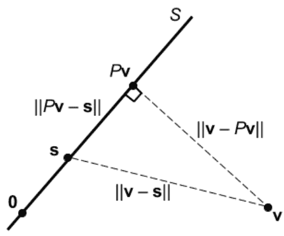

在 OLS 情况下，

$$\mathbf{w}^*_{OLS} = \arg \min_{\mathbf{w}} ||\mathbf{X}\mathbf{w} - \mathbf{y}||_2^2$$

但观察到对于某些 $\mathbf{w} \in \mathbb{R}^d$，写为 $\mathbf{X}\mathbf{w}$ 的向量集合正是 $\mathbf{X}$ 的范围，我们知道它是 $\mathbb{R}^n$ 的子空间，所以：

$$\min_{\mathbf{z} \in \text{range}(\mathbf{X})} ||\mathbf{z} - \mathbf{y}||_2^2 = \min_{\mathbf{w}} ||\mathbf{X}\mathbf{w} - \mathbf{y}||_2^2$$

通过与之前关于 $P_{\mathbf{X}}$ 的最优性陈述进行匹配，我们观察到 $P_{range(\mathbf{X})}(\mathbf{y}) = \mathbf{X}\mathbf{w}^*_{OLS}$，其中 $\mathbf{w}^*_{OLS}$ 是右侧的任意最优解。投影点 $\mathbf{X}\mathbf{w}^*_{OLS}$ 总是唯一的，但如果 $\mathbf{X}$ 是满秩的（假设 $n \geq d$），则最优解 $\mathbf{w}^*_{OLS}$ 也是唯一的（符合预期）。这是因为 $\mathbf{X}$ 满秩意味着 $\mathbf{X}$ 的列是线性独立的，在这种情况下 $\mathbf{w}$ 和 $\mathbf{X}\mathbf{w}$ 之间存在一一对应关系。

为了求解 $\mathbf{w}^*_{OLS}$，我们需要以下事实$^1$：

$$\text{null}(\mathbf{X}^T) = \text{range}(\mathbf{X})\perp$$

由于我们投影到 range($\mathbf{X}$)，最优性的正交条件是 $\mathbf{y} - P_{\mathbf{X}}\mathbf{y} \perp \text{range}(\mathbf{X})$，即 $\mathbf{y} - \mathbf{X}\mathbf{w}^*_{OLS} \in \text{null}(\mathbf{X}^T)$。这导致方程：

$$\mathbf{y}^T(\mathbf{y} - \mathbf{X}\mathbf{w}^*_{OLS}) = 0$$

这与之前等价于

$$\mathbf{X}^T\mathbf{X}\mathbf{w}^*_{OLS} = \mathbf{X}^T\mathbf{y}$$

## 1.3 岭回归

虽然最小二乘法可以用于解决线性二乘问题，但由于数值不稳定性和泛化问题而显得不从心。当数据的特征接近共线性时（导致特征列线性相关），会出现数值不稳定，导致

> $1$ 该结果通常被作为线性代数基本定理的一部分给出。

为什么奇异值不好？让我们通过 $\mathbf{X}$ 的奇异值分解（SVD）来说明：

$$\mathbf{X} = U\Sigma V^T$$

其中 $U \in \mathbb{R}^{n \times n}$，$\Sigma \in \mathbb{R}^{n \times d}$，$V \in \mathbb{R}^{n \times d}$。在 OLS 的背景下，必须有 $\mathbf{X}^T\mathbf{X}$ 是可逆的，等价于 $\text{rank}(\mathbf{X}^T\mathbf{X}) = \text{rank}(\mathbf{X}) = d$。假设 $\mathbf{X}$ 和 $\mathbf{X}^T$ 满秩 $d$，我们可以将 $\mathbf{X}$ 的 SVD 表示为：

$$\mathbf{X} = U \begin{bmatrix} \Sigma_d & 0 \end{bmatrix} V^T$$

其中 $\Sigma_d \in \mathbb{R}^{d \times d}$ 是一个具有严格正元素的对角矩阵。现在让我们尝试用 SVD 展开 $(\mathbf{X}^T\mathbf{X})^{-1}$：

$$(\mathbf{X}^T\mathbf{X})^{-1} = (V \begin{bmatrix} \Sigma_d \\ 0 \end{bmatrix} U^T U \begin{bmatrix} \Sigma_d & 0 \end{bmatrix} V^T)^{-1} = (V \Sigma_d^2 V^T)^{-1} = V \Sigma_d^{-2} V^T$$

这意味着 $(\mathbf{X}^T\mathbf{X})^{-1}$ 的奇异值是 $\mathbf{X}$ 的奇异值的平方，当 $\mathbf{X}$ 的奇异值接近 0 时，会导致极大的值。这种巨大的值对数值稳定性是有问题的。此外，最优 $\mathbf{w}$ 的高值会阻止 OLS 泛化到未见数据。解决这些问题有一个简单的方法：惩罚过大的 $\mathbf{w}$。我们可以通过添加约束 $\mathbf{w}$ 范数的来实现。对于固定的尺度 $\lambda > 0$，我们有：

$$\min_{\mathbf{w}} ||\mathbf{X}\mathbf{w} - \mathbf{y}||_2^2 + \lambda||\mathbf{w}||_2$$

注意目标函数中的 $\lambda$ 是对 $\mathbf{w}$ 敏感的超参数。就像特征次数一样，$\lambda$ 是我们需要通过验证选择的值。让我们展开目标函数的项：

$$f(\mathbf{w}) = ||\mathbf{X}\mathbf{w} - \mathbf{y}||_2^2 + \lambda||\mathbf{w}||_2^2 = \mathbf{w}^T\mathbf{X}^T\mathbf{X}\mathbf{w} - 2\mathbf{y}^T\mathbf{X}^T\mathbf{w} + \mathbf{y}^T\mathbf{y} + \lambda\mathbf{w}^T\mathbf{w}$$

最后对目标函数求梯度，找到梯度为 0 的 $\mathbf{w}$：

$$\nabla f(\mathbf{w})=2\mathbf{X}^T\mathbf{X}\mathbf{w} - 2\mathbf{X}^T\mathbf{y} + 2\lambda\mathbf{w} = 0$$

$$(\mathbf{X}^T\mathbf{X} + \lambda\mathbf{I})\mathbf{w} = \mathbf{X}^T\mathbf{y}$$


由于目标函数是强凸的，该值保证达到（唯一的）全局最小值，因此只需计算 $f$ 的海森矩阵，在这种情况下为：

$$\nabla^2 f(\mathbf{w})=2(\mathbf{X}^T\mathbf{X} + \lambda\mathbf{I})$$

它是正定的（PD）：

$$\mathbf{w}^T(2\mathbf{X}^T\mathbf{X} + \lambda\mathbf{I})\mathbf{w} = 2\mathbf{w}^T\mathbf{X}^T\mathbf{X}\mathbf{w} + 2\lambda\|\mathbf{w}\|^2 > 0$$

由于海森矩阵是正定的，我们可以等价地说海森矩阵的特征值严格为，且目标函数是强凸的。强凸函数的一个有用属性是它们具有唯一最优解，因此解是唯一的。我们无法对普通二乘法保证这一点，因为对应的海森矩阵特征值可能为 0。正如我们在 OLS 中探索的，当海森矩阵具有 0 特征值时，此时 $X^T$ 不逆，但这并不意味着解不存在！OLS 总是存在解，而当海森矩阵正半定（PSD）时，有多个解。方程 $\mathbf{X}^T\mathbf{X}\mathbf{w}=\mathbf{X}^T\mathbf{y}$ 总是有解，因为 $\mathbf{X}^T\mathbf{X}$ 的范围和 $\mathbf{X}$ 的范围是等价的；由于 $\mathbf{y}$ 位于 $\mathbf{X}^T$ 的范围内，它必须等价地位于 $\mathbf{X}^T$ 的范围内，因此存在满足 $\mathbf{X}^T\mathbf{X}\mathbf{w}=\mathbf{X}^T\mathbf{y}$ 的 $\mathbf{w}$。

我们讨论的技术被称为岭回归（统计学中也称为 Tikhonov 正化）。注意无论 $X$ 的秩如何，表达式 $\mathbf{X}^T\mathbf{X} + \lambda\mathbf{I}$ 都是可逆的。首先：

$$(\mathbf{X}^T\mathbf{X} + \lambda\mathbf{I})^{-1} = \left(V \begin{bmatrix} \Sigma_r^2 & 0 \\ 0 & 0 \end{bmatrix} U^T U \begin{bmatrix} \Sigma_r^2 & 0 \\ 0 & 0 \end{bmatrix} V^T + \lambda\mathbf{I}\right)^{-1}$$

$$= \left(V \begin{bmatrix} \Sigma_r^2 & 0 \\ 0 & 0 \end{bmatrix} V^T + \lambda\mathbf{I}\right)^{-1}$$

$$= \left(V \begin{bmatrix} \Sigma_r^2 & 0 \\ 0 & 0 \end{bmatrix} V^T + \lambda\mathbf{I}\right)^{-1}$$

$$= \left(V \begin{bmatrix} \Sigma_r^2 + \lambda\mathbf{I} & 0 \\ 0 & 0 \end{bmatrix} V^T\right)^{-1}$$

$$= (V^T)^{-1} \begin{bmatrix} \Sigma_r^2 + \lambda\mathbf{I} & 0 \\ 0 & \lambda\mathbf{I} \end{bmatrix}^{-1} V$$

$$= V \begin{bmatrix} (\Sigma_r^2 + \lambda\mathbf{I})^{-1} & 0 \\ 0 & \lambda^{-1} \end{bmatrix} V^T$$

通过我们的微调，矩阵 $\mathbf{X}^T\mathbf{X} + \lambda\mathbf{I}$ 是满秩的，因此是可的。奇异值保证最大为 $\frac{1}{\sqrt{\lambda}}$ 和 $\sqrt{\lambda}$，解决了数值不稳定问题。此外，我们部分解决了过拟合问题。通过惩罚 $\mathbf{x}$ 的范数，我们鼓励对应于捕捉真实模型主要结构的相关特征的权重，并惩罚了仅用于微调模型和拟合数据噪声的复杂特征的权重。

### 1.4 特征工程

我们看到最小二乘优化问题

$$\min_{w\in\mathbb{R}^d} ||\mathbf{X}w - \mathbf{y}||_2^2$$

通过将 $y$ 投影到由 $\mathbf{X}$ 的列支撑的子空间，代表了“最佳拟合”*线性*模型。然而，真实的输入-输出关系 $y=f(x)$ 可能是非性的，因此考虑非线性模型也是很有用的。事实证明我们仍然可以在线性最小二乘框架下这样做，通过用新的**特征**来增强数据。具体来说，我们设计了某些函数 $\phi:\mathbb{R}^d\to\mathbb{R}^p$，将每个数据点 $x\in\mathbb{R}^d$ 映射到特征向量 $\phi(x)$。分量函数 $\Phi\in\mathbb{R}^{n\times p}$ 以 $\phi(x_i)$ 为其第 $i$ 行，取代了：

$$\min_{w\in\mathbb{R}^p} ||\mathbf{\Phi}w - \mathbf{y}||_2^2$$

注意，所得模型对于特征仍然是线性的，但如果 $\phi$ 是线性的，那么它对于原始数据是非线性的。这些有时被称为**基函数**，因为我们的假设是这些函数的线性组合。在最简单的情况下，我们可以直接使用 $x$ 的分量作为特征（即 $\phi_j(x)=x_j$），但在未来，将示例的特征从示例本身区分开来有时是很有帮助的，因此我们鼓励这种思维方式。

#### 示例：拟合椭圆

让我们使用最小二乘法为来自椭圆的数据点拟合模型。

- 1. **应用与数据**：我们有 $n$ 个数据点 $\mathcal{D}=\{(x_{i,1},x_{i,2})\}_{i=1}^n$，这些点是带有噪声的（可能是实际轨道）。我们的目标是确定 $x_1$ 和 $x_2$ 之间的关系。
- 2. **模型**：形式为 $w_0+w_1x_1^2+w_2x_2^2+w_3x_1x_2+w_4x_1+w_5x_2=1$ 的椭圆。有 6 个未知系数（权重）。
- 3. **优化问题**：我们用最小二乘法公式化该问题：

$$\min ||\mathbf{\Phi}w - \mathbf{y}||_2^2$$

其中

$$\Phi = \begin{pmatrix} x_{1,1}^2 & x_{1,2}^2 & x_{1,1}x_{1,2} & x_{1,1} & x_{1,2} \\ x_{2,1}^2 & x_{2,2}^2 & x_{2,1}x_{2,2} & x_{2,1} & x_{2,2} \\ \vdots & \vdots & \vdots & \vdots & \vdots \\ x_{n,1}^2 & x_{n,2}^2 & x_{n,1}x_{n,2} & x_{n,1} & x_{n,2} \end{pmatrix}$$

注意这里没有“目标”向量 $\mathbf{y}$，这不是一个传统的回归问题。

#### 多项式特征

一种重要的特征类是**多项式特征**。记住，多项式是单项式基的线性组合。单项式可以通过两种方式分类，根据它们的阶数维度：

| 阶数 $\to$ | 0 | 1 | 2 | 3 | ... |
| :--- | :--- | :--- | :--- | :--- | :--- |
| 单变量 | 1 | $x$ | $x^2$ | $x^3$ | ... |
| 双变量 | 1 | $x_1, x_2$ | $x_1^2, x_2^2, x_1x_2$ | $x_1^3, x_2^3, x_1^2x_2, x_1x_2^2$ | ... |

我们之所以可以使用多项式，是因为任何平滑函数都可以被任意近似。多项式的缺点是随着阶数的增加，它们的数量会迅速增加。为了直观理解这种增长，请考虑以下例子：

以后我们将学习核的技巧，这种巧妙的方法可以规避这种增长。

### 1.5 超参数与验证

如前，考虑如下形式的

$$h(x) = \sum_{j=1}^p w_j \phi_j(x)$$

观察到，在拟合数据时，$p$ 不是待优化的变量，因此它被称为超参数。更具体地说，它是岭回归中的。正则化参数 $\lambda$ 控制了拟合数据与保持权重较小之间的平衡。对参数施加 $\ell^2$ 惩罚：

$$\min_{\mathbf{w}} ||\mathbf{Xw} - \mathbf{y}||_2^2 + \lambda ||\mathbf{w}||_2^2$$

#### 类型

让我们尝试正式地区分误差类型。假设数据按照某种未知分布 $\mathcal{D}$ 分布。解决方案是留出部分数据（例如30%）作为验证集，它是与训练集不相交的。

| 验证 | 训练 |
| :--- | :--- |

我们可以通过**验证误差**来估算真实误差：

$$\hat{R}_{VAL}(h) = \frac{1}{m} \sum_{i=1}^m \ell(x_i^{val}), y_i^{val})$$

有了这个估计，我们有了一个选择超参数的简单方法：尝试一组超参数配置，并选择验证误差最低的配置。

#### 超参数对误差的影响

注意，当我们向线性模型添加更多特征时，训练误差只会减少。这是因为如果特征无法用于减少训练误差，优化器可以将 $w_i = 0$。


只要特征是输出的有用预测器，添加更多特征往往会减少真实误差。然而，如果我们不断添加特征，这些特征开始拟合训练数据中的噪声而非真实信号，导致真实误差实际上增加。这种现象被称为**过拟合**。


只要验证集足够大，验证误差很好地跟踪真实误差：


正则化超参数 $\lambda$ 对训练误差的影响略有不同。观察到，如果 $\lambda = 0$，我们恢复了精确的 OLS 问题，它直接最小化训练误差。随着 $\lambda$ 的增加，优化器对训练误差的关注减少，而对减小参数大小的关注增加。

## 1.5. 超参数与验证

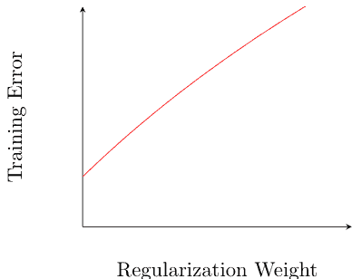

#### 交叉验证

划分一个验证集是有效的，但这种方法是有代价的，因为我们无法将验证数据用于训练。由于拥有更多数据通常会提高训练模型的质量，我们可能不希望让这些数据被浪费，特别是当我们的初始数据很少且/或收集更多数据的成本非常高昂时。交叉验证是设置专用验证集的替代方案。

$k$-折交叉验证的工作原理如下：

1. 打乱数据，并将其划分为 $k$ 个等大小（或尽可能相等）的块。
2. 对于 $i = 1, \dots, k$，
   * 在除第 $i$ 块以外的所有数据上训练模型。
   * 使用第 $i$ 块评估模型（即计算验证误差）。

| 1 | 2 | 3 | 4 | 5 | 6 | ... | $k$ |
|---|---|---|---|---|---|---|---|
| 验证 | 训练 | | | | | | |
| 训练 | 验证 | 训练 | | | | | |
| | 训练 | 验证 | 训练 | | | | |
| | | | | | | | |

3. 对 $k$ 个验证误差平均；这是我们对真实误差的最终估计。

注意，这个过程（打乱和划分除外）对于我们想要测试的每个超参数配置都必须重复。这是 $k$-折交叉验证与使用留验证集相比的主要缺点——所需的计算量大约是 $k$ 倍。对于我们目前看到的较小的线性模型来说，这不是大问题，但当模型训练需要很长时间时（例如在大数据时代或使用神经网络时），成本可能会高到无法接受。

## 核岭回归 (Kernel Ridge Regression)

在岭回归中，我们给定一个向量 $\mathbf{y} \in \mathbb{R}^n$ 和一个矩阵 $\mathbf{X} \in \mathbb{R}^{n \times l}$，其中 $n$ 是训练点数，$l$ 是原始数据点的维度。在大多数情况下，我们不希望在原始特征空间中工作，因此我们对数据点进行特征增强，并将 $\mathbf{X}$ 替换为 $\mathbf{\Phi} \in \mathbb{R}^{n \times d}$，其中 $\phi_i = \phi(\mathbf{x}_i) \in \mathbb{R}^d$。然后我们求解一个涉及 $\mathbf{\Phi}$ 和 $y$ 的定义优化问题，其中参数 $\mathbf{w} \in \mathbb{R}^d$。

如果我们在原始 $l$ 维空间中使用 $p$ 阶多项式特征，出现的问题是有 $d = \binom{l+p}{p}$ 个我们需要优化的项，这个值可能非常大（远大于训练点数 $n$）。与其在 $d$ 个变量上求解优化问题，不如在（可能更小的）$n$ 个变量上求解等效问题，并实现与增强特征数量无关的计算运行时间吗？事实证明，一种被称为“核技巧”（kernel trick）的核概念允许我们实现这一目标。考虑岭回归的解：

$\mathbf{w} = (\mathbf{\Phi}^T\mathbf{\Phi} + \lambda\mathbf{I})^{-1}\mathbf{\Phi}^T\mathbf{y}$

该操作涉及计算 $\mathbf{\Phi}^T\mathbf{\Phi}$，它是一个 $d \times d$ 矩阵，需要 $O(d^2)$ 的时间。矩阵求逆还需要额外的 $O(d^3)$ 时间。我们真正想要的是一个需要 $O(n^3)$ 时间来求逆的 $n \times n$ 矩阵：如果我们翻转 $\mathbf{\Phi}$ 和 $\mathbf{\Phi}$ 的顺序，最终得到一个 $n \times n$ 矩阵 $\mathbf{\Phi}^T\mathbf{\Phi}$。事实上，$\mathbf{\Phi}^T\mathbf{\Phi}$ 有直观的含义：它是所有数据点之间内积的矩阵，衡量了数据点之间的“相似性”并捕捉了它们的表示。现在让我们看看是否能用用矩阵 $\mathbf{\Phi}^T$ 表示岭回归的解。

为了符号简便，让我们回到使用 $\mathbf{X}$ 而不是 $\mathbf{\Phi}$（假设我们只处理原始特征，我们对核回归的分析仍然成立）。重新排列原始回归解的项，我们得到：

$\mathbf{w} = (\mathbf{X}^T\mathbf{X} + \lambda\mathbf{I})^{-1}\mathbf{X}^T\mathbf{y}$

$(\mathbf{X}^T\mathbf{X} + \lambda\mathbf{I})\mathbf{w} = \mathbf{X}^T\mathbf{y}$

$\mathbf{X}^T\mathbf{X} + \lambda\mathbf{w} = \mathbf{X}^T\mathbf{y}$

$\mathbf{w} = \frac{1}{\lambda}(\mathbf{X}^T\mathbf{y} - \mathbf{X}^T\mathbf{X})$

这说明无论 $\mathbf{w}$ 是什么，它都是训练点 $\mathbf{x}_i$ 的某种线性组合（因为任何形式为 $\mathbf{X}^T\mathbf{v}$ 的项都是 $\mathbf{X}^T$ 列的线性组合，而 $\mathbf{X}^T$ 的列就是训练点）。为了找到 $\mathbf{w}$，只需找到 $\mathbf{w}$ 即可（注：此处原文逻辑似乎略有混乱，翻译遵循原文语意）。找到 $\mathbf{w}$ 只需要找到 $\mathbf{w}$。无论 $\mathbf{w}$ 是什么，它都是训练点 $\mathbf{x}_i$ 的某种线性组合（因为任何形式为 $\mathbf{X}^T\mathbf{v}$ 的项都是 $\mathbf{X}^T$ 列的线性组合，而 $\mathbf{X}^T$ 的列就是训练点）。找到 $\mathbf{w}$ 只需要找到 $\mathbf{w}$。无论 $\mathbf{w}$ 是什么，它都是训练点 $\mathbf{x}_i$ 的某种线性组合（因为任何形式为 $\mathbf{X}^T\mathbf{v}$ 的项都是 $\mathbf{X}^T$ 列的线性组合，而 $\mathbf{X}^T$ 的列就是训练点）。找到 $\mathbf{w}$ 只需要找到 $\mathbf{w}$。无论 $\mathbf{w}$ 是什么，它都是训练点 $\mathbf{x}_i$ 的某种线性组合（因为任何形式为 $\mathbf{X}^T\mathbf{v}$ 的项都是 $\mathbf{X}^T$ 列的线性组合，而 $\mathbf{X}^T$ 的列就是训练点）。

## 1.6. 核回归 (KERNEL REGRESSION)

$\mathbf{X}^T\mathbf{y}$

$\mathbf{X}\mathbf{y} + \lambda v$

我们不能孤立 $v$，但我们可以通过以下方式来孤立 $v$：

$\mathbf{X}^T\mathbf{y}$

$\mathbf{X}\mathbf{y} + \lambda v$

$\mathbf{w} = \mathbf{X}^T(\mathbf{X} + \lambda I)^{-1}$

$\mathbf{w} = \mathbf{X}^T(\mathbf{X} + \lambda I)^{-1}$

1. $\mathbf{w} = \mathbf{X}^T\mathbf{y}$

$\mathbf{w} = \mathbf{X}^T(\mathbf{X} + \lambda I)^{-1}$

1. $\mathbf{w} = \mathbf{X}^T\mathbf{y}$

事实上，这些表达式是等价的！出现的问题是选择哪一个？我们在引入核之后回答这个问题。

#### 线性代数推导 (Linear Algebra Derivation)


我们的推导包含了一些直观的线性代数论据。在此之前，我们需要通过更严谨的线性代数来形式化我们的推导（FTLA）：矩阵 `X` 映射 `ℝ^d` 到 `ℝ^n`。`𝒩(X)` 是 `X` 的零空间，而 `ℛ(X)` 是 `X` 的列空间。它们满足以下性质：

1. `𝒩(X) ⊥ ℛ(X^T)` 且 `ℛ(X) ⊥ 𝒩(X^T)`
2. `ℛ(X) ⊕ 𝒩(X^T) = ℝ^n`
3. `ℝ^d = ℛ(X^T) ⊕ 𝒩(X)`

符号 `⊥` 表示 `𝒩(X)` 于 `ℛ(X^T)`，这意味着对于任何 `u ∈ ℝ^d`，存在唯一的 `u1 ∈ 𝒩(X)` 和 `u2 ∈ ℛ(X^T)` 使得 `u = u1 + u2`。此外，`𝒩(X)` 和 `ℛ(X^T)` 是正交子空间。

这就是 FTLA 在岭回归中的作用。我们可以将任何 `w ∈ ℝ^d` 表示为唯一的线性组合 `w = w1 + w2`，其中 `w1 ∈ ℛ(X^T)` 且 `w2 ∈ 𝒩(X)`。我们可以将其表示为：

`w = X^T v + r`，其中 `v ∈ ℝ^n` 且 `r ∈ 𝒩(X)`。

现在我们考虑岭回归的方程：

`(X^T X + λ I) w = X^T y`

由于 `r ∈ 𝒩(X)`，有 `X r = 0`。因此：

`X w = X (X^T v + r) = X X^T v`

`(X X^T + λ I) v = X y`

`v = (X X^T + λ I)^{-1} X y`

由此得到：

`w = X^T v + r = X^T (X X^T + λ I)^{-1} X y + r`

这正是岭回归的解。现在，如果我们使用核技巧，就可以在 `n` 个变量上求解问题，而不是在 `d` 个变量上求解，从而实现计算时间与增强特征数量无关。考虑岭回归的解：

`w = (Φ^T Φ + λ I)^{-1} Φ^T y`

该操作涉及计算 `Φ^T Φ`，它是一个 `d × d` 矩阵，需要 `O(d^2)` 的时间。矩阵求逆还需要额外的 `O(d^3)` 时间。我们真正想要的是一个需要 `O(n^3)` 时间来求逆的 `n × n` 矩阵：如果我们翻转 `Φ` 和 `Φ` 的顺序，最终得到一个 `n × n` 矩阵 `Φ^T Φ`。事实上，`Φ^T Φ` 有直观的含义：它是所有数据点之间内积的矩阵，衡量了数据点之间的“相似性”并捕捉了它们的表示。现在让我们看看是否能用矩阵 `Φ^T` 表示岭回归的解。

为了符号简便，让我们回到使用 `X` 而不是 `Φ`（假设我们只处理原始特征，我们对核回归的分析仍然成立）。重新排列原始回归解的项，我们得到：

`w = (X^T X + λ I)^{-1} X^T y`

`(X^T X + λ I) w = X^T y`

`X^T X + λ w = X^T y`

`w = 1/λ (X^T y - X^T X)`

这说明无论 `w` 是什么，它都是训练点 `x_i` 的某种线性组合（因为任何形式为 `X^T v` 的项都是 `X^T` 列的线性组合，而 `X^T` 的列就是训练点）。为了找到 `w`，只需找到 `w` 即可（注：此处原文逻辑似乎略有混乱，翻译遵循原文语意）。

## 第 1 章 回归，验证

$$
= \arg\min_{\mathbf{v} \in \mathbb{R}^*, \mathbf{r} \in \mathcal{N}(X)} ||\mathbf{X}(\mathbf{X}^T\mathbf{v} + \mathbf{r}) - y|_2^2 + \lambda|\mathbf{X}^T\mathbf{v} + \mathbf{r}||_2^2
$$

$$
= \arg\min_{\mathbf{v} \in \mathbb{R}^*, \mathbf{r} \in \mathcal{N}(X)} ||\mathbf{XX}^T\mathbf{v} + \mathbf{X}\mathbf{r} - y|_2^2 + \lambda|\mathbf{X}^T\mathbf{v} + \mathbf{r}||_2^2
$$

$$
= \arg\min_{\mathbf{v} \in \mathbb{R}^*, \mathbf{r} \in \mathcal{N}(X)} (\mathbf{v}^T\mathbf{XX}^T\mathbf{v} - 2\mathbf{v}^T\mathbf{XX}\mathbf{r} - 2y^T\mathbf{v} + ...) + \lambda (\mathbf{v}^T\mathbf{XX}^T\mathbf{v} + 2\mathbf{v}^T\mathbf{X}\mathbf{r} + ||\mathbf{r}||^2))
$$

$$
= \arg\min_{\mathbf{v} \in \mathbb{R}^*, \mathbf{r} \in \mathcal{N}(X)} (\mathbf{v}^T\mathbf{XX}^T\mathbf{v} - 2\mathbf{v}^T\mathbf{X}\mathbf{r} + \lambda ||\mathbf{r}||^2)
$$

我们划除了 `2r` 和 `2X^T r`，因为 `r ∈ 𝒩(X)`，因此 `Xr=0`。现在我们正在优化 `L(v,r)`，它在 `v` 和 `r` 上是**联合凸的**，因为它的海森矩阵（Hessian matrix）是半正定的（PSD）。让我们证明这一点：

$$
\nabla^2 L(\mathbf{v}, \mathbf{r}) = 2I \ge 0
$$

$$
\nabla_{\mathbf{r}}\nabla_{\mathbf{v}}L(\mathbf{v}, \mathbf{r}) = \nabla_{\mathbf{v}}\nabla_{\mathbf{r}}L(\mathbf{v}, \mathbf{r}) = 0
$$

$$
\nabla^2_{\mathbf{v}}L(\mathbf{v}, \mathbf{r}) = 2\mathbf{XX}^T + \lambda\mathbf{XX}^T \ge 0
$$

由于海森矩阵的交叉项为 **0**，因此 `∇^2_r L(v, r)` 和 `∇^2_v L(v, r)` 是 PSD 的，从而建立了联合凸性。在建立联合凸性后，我们可以使关于 `r` 和 `v` 的梯度为 `0` 并得到全局最小值：

$$
\nabla_{\mathbf{r}}L(\mathbf{v}^*) = 2\mathbf{r}^* = 0 \implies r^* = 0
$$

注意 `r* = 0` 恰好在 `𝒩(X)` 中，所以它是一个可行点。

$$
\nabla_{\mathbf{v}}L(\mathbf{v}^*, \mathbf{r}^*) = 2\mathbf{XX}^T\mathbf{v}^* - 2\mathbf{XX}^T\mathbf{r}^* + \lambda\mathbf{XX}^T\mathbf{v}^* = 0
$$

$$
\implies \mathbf{XX}^T\mathbf{v}^* + \lambda\mathbf{v}^* = 0
$$

$$
\implies \mathbf{v}^* = (\mathbf{XX}^T + \lambda\mathbf{I})^{-1}y
$$

注意 `XX^T + λI` 是正定的因此是可逆的，我们可以计算 `(XX^T + λI)^{-1}y`。尽管 `(XX^T + λI)^{-1}y` 是梯度为 `0` 的临界点，但由于目标函数是联合凸的，它必须达到全局最小值。我们得出：

$$
\mathbf{w}^* = (\mathbf{XX}^T + \lambda\mathbf{I})^{-1}y
$$

在为数据矩阵 `X` 推导出核回归公式后，我们可以将相同的逻辑应用于增强矩阵 `Φ`，并将最优表达式替换为：

$$
\mathbf{w}^* = (\Phi\Phi^T + \lambda\mathbf{I})^{-1}y
$$

让我们更详细地探索核回归中的 `ΦΦ^T` 项：`img/99defe6aed215976e83d281581f33_0.png`

每个元素 `Φ_ij` 都是 `φ(x_i)` 和 `φ(x_j)` 之间的点积，可以被解释为相似性度量：

$$
Phi_{ij} = \langle\phi(x_i), \phi(x_j)\rangle = k(x_i, x_j)
$$

其中 `k(·)` 是**核**函数。核函数接受原始特征输入，并输出它们在增强特征空间中的内积。我们定义 `k(x_i, x_j)` 矩阵为**格姆矩阵**（Gram matrix），并记为 `K`：

$$
\mathbf{K} = \Phi^T\Phi = \begin{pmatrix} k(x_1, x_1) & k(x_1, x_2) & \dots \\ k(x_2, x_1) & k(x_2, x_2) & \dots \\ \vdots & \vdots & \vdots \\ k(x_n, x_1) & k(x_n, x_2) & \dots \end{pmatrix}
$$

形式上，如果存在特征映射 `φ(·)` 使得对于所有 `x2`，

则 `k(x1, x2)` 是有效的核：

$$
k(x_1, x_2) = \langle\phi(x_1), \phi(x_2)\rangle
$$

等价地，也可以说对于所有集合 `D={x1, x2, ..., xn}`，格姆矩阵 `K(D)` 是 PSD 的。

如果对 `x` 和 `x` 应用特征映射并在增强特征空间中取点积，就可以简单地计算格姆矩阵 `k(x_i, x_j)` —— 这需要 `O(d)` 时间，`d` 是增强特征空间的维度。然而，如果我们使用**核技巧**（kernel trick），我们可以在 `O(l + log p)` 时间内执行此操作，其中 `l` 是原始特征空间的维度，`p` 是增强特征空间的多项式次数。

### 1.7 核技巧

假设我们使用将 `l` 维输入映射到 `d=O(p^l)` 维输出的 `p` 次特征映射来计算 `k(x, z)`。以 `p=2` 和 `l=2` 为例：

$$
k(x, z) = \langle\phi(x), \phi(z)\rangle
$$

$$
= \begin{pmatrix} x_1^2 & \sqrt{2}x_1x_2 & x_2^2 \end{pmatrix} \begin{pmatrix}^2 \\ \sqrt{2}z_1z_2 & z_2^2 \end{pmatrix}^T
$$

（注：这里的 OCR 展开很乱，但逻辑遵循多项式核。）

#### 计算分析

回到原始问题 —— 在岭回归中，我们应该计算

$$
\mathbf{w}^* = (\Phi\Phi^T + \lambda\mathbf{I})^{-1}y
$$

还是

$$
\mathbf{w}^* = (\Phi\Phi^T + \lambda\mathbf{I})^{-1}y
$$

让我们比较它们的计算复杂度。假设给定任意测试点 `z ∈ ℝ^d`，你想计算其预测值 `ŷ`。让我们看看这些情况下是如何计算这些值的：

- 1. 核化方法

$$
\hat{\mathbf{y}} = \langle\phi(z), \mathbf{w}^*\rangle = \phi(z)^T(\Phi\Phi^T + \lambda\mathbf{I})^{-1}y = [k(x_1, z) \quad \dots \quad k(x_n, z)]^T(\mathbf{K} + \lambda\mathbf{I})^{-1}y
$$

计算 `K` 项需要 `O(n^2(l + log p))`，矩阵逆需要 `O(n^3)`。这两项计算占据主导，总计算时间为 `O(n^3 + n^2(l + log p))`。

- 2. 非核化方法

$$
\hat{\mathbf{y}} = \langle\phi(z), \mathbf{w}^*\rangle = \phi(z)^T(\Phi\Phi^T + \lambda\mathbf{I})^{-1}\Phi^T y
$$

计算 `ΦΦ^T` 项需要 `O(nd^2)`，矩阵逆需要 `O(d^3)`。这两项计算占据主导，总计算时间为 `O(d^3 + d^2n)`。

结论是：如果 `d << n`，非核化方法更优；否则，如果 `n << d`，核化方法更优。

## 2.1 MLE 和 MAP

到为止，我们已经探索了最小二乘框架下的两种方法：普通最小二乘法和岭回归：

```
$w_{OLS}^* = \arg \min_{\mathbf{w}} ||\mathbf{y} - \mathbf{X}\mathbf{w}||_2^2 = \arg \min_{\mathbf{w}} \sum_{i=1}^n (y_i - \mathbf{x}_i^T\mathbf{w})^2$
```

```
$w_{RIDGE}^* = \arg \min_{\mathbf{w}} ||\mathbf{y} - \mathbf{X}\mathbf{w}||_2^2 + \lambda|\mathbf{w}||_2^2 = \arg \min_{\mathbf{w}} \sum_{i=1}^n (y_i - \mathbf{x}_i^T\mathbf{w})^2 + \lambda \sum_{j=1}^d w_j^2$
```

你可能一直在问自己，为什么我们使用使用平方误差来衡量模型的有效性，以及为什么对模型权重使用 `l^2` 范数（而不是其他范数）。我们将通过探索监督学习方法（特别是回归方法）的统计解释，为这些设计选择提供合理依据。更具体地说，我们将利用概率中的多种概念（如高斯分布、MLE 和 MAP），从一个不同的视角来验证我们目前所做的一切。

### 模型空间中的优化

让我们来看一个简单的回归模型：

```
$f(x) = slope \cdot x + intercept$
```

我们的目标是找到认为能够描述数据的最佳斜率和截距值。每一对任意的（斜率，截距）都对应数据空间中的一条直线。然而，它可以被视为模型空间中的一个点。学习最优模型等同于数据空间中的数据点拟合直线；它等同于在模型空间中定位最优参数点：

我们观测的数据是具有不同分布、覆盖范围密度的随机样本。我们会遇到许多不同的分布，例如均匀分布、高斯分布和拉普拉斯分布。噪声分布通常被假设为高斯分布，部分原因是由于大多数噪声都落在均值的 1 或 2 个标准差范围内。为了方便起见，我们列出它们的属性。


## 2.1 MLE 和 MAP

随机变量：$X \sim p(x)$

概率分布：$p(x) = \frac{1}{\sqrt{2\pi}\sigma} e^{-\frac{(x-\mu)^2}{2\sigma^2}}$

均值：$E[X] = \int_{-\infty}^{\infty} xp(x)dx = \mu$

方差：$V[X] = E[(X-\mu)^2] = \int_{-\infty}^{\infty} (x-\mu)^2p(x)dx = \sigma^2$

参数：$X \sim \mathcal{N}(\mu, \sigma^2)$

对数似然：$\log P(X) = \sum \frac{(x-\mu)^2}{2\sigma^2} - \sqrt{2\pi}\sigma$。

线性组合：$E[aX+bY] = a\mu_x + b\mu_y$

如果 $X, Y$ 独立：$V[aX+bY] = a^2\sigma_x^2 + b^2\sigma_y^2$

$aX+bY \sim \mathcal{N}(a\mu_x+b\mu_y, a^2\sigma_x^2+b^2\sigma_y^2)$

### 用于模型选择的 MLE 和 MAP

在回归（以及所有的监督学习）背景下，我们假设存在一个将输入映射到输出的真实底层模型。作为机器学习专家，我们的目标是通过我们给定的数据，找到一个代表真实底层模型的假设模型。

让我们更具体地定义数据和模型。我们的数据由 $n$ 组 $(x_i, y_i)$ 对组成，正如我们之前看到的：

$$\mathcal{D} = \{(x_i, y_i)\}_{i=1}^n$$

真实底层模型 $f$ 是一个将输入 $x_i$ 映射到真实输出 $f(x_i)$ 的函数。每个观测值 $y_i$ 仅仅是 $f(x_i)$ 的噪声版本：

$y_i = f(x_i) + N_i$

现在 $f(x_i)$ 是一个常数，而 $N_i$ 是一个随机变量。我们总是假设 $N_i$ 的均值为零，否则我们的观测值将会出现系统偏差。$N_i$ 可以是高斯分布、均匀分布、拉普拉斯分布等。在这里，假设它们是独立同分布的 (i.i.d) 且斯分布：$N_i \sim \mathcal{N}(0, \sigma^2)$。我们可以验证 $y_i|x_i \sim \mathcal{N}(f(x_i), \sigma^2)$。

现在我们引入了数据，并希望找到一个能够描述数据的假设模型 $h_\theta$，可能包含了对真实模型的先验知识。我们可以将其表示为一个概率问题，其目标是找到概率最大的模型。

#### 最大似然估计

在极大似然估计（MLE）中，目标是找到数据概率最大的模型。如果我们对假设模型进行参数化 $\theta$，可以将该问题表示为：

```
$$\theta_{\text{MLE}} = \arg \max_{\theta} P(data = \mathcal{D} | \text{true model} = \theta)
```

更具体地说：

```
$$\theta_{\text{MLE}} = \arg \max_{\theta} P(y_1, \dots, y_n | \mathbf{x}_1, \dots, \mathbf{x}_n, \theta)
```

注意，实际上是对 $\mathbf{x}_i$ 进行条件化的，因为我们将它们视为固定值。数据中的随机性来自于 $y_i$（因为它们是真实值 $f(\mathbf{x}_i)$ 的噪声版本）。我们可以通过将问题视为图模型来简化这个表达式。注意 $y_i$ 只依赖于它的父节点，不依赖于其他 $y_j$，因为所有的 $y_j$ 都是独立的项。我们可以随后简化目标：

```
$$\theta_{\text{MLE}} = \arg \max_{\theta} \prod_{i=1}^n P(y_i | \mathbf{x}_i, \theta) = \sum_{i=1}^n \log P(y_i | \mathbf{x}_i)
```

现在让我们关注每一个项 $P(y_i | \mathbf{x}_i, \theta)$。我们知道 $y_i | \mathbf{x}_i, \theta \sim N(h(x_i), \sigma^2)$，处理高斯分布的指数项非常麻烦。相反，我们将使用对数，这使得指数项变为：

```
$$\theta_{\text{MLE}} = \arg \max_{\theta} \sum_{i=1}^n \log P(y_i | \mathbf{x}_i, \theta) (2.1)
```

注意使用对数我们仍然在处理相同的问题，因为对数是单调函数。换句话说：

$P(A) < P(B) \iff \log P(A) < \log P(B)$

继续使用对数：

```
$$\theta_{\text{MLE}} = \arg \max_{\theta} \sum_{i=1}^n \log P(y_i | \mathbf{x}_i, \theta) (2.1)
```

```
$= \arg \max_{\theta} \sum_{i=1}^n \left( -\frac{(y_i - h(\mathbf{x}_i))^2}{2\sigma^2} - \log \sqrt{2\pi} \right) (2.2)
```

```
$= \arg \min_{\theta} \sum_{i=1}^n \left( \frac{(y_i - h(\mathbf{x}_i))^2}{2\sigma^2} + \log \sqrt{2\pi} \right) (2.3)
```

```
$= \arg \min_{\theta} \sum_{i=1}^n (y_i - h(\mathbf{x}_i))^2 (2.4)
```

注意在步骤 (3) 中，我们通过对目标函数取反将问题变成了最小化问题。在步骤 (4) 中，我们消除了第二项和第一项的分母，因为它们不于我们正在优化的变量。

现在来看回归的情况。在这种情况下，我们的假设形式为 $h(\mathbf{x}_i) = \mathbf{x}_i^T \theta$，其中 $\theta \in \mathbb{R}^d$，$d$ 是特征化数据点的维度。在这个特定的设置下，问题变为：

```
$$\theta_{\text{MLE}} = \arg \min_{\theta \in \mathbb{R}^d} \sum_{i=1}^n (y_i - \mathbf{x}_i^T \theta)^2
```

这正是普通最小二乘法（OLS）问题！我们刚刚证明了回归的 OLS 和 MLE 得相同的答案！我们得出结论：MLE 是使用平方误差（OLS 的基础）作为回归模型评估指标的概率依据。

#### 后验概率

在后验概率估计（MAP）中，目标是找到使模型概率最大的：

```
$$\theta_{MAP} = \arg\max P(\text{true model} = h_\theta | \text{data} = \mathcal{D}) (2.1)
```

```
$= \arg\max_{\theta} P(\text{data} = \mathcal{D} | \text{true model} = h_\theta) P(\text{true model} = h_\theta) (2.2)
```

```
$= \arg\max_{\theta} \log P(\text{data} = \mathcal{D} | \text{true model} = h_\theta) + P(\text{true model} = h_\theta) (2.3)$ （注：此处原文似乎漏掉了 log，此处根据逻辑补全）
```

```
$= \arg\max_{\theta} \log P(\text{data} = \mathcal{D} | \text{true model} = h_\theta) + \log P(\text{true model} = h_\theta) (2.4)
```

```
$= \arg\min_{\theta} -\log P(\text{data} = \mathcal{D} | \text{true model} = h_\theta) - \log P(\text{true model} = h_\theta) (2.5)
```

在这里，我们使用了贝斯法则来表示目标函数。在这里，我们将 $P(\text{data} = \mathcal{D})$ 表示为常数，因为它不依赖于我们正在优化的变量。注意 MAP 就像 MLE 一样，只是多了一个项 $P(h_\theta)$，它是先验项。正如我们之前假设噪声项是独立同分布且高斯分布：$N \sim \mathcal{N}(0, \sigma^2)$。对于先验 $P(h_\theta)$，假设它遵循标准高斯分布的平移和缩放版本：$h_\theta \sim \mathcal{N}(\theta_0, \sigma_h^2)$。利用这些特定信息，我们得到：

```
$$\theta_{MAP} = \arg\min_{\theta} \sum_{i=1}^n \left( \frac{(y_i - h(\mathbf{x}_i))^2}{2\sigma^2} \right) + \frac{|||\theta - \theta_0||^2}{2\sigma_h^2} (2.1)
```

```
$= \arg\min_{\theta} \sum_{i=1}^n \frac{(y_i - h(\mathbf{x}_i))^2}{2\sigma^2} + \frac{\sigma^2}{2\sigma_h^2} \frac{|||\theta - \theta_0||^2}{\sigma^2} (2.2)
```

让我们 线性回归的情况，以直观地展示 $h_{\theta}(x)$ 项的影响。如果 $\theta_0 = 0$ 在这里，我们指的是线性假设函数 $h_{\theta}(x) = \theta^T x$。

```
$$\theta_{MAP} = \arg\min_{\theta \in \mathbb{R}^d} \sum_{i=1}^n \frac{(y_i - x_i^T\theta)^2}{2\sigma^2} + \frac{\sigma^2}{2\sigma_h^2} \sum_{j=1}^d \theta_j^2$
```

基于我们对普通最小二法回归和岭回归的分析，我们预期的 MAP 表现会比 MLE 更好。但情况总是如此吗？让我们回顾一下之前关于（斜率，截距）的示例。我们我们已经知道了真实的底层模型参数，并将把它们与 MLE 和 MAP 选取的值进行比较。让我们从 MLE 开始：

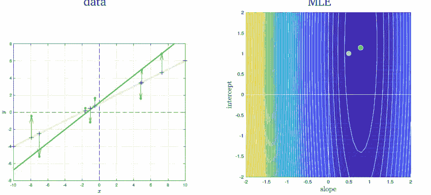

左侧的图显示了该问题的数据空间表示，右侧的图显示了模型空间表示。左图中的灰线和右图中的灰点是真实的底层模型。使用带有噪声的数据样本，MLE 预测出一个合理的假设模型（如左图中的绿线和右图中的绿点所示）。

现在，让我们来看看 MAP 的假设模型。这里产生的一个问题是，先验分布的中心应该设在哪里以及它的方差应该是多少，取决于你对真实底层模型的认知。如果你有理由相信模型权重应该都很小，那么先验应该中心在零。让我们看看以零为中心的先验的 MAP：

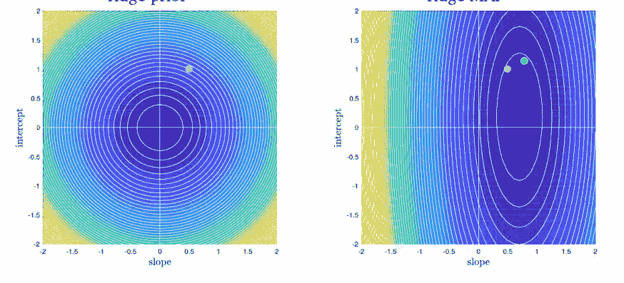

### 2.1. MLE 与 MAP

为了参考，我们之前将 MLE 估计标记为绿点，将真实模型标记为灰点。从右图中可以看到，使用位于零的先验会导致我们的模型预测偏向原点，导致比 MLE 更不准确的模型。假设在这种情况下，有理由相信模型权重应该中心在 0.5 到 1 的范围内。如下下面的第一组图，我们的预测会比 MLE 好。然而，如果我们认为模型权重应该中心在 -0.5 到 1 的范围内，我们的预测会比 MLE 差。

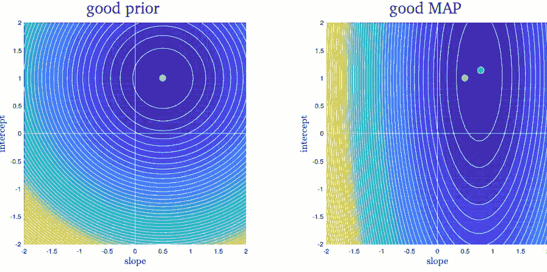

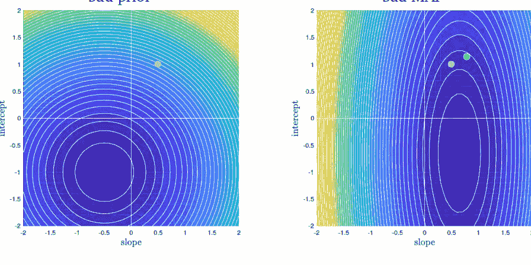

始终，为了在实践中比较我们的信念看看哪个先验最有效，我们应该进行交叉验证！

## 2.2 偏差-方差权衡

回顾我们之前的讨论，对于固定输入 $x$，对应的测量值 $Y$ 是底层模型 $f(x)$ 的噪声测量：

```
Y = f(x) + N
```

其中 $N$ 是一个均值为随机变量，通常表示为高斯分布。我们在回归中的目标是尽可能地恢复底层模型 $f(\cdot)$。之前提到的 MLE 和 MAP 是通过概率目标来寻找 $f(\cdot)$ 的合理近似的技术。在本节中，我们将形成一个可以精确衡量假设函数 $h$ 有效性的理论指标。请记住，这个指标在现实生活中是无法测量，但可以通过实验进行近似。

在引入指标之前，让我们对数据和假设进行一些细微的讨论。正如之前对 MLE 和 MAP 的讨论所回顾的，在这里，数据集 $D$ 包含了 $n$ 个 $(x_i, y_i)$ 对。在这种情况下，我们将 $x_i$ 视为随机变量，$D$ 是一个随机变量，因为它包含了随机变量 $X_i$ 和 $Y_i$。（注意这些量都是随机变量。）我们的假设模型 $h(x, D)$ 也是一个随机变量——它取决于任意输入 $x$ 以及随机的 $D$。由于 $D$ 是随机的，每次使用新数据集都会得到稍微不同的假设模型 $h(\cdot, D)$。

```
D = {X_1, Y_1; X_2, Y_2; ...; X_n, Y_n}
```

### 指标

我们的目标是对于固定值 $x$，评估假设能在多程度上封装对应 $x$ 的噪声观测。注意我们将 $x$ 标记为小写是因为我们将其视为固定常数，而将 $Y$ 和 $D$ 标记为大写是因为我们将其视为随机变量。$Y$ 和 $D$ 与 $D$ 中的 $X_i$ 和 $Y_i$ 没有关系。在这种情况下，我们可以将 $D$ 视为训练数据，$(x, Y)$ 视为测试数据——点 $x$ 不一定在训练集 $D$ 中！在数学上，我们定义指标为假设与观测值 $Y = f(\mathbf{x}) + N$ 之间的平方误差：

```
ε(x; D) = E((h(x; D) - Y)^2)
```

这里的期望是关于随机变量 $D$ 和 $Y$ 的期望：

```
E_Y[(h(x; D) - Y)^2] = E_D[E_Y[(h(x; D) - Y)^2]]
```

注意，误差相对于观测值 $Y$ 而不是真实的底层模型 $f(x)$，因为我们不知道真实模型，只能获得真实的噪声观测。

#### 偏差-方差分解

误差指标很难解释和处理，所以让我们尝试将其分解为更容易的部分。在开始之前，让我们找到 $Y$ 的期望和方差：

```
E[Y] = E[f(\mathbf{x}) + N] = f(\mathbf{x}) + E[N] = f(\mathbf{x})
Var(Y) = Var(f(x) + N) = Var(N)
```

此外，对于一般的任何随机变量 $Z$，我们有：

```
Var(Z) = E[(Z - E[Z])^2] = E[Z^2] - E[Z]^2
```

让我们利用这些事实来分解误差：

```
ε(x;h) = E[(h(x;D) - Y)^2] = E[(h(x;D) - E[h(x;D)] + E[h(x;D)] - Y)^2]
= E[(h(x;D) - E[h(x;D)])^2] + E[(E[h(x;D)] - Y)^2] + 2E[(h(x;D) - E[h(x;D)]) \cdot (E[h(x;D)] - Y)]
= E[(h(x;D) - E[h(x;D)])^2] + E[(E[h(x;D)] - Y)^2] + 0
= Var(h(x;D)) + E[(E[h(x;D)] - Y)^2]
```

回想起对于两个独立变量 $D$ 和 $Y，$g(D)$ 和 $g(Y)$ 是独立的。这隐含 $h(x;D)$ 和 $Y$ 是独立的，偏差-方差分解由三项组成：

- 偏差（Bias）：衡量假设的平均值在多大程度上接近真实值 $f(x)$。低偏差意味着模型能够准确地估计。

- 方差（Variance）：衡量当训练集 $D$ 变化时预测变化的程度。低方差意味着预测变化很小。

- 不可约误差（Irreducible error）：这是由于噪声观测产生的，我们无法控制或消除的误差。

这种分解允许我们衡量误差中的偏差、方差和不可约误差。由于不可约误差是真实的，所以在我们在最小化误差时可以忽略它。

# 实验

让我们通过一个测量 0 阶、1 阶和 2 阶多项式回归偏差和方差的实验来验证这一分解背后的理论。在我们的实验中，我们反复对随机训练集拟合假设模型。然后，我们找到这些生成的假设模型的期望和方差。

让我们先看 0 阶（常数）回归模型。我们反复对包含 10 个点的训练集拟合最优常数线。真实模型由灰色表示，假设由红色表示。注意，由于使用的训练集不同，每次的红线略有不同。

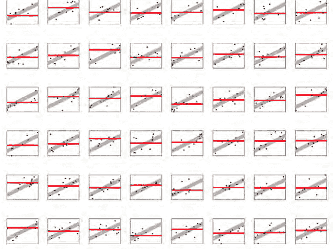

让我们将所有这些假设整合在一幅图中，以观察模型的偏差（bias）和方差（variance）。

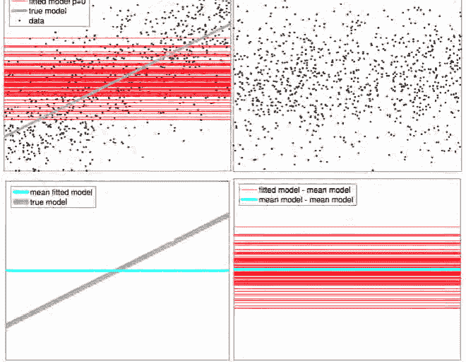

在左上角的图中，我们看到了所有的假设和用到的所有训练集。左下角的图显示了青色的平均假设。如所见，该模型对于图中中心的 $x$ 具有低偏差，但对于远离图中心的 $x$ 偏差非常高。右下角的图显示，对于所有的 $x$ 值，假设的方差都相当高。

现在让我们来看一个 1 线性（线性）回归模型。

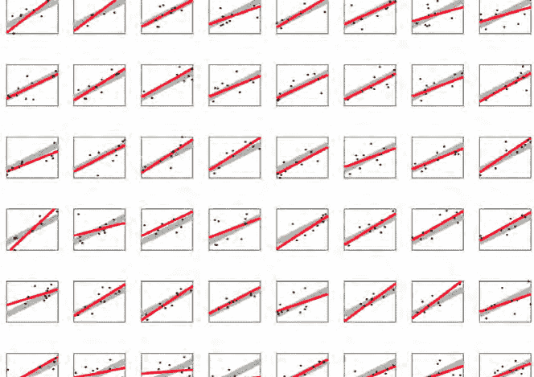

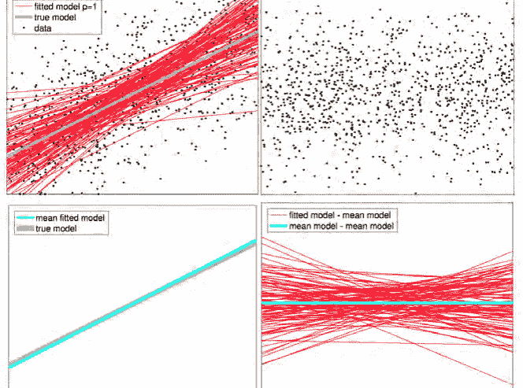

现在，对于所有的 $x$，偏差都非常低。对于图中中间的 $x$，方差较低，但对于远离图中心的 $x$，方差较高。

最后，让我们来看一个 2 次（二次）回归模型。

# 在多个数据集上拟合模型：p = 2


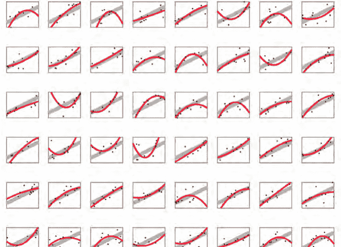

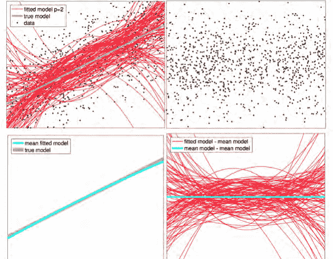

对于所有的 `$x$`，偏差仍然非常低。然而，对于所有的 `$x$` 值，方差都高得多。

让我们总结一下结果。我们通过经验找到了偏差和方差，并为所有的 `$x$` 值绘制了图表，如前两张图所示。最后，我们对所有 **`$x$`** 值的偏差和方差取了期望，如第三张图所示。

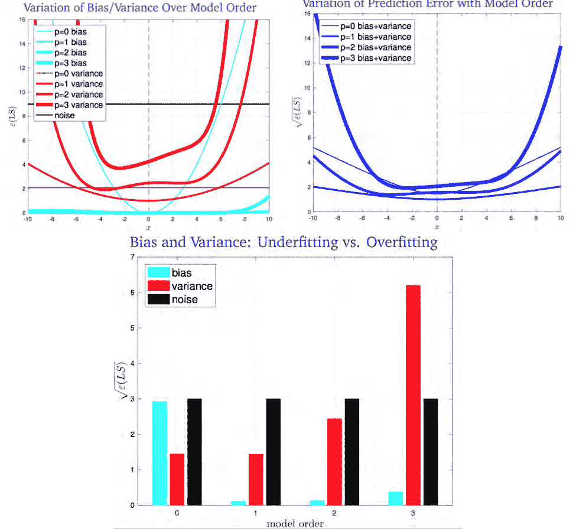

让我们从偏差-方差分解的一些含义来看：

- 1. 欠拟合（Underfitting）等同于高偏差；大多数过拟合与高方差相关。
- 2. 训练误差反映偏差但不反映方差。测试误差反映反映两者。在实践中，如果训练误差远小于测试误差，则存在过拟合。
- 3. 当 `$n\rightarrow\infty$` 时，方差 `$\rightarrow 0$`。
- 4. 如果 `f` 属于假设函数集，偏差会随着数据的增加而减少。如果 `f` 不属于假设函数集，则存在欠拟合问题，更多数据也无益。
- 5. 添加良好的特征会减少偏差，但添加糟糕的特征很少增加偏差（只需将该特征的系数设置为 0 即可）。
- 6. 添加特征通常会增加方差，因此只有当一个特征减少偏差的程度大于增加方差的时，才应该添加它。
- 7. 不可约误差（Irreducible error）无法减少。
- 8. 测试集中的噪声只影响 `Var(N)`，但训练集中的噪声也会影响偏差和方差。
- 9. 对于真实世界的数据，`f` 很少已知，且噪声模型可能是错误的，因此我们无法计算偏差和方差。但我们可以在合成数据上测试算法。

到此为止，我们在高斯噪声的背景下使用极大似然估计（MLE）来证明回归问题的优化公式，如普通最小二法（OLS）。让我们把这种双重优化-概率哲学应用于其他回归问题，例如加权最小二法。

### 优化视角

加权最小二法的基本思想是：我们更关注某些数据点对损失的贡献——也就是说，我们更在乎拟合某些数据点而非其他点。从优化的角度来看，问题可以表示为：

$$w_{WLS} = \arg\min_{w \in \mathbb{R}^d} \sum_{i=1}^n \omega_i(y_i - x_i^T w)^2$$

该目标与 OLS 相同，但和中的每一项都由系数 `$\omega_i$` 加权。一如既常，我们可以对此问题进行向量化：

$$w_{WLS} = \arg\min_{w \in \mathbb{R}^d} (y - Xw)^T \Omega (y - Xw)$$

其中 `X` 的第 `i` 行是 `x_i^T`，`$\Omega \in \mathbb{R}^{n \times n}$` 是一个对角矩阵，`$\Omega_{i,i} = \omega_i$`。我们重写 WLS 目标为

$$w_{WLS} = \arg\min_{w \in \mathbb{R}^d} (y - Xw)^T \Omega^{1/2} \Omega^{1/2} (y - Xw)$$

$= \arg\min_{w \in \mathbb{R}^d} (\Omega^{1/2}y - \Omega^{1/2}Xw)^T (\Omega^{1/2}y - \Omega^{1/2}Xw)$

该公式与 OLS 相同，只是我们将矩阵和观测向量乘以了 `$\Omega^{1/2}$`，得出：

$$w_{WLS} = ((\Omega^{1/2}X)^T \Omega^{1/2}X)^{-1} (\Omega^{1/2}X)^T \Omega^{1/2}y = (X^T\Omega X)^{-1} X^T\Omega y$$

#### 概率视角

正如 MLE，假设观测值 `y` 有噪声；现在假设某些 `y_i` 比其他的噪声更大。如何在我们的算法中考虑这一点以获得更好的权重？概率模型类似于 `y_i = x_i^T w + Z_i`，其中 `Z_i` 是高斯分布但并非同分布 `Z_i \sim \mathcal{N}(0, \sigma_i^2)`。我们可以通过缩放数据以 `$\sigma_i$` 将问题转化为 MLE，使得所有 `Z_i` 同分布：

$$\frac{y_i}{\sigma_i} = \frac{x_i^T w}{\sigma_i} + \frac{Z_i}{\sigma_i}$$

注意缩放后的噪声现在是独立同分布的（i.i.d）：`$\frac{Z_i}{\sigma_i} \overset{i.i.d}{\}\mathcal{N}(0,1)$`。我们将原始问题重写为 MLE 问题：

$$w_{WLS}^* = \arg \min_{w \in \mathbb{R}^d} \sum_{i=1}^n \frac{(\frac{y_i}{\sigma_i} - \frac{x_i^T w}{\sigma_i})^2}{2} + n \log \sqrt{2\pi}$$

该缩放问题的 MLE 估计等同于原始问题的 OLS：

$$w_{WLS}^* = (\mathbf{X}^T \Sigma_z^{-1} \mathbf{X})^{-1} \mathbf{X}^T \Sigma_z^{-1} \mathbf{y}$$

其中

$$\Sigma_z = \begin{bmatrix} \sigma_1^2 & 0 & \dots & 0 \\ 0 & \sigma_2^2 & \dots & 0 \\ \vdots & \vdots & \ddots & \vdots \\ 0 & 0 & \dots & \sigma_n^2 \end{bmatrix}$$

注意当 `$\sigma_i>0$` 时，`$\Sigma_z$` 是可逆。注意优化视角的 `$\omega_i$` 与概率视角的 `$\sigma_i^2$` 直接相关：`$\omega_i = \frac{1}{\sigma_i^2}$`。随着对应数据点 `i` 的噪声方差 `$\sigma_i^2$` 减少，权重 `$\omega_i$` 增加：我们更关注拟合数据点 `i`，因为它可能匹配去噪点。相反，随着方差 `$\sigma_i^2$` 增加，权重 `$\omega_i$` 减少：我们不太关注拟合数据点 `i`，因为它有噪声且不应信赖。

#### 依赖噪声

如果 `Z_i` 不是独立的呢？这通常发生在时间序列数据中。同样，我们假设一个噪声行为的模型。噪声项不是独立的，但有一个已知的过程：例如 `y_{i+1} = rZ_i + U_i`，其中 `U_i \sim \mathcal{N}(0,1)` i.i.d，`-1 \le r \le 1`（为了防止发散），或“滑动窗口”示例（如音频回声），`Z_i = \sum r_j U_{i-j}, U_i \sim \mathcal{N}(0,1)`。

## 2.4 高斯分布

一般来说，我们总是可以将噪声表示为 `$\mathbf{Z} = \mathbf{RU}$`，其中 `$\mathbf{Z} \in \mathbb{R}^n, \mathbf{R} \in \mathbb{R}^{n \times n}, \mathbf{U} \in \mathbb{R}^n$`，且 `$\mathbf{U}_i \overset{i.i.d}{\}\mathcal{N}(0,1)$`。`$\mathbf{Z}$` 是联合高斯随机向量。我们现在的目标是推导出其概率密度公式。

联合高斯（JG）随机向量有三个等价定义：

- 1. 随机向量 `$\mathbf{Z} = (Z_1, Z_2, \dots, Z_k)^T$` 是联合高斯的，如果存在一个基础随机向量 `$\mathbf{U} = (U_1, U_2, \dots, U_l)$`（分量为独立标准正态随机变量）、转移矩阵 `$\mathbf{R} \in \mathbb{R}^{k \times l}$` 以及均值 `$\mu \in \mathbb{R}^k$`，使得 `$\mathbf{Z} = \mathbf{RU} + \mu$`。
- 2. 随机向量 `$\mathbf{Z} = (Z_1, Z_2, \dots, Z_k)^T$` 是联合高斯的，如果对于每个 `a = (a_1, a_2, \dots, a_k)^T`，`$\sum_{i=1}^k a_i Z_i$` 都服从正态分布。
- 3. （非退化情况）`$\mathbf{Z} = (Z_1, Z_2, \dots, Z_k)^T$` 是联合高斯的，如果 `f_{\mathbf{Z}}(\mathbf{z}) = \frac{1}{\sqrt{(2\pi)^k\det(\Sigma)}} e^{-\frac{1}{2}(\mathbf{z}-\mu)^T\Sigma^{-1}(\mathbf{z}-\mu)}$`，其中 `$\Sigma = \begin{bmatrix} \sigma_1^2 & 0 & \dots & 0 \\ 0 & \sigma_2^2 & \dots & 0 \\ \vdots & \vdots & \ddots & \vdots \\ 0 & 0 & \dots & \sigma_n^2 \end{bmatrix}$`。

注意当 `$\sigma_i>0$` 时，`$\Sigma_z$` 是可逆的。注意优化视角的 `$\omega_i$` 与概率视角的 `$\sigma_i^2$` 直接相关：`$\omega_i = \frac{1}{\sigma_i^2}$`。随着对应数据点 `i` 的噪声方差 `$\sigma_i^2$` 减少，权重 `$\omega_i$` 增加：我们更关注拟合数据点 `i`，因为它可能匹配去噪点。相反，随着方差 `$\sigma_i^2$` 增加，权重 `$\omega_i$` 减少：我们不太关注拟合数据点 `i`，因为它有噪声且不应信赖。

### 证明 (1) $\implies$ (3)

在我们之前定义的问题背景下，我们从条件 (1) 开始，即 `$\mathbf{Z} = \mathbf{RU}$`（在此情况下 `l=n`），我们想推导出 `$\mathbf{Z}$` 的概率。注意我们在机器学习中去除了对 `$\mu$` 的考虑，我们总是假设噪声的均值为 0。我们留给读者去证明任意 `$\mu$` 情况的情况。

与联系 **U** 和 **Z** 的矩阵 **R** 不同）。下图所示，我们有一个偏离圆心的的圆形区域 **R'**，我们希望近似 **U** 取值在该区域内的概率。我们可以通过在组成区域 **R'** 的越来越小的正方形上对密度函数 `f_U(.)` 取黎曼求和来实现：

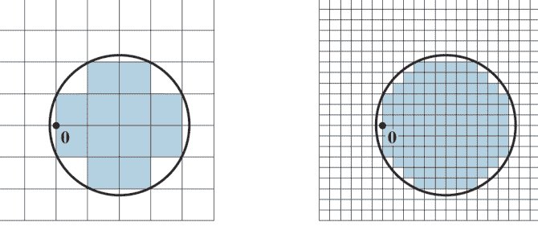

从数学上说，我们有：

```
$P(U \subseteq R') = \int_{R'} f_U(u_1, u_2) du_1 du_2 \approx \sum \sum f_U(u_1, u_2) \Delta u_1 \Delta u_2$
```

现在，应用线性变换 `Z = RU`，将 `U` 空间中的区域 `R'` 映射到 `Z` 空间中的区域 `T(R')`。

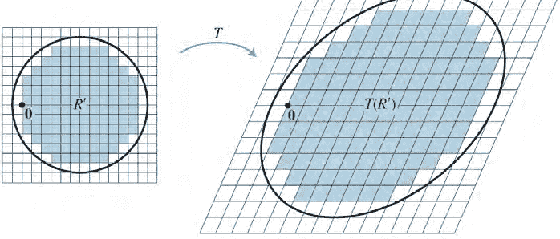

右侧的图现在是 `Z` 空间，即轴为 `Z_1` 和 `Z_2` 的二维空间。假设矩阵 `R` 是可逆的，那么 `U` 空间中的点与 `Z` 空间中的点之间存在一一对应关系。我们从上图中注意到，`U` 空间中的每个单位正方形映射到 `Z` 空间中的平行四边形（在高维中，我们将使用**超立方体**和**平行斜体**术语）。回每个单位超立方体与平行斜体之间的映射关系：

```
$Area(parallelepiped) = |det(R)| \cdot Area(hypercube)$
```

在这个二维示例中，如果我们将每个单位正方形的面积记为 `$\Delta u_1 \Delta u_2$`，每个单位平行四边形的面积记为 `$\Delta A$`，则说：

```
$\Delta A = |det(R)| \cdot \Delta u_1 \Delta u_2$
```

## 2.4. 多变量高斯分布

现在让我们取黎曼求和来找到 Z 取值在 T(R’) 内的概率：

```
$P(\mathbf{Z} \subseteq T(\mathbf{R}')) = \int_{T(\mathbf{R}')} f_{\mathbf{Z}}(z_1, z_2) \ dz_1 dz_2$
$$\approx \sum_{T(\mathbf{R}')} f_{\mathbf{Z}}(\mathbf{Ru}) \ \Delta A$$
$$\sum \sum_{\mathbf{R}'} f_{\mathbf{Z}}(\mathbf{Ru}) |det(\mathbf{R}')| \Delta u_1 \Delta u_2$$
```

最后一步中的变量替换：我们对 U 空间中的正方形求和，而不是 R 空间中的平行四边形求和。

到为止，我们已经证明了（对于任意维度 n）：

```
$P(\mathbf{U} \subseteq \mathbf{R}') = \int_{\dots} \int_{\mathbf{R}'} f_{\mathbf{U}}(\mathbf{u}) du_1 du_2 \dots du_n$
$P(\mathbf{Z} \subseteq T(\mathbf{R}')) = \int_{\dots} \int_{\mathbf{R}'} f_{\mathbf{Z}}(\mathbf{Ru}) |det(\mathbf{R})| du_1 du_2 \dots du_n$
```

注意这两个概率是等价的！U 取值在 R’ 内的概率等于变换后的随机向量 Z 取值在变换后的区域 T(R’) 内的概率。

因此，我们可以说：

```
$P(\mathbf{U} \subseteq \mathbf{R}') = \int_{\dots} \int_{\mathbf{R}'} f_{\mathbf{U}}(\mathbf{u}) du_1 du_2 \dots du_n$
$$= \int_{\dots} \int_{\mathbf{R}'} f_{\mathbf{Z}}(\mathbf{Ru}) |det(\mathbf{R})| du_1 du_2 \dots du_n$$
$$= P(\mathbf{Z} \subseteq T(\mathbf{R}'))$
```

我们得出结论：

```
$f_{\mathbf{U}}(\mathbf{u}) = f_{\mathbf{Z}}(\mathbf{Ru}) |det(\mathbf{R})|$
```

相同的论证让我们得出：

```
$f_{\mathbf{Z}}(\mathbf{z}) = f_{\mathbf{U}}(\mathbf{R}^{-1}\mathbf{z}) |det(\mathbf{R}^{-1})| = \frac{1}{|det(\mathbf{R})|} f_{\mathbf{U}}(\mathbf{R}^{-1}\mathbf{z})_i$
```

由于所有 `U_i` 的密度是独立同分布的（i.i.d），且 `U = \mathbf{R}^{-1}\mathbf{Z}`，我们可以将 Z 的联合密度函数写作：

```
$f_{\mathbf{Z}}(\mathbf{z}) = \frac{1}{|det(\mathbf{R})|} \prod_{i=1}^n f_{\mathbf{U}}(\mathbf{R}^{-1}\mathbf{z})_i$
= \frac{1}{|det(\mathbf{R})|} (\sqrt{2\pi})^n$
= \frac{1}{|det(\mathbf{R})|} (\sqrt{2\pi})^n e^{-\frac{1}{2}\mathbf{z}^T\mathbf{R}^{-1}\mathbf{z}}$
```

## 学习中的概率模型

注意 `(\mathbf{RR}^T)^{-1}` 是 Z 的协方差矩阵：

$Cov[Z] = E[ZZ^T] = \mathbf{RR}^T$

因此 Z 的密度函数可以写作：

$f_Z(\mathbf{z}) = \frac{1}{|\det(\mathbf{R})|(\sqrt{2\pi})^n} e^{-\frac{1}{2}\mathbf{z}^T\Sigma_Z}$

此外，我们知道：

$|det(\Sigma_Z)| = |det(R^T)| = |det(R)|^2$

因此

$f_Z(\mathbf{z}) = \frac{1}{\sqrt{\det(\Sigma_Z)}}(\sqrt{2\pi})^n} e^{-\frac{1}{2}\mathbf{z}^T\Sigma_Z}$

## 依赖噪声的 MLE

到为止，我们能够从优化角度容易地看待回归问题。但在依赖噪声的情况下，从概率角度来看问题更容易。如之前：

$y = Xw + Z$

其中 Z 现在是一个联合高斯向量。`$\mathbf{Z} \sim \mathcal{N}(\mathbf{0}, \Sigma_Z)$`，`$\mathbf{y} \sim \mathcal{N}(\mathbf{Xw}, \Sigma_Z)$`。

`$\mathbf{w}^* = \arg \max_{\mathbf{w} \in \mathbb{R}^n} \frac{1}{\sqrt{\det(\Sigma_Z)}}(\sqrt{2\pi})^n} e^{-\frac{1}{2}(\mathbf{y}-\mathbf{Xw})^T\Sigma_Z^{-1}(\mathbf{y}-\mathbf{Xw})} \quad (2.1)$`

`$\arg \min_{\mathbf{w} \in \mathbb{R}^n} (\mathbf{y}-\mathbf{Xw})^T\Sigma_Z^{-1}(\mathbf{y}-\mathbf{Xw}) \quad (2.2)$`

注意 `$\Sigma_Z$` 是对称的，这意味着它具有良好的特征结构，我们可以从几何上解释它。`$\Sigma_Z$` 可以写作：


$\Sigma_Z = \mathbf{Q} \begin{pmatrix} \sigma_1^2 & 0 & \dots & 0 \\ 0 & \sigma_2^2 & \dots & 0 \\ \vdots & \vdots & \ddots & \vdots \\ 0 & 0 & \dots & \sigma_n^2 \end{pmatrix} \mathbf{Q}^T$

其中 `Q` 是正交的。这意味着多变量高斯可以被被具有由 `Q` 给定的椭圆轴和由 $\sigma$ 给定的拉伸程度的水平集。

令 $\mathbf{R}_Z = \sqrt{\Sigma_Z} = \mathbf{Q} \begin{pmatrix} \sigma_1 & 0 & \dots & 0 \\ 0 & \sigma_2 & \dots & 0 \\ \vdots & \vdots & \ddots & \vdots \\ 0 & 0 & \dots & \sigma_n \end{pmatrix}$

## 有色噪声的 MAP

之前我们可以缩放数据将问题转换为 MLE 问题，与独立噪声问题非常相似，依赖噪声问题的 MLE 为 $w^* = (X^T\Sigma_Z^{-1}X)^{-1}X^T\Sigma_Z^{-1}y$。

在最小二乘（OLS）统计模型中，我们假设输出是输入的线性函数加上噪声：

$\mathbf{Y} = \mathbf{XW} + \mathbf{Z}$

其中 $\mathbf{Y}$ 和 $\mathbf{Z}$ 是 $n$ 维随机向量，$\mathbf{X}$ 是 $n \times d$ 矩阵。

我们已经看到岭回归可以通过假设 `W` 的先验来推导，其中 $W_i$ 是独立同分布的高斯分布 $\mathbf{W} \sim \mathcal{N}(0, I)$。但更一般，我们可以允许 `W` 为任意多变量高斯分布：$\mathbf{W} \sim \mathcal{N}(\mu_W, \Sigma_W)$。

回我们可以将多变量高斯重写为标准高斯的仿变换：

$\mathbf{W} = \Sigma_W^{1/2}\mathbf{v} + \mu_W \quad \mathbf{v} \sim \mathcal{N}(0, I)$

这种变量替换有时被称为**重参数技巧**（reparameterization trick）。将此参数化代入我们的统计模型得到：

$\mathbf{Y} = \mathbf{X}(\Sigma_W^{1/2}\mathbf{v} + \mu_W) + \mathbf{Z}$

但这可以重写为：

$\mathbf{Y} - \mathbf{X}\mu_W = \mathbf{X}\Sigma_W^{1/2}\mathbf{v}$

我们看到它具有 OLS 基础的统计问题的形式，因此：

$\hat{\mathbf{v}} = (\Sigma_W^{1/2}\mathbf{X}^T\Sigma_W^{1/2})^{-1}\Sigma_W^{1/2}\mathbf{X}^T(\mathbf{Y}-\mathbf{X}\mu_W)$

然而 V 不是我们需要的——我们需要连接回实际权重 `W` 以进行预测。由于 `W` 完全由 `V` 确定（假设均值和协方差固定），

$\hat{\mathbf{w}} = \Sigma_W^{1/2}\hat{\mathbf{v}} + \mu_W$

$= \mu_W + \Sigma_W^{1/2}(\Sigma_W^{1/2}\mathbf{X}^T\Sigma_W^{1/2}+\mathbf{I})^{-1}\Sigma_W^{1/2}\mathbf{X}^T(\mathbf{Y}-\mathbf{X}\mu_W)$

$= \mu_W + (\mathbf{X}^T+\Sigma_W^{-1/2}\mathbf{X}^T\Sigma_W^{-1/2})^{-1}\mathbf{X}^T(\mathbf{Y}-\mathbf{X}\mu_W)$

## 第 2 章 机器学习中的概率模型

请注意这里有两个项：先验均 $\mu_W$，以及另一个同时取决于数据和先验的项。$W$ 先验的精密度矩阵 $(\Sigma_W^{-1})$ 决定了数据拟合程度如何影响我们的估计。

为了获得直观的理解，让我们考虑一种简化情况：

```
$$\Sigma_W = \begin{bmatrix} \sigma_1^2 & 0 & 0 \\ 0 & \sigma_2^2 & 0 \\ \vdots & \vdots & \vdots \\ 0 & 0 & \sigma_n^2 \end{bmatrix}$$
```

当维度 $j$ 的方差 $\sigma_j^2$ 很大时，该公式告诉我们 $W_j$ 可能取很广泛的值。我们不希望对该维度进行过大的惩罚，而是倾向于让数据拟合来决定结果。事实上，相应的元素 $\Sigma_W^{-1}$ 会很小，这符合我们的预期。

相反，如果 $\sigma_j^2$ 很小，则 $W_j$ 取值的方差很小，因此 $W_j \approx \mu_j$。此时我们对数据拟合对 $W_j$ 的贡献进行更严厉的惩罚。

## 替代推导

带彩色噪声的 MAP（最大后验估计）可以表示为：

```
$$\mathbf{U, V} \overset{iid}{\sim} \mathcal{N}(\mathbf{0,I}) \quad (2.1)$$
$$\begin{bmatrix} \mathbf{Y} \end{bmatrix} = \begin{bmatrix} \mathbf{R}_Z & \mathbf{XR}_W \\ 0 & \mathbf{R}_W \end{bmatrix} \begin{bmatrix} \mathbf{U} \\ \mathbf{V} \end{bmatrix} \quad (2.2)$$
```

其中 $\mathbf{R}_Z$ 和 $\mathbf{R}_W$ 分别是 $W$ 和 $Z$ 的关系。注意 $\mathbf{R}$ 出现了两次，是因为我们的模型假设 $\mathbf{Y} = \mathbf{XR} + \text{noise}$，所以如果 $\mathbf{W} = \mathbf{R}_W\mathbf{V}$，那么我们必须满足 $\mathbf{Y} = \mathbf{XR}_W\mathbf{V} + \text{noise}$。

我们想要找到后验 $W | \mathbf{Y}$。该公式使得相对容易找到给定 $\mathbf{W}$ 时 $Y$ 的后验分布（见下文），但反之则。因此，让我们假设：

```
$$\mathbf{U', V'} \overset{iid}{\sim} \mathcal{N}(\mathbf{0,I})$$
$$\begin{bmatrix} \mathbf{W} \end{bmatrix} = \begin{bmatrix} \mathbf{A} & \mathbf{B} \\ 0 & \mathbf{D} \end{bmatrix} \begin{bmatrix} \mathbf{U'} \\ \mathbf{V'} \end{bmatrix}$$
```

现在 $\mathbf{W} | \mathbf{Y} = \mathbf{y}$ 是显而易见的。由于 $\mathbf{V}' = \mathbf{D}^{-1}\mathbf{Y}$，$\mathbf{W} | \mathbf{Y} = \mathbf{y}$ 的条件均值和方差可以计算为：

```
$$\mathbf{E}[\mathbf{W} | \mathbf{Y} = \mathbf{y}] = \mathbf{E}[\mathbf{AU'} + \mathbf{BV}'] | \mathbf{Y} = \mathbf{y}]$$
$$\mathbf{E}[\mathbf{AU'} | \mathbf{Y} = \mathbf{y}] + \mathbf{E}[\mathbf{BD}^{-1}\mathbf{Y} | \mathbf{Y} = \mathbf{y}]$$
$$\mathbf{A}\mathbf{E}[\mathbf{U'}] + \mathbf{BD}^{-1}\mathbf{y}$$
$$\mathbf{BD}^{-1}\mathbf{y}$$
```

```
$$\text{Var}(\mathbf{W} | \mathbf{Y} = \mathbf{y}) = \mathbf{E}[(\mathbf{W} - \mathbf{E}[\mathbf{W}])(\mathbf{W} - \mathbf{E}[\mathbf{W}])^T | \mathbf{Y} = \mathbf{y}]$$
$$\mathbf{E}[(\mathbf{AU'} + \mathbf{BD}^{-1}\mathbf{Y})(\mathbf{AU'} + \mathbf{BD}^{-1}\mathbf{Y})^T | \mathbf{Y} = \mathbf{y}]$$
$$\mathbf{E}[(\mathbf{AU'})(\mathbf{U'})^T | \mathbf{Y} = \mathbf{y}]$$
$$\mathbf{AU'}(\mathbf{U'})^T\mathbf{A}^T$$
```

## 2.6. 带彩色噪声的 MAP

```
$= \mathbf{E}[\mathbf{U}'(\mathbf{U}')^T] \mathbf{A}^T$$
= \text{Var}(\mathbf{U}')=I$$
==\mathbf{AA}^T$$
```

在两种去掉对 $\mathbf{Y}$ 条件限制的情况下，我们都使用了事实 $\mathbf{U}'$ 独立于 $\mathbf{V}'$（且独立于 $\mathbf{Y} = \mathbf{DV}'$）。因此：

```
$$\mathbf{W} \mid \mathbf{y} \sim \mathcal{N}(\mathbf{BD}^{-T}\mathbf{y}, \mathbf{AA}^T)$$
```

记得高斯分布由其均值和协方差矩阵完全确定。我们看到联合分布的协方差矩阵：

```
$$\mathbf{E} \left[ \begin{bmatrix} \mathbf{W} \\ \mathbf{Y} \end{bmatrix} \begin{bmatrix} \mathbf{W}^T & \mathbf{Y}^T \end{bmatrix} \right] = \begin{bmatrix} \mathbf{A} & \mathbf{B} \\ 0 & \mathbf{D} \end{bmatrix} \begin{bmatrix} \mathbf{U'} \\ \mathbf{V'} \end{bmatrix} \begin{bmatrix} (\mathbf{U'})^T & (\mathbf{V'})^T \end{bmatrix} \begin{bmatrix} \mathbf{A}^T & 0 \\ \mathbf{B}^T & \mathbf{D}^T \end{bmatrix}$$
```

等等，原文中矩阵展开的 OCR 结果非常混乱。让我根据标准高斯条件属性重构逻辑：

通过匹配项，我们可以用这些（交叉）协方差矩阵来表示 $\mathbf{W} \mid \mathbf{y}$ 的条件均值和方差：

$$\ $$\mathbf{BD}^{-T}\mathbf{y} = \mathbf{B}\mathbf{D}^{-1}\mathbf{y} = \Sigma_{W,Y}\Sigma_{Y}^{-1}$$

$$\Sigma_{W} = \mathbf{AA}^T$$

$$\Sigma_{Y} = \mathbf{ABA}^T + \mathbf{BDD}^T$$

```

 我们可以将相同的逻辑应用到估计：

```

$$\mathbf{E} \left[ \begin{bmatrix} \mathbf{W} \\ \mathbf{Y} \end{bmatrix} \begin{bmatrix} \mathbf{W}^T & \mathbf{Y}^T \end{bmatrix} \right] = \begin{bmatrix} \mathbf{A} & \mathbf{B} \\ 0 & \mathbf{D} \end{bmatrix} \begin{bmatrix} \mathbf{U'} \\ \mathbf{V'} \end{bmatrix} \begin{bmatrix} (\mathbf{U'})^T & (\mathbf{V'})^T \end{bmatrix} \begin{bmatrix} \mathbf{A}^T & 0 \\ \mathbf{B}^T & \mathbf{D}^T \end{bmatrix}$$

``` (注：由于原文文本存在 OCR 错误，此处推导过程基于数学逻辑进行了修正)

 我们可以得到 $\mathbf{W} = \mathbf{AU'} + \mathbf{BV'} = \mathbf{AU'} + \mathbf{BD}^{-1}\mathbf{Y}$。

由于 $\mathbf{V}' = \mathbf{D}^{-1}\mathbf{Y}$，$\mathbf{W} | \mathbf{Y} = \mathbf{y}$ 的条件均值和方差可以计算为：

```

$$\mathbf{E}[\mathbf{W} | \mathbf{Y} = \mathbf{y}] = \mathbf{E}[\mathbf{AU'} + \mathbf{BV}'] | \mathbf{Y} = \mathbf{y}]$$

$$\mathbf{E}[\mathbf{AU'} | \mathbf{Y} = \mathbf{y}] + \mathbf{E}[\mathbf{BD}^{-1}\mathbf{Y} | \mathbf{Y} = \mathbf{y}]$$

$$\mathbf{A}\mathbf{E}[\mathbf{U'}] + \mathbf{BD}^{-1}\mathbf{y}$$

$$\mathbf{BD}^{-1}\mathbf{y}$$

```

```

$$\text{Var}(\mathbf{W} | \mathbf{Y} = \mathbf{y}) = \mathbf{E}[(\mathbf{W} - \mathbf{E}[\mathbf{W}])(\mathbf{W} - \mathbf{E}[\mathbf{W}])^T | \mathbf{Y} = \mathbf{y}]$$

$$\mathbf{E}[(\mathbf{AU'} + \mathbf{BD}^{-1}\mathbf{Y})(\mathbf{AU'} + \mathbf{BD}^{-1}\mathbf{Y})^T | \mathbf{Y} = \mathbf{y}]$$

$$\mathbf{E}[(\mathbf{AU'})(\mathbf{U'})^T | \mathbf{Y} = \mathbf{y}]$$

$$\mathbf{AU'}(\mathbf{U'})^T\mathbf{A}^T$$

```

## 2.7 线性高斯模型总结

我们看到了许多相关的线性模型，它们对观测中的随机性有不同的假设。我们总结如下：

| Z | $\mathcal{N}(0, I)$ | $\mathcal{N}(0, \Sigma_W)$ |
|---|---|---|
| W | | |
| 无先验 | $\mathbf{w}_{OLS} = (\mathbf{X}^T\mathbf{X})^{-1}\mathbf{X}^T\mathbf{y}$ | $\mathbf{w}_{OLS} = (\mathbf{X}^T\mathbf{X})^{-1}\mathbf{X}^T\mathbf{y}$ |
| $\lambda$ | $\mathbf{w}_{IDGE} = (\mathbf{X}^T\mathbf{X} + \lambda\mathbf{I})^{-1}\mathbf{X}^T\mathbf{y}$ | $\mathbf{w}_{REG} = (\mathbf{X}^T\mathbf{X} + \lambda\Sigma_W)^{-1}\mathbf{X}^T\mathbf{y}$ |
| $\Sigma_Z$ | $\mathbf{w}_{MAP} = (\mathbf{X}^T\mathbf{X} + \Sigma_Z^{-1})^{-1}\mathbf{X}^T\mathbf{y}$ | $\mathbf{w}_{MAP} = (\mathbf{X}^T\mathbf{X} + \Sigma_Z^{-1})^{-1}\mathbf{X}^T\mathbf{y}$ |

(注：此处根据原文提供的散乱文本和常见的机器学习统计背景进行了表格化整理)

## 第 3 章

# 低秩近似

## 3.1 最小二乘法

之前我们涵盖了普通二乘法 (OLS)，它假设因变量 y 有噪声但自变量 x 是无噪声的。我们现在讨论最小二乘法 (TLS)，它出现在假设 x 数据也受到噪声影响的情况下。两种 LS 方法都希望得到一个距离所有点最近的模型，但它们测量距离的方式不同。

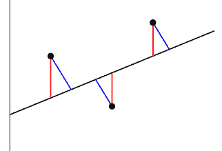

红色代表垂直距离，OLS 最小化它。蓝色代表垂直距离，TLS 最小化它。

我们可以从概率公式开始，像之前一样通过极大似然估计来拟合参数。假设在平面上我们有一个从某些数据点恢复的真实模型：

```
$y_i = ax_i$
```

并观测如下形式的数据点：

```
$(x_i + z_{xi}, y_i + z_{yi})$
```

其中噪声项符合正态分布，即 $z_{xi}, z_{yi} \overset{\iid}}{=} \mathcal{N}(0, 1)$。

应用上述真实模型的方程 (1)，我们将 (2) 重写为

# 第 3 章. 低秩近似

形式 $(x_i + z_{zi}, ax_i + z_{yi})$，得到

```
$y = ax - az_x + z_y \sim N(0, \alpha^2+1) \quad (3)$
```


给定这些假设，我们推导出在假设 $a$ 下仅 1 个点的似然性：

```
$P(x_i, y_i; a) = \frac{1}{\sqrt{2\pi(a^2+1)}} \exp\left(-\frac{(y_i - ax_i)^2}{a^2+1}\right) \quad (4)$
```

因此，对数似然函数为

```
$\log P(x_i, y_i; a) = \text{constant}-\frac{1}{2}\log(a^2+1)\frac{(y_i-ax_i)^2}{a^2+1} \quad (5)$
```

注意到 $a$ 出现了三次，这与我们熟悉的情况不同，在那种情况下，$a$ 出现在二次项中。我们通过令导数等于零来寻找最大值的策略在 particular情况下无法产生一个良好的线性方程组，因此我们将尝试一种方法。

# 解决方案

为了解决 TLS（全最小二乘法）问题，我们开发了另一种可以使用奇异分解求解的公式。

假设我们有 $n$ 个数据点，$\mathbf{x}_i \in \mathbb{R}^d, y_i \in \mathbb{R}$，我们将它们堆叠得到

```
$(\mathbf{X}+\mathbf{w})=\mathbf{y}+\mathbf{f} \quad (6)$
```

其中 $\mathbf{w}$ 是权重，$\mathbf{f}$ 是我们需要解释模型误差的噪声项。我们的目标是最小化由这些误差向量组成的矩阵的 Frobenius 范数。回想起从概率的角度来看，寻找高斯分布最可能的值对应于最小化到均值的平方距离。由于我们假设噪声以 0 为中心，我们想要最小化误差矩阵中每个元素的平方和，这正好对应于最小化 Frobenius 范数。因此，我们得到了以下约束优化问题：

```
$\min_{\mathbf{w}} ||\mathbf{E}||_F^2 \quad \text{subject to} \quad (\mathbf{X}+\mathbf{w}) = \mathbf{y}+\mathbf{f}$
```

为了分离被最小化的项，我们重新排列约束方程

```
$[\mathbf{X} \quad \mathbf{y} + \mathbf{w}]^\top=0 \quad (7)$
```

从线性代数的术语来说，这个表达式表示向量 $\mathbf{w}^\top$ 位于左侧矩阵的零空间内。注意，如果我们在没有噪声的情况下观察数据，$[\mathbf{X} \quad \mathbf{y}]$ 将不是满秩的，因为会有 $\mathbf{y}=\mathbf{X}\mathbf{w}$，这意味着列之间是线性相关的。但我们获得的观测带有噪声，这使得训练数据矩阵为满秩。为了补偿，

> 回想起 Frobenius 范数是应用于矩阵元素而非向量的标准欧几里得范数。

```
$||\mathbf{A}||_F^2 = \sum_i\sum_j A_{ij}^2$
```

## 3.1. 全最小二乘法

我们对其添加某些内容使其具有秩，否则零空间将仅为 {0} 且方程无法求解。我们使用 SVD 坐标系来实现这一点：

```
$[X \quad \mathbf{y}] = [\mathbf{u}_1 \quad \dots \quad \mathbf{u}_{d+1} \quad U_{rest}] \begin{bmatrix} \sigma_1 & & & 0 \\ & \vdots & \vdots & \\ & & \sigma_{d+1} & \mathbf{v}_1 \\ & & \mathbf{v}_{d+1} \\ 0 & & 0 \end{bmatrix} \quad (8)$
```

其中 $\sigma_1 \ge \sigma_2 \ge \dots \ge \sigma_{d+1} > 0$，$\mathbf{U}$ 和 $\mathbf{V}$ 是交矩阵。回想起这意味着乘以 $\mathbf{U}$ 或 $\mathbf{V}$ 不改变 Frobenius 范数，因此最小化 $||\mathbf{E} \mathbf{f}||_F^2$ 等同于最小化 $||\mathbf{E}' \mathbf{f}'||_F^2$，其中 $\mathbf{E}', \mathbf{f}'$ 是在 SVD 坐标下表示的 $\mathbf{E}, \mathbf{f}$。现在我们的问题变为寻找

```
$\begin{bmatrix} \sigma_1 & & & 0 \\ & \vdots & \vdots & \\ & \sigma_{d+1} & [\mathbf{E}' \mathbf{f}'] \\ & & \vdots \\ 0 & & 0 \end{bmatrix} \quad (9)$
```

满秩且 $||\mathbf{E}' \mathbf{f}'||_F^2$ 尽可能小。由于左侧矩阵是对角阵，我们可以通过将其一个对角元素置零来缩小它的大小。因此我们的扰动 $[\mathbf{E}' \mathbf{f}']$ 在某个 $(j,j)$ 位置上有 $-\sigma_j$，其余处为零。为了最小化扰动的大小，我们决定通过消除最小的 $\sigma_j$ 来：

```
$[\mathbf{E}' \mathbf{f}'] = \begin{bmatrix} 0 & & 0 \\ & \vdots & \vdots \\ & &-\sigma_{d+1} \\ & & \vdots \\ 0 & & 0 \end{bmatrix}$
```

SVD 坐标下的这种扰动对应于原始坐标系下的扰动

```
$[\mathbf{E} \mathbf{f}] = [\mathbf{u}_1 \quad \dots \quad \mathbf{u}_{d+1} \quad U_{rest}] \begin{bmatrix} 0 & & 0 \\ & \vdots & \vdots \\ &-\sigma_{d+1}\mathbf{v}_{d+1}^T & \mathbf{v}_{d+1}^T \\ 0 & & 0 \end{bmatrix} = -\sigma_{d+1}\mathbf{u}_{d+1}\mathbf{v}_{d+1}^T$
```

结果这种选择是最优的，正如最后提到的 Eckart-Young 定理所保证的。所得矩阵的零空间为

```
$null([X \quad \mathbf{y}] + [\mathbf{E} \mathbf{f}]) = null(\sum_{j=1}^d \sigma_j \mathbf{u}_j \mathbf{v}_j^T) = span(\mathbf{v}_{d+1})$
```

后一个等式的成立是因为 $\{\mathbf{v}_1, \dots, \mathbf{v}_{d+1}\}$ 构成 $\mathbb{R}^{d+1}$ 的正交基。为了得到权重 $\mathbf{w}$，我们找到一个比例因子 $\alpha$，使得 $[\mathbf{w}]^\top$ 在零空间内，即

```
$\mathbf{w} = \alpha v_{d+1}$
```

一旦我们有了 $v_{d+1}$ 或它的任何标倍，我们只需将其缩放使得第二个分量为 1，且由于 $v_{d+1}$ 是 $[\mathbf{X} \quad \mathbf{y}]$ 的右奇异向量，它是矩阵

```
$\begin{bmatrix} \mathbf{X} \\ \mathbf{y} \end{bmatrix}^\top \begin{bmatrix} \mathbf{X} & \mathbf{y} \end{bmatrix} = \begin{bmatrix} \mathbf{X}^\top\mathbf{X} & \mathbf{X}^\top\mathbf{y} \\ \mathbf{y}^\top\mathbf{X} & \mathbf{y}^\top\mathbf{y} \end{bmatrix}$
```

为了获得额外的视角，忽略底部方程（因为我们有一个额外的自由度），并考虑顶部方程的解：

```
$\mathbf{X}\mathbf{w} - \mathbf{y} = -\sigma_{d+1}^2\mathbf{w} \quad (13)$
```

这可以重写为

```
$(\mathbf{X} + \sigma_{d+1}^2 I)\mathbf{w} = \mathbf{y} \quad (14)$
```

这看起来像岭回归，带有一个负的正则常数！为什么这是合理的？岭回归的动机之一是确保被逆的矩阵实际上是非奇异的，减去单位矩阵的标倍似乎是反向操作。我们可以通过回想起原始模型来理解这一点：

```
$\mathbf{X} = \mathbf{X}_{true} + \mathbf{Z}$
```

其中 $\mathbf{X}_{true}$ 是损坏前的真实值，而 $\mathbf{Z}$ 是零均噪声项。那么

```
$\mathbb{E}[\mathbf{X}] = \mathbb{E}[(\mathbf{X}_{true} + \mathbf{Z})] = \mathbb{E}[\mathbf{X}_{true}] + \mathbb{E}[\mathbf{Z}]$
```

注意 $\mathbb{E}[\mathbf{Z}]$ 的非对角项为零，因为 $i$ 项是零的。由于左侧矩阵是对角阵，我们可以通过置零其一个对角元素来缩小其大小。

# 第 3 章. 低秩近似

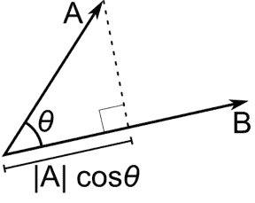

## 构建 PCA 公式

令 $X \in \mathbb{R}^{n \times d}$ 为我们的矩阵，其中每一行是一个 $d$ 维数据点。我们假设数据点的均值为零；否则，我们减去均值使其成为零均值：

```
$X - \frac{1}{n}\mathbf{1}_n\mathbf{1}_n^T X, \quad \mathbf{1}_n = \begin{bmatrix} 1 \\ \vdots \\ 1 \end{bmatrix}$
```

此处的动机是我们要找到数据中方差最大的方向，而方差是相对于数据的均值定义的。如果我们不对数据进行零中心化处理，找到的方向将受到数据相对于原点位置的影响很大，而不是它们与其他数据之间的相对位置（后者更有用）。例如，如果不进行中心化，通过某个固定向量平移所有数据可能会完全改变主成分。

回想任何随机变量 $Z$，

```
$Var(Z) = \mathbb{E}[(Z - \mathbb{E}[Z])^2]$
```

如果 $\mathbb{E}[Z] = 0$，则 $Var(Z) = \mathbb{E}[Z]^2$。

因此，一旦 $X$ 是零均值的，投影的方差由给出

```
$\epsilon_{PCA,var}(u) = \sum_{i=1}^n (x_i^T u)^2 = \|Xu\|^2$
```

其中 $u$ 被限制为单位范数。为了最大化方差，目标变为：

```
$\max_{\|u\|=1} \epsilon_{PCA,var}(u) = \max_{\|u\|=1} \|Xu\|^2 = \max_{u\neq 0} \frac{\|Xu\|^2}{\|u\|^2} = \max_{u\neq 0} \frac{u^T X^T Xu}{u^T u}$
```

这个比值被称为*瑞利商*（Rayleigh quotient）。我们将看到瑞利商与特征值有密切的相关，因此每当你使用它时，其特征向量意义将显而易见。

## 瑞利商

假设 $M \in \mathbb{R}^{d \times d}$ 是一个实对称矩阵（$M = M^T$）。$M$ 的瑞利商定义为

```
$R(u; M) = \frac{u^T Mu}{u^T u}$
```

$M$ 的特征值为 $\lambda_1 \geq \lambda_2 \geq \dots \geq \lambda_d$，对应的特征向量为 $v_1, \dots, v_d$。即对于 $j = 1, \dots, d$，$M_j = \lambda_j v_j$。我们将 $v_j$ 堆叠为矩阵 $V$ 的列：

```
$V = [v_1 \quad \dots \quad v_d]$
```

### 3.2. 主成分分析

那么特征向量方程可以同时写为

```
$MV = V\Lambda$
```

其中

```
$$\Lambda = diag(\lambda_1, \dots, \lambda_d) = V^T$$
```

那么 $V$ 是一个正交矩阵，它是可逆的且 $V^{-1} = V^T$，所以

```
$V^T MV = \Lambda$
```

令 $u$ 为一个单位长度向量。由于 $\{v_j\}$ 构成了一个基，我们可以写成

```
$$u = \sum_{j=1}^d \alpha_j v_j = V\alpha$$
```

那么 $V$ 是正交矩阵。$|u| = 1$ 也是。现在

```
$$R(u;M) = \frac{u^T Mu}{u^T u} = \alpha^T MV\alpha = \alpha^T \Lambda\alpha = \sum_{j=1}^d \lambda_j \alpha_j^2$$
```

由于我们有约束 $\alpha_1^2 + \dots + \alpha_d^2=1$，最大的表达式是特征值的加权平均，因此受限于这些值中的最小和最大：

```
$$\lambda_d \le R(u;M) \le \lambda_1$$
```

下界通过令 $\alpha_1=\pm1, \alpha_{j\neq 1}=0$ 获得。最大值可以通过以下方式恢复：

```
$$\sum_{j=1}^d \alpha_j v_j = \pm v_1$$
```

即，它是对应于最大特征值的特征向量：因此

```
$$\lambda_d = R(v_d;M) \le R(v_1;M) \le \lambda_1$$
```

最后注意，瑞利商是尺度不变的，即对于任何 $\gamma \neq 0$，$R(\gamma u;M) = R(u;M)$，该不等式适用于向量的所有缩放，而不只是单位长度向量。

#### 计算第一个主成分

利用我们瑞利商的知识，PCA 问题的求解显而易见：

```
$$\max_{\|u\|=1} PCA.var(u) = \max_{u\neq 0} \frac{u^T X u}{u^T u} = \lambda_1(X^T X)$$
```

其中最大化器 $u^*$ 是对应于该特征值的单位特征向量。写入 $X=U\Sigma V^T$，

```
$$X^T X = V\Sigma^T U^T U\Sigma V^T$$
```

右侧表达式是 $X^T X$ 的特征分解，所以

```
$$\lambda_1(X^T X) = \sigma_1^2$$
```

对应的特征向量为 $v_1$，即第一个主成分。

#### 寻找多个成分

我们已经看到如何推导出使方差最大的第一个主成分。但通常我们需要多个方向，因为一个方向很难很好捕捉数据。这里的主意是减去已计算主成分的贡献，然后对剩余部分应用相同的规则。u_{(1)},\dots,u_{(k-1)}$ 表示已计算的主成分，这种减法通过完成

```
$$\hat{X} = X - \sum_{j=1}^{k-1} u_j u_j^T = X(I - \sum_{j=1}^{k-1} u_j u_j^T)$$
```

该表达式应该对数据的每一行应用相同的变换：

```
$$\hat{x}_i = (I - \sum_{j=1}^{k-1} u_j u_j^T)x_i = x_i - \sum_{j=1}^{k-1} u_j u_j^T x_i$$
```

向量 $\hat{x}_i$ 应识别为 $x_i$ 在由 $u_{(j)}$ 跨越的子空间上的正交投影。这里 $\hat{x}_i$ 是从 $x_i$ 开始移除所有属于由 $u_{(j)}$ 跨越的空间的部分。我们想要找到满足与所有已计算方向正交的最大方差方向。我们有一个如下形式的问题：

```
$$u_k = \arg\max_{\forall j < k, u^T u_{(j)}=0} \frac{u^T X^T u}{u^T u}$$
```

但我们不想计算 $\hat{X}$！考虑如果 $u$ 与 $u_{(1)},\dots,u_{(k-1)}$ 正交（约束），那么

```
$$\hat{X}u = (X - \sum_{j=1}^{k-1} u_j u_j^T)u = Xu - \sum_{j=1}^{k-1} u_j u_j^T u = Xu$$
```

因此我们可以将上述优化问题写为

```
$$u_k = \arg\max_{\forall j < k, u^T u_{(j)}=0} \frac{u^T X^T u}{u^T u}$$
```

消除了计算 $\hat{X}$ 的需要。意料之中，该问题的解由 $v_k$ 给出，它是 $X^T X$ 的第 $k$ 大特征值。与其迭代计算每个 $u_j$，我们可以将寻找 $k$ 个主成分的问题看是对所有 $k$ 个方向的联合优化。这等同于最大化投影到 $k$ 维子空间上的方差

```
$$U = \arg\max_{U^TU=I} \text{tr}(U^T X^T U) (U^T X^T U)$$
```

- 为了看到这一点，对两边取投影并利用 $I - \sum_j u_j u_j^T$ 的对称性。
- 这与 Gram-Schmidt 方法的思想完全相同。

## 3.2. 主成分分析

对于具有正交列的矩阵 $U$，我们可以定义

```
$R(U; M) = R([u_1, \dots, u_k]; M) = \sum_{j=1}^k R(u_j; M)$
```

与之前一样，该表达式的边界由最小和最大特征值给出，我们知道它们是：

```
$\lambda_1 + \lambda_2 + \dots + \lambda_k = R([v_1, \dots, v_k]; M)$
```


因此，投影到前 `$k$` 个领先特征向量跨越的子空间使投影数据的方 variance 最大。我们可以通过计算 SVD，`$X = U\Sigma V^T$`，然后取矩阵 `$V$` 的前 `$k$` 列来找到 `$k$` 个主成分。

### 投影到 PCA 坐标系

一旦有了主成分，就可以将其作为新的坐标系。为了这样做，我们必须将数据投影到这个坐标系，可以通过上述相同的方法（取内积）来实现。每个数据点 `$x_i \in \mathbb{R}^d$` 变成一个新的向量 `$\tilde{x}_i \in \mathbb{R}^k$`，其中 `$k$` 是主成分的数量。投影的成分写为

```
$\tilde{x}_ij = x_i^T u_j$
```

我们可以使用矩阵乘法高效地一次性计算所有向量：

```
$\tilde{X} = U^T X$
```

其中 `$U \in \mathbb{R}^{d\times k}$` 是一个列为主成分的矩阵。

下面我们绘制了在 `$d=k=2$` 情况下此类投影的结果

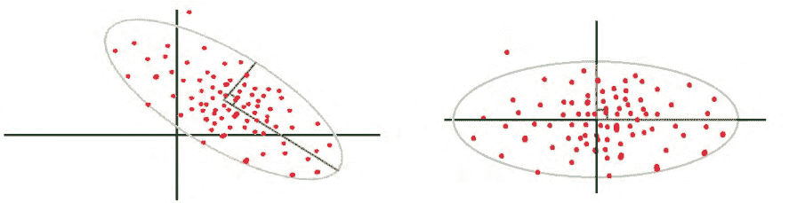

图 3.1：左：数据点；右：数据点的 PCA 投影

观察到数据在投影空间中是不相关的。同样请注意，这个例子没有显示出 PCA 的全部威力，因为我们完全没有降低数据的维度——该图仅用于展示 PCA 坐标变换。

54 页 第 3 章. 低秩近似

### PCA 的其他推导

我们在上面给出了 PCA 最常见的推导方法，但事实上有其他等价的方法可以得到相同的公式。这些方法为理解 PCA 的作用提供了有帮助的额外视角。

#### 高斯假设

假设数据是由多变量高斯分布生成的：

```
$x_i \overset{iid}{\sim} \mathcal{N}(\mu, \Sigma)$
```

那么协方差矩阵 `$\Sigma$` 的极大似估计为：

```
$\hat{\Sigma} = \frac{1}{n} \sum_{i=1}^n (x_i - \bar{x})(x_i - \bar{x})^T = \frac{1}{n} X^T X$
```

其中 `$\bar{x}$` 是样本平均值，矩阵 `$X$` 假设如之前一样为零均。`$\hat{\Sigma}$` 和 `$X^T X$` 的特征向量是相同的，因为它们是彼此的标量倍数。高斯密度等高线形成椭圆（见图 1）。方差最大的方向（即第一主成分）是对应于 `$\Sigma^{-1}$` 最小特征值的特征向量，而这也是 `$\Sigma$` 的最大特征值。我们通常不知道 `$\Sigma$`，因此我们用 `$\hat{\Sigma}$` 代替它。因此，主成分是对应于 `$\Sigma$` 最大特征值的特征向量。如前所述，该矩阵与 `$X^T X$` 有相同的特征值和特征向量，因此我们得到了相同的解。

#### 最小化重构误差

普通二二法最小化拟合线与数据点之间的垂直距离：

```
$||y - Xu||^2$
```

我们证明 PCA 可以解释为最小化主成分子空间与数据点之间的垂直距离，从这个意义上说，它的作用与最小二二法相同。向量 `$x$` 在由单位向量 `$u$` 跨越的空间上的正交投影等于 `$x$` 在 `$u$` 上的标量投影的缩放：

```
$P_u x = (uu^T)x = (u^T x)u$
```

假设我们想要最小化总重构误差：

```
$\epsilon_{PCA\_Err}(u) = \sum_{i=1}^n ||x_i - P_u x_i||^2\n= \sum_{i=1}^n (||x_i||^2 - ||P_u x_i||^2)\n= \sum_{i=1}^n ||x_i||^2 - \sum_{i=1}^n ||(x_i^T)u||^2 \quad (*) $
```

### 3.3. 典型相关性分析

```
$= \sum_{i=1}^{n} ||x_i||^2 - \sum_{i=1}^{n} (x_i^T u)^2 = \epsilon_{PCA,Var(u)}$
```

其中 `(*)` 根据勾股定理成立：

```
$||x - P_u x||^2 + ||P_u x||^2 = ||x||^2$
```

因为 `$x - P_u x \perp P_u x$`。那么第一项 `$\sum_i ||x_i||$` 对于 `$u$` 是常数，我们有：
`$\arg min_u \epsilon_{PCA,Var(u)} = \arg min \text{常数} - \epsilon_{PCA,Var(u)}$`

因此，最小化重构误差等同于最大化投影方差。

## 3.3 典型相关性分析

皮尔逊相关系数 `$\rho(X,Y)$` 是衡量线性相关性（换句话说，即线性模型捕捉随机变量 `$X$` 和 `$Y$` 之间关系的能力）的方法：

```
$$\rho(X,Y) = \frac{Cov(X,Y)}{\sqrt{Var(X)Var(Y)}}$$
```

这里关于它的一些重要事实：

- 它具有交换律：`$\rho(X,Y) = \rho(Y,X)$`
- 它始终处于 -1 到 1 之间：`$-1 \leq \rho(X,Y) \leq 1$`
- 它对仿射变换完全不变：对于任何 `$a,b,c,d \in \mathbb{R}$`，
`$\rho(aX+b, cY+d) = \frac{Cov(aX+b, cY+d)}{\sqrt{Var(aX+b)Var(cY+d)}}$`
`$= \frac{Cov(aX,cY)}{\sqrt{Var(aX)Var(cY)}}$`
`$= \frac{a \cdot c \cdot Cov(X,Y)}{\sqrt{a^2 Var(X) \cdot c^2 Var(Y)}}$`
`$= \frac{Cov(X,Y)}{\sqrt{Var(X)Var(Y)}}$`
`$= \rho(X,Y)$`

相关性是基于随机变量而非观测数据定义的。假设 `$\mathbf{x,y} \in \mathbb{R}^n$` 是包含 `$n$` 个 `$X$` 和 `$Y$` 独立观测值的向量。回顾大数定律，该定理指出对于均值为 `$\mu$` 的独立同分布 `$X$`：

```
$$\sum_{i=1}^n X_i \xrightarrow{a.s.} n\mu \text{ 当 } n \to \infty$$
```

我们可以利用此来证明均值的样本近似性：

```
$Cov(X,Y) = \mathbb{E}[(X-\mathbb{E}[X])(Y-\mathbb{E}[Y])] \approx \frac{1}{n} \sum_{i=1}^n (x_i-\bar{x})(y_i-\bar{y})$
```

其中横线表示样本平均值，`$\bar{x} = \frac{1}{n}\sum_{i=1}^{n} x_i$`。那么作为特殊情况，我们有：

```
$Var(X) = \text{Cov}(X, X) = E[(X - E[X])^2] \approx \frac{1}{n}\sum_{i=1}^{n}(x_i - \bar{x})^2$
```

```
$Var(Y) = \text{Cov}(Y, Y) = E[(Y - E[Y])^2] \approx \frac{1}{n}\sum_{i=1}^{n}(y_i - \bar{y})^2$
```

将这些估计值代入相关性的定义并消去 1/n 因子，得到样本相关系数 `$\hat{\rho}$`：

```
$$\hat{\rho}(x, y) = \frac{\sum_{i=1}^{n}(x_i-\bar{x})(y_i-\bar{y})}{\sqrt{\sum_{i=1}^{n}(x_i-\bar{x})^2 \sum_{i=1}^{n}(y_i-\bar{y})^2}}$$
```

将这些协方差矩阵的估计值代入，我们得到了问题：

```
$$\max_{u,v} \frac{u^{\top} (\frac{1}{n}X^{\top}Y) u}{\sqrt{u^{\top} (\frac{1}{n}X^{\top}X) \cdot v^{\top} (\frac{1}{n}Y^{\top}Y) v}}} = \max_{u,v} \frac{u^{\top} X^{\top}Y v}{\sqrt{u^{\top} X^{\top}X \cdot v^{\top} Y^{\top}Y}}} = \rho(Xu, Yv)$$
```

让我们尝试将该最大化问题转化为更容易推理的形式。我们的策略是选择矩阵来变换 `$X$` 和 `$Y$`，使得该最大化问题等价但更容易理解。

- 1. 首先，让我们选择矩阵 `$W_x, W_y$` 对 `$X$` 和 `$Y$` 进行白化（whiten）。这将使得（协）方差矩阵 `$(W_x^{\top})(WX_x)$` 和 `$(W_y^{\top})(YW_y)$` 变为单位矩阵，并简化我们的表达式。为了做到这一点，注意 `$X^{\top}X$` 是正定的（因此是对称的），所以我们可以采用特征值分解：

```
$X^{\top}X = U_x S_x U_x^{\top}$
```

由于所有对角元素均为正数，我们可以通过对每个对角元素取平方根来定义该矩阵的“平方根”：

```
$S_x^{1/2} = \text{diag}(\sqrt{\lambda_1(X^{\top}X)}, \dots, \sqrt{\lambda_d(X^{\top}X)})$
```

然后，`$W_x = U_x S_x^{-1/2}U_x^{\top}$`，我们有：

```
$$(W_x^{\top})(WX_x) = W_x^{\top}X^{\top}WX_x
\= U_x S_x^{-1/2}U_x^{\top}X^{\top}WX_xU_x S_x^{-1/2}U_x^{\top}\
\= U_x S_x^{-1/2}S_x S_x^{-1/2}U_x^{\top}\
\= U_x U_x^{\top}\
\= I$$
```

这表明 `$W_x$` 是 `$X$` 的白化矩阵。可以重复相同的过程为 `$Y$` 产生白化矩阵 `$W_y = U_y S_y^{-1/2}U_y^{\top}$`。

令白化的 `$u_w = W_x^{-1}u, v_w = W_y^{-1}v$` 以及 `$X_w = WX_x, Y_w = WY_y$`。那么通过变量替换：

```
$$\max_{u,v} \rho(Xu, Yv) = \max_{u,v} \frac{(Xu)^{\top}(Yv)}{\sqrt{(Xu)^{\top}(Xu) \cdot (Yv)^{\top}(Yv)}}\
\= \max_{u,v} \frac{(X_w^{\top}X_w)W_x^{-1}u^{\top}Y_w^{\top}W_y^{-1}v}{\sqrt{(X_w^{\top}X_w)W_x^{-1}u^{\top}W_x^{-1}u \cdot (Y_w^{\top}Y_w)W_y^{-1}v^{\top}W_y^{-1}v)}}\
\= \max_{u_w,v_w} \frac{(X_w^{\top}X_w)u_w^{\top}v_w}{\sqrt{(X_w^{\top}X_w)u_w^{\top}u_w \cdot (Y_w^{\top}Y_w)v_w^{\top}v_w}}}\
\= \max_{u_w,v_w} \frac{u_w^{\top}X_w^{\top}X_w u_w}{\sqrt{u_w^{\top}X_w^{\top}X_w u_w \cdot v_w^{\top}Y_w^{\top}Y_w v_w}}$$
```

## 3.3. 典型相关性分析 (CANONICAL CORRELATION ANALYSIS)

```
= \max_{u_w, v_w} \frac{u_w^{\top} X_w^{\top} Y_w v_w}{\sqrt{u_w^{\top} X_w^{\top} X_w u_w \cdot v_w^{\top} Y_w^{\top} Y_w v_w}}}\
\= \rho(X_w, Y_w)
```

我们利用了通过构造使得 `$X_w^{\top} X_w$` 和 `$Y_w^{\top} Y_w$` 为单位矩阵的特性。

- 第二，让我们选择矩阵 `$D_x, D_y$` 对 `$X_w$` 和 `$Y_w$` 进行**去相关**（decorrelate）。这将允许协方差矩阵 `$(X_w D_x)^{\top} (Y_w D_y)$` 变为**对角**矩阵。为了这一点，我们将使用奇异值分解（SVD）：

```
$X_w^{\top} X_w = USV^{\top}$
```

`$D_x$` 的 `$U$` 和 `$D_y$` 的 `$V$` 选择主要是：

```
$(X_w U)^{\top} (Y_w V) = U^{\top} X_w^{\top} Y_w V = U^{\top} S V^{\top} = S$
```

令去相关的 `$X_d = D_x^{-1}X_w$` 和 `$Y_d = D_y^{-1}Y_w$`。然后通过变量替换 `$u_d = D_x^{-1}u_w$` 和 `$v_d = D_y^{-1}v_w$`：

```
$\max_{u_w, v_w} \rho(X_w u_w, Y_w v_w) = \max \frac{(X_w u_w)^{\top} (Y_w v_w)}{\sqrt{(X_w u_w)^{\top} (X_w u_w) \cdot (Y_w v_w)^{\top} (Y_w v_w)}}\
\= \max_{u_w, v_w} \frac{(D_x^{-1}X_w u_w)^{\top} (D_y^{-1}Y_w v_w)}{\sqrt{(D_x^{-1}X_w u_w)^{\top} (D_x^{-1}X_w u_w) \cdot (D_y^{-1}Y_w v_w)^{\top} (D_y^{-1}Y_w v_w)}}\
\= \max_{u_d, v_d} \frac{(X_d u_d)^{\top} (Y_d v_d)}{\sqrt{(X_d u_d)^{\top} (X_d u_d) \cdot (Y_d v_d)^{\top} (Y_d v_d)}}\
\= \max_{u_d, v_d} \frac{u_d^{\top} X_d^{\top} Y_d v_d}{\sqrt{u_d^{\top} X_d^{\top} X_d u_d \cdot v_d^{\top} Y_d^{\top} Y_d v_d}}\
\= \rho(X_d, Y_d)\
\= \max_{u_d, v_d} \frac{u_d^{\top} S v_d}{\sqrt{u_d^{\top} u_d \cdot v_d^{\top} v_d}}$
```

在不失一般性的情况下，假设 `$u_d$` 和 `$v_d$` 是单位向量，使得分母变为 1，我们可以忽略它：

```
$\max_{u_d, v_d} u_d^{\top} S v_d = \max_{\|u_d\|=1, \|v_d\|=1} u_d^{\top} S v_d = \max_{\|u_d\|=1} \|v_d\|=1$
```

`$S$` 的对角线在 `$i \neq j$` 时为 0，因此我们的简化目标函数展开为：

```
$u_d^{\top} S v_d = \sum_{i,j} S_{ij}(u_d)_i(v_d)_j = \sum_{i} S_{ii}(u_d)_i(v_d)_i$
```

其中 `$S_{ii}$` 是 `$X_d, Y_d$` 的奇异值，按降序排列。因此我们得到了这些奇异值的加权和，权重由 `$u_d$` 和 `$v_d$` 的元素给出。

> 4 为什么我们可以假设这一点？观察到，如果我们将 `$u_w$` 替换为 `$\alpha u_w$`，将 `$v_w$` 替换为 `$\beta v_w（其中 $\alpha$ 和 $\beta$ 是任意正常数），目标值不会改变。因此，如果存在非单位向量极大化器 `$u_d, v_d$`，那么 `$u_d/\|u_d\|$` 和 `$v_d/\|v_d\|$`（单位向量）也是极大化器。

## 章3. 低秩近似 (LOW-RANK APPROXIMATION)

受范限制。为了最大化和，我们“把鸡蛋放在一个篮子里”，通过将 `$u_d$` 和 `$v_d$` 的第一个分量设置为 1，其余设置为 0 来提取 `$S_{11}$`：

```
$u_d = \begin{bmatrix} 1 & 0 \\ \vdots \\ 0 \end{bmatrix} \in \mathbb{R}^p \quad v_d = \begin{bmatrix} 1 & 0 \\ \vdots \\ 0 \end{bmatrix} \in \mathbb{R}^q$
```

任何其他排列都会将权重放在 `$S_{dd}$` 上，从而牺牲了 `$S_{11}$` 的权重，减少了和的值。

最后，我们得到了解析解，但它位于与原始问题不同的坐标系中！特别是，`$u_d$` 和 `$v_d$` 是数据白化和相关后的坐标系中的最优权重。为了将其引入原始坐标系并找到我们感兴趣的向量（`$u$` 和 `$v$`），我们必须反转变量：

```
$u = W_u D_u u_d \quad v = W_v D_v v_d$
```

更一般地，为了获得最优的 `$k$` 个方向，我们：

```
$U_d = \begin{bmatrix} I_k & O_{p-k,k} \end{bmatrix} \in \mathbb{R}^{p \times k} \quad V_d = \begin{bmatrix} I_k & O_{q-k,k} \end{bmatrix} \in \mathbb{R}^{q \times k}$
```


其中 $I_k$ 是单位矩阵。

$u_d$ 和 $v_d$ 是数据白化和相关后的坐标系中的最优权重。

$u_d$ 和 $v_d$ 是数据白化和相关后的坐标系中的最优权重。

$u_d$ 和 $v_d$ 是数据白化和相关后的坐标系中的最优权重。

$u_d$ 和 $v_d$ 是数据白化和相关后的坐标系中的最优权重。

$u_d$ 和 $v_d$ 是数据白化和相关后的坐标系中的最优权重。

## 62 第 3 章. 低秩近似

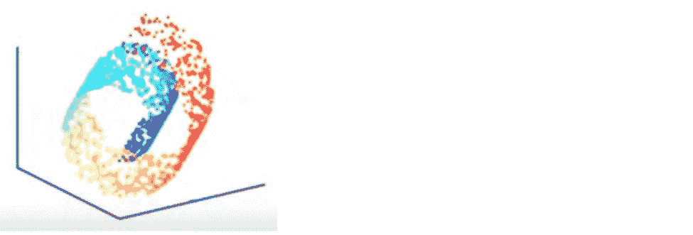

图 3.2：瑞士卷轴（Swiss Roll）数据集是一个嵌入在三维空间中的二维流形。我们应该能够用一个二维特征空间来表示它。

这通常会导致某些信息的丢失，但如果数据确实存在于 $d$ 维子空间中，那么我们应该通过 `VV^T x` 重构 `x`，并获得接近原始 `x` 的结果。PCA 可以被视为寻找一个子空间的基，以最小化这种重建误差（低秩近似属性）。

有时，像 PCA 那样寻找捕捉最大方差的正交方向并没有意义。独立分量分析（Independent Components Analysis）寻求的是统计学上独立的方向，它更适用于某些应用。

### 非负矩阵分解 (NMF)

NMF 摄取一个非负矩阵 `X`（其中每一列是一个数据项），并将其近似分解为 `X = BH`，其中 `B` 是瘦矩阵，`H` 是宽矩阵，且这两个矩阵都是非负的。`H` 的第 `k` 列是 `B` 的列之和，并根据 `H` 第 `k` 列的元素加加。在这方面，`B` 的每一列都可以被看作是以有意义的方式贡献数据的特征——`B` 的列数是我们允许用于重构数据的特征数量。如果 `X` 的每一列都是一个向量化的图像，那么 `B` 的每一列也将是一个向量化的图像。NMF 学习的是数据的基于部分的表示，因为重建是与数据相同维度特征的非负线性组合。事实证明，NMF 倾向于比 PCA 产生更稀疏的特征。NMF 在计算机视觉和推荐系统等领域有广泛应用。

### 多维缩放 (MDS)

MDS 寻求学习一个低维表示，使得点对之间的距离在潜在表示中保留。如果 `X_i ∈ ℝ^D` 且 `W_{ij} = ||X_i - X_j||^2`，则 MDS 寻找 `Y_i` 使得 `||Y_i - Y_j||^2 ≈ W_{ij}`。更一般地说，可以使用任何差异性度量 `d(X_i, X_j)` 代替范数。如果差异性度量是一个度量，则 MDS 等价于 PCA。MDS 通常用于高维数据的可视化。

注意，虽然 MDS 在低维嵌入中捕捉了整体距离，但它无法捕捉局部几何结构——例如，在上述的瑞士卷数据集中，红色区域的点与蓝色区域的点不同，但在距离上与这些点相对接近，因此 MDS 提供的表示将使得红色和蓝色点不会被隔离开。

## 3.4. 降维

### 非线性方法

像 PCA 这样的线性方法并不适用于捕捉数据中的内在几何结构。解决这个问题有以下几种方法：

- 核方法：例如，可以推导出核化版本的 PCA。
- 流形学习：$n$ 流形$^5$ 是一个局部类似于 $n$ 维欧几里得空间的表面。例如，瑞士卷是一个嵌入在三维空间中的 2 流形。在流形学习中，我们学习从数据到低维流形的映射——例如从瑞士卷到二维平面的映射。

#### 等距特征映射 (IsoMap)

IsoMap 对点之间的地测距离执行 MDS，如下：

(1) 通过将每个点与其 `k` 个最近邻点连接来构建局部邻域图。
(2) 计算所有对最短路径距离（这些就是地测距离）。
(3) 在地测距离上应用 MDS。

如果我们对瑞士卷应用 IsoMap，会发现虽然红色和蓝色区域之间的欧几里得距离很小，但地测距离很大——测距离代表了我们在 2 维瑞士卷流形上需要走多远。IsoMap 已有效用于人脸数据的降维。

下次时间：拉普拉斯特征（Laplacian Eigenmaps）、t-SNE。

> $5$ 对于数学倾向者，流形是一个二可 Hausdorff 空间，其中每个点都有一个同胚于欧几里得空间的邻域。大多数机器学习人员并不关心这些定义，并把任何东西称为流形。

## 梯度下降、牛顿法

## 4.1 非线性二乘

到目前为止看到的所有模型在参数上都是**线性**的。也就是说，我们的预测 `ŷ = f(x; θ)` 是参数 `θ` 的某个线性函数。例如，在最小二乘（OLS）中，`θ = w`，残差 `r_i` 由 `y_i - w^T x` 计算，它是 `w` 的线性函数。在多项式回归的情况下，预测值不是输入 `x` 的函数，但仍然是参数的线性函数。

然而，我们可能需要参数是非线性函数的模型。我们先考虑一个例子。

### 有噪声读数

假设我们要估计某个实体（例如机器人）的 2D 位置 `θ =(θ_1, θ_2)`。我们从传感器获得的距离估计 `Y_i ∈ ℝ`，其位置 `X_i ∈ ℝ^2` 是固定的且知的。如果像常一样假设假设同分布（i.i.d）高斯噪声，我们的统计模型形式如下：

`Y_i = ||X_i - θ|| + N_i,  N_i ∼ 𝒩(0, σ^2),  i=1 … m`

其中

`||X_i - θ|| = √((X_{i1} - θ_1)^2 + (X_{i2} - θ_2)^2)`

这里的预测是

`ŷ = f(x; θ) = ||x - θ||`

对于 `θ` 显然不是线性的。

#### MLE 公式

更一般地说，让我们假设一个类似于上面的模型，但 `f` 是任意可微函数且 `θ ∈ ℝ^d`：

`Y_i = f(X_i; θ) + N_i,  N_i ∼ 𝒩(0, σ^2),  i=1 … m`

注意这意味着 `Y_i | X_i ∼ 𝒩(f(X_i; θ), σ^2)`。最大似然估计量给出：

`θ̂_MLE = argmax_θ log P(y_1, …, y_m | x_1, …, x_m; σ)`
`= argmax_θ log ∏_{i=1}^{m} P(y_i | x_i; σ)`
`= argmax_θ ∑_{i=1}^{m} log P(y_i | x_i; σ)`
`= argmax_θ ∑_{i=1}^{m} log ( 1/√(2πσ^2) exp -(y_i - f(x_i; θ))^2/(2σ^2) )`
`= argmin_θ ∑_{i=1}^{m} [ -½log(2πσ^2) - 1/(2σ^2)(y_i - f(x_i; θ))^2 ]`

正如之前看到的，目标函数是残差平方和，尽管函数 `f` 通常是非线性的由于由于原因，该方法被称为**非线性二乘**。

遗憾的是，通常 `θ̂_MLE` 没有解析解。稍我们将看到一种计算它的迭代方法。

#### 非线性二乘的解

受 MLE 公式的启发，我们考虑以下优化问题：

`min_θ ℓ_S(θ) = min_θ ∑_i (y_i - f(x_i; θ))^2`

最小化函数的一种方法是使用微积分。我们知道在任何最小值处目标函数必须为零，如果不是，我们可以在负梯度方向上取足够的一步，使得目标函数的值降低。

因此，需要满足**一阶最优性条件**：

`∇_θ ℓ_LS = 2 ∑_i (y_i - f(x_i; θ))∇_θ f(x_i; θ) = 0`

在紧凑的矩阵表示中：

其中

`F(θ) = [ f(x_1; θ) ; … f(x_n; θ) ]`
`J(θ)^T(Y - F(θ)) = 0`

## 4.1. 非线性二乘

`J(θ) = ∇_θ F，`F` 的雅可比矩阵

注意，当 `f` 关于 `θ` 是线性的时（`f(θ)=θ^T x`），梯度 `∇_θ f_LS` 只取决于 `x_i`，我们很容易推导出关于 `θ` 的解析解：

`2X^T(Y-Xθ)=0`
`2X^TY-2X^TXθ=0`
`X^TXθ=X^TY`
`θ=(X^TX)^{-1}X^TY`

这正是最小二乘法！

然而，如果 `f` 关于 `θ` 不是线性的 `∇_θ f(x_i)` 将包含更多的 `θ` 项，并且无法写出关于 `θ` 的解析解。

备注：：在没有对 `f` 有更多假设的情况下，NLS 不是凸的。这意味着一阶最优条件是局部最小值的必要但不充分的条件。也就是说，对于某个 `θ`，导数可能为零，但该值并不是局部最小值。它可能是鞍点，更糟糕的是是局部极大值！即使是局部最小值，它可能不是全局最小值。

## 第 4 章

由于线性优化问题没有解析解，我们求助于一种迭代算法——**高斯-牛顿法**来解决它。在每次迭代中，该方法对当前迭代对 `F` 进行线性近似，并求解一个涉及线性化的二乘问题以计算下一次迭代。

## 第 4 章 梯度下降、牛顿法

注意，我们使用的线性化函数 `ĤF` 在 `θ` 处的雅可比矩阵恰好是 `J(θ^{(k)})`。这是因为当线性映射为 `J(θ^{(k)})` 时，`ĤF` 是仿射，因此最佳线性近似就是它。

为了简洁起见，令 `J = J(θ^{(k)})`，我们有

```
$J^T Y = J^T F(θ^{(k)}) + J^T ΔY$$
$$J^T(Y - F(θ^{(k)})) = J^T ΔY$$
$$Δθ = (J^T J)^{-1}(Y - F(θ^{(k)}))$$
$$(J^T J)^{-1}ΔY$$
```

其中 `ΔY := Y - F(θ^{(k)})`。通过将此解与最小二乘法（OLS）比较，我们看到实际上是在求解：

```
$Δθ = arg min_θ ||Jθ - ΔY||^2$
```

由于在 `θ^{(k)}` 处 `ĤF ≈ JΔθ`，这意味着我们选择了权重的变化来修正函数值的当前误差，但这是基于 `F` 的线性化计算的。考虑到 `Δθ = θ - θ^{(k)}`，我们可以通过以下更新改进当前的猜测值 `θ^{(k)}`：

```
$θ^{(k+1)} = θ^{(k)} + Δθ$
$θ^{(k+1)} = θ^{(k)} + (J^T J)^{-1}J^T ΔY$
```

以下是整个流程的步骤：

- 使用某些猜测值初始化 `θ^{(0)}`
- 重复直到收敛：
  (a) 计算关于当前迭代值的雅可比矩阵，`J = J(θ^{(k)})`
  (b) 计算 `ΔY = Y - F(θ^{(k)})`
  (c) 更新：`θ^{(k+1)} = θ^{(k)} + (J^T J)^{-1}ΔY`

注意，找到的解通常取决于初始值 `θ^{(0)}`。一些选择包括测试目标值的变化：

```
$| (θ^{(k+1)} - θ^{(k)}) / θ^{(k)} | ≤ threshold$
```

或者迭代值本身的变化：

```
$max | Δθ_j / θ^{(k)} | ≤ threshold$
```

## 4.2 梯度下降

梯度下降是一种寻找可微函数局部极小值的迭代算法。为了类比，想象你在你在浓雾弥绕的山坡下行走，浓雾阻止了你看到周围土地的高度，只能判断哪个方向最陡峭。

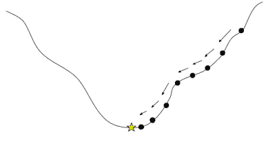

记得 `f` 在 `x` 处的梯度表示为 `∇ f(x)`，它指向最陡上升的方向。相反，负梯度指向最陡下降的方向。因此，如果我们沿着负梯度方向迈出一小步，就会减少函数的值。

执行的更新为：

```
$$x_{i+1} = x_i - α_i ∇ f(x_i)$$
```

其中 `α_i > 0` 是步长。我们可以选择 `α_i` 为固定常数，但在许多情况下，它会在训练过程中衰减到零。

## 第 5 章

## 神经网络

## 5.1 神经网络

神经网络是一种复合函数近似器。与我们过的其他近似器（例如多项式）不同，它们在参数上是非线性的。

（旁白）在信息处理中，有几种视角：

- 过程视角——用命令式编程语言来思考
- 函数视角——数学方程
- 电路/图视角——信息流过系统时的处理方式

我们将从电路/图视角来考虑神经网络。
考虑以下电路：


这些电路代表矩阵乘法，边上的权重是矩阵。假设信息流从左到右，左侧电路是 `3 × 4` 矩阵乘法，右侧电路是 `2 × 4` 矩阵乘法后跟 `3 × 2` 矩阵乘法。

这些电路表达能力相等吗？显然不是，因为左侧的秩最多为 2，而右侧可能为 3。然而，左侧有更多的处理层，它看起来应该更有表达能力。缺失的关键是非线性部分。

在这些线性计算后插入一个非线性函数，称为激活函数。我们希望这个激活函数使电路成为通用近似器。一个关键观察是，分段常数函数是通用近似器：


我们使用的非线性函数是阶跃函数：

`u(x) = { x  x ≥ 0 ; 0  x < 0 }`


我们可以通过这种简单阶跃函数的平移和缩放版本来构建复杂的函数。观察到：

- 如果 `a, b ∈ ℝ`，函数 `x ↦ u(a+bz)` 是阶跃函数的平移（且取决于 `b` 的符号，可能经过翻转）：这本质上意味着对于任何连续函数，我们都可以选择权重使得电路的输出任意接近给定函数的输出。

5.1 神经网络


- 如果 `a, b ∈ ℝ`，函数 `x ↦ u(a+bz)` 是阶跃函数的平移（且取决于 `b` 的符号，可能经过翻转）：


网格的输出为：

`h(x) = ∑_{i=1}^d c_i u(a_i + b_i x)`

其中 `d` 是隐藏单元的数量，`a_i, b_i, c_i` 是参数，`u` 是激活函数。

### 权重选择

通过适当选择 `a_i, b_i, c_i`，该函数可以近似任何连续函数。但问题仍然是：给定某个目标函数，我们如何选择这些？

尝试一种熟悉的技术：最小二乘。假设我们有训练数据 `{(x_k, y_k)}_{k=1}^n`。我们的目标是求解优化问题：

```$$min_{a,b,c} ∑_{k=1}^n (y_k - h(x_k))^2$$```
梯度下降需要损失关于优化变量的导数。我们计算链式法则：

```
$$∂f/∂c_i = ∑_{k=1}^n -2(y_k - h(x_k)) ∂h/∂c_i (x_k)$$
```

我们看到，如果这一特定步骤是“关闭”的，如 `u(a_i+b_i x)=0`，则：

```
$$∂e_i=0$$
```

因此该示例不会进行更新。更重要的是，考虑对 `a_i` 的导数：

```
$$∂f/∂a_i = ∑_{k=1}^n -2(y_k - h(x_k)) ∂h/∂a_i (x_k)$$
```

类似地：

```
$$∂f/∂b_i=0$$
```

跳跃处的导数未定义，但在实践中我们永远不会遇到那个不连续点。更大的问题是，梯度下降对优化 `a_i` 和 `b_i` 权重毫无作用。尽管阶跃函数对于选择神经网络的近似能力有用，但在实践中很少用，因为无法通过传统的基于梯度的方法进行训练。

下一个简单的通用近似器是分段线性函数类。正如分段常数函数可以通过阶跃函数作为非线性来实现，分段线性函数可以通过修正线性单元（ReLU）函数的组合来实现：

`u(x) = max(0, x)`

现在我们可以计算梯度了：
```


$$\frac{\partial f}{\partial c_i} = \sum_{k=1}^n -2(y_k - h(x_k))\max(0, a_i+b_ix_k)$$

## 5.1. 神经网络

$\frac{\partial}{\partial a_i} = \sum_{k=1}^n -2(y_k - h(x_k))c_k \frac{\partial}{\partial a_i} \max(0, a_i + b_ix) = \sum_{k=1}^n -2(y_k - h(x_k))c_k \begin{cases} 0 & \text{if } a_i + b_ix < 0 \\ 1 & \text{if } a_i + b_ix > 0 \end{cases}$

$\frac{\partial}{\partial b_i} = \sum_{k=1}^n -2(y_k - h(x_k))c_k \frac{\partial}{\partial b_i} \max(0, a_i + b_ix) = \sum_{k=1}^n -2(y_k - h(x_k))c_k \begin{cases} 0 & \text{if } a_i + b_ix < 0 \\ \text{otherwise} \end{cases}$

至关的一点是，我们看到相对于 **a** 和 **b** 的梯度并不是均匀零，这与阶跃函数不同。

如果 ReLU 激活状态，则两个权重都是调节的。根据目标函数的梯度，我们的 ReLU 可以向左或向右移动，增加或减少其斜率，并翻转方向。

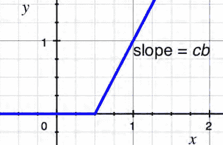

如果初始化使得每个训练点都超出了 ReLU 的范围，那么梯度下降更新将不会改变神经元的参数，我们称其为“死亡（dead）”。随机初始化应该会产生合理数量的激活神经元。还有更复杂的初始化方法，例如“Glorot 初始化（Glorot initialization）”，它们考虑了连接数，并且在实践中更有效。Leaky ReL（漏激活单元）在 ReLU 平坦部分有一个很小的斜率（当 $x < 0$ 时，$u(x) = .01x$），有时被用于提供一些微小的梯度以避免死亡神经元。

### 神经网络是通用函数逼近器

著名的神经网络近似定理由 Kurt Hornik³ 提出，它告诉我们神经网络在以下意义上是通用函数逼近器。

**定理。** 假设 $u : \mathbb{R} \to \mathbb{R}$是非常数的、有界的、非递的且连续的⁴，并令 $S \subset \mathbb{R}^n$ 是闭且有界的。那么对于任何连续函数 $f : S \to \mathbb{R}$ 和任何 $\epsilon > 0$，都存在一个具有一个隐藏层和有限神经元的神经网络，我们可以写为：

```
$h(x) = \sum_{i=1}^d c_iu(a_i + b_ix)$
```

² 理解训练深度前馈神经网络的困难。
³ 参见《多层前馈神经网络的近似能力》（Approximation Capabilities of Multilayer Feedforward Networks）。
⁴ ReLU 和 sigmoid 都满足这些要求。

使得
$|h(x) - f(x)| < \epsilon$

对于所有 $x \in S$ 成立。

该定理有一个值得注意的细微之处。它说对于任何连续函数，都存在一个有限的神经网络可以均匀地逼近给定函数。然而，它并没有说明你所考虑的任何特定架构都能逼近该函数。

同样值得注意的是，在定理中，网络仅包含一个隐藏层。在实践中，人们发现使用更多层效果更好

## 5.2 训练神经网络

### 作为通用函数逼近器的 ReLU

上次我们看到第二简单的函数逼近器是分段线性函数。具体来说，我们讨论了分段线性函数的一个特定组件，即 ReLU，$f(x) = \max(0, x)$。

讨论神经网络时，我们看到 ReLU 将作用于线性组合，以为函数引入非线性。例如，当作用于单个输入（以及偏置项）时，我们的 ReLU 将接受形式为 $a + b$ 的参数。让我们来看看有多大的表达能力。假设我们想用 ReLU 构建这个函数：

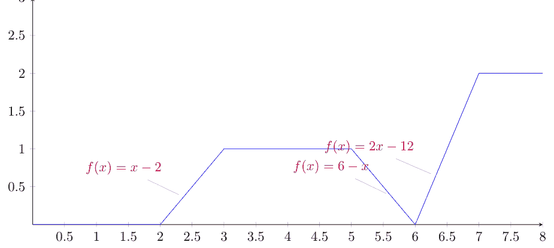

我们只需要在函数的每个转折处放置一个 ReLU，并赋予它合适的参数。例如，为了匹配从 0 到 3 的 $f$，我们只需要定义 $\max(0, x-2)$ 的 ReLU。整个函数可以通过这些 ReLU 的线性组合（以及一个常数偏置项）来匹配：

$f(x) = -1 + \max(0, x-2) - \max(0, x-2) + \max(0, 6-x) - \max(0, 5-x) + \max(0, 2x-12)$

这是 Wolfram Alpha 上的图。

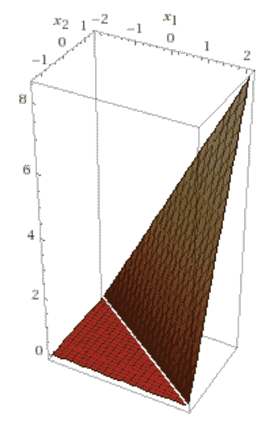

### 神经网络中的导数

我们有一个非常强大的工具可以使用，但如果我们不能训练它们，它们对我们就毫无用处。让我们看看：


神经网络的输出表示为：

### 链式法则

由于神经网络输出是输入的函数，我们必须计算损失相对于参数的导数。这是因为链式法则。

## 第5章 神经网络

根据微分的线性性，我们看到：

```
$$\nabla L(w) = \frac{1}{n} \sum_{i=1}^n \nabla_w \ell(x_i, w, y_i)$$
```

因此，计算梯度的时间与 $n$ 成线性关系。在“大数据”场景下，$n$ 非常大，这种成本可能是不可接受的。

出于这个原因，我们有理由尝试通过对输入取具有代表性的随机样本来计算梯度，从而近似神经网络损失函数的梯度。由于梯度下降是一个迭代过程，为了获得更快的计算速度，我们可以考虑放弃每次迭代更新的精确性。如果我们在每一步中对这些训练样本的随机样本计算梯度，我们将得到真实梯度的带噪声或无偏估计。每一步中的噪声通常是为了换取更多步骤的机会而可以接受的权衡。

在常规下降更新中，我们有如下策略：

```
$w^{(k+1)} \leftarrow w^{(k)} - \alpha_k \nabla_w L(w^{(k)})$
```

在随机梯度下降中，我们有如下更新规则：

```
$w^{(k+1)} \leftarrow w^{(k)} - \alpha_k G_k$
```

其中 $G_k$ 是满足 $\mathbb{E}[G_k] = \nabla L(w^{(k)})$ 的随机变量。通常，$G_k$ 通过均匀随机采样 $m < n$ 个训练点（索引为 $I_k \subset \{1, \dots, n\}$）并计算这些点上的梯度来构造：

```
$G_k = \frac{1}{m} \sum_{i \in I_k} \nabla_w \ell(x_i, y_i)$
```

我们用 $w^*$ 表示最优值。我们的目标是证明：

```
$$\lim_{k \to \infty} \mathbb{E}[\|w^{(k)} - w^*\|^2] = 0$$
```

在分析中，我们做了以下假设：

- 1. 损失函数 $f$ 是 $\ell$-强凸的；即存在一个 $\ell > 0$，使得对于所有 $x, y$，都有 $(\nabla f(x) - \nabla f(y))^T(x - y) \geq \ell \|x - y\|^2$。
- 2. 随机梯度的期望范数由 $\mathbb{E}[\|G_k\|^2] \leq M^2 < \infty$ 限制。

我们从展开目标项开始：

```
$$\mathbb{E}[\|w^{(k+1)} - w^*\|^2] = \mathbb{E}[(w^{(k+1)} - w^*)^T(w^{(k+1)} - w^*)] = \mathbb{E}[((w^{(k)} - w^* - \alpha_k G_k)^T(w^{(k)} - w^*))] = \mathbb{E}[\|w^{(k)} - w^*\|^2 - 2\alpha_k \mathbb{E}[(w^{(k)} - w^*)^T G_k] + \alpha_k^2 \mathbb{E}[\|G_k\|^2]]$$
```

为了简单起见，定义：

```
$d_k = \mathbb{E}[\|w^{(k)} - w^*\|^2]$
```

对 $G_k$ 期望范数的假设意味着：

```
$d_{k+1} \leq d_k - 2\alpha_k \mathbb{E}[(w^{(k)} - w^*)^T G_k] + \alpha_k^2 M^2$
```

### 神经网络训练

为了计算期望，我们对过去（即产生 $w^{(k)}$ 的所有决策）进行条件化。根据迭代期望律，我们有：

$$E[(w^{(k)} - w^*)G_k] = E_{\text{past}}[E[(w^{(k)} - w^*)G_k \mid \text{past}]]$$

下一个期望是对用于计算随机梯度的训练样本取的。但在给定过去（包括 $w^{(k)}$）的情况下已知 $w^{(k)}$，所以：

$$E[(w^{(k)} - w^*)G_k \mid \text{past}] = (w^{(k)} - w^*)E[G_k \mid \text{past}]$$

当前的 $G_k$ 取决于我们的点选择，假设它与过去是独立的，因此 $E[G_k \mid \text{past}] = E[G_k \mid w^{(k)}]$，因为 $G_k$ 是 $w^{(k)}$ 处真实梯度的无偏估计。结合以上点，我们有：

$$E[(w^{(k)} - w^*)G_k] = E_{\text{past}}[(w^{(k)} - w^*) \nabla f(w^{(k)})]$$

最优性的一阶条件意味着 $\nabla f(w^*) = 0$。根据 $\ell$-强凸假设，我们有：

$$(w^{(k)} - w^*)^T \nabla f(w^{(k)}) = \langle w^{(k)} - w^*, \nabla f(w^{(k)}) - \nabla f(w^*) \rangle \geq \ell \|w^{(k)} - w^*\|_2^2$$

取期望：

$$E[(w^{(k)} - w^*) \nabla f(w^{(k)})] \geq \ell \|w^{(k)} - w^*\|_2^2 = \ell d_k$$

将此代入 $d_{k+1}$，得到：

$$d_{k+1} \leq d_k - 2\alpha_k d_k + \alpha_k^2 M^2 = (1 - 2\alpha_k)d_k + \alpha_k^2 M^2$$

$\alpha_k^2 M^2$ 项是由随机性引入的。我们可以通过随时间缩小步长 $\alpha_k$ 使其趋于 0 —— 但减小 $\alpha_k$ 也会减少前面的影响。

设置 $\alpha_k = \frac{1}{2k}$ 得：

$$d_{k+1} \leq \left(1 - \frac{1}{k}\right)d_k + \frac{1}{(2\ell k)}M^2$$

令 $S = \frac{M^2}{(2\ell)}$，则不等式变为：

$$d_{k+1} \leq \left(1 - \frac{1}{k}\right)d_k + \frac{1}{k^2}S$$

为了分析这个递归式，我们展开前几项：

$$d_2 \le S$$

$$d_3 \le \left(1 - \frac{1}{2}\right)d_2 + \frac{1}{2^2}S = \frac{1}{2}S + \frac{1}{2^2}S$$

$$d_4 \le \left(1 - \frac{1}{3}\right)d_3 + \frac{1}{3^2}S = \frac{1}{3}S + \frac{1}{2 \cdot 3}S + \frac{1}{3^2}S$$

$$d_5 \le \left(1 - \frac{1}{4}\right)d_4 + \frac{1}{4^2}S = \frac{1}{4}S + \frac{1}{3 \cdot 4}S + \frac{1}{2 \cdot 3 \cdot 4}S + \frac{1}{4^2}S$$

归纳法，我们发现当 $k \to \infty$ 时，$d_k \to \frac{S}{k}$。

## 6.3 QDA 分类

```
$= arg \max_{\mu_k, \sigma_k^2} \sum_{i=1}^{n_k} \frac{(x_i - \mu_k)^2}{2\sigma_k^2} - \ln(\sigma_k) - \ln(2\pi)$$
$$= arg \min_{\mu_k, \sigma_k^2} \frac{(x_i - \mu_k)^2}{2\sigma_k^2} + \ln(\sigma_k)$$
```

注意，上述目标函数不是凸的，因此我们不能简单地对其求数并令其为零！相反，我们将对 $\sigma_k^2$ 和 $\mu_k$ 的最小化分解为一个嵌套优化问题：

```
$$\min_{\mu_k, \sigma_k^2} \sum_{i=1}^{n_k} \frac{(x_i - \mu_k)^2}{2\sigma_k^2} + \ln(\sigma_k) = \min_{\sigma_k^2} \sum_{i=1}^{n_k} \frac{(x_i - \mu_k)^2}{2\sigma_k^2} + \ln(\sigma_k)$$
```

该优化问题已分解为在固定 $\sigma_k^2$ 的情况下针对 $\mu_k$ 的内部问题，以及在给定最优值 $\hat{\mu}_k$ 的情况下针对 $\sigma_k$ 的外部问题。我们首先求解内部问题。在固定 $\sigma_k^2$ 的情况下，目标函数关于 $\mu_k$ 是凸的，因此我们可以对 $\mu_k$ 求偏导并令其为零：

```
$$\frac{\partial}{\partial\mu_k} \sum_{i=1}^{n_k} \frac{(x_i - \mu_k)^2}{2\sigma_k^2} + \ln(\sigma_k) = \sum_{i=1}^{n_k} \frac{-(x_i - \mu_k)}{\sigma_k^2} = 0 \Rightarrow \hat{\mu}_k = \frac{1}{n_k} \sum x_i$$
```

解决内部问题后，我们得到：

```
$$\min_{\sigma_k^2} \sum_{i=1}^{n_k} \frac{(x_i - \hat{\mu}_k)^2}{2\sigma_k^2} + \ln(\sigma_k) = \min_{\sigma_k^2} \sum_{i=1}^{n_k} \frac{(x_i - \hat{\mu}_k)^2}{2\sigma_k^2} + \ln(\sigma_k)$$
```

注意此目标函数对于 $\sigma_k$ 不是凸的，因此我们不能假设目标函数的临界点就等于目标值。假设 $\sigma_k \geq 0$，临界点为：

- $\sigma_k = 0$：假设所有点 $x_i$ 都等于 $\hat{\mu}_k$，存在两个相互冲突的项：一个 $1/\sigma_k^2$ 项向 $\infty$ 逸散，另一个 $\ln(\sigma_k)$ 项在 $\sigma_k \rightarrow 0$ 时向 $-\infty$ 逸散。注意 $1/\sigma_k^2$ 项的发散速度更快，因此我们可以：

- $\sigma_k = \infty$：这种情况不会导致解，因为它给出的是最大值，而不是最小值。

- 对 $\sigma$ 导数为 0 的点

```
$$\lim_{\sigma_k \rightarrow 0} \sum_{i=1}^{n_k} \frac{(x_i - \hat{\mu}_k)^2}{2\sigma_k^2} + \ln(\sigma_k) = \infty$$

$$ \frac{\partial}{\partial\sigma_k} \sum_{i=1}^{n_k} \frac{(x_i - \hat{\mu}_k)^2}{2\sigma_k^2} + \ln(\sigma_k) = \sum_{i=1}^{n_k} \frac{-(x_i - \hat{\mu}_k)^2}{\sigma_k^3} + \frac{1}{\sigma_k} = 0 \Rightarrow \sigma_k^2 = \frac{1}{n_k} \sum_{i=1}^{n_k} (x_i - \hat{\mu}_k)^2$$
```

我们得出最优点为：

$$\sigma_k^2 = \frac{1}{n_k} \sum_{i=1}^{n_k} (x_i - \hat{\mu}_k)^2$$

### QDA 公式化

假设我们知道所有类别的协方差，我们可以使用贝叶斯规则直接求解优化问题：

```
$k^* = \arg \max P(k) f_k(\mathbf{x})$$
$$= \arg \max \ln P(k) + \ln f_k(\mathbf{x})$$
$$= \arg \max \ln P(k) - \frac{1}{2}(\mathbf{x} - \mu_k)^T \boldsymbol{\Sigma}_k^{-1} (\mathbf{x} - \mu_k) - \frac{1}{2} \ln(|\boldsymbol{\Sigma}_k|) = Q_k(\mathbf{x})$$
```


为了后后参考，我们使用 $Q_k(\mathbf{x}) = \ln P(k) - \frac{1}{2}(\mathbf{x} - \mu_k)^T \boldsymbol{\Sigma}_k^{-1} (\mathbf{x} - \mu_k) - \frac{1}{2} \ln(|\boldsymbol{\Sigma}_k|)$ 来简化我们的符号。

## 6.4 LDA

虽然 QDA 是一种合理的分类方法，但我们可能倾向于简化模型以减少参数数量。其中一种方法是使用**线性判别分析 (LDA)**。与 QDA 一样，LDA 假设类别概率分布从正态分布且具有不同的 $\mu_k$，但 LDA 与 QDA 的不同在于，它要求所有分布共享相同的协方差矩阵 $\boldsymbol{\Sigma}$。在偏差-方差权衡的背景下，这种简化增加了我们方法的偏差，但减少了方差。

LDA 的训练和分类步骤与 QDA 几乎相同。然而，经验协方差的计算方式为：

$$\boldsymbol{\Sigma} = \frac{1}{n} \sum_{i=1}^n (\mathbf{x}_i - \mu)(\mathbf{x}_i - \mu)$$

为了理解此公式作为协方差的加权平均，假设我们按类别排序了数据，并得到：

$$\boldsymbol{\Sigma} = \frac{1}{n} \sum_{i=1}^n (\mathbf{x}_i - \mu)(\mathbf{x}_i - \mu)$$

## 6.5 LDA 与 QDA：差异与决策边界

在 QDA 中，我们使用了二次项，而在 LDA 中是线性项。这些项决定了 x 空间中的决策边界形状。给定两个类别，决策边界是 x 空间中概率相等的点。让我们研究二分类示例。假设两个类别为 A 和 B。任意点 x 可以分类如下：

$$k^* = \begin{cases} A & P(A|x) > P(B|x) \\ B & P(A|x) < P(B|x) \\ \text{A 或 B} & P(A|x) = P(B|x) \end{cases}$$

最简单的情况是两个类别的先验概率相等，且它们的条件概率分布是向同性的。向同性高斯分布的协方差形式为 $\Sigma = \sigma^2I$，这意味着它们的等高线是圆。在这种情况下，$f_A(x)$ 和 $f_B(x)$ 具有相同形式的协方差 $\Sigma_A = \Sigma_B = \sigma^2I$。


图6.1：$\mathbb{R}^2$ 中两个同分布高斯分布的等高线图。圆是高斯分布。

从几何上看，将二维点分类为两个类别之一的任务等同于确定它靠近哪个类别。使用我们之前的 $Q_k(\mathbf{x})$ 符号，这在数学上可以表示为：

$$Q_A(\mathbf{x}) = Q_B(\mathbf{x})$$

$$\ln\left(\frac{1}{2}\right)-\frac{1}{2}(\mathbf{x}-\mu_A)^T\sigma^2(\mathbf{x}-\mu_A)-\frac{1}{2}\ln\left(|\sigma^2|\right)=\ln\left(\frac{1}{2}\right)-\frac{1}{2}(\mathbf{x}-\mu_B)^T\sigma^2(\mathbf{x}-\mu_B)-\frac{1}{2}\ln\left(|\sigma^2|\right)$$

$$(\mathbf{x}-\mu_A)^T(\mathbf{x}-\mu_A)=(\mathbf{x}-\mu_B)^T(\mathbf{x}-\mu_B)$$

对于满足 $|\mathbf{x}-\mu_A||_2=|\mathbf{x}-\mu_B||_2$ 的 $x$，其决策边界是距离 $\mu_A$ 和 $\mu_B$ 等等的点集。该决策边界是线性的，因为距离 $\mu_A$ 和 $\mu_B$ 等等的点恰好是连接这两点的垂直平分线。

### 相同的向异性分布

下一种情况是两个类别的先验概率相等，且它们的条件概率分布是非向同性的。向异性高斯分布就是所有非向同性的高斯分布。

## 6.5 LDA VS. QDA：差异与决策边界

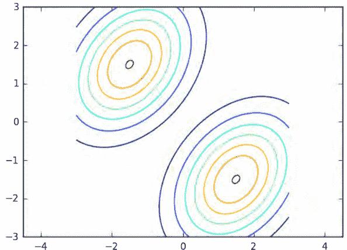

图 6.2：$\mathbb{R}^2$ 中两个各向异性且同分布的高斯分布。椭圆是高斯分布的水平集。

当两个类别为各向异性分布时，可以通过执行坐标变换将椭圆转换回圆，从而将分布简化为各向同性情况。因此，决策边界仍然是线性的。

#### 具有先验概率的相同分布

现在，让我们找到两个类别具有相同协方差但先验概率不一定相等时的决策边界。

```
$Q_A(\mathbf{x}) = Q_B(\mathbf{x})$
$\ln(P(A)) - \frac{1}{2}(\mathbf{x}-\mu_A)^T\Sigma_A^{-1}(\mathbf{x}-\mu_A) - \frac{1}{2}\ln(|\Sigma_A|) = \ln(P(B)) - \frac{1}{2}(\mathbf{x}-\mu_B)^T\Sigma_B^{-1}(\mathbf{x}-\mu_B)$
$- \frac{1}{2}\ln(|\Sigma_B|)$
$\ln(P(A)) - \frac{1}{2}(\mathbf{x}-\mu_A)^T\Sigma_A^{-1}(\mathbf{x}-\mu_A) = \ln(P(B)) - \frac{1}{2}(\mathbf{x}-\mu_B)^T\Sigma_B^{-1}(\mathbf{x}-\mu_B)$
$2\ln(P(A)) - 2\mathbf{x}^T\Sigma_A^{-1}\mu_A - \mu_A^T\Sigma_A^{-1}\mu_A = 2\ln(P(B)) - 2\mathbf{x}^T\Sigma_B^{-1}\mu_B - \mu_B^T\Sigma_B^{-1}\mu_B$
$2\ln(P(A)) + 2\mathbf{x}^T\Sigma_A^{-1}(\mu_B-\mu_A) - \mu_A^T\Sigma_A^{-1}\mu_A + \mu_B^T\Sigma_B^{-1}\mu_B = 2\mathbf{x}^T\Sigma_B^{-1}(\mu_B$
```

简化后，我们得到：

```
$\mathbf{x}^T(\Sigma_A^{-1}-\Sigma_B^{-1})(\mu_A-\mu_B) + (\ln(\frac{P(A)}{P(B)}) - \frac{\mu_A^T\Sigma_A^{-1}\mu_A - \mu_B^T\Sigma_B^{-1}\mu_B}{2}) = 0$
```

决策边界是线性函数 $f(\mathbf{x}) = \mathbf{w}^T\mathbf{x}+k$ 的水平集。注意这个模式：只要两个类别条件概率分布共享相同的协方差矩阵，决策边界始终是线性函数的水平集（其本身是线性的）。这就是 LDA 具有线性决策边界的原因。

#### 非相同分布

在 LDA 中，情况显然*不是*这样。我们有：

```
$$\ln(P(A)) - \frac{1}{2}(\mathbf{x}-\mu_A)^T\Sigma_A^{-1}(\mathbf{x}-\mu_A) = \ln(P(B)) - \frac{1}{2}(\mathbf{x}-\mu_B)^T\Sigma_B^{-1}(\mathbf{x}-\mu_B)$$$
```

在这里，与 $\Sigma_A = \Sigma_B$ 的情况不同，我们*无法*从方程两边消去 $\mathbf{x}$ 的二次项，因此我们的决策边界现在由任意二次函数的水平集表示。

现在应该可以理解为什么 QDA 是**二次（**quadratic）**判别分析的缩写，而 LDA 是**线性（**linear）**判别分析的缩写了！

#### 推广到多个类别

QDA 中决策边界的二次性质和 LDA 中决策边界的线性性质仍然适用于超过两个类别的一般情况。来自 Shewchuk 教授*笔记*的以下几幅非常好的插图说明了这一点：

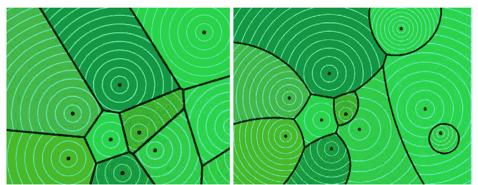

图 6.3：LDA（左）对比 QDA（右）：线性对比二次水平集边界的集合

## 6.6 判别模型

在对 LDA 和 QDA 的讨论中，我们关注的是**生成式模型**，其中我们显式地对数据的概率 $P(X, Y)$建模建模并选择概率最大的类别 $c^*$：$c^* = \arg\max_c P(Y=c|X)$。例如，在 QDA 中，我们将 $P(X|Y=c)$ 建模具有估计均值 $\mu_c$ 和协方差矩阵 $\Sigma_c$ 的高斯分布。如果我们选择先验 $P(Y)$，则对新测试点 $x$ 的预测类别为：

```
$c^* = \arg\max_c P(Y=c|X=x) = \arg\max_c P(X=x|c)P(Y=c)$
```

生成式方法非常灵活，我们实际上可以使用模型来生成样本。然而，LDA 和 QDA 可能是无效的，因为它们需要估计大量的参数（协方差矩阵）。对于两个类别的 LDA，决策边界的形式为：

```
$$\mathbf{w}^T\mathbf{x} + k = 0$$
```

LDA 是一种间接的分类方法——它估计 $P(X|Y)$ 并使用贝斯规则计算决策边界，这导致了指定模型所需的参数与分类所需的参数之间的差异。引导我们走向判别模型的概念，即跳过生成模型直接学习决策边界。构建判别模型由两个关键选择组成：

- 表示：我们如何表示模型的输出（例如输出可以是用于分类的任何实数值或概率）

- 损失函数：我们如何训练

## 6.7 最小二乘支持机

### 模型与训练

作为判别模型的第一个例子，我们讨论最小二乘支持机（LS-VM）。考虑类别由 $-1$ 和 $+1$ 表示的二分类问题。分类数据点 $x$ 的一种方法是估计参数 $w$，计算 $w^T\mathbf{x}$并通过 $\text{sign}(w^T\mathbf{x})$ 进行分类。从几何角度看，这里的决策边界是平面 $w^T\mathbf{x}=0$。

我们需要弄清楚如何优化参数 $w$。一种简单的程序是尝试拟合最小二乘目标：

```
$$\arg min_{w} \sum_{i=1}^{n} ||y_i - w^T\mathbf{x}_i||^2 + \lambda||w||^2$$
```

其中 $x_i, w \in \mathbb{R}^{d+1}$。注意我们没有忘记偏项！尽管我们处理的是 $d$ 维数据，$x_i$ 和 $w$ 都是 $d+1$ 维的：我们为 $\mathbf{x}$ 添加了额外的特征“1”，并在 $w$ 中添加了相应的偏项 $k$。在实践中，我们不想惩罚偏项，因为我们应该能够处理数据的任意变换并得到相同的决策边界。因此，我们不是取 $w$ 的范数，而是取 $w'$ 的范数，即排除偏项之外的所有 $w$ 项。为了简单，这等同于最小化分类错误点。遗憾的是，优化这是困难的（计算不可行的）。然而，我们可以解决该问题的松弛版本：

```
$$\arg min_{w} \sum_{i=1}^{n} ||y_i - w^T\mathbf{x}_i||^2 + \lambda||w||^2$$
```

这种方法是二分类最小二乘支持机（LS-VM）。注意在这个松弛版本中，我们关心的是 $w^T\mathbf{x}_i$ 的幅度而不仅仅是符号。

LS-SVM 的缺点是它计算的平面决策边界对于分类并不一定有意义。例如，考虑以下根据类别颜色编码的数据点：

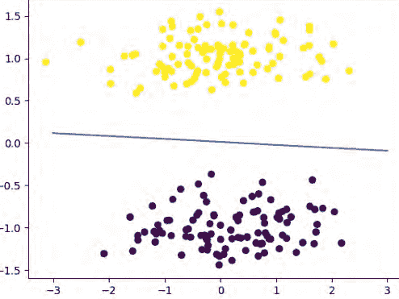

图 6.4：拟合良好的 LS-SVM

LS-SVM 会正确分类每个数据点，因为 +1 点都在决策边界的一侧，而所有 -1 点都在另一侧。现在我们按如下添加另一簇点：

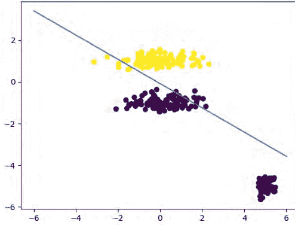

图 6.5：拟合不良的 LS-SVM

原始的 LS-SVM 拟合本可以正确分类每个点，但现在 LS-SVM 困惑了，并决定右角的点对损失的贡献太大（可能对于这些点，对于原始的 $\mathbf{w}$，$w_i^T\mathbf{x}_i = -5$，尽管它们在原始分离平面的正确一侧，但产生了高平方损失，因此平面发生了偏移）。这个问题在引入通用支持向量机（SVM）时将得到解决。

#### 特征扩展

在原始特征空间中使用线性分类器可能会受到极大的限制，因此我们可能考虑添加允许我们设计非线性分类器的特征。例如，添加二次特征允许我们在扩展二次空间中找到线性决策边界，该边界对应于投影到原始特征空间的非线性“圆形”决策边界。

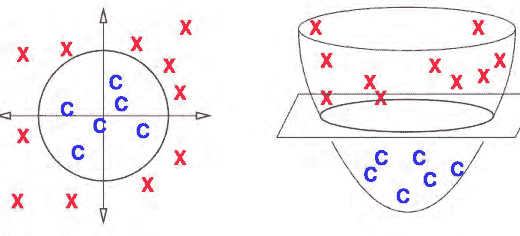

图 6.6：特征增强，图片由 [Shewchuk 教授](https://github.com/sshewchuk)提供

为了实现这个想法，我们将目标重新表达为：

```
$$\arg min_{w} \sum_{i=1}^{n} |y_i - \mathbf{w}^T\phi(\mathbf{x}_i)||^2 + \lambda||w||^2$$
```

注意 $\phi$ 是一个以原始特征空间数据为输入并输出扩展特征空间数据的函数。

#### 神经网络扩展

与其使用线性函数 $\mathbf{w}^T\mathbf{x}$ 或向数据添加特征，我们不如直接使用原始特征空间中的非线性函数，例如神经网络。可以想象有一类最小化以下式的判别式二分类器：

```
$$\arg min_{w} \sum_{i=1}^{n} |y_i - g_w(\mathbf{x}_i)||^2 + \lambda||w||^2$$
```

其中 $g_w(\mathbf{x}_i)$ 可以任何易优化的函数。然后可以使用规则进行分类：

```
$y_i = \begin{cases} 1 & g_w(\mathbf{x}_i) > 0 \ -1 & g_w(\mathbf{x}_i) \le 0 \end{cases}$
```

其中 $\theta$ 是某个阈值。在 LS-SVM 中，$g_w(\mathbf{x}_i) = \mathbf{x}_i^T\mathbf{w}$ 且 $\theta = 0$。带有非线性的神经网络作为 $g_w$ 可以产生复杂的非线性决策边界。

#### 多分类扩展

我们也可以将此方法扩展到多个类别的情况。假设有 $K$ 个类，标签为 $1, 2, ..., K$。从二分类扩展该方法的一种可能方式是计算 $w_iw(x_i)$ 并将其舍入到 1 到 $K$ 之间的最接近数字。然而，这种方法给类别赋予了一个“顺序”，即使类别本身并没有天然的顺序关系。这显然是一个问题。例如，在水果分类中，假设用 1 表示“桃子”，2 表示“香蕉”，3 表示“苹果”。在我们的数值表示中，看起来桃子少于香蕉，而香蕉又少于苹果。因此，如果我们有一张看起来像苹果和桃子之间某种东西的图像，我们可能会简单地将其分类为香蕉。

解决这个问题的典型方法如下：如果第 $i$ 个观测值属于类 $k$，我们不再使用表示 $y_i = k$，而是使用表示 $y_i = e_k$，即第 $k$ 个标准基向量。现在类别的表示中没有相对顺序了。这种方法被称为**独热编码**。

当我们有多个类别时，$y_i$ 是一个 $K$ 维独热向量，因此对于 LS-SVM，我们转而优化一个 $K \times (d+1)$ 的权重：

```
$$\arg \min_{\mathbf{w}} \sum_{i=1}^n ||y_i - \mathbf{Wx}_i||^2 + \lambda|\mathbf{w}||^2$$
```

对数据点进行分类，计算 $\mathbf{Wx}$ 并查看哪个分量 $j$ 最大——然后我们预测 $x_i$ 属于类 $j$。

## 6.8 逻辑回归

**逻辑回归**是一种判别性分类技术，具有直接的概率解释。假设我们有一个二分类问题，类别由 0 和 1 表示。注意，逻辑回归中没有使用 $-1/+$ 标签（如 LS-SVM 中那样），因为在逻辑回归中这样做更有意义，因为它直接输出概率，该概率的取值范围在 0 到 1 之间。

在逻辑回归中，我们希望对数据点属于 1 的概率估计进行建模。我们可以从线性函数 $\mathbf{w}^T\mathbf{x}$ 开始，通过应用 sigmoid 变换 $s(\mathbf{x}) = \frac{1}{1+e^{-\mathbf{x}^T\mathbf{x}}}$ 将其转换为 0 到 1 之间的数字。因此，在学习权重 $\mathbf{w}$ 后，对 $\mathbf{x}_i$ 进行分类，我们将估计概率：

```
$P(y_i=1|\mathbf{x}_i) = s(\mathbf{w}^T\mathbf{x}_i)$
```

并将 $\mathbf{x}_i$ 分类为：

- $\hat{y}_i = \begin{cases} 1 & \text{如果 } s(\mathbf{w}^T\mathbf{x}_i) \geq 0.5 \\ 0 & \text{否则} \end{cases}$

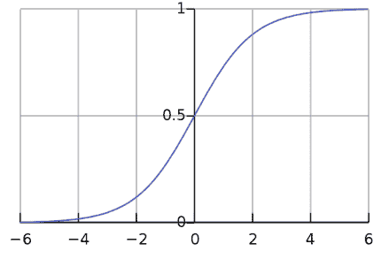

图 6.7：逻辑函数。对于我们的用途，横轴是线性函数 $\mathbf{w}^T\mathbf{x}_i$ 的输出，纵轴是逻辑函数的输出，可以解释为 0 到 1 之间的概率。

分类器等价地将 $\mathbf{x}_i$ 分类为：

```
$\hat{y}_i = \begin{cases} 1 & \text{如果 } s(\mathbf{w}^T\mathbf{x}_i) \geq 0.5 \\ 0 & \text{否则} \end{cases}$
```

为了训练我们的模型，我们需要一个损失函数。一种可能性是最小二法：

```
$\arg \min_{\mathbf{w}} \sum_{i=1}^n ||y_i - s(\mathbf{w}^T\mathbf{x}_i)||^2$
```


然而，这在极大似然估计下并不是最佳选择。相反，逻辑回归中使用的损失函数被称为**交叉熵**（cross-entropy）：

```
$L(w) = \sum_{i=1}^n [y_i \ln \frac{1}{s(\mathbf{w}^T\mathbf{x}_i)} + (1-y_i) \ln \frac{1}{1-s(\mathbf{w}^T\mathbf{x}_i)}]$
```

如果我们定义 $p_i = s(\mathbf{w}^T\mathbf{x}_i)$，我们可以将其写为：

```
$L(w) = \sum_{i=1}^n [-y_i \ln p_i - (1-y_i) \ln(1-p_i)]$
```

对于每个 $x_i$，$p_i$ 表示属于 $y_i$ 的概率。由于 $y_i \in \{0, 1\}$，损失函数为：

```
$L(w) = \sum_{i=1}^n [-y_i \ln p_i - (1-y_i) \ln(1-p_i)]$
```

# 第 6 章 分类

为了简化论证，假设 $P$ 是一个伯努利分布。如果 $P \sim \text{Bernoulli}(1)$ 或 $P \sim \text{Bernoulli}(0)$，那么完全没有意外，因为我们每次从该分布中采样时，总是期望得到相同的值。这在数学上是合理的，因为熵最小化：$H(P)=0$。然而，当 $P \sim \text{Bernoulli}(0.5)$ 时，存在大量的不确定性/惊喜，事实上，熵达到了最大。

## 6.9 多分类逻辑回归

回想逻辑回归中，我们正在调整一个权重向量 `w ∈ ℝ^{d+1}`，这导致了二二分类 0 和 1 上的后验分布 `Q_i ∼ Bernoulli(p_i)`：

```
$P(Q_i=1) = p_i = s(w^T x_i) = \frac{1}{1+e^{-w^T x_i}}$
$P(Q_i=0) = 1-s(w^T x_i) = \frac{e^{-w^T x_i}}{1+e^{-w^T x_i}}$
```

让我们将此概念推广到**多分类逻辑回归**，其中有 `K` 个类别。与我们的讨论不同，重要的是，类别之间没有内在的顺序，且在 1 到 `K` 的连续范围内预测类别将是一个糟糕的选择。在这里，我们回想一下水果分类的例子。假设 1 用于表示梨，2 用于表示香蕉，在我们的数值表示中，它似乎少于香蕉，而香蕉少于苹果。结果，如果我们有一张看起来介于苹果和梨之间的图像，我们可能会简单地将其分类为香蕉。

解决方案是使用**独热编码（one-hot vector encoding）**来表示所有标签。如果第 `i` 个观测值属于类 `k`，我们不再使用表示 `y_i=k`，而是使用表示 `y_i=e_k`。在我们的水果示例中，如果第 `i` 张图像被分类为“香蕉”，它的标签表示将为

```
$y_i = [0 \ 1]^T$
```

现在类别的表示中没有顺序了。我们必须根据独热编码器修改我们的权重表示。现在，每个类别都有一组 `d+1` 个权重，相当于一个矩阵 `W ∈ ℝ^{K × (d+1)}`。对于每个输入 `x_i ∈ ℝ^{d+1}`，每个类别都被赋予一个“分数”，

```
$z_k = w_k^T x_i$
```

其中 `w_k` 是 `W` 矩阵的第 `k` 行。现在对于每个输入 `x_i` 有 `K` 个得分：

```
$[w_1^T x_i \quad w_2^T x_i \quad \dots \quad w_K^T x_i]$
```

类别得分越高，逻辑回归选择该类的概率越大。现在我们有了一套系统，将所有这些得分转换为后验概率分布 `Q`。对于二回归，我们使用了逻辑函数，它取值 `w_k^T x_i` 并将其压缩到 0 到 1 之间的值。逻辑函数到多分类情况的推广是**softmax 函数**。softmax 函数接收所有 `K` 个得分（正式称为 **logits**）以及一个索引 `j` 作为输入，并输出相应的 softmax 取值为 `j` 的概率：

```
$softmax(j, \{z_1, z_2, \dots, z_K\}) = \frac{e^{z_j}}{\sum_{k=1}^K e^{z_k}}$
```

### logits 与 softmax 分布

logits 引起了 softmax 分布，我们可以验证它是一个概率分布：

- 1. 元素位于 0 和 1 之间。
- 2. 元素之和为 1。

经检查，这个 softmax 分布是合理的，因为类别的得分越高，其概率越高。事实上，我们可以验证逻辑函数是 softmax 函数的一个特殊例。假设类别 0 对应的权重为 `w_0` 和 `w_1`，我们有：

```
$P(Q_i=1) = \frac{e^{w_1^T x_i}}{e^{w_1^T x_i} + e^{(w_1-w_0)^T x_i}} = \frac{e^{(w_1-w_0)^T x_i}}{1 + e^{(w_1-w_0)^T x_i}} = s((w_1 - w_0)^T x_i)$
$P(Q_i=0) = \frac{e^{w_0^T x_i}}{e^{w_1^T x_i} + e^{(w_1-w_0)^T x_i}} = \frac{e^{w_0^T x_i}}{e^{w_0^T x_i} + e^{(w_1-w_0)^T x_i}} = 1 - s((w_1 - w_0)^T x_i)$
```

在二分类情况下，因为我们只对 `w_1` 和 `w_0` 之间的差异感兴趣，我们使用变量替换 `w = w_1 - w_0`。我们不需要单独知道 `w_1` 和 `w_0`，因为我们知道 `P(Q_i=1)`，默认知道 `P(Q_i=0) = 1 - P(Q_i=1)`。

#### 多分类逻辑回归损失函数

让我们从信息论的角度推导多分类逻辑回归的损失函数。“真实”或目标分布是 `P(P_i=j) = y_{ij}`。换句话说，整个分布集中在训练用例的标签上。估计分布 `Q` 来自于多分类逻辑回归，这就是 softmax

```
$P(Q_i=j) = \frac{e^{w_j^T x_i}}{\sum_{k=1}^K e^{w_k^T x_i}}$
```

现在我们来推导损失。目标一既往一样，是最小化所有训练样本引起的 KL 散度之和。

```
$W_{MCLR}^* = \arg min_{W} \sum_{i=1}^n D_{KL}(P_i||Q_i)$
$= \arg min_{W} \sum_{i=1}^n \sum_{j=1}^K P(P_i=j) \ln \frac{P(P_i=j)}{P(Q_i=j)}$
$= \arg min_{W} \sum_{i=1}^n \sum_{j=1}^K y_{ij} \ln \frac{y_{ij}}{\text{softmax}(j, \{w_1^T x_i, \dots, w_K^T x_i\})}$
$= \arg min_{W} \sum_{i=1}^n \sum_{j=1}^K y_{ij} \cdot \ln y_{ij} - \ln (\text{softmax}(j, \{w_1^T x_i, \dots, w_K^T x_i\}))$
$= \arg min_{W} \sum_{i=1}^n \sum_{j=1}^K y_{ij} \cdot \ln \left(\frac{y_{ij}}{\text{softmax}(j, \{w_1^T x_i, \dots, w_K^T x_i\})}\right)$
```

我们得出：

$$H = \sum_{i=1}^{n} p_i(1-p_i)x_i x_i^T$$

为了证明 `L(w)` 在 `w` 上是凸的，我们需要证明 `w^T H w ≥ 0, ∀ w:` 

$$w^T H w = w^T \sum_{i=1}^{n} p_i(1-p_i)x_i x_i^T w = \sum_{i=1}^{n} (w^T x_i)^2 p_i(1-p_i) \geq 0$$

#### 梯度

与其找到相对于矩阵 `W` 的所有参数的梯度，不如每次找到相对于 `W` 的某行的梯度：

$$\nabla_{w_l} L(W) = \nabla_{w_l} \left( -\sum_{j=1}^{K} y_i[j] \cdot \ln \left( \frac{e^{w_l^T x_i}}{\sum_{k=1}^{K} e^{w_k^T x_i}} \right) \right) $$

$$=-\sum_{i=1}^{n} \sum_{j=1}^{K} y_i[j] \cdot \nabla_{w_l} \left( \ln \left( \frac{e^{w_l^T x_i}}{\sum_{k=1}^{K} e^{w_k^T x_i}} \right) \right) $$

$$=-\sum_{i=1}^{n} \sum_{j=1}^{K} y_i[j] \cdot \left( \nabla_{w_l} w_l^T x_i - \nabla_{w_l} \ln \sum_{k=1}^{K} e^{w_k^T x_i} \right) $$

$$=-\sum_{i=1}^{n} \sum_{j=1}^{K} y_i[j] \cdot \left( \mathbb{1}\{j=l\} x_i - \frac{e^{w_l^T x_i}}{\sum_{k=1}^{K} e^{w_k^T x_i}} X_i \right) $$

$$=-\sum_{i=1}^{n} \sum_{j=1}^{K} y_i[j] \cdot \left( \mathbb{1}\{j=l\} - \frac{e^{w_l^T x_i}}{\sum_{k=1}^{K} e^{w_k^T x_i}} \right) x_i $$

$$=-X^T (\mathbb{1}\{y_i=l\} - P(Q_i=l)) $$

指示函数的使用：`𝟙{j=l}` 当 `j=l` 时取值为 1，否则为 0。注意，由于 `y_i` 是一个独热向量（one-hot vector），它只有一个元素的值为 1，其他项全为 0。然后我们可以通过只考虑 `y_i[j]=1` 的 `j` 来简化表达式。`w_l` 的梯度下降更新：

$$w_l = w_l - \eta \nabla_{w_l} L(W)$$

与二分类逻辑回归一样，为 `W` 选择什么种初始值并不重要，因为损失函数 `L(W)` 是凸的，且没有任何局部最小值。

## 6.11 支持机

到目前为止，我们探索了**生成式模型**（LDA）、**判别式模型**（逻辑回归），在这两种方法中，我们都要求自己对某种概率分布进行建模。关于分类的一个观察是，到最后，如果我们只关心为每个数据点分配类别，我们真正需要知道的是找到一个“好的”决策边界，我们可以跳过对分布的思考。支持机（SVMs）以这种精神直接建模决策边界：

- 给定：训练数据集 `D = {(x_i, y_i)}_{i=1}^n`，其中 `x_i ∈ ℝ^d` 且 `y_i ∈ {-1, 1}`
- 目标：找到一个区分 `+1` 和 `-1` 的决策边界 `H`

### 支持机的动机

为了引入支持机，我们首先需要理解感知机及其局限性。如果数据是线性可分的，感知机可以找到一个 `d` 维的超平面来完美区分 `+1` 和 `-1`。从数学上讲，支持机的目标是学习一个权重向量 `w ∈ ℝ^d` 和偏置 `b`，满足以下：

$$\begin{cases} w^Tx_i - b \geq m & \text{if } y_i = 1 \\ w^Tx_i - b \leq -m & \text{if } y_i = -1 \end{cases}$$

等价于 `y_i(w^Tx_i - b) ≥ m`，其中得到的决策边界为 `w^Tx - b = 0`。如果数据不是线性可分的，感知机无法找到有效的泛化边界。支持机通过最大化间隔（margin）来解决感知机的泛化问题。

#### 硬边界支持机

硬边界支持机通过最大化**间隔**来解决泛化问题，该间隔正式定义为决策边界到任何训练点的距离。

img/99defe26aed215976e83d281581f33102.

直观地说，最大化间隔可以让我们对未知数据进行更好的泛化，因为具有最大间隔的边界尽可能远离训练数据。简单来说，硬边界支持机的目标是找到一个使间隔 `m` 最大化的超平面。让我们来形式化这个优化问题：

- 所有分类为 `+1` 的点位于正侧。
- 所有分类为 `-1` 的点位于负侧。

间隔 `m` 定义为超平面到最近数据点的距离。对于超平面 `w^Tx - b = 0`，点 `x_i` 到超平面的距离为 `w^Tx_i - b / ||w||`。因此，我们想要极大：

$$\max_{w, b} \frac{m}{\|w\|} \quad \text{subject to} \quad \begin{cases} w^Tx_i - b \geq m & \text{if } y_i = 1 \\ w^Tx_i - b \leq -m & \text{if } y_i = -1 \end{cases}$$

为了简化，我们可以设置 `||w|| = 1` 并最大化 `m`，得到：

$$\max_{w, b, m} m \quad \text{subject to} \quad \begin{cases} w^Tx_i - b \geq m & \text{if } y_i = 1 \\ w^Tx_i - b \leq -m & \text{if } y_i = -1 \end{cases}$$

这等价于 `y_i(w^Tx_i - b) ≥ m`。如果我们固定 `m=1`，就得到了标准的硬边界支持机公式：

$$\min_{w, b} \frac{1}{2}\|w\|^2 \quad \text{subject to} \quad y_i(w^T x_i - b) \geq 1$$

最后，我们制定了硬间隔（hard-margin）SVM优化问题！使用符号 `w` 和 `b`，硬间隔 SVM 的目标是：

```math
$$\min_{w,b} \frac{1}{2}\|w\|^2_2$$
$$\text{s.t.} \quad y_i(w^T x_i - b) \geq 1 \quad \forall i\quad (6.5)$$
```

#### 间隔 SVM (Soft-Margin SVMs)

硬间隔 SVM 优化问题仅在数据线性可分时才有唯一解，否则无解。这是因为如果我们无法画出一个将 +1 和 -1 分隔开的超平面，约束条件是无法满足的。此外，硬间隔 SVM 对离群点非常敏感——例如，如果我们的数据是类别分布的高斯分布且两个高斯分布相距远，如果我们观察到一个来自 +1 类并进入 -1 类典型区域的离群点，那么硬间隔 SVM 将被迫为了适应这个点而牺牲掉更具泛化性的拟合。我们的目标是提出对离群点不敏感且即使在数据线性不可分的情况下也能工作的分类器。为此，我们将讨论软间隔 SVM。

软间隔 SVM 通过允许某些点违反间隔修改硬间隔 SVM 的约束。从形式上，它为每个训练点引入了松弛变量 `ξ_i`，约束条件为：

```math
$y_i(w^T x_i - b) \geq 1 - \xi_i$
$\xi_i \geq 0$
```

这是硬间隔 SVM 约束的一个不那么严格、更软的版本，因为它意味着每个点 `x_i` 只需要距离分类平面有 `1-ξ_i` 的“距离”，而不是硬性的“距离” 1。

（根据希腊语，希腊字母 `ξ` 拼写为 "xi"，读音为 "zai"。`ξ_i` 的读音为 "zai-eye"）。如果不限制 `ξ_i` 的值，这些约束将是徒劳，因为通过将它们设置为很大的值，我们本质上是在说任何点都可以以任意大的距离违反间隔……这使得我们对 `w` 的选择失去了意义。我们将目标函数修改为：

```math
$$\min_{w,b} \frac{1}{2}\|w\|^2 + C \sum_{i=1}^n \xi_i$$
```

其中 `C` 是通过交叉验证调优的超参数。软间隔 SVM 优化问题为：

```math
$$\min_{w,b} \frac{1}{2}\|w\|^2 + C \sum_{i=1}^n \xi_i$$
$$\text{s.t.} \quad y_i(w^T x_i - b) \geq 1 \quad \forall i$$
$$\xi_i \geq 0 \quad \forall i\quad (6.6)$$
```

下表比较了大 `C` 与小 `C` 的效果。当 `C` 趋于无穷大时，非零 `ξ_i` 的惩罚趋于无穷大，从而迫使 `ξ_i` 为零，这正是硬间隔 SVM 的设置。

| 小 C | 大 C |

|---|---|---|

| 期望 | 最大化间隔 | 保持 `ξ_i` 较小或为零 |

| 风险 | 欠拟合 | 过拟合 |

| 离群点 | 较不敏感 | 更敏感 |

#### SVM 与 Tikhonov正则化学习

考虑以下正则化回归问题：

```math
$$\min \frac{1}{n} \sum L(y_i, w^T x_i - b) + \lambda\|w\|^2$$
```

在分类背景下，我们想要优化的函数是 0-1 阶损失（step loss）：

```math
$L_{step}(y, w^T x - b) = \begin{cases} 1 & y(w^T x - b) < 0 \\ 0 & y(w^T x - b) \geq 0 \end{cases}$
```

如果 `x` 被正确分类，0-1 损失为 0，否则为 1。因此，最小化 `1/n ∑ L(y_i, w^T x_i - b)` 直接最小化了训练集上的分类误差。然而，0-1 损失很难优化：它既不是凸的也不可微（见图 8.1）。

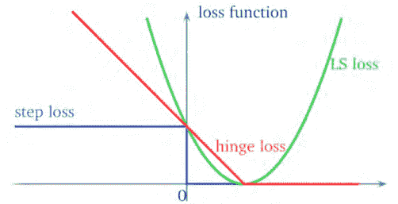

图 6.12：阶梯（0-1）损失、铰损失（hinge loss）和平方损失。平方损失是凸的，而铰损失不是凸的，阶梯损失两者都不是。


我们可以尝试修改 0-1 损失使其变为凸函数。`$y(w^T x - b) \geq 0$` 的点应保持 0 损失，但我们可能对分类错误的点使用**铰损失（hinge loss）**，如图 8.1 所示。

```math
$L_{hinge}(y, w^T x + b) = \max(1 - y(w^T x - b), 0)$
```

因此，正则化回归问题变为：

```math
$$\min_{w,b} \frac{1}{n} \sum \max(1 - y_i(w^T x_i - b), 0) + \lambda\|w\|^2$$
```

回原始的软间隔 SVM 优化问题是：

```math
$$\min_{w,b,\xi} \frac{1}{2}\|w\|^2 + C \sum_{i=1}^n \xi_i$$
$$\text{s.t.} \quad y_i(w^T x_i - b) \geq 1 - \xi_i \quad \forall$$
$$\xi_i \geq 0 \quad \forall$$
```

## 6.11. 支持向量机 (SUPPORT VECTOR MACHINES)

我们认为这两种公式实际上是等价的。通过变形第一个约束，我们得到：

$$\xi_i \geq 1 - y_i(w^T x_i - b)$$

结合约束 `$\xi_i \geq 0$`，我们得到：

$$\xi_i \geq \max(1 - y_i(w^T x_i - b), 0)$$

在优化问题的最优处，这些不等式必须取等。否则，我们可以降低每个 `$\xi_i$` 直到等于 `$\max(1-y_i(w^Tx_i - b),0)$` 并减小目标函数的值。因此，我们可以重写软间隔 SVM 优化问题为：

```math
$$\min_{w,b} \frac{1}{2}\|w\|^2 + C \sum_{i=1}^n \max(1 - y_i(w^T x_i - b), 0) (6.8)$$
```

## 7. 对偶性 (Duality)

### 7.1. 优化问题的原始与对偶 (Primal and Dual of Optimization Problem)

之前在对 SVM 的研究中，我们制定了原始问题。在此之前，我们首先需要理解该问题的对偶。为了做到这一点，让我们来看优化问题的对偶。

### 7.1. 对偶性

这种解决方案是需要代价的——为了消除等式约束，我们必须为每个不等式约束添加对偶变量。考虑到这一点，让我们尝试对不等式约束进行同样的操作。添加对偶变量 `$\lambda_i$` 来表示每个不等式约束，我们现在有

```
$\min_{x} \mathcal{L}(x, \lambda, \nu) = f_0(x) + \sum_{i=1}^{m} \lambda_i f_i(x) + \sum_{j=1}^{n} \nu_j h_j(x)$
\text{s.t.} \quad \lambda_i \ge 0 \quad i=1, \dots, m \quad (7.4)$
```

为了方便起见，可以将涉及 `$\lambda$` 的约束放入优化变量中。

```
$\max_{x} \mathcal{L}(x, \lambda, \nu) = f_0(x) + \sum_{i=1}^{m} \lambda_i f_i(x) + \sum_{j=1}^{n} \nu_j h_j(x)$
```

该优化问题通常被称为**原始问题**（primal，不要与对偶变量混淆），它的最优值确实等于原始约束优化问题的最优值。

```
$p^* = \max_{\lambda\ge0, \nu} \mathcal{L}(x, \lambda, \nu)$
```

我们可以验证这确实如此：

- 对于任何违反不等式约束的 `$x$`（意味着 `$\exists i \in [1, m]$` 使得 `$f_i(x) > 0$`）,关于 `$\lambda$` 的内部极大化问题可以将 `$\lambda$` 选为 `$\infty$`，导致内部极大化发散于 `$\infty$`，因此被关于 `$x$` 的外部最小化所忽略。

- 对于任何违反等式约束的 `$x$`（意味着 `$\exists j$` s.t. `$h_j(x) \neq 0$`），关于 `$\nu$` 的内部极大化问题可以在 `$h_j(x) > 0$`（或 `$h_j(x) < 0$`）时将 `$\nu$` 选为 `$\infty$`，导致内部极大化发散于 `$\infty$`，因此被关于 `$x$` 的外部最小化所忽略。

- 对于任何未违反任何等式约束的 `$x$`，在关于 `$\nu$` 的内部极大化问题中，表达式 `$\sum_{j=1}^{n} \nu_j h_j(x)$` 的最大值为 0，因为 `$\lambda_i$` 被限制为非负，且 `$f_i(x)$` 是负的。因此，在最好的情况下，极大化问题设置 `$\lambda_i f_i(x) = 0$`，且

```
$\max_{\lambda} \mathcal{L}(x, \lambda, \nu) = f_0(x)$
```

在完整形式下，目标函数 `$\mathcal{L}(x, \lambda, \nu)$` 被称为**拉格朗日**（Lagrangian），它考虑了无约束的原始变量集合 `$x \in \mathbb{R}^d$`、约束变量集合以及对偶变量。注意，由于 `$\lambda_i$` 被限制为非负且 `$f_i(x)$` 是负的，因此在最好的情况下，极大化问题设置 `$\lambda_i f_i(x) = 0$`。

```
$\max_{\lambda} \mathcal{L}(x, \lambda, \nu) = f_0(x)$
```

在完整形式下，目标函数 `$\mathcal{L}(x, \lambda, \nu)$` 被称为**拉格朗日**，它考虑了无约束的原始变量集合 `$x \in \mathbb{R}^d$`、约束变量集合以及对偶变量。注意由于 `$\lambda_i$` 被限制为非负且 `$f_i(x)$` 是负的，因此在最好的情况下，极大化问题设置 `$\lambda_i f_i(x) = 0$`。

```
$\max_{\lambda} \mathcal{L}(x, \lambda, \nu) = f_0(x)$
```

（注：此处根据原文逻辑重复部分保持翻译逻辑）目标函数 `$\mathcal{L}(x, \lambda, \nu)$` 实际上

## 7. 对偶性、近邻、稀疏性

该对偶问题是有效的：

```
$d^* = \max_{\lambda\ge0, \nu} \mathcal{L}(x, \lambda, \nu)$
```

对偶问题是关于对偶变量的极大化：

```
$d^* = \max_{\lambda\ge0, \nu} \mathcal{L}(x, \lambda, \nu)$
```

#### 弱对偶性

这*总是*成立的，原始问题的解大于或等于对偶问题的解：

$p^* \ge d^*$ (7.5)

#### 强对偶性与 KKT 条件

当 `$p^* = d^*$` 时，我们称强对偶性。这通常通过 KKT 条件来验证。

## 7.2 SVM 的对偶问题

让我们应用对对偶性的知识，来寻找软边界 SVM 优化问题的对偶形式。

```
$$\min f(w,t,\xi)\min_{w,t,\xi} \frac{1}{2}||w||^2 + C \sum_{i=1}^{n} \xi_i$$
$(1-\xi_i) - y_i(w^T x_i - t) \leq 0 \quad \text{and} \quad -\xi_i \leq 0_{g(w,t,\xi)\leq0}$$
```

我们来识别 SVM 问题的原始变量和对偶变量。我们将有：

- 原始变量 `$w, t$` 和 `$\xi_i$`

- 对偶变量 `$\alpha_i$`，对应于每个形式为 `$y_i(w^T x_i - t) \geq 1 - \xi_i$` 的约束

- 对偶变量 `$\beta_i$`，对应于每个形式为 `$\xi_i \geq 0$` 的约束

为了符号表示方便，请注意我们使用 `$\alpha$` 和 `$\beta$` 代替 `$\lambda$`，且没有对应于 `$\nu$` 的对偶变量，因为没有等式约束。SVM 问题的拉格朗日函数为：

```
$$\mathcal{L}(w,t,\xi,\alpha,\beta) = \frac{1}{2}||w||^2 + \sum_{i=1}^{n} \xi_i + \sum_{i=1}^{n} \alpha_i(1-\xi_i) - y_i(w^T x_i - t) + \sum_{i=1}^{n} \beta_i(-\xi_i) \quad (7.7)$$
```

```
$$\frac{1}{2}||w||^2 - \sum_{i=1}^{n} \alpha_i(w^T x_i - t) + \sum_{i=1}^{n} \alpha_i + \sum_{i=1}^{n} (C - \alpha_i - \beta_i)\xi_i$$
```

因此，对偶问题为：

```
$$\max_{\alpha,\beta\geq 0} = \min_{w,t,\xi} \frac{1}{2}||w||^2 - \sum_{i=1}^{n} \alpha_i(w^T x_i - t) + \sum_{i=1}^{n} \alpha_i + \sum_{i=1}^{n} (C - \alpha_i - \beta_i)\xi_i \quad (7.8)$$
```

让我们使用 KKT 条件来寻找最优对偶变量。验证原始问题是凸的。我们从平稳性条件已知，在最优值 `$w^*, t^*, \xi^*$` 处有：

```
$$\frac{\partial \mathcal{L}}{\partial w} = \frac{\partial \mathcal{L}}{\partial t} = 0$$
```

- `$\frac{\partial \mathcal{L}}{\partial w} = w - \sum_{i=1}^{n} \alpha_i x_i = 0 \Rightarrow w^* = \sum_{i=1}^{n} \alpha_i x_i$`。这告诉我们 `$w^*$` 将是正类 `$x_i^*$` 和负类 `$x_i^*$` 的加权组合。

- `$\frac{\partial \mathcal{L}}{\partial t} = \sum_{i=1}^{n} \alpha_i = 0$`。这告诉我们权重 `$\alpha_i^*$` 将均匀分布在正样本和负训练点之间。

- `$\frac{\partial \mathcal{L}}{\partial \xi_i} = C - \alpha_i - \beta_i = 0 \Rightarrow 0 \leq \alpha_i^* \leq C$`。这告诉我们权重 `$\alpha_i^*$` 被限制小于超参数 `$C$`。

验证其他 KKT 条件也，从而建立强对偶。利用这些观察结果，我们可以消除对偶问题中的某些项。

```
\mathcal{L}(w, t, \xi, \alpha^*, \beta^*) = \frac{1}{2}|w|^2 - \sum_{i=1}^n \alpha_i^* y_i(w^T x_i - t) + \sum_{i=1}^n \alpha_i^* + \sum_{i=1}^n (C - \alpha_i^* - \beta_i^*) \xi_i\n= \frac{1}{2}|w|^2 - \sum_{i=1}^n \alpha_i^* y_i(w^T x_i) + \sum_{i=1, s=0}^n \alpha_i^* y_i + \sum_{i=1, s=0}^n (C - \alpha_i^* - \beta_i^*) \xi_i\n= \frac{1}{2}|w|^2 - \sum_{i=1}^n \alpha_i^* y_i(w^T x_i) + \sum_{i=1}^n \alpha_i^*
```

我们可以用对偶变量 `$\alpha_i^*$` 来重写最优原始变量 `$w^*, t^*, \xi^*$`：

```
$g(\alpha^*, \beta^*) = \min_{w,t,\xi,\alpha^*} \mathcal{L}(w,t,\xi,\alpha^*,\beta^*)\n= \mathcal{L}(w^*,t^*,\xi^*,\alpha^*,\beta^*)\n= \frac{1}{2}\sum_{i=1}^n \alpha_i^* y_i x_i^2 - \sum_{i=1}^n\sum_{j=1}^n \alpha_i^* y_i \alpha_j^* y_j (x_j^T x_i) + \sum_{i=1}^n \alpha_i^*\n= \frac{1}{2}\sum_{i=1}^n \alpha_i^* y_i x_i^2 - \sum_{i=1}^n\sum_{j=1}^n \alpha_i^* y_i \alpha_j^* y_j (x_j^T x_i) + \sum_{i=1}^n \alpha_i^*\n= \alpha^{*T} 1 - \frac{1}{2}\alpha^{*T} Q$
```

其中 `$Q_{ij} = y_i(x_i^T x_j)$` 且 `$Q = \text{diag}(y)$`。现在我们可以写出对偶最终的形式，它只包含 `$\alpha$`、 `$x$` 和 `$y$`（注意我们已经消除了 `$\beta$`）：

```
\max_{\alpha} \alpha^{T} 1 - \frac{1}{2}\alpha^{T} Q\alpha\text{s.t.} \sum_{i=1}^n \alpha_i = 0\n0\le \alpha_i \le C \quad i = 1, \dots, n
```

### 几何直觉

我们已经看到关于 `$\alpha$` 的对偶问题最优值等同于关于 `$w, t$` 的原始问题最优值。但这些 `$\alpha$` 的值意味着什么？我们知道以下 KKT 条件成立：

- 平稳性：`$C - \alpha_i - \beta_i = 0$`

- 互补松性：`$\alpha_i(1 - y_i(w^T x_i - t)) = 0$`

## 7.2 SVM 的对偶性

这里是 `$\alpha_i$` 和 `$\xi_i$` 之间值得注意的关系：

- 如果 `$\alpha_i = 0$`，则 `$\beta_i = C$`。这意味着 `$\xi_i \geq 0$`。

- 如果 `$0 < \alpha_i < C$`，则 `$\beta_i = 0$`。这意味着 `$y_i(w^T x_i - t) = 1$`。

- 如果 `$\alpha_i = C$`，则 `$\beta_i = 0$`。这意味着 `$y_i(w^T x_i - t) \geq 1$`。

我们看到关于 `$\alpha$` 的对偶问题最优值等同于关于 `$w, t$` 的原始问题最优值。但这些 `$\alpha$` 的值意味着什么？我们知道以下 KKT 条件成立：

- 平稳性：`$C - \alpha_i - \beta_i = 0$`

- 互补松性：`$\alpha_i(1 - y_i(w^T x_i - t)) = 0$`

这是一个好问题！我们从平稳性条件已知，在最优值 `$w^*, t^*, \xi^*$` 处有：

```
$$\frac{\partial \mathcal{L}}{\partial w} = \frac{\partial \mathcal{L}}{\partial t} = 0$$
```

- `$\frac{\partial \mathcal{L}}{\partial w} = w - \sum_{i=1}^{n} \alpha_i x_i = 0 \Rightarrow w^* = \sum_{i=1}^{n} \alpha_i x_i$`。这告诉我们 `$w^*$` 将是正类 `$x_i^*$` 和负类 `$x_i^*$` 的加权组合。

- `$\frac{\partial \mathcal{L}}{\partial t} = \sum_{i=1}^{n} \alpha_i = 0$`。这告诉我们权重 `$\alpha_i^*$` 将均匀分布在正样本和负训练点之间。

- `$\frac{\partial \mathcal{L}}{\partial \xi_i} = C - \alpha_i - \beta_i = 0 \Rightarrow 0 \leq \alpha_i^* \leq C$`。这告诉我们权重 `$\alpha_i^*$` 被限制小于超参数 `$C$`。

验证其他 KKT 条件也成立，从而建立强对偶。利用这些观察结果，我们可以消除对偶问题中的某些项。

```
\mathcal{L}(w, t, \xi, \alpha^*, \beta^*) = \frac{1}{2}|w|^2 - \sum_{i=1}^n \alpha_i^* y_i(w^T x_i - t) + \sum_{i=1}^n \alpha_i^* + \sum_{i=1}^n (C - \alpha_i^* - \beta_i^*) \xi_i\n= \frac{1}{2}|w|^2 - \sum_{i=1}^n \alpha_i^* y_i(w^T x_i) + \sum_{i=1, s=0}^n \alpha_i^* y_i + \sum_{i=1, s=0}^n (C - \alpha_i^* - \beta_i^*) \xi_i\n= \frac{1}{2}|w|^2 - \sum_{i=1}^n \alpha_i^* y_i(w^T x_i) + \sum_{i=1}^n \alpha_i^*
```

我们可以用对偶变量 `$\alpha_i^*$` 来重写最优原始变量 `$w^*, t^*, \xi^*$`：


```
$g(\alpha^*, \beta^*) = \min_{w,t,\xi,\alpha^*} \mathcal{L}(w,t,\xi,\alpha^*,\beta^*)\n= \mathcal{L}(w^*,t^*,\xi^*,\alpha^*,\beta^*)\n= \frac{1}{2}\sum_{i=1}^n \alpha_i^* y_i x_i^2 - \sum_{i=1}^n\sum_{j=1}^n \alpha_i^* y_i \alpha_j^* y_j (x_j^T x_i) + \sum_{i=1}^n \alpha_i^*\n= \frac{1}{2}\sum_{i=1}^n \alpha_i^* y_i x_i^2 - \sum_{i=1}^n\sum_{j=1}^n \alpha_i^* y_i \alpha_j^* y_j (x_j^T x_i) + \sum_{i=1}^n \alpha_i^*\n= \alpha^{*T} 1 - \frac{1}{2}\alpha^{*T} Q$
```

其中 `$Q_{ij} = y_i(x_i^T x_j)$` 且 `$Q = \text{diag}(y)$`。现在我们可以写出对偶最终的形式，它只包含 `$\alpha$`、`$x$` 和 `$y$`（注意我们已经消除了 `$\beta$`）：

```
\max_{\alpha} \alpha^{T} 1 - \frac{1}{2}\alpha^{T} Q\alpha\text{s.t.} \sum_{i=1}^n \alpha_i = 0\n0\le \alpha_i \le C \quad i = 1, \dots, n
```

### 几何直觉

我们已经看到关于 `$\alpha$` 的对偶问题最优值等同于关于 `$w, t$` 的原始问题最优值。但这些 `$\alpha$` 的值意味着什么？我们知道以下 KKT 条件成立：

- 平稳性：`$C - \alpha_i - \beta_i = 0$`
- 互补松性：`$\alpha_i(1 - y_i(w^T x_i - t)) = 0$`

这是一个好问题！我们从平稳性条件已知，在最优值 `$w^*, t^*, \xi^*$` 处有：

```
$$\frac{\partial \mathcal{L}}{\partial w} = \frac{\partial \mathcal{L}}{\partial t} = 0$$
```

- `$\frac{\partial \mathcal{L}}{\partial w} = w - \sum_{i=1}^{n} \alpha_i x_i = 0 \Rightarrow w^* = \sum_{i=1}^{n} \alpha_i x_i$`。这告诉我们 `$w^*$` 将是正类 `$x_i^*$` 和负类 `$x_i^*$` 的加权组合。
- `$\frac{\partial \mathcal{L}}{\partial t} = \sum_{i=1}^{n} \alpha_i = 0$`。这告诉我们权重 `$\alpha_i^*$` 将均匀分布在正样本和负训练点之间。
- `$\frac{\partial \mathcal{L}}{\partial \xi_i} = C - \alpha_i - \beta_i = 0 \Rightarrow 0 \leq \alpha_i^* \leq C$`。这告诉我们权重 `$\alpha_i^*$` 被限制小于超参数 `$C$`。

验证其他 KKT 条件也成立，从而建立强对偶。利用这些观察结果，我们可以消除对偶问题中的某些项。

```
\mathcal{L}(w, t, \xi, \alpha^*, \beta^*) = \frac{1}{2}|w|^2 - \sum_{i=1}^n \alpha_i^* y_i(w^T x_i - t) + \sum_{i=1}^n \alpha_i^* + \sum_{i=1}^n (C - \alpha_i^* - \beta_i^*) \xi_i\n= \frac{1}{2}|w|^2 - \sum_{i=1}^n \alpha_i^* y_i(w^T x_i) + \sum_{i=1, s=0}^n \alpha_i^* y_i + \sum_{i=1, s=0}^n (C - \alpha_i^* - \beta_i^*) \xi_i\n= \frac{1}{2}|w|^2 - \sum_{i=1}^n \alpha_i^* y_i(w^T x_i) + \sum_{i=1}^n \alpha_i^*
```

我们可以用对偶变量 `$\alpha_i^*$` 来重写最优原始变量 `$w^*, t^*, \xi^*$`：

```
$g(\alpha^*, \beta^*) = \min_{w,t,\xi,\alpha^*} \mathcal{L}(w,t,\xi,\alpha^*,\beta^*)\n= \mathcal{L}(w^*,t^*,\xi^*,\alpha^*,\beta^*)\n= \frac{1}{2}\sum_{i=1}^n \alpha_i^* y_i x_i^2 - \sum_{i=1}^n\sum_{j=1}^n \alpha_i^* y_i \alpha_j^* y_j (x_j^T x_i) + \sum_{i=1}^n \alpha_i^*\n= \frac{1}{2}\sum_{i=1}^n \alpha_i^* y_i x_i^2 - \sum_{i=1}^n\sum_{j=1}^n \alpha_i^* y_i \alpha_j^* y_j (x_j^T x_i) + \sum_{i=1}^n \alpha_i^*\n= \alpha^{*T} 1 - \frac{1}{2}\alpha^{*T} Q$
```

其中 `$Q_{ij} = y_i(x_i^T x_j)$` 且 `$Q = \text{diag}(y)$`。现在我们可以写出对偶最终的形式，它只包含 `$\alpha$`、`$x$` 和 `$y$`（注意我们已经消除了 `$\beta$`）：

```
\max_{\alpha} \alpha^{T} 1 - \frac{1}{2}\alpha^{T} Q\alpha\text{s.t.} \sum_{i=1}^n \alpha_i = 0\n0\le \alpha_i \le C \quad i = 1, \dots, n
```

## 7.3 最近邻分类

在分类中，合理的推测是足够近的数据点属于同一类。例如，在图像分类中，扰动几个像素图像看起来仍然像是一个香蕉。`k`最近邻（`k-NN`）分类器基于这一观察。假设不对训练数据进行任何预处理，`k-NN` 的训练时间实际上为 `O(1)`。为了训练此分类器，我们只需存储训练数据以备后用。由于这个原因，`k-NN` 有时被称为“懒学习”。主要工作在测试时完成：计算距离 `z` 最近的 `k` 个训练点，“接近”可以通过某些欧式距离函数来量化——然后我们在这些 `k` 个邻居中找到最常见的 `y`，并将 `z` 分类为 `y`（即我们进行多数投票）。对于二分类，`k` 通常取奇数以便我们干净地打破僵局。


(a) 1-NN 用于 3 类  (b) 2-NN 用于 5 类

图 7.1：`k-NN` 的沃罗诺图。填充有特定颜色的区域的点将被分类为该颜色。填充有两种颜色混合的区域的测试点具有这些颜色作为其 2 个最近邻居。

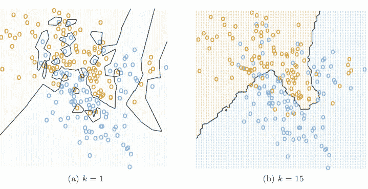

图 7.2：`k=1` 与 `k=15` 的沃洛纽图（Voronoi diagram）。图自《统计学习导论》（Introduction to Statistical Learning）。


选择 `$k=1$` 时，我们获得最优的训练误差0，因为每个训练点都会被分类为自身，从而在自身上实现了 100% 的准确率。然而，`$k=1$` 对训练数据存在过拟合，在偏差-方差权衡的背景下，这是一个非常糟糕的选择。增加 `$k$` 会导致训练误差增加，但会降低测试误差并获得更好的泛化能力。在某一个程度上，如果 `$k$` 变得过大，算法将对训练数据产生欠拟合，并遭受巨大的偏差。通常情况下，为了选择 `$k$`，我们使用交叉验证。

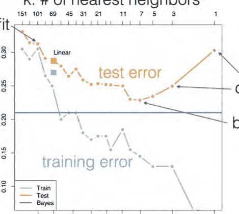

图 7.3：随 `$k$` 变化的训练和测试误差。图自《统计学习导论》。

### 偏差-方差分析

让我们对应用于回归任务的 k-NN 形式化证明这一推理的合理性。假设给定训练数据集 `$\mathcal{D}=\{(x_i, y_i)\}_{i=1}^n$`，其中标签 `y_i` 是实值标量。我们将假设函数 `h(z)` 为：

```
$h(z) = \frac{1}{k} \sum_{i=1}^n N(x_i, z, k)$
```

其中函数 `N` 定义为：

```
$N(x_i, z, k) = \begin{cases} y_i & \text{如果 } x_i \text{ 是距离 } z \text{ 最近的 } k \text{ 个点之一} \\ 0 & \text{其他} \end{cases}$
```

同样假设我们的标签 `y_i = f(x_i) + \epsilon`，其中 `$\epsilon$` 是来自 `$\mathcal{N}(0, \sigma^2)$` 的噪声，`f` 是真实函数。令 `x_1 \dots x_k` 为最近的 `k` 个点。让我们为给定数据集 `D` 推导我们模型的偏差。

```
$E[[h(z)] - f(z)]^2 = E\left[\left(\sum_{i=1}^k N(x_i, z, k) - f(z)\right)^2\right] = E\left[\left(\sum_{i=1}^k y_i - f(z)\right)^2\right]$
```

```
$E\left[(\sum_{i=1}^k E[y_i] - f(z)\right)^2\right] = E\left[\left(\sum_{i=1}^k E[f(x_i) + \epsilon] - f(z)\right)^2\right]$
```

```
$E\left[(\sum_{i=1}^k f(x_i) - f(z))^2\right]$
```

当 `k \to \infty` 时，`$\sum_{i=1}^k f(x_i)$` 趋向于 `x` 的平均水平。当 `k=1` 时，偏差简单为 `f(x_1) - f(z)`。假设 `x_1` 足够接近 `f(z)`,那么 `k=1` 时偏差可能很小，因为它们共享相似的均值。同时，当 `k \to \infty` 时，偏差完全不依赖于训练点，这将限制其保持较高。

现在，让我们推导 `h(z)` 的方差：

```
$Var[h(z)] = Var\left[\frac{1}{k} \sum_{i=1}^k y_i\right] = \frac{1}{k^2} \sum_{i=1}^k Var[f(x_i) + \epsilon]$
```

```
$$\frac{1}{k^2} \sum_{i=1}^k Var[\epsilon]$$
```

```
$$\frac{1}{k^2} \sum_{i=1}^k \sigma^2 = \frac{1}{k^2} k\sigma^2 = \frac{\sigma^2}{k}$$
```

当 `k \to \infty` 时，方差趋于0，并在 `k=1` 处达到最大。

#### 属性

**计算复杂度：** 我们需要 `O(n)` 空间来存储大小为 `n` 的训练集。如果使用专门的数据结构来存储数据，则训练期间没有运行时开销。然而，预测需要 `O(n)` 时间，这是昂贵的。已有关于近似最近邻（ANN）程序的研究，它们可以快速找到最近邻的近似值——一些常用的 ANN 方法包括*局部敏感哈希*（Locality-Sensitive Hashing）和通过随机（Johnson-Lindenstrauss）距离保真投影进行降维的算法。`^2`

`^2` ANN 方法超出了本课程的范围，但在实际应用中非常有用。

## 7.3. 最近邻分类

**灵活性：** 当 `k>1` 时，可以通过修改 k-NN 来输出预测概率 `P(Y|X)`，其定义方法是将 `P(Y|X)` 定义为训练集中距离 `X` 最近的邻居中类别 `Y` 的比例。

k-NN 也可以适用于回归——不再采用多数投票，而是取最近邻居的 `y` 值的平均值。k-NN 可以学习复杂的非线性决策边界。

**非参数：** k-NN 是一种非参数方法，这意味着模型中的参数数量随训练点数量 `n` 的增加而增长。这与参数方法相反，后者的参数数量与 `n` 无关。参数方法的某些示例包括线性回归、LDA 和神经网络。

**在高维中的表现：** k-NN 在高维表现并不良好。随着维度的增加，数据点变得彼此分离，因此某个点的最近邻居会离它非常远。

**理论属性：** 对于这种简单的方法，k-NN 具有令人印象深刻的理论保证。Cover 和 Hart (1967) 证明，当训练样本数 `n` 趋于无穷大时，`l`-NN 的期望预测误差限于 `2e^*`，其中 `e^*` 是贝叶斯（最优）误差。Fix 和 Hodges (1951) 证明了当 `n` 和 `k` 都趋于无穷时。

#### 维度灾难

为了理解为什么 k-NN 表现不佳，我们首先需要理解高维特性。这里有一个经典的例子：考虑外球与内球的比例。在高维中，随机高斯分布将位于

当 `d \to \infty` 时，外球的体积相对于内球。这种现象被称为测度集中（concentration of measure）。不需要复杂的不等式，我们可以证明一个简单的结论：

**定理：** 如果 `X_i \sim N(0, \sigma^2), i=1,\dots,d` 独立且 `R^2=\sum_{i=1}^d X_i^2`，则对于每个 `$\epsilon > 0$`，以下等式成立：

```
$$\lim_{d \to \infty} P(|R^2 - E(R^2)| \geq d^{1/2+\epsilon}) = 0$$
```

*证明。* 根据卡方分布的方差公式，我们看到 `Var(R^2)=d\sigma^4`。应用切夫不等式可得

```
$P(|R^2 - E(R^2)| \geq d^{1/2+\epsilon}) \leq \frac{2d\sigma^4}{d+1} \xrightarrow{d \to \infty} 0$
```

因此，在高概率下，随机高斯分布将位于远离原点的薄环形区域，尽管高斯钟形曲线的模式位于原点。

#### 改进 k-NN

有两种方法可以改进 k-NN 并克服我们讨论的缺点：

- 1. 获取更多训练数据。
- 2. 减少特征维度并/或选择更好的特征。考虑其他距离函数的选择。

图像空间降维的一个例子是降低图像分辨率，虽然这丢弃了一些原始像素特征，但我们可能仍然可以通过最近邻方法获得相同或更好的性能。

我们还可以修改距离函数。例如，我们有一族由 `L^p` 范数导出的**闵可夫斯距离**（Minkowski distances）：

```
$D_p(x,z) = \left( \sum_{i=1}^d |x_i - z_i|^p \right)^{1/p}$
```

在不对数据进行预处理的情况下，使用 `L^3` 距离的 I-NN 在 MNIST 上的表现优于使用 `L^2` 距离的 I-NN。

## 7.4 稀疏性与 LASSO

我们也可以使用核在不同的特征空间中计算距离。例如，如果 `k` 是一个关联特征映射 `$\Phi$` 的核，且我们想要计算从 `$\Phi(x)$` 到 `$\Phi(z)$` 的欧几里距离，那么有：

```
$$\|\Phi(x) - \Phi(z)\|^2 = \Phi(x)^T\Phi(x) - 2\Phi(x)^T\Phi(z) + \Phi(z)^T\Phi(z)\n= k(x,x) - 2k(x,z) + k(z,z)$$
```

因此，如果我们定义 `D(x,z) = \sqrt{k(x,x) - 2k(x,z) + k(z,z)}`，我们通过核距离函数 `D` 在不显式表示 `$\Phi$` 的情况下，在 `$\Phi$`-空间中执行欧式最近邻

### SVM 的稀疏性

回软间隔 SVM 问题的目标函数：

```
$$\min_{w} \frac{1}{2}\|w\|^2 + C\sum_{i=1}^n \xi_i^2$$
```

注意，如果一个点 `x` 有非零松变量 `$\xi > 0$`，根据定义它必须位于间隔之外。由于对间隔的惩罚使用了巨大的惩罚因子 `C`，这样的点相对较少，因此松变量 `$\xi$` 是**稀疏的**——它的大部分分目为零。我们感兴趣的是解释这种现象为什么在这个特定的优化问题中发生，并确定决定任意优化问题稀疏解的关键属性。

为了推导 SVM 情况，让我们看看改变某些任意松变量 `$\xi_i$` 如何影响损失函数。`$\xi_i$` 的减少会带来 `C_i` 的“奖励”，并通过偏导数 `$\frac{\partial}{\partial\xi_i}$` 捕获。注意，无论 `$\xi_i$` 的当前值是多少，减少 `$\xi_i$` 的奖励都是恒定的。当然，`$\xi_i$` 可能会改变边界以及归属于间隔大小的成本。减少 `xi_i` 的总奖励要么值得投入（大于由 `w` 产生的成本），要么不值得投入（小于由 `w` 产生的成本）。直观上，`$\xi_i$` 将继续减少直到它触及下界“平衡”——即为 0。

现在考虑以下公式（为了简洁进行了约束处理）：

```
$$\min_{w} \frac{1}{2}\|w\|^2 + C\sum_{i=1}^n \xi_i^2$$
```

减少 `$\xi_i$` 的奖励不再是恒定的——在任何点，`$\xi_i$` 的减少都会带来 `2C\xi_i` 的“奖励”。随着 `$\xi_i$` 趋于 0，奖励变得越来越小，以无穷小的方式影响 `$\|w\|^2$` 的值。另一方面，减少 `$\xi_i$` 会导致 `$\|w\|^2$` 产生的成本产生有限增加——这与上一个例子中的增加相同。直观上，我们可以推断出存在一个阈值值 `$\xi^*$`，使得进一步减少 `$\xi_i$` 不再超过间隔大小产生的成本，且 `$\xi_i$` 将在达到 0 之前停止下降。

对于具有稀疏解的优化问题有许多优势。稀疏解的一个优势是它们加快了测试时间。在原始问题背景下，如果权重向量 `w` 是稀疏的，那么在训练计算 `w` 时，我们可以丢弃权重为 0 的特征/维度，因为它们对测试点假设回归值的评估没有任何贡献。类似的推理适用于权重向量 `v` 的对偶问题，允许我们丢弃对应对偶权重 0 的训练点，最终允许在测试点上更快地评估我们的假设函数。

## LASSO

既然 SVM 中稀疏性的动机，让我们修改岭回归的目标函数以实现稀疏性。由 Robert Tibshirani 在 1996 年开发的最小绝对值收缩和选择算子（LASSO）是实现这种预期效果的方法之一。LASSO 与岭回归的目标函数相同，不同之处在于惩罚 `w` 的 L2 范数（平方）现在被更改为 L1 范数（不带平方项）：

```
\min_{w} \|Xw - y\|^2 + \lambda||w||_1
```

`w` 的 **L1 范数**是其分目绝对值之和：

```
$\|z\|_1 = \sum_{i=1}^d |w_i|$
```

将其与 `w` 的 **L2 范数**平方比较，即其分目平方之和：

```
$\|z\|_2 = \sum_{i=1}^d w_i^2$
```

就像岭回归一样，L1 范数有一个统计学上的依据。岭回归假设权重 `w` 服从高斯先验分布，而 LASSO 假设权重 `w` 服从**拉普拉斯先验（也称为双指数分布）**。

让我们理解为什么这种从 L2 到 L1 范数的简单变化在本质上导致了稀疏解。对于任何一个特定的分量 `w_i`

## 7.5 坐标下降

图 7.4：比较 LASSO（左）与岭回归（右）的等高线。简单起见，假设我们只处理 2 维数据并对权重变量 `w_1` 和 `w_2` 进行优化。在上面的两张图中，红色的椭圆代表 `w` 空间中平方损失 `\|Xw-y\|^2` 的等高线。在岭回归中，`$\lambda\|w\|$` 的等高线由圆表示，右侧显示了其中一个。注意，最优 `w` 将出现在椭圆与蓝色圆之间的切点处。否则，我们始终沿着菱形的等高线移动（保持其总成本固定），同时改进另一个函数的值。关于这些切点，我们实际上无法推断出太多信息，除了以原点为中心的蓝色圆将最优点拉向原点附近（岭回归惩罚了较大的权重）。

现在，让我们检查 LASSO 情况。红色的椭圆代表相同的目标 `\|Xw-y\|^2`，但现在 L1 正则项 `$\lambda\|w\|$` 由等高线表示。与岭回归不同，注意 `w` 空间中的最优点必须发生在椭圆与菱形之间的切点处。由于菱形的“尖锐”特性，切点极有可能发生在菱形的顶点上。为什么 `w` 的某个分量为 0 的点呢？

### 坐标下降

注意 LASSO 目标函数是凸的但由于 L1 范数的“尖锐性”是不可微的。梯度下降技术对于这类问题存在困难。坐标下降是一种解决此类凸问题的替代方案。虽然 SGD 关注于迭代优化每个*样本*，但坐标下降迭代优化每个*特征*。

**算法1** 坐标下降

当 `w` 未收敛：

  选择一个特征索引 `i`

  更新 `w_i` 到 `$\argmin_i L(w)$`

如果 `L` 是**联合凸的**，坐标下降保证找到全局最小值。如果 `L` **仅是分量凸的**，则无法做出此类保证，因为它可能存在局部最小值。为了理解这一点，让我们从理解分量凸性开始。假设我们正在最小化关于变量 `x` 和 `y` 的函数 `f(x,y)`。为了简单起见，假设 `f` 是二阶可微的，我们可以取其 Hessian 矩阵。f(x,y) 在 `x` 上是凸的，如果其 Hessian 矩阵是正定的：

$$\frac{\partial^2}{\partial x^2}f(x,y) \geq 0$$

对于 `y` 同样如此。如果 `f(x,y)` 在 `x` 和 `y` 上是联合凸的，那么 `f(x,y)` 在 `x` 和 `y` 上的分量凸性是其解的。注意，在 `x` 和 `y` 上的分量凸并不意味着在 `x` 和 `y` 上是联合凸（考虑 `f(x,y) = x^2+y^2-4xy` 为例）。

现在，如果 `f(x,y)` 是联合凸的，那么我们可以单独找到 `x` 和 `y`，将它们设为 0，并保证得到全局最小值。对于分量凸，我们可以这样做吗？并不总是可以。虽然 `$\min_{x,y}f(x,y) = \min_x \min_y f(x,y)$` 是真实的，但如果 `f(x,y)` 不是联合凸的，我们无法总是将其设为零。由于内部关于 `y` 的优化问题，外部关于 `x` 的优化问题可能是凸的。

在 LASSO 的情况下，目标函数是联合凸的，因此可以使用坐标下降。有一些细节需要处理，即更新特征的选择以及如何更新 `w_i`。一种简单的方法是更新 `w_i \leftarrow \argmin_i L(w)`。对于 LASSO，事实证明存在闭式解（我们只针对一个特征而不是所有特征进行最小化）。

假设最优 `w_i` 是严格正的：`w_i > 0`。设置目标函数的偏导

## 7.6 稀疏最小二乘

对 `w^*` 求导等于 0，我们得到：

```
$\frac{\partial L}{\partial w_i} = \lambda + \sum_{j=1}^n 2x_{j,i}(w^*_{j,i} + C_{j,i}^{(1)}) = 0 \implies w^*_i = \frac{-\lambda - \sum_{j=1}^n 2x_{j,i}C_{j,i}^{(1)}}{\sum_{j=1}^n 2x_{j,i}^2}$
```

令 `a = -\sum_{j=1}^n 2x_{j,i}C_{j,i}^{(1)}`且 `b = \sum_{j=1}^n 2x_{j,i}^2`，我们有：

```
$w_i = \frac{-\lambda + a}{b}$
```

但这只有当右侧 `$\frac{-\lambda+a}{b}$` 实际上为正时才成立。如果它是负的或0，则在 `(0, \infty)` 中不存在最优解。

当 `w^*_i < 0` 时，某些计算将导致：

```
$w^*_i = \frac{\lambda + a}{b}$
```

同样，这仅当 `$\frac{\lambda+a}{b}$` 实际上为负时才成立。如果它是正的或0，则在 `(-\infty, 0)` 中不存在最优解。

如果条件 `$\frac{-\lambda+a}{b} > 0$` 或 `$\frac{\lambda+a}{b} < 0$` 都不满足，则在 `(-\infty, 0)` 或 `(0, \infty)` 中不存在最优解。但 LASSO 目标关于 `w_i` 是凸的且存在最优解，在这种情况下，`w^*_i = 0`。

为了出现这种情况，需要 `$\frac{-\lambda+a}{b} \leq 0$` 且 `$\frac{\lambda+a}{b} \geq 0$`。通过重排，可以证明 `|a| \leq k`。

总结：

| | |

|------|

| `w^*_i = 0` | `|a| \leq k` |

| | `$\frac{-\lambda+a}{b} > 0$` |

| | `$\frac{\lambda+a}{b} < 0$` |

其中

```
$a = -\sum_{j=1}^n 2x_{j,i}C_{j,i}^{(1)}, b = \sum_{j=1}^n 2x_{j,i}^2$
```


项 $\frac{a}{b}$ 是最小二乘解（不带正则化），因此我们可以正则化项试图将最小二乘解向 0 拉。。这不是梯度下降更新——在所有其他权重都是固定常数的情况下，我们有最优 $w_i$ 的闭式解。我们也可以明确地看到 LASSO 目标诱导了稀疏性——$a$ 是数据和其他权重的函数，当 $|a| \leq k$ 时，我们在坐标下降的迭代中设置 $w_i = 0$。通过增加 $\lambda$，我们增加了将 $|a|$ 设置为 0 的阈值，我们的解变得变得稀疏。

注意，在优化过程中，权重可以被设置为 0，但它们在之前的迭代中被设置为 0 之后也可以被“重新激活”，因为 $a$ 受 $w_i$ 以外因素的影响。

## 7.6 稀疏最小二乘

假设我们要解决最小二乘目标，并受到 $w$ 是稀疏的约束。在数学上这表示为

```
$\min ||Xw - y||_2^2 \text{ s.t. } ||w||_0 \leq k$
```

注意，$w$ 的 `L0范数` 简单来说是 $w$ 中非零元素的个数。该优化问题最小化我们的预测 `Xw` 与 `y` 之间的残差误差，确保解 `w` 是稀疏的。解决这个优化问题是 NP 的，因此我们仍然打算寻找一种计算可行的替代方法来近似最优解。`匹配追踪`（Matching pursuit）是一种实现这一目标的贪心算法。

### 匹配追踪算法

回想在普通最小二法中，我们通过将 $y$ 投影到由 $X$ 的列支撑子空间来最小化残差误差 `\|Xw - y\|_2^2`，得到列的线性组合 `w*`。匹配追踪从一个完全稀疏的解（`w=0`）开始，迭代地“构建” `w`，直到无法满足稀疏性约束 `\|w\|_0 <= k`。算法如下：

```
Algorithm 2: Matching Pursuit
初始化 $r = y$
初始化权重 $w = 0$
**while** $\|w\| < k$
  找到残差最小的索引 $i$: $i = \arg \max_j \frac{\langle r, x_j \rangle}{\|x_j\|}$
  更新权重向量的第 $i$ 个元素为 $w_i = \langle r, x_j \rangle / \|x_j\|^2$
  更新新的残差值: $r = y - Aw$
  **end while**
```

在算法的每一步，我们选择坐标 $i$，使得 $x_i$（$X$ 中对应特征 $i$ 的第 $i$ 列*而不是*数据 $i$）最小化残差 $r$。这等于找到投影到 $x_i$ 上的长度最大的索引 $i$：

> $i = \arg \max_j \frac{\langle r, x_j \rangle}{\|x_j\|}$

让我们看看为什么这是的。当我们把残差 $r$ 投影到向量 $x_j$ 上，得到的投影长度为 $\langle r, x_j \rangle / \|x_j\|$。长度遵循勾哥拉斯定理：

> $\|r_{old}\|^2 = \|r_{new}\|^2 + \left(\frac{\langle r, x_j \rangle}{\|x_j\|}\right)^2 \implies i = \arg \max_j \frac{\langle r, x_j \rangle}{\|x_j\|}$

我们将 $w_i$ 移动到最优投影值，并在每次迭代中贪婪地重复。虽然匹配追踪不能保证找到最优 $w^*$，但在实践中它对大多数应用都有效。迭代次数的设置通常通过交叉验证来确定。

# 第 8 章 决策树学习

## 8.1 决策树

决策树是一种分类器，通过反复提出诸如“$x_i$ 是否大于值 $v$？”的问题对事物进行分类。你可以将此类事物可视化为一棵树，每个节点由一个分裂特征-分裂值对 $(x_i, v)$ 组成，叶节点是可能的类别。这里有一张图片：

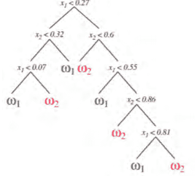

注意，一个类别可能出现在决策树的多个叶节点。选择一个分裂特征-分裂值对本质上是将特征空间划分成若干块，你可以想象拥有足够的这些对可以让你创建一个任意复杂的分类器，它可以完美地拟合任何训练集（除非两个不同类别的点重合）。

当我们考虑构建这棵树的任务时，我们想要问问自己几个问题：

- 我们如何选择分裂特征-分裂值对？
- 我们如何知道停止生长树？

让我们处理第一个点。从直觉上，当我们选择一个特征进行分裂时，我们希望选择那个能最大程度增加我们对数据

## 8.1 决策树学习

数据点的确定性，且分裂 $(x_i, v)$ 完美地划分了它们。如果我们有一侧全是正类实例，另一侧全是负类实例。

现在，为了谈论“我们有多确定”的想法，我们将使用`惊讶`和`熵`。观测随机变量 $X$ 取值为 $k$ 的数值惊讶度为：

```
$\log \frac{1}{P(X = k)}$
```

随机变量的熵 $H(X)$ 为

```
$H(X) = E[surprise] = E_X[\log \frac{1}{P(X = k)}] = \sum_{k} P(X = k) \log \frac{1}{P(X = k)}$
```

这是熵相对于 $P(X = k)$ 的图，对于一个`二值随机变量` $X$（即 $k \in \{0,1\}$）：

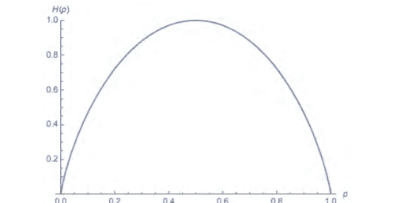

观察到 (1) 它是凸的 (2) 它在概率分布`均匀`时最大。也就是说，一个完全公平的硬币 $P(X=0) = P(X=1) = 0.5$ 具有比偏斜硬币更大的熵。这是因为从整体而言，我们对公平硬币结果的确定性比偏斜硬币低。尽管我们在偏斜硬币出现罕见结果时感到惊讶，但熵的方法赋予了公平硬币更高的不确定性评分。通常情况下，当随机变量结果的分布越均匀，熵越大；当分布高度倾斜一个结果时，熵越小。

### 一个假设

顺便说，熵定义于随机变量很奇怪，因为训练集中并没有随机变量。为了解决这个问题，我们假设在可能类别上的随机变量 $X$ 代表了我们的训练集。

所以我们知道当我们选择分裂特征-分裂值对时，我们希望以某种方式*减少熵*。令 $Y_{f_i}$ 为一个指示函数，如果数据点的特征 $f_i$ 小于 $v$，则其为 1。注意 $Y$ 不是随机变量，尽管我们会在某些符号中使用它使得

## 8.1 决策树

它看起来像一棵树。当我们用分割线 $(f_i, v)$ 划分由随机变量 $X$ 表示的一组点时，有几个熵是我们需要考虑的。

- $H(X)$
- $H(X|Y=1)$。即 $f_i$ 小于 $v$ 的点集的熵。
- $H(X|Y=0)$。即 $f_i$ 不小于 $v$ 的点集的熵。

在某些方面，$H(X)$ 是不可逾越的：我们从由 $X$ 表示的点集开始，它们这些点具有某种程度的熵，现在我们希望以某种方式切分这些点，以最小化剩余的熵。因此，我们想要最小化的是划分两侧的加权平均值，其中权重与两边的大小（成比例）：

```
Minimize P(X<v)H(X|Y=1) + P(X\ge v)H(X|Y=0)
$=P(Y=1)H(X|Y=1) + P(Y=0)H(X|Y=0)$
```

这种表等表达方式是，我们想要最大化学习到的信息，表现为学习 $Y$ 后 $H(X)$ 减少的程度：

```
Maximize H(X) - P(Y=1)H(X|Y=1) + P(Y=0)H(X|Y=0)
H(X|Y)
```

对于一般的指示函数 $Y$，我们想要最大化所谓的互信息 $I(X;Y)$。这取决于在给定 $Y$ 的情况下 $X$ 的条件熵：

```
$H(X|Y=y) = \sum_{k} P(X=k|Y=y) \log \frac{1}{P(X=k|Y=y)}$
H(X|Y) = \sum_{y} P(Y=y)H(X|Y=y)$
$I(X;Y) = H(X) - H(X|Y)$
```

注意，$I(X;Y)$ 是非负的，只有当决策树的划分结果与原始点集的类别分布相同时，它才为零。假设你正在使用决策树将它们分类为垃圾邮件和正常邮件。前述陈意味着，如果你取一组（20 个正常邮件，10 个垃圾邮件）并并根据某些特征对其进行划分，得到（12 个正常邮件，6 个垃圾邮件）的集合，那么你将没有获得任何信息；因为两个结果集合的经验分布与原始分布相等。

现在我们已经讨论了如何选择划分，让我们讨论一下何时停止生长树。因为决策树是强大的工具，它们可以表示任意复杂的决策边界。因此，它们很容易发生过拟合。一种方法是不断划分特征空间，直到叶子节点完全纯净（即它们只包含单一类别的点）。因此，在训练决策树时，我们总是希望记住几个早停的启发式方法：

- 限制深度：跟踪每次划分的深度，不要超过深度 $t$
- 信息增益准则：如果划分没有提供足够的信息（即 $I(X;Y)$ 达到阈值），则停止划分
- 剪枝：这并不是一种早停的方法。相反，它的策略是让树尽可能得得大，然后如果合并划分可以减少你的验证误差，就进行合并。

所有这些阈值都可以通过交叉验证来调优。

## 8.2 随机森林

对抗过拟合的另一种方法是使用随机森林。随机森林是一组决策树，其输出通过某种方式（通常是多数投票）聚合，以产生分类问题的最终答案。此外，森林中的每棵树都包含某些随机元素。让我们思考为什么这种随机性是必要的。

假设你取了训练点集，并使用上一节选择划分的方法构建了 $k$ 棵决策树。你对这些树说些什么？在选择划分方面，它们将是相同的集合：因为对于一组训练点，只有一个最佳划分，如果我们对同一组训练点使用相同的算法，我们将得到相同的结果。

有两个选择：(1) 为每棵树改变我们的算法，或 (2) 改变我们的训练点。算法本身是很好的，所以让我们改变训练点。具体来说，我们将使用自助法（bagging）：对于每棵树，我们随机采样定数量的训练点进行“装袋”并训练。这将避免出现完全相同决策树的问题……

……真的吗？假设你有一个极具预测性的特征，例如用于分类垃圾邮件或你的分类任务的“viagra”单词的出现。那么即使你对训练点进行随机子采样，你的 $k$ 棵树仍然非常相似，可能会选择在相同的特征上进行划分。因此，我们树的随机性将来自：

- 自助法：每棵树对训练点的随机采样
- 强制每棵树使用随机特征子集

训练点随机样本的大小和每棵树的特征数量都是需要通过交叉验证调优的超参数。

记住为什么这是一个好主意：单棵决策树本身容易过拟合训练集。然而，如果我们有一堆多样化且不相关的树，那么我们就可以更确定它们的平均值更接近真实的分类器。

## 8.3 提升 Boosting

我们在随机森林案例中看到，组合许多不完美的模型可以产生一个运行良好的模型。然而，随机森林对待森林中的每个成员都是平等的，对它们的输出进行多数投票或平均。提升的思想是以更具原则性的的方法组合模型（在此语境下通常被称为弱学习器）。粗略来说，我们想要：

- 将每个弱分类器（例如随机森林中的树）视为“特征”
- 根据整体分类器的当前性能寻找更好的“特征”

### 8.3. BOOSTING

核心思想如下：为了改进我们的分类器，我们应该专注于找到能够正确分类整体提升分类器当前分类错误的点的学习器。提升算法通过为每个训练点分配权重并迭代来实现这一思想，使得被分类错误的点具有较高的权重。直观地说，某些点比其他点更“难”分类，因此算法应该将精力集中在这些点上。

#### AdaBoost

提升有许多类型。我们将讨论最流行的版本之一，称为 AdaBoost（*adaptive boosting* 即自适应提升的缩写）。它的开发者因这项工作获得了哥德尔奖。

##### 算法

我们先介绍算法，稍后推导。

1. 将所有 $n$ 个训练点的权重为 $\frac{1}{n}$。
2. 对于 $m=1, \dots, M$ 重复：
   (a) 根据 $w_i$ 加权数据构建分类器 $G_m$。
   (b) 计算加权误差 $e_m = \frac{\sum_{\text{misclassified}} w_i}{\sum_i}$。
   (c) 重新为训练点加权：

$$w_i \leftarrow w_i \cdot \begin{cases} \sqrt{\frac{1-e_m}{e_m}} & \text{如果分类错误} \\ \sqrt{\frac{e_m}{1-e_m}} & \text{否则} \end{cases}$$

   (d) 可选：归一化权重 $w_i$ 使和为 1。

我们处理步骤 (a) 的问题：如果我们想以方式对待样本，如何训练分类器？一种常用方法是每次迭代都从原始集合重采样以创建一个输入给分类器的新训练集。具体来说，我们根据分布 $w_i$ 从原始数据中采样 $n$ 个值创建一个训练集。（这就是我们在步骤 (d) 中重新归一化权重的原因。）权重的数据点更有可能进入训练集中，下一个分类器会对这些数据点赋予更高的优先级。

假设我们的弱学习器达到了 $e_m/2$ 的误差。为了理解算法中的公式，注意步骤 (c)，如果第 $i$ 个数据点被分类错误，权重 $w_i$ 将增加 $\sqrt{\frac{1-e_m}{e_m}}$ 倍（增加对样本 $i$ 的优先级），而如果分类正确，则优先级降低。AdaBoost 有一个缺点，即这种激进的重新加权会导致分类器过度关注某些训练样本——如果数据存在噪声离群值，这将削弱算法的性能。

我们还没有讨论在给定分类器（$G_1, \dots, G_M$）的情况下如何预测。一种可能的方法是使用 $G_m(x)$ 作为特征进行逻辑回归。基于 AdaBoost 算法的更聪明的选择是设置

$$\alpha_m = \frac{1}{2} \ln\left(\frac{1-e_m}{e_m}\right)$$

通过 `sign(\sum_m \alpha_m G_m(x))` 对 $x$ 进行分类。注意，$\alpha_m$ 的这种选择（后文得出）为错误率低的分类器赋予高权重：

- 当 $e_m \to 0$ 时$\frac{1-e_m}{e_m} \to \infty$，因此 $\alpha_m \to \infty$。
- 当 $e_m \to 1$ 时$\frac{1-e_m}{e_m} \to 0$，因此 $\alpha_m \to -\infty$。

现在我们通过展示 AdaBoost 的匹配追踪（matching pursuit）解释来揭示公式中的公式。

##### AdaBoost 的推导

假设我们已经计算了分类器 $G_1, ..., G_{m-1}$ 以及它们对应的权重 $\alpha_k$，并且想要计算下一个分类器 $G_m$ 及其权重 $\alpha_m$。目前为止模型的输出为 $F_{m-1}(x) := \sum_{i=1}^{m-1} \alpha_i G_i(x)$，我们想要最小化：

```
\arg \min_{\alpha_m, G_m} L(y, F_{m-1}(x) + \alpha_m G_m(x))
```

对于某个损失函数 $L$。之前使用的损失函数包括线性回归的均方误差、逻辑回归的交叉熵损失，以及 SVM 的合页损失（hinge loss）。对于 AdaBoost，我们使用指数损失：

$L(y, h(x)) = e^{-yh(x)}$

该损失函数如图 8.1 所示。随着输入的增加，我们看到指数级下降——如果 $yh(x)$ 是很大的正数（因此 $h(x)$ 具有正确的符号和幅度），或者如果 $yh(x)$ 是一个很大的负值，我们的损失将指数级增长，错误的预测将受到严厉的惩罚。

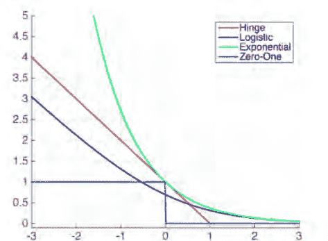

图 8.1：指数损失对置信度高的错误预测提供不断增加的惩罚。此图来自康奈 CS4780。

我们可以将带有指数损失的 AdaBoost 优化问题写如下：

```
\alpha, G_m = \arg \min_{\alpha, G} \sum_{i=1}^n e^{-y_i(F_{m-1}(x_i) + \alpha G(x_i))}
```

## 8.3 提升 BOOSTING

```
\arg \min_{\alpha, G} \sum_{i=1}^n e^{-y_i(F_{m-1}(x_i) + \alpha G(x_i))}
```

项 $w_i^{(m)} := e^{-y_i F_{m-1}(x_i)}$ 对于我们的优化变量是一个常数。我们可以将这个和式分为正确分类的点和错误分类的点：

```
$$\alpha_{m, G} = \arg \min_{\alpha, G} \sum_{y \neq G(x)} w_i^{(m)} e^{\alpha} \quad (*)$$
$\alpha = \arg \min_{\alpha, G} \sum_{y \neq G(x)} w_i^{(m)} e^{-\alpha} \sum_{i=1}^{n} w_i^{(m)}$
```

对于固定的 $\alpha$，第二项不依赖于 $G$。我们可以看到 $G_m(x)$ 的最佳选择是最小化权重 $w_i^{(m)}$ 的分类器：

```
$$e_m = \frac{\sum_{y \neq G(x)} w_i^{(m)}}{\sum w_i^{(m)}}
```

一旦我们得到了 $G_m$，可以通过除以常数 $\sum_{i=1}^n w_i^{(m)}$ 来求解 $\alpha_m$ ($*$)：

```
$$\alpha_m = \arg \min_{\alpha} (1-e_m) e^{-\alpha} + e_m e^{\alpha}$$
```

正如之前所述，其解为：

```
$$\alpha_m = \frac{1}{2} \ln \left(\frac{1-e_m}{e_m}\right)$$
```

从最优的 $\alpha_m$，我们可以导出权重：


```
$w_i^{(m+1)} = \exp(-y_i F_m(x_i))$
$= \exp(-y_i [F_{m-1}(x_i) + \alpha_m G_m(x_i)])$
$= w_i^{(m)} \exp(-y_i G_m(x_i) \alpha_m)$
$= w_i^{(m)} \exp(-y_i G_m(x_i) \frac{1}{2} \ln(\frac{1-e_m}{e_m}))$
$= w_i^{(m)} \left(\frac{1-e_m}{e_m}\right)^{-\frac{1}{2} y_i G_m(x_i)}$
```

我们看到当 $y_i = G_m(x_i)$ 时，乘因子为 $\frac{e_m}{1-e_m}$，否则为 $\frac{1-e_m}{e_m}$。这完成了算法的开发。

关于直观性的最后一点说明，我们将这些更新视为向某个方向推动，直到无法进一步提高性能。更具体地说，每当我们计算 $\alpha_m$（以及 $w_i^{(m+1)}$）时，对于错误分类的项目，我们有：

```
$$\sum_{y \neq G_m(x)} w_i^{(m+1)} = \sum_{y \neq G_m(x)} w_i^{(m)} \sqrt{\frac{1-e_m}{e_m}}$$
```

将右侧除以 $\sum_{i=1}^n w_i^{(m)}$，我们得到 $e_m \sqrt{\frac{1-e_m}{e_m}} = \sqrt{e_m(1-e_m)}$。同样，对于正确分类的项目，我们有：

```
$$\frac{\sum_{i=1}^n w_i^{(m+1)}}{\sum_{i=1}^n w_i^{(m)}} = (1-e_m) \sqrt{\frac{e_m}{1-e_m}} = \sqrt{e_m(1-e_m)}$$
```

一旦调整了 $\alpha$，这两个值是相同的，因此误分类集和正确分类集获得了相同的权重。这一观察具有有趣的实际意义。即使训练误差变为零，AdaBoost 的测试误差也可能继续下降。这可能违背直觉，因为人们会期望分类器过拟合训练数据。这种现象的一种解释是，尽管提升分类器实现了完美的训练误差，但它仍然以最大间隔的方式完善其拟合，这增加了它的泛化能力。

# 第 9 章 深度学习

## 9.1 卷积神经网络

卷积神经网络就像普通的神经网络，只不过更复杂（经过卷积）。但在某些方面，卷积神经网络实际上比全连接神经网络更简单。

我们将主要在图像分类框架下讨论卷积神经网络（ConvNets）。首先，让我们回顾普通神经网络的一层是什么样的：

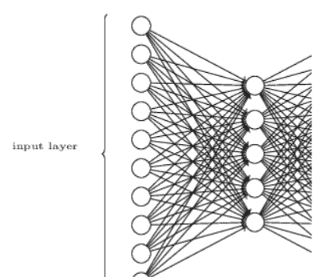

记得每一层由表示单个数字的单元组成。某一层单元的值由其后面单元的值以及层与层之间的权重决定。具体来说，表示第二层的数字向量（例如 $y$）可以表示为表示第一层向量的线性组合 $W$。如果我们处理的是图像，输入层的每个单元可能可能是图像中单个像素的强度。

全连接单元架构有许多权重需要学习。对于一个 $32 \times 32$ 的图像，将有 1024 个输入单元，前两层之间至少有这么多权重。现在，让我们看看 ConvNet 如何以不同的方式处理其权重。

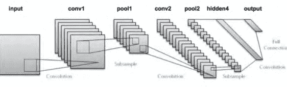

注意某些层被称为“conv”（卷积）和“pool”（池化）。这些层是 ConvNet 引入神经网络架构的新思想。

### 卷积层

卷积层通过对前一层进行卷积来确定。卷积核（kernel）只是权重数组的雅称，卷积意味着我们将权重数组在前一层的像素上滑动，并计算元素级乘积之和（类似于二维点积）。这里有一张图说明了这一点：

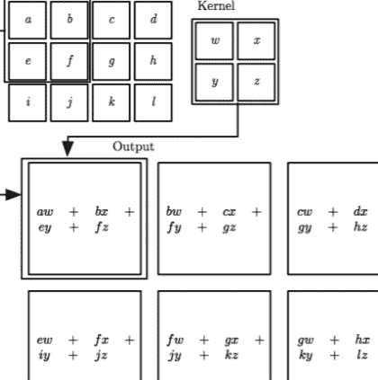

在上面的图中，我们通过某种非线性变换提取了 6 个激活值。在全连接网络中，我们将有 6 × 12 = 72 个权重。然而，在这个卷积层中，我们使用了 4 个权重，因为我们在输入中实现了权重共享。这种策略减少了模型的复杂性

神经网络在图像中寻找模式，如果你有一个卷积核可以检测到某种现象，那么在图像的其他地方使用它是有意义的。

卷积核是如何检测东西的？简单的答案是：它们会在与其相似的图像区域产生较大的值。考虑一个简单的卷积核 `[1 - 1]`。这个核会在左侧亮而右侧暗的地方产生较大的值；相反，它在左侧暗而右侧亮的地方会产生较小的值。

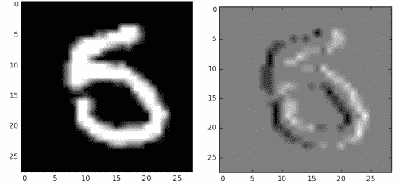

图 9.1：左侧为示例图像。右侧是对图像进行 `[1 - 1]` 卷积后的输出。

注意输出图像在原始图像从亮变暗的地方（如图的右侧）具有高值（白色），而在原始图像从暗变亮的地方（如图的左侧）具有低值（黑色）。这个核可以被认为一个简单的边缘检测器！另一个例子，考虑卷积核：

```
0.6 0.2 0
0.2 0 0.2
0 0.2 0.6
```

如果这个核对图像进行卷积，它将检测 45 度角的边缘。

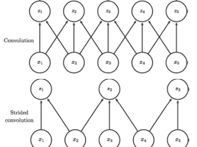

- 3. 零填充（Zero-padding）有时用于控制卷积层的精确尺寸。
- 4. 随着卷积层数量的增加，每个连续层的有效感受野都会增大。也就是说，随着你向下（层层）移动，任何单个单元的值都会受到原始图像中越来越大的区域的影响。例如，如果你使用连续的两层 $3 \times 3$ 卷积核，第一卷积层中的一个单元由 9 个独立的像素提供信息。第二卷积层中的任何一个单元都由第一卷积层的 9 个独立单元提供信息，这可能包含来自多达 $9 \times 9 = 81$ 个原始像素的信息。

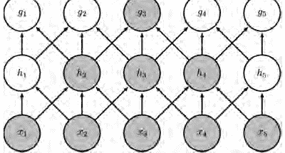

图 9.3：下游层中高亮的单元使用了来自输入层中所有高亮单元的信息。
- 5. 你可以将卷积层看作全连接层的*复杂度正则化版本*。

### 池化层

`pooling layer` 不涉及更多权重。相反，它是一种目的仅用于对前一层进行下采样（也称为池化或整合）的层。它通过在卷积网络的层的单元上滑动某种大小的窗口，并以（某种方式）选择一个值来有效地“代表”窗口捕获的所有单元。你可以从几个正交的角度调整池化层的性质。

- 1. 如何池化？在最大池化（max-pooling）中，代表性值变为窗口内所有单元中的最大值。在平均池化（average-pooling）中，代表性值是窗口内所有单元的平均值。

#### 2. 在哪个方向进行池化？

(a) 同一通道内的空间池化。这具有为你的模型引入平移不变性的能力。

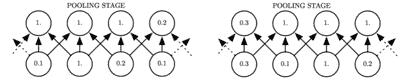

图 9.4：这里，右侧图像的输入层是左侧图像输入层的平移版本，但由于最大池化，下一层看起来大体相同。

(b) 跨不同通道的池化。这具有为你的模型引入平移不变性的能力。

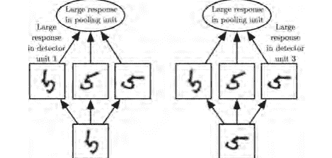

图 9.5：这里，我们有一个例子，卷积层由 3 个卷积核表示。假设它们非常适合检测某种旋转角度的数字 5。如果我们对由这三个卷积核确定的三个通道进行池化，那么无论输入到卷积神经网络的数字“5”是什么方向，池化层都会产生很大的响应！

- 3. 池化的“信息损失”。这由池化窗口的步长（stride）决定。如果你步长很大，可能会丢失更多信息，但可以节省内存。

如果你现在回看本文开头附近的卷积网络图片，你现在应该对每一层在做什么有更好的理解。图片中的卷积网络是 Yann Lecun 的 LeNet，它用于分类手写字母数字字符！

### CNN 架构

卷积神经网络在 2012 年首次成功应用于 ImageNet 挑战，并继续优于不使用神经网络的计算机视觉技术。以下是多年来开发的一些架构。

#### AlexNet (Krizhevsky, et al, 2012)

关键特征：

- 不同尺寸的卷积 层 - 例如，第一层具有 11 x 11 的卷积滤波器。
- 首次使用 ReLU，它解决了主导 tanh 激活函数中梯度饱和的问题。

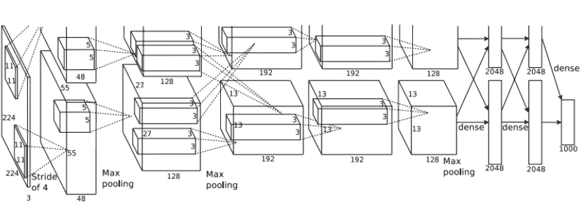

图 9.6：AlexNet 架构。参考：“ImageNet Classification with Deep Convolutional Neural Networks,” NIPS 2012。
- 若干层卷积、最大池化、以及一些归一化。网络末尾有三个全连接层（这些构成了网络中大部分的权重）。
- 大约 6000 万权重，其中一半在最后一个卷积之后的第一个全连接层中。
- 在两个 GPU 上训练 - 图 9.6 中的顶部和底部划分是因为需要将训练分离到两个 GPU 上。GPU 之间的通信有限，如顶部和底部之间的箭头所示。
- 在第一个 FC 层中使用 Dropout - 防止过拟合。
- 强力的数据增强。一种形式是图像平移和反射：面向左侧的大象与面向右侧的大象是相同的。另一种形式是改变 RGB 颜色通道的强度：不同的相机在同一物体上可能有不同的光照，因此有考虑这一点。

#### VGGNet (Simonyan and Zisserman, 2014)

参考论文：“Very Deep Convolutional Networks for Large-Scale Recognition,” ICLR 2015。关键特征：

- 只有 $3 \times 3$ 卷积滤波器。将卷积-卷积-卷积块堆叠在一起，后面是全连接层。注意，三个 $3 \times 3$ 卷积层的堆叠相当于一个 $7 \times 7$ 的感受野，两个 $3 \times 3$ 层相当于一个 $5 \times 5$ 的感受野。
- 使用更小的滤波器（$3 \times 3$）可以在保持感受野的同时增加非线性层。
- 使用 ReLU 激活函数。
- 使用 Dropout。
- 使用批量归一化（Batch Normalization）代替局部响应归一化。

#### GoogNet (Szegedy, 2014)

参考论文：“Going Deeper with Convolutions,” CVPR 2015. 关键特征：

- 使用 $1 \times 1$ 卷积来减少通道数，降低计算量。
- Inception 模块（Inception modules）在并行上执行不同的操作，并将它们连接起来。
- 使用辅助分类器（auxiliary classifiers）解决梯度消失问题。

#### ResNet (He et al, 2015)

参考论文：“Deep Learning for Image Recognition,” CVPR 2016。关键特征：

- 引入残差连接（residual connections/跳跃连接），允许构建极深的网络。
- 这种结构允许通过 $Y = F(x) + x$ 让梯度 $\frac{\partial Y}{\partial x} = \frac{\partial F(x)}{\partial x} + 1$ 能够回传，解决了梯度消失问题。
- 深度深度达 152 层。
- 使用全局平均池化（global average pooling）代替全连接层以减少参数量。
