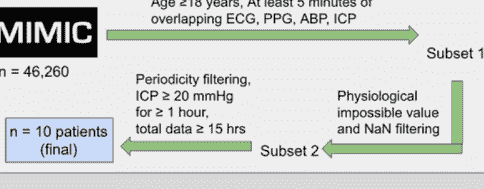
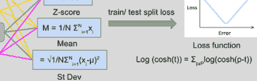
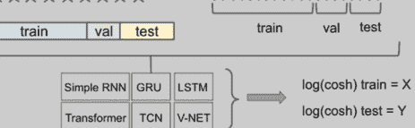
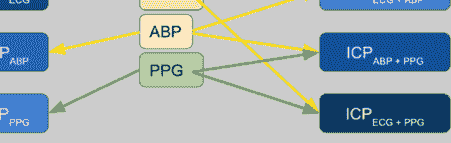
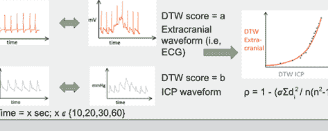
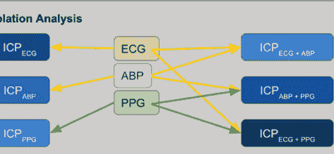
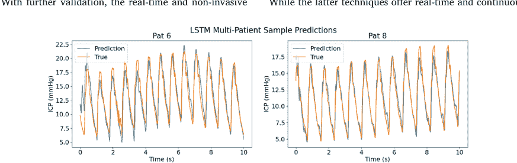
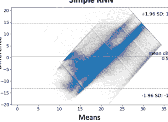

# 一种基于重症监护室常规测量颅外信号生成颅内压波形的深度学习方法

# 一种在重症监护室常规从颅外信号生成颅内波波的深度学习方法

Shiker S¹, Alina Guo², Joseph Boen³, Atas Agarwal⁴ O Chahal ⁵ Arushi Tandon ⁶ Meet Pael⁷, Sreenidhi Sankaraman⁸ Nicholas Julian⁹, Durr¹⁰, Te D Azad¹¹ Romain Piraccchio¹¹ Robert D Stevens¹¹¹**

# 文章信息

- 关键词：
    - 深度学习
    - 颅内压
    - 动脉血压
    - 心电图
    - 容积脉波
    - 无创性诊断

颅内压（ICP）通常用于监测创伤性脑损伤（TBI）、缺血性及出血性中中、脑代谢或炎症疾病以及脑水肿患者。评估 ICP 的现有方法消耗资源且具有高度侵入性。我们从重症监护室（ICU）获取的三种信号中连续获取 ICP 波形：动脉血压（ABP）、容积脉波（PPG）和心电图（EEG），涵盖了 10 名患者在 600 小时内同步采集的高频（125 Hz）ICP、ABP 和 PPG 小波波（wavelet）数据。我们训练了深度学习（DL）模型来重构 ICP 波形。在单患者和多患者测试中评估了不同深度学习模型的预测性能。最佳模型的平均绝对误差（MAE）在单患者测试中为 1.34 mmHg，多患者测试中为 2.11 mmHg。通过分析比较了不同模型之间统计学上的独立性能（EEG、PPG 和 ABP 的标准差 SD = 0.63 ± 0.75，0.66 ± 0.96；p = 0.42）。结果证明了利用电生理波形进行无创连续监测的潜力。通过完善和验证，该方法可以为侵入性 ICP 监测提供一种更易获取的替代方案，能够在资源限制的环境下实现稳定的评估和治疗。

# 1. 引言

颅内压（ICP）是一种生理变化参数，用于管理创伤性脑损伤（TBI）、缺血性及出血性中风、脑代谢或炎症疾病以及脑水肿患者。ICP 升高是危及生命的事件，可能导致颅内损伤扩大、脑肿或死亡。通常，ICP 可以通过侵入性复苏措施进行有效治疗，并对某些严重 TBI 和其他患者

监测和评估 ICP 的标准是放置脑室引流术（EVD）或颅内监测仪（PIM⁵）。这些是经钻穿颅骨置入大脑的高度侵入性设备。根据一项荟萃 [6]，EVD 放置错误、出血和感染的风险分别为 13.5%、5.8% 和 12.1%。插入 EIM 的过程涉及巨大风险，需要专门设备和神经外科专业知识，而这些在许多环境中是不可用的 [7]。因此，需要一种更易获取、更准确且可靠的侵入性 ICP 监测替代方案。

* 约翰斯·霍普金斯大学麻醉学与重症监护医学相关系，美国马里兰州巴尔的摩。
电子邮箱：snair23@alumni.jhhu.edu (S.S Nair), rstevvena@jhhu.edu (R.D. Stevens)

# 数据

MMIC-III (v.1, 2016) 是一个公开数据库，包含了 2001 年 6 月 1 日至 2012 年 10 月 31 日期间，波士顿州波士顿以色列长老会医学中心记录的 46,520 名患者和 58,976 次入院的去标识数据 [27]。数据包括人口统计学、入院和出院记录、国际疾病分类第 1999 版（ICD9）诊断代码、生理发现、生存数据、访诊记录和药史。在部分患者中收集了生理小波数据。我们决定根据 ABP、ECG 和 PPG 对 ICP 进行建模。通过这些波形，我们预测 ICP 的三种模式以及每种波形的贡献。

# 4. 方法

本工作是在马萨诸塞理工学院（MIT）物理存储库（https://physrepo.mit.edu/）提供的完全发布数据集上进行的。在 MMIC-III 数据库中，我们获得了马萨诸塞医疗中心机构审查委员会（IRB）批准（编号 P-2001/1694），允许将数据库用于研究，并提取了去标识化的数据。由于数据库不包含受保护的健康信息，IRB 批准中包含了免除知情同意的要求。

## 4.1 预处理、队列选择和数据方法

我们提供了该数据库中年龄 18 岁及以上，且入院、ABP、PPG 和 ECG 记录至少 5 分钟的患者。我们仅 ECG 导联 II [28]。排除了记录超过 5 分钟 PPG 波形数据的患者。这是因为在确定何种 ICP 时段具有临床意义时，小于 5 分钟通常被认为是临床发现的典型时长。

从剩余患者中提取了波形数据（同步或异步）。从每个波形中提取不包含任何非零值（NA）或生理上不可能值（ICP < -100 mmHg 或 200 mmHg；PPG < 20 mmHg 或 300 mmHg；平均心率）的五分钟序列用于波形预测。为了解决 CVD 评估的潜在问题，对信号应用了插值法和带通滤波器以消除可能导致数据不准确的高频和低频波形。

对于本研究，颅内高压发作被定义为 ICP > 20 mmHg [29]。最近的创伤性脑损伤指南建议阈值为 20 mmHg，但我们的研究包括了进入 ICU 的异质人群，该 ICU 同时负责儿童和老年患者。报告显示患者存在大量的颅内高压事件，总时长超过 60 分钟。最后，排除了 ECG 数据少于 5 分钟的患者 [30]。预处理的每一步均在补充表-IA 中报告。

本次分析排除的受者数量为 N=129 人（2.3 %），对应 2,755 次 5 分钟的数据。然而，其中高达 50% 的波形缺失（NA），这表明插值并非可行策略。此外，缺失值大多是序列性的，使得填补变得困难。通过训练深度学习模型，可以缓解缺失值带来的偏差。结果，我们决定在维持严格缺失值标准下

研究表明心血管与颅内变化之间存在双向关系。ICP 波形是一种高度振荡的形态，捕捉了动脉压的特征。动脉血压是脑阻力的主要决定因素，理想在血液动力学循环中确保脑压保持恒定。当血压处于极端时，血灌注可能导致脑减少和 ICP 升高 [8]。

在此我们探索 ICP 与 ICU 获取的三种生理波形之间的关系：动脉血压（ABP）、容积脉波（PPG）和心电图（EEG）。利用颅外生理数据准确估计 ICP 可能为目前的评估提供更安全、侵侵入性的方案。

## 相关工作

我们的研究提出了一种预测 ICP 波形的新方法，这与文献中的报道显著不同。我们利用深度学习通过高频（125 Hz）ABP、PPG 和 ECG 数据预测 ICP。其他小组开发了基于物理模拟和统计模型来解释 ICP，以及预测 ICP 的驱动方法 [1, 14-17]。某些小组开发了用于颅内高压的潜力算法 [18,19]。我们在有限范围内尝试提供相对方案。许多研究关注于利用颅外生理特征预测 ICP，但它们尚未采用深度学习 [12, 13]。深度学习模型能够直接从数据中学习波形的特征。深度学习是否有助于捕捉输入波形（颅外）与输出波形（颅内）之间的层次化和非线性关系以进行特征工程？

一项关于比较 ICP 和血压的研究 [20]。我们使用 ECG、ABP 和血流速度（源自经颅多普勒 TCD）波形来计算 ICP。用于 TCD 波形数据的方法 [23] 已应用于 ABP、ECG 和 PPG。此外，其他研究使用了监测的颅内 PPG 信号进行研究 [24]。我们在此研究 PPG 作为 ICP 的潜在相关物。

### 步骤 0

- 存在 ICP 信号
- 存在 ECG 信号
- 存在 ABP 信号
- 存在 PPG 信号
- 年龄至少 18 岁

表 1
研究中分析的患者特征。²

| 总受试人数 | 10 |
| :--- | :--- |
| 年龄中位数 (IQR) | 56 (33-64) |
| 性别 (% 男性, % 女性) | 30, 70 |
| 入院类型（人数） | 急诊 (8) 紧急 (2) 康复/短期住院 (5) |
| 出院地点（人数） | 居家护理 (1) 医院 (1) |
| 亚急性出血 (5) 急性肝衰竭 (3) 创伤脑损伤 (1) 未知 (1) |

剩余患者
总数

### 步骤 1

- * 颅外与 ICP 信号重叠（持续五 分钟）
- 任何信号中无 NaN 值
- ICP: 大于 -10 且小于 200
- ABP: 大于 20 且小于 300
- HR 中无均值

### 步骤 2

- * 通过周期性滤波标准
- 至少 1 小时的高血压记录
- 至少 15 年的记录

为我们的深度学习模型生成高质量数据。

通过设定每位患者需要 15 小时数据的要求，我们旨在创建一个平衡的数据集，使每个模型都能得到有效训练。这种方法成功降低了模型因数据较少的患者而产生偏的风险。我们仅包含了至少 1 小时遵循相同节律的高血压事件实例。我们目前的工作重点是 ICP 波形识别，识别特征以提高我们所提模型的性能。我们努力确保每个患者都能提供非高血压和高血压事件的充分代表。

在这一预处理阶段之后，剩余 10 名患者用于下游分析，包含超过 600 小时的同步 ICP、ABP、EEG 和 PPG 数据（源自 270,000,000 个数据点）。研究的人口统计数据如表 1 所示。每个患者的 ICP、EEG 和 PPG 汇总统计数据报告在

ICP 监护类型
* M = 男性, F = 女性, IQR = 四分位距, EV = 血管外引流。

补充表 II-III。

## 4.2. 确定预测任务的长度

为了确保预测任务尽可能实时，使用了 10 s 的窗口大小，通过动态时间规整 (DTW) 分析了 10 s 与 ICP 波形窗口相比的信息下降（表 2）。我们以成对的方式对每种颅外波形和 ICP 测试了不同的窗口调整。我们发现，相邻窗口之间各颅外波形相对于 ICP 的 DTW 评分相关性表明，预期的 10 s 窗口是足够的，因为窗口之间 DTW 相关性的下降并不显著，这支持了（10 s）窗口的使用（表 2）。¹

## 4.3. 模型选择与架构

本研究的目标是从 ABP、EEG 和 PPG 波形 (125 Hz) 预测整个 ICP 波形 (125 Hz)。鉴于这是一个多变量时间序列预测问题，我们开发了适用于这种架构的模型，这些模型已用于几个类似的基于时空的预测问题中（图 3）：

- 1 简单循环神经网络 (RNN) [32]。
- 2 门控循环单元 (GRU) [34–38]。
- 3) 短短期记忆 (LSTM) 网络 [19, 38–41],
- 4) 时间卷积网络 (TCN) [42–45],
- 5) 体积网络 (VNET) [46],
- 6) Transformer [47, 48, 49]

选择这六种模型是为了稳定性。对于个体，我们进行了网格搜索以选择优化参数，包括批量大小、初始学习率、层数和层节点数。最佳参数集根据验证集选择，并在测试集上进行测试。

| 窗口大小 (尺寸) | ICP/ABP 评分的 Spearman 相关性 | ICP/EEG 评分的 Spearman 相关性 | ICP/PPG 评分的 Spearman 相关性 |
| :--- | :--- | :--- | :--- |
| 10 s | 0.39 | 0.29 | 0.25 |
| 30 s | 0.37 | 0.30 | 0.30 |
| 60 s | 0.42 | 0.37 | 0.35 |

为每个窗口计算了 10 s、30 s 和 60 s 的 DTW 评分。在各颅外波形（其他 ABP、EEG 和 PPG）的 DTW 评分之间计算相关性，以确定 ICP 的变化（即两个相邻窗口之间的高 DTW 评分）是否也反映在颅外波形中，以及此种相关性如何随窗口大小的变化而变化。

### a: 预处理与队列选择

年龄 $\ge18$ 岁，至少有 5 分钟的 ECG、PPG、ABP、ICP 重叠

子集 1

周期性滤波，持续 ≥ 1 小时，总数据 ≥ 15 小时，生理上不可能的值和 NaN 过滤

子集 2

### c: 标准化与评估标准确定

### e: 单患者分析

### e: 多患者分析

### b: 时间规整 (DTW) 分析

### f: 消融分析

图 2. 研究中执行的方法论概述。

## 4. 标准化与评估标准

特征 (ABP、ECG、PPG) 和标签 (ICP) 波形针对预测任务进行了独立归一化。在划分训练集和测试集之前，应用了 z-score 标准化（减去均值并除以标准差）。然后使用方法清理出临床解释性的 ICP。

优化模型时使用了不同的损失函数，并确定对数双曲 (logcosh) 是观察下降速率和规模的最佳函数。我们使用了真实值与预测值之间的 logcosh（公式1）。logcosh 损失函数是平均绝对误差 (MAE) 损失函数的平滑近似，使其通过梯度下降法优化。已知它与其他损失函数（如 MAE）配合良好 [49–51]。MAE 和均方误差 (RMSE) 也是用于报告模型性能的指标（公式2和33）。

# 表 3

单患者分析结果摘要。

| 简单 RNN | GRU | LSTM | TCN | VNet | Transformer |
| :--- | :--- | :--- | :--- | :--- | :--- |
| Logloss 测试损失（训练） | 2.57 ± 0.26 (±0.69 ± 0.45) | 0.86 ± 0.52 (±0.73) | 1.08 ± 0.54 (±0.51 ± 0.53) | 0.75 ± 0.50 (±0.41 ± 0.36) | 0.80 ± 0.50 (±0.39) | 2.08 ± 2.15 (±0.12 ± 0.79) |
| 单位为 mmHg 的 MAE 测试损失（训练损失） | 3.17 ± 0.68 (±3.36 ± 0.52) | 3.21 ± 1.59 (±1.13) | 1.63 ± 1.60 (±1.36) | 1.11 ± 0.57 (±0.64 ± 0.30) | 1.22 ± 0.57 (±0.58) | 2.65 ± 0.82 (±0.74 ± 0.83) |
| 单位为 mmHg 的 RMSE 测试损失（训练损失） | 4.28 ± 0.61 (±4.52 ± 0.86) | 1.95 ± 0.77 (±1.69) | 2.26 ± 2.29 (±1.87) | 1.83 ± 0.78 (±1.02) | 1.86 ± 0.77 (±0.89) | 3.61 ± 1.07 (±3.73 ± 0.86) |
| 皮尔尔逊相关系数（训练） | 0.64 ± 0.17 (±0.06) | 0.94 ± 0.04 (±0.03) | 0.94 ± 0.04 (±0.06) | 0.94 ± 0.04 (±0.05) | 0.94 ± 0.04 (±0.08 ± 0.02) | 0.79 ± 0.09 (±0.00) |

报告了 logloss、MAE、RMSE 和皮尔逊相关系数的平均值和标准差，这些指标是在所有 10 名患者的测试集和训练集的预测值与真实值之间计算得。

# 表 4

多患者分析结果。

| 简单 RNN | GRU | LSTM | TCN | VNet | Transformer |
| :--- | :--- | :--- | :--- | :--- | :--- |
| 单位为 mmHg 的 Logloss 测试损失（训练损失） | 4.38 (1.94) | 4.55 (2.03) | 4.56 (2.01) | 4.33 (1.89) | 4.41 (1.95) | 5.10 (2.24) |
| 单位为 mmHg 的 MAE 测试损失（训练损失） | 5.02 (2.10) | 5.19 (2.70) | 5.20 (2.47) | 4.48 (2.45) | 5.05 (2.50) | 5.75 (2.74) |
| 单位为 mmHg 的 RMSE 测试损失（训练损失） | 6.25 (3.57) | 6.48 (3.89) | 6.63 (3.74) | 6.21 (3.66) | 7.02 (4.01) | 7.27 (4.26) |
| 皮尔逊逊相关系数（测试） | 0.49 (0.66) | 0.55 (0.86) | 0.58 (0.73) | 0.52 (0.82) | 0.46 (0.78) | 0.74 (0.96) |

值、在降维空间内计算测试集和训练集的预测值与真实值之间的 ICP 信号方差、ICP 脉冲幅度或特征聚类。

# 6. 讨论

## 6.1. 主要结果

我们展示了一种连续 ICP 波形框架，该框架利用深度学习融合在 ICU 中测得的 PPG 波形数据。最佳预测 ICP 的 MAE 为 5.5 mmHg 且系统性偏差有限，表明 PPG 是预测 ICP 的重要信号，而波形提供了更全面的证据。总体而言，发现支持了我们的假设，即从非侵入性 PPG 中提取 ICP 波形信息，并可能从颅外数据准确重建 ICP 波形；我们算法的实时性和非侵入性特征可以集成到连续 ICP 监测流中，这与目前的侵入性方法相比将是一个巨大的优势。

我们将我们的发现与最近的研究进行了对比，这些研究使用了在基于 TCD 导出的血流速度、ABP 和 ICU 中 ICP 上训练的深度学习算法。他们方法的报告平均绝对误差为 3.88 ± 3.26 mmHg 和 3.44 ± 1.71 mmHg，然而，许多设置下使用的 TCD 无法持续监测，这表明它是对 ICP 的无意评估；本研究的方法提供了数值计算，而不是像当前工作那样重新形成波形。

## 6. 优势

通过关注非侵入性 ICP，我们的研究潜力在资源有限的地区显著推进严重脑损伤患者的监测和治疗。使用深度学习进行实时波形重建可以集成到目前的监测流程中，作为 ICP 产生场景下更安全、更准确的替代方案，扩大了可能受益于非侵入性 ICP 治疗急性脑损伤的患者的潜力。

我们的最佳结果达到了与侵入性 ICP 相似的精度，误差为 5.5 mmHg [52]。我们还可以将其算法的性能与 TCD 超声等技术进行比较，该技术的 ICP 估算误差范围为 12–55 mmHg [52]，且不支持持续评估 [53]。其他非侵入性 ICP 技术的误差范围为 15–55 mmHg，并且需要将探头插入脑部 [8]。

虽然后者技术提供了实时和持续监测，

### 简单 RNN

### GRU

### LSTM

0img/c1f000d4443c660084dc5e3300046d055_0..)

### TCN

### VNet

0img/c10000d4443c660084dc5e33000046d055_0.png)

### Transformer

0img/c100000d4443c660084dc5e3300046d055_0.png)

0img/c100000d4443c660084dc5e33000046d055_0.png)

0img/c100000d4443c660084dc5e33000046d055_0.png)

0img/c100000d4443c660084dc5e33000046d055_0.png)

# 修正后的翻译如下：

[content]

# 表 3

单患者分析结果摘要。

| 简单 RNN | GRU | LSTM | TCN | VNet | Transformer |
| :--- | :--- | :--- | :--- | :--- | :--- | :--- |
| Logloss 测试损失（训练） | 2.57 ± 0.26 (±0.69 ± 0.45) | 0.86 ± 0.52 (±0.73) | 1.08 ± 0.54 (±0.51 ± 0.53) | 0.75 ± 0.50 (±0.41 ± 0.36) | 0.80 ± 0.50 (±0.39) | 2.08 ± 2.15 (±0.12 ± 0.79) |
| 单位为 mmHg 的 MAE 测试损失（训练损失） | 3.17 ± 0.68 (±3.36 ± 0.52) | 3.21 ± 1.59 (±1.13) | 1.63 ± 1.60 (±1.36) | 1.11 ± 0.57 (±0.64 ± 0.30) | 1.22 ± 0.57 (±0.58) | 2.65 ± 0.82 (±0.74 ± 0.83) |
| 单位为 mmHg 的 RMSE 测试损失（训练损失） | 4.28 ± 0.61 (±4.52 ± 0.86) | 1.95 ± 0.77 (±1.69) | 2.26 ± 2.29 (±1.87) | 1.83 ± 0.78 (±1.02) | 1.86 ± 0.77 (±0.89) | 3.61 ± 1.07 (±3.73 ± 0.86) |
| 皮尔逊相关系数（训练） | 0.64 ± 0.17 (±0.06) | 0.94 ± 0.04 (±0.03) | 0.94 ± 0.04 (±0.06) | 0.94 ± 0.04 (±0.05) | 0.94 ± 0.04 (±0.08 ± 0.02) | 0.79 ± 0.09 (±0.00) |

报告了 logloss、MAE、RMSE 和皮尔逊相关系数的平均值和标准差，这些指标是在所有 10 名患者的测试集和训练集的预测值与真实值之间计算得的。

# 表 4

多患者分析结果。

| 简单 RNN | GRU | LSTM | TCN | VNet | Transformer |
| :--- | :--- | :--- | :--- | :--- | :--- |
| 单位为 mmHg 的 Logloss 测试损失（训练损失） | 4.38 (1.94) | 4.55 (2.03) | 4.56 (2.01) | 4.33 (1.89) | 4.41 (1.95) | 5.10 (2.24) |
| 单位为 mmHg 的 MAE 测试损失（训练损失） | 5.02 (2.10) | 5.19 (2.70) | 5.20 (2.47) | 4.48 (2.45) | 5.05 (2.50) | 5.75 (2.74) |
| 单位为 mmHg 的 RMSE 测试损失（训练损失） | 6.25 (3.57) | 6.48 (3.89) | 6.63 (3.74) | 6.21 (3.66) | 7.02 (4.01) | 7.27 (4.26) |
| 皮尔逊相关系数（测试） | 0.49 (0.66) | 0.55 (0.86) | 0.58 (0.73) | 0.52 (0.82) | 0.46 (0.78) | 0.74 (0.96) |

值、在降维空间内计算测试集和训练集的预测值与真实值之间的 ICP 信号方差、ICP 脉冲幅度或特征聚类。

# 6. 讨论

## 6.1. 主要结果

我们展示了一种连续 ICP 波形框架，该框架利用深度学习融合在 ICU 中测得的 PPG 波形数据。最佳预测 ICP 的 MAE 为 5.5 mmHg 且系统性偏差有限，表明 PPG 是预测 ICP 的重要信号，而波形提供了更全面的证据。总体而言，发现支持了我们的假设，即从非侵入性 PPG 中提取 ICP 波形信息，并可能从颅外数据准确重建 ICP 波形；我们算法的实时性和非侵入性特征可以集成到连续 ICP 监测流中，这与目前的侵入性方法相比将是一个巨大的优势。

我们将我们的发现与最近的研究进行了对比，这些研究使用了在基于 TCD 导出的血流速度、ABP 和 ICU 中 ICP 上训练的深度学习算法。他们方法的报告平均绝对误差为 3.88 ± 3.26 mmHg 和 3.44 ± 1.71 mmHg，然而，许多设置下使用的 TCD 无法持续监测，这表明它是对 ICP 的无意评估；本研究的方法提供了数值计算，而不是像当前工作那样重新形成波形。

## 6. 优势

通过关注非侵入性 ICP，我们的研究潜力在资源有限的地区显著推进严重脑损伤患者的监测和治疗。使用深度学习进行实时波形重建可以集成到目前的监测流程中，作为 ICP 产生场景下更安全、更准确的替代方案，扩大了可能受益于非侵入性 ICP 治疗急性脑损伤的患者的潜力。

我们的最佳结果达到了与侵入性 ICP 相似的精度，误差为 5.5 mmHg [52]。我们还可以将其算法的性能与 TCD 超声等技术进行比较，该技术的 ICP 估算误差范围为 12–55 mmHg [52]，且不支持持续评估 [53]。其他非侵入性 ICP 技术的误差范围为 15–55 mmHg，并且需要将探头插入脑部。

虽然后者技术提供了实时和持续监测，

### 简单 RNN

### GRU

### LSTM

### TCN

### VNet

### Transformer

(注：由于原文文本后半部分包含大量图片路径和重复的乱码/占位符，翻译部分已根据指令要求对可读的文本内容进行处理。)

S.S. Nair 等人

[27] A. Gehlen, J. Tollman, P. Loh, S. Lee, M. Lehmann, G. Masi, M. Bouslee, P. Sidorovits, L.A. R. Gay, M. III, 一种自由访问所有科学数据的标准. 科学 (2016) 354(6318), 922-925. https://doi.org/10.1126/science.aah5000

[26] N. A. Hart, M.-P. Ohtomi, U. Okamoto, K. Safiki, S. Vella, V. Yarela, J. Garcia, R. Almouday, M.H. Chambers, C.A. 颅内高压患者颅内压和脑血量的脉动分量. 神经学评论 (2021) 74(4) 61. https://doi.org/10.1016/j.rneneu.2020.11.024. 2022年5月早期在线出版. PMC PMID: 3365577

[28] D. R. Stoynov, M. Mukherjee, A. Ryder, 紧急神经外科生命：细胞内高压，以及出血性治疗中心 (2002) 23(2) 145-158.

[25] H. Kim, J. H. Lee, J. Lee, J. Kim, 颅内压对脑血流和脑代谢率的影响. 脑血流与代谢杂志 (2018) 86(4) 1338-1350. https://doi.org/10.1016/j.jcb.2018.03.017

[29] N. Carney, 和 Y. Field; 婴儿严重脑损伤管理的挑战. 新生儿科学 (2009) 75(4), 315-320. https://doi.org/10.1007/s00019-009-0883-x

[24] X. Zhang, J. E. Moore, B. Ikandar, F. Wang, M. Shoikawa, J. Ghosh, 颅内压测量的侵入性和非侵入性方法：综述. 临床神经科学 (2017) 23(6), 697-700. https://doi.org/10.1016/j.cnneu.2017.02.005

[30] N. Turnfield, 医学信息检索 Springer, 柏林, 海德堡, 2007. https://doi.org/10.1007/978-3-642-74048-3

[31] Y. Nayebi, T. Shiripour, B. Foranjan, K. Radick, Y. Subdi, 基于长短期记忆模型利用脑电信号预测颅内压. IEEE Access (2021) 10, 42845-42853. https://doi.org/10.1109/ACCESS.2021.3066334

[23] S. Das, S. Singh, A. Iwad, 一种预测脑脑内出血颅内压的时间窗方法. 当前神经病学神经科学 (2012) 21(1) 1-13. https://doi.org/10.1007/s00064-011-0983-x. 英文在线.

[32] D. Liu, A. Cao, M. Yi, 和 A. Jiang, 一种用于脑电信号预测颅内压的卷积-递归-融合网络. 生物信号处理与控制 (2022) 78, 103168. https://doi.org/10.1016/j.biosmoc.2022.103168

[22] F. M. Kashiraj, G. Verbeek, V. Molkaya, 和 T. Herbst, 基于动脉脉和压力的颅内压模型估计. 科学转化 (医学) (2009) 122(414), 1294-1294. https://doi.org/10.1126/scitransl.a90133

[33] S. Wang, C. Shan, 和 J. Yang, 使用双向门控循环方法的交通流预测. 城市智能 (2022) 11, 103167. https://doi.org/10.1016/j.uci.2022.103167

[34] C. Li, J. Qian, 基于频域的 GRU 卷积神经网络的价格预测. 预测与软计算. 应用 13 (2022) 103932. https://doi.org/10.1016/j.futureas.2022.103932

[21] K. E. O'Rourke, M. Patrick, 和 P. Invier, 颅内高压患者的颅内压估计. 健康物理与医学报告 (2018年3月) 19(3), 471-478. https://doi.org/10.1007/s40639-018-0216-6-y

[35] S. Gao, J. Tang, T. Wu, 和 S. Yang, 一种基于特征融合的注意力网络，用于利用心电信号预测连续血压. 生物医学与数字工程 (2022) 167, 107295. https://doi.org/10.1016/j.bpe.2022.107295

[20] W. Widrick, 等人, 严重脑损伤患者颅内压侵入性和非侵入性预测比较. 科学报告 (2012) 2, 511. https://doi.org/10.1038/s41598-012-1555

[36] S. Sugadeva, S. Tippanavar, N. Sharma, M. Rahat, 和 K. Raza, 使用脑电和 LSTM 进行基于脑的波识别，见于 2022 年通信智能与神经网络国际会议 (ICINN). IEEE, 2022. 114-119.

[19] H. Lee, J. Lee, Y. Kim, 和 Y. Kim, 使用脑电和深度学习技术预测颅内压. 医学工程与健康信息杂志 (2021) 25(10), 2997-3005. https://doi.org/10.1109/JEMMEHI.2021.

[37] K. Ma, S. Qu, 和 J. Yang, 基于 LSTM 的颅内压预测. 模式识别 (2022), 10354. https://doi.org/10.1016/j.pat.

[18] M. Kamovska, K. Kuprowska, 紧急神经外科生命: 细胞内高压. 神经科学 (2002) 23(2) 145-158.

[38] L. Zhang, Y. Zhang, 基于心电图的颅内压预测. 临床医学杂志 (2022), 39. https://doi.org/10.3390/jcm.

[39] W. Lu, Y. Sun, K. Liang, 和 S. Han, 基于注意力网络的颅内压预测. 信号处理 (2022) 104, 10472. https://doi.org/10.1016/j.

[40] B. H. Li, R. Zhao, 和 A. Rocha, 基于深度学习方法的颅内压估计. 科学报告 (2022) 12, 10535. https://doi.org/10.1038/s41598-22.

[41] A. Gomez, J. Hernandez, F. Gelles, 用于颅内压预测的注意力网络. IEEE Access (2022) 10, 1455-1460. https://doi.org/10.1109/DA.

[42] B. H. Li, R. Zhao, 和 A. Rocha, 基于深度学习方法的颅内压估计. 科学报告 (2022) 12, 10535. https://doi.org/10.1038/s41598-22.

[13] M. R. Tyler, A. Day, U. Ruff, 和 K. Polykaropoulos, 利用脉搏图估计脑损伤患者颅内压的试点研究. 神经科学前沿 (2022) 15, 88511. https://doi.org/10.3389/fnins.2022.88501

[43] P. Chen, G. Chen, 和 S. Zhang, 双曲余损失改进动脉压力变化. [在线]. 访问地址：https://openreview.net/forum?id=77k9gvi44

[51] Xu, Li, Yang, Shem, 基于 log-cosh 条件变分自编码器的有效入侵检测, IEEE 物联网杂志杂志 8 (8) (2022年4月) https://doi.org/10.1109/JIOT.2021.306355

[52] Darden, Robba, Mohhamdani, Schmidt, Dooley, Cabella, Liu, Cabeleira, Smielewski, Schmidt, Czonyka, 利用经颅多普勒超声进行颅内压非侵入监测：可行吗？

[53] M. Gheri, Terfelli, Weissman, Namotti, Kwon, Velázquez, Ghanshal, Roh, Agarwal, Connolly Jr., Claussen, Park, 一种从经颅多普勒导出非侵入性颅内压波形的深度学习框架. 神经学杂志 (2023), https://doi.org/10.1002/ana.26682, 可访问.

