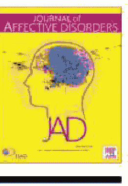
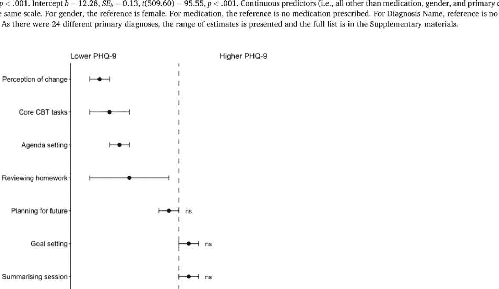

# 基于深度学习的患者特异性作为常见心理健康障碍互联网认知行为治疗出勤率与治疗效果的预测指标研究

研究论文

# 深度学习量化分析患者特异性作为预测常见心理障碍网络支持认知行为疗法出勤率和治疗反应的因子

Caitlin Hookrock^{a,b}, Julia Funk^{b}, Roman Cummins^{c}, Shivam D. Patel^{a}, Ana Catarino^{d}, Keisuke Takano, Tim Dalgeish^{a}, Michael Ewbank^{d}

- a 英国剑桥大学，医学研究委员会认知与脑科学
- b 澳大利亚墨尔本大学，心理科学学院
- c 德国慕尼黑路西米利安大学，心理学系
- d 英国伦敦，Cowley Rd，Lea Digital Health

# 摘要

**背景：** 提高个体关注具体、特定细节的能力，从而减少对世界产生泛泛、去背景化抽象的倾向，是一个目标。然而，关于特定认知行为疗法（CBT）对结果影响的实研究仍然不足。我们评估了患者对话的特异性是否能预测（a）常见心理障碍患者的治疗结束后症状和（b）疗程完成情况。

**方法：** 我们使用深度学习模型，对来自英国国家医疗服务体系（NHS）的353,614 份常见心理障碍 CBT 治疗记录转录中的患者对话特异性进行评分。我们纳入了 65,030 名年龄在 18-94 岁之间（n = 34,569, SD = 12.35）的患者（n = 478, 女性 = 241）。描述性分值是最常见的初步发现（39.1%）。主要结局指标是患者健康问卷（PHQ-9）的治疗结束后反应。次要结局指标是治疗次数。

**结果：** 线性效应模型显示，患者的特异性可以预测 PHQ-9 治疗后症状的减轻，尽管效应的大小和方向与治疗活动有关。较高的特异性与更多的治疗次数相关。

**局限性：** 我们无法根据研究设计推断出因果关系。**结论：** 效应量较小，但在各种常见心理障碍中观察到了特异性。需要进一步的研究探索在 CBT 期间鼓励患者特异性是否可以增强治疗出勤率和治疗效果。

# 1. 引言

认知行为疗法（CBT）是我们治疗常见心理障碍的主要方法。然而，CBT 对 30-50% 的受治疗个体未能实现缓解（Clark 等人，2018），导致许多人仍伴有严重症状和困扰。增加治疗技术的使用以获得良好结果，对于恢复功能至关重要。

在传统 CBT 和第三波 CBT 中，人们可以潜在地改善变化的机制方面，即从抽象、泛化的风格转向具体、特定的处理（Beck and Haigh, 2014; van der Velden 等人，2015）。多种治疗成分促进了患者特异性。正念体验旨在提高关注（具体、感官）细节的能力，并减少抽象模式（忧虑）。Oldandy 和 Igesan（2020）认知重构旨在泛化对世界以及特定背景、环境和技术的信念，这需要帮助来识别特定实例并关注具体的特定细节（Craske 等人，2014）。说明（例如通过论证和个人史）很重要，即基于此类事件所做主张的反应函数仅在特定背景内适用（在决定谁来执行任务时）。关注特定性对于使背景背景化——即驱动常见心理障碍的关于价值感、危险、失败和脆弱性的信念——至关重要（Beck and Haigh, 2014）。针对这些科学驱动的干预措施已作为 CBT 的调整方案被提出，以增强特定认知、认知调控（Watkins 等人，2012）、过度泛化的自传记忆（Hallford 等人，2021a）以及心理想象（Powell 等人，2021）作为一种训练模式。同样，以处理为重点的 CBT 调整整合了更多对具体的关注（Clark 等人，2016）。机器学习技术最近作为一种线性过程受到了审查，部分原因是由于此类数据的数量和结构格式。

机器学习技术可以大规模地为治疗师与患者之间交流期间的各种因素提供见解（Chekroud 等人，2021）。最近的研究使用深度学习模型来识别治疗特征（例如讨论主题、疗程时长）和结果特征（Ewbank 等人，2020），允许识别大量患者中 CBT 成功的特征。

治疗互动中的信息质量可能决定治疗后结果中患者特异性的程度。我们预计，治疗期间特异性的增加将预测出更好的结果，至少对于症状严重的个体是如此；而且 CBT 中更具体的处理特异性，或治疗活动期间更具体的细节（例如在设计实验时）可能会导致问题的解决（Sloan 等人，2021）。我们还想检查特异性在某些任务中是否比其他任务更重要，以及不同特征类别（Ewbank 等人，2020）包括目标设定内的特异性。我们的目标是确定患者特异性是否预测 CBT 治疗疗程的结果；虽然 CBT 任务要求个体提供特定信息，但倾向于特异性的人可能会发现 CBT 更容易，并完成更多的疗程。

我们训练了一个深度学习模型，来量化网络支持 CBT 中患者对话的特异性。我们的主要假设是患者对话的特异性将预测康复情况，患者的特异性将预测更好的结果（PHQ-9）。我们发现特异性与了（Ewbank 等人，2021）治疗师和患者的部署。我们的第二个假设是患者的特异性将预测更多的治疗次数。

# 2. 方法

### 2.1 批准
剑桥大学伦理委员会授予了伦理批准（2017）。

### 2.2 参与者
患者（n = 65,030）接受 NHS 的治疗。入组标准为年龄小于 18 岁且在全科医生处；排除标准为认知障碍、脑损伤或痴呆；有精神病史；识字水平低；阻碍使用设备的视力障碍。

### 2.3 网络 CBT
CBT 由经过培训的治疗师通过在线房间的即时消息进行（www.iesapt.org）。每次 45-60 分钟，每周一次。

### 2.4 特异性
我们分析了 2012 年 6 月至 2021 年 5 月完成的 353,614 次网络支持 CBT 疗程。每份治疗转录由用户提交，文本输入由治疗师提交。从治疗转录中提取了可以指示的语言特征（例如，“你能告诉我一个例子/任务发生这种情况吗？”、“你怎么知道那是真的？”）。我们识别了患者在不同类型任务期间反应的特异性（Ewbank 等人，2020）。我们的结果具有临床意义（见图 1）。结果显示，例如在完成治疗任务时保持具体比在疗程中特异化对结果更重要。我们根据日程设定、作业设定、目标设定、未来计划、讨论担忧和虑、完成 CBT 任务（包括任何认知或行为活动、作业、教育）、评估自杀风险、总结疗程或其他任务期间提取的特异性进行了分类。不同任务的完整细节请见 Ewbank 等人 (2020)。

患者反应使用监督深度学习模型进行分类，该模型预测反应是否为具体。模型训练于一个描述患者体验的数据集（10,000 条目），由感兴趣的个体编写。这些条目随后由人类评分员根据自传记忆测试的标准（Williams and Benedict, 2008）评定为具体或非具体。我们使用 800 个示例训练模型，并使用重叠集合中的 1000 个示例验证模型性能。剩余的 1000 条目用作留测试集。我们还在另一个独立的测试外描述患者体验数据集（1632 条目，由个体编写）上进一步验证了模型。

# 不同类别的治疗师对话示例

# 针对增加性评分的治疗师对话特征

| 显性请求 | |
| :--- | :--- |
| 你能想一想你成功的经历吗？ | |
| 开放式请求 | 你能多告诉我一些吗？ |
| 核心任务 | 你会如何测试那个信念？ |
| 变化的感知 | 你认为在我们共同工作期间什么起到了帮助？ |
| 风险评估 | 你是否有自杀念头？ |
| 设定议程 | 对我们今天的治疗来说，什么最有用？ |

| 形容词、动词和名词的使用，例如： | 其他涉及的人员 |
| :--- | :--- |
| 地点 | |
| 一天或一年中的时间 | |
| 命名情绪 | |
| 感官细节 | |
| 个人行为 | |
| 人的行为 | |
| 人的情绪反应 | |
| 我想周一可以邀请同事一起来看咖啡，如果他们接受的话 | |
| 几周前，我需要告诉 Blake 我什么时候感到被忽视了，这样我就不会过度反应。这一直很有帮助 | |
| 是的，昨晚的压力太大了。我不知道！我可以继续下去 | |
| 我喜欢你关于计划实验的建议。我们也可以聊聊工作吗？ | |

抑郁障碍患者，并再次由人类进行特异性评分。模型训练的详细信息见补充材料。为每个参与者的每项任务计算了平均值（特征特异性/治疗次数）。

# 2.5. 症状测量

患者问卷（PHQ-9; Kroeke et al., 2001）是一个有效且可靠的抑郁指数，我们的主要结局指标。PHQ-9 在每次 CBT 治疗中进行，此外还有泛化焦虑自量表（GAD; Spitzer et al., 2006），这是我们预注册的次要指标。我们还打算检查工作和社交焦虑（Witzman et al., 2008），但未能获得这些数据。由于我们使用的是真实服务数据，我们对临床结果的概念化受限于可用日期。

# 2.6. 数据分析

| 主要诊断 | 流行率 | 心理测量药物使用 | 流行率 |
| :--- | :--- | :--- | :--- |
| 抑郁障碍 | 39.1% | 未记录 | 1.6% |
| 泛化焦虑 | 23.7% | 未处方 | 50.8% |
| 社交焦虑 | 7.2% | 已处方并服用 | 8.3% |
| 未规定焦虑 | 4.9% | 正在服用药物 | 39.2% |
| 客观冲突 | 4.2% | | |
| 恐慌障碍 | 3.8% | | | |
| 创伤后应激 | 3.7% | | | |
| 疑病症 | 3.0% | | | |
| 混合抑郁与焦虑 | 2.7% | | | |
| 特定性症 | 1.5% | | | |
| 广场恐惧症 | 0.9% | | | |
| 进食障碍 | 0.6% | | | |
| 关系困难 | 0.5% | | | |
| 愤怒和易怒 | 0.4% | | | |
| 躯体化障碍 | 0.2% | | | |
| 慢性疼痛 | 0.2% | | | |
| 酒精使用 | 0.1% | | | |
| 性功能障碍 | 0.1% | | | |
| 诉诉的特质 | 0.1% | | | |
| 未另说明的精神障碍 | 0.9% | | | |
| 未接受治疗 | 0.3% | | | |

由于治疗后结果在 R 环境下使用线性混合效应模型进行分析，并采用了近似和限制极大似然估计。观察到的 PHQ-9 分数作为治疗结束的结局指标。效应排名通过随机治疗地点进行测试。对于所有模型，方差因子 < 13。每个模型均包含了参与者在所有治疗课程中的总次数（以考虑时长），以及治疗开始时的 PHQ-9 和 GAD-7 评分（以控制基线识别变量、年龄转诊、性别身份）作为协变量纳入主要和初步分析中（见表 1）。除了治疗过程中的特异性外，患者可能被要求在开始 CBT 之前报告特异性。结果并未显示我们报告的治疗过程中的特异性包含了对特定信息的直接请求的平均次数。

H. Hitchcock

以及患者与 CBT 的对话，以及特异性如何体现在课程和回答反应中。结果显示，更高的特异性也与更好的治疗反应相关。结果显示，治疗后的抑郁症状与结构化、提供证据、设定议程、回顾和讨论观察到的变化方面的更高特异性相关。此外，跨任务的更高特异性也与更次数的治疗相关。

# 3. 结果

# 3.1. 样本与特征

数据收集自英国 78 个 IAPT 站点的 65,003 名参与者（n = 47,308 男性，n = 241 被排除）。参与者平均完成了 5.64 次（SD = 3.57；范围：1–99）治疗。主要特异性在任务中很常见（表 1）。参与者的平均年龄为 34.69 岁（SD = 12.35，18–94 岁）。治疗前的平均 PHQ-9 评分（M = 13.15, SD = 5.90）处于“中度严重”范围（Kroeke et al., 2001）。

有两个关键必须考虑。首先，这是观察性数据，不能进行推断。我们的目标是识别成功 CBT 的因素，以指导未来的治疗发展。治疗特异性（与改善相关）可能受到其他因素的影响（例如 CBT 的质量）。同样，引入的治疗服务的使用可能会影响治疗特异性。观察到了各种治疗组成部分，例如行为激活、与随机分配相关的计划治疗次数，以及特异性对观察效应的影响。然而，小效应尚未被完全揭秘（Duner and Ozkins, 2013）。文中未报告 CBT 对抑郁症状的典型效应量（相对于安慰剂）。

# 3.2. 治疗结果

我们的假设是反应的特异性可以预测治疗结束时的 PHQ-9 分数。相关性（rho = 0.02）的包含较小。所有预测因子在不同任务之间的结果不同（表 2）。模型特异性被患者在讨论解构任务、设定议程、回顾、作业和自杀风险时的特异性显著预测，效应量较小（见图 2）。相反，风险检查期间的特异性也与较高的 PHQ-9 分数相关。仅针对有抑郁表现的参与者（n = 25,440）进行敏感性分析得出了结果（见补充材料）。

# 3.3. 课程出勤

我们的次要假设是每周的频率会预测完成的 CBT 课程次数。包含了初步分析（ICC = 0.10）。然而，除了总结课程外，完成的次数并未被其他任务显著预测（表 3）。在讨论解构任务、完成任务、规划未来和应对策略时，更多的 CBT 课程与更高的特异性相关。当询问自杀风险是一个目标时，观察到了更多的完成课程。预测参加 ≥ 2 次课程的额外分析，以及用户特定的（参与了）参与度也显示，完成的课程可能与其他因素（例如症状严重程度）相关，这产生了相似的结果（见补充材料）。

根据指导 CBT 的一致（Beck and Haigh, 2014），结果支持对话期间存在特异性的证据。然而，当患者在反思和努力他们学到的内容（例如规划生活中的策略/新知识）方面特异性较高时，观察到的完成课程较少。患者表现出对构建 CBT 任务的关注，可能会挑战抑郁信念或谎言。我们在讨论课程和议程时看到的患者请求较少，而对要求的特异性请求更频繁。

# 4. 讨论

这项研究利用机器学习识别了

考虑到跨特异性变量的差异，敏感性检查了治疗结束时 PHQ-9 分数与特异性变量之间的相关性，这可能指示个体效应的方向是否仅由于多重分析。皮尔逊相关系数与混合模型的估计方向一致。同样注意到，治疗前与 PHQ-9 分数之间的可能关联可能受到对治疗前症状严重的患者分配更多课程的常见做法的影响。

然而，在预期方向上没有观察到效应。有趣的是，治疗中最大的（尽管很小）效应量

## 预测治疗结束 PHQ-9 分数的固定效应。

| 固定效应 | 估计值 | df | b | sb |
|---|---|---|---|--|
| 完成的总会话次数 | 20.04 | 60,698.01 | 0.28 | 0.001*** |
| 患者用词数 | -1.31 | 56,720.13 | -0.02 | 0.0 |
| 治疗师特定请求数 | -3.82 | 52,956.49 | -0.05 | 0.001*** |
| 治疗师开放式请求数 | 0.05 | 50,481.21 | 0.01 | 0.01 |
| 初始 GAD-7 分数 | 26.90 | 63,112.01 | 0.48 | 0.022*** |
| 主要范围（补充材料中的个人领域） | -4.11-4.83 | 50,680.41-63,128.48 | -0.51-0.82 | 0.62-0.82*** |
| 性别：男 | -1.63 | 63,102.72 | -0.05 | 0.03 |
| 性别：二元或未知 | 2.30 | 63,128.11 | -0.21 | 0.01*** |
| 药物：已处方但未使用 | 5.03 | 63,113.44 | 0.25 | 0.001*** |
| 药物：正在使用 | 10.05 | 63,162.68 | 0.29 | 0.05 |
| 药物：未使用 | -4.47 | 46,718.17 | 0.49 | 0.1 |
| 变化特征的特异性 | -4.06 | 62,721.18 | -0.98 | 0.1*** |
| 未来规划的特异性 | -1.08 | 63,098.56 | -0.01 | 0.0 |
| 回答认知任务的特异性 | 4.14 | 54,567.37 | 0.07 | 0.02*** |
| 设定目标的特异性 | 5.27 | 51,207.10 | 0.51 | 0.0 |
| 总结会话的特异性 | 0.74 | 63,067.10 | 0.01 | 0.01 |
| 汇报的特异性 | 3.12 | 52,936.99 | -0.05 | 0.001*** |
| 设置作业的特异性 | 3.66 | 58,180.01 | 0.03 | 0.01 |
| 设定议程的特异性 | 4.18 | 48,155.56 | -0.96 | 0.001*** |
| 任务检查的特异性 | 21.71 | 58,555.55 | 0.29 | 0.001*** |

> *** 注。p < .01。截距项 = 12.28, SE = 0.13, f(50, 95) = 95.55, p < .001。连续预测变量（即除提及、性别和主要诊断以外的所有变量）处于同一尺度。对于性别，参考组为女性；对于药物，参考组为未处方药物。对于诊断名称，参考组为未记录诊断。由于存在两个主要领域，估计值显著，列表见于补充材料中。

**图 2.** 治疗 PHQ-9 分数的特异性相关性。注：ns = 不显著。误差线代表标准误。

结果来自 Weikle (Green et al., 2018)。在当前样本中，高自杀倾向是由治疗中症状和高强度治疗引发的，这可能导致在线 CBT 会话完成次数较少。会话次数较少也与目标设定期间更高的特异性有关。具体的目标设定被认为对于激励和鼓励患者遵循治疗至关重要，然而（例如，最近的医院位置、求助的朋友的名字等）由于

## 表 3

| 固定效应 | t | df | b |
|---|---|---|---|
| 人数 | 26.61 | 64,953.07 | 0.40 |
| 请求数 | -8.91 | 64,759.76 | -0.12 |
| 治疗师开放式请求数 | 8.54 | 63,995.19 | 0.13 |
| 初始 GAD-7 | 9.52 | 63,758.99 | 0.10 |
| 初始 PHQ-9 | 5.47 | 63,686.20 | |
| 主要原因（会话中的个人领域） | 4.2-11.55 | 59,884.46-64,260 | -1.13-1.12 |
| 性别：女 | -3.96 | 63,454.40 | -0.12 |
| 性别：非二元或未知 | 0.92 | 63,069.07 | 0.19 |
| 年龄 | 7.5 | 63,724.14 | 0.11 |
| 药物使用：已处方但未使用 | -6.05 | 63,639.67 | -0.30 |
| 药物使用：停药 | 1.65 | 63,507.73 | |
| 药物使用 | -3.72 | 63,520.94 | -0.40 |
| 变化的特异性 | 13.34 | 63,454.18 | 0.18 |
| 声明特异性 | 7.96 | 63,482.71 | 0.09 |
| 核心任务特异性 | 10.26 | 63,464.61 | 0.17 |
| 反馈特异性 | -26.76 | 63,448.84 | -0.36 |

H. Hitchcock

写作 – 编辑；Michael eBook: 概念化、调查、方法论、项目管理、资源、监督、写作 – 编辑

## 利益声明

作者声明没有利益冲突
## 致谢

我们感谢用户以及为本研究提供数据的人

## 附录 A 补充数据

本文的补充数据可以在此处找到：https://doi.org/10.1016/j.jmap.2024.01.014

## 参考文献

Barry, T. J., Lee, S. Y., & Wan, F. (2010). 正念减压训练（MBSR）治疗抑郁症的元分析与综述。Behav Res, 71(6), 811–829. https://doi.org/10.1007/s10168-010-0219-9

Bartram, F. J., Ham, M., Conncey, C. B., Aijner-Weidel, S., Alaric, A. L., Wong, Q., & Glick, J. (2016). 针对有自杀意念成人的在线帮助计划有效性。J Affect Dis, 25, 402–409. https://doi.org/10.1016/j.jad.2016.03.012

Beck, T. A., Haft, E. A. (2014). 抑郁症认知行为疗法的创新。Adv. Clin Psych, 10(1), 1–24. https://doi.org/10.1159/000358444/571131

Chokram, A. M., Bonderelj, J., Goberty, J., Worth, A., Fkella, M., & Oh, C. (2016). 正念认知疗法治疗复发性抑郁症：在抑郁症患者中促进正念的意义。JAMA Psychiatry, 73(6), 593–600. https://doi.org/10.1001/jamapsych.2016.0533

Clark, D. M., Wang, J., Layard, R., Phillips, S., & Smith, M. (2013). 在线心理健康服务（iHT）的有效性：NICE收集数据的分析。Psychotherapy Bulletin, 39(3), 175–185. https://doi.org/10.1177/00333243124xxxxx

Caluis, A. R., Mononey, C., Czechek, T., & Vovitzky, B. (2014). 随机化暴露疗法：一种抑制学习方法。Behav Res, 58, 10–23. https://doi.org/10.1016/j.behavres.2014.03.011

Dalgleish, T., Hitchcock, C. (2023). 自传体记忆恢复的纵向轨迹。Nat. Rev Psych, 3(2), 166–182. https://doi.org/10.1038/s42788-023-004xxxx

Ewan, M. F., Turnbull, R., Batano, S., Carter, A. Jordan., Martin, A. J., Clark, D. M., & Phillips, S. (2019). 使用数字监测评估在线认知行为疗法的有效性及临床结果。JAMA Psychiatry, 77(1), 35–43. https://doi.org/10.1001/jamapsychiat.2019.288xxxxx

Funder, D. C., Reich, J. (2019). 心理学研究与非实验方法中的效应量评估。Method Psychol Sci, 2(2), 156–168. https://doi.org/10.1037/a0015673

Foukes, W. T., Etsholm, S. M., Fisher, S. D., Gordon, A., Snyder, J. W., Vitterberg, J. R., & Cutler, P. (2017). 认知行为疗法治疗抑郁症疗效初步评估：随机对照试验的元分析。J Psychol, 70(2), 199–210. https://doi.org/10.1007/s10967-016-0233-x

Green, J. D., Keerts, J., Reece, K. (2018). 认知叙事疗法（CNT）治疗重度抑郁症的有效性。Clin Psychol, (1), 111. https://doi.org/10.1002/clin.12711

Haffner, D. J., Ramsay, R., & Webb, S. (2021). 针对青少年抑郁症的短期早期干预随机对照试验。JAMA Pediatr, 175(8), exxxxx. https://doi.org/10.1001/jamapediatrics.2021.1087

Haffner, D. J., Ramsay, R., & Webb, S. (2021). 随机化……特异性（……），2222...........10.1002/jcp.1271

Jacobson, N., Eller, P., & Taylor, S. (2016). 记忆特异性训练（MST）治疗抑郁症的随机对照试验。PLOS One, 11(6), e015998. https://doi.org/10.1371/journal.pone.015998

Kemptner, K. R., Spritz, A., & Webb, J. W. (2006). 抑郁症自传体特异性的简易测量表。J Clin Psychol, 49(5), 273–279. https://doi.org/10.1002/jcp.10587

Lewis, D., & Clark, S. (2023). 促进积累变化的效应。Front Psychol, 14, 119352. https://doi.org/10.3389/fpsyt.2023.119352

Micka, J., & Milmanowicz, A. (2020). 正念认知疗法治疗抑郁和焦虑的有效性：系统评价与元分析。J Consult Psychol, 75(2), 213–223.

Mundi, J. C., Marx, W., Stark, M. K., & Green, J. M. (2002). 抑郁症对工作和社会影响。Lancet, 359, 464–474. https://doi.org/10.1016/S0140-6736(02)07733-3

