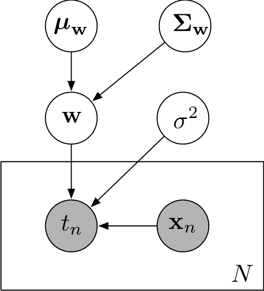
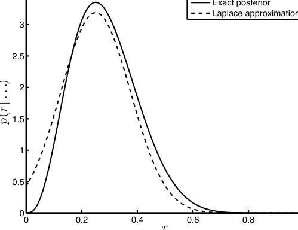

# 机器学习入门指南 第二版 [2nd Ed] (教师解答手册) (解答)


## Chapter 1

### EX 1.1

\(w_0\) 的一个较大正值和 \(w_1\) 的一个较小负值。这些反映了 \(t\) 轴上的高截距（对应于 \(x = 0\) 时的理论获胜时间）以及随时间推移获胜时间的小幅下降。

### EX 1.2

以下方法即可实现：

```matlab
% Attributes are stored in Nx1 vector x
% Targets are stored in Nx1 vector t
xb = mean(x);
tb = mean(t);
x2b = mean(x.*x);
xtb = mean(x.*t);
w1 = (xtb - xb*tb) / (x2b-xb^2);
w0 = tb-w1*xb;
% Plot the data
plot(x,t,'b.','markersize',25);
% Plot the model
hold on;
plot(x,w0+w1*x,'r','linewidth',2);
```

### EX 1.3

我们需要求 \(\mathbf{w}^{\mathrm{T}}\mathbf{X}^{\mathrm{T}}\mathbf{X}\mathbf{w}\)。我们从 \(\mathbf{X}^{\mathrm{T}}\mathbf{X}\) 开始。将 \(\mathbf{X}^{\mathrm{T}}\) 与 \(\mathbf{X}\) 相乘得到：

\[
\mathbf{X}^{\mathrm{T}}\mathbf{X} =
\begin{bmatrix}
\sum_{n=1}^{N} x_{n1}^{2} & \sum_{n=1}^{N} x_{n1} x_{n2} \\
\sum_{n=1}^{N} x_{n2} x_{n1} & \sum_{n=1}^{N} x_{n2}^{2}
\end{bmatrix}
\]

将此结果与 \(\mathbf{w}\) 相乘得到：

\[
\mathbf{X}^{\mathrm{T}}\mathbf{X}\mathbf{w} =
\begin{bmatrix}
w_0 \sum_{n=1}^{N} x_{n1}^{2} + w_1 \sum_{n=1}^{N} x_{n1} x_{n2} \\
w_0 \sum_{n=1}^{N} x_{n2} x_{n1} + w_1 \sum_{n=1}^{N} x_{n2}^{2}
\end{bmatrix}
\]

最后，用 \(\mathbf{w}^{\mathrm{T}}\) 左乘得到：

\[
\mathbf{w}^{\mathrm{T}}\mathbf{X}^{\mathrm{T}}\mathbf{X}\mathbf{w}
=
w_0\left(w_0\sum_{n=1}^{N}x_{n1}^{2}+w_1\sum_{n=1}^{N}x_{n1}x_{n2}\right)
+
w_1\left(w_0\sum_{n=1}^{N}x_{n2}x_{n1}+w_1\sum_{n=1}^{N}x_{n2}^{2}\right)
\]

\[
=
w_0^2\sum_{n=1}^{N}x_{n1}^{2}
+
2w_0w_1\sum_{n=1}^{N}x_{n1}x_{n2}
+
w_1^2\sum_{n=1}^{N}x_{n2}^{2}
\]

如所需。

### EX 1.4

让我们先计算 \(\mathbf{X}\mathbf{w}\)：

\[
\mathbf{X}\mathbf{w}
=
\begin{bmatrix}
w_0x_{11}+w_1x_{12} \\
w_0x_{21}+w_1x_{22} \\
\vdots \\
w_0x_{N1}+w_1x_{N2}
\end{bmatrix}
\]

因此

\[
(\mathbf{X}\mathbf{w})^{\mathrm{T}}
=
[
w_0x_{11}+w_1x_{12},\;
w_0x_{21}+w_1x_{22},\;
\ldots,\;
w_0x_{N1}+w_1x_{N2}
]
\]

最后，计算 \(\mathbf{w}^{\mathrm{T}}\mathbf{X}^{\mathrm{T}}\)：

\[
\mathbf{w}^{\mathrm{T}}\mathbf{X}^{\mathrm{T}}
=
[
w_0x_{11}+w_1x_{12},\;
w_0x_{21}+w_1x_{22},\;
\ldots,\;
w_0x_{N1}+w_1x_{N2}
]
\]

如所需。

### EX 1.5

从 \(\sum_n \mathbf{x}_n t_n\) 开始。其结果是一个与 \(\mathbf{x}\) 相同大小的列向量（2 × 1）。现在，利用 \(\mathbf{X}\) 的定义，

\[
\mathbf{X}^{\mathrm{T}}
=
\begin{bmatrix}
x_{11},x_{21},\ldots,x_{N1} \\
x_{12},x_{22},\ldots,x_{N2}
\end{bmatrix}
\]

这是一个 2 × \(N\) 矩阵。将它与 \(\mathbf{t}\) 相乘得到一个 2 × 1 向量，看起来如下：

\[
\mathbf{X}^{\mathrm{T}}\mathbf{t}
=
\begin{bmatrix}
\sum_{n=1}^{N}x_{n1}t_n \\
\sum_{n=1}^{N}x_{n2}t_n
\end{bmatrix}
\]

这就是 \(\sum_n\mathbf{x}_n t_n\) 如所需。第二种情况，\(\mathbf{X}^{\mathrm{T}}\mathbf{X}\mathbf{w}\)。我们已经知道 \(\mathbf{X}^{\mathrm{T}}\mathbf{X}\mathbf{w}\) 是什么（练习 1.3）

\[
\mathbf{X}^{\mathrm{T}}\mathbf{X}\mathbf{w}
=
\begin{bmatrix}
w_0\sum_{n=1}^{N}x_{n1}^{2}+w_1\sum_{n=1}^{N}x_{n1}x_{n2} \\
w_0\sum_{n=1}^{N}x_{n2}x_{n1}+w_1\sum_{n=1}^{N}x_{n2}^{2}
\end{bmatrix}
\]

现在，\(\mathbf{x}_n\mathbf{x}_n^{\mathrm{T}}\) 是以下矩阵：

\[
\mathbf{x}_n\mathbf{x}_n^{\mathrm{T}}
=
\begin{bmatrix}
x_{n1}^{2} & x_{n1}x_{n2} \\
x_{n2}x_{n1} & x_{n2}^{2}
\end{bmatrix}
\]

将它与 \(\mathbf{w}\) 相乘得到：

\[
\mathbf{x}_n\mathbf{x}_n^{\mathrm{T}}\mathbf{w}
=
\begin{bmatrix}
w_0x_{n1}^{2}+w_1x_{n1}x_{n2} \\
w_0x_{n2}x_{n1}+w_1x_{n2}^{2}
\end{bmatrix}
\]

对 \(N\) 项求和就得到我们之前推导的矩阵。

### EX 1.6

代码如下：

```matlab
%% Women's 100m data
% Load all Olympic data
load olympics;
% Copy the necessary variables
x = female100(:,1); % Olympic year
t = female100(:,2); % Winning time
% Augment x
X = [repmat(1,size(x)) x];
% Get solution
w = inv(X'*X)*X'*t;
```

拟合模型为：

\[
t=40.9242-0.0151x
\]

### EX 1.7

将 2012 年和 2016 年代入上述表达式，得到的获胜时间分别为 10.5997 和 10.5394。

### EX 1.8

男子模型为：

\[
t=36.4165-0.0133x
\]

女子模型为：

\[
t=40.9242-0.0151x
\]

女子的用时下降速度快于男子。因此，在使获胜时间相同的 \(x\) 之后的第一个奥运会上，女子将更快：

\[
\begin{aligned}
40.9242-0.0151x &= 36.4165-0.0133x \\
x &= 2589
\end{aligned}
\]

2589 之后的下一个奥运年份（假设每四年举办一次）是 2592 年。获胜时间是不切实际的快速，女子为 1.8580 秒，男子为 1.8628 秒。

### EX 1.9

代码如下（synthdata_cv.m）：

```matlab
clear all;close all;
load synthdata

% Augment x
X = repmat(1,size(x));
for k = 1:4
    X = [X x.^k];
end

% Fit the model
w = inv(X'*X)*X'*t;

% Randomise the data order
N = size(X,1);
order = randperm(N);
sizes = repmat(floor(N/10),1,10);
sizes(end) = sizes(end) + N-sum(sizes);
sizes = [0 cumsum(sizes)];

X = repmat(1,size(x));

loss = zeros(4,10);
for poly_order = 1:4
    % Augment x
    X = [X x.^poly_order];
    for k = 1:10 % 10-fold CV
        % Extract the train and test data
        traindata = X(order,:);
        traint = t(order);
        testdata = X(order(sizes(k)+1:sizes(k+1)),:);
        testt = t(order(sizes(k)+1:sizes(k+1)));
        traindata(sizes(k)+1:sizes(k+1),:) = [];
        traint(sizes(k)+1:sizes(k+1)) = [];
        
        % Fit the model
        w = inv(traindata'*traindata)*traindata'*traint;
        
        % Compute loss on test data
        predictions = testdata*w;
        loss(poly_order,k) = sum((predictions - testt).^2);
    end
end

% Plot the loss
plot([1:4],mean(loss,2));
```

### EX 1.10

总损失为

\[
\mathcal{L} = \sum_{n=1}^{N} (t_n - \mathbf{w}^T \mathbf{x}_n)^2.
\]

以矩阵形式写出、求导并求解得到：

\[
\mathcal{L} = (\mathbf{t} - \mathbf{X}\mathbf{w})^T (\mathbf{t} - \mathbf{X}\mathbf{w})
= \mathbf{t}^T \mathbf{t} - 2 \mathbf{w}^T \mathbf{X}^T \mathbf{t} + \mathbf{w}^T \mathbf{X}^T \mathbf{X} \mathbf{w}
\]

\[
\frac{\partial \mathcal{L}}{\partial \mathbf{w}} = -2 \mathbf{X}^T \mathbf{t} + 2 \mathbf{X}^T \mathbf{X} \mathbf{w} = 0
\]

\[
\mathbf{w} = (\mathbf{X}^T \mathbf{X})^{-1} \mathbf{X}^T \mathbf{t}.
\]

这与平均损失得到的 \(\mathbf{w}\) 值相同。这并不令人惊讶，因为我们所做的只是将损失乘以一个常数，这不会改变 \(\mathbf{w}\) 在最小值处的值。


### 练习 1.11.
损失函数由下式给出：

\mathcal{L} = \frac{1}{N} \sum_{n=1}^{N} \alpha_n (t_n - \mathbf{w}^\top \mathbf{x}_n)^2

如果我们定义矩阵：

\mathbf{A} = \begin{bmatrix} \alpha_1 & 0 & \dots & 0 \\ 0 & \alpha_2 & \dots & 0 \\ \vdots & \vdots & \ddots & \vdots \\ 0 & 0 & \dots & \alpha_N \end{bmatrix}

我们可以将损失写成向量/矩阵形式：

\mathcal{L} = \frac{1}{N} (\mathbf{t} - \mathbf{X}\mathbf{w})^\top \mathbf{A} (\mathbf{t} - \mathbf{X}\mathbf{w})

展开、求导、令其为零并求解：

\mathcal{L} = \frac{1}{N} \left( \mathbf{t}^\top \mathbf{A} \mathbf{t} - 2 \mathbf{w}^\top \mathbf{X}^\top \mathbf{A} \mathbf{t} + \mathbf{w}^\top \mathbf{X}^\top \mathbf{A} \mathbf{X} \mathbf{w} \right)
\frac{\partial \mathcal{L}}{\partial \mathbf{w}} = -\frac{2}{N} \mathbf{X}^\top \mathbf{A} \mathbf{t} + \frac{2}{N} \mathbf{X}^\top \mathbf{A} \mathbf{X} \mathbf{w} = \mathbf{0}
\mathbf{w} = (\mathbf{X}^\top \mathbf{A} \mathbf{X})^{-1} \mathbf{X}^\top \mathbf{A} \mathbf{t}.

在 Matlab 中尝试一下（将某些 \alpha_n 设得很低，某些设得很高），观察对解的影响。

### 练习 1.12.
代码如下（regls100m.m）：

```
1 clear all;close all;
2 load olympics;
3 % Extract men's 100m data
4 x = male100(:,1);
5 t = male100(:,2);
6
7 % Choose number of folds
8 K = 5;
9
10 % Randomise the data order
11 N = size(x,1);
12 order = randperm(N);
13 sizes = repmat(floor(N/K),1,K);
14 sizes(end) = sizes(end) + N-sum(sizes);
15 sizes = [0 cumsum(sizes)];
16
17 % Rescale x
18 x = x - x(1);
19 x = x./4;
20
21 X = [repmat(1,size(x)) x];
22 % Comment out the following line for linear
23 X = [X x.^2 x.^3 x.^4];
24
25 % Scan a wide range of values of the regularisation parameter
26 regvals = 10.^[-12:1:12];
27
28 for r = 1:length(regvals)
29     for k = 1:K
30         % Extract the train and test data
31         traindata = X(order,:);
32         traint = t(order);
33         testdata = X(order(sizes(k)+1:sizes(k+1)),:);
34         testt = t(order(sizes(k)+1:sizes(k+1)));
35         traindata(sizes(k)+1:sizes(k+1),:) = [];
36         traint(sizes(k)+1:sizes(k+1)) = [];
37
38         % Fit the model
39         w = inv(traindata'*traindata + regvals(r)*eye(size(X,2)))*...
40             traindata'*traint;
41
42         % Compute loss on test data
43         predictions = testdata*w;
44         loss(r,k) = sum((predictions - testt).^2);
45     end
46 end
```

## 第 2 章

### 练习 2.1.
误差是实数值，因此连续随机变量更为合适。

### 练习 2.2.
如果所有结果出现的可能性相同，那么它们发生的概率也相同。定义 $Y$ 为表示骰子所示值的随机变量，我们可以得出以下结论：

$$P(Y=y)=r,$$

其中 $r$ 是一个常数。根据概率的定义，我们知道：

$$\sum_{y=1}^{6}P(Y=y)=1.$$

将 $r$ 代入上式，得到：

$$\sum_{y=1}^{6}r=1,\quad 6r=1,\quad r=1/6.$$

### 练习 2.3.
(a) $Y$ 是一个离散随机变量，可以取从 0 到无穷大的任何值。$Y\leq 4$ 的概率等于所有满足 $Y\leq 4$ 的概率之和，即 $Y=0$、$Y=1$、$Y=2$、$Y=3$、$Y=4$ 的概率之和：

$$P(Y\leq 4)=\sum_{y=0}^{4}P(Y=y).$$

当 $\lambda=5$ 时，我们可以计算这些概率：

$$P(Y\leq 4)=0.0067379+0.0336897+0.0842243+0.1403739+0.1754674=0.44049.$$

(b) 因为 $Y$ 必须满足 $P(Y\leq 4)$ 或 $P(Y>4)$ 之一，所以我们知道 $P(Y>4)=1-P(Y\leq 4)$：

$$P(Y>4)=0.5591.$$

### 练习 2.4.
我们需要 $\mathbb{E}_{p(y)}\{\sin(y)\}$，其中 $p(y)=u(a,b)$。均匀密度由下式给出：

$$p(y)=\begin{cases}\frac{1}{b-a}, & a\leq y\leq b\\ 0, & \text{otherwise}\end{cases}$$

所需的期望值为：

$$\begin{aligned}
\mathbb{E}_{p(y)}\{\sin(y)\} &= \int \sin(y)p(y)\,dy \\
&= \int_{y=a}^{b} \sin(y)\frac{1}{b-a}\,dy \\
&= \frac{1}{b-a}[-\cos(y)]_a^b \\
&= \frac{\cos(a)-\cos(b)}{b-a}.
\end{aligned}$$

当 $a=0$，$b=1$ 时，这等于

$$\mathbb{E}_{p(y)}\{\sin(y)\}=\frac{\cos(0)-\cos(1)}{1}=0.45970.$$

下面计算基于样本近似的代码（`sampleexpect.m`）：

```matlab
clear all;
close all;
% Compute a sample based approximation to the required expectation
u = rand(10000,1); % Take 10000 samples
su = sin(u);
% Plot how the approximation changes as more samples are used
ns = 10:100:10000;
stages = zeros(size(ns));
for i = 1:length(ns)
    stages(i) = mean(su(1:ns(i)));
end
plot(ns,stages)
% Plot the true value
hold on
plot([0 ns(end)],[0.4597 0.4597],'k--')
```

### 练习 2.5.
多元高斯概率密度函数（pdf）由下式给出：

$$p(\mathbf{w})=\frac{1}{(2\pi)^{D/2}|\boldsymbol{\Sigma}|^{1/2}}\exp\left\{-\frac{1}{2}(\mathbf{w}-\boldsymbol{\mu})^\mathsf{T}\boldsymbol{\Sigma}^{-1}(\mathbf{w}-\boldsymbol{\mu})\right\}.$$

令 $\boldsymbol{\Sigma}=\sigma^2\mathbf{I}$，得到：

$$p(\mathbf{w})=\frac{1}{(2\pi)^{D/2}|\sigma^2\mathbf{I}|^{1/2}}\exp\left\{-\frac{1}{2\sigma^2}(\mathbf{w}-\boldsymbol{\mu})^\mathsf{T}\mathbf{I}^{-1}(\mathbf{w}-\boldsymbol{\mu})\right\}.$$

因为它只有对角线上有元素，所以 $\sigma^2\mathbf{I}$ 的行列式等于这些对角线元素的乘积。由于它们都相同，$|\sigma^2\mathbf{I}|^{1/2}=\left(\prod_{d=1}^{D}\sigma^2\right)^{1/2}=(\sigma^2)^{D/2}$。$\mathbf{I}^{-1}=\mathbf{I}$，并且向量/矩阵乘以 $\mathbf{I}$ 后保持不变。因此，指数中的参数可以写为 $-\frac{1}{2\sigma^2}(\mathbf{w}-\boldsymbol{\mu})^\mathsf{T}(\mathbf{w}-\boldsymbol{\mu})$，并且回顾 $\mathbf{b}^{\mathsf{T}}\mathbf{b}=\sum_i b_i^2$，我们可以将 pdf 重写为：

$$p(\mathbf{w})=\frac{1}{(2\pi)^{D/2}(\sigma^2)^{D/2}}\exp\left\{-\frac{1}{2\sigma^2}\sum_{d=1}^{D}(w_d-\mu_d)^2\right\}.$$

其中 $w_d$ 和 $\mu_d$ 分别是 **w** 和 **μ** 的第 $d$ 个元素。和的指数等于指数的乘积。因此，

$$\begin{aligned} p(\mathbf{w}) &= \frac{1}{(2\pi)^{D/2}(\sigma^2)^{D/2}}\prod_{d=1}^{D}\exp\left\{-\frac{1}{2\sigma^2}(w_d-\mu_d)^2\right\} \\ &= \prod_{d=1}^{D}\frac{1}{(2\pi)^{1/2}\sigma}\exp\left\{-\frac{1}{2\sigma^2}(w_d-\mu_d)^2\right\} \\ &= \prod_{d=1}^{D}p(w_d\mid\mu_d,\sigma^2). \end{aligned}$$

其中 $p(w_d\mid\mu_d,\sigma^2)=\mathcal{N}(\mu_d,\sigma^2)$。因此，对角协方差等价于假设 **w** 的元素是独立的单变量高斯分布，均值为 $\mu_d$，方差为 $\sigma^2$。

### 练习 2.6.
使用与前一练习相同的方法，我们看到协方差矩阵的行列式为 $\prod_{d=1}^{D}\sigma_d^2$，并且我们有以下结果：

$$p(\mathbf{w})=\frac{1}{(2\pi)^{D/2}\left(\prod_{d=1}^{D}\sigma_d^2\right)^{1/2}}\exp\left\{-\frac{1}{2}\sum_{d=1}^{D}\frac{(w_d-\mu_d)^2}{\sigma_d^2}\right\}$$

将和改为乘积，我们得到

$$\begin{aligned} p(\mathbf{w}) &= \frac{1}{(2\pi)^{D/2}\left(\prod_{d=1}^{D}\sigma_d^2\right)^{1/2}}\prod_{d=1}^{D}\exp\left\{-\frac{1}{2\sigma_d^2}(w_d-\mu_d)^2\right\} \\ &= \prod_{d=1}^{D}\frac{1}{(2\pi)^{1/2}\sigma_d}\exp\left\{-\frac{1}{2\sigma_d^2}(w_d-\mu_d)^2\right\}. \end{aligned}$$

这是 $D$ 个独立单变量高斯密度函数的乘积。

### 练习 2.7.
我们这种一般模型的 Hessian 矩阵由下式给出：

$$-\frac{1}{\sigma^2}\mathbf{X}^{\mathsf{T}}\mathbf{X}$$

对于线性模型，**X** 定义为：

$$\mathbf{X}=\begin{bmatrix}1 & x_1\\1 & x_2\\\vdots & \vdots\\1 & x_N\end{bmatrix}$$

因此 $-\frac{1}{\sigma^2}\mathbf{X}^{\mathsf{T}}\mathbf{X}$ 为：

$$\mathbf{X}^{\mathsf{T}}\mathbf{X}=\begin{bmatrix}N & \sum_{n=1}^{N}x_n\\\sum_{n=1}^{N}x_n & \sum_{n=1}^{N}x_n^2\end{bmatrix}$$

对角线元素为 $-N/\sigma^2$ 和 $-(1/\sigma^2)\sum_{n=1}^{N}x_n^2$，这与第 1 章中得到的表达式等价。

### 练习 2.8.
我们有 $N$ 个值 $x_1,\ldots,x_N$。假设这些值来自高斯分布，我们希望找到该高斯分布的最大似然估计，并希望找到该高斯分布的均值和方差的最大似然估计。高斯 pdf 为：

$$\frac{1}{\sqrt{2\pi}\sigma}\exp\left\{-\frac{1}{2\sigma^2}(x_n-\mu)^2\right\}$$

在 IID 假设下，所有 $N$ 个点的似然由 $N$ 个对象的乘积给出：

$$\prod_{n=1}^{N}\frac{1}{\sqrt{2\pi}\sigma}\exp\left\{-\frac{1}{2\sigma^2}(x_n-\mu)^2\right\}.$$

我们将使用似然的对数：

$$\log L=\sum_{n=1}^{N}\left(-\frac{1}{2}\log(2\pi)-\frac{1}{2}\log(\sigma^2)-\frac{1}{2\sigma^2}(x_n-\mu)^2\right)$$

为了找到 $\mu$ 的最大似然估计，我们对 $\mu$ 求导，令其为零并求解：

$$\begin{aligned}\frac{\partial\log L}{\partial\mu}&=\sum_{n=1}^{N}\frac{1}{\sigma^2}(x_n-\mu)\\[4pt]0&=\frac{1}{\sigma^2}\sum_{n=1}^{N}(x_n-\mu)\\[4pt]0&=\sum_{n=1}^{N}x_n-\sum_{n=1}^{N}\mu\\[4pt]&=\sum_{n=1}^{N}x_n-N\mu\\[4pt]\mu&=\frac{1}{N}\sum_{n=1}^{N}x_n\end{aligned}$$

类似地，对于 $\sigma^2$，

$$\frac{\partial\log L}{\partial\sigma^2}=\sum_{n=1}^{N}\left(-\frac{1}{2\sigma^2}+\frac{1}{2(\sigma^2)^2}(x_n-\mu)^2\right)=0$$

$$N\sigma^2=\sum_{n=1}^{N}(x_n-\mu)^2\tag{2.1}$$

$$\sigma^2=\frac{1}{N}\sum_{n=1}^{N}(x_n-\mu)^2\tag{2.2}$$


### EX 2.9.

$$P(X_n=x\mid r)=r^x(1-r)^{1-x}$$

其中 $x$ 为 0 或 1。在 IID 假设下，我们有：

$$L=\prod_{n=1}^{N}r^{x_n}(1-r)^{1-x_n}$$

且对数似然为：

$$\log L=\sum_{n=1}^{N}x_n\log r+(1-x_n)\log(1-r)$$

对 $r$ 求导得到：

$$\begin{aligned}
\frac{\partial\log L}{\partial r}&=\sum_{n=1}^{N}\left(\frac{x_n}{r}-\frac{1-x_n}{1-r}\right)=0\\
\sum_{n=1}^{N}\frac{x_n}{r}&=\sum_{n=1}^{N}\frac{1-x_n}{1-r}\\
\sum_{n=1}^{N}x_n-r\sum_{n=1}^{N}x_n&=rN-r\sum_{n=1}^{N}x_n\\
r&=\frac{1}{N}\sum_{n=1}^{N}x_n.
\end{aligned}$$

### EX 2.10.

$$\frac{\partial^2\log L}{\partial\mu^2}=-\frac{N}{\sigma^2}.$$

因此 Fisher 信息等于 $N/\sigma^2$。

### EX 2.11.

$$\hat{\sigma}^{2}=\frac{1}{N}\left[\sum_{n=1}^{N}t_n^2-2\sum_{n=1}^{N}t_n\mathbf{x}_n^{\mathsf T}\hat{\mathbf w}+\sum_{n=1}^{N}(\mathbf{x}_n\hat{\mathbf w})^2\right].$$

集中于最后一项，

$$\begin{aligned}
\sum_{n=1}^{N}(\mathbf{x}_n^{\mathrm T}\hat{\mathbf w})^2
&=\sum_{n=1}^{N}\mathbf{x}_n^{\mathrm T}\hat{\mathbf w}\hat{\mathbf w}^{\mathrm T}\mathbf{x}_n\\
&=\operatorname{Tr}(\mathbf{X}\hat{\mathbf w}\hat{\mathbf w}^{\mathrm T}\mathbf{X}^{\mathrm T})\\
&=\operatorname{Tr}\left(\mathbf{X}(\mathbf{X}^{\mathrm T}\mathbf{X})^{-1}\mathbf{X}^{\mathrm T}\mathbf{t}\mathbf{t}^{\mathrm T}\mathbf{X}(\mathbf{X}^{\mathrm T}\mathbf{X})^{-1}\mathbf{X}^{\mathrm T}\right)\\
&=\operatorname{Tr}\left(\mathbf{X}^{\mathrm T}\mathbf{X}(\mathbf{X}^{\mathrm T}\mathbf{X})^{-1}\mathbf{X}^{\mathrm T}\mathbf{t}\mathbf{t}^{\mathrm T}(\mathbf{X}^{\mathrm T}\mathbf{X})^{-1}\right)\\
&=\operatorname{Tr}\left(\mathbf{X}^{\mathrm T}\mathbf{t}\mathbf{t}^{\mathrm T}\mathbf{X}(\mathbf{X}^{\mathrm T}\mathbf{X})^{-1}\right)\\
&=\operatorname{Tr}\left(\mathbf{t}\mathbf{t}^{\mathrm T}\mathbf{X}(\mathbf{X}^{\mathrm T}\mathbf{X})^{-1}\mathbf{X}^{\mathrm T}\right)\\
&=\operatorname{Tr}\left(\mathbf{t}^{\mathrm T}\mathbf{X}(\mathbf{X}^{\mathrm T}\mathbf{X})^{-1}\mathbf{X}^{\mathrm T}\mathbf{t}\right)\\
&=\mathbf{t}^{\mathrm T}\mathbf{X}(\mathbf{X}^{\mathrm T}\mathbf{X})^{-1}\mathbf{X}^{\mathrm T}\mathbf{t}\\
&=\mathbf{t}^{\mathrm T}\mathbf{X}\hat{\mathbf w}\\
&=\sum_{n=1}^{N}t_n\mathbf{x}_n^{\mathrm T}\hat{\mathbf w}.
\end{aligned}$$

因此，

$$\hat{\sigma}^{2}=\frac{1}{N}\left[\sum_{n=1}^{N}t_n^2-\sum_{n=1}^{N}t_n\mathbf{x}_n^{\mathrm T}\hat{\mathbf w}\right].$$

现在，$\sum_{n=1}^{N}t_n^2=\mathbf{t}^{\mathrm T}\mathbf{t}$ 且我们已知 $\sum_{n=1}^{N}t_n\mathbf{x}_n^{\mathrm T}\hat{\mathbf w}=\mathbf{t}^{\mathrm T}\mathbf{X}\hat{\mathbf w}$。所以，

$$\hat{\sigma}^{2}=\frac{1}{N}\left[\mathbf{t}^{\mathrm T}\mathbf{t}-\mathbf{t}^{\mathrm T}\mathbf{X}\hat{\mathbf w}\right],$$

如所需。

### EX 2.12.

```matlab
clear all;close all;
% Relevant code extracted from predictive-variance-example.m
x = rand(50,1)*10^-5;
x = sort(x);
% Compute true function values
f = 5*x.^3 - x.^2 + x;
% Generate some test locations
testx = [min(x):0.2:max(x)]';
% Add some noise
t = f+randn(50,1)*sqrt(1000);
% Remove all training data between -1.5 and 1.5
pos = find(x>=-1.5 & x<=1.5);
x(pos) = [];
f(pos) = [];
t(pos) = [];

% Choose model order
K = 5;

X = repmat(1,size(x));
testX = repmat(1,size(testx));
```
22 for k = 1:K
23     X = [X x.^k];
24     testX = [testX testx.^k];
25 end
26
27
28 w_hat = inv(X'*X)*X'*t;
29 ss_hat = mean((t - X*w_hat).^2);
30 pred_va = ss_hat*diag(testX*inv(X'*X)*testX');
31 % Make a plot
32 figure(1);hold off
33 plot(x,t,'b.');
34 hold on
35 errorbar(testx,testX*w_hat,pred_va,'r');

### EX 2.13.

$$p(x|\theta)=\theta^{x}(1-\theta)^{1-x}$$

Fisher 信息定义为在某参数值处对数密度二阶导数的负期望值：

$$\mathcal{F}= -\mathbf{E}_{p(x|\theta)}\left\{\left.\frac{\partial^{2}\log p(x|\theta)}{\partial\theta^{2}}\right|_{\theta}\right\}$$

对 $\log p(x|\theta)$ 求两次导数得到：

$$\frac{\partial\log p(x|\theta)}{\partial\theta}=\frac{x}{\theta}-\frac{1-x}{1-\theta}$$ $$\frac{\partial^{2}\log p(x|\theta)}{\partial\theta^{2}}=-\frac{x}{\theta^{2}}-\frac{1-x}{(1-\theta)^{2}}.$$

因此 Fisher 信息为：

$$\mathcal{F}=\frac{1}{\theta^{2}}\mathbf{E}_{p(x|\theta)}\{x\}+\frac{1}{(1-\theta)^{2}}\mathbf{E}_{p(x|\theta)}\{1-x\}.$$

代入期望值（分别为 $\theta$ 和 $1-\theta$）得到：

$$\mathcal{F}=\frac{\theta}{\theta^{2}}+\frac{1-\theta}{(1-\theta)^{2}}=\frac{1}{\theta(1-\theta)}$$

### EX 2.14.

$$p(\mathbf{x}|\boldsymbol{\mu},\boldsymbol{\Sigma})=\frac{1}{(2\pi)^{D/2}|\boldsymbol{\Sigma}|^{1/2}}\exp\left\{-\frac{1}{2}(\mathbf{x}-\boldsymbol{\mu})^{\top}\boldsymbol{\Sigma}^{-1}(\mathbf{x}-\boldsymbol{\mu})\right\}.$$

对数并去掉不包含 $\boldsymbol{\mu}$ 的项：

$$\log p(\mathbf{x}|\boldsymbol{\mu},\boldsymbol{\Sigma})\propto\boldsymbol{\mu}^{\top}\boldsymbol{\Sigma}^{-1}\mathbf{x}-\frac{1}{2}\boldsymbol{\mu}^{\top}\boldsymbol{\Sigma}^{-1}\boldsymbol{\mu}.$$

一阶和二阶导数为：

\[ \frac{\partial \log p(\mathbf{x}|\boldsymbol{\mu}, \boldsymbol{\Sigma})}{\partial \boldsymbol{\mu}} = \boldsymbol{\Sigma}^{-1}\mathbf{x} - \boldsymbol{\Sigma}^{-1}\boldsymbol{\mu} \]

\[ \frac{\partial^2 \log p(\mathbf{x}|\boldsymbol{\mu}, \boldsymbol{\Sigma})}{\partial \boldsymbol{\mu}\partial \boldsymbol{\mu}^{\mathsf{T}}} = -\boldsymbol{\Sigma}^{-1}. \]

因此，Fisher 信息为：

\[ \mathcal{F} = \boldsymbol{\Sigma}^{-1}. \]

### EX 3.3.

p(r|Y,N) ∝ p(Y = y|r,N)p(r)
∝ r^y(1 − r)^{N−y} × 3r^2
∝ r^{y+2}(1 − r)^{N−y}
= r^{α′−1}(1 − r)^{β′−1}

这表明一个 Beta 分布，其参数为 α′ = y + 3 和 β′ = N − y + 1。

为了找到对应于先验 p(r) = 3r^2 的先验参数，考虑 Beta 分布的形式（忽略常数项）：

p(r) ∝ r^{α−1}(1 − r)^{β−1} ∝ 3r^2
∝ r^2(1 − r)^0

由此可以清楚地看出参数为 α = 3，β = 1。

### EX 3.4.

有效样本量为 α − 1 个正面和 β − 1 个反面。在第一个例子中，这两者均为 0。在第二个例子中，我们有 1 个正面和 0 个反面，在第三个例子中，有 2 个正面和 0 个反面。

### EX 3.5.

E_{p(r)}{r} = ∫_{r=0}^{r=1} r p(r) dr
= Γ(α+β)/[Γ(α)Γ(β)] ∫_{r=0}^{r=1} r × r^{α−1}(1−r)^{β−1} dr
= Γ(α+β)/[Γ(α)Γ(β)] ∫_{r=0}^{r=1} r^{α}(1−r)^{β−1} dr
= Γ(α+β)/[Γ(α)Γ(β)] ∫_{r=0}^{r=1} r^{α′−1}(1−r)^{β−1} dr
其中 α′ = α + 1。

现在，被积函数是一个未归一化的 Beta 分布，因此其积分必须是 Beta 归一化常数的倒数。因此，

E_{p(r)}{r} = Γ(α+β)/[Γ(α)Γ(β)] · Γ(α′)Γ(β)/Γ(α′+β)
= Γ(α+β)/[Γ(α)Γ(β)] · Γ(α+1)Γ(β)/Γ(α+β+1).

现在我们需要以下 Gamma 恒等式，Γ(n+1) = nΓ(n)。

E_{p(r)}{r} = Γ(α+β)/[Γ(α)Γ(β)] · Γ(α)Γ(β)/[Γ(α+β)] · α/(α+β)
= α/(α+β).

### EX 3.6.

$$\operatorname{var}\{r\}=\mathbf{E}_{p(r)}\{r^2\}-\left(\mathbf{E}_{p(r)}\{r\}\right)^2.$$

从上一练习可知，第二项为

$$\left(\mathbf{E}_{p(r)}\{r\}\right)^2=\left(\frac{\alpha}{\alpha+\beta}\right)^2.$$

第一项计算如下：

$$\begin{aligned}
\mathbf{E}_{p(r)}\{r^2\}&=\int_{r=0}^{r=1}r^2p(r)\,dr\\
&=\frac{\Gamma(\alpha+\beta)}{\Gamma(\alpha)\Gamma(\beta)}\int_{r=0}^{r=1}r^2\times r^{\alpha-1}(1-r)^{\beta-1}\,dr\\
&=\frac{\Gamma(\alpha+\beta)}{\Gamma(\alpha)\Gamma(\beta)}\int_{r=0}^{r=1}r^{\alpha+1}(1-r)^{\beta-1}\,dr\\
&=\frac{\Gamma(\alpha+\beta)}{\Gamma(\alpha)\Gamma(\beta)}\int_{r=0}^{r=1}r^{\alpha'-1}(1-r)^{\beta-1}\,dr
\end{aligned}$$

其中
$$\alpha'=\alpha+2.$$

如同上一练习，被积函数只是一个未归一化的 Beta 分布。因此，

$$\begin{aligned}
\mathbf{E}_{p(r)}\{r^2\}&=\frac{\Gamma(\alpha+\beta)}{\Gamma(\alpha)\Gamma(\beta)}\frac{\Gamma(\alpha')\Gamma(\beta)}{\Gamma(\alpha'+\beta)}\\
&=\frac{\Gamma(\alpha+\beta)}{\Gamma(\alpha)\Gamma(\beta)}\frac{\Gamma(\alpha+1+1)\Gamma(\beta)}{\Gamma(\alpha+\beta+1+1)}\\
&=\frac{\Gamma(\alpha+\beta)}{\Gamma(\alpha)\Gamma(\beta)}\frac{\Gamma(\alpha+1)\Gamma(\beta)}{\Gamma(\alpha+\beta+1)}\frac{\alpha+1}{\alpha+\beta+1}\\
&=\frac{\Gamma(\alpha+\beta)}{\Gamma(\alpha)\Gamma(\beta)}\frac{\Gamma(\alpha)\Gamma(\beta)}{\Gamma(\alpha+\beta)}\frac{\alpha+1}{\alpha+\beta+1}\frac{\alpha}{\alpha+\beta}\\
&=\frac{\alpha(\alpha+1)}{(\alpha+\beta)(\alpha+\beta+1)},
\end{aligned}$$

其中我们使用了两次 Gamma 恒等式。将此与 $\left(\mathbf{E}_{p(r)}\{r\}\right)^2$ 的表达式结合得到

$$\begin{aligned}
\operatorname{var}\{r\}&=\frac{\alpha(\alpha+1)}{(\alpha+\beta)(\alpha+\beta+1)}-\left(\frac{\alpha}{\alpha+\beta}\right)^2\\
&=\frac{\alpha(\alpha+1)}{(\alpha+\beta)(\alpha+\beta+1)}-\frac{\alpha^2}{(\alpha+\beta)^2}\\
&=\frac{\alpha(\alpha+1)(\alpha+\beta)}{(\alpha+\beta)^2(\alpha+\beta+1)}-\frac{\alpha^2(\alpha+\beta+1)}{(\alpha+\beta)^2(\alpha+\beta+1)}\\
&=\frac{\alpha(\alpha+1)(\alpha+\beta)-\alpha^2(\alpha+\beta+1)}{(\alpha+\beta)^2(\alpha+\beta+1)}\\
&=\frac{\alpha\beta}{(\alpha+\beta)^2(\alpha+\beta+1)}.
\end{aligned}$$


### 练习 3.7.
假设正面朝上的概率由 $r$ 给出，我们在 $N$ 次抛掷中观察到 $y$ 次正面，并且 $r$ 带有参数为 $\alpha$ 和 $\beta$ 的 Beta 先验，则后验密度是参数为 $\delta=\alpha+y$ 和 $\gamma=\beta+N-y$ 的 Beta 密度。边际似然为：

$$p(y_N\mid\alpha,\beta)=\binom{N}{y_N}\frac{\Gamma(\alpha+\beta)}{\Gamma(\alpha)\Gamma(\beta)}\frac{\Gamma(\alpha+y_N)\Gamma(\beta+N-y_N)}{\Gamma(\alpha+\beta+N)}.$$

获胜概率为：

$$\mathbf{E}_{p(r\mid y_N)}\{P(Y_{\mathrm{new}}\leq 6\mid r)\}=1-\sum_{y_{\mathrm{new}}=7}^{y_{\mathrm{new}}=10}\mathbf{E}_{p(r\mid y_N)}\{P(Y_{\mathrm{new}}=y_{\mathrm{new}}\mid r)\}$$

其中

$$\mathbf{E}_{p(r\mid y_N)}\{P(Y_{\mathrm{new}}=y_{\mathrm{new}}\mid r)\}=\binom{N_{\mathrm{new}}}{y_{\mathrm{new}}}\frac{\Gamma(\delta+\gamma)}{\Gamma(\delta)\Gamma(\gamma)}\frac{\Gamma(\delta+y_{\mathrm{new}})\Gamma(\gamma+N_{\mathrm{new}}-y_{\mathrm{new}})}{\Gamma(\delta+\gamma+N_{\mathrm{new}})}$$

根据题意，$y_N=9$，$N=20$。

场景 1：$\alpha=\beta=1$。后验密度参数为 $\delta=\alpha+y_N=10$，$\gamma=\beta+N-y_N=1+20-9=12$。边际似然为：0.0476。获胜概率为：0.84812。

场景 2：$\alpha=\beta=50$。后验密度参数为 $\delta=\alpha+y_N=59$，$\gamma=\beta+N-y_N=50+20-9=61$。边际似然为：0.1486。获胜概率为：0.83162。

场景 3：$\alpha=5,\beta=1$。后验密度参数为 $\delta=\alpha+y_N=14$，$\gamma=\beta+N-y_N=1+20-9=12$。边际似然为：0.0135。获胜概率为：0.7211。

### 练习 3.8.
代码如下（`scenarios.m`）：

```matlab
clear all;
close all;
% Define an array to hold the three scenarios
% Each row is alpha,beta for one scenario
hypers = [1,1;50,50;5,1];

scenario = 1; % Change this to look at different ones

% Generate the 100 tosses
N = 100;
toss = rand(N,1)<0.7;
Nheads = sum(toss);
Ntails = N - Nheads;

% Compute the posterior
alpha = hypers(scenario,1);
beta = hypers(scenario,2);
postalpha = alpha + Nheads;
postbeta = beta + Ntails;
```



### 练习 3.11.
代码如下（marglike.m）：

```matlab
clear all;close all;
% Generate the data
N = 100;
x = rand(N,1)*10^-5;
x = sort(x);
ss = 100;
f = 5*x.^3 - x.^2 + x;
t = f + randn(size(f))*sqrt(ss);

% Choose sigma_0^2
ss0 = 0.3; % Try increasing this

% Loop over model orders
order = [1:7];
X = repmat(1,size(x));
for i = 1:length(order)
    mu0 = zeros(order(i)+1,1);
    S0 = ss0*eye(order(i)+1);
    X = [X x.^order(i)];

    mlmean = X*mu0;
    mlcov = ss*eye(N) + X*S0*X';

    logml(i) = -(N/2)*log(2*pi) - (N/2)*log(det(mlcov)) - ...
        0.5*(t-mlmean)'*inv(mlcov)*(t-mlmean);

% Note that the non log value may be numerically instable.
ml(i) = exp(logml(i));
end
```

### 练习 3.12.
假设 **w** 固定，并且对 $\sigma^2$ 有以下逆伽马先验：

$$p(\sigma^2\mid\alpha,\beta)=\frac{\beta^\alpha}{\Gamma(\alpha)}(\sigma^2)^{-\alpha-1}\exp\left\{-\frac{\beta}{\sigma^2}\right\}.$$

似然是标准高斯似然：

$$p(\mathbf{t}\mid\mathbf{w},\mathbf{X},\sigma^2)=\frac{1}{(2\pi)^{N/2}(\sigma^2)^{N/2}}\exp\left\{-\frac{1}{2\sigma^2}(\mathbf{t}-\mathbf{Xw})^{\mathsf T}(\mathbf{t}-\mathbf{Xw})\right\}.$$

因此，$\sigma^2$ 的后验密度正比于这两个密度的乘积。合并同类项得：

$$p(\sigma^2\mid\mathbf{w},\mathbf{X},\alpha,\beta)\propto(\sigma^2)^{-\alpha-N/2-1}\exp\left\{-\frac{1}{\sigma^2}\left(\beta+\frac{1}{2}(\mathbf{t}-\mathbf{Xw})^{\mathsf T}(\mathbf{t}-\mathbf{Xw})\right)\right\}.$$

这是另一个逆伽马分布，参数 $\alpha^*$ 和 $\beta^*$ 由下式给出：

$$\alpha^*=\alpha+\frac{N}{2}$$
$$\beta^*=\beta+\frac{1}{2}(\mathbf{t}-\mathbf{Xw})^{\mathsf T}(\mathbf{t}-\mathbf{Xw}).$$

这将是高斯近似的均值，我们已经可以看到它等于后验均值 $\mu$。

为了求协方差矩阵，我们对 $g$ 求二阶导数：

$$\frac{\partial^2 g}{\partial \mathbf{w}\partial \mathbf{w}^\mathsf{T}} = -(\mathbf{I}_D + \mathbf{X}^\mathsf{T}\mathbf{X})$$

因此，拉普拉斯近似的协方差为：

$$(\mathbf{I} + \mathbf{X}^\mathsf{T}\mathbf{X})^{-1}.$$

这与后验协方差矩阵完全一致，从而证实该近似在这种情况下是精确的。

### 练习 4.2.
我们感兴趣的是对后验 $p(r|N, y, \alpha, \beta)$ 的拉普拉斯近似。第一步是找到 $r$ 的 MAP 值。对数后验为（去掉常数项）：

$$g = (\alpha - 1) \log r + (\beta - 1) \log(1 - r) + y \log r + (N - y) \log(1 - r).$$

对 $r$ 求偏导得到：

$$\frac{\partial g}{\partial r} = \frac{\alpha + y - 1}{r} - \frac{\beta + N - y - 1}{1 - r}.$$

整理该表达式得到 $r$ 的 MAP 解：

$$\hat{r} = \frac{\alpha + y - 1}{\alpha + \beta + N - 2}.$$

这将是高斯近似的均值。方差由下式给出：

$$\sigma^2 = - \left( \frac{\partial^2 g}{\partial r^2} \right)^{-1} = - \left( - \frac{\alpha + y - 1}{r^2} - \frac{\beta + N - y - 1}{(1 - r)^2} \right)^{-1}$$

### 练习 4.3.
下图展示了一个示例，其中 $\alpha = \beta = 2$，$y = 2$，$N = 10$。



### 练习 4.4.
这是一个很好的例子，用以说明采样的威力。想象从 -0.5 到 0.5 之间的均匀分布中抽取成对的值。这些值将均匀分布在下图所示的正方形内：

这些点之一落在圆内的概率一定等于圆面积与正方形面积之比。我们可以通过生成 N 对（即 N 个点），然后计算落在圆内的对数（s），得到该值的经验估计。于是：

$$\frac{s}{N} \approx \frac{\pi r^{2}}{1 \times 1} = 0.5^{2}\pi.$$

整理该表达式即可得到 π 的近似值：

$$\pi \approx \frac{s}{0.5^{2}N}.$$

例如，对 100 个点进行一次随机抽样得到的值为：

$$\pi \approx 3.240.$$

正如我们所预期，平均而言，随着抽样次数增多，该近似会变得更加准确。10000 次抽样后的一个例子是：

$$\pi \approx 3.129.$$

### 练习 4.5.
按如下方式重新整理：

$$P(T_{\text{new}}=1|\mathbf{x}_{\text{new}},\widehat{\mathbf{w}}) = \frac{1}{1+\exp(-\widehat{\mathbf{w}}^{\mathsf{T}}\mathbf{x}_{\text{new}})}$$
$$0.5 = \frac{1}{2}=\frac{1}{1+\exp(-\widehat{\mathbf{w}}^{\mathsf{T}}\mathbf{x}_{\text{new}})}$$
$$2 = 1+\exp(-\widehat{\mathbf{w}}^{\mathsf{T}}\mathbf{x}_{\text{new}})$$
$$1 = \exp(0)=\exp(-\widehat{\mathbf{w}}^{\mathsf{T}}\mathbf{x}_{\text{new}})$$

因此 $\widehat{\mathbf{w}}^{\mathsf{T}}\mathbf{x}_{\text{new}}=0.$

### 练习 4.6.
假设一个高斯先验：

$$p(\mathbf{w}) = \mathcal{N}(\mathbf{0},\mathbf{I}_{D}),$$

并且：

$$v_{n}=\exp\{\mathbf{w}^{\mathsf{T}}\mathbf{x}_{n}\}$$

对数后验正比于：

$$g = -\frac{1}{2}\mathbf{w}^{\mathsf{T}}\mathbf{w} + \sum_{n}(t_{n}\log v_{n} - v_{n}).$$

对 $\mathbf{w}$ 求偏导即可得到梯度：

$$\frac{\partial g}{\partial \mathbf{w}} = -\mathbf{w} + \sum_{n}\frac{t_{n}}{v_{n}}\frac{\partial v_{n}}{\partial \mathbf{w}} - \frac{\partial v_{n}}{\partial \mathbf{w}}.$$

现在，

$$\frac{\partial v_n}{\partial \mathbf{w}}=\mathbf{x}_n v_n$$

因此：

$$\frac{\partial g}{\partial \mathbf{w}}=-\mathbf{w}+\sum_n\mathbf{x}_n(t_n-v_n).$$

Hessian 矩阵通过再次求导得到。如果这一步看起来有困难，你不妨以（比如）$D=2$ 为例，逐个计算矩阵的每个元素：

$$\frac{\partial^2 g}{\partial\mathbf{w}\partial\mathbf{w}^{\mathsf T}}=-\mathbf{I}-\sum_n v_n\mathbf{x}_n\mathbf{x}_n^{\mathsf T}$$

给定 $\mathbf{w}$ 的某个初始值，优化方案按如下方式反复更新 $\hat{\mathbf{w}}$，直到它收敛到最大值：

$$\mathbf{w}\leftarrow\mathbf{w}-\left(-\mathbf{I}-\sum_n v_n\mathbf{x}_n\mathbf{x}_n^{\mathsf T}\right)^{-1}\left(-\mathbf{w}+\sum_n\mathbf{x}_n(t_n-v_n)\right)$$

### 练习 4.7.
根据上一练习的结果，这一题很直接。拉普拉斯近似是一个高斯分布，其均值 $\boldsymbol{\mu}$ 和协方差 $\boldsymbol{\Sigma}$ 分别为：$\boldsymbol{\mu}=\hat{\mathbf{w}}$，即上一练习中用 Newton-Raphson 方案得到的最大值；协方差为：

$$\boldsymbol{\Sigma}=-\left(-\mathbf{I}-\sum_n\hat{v}_n\mathbf{x}_n\mathbf{x}_n^{\mathsf T}\right)^{-1},$$

其中：

$$\hat{v}_n=\exp\{\hat{\mathbf{w}}^{\mathsf T}\mathbf{x}_n\}.$$

### 练习 4.8.
示例代码如下（`poisscount.m`）：

```matlab
%% Laplace and Metropolis-Hastings for a Poisson Counts model
% Simon Rogers, August 2011
clear all;
close all;

% Generate the 'true' data.
N = 200; % Number of data objects
x = [repmat(1,N,1) randn(N,1)];
w = randn(2,1);

temp = exp(x*w);

t = poissrnd(temp);

truew = w;
%% Newton Raphson
% Initialise w
w = rand(2,1)*5;
wall = [];
```


```matlab
change = inf;
temp = exp(x*w);
ll = -0.5*w'*w + sum(t.*log(temp) - temp);
while change > 1e-3
    % Compute gradient
    temp = exp(x*w);
    gra = -w + sum(repmat(t,1,2).*x - repmat(temp,1,2).*x,1)';
    % Compute Hessian
    hess = -eye(2) - x'*(x.*repmat(temp,1,2));
    % Update w
    neww = w - inv(hess)*gra;
    % Compute change
    change = sum((neww-w).^2);
    w = neww;

    % Store all of the w
    wall = [wall;w'];
    % Compute the likelihood (should always increase)
    temp = exp(x*w);
    ll = [ll;-0.5*w'*w + sum(t.*log(temp) - temp)];
end

%% Metropolis-Hastings
% Initialise w
wm = randn(2,1);
temp = exp(x*wm);
wall_m = [];
% Compute old log posterior
oldll = -0.5*wm'*wm + sum(t.*log(temp) - temp);
for s = 1:10000 % Generate 10000 samples
    % Propose a new candidate
    wnew = wm + randn(2,1)*0.1; % Gaussian proposal, std = 0.1
    % Compute new log likelihood
    temp = exp(x*wnew);
    newll = -0.5*wnew'*wnew + sum(t.*log(temp) - temp);
    % Accept or reject
    if rand<exp(newll-oldll)
        wm = wnew;
        oldll = newll;
    end
    % Store all w
    wall_m = [wall_m;wm'];
end

%% Plot samples
% No thinning or ignoring of burn-in
figure(1);
hold off
plot(wall_m(:,1),wall_m(:,2),'k.','color',[0.6 0.6 0.6])

%% Plot the approximate posterior
% Compute posterior (negative inverse of Hessian)
gcov = -inv(eye(2) - x'*(x.*repmat(temp,1,2)));
% Evaluate over a set of points
[W1,W2] = meshgrid(-1:0.01:1,[-1:0.01:1]);
gli = 1./(sqrt(2*pi)*det(gcov)).*repmat(1,size(W1));
for i = 1:size(W1,1)
    for j = 1:size(W1,2)
        wv = [W1(i,j);W2(i,j)];
        gli(i,j) = gli(i,j).*exp(-0.5*(wv-w)'*inv(gcov)*(wv-w));
    end
end
% Plot the contours
hold on
contour(W1,W2,gli,'k')

% Plot the true value
plot(truew(1),truew(2),'ko','markersize',20,'linewidth',2)
```

## 第5章

### 练习 5.1.

类条件密度由下式给出：

\[
p(\mathbf{x}_n|t_n = c, \boldsymbol{\mu}_c, \boldsymbol{\Sigma}_c) = \mathcal{N}(\mathbf{x}_n | \boldsymbol{\mu}_c, \boldsymbol{\Sigma}_c).
\]

假设 \(\boldsymbol{\mu}_c\) 服从高斯先验：

\[
p(\boldsymbol{\mu}_c|\boldsymbol{\mu}_0, \boldsymbol{\Sigma}_0),
\]

\(\boldsymbol{\mu}_c\) 的后验密度由下式给出：

\[
p(\boldsymbol{\mu}_c|\mathbf{x}_1, \dots, \mathbf{x}_{N_c}, \boldsymbol{\mu}_0, \boldsymbol{\Sigma}_0, \boldsymbol{\Sigma}_c) \propto \mathcal{N}(\boldsymbol{\mu}_0, \boldsymbol{\Sigma}_0) \prod_{n=1}^{N_c} p(\mathbf{x}_n|t_n = c, \boldsymbol{\mu}_c, \boldsymbol{\Sigma}_c).
\]

去掉常数项并重新排列：

\[
p(\boldsymbol{\mu}_c|\dots) \propto \exp\left\{-\frac{1}{2}(\boldsymbol{\mu}_c - \boldsymbol{\mu}_0)^\top \boldsymbol{\Sigma}_0^{-1} (\boldsymbol{\mu}_c - \boldsymbol{\mu}_0)\right\} \exp\left\{-\frac{1}{2} \sum_{n=1}^{N_c} (\mathbf{x}_n - \boldsymbol{\mu}_c)^\top \boldsymbol{\Sigma}_c^{-1} (\mathbf{x}_n - \boldsymbol{\mu}_c)\right\}.
\]

仅保留依赖于 \(\boldsymbol{\mu}_c\) 的项：

\[
p(\boldsymbol{\mu}_c|\dots) \propto \exp\left\{-\frac{1}{2}\left(\boldsymbol{\mu}_c^\top \boldsymbol{\Sigma}_0^{-1} \boldsymbol{\mu}_c + N_c \boldsymbol{\mu}_c^\top \boldsymbol{\Sigma}_c^{-1} \boldsymbol{\mu}_c - 2 \boldsymbol{\mu}_c^\top \boldsymbol{\Sigma}_0^{-1} \boldsymbol{\mu}_0 - 2 \boldsymbol{\mu}_c^\top \boldsymbol{\Sigma}_c^{-1} \sum_{n=1}^{N_c} \mathbf{x}_n\right)\right\}.
\]

因此，后验是高斯分布：

\[
p(\boldsymbol{\mu}_c|\dots) = \mathcal{N}(\mathbf{m}, \mathbf{S}),
\]

其中：

\[
\mathbf{S} = (\boldsymbol{\Sigma}_0^{-1} + N_c \boldsymbol{\Sigma}_c^{-1})^{-1},
\]

\[
\mathbf{m} = \mathbf{S}\left(\boldsymbol{\Sigma}_0^{-1} \boldsymbol{\mu}_0 + \boldsymbol{\Sigma}_c^{-1} \sum_{n=1}^{N_c} \mathbf{x}_n\right).
\]

### 练习 5.2.

这需要对另一个高斯分布求高斯分布的期望：

\[
p(\mathbf{x}_{\text{new}}|T_{\text{new}} = c, \mathbf{X}, \mathbf{t}) = \mathbf{E}_{p(\boldsymbol{\mu}_c|\mathbf{m},\mathbf{S})}\left\{p(\mathbf{x}_{\text{new}}|\boldsymbol{\mu}_c, \boldsymbol{\Sigma}_c)\right\}
\]

\[
= \int \mathcal{N}_{\boldsymbol{\mu}_c}(\mathbf{m},\mathbf{S}) \mathcal{N}_{\mathbf{x}_{\text{new}}}(\boldsymbol{\mu}_c, \boldsymbol{\Sigma}_c) \, d\boldsymbol{\mu}_c
\]

\[
= \int \mathcal{N}_{\boldsymbol{\mu}_c}(\mathbf{m},\mathbf{S}) \mathcal{N}_{\boldsymbol{\mu}_c}(\mathbf{x}_{\text{new}}, \boldsymbol{\Sigma}_c) \, d\boldsymbol{\mu}_c.
\]

我们现在使用以下标准结果：

\[
\mathcal{N}_x(\mathbf{a},\mathbf{A})\mathcal{N}_x(\mathbf{b},\mathbf{B}) = K\mathcal{N}_x(\mathbf{d},\mathbf{D}),
\]

其中：

\[
K = \mathcal{N}_{\mathbf{a}}(\mathbf{b},\mathbf{A} + \mathbf{B}).
\]

量 \(\mathbf{d}\) 和 \(\mathbf{D}\) 不重要，因为该密度将在我们的积分中消失。因此，我们的期望变为：

\[
p(\mathbf{x}_{\text{new}} | T_{\text{new}} = c, \mathbf{X}, \mathbf{t}) = \mathcal{N}_{\mathbf{x}_{\text{new}}}(\mathbf{m}, \mathbf{S} + \boldsymbol{\Sigma}_c).
\]

### 练习 5.3.

类 \(c\) 的总似然为：

\[
\mathcal{L} = \prod_{n=1}^{N_c} \frac{1}{(2\pi)^{D/2} |\boldsymbol{\Sigma}_c|^{1/2}} \exp\left\{ -\frac{1}{2} (\mathbf{x}_n - \boldsymbol{\mu}_c)^\top \boldsymbol{\Sigma}_c^{-1} (\mathbf{x}_n - \boldsymbol{\mu}_c) \right\}.
\]

通常情况下，最大化对数似然最容易。取对数并展开得到：

\[
\log \mathcal{L} = -\frac{D N_c}{2} \log(2\pi) - \frac{N_c}{2} \log |\boldsymbol{\Sigma}_c| - \frac{1}{2} \sum_{n=1}^{N_c} \left(\mathbf{x}_n^\top \boldsymbol{\Sigma}_c^{-1} \mathbf{x}_n - 2 \boldsymbol{\mu}_c^\top \boldsymbol{\Sigma}_c^{-1} \mathbf{x}_n + \boldsymbol{\mu}_c^\top \boldsymbol{\Sigma}_c^{-1} \boldsymbol{\mu}_c\right).
\]

对 \(\boldsymbol{\mu}_c\) 求偏导，令其等于零并求解可得 \(\boldsymbol{\mu}_c\) 的解：

\[
\frac{\partial \log \mathcal{L}}{\partial \boldsymbol{\mu}_c} = 0 = \boldsymbol{\Sigma}_c^{-1} \sum_{n=1}^{N_c} \mathbf{x}_n - N_c \boldsymbol{\Sigma}_c^{-1} \boldsymbol{\mu}_c,
\]

\[
\boldsymbol{\Sigma}_c^{-1} \sum_{n=1}^{N_c} \mathbf{x}_n = N_c \boldsymbol{\Sigma}_c^{-1} \boldsymbol{\mu}_c,
\]

\[
\boldsymbol{\mu}_c = \frac{1}{N_c} \sum_{n=1}^{N_c} \mathbf{x}_n.
\]

对于 \(\boldsymbol{\Sigma}_c\) 同理：

\[
\frac{\partial \log \mathcal{L}}{\partial \boldsymbol{\Sigma}_c} = 0 = -\frac{N_c}{2} \boldsymbol{\Sigma}_c^{-1} + \frac{1}{2} \boldsymbol{\Sigma}_c^{-1} \sum_{n=1}^{N_c} (\mathbf{x}_n - \boldsymbol{\mu}_c)(\mathbf{x}_n - \boldsymbol{\mu}_c)^\top \boldsymbol{\Sigma}_c^{-1},
\]

其中我们使用了以下两个结果（对于对称矩阵 \(\mathbf{A}\)）：

\[
\frac{\partial \log |\mathbf{A}|}{\partial \mathbf{A}} = \mathbf{A}^{-1},
\]

\[
\frac{\partial \mathbf{a}^\top \mathbf{A}^{-1} \mathbf{a}}{\partial \mathbf{A}} = -\mathbf{A}^{-1} \mathbf{a} \mathbf{a}^\top \mathbf{A}^{-1}.
\]

重新整理得到 \(\boldsymbol{\Sigma}_c\) 的表达式：

\[
\boldsymbol{\Sigma}_c = \frac{1}{N_c} \sum_{n=1}^{N_c} (\mathbf{x}_n - \boldsymbol{\mu}_c)(\mathbf{x}_n - \boldsymbol{\mu}_c)^\top,
\]

其中 \(\boldsymbol{\mu}_c\) 是上面推导出的最大似然估计。

### 练习 5.4.

数据由 \(N_c\) 个 \(M\) 维整数计数向量组成。\(N_c\) 个数据对象的多项式似然为：

\[
p(\mathbf{x}_1,\dots,\mathbf{x}_{N_c}|q_{c1},\dots,q_{cM}) = \mathcal{L} \propto \prod_{n=1}^{N_c} \prod_{m=1}^{M} q_{cm}^{x_{nm}}
\]

（为简洁起见，省略了不依赖于 \(q_{cm}\) 的常数。）再次，我们使用对数似然并对 \(q_{cm}\) 求偏导。由于约束 \(\sum_m q_{cm}=1\)，我们还必须添加拉格朗日项。将此新的目标函数记为 \(g\)，得到：

\[
\log \mathcal{L} = \sum_{n=1}^{N_c} \sum_{m=1}^{M} x_{nm} \log q_{cm},
\]

\[
g = \sum_{n=1}^{N_c} \sum_{m=1}^{M} x_{nm} \log q_{cm} - \lambda \left(\sum_m q_{cm} -1\right),
\]

\[
\frac{\partial g}{\partial q_{cm}} = 0 = \sum_{n=1}^{N_c} \frac{x_{nm}}{q_{cm}} - \lambda,
\]

\[
q_{cm} = \frac{\sum_{n=1}^{N_c} x_{nm}}{\lambda}.
\]

为计算 \(\lambda\)，我们对两边关于 \(m\) 求和：

\[
\sum_m q_{cm} = \frac{1}{\lambda} \sum_{m,n} x_{nm},
\]

\[
1 = \frac{1}{\lambda} \sum_{m,n} x_{nm},
\]

\[
\lambda = \frac{1}{\sum_{n,m} x_{nm}}.
\]

因此，\(q_{cm}\) 的最大似然估计为：

\[
q_{cm} = \frac{\sum_n x_{nm}}{\sum_{n,m'} x_{nm'}}.
\]

### 练习 5.5.

似然（忽略不涉及 \(q_{cm}\) 的项）为：

\[
p(\mathbf{x}_1,\dots,\mathbf{x}_{N_c}|\mathbf{q}_c) \propto \prod_{n=1}^{N_c} \prod_{m=1}^{M} q_{cm}^{x_{nm}}
\]

\(\mathbf{q}_c\) 的先验为参数为常数 \(\alpha\) 的狄利克雷分布（同样忽略不涉及 \(q_{cm}\) 的项）：

\[
p(\mathbf{q}_c|\alpha) \propto \prod_{m=1}^{M} q_{cm}^{\alpha-1}.
\]


狄利克雷分布是多项式似然的共轭先验。因此，我们知道后验仍将是另一个狄利克雷分布。将先验与似然相乘并合并 q_cm 项，得到：

p(q_c|α, x_1, ..., x_{N_c}) ∝ ∏_{m=1}^M q_{cm}^{α-1+∑_n x_{nm}}

这是狄利克雷分布的形式，其中第 m 个参数为 β_m = α + ∑_n x_{nm}。

### 练习 5.6.

p(x_new|T_new = c, X, t) = E_{p(q_c|X^c,α)} { p(x_new|q_c) }.

将期望完整写出，得到：

p(x_new|T_new = c, X, t) = ∫ [ Γ(∑_m β_m) / (∏_m Γ(β_m)) ∏_m q_{cm}^{β_m-1} ] [ (∑_m x_{new,m})! / (∏_m (x_{new,m})!) ∏_m q_{cm}^{x_{new,m}} ] d q_c = (∑_m x_{new,m})! Γ(∑_m β_m) / [∏_m (x_{new,m})! ∏_m Γ(β_m)] ∫ ∏_m q_{cm}^{β_m + x_{new,m} -1} d q_c = (∑_m x_{new,m})! Γ(∑_m β_m) ∏_m Γ(β_m + x_{new,m}) / [∏_m (x_{new,m})! ∏_m Γ(β_m) Γ(∑_m β_m + ∑_m x_{new,m})].

### 练习 5.7.

log L ∝ ∑_m (α - 1) log q_{cm} + ∑_m (∑_n x_{nm}) log q_{cm}.

引入必要的拉格朗日乘子（以保证 ∑_m q_{cm} = 1），我们最终得到如下目标函数：

g = ∑_m (∑_n x_{nm} + α - 1) log q_{cm} - λ (∑_m q_{cm} - 1).

求偏导，令其为零并求解，得到：

∂g/∂q_{cm} = 0 = (α - 1 + ∑_n x_{nm}) / q_{cm} - λ
q_{cm} = (α - 1 + ∑_n x_{nm}) / [ M(α - 1) + ∑_{n,m'} x_{nm'} ]

这里我们对两边关于 m 求和，以求得 λ 的值。

### 练习 5.8.

argmin_w ½ w^T w + C ∑_n ξ_n

约束条件为：

$$\xi_n \ge 0,\quad t_n(\mathbf{w}^\mathsf{T}\mathbf{x}_n + b) \ge 1 - \xi_n.$$

将约束作为拉格朗日项加入，得到：

$$\frac{1}{2}\mathbf{w}^\mathsf{T}\mathbf{w} + C\sum_n \xi_n - \sum_n \alpha_n\left(t_n(\mathbf{w}^\mathsf{T}\mathbf{x}_n + b) - 1 + \xi_n\right) - \sum_n \xi_n\gamma_n$$

其中 α_n ≥ 0、γ_n ≥ 0；该式需要关于 w、b 和 ξ_n 最小化，并关于 α_n 和 γ_n 最大化。在解处：

$$\frac{\partial}{\partial\mathbf{w}} = \mathbf{w} - \sum_n \alpha_n t_n = 0$$

$$\frac{\partial}{\partial b} = - \sum_n \alpha_n t_n = 0$$

$$\frac{\partial}{\partial\xi_n} = C - \alpha_n - \gamma_n = 0.$$

将其中第一个和第三个表达式代回目标函数并整理，得到：

$$-\frac{1}{2}\sum_{n,m} \alpha_n\alpha_m t_n t_m \mathbf{x}_n^\mathsf{T}\mathbf{x}_m + \sum_n \alpha_n$$

需在如下约束下关于 α 最大化：

$$\sum_n \alpha_n t_n = 0,\quad 0 \le \alpha_n \le C.$$

其中，第一个约束来自对 b 的偏导，第二个约束来自对 ξ_n 的偏导以及 γ_n ≥ 0 这一事实。

### 练习 6.5.

ℒ ≥ − 1/(2s²) (μ_kd − m)² − Σ_n Σ_k q_nk Σ_d 1/(2σ_kd²) (x_nd − μ_kd)² + …

对 μ_kd 求偏导，令其为零并整理，得到：

∂ℒ/∂μ_kd = − 1/s² (μ_kd − m) + 1/σ_kd² Σ_n q_nk (x_nd − μ_kd) = 0
μ_kd = [ 1/s² m + 1/σ_kd² Σ_n q_nk x_nd ] / [ 1/s² + 1/σ_kd² Σ_n q_nk ].

### 练习 6.6.

ℒ = Σ_n log Σ_k π_k λ_k^{x_n} exp{−λ_k} / x_n!

引入变分参数 q_nk 并应用 Jensen 不等式，得到：

ℒ ≥ Σ_n Σ_k q_nk log π_k + Σ_n Σ_k q_nk log [ λ_k^{x_n} exp{−λ_k} / x_n! ] − Σ_n Σ_k q_nk log q_nk.

我们首先推导 π_k 的更新公式。下界中的相关项（引入拉格朗日项以保证 Σ_k π_k = 1）为：

Σ_n Σ_k q_nk log π_k − λ ( Σ_k π_k − 1 ).

对 π_k 求偏导，得到：

∂/∂π_k = 1/π_k Σ_n q_nk − λ.

令其为零：

λ π_k = Σ_n q_nk.

为计算 λ，我们对两边关于 k 求和：

λ Σ_k π_k = Σ_n Σ_k q_nk
λ = N.

因此：

π_k = 1/N Σ_n q_nk.

```
11  pr = repmat(1/K,1,K);
12  mu = rand(K,1);
13  N = size(x,1);
14  allmu = [];
15  % Do 100 iterations
16  for it = 1:100
17      % Update q
18      temp = poisspdf(repmat(x,1,K),repmat(mu',N,1));
19      q = temp.*repmat(pr,N,1);
20      q = q./repmat(sum(q,2),1,K);
21
22      % Update pr
23      pr = mean(q,1);
24
25      % Update means
26      mu = (sum(repmat(x,1,K).*q,1)./sum(q,1))';
27      allmu = [allmu;mu'];
28
29      % Plot the evolution of the means, and show the q
30      subplot(121);plot(allmu);
31      subplot(122);imagesc(q);drawnow
32  end
```

## 第 7 章

### 练习 7.1.

$$\log p(Y) \ge \int Q(\theta)\log\frac{p(Y,\theta)}{Q(\theta)}\,d\theta.$$

为了证明当 Q(θ) 为真实后验时该下界达到最大，我们将后验 p(θ|Y) 代入 Q(θ)，并重新整理右端，使不等式变为等式。首先进行代入和展开：

$$\log p(Y) \ge \int p(\theta|Y)\log p(Y,\theta)\,d\theta - \int p(\theta|Y)\log p(\theta|Y)\,d\theta.$$

接下来展开联合密度：$p(Y,\theta)=p(\theta|Y)p(Y)$：

$$\log p(Y) \ge \int p(\theta|Y)\log p(\theta|Y)\,d\theta + \int p(\theta|Y)\log p(Y)\,d\theta - \int p(\theta|Y)\log p(\theta|Y)\,d\theta.$$

第一项和第三项相互抵消。第二项是常数的期望，因此期望符号消失：

$$\int p(\theta|Y)\log p(Y)\,d\theta = \log p(Y)\int p(\theta|Y)\,d\theta = \log p(Y).$$

### 练习 7.2.

$$\mathbf{E}_{Q_{\tau}(\tau)}\{\log p(\tau|a,b)\} = \mathbf{E}_{Q_{\tau}(\tau)}\{a\log b - \log\Gamma(a) + (a-1)\log\tau - b\tau\}\\ = a\log b - \log\Gamma(a) + (a-1)\langle\log\tau\rangle - b\langle\tau\rangle.$$

接下来计算 $\sum_n \mathbf{E}_{Q_{\mathbf{x}_n}(\mathbf{x}_n)}\{\log p(\mathbf{x}_n)\}$。回顾 $p(\mathbf{x}_n)=\mathcal{N}(\mathbf{0},\mathbf{I})$，且 $Q_{\mathbf{x}_n}(\mathbf{x}_n)=\mathcal{N}(\boldsymbol{\mu}_{\mathbf{x}_n},\boldsymbol{\Sigma}_{\mathbf{x}_n})$：

$$\sum_n \mathbf{E}_{Q_{\mathbf{x}_n}(\mathbf{x}_n)}\{\log p(\mathbf{x}_n)\} = \sum_n \mathbf{E}_{Q_{\mathbf{x}_n}(\mathbf{x}_n)}\left\{-\frac{D}{2}\log 2\pi - \frac{1}{2}(\mathbf{x}_n^{\mathsf{T}}\mathbf{x}_n)\right\}\\ = -\frac{ND}{2}\log 2\pi - \frac{1}{2}\sum_n\left(\mathrm{Tr}(\boldsymbol{\Sigma}_{\mathbf{x}_n}) + \boldsymbol{\mu}_{\mathbf{x}_n}^{\mathsf{T}}\boldsymbol{\mu}_{\mathbf{x}_n}\right).$$

（注意：$\mathbf{E}_{\mathcal{N}_a(\mathbf{m},\mathbf{S})}\{\mathbf{a}^{\mathsf{T}}\mathbf{B}\mathbf{a}\}=\mathrm{Tr}(\mathbf{S}\mathbf{B})+\mathbf{m}^{\mathsf{T}}\mathbf{B}\mathbf{m}$。）

这具有高斯分布 $Q_{\mathbf{x}_n}(\mathbf{x}_n)=\mathcal{N}(\boldsymbol{\mu}_{\mathbf{x}_n},\boldsymbol{\Sigma}_{\mathbf{x}_n})$ 的形式。比较系数，我们得到如下结果：

$$\boldsymbol{\Sigma}_{\mathbf{x}_n} = \left(\mathbf{I} + \langle\tau\rangle \sum_m z_{nm} \langle\mathbf{w}_m\mathbf{w}_m^{\mathsf{T}}\rangle\right)^{-1}$$
$$\boldsymbol{\mu}_{\mathbf{x}_n} = \langle\tau\rangle \boldsymbol{\Sigma}_{\mathbf{x}_n} \sum_m z_{nm} y_{nm} \langle\mathbf{w}_m\rangle.$$

关于 $Q_{\mathbf{w}_m}(\mathbf{w}_m)$ 的表达式可以通过几乎相同的推导得到，因此此处省略。最后，$Q_{\tau}(\tau)$ 的表达式为：

$Q_{\tau}(\tau) \propto \exp\left(\mathbf{E}_{Q_{\mathbf{W}}(\mathbf{W})Q_{\mathbf{X}}(\mathbf{X})}\{\log p(\mathbf{Y},\mathbf{W},\mathbf{X},\tau|\mathbf{Z})\}\right)$
$\propto \exp\left(\mathbf{E}_{Q_{\mathbf{W}}(\mathbf{W})Q_{\mathbf{X}}(\mathbf{X})}\left\{\log p(\tau|a,b)+\sum_{n,m}z_{nm}\log p(y_{nm}|\mathbf{x}_n,\mathbf{w}_m,\tau)\right\}\right)$
$\propto \exp\left(-b\tau+(a-1)\log\tau-\frac{\sum_{n,m}z_{nm}}{2}\log\tau-\frac{1}{2}\tau\sum_{n,m}z_{nm}\mathbf{E}_{Q_{\mathbf{W}}(\mathbf{W})Q_{\mathbf{X}}(\mathbf{X})}\left\{(y_{nm}-\mathbf{w}_m^{\mathsf{T}}\mathbf{x}_n)^2\right\}\right)$
$\propto \exp\left(-b\tau+(a-1)\log\tau-\frac{\sum_{n,m}z_{nm}}{2}\log\tau-\frac{1}{2}\tau\sum_{n,m}z_{nm}\left\langle(y_{nm}-\mathbf{w}_m^{\mathsf{T}}\mathbf{x}_n)^2\right\rangle\right).$

这具有另一个 Gamma 分布的形式，其参数为：

$e = a + \frac{1}{2}\sum_{n,m}z_{nm}$
$f = b + \frac{1}{2}\sum_{n,m}z_{nm}\left\langle(y_{nm}-\mathbf{w}_m^{\mathsf{T}}\mathbf{x}_n)^2\right\rangle.$


## 第8章

### 练习 8.1.

```matlab
x = [0:0.01:1];
gam = 10.0;
N = length(x);
K = zeros(N);
% Create the kernel matrix
for n = 1:N
    for m = 1:N
        K(n,m) = exp(-gam*(x(n)-x(m))^2);
    end
end
% Add a small constant to the diagonal for numerical stability
K = K + 1e-6*eye(N);
% Generate 10 samples
f_samps = gausssamp(repmat(0,N,1),K,10)
plot(x,f_samps)
```

### 练习 8.2.

### 练习 8.3.

```matlab
function ML = marg_like(hyp,y,x)
% Function to compute the marginal likelihood
% hyp contains log of the hyperparameters
N = length(x);
% Compute covariance function
CSS = exp(-exp(hyp(1))*(repmat(x,1,N) - repmat(x',N,1)).^2);
CSS = CSS + exp(hyp(2))*eye(N);
% Compute marginal likelihood
ML = -(N/2)*log(2*pi) - 0.5*log(det(CSS)) - 0.5*y'*inv(CSS)*y;
% Return negative as optimiser minimises
ML = -ML;
```

下面的代码针对一些生成的数据调用 Matlab 的 fminunc 函数：

```matlab
x = [0:0.05:1];
gam = 10.0;
N = length(x);
K = zeros(N);
% Create the kernel matrix
for n = 1:N
    for m = 1:N
        K(n,m) = exp(-gam*(x(n)-x(m))^2);
    end
end
K = K + 1e-6*eye(N);
% Generate a sample
f_samps = gausssamp(repmat(0,N,1),K,1)
% Add some noise
ss = 0.1;
true_f = f_samps(1,:) + randn(1,N)*sqrt(ss);
true_f = true_f';
x = x';
% Initial hyperparameters
inithyp = [0;0]
% Call optimisation code
hyp = fminunc(@(h) marg_like(h,true_f,x),inithyp)
```

### 练习 8.4.

$$
\frac{\delta}{\delta\mathbf{f}} = \mathbf{z} - \exp(\mathbf{f}) - \mathbf{C}^{-1}\mathbf{f}
$$

$$
\frac{\delta^2}{\delta\mathbf{f}\delta\mathbf{f}^T} = -\mathbf{C}^{-1} - \mathbf{E}
$$

其中 E 是一个矩阵，除对角线外其余元素均为零，对角线上第 n 个元素的值为 exp(f_n)。下面的代码演示了这一点：

```matlab
% Generate some data
x = [0:0.01:1];
gam = 10.0;
N = length(x);
C = zeros(N);
% Create the kernel matrix
for n = 1:N
    for m = 1:N
        C(n,m) = exp(-gam*(x(n)-x(m))^2);
    end
end
C = C + 1e-6*eye(N);
% Generate a sample
f_samps = gausssamp(repmat(0,N,1),C,1)
% Plot the function
figure(1);
hold off
plot(x,f_samps);
% Generate the counts
rate = exp(f_samps);
n = poissrnd(rate)';
hold on
plot(x,n,'ro')
% Use Newton-Raphson to optimise f
f = zeros(N,1);
iK = inv(C);
oldf = f;
for it = 1:100
    gr = n - exp(f) - iK*f;
    he = -iK - diag(exp(f));
    f = f - inv(he)*gr;
    ch = sum((f - oldf).^2);
    oldf = f;
    if ch < 1e-6
        break
    end
end
plot(x,f,'g')
```

## 第9章

### 练习 9.1.

```matlab
% Generate some points data in 1-D
x = [0:0.1:1];
alp = 5;gam = 1;
N = length(x);
C = zeros(N);
for n = 1:N
    for m = 1:N
        C(n,m) = alp*exp(-gam*(x(n)-x(m))^2);
    end
end
C = C + 1e-6*eye(N);
nSamps = 10000;
% Sample 1000 values from the Gaussian
f_full = gausssamp(zeros(N,1),C,nSamps);
% Samples using Gibbs sampling
f = zeros(N,1);
all_f = zeros(nSamps,N);
for s = 1:nSamps
    for n = 1:N
        % Compute the conditional mean and covariance
        subC = C;
        subC(n,:) = [];
        subC(:,n) = [];
        subC = C(n,:);
        subC(n) = [];
        subf = f;
        subf(n) = [];
        % Note that the mean is zero so these
        % expressions are a bit simpler than in
        % the book
        % Also -- the following expression is
        % much more accurate than subC*inv(subC)*subC'
        co = C(n,n) - subC/subC*subC';
        mu = subC*inv(subC)*subf;
        f(n) = randn.*sqrt(co) + mu;
    end
    all_f(s,:) = f';
end
% Compute the autocorrelation of the nth point
n = 5;
k_vals = [0:1:200];
ac = zeros(length(k_vals),2);
N = nSamps;
full_vals = f_full(:,n);
full_vals = full_vals - mean(full_vals);
all_vals = all_f(:,n);
all_vals = all_vals - mean(all_vals);
ss = [var(full_vals), var(all_vals)];
for k = 1:length(k_vals)
    ac(k,1) = sum(full_vals(1:end-k_vals(k)).*full_vals(1+k_vals(k):end));
    ac(k,1) = ac(k,1)/(ss(1)*(N-k_vals(k)));
    ac(k,2) = sum(all_vals(1:end-k_vals(k)).*all_vals(1+k_vals(k):end));
    ac(k,2) = ac(k,2)/(ss(2)*(N-k_vals(k)));
end
figure(1)
plot(ac)
xlabel('Lag');
ylabel('Autocorrelation');
```

### 练习 9.2.

### 练习 9.3.

### 练习 9.4.

### 练习 9.5.

```matlab
% ABC for GP regression
x = [0:0.1:1];
alp = 5;
gam = 1;
N = length(x);
C = zeros(N);
for n = 1:N
    for m = 1:N
        C(n,m) = alp*exp(-gam*(x(n)-x(m))^2);
    end
end
C = C + 1e-6*eye(N);
noise_var = 0.1;
t = gausssamp(repmat(0,N,1),C,1)' + randn(N,1).*sqrt(noise_var);
% ABC
nSamps = 5000;
accepted_samps = [];
err_thresh = 5.0;
figure(1);hold off
plot(x,t,'k','linewidth',2);hold on
for s = 1:nSamps
    % Propose a value
    proposal = gausssamp(repmat(0,N,1),C,1)' + randn(N,1).*sqrt(noise_var);
    err = sum((proposal - t).^2);
    if err < err_thresh
        accepted_samps = [accepted_samps proposal];
        plot(x,proposal,'k','color',[0.6 0.6 0.6]);drawnow
    end
end
plot(x,t,'k','linewidth',2);
%% Compare with the true posterior
postCov = inv((eye(N)*(1/noise_var) + inv(C)));
postMu = (1/noise_var) * postCov * t;
% Generate samples
samp_f = gausssamp(postMu,postCov,1000);
figure(2);hold off
plot(x,samp_f,'k','color',[0.6 0.6 0.6]);
hold on
plot(x,t,'k','linewidth',2);
```


## 第10章

### 练习 10.1.
我们有N个观测值x1, ..., xN。我们的模型定义为K个高斯成分的集合，其均值为μk，方差为单位方差（σk² = 1）。在吉布斯采样的任意时刻，N个观测值中的每一个都被分配到这些成分之一（z nk = 1, z nj = 0 ∀j ≠ k）。每个均值都有一个高斯先验密度，具有其自身的均值和方差μ0, σ0²。因此，μk的条件密度可以计算为：

p(μk|...) ∝ p(μk|μ0,σ0²) ∏_{n=1}^N [p(xn|μk)]^{z nk}

∝ exp{ -1/(2σ0²) (μk - μ0)² } exp{ -1/2 ∑_{n=1}^N z nk (xn - μk)² }

= N(a, b²)

1/b² = 1/σ0² + ∑_n z nk

b² = (σ0^{-2} + ∑_n z nk)^{-1}

a / b² = μ0 / σ0² + ∑_{n=1}^N z nk x_n

a = b² ( μ0 / σ0² + ∑_{n=1}^N z nk x_n )

### 练习 10.2.
以下代码对固定已知方差的一维高斯混合模型执行吉布斯采样：

```
% 1D Gaussian mixture
x = [randn(20,1);randn(20,1)+3];
x = sort(x);

N = length(x);

% Define the prior parameters
mu0 = 0;
ss0 = 1;

% Component variance
ss = 1;

% Number of components
K = 2;

nSamps = 1000;

% Parameters for the prior Dirichlet
alp = repmat(1,K,1);
prk = gamrnd(alp,1);
prk = prk./sum(prk);

Z = zeros(N,K);

% Structures to hold the output
allZZ = zeros(N);
allMu = zeros(nSamps,K);
allPrk = zeros(nSamps,K);

% Outer loop to run multiple chains for computing Rhat
nChain = 5;
samps = zeros(nSamps,nChain);
for chain = 1:nChain
    % Randomly initialise the means
    mu = randn(K,1).*sqrt(ss0) + mu0;

    for s = 1:nSamps
        % Update the Z
        for n = 1:N
            like = -0.5*(x(n) - mu).^2;
            like = like + log(prk);
            prob = exp(like - max(like));
            prob = prob./sum(prob);
            pos = find(rand<=cumsum(prob),1);
            Z(n,:) = 0;
            Z(n,pos) = 1;
        end

        % Update the mu

        for k = 1:K
            ssk = 1/(1/ss0 + sum(Z(:,k)));
            muk = ssk * (mu0/ss0 + sum(Z(:,k).*x));
            mu(k) = randn*sqrt(ssk) + muk;
        end

        % Update the prior

        prk = gamrnd(alp + sum(Z,1)',1);
        prk = prk./sum(prk);

        allPrk(s,:) = prk';
        allMu(s,:) = mu';
    end

    allZZ = allZZ + Z*Z';
end

figure(1);
plot(allMu);
figure(2);
plot(allPrk);

allZZ = allZZ./nSamps;
figure(3);
imagesc(allZZ);

% Compute the autocorrelation of the kth mu
lag_vals = [0:1:200];
ac = zeros(length(lag_vals),1);

k = 1;

full_vals = allMu(:,k);
full_vals = full_vals - mean(full_vals);

samp_ss = var(full_vals);

for l = 1:length(lag_vals)
    ac(l) = sum(full_vals(1:end-lag_vals(l)).*full_vals(1+lag_vals(l):end))
    ac(l) = ac(l)/(samp_ss*(nSamps-lag_vals(l)));
end

figure(4);
plot(lag_vals,ac,'ro');drawnow

% Store the values of the lower mean (they switch in different
% instances)
m = mean(allMu);
pos = find(m==min(m));
samps(:,chain) = allMu(:,pos);
end

% Compute Rhat
muc = zeros(nSamps,nChain);
vc = zeros(nSamps,nChain);
for s = 1:nSamps
    muc(s,:) = mean(samps(1:s,:),1);
    vc(s,:) = var(samps(1:s,:),1);
end
W = mean(vc,2);
count = [1:nSamps]';
B = (count./(nChain-1)).*sum((muc - repmat(mean(muc,2),1,nChain)).^2,2);
V = ((count-1)./count).*W + (1./count).*B;
Rhat = sqrt(V./W);

figure(5);
plot(count,Rhat);
```

### 练习 10.3.
我们观测到$N$个二元向量，每个向量有$D$个维度。我们将它们建模为一个包含$K$个成分的混合模型，每个成分由$D$个概率组成的向量参数化，$\mathbf{p}_k = [p_{k1},\dots,p_{kD}]^T$。对于这些向量的每个分量，我们假设一个参数为$\alpha$和$\beta$的Beta先验：

$p(p_{kd}|\alpha,\beta) = \frac{\Gamma(\alpha+\beta)}{\Gamma(\alpha)\Gamma(\beta)} p_{kd}^{\alpha-1} (1-p_{kd})^{\beta-1}.$

每个成分的先验概率向量$\boldsymbol{\pi} = [\pi_1,\dots,\pi_K]^T$被赋予参数为$\gamma$的均匀Dirichlet先验。观测值$\mathbf{x}_n = [x_{n1},\dots,x_{nD}]^T$属于成分$k$的似然为：

$P(\mathbf{x}_n|\mathbf{p}_k) = \prod_{d=1}^{D} p_{kd}^{x_{nd}} (1-p_{kd})^{1-x_{nd}}.$

所有参数的后验由下式给出：

$p(\mathbf{Z},\boldsymbol{\pi},\mathbf{p}_1,\dots,\mathbf{p}_K|\mathbf{X},\alpha,\beta,\gamma) \propto p(\boldsymbol{\pi}|\gamma) \left[\prod_{k=1}^{K} p(\mathbf{p}_k|\alpha,\beta)\right] \left[\prod_{n=1}^{N} \sum_{k=1}^{K} (\pi_k p(\mathbf{x}_n|\mathbf{p}_k))^{z_{nk}}\right].$

为了构建吉布斯采样器，我们需要$z_{nk}$、$p_{kd}$和$\pi_k$的条件分布。$\boldsymbol{\pi}_k$的条件密度与高斯情况相同——即参数为$\gamma + \sum_{n=1}^{N} z_{nk}$的Dirichlet分布：

$p(\boldsymbol{\pi}|\dots) = Dir\left(\gamma + \sum_{n=1}^{N} z_{n1},\dots,\gamma + \sum_{n=1}^{N} z_{nK}\right).$

$z_{nk}$的条件分布为：

$P(z_{nk}=1|\dots) \propto \pi_k p(\mathbf{x}_n|\mathbf{p}_k),$

其中归一化常数是这些项在$j = 1 \dots K$上的和。最后，$p_{kd}$的条件分布推导如下：

$p(p_{kd}|\dots) \propto p_{kd}^{\alpha-1} (1-p_{kd})^{\beta-1} \prod_{n=1}^{N} (p_{kd}^{x_{nd}} (1-p_{kd})^{1-x_{nd}})^{z_{nk}}$
$\propto p_{kd}^{\alpha-1} (1-p_{kd})^{\beta-1} p_{kd}^{\sum_n z_{nk} x_{nd}} (1-p_{kd})^{\sum_n z_{nk}(1-x_{nd})}$
$\propto p_{kd}^{\alpha-1+\sum_n z_{nk} x_{nd}} (1-p_{kd})^{\beta-1+\sum_n z_{nk}(1-x_{nd})}$

这是一个Beta密度，参数为$\alpha^* = \alpha + \sum_n z_{nk} x_{nd}$和$\beta^* = \beta + \sum_n z_{nk}(1-x_{nd}).$

### 练习 10.4.
书中给出的均值参数的条件密度为：

$p(\boldsymbol{\mu}_k|\dots) = \mathcal{N}(\mathbf{a},\mathbf{B})$

其中：

$\mathbf{B} = \left[\boldsymbol{\Sigma}_0^{-1} + \left(\sum_n z_{nk} \mathbf{I}\right)\right]^{-1},$

且

$\mathbf{a} = \mathbf{B} \left[ \Sigma_0^{-1} \boldsymbol{\mu}_0 + \sum_{n} z_{nk}\mathbf{x}_n \right]$

我们感兴趣的是在折叠掉均值参数$\boldsymbol{\mu}_k$的情况下计算$z_{nk}=1$的条件概率。不包括第$n$个观测值的$\boldsymbol{\mu}_k$的后验与上述相同，只是求和项中省略了第$n$个分量。从现在起，假设$\mathbf{a}$和$\mathbf{B}$不包含第$n$个观测值的贡献。似然为：

$p(\mathbf{x}|\boldsymbol{\mu}_k) = \mathcal{N}(\boldsymbol{\mu}_k,\mathbf{I})$

因此我们需要计算以下内容：

$p(\mathbf{x}|\dots) = \int \mathcal{N}(\boldsymbol{\mu}_k,\mathbf{I}) p(\boldsymbol{\mu}_k|\mathbf{a},\mathbf{B}) \, d\boldsymbol{\mu}_k$

由于两个部分都是高斯分布，这仍然是另一个高斯分布：

$p(\mathbf{x}|\dots) = \mathcal{N}(\mathbf{a},\mathbf{B} + \mathbf{I})$

因此，$z_{nk}=1$的条件概率与该项乘以书中从折叠$\boldsymbol{\pi}$导出的项成正比。通过除以同样的项在$j=1\ldots K$上的和来进行归一化。

### 练习 10.5.
以下代码将对一维数据的高斯混合模型执行折叠吉布斯采样。

```
% ID Gaussian mixture with collapsed Gibbs sampling
x = [randn(20,1);randn(20,1)+3];
x = sort(x);

N = length(x);

% Define the prior parameters
mu0 = 0;
ss0 = 1;

% Component variance
ss = 1;

% Number of components
K = 2;

nSamps = 1000;

% Parameters for the prior Dirichlet
alp = repmat(1,1,K);
prk = gamrnd(alp,1);
prk = prk./sum(prk);

% Randomly initialise Z
Z = rand(N,K);
Z = (Z == repmat(max(Z,[],2),1,K));

% Structures to hold the output
allZZ = zeros(N);
allMu = zeros(nSamps,K);
allPrk = zeros(nSamps,K);

% Outer loop to run multiple chains for computing Rhat
nChain = 5;
samps = zeros(nSamps,nChain);
for chain = 1:nChain

    for s = 1:nSamps
        % Update the Z
        for n = 1:N
            Z(n,:) = 0;
            sumZ = sum(Z,1);
            sumXZ = sum(Z.*repmat(x,1,K),1);
            postvar = (1./ss0 + sumZ).^(-1);
            postmean = postvar.*(mu0/ss0 + sumXZ);
            predvar = postvar + ss;

            like = -(1./(2*postvar)).*(x(n) - postmean).^2;
            like = like - 0.5*log(2*pi*postvar);

            % Add the collapsed prior term
            like = like + log(sumZ + alp);

            prob = exp(like - max(like));
            prob = prob./sum(prob);
            pos = find(rand<=cumsum(prob),1);
            Z(n,pos) = 1;
        end

        % Sample the mu (even though we don't need it)

        for k = 1:K
            ssk = 1/(1/ss0 + sum(Z(:,k)));
            muk = ssk * (mu0/ss0 + sum(Z(:,k).*x));
            mu(k) = randn*sqrt(ssk) + muk;
        end

        allMu(s,:) = mu';
        Z = 1.0*Z;
        allZZ = allZZ + Z*Z';
    end

    figure(1);
    plot(allMu);
    figure(2);
    plot(allPrk);

    allZZ = allZZ./nSamps;
    figure(3);
    imagesc(allZZ);
```


```matlab
for n = 1:N
    thistable = find(Z(n,:));
    Z(n,:) = 0;
    sumZ = sum(Z,1);
    if sumZ(thistable) == 0
        sumZ(thistable) = [];
        Z(:,thistable) = [];
    end
    probs = [sumZ alp];
    probs = probs./sum(probs);
    pos = find(rand<=cumsum(probs),1);
    Z(n,pos) = 1;
end
nK(s) = size(Z,2);
end
hist(nK,unique(nK));
```

### 练习 10.7.

采用折叠吉布斯采样（collapsed Gibbs sampling）方案将会最高效，方法是对概率 $p_{kd}$ 进行边缘化。如上所示，这些参数的条件后验密度是 Beta 分布，参数为：

$\alpha^* = \alpha + \sum_n z_{nk}x_{nd},\quad \beta^* = \beta + \sum_n z_{nk}(1 - x_{nd}).$

（请记住，在考虑对第 $n$ 个观测进行折叠更新时，我们需要从求和中省略第 $n$ 个数据点）。对 $z_{nk}$ 的更新为：

$P(z_{nk}=1|\dots) \propto \left(\sum_{m\neq n} z_{mk}\right) \prod_{d=1}^{D} \int P(x_{nd}|z_{nk}=1,p_{kd})p(p_{kd}|\dots) dp_{kd}.$

由于 Beta 先验与二项式似然具有共轭性，我们可以解析地计算该积分：

$= \int p_{kd}^{x_{nd}}(1-p_{kd})^{1-x_{nd}} \frac{\Gamma(\alpha^*+\beta^*)}{\Gamma(\alpha^*)\Gamma(\beta^*)}p_{kd}^{\alpha^*-1}(1-p_{kd})^{\beta^*-1} dp_{kd}$

$= \frac{\Gamma(\alpha^*+\beta^*)}{\Gamma(\alpha^*)\Gamma(\beta^*)} \int p_{kd}^{\alpha^*+x_{nd}-1}(1-p_{kd})^{\beta^*+(1-x_{nd})-1} dp_{kd}$

$= \frac{\Gamma(\alpha^*+\beta^*)}{\Gamma(\alpha^*)\Gamma(\beta^*)} \frac{\Gamma(\alpha^*+x_{nd})\Gamma(\beta^*+(1-x_{nd}))}{\Gamma(\alpha^*+\beta^*+1)}$

$= \frac{(\alpha^*)^{x_{nd}}(\beta^*)^{1-x_{nd}}}{\alpha^*+\beta^*}.$

在最后一步中，我们使用了恒等式 $\Gamma(z+1)=z\Gamma(z)$。这就完成了采样器的定义。$z_{nk}$ 的更新与这些项在维度 $(D)$ 上的乘积再乘以簇 $k$ 中对象的数量成正比。新簇的概率与浓度参数乘以这些项的乘积成正比，此时 $\alpha^*=\alpha$ 且 $\beta^*=\beta$。

### 练习 10.8.

以下代码从一个具有高斯基分布的 DP（狄利克雷过程）中采样：

```matlab
% DP sample
basemu = 0;
basess = 1;
alp = 10; % Concentration parameter

N = 100; % Number of samples to draw

samples = [];

for n = 1:N
    if n==1
        samples = randn.*sqrt(basess) + basemu;
    else
        if rand < alp/(alp + n-1)
            % Sample a new value
            samples(end+1) = randn.*sqrt(basess) + basemu;
        else
            % Copy a previous one
            samples(end+1) = samples(randi(length(samples)));
        end
    end
end
```

### 练习 10.9.

见随附网页上的脚本。

### 练习 10.10.

我们将推导折叠采样器。假设我们观察到 $m = 1\ldots M$ 个数据集，其中每个数据集有 $n = 1\ldots N_m$ 个观测值 $x_n^m$。共有 $k = 1\ldots K$ 个顶层成分，顶层浓度参数为 $\alpha$。第 $m$ 个文件中的浓度参数为 $\gamma_m$。在第 $m$ 个文件中有 $v = 1\ldots V_m$ 个成分，每个成分与一个顶层成分相关联。若第 $m$ 个文件中的第 $n$ 个观测与该文件中的第 $v$ 个成分相关联，则令 $z_{nv}^m = 1$。若第 $m$ 个文件中的第 $v$ 个成分与第 $k$ 个顶层成分相关联，则令 $w_{vk}^m = 1$。

对于折叠采样器，我们需要用于重新采样 $z_{nv}^m$ 的分布。当我们重新采样这一指派时，有三种可能。1：将其放入文件 $m$ 中当前的一个成分。2：将其放入一个使用现有顶层成分的新成分。3：将其放入一个具有新顶层成分的新成分。我们将依次考虑每一种情况。不过，首先我们需要 $\mu_k$（第 $k$ 个顶层成分的均值）的后验密度。该密度是高斯分布，由下式给出：

$$\begin{aligned}
p(\mu_k\mid\ldots) &\propto \mathcal{N}(\mu_0,\sigma_0^2)\prod_{m=1}^{M}\prod_{n=1}^{N_m}\prod_{v=1}^{V_m}\mathcal{N}(x_n^m\mid\mu_k,\sigma^2)^{z_{nv}^m w_{vk}^m} \qquad (10.1)\\
&= \mathcal{N}(a,b^2)\\
b^2 &= \left[\frac{1}{\sigma_0^2}+\frac{1}{\sigma^2}\sum_{m,n,v}z_{nv}^m w_{vk}^m\right]^{-1}\\
a &= b^2\left[\frac{\sum_{m,n,v}z_{nv}^m w_{vk}^m x_n^m}{\sigma^2}+\frac{\mu_0}{\sigma_0^2}\right]
\end{aligned}$$

因此预测密度为（其中求和不包含所考虑的数据点）：

$p(x_n^m \mid z_{nv}^m = 1, w_{vk}^m = 1) = \mathcal{N}(a, b^2 + \sigma^2) = L(x_n^m \mid k)$

注意，对于一个全新的顶层成分，其表达式完全相同，但所有求和都将等于零。

因此，将该对象放入成分 $v$ 的概率正比于：

$P(z_{nv}^m = 1 \mid w_{vk}^m = 1, \ldots) \propto L(x_n^m \mid k) \left(\sum_n z_{nv}^m\right)$

为了计算将该点放入文件 $m$ 中一个新成分的概率，我们必须对顶层成分进行边缘化（并允许出现新成分的可能性）。设 $s_k$ 为在所有文件中被指派给顶层成分 $k$ 的成分数量：

$P(z_{nv}^m = 1 \mid \ldots) \propto \gamma_m \left(\frac{\alpha L(x_n^m \mid k^*) + \sum_l s_l L(x_n^m \mid l)}{\alpha + \sum_j s_j}\right)$

因此，我们可以使用这两个概率来决定第 $n$ 个对象应当放入第 $m$ 个文件中当前的某个成分，还是放入一个新成分。如果我们选择新成分，那么还需要选择它应当与哪个顶层成分（或一个新的顶层成分）相关联。它与当前顶层成分相关联的概率正比于 $s_l L(x_n^m \mid l)$，而与新顶层成分相关联的概率正比于 $\alpha L(x_n^m \mid k^*)$。

到此采样器就完成了，不过它的效率可能不是特别高。为了提高效率，可以对每个文件级成分的 $w_{vk}^m$ 重新采样。计算所需的分布是相当直接的，但要小心：如果像本例这样，均值参数都已被边缘化，则被指派到该成分的所有对象的联合密度不能按标准方式假设为相互独立（它们通过均值参数的边缘化而相互依赖）。这可以通过例如计算 $p(x_1, x_2, x_3, \ldots \mid \ldots) = p(x_1 \mid \ldots)p(x_2 \mid x_1, \ldots)p(x_3 \mid x_1, x_2, \ldots)$ 等方式来克服。

### 练习 10.11.

我们要得到的方程是：第 $n$ 篇文档中的第 $i$ 个单词来自主题 $k$ 的概率。这将是两个分量的乘积：主题 $k$ 在文档 $n$ 中的概率，乘以单词 $w$（假设第 $i$ 个单词是单词 $w$）在主题 $k$ 中的概率。根据文中的定义，在未折叠的情况下，该概率由下式给出：

$P(z_{ni} = k \mid x_{ni} = w, \beta_{kw}, \theta_{nk}) = \theta_{nk}\beta_{kw}$.

要得到折叠版本，我们需要对参数 $\theta_n$ 和 $\beta_k$ 进行边缘化。两者都是多项式分布，并且分别具有参数为 $\alpha$ 和 $\gamma$ 的 Dirichlet 先验。我们从混合模型的工作中知道，如果我们从多项式分布中取一个样本（比如说采样到了第 $k$ 个值），其参数服从 Dirichlet 分布，那么该样本的概率等于第 $k$ 个 Dirichlet 参数除以参数之和。我们还知道，对于 Dirichlet 先验和多项式似然，后验 Dirichlet 的参数等于先验参数加上观测计数。因此，将 $c_{nk}^{-i}$ 定义为第 $n$ 篇文档中当前被指派给主题 $k$ 的单词数（不包括第 $i$ 个），我们知道与 $\boldsymbol{\theta}_n$ 的边缘化相关的项为：

$$\frac{c_{nk}^{-i} + \alpha_k}{\sum_j c_{nj}^{-i} + \alpha_j}$$

与 $\boldsymbol{\beta}_k$ 的边缘化相关的项为：

$$\frac{v_{kw} + \gamma_w}{\sum_{w'} v_{kw'} + \gamma_{w'}}$$

将两者相乘即得到文中给出的更新式。

