# 数据科学友好指南：科技领域最热领域你需要了解的一切


《技术友好指南》系列旨在探索科技行业内重要且热门的话题、工具和方法，帮助具有和不具有技术背景的人在更平等的舞台上共同努力，弥补基础知识鸿沟，确保团队无论背景如何，都能充满信心地充分合作。

本系列适用于具有各种目标的人士，包括与开发者和工程师紧密合作的非技术背景人员、想要转入该行业但不知道从何处入手的人，以及寻找对特定主题的清晰且友好介绍的人士。

本系列关注现代科技行业从开发、产品、设计到管理和运营的所有领域，旨在提供对整个生态系统更完善、更全面的理解，并尽可能消除进入该行业的准入障碍（无论是文化还是财务上的），以确保每个人都有能力成功地学习并追求技术职业，无论他们是否想成为开发者。

关于本系列的更多信息，请访问：https://link.springer.com/bookseries/17128。


Kelly P. Vincent
美国华盛顿州伦顿


Apress Media LLC 总经理：Welmo Sparh
策划编辑：Saul Olson
开发编辑：Laura Berenson
编辑助理：Griffin Winkler

封面由 eStudioCalamaro 制作


作者在书中引用的任何源代码或补充材料可在 GitHub 上供读者获取。如需更多详细信息，请访问 https://www.apress.com/gp/services/source-code。

如弃用本产品，请回收纸张

> 献给我的爸爸，感谢他带我在那些安静的周六早晨去上班，开启那台额外的电脑，让我能把从《3-2-1 Contact》杂志复制的行输入到 BASIC 解释器中。


- 隐私作为人权...............................................................................280


- 合规性 .......................................................................... 321


- 成为领域专家.......................................................................351


# 第 12 章：尽量避免混乱：数据收集与存储............................................................................................................... 399

- 引言....................................................................................................................... 399
- 现实世界中的数据收集与存储示例....................................................... 400
- 示例 1：波多黎哥地址的危机........................................................... 400
- 数据收集............................................................................................................... 404


- 示例 2：放射科中的机器学习.................................................. 496
- 集成学习...................................................................................... 511
- 时间序列分析.................................................................. 512


- 引言................................................................................................................567
- 分类指标...........................................................................................572


- 核心要点与展望...............................................................................585
  - 文本数据...............................................................................................................598


- 保险......................................................................................... 677
- 核心要点与展望 ................................................... 692


- 行业.....................................................................................................................................835


## 关于作者

**Kelly P. Vincent** 是一位数据痴迷。从她看到第一张电子表格开始，就知道自己必须向其中填充数据并弄清楚如何分析它们。在数据科学和自然语言处理领域从事过软件工程工作后，Kelly于2017年进入一家财富500强企业，获得了她的梦想工作——数据科学家，随后在2022年跳槽至另一家财富500强企业。她一直专注于最初几乎无人使用的编程语言Python，已有近20年的经验。Kelly拥有数学科学学士学位和语言处理硕士学位，目前正在普渡渡大学攻读技术博士学位。她通过持续教育保持自己的技能与时俱进。她曾在许多不同行业工作过，积累了丰富的领域知识，包括教育、生物信息学、小额贷款、B2B技术和零售业。

Kelly没有让对数据和编程的热爱阻碍她的另一大爱好——写作。她是一位跨类型的小说作家，并因其小说获得过多次奖项。Kelly考虑过如何将写作与数据科学结合，最终随着本科数据科学和分析学学位的增长，发现了一个尚未被开发的市场。

## 关于技术审核员


**Hardev Ranglani** 是一位丰富的数据科学家，在数据科学和分析领域拥有九多年的经验，自2021年起在芝加哥的EXL Service Inc.担任首席数据科学家。Hardev拥有伊利诺伊理工学院的数据科学硕士学位（2021年）和纳格浦国立学院（NIT Nagpur）的工程学士学位（2013年）。在职业生涯中，Hardev与零售、保险和技术等多个行业的客户合作，通过数据驱动的洞察解决复杂的业务挑战。他的专长是机器学习，利用先进技术构建预测模型并驱动影响力的决策，精通Python和R语言。他热于使用数据科学发现可操作的洞察并推动业务影响。

## 致谢

在成长为数据科学家的过程中，我欠几位导师以及我向他们学习的人的人，特别是Scott Tucker和Sas Neogi。我还要感谢“梦想团队”的成员David Smith和Lauren Jensen，他们和Sas帮助我看到了一个伟大的数据科学团队能做什么。


数据科学被誉为21世纪最迷人的工作，因为它具有巨大的潜力，能够通过数据洞察帮助组织更好地了解自身和其职能，使他们把所做的一切都做得更好。对这些可能性感到兴奋是很自然的，正如许多组织领导者所做的那样。然而，考虑到对一个甚至还没有过去四分之一的世纪就下定论可能还太早了这一事实，“数据科学”这两个小词并不能真正传达出获得那些有益洞察所付出的规划和工作量。

特别是在非技术类领导者（企业界的大多数人）中，听到“数据科学”、“机器学习”和“AI”这些热门术语并认为它们将解决所有问题是很常见的现象。通常，这些人会组建一个数据科学团队——或者有时只招聘一名数据科学家——并期望洞察开始源源而出。在大多数情况下，他们雇佣的那些不幸的数据科学家会发现，没有足够的数据来做科学，尤其是良好的数据科学。即使是最高超的数据科学家也无法点石成金——“垃圾进，垃圾出”（garbage in/garbage out）这一准则在数据世界中是100%真实的。这非常遗憾，而且通常意味着工作根本无法完成。在“垃圾进/垃圾出”的情况下，另一种更危险的事情是，缺乏经验的数据科学家会产生垃圾结果——即看起来很有洞察力但完全错误的结论。他们可能会传递这些虚假的洞察，而领导者可能会利用它们做出完全错误的业务决策。意识到数据科学的要求和局限性，对于避免这种噩梦场景并获得有意义的洞察至关重要。

理解数据科学的要求和局限性，也提醒了所有技术工作中“时间–质量–成本”的三角关系。你无法廉价地获得高质量的数据洞察。当优先考虑其中两个时，三个中的至少一个会受到影响。数据科学项目中有很多变动因素。

本书旨在帮助你理解为什么这样，通过展示数据科学涉及的话题之是之广。这些包括统计学、数据分析、编程、伦理、数据安全、数据隐私、数据工程、机器学习（ML）、自然语言处理（NLP）、数据可视化、大数据、云计算和项目管理。大多数项目只涉及这些领域中的一部分，但很难提前知道哪些领域是相关的。

对在进行数据科学时应该考虑的每件事有真正的认同，将帮助你把自己的预期调整到更现实的水平。

书的最后一部分涵盖了成为数据科学家的实际方面。由此推论，成为上述所有领域的专家对于成为一名优秀的数据科学家来说并不是必要的。但了解数据科学涉及的领域及其运作的领域仍然很重要，因为有时可能需要其他领域的专家。或者你可能需要自己开发这些技能。数据科学是一个不断变化的领域，在其中工作意味着你永不停在学习。


**大学生：** 如果你是一个处于学位课程早期、打算进入数据科学或其许多相关领域的学生，本书将为你提供整个学位期间你将学到的所有内容的基础知识。有时当你完成整个学位课程时，对每个专业的看法可能非常片面。


主题（例如：这里有一门关于无监督学习的课程，那里有一门关于数据清洗的课程等），本书将防止你在学习任何内容时忘记其后的宏观背景。它就像是你学位学习的路线图。

**职业转型者：** 如果你计划进入数据科学领域，你将希望理解在数据世界中，所有事物与所有事物之间的关系。如前面提到的，你不需要让自己成为数据科学所有领域的专家，但阅读这本书可能帮助你在通往新领域的教育之旅中，选择一些重点关注的领域。

**组织领导者：** 如果你正在考虑在你的组织中引入数据科学，或者你已经拥有数据科学家，那么对数据科学整门学科有良好的理解将是无价的，并能帮助你理解正在做什么、为什么需要某些时间，以及什么时候成本并不低廉。这本书比许多为领导者编写的数据类书籍更具技术性。你可以显然地跳过一些最具技术性的部分，但这种深度将帮助你理解为什么事情会变成现在这样。

**平民数据科学家：** 许多人已经通过 Kaggle 等网站开始尝试编写数据科学代码。如果你是其中之一，并且只有那类经验，这本书可以为你所涉足的领域提供更全面的视角。它可以帮助你理解培养严谨性的必要性，并识别你想要深入学习的领域，与职业转型者类似。


本书分为三部分——第一部分：基础，第二部分：数据科学实践，第三部分：未来。第一部分涵盖了在深入研究实际数据科学之前需要理解的最概念和实践。正如其名，第二部分探讨了执行数据科学的各种组成部分。最后，第三部分探讨了你如何让数据科学成为你未来的一部分。

xxxiii


第一部分包含九章，对于理解通的数据科学至关重要。第 1 章探索了数据科学最基础的方面：数据本身。第 2、3、4 章介绍了统计学的各个方面，因为统计学在很多数据科学中都是至关重要的。第 2 章涵盖了描述性统计，这是大多数数据科学项目早期进行的探索性数据分析的核心。第 3 章深入了概率和推断统计的基础、采样、实验和研究设计。第 4 章完成了对推断统计的讨论，并涵盖了统计检验。

第 5、6、7 章都关于分析。第 5 章将数据分析作为一个独立的领域引入，它的存在时间比数据科学更长，并为许多数据科学工作奠定了基础。第 6 章深入了数据科学本身，定义了它并讨论了它如何融入组织。第 7 章谈到了“新数据分析”，这基本上是目前正在进行的任何分析的统术语，无论它属于数据分析、数据科学还是任何其他领域。

第 8 和第 9 章涉及了进行数据科学时的一些重要考虑。第 8 章讨论了数据安全和隐私，第 9 章探讨了与数据科学相关的伦理问题。


第二部分包含了大部分章节，讲述了执行数据科学的特定领域。第 10 章涉及了领域知识，即对医学或零售等特定领域的理解，人们如果想在该领域做出良好的数据科学，就必须具备这种知识。第 11 章讨论了数据科学的编程方面，特别是 Python 和 R 语言。

第 12、13 和 14 章都专门针对数据。第 12 章关注数据收集和存储。收集可以是手动或自动的，过程中可能会出现许多挑战。现在数据存储最常见于数据库中，但也有其他可能性。第 13 章讨论了通过预处理步骤为数据科学准备数据。第 14 章深入了特征工程，即在进行数据科学之前，几乎总是需要对数据进行的额外工作。

第 15、16 和 17 章讨论了机器学习、性能评估以及数据科学中使用的语言相关技术。第 15 章是一个长章，涵盖了机器学习的许多领域，包括一些常用的技术。第 16 章谈了衡量你的机器学习效果好坏许多方法。第 17 章涉及了与语言的工作（无论是文本还是语音），涵盖了许多用于准备数据以进行后续工作的处理技术。


该部分的剩余章节涵盖了几个不同的领域。第 19 章查看了许多使用并可以使用机器学习和语言处理的领域。这有很多可能性。第 20 章讨论了可扩展性和云端，这对于今天在许多组织拥有的庞大数据集上进行数据科学至关重要。第 21 章查看了数据科学项目管理和跟踪，这是该领域一个臭名昭的领域。数据科学项目通常被挤进为软件开发设计的系统中，而它们并不适合。第 22 章涉及了一个与伦理相关也与做好数据科学相关的重要领域：人类认知偏差和谬误，以及该领域的悖论。它讨论了它们是什么、如何表现以及如何处理它们。


任何听过数据科学的人都知道数据是其核心。无论他们是否知道数据科学是什么，大家都习惯于使用“数据”这个词——我们都听过隐私、安全泄露，以及团体收集、窃取、出售关于我们的数据。

数据根本上是抽象的信息，以简化的形式代表现实世界中的某些事物。“代表”这个词是理解数据的关键。数据之所以存在的唯一原因是它让事物变得更加具体，从而帮助我们以新的方式理解现实。


你的家族里似乎有很多高个子女性，而你一直把爷爷当成一个巨人。你可能会尝试观察人们的身高，但由于每个人都在走动，很难弄清任何结果。


这显然是一个相当愚蠢的例子，但它阐明了数据的效用。你可以看到人们的高度不同，但使用数字来表示每个人的身高，让你能够对这些信息进行一些仅通过观察无法实现或无法可行的操作。


“data”一词在技术上是“datum”的复数形式，指单点信息。许多人在谈论数据时将其视为复数（例如“the data are...”），但我们在这里将 data 作为单数使用。


**图 1-1.** 埃及菲拉埃伊西斯神庙中的尼罗计


所有这些例子都涉及政府，这并非偶然，政府仍然是一个巨大的数据收集者。人口普查通常是规模最大的数据收集工作。自 1790 年以来，美国每十年通过获取每个家庭的详细信息对全国进行一次全面的的人口普查。2020 年，有超过1.4 亿个“住房单元”（基本上是任何有地址的居住场所）收到了联系。最近的人口普查产生了惊人的数据量，比最早的工作要复杂得多，而且流程和技术一直在演进。2020 年的人口普查是家庭能够在线提交信息的第一次。如果你对收集的数据类型感兴趣，请查看 https://www.census.gov/。

在当今世界，数据甚至无处不在。在计算机和互联网时代之前，数据通过某种方式代表物理世界的各个方面。但现在，数字世界产生了大量关于无形事物的数据。社交媒体带给我们海量的帖子、关注、点赞和标签。我们几乎所有的在线活动都被某人在某处追踪。公司可以访问我们的电子邮件；网页搜索；任何上传、下载和保存到云端的文件；以此类推。我们的点击序列被追踪着。公司对我们可以追踪的内容几乎没有真正的限制。


为了直观地感受，想想世界上有多少数据。在计算机出现之前，数据大部分是文件柜里的纸张，或者是落满灰尘的书中手工记录的数据表。现在，你所做的每件事都会某个地方产生某种数据，特别是如果你随身携带手机。回到 1997 年，研究人员估计世界上有 12,000 PB（拍字节）的数据，但那是当时 Web 还是婴儿时期，智能设备无处可见（https://www.lesk.com/mlesk/kg97/ksg.html）。用我们更容易理解的话说来说，12,000 PB 是 12,000,000 TB（太字节）。到 2010 年，世界发生了天地的变化，现在以 ZB（泽字节）为单位，即 10 亿 TB。那一年世界上有 2 ZB 的数据。2023 年大约为 120 ZB，预计到 2025 年将达到 181 ZB（https://www.statista.com/statistics/871513/worldwide-data-created/）。为了直观显示，181 ZB 是 181,000,000,000,000,000 字节。


### 名数据 (Nominal Data)

医生追踪的一个指标是你的性别。这属于分类数据中最简单的类型——名数据（nominal，有时称为 nominative），这个词基本上意思是“名称”，因为这种数据类型代表的是没有数学属性且永远无法进行有意义排序的实体。其他名数据类型还包括宗教、名字和喜欢的颜色。这些显然不是数值，而且它们没有自然的顺序。

你可能会很惊讶，一个数字也可以是名数据，例如美国邮政编码，一个五位数字。它们之间有细微的模式，随着你从东向西移动，数字会增加，但数学意义上来说它们不是数字——你无法两个邮政编码相乘得到任何意义的结果，取它们的平均值也没有意义。而且这种模式并不是一致的——邮政编码并不总是比另一个小（它们在某些地区是杂乱的，且由于南北方向的覆盖也是如此）。仅仅通过查看邮政编码无法得知任何信息。一个数值是名数据的例子，例如社会安全号。它看起来与数字不同，因为每个值都是唯一的，可以用来唯一标识个人，但它仍然没有数学属性。

名数据中一个值得提及的特例是二值类型（binary or Boolean type），因为它在数据科学中非常常用。二值类型通常用于简单的“是”或“否”场景。例如，你的医生可能想追踪你是否参加任何运动，答案是“是”或“否”。通常 1 表示“是”，0 表示“否”，但某些系统也可以存储 True 和 False 值。重要的是，它只有两个可能的值。表 1-1 显示了一个带有布尔列的数据集，表示学生是否成年。

#### 表 1-1 带有布尔列的数据集

| 学生 ID | 年龄 | 是否成年? |
|---|---|---|
| 123 | 17 | True |
| 334 | 18 | False |
| 412 | 16 | True |
| 567 | 19 | False |
| 639 | 17 | True |


序数据与名数据有很多共同点，这就是为什么它们都被称为定性或分类数据。在序数据的情况下，你可以将其看作是名数据的一种特殊类型：它具有自然的顺序，每个值都在另一个值之前或之后。直观上理解，尺码有一个清晰的顺序，这些值如 S、M、L、XL 等。因此这里有一个顺序，但这些值在数值上并没有什么特别的，且它们的相对大小之间也没有数学关系——即 XL 不是 L 的两倍。鞋码和学校年级也是额外的序数据。同样，它们是数字，但不遵循任何数学规则。

图 1-2 显示了一些披萨订单的名数据和序数据。披萨尺寸形式是序数据，我们需要知道 P 代表比 S 小，所以顺序是 P、S、M 和 L。


**图 1-2.** 带有分类数据的披萨订单


### 比例数据 (Ratio Data)

第一数值数据类型是比例数据，数据是数值，不同值之间存在数学关系，并且有一个自然的零点。回到医生测量的高度和体重，这两者都是比例数据。你可以看到这种数学关系：身高 78 英寸的人是身高 39 英寸的人的两倍。虽然真实的人永远不会身高或体重为零，但我们可以知道零身高意味着什么，因此我们可以说存在自然的零。其他常见的比例数据是年龄、测试的数值成绩以及完成的课程学分。


间隔数据是第二数值数据类型，与比例数据有很多共同点，但也有一些局限性。间隔数据没有自然的零点，正因如此，对其执行的数学操作受到了极大限制。例如，温度看起来像是比例数据，因为我们有数值，并且有 0 度的温度。但如果你考虑华氏度和摄氏度，这两个值意味着完全不同的事情，因为 0 度的温度并不意味着没有热量，所以你不能将其视为真正的零。正因如此，你不能说 60 度是 30 度的两倍，且温度温度永远没有意义。有趣的是，与华氏度和摄氏度不同，开文标上的温度可以作为比例数据使用，因为开文意味着没有热量，不同值之间的关系遵循数学规则。


数据的一个例子是时间戳（timestamp），它只是一个特定的日期和时间。这些在数据中非常常见，用于指示某行何时添加到表格中。你可以测量时间戳之间的时间，但我们将不再深入。图 1-3 显示了来自美国海洋和大气管理局的一些数值数据，温度单位为华氏度，液体单位为英寸。正如我们提到的，温度是间隔数据。

| 年 | 月 | 24h 最高气温 | 24h 最气温 | 降水量 (英寸) | 24h 雨 (英寸) | 24h 冰雪 (英寸) |
|---|---|---|---|---|---|---|
| 2015 | 01 | 30 | 17 | 0 | 0 | 0.02 |
| 2015 | 01 | 30 | 18 | 0 | 0 | 0 |
| 2015 | 01 | 29 | 18 | 0 | 0 | 0 |
| 2015 | 01 | 28 | 19 | 0 | 0 | 0 |
| 2015 | 01 | 27 | 25 | 0 | 0 | 0 |
| 2015 | 01 | 31 | 27 | 0 | 0 | 0.14 |
| 2015 | 01 | 36 | 27 | 0 | 0 | 0 |
| 2015 | 01 | 39 | 13 | 0 | 0 | 0 |
| 2015 | 01 | 41 | 24 | 0 | 0 | 0 |
| 2015 | 01 | 33 | 24 | 0 | 0 | 0 |
| 2015 | 01 | 36 | 24 | 0 | 0 | 0 |
| 2015 | 01 | 33 | 23 | 0 | 0 | 0.02 |
| 2015 | 01 | 32 | 24 | 0 | T | 0 |
| 2015 | 01 | 33 | 12 | 0 | 0 | 0 |
| 2015 | 01 | 34 | 21 | 0 | 0 | 0 |
| 2015 | 01 | 40 | 23 | 0 | 0 | 0 |
| 2015 | 01 | 29 | 25 | 4 | 0 | 0.14 |
| 2015 | 01 | 32 | 26 | 0 | 0 | 0.06 |
| 2015 | 01 | 34 | 24 | 0 | 0 | 0 |
| 2015 | 01 | 28 | 24 | 0 | 0 | 0 |
| 2015 | 01 | 28 | 24 | 0 | 0 | 0 |
| 2015 | 01 | 25 | 24 | 0 | 0 | 0 |
| 2015 | 01 | 30 | 24 | 0 | 0 | 0 |
| 2015 | 01 | 35 | 23 | 0 | 0 | 0 |


所有四种数据类型都非常重要。理解它们之间的差异（这些差异可能是微妙的），将帮助你在数据科学中获得更好的结果。以下是按复杂度从低到高排列的所有四种类型。


- 命名型（Nominal）：
    - 定义：一种名称、标签或类别
    - 特征：代表某些事物的名称，可能的值之间没有数值关系
    - 在数据科学中的应用：
        - 它在大多数数据科学方法中最难使用，通常需要进行转换。
        - 我们通常会统计不同取值的出现次数。
        - 单个名义变量可以转换为多个变量，每个可能的值对应一个布尔变量，这通常称为*虚拟变量（dummy variables）*。
    - 示例：发色、宗教、家乡、社会安全号码

    - 定义：与命名类型相似，不同之处在于值之间存在自然顺序
    - 特征：具有自然且有意义顺序的数据
    - 在数据科学中的应用：
        - 这种类型比命名型稍微好用一点，但仍然相当有限。
        - 通常使用不同取值的出现计数。
        - 我们也可以对数据进行排序。
        - 示例：字母等级、比赛中颁发的奖牌、高中或大学生的班级、T 恤尺寸


- 间隔型（Interval）：
    - 定义：与序数型相似，但我们拥有更多在数学上有用的信息
    - 特征：
        - 具有自然且有意义的顺序。
        - 值之间的距离可以测量。
        - 可能取值范围内没有自然零点。
    - 在数据科学中的应用：
        - 这比分类数据更容易使用。
        - 可以进行许多算术运算，因此我们可以量化两个不同数据之间的交互。
        - 可以计算平均值等指标。
        - 可以计算许多统计指标。
        - 示例：SAT 分数、IQ 评分、鞋码、华氏度或摄氏温度

    - 定义：与间隔型相似，但我们有一个自然零点作为可能的值
    - 特征：
        - 具有自然且有意义的顺序。
        - 值之间的距离可以测量。
        - 有一个自然零点。
    - 在数据科学中的应用：
        - 被认为数据科学中最用的类型。
        - 可以执行所有的算术运算。
        - 可以计算平均值等指标。
        - 可以计算所有的统计指标。
        - 示例：身高、体重、两点之间的距离、拥有的教科书数量、开文温度标

## 数据转换

不同的数据类型有不同的使用方式，将数据从一种类型转换为另一种类型以便于处理是很常见的。这通常意味着当我们从限制最严格的类型转向限制较少的类型时会丢失一些信息——我们可以从比率型转换为任何其他类型，从间隔型转换为命名或序数型，从序数型转换为命名，但反之不行。但丢失信息并不一定是问题——在我参与过的一个项目中，我们发现将温度分为五个不同的温度范围（冰冻、寒冷、温和、炎热、极热）使其变成了序数型，同时也提高了我们对温度作为比率型时的预测效果。我们也可以通过将其划分为十块（0–9.99 度、10–19.99、20–29.99 等）来使其成为间隔型。你对数据能做什么取决于你拥有什么数据以及它是如何转换的。此外，在决定如何操作时，你可能会使用额外的知识，比如可能不会为西雅图和迈阿密使用相同的分桶范围。人们认为佛罗里达很冷的，在西雅图可能被认为很舒适。

## 数据分桶（Bucket）

我们使用“分桶（bucketing）”一词来描述将一个大范围的值分成较少数的值的过程。这可以很方便，也能更好地体现现实。看看温度，我们真的在乎外面是 55° F 还是 56° F 吗？这1 度的差异会让人们的行为发生变化吗，例如？通常不会，但这些与 30° F 之间的差异会产生不同的行为。因此，一个“冰冻”桶可以是 32° F 及以下的任何温度，“寒冷”桶可能是 33° F 到 45° F 之间，依此类推。显然，这意味着 32° F 和 33° F 之间有巨大差异，但 40° F 和 41° F 之间的差异并不大。权衡总是存在的，这就是为什么数据科学在做出此类转换决策之前会进行测试。

另一种常见的转换（我将在第 14 章中详细讨论）是创建所谓的“虚拟变量（dummy variables）”的技术，我们将一个分类列拆分为多个全布尔值的独立“虚拟”列。每一列代表该列的可能值之一，每行在匹配该值的列中为 1，在所有其他新列中为 0。继续以温度分桶的例子，我们从一系列周日的若干温度数据开始，如表 1-2 所示。将温度桶拆分为单独的列将看起来所示表 1-3。
### 表 1-2. 带有分桶温度的数据

| 日期 | 中午温度桶 |
|---|---|
| 2024-03-03 | 冰冻 |
| 2024-03-10 | 寒冷 |
| 2024-03-17 | 寒冷 |
| 2024-03-24 | 温和 |
| 2024-03-31 | 寒冷 |
| 2024-04-07 | 寒冷 |
| 2024-04-14 | 温和 |
| 2024-04-21 | 温和 |
| 2024-04-28 | 炎热 |
| 2024-05-05 | 极热 |


| 日期 | 中午温度桶 | 是否冰冻 | 是否寒冷 | 是否温和 | 是否炎热 | 是否极热 |
|---|---|---|---|---|---|---|
| 2024-03-03 | 冰冻 | 1 | 0 | 0 | 0 | 0 |
| 2024-03-10 | 寒冷 | 0 | 1 | 0 | 0 | 0 |
| 2024-03-17 | 寒冷 | 0 | 1 | 0 | 0 | 0 |
| 2024-03-24 | 温和 | 0 | 0 | 1 | 0 | 0 |
| 2024-03-31 | 寒冷 | 0 | 1 | 0 | 0 | 0 |
| 2024-04-07 | 寒冷 | 0 | 1 | 0 | 0 | 0 |
| 2024-04-14 | 温和 | 0 | 0 | 1 | 0 | 0 |
| 2024-04-21 | 温和 | 0 | 0 | 1 | 0 | 0 |
| 2024-04-28 | 炎热 | 0 | 0 | 0 | 1 | 0 |
| 2024-05-05 | 极热 | 0 | 0 | 0 | 0 | 1 |


确定某项数据的类型并不总是容易。最需要考虑的因素是数据实际包含什么以及它代表了什么——例如，一个体重 300 磅的人可能是肥胖的、极高的、肌肉发达的运动员、健美运动员。如果我们相反通过多个测量值来抽象 T 恤，例如高度、宽度、袖长等，那么每一个都是比率型数据（每个品牌的尺寸含义不同）。记住，仅仅因为理论上可以用不同的方式表示某些事物，并不意味着改变它目前的表示方式，也不意味着它可以安全地转换为其他数据类型。


# 第 1 章 数字处理工作：数据到底是什么？
非结构化数据。虽然可以对其中某些类型的数据强制执行表格结构，但这通常需要大量的处理。核心点在于，所有项目之间并没有一种共同的、直接且而易见的组织原则——它们没有自然的结构，这就是为什么我们将这两种类型称为结构化和非结构化数据。

注意，这些数据的非结构化方面指的是原始数据（如实际文本或图像），或者关于原始数据的元数据。例如，你可以在表格中跟踪视频的元数据，列包括视频长度、格式、类型、语言、评分等，但这并不代表视频数据本身。人工智能（AI）的几个子领域，特别是自然语言处理（NLP），一直在尝试通过各种方式为文本建立结构。后面会有一个章节专门介绍 NLP。其他学科则处理其他类型的非结构化数据。

另一种类型的数据被称为半结构化数据，它包含结构元素，但其组织程度不足以被认为是真正的结构化数据。常见的例子在技术世界较少见，但在现实世界很常见，如 XML 和 JSON 格式的文件。XML 是一种带有标签的文件，标签围绕文本以提供关于其内容的信息。如果你见过 HTML，它是 XML 的一种特定类型，标签提供了格式信息。JSON（读作 jay-sahn）是另一种带有大括号块的文本格式。我将在下方包含这些类型的示例。

为了说明这些数据类型之间的区别，我们将查看几个小型数据集。首先，我们看结构化数据。表 1–4 以列表形式显示了一些患者的基本数据。

## 表 1-4. 三位患者的细节
| 患者 1 | 患者 2 | 患者 3 |
| --- | --- | --- |
| 姓名：Julie | 姓名：Samuel | 姓名：Veena |
| 身高：65 英寸 | 身高：68 英寸 | 身高：70 英寸 |
| 重量：105 磅 | 重量：165 磅 | 重量：150 磅 |
| 年龄：16 | 年龄：17 | 年龄：18 |
| 性别：女 | 性别：男 | 性别：女 |
| T 恤尺寸：S | T 恤尺寸：L | T 恤尺寸：M |
| 运动习惯：是 | 运动习惯：否 | 运动习惯：是 |

这种数据目前的形式不是结构化的，但它绝对需要被整理成表格。我们甚至拥有了每个患者的所有数据。每个患者将用一个*行*（该患者从左到右的所有单元格）表示，每个特征将用一列*列*（所有患者从上到下的特定特征值）表示。表 1-5 显示了这些数据以表格形式呈现的样子。

## 表 1-5. 表格中的三位患者细节

| 患者编号 | 姓名 | 身高（英寸） | 重量（磅） | 年龄 | 性别 | T 恤尺寸 | 运动习惯 |
| --- | --- | --- | --- | --- | --- | --- | --- |
| 1 | Julie | 65 | 105 | 16 | 女 | S | 是 |
| 2 | Samuel | 68 | 165 | 17 | 男 | L | 否 |
| 3 | Veena | 70 | 150 | 18 | 女 | M | 是 |

这种结构化数据易于理解——事实上，它甚至比表 1-4 中的列表更清晰。我们可以通过查看表格行来轻松看到给定患者的所有值，也可以向下查看列，以了解不同患者的不同取值情况。

在数据科学中，存储在列中的数据通常有许多其他名称：特征（features）、变量（variables）和属性（attributes）。同样，行在数据科学中也被称为其他名称：记录（records）、实例（instances）、实体（entities）和案例（cases）。使用的术语通常取决于上下文或领域，但识别所有这些术是有帮助的。

## 矩阵


非结构化数据看起来是什么样？我们有两个关于书籍的片段。第一个来自查尔斯·狄更斯的《尼古拉斯·尼克比》（Nicholas Nickleby）：

> Ralph Nickleby 先生收到了关于他兄弟的坏消息，他在传达给他的消息面前坚强。读者得知他是如何喜欢在此处介绍的尼古拉斯的，以及他如何慷慨地提议立即发家。

第二个来自 Jeffrey S. Rosenthal 的书籍《被雷击中：概率的奇妙世界》（Struck by Lightning: The Curious World of Probabilities）的第 2 章：

> 我们经常被看似惊人的巧合所震惊。你和三个朋友一起吃晚餐，你们四个人都穿着相同颜色的衣服。在你孙子莫名其妙地打电话的前一天，你梦到了他。

你会如何组织这些？目前没有明显的方法能帮助我们变得更清晰。我们可以把它放在表格中，如表 1-6 所示。

## 表 1-6. 表格中的两个书籍片段

| 标题 | 作者 | 片段 |
| --- | --- | --- |
| Nicholas Nickleby | Charles Dickens | Ralph（拉尔夫·尼克比） 先生收到了关于他兄弟的坏消息，他在传达给他的消息面前坚强。读者得知他是如何喜欢在此处介绍的尼古拉斯的，以及他如何慷慨地提议立即发家。 |
| Struck by Lightning: The Curious World of Probabilities | Jeffrey S. Rosenthal | 我们经常被看似惊人的巧合所震惊。你和三个朋友一起吃晚餐，你们四个人都穿着相同颜色的衣服。在你孙子莫名其妙地打电话的前一天，你梦到了他。 |

如果你在考虑更广泛的世界，你可能意识到我提到的任何非结构化数据都可以转换为计算机友好的格式——一切最终归于 1 和 0。这意味着它们之间存在某种结构，但这种结构并不一定对人类有意义，或对分析有用。例如，计算机可以通过存储每个像素的信息（如颜色和位置数字）来编码图像。这种形式的数据通常用于图像识别任务，但人类无法通过这些数据看出图像长什么样。

人们处理非结构化数据的方法之一是存储元数据——这就是我上面提到的关于书籍的数据。但元数据的一个有趣方面是，记录它比其他结构化数据更具挑战性。想象一个发表在期刊上的科学论文数据集，存储每篇论文每个部分的字数。科学论文的组织有一定的惯例，但很有灵活性。但大多数论文会有引言、方法和结论章节。其他论文会有在大多数论文中没有的章节，有些甚至可能缺少这些常见章节之一。如果我们有大量的文章，表格表示法会迅速变得臃肿。例如，为每个章节设置一列是有意义的，在其中存储每篇论文该章节的字数。假设我们开始查看论文，查看的前四篇都具有上述三个章节，我们记录了它们的字数。那看起来就像表 1-7。

## 表 1-7. 关于期刊论文元数据的简单表格

| 论文编号 | 引言 | 方法 | 结论 |
| --- | --- | --- | --- |
| 1 | 100 | 250 | 25 |
| 2 | 110 | 400 | 150 |
| 3 | 75 | 350 | 320 |
| 4 | 55 | 90 | 150 |


# 第一章 数字数字处理：数据究竟是什么？

## 表 1-8. 具有不同部分的期刊文章元数据表

| 论文编号 | 引言 | 方法 | 结论 | 参与者 | 过程 | 总结 |
|---|---|---|---|---|---|---|
| 1 | 100 | 250 | 250 | | | |
| 2 | 110 | 400 | 150 | | | |
| 3 | 75 | 350 | 320 | | | |
| 4 | 55 | 90 | 150 | | | |
| 5 | 85 | | 125 | 230 | 100 | |
| 6 | 170 | 350 | | | | 325 |

现在我们有一组带有缺失值的列。我们稍后会处理缺失数据的挑战，因为你对处理方式的选择会对后续产生影响。但对于表 1-8 来说，填入 0 可能是避免缺失数据的合理解决方案——因为某个章节中不存在该论文未包含的单词。但随着我们查看的论文越来越多，列数只会增加，最终会变得难以处理，并包含大量的 0。这比处理大多数结构化数据要困难得多（尽管现实世界中的结构化数据也有缺失数据）。

最后，表示这种数据意味着我们丢失了大量信息——例如数据出现在某篇论文的具体章节。我们将在后面的章节中讨论非结构化数据，但这里的要点是：某些数据比其他数据具有更内在的结构。

数据是否是结构化的通常很清楚，但半结构化数据则介于两者之间。XML、HTML 和 JSON 具有某些结构，但还不足以被真正的结构化数据。然而，将它们转换为表格格式比非结构化数据更容易且更直观。请参见图 1-4 的这三种格式的示例。

| XML | HTML | JSON |
| --- | --- | --- |
| <animals> | <html> | { |
| <animal> | <head> | 'animals': { |
| <id>id</id> | <title>Two Cats</title> | 'id': '1', |
| <species>species</species> | <body> | 'species': 'cat', |
| <name>Marvin</name> | <p>Cat to Know the Cats</p> | 'name': 'Marvin', |
| <age>14</age> | <h2>Madox</h2> | 'age': '14', |
| <age_unit>age_unit</age_unit> | <p>Marvin is a great cat even though he has health problems.</p> | 'age_unit': 'years', |
| <sex>male</sex> | <paragraph>8-year-old Siamese cat likes to bite hard things like metal chair legs</paragraph> | 'sex': 'neutral male', |
| <breed>domestic</breed> | <h2>Madox</h2> | 'breed': 'domestic', |
| <colors> | <paragraph>Madox is a slightly obnoxious</paragraph> | 'colors': { |
| <color1>tabby</color1> | </body> | 'color1': 'tabby', |
| <color2>brown</color2> | </html> | 'color2': 'brown', |
| <color3>white</color3> | | }, |
| <deceased>deceased</deceased> | | 'deceased': true |
| <animal> | | } |
| <animal> | | { |
| <id>2</id> | | 'id': '2', |
| <species>cat</species> | | 'species': 'cat', |
| <name>Madox</name> | | 'name': 'Madox', |
| <age>8</age> | | 'age': 8, |
| <age_unit>years</age_unit> | | 'age_unit': 'years', |
| <sex>male</sex> | | 'sex': 'neutral male', |
| <breed>Siamese</breed> | | 'breed': 'Siamese', |
| <colors> | | 'colors': { |
| <color1>seal-point</color1> | | 'color1': 'seal-point', |
| <colors> | | } |
| <animal> | | } |
| <animal> | | { |
| <id>3</id> | | 'id': '3', |
| <name>Pelusa</name> | | 'name': 'Pelusa' |
| <animal> | | } |

**图 1-4. XML、HTML 和 JSON**

图 1-4 中的 XML 和 JSON 示例在三种不同的格式上代表完全相同的内容。HTML 风格的格式具有特定目的，告诉网页浏览器如何显示内容。这些示例看起来是结构化的，但原因在于每个标签（在 XML 中）或条目（在 JSON 中）在格式本身上都是可选的。在这种情况下，一只猫可以有多种颜色，也可以只有一种或一个没有。颜色标签可以完全不留，它仍然是有效的 XML。此外，还有一个标签/元素仅在条件为真时才存在，即 `deceased`（已去世）元素。它存在于第一只猫中，但不存在于第二只。但最重要的是，我们对第三只动物只有一个 ID 和一个名称，而这些仍然是有效的 XML 和 JSON 格式。使用这些数据的人可能会有自己的需求。正如将非结构化数据转换为表格格式很困难，半结构化数据的转换则要容易得多。

## 表 1-9. 动物细节

| 动物编号 | 物种 | 姓名 | 年龄 | 年龄单位 | 性别 | 品种 | 颜色1 | 颜色2 | 是否去世 |
|---|---|---|---|---|---|---|---|---|
| 1 | cat | Marvin | 14 | years | neutral male | tabby | brown | True |
| 2 | cat | Maddox | 8 | years | neutral male | Siamese | | |
| 3 | | Pelusa | | | | | | |

## 原始数据与派生数据

除了期刊文章示例外，我们目前讨论的所有数据都是**原始**的——关于现实世界的直接事实。这些数据进入计算机并以某种形式存储。但它们直接反映现实世界。我们经常谈论**派生**数据，这意味着它是通过其他数据产生的。

派生新数据在数据科学中非常强大且重要。派生数据的两种方式是**聚合**和**交互**。在结构化数据中，聚合是在一个列中进行的：我们可能会计算学生的平均身高。表 1-10 显示了身高聚合。

表 10. 身高聚合数据

| 性别 | 平均值（英寸） |
|---|---|
| 女性 | 65 |
| 男性 | 69 |
| 非二 | 67 |

交互是跨列行的：在科学数据集中，我们将空字段填充 0 后，可能会创建一个名为 `Intro Sum` 的新列，它是引言部分和结论部分的**和**。表 1-11 显示了带有交互变量的表格。

## 表 1-11. 带有交互变量的文章章节长度表

| 论文 | 引言 | 方法 | 结论 | 参与者 | 总结 | 引言+结论 |
|---|---|---|---|---|---|---|
| 1 | 100 | 250 | 250 | 0 | 0 | 350 |
| 2 | 110 | 400 | 150 | 0 | 0 | 260 |
| 3 | 75 | 350 | 320 | 0 | 0 | 395 |
| 4 | 55 | 90 | 150 | 0 | 0 | 205 |
| 5 | 85 | 0 | 125 | 230 | 100 | 210 |
| 6 | 170 | 350 | 0 | 0 | 0 | 325 | 170 |


# 第一章 数字处理：数据究竟是什么？

尽管交互信息通常被记录为原始数据集中的新列，但聚合操作会创建一个全新的数据集。其列通常与原始表格数据中的列不同，而行几乎总是是如此的。例如，在表 1-10 的按性别划分的高度聚合值中，仅有“性别”和“身高”两列，而原始表包含“姓名”、“身高”、“年龄”、“性别”、“T 恤尺寸”和“是否运动”。这些数据集存储了两种不同的内容——一个是个体患者的表示，另一个是患者群体属性的表示。

## 元数据（Metadata）

我已经提到过元数据，即描述其他数据的数据。在数据世界中，它可以非常重要。

### 元数据

“Meta”这个词经常被随口提到，通常表示对某种经验或事实具有更高层次的认知。它与“数据”的意思相同——即关于数据的数据，或者关于数据中所代表的信息引起的数据。

在很多情况下，某物是元数据还是普通数据并不重要。两者都可以用于数据科学。例如，想象你收集了发布周内所有提到某部特定电影的推文，因为你想看看人们在说什么。关联推文会有大量数据，这些数据在很大程度上被认为是元数据，如标签、推文的时间戳、发布者的用户名以及 IP 地址的位置，如果你运行了一些自动语义分析，还会得到一个代表情感的分数（该帖子的正面或负面程度）。大多数人会将推文的文本视为数据，而将所有其他内容视为元数据。但如果你研究的是标签及其关联的情感，那可能就是你关注的重点，甚至不需要直接查看推文内容。

关于媒体的数据是最常见的元数据之一。表 1-12 显示了不同类型媒体存储的常见元数据（显然不是一个完整的列表）。

## 表 1-12. 与不同类型媒体相关的元数据字段

| 电影 | 视频游戏 | 歌曲 | 书 | 艺术 |
| --- | --- | --- | --- | --- |
| 标题 | 标题 | 标题 | 标题 | 标题 |
| 发布日期 | 发布日期 | 专辑名称 | 作者 | 艺术家 |
| 导演 | 工作室 | 艺术家名称 | 插画师 | 系列 |
| 制片人 | 类型 | 发布日期 | 编辑者 | 创作日期 |
| 编辑者 | 平台 | 工作室 | 系列 | 媒介 |
| 演员 | 作曲家 | 专辑发布日期 | 系列号 | 风格 |
| 作曲家 | 艺术家 | 运行时间 | 出版社 | 尺寸 |
| 运行时间 |  | 轨道数 | 类型 | 金钱价值 |
| 工作室 | 目标年龄 | 制片人 | 目标年龄 | |
| 分级 | | | ISBN | | |

我们甚至对某些元数据拥有更多的元数据。例如，我们可能会存储这些列表中所有人员的信息——导演、艺术家、作者等——例如他们的姓名、性别和经纪。

注意，元数据可以存储在同一张表中——数据和元数据可以共同存在，只要在现实中是合理的。数据库中你看到的其他常见元数据还包括记录创建的时间戳、修改的时间戳以及记录的创建者。注意，并非所有时间戳都是元数据。如果我们在收银机上记录销售交易的时间，该时间戳并不是元数据，因为它代表的是现实世界发生的一件事——交易本身。而表格中该交易行的“最后更新”时间戳（指示该行最后以某种方式被修改的时间）则是元数据。例如，想象该行包含一个指向生成的 PDF 发票的链接，有一个程序每天运行一次，将文件大小添加到该行，并用执行操作的时间修改“最后更新”列。这是关于表中该行的数据，它与现实世界中的交易没有直接关系。

## 数据收集与存储

数据如何收集和存储，在现代数据科学和数据世界中至关重要。数据通常从某些类型的计算机系统自动收集，并存储在不同类型的数据库系统中。这是从手动流程和存储（如电子表格）演变的结果。数据收集和存储将在后面的章节中进行介绍。

## 数据在组织中的应用

我们经常听到“大数据”，这是一个模糊的术语，基本上用来指代海量数据。当处理数据扩展了计算机资源时，数据通常被认为是大数据，但这会随着时间而变化。在 1995 年在计算机上被认为是“很多”的数据，在今天看来是微不足道的。许多组织正在收集如此大量的数据，以至于它们开始耗尽资源，这绝对符合大数据的定义。

大数据与“普通数据”共享的一个方面是，所有数据都是为了某个目的而存在——增加我们对世界的理解。正如之前讨论过的，数据是现实的抽象。一旦我们抽象了世界，就可以通过数据科学或数据分析，以某种方式更好地理解这个世界。在这一语境下，人们定义了不同的数据层次。图 1-5 中一个名为 DIKW 金字塔的著名图表显示了数据从底部到顶部变得越来越有用的过程。

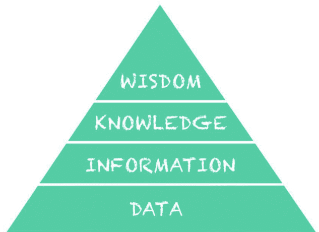

图 1-5. DIKW 金字塔

如果数据的目的是帮助我们对世界变得明智，那么数据分析和数据科学就是实现这一目标的主要方法。虽然“信息”（info）一词经常与“数据”同义使用，但在图中有一个重要的区别：在这种观点中，信息是有意义的数据。在此之外，意义显然是有用的，但需要收集大量信息才能变成知识。最后，知识不会立即变成智慧。它需要随着时间的积累。


# 第一章：处理数据：数据究竟是什么？

虽然数据库系统改进了数据的存储和检索，但进一步的发展帮助了人们处理和展示数据。20 世纪 60 年代统计软件的出现，让人们能够轻松地进行统计统计和数据分析，这是另一场革命。这些工具还让数据可视化变得更加容易，尤其是随着它们在多年后的进一步发展。大多数公司已将数据分析作为日常运营的常规部分，这完全得益于现在的便捷性。第 5 章将深入探讨数据分析这一主题。

## 为什么数据如此重要

我们知道自己生活在一个数据爆炸的时代。几乎所有公司都在收集数据，有时并没有明确的目的。但每个人都知道，数据（通常来说是数字数据）就是未来。像 Uber、Amazon 和 Netflix 这样的“数字原生”公司在成为其他任何身份之前都是科技公司。这是因为它们从一开始就利用了数据。要在今天保持相关性和竞争力，老牌公司需要意识到它们将不得不自己变成科技公司。这真正的含义是学习获取正确的数据以及如何使用这些数据来改进决策。但也意味着它们必须改变业务模式，这就是为什么经营良好的老公司与经营不佳的公司之间存在如此多样类型的原因。并不是所有人都在尝试，也不是所有尝试的人都成功了。许多实体零售商一直为此苦苦，模仿了 Amazon 做的许多创新，以建立忠诚度、易于使用的应用程序、巨大的交付网络以及允许提供免费送货的会员计划（如 Amazon Prime）。

数据科学家是让这一切成为可能的人，他们通过帮助公司设定新方向。但如果没有数据，数据科学家无事可做，而知道如何处理数据是需要经验积累的。数据科学家可以用数据回答或解决的一些问题和困难可以参见表 1-13。

## 表 1-13. 数据科学家可以用数据解决的业务问题

| 行业 | 业务问题 |
|---|---|
| 航空 | 根据剩余旅行天数动态更改票价以实现收益最大化的最佳方法是什么？ |
| 银行 | 新信用卡客户的最佳信贷额度是多少？申请人发生信用卡还款违约的概率是多少？ |
| 保险 | 哪些保险理赔更有可能是欺诈并应进一步调查？ |
| 社交媒体 | 如何为所有用户实时个性化内容（帖子、广告等）？ |
| 零售 | 所有产品的最佳库存量是多少，以尽量减少库存积压以及缺货情况？ |
| 电商 | 如何衡量营销支出对直接归因于营销的销售额的影响？ |
| 流媒体 | 哪些客户最可能续订订阅服务，如何应对这些客户？ |

## 数据治理与数据质量

我们将提到的数据的一个方面是经常被忽视的领域：数据治理和数据质量。数据治理基本上是指从组织的全局角度审视数据，并进行管理以确保数据质量和可用性保持在较高水平。这意味着有一套全面的政策、流程、标准和指标框架，所有这些都将用于管理数据。它将包括制定数据访问、使用和共享的准则。基本上，数据治理为公司数据提供了护栏，而确保数据质量是其重要目标之一。

“数据质量”这一术语的含义非常直观——它试图解决数据有多好的问题。基本上，它的抽象是否准确地代表了现实世界？但事实证明，这比看起来的要困难得多。数据有几个特定的维度有助于整体数据质量，例如准确性、完整性和时效性。这些看起来可能相似，但每个维度考虑的是数据的不同方面，在诊断问题时非常有用。例如，我们可能有一列包含很多缺失值，但已知数据是正确的。那么准确性会很高，而完整性会很低。如果我们查看缺失数据并注意到它们都是最近添加到表格中的，也许还存在时效性问题——即只有最近几天的记录是可靠的。

数据质量领域相当稳健，尽管大多数公司并没有对其投入足够的关注。许多公司没有任何正式的数据治理或数据质量团队。人们只是在含糊摸过中使用数据，根据数据的好好坏来应付，因此意识到质量问题对于正确使用数据并获得有意义的结果至关重要。

数据治理的一部分是识别数据所有者，这在数据质量的背景下非常重要。在许多组织中，这可能是一件极其异常困难的事情。所有权本身是一个模糊的概念，但通常意味着所有者应该是对数据有深层理解的人，并确保数据在某种程度上是准确的。有时，处理数据最多的团队会拥有那部分数据——例如，管理大学宿舍的人可能拥有所有宿舍住户的数据。在其他情况下，数据可能由“信息技术”（IT）拥有，这本身也是一个相当模糊的概念，但通常指的是负责维护和管理数据存储工具和其他技术的维护人员。这通常不是好主意，因为他们对数据本身代表了现实的哪些方面没有良好的理解，而这需要业务知识。在组织中，这之所以成为挑战的主要原因是，人们拒绝成为数据所有者，因为这是一项巨大的责任——也许是难以承受的责任——而且他们不想在出现问题时承担责任。

## 核心要点与后续预告

“数据”一词经常被随口挂在嘴边，但当我们想要将其视作信息和智慧的来源时，我们需要了解它到底是什么以及观察它的多样化方式。数据代表现实世界并可以以多种形式存在，但大多数情况下它是结构化的，可以很容易地用表格表示，其中每一行代表一个对象。数据有四种主要类型，其严谨性和限制性不断增加，包括名义（没有数值或排序特征）、定序（可以排序但无法进行数学运算）、间隔（未达到下一种类型严谨性的数值数据）和比例（遵循某些数学规则的数值）。你可以对比例数据进行尽可能的操作，而名义数据最难处理。非结构化数据（如文本）是另一种重要的类型，无法放入表格形式。数据可以是原始的（与最初收集的形式相似的基础形式）或衍生的（经过某种形式的转换、组合、汇总或聚合）。数据通常组织成数据集（通常是代表统一实体的一个或多个表格），我们经常处理元数据（关于数据的数据）。数据的收集和存储很重要，将在第 12 章中详细讨论。组织以各种方式使用数据，但通常其目的是帮助他们更好地理解业务，并做出更好的、基于数据的决策。最后，有一门围绕数据治理和数据质量的完整学科，对于保持数据良好至关重要。

理解数据的本质以及它与现实世界的关系至关重要，因为它是数据科学其他所有内容的基础。下一章是三个统计学章节的第一章，统计是数据科学的另一个关键部分。该章将介绍统计学基础并涵盖描述性统计的指标和可视化。


# 从业者简介：SAEED JAFARI

**姓名：** Saeed Jafari

**职位：** 数据工程师

**行业：** 零售，此前为能源行业

**工作年限：** 3年数据科学家经验，2.5年数据工程师经验

**教育背景：**

- 石油工程博士学位
- 石油工程硕士
- 石油工程学士

> 此处表达的观点代表 Saeed 本人，不代表其过去或现在任何雇主的观点。

### 背景

Saeed 年轻时是个优等生，有很多兴趣，尽管编程并不是其中之一。在要上大学时，他在伊朗严苛的入学考试中取得了足够好的成绩，可以从事任何他想做的事，他父亲鼓励他学习石油工程，于是他就那样做了。在读学士期间，他再次遇到了编程，并发现自己非常喜欢。他的学业表现优异，为了规避强制性兵役，他开始攻读硕士。在硕士期间，他参与了更有趣的编程工作，包括在 Matlab 中求解偏微分方程。完成硕士后，他在加拿大开始攻读博士，依然是石油工程专业，但到那时他的兴趣已经明显拓宽了。他在博士期间继续学习编程，这次学会了 Python，并开始听到关于 AI 和机器学习的传闻——当时油气领域对机器学习很感兴趣，但还没有人真正知道如何使用它。

# 第一章 与数据打交道：数据到底是什么？

### 工作

一旦 Saeed 开始第一份石油工程师的工作，尽管他觉得自己对机器学习甚至对数据本身一无所知，但机器学习仍然是他脑中的重点。但他仍然能够做一些时间序列工作来预测燃气管道的压力变化。他现在知道那时做得并不好——一切都是过拟合的，而他当时并不知道这是一个问题。但最终他学会了，他的模型也变得越来越好。他意识到其中一个问题是公司的数据太少，他确实需要更多数据来构建出色的模型。他也真正发现了自己对处理数据的热爱，因为这太有趣了。

Saeed 换了一份新工作，再次从事传感器数据的异常预测工作。这项工作与向加油站运送物资的拖车有关。生活给他出了个插曲：在他入职第二天，数据工程师离开了，Saeed 不得得承担了许多许多职责。因此，他在那个阶段学习了一些数据工程，并且也喜欢。但他的主业仍然是数据科学工作。他当时仍然只使用 Pandas，由于代码经常崩溃，他开始学习 Spark。他自己做 ETL，结果有一天因为消耗计算资源过多而惹麻烦，所以是一个一个接一个学习的过程。总的来说，项目非常成功，但 Saeed 最终转向了更多的工程职责，并很快开始使用如 DBT 和 Airflow 等工具。他开始看到很多数据工程师的空缺，并在一个新的行业——零售业中获得了一份数据工程师的工作。

## 观点摘要

**最喜欢工作的部分：** Saeed 喜欢看到端到端的数据流，从 API 开始，进入数据桶或表格，供数据科学家或商业智能（BI）使用。在合适的时候，他也喜欢 AI。数据工程特别的一个好的一点是，当你完成工作后，你的工作就基本结束了（除了生产支持），这比数据科学可能出现的情况要好。

# 第一章 与数据打交道：数据到底是什么？

**最不喜欢工作的部分：** 数据工程的一个负面因素是，你一直处于背景，处于某种孤立状态，缺乏太多的可见性或认可。数据科学获得的关注更多，这既是好事也是坏事。数据工程的一个缺点是生产支持，这可能会带来巨大的压力。

**最喜欢的项目：** Saeed 最喜欢的项目是上述提到的在加油站卸气的拖车项目。涉及的加油站实际上是储油站，而不是面向客户的配送站。之前，他们自己提供卸载的数据。公司雇佣了六名工程师来检查每辆拖车的卸载量，一年后他们计算出了数量，但由于人类的限制，他们只能计算部分而不能全部。因此他们想实现自动化，这时 Saeed 对压力数据使用了时间序列分析。当卸气开始时，压力下降，他们发现了如何检测卸气停止，从而可以计算出实际卸了多少气。这是一个成功的项目，他们很快就能对成千上万辆拖车进行这种操作。

**最常用的技能：** 万万都是与利益相关者的沟通，因为你不理解他们想要，他们永远不会使用你的产品。这很难，因为他们往往并不知道自己想要什么。此外，他每天都会使用许多技术技能。

**目前使用的主要工具：** SQL, Python, Pandas, PySpark, Airflow, Google Cloud Platform (谷歌云平台), Snowflake, DBT, GitHub, Terraform

**数据科学的未来：** 将会有很多生成式 AI，即使在传统的机器学习模型中也是如此。这将是机器学习流水线、API 和通用编排之间的通信。但它永远不会完美，所以我们需要数据工程师和数据科学家（特别是对于特殊情况，我们一直需要人类的创造力）。

**优秀数据科学家的标准：** 理解问题和业务需求。你总是可以找到解决问题的技术部分，但你必须首先识别出它。

**对未来数据科学家的建议：** 首先，弄清楚你真正想做什么——某些工作比其他工作更接近客户。高地理解数据工程和数据科学，并记住数据工程是非常后端的，而数据科学更面向客户（但不总是如此）。不断提升你的 Python 和 SQL 技能。

> 此处表达的观点代表 Saeed 本人，不代表其过去或现在任何雇主的观点。

# 第二章

## 了解数据情况：描述性统计

## 引言

很多人都听过马克·吐温广的名言：“世界上有三种谎言：谎言、该死的谎言和统计数据。”统计并不是真的一个坏词，这个词本身在不同人、不同语境下可以有不同的含义——对于大多数研究人员、数据分析师、数据科学家和学者来说，推断统计是游戏的规则，即使用数据的子集来推广到更大的群体，我们将在第 3 和第 4 章深入探讨。

然而，对于大多数人来说，“统计”意味着描述性统计，它主要涉及表格、图表和一些如平均值之类的计算，所有这些都用于从某个方面让事情变得更好

## 了解数据情况：描述性统计

这是统计学的一个正当组成部分，将在本章中讨论。我们将首先学习统计学的起源，因为有助于我们理解它在今天是如何被使用的。本章的其余部分将深入描述性统计，描述均值和中位数等几种基本衡量标准，然后介绍行业中常用的六种不同的基础图表。

## 统计学的起源

大多数人不会预想到像现代统计这样有价值且严谨的领域竟然源于一些好奇的人试图寻找最有效的博弈方法。这正是发生的情况——1654年，两位著名的法国数学家布莱斯·帕斯卡和皮埃尔·费尔马就围绕骰子和其他概率游戏的数学交换了一系列信件，费尔马提供了一个简单但清晰的解决方案来解决“点的问题”，这本质上是关于当游戏中断时如何公平地分配奖金。帕斯卡在此基础上发展，提出了我们现在称为期望值的首次计算，这是今天统计学的基石。我们将在下一章详细讨论他们讨论的问题，但首先我们将涵盖整个统计学领域的起源。

## 早期统计

统计作为门学科在几百年前就已经存在，涵盖了政府收集数据的实践——“统计”一词甚至源于这种用法，源自“国家”一词。工业革命激发了更快的数据收集，在此基础上还有对人口统计和经济数据的兴趣。但直到18世纪，概率与统计之间仍然几乎没有关系，而那实际上是我们现在所说的数据分析。


## 第 2 章弄清数据发生了什么：描述性统计学

统计学作为一门测量和经验科学发展而生。正如上一章提到的，数据是现实世界中事物的表示，但完美衡量现实世界中的任何是非常困难的。例如，即使在激光测量设备出现之前，仅仅是测量一面墙这样简单的事情也是困难的。如果你有一根足够长的卷尺，并且有人握住另一端，你就可以得到相当准确的测量结果——可能会偏差几毫米，但对于一面 15 英尺长的墙来说，这不是大问题。但如果你使用的工具是一把 12 英制的尺子，且零度刻稍微偏左，那么你的测量过程就会更容易出错。测量误差会迅速累积，或者，你所有的小误差可能会相互抵消；你无法确定误差到底有多大，或者有多重要。在讨论你的结果时，你如何考虑到这一点呢？

对观测中误差的处理推动了 18 世纪统计学的很大进展，催生中位数和正态分布等概念产生。在量化统计显著性（如今天的 p 值）方面也取得了一些进展。在该世纪后期，一位统计学家发明了几种今天仍在描述性统计中使用的图表，首次引入了标准化的可视化。

在 19 世纪，统计学作为一门真正数学领域的趋势开始出现，为推断统计学奠定了基础。但这也是许多学科开始以某种方式使用统计学，以对他们的数据应用严谨性和理解。天文学家在世纪初就已经经常地使用概率论和统计学技术，并贯穿始终。但天文学家处理的是易理解且定义的法律以及基础假设，而处理人类的科学更难量化。尽管如此，心理学家已经能够利用实验设计的发展来得出更准确的结论。社会科学家由于可用数据（以及收集方法）的限制，面临着更多困难。

19 世纪后期取得了进展，但直到 20 世纪，社会科学家才真正学会如何让他们的科学变得真正严谨。

20 世纪确实带来了描述性统计学的进一步发展（如中位数、标准差、相关性、皮尔逊相关系数和皮尔逊卡方检验，这些将在本文或接两个章节中解释），以及计算机的出现，随着该领域的发展和完善，计算机证明自己是无价之。

## 精算科学

精算科学简单来说是在保险和类似领域中使用统计学和定量方法来评估和管理财务风险及预期结果，它可以被认为是传统统计学的一个应用分支，出现于现代统计学领域仍在发展时期，但它们已经演变成了某种程度上独立的领域。精算科学是一门与保险和金融最密切相关的学科，在其中使用数学和其他领域的严谨技术来评估风险。它的首次出现源于人们需要处理未来的巨大开支，而保险就是解决方案。但确定个人需要支付多少钱并不是显而易见的，因此他们必须开发通过预测未来事件（如死亡）来量化风险的方法并处理收到的资金。

一位名叫约翰·格劳特（John Graunt）的伦敦人在 17 世纪中期制作了第一张预期寿命表（下文有更多关于他工作的介绍），精算科学也从那里发展。这一领域有了进一步的发展，但直到 18 世纪中叶，一家人寿公司首次根据被保险人预期整个寿命的现代计算设定了费率。这些计算是基于确定性模型的，但在行业内仍然具有革命性。

该领域在 20 世纪得到了巨大的增长，获得了统计学所获得的一些严谨性。随着计算机的出现，精算师的预测能力显著增强。

### 现实世界中的统计学示例

### 示例 1：17 世纪伦敦的人口统计

创建第一张预期寿命表的约翰·格劳特在 17 世纪中期在伦敦有一家销售布料的商店，但他头脑敏锐，对琐事之外的事物充满好奇心。这使他研究了《伦敦死亡清单》（Bills of Mortality），这是伦敦英国教会埋葬人员的记录。你可以在图 2-1 中看到 1606 年的一个示例。这个数据源并不完美，因为记录的是埋葬而非实际死亡，所以如果一个伦敦人被埋在伦敦以外，就不会有记录。此外，除英国教会以外的其他信仰的成员没有被记录，而且它包含的属性非常有限。在那个世纪，记录了死因，但没有记录年龄。格劳特意识到了这一点，但这来说并不是障碍。他简单地研究了《死亡清单》，并利用其他信息来确定每次埋葬时的年龄，并将其记录在自己的表中。格劳特对《死亡清单》感兴趣的有趣点之一，是他仔细研究了这些清单是如何创建的，以理解数据的质量。他认为死因经常被误报。这种对细节的关注在今天的数据分析工作中仍然是无价的。尽管存在障碍，格劳特仍然能够通过数据发现迷人的见解。

他被广泛认为是第一位人类人口统计学家和最早的流行病学家之一。他创建了第一张寿命表，给出了生存到给定年龄的概率。通过对记录中死亡案例的生存分析，他能够确定基本的发病率和死亡率。

### 示例 2：一个绝望且未被听取的警告

我当时正在上五年级的阅读课，老师离开教室去看“挑战者号”飞机的发射。当她回来时，她的脸色苍白，我第一次看到一个大人如此魂魂失措。她告诉我们航天飞机爆炸了，所有航天员都去世了，包括那位备受期待的“太空教师”。20 世纪 80 年代的太空计划充满了快乐和民族自豪，而这一事件摧毁了国家的信心。


# 第二章弄清数据中发生了什么：描述性统计

一份关于该灾难的政府报告指出了一个出现问题的地方。工程师向管理层展示了一张显示 O环失效温度和次数的特定图表，但这张图表并没有传达出最重要的信息。工程师们理解它，但无法让管理层理解。这基本上是技术人员与非技术人员之间沟通的失败。

工程师习惯于观察数据并理解：缺乏某事的证据并不意味着它一定存在。图 2-2 就是发射前共享的图表。


**图 2-2。20世纪8年代发生O环热事故的美国航天飞机飞行。** 来源：“关于美国航天飞机挑战号事故的总统委员会报告”，https://www.nasa.gov/history/rogersrep/v1p146.htm

每个点代表一次在实际飞行中经历热应迫的 O环飞行，显示了事故发生时的温度（X轴）以及与之相关的事故次数（Y轴）。敏锐的观察者会注意到，图表中任何事故的最低温度约为 53°。没有任何一个地方接近冰点。在那个温度以下没有进行过发射。这让工程师们感到紧张，但经理们并没有。但有一点是经理们应该理解的——在较低温度下观察到最多的事故可能并非巧合。

但他们并没有意识到飞入未知区域的风险严重性。后来，在关于该灾难的政府报告中，作者提出了一张图表，它会让任何人（无论是否是技术人员）都看得清晰得多。图 2-3 显示了相同的图表，但增加了一些信息——所有未发生事故的飞行数据点。

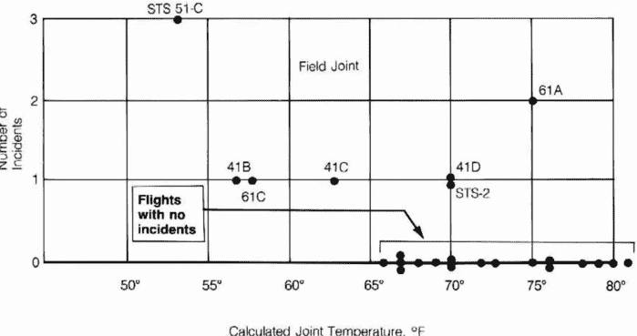

图 7 发生与未发生O环热应迫事故的飞行分布图

**图 2-3。20世纪8年代发生与未发生O环事件的美国航天飞机飞行。** 来源：“关于美国航天飞机挑战号事故的总统委员会报告，”https://www.nasa.gov/history/rogersrep/v1p146.htm

这张图表清楚地表明，所有未发生事故的飞行都发生在 66° 或更高温度。你不需要成为火箭科学家也能得出结论：低温环境本质上风险更大。尽管将图表的轴限制在数据范围稍外一点是很常见的，但也许如果他们将 X 轴从 30° 开始，并强调 66° 距离 31° 有多远，他们的警告本会得到重视。然而，七名宇航员丧生，一个正在直播发射的国家的人遭受了创伤，美国航天计划进入了低谷。

## 描述性统计

描述性统计是理解数据集总体特征并识别其中任何特殊或不寻常之处的科学与艺术。描述性统计是数据分析和科学的核心部分，我们几乎从不在不先进行描述性统计（在数据分析和科学中被称为 EDA，即探索性数据分析）的情况下开展任何项目。简单的事实是，如果你不理解数据，就无法对数据进行有意义的工作。

描述性统计主要涉及计算一些基础指标并创建几个图表和其他可视化工具，这为你的数据提供了一个良好的概述。它的好之处在于，一旦你学会了如何执行，它就非常直观。我们将在本节中查看一些不同的数据集，以理解可以进行的指标和可视化。我们将使用一个视频游戏评分数据集来观察不同的指标，并使用其他数据集进行可视化。

同样重要的是，描述性统计中几乎所有的指标和可视化都需要数值数据——无论是间隔数据还是比例数据。某些描述性统计可以在分类数据上进行，但其作用非常有限且提供的信息较少。

## 初步观察与直方图

通过一些图表来对数据有一个良好的感觉是非常常见的。这可以帮助你理解可能影响你之后决策的方面。我们经常讨论数据的分布，这通常指的是单个字段的几个特征。例如，如果我们有一些关于视频游戏的数据，并且对所有游戏的评分感到好奇，我们可以制作一张图表来看看评分看起来是什么样的。第一直觉可能是直接将所有值绘制在柱状图中，如图 2-4 所示，该图为每个单独评分显示一列，并在 Y 轴上显示值。

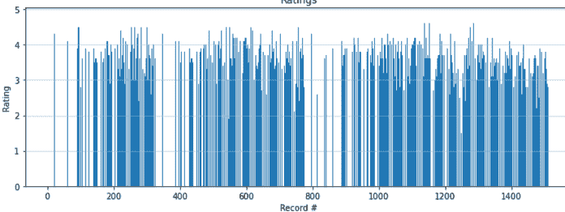

**图 2-4.** 视频游戏的任意排序评分

X 轴仅仅是记录编号，因此顺序与实际评分无关。我们稍后会详细讨论柱状图，但从这张图中看出的主要点是：无法对数据产生任何感觉，除了评分似乎散布各地，但在高位端。我们在澄清问题时的第一个直觉可能是给它添加一些顺序。排序将帮助你更好地理解它，正如你在图 2-5 中看到的。

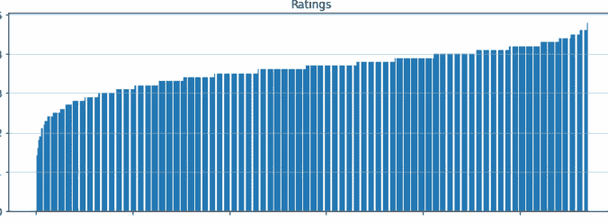

图 2-5. 按数值排序的视频游戏评分

图 2-5 让你很快看到低于 3 分的评分寥寥几个，大部分在 3–4 之间。这很有用，但不是超级有用，因为有了所有这些单独值，仍然很难真正说明整个数据集中发生了什么。

幸运的是，有一个简单的解决方案：直方图。我们将在后面的章节中介绍如何创建直方图，但作为快速介绍，直方图通过显示分桶数据的频率计数来总结数据的形状或分布。它揭示了许多有助于我们理解后将讨论的统计计算的内容，但图 2-6 显示了数据的简单直方图。

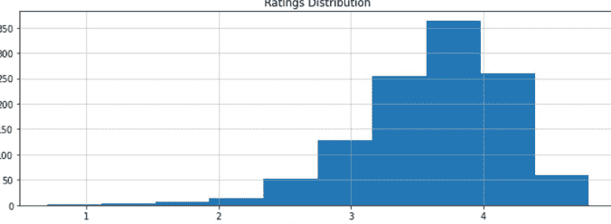

图 2-6. 视频游戏评分的直方图

这次 X 轴显示了每个桶的评分范围（桶通常由我们使用的软件自动确定），Y 轴显示每个桶中的总数。这清楚地表明，大多数评分都在 3.5–4.5 范围内，这在图 2-5 中很难看出来。

这种分布实际上看起来有点像我们很多人以前过的正态分布（也称为钟形曲线）。因为中位数相对较高且分数上限为 5，所以右侧不像正态分布那样延伸得那么远。我们将在下一章中讨论正态分布，但现在我们对评分有了更好的理解，它们大部分位于量表的高端。

在我们介绍下面要计算的许多统计量时，请尝试记住记住这个直方图。

## 指标

我们可以衡量数据集中的各种事物，从汇总统计开始，汇总统计可以分解为位置指标和离散程度指标。汇总统计为我们提供了数据集中特定列运行情况的图景。我们绝不会在这些任何计算中包含多个列。

## 位置指标

位置指标通常也被称为中心性度量，因为它们实际上在试图告诉我们数据的“中间”在哪里，这有助于我们理解数据集的典型特征。如果我们有一些关于美国人的身高数据，平均值大约在 4 英尺左右，我们可能会猜数据记录的是儿童而不是成人的身高。


## 第二章 搞清楚数据发生了什么：描述性统计

主要的位置度量包括平均值（及其变体修剪平均值）、中位数和众数。除了众数外，所有这些指标都需要数值数据。众数可以是数值数据也可以是分类数据，但在这种情况下，数值数据处理起来更困难，通常需要进行分箱（bucketing）。我们将在下文中解释原因。

大多数人都知道如何计算平均值（或平均数），它简单就是所有数据点之和除以数据点的总数。这让我们对数据的中心位置有一个感知，但它可能会被离群值（与大多数其他数据不同的值）扭曲或偏偏。修剪平均值是一种调整后的计算方法，去除了两端一定比例的极值，旨在防止离群值产生无代表性的平均值。5% 的修剪平均值会去掉所有数据的最高 5% 和最低 5%，这意味着只使用中间的 90%。你也可以修剪两端的特定数量——例如，在奥运裁判评分中，他们会在计算平均值之前会去掉最低分和最高分（这有时也被称为修正平均值）。

## 离群值

离群值的通俗定义基本上是指与大多数其他数据非常不同的数据点。例如，我们都知道身高 7 英尺 2 寸的篮球运动员在人类身高中绝对是一个离群值。那么身高 6 英尺 4 寸的人呢？如果你来自一个小家庭，这可能很极端，但有很多高大家庭有几个成员都有那么高。虽然在统计学上没有公认的离群值定义方法，但有一些技术可以识别它们。但有时当数据集较小，或者如果某些值离其他值极远时，只需观察数值就足够识别它们了。

**中位数**是另一个关键的位置度量，因为它有时能比平均值显示更真实的数据集中心，特别是当数据非常偏斜时（偏斜将在下一节讨论）。中位数就是数据按数值顺序排列后的正中间值。如果数据点数量是奇数，它是正中间点；否则，它是两个中间数据的平均值。认为中位数对离群值的容忍度高于平均值。

**众数**简单就是数据集中出现次数最多的值。这既适用于数值数据也适用于名义数据。它是另一种让我们感知数据典型特征的方法。对于分类数据、序数数据以及任何等间距的数值数据（如整数），这是一种简单的计算。如果我们处理的是具有许多相互接近的可能值的数值数据，那么在计算众数之前进行分箱或截断通常是有意义的。例如，如果学生成绩可以是任何计算结果，那么将 92.1、92.25、94.0、94.25 和 94.33 等值通过截去小数分到两个箱子中可能更有价值，为你留下两个 92 和三个 94，其中 94 成为众数。

虽然使用哪种位置度量并不总是重要，但它们在不同情况下可能有最佳效果。在数据相当对称且没有许多离群值的情况下，平均值很好。人类身高等事物往往具有这种特征。当数据向一个或另一个方向偏斜时，中位数很好。房价可能就是这样，因为大多数房子处于相对低端，但房子的贵程度实际上没有上限。如果你有以下房价：$125,000、$150,000、$175,000、$200,000 和 $1700 万，你的数据集非常偏斜。平均值超过 300 万美元，尽管大多数价格低得多。这里的中位数是 $175,000，这在直觉上显然更符合实际值。

## 计算位置度量

我们将从考试分的一个集开始，包含以下十个数据点：

- 67, 11, 93, 53, 79, 60, 74, 93, 99, 78

我们想要做的的第一件事是将它们排序：

- 11, 53, 60, 67, 78, 79, 74, 93, 99

我们可以看到中间值是 78 和 79，并且 11 是一个直觉上显而易见的离群值。

我们可以通过相加所有值并除以计数来计算*平均值*，得到 70.7。

如果我们想计算*修剪平均值*，可以通过去掉顶部和底部的值（各占总值的 10%）来得到 10% 修剪平均值，结果为 74.6。

*中位数*在这里也很容易计算；我们在上面观察到中间值是 78 和 79，使得中位数是这两个值的平均值，即 78.5。

*众数*在这里也很容易计算，因为我们处理的是少数几个整数。唯一出现一次以上的数字是 93，所以它是众数。如果这里没有重复值，我们就没有众数。

数据分析师和科学家很少有理由手动计算，因为我们使用软件或代码，但理解这些是非常重要的。

## 离散程度

理解数据的中心是有用的，但你还需要知道数据的离散程度。超出中心度量可以帮助我们理解数据之间有多大差异。此外，如果数据在比例尺的两端有很多值，那么平均值并不具有代表性。

离散度量可以帮助我们这一点，包括范围、四分位距（IQR）、方差、标准差、偏度和峰度。

在处理离散程度时，你通常从最小值（最低数据点）和最大值（最高数据点）开始。最基本的离散度量是范围，即最大值减去最小值。另一个离散度量是四分位距（IQR），它是第 75 分位数（第三四分位数）和第 25 分位数（第一四分位数）之间的差异。这告诉我们中间 50% 的数据位于何处。

我们还有方差和标准差。方差是一个给出平均值周围的单一数字。计算它涉及每个数据点与平均值的差平方，然后将和除以点数。平方确保了相反方向的差异不会抵消。标准差就是方差的平方根；因为它与数据的单位相同而经常受青睐。

在实践中不常计算的两个度量是偏度和峰度。当分布不对称时，它是偏斜的，这发生在平均值和位数差异很大。估计偏度的一种简单方法是计算平均值和位数之间的差，将该值除以标准差，然后乘以 3。如果位数大于平均值，数据为负偏；如果位数小于平均值，则为正偏。只有当平均值和位数相等时，数据才能被说是无偏。

峰度也看尾部，但它看的是直方图中边缘（低计数）延伸有多远，因此它有时被称为“尾性”的度量。计算它需要几个步骤。首先，对于每个数据点，将它与平均值的差进行 4 次方。然后取该值的平均值，并除以标准差的 4 次方。当我们从正态分布的背景来看峰度时，从这个数字中减去 3（正态分布峰度）得到超额峰度，即归因于与正态分布差异的部分。

我们可以从上面相同的考试数据开始，包含以下十个已经排序好的的数据点：

- 11, 53, 60, 67, 78, 79, 74, 93, 93, 99

我们可以看到最小值是 11，最大值是 99。


## 第二章 找出数据中发生了什么：描述性统计

范围简单来说就是最大值与最小值之间的差，即 88。

使用这组数据计算四分位数并不困难。首先，我们根据上面计算出的中位数 78.5 将数据一分为两半。然后将每半数据按其中位数再次平分，得到以下四分位数：第一四位数为 60，第二四位数为 78.5，第三四位数为 93。

四分位间距（IQR）简单来说就是第三分位数减去第一分位数，即 33。

方差涉及将每个值与平均值（上文的 70.7）之差的平方求和并除以数值个数 10，得到 583.1。这显然很难真正理解，因此我们对其平方根得到标准差 24.2。这更容易理解，因为它的单位与考试分数相同。

偏度是一个不那么常用的数值，但我们仍然可以通过取平均值与中位数之差、除以标准差并乘以 3 来计算它，得到 -0.97 的偏度。

峰度也较常见且不直观，但我们仍然可以计算。我们计算每个点与平均值的差，然后将这些差的 4 次方，再取这些值的平均值，最后除以标准差的 4 次方，得到 4.1 的峰度。

这些衡量标准都能让我们更好地了解数据的分布情况。

## 可视化

各种图表和其他可视化形式被视为描述性统计的一部分。其中一些有助于直观地理解位置和离散度，而另一些可以揭示不同领域之间关系的信息。

### 散点图

尽管散点图是最基本的图表之一，但它可以非常有用。它涉及将一个变量相对于另一个变量，一个位于 X 轴，另一个位于 Y 轴。这种图表只能用于两列数值数据。根据每行两个列的值，在图上放置一个点。它看起来可能像是一堆杂乱填满绘图区域的点，但在其他时候可以看到某些模式，例如相关性。寻找相关性或其他模式是查看散点图的最常见原因之一。

理解散点图最简单的方法是观察具有相关性的图表。我们有一组关于患哮喘儿童身高、体重和性别的数据集，以及一些与其气道相关的测量值（在不同条件下的工作情况）。这个数据集不会告诉我们他们的身高和体重与不患哮喘的孩子相比如何，但我们可以观察这些值之间是如何相互作用的。

如果我们为年龄和身高制作散点图，可以在图 2-7 中看到清晰的模式。

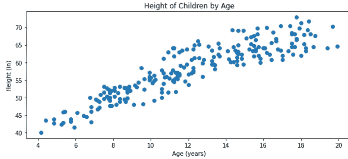

**图 2-7.** 一组儿童身高的散点图

很容易看出，随着年龄的增长，他们也更高。两个变量共同增加的趋势非常明显，这是当我们说变量之间相关时，它们具有的一种关系。我们将在本章稍后的部分讨论相关性以及如何衡量它，但这种快速的视觉检查是使用散点图的主要原因之一。

然而，虽然基础散点图对于识别相关性和和其他模式可能很好，但当我们有很多变量（这很常见）时，一次只绘制两个变量可能会是一个很大的限制。有两种方法可以解决：我们可以在同一张图上用不同的颜色绘制不同的类别，还可以通过改变点的大小来对应第三变量，从而引入第三变量。

在我们的数据集中，我们还有性别。每个人都知道女孩和男孩在身高上存在普遍差异。通过根据性别让点呈现不同的颜色，很容易创建一个显示这种情况的图，我们在图 2-8 中可以看到。

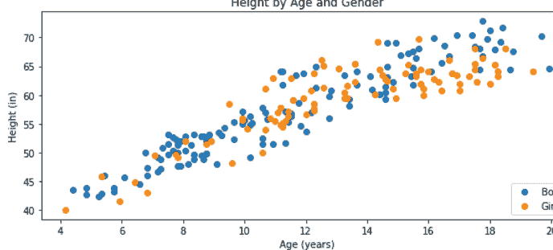

**图 2-8.** 一组儿童身高和性别的散点图

这种简单的修改揭示了一些——女孩似乎比男孩更早达到最高，而男孩生长的时间更长。

我们添加变量的方法方法是通过改变点的大小，创建现在被称为气泡图。在气泡图中，让气泡稍微透明是相当常见的，因为较大的气泡可能会遮住其他气泡。我们的数据集有与哮喘相关的测量值，因此我们包含了其中一个，一个表示每个孩子在气道从工作变为停止工作时所暴露的测量共振频率，这可以在图 2-9 中看到。

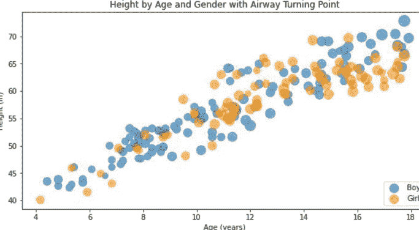

**图 2-9.** 身高、性别和哮喘相关测量值的散点图

## 柱状图

柱状图是另一种可视化形式，因为它通常是直观的，所以我们有很多此类应用。柱状图用于名义数据，是一种常见类型。条的高度代表类别的值，X 轴显示类别。柱状图可以垂直显示或水平显示，尽管垂直显示最常见。

柱状图也用于连续数据，但它被称为直方图。柱状图的高度代表类别的值，X 轴显示的是连续变量。如果我们再次查看我们的数据集，我们可以看到每年的平均值，从 2015 年开始。

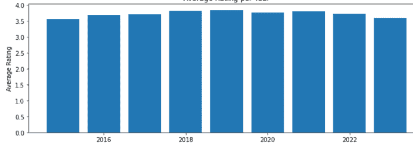

**图 2-10.** 平均评分柱状图

我们可以看到评分随年份的变化并不大，但在 2019 年之前有一个上升趋势，然后小幅回落。它恰好是对称的。这种图表只提供有限的信息，而我们的数据集中有很多信息，包括每个游戏的开发公司。

分组柱状图将几列并列显示。图 2-11 是与图 2-10 数据相同的分组柱状图，但按公司进行了分组。

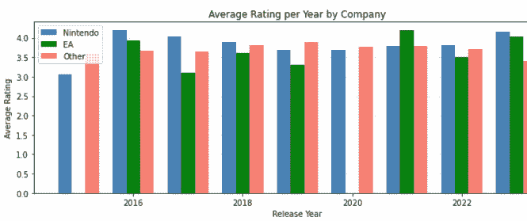

**图 2-11.** 按公司分组的平均分组柱状图

图 2-11 让我们看到尼康和 EA 有不同的趋势，“其他”组仍然遵循我们在图 2-10 中所有公司分组时的趋势。但如果我们只看尼康的柱体，我们可以看到 2015 年是一个离群值，略高于 3。第二一年平均值飙升到 4 以上；然后在过去的几年里下降又上升。EA 看起来波动很大，而且在这个范围内有两年他们没有发布任何产品。

另一种重要的柱状图类型是堆叠柱状图，它非常适合观察不同值之间如何比例相关。这涉及到将每年的每个公司的柱体堆叠在另一个上面，因此组合柱体的高度就是该年所有柱体之和。对评分进行这样做没有任何意义，但我们还有每个游戏的评论评论总数，所以我们创建了图 2-12 来显示尼康和 EA 的堆叠柱状图。


# 第二章 弄清楚数据发生了什么：描述性统计

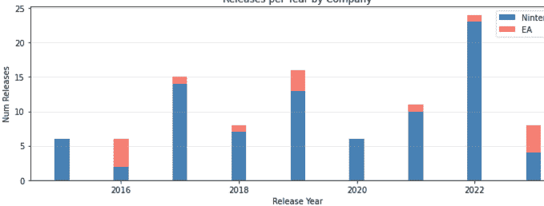

图 2-12.任天堂（Nintendo）和 EA 每年发布游戏数量的堆叠柱状图

我们可以很容易地看到，任天堂发布的游戏数量比 EA 多得多，而且通常情况下，任天堂在两者共同发布的游戏中所占的比例要高得多。还有最后一种柱状图可以使特定比例更加清晰：分段柱状图（segmented bar chart）显示与堆叠柱状图相同的数据，但它是以实际比例的形式显示的，所有长条的总和为 100%。图 2-13 显示了与图 2-12 相同的数据，但转换成了百分比。

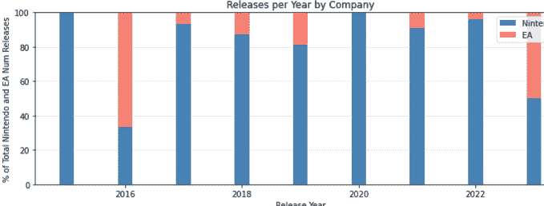

图 2-13.任天堂和 EA 每年发布游戏数量的分段柱状图

正如我们在上面看到的，除了 2016 年外，任天堂在每年发布的游戏比例都远高于 EA。如果我们观察数据中的每家公司而不仅仅是这两家，这种图表会更有趣，但很快就会变得难以处理。图中会有很多细线，但产出最高的公司会清晰地突出。

## 直方图 (Histograms)

我们上面简要提到了直直方图。*直方图*（histogram）是一种特殊的柱状图，用于区间数据或比率数据。它之所以被视为一种独立的图表类型，是因为它提供了数据的特定视图，并且需要额外的步骤——*分箱*（binning），即将数字分成具有相似值的批次。这同时也意味着我们不会有太多的列，因为每个箱只有一列。直方图显示的是出现次数的计数，尽管我们通常将其称为“频率”（frequency）而不是计数。

我们可以再次查看视频游戏数据，这次关注评论数量。游戏评论数在 0 到约 4,000 条之间，如果我们再次在图 2-14 中查看所有数据，可以发现那些大量的评论是非常罕见的，大多数都低于 1,000 条。

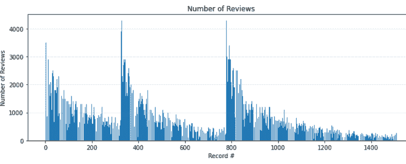

**图 2-14.** 每个游戏及其评论数量的柱状图（按随机排序）

直方图会告诉你更多关于常见评论数量的信息，因为从这张图表中很难真正理解这一点。我们可以创建一个自动设置分箱的直方图，如图 2-15 所示。

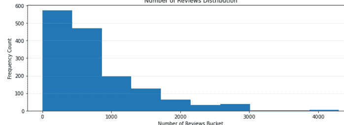

**图 2-15.** 按评论数量划分视频游戏直方图

图 2-15 让我们清楚地看到超过 1,000 条评论有多么异常。由于有许多评论在 1,000 条以下，我们认为查看 1,000 条或以下评论数量的分布可能是值得的。可以在图 2-16 中看到这一点。

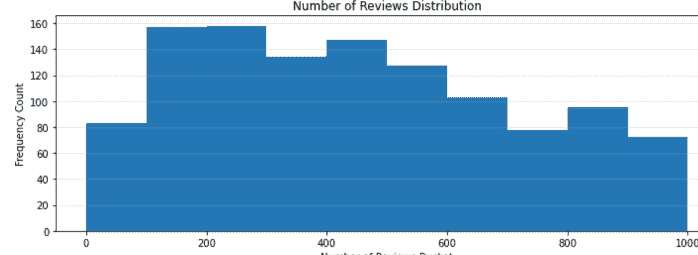

**图 2-16.** 按评论数量划分视频游戏直方图（评论数最多 1,000 条）

图 2-16 的一个优点是分箱非常清晰，因为总共有 1,000 条评论被分成 10 个，所以每个箱的宽度为 100。这种分布很有趣——它看起来并不像正态分布，因为尾部与中间部分的差异不大。在 100 到 700 条评论之间的出现次数更多，但除此之外，每个游戏的评论数量似乎没有巨大的变异性。

需要记住的一点是，我们用于创建直方图的大多数软件都有分箱宽度，但有时不同的宽度会产生看起来非常不同的直方图。尝试不同数量的分箱来观察是否有有趣的发现永远不是坏主意。这提醒提醒了我们在进行 EDA（探索性数据分析）时，尝试不同的方法是重要的。有时你制作一张没有揭示任何信息的图，但对其进行细微调整就能揭示有价值的信息。

在这里我们只查看了具有等宽箱的直方图，这是最常见的类型，但它们也可以有不同的宽度。例如，有一种名为贝叶斯块（Bayesian blocks）的方法，根据某些标准创建最优尺寸的分箱。了解这些是好的，但我们并不经常需要。

## 箱线图 (The Box Plot)

你可能以前见过箱线图，这是一种带有矩形、中间有一条线，以及延伸到矩形末端的线条（“须须” whiskers）的图表。箱线图由几个不同的离散和位置度量构建，包括：

- 第一四分位数
- 中位数
- 第三四分位数
- 最小值
- 最大值

这张图表中引人注目的是，女孩的离群值要极端得多。此外，女孩的 BMI 似乎在……之后增长很快，而男性的 BMI 倾向于增加。

当数据包含时间元素时，创建的最常见图表之一是折线图。虽然可以用不同类型的数据创建折线图，但它实际上适用于数值数据，且 X 轴应该有一种自然顺序，而 Y 轴是数值。

## 折线图 (Line Charts)

当数据包含时间元素时，创建的最常见图表之一是折线图。虽然可以用不同类型的数据创建折线图，但它实际上适用于数值数据，且 X 轴应该有一种自然顺序，而 Y 轴是数值。


# 第二章 找出数据中发生了什么：描述性统计

它们的量级完全不同。图 2-20 显示了左 Y 轴销售的披萨总数以及右 Y 轴大号披萨的销售总额。它们的趋势相当接近，这并不意外，但周四偏离了“所有披萨销售”线，这很有趣。

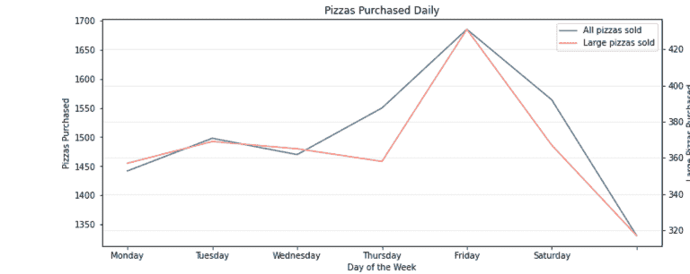

图 2-20. 按星期显示的所有披萨销售量和按星期显示的大号披萨销售额的双轴折图

这些图表都为我们提供了良好的信息。对于这类图表，添加适当的标签尤为重要，这样就能清楚每条线代表什么，如果有第二个 Y 轴，也能清楚哪个线对应哪个轴。

## 饼图

大多数数据分析师和数据科学家并不喜欢饼图，认为它们过于简单。但在某些情况下，饼图可以非常快速、容易地展示比例，特别是对于我们的非技术利益相关者而言。我们并不总是与利益相关者分享探索性数据分析（EDA），但有时会这样做，因此使用饼图可能是恰当的。饼图也应该限制其显示的数值数量，三到六个通常是一个很好的范围。否则，它们会很快变得难以处理，就像线条过多的折图一样。图 2-21 显示了所售四种不同类型披萨的分类情况。

购买披萨类型的比例

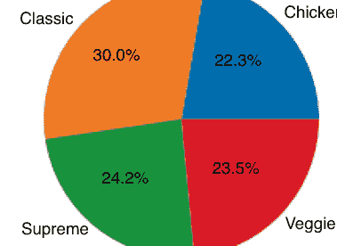

图 2-21. 购买披萨类型比例的饼图

这使得几个比例变得清晰明了。显然有经典款披萨在售，其他种类的销售比例非常接近。但你无法从这张图表中获得更多信息。虽然它在视觉上很有冲击力，但包含的信息并不多，而且如果数值超过五个，甚至会变得难以阅读。饼图对于向非技术人员展示通常比对你自己的 EDA 更有用。但偶尔，一个快速的饼图可以让某些事情一目了然。

## 核心要点与后续内容

在本章中，我们学习了描述性统计，这在数据分析和数据科学中至关重要，因为它帮助我们理解数据并了解其局限性。它主要涵盖集中度量、离散度量和可视化。集中度量告诉我们数据的中心在哪里，或者它的特征是什么。离散度量帮助我们理解数据的变异程度——大多数值是接近中心，还是散布各地？可视化是观察数据的另一个窗口，让我们能够看到重要的关系、趋势和其他揭示性的内容。

## 第二章 找出数据中发生了什么：描述性统计

### 专业人士简介：CINDY MINERA

| | |
| --- | --- |
| **姓名** | Elizabeth Minera |
| **职位头衔** | 商业智能分析师 |
| **所属行业** | 医疗保健 |
| **工作年限** | 5 年 |
| **教育背景** | 心理学硕士，文学艺术学士 |

### 背景

Cindy 是第一代大学生。她发现，在现实世界，统计学并不像在学校里那样整洁划一。她发现自己想从事数据科学工作，并找到了帮助她的导师。她对数据分析结果和去标识化数据很感兴趣。她第一次上统计学课程时，发现自己不想挂科。

### 工作

学校毕业后，她发现现实世界中的统计学并不像教科书中那样常见。她想扩展技能，并在商业智能领域找到了一个职位。她发现数据驱动的决策至关重要。她发现许多数据统计对她的工作至关重要。我们将在下一章讨论更多统计知识。

### 金句分享

- **工作中喜欢的部分：** 与团队合作，并帮助做出数据驱动的决策。
- **工作中不喜欢的部分：** 会议。
- **最喜欢的项目：** 一个显示结果显著的测试。
- **教育如何联系现实世界：** 现实世界中没有任何东西像学校里那样整洁划一。
- **最常用的技能：** 泛指软技能——易于相处。

### 第二章 找出数据中发生了什么：描述性统计

**目前使用的主要工具：** 主要是 SQL 和 Excel，偶尔使用 Power BI 和 R

**数据分析和数据科学的未来：** 快速变化将持续，事物将变得更加专业化。

**对未来数据分析师和数据科学家的建议：** 这适用于每个人，尤其是女孩和女性——不要让恐惧和竞争阻碍你学习和实现你想要的目标。如果人们告诉你学不会某东西，就证明他们是错的。


## 第3章 成功之本：推断统计框架与实验

本章将首先简单介绍现代统计学历史，并提供一些现实生活中统计学的有趣案例。我将谈论计数方法，这对于理解概率和概率论至关重要。接着，我将介绍在统计学中广泛使用的几种重要概率分布。在进入采样、数据选择以及最后的实验设计之前，我会对中心极限定理进行简要解释。

## 现代统计学史：第一部分

20世纪见证了概率与统计学领域的最终汇合，科学家们将数学形式化，创建了现代数学统计学。统计学广泛传播到许多领域：社会科学、经济学、物理和化学等。遗憾的是，20世纪初的统计学工作受到许多个人统计学家与**优生学**关联的影响。优生学是一门早已被彻底拆穿的伪科学，它在那个世纪的前几十年里驱动了纳粹以及许多种族歧视、性别歧视和残障歧视政策——其中许多至今仍在。优生学家利用统计学和科学的语言来推动并支持这些政策的制定，并实施了强制绝育等不人道行为。

将种族主义和其他各种“主义”包裹在科学的外壳下，意味着某些人仍然迷信优生学的教条。另一些人则疑惑，如果统计学这样美好的事物并非真实，它怎么可能从优生学中产生呢？但你只需要记住，许多科学和哲学的发展源于对炼金术的徒劳追求以及证明上帝存在的尝试。20世纪前几十年，统计学真正发生革命性变化的是方法、技术以及构建这些方法的数学基础。这些方法可以应用于任何领域，包括基于糟糕假设的研究，也适用于设计良好的实验。

20世纪初的统计学家非常多产，他们开发了我们之前提到的许多描述性统计学，以及重要的概念，例如用于描述数据和进行推断的概率分布思想。统计学家惊讶地发现，许多可测量事物符合正态分布（也称为钟形曲线），但并非所有如此。随着世纪的推移，又发现了几种分布。

现代统计学家开发了观察实验设计的新方法，并改进了一些现有的实验设置方法，这在今天仍然至关重要。实验设计影响着几乎每一个科学、医学和社会科学学科。

20世纪发生的另一个变化是观察概率的全新范式。在早期，统计学家看待概率的方式就像现代贝叶斯主义者那样，贝叶斯主义者基本上认为概率量化了某事的可信程度，这种量化基于基本的信念或假设，或者可能是之前实验的结果。这意味着先验概率是最终概率计算的一部分。

但当时统计学界的主流力量拒绝了那种范式，转而支持一种后来被称为“**频率派”的范式。频率派认为，在计算中包含先验概率（即一个对初始状态的额外概率）会损害任何概率计算的严谨性。现在仍然有贝叶斯统计学家，也有部分基于贝叶斯原则的机器学习技术。此外还有其他一些统计学家青睐的范式。基本上，虽然大多数统计学家属于频率派阵营，但范式的选择仍能让他们“血压升高”，一些人认为不同的情况需要不同的范式。

## 贝叶斯概率与贝叶斯定理

贝叶斯概率与频率派的主要区别在于，频率派认为概率源于对所有可能结果的计数（他们关心的是发生的频率），而贝叶斯主义者认为概率被视为一种“合理的预期”，即某人量化了某种信念（例如这个特定的游戏玩家有80%的概率赢得下一场比赛），或者根据发生频率以外的知识量化了某些事情。我们将在本书的后面学习更多关于频率派的方法，这里我只简单谈一下贝叶斯范式。

贝叶斯定理是贝叶斯概率的一部分，作为确定条件概率（具体说是所谓的**后验概率**）的方法。后验概率基本上是在事件 B 已经发生的情况下事件 A 发生的概率。它依赖于计算三个不同的概率：事件 A 发生的概率、事件 B 发生的概率，以及先验概率（或在事件 A 已发生的情况下事件 B 发生的概率）。先验概率是频率派有意见的地方，因为这部分可以基于信念而非严谨的计算——它是附于实验运行之前发生的事件。然后你可以将这些值代入公式得到后验概率。它基本上允许你根据新信息来更新概率。

请注意，在数据科学中使用贝叶斯定理并不要求你成为一个坚定的贝叶斯主义者——我们关心的是使用有效的技术，无论它们是否完美地代表了现实世界。

现代统计学的最后一个重要领域是采样。在一次备受关注的丑闻之后，随机抽样的重要性变得显而易见：一家美国主流杂志根据其深度偏见且倾向于共和党的读者样本，预测了1936年美国总统选举的获胜者。在过去的一个多个世纪里，采样方法有了巨大的改进，现在进行调查和民意的声誉人士都知道如何选择具有代表性的样本。

现代统计学的核心在于严谨和合理的规划，但我们花费了一些时间才达到今天这种境界。

### 现实世界中的统计学示例
### 示例1：点数问题

我们著名的数学家费尔马和帕斯卡的“点数问题”是一个特定的场景，涉及骰子游戏的中断。两名玩家向池中投入等额资金，然后不断掷骰子，直到一名玩家赢得预定次数（即他们掷出了最高数字）。他们记录每位选手的获胜次数，第一个达到指定数字的人赢得游戏。你可以想象这样一个游戏：费尔马已经赢了六次，帕斯卡赢了四次，目标是赢得十胜。如果他们继续游戏，帕斯卡在追赶中赢得了第十胜，而费尔马停留在八胜，那将是棒极。帕斯卡带着微笑离开，带走了奖金。

但如果游戏中断了怎么办？也许是蜡烛熄灭了。一个显而易见的答案可能是根据各自获胜的比例来——在上述场景中，费尔马将获得池中资金的60%，帕斯卡获得40%。17世纪的数学家们非常确定这不对劲，在费尔马和帕斯卡的信中，费尔马给出了公平的解决方案、解释及一切。在概率游戏中，重要的不是已经发生了什么，而是未来可能发生什么。因此，根据之前的掷骰结果平分奖金并没有考虑到游戏可能结束的所有方式——例如帕斯卡在追赶中赢得比赛。但该如何对许多可能的未来进行建模呢？


## 第 3 章 为成功做好准备：推断统计框架与实验

另一位数学家已经想出了需要考虑的因素，即每位玩家获胜的不同方式的数量。帕斯卡首先尝试解决这个问题，并部分基于他著名的求和三角形提出了一个可能的解决方案，将其发送给他的朋友费马进行第二次数学上的审视。但费马是一个天赋型的人，他几乎是毫不费力地想出了一个更解决方案。交流中的大部分内容都是他试图让帕斯卡理解它，但在帕斯卡理解后，他通过简化某些内容对该方法进行了改进。

这个解决方案有点复杂，但关键点在于理解：从他们所采取的角度来看，目标分为10且比分6-4的比赛与目标分为20且比分16-14的比赛是相同的。游戏中每位玩家获胜的方式是相同的：玩家1需要更多获胜，而玩家2需要六次。这变成了一个计算所有可能结果的问题，一个违反直觉的方面是，费马的方法涉及计算某些不会发生的情况，因为其中一个玩家已经达到了获胜目标。计数始于意识到游戏将在已知的回合内结束——即每个玩家需要获胜次数之和减1，在本文的场景中为6+4-1=9。将该计算数字作为2的次方来计算可能结果的总数。然后计算每位玩家获胜的方式，并除以总数，这就是每位玩家应该带走的底池比例。

如果你觉得这很难理解，不要担心——历史上最伟大的数学家之一也是这么想的。本章的最后一节将讨论计数，因为它是下一章将涉及的概率和推断统计的基础。

## 示例 2：职业赌博

扑克已经存在很久了，但在过去的几十年里，它已变成了一项观赏运动，也是少数职业赌徒的职业，像“扑克小子”和“扑克之之女”这样带有昵号的名牌选手经常赢得数十万美元。所有的赌博都基于“战胜概率”，大多数赌徒在有机会奖励时会享受某些风险。但专业人士得比这更聪明。

职业赌徒拥有不完全的信息，因此他们处理的是确定的概率、期望值和波动性。期望值基本上是给定一组可能结果时的最可能值，通常类似于均值。它是通过查看所有可能的结果及其概率然后将它们求和来计算的。玩家在寻找期望值大于0的游戏，这样如果他们玩多次，总体上将获胜。但期望值只能给你在结果基本概率情况下的结果。在现实世界中，结果波动很大。在硬币抛掷游戏中，玩家不会每次都赢。波动性有助于量化这种变异性，因为它简单就是标准差，所以它提供了一个真实值分布的感。较高的波动性带来了更大的损失风险，但如果赢得游戏，则会有更大的收益。

但赌场赌博的问题在于，这些游戏的配置使得赔率至少有一点（如果不是很多的话）倾向于赌场。因此，在纯基于概率的游戏中，玩家的期望值将小于0。这是扑克如此受欢迎的原因之一——运气显然起了重要作用，但策略和心理学也至关重要。扑克在很大程度上是一种心理游戏。对于桌上的每个扑克玩家来说，所有其他玩家都在同一条船上，运气决定了他们分到的特定牌，但良好的策略、出色的人的洞察力以及令人信服的诈牌意味着玩家在没有好牌时可以将损失降至最低，并在好牌时将收益最大化。

尽管世界扑克锦标赛等比赛非常受欢迎，但极少数玩家能通过玩扑克赚钱，而其中只有一小部分人能赚大钱。因为在扑克中获胜需要大量的技巧，玩家在能够持续获胜之前必须学习和练习。这对于大多数人来说可能不是最明智的职业选择，但它很有电视性。

## 推断术语和符号

在学习推断统计时，让人们感到困惑之一是符号和术语。在推断统计中，我们通常在考虑两组。第一组是*总体*（population），它是我们感兴趣并想要理解的“整体”，而我们并没有拥有（也无法获得）所有的值。第二组是*样本*（sample）数据集，它是总体的子集，我们（至少在理论上）可以获得它的值。核心思想是利用你拥有的样本特征并推广到总体，同时意识到在你的推断估计中将存在某些误差。

我们在统计学和数据科学中不断谈论变量，尽管它们有不同的名称。*变量*（variable）简单来说就是可以被测量、量化或以某种方式描述的东西。*因变量*（dependent variables），也称为*结果变量*（outcome variables），是我们在结果中观察的内容。如果我们想比较一个在线广告活动的结果，我们可能会衡量两个不同广告之间的总点击量——点击量就是因变量，因为它取决于之前发生的所有事情。*自变量*（independent variables），也称为*预测变量*（predictors），是影响结果（即因变量）的变量。在这种情况下，广告投放和设计属性就是自变量。变量之间的依赖关系是因变量依赖于自变量的值，而自变量之间应该是相互独立的。

我们还需要习惯符号。习惯使用希腊字母和其他带有变音符号的特定字母来表示某些事物，总的趋势是使用拉丁字母表示样本参数，使用希腊字母表示总体参数。表3-1显示了符号示例

## 表3-1 推断统计中的符号

| 指标 | 符号 | 读法 |
|---|---|---|
| 样本均值 | $\bar{x}$ | x bar |
| 总体均值 | $\mu$ | Mu |
| 样本标准差 | $S$ | S |
| 总体标准差 | $\sigma$ | Sigma |

## 基础概率

人们对概率的了解，足以理解它涉及到某些方面的风险。

## 概率理论

概率理论中有几个概念依赖于特定的术语，我们在下文中定义。

在通常用法中，事件只是发生的事情，但在概率中它是被定义的。试验可以被视为单次尝试、玩或掷。例如，在骰子游戏中，试验就是掷。结果就是结果。我们将所有可能的结果称为样本空间。样本空间取决于我们关注的对象。对于产生总和的情况，有多种方法可以得到。

作为一个说明，想象帕斯卡在试验1中掷两个骰子并得到3和4，总和为7。费马在试验2中掷并得到1和6，总和也是7。这两个结果是相同的，尽管实现方式不同。这个游戏的样本空间是2到12之间的所有数字（包含边界），但它们并不是等可能的——得到7比得到2容易得多。


# 第 3 章 成功的准备：推断统计框架与实验

这些事件的交集仅仅是双6。最后，事件 B 的补集是所有不是双5 或双6 的掷数，而事件 A 的补集是任何包含至少一个奇数的掷。

## 计数、排列与组合

正如我们在点数问题中所看到的那样，计数在几个世纪以前就被认为是计算概率的基础。我们必须找出所有可能的结果，以及特定结果发生的不同方式。这对于确定某事发生的概率至关重要，但计数并不总是像听起来那么简单，特别是当可能性的爆炸式增长时。

字面上列出所有可能的组合通常是局限的。例如，我们可能会掷两个骰子并求和。样本空间是 2 到 12 之间的每一个数字，但某些和的概率比其他大。表 3-2 显示了写所有不同结果的一种方法。

### 表 3-2. 双骰子和游戏结果

| 和 | 组合配置 | 得到和的方法数 |
| :--- | :--- | :--- |
| 2 | 1+1 | 1 |
| 3 | 1+2 | 1 |
| 4 | 1+3, 2+2 | 2 |
| 5 | 1+4, 2+3 | 2 |
| 6 | 1+5, 2+4, 3+3 | 3 |
| 7 | 1+6, 2+5, 3+4 | 3 |
| 8 | 2+6, 3+5, 4+4 | 3 |
| 9 | 3+6, 4+5 | 2 |
| 10 | 4+6, 5+5 | 2 |
| 11 | 5+6 | 1 |
| 12 | 6+6 | 1 |

乍一看，这可能看起来很好，但我们漏掉了一个重要点——你可以通过多种方式得到除 2 和 12 以外的所有和，因为你有两个不同的骰子。如果你在寻找和为 3，你可以得到骰子 1 为 1 骰子 2 为 2，或者反过来（骰子 1 为 2 骰子 2 为 1）。这些实际上是两个不同的结果。事实证明，双骰子和游戏中不同可能数量是简单的：骰子 1 有六种可能值，每种可能性对应骰子 2 的六种可能值，所以是 36 (骰子 1 的 6 * 骰子 2 的 6)。

但我们可以修改游戏，如果第二个骰子与第一个匹配，则自动重掷，直到掷出一个不匹配的数字为止（这类似于抽奖）。在这种情况下，第一个骰子可以是任何数字，但骰子 2 只有五种可能值，所以是 6*5=30。想象增加第三次不能匹配的投掷。这将是 6*5*4=120。我们在这里计算的也称为**排列**（permutation），即在具有 n 个可能值的情况下选择事物的方法，其中顺序很重要且值不能重复。

有一种相关的计算称为**组合**（combination），它与排列相似，但顺序不重要。这通常被称为“n 选 k”。可能有一个篮子装有五个球，每个颜色都不同。如果你伸手拉出三个球。在这种情况下，我们不在乎哪个先出来，因为这是一次选择（与掷一个骰子再掷另一个相反）。在这种情况下将是 5 选 3，结果为 10。这比排列数 (5*4*3=60) 要小得多。

现在我们已经完成了所有的计数，你可能会想这一切的意义是什么。计数对于计算概率至关键。在彩色球的例子中，一次性取出三个球，其中一个是蓝球，一个是红球，另一个是黄球的概率是多少？这样做恰好有一种方法，因为每种颜色只有一个，所以分子是 1，然后除以我们在上面计算的可能可能组合总数 10，所以我们的概率是 0.1。在这种情况下，每个特定的组合都是唯一的，因此每组的概率是相等的。

但如果你问，取出两个原色（红、蓝、黄）和一个次色（在这个篮子里是绿色和紫色）的概率是多少？如果我们计算我们可以拥有两种原色的方法数，它是 3 个（红+蓝，红+黄或蓝+黄）。对于这些组合中的每一个，次色球都有两个可能值，所以我们符合我们要求的可能结果是简单的 3 * 2 计算，导致概率为 6/10，或 0.6。

无论你使用组合还是排列来获得总可能性，概率总是通过将符合你标准的选择数除以物品可能被选择的总数来计算的。选择正确计数方法的直觉通过练习而来。

## 额外示例：霍尔门问题（Monty Hall Problem）

最著名的误解概率例子之一来自一个名为《让我们交易》（Let's Make a Deal）的游戏，该节目由蒙蒂霍尔（Monty Hall）主持，该问题也以此人命名。在游戏中，参赛者看到三扇门，每扇门后面躲着东西——一个是像汽车这样的奖励，另外两个是没人想赢得羊。参赛者选择一扇门，霍尔会打开另外两扇门中的一个来展示一只羊（显然他会选择有羊的，如果有的话）。在真实游戏中，霍尔没有给参赛者更换门的机会，但在重构的霍尔门问题中，他给了。参赛者被机会保留自己的选择或换到未打开的门。大多数人的直觉认为，从统计学上来说，切换与否。

但在1990年，一位统计学家在杂志上提出了这个问题，给出的答案让所有人感到震惊，包括拒绝相信它的傲傲统计学家和数学家。她的答案是参赛者应该切换，因为如果他们切换，获胜概率是三分之二，而如果不切换，概率只有三分之一。


0.4927。请记住，这是没有人的生日相同的概率，因此，至少有两个人共享同一生日的概率是该概率的补集，即 $1 – 0.4927$，或 0.5073。

随着人数的增加，两个人生日相同的概率会不断上升。当有 40 个人时，这个概率超过 89%；70 个人时则是 99.9%。作为一个对比，在一个有 23 个人的房间里，任何人和你生日相同的概率要低得多。至少需要有 23 个人，任何个人与其他人共享同一生日的概率才能达到 50%——这比 23 个人多得多。

赌场和彩票发行者利用人们无法理解概率来赚取暴利。人们看到别人在老虎机上赢了数万美元，或者看到人们拿着数百万美元的大支票合影，他们就会想：“嘿，这也许可能发生。”如果你把钱投入老虎机并拉动拉杆，或者在街角商店购买彩票，从技术上来说，你可能会赢。但并不会。如果你运气好，你带走的将是你花费的金额。

## 概率分布

概率分布是一种理论构型，表示了特定事物的数值范围和形状。它们在推断统计中非常重要，因为如果你能识别出你所拥有的数据的分布，你就可以在数据之外推断出合理的值。最著名的分布可能是正态分布，但它只是描述不同类型事物的许多概率分布中的一种。

当你观察特定的分布时，理解这些分布要简单得多，因此我们将查看几种在数据科学中重要的不同分布。在下方的一个章节中，我们还会涵盖几个与更多统计测试相关的分布。

## 第 3 章 为成功做准备：推断统计框架与实验

请注意，分布有两种两种基本类型：离散型和连续型。*离散*分布封装了只能包含有限数量数值的结果，例如抛掷硬币——它可以是正面也可以是反面。*连续*分布的结果可以是连续体上的任何值，例如人的身高。

## 二项分布

最简单的分布之一是二项分布，这是一种离散型分布，被理解为封装了一系列 $n$ 次独立二元试验的行为，其中每次试验成功的概率是相同的（例如多次抛掷硬币得到正面）。独立性意味着一次试验不受任何之前试验的影响，这在抛掷硬币时确实是如此。

该分布由已知的试验次数 ($n$) 和已知的概率 ($p$) 定义。该分布给了我们一个公式，允许我们根据 $n$ 和 $p$ 计算获得特定成功次数的概率。我们也可以绘制二项分布图。图 3-1 是针对特定 $n$ 和 $p$ 的几个二项分布。

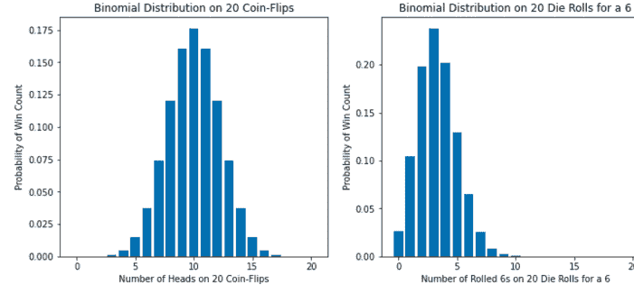

**图 3-1.** 代表硬币抛掷和骰子点的两个二项分布

左侧的图表显示了一系列硬币抛掷的分布，在 20 次抛掷中获胜（获得一个特定侧面）次数为 0–20 次的概率。$n$ 为 20，$p$ 为 0.5，因为硬币是公平的。十是最常见的并不意外，因为它是 $p$ 为 0.5 的分布中的中间点。如果你熟悉正态分布（我们接下来将查看），你可能会注意到这看起来有点像。

但如果 $p$ 不是 0.5，分布看起来完全不同，正如我们在图 3-1 的右侧图表所示，它显示了在 20 次掷骰中得到特定数字的次数。在这种情况下，$n = 20$，$p = 1/6$ ($\approx 0.167$)，因此图表向右偏斜。同样，这是合理的，因为最常见的计数是 3，即 0.15，这是最接近 $p$ 值 $1/6$ 的分数。

## 世界中的二项分布

虽然这是一个简单的分布，但它对于观察世界上的许多事物很有用。例如，如果我们想衡量一个视频游戏玩家的评分有多成功，我们可以衡量在一系列游戏中赢得特定次数比赛的概率。如果玩家玩了 100 局，成功概率为 0.75 并赢了 90 局，直觉会告诉我们这个玩家表现很好。但我们想知道他们恰好赢得 90 局的概率有多大，那是 0.9%，非常小。一个更有趣的可能是他们至少赢得 90 局的概率。我们需要相加赢得 90 到 100 局之间的概率，结果是 1%，比恰好赢得 90 局稍高，但仍然很低。玩家的表现非常出色。

由于他们获胜的概率是 0.75，你可能会好奇他们在 100 局中恰好赢得 75 胜的概率有多大——只有 8%。但我们还在问 74 胜和 76 胜的概率是否相似，并且会被认为是一个典型的比率。关于二项分布的一个有趣事实是，对于给定的 $p$，$n$ 越高，分布就越接近正态分布的要求，我们将在下一节中讨论。

## 伯努利分布

伯努利分布是二项分布的一种特殊情况：成功或失败。

## 正态分布

正态分布是很多人听过的，它也被称为钟形曲线或高斯曲线。正态分布是连续的，它在中心两侧对称，峰值位于中心。如果一个分布是正态分布，我们知道它只有一个峰值。

正态分布在现实生活中非常常见，正如我们看到的，正态分布在许多地方都有体现。尽管现实世界中的许多事物并不是真正的正态分布，但因为许多事物接近正态分布，这种分布在统计学中至关重要。许多测试和技术都需要假设正态性。这种方法之所以有效是因为事物足够接近正态。许多这些测试将在下一个章节中讨论。


## 第 3 章为成功做好准备：推断统计框架与实验

图 3-3 显示了两个正态分布：一个是标准正态分布，另一个是叠加在某些已知从正态分布的真实数据之上的——男性的身高（我们使用了加尔顿 Galton 著名的家族身高数据集中的父亲身高）。我们省略了 Y 轴数值，因为它们对于理解正态分布的概念并不是真的重要。

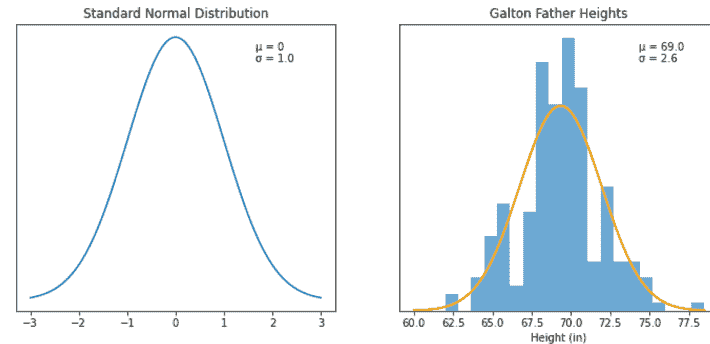

**图 3-3.** 两个正态分布：左侧是标准正态分布，右侧是经典数据集中的男性身高，并叠加了正态曲线。

左侧的图是标准正态分布，其中 $\mu$（均值）为 0，$\sigma$（标准差）为 1。我们可以看到中间的 0 处有峰值，尾部也没有太远，符合 1 个标准差。众所周知，只要样本量足够大，成年男性的身高就呈正态分布，因此我们绘制了加尔顿著名的家族身高数据集中的父亲身高。这并不是一个巨大的集合，存在一些偏差，但我们可以从叠加在其上的根据此数据缩放的橙色正态曲线看出，它大部分是正态的。

这些曲线看起来非常相似，理解它们的技巧之一是记住 X 轴上不同值之间包含多少数据。我们知道 68% 的数据分布在均值的 1 *$\sigma$ 内，即在 $\mu-\sigma$ 和 $\mu+\sigma$ 之间。在标准正态分布图中，68% 的数据在 -1 到 1 之间；在身高图中，它们在 66.4 到 71.6 之间。

## 使用正态分布

对于某些情况，这些曲线和数值可能就是我们需要的全部，但我们通常会以某种应用的方式使用正态特征，这通常意味着我们需要转换数据，以便能够以标准化的方式对其进行讨论。

## Z 分数 (Z-Scores)

由于大多数正态数据并不与标准正态分布完美对齐，因此将我们的数据归一化以便能够相对于标准正态分布进行讨论是常见的。这是通过计算 Z 分数实现的，Z 分数是给定值距离均值的标准差倍数。计算非常简单：用该值与分布均值之间的差值除以分布的标准差，因此不需要除以标准正态分布，因为标准正态分布为 1——这正是它的意义所在。

Z 分数是一个简单但极好的指标，用于识别异常常项，例如在简单的异常检测任务中，或为报告异常值定义阈值（如欺诈检测或受监控计算机系统上的性能问题）。

## 正态性检验

由于许多统计技术要求我们假设具有正态性，因此测试数据以查看其是否真的符合正态分布是非常重要的。QQ 图（QQ plot）允许你通过视觉方式进行这种调查。QQ 图在 X 轴上显示正态分布的分位数（这是正态性的参考点），并在 Y 轴上按低到高的数值顺序显示数据集中的所有 Z 分数（这些是你正在测试的值）。如果数据是正态的，你将有一条从左下到右上角的近完美对角线。你可以在图 3-4 中看到示例，其中点代表被测试的值，红线是我们预期数据为正态时预期看到的。

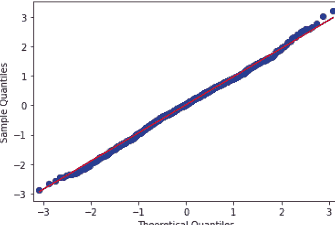

**图 3-4.** 带有随机正态数据的 QQ 图示例

3-4 是我们预期数据呈正态分布时的样子，而 QQ 图会清晰地显示数据何时完全不符合正态分布。图 3-5 显示了来自泊松分布的数据（我们将在下一节中研究它），显然数据没有在对角线上对齐。

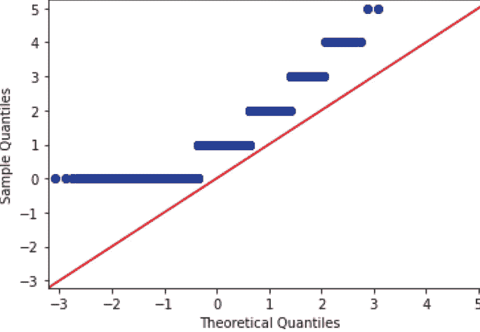

**图 3-5.** 带有随机非正态数据的 QQ 图示例（来自泊松分布）**

另一个常用检验是*柯尔莫戈洛夫-斯尔诺夫检验 (Kolmogorov–Smirnov test)*，有时简化为 K-S 检验。该检验将数据集中标准化值的实际分布与标准正态分布进行比较。它生成一个代表正态分布与数据分布之间最远距离的。

我们已经知道大多数事物并不是真正的正态的，但它们通常足够接近，以至于我们仍然可以使用一些需要正态性的技术。这通常是一个经验判断，随着经验的增加会变得容易，但测试仍然比仅仅假设要重要。

## 泊松分布

离散的泊松分布非常有趣，因为它研究了最初看起来难以量化的事物。具体来说，泊松分布模拟了反复发生的不规则事件或情况。典型的例子包括在时间上间隔的事件，例如客户进入餐厅或有人在工作中请病假；以及在空间上分布的事件，例如印刷书籍上的缺陷。任何在餐厅或零售店工作过的人都会告诉你，你总会遇到比比常得多的客户“人潮”，或者出乎意料的等待时间，且没有明显的解释。它就是那样发生的。

泊松分布使用速率参数 $\lambda$ (lambda)，它是在指定时间内（或书籍示例中的指定空间内）事件的平均次数。因此，我们必须对我们试图建模的情况有一定的了解。但餐厅可以追踪客户，而你总会遇到比比常得多的客户“人潮”，或者出乎意料的等待时间，且没有明显的解释。它就是那样发生的。

泊松分布使用速率参数 $\lambda$ (lambda)，它是在指定时间内（或书籍示例中的指定空间内）事件的平均次数。因此，我们必须对我们试图建模的情况有一定的了解。但餐厅可以追踪客户，而你总会遇到比比常得多的客户“人潮”，或者出乎意料的等待时间，且没有明显的解释。它就是那样发生的。

泊松分布使用速率参数 $\lambda$ (lambda)，它是在指定时间内（或书籍示例中的指定空间内）事件的平均次数。因此，我们必须对我们试图建模的情况有一定的了解。但餐厅可以追踪客户，而你总会遇到比比常得多的客户“人潮”，或者出乎意料的等待时间，且没有明显的解释。它就是那样发生的。

泊松分布使用速率参数 $\lambda$ (lambda)，它是在指定时间内（或书籍示例中的指定空间内）事件的平均次数。因此，我们必须对我们试图建模的情况有一定的了解。但餐厅可以追踪客户，而你总会遇到比比常得多的客户“人潮”，或者出乎意料的等待时间，且没有明显的解释。它就是那样发生的。

泊松分布使用速率参数 $\lambda$ (lambda)，它是在指定时间内（或书籍示例中的指定空间内）事件的平均次数。因此，我们必须对我们试图建模的情况有一定的了解。但餐厅可以追踪客户，而你总会遇到比比常得多的客户“人潮”，或者出乎意料的等待时间，且没有明显的解释。它就是那样发生的。

泊松分布使用速率参数 $\lambda$ (lambda)，它是在指定时间内（或书籍示例中的指定空间内）事件的平均次数。因此，我们必须对我们试图建模的情况有一定的了解。但餐厅可以追踪客户，而你总会遇到比比常得多的客户“人潮”，或者出乎意料的等待时间，且没有明显的解释。它就是那样发生的。

泊松分布使用速率参数 $\lambda$ (lambda)，它是在指定时间内（或书籍示例中的指定空间内）事件的平均次数。因此，我们必须对我们试图建模的情况有一定的了解。但餐厅可以追踪客户，而你总会遇到比比常得多的客户“人潮”，或者出乎意料的等待时间，且没有明显的解释。它就是那样发生的。

泊松分布使用速率参数 $\lambda$ (lambda)，它是在指定时间内（或书籍示例中的指定空间内）事件的平均次数。因此，我们必须对我们试图建模的情况有一定的了解。但餐厅可以追踪客户，而你总会遇到比比常得多的客户“人潮”，或者出乎意料的等待时间，且没有明显的解释。它就是那样发生的。

泊松分布使用速率参数 $\lambda$ (lambda)，它是在指定时间内（或书籍示例中的指定空间内）事件的平均次数。因此，我们必须对我们试图建模的情况有一定的了解。但餐厅可以追踪客户，而你总会遇到比比常得多的客户“人潮”，或者出乎意料的等待时间，且没有明显的解释。它就是那样发生的。

*(注：由于原文中泊松分布部分存在大量重复文本，此处已按逻辑合并处理，若需严格遵循原文重复性请告知。以下为修正后的逻辑翻译：)*

离散的泊松分布非常有趣，因为它研究了最初看起来难以量化的事物。具体来说，泊松分布模拟了反复发生的不规则事件或情况。典型的例子包括在时间上间隔的事件，例如客户进入餐厅或有人在工作中请病假；以及在空间上分布的事件，例如印刷书籍上的缺陷。任何在餐厅或零售店工作过的人都会告诉你，你总会遇到比比常得多的客户“人潮”，或者出乎意料的等待时间，且没有明显的解释。它就是那样发生的。

泊松分布使用速率参数 $\lambda$ (lambda)，它是在指定时间内（或书籍示例中的指定空间内）事件的平均次数。因此，我们必须对我们试图建模的情况有一定的了解。但餐厅可以追踪客户，从而预测未来。

泊松分布的一个局限性是它假设 $\lambda$ 在时间范围内是恒定的，但在实际情况下，情况往往是变化的。

等等，泊松分布的一个局限性是它假设 $\lambda$ 在时间范围内是恒定的。图 3-6 显示了工作日的订单量分布。

## 工作日每小时订单量 21 - 25

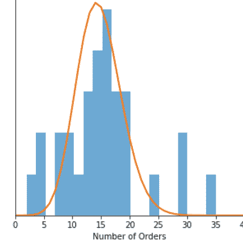

**图 3-6.** 工作日每小时订单量

img/df37a23523ff92247f9125691b1edea2_140_0.png

这匹配得非常完美，这就是为什么泊松分布在餐厅规划中很有帮助。但正如我们将会看到的，现实世界并非所有情况都如此。

## 指数分布与威布分布

指数分布和威布分布都与泊松分布相关，但它们都是连续分布，因为它们追踪的是时间而非有限事件。指数分布考虑了与泊松分布相同的场景，并同样使用 $\lambda$ 参数，但它模拟的是两次事件之间的时间。因此，当一个客户进来时，指数分布可以告诉我们下一个客户可能何时到来。

有时泊松分布看起来是正确的，但当事件概率随时间推移而变化时，威布分布是更好的选择，因为它模拟了特定事件发生前经过的时间，同样适用于时间或空间。一个经典的例子是跟踪机械设备的故障。直觉上我们知道，设备使用时间越长，由于持续的磨损，故障的可能性就越大。威布分布基本上可以告诉我们设备持续特定时间的概率，它需要两个参数。第一个称为形状参数，记为 $\beta$ (beta)，它代表故障概率随时间变化的速度。如果大于 1，则概率随时间增加；如果是负值，则随时间减少。第二个参数是设备的预期寿命，记为 $\eta$ (eta)。

## 中心极限定理

中心极限定理是处理样本统计量的另一个概念，即计算同一总体的多个样本的均值。中心极限定理指出，如果在适当条件下从同一总体中提取多次样本的均值（或其他统计量），随着样本量（样本均值的数量）变得足够大，这些均值的分布将趋于正态分布。

无论样本总体的分布如何，无论测量的统计量是什么，这一结论都成立。想象你有一个装满了各种尺寸不规则球的垃圾桶，随机抽取一千组每个一百个球的样本，并计算所有这些样本的均值。


# 第 3 章 成功基础：推断统计框架与实验

……的真实表示，偏离真实表示的情况更少。我们将看到测量值围绕着中心点分布——即那些很好代表真实弹珠的样本——偏离该中心点向两侧分布的测量值较少，就像正态曲线一样。曲线的峰值可能是垃圾桶中弹珠平均值的准确值。

与中心极限定定理相关的概念是**均值回归**（regression to the mean），它基本上是指随着时间的推移，数值会变得不极端。所以，如果出现了一个极端值——例如某个玩家在纸牌游戏中得了极高分——那么下一局游戏的得分可能会较低（不那么极端）。

## 采样（Sampling）

采样是从更大的总体（population）中获取数据子集的行为。根据语境，这个术语可以有几个相关的含义。在实验设计中，它意味着选择大总体中的成员来收集其数据。在大多数情况下，我们无法获取某个整体总体的数据。市场研究公司无法字面上与每一个美国人交谈，甚至无法与 25 到 45 岁之间的每一个美国女性交谈。我们必须找到一种与其中较少数人交谈的方法，以便我们能够有意义地推广到整个总体。然后我们就可以进行研究并以某种方式与他们合作以获取数据。我们正在抽样的这一事实意味着，我们选择总体成员的方式可能会产生巨大的影响。

第二种情况在数据科学中更为常见，那里我们有时会遇到相反的问题——数据过多。我们通常不是在设计实验，但可能需要为了特定目的选择数据子集。例如，我们可能有关于服务器性能的数百万行数据，数千台服务器中的每个都有数千行数据。我们可以选择服务器的子集，或者简单选择行的子集，或其他可能的子集。这也被采样。在这种情况下，选择哪些点进入我们的样本与第一种情况具有大多数相同的问题和考虑因素。在这里，我们的优势在于可能更清楚地了解完整总体中的情况（有时我们可以对整个数据集进行基础统计，只是无法进行我们想做的更高级的数据科学），这可以为我们的采样选择提供参考。

本节的其余部分将主要关注第一类采样，它通常作为实验或研究的一部分进行。

## 偏差与代表性（Bias and Representativeness）

推断统计中采样的主要目标之一是让样本以有意义的方式代表总体，而确保代表性的最佳方法是避免采样中的**偏差**（bias）。在这种语境下，偏差简单是指对特定数据子集的系统性偏好，这意味着样本错误地代表了总体，这源于所选的采样方法。我们也可能存在测量偏差，它源于以一种问题的方法测量事物。

如果我们想了解 Snapchat 和 Facebook 在美国人中的受欢迎程度，如果我们只调查青少年，那么我们的样本将产生巨大的偏差。我们选取的样本对整个“美国人”来说完全没有代表性。

心理学中实际上有一个关于系统性偏差的著名例子。许多心理学实验是学者在自己的大学里针对自愿的学生（或者如果他们正在上心理学课，就是“被自愿”）进行的。前额叶皮层是大脑中与冲动控制和决策相关的部分，直到 25 岁左右才完全发育完成，因此大多数大学生仍处于发育阶段。在他们仍在发育时就其大脑如何工作得出科学结论将导致偏差的样本。这些研究本身并没有内在的错误——它们在设计针对随机抽取的成年人的更大规模研究时可能非常有帮助。问题在于，这些结果有时在报告方式上被推广到更大的“人”总体中（尤其是通过记者报道）。

为了更好地理解采样中的偏差，让我们回到装满弹珠的垃圾桶。想象我们有一台机器，它可以伸进垃圾桶，搅拌一下，然后挤压直到它捡到一个弹珠并将其拉出来。假设夹具发生故障没有完全关闭，所以它很少拉出较小的弹珠，因为它们会掉出来。选出的弹珠样本将与垃圾桶整体的情况不同。如果我们对采样的弹珠取平均值，它将高于垃圾桶中弹珠的真实平均值。

如果我们把垃圾桶里所有的弹珠都出来（这是一个房子大小的）并将它们放在左角的桌子上，我们可以看到弹珠的大小范围。但如果我们的自动挑选器不能完全关闭，它就无法握住较小的弹珠。视觉上看起来更容易理解。图 3-7 显示了这些样本可能后的样子。上面的图片显示了散落在桌子上的弹珠。如果我们把弹珠放回垃圾桶，告诉我们损坏的挑选器取出十个弹珠，然后重复几次，左下角的三个样本就是典型的。如果我们修复挑选器并重新运行过程以获取三个新样本，我们预计会像右下角的样本一样。


> **图 3-7.** 从满桌弹珠的桌子上取的六个示例样本，三个使用损坏的挑选器，三个使用公平的挑选器

| 损坏挑选器的样本 | 修复挑选器的样本 |
| :--- | :--- |
| 样本 1 | 样本 4 |
| 样本 2 | 样本 5 |
| 样本 3 | 样本 6 |

损坏的挑选器无法抓住较小的弹珠，因此所有样本都有中等和较大的弹珠。右侧那些修复挑选器后取的样本看起来更像桌子上的。

重要的是，在这种情况下，人类可以在很大程度上通过肉眼判断平衡，但进行系统性选择至关重要，因为人类不具备所需的精度。

# 第 3 章 成功基础：推断统计框架与实验

## 有放回采样（Sampling with Replacement）

我们经常谈论有放回或不放回采样。这只有在你对大型、完整数据集进行数据采样时才有意义。有放回采样允许完整数据集中的某些数据点被多次选择——基本上，数据点在被选择“移除”后被放回数据集。不放回采样正好相反，每当选择一个数据点时，它都会从完整数据集中移除。从弹珠桶中采样的最自然方法是取出一个弹珠并放在一边，然后伸进去取另一个，以此此类推，这就是不放回采样。你也可以在选择后将弹珠扔回去并搅拌一下，这就是有放回采样。让人们填写问卷通常是不放回采样（你不会要求某人填写两次）。如果你想要一个真正的数字样本，每个数字被选中的概率相等，你会想要有放回采样（否则每个数字的概率会增加，不再是随机的）。

## 样本量（Sample Size）

与其他许多一样，我们尝试的任务决定了研究所需的数据量。我们大多数人直觉上认为数据越多越少越好。通常，情况恰恰相反。特别在大数据时代，我们往往想尽可能使用所有数据——甚至是整个总体。完全正确的是，如果我们取总体的子集，确实更有可能错过异常情况。但如果我们想了解关于英国所有成年公民的某些情况，例如，处理整个总体是不可行的。令人惊讶的一点是，在这两种情况下，通常都是由于较小但精心设计的


## 第 3 章 奠成功基础：推断统计框架与实验

一个精选样本实际上比一个巨大的数据集更好。通常情况下，处理小规模数据集更容易，尤其是在计算资源方面。

显然，在某些情况下确实需要大量数据，但这些情况非常少且孤立。两个很明显的例子是互联网搜索和大型语言模型。我们无法跳过这些领域的数据，因为它们在广度和深度上被要求是完整的。但如果我们想知道英国人最喜欢的爱好是什么，我们并不需要询问每一个人。

有一些通用的规则可以帮助确定良好的样本量。当总体的变异性不大时（总体的大多数成员非常相似），只要抽样方法严谨，较小的样本也是好的。当总体的变异性很大时，反反之——在这种情况下，更大的样本更具代表性，因为它可以捕捉到更多的差异。此外，当我们研究稀有事件（如计算机故障或信用卡欺诈交易）时，更倾向于使用大样本量。

图 3-8 显示了三种情况以及抽样受到的影响。每种情况都有一个总体，然后从每个总体中取一个小样本和一个大样本。左侧是一个变异性极小的弹珠总体，因此小样本看起来仍然很有代表性（大样本没有给我们提供更多信息）。中间显示了一个变异大得多的总体，我们可以看到小样本并不很有代表性，因此我们需要更大的样本。最右侧的总体包含一个非常稀有的事件——大弹珠。我们需要更大的样本来确保我们能在其中获得一些大弹珠**。或者，我们的小样本可能由于随机偶然最终包含了多个大弹珠**，那么该样本将极不具有代表性。


**图 3-8.** 针对不同类型总体的不同样本量

| 变异性最小 | 变异性较大 | 含有稀有点 |
| :--- | :--- | :--- |
| 小样本 | 小样本 | 小样本 |
| 大样本 | 大样本 | 大样本 |

## 总体

在考虑样本量时，最后一个考虑因素是可能的结果。如果可能产生破坏性，通常最好选择较大的样本以确保更好的代表性。这可能适用于那些将要用于撰写公共政策或涉及重大财务决定的研究，我们将在稍后的章节中讨论这些。（注：本节的 OCR 文本在源文件中严重碎片化/乱码；已根据图标签的上下文和周围文本提供的通用统计逻辑进行了重构。）

## 随机抽样

我们大多数人直觉上知道，随机性是避免偏误的关键。但在实践中，这并不总是那么那么简单，而且不会产生预期的结果，特别是当我们以某种方式处理人际时。如果我们成功随机选择出一组人进行访谈或收集数据，我们仍然需要取决于这些人是否愿意参加访谈或填写问卷。还要注意，为了进行任何种的随机抽样，我们都需要某种随机生成器。这意味着要以某种方式引入计算机。

## 简单随机抽样

简单随机抽样确实如其名所示——随机且最简单的方法。在简单随机抽样中，总体中的每个点都有等几概率被选中，直到达到所需的样本量。在现有数据集中执行这通常是微不足道的，但如果你在选择人，可能会更加困难。

## 分层随机抽样

分层随机抽样类似于简单随机抽样，我们根据我们关心的特征将总体分为若干层，然后对这些组中的每一个应用随机抽样。例如，假设我们要研究男性和女性玩家。男性玩家比女性玩家多，如果我们只对整个总体进行抽样，我们的样本中男性将远多于女性。但我们的问题是每个组的代表性如何，所以我们实际上想要一个每组数量相同的样本。组内的随机抽样确保了每一层都具有代表性。

## 整抽样

整抽样将总体划分为称为簇的组，与分层抽样相似，但不同在于我们通常根据便利性对总体进行划分。我们选择特定的簇进行关注。这种抽样方法通常用于地理位置——例如，国家、州、县、城市。我们会选择有限数量的簇并在簇内随机选择人，其优势是对于许多区域收集数据来说，比向许多区域派遣人更具实用性。这种方法通常是因为实用性和成本而被选择。

## 非随机抽样

随机性通常是避免偏误和确保代表性的最佳方法，但在实践中这并不总是可行，特别是当我们以某种方式处理具体的人时。有时我们需要简化问题，使用我们以某种方式无法获得的数据。

缺乏随机性并不意味着这些方法没有用处。我们必须记住，使用非随机方法就无法有信心地从样本推断到总体。但如果我们只是想测试一些东西，例如在发送较大的随机样本之前测试问卷中的问题，它仍然有用。有很多非随机的抽样方法，但我们在这里讨论几种。

## 志愿者抽样与雪球抽样

志愿者抽样和雪球抽样是在处理人际时常用的方法，往往会产生偏偏的样本。志愿者抽样是一种要求大量人员参与（如填写问卷）并使用那些选择参与的人的数据——这些人是自我选择或自愿的。雪球抽样是统计学对直销的回答——个体被选中，然后要求他们提供进一步参与者的名字。在大学期间，我得到了一份卖刀的工作，这涉及到向我认识的人进行演示，他们应该给我我认识并可以联系的人的名字等等。由于我不是一个社交达人，这毫无果，，而且我只坚持了一个月，这并非巧合。我的雪球抽样的质量完全取决于你的抽样人员有多愿意分享他们的人脉。

## 便利抽样

如其名所示，便利抽样是一种根据易易程度从总体中选择的方法。如果一个学生想做关于大学生的研究，他们可能只是调查他们班的每个人。这显然偏偏于学科、课程级别以及上课时间，或者是远程还是线下。只要我们记得它不能推广到任何其他总体，甚至不是到所有大学生，这样做本身并没有问题。


## 第3章 为成功奠基础：推断统计框架与实验

## 实验与研究设计

我们大多数人人都参加过在线快速调查，虽然这些调查可能很有趣，但它们几乎从没有实际意义，因为它们充满了偏见且问题设计不当。事实证明，创建一个严谨的实验或研究并非易事，在过去的200年里，该领域已经投入了大量工作使其变得更好。

即使数据科学家不直接设计或运行实验，理解实验是如何设计和运行的，对于理解数据以及知道如何处理数据非常有益。

## 实验

实验是物理科学的支柱，社会科学家——尤其是心理学家——也参与其中。当执行良好时，实验可以产生可靠且严谨的数据，用于得出真实、有意义的结论。

要成为科学意义上的实验，它必须在控制所有其他变量的同时测试单个变量。至少需要两组：一组是不发生变化的*对照组*，另一组是包含变化变量的*实验组*。可以有多个实验组，但它们在同一个变量上应当是不同的。研究对象（无论是人类参与者还是其他）必须随机分配到这些小组之一。此外还至少需要一个*响应变量*，即实验试图衡量的内容——实验组的反应是否不同于对照组？

还有其他必须考虑的因素，包括样本量、有多少个响应变量、将使用何种统计技术分析数据，以及使用何种显著性水平作为统计显著性的阈值。这些因素相互交织，以确保所出现的显著差异确实在统计学上是显著的。根据你将使用什么统计方法分析数据，有几种方法可以计算最小样本量。例如，对于你希望计算特定指标的置信区间的场景，可能有一个最小尺寸。另一种常见的计算方法称为“效力”（power），它告诉我们对于给定的样本量看到显著结果的概率有多大。

举个例子，Meta 可能想知道三条广告中哪一条在某群体（可能是25到35岁）的馈流中效果最好。首先，他们需要选择响应变量，这可以是很多内容，包括点击次数、在首次点击之前的展示次数（显示次数），甚至是他们关心的点击后的后续操作（如点击后购买）。实验将分为四组：一组不接收广告的对照组，以及三个实验组（每组一个广告）。符合这些标准的男性将被随机分配到这些实验组中。然后 Meta 会向每个参与者展示分配的广告（对照组则不展示广告）。根据他们的寻找目标，他们可能只展示广告一次或多次（每个用户展示的次数相同），然后测量两个响应变量——点击和购买。

## A/B 测试

A/B 测试可能是数据科学家参与运行的最常见的实验类型。它基本上是一个包含一个对照组和恰好一个实验组的实验。它在数字营销和网页设计中非常流行，因为实施起来相当容易。公司可能想看看更改时通讯标题的字体是否能获得更好的阅读率，因此他们设置了系统随机向用户显示哪一个标题。

## 准实验

准实验与真正的实验有许多共同点，但它们不具有相同的严谨性，因为至少没有满足实验的一项标准，最常见的情况是没有对照组或者没有随机分配参与者。这可能是出于实际或伦理考虑，这意味着即使研究符合其他标准，也不能被视为真正的实验。这些研究仍然具有价值，但我们无法像通过实验那样安全地将结果推广到其他情况。

## 观察性研究

尽管实验和准实验都被认为是研究设计的黄金标准，因为它们能够减少偏见并提高准确性，但有时在设计上并没有那么大的灵活性。在某些情况下，由于伦理或法律限制，我们无法随机分配参与者。例如，如果我们想研究父母入狱对孩子的影响，我们不能恰好把一个父母关进监狱——我们必须与我们找到的家庭合作。观察性研究使我们能够在无法控制所有参数的情况下，仅通过我们访问的数据点来研究某些现象。

在这种研究中，模仿实验性变量控制的一种方法是进行病例对照设计（case-control design），这涉及匹配病例（在上面的例子中，是父母入狱的家庭）和对照（没有父母入狱的家庭），确保它们在其他特征上尽可能保持相同或非常相似。我们会识别我们认为需要匹配的属性，在在这种情况下，这些可能可能是社区、孩子的数量、孩子的年龄、家庭成员的种族和家庭收入等因素。

## 调查

对于大多数人来说，当他们想到研究时，可能会想到调查，我们不断听到这些调查，有时还会参与其中。*调查*基本上是一份由参与者回答的问题列表。它们也被称为民意调查（polls）和问卷（questionnaires），但只是同一种事物的不同名称（民意调查通常与政治话题相关）。我们经常在新闻、杂志或互联网上看到调查结果。从调查中可以很容易获得一些看起来很棒的彩色视觉效果，而且与大多数实验相比，它们简单且快速。

随意的网络调查完全不科学，但更严肃的调查可以经过良好设计以产生有意义的结论。作为一个起点，调查需要聚焦，并且我们需要识别一个群体，这也需要是可以抽样的。我们需要决定使用何种交付方式，可以是在线、邮寄或上门。有时时间也是重要的考虑因素。严肃的调查还需要确保符合法律和伦理指南。这通常意味着解释研究目的、提醒参与者是自愿的，并说明结果将匿名或保密。研究人员在调查中包含联系信息也是良好的做法。

编写调查问题是一门通过试错变成科学艺术。措辞会极大影响答案。最大的风险是创建引导性问题——即微妙地（或直接）引导受访者给出特定答案。设计引导性问题有很多方法，但最明显的一种方法是以“你是否同意……”开头，例如，“你是否同意科技行业的女性足够多？”提题者的偏见是显而易见的，并可能影响参与者的回答。更好的措辞可能是“你认为科技行业的女性是否得到了充分代表？”确保你的问题良好的一个高度推荐的方法是进行试点研究，让少数人完成调查并获取受访者的反馈。这可以帮助你识别混乱、误导或仅仅偏见的问题。

## 调查采样与响应率

一旦我们确定了目标群体，就必须获得良好的样本，由于调查响应率低，这一点尤其困难。响应率简单来说就是收到响应数占发送调查数的百分比。虽然可以随机选择参与者，但除非调查是强制性的或有激励的，否则很多人不会完成。因此，即使发送的对象是随机的，最终样本也可能不是随机。例如，如果我们想了解人们对导致堵堵几个月的延期工作的看法，我们可以从地址列表中随机抽取人员并向他们发送调查，但大多数人不会填写，因此我们得到的将是那些喜欢填写调查的人员。参与始终是一个问题，即使有激励也可能导致样本偏差，因为低收入者可能更容易为了 25 美元的品品卡填写调查，比起一个开着梅赛德斯的公司律师。我们再次发现了并不一定代表我们需要学习的人群的人。这意味着我们需要


## 第3章 迈向成功：推断统计框架与实验

我们必须估计响应率，以便发送足够数量的问卷。响应率取决于交付方式、目标群体和内容，差异很大。大多数公司员工调查的参与率远高于 50%，而网络调查的参与率可能仅在百分之十左右甚至更低。令人遗憾的事实之一是响应率越低，结果越容易产生偏差。此外，在某些情况下（例如某些科学或医学期刊），对高响应率有强制要求。

## 核心要点与后续内容

本章重点介绍了推断统计的基础——概率、概率分布、抽样和实验设计。所有这些内容都将对下一章讨论的推断统计发挥作用。概率分布，尤其是正态分布，是推断统计中使用的许多概念和统计检验的基础。我们讨论了抽样，这非常重要，因为我们选择样本的方式影响了我们能从中获取信息的量。样本尽可能保持无偏至关重要，我们涵盖了创建样本的各种技术。本章以对实验设计的讨论圆满收尾，虽然大多数科学家不会深入研究这个课题，但了解不同的设计及其局限性可以帮助我们在处理并非由自己设计的研究结果时做得更好。

在第4章中，我们将完成对统计学的解释，首先结束推断统计的历史介绍。然后，我们将深入研究常用统计检验的基础概念，包括假设检验、p值、第一类错误和第二类错误、误差范围、置信区间以及单尾和双尾检验。接着，我们将涵盖主要的统计检验，包括需要假设数据符合某种分布的检验（如 Z 检验、t 检验、方差分析 ANOVA 和卡方检验），以及不需要分布分布假设的检验。

## 第3章 迈向成功：推断统计框架与实验

## 从业者简介：DANNY VACHALEK

**姓名：** Danny Vachalek

**职位：** 数据科学家

**行业：** 零售

**数据分析与数据科学经验年限：** 8

**教育背景：**

- 数据分析与数据科学硕士
- 商业、营销与广告学士

> *此处表达的观点仅代表 Danny 及其任何过去或现任雇主的。*

### 背景

Danny Vachalek 在大学期间选择了一条非常务实的路线，专注于获得商业学位，学习所有关于营销和广告的知识，因此他毕业后进入广告行业并不令人意外。但他从未想到第一份工作最终引导他走向一个不同的方向。

## 工作经历

Danny 的第一份工作大部分涉及对不同广告活动进行相对简单的分析，查看成功率和其他性能指标。他对学习更多知识充满好奇心，并想了解比他所能交付的更多的信息，但他所拥有的工具非常基础，对于任何一项活动，他一次只能观察几个变量。他知道自己还有更大的发挥空间，于是研究了各种选择，并很快开始读数据分析的硕士学位。

在读学位期间，Danny 发现了一个机会并共同创立了一家专注于品牌通信自动化的机构。但他很快意识到这是一条死胡同的创业，因为大语言模型正变得越来越主流且易于获取（这会让他的业务过时）。他在一家广告初创公司找到了一工作，在那里被推向了深水区，学习了 SQL，还遇到了一群老派的机器学习大师，他们向他介绍了更广阔的数据科学世界。那份工作很有回报，因为他学到了很多东西并做了一些有价值的工作，但也非常耗时。

在他和妻子得知要快孩子后，Danny 换了工作成为了一名顾问。在几项任务的初期，他经常感到力不从心，他意识到在开始任何新任务之前，他还有很多东西要学。具体来说，他需要更好地理解如何管理项目的全生命周期，从收集需求到完成完整的实施。他还发现利益相关者每周都会向他抛出许多相当随机的问题，但由于所有即时查询，时间很少足够。每个人都又一次又想要比他的主要工具能提供的更多。尽管如此，他对进行更高级分析的渴望在增长。他花费了大量时间攻读硕士并学习学术方面的知识，但他仍然发现自己尽可能挤时间进行一些更具业务导向和应用的研究。

所有这些教育背景结合他在咨询工作中一个让他获得赞誉的项目，帮助他最终在目前公司获得了一份正式工作，在那里他是专门数据科学团队的几位数据科学家之一。从那时起，他的数据科学和软件设计知识不断增长，他热爱自己正在从事的工作。

## 第3章 迈向成功：推断统计框架与实验

## 金句摘录

**工作中喜欢的部分：** Danny 喜欢在工作中与各种人一起学习，其中许多人的背景和观点都与他非常不同。他特别喜欢向工程师学习，因为他欣赏他们的系统思维。他还喜欢与具有不同技术专长能力的利益相关者打交道，并试图寻找清晰易懂的解释来简化复杂的概念，以便他们都能找到最佳解决方案。他还喜欢解决问题并为重要的倡议贡献力量。

**工作中不喜欢的部分：** 媒体对数据科学的公众认知往往是有偏差的，这意味着利益相关者对数据科学家的成就往往有不现实的预期。完成工作很难。

**最喜欢的项目：** 在初创公司工作时有几个很棒的项目，但在其中一个项目中，Danny 得出了哪些产品功能与最高收入相关，进一步的分析和测试导致收入增加了一倍。

**教育与现实世界的联系：** 他发现他在硕士期间做的项目在数据质量方面与现实世界完全不同，而且不是端到端的。学习如何将一个项目从构思、规划一直执行并投入生产环境，是课程似乎没有教的，但在职场中至关重要。

**最常使用的技能：** 分析能力和批判性思维都非常重要，但一颗不断产生问题的好奇心同样重要。Danny 发现，理解利益相关者试图解决的真实问题，以及了解真正的解决方案有哪些是尤为重要的。识别出何时某个问题由于数据或基础设施限制而没有可行的解决方案是非常重要的。

**目前使用的主要工具：** 带有 CTE 的 SQL，Snowflake, Python, JupyterHub, VS Code, GitHub, DBT

**数据科学的未来：** Danny 认为，由于数据收集和目前数据科学运作的方式，在隐私、安全和道德方面存在很多风险。他担心在发生坏事情之前，人们才会推动更多的监管，而他认为这是我们需要的。他认为如果数据科学家必须获得执照或认证将很好，这需要进行伦理培训。

**优秀数据科学家的特质：** 优秀者与卓越者的区别在于能够提出有趣且尖锐的问题，深入探讨重要的业务需求。领域知识具有巨大的力量。

**对对职数据科学家的建议：** 尽早确定你的关注领域（你想要专的领域）。基本上，选择一个行业，并尽可能地学习关于它的知识，让自己在其他初级候选人中脱颖而出。


## 第 4 章

## 得出复杂的结论：推断统计与统计检验

## 引言

实验设计、良好采样和概率的重要性无论如何强调都不为过；二十世纪我们在统计检验以及评估估值质量的能力上也取得了巨大进展，这两者都是推断统计的动力。相关性和协方差是 20 世纪开发的其他重要概念。计算机的出现让我们从小规模数据集跨越到了“大数据”时代。数据科学家学习了在“统计学”伞下可以做的许多不同事情，数据科学家在日常工作中极度依赖这些新技术，尽管他们也做了很多不属于统计学范畴的工作。

本章将涵盖现代统计学的剩余历史。我们将观察现实世界中的统计学案例，一个源自第二次世界大战，另一个源自 COVID-19 建模。然后我们将介绍现代统计检验的基础知识，为学习特定的检验方法奠定基础。这包括假设检验、p 值、第一类错误和第二类错误、检验效力、误差范围、置信区间以及单侧和双侧检验。接着，我们将深入探讨一些常见的统计检验——Z 检验、t 检验、ANOVA（方差分析）、卡方检验以及一些非参数检验。我们将观察显著性检验是如何运作的，然后研究相关性和协方差。

### 现代统计学的历史：部分 2

统计检验方法在二十世纪呈爆炸式增长。随着概率分布的发现，许多预测和假设检验的方法运而生。正态分布和学生 t 分布（与正态分布相关）在早期都是至关重要的，许多检验都源于此，包括 Z 检验、多种变体的 t 检验、ANOVA 和卡方检验。但由于这些检验的局限性（我们必须假设数据呈正态分布，而统计学家无法在所有情况下都假设这一点），因此开发了其他被称为非参数检验的方法。

定义的许多重要的技术和概念——第二类错误、置信区间和检验效力，它们都与假设检验有关——我们将讨论它们。随后，开发了极大似然估计（MLE）和线性判别分析（LDA）。MLE 允许我们根据一些已知数据点估计分布（总体）的参数。LDA 允许我们找到一条划分两组数据的线。然后 t 分布得到了更多的关注和发展，定义了另一种衡量相关性的方法。我们将在下文中讨论这一点。所有这些内容对于该领域的发展至关重要。

世纪上半叶的大部分工作是在相对小的数据集上完成的。现在的学生学习统计学时，仍在学习小数据集上的计算，而且这些数据集往往小到可以手工计算。计算机的出现显然给该领域带来了巨大的变化，允许进行手工无法完成的更复杂、更耗时的计算。诸如 SPSS、Minitab 和 Statistica 等几种统计软件程序被开发出来并在今天继续被使用，特别是社会科学家；而数据科学家、许多分析师和其他许多计算科学家正在使用 Python、R 或 SAS。

数据分析师和数据科学家所的工作并非都依赖于统计学，但该领域仍在发展的这一巨大事实预示着新技术带来的进一步的益处，这可能会让预测等任务更加准确。数据科学家明智地保持对形势的关注。

### 现实世界中的统计学示例

#### 项目 1：德国坦克问题

在第二次世界大战期间，盟军需要知道德国人拥有多少坦克和其他武器。轴心国区域的间谍收集情报，试图估计每个月的产量，但他们的估计值一直偏高。因此，盟军的数学家使用统计方法来估计德国坦克和武器的数量并推断其他特性。

德国坦克和其他武器上都印有序列号，盟军能够在损坏或被俘的坦克上看到这些序列号。对序列号做出一些假设是很自然的，包括它们是连续的。换句话说，我们可以假设每个序列号都比前一个大1。所有序列号列表代表了所有坦克上所有序列号（“总体”）的样本。

他们想根据样本推断总体规模，尽管他们无法知道样本与总体之间的关系。有几种简单的方法可以做到（如将最大值翻倍或将平均值或中位数翻倍），但没有一种方法是非常的。相反，他们使用了一种称为最小方差无偏估计器（MVUE）的计算方法，这涉及将最大序列号除以坦克总数加上最大序列号，然后减去 1。

尽管在战争结束之前无法证实，但事实证明数字非常准确，特别是与传统情报收集的数字相比——差异往往会相差一个数量级，例如每月产出 250 辆坦克对比 1,500 辆，而较低的接近真实数字。盟军能够在计划中使用这些较低的估计值。对德国人拥有的坦克真实数量的理解，使他们在采取入侵冒险时更有信心，特别是对于 D 日，那是战争中的一个重大转折点。

#### 项目 2：COVID-19 建模与预测

在 2020 年初 COVID 爆发并开始在全球范围内扩散后不久，各机构开始收集病例数据并试图理解模式。这项工作对于告知封锁、社交距离和强制戴口罩等公共政策至关重要，特别是在疫苗可用之前的几个月。

但建模中存在许多挑战，我们中的许多人会记得早期有多少预测是不准确的。早期有很多预测存在问题，这是第 1 章中提到的数据质量问题的一个真实案例。你会在数据科学中听到“垃圾进，垃圾出”的格言，因为它是 100% 真的。当时对这种疾病知之甚少，其特性完全不明（我们做了许多无效假设），而且检测是不一致且有限的，导致报告不足。在早期，我们甚至不知道它是如何传播的，或者在感染他人之前可以存多久。自从我们开始获得更好的数据，疾病建模长期一直是流行病学的一部分，但它依赖于许多已知因素，如传播率、感染者的传染期和死亡率。许多在不同地区出现的疾病可以从之前爆发的数据中得到合理的了解，例如麻疹和鼠疫。因此，对于像 COVID 这样相对新的疾病，一旦我们开始获得数据，就需要大量的猜测。科学家显然与其他疾病寻找相似（特别是同新冠病毒家族的疾病，包括 MERS）来定义模型的起点，但 COVID 的表现不同（例如，对儿童的影响大于非老年成人的这一点是不常的）。科学家只是根据有限的信息尽力而为。

记住，所有数据都是现实世界某些方面的抽象。由于我们甚至不理解 COVID 在现实世界中是如何运作的，无法将拥有的信息转化为可用数据并不意外。图 4-1 是早期预测瑞典 COVID 的良好示例，包含了 2020 年 4 月至 7 月期间提出的五种不同的预测。它们都包含了历史数据，即你在左侧看到的峰值。但你可以看到它们在 4 月之后是如何不同的。一个在 6 月趋于平静，另一个在一年后仍然强劲。预测中最大的挑战之一是，预测得越远，对预测的信心就越小。而且他们只有几个月的时间，但他们预测的时间比这长得多，这种做法通常是不被允许的。我们将在第 15 章更多地讨论这一点。


## 第4 章 走向复杂的结论：推断统计学与统计检验

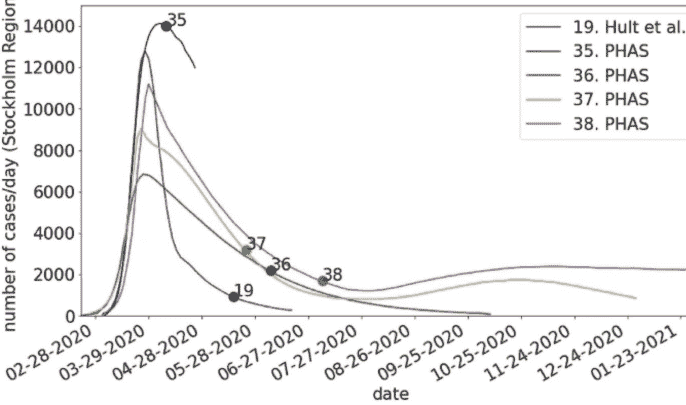

**图 4-1.** *对瑞典斯德哥尔摩 COVID-19 的预测早期尝试。* 来源：Philip Gerlee, Anna Jödd, Armin Spreco 和 Toomas Timpka 在《Scientific Reports》12: 13256 (2022) 上发表的《瑞典 COVID-19 疫情早期发展的计算模型：系统综述、数据合成以及对“准确性”的二次验证》，https://www.nature.com/articles/s41598-022-16159-6

随着来自不同小组的模型在最初几个月出现，美国疾病控制与预防中心（CDC）开始从许多模型和预测中创建预测。集成机器学习（Ensemble machine learning）是指使用多个算法来产生一个预测或结果。这是一种弥补单一模型缺点的有力方法，同时仍从中获益（我们将在第 15 章中详细讨论）。预测中使用了许多类型的模型——一些是传统的流行病学模型，另一些是基于统计学的模型。

有几种不同的流行病学模型。这些模型通常比纯统计学模型需要更多的假设，因为它们使用了有关疾病行为以及如医疗护理可用性和人类行为等方面信息。由于存在许多不确定因素，这些模型很难做到准确。许多早期模型出现了严重的错误，通常是高估了新冠病例数。这些模型对漏报等数据收集问题也非常敏感。

统计建模看起来很有前景，但它需要大量数据，因此在有足够数据之前，它无法真正开展。这些方法可能更简单，因为它们直接观察病例计数，并不真的需要大量外部信息。早期的一些方法包括时间序列方法和指数平滑法。这两种将在书中稍后部分介绍，但时间序列分析是一种经典的统计学方法，通过随时间跟踪变量的值（想象一张 X 轴为日期、线条横跨图表的折线图）。指数平滑是另一种预测方法，依赖于以往数据的加权平均值（经过某些其他因素修正的平均值）。尽管使用这些技术历史悠久，但这些早期的 COVID 模型并不十分准确，尽管它们往往仍然优于流行病学模型。

统计建模的一个主要缺点是，外部变化（如封锁和疫苗引入）意味着之前的趋势在任何地方都不再适用，因为它们完全不同。处理随时间发生的事件传统统计方法的另一个重要缺点是，它们无法可靠地预测长期，只能预测几周（尽管在数据更多的情况下，有时可以预测得远一点）。

科学家最终意识到混合方法更好，使用统计模型进行极短期预测，而流行病学模型最适合长期预测。科学家在当时的情况下已尽力所能，尽管我们现在看到大多数模型在早期都高估了疾病数量。但这提醒了我们，当数据科学将影响人们时，尽可能保持严谨至关重要。

图 4-2 显示了预测 R0 的较复杂模型之一，R0 是在特定一天患病的人引发的平均新感染人数。截图拍摄于 9 月中旬，即那里散开的浅蓝色区域（这是一个 95% 置信区间，我们将在本章晚些时候进行讨论）。

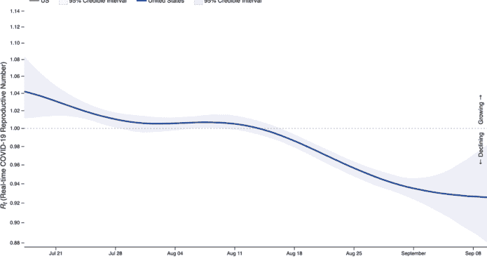

图 4-2. 改进得多的后期 COVID-19 传播率模型。来源：CDC CFA：建模与预测，“各州基于 R0 的当前疫情趋势”，https://www.cdc.gov/cfa-modeling-and-forecasting/rt-estimates/index.html

### 统计检验概念

在统计学中，最常见的目标是确定治疗的效果是否足够强大以称其产生了真实的差异。这种强度被衡量为统计显著性（statistical significance），从技术上它告诉我们某件事是可能纯粹随机偶然发生的，还是我们所研究对象的真实结果。传统上，这通过 p 值（p-values）和置信区间（confidence intervals）来衡量，我们稍后会讨论这两者。这可能是测试网站上广告相对于另一个广告的效果。也可能是观察辅导计划是否提高了数学方面遇到困难的高中生的成绩。我们在实验或研究中使用“处理”（treatments）一词是指代不同的测试用例——通常为一个对照组和一个或多个实验组。处理在技术上是受到操纵的自变量。例如，在辅导计划的研究中，我们有一组没有参加辅导计划的儿童对照组，和一组参加了辅导计划的组（处理组）。我们将对照组和处理组结果之间的差异称为效应（effect）。

很多人寻找某事的改进时会犯一个错误——（例如：制定预算是否让我们这个月花的钱更少了？）这个错误是计算之前和之后后的变化，并认为这意味着什么。统计学中的基本思想之一是始终存在随机性。

### 假设检验

在历史上，统计显著性检验是通过对研究的问题以特定的方式建模来实现的，这起初看起来可能有点奇怪，但它为统计分析建立了一种共同语言。这被称为假设检验（hypothesis testing），因为我们从零假设（null hypothesis，记作 H₀）和备择假设（alternative hypothesis，记作 H₁）开始。*备择假设*代表我们正在寻找的效果，例如辅导计划是否提高了成绩。*零假设*则是相反的——它说没有显著效果，或者辅导计划没有产生影响。

### p 值与效应量

统计学中最为人知的指标之一是 p 值，尽管它并不一定被很好理解。p 值是一个概率，或 0 到 1 之间的一个数字，用于指示纯粹靠偶然获得特定结果的可能性。如果它是一个很小的数字，意味着它不太可能是靠“偶然”发生的——即由于某种逻辑原因（例如假设很可能是真实的）的结果。人们有时将其误解为错误的概率百分比。我们提到过随机性在统计学中是相关的，而 p 值有助于处理这个问题。一个常见的 p 值阈值是 0.05，这基本上意味着如果你运行该研究 20 次，我们不会看到


## 第 4 章 得出复杂的结论：推断统计学与统计检验

如果原假设实际上成立，那么由于随机性，该效应会在多次运行中出现。

一些统计学家开始质疑 p 值（p-value）作为一种通用衡量标准。例如，我们想了解一位外科医生的水平如何，并设定了以下检验：

- $H_0$: 该外科医生不是超级巨星。
- $H_1$: 该外科医生是超级巨星。
- 在测量数十次手术的表现后，我们计算出 p 值为 0.025，这低于 0.05 的常用阈值，意味着我们可以拒绝原假设，并得出该医生是超级巨星的结论。

这并不意味着该医生的成功率为 97.5%。相反，这意味着如果该医生确实不是顶尖水平，而我们对他们的表现进行 20 次测量，他们表现出顶尖水平的次数不会超过 1 次。

但这种我们可能在 20 次中错误地将 1 次效应视为成功的想法引起了一些人的担忧。p 值也没有告诉我们，这个特定的测试对于我们所关注的问题是否有意义。另一个主要问题是，在不调整研究的情况下，对原始备择假设的轻微变体进行 p 值的多次检验会导致虚假结果。

由于 p 值的局限性，一些人开始报告*效应量*（effect size），它简单来说是对你发现的具有统计学意义的效应的规模或影响的衡量。这种指标可以让你在某种程度上脱离 p 值，因此分享它通常是有价值的。

## 第一类错误与第二类错误

在假设检验的背景下，存在两种可能的错误。第一类错误（Type I error）是在我们不应该拒绝原假设的情况下拒绝——换句话说，就是我们认为测试的内容是真的，但实际上并不是。在数据科学中，我们通常将其称为假阳性（false positive）。第二类错误（Type II error）是在我们我们应该拒绝原假设时没有拒绝，所以我们认为测试的内容是真的，但我们没有检测出来。这在数据科学中被称为假阴性（false negative）。

统计学中对这两类错误都有公认的风险水平（通常第一类错误为 5%，第二类错误为 20%），但在现实世界中，我们有时必须调整。例如，在癌症筛查中，假阳性没有假阴性那么令人。假阳性会导致进一步的测试并可能排除癌症，保险公司不会喜欢这样，但如果在第一次筛查中漏掉了癌症，那么在后期治疗癌症的成本会更高。或者，如果刑事案件中的法官使用自动化系统的数值（给出囚犯释放后再次犯罪的概率）作为判决的主要因素，假阳性将对人是有害的，因为这可能意味着他们在监狱里的时间比应有的要长。参见表 4-1 关于假设检验期间可能结果的总结。

| | | | |
|---|---|---|---|
| | 接受 H₀ | 拒绝 H₀ (接受 H₁) | |
| **真实情况** | **H₀ 为真。** | 正确 | 第一类错误 |
| | **H₀ 为假 (H₁ 为真)。** | 第二类错误 | 正确 |

## 第 4 章 得出复杂的结论：推断统计学与统计检验

## 误差范围与置信区间

每当你对总体进行抽样时，你丢失了一些信息——你对未被选中的点一无所知，而且它们在某些方面必然与样本中的点不同。显然，样本量越大，其代表性就越高——直到达到一个收益递减的程度。但事实是，除非你字面上查看了总体中的每一个点，否则未抽样点总会有一些未知的方面。这意味着，基于样本对总体所做的任何推断都将存在某些误差。误差的存在并不意味着哪里有错误，只是样本完美匹配总体的概率微乎其微。

处理这种误差有几种不同的方法。一种是误差范围（margin of error），它以百分比形式给出，代表我们提供的统计量两侧的范围。这个范围被称为置信区间（confidence interval），我们借此定义一个特定的置信水平。例如，如果我们进行的一项调查显示 57% 的美国人喜欢漫威宇宙而非 DC 宇宙，而我们计算出的误差范围为 3%，那意味着我们声称有相当把握认为真实值在 54% 到 60% 的置信区间内。

为不同类型的数据计算误差范围有多种方法，但它们都依赖于样本量正态分布的标准差。记住，样本统计量通常服从正态分布，因此我们可以根据所需的置信水平（通常为 95%）计算 z 值，并乘以样本标准差以得到误差范围。z 值简单来说就是包含置信水平中指定数据比例的标准差倍数。

## 单侧检验与双侧检验

当我们检验一个假设时，需要决定是只考虑一个方向的变化（即治疗是否导致了更好的结果），还是考虑两个方向（即治疗导致了更好的结果、更差的结果或或者均无）。

理解这些不同类型的检验有几个原因。首先，对于单侧检验，我们只检查我们定义的方向。如果在单侧检验中寻找显著结果，我们只需要知道方向。p 值也没有告诉我们，这个特定的测试对于我们所关注的问题是否有意义。另一个主要问题是，在不调整研究的情况下，对原始备择假设的轻微变体进行 p 值的多次检验会导致虚假结果。

理解单侧和双侧区别的另一个原因是，双侧检验考虑两个方向。如果在双侧检验中寻找 0.05 的 p 值，它跨越了两侧。双侧检验有时更好，因为效应并不在我们预期的方向上。然而，也存在单侧更好的情况，例如我们在测试活动是否改善了情况时。

## 第 4 章 得出复杂的结论：推断统计学与统计检验

## 统计检验

统计检验是用于确定统计显著性（观测数据是否支持特定假设）的定义工具。许多统计检验依赖于已知特征的分布，并产生一个统计量——基于公式计算的单一数值——它可以放置在分布的某个位置以得出结论。虽然我们在分布的背景下讨论这个问题，但如果我们手动计算，一旦有了统计量，就可以查看显示特定值显著性的表格。有时这个值基于自由度，这是一个微妙的概念，它与在当前计算之前计算了多少中间值，或数据中有多少独立信息有关，以决定参考分布的形状。对于单样本，它通常小于观测数，双样本则为二。通过查看具有统计量以及必要时具有自由度的表格右列，我们只需要查看统计量是否在我们选择的 p 水下显著（通常为 0.05）。注意，所有基于分布的检验都可以是单侧或双侧的。此外，大多数这些检验都需要数值数据。


## 第 4 章 得出复杂的结论：推断统计学与统计检验

### 参数检验

正态分布彻底改变了统计学领域。一些最强大的统计检验与其紧密相关，或者偶尔与其他众知的分布相关。在本节中，我们将讨论几种基于正态分布的检验。如上所述，所有这些都涉及计算检验统计量，我们将使用该量来确定显著性水平，并决定是否应该拒绝零假设。

### Z 检验 (Z-Test)

均值 Z 检验用于测试样本在统计显著水平上是否与总体不同。它依赖于 Z 分布，Z 分布就是标准正态分布，因此其均值为 0，标准差为 1。Z 检验与下一节讨论的 t 检验相似，但 Z 检验用于较大的样本量（30 或更多），并且需要总体标准差。

运行 Z 检验的过程涉及计算 Z 统计量，由于我们在这里处理的是标准正态分布，Z 统计量等同于 Z 分数（记住第 3 章提到的，它是给定值偏离均值的标准差倍数）。

### t 分布与 t 检验 (The t-Distribution and t-Tests)

t 检验是一类基于 t 分布的经典统计检验。它在各种情况下都非常有用，数据集通常较小，但并非强制要求。该分布和检验由健力士（Guinness）的一位统计学家开发，并以 Student 之名发表，因为当时公司不希望人们知道他们在使用统计学（现在公司如此热提 AI 和机器学习这些术语，这真奇的），所以这种分布有时被称为 Student's t 分布。

## 第 4 章 得出复杂的结论：推断统计学与统计检验

Z 检验和 t 检验通常并肩相随，在某些情况下你会选择其中一个而非另一个。首要问题是你是否拥有总体方差。如果没有，你就不能使用 Z 检验。如果你有，且至少有 30 个观测值，那么 Z 检验是最好的。否则，请使用 t 检验。

### t 分布

t 分布与正态分布的相似之处在于它是对称的且具有细尾，但其尾部比正态分布更厚，且当自由度较低时，峰值也较低。当自由度接近 30 时，它开始看起来更像正态分布。这有一点“元”，因为它对样本统计量的分布进行建模，并帮助我们计算相关统计量周围的信区间，基本上帮助我们理解采样误差。例如，我们有一组身高测量数据并计算了均值，我们可以在均值周围确定一个 90% 的信区间，这意味着如果我们从同一个总体中反复抽取不同的样本， 90% 的情况下，样本均值将在范围内。这在计算机时代以前被广泛用于理解样本，但现在没有那么用了，因为我们可以使用计算机通过其他技术来理解误差。

分布的形状由自由度决定，自由度是根据涉及的样本量为特定检验确定的。自由度越高，t 分布越接近正态分布。

该分布在我们想要知道样本均值等于实际总体均值的概率时非常有用。当我们假设总体服从正态分布，但不知道总体的均值或标准差时，可以使用它。我们可以使用样本均值和标准分布结合 t 分布来估计样本均值的分布，从而帮助我们理解总体均值。

图 4-3 显示了几个 t 分布曲线，并叠加了标准正态分布，我们可以看到自由度的增加如何使其更接近正态。在低自由度下，曲线（蓝色）与正态分布（黑色）不同，但在 40 个自由度（红色）下，它几乎与正态分布无异。

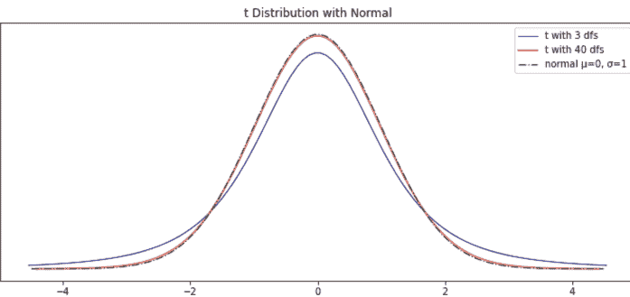

**图 4-3 某些 t 分布与标准正态分布的对比**

### t 检验

t 检验是一类基于 t 分布的经典统计检验。它在各种情况下都非常有用，数据集通常较小，但并非强制要求。该分布和检验由健力士（Guinness）的一位统计学家开发，并以 Student 之名发表，因为当时公司不希望人们知道他们在使用统计学（现在公司如此热提 AI 和机器学习这些术语，这真奇的），所以这种分布有时被称为 Student's t 分布。

Z 检验和 t 检验通常并肩相随，在某些情况下你会选择其中一个而非另一个。首要问题是你是否拥有总体方差。如果没有，你就不能使用 Z 检验。如果你有，且至少有 30 个观测值，那么 Z 检验是最好的。否则，请使用 t 检验。

## 第 4 章 得出复杂的结论：推断统计学与统计检验

### 单样本检验 (One-Sample Test)

单样本 t 检验用于测试样本均值在统计显著水平上是否与已知的总体均值不同。它依赖于 t 分布，该分布就是标准正态分布，因此其均值为 0，标准差为 1。Z 检验与下一节讨论的 t 检验相似，但 Z 检验用于较大的样本量（30 或更多），并且需要总体标准差。

运行 Z 检验的过程涉及计算 Z 统计量，由于我们在这里处理的是标准正态分布，Z 统计量等同于 Z 分数（记住第 3 章提到的，它是给定值偏离均值的标准差倍数）。

### 独立样本检验 (Independent-Sample Test)

独立样本 t 检验用于测试两个独立组的均值是否不同。它依赖于 t 分布，该分布就是标准正态分布，因此其均值为 0，标准差为 1。Z 检验与下一节讨论的 t 检验相似，但 Z 检验用于较大的样本量（30 或更多），并且需要总体标准差。

如果你拥有总体方差。如果没有，你就不能使用 Z 检验。如果你有，且至少有 30 个观测值，那么 Z 检验是最好的。否则，请使用 t 检验。

### 配对样本检验 (Paired-Sample Test)

配对样本 t 检验用于测试两个相关样本的均值是否不同。它依赖于 t 分布，该分布就是标准正态分布，因此其均值为 0，标准差为 1。Z 检验与下一节讨论的 t 检验相似，但 Z 检验用于较大的样本量（30 或更多），并且需要总体标准差。

## 第 4 章 得出复杂的结论：推断统计学与统计检验

### 方差分析 (ANOVA)

方差分析（ANOVA）用于测试三个或更多组的均值是否相互不同。它依赖于 F 分布，该分布由两个不同的自由度定义。F 统计量是组间方差与组内方差之比。


## 第 4 章 复杂的结论：推断统计学与统计检验

**表 4-2.** 对两个不同因素进行方差分析（ANOVA）的组别

| 组 | 因素 1 水平 | 因素 2 水平 |
| :--- | :--- | :--- |
| 1 | 1 | 1 |
| 2 | 1 | 2 |
| 3 | 2 | 1 |
| 4 | 2 | 2 |

### 单因素 ANOVA

与其他方法一样，ANOVA 有几种不同的形式。*单因素 ANOVA 涉及对单个独立变量（因素）的测试。* 如果该变量只有两个水平，那么它等同于 t 检验。在这种测试中，我们寻找组间和组内的变异性。

这种类型 ANOVA 的研究的一个示例是，我们可以观察屏幕时间对十岁孩子注意力能力的影响。注意力程度通过他们专注于某特定任务的分钟数来衡量。每天屏幕时间可以三个水平：没有、一小时和两小时。三个组各有十个孩子（每个组对应一个水平），我们想知道这三组之间的平均注意力时间是否存在差异。

## 多因素 ANOVA

在现实世界中，研究单一因素相当少见。组织一项研究的精力投入很大，以至于似乎同时考虑几个因素是值得的。这种做法需要谨慎的原因有：这两个因素之间可能会相互作用并损害研究，而且测试过多事物可能会导致虚假结果（参见“测试局限与显著性”章节），但运行包含几个因素的 ANOVA 仍然比只运行一个因素更常见。在设计研究时（或考虑是否可以在现有数据上运行 ANOVA），获取足够样本以补偿所有不同的因素组合。。多因素 ANOVA 就是涉及两个或多个因素的 ANOVA 测试。

双因素 ANOVA 只是涉及两个具有多个水平的不同因素的特定情况。表 4-2 显示两个因素之间不同相互作用的数量（四种）。如果我们对孩子注意力的研究增加一个数值补充（两个水平为：提供补充和不提供补充），我们就能进行双因素 ANOVA。

三个因素的多因素 ANOVA 有更多的相互作用，因为三个因素都必须测试其相互作用效应，加上三个因素的共同相互作用。每组需要更大的样本量。如果注意力研究中的某些孩子患有 ADHD（多动症），我们可以将其作为第三个因素，并能够进行三因素 ANOVA。

显然，这可以增加到更多因素，但你研究的因素越多，看到虚假结果的可能性就越大。

## ANCOVA

另一个相关的测试是协方差分析（ANCOVA），这是一种统计方法，通过使用协变量扩展多因素 ANOVA——协变量是已知对结果变量有影响但不是研究首要因素的等间隔预测变量。它被认为是 ANOVA 和回归的结合，我们将在第 15 章中介绍。关于其使用场景的示例，在孩子注意力的研究中，如果我们加入不同年龄的孩子，我们会假设孩子的年龄会影响他们的注意力能力——年大的孩子应该比年幼的孩子更容易。在这种情况下，年龄因素被称为协变量。

## 非参数检验

统计学长期以来依赖分布来理解和检验显著性。特别是正态分布起着很大作用，因为许多测试都需要满足正态性假设。许多进行统计分析的人在做假设时非常草率，在从未测试过这些内容的情况下，就假设数据满足正态性或其他要求并运行测试。这在操作上很容易做到，但是不负责任的，并且可能导致无效的结果。

解决这些假设问题的解决方案之一——无论是我们不知道数据是否符合要求，还是我们知道它不符合——是非参数检验。非参数检验只是那些不需要许多基于分布的测试所要求的全部假设的测试。这类检验有很多，其中一些允许我们测试正态性等内容。另一些允许我们对非连续性结果变量进行测试。我们不会详细介绍其中任何一种，但了解有哪些可用工具是非常重要的。

本节将介绍我们的第一类分类测试、大多数卡方检验，以及其他适用于数值数据的测试。我们再次计算测试统计量并据此确定显著性，从而指导我们做出拒绝或不拒绝零假设的决策。

## 分类测试

有几种非参数检验用于更好地理解分类变量，特别是为了确定行为是否与预期有所不同。最著名的分类测试是卡方检验。卡方检验有几种不同的，但我们将在本节中讨论皮尔逊卡方检验，以及另外两种：用于配对的 McNemar 检验和费雪尔精确检验。即使是皮尔逊卡方检验，也有几种不同的类型：独立性卡方检验，用于测试研究中的两个变量是否相互独立；比例相等性卡方检验，用于测试从多个不同总体中抽取的样本的选定变量分布是否相同；拟合优度卡方检验，用于测试特定的分类变量是否遵循已知分布。这通常是一个均匀分布，意味着我们在所有组合中看到相等的比例。

### 拟合优度卡方检验

我们通常想知道一个变量是否遵循已知分布（或不那么严谨的分布），这种测试让我们检查这一点。通过拟合优度卡方检验，我们观察频率以查看观察频率是否与我们预期的一致。我们可能会观察大学生的阅读习惯，看看这是否符合假设的分布。这仍然属于分类数据，所以我们可能有这样的比例：55% 的完成了一本书，25% 的完成了两本，15% 的完成了三本，5% 的完成了三本或更多。

### 独立性卡方检验

在独立性卡方检验中，我们想知道两个分类变量是否独立。零假设是它们是独立的，因此拒绝零假设意味着它们可能相互依赖。想象一项研究观察是否有工作会影响高中中生的毕业能力。我们将拥有四种可能组合（无工作/毕业、无工作/未毕业、有工作/毕业、有工作/未毕业）的学生计数。为了观察这一点，我们首先根据每列和每行的总和计算每个单元格的期望值。这次我们处理列联表，将一个变量的值放在顶部，第二个变量的值放在侧边。在我们的示例中，它看起来像表 4-3。我们将加上计数以及列和行合计来计算统计量。

**表 4-3.** 独立性卡方检验中的列联表设置

| | 毕业 | 未毕业 |
| :--- | --- | --- |
| 有工作 | | |
| 无工作 | | |

### McNemar 卡方检验

另一种放宽了卡方检验中独立性要求的卡方风格检验是用于配对的 McNemar 检验，它观察配对样本数据以查看变量的特定值在两次配对测量之间发生变化。当观测值不独立时，这种测试特别有用，因为它查看的是对内部的变化。例如，如果一所大学要求大二学生参加社会正义问题的研讨会，他们可能想衡量学生对几个问题的意见在参加研讨会后发生的变化。他们会在课程开始时测量，然后在他们上三时再次测量，以看看是否长期改变了他们的观点。为了获得每个问题的统计量，他们将创建一个类似于独立性卡方检验的列联表，但统计量的计算方法不同。


### 费舍尔精确检验

费舍尔精确检验与卡方检验相似，但不需要满足相同的假设。它实际上与一种分布（即超几何分布）有关，但在其他方面比卡方检验更不严格。费舍尔精确检验衡量的是研究结果与观察结果同样极端或更极端的概率。例如，在一项关于工作是否会影响高中毕业率的研究中，该检验将通过说明给定未毕业人数达到该值或更高值的概率，来确定有工作的人未毕业风险是否更高。

## 数值检验

针对数值数据的不同情况有许多检验方法。这些方法允许序数数据。其中几种方法使用了数据的秩。

# 威尔科克森秩检验

用于独立数据的威尔科克森秩检验适用于理解两个通常（但并不一定）等大小的序数数据样本，这些数据是无法被视为比例或间距的数值数据。实际上有两个相关的检验。第一个是威尔科克森秩和检验，也称为曼-惠特尼检验，它涉及对每个样本进行排序，并以一种考虑了并列的方式对其进行排名。这些秩可以相加，从而允许我们计算 U 统计量并进行显著性检验。

威尔科克森符号秩检验观察成对观测值的大小和方向差异，以告诉我们两个样本是否存在差异。统计量的计算方法是首先取每对之间的差值，然后将符号的倍数（根据值低于或高于平均值取 -1 或 +1）相和，然后就可以计算显著性并决定是否拒绝零假设。

# 第 4 章：得出复杂的结论：推断统计学与统计检验

符号检验是威尔科克森符号秩检验的变体，它不需要成对观测值之间的幅度（特别是当幅度不是非常可靠时）。它可以用于具有二元结果变量的数据，并测试样本是否具有假设的中位值。它使用二项分布来计算在零假设（即总体中位数为指定的值）成立的情况下，给定结果出现的概率。

# 克鲁斯卡尔沃尔is检验

克鲁斯卡尔-沃尔is检验类似于单因素方差分析（ANOVA），检查多个样本的中位数是否相同。它非常方便，因为它不要求样本大小相同，并且适用于小样本。它对离群值也不敏感。此外，它与威尔科克森检验相似，因为它也处理秩。统计量可以使用包含每个样本量、该样本秩和以及合并样本量的公式来计算。

# 柯尔莫哥夫-斯米尔诺夫检验

柯尔莫哥夫-斯米尔诺夫检验是第3 章“正态性检验”部分提到的重要检验。它可以测试一个样本是否来自特定分布，或者两个样本是否来自同一个分布。单样本选项涉及对观测值排序，并获取样本中低于每个观测值的观测值比例（这被称为经验分布）。然后将其绘制并与我们要检查的分布进行比较。在双样本版本中，我们比较的是两个经验分布，而不是一个与理论分布。

# 弗里德曼检验

当存在两个以上的匹配样本时，可以使用弗里德曼检验检测重复测量之间的差异。它也使用了秩，统计量可以使用样本量、每个受体的测量次数以及每轮测量的秩和来计算。

# 选择正确的统计检验

统计检验非常多，我们只查看了最常见的。根据你正在的工作，你可能会发现需要一种完全不同的检验。但我们涵盖的内容将为你提供一个良好的开始。请参见表 4-4 假设正态性的参数检验总结，以及表 4-5 非参数检验总结。那么，你如何决定使用什么检验呢？

# 第 4 章：得出复杂的结论：推断统计学与统计检验

# 表 4-4. 参数检验总结

| | 数据类型 | 与什么分布比较 | 检测内容 | 样本数量 | 配对/独立 | 最小样本量 | 假设正态性 | 假设方差齐 | 假设样本量 | 总体均值 | 总体方差 | 样本均值 | 样本方差 | 自由度 |
|---|---|---|---|---|---|---|---|---|---|---|---|---|---|
|| 检验 | 均值的单样本 Z 检验 | 数值均值和假设的总体均值 | 否 | 1 | 否 | 30 | 是 | 否 | 否 | 是 | 是 | 否 | 否 | 是 |
| | | 均值的双样本 Z 检验 | 数值方差 | 否 | 2 | 独立 | 30 | 是 | 否 | 是 | 是 | 是 | 否 | 否 | 是 |
| t 检验 | 单样本 t 检验 - 方差齐 | 数值均值和假设的总体均值 | 否 | 1 | 否 | 小样本+ | 是 | 否 | 是 | 是 | 是 | 是 | 是 | 是 |
| | 独立样本 t 检验 - 方差异 | 数值方差 | 两个样本均值 | 否 | 2 | 独立 | 小样本+ | 是 | 否 | 是 | 是 | 是 | 是 | 是 | 是 |
| | 配对 t 检验 | 数值均值 | 两个配对样本均值 | 否 | 2 | 配对 | 小样本+ | 是 | 否 | 是 | 是 | 是 | 是 | 是 | 是 |
| | Welch t 检验 | 数值方差 | 两个样本均值 | 否 | 2 | 独立 | 小样本+ | 是 | 否 | 是 | 是 | 是 | 是 | 是 | 是 |
| ANOVA | 单因素方差分析 | 数值方差 | 单样本均值 | 否 | 1 | 否 | 小样本+ | 是 | 否 | 是 | 是 | 是 | 是 | 是 | 是 |
| | 因素方差分析 | 数值方差 | 多个样本均值 | 否 | 2 | 独立 | 小样本+ | 是 | 否 | 是 | 是 | 是 | 是 | 是 | 是 |
| | 协差分析 (ANCOVA) | 数值方差 | 多个样本均值 | 否 | 2 | 独立 | 小样本+ | 是 | 否 | 是 | 是 | 是 | 是 | 是 | 是 |

# 第 4 章：得出复杂的结论：推断统计学与统计检验

# 表 4-5. 非参数检验总结

| 分类 | 数据类型 | 分类 | 与分布比较 | 差异检测 | 样本数量 | 配对/独立 | 样本量 |
|---|---|---|---|---|---|---|---|
| 卡方拟合优检验 | 分类 | 选择 | 组别的比例是否 | 1 | 否 | 大样本 | |
| 独立性卡方检验 | 否 | 两个变量是否符合预期 | 2 | 独立 | 大样本 | |
| 配对样本曼-惠特尼检验 | 否 | 干预是否改变了组别的结果 | 2 | | 10+ | |
| 费舍尔精确检验 | 否 | 干预是否改变了变量 | 2 | 独立 | 小样本 | |
| 威尔科克森秩和检验 (曼-惠特尼检验) | 序数 & 数字 | 选择 | 样本是否来自同一分布 | 2 | 独立 | 小样本 | |
| 威尔科克森符号秩检验 | 序数 & 数字 | 否 | 干预是否改变了样本间的差异 | 2 | | 小样本 | |
| 符号检验 | 序数 & 数字 | 否 | 干预是否改变了差异 | | | | |
| 克鲁斯卡尔-沃尔检验 | 序数 & 数字 | 选择 | 两个样本是否来自同一分布 | 1 | 否 | 5+ | |
| 柯尔莫哥夫-斯米尔诺夫检验 - 单样本 | 序数 & 数字 | 否 | 两个样本是否来自同一分布 | 1 | 否 | 50+ | |
| 柯尔莫哥夫-斯米尔诺夫检验 - 双样本 | 序数 & 数字 | 否 | 多个样本之间是否存在差异 | 2 | 独立 | 50+ | |
| 弗里德曼检验 | 序数 & 数字 | 否 | | 3 | 独立 | 5+ | |


# 第 4 章得出复杂的结论：推断统计学与统计检验

请注意，你可能需要进行一些检验以查看你的数据是否符合所需的假设。

在统计学中决定使用哪些检验起初可能很困难，但随着练习会变得容易。每当你考虑某项检验时，你可能需要花一些时间研究它以了解更多关于它的信息。但总有一天，你的直觉会让这一切变得简单。

## 检验的局限性与显著性

统计检验方面，我们需要记住的一个重要最终考虑因素是：每当我们运行测试寻找显著性发现时，我们都面临着遇到第一类错误（Type I error）的风险。一次性测试很多事情是非常诱人的，尤其是当我们并不真正知道什么可能是重要的时候。例如，记住 p 值 0.05 的含义——基本上在 20 次中会有 1 次（ 100 次中的 5 次），我们可能会看到一个看似显著的结果，但它实际上并不显著，只是由于偶然产生的。

如果我们有十个没有真实影响的预测变量，并对它们每一个都运行测试，可能至少会有一个变量显示为显著，尽管它并非如此。我们可以计算在十个没有影响的变量中有一个测试呈阳性的概率。基本上，在 0.05 的显著性水平下，这意味着一个不显著变量有 0.95 的概率被正确测试为不显著，但有 0.05 的概率被错误标记为显著。所有不显著变量测试都准确测试为不显著的概率为 0.95¹⁰，0.60。仅测试了十个变量——这个数字看起来并不太疯狂——就有 40%（1–0.60）的概率至少有一个会被错误地测试为显著。如果我们变量的数量增加到 20 个，那么至少有一个变量显示为错误显著的概率实际上大于不概率（0.95²⁰=0.36，因此有 64% 的概率）。

这就是为什么有些人提倡使用 0.01 等 p 值，或者查看 p 值之外的其他数字。但即使在 0.01 的水平下，如果我们测试两个不显著变量，其中至少一个显示为显著的概率也是 10%，如果测试两个则为 18%。因此，它并没有解决问题，但确实降低了其出现的概率。还有一种名为波费罗尼校正（Bonferroni correction）的技术，它通过根据测试次数调整 p 值阈值来减少第一类错误（假阳性）的概率。

这是为什么重复研究对于理解事物如此重要的另一个原因。如果我们在研究中仅以 0.05 的显著性水平测试一个变量，即使该变量实际上没有影响，该测试仍有 5% 的概率产生显著结果。但如果其他人在另一项研究中测试相同的内容，他们也发现该变量显著的概率也是 5%，但这些事情发生的概率仅为 0.25%（0.05 * 0.05），明显低得多。

## 相关性与协方差

大多数人都听过“相关性不代表因果关系”的警告，即使他们并不确切知道这意味着。作为一个概念，相关性仅仅是两个变量之间关系强度和方向的衡量。在正相关中，当一个变量增加时，另一个也之增加。在负相关中，变量之间是反相关的——当一个增加时，另一个减少。儿童身高和体重相互正相关，且都与年龄相关，而孩子所需的睡眠量与年龄呈负相关。

协方差是一个与相关性类似的概念，也指定两个变量之间的关系，它们之间的区别基本上在于它们可能取值的范围以及它们的计算方式，我们将在下文中看到。

数据分析师和科学家的工作是根据数据解释事物为什么发生。


# 第4章 走向复杂的结论：推断统计学与统计检验

## 协差

协差在概念上与相关性相似，但相关性始终处于 -1 到 1 之间，而协差取决于所比较的两个变量的尺度。计算协差意味着将两个变量均值的差相乘，并对每个数据点求和，最后除以自由度。

以与相关性相同的方式显示协差矩阵也很常见，但数字会不同，有些差异很大。表 4-7 显示了对相同的患病儿童数据进行协差计算的结果。

**表 4-7.** 患病儿童年龄、身高体重的协差矩阵

| 年龄（年） | 身高（英寸） | 体重（公斤） |
| :--- | :--- | :--- |
| 年龄（年） | 14.692915 | 25.910734 | 60.605008 |
| 身高（英寸） | 25.910734 | 55.086591 | 125.204444 |
| 体重（公斤） | 60.605008 | 125.204445 | 503.446999 |

我们可以看到，这些数字并不像相关性那样限于 -1 到 1 之间，而且要真正理解它们的含义更为困难。协差并不经常直接被，更多地用于其他计算，如我们上面看到的协方差分析（ANCOVA）。相关性更直观。

## 相关性与因果关系

让我们重新回顾“相关性不是因果关系”这句格言。这句话的观点是，你不能假设一个变量的变化会导致另一个变量的变化。有时候事情看起来似乎是有相关的，但纯粹是巧合。有一个名为“虚假相关”（Spurious Correlations）的博客发现了一些有趣的数据之间存在相关性。例如，1985 年到 2020 年间“Thomas”这个名字的流行程度与缅因州汽车盗窃的数量几乎完美相关，如图 4-6 所示。

### 名字 Thomas 的流行程度与缅因州的机动车盗窃案相关

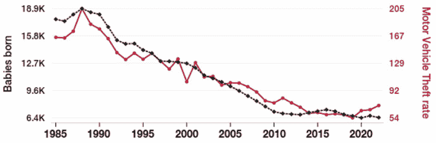

- 美国出生的所有性别婴儿都被命名为 Thomas - 来源：美国社会保障局
- 缅因州每 10 万居民的机动车盗窃率 - 来源：FBI 刑事司法信息服务

1985-2022, r=0.979, r²=0.959, p<0.01 · tylervigen.com/spurious/correlation/1882

**图 4-6.** 两个无关变量之间的虚假相关。版权所有：Tyler Vigen。经许可使用。来源：https://kylervigen.com/spurious/correlation/1882_popularity-of-the-first-name-thomas_correlates-with_motor-vehicle-thefts-in-maine

认为这些者之间有联系是非常具有诱惑力的，因为它们在图表的顶部和底部甚至是水平齐的，但常识告诉我们这不可能。但如果我们自己做了研究，并且在研究中观察两个我们非常希望具有因果关系的变量，我们可能会倾向于假设它们是真实相关的。在观察相关性时，保持谨慎和怀疑的态度至关重要。做好良好的统计意味着绝不早下结论，特别是不要因为你想相信某件事就相信它。数据分析师和数据科学家在声称存在趋势或效应之前，必须具备确保事实的心理。

## 核心要点与后续展望

统计学在某种程度上被应用于每一个领域，但风格和视角在不同领域之间差异巨大。心理学家做的事情与计算生物学家不同。数据科学的执行方式也没有一种统一的方法，因为数据科学技术可以应用于许多领域。数据科学家处理大量由计算机生成或各种类型的交易产生的数据，从零售购买到广告响应，从银行欺诈检测到计算机系统监控。数据科学家像心理学家那样频繁与人类直接打交道并不常见。但由于数据科学实际上可以应用于几乎任何事物，而且统计学的不同方面可能被不同的领域使用，本章和前两章稍微后退了一步，从整体上审视统计学，而不只是数据科学家最常用的部分。

本章重点关注统计学的推断侧面——基本上是试图从样本推广到整个总体。这是通过依赖概率分布的统计检验完成的，我们在上一章中涵盖了其中许多分布。在统计检验的语境下，有几个显著性统计量和其他其他方面需要被理解。我们讨论了针对连续数据和分类数据的检验，其中许多假设总体服从正态分布，以及一些不假设正态性的非参数检验。然后引入了相关性和协差。

下一章将最后深入探讨书中到目前为止我们讨论的理念的应用。第 5 章将讨论数据分析。即使数据科学家可能没有“数据分析师”的职位，他们极可能也会作为日常工作的一部分进行数据分析。该章将描述数据分析的起源。

### 从业者简介：SASWATI NEOGI

| | |
| :--- | :--- |
| **姓名** | Saswati Neogi |
| **当前职位** | 数据科学副总监 |
| **当前行业** | 零售 |
| **工作年限** | 15 年以上 |
| **教育背景** | - 应用统计学硕士<br>- 数学统计学硕士<br>- 统计学学士 |

### 背景

Saswati Neogi 简称为 Sas，出生在印度，数学方面一直表现出色。因此，她在本科阶段主修统计学并不令人意外，尽管她承认选择它部分原因是因为它不需要物理或化学。她热爱数学和统计学，并在俄亥俄州的阿克隆大学攻读数学统计学硕士学位，因为她知道这会让她在毕业后找工作更有优势。她非常喜欢在大学期间建模，并对它们被应用于现实情景感到兴奋。在最后一个学位期间，她学习了 SAS 和 R（当时行业广泛使用的两种统计编程语言），这使得她非常有竞争力。

### 工作

完成该学位后，她已经知道想从事数据科学工作。她热爱在学校的学习，并希望将其应用于现实世界，通过帮助公司改进业务产生影响。她能够运行预测来让生活变得更轻松或更准确吗？她可以通过自动化流程来消除耗时且容易出错的人工流程吗？有很多可能性。


## 第 4 章 得出结论：推断统计学与统计检验

### 核心观点

**工作中最喜欢的部分：** Sas 对工作最喜欢的事情是与其他团队和人员进行互动与交流、与聪明且有创意的人共事、编码并应用模型，以及使用指标测试模型的性能。

**工作中最不喜欢的部分：** 她不喜欢杂乱的数据，而且并不总是能获得构建良好模型所需的所有数据。此外，有时你的利益相关者并不完全接纳，他们可能会有不合理的期望，或者不愿应用你的模型。

**最喜欢的项目：** 公司曾支付给一家昂贵的咨询公司来建立一个模型，预测商店特定商品的销售情况。当她的团队发现这一点后，他们在几周内就建立了一个准确率超过顾问公司的模型，并被交给了该项目后续的所有权。

**教育与现实世界的联系：** 你可能只会用到在大学中学到的一小部分知识，但在学校学习新事物的经验将帮助你了解如何在现实世界中学习新事物。提升数据科学技能的能力非常重要。

- 沟通、机器学习模型、编码和可视化（作为数据科学家）
- 项目管理和沟通（作为数据科学家经理）

**目前使用的主要工具：** SQL、Python、R、Snowflake、其他云工具 (AWS、Sagemaker、DataBricks、EMR (AWS PySpark))

**数据科学的未来：** 超数据科学、AI、ML 在未来将会褪色——AI 和 ML 一直被认为是能解决所有问题的热词，但它们有利不利，认为它们能解决所有问题是不现实的。始终需要经验来判断在特定的空间内，利用可用的数据和技术可以应用什么。

## 第 4 章 得出结论：推断统计学与统计检验

**什么造就优秀的数据科学家：** 技术技能、良好的编码能力、沟通以及合作的态度（没有人无所不知，所以不同的人有不同的专长，你将与他们合作来补充你自己的技能）。具备团队精神至关重要。

**对准任数据科学家的建议：** 不要太习惯学校里那种整洁的数据和已完成的研究项目——它们能帮助你磨练技能，但不能反映现实（在现实世界中，大量时间花在了清理和理解数据上）。

> Sas 在担任统计师、数据科学家和经理工作近 20 年后，是数据科学领域的领导者。

## 第 5 章

### 弄清问题：数据分析

在之前的章节中，我们讨论了数据分析中最基础的东西——数据本身，以及统计学，统计学是数据科学中其他一切的基础。显然，没有数据你无法在数据科学中做任何事情。但你不能仅仅拿一些原始数据就此从中提取出迷人的见解或预测。在数据产生有价值的信息之前，有很多步骤需要执行。事实上，数据有许多探索方式，而数据分析领域致力于理解和处理数据。数据分析主要涉及在良好的工具中对数据进行切片和处理，并用分析工具从中提取含义。这些工具包括编程语言、电子表格以及我们在前三个章节中涵盖的统计学技术，特别是图表和其他可视化。通常数据分析师侧重于描述性统计，但也有人会深入更高级的统计学。数据分析师已经存在很长时间了，他们观察过去发生了什么，解释其含义，有时利用这些信息帮助我们理解世界并预测未来。

这听起来非常像数据科学能做的事，这并非巧合。很难说数据分析在哪里结束，数据科学从哪里开始。我认为两者处于一个有大量重叠的连续体中。几乎每个数据科学项目都涉及数据分析，尤其是在初期。大多数数据分析师的工作并没有进入更高级的数据科学世界，但许多数据科学家一直在进行数据分析。事实上，为了成为一个优秀的数据科学家，你首先需要成为一个优秀的数据分析师。

“数据分析”是一个含义丰富的词汇，对商业世界的不同人有许多不同的含义，但最简单的定义是调查和分析数据的过程，以便更好地理解这些数据代表什么。我们将在第 7 章详细讨论，但“分析”这一通用标签分为四类：描述性、诊断性、预测性和指导性。正如你猜的那样，描述性基本上只是描述数据中的内容，而诊断性寻求通过研究数据来解释事情。这两者是数据分析的基础领域，而数据科学更多地关注后两种。

因此，数据分析工作可能涉及广泛的技术，如果你查看标题为“数据分析师”的职位招聘列表，你会发现所需的技能范围令人惊讶。在很多情况下，他们实际上是在寻找一个要求高级编程技能、机器学习等技能的数据科学家……他们试图通过使用另一个标签来避免支付数据科学家的薪水，或者（更有可能）他们不知道自己想要或需要什么。在其他情况下，他们正在寻找具有基础数学技能、知道或可以学习使用 Excel 的高中毕业生。大多数时候，这个头衔意味着中间某种程度。本章将关注这种“金发姑娘型”的数据分析师——他们通常被认为拥有大学学位以及其他几项技能，但在技术上没有典型的数据科学家那么。

第 5 章 弄清问题：数据分析

你可能会想，如果数据分析是一个独立的领域，为什么它会在关于数据科学的书中占有一章？正如我上面提到的，成为一个优秀的数据科学家意味着能够进行数据分析。头衔为数据分析师的人在可视化或其他方面可能比数据科学家更熟练，但在任何数据科学项目的初期，良好的数据分析对项目的成功至关重要。这是由于数据科学的一个基本事实：如果你不理解它，就无法进行良好的数据科学。数据分析有一套带来理解的方法。

# 数据分析的历史

数据分析已经存在很长时间了，基本上和数据本身一样久。数据的整个意义通常是为了更好地理解它所代表的内容，而这正是数据分析帮助你做的事情。古代苏米尔和埃及人进行的分析类型相比于我们现在的做法要极其简单，但它仍然非常重要。图 5-1 显示了一块大约公元前2500 年的古代苏美尔板上的账目。这显示了大麦、面粉、面包和啤酒的数量。


**图 5-1.** 公元前2500年左右的古苏美尔泥板，记录了多种商品（大麦、面粉、面包和啤酒）的数量。来源：苏美尔经济泥板 IAM $1005.jpg，https://commons.wikimedia.org/wiki/File:Sumerian_economic_tablet_IAM_%C5%A01005.jpg**

虽然数据的基本处理已经持续了很久，但数据分析作为一个现代领域，直到 17 世纪才真正迈出了它的第一步，并且直到 20 世纪才真正学会如何运作。数据分析的许多重要工作都是通过可视化的方式，来帮助人们更好地理解数据和状况。19 世纪出现过了一些非常酷炫的可视化方法（尤其是地图和图表），我们将在书的后面部分看到，下方的示例展示了一个简单的原始可视化案例（图 5-2）。书中后面有一整章专门讨论可视化。

## 第五章 弄清楚问题：数据分析

接下来我将谈论计算机以及它是如何彻底改变数据分析的，在我们理解如何操作之前，也值得看看数据分析能做什么。我将分享几个真实世界中数据分析工作的案例。其中一个是近期的，另一个则是 150 多年前的，但直到今天仍然令人印象深刻。

## 计算机的出现

在早期，分析总是针对相当少量的数据进行的。对于人们来说，把所有信息记在脑子里可能太了，这就是为什么可视化是有用的，但当时仍然可以手动完成极少量的计算。数据量大到让人难以负担是有明确限制的。我们在之前的统计学章节中看到了这一点，30 个的样本量已经“足够大”，大到可以使用要求更高的 Z 检验而非 t 检验了。30 个数据点对于现代数据科学家来说听起来很可笑，但随着计算机的出现，情况发生了变化。

计算机改变了许多，数据也不例外。它在数据分析中实现的最大变化是查看大量数据的能力。这并不一定意味着“大数据”（我们在第 1 章中提到并在稍后会回顾的术语），它仅仅意味着不再需要对所有内容都进行手工计算，因此我们可以使用更多的数据。早期的数据分析通常涉及收集数据点并通过简单的统计技术进行处理，可能最初是从在纸上字面上地将数字相加或后来使用简单的计算器开始。以这种方式处理成百上千个数据点会变得难以进行，随着数据的增长，这些计算很快就变得无法实现。

## 第五章 弄清楚问题：数据分析

## 美国人口口查制表机

到 19 世纪的最后几十年，美国人口口查变得非常复杂。人工清点人数太贵了，而且容易出错。人们发明了一种机器来加速 1870 年美国人口口查的进程，但它在很大程度上仍然是手动工作。1880 年的人口口查如此困难且耗时，以至于直到 1887 年才完成。他们需要不同的方法。出现的第一个解决方案被称为“制表机”，这种机器的变体一直使用到 1940 年，之后，人口普查局终于转向了正式的计算机。

对于普通人来说，这一转变的主要标志是统计和分析工具的出现，这些工具允许人们对手动工作难以处理的大型数据集进行自己的分析。最早的工具之一是名为 SAS 的产品，一些统计学家仍在使用它，特别是在保险行业。它是一种带有自定义专有界面的编程语言。它最早开发于 20 世纪 60 年代后期，并且仍在进化。另一个早期产品是 SPSS，它在学术界被广泛使用。到 20 世纪 70 代，许多统计工作是在那个时代的流行通用编程语言之一 FORTRAN 中完成的，但这对于技术性不强的统计学家来说很难。S 编程语言的出现是为了应对这一点，它被设计为直接操作 FORTRAN 的替代方案。人们开始使用它，随后在 20 世纪 80 年代后期推出了名为 S-PLUS 的 S 版本。总的来说，S 已经被 R 取代，R 是一种基于 S 的、最初在 20 世纪 90 年代初开发的现代开源免费统计语言。现如今，统计学家、数据科学家和一些数据分析师正在使用 R，尽管大多数数据科学家正在转向 Python，Python 是一种通用的编程语言，拥有许多统计库，通常因为其易用性和性能被认为比 R 更好。

除了 R 和 Python 之外，上述提到的产品都是专有的，因此它们非常昂贵，大多数个人无法触及。随着人们转向开源的 R 或 Python，专有工具正逐渐失宠。让专有工具得以存在原因有几点：它们包含了有保障的安全性和合规性（这在许多行业中至关重要），以及使用这些语言或工具编写代码的公司必须在所选的开源语言中重写一切。这是昂贵、耗时的，且并非没有风险的（人可能会意外引入新的漏洞），所以这些工具被遗弃可能还需要很长时间，如果它们真的会被遗弃的话。组织有时坚持使用专有软件的另一个原因是他们付了费，他们有权获得客户支持，还可以影响软件未来的开发。任何一直使用某些不符合预期的代码的人都能理解这种价值，即可以拿起电话寻求帮助，而不是去 Stack Overflow（互联网上最好的技术问题解答平台）求助。

## 真实世界中的数据分析案例

数据分析无处不在，但我选择了两个有趣且不同的案例。第一个是关于棒球进入数据时代，另一个是关于公共健康的胜利。

## 案例 1：点球 (Moneyball)

几十年来，美国棒球团队由拥有“直觉”的球探员组成，他们通过口头传在的高中和大学寻找年轻球员。当时存在一种传统，即根据直觉并结合传统数据（如打击率、全垒打和打分数 RBI）来考虑这些年轻人的潜力。

20 世纪 90 年代中期，奥克兰兰人队的队主去世了。他一直以一种慈善的心态资助昂贵的球员，但新任老板更加务实，不想在球队上花那么多钱。结果是，最昂贵的——也就是最好的——球员离开了去更好的地方。球队不再赢得比赛，没有人喜欢这样。


在慈善时代，再次出现了以极廉的价格获得远超价值的团队。例如，预算型球队在2002年连续赢得了20场比赛，打破了美国大联盟的记录。

棒球界的其他球队注意到了这一点，很快，其他拥有大量预算的球队也能够建立起自己的阵容。《点球球》（Moneyball）被广泛认为彻底改变了这项运动，而且现在仍然处于一种军备竞赛的状态，每支球队都在试图寻找新的方式使用数据，以获得另一个微小的优势。现在，以这种方式研究玩家统计被认为是一种风险。

## 示例 2：1854年平定伦敦的霍乱

我们回到伦敦，回顾数据分析解决现实问题最著名的案例之一：约翰·斯诺（John Snow）在1854年席卷伦敦的霍乱流行期间的工作。在当时，人们并不理解疾病是如何传播的，因为那时还不存在细菌的概念。相反，人们认为“浊气”是疾病人与人之间传播的普遍原因。斯诺在许多方面都领先于时代，甚至通过推广在手术中使用氯仿醚作为首种麻醉剂彻底改变了医学。但他对数据分析的主要贡献发生于1854年疫情期间绘制的一张伦敦地图，并在每个家庭位置添加了一个代表每个霍乱死亡人数的条形图。从这个视角可以清楚地看到病例集中在哪里，并据此，他确定了宽街（Broad Street）上的一个水泵是源头，因为大多数受害者都是从这个水泵取水的。你可以在图5-2中看到斯诺使用的地图放大视图，重点是宽街水泵周围的区域。令人惊讶的是，他说服当局立即封锁了那个水泵，疫情很快平息了。

## 第五章 弄清楚：数据分析


在地图上，所有深色的黑色标记都是表示受害者的小条。有些是分散的，但从这张地图上很明显看出，宽街的某些地方让人们暴露在疾病中。宽街紧挨着标有“PUMP（水泵）”的地方有一大堆死亡记录。住在那里的人从那个水泵取水。这就是我们所说的领域知识（基本上是关于世界信息来源的知识），它让斯诺得出结论：是水泵，而不是某种原因盘旋在该地区上方的一团“浊气”。斯诺是一位医生也是科学家，即使细菌理论在若干年后才会建立，专家们对“浊气理论”也存在怀疑。斯诺考虑了该地区居民的日常生活，意识到他们都会取水，所以这是一个潜在的源头。当他们关闭宽街水泵时，没有人确定疫情是否会停止。但它确实停止了，这种“水可以携带疾病”的认知增加了科学家对疾病及其传播方式的理解。

## 数据分析师的基本技能

我简要提到过数据分析涉及的内容。数据分析师必须具备某些技能和属性才能成功。虽然有些人对数据分析有天赋的天赋，但只要他们保持开放的心态，培养数据思维，并努力我在本节中将介绍的技能，这是一个大多数人都可以学习并精通的领域。一个优秀的数据分析师需要一系列技能——功能性、技术性和软性技能。此外，领域知识对于进行数据分析至关重要。我们下面介绍主要的技能。

## 功能性技能

功能性技能属于较高层次，能帮助你决定如何解决问题。它们涉及天赋属性，以及在科学和数学等课程中学习的高级思想和技能。最明显的功能性技能是逻辑和系统化的思维。你需要能够通过逻辑步骤推导出重要的结论，并能够为这些结论提供支持。其中一部分是要意识到自己的偏见，以免它们影响你的工作。虽然这在某种属于软性技能，但你需要能够听取他人的意见并理解他们的观点，即使这些观点与你的不同。与此相关的是组织能力和遵循流程的能力。所有数据分析师都需要良好的数学基础，某些职位还需要统计学知识。优秀的数据分析师还具有自然的创造力。你听过很多关于跳出思维或智力好奇心价值的说法，这确实如此，最令人兴奋的洞察来自那些以新方式看待事物的人。从事数据分析和数据科学的人经常提到的一个属性是“数据思维”——这基本上是指保持开放的心态，不急于下结论，理解数据是某些事物的表示，并尊重数据以任何形式呈现。

## 技术技能

虽然主要的技术技能取决于具体的职位，但所有数据分析师都需要对计算机有一定的熟悉程度，以便他们学习其职位所需的任何特定软件。至少需要对微软 Excel 和 Word（或 Google 的同等软件）有基本的了解，大多数数据分析师预计在 Excel 方面具有丰富的经验，包括许多更高级的功能，如透视表和 Vlookup。许多分析师可能需要理解他们将使用的数据库系统，并且通常被使用结构化查询语言（SQL）与这些数据库进行交互。虽然数据分析师不像数据科学家那样常见，但许多分析师也会进行计算机编程，通常使用 Python 或 R（这一趋势也在上升）。有时数据分析师在 Excel 工作中甚至会编写 VBA（应用程序 Visual Basic，一种嵌入微软 Office 产品中的编程语言）。

## 软性技能

除非你是在处理一个完全不与他人分享的孤立项目，否则软性技能也很重要。“软性技能”指的是为了完成工作而与他人互动所需的各种能力。这些技能中的大部分适用于任何工作，但有些是数据分析师和数据科学家工作特有的。

其中某些技能与特定技能的心态或态度有关。保持良好的适应性至关重要，因为数据分析项目期间经常发生变化。拥有成长思维，即理解你总是需要发展数据分析技能，是非常重要的。该领域不断变化，你必须跟上知识和技能的更新。此外，考虑到你的工作的影响有助于你确保行为符合伦理。

时间管理涵盖了一项重要的技能。你通常会同时处理多件事。你必须理解哪些任务是最重要的，并对每个任务所需的时间有一个大致的想法，这样当任务真正到期时，你就知道该做什么。优先级排序的能力在大多数工作中都是必要的。数据分析工作的一个方面是，有时你无法进行某项工作是因为你正在等待他人，或者卡在了必须完成才能进行下一步的步骤上（例如，你可能正在运行需要一小时的代码，没有结果你就无法继续该项目）。你需要能够同时处理多个项目。你需要理解你的每个任务是如何运作的，以便有效地进行优先级排序并为每个任务分配正确的时间以满足期限。

另一类软性技能涉及与各种类型的人沟通。通常，预计作为项目用户或受益者的所有人都被称为“利益相关者”。这包括技术人员（如深具技术背景的数据分析师）以及一旦提到“p值”这类术语大脑就会停机的非技术人员——以及两者之间的所有人。


## 第五章 理清思路：数据分析

这就是为什么数据分析师和科学家往往倾向于更简单、更具解释性的解决方案，而不是更复杂或复杂的解决方案的原因之一。这种策略将在本书后面进行讨论。

你与他人互动的常用方式之一是通过演示，因此能够创建一个易于理解的演示文是有价值的。沟通能力并不是单向的——能够倾听并接收反馈同样重要，这些反馈可能来自客户，也可能来自你的领导。遗憾的是，与客户和领导之间有时会产生冲突，你需要能够保持冷静并进行谈判，或者通过倾听来理解必要的内容，即使在你们可能意见不合的情况下如此。有时需要坚持你认为正确的事情，但另时候在当时保持沉默（有时是永久性的沉默）更为审慎。在某些环境中，得罪水手会招来麻烦并遭到报复，因此在违背常规而行时，你应该始终考虑自己的处境。

公司有时会有特定的文化来定义沟通风格——例如，某些公司可能希望避免冲突，通过避免直接表达来优先考虑人们的感受；而另一些则倾向于保持一切清晰透明，因此青睐直接沟通。在第一种情况下，知道如何在不伤害他人感受的同时传达信息是有价值的；而在后一种情况下，能够做到直接且清晰而不粗鲁是有价值的。事实上，研究发现，那些青睐直接沟通的组织并不回避冲突，但在尊重他人感受的同时寻找建设性的方法来解决冲突，它们往往更成功，但直接风格通常更为常见。

## 领域知识

数据分析的另一个重要领域被称为领域知识（Domain Knowledge），它基本上是指对你所处理的数据类型具备专业知识。我们将在第10章深入讨论，但现在请记住，领域知识被认为是数据科学的三大柱之一，在数据分析中也至关重要。它基本上是对特定“领域”的专业知识和实际理解，例如金融数据、游戏玩法数据、网站使用数据、医疗数据、零售数据等领域。通常，它意味着对这些领域内更具体类型的数据有深入了解。如果你对正在处理的数据没有良好的理解，你就无法进行良好的数据分析——或进行良好的科学研究。

## “免费”的领域知识

如果我们拿到一堆欧洲的数据风车，我们中的大多数人可能不知道从何开始。但很多时候，仅仅因为参与了那个世界，我们就知道一些事情。例如，大学生对关于学生、课程和讲师的数据会很熟悉。我们知道会有某门课程，比如 ENG 301《美国文学 1》。一个更具体的课程应该是出现在某个学期课程表上的。例如，《美国文学 1》第 002 节安排在 2022–2023 学年的秋季学期，周二和周四下午 3:30，由 Alex Thorne 担任教师，并最终有一份选课名单。通常，学生和讲师都会涉及多门课程，这些课程必须安排进时间表中以避免时间重叠等问题。这些事情对我们大多数人来说是显而易见的，但这就是领域知识的本质。当你拥有它时，你会觉得这些事情是自然而易见的，以至于你往往甚至没有意识到你所知道其实是真正的知识。这可以让你在正确类型的数据通往良好分析道路上走得更远。

领域知识必须从某处获得。在课程的例子中，它显然来自于生活体验。但很多时候，你并不会已经拥有它，而是需要开发它。这在商业世界尤为如此。有时你可以在网上或书籍中找到材料来学习你所需的知识，通常学习所需内容的唯一方法是找到一个已经拥有这些知识并能帮助你的人。这类人通常被称为*领域专家*（Subject Matter Experts，简称 SMEs）。确实，你有时可以通过纯观察数据来推断出某些结论，但你必须非常小心，并且始终向专家验证你的假设。

与领域专家合作的挑战之一是，他们往往并不知道自己知道什么。如果他们要描述一个流程或系统，他们可能会忽略掉步骤或假设，因为这些对他们来说是本能或直觉的，所以他们认为不值一提。例如，在上面的课程例子中，想象如果他们忘记提到讲师会教多门课程。如果你完全不熟悉课程安排是如何工作的，你可能会犯错，假设每位讲师只有一门课，或者假设一名讲师教授某门课程的所有班次。这似乎是不可能有人那样想，但没有中等或高等教育经验的人可能并。这类错误的假设在数据分析中可能是毁灭性的，会导致你走上完全错误的道路。

好的一点是领域知识通常在某种程度上是可以迁移的。如果你在一家公司的零售领域工作，你可能会去另一家零售商那里，发现自己并不是从零开始。

## CRISP-DM：数据分析流程

尽管数据分析项目都略有不同，但有一个通用的流程来管理此类项目。我们通常称之为数据分析生命周期。不同的数据分析师可能使用稍微不同的流程，但许多团队使用名为 CRISP-DM（数据挖掘交叉标准流程）的流程来进行数据分析和数据科学。它包含以下六步：

- 业务理解
- 数据理解
- 数据准备
- 探索分析与建模
- 验证与评估
- 可视化

尽管这些步骤看起来是线性的，但它们内部存在大量的迭代。我们并不是完成一个步骤就移动到下一步。图 5-3 显示了该过程具有怎样的迭代性。


## 业务理解

我们总是从业务理解开始，这意味着理解客户想要学习什么并定义你的研究问题。换句话说，他们试图解决什么业务问题？你将如何调查？例如，一支橄榄球队可能想知道交易哪些球员。这意味着你想查看某些指标。你必须与业务部门合作来识别并定义这些指标。这一步骤通常与下一步数据理解结合进行，在开始阶段你可能会发现自己在两者之间反复。与客户交谈以产生研究问题被称为需求收集，这是许多不同学科都会的工作。但这不仅仅是询问他们想要什么。如果你还没有领域知识，你将在这个过程中开始培养它。

## 数据理解

在良好理解客户在寻找什么之后，下一步是理解可用的数据。这也隐含包含了数据本身。大多数数据分析工作是由拥有现有数据源的团队完成的，因此你可能会访问这些常用来源。在识别用于问题的特定数据源之前，你需要泛泛知道需要什么数据来回答上一步中提出的研究问题。在我们的例子中，假设你和业务部门确定了要跟踪防守球员的四项数据：擒抱、擒杀、拦截和掉球。


# 第 5 章弄清楚问题：数据分析

在足球示例中，假设我们找到了一些包含每个球员拦截、抢断和失球次数的数据，但没有数据数据专门包含“擒擒数”（sacks，一种针对四分卫的特定拦截类型）。然而，你找到了另一个表格，其中包含带有时间戳的拦截记录，记录了被拦截的位置，但没有记录执行拦截的球员。你再次查看了原始的拦截数据，发现其中确实记录了一些时间。你得出结论，可能可以将这两个数据源对齐，但你不确定这是否可行，或者需要花费多少时间。这时，你就需要与业务利益相关者讨论——擒擒数这一数据有多重要，是否值得花时间去提取？在进入后续阶段之前，你不一定能回答这个问题，但先与利益相关者沟通是合适的。他们可能会直接告诉你，对于这个问题来说，擒擒数并没有那么重要。

请注意，与示例一样，你在这一阶段会处理数据，但在进行数据准备工作之前，你并不会真正深入挖掘。

## 数据准备

一旦你对业务需求有了足够的理解，并认为自己拥有了正确的数据，下一步就是数据准备，这一步可能会占据整个流程的很大比例。后面会有专门章节讨论这个主题，但数据准备涉及许多工作。它涵盖了清理杂乱文本字段（如末尾空格）、确保数值字段中的数据都在预期范围内、识别并处理缺失值或空值等方方面。我们将在第 13 章和第 14 章中详细介绍。

如果你所在的公司有数据工程师，他们提前为你准备好了良好、干净的数据，那么你太幸运了。在这种情况下，你可能可以跳过这一阶段的部分工作，但很可能仍需在这里做一些工作。

如果项目涉及任何建模，你还需要进行特征工程（feature engineering），即根据现有数据源创建新特征，以改进建模或分析。知道需要创建什么特征通常取决于下一步的发现，因此这两个步骤之间也会存在一些往返工作。在数据科学中，特征工程几乎是必须的，即使我们拥有数据工程团队提供的清洁数据；但在数据分析中这种需求并不常见。确定需要哪些特征本身就是一个过程，它基于数据的外貌以及它们将要用于什么技术。

值得提到的是，这一步与下一步（探索性分析和建模）之间可能会有大量的往返，因为你可能会在下一步中发现某些要求你进行额外数据准备或更改已完成工作的内容。

在我们的足球示例中，部分数据准备可能包括创建一个新表，包含所有球员名称的基本统计数据，并根据利益相关者确认的正确业务逻辑，将空值替换为 0。你还会确保将所有数值字段都保存为数值数据类型。你可能仍在思考是否能从两个数据源推导出擒擒数。你很可能还没有足够的知识来做到这一点，并将根据下一步的发现来确定这是否可行且必要。

## 探索性分析和建模

准备好数据后，就是时候开始做你一直想做的事情了：深入研究数据。探索性分析和建模通常是另一个大步骤。跨度有多大取决于挖掘得有多深。但正如提到的，在发现数据中的问题或小陷阱（gotchas，这些问题可能是你在该步骤进行粗略调查时遗掉的）之后，你可能需要反复几次回到数据准备步骤。在其他情况下，你甚至可能一直回到数据理解阶段。你可能会发现自己需要寻找全新的数据。这完全是正常的，并不意味着你做错了什么。

探索性数据分析（EDA）始终是“查看数据”的首要大步骤。这并不是一个在 Excel 中打开数据文件并随意查看的草率过程。探索性数据分析提供了一个以开放心态调查数据的框架。它不是一组必须全部遵循的僵化步骤，但它可以帮助你引导早期的分析。统计学家约翰·特克基（John Tukey）在 20 世纪 70 代命名了这一过程，数据分析师一直遵循他的指南。EDA 也可以被视为一种心态或态度。我们希望以一种清除了假设和预期的好奇心来面对数据观察，因为我们永远不知道会发现什么。

所以我们知道 EDA 非常重要且相对简单，但它到底涉及什么？基本上，EDA 就是描述性统计，正如我们在第 2 章涵盖过的。我们生成总结统计量和基础图表。总结统计告诉我们“位置”和“离散程度”，涉及平均值、中位数、众数以及标准差/方差等指标。典型的图表包括散点图、柱状图、直方图、箱线和饼图。

我们进行的初始 EDA 往往关注单个字段。总结统计将针对单个字段进行，但制作多个字段的图表（尤其是折线图和散点图）也并不常见。在进行 EDA 时，各种相当简单的图表和图形都是很有用的。这些只是视觉化观察位置和离散程度度量的方法，使其更容易解释。通常，纯数值数据中难以发现的内容，在可视化后会变得显而易见。我们可能会对一个文件中的值按另一个文件进行拆分（用不同线条）绘制折线图，或绘制直方图。离群值可能会跳出来。

一点值得提到的是，当你创建 EDA 的图表时，你可能不会刻意包含坐标轴标签。如果这些标签是为了你自己看，那是没问题的；但任何当你要把图表与其他人（即使是同事）分享时，最好至少标记坐标轴，图表标题也是个好主意。如果包含了多种类型的数据，还应该添加图例。在你创建它们时，坐标轴和图表组件代表什么可能显而易见，但对于其他人——甚至对几个月后的你来说——未必如此。

EDA 是至关重要的，取决于我们处理的项目类型，可能需要更深入的分析（如数据分析项目），或者我们直接转向建模（如数据科学项目）。或者，更有可能，在开始更多的 EDA 之前，我们可能需要回到数据准备步骤。学习数据通常是一个迭代过程。

对于足球数据，你将观察我们拥有的指标（拦截、抢断和失球）的分布，寻找在数据准备期间未看到的离群值或其他异常。但我们仍然有关于从两个源推导出擒擒数的问题。你会仔细研究这一点，看看是否能如何对齐两个文件中的不同时间。解决这个问题可能需要花费大量工作，这就是为什么你可能想向你的利益相关者确认这是否值得。但如果你想出了如何做，你就会回到数据准备步骤，并将此派生特征添加到你的表中。


在完成探索性数据分析（EDA）之后，你将遵循的探索分析步骤完全取决于项目的目标。你可能会有尚未解决的研究问题，也可能会来自客户的新需求，这两者都会指导你的工作。接下来的步骤通常涉及更复杂的数据切分和处理方法，以便更多地关注不同领域之间如何交互，并深入理解与特定研究问题相关的数据。此阶段的一些工作可能侧重于可视化和演示步骤，但并不意味着现在就要创建最终的交付物。

虽然上面讨论的所有步骤在大多数数据分析项目中都是常见的，但某些数据分析师会使用一些重要的高级技术。其中一些技术与人们认为的数据科学主要技术有很大重重叠，这正是它们在这里被视为高级技术的原因。我们不会涵盖这些内容，因为它们将在后面的章节中进行详细介绍。

数据分析师使用的最常见的高级技术是相关性测试、基础假设检验、显著性检验以及其他测试如 t 检验和卡方检验，这些都属于统计学范畴。理解这些内容需要对概率以及分布的基本了解，从大多数人听过的一种分布开始——正态分布（也称为钟形曲线）。你已经在第 3 章和第 4 章中看过这些内容了。

另一种技术是线性回归，同样基于统计学。这在视觉上类似于在散点图中为点绘制一条拟合线，但创建它的过程要复杂得多。它通常包含两个以上的变量，这意味着它很难可视化，但它仍然比许多其他技术更容易理解。尽管这是一个相对简单的方法，它仍被认为非常有价值，因为它易于解释，且对大多数人来说非常直观。

如果你的利益相关者提供了更多信息，你可能可以进行线性回归（或其兄弟变体逻辑回归）。想象他们对一些球员进行了 1 到 10 分之间的评分。你可以创建一个

虽然有时验证和评估直到工作“完成”之后之后才进行（在我们知道它是正确的之前，工作并不算真正完成），但在此过程中进行检查是很常见的，许多团队会在工作进行中时进行相互评审。寻求同事的意见通常是一个好主意，以确保你正处于正确的轨道上。即使是最优秀的数据分析师和数据科学家在过程中也会出错——通常是小错，但并不总是如此。同行评审是避免陷入牛胡同的一种极方法。数据科学特别是一个协作性领域。你需要验证在数据准备步骤中进行的所有转换，以及你在上一步中创建的任何图表。

## 可视化与演示

最后，我们到了最后一步。这一步是独立的，因为它与其他步骤非常不同。这是你汇总所有结果并向客户展示的时刻。可视化通常是数据分析师工作的很大部分，但这一步的在于向利益相关者进行演示。你不希望用过多的信息让利益相关者负担不堪。这种做法在不同公司以及正式程度上差异很大。有些公司希望所有内容都在幻灯片中，因此你可能创建一个突出发现（包括你创建的图表）的演示文稿。其他人可能更喜欢 Word 文档。很多人依赖 Excel 查看原始数据，你可能会创建一个包含所有数据和图表的 Excel 表格。（Excel 是许多专业人士的噩梦。）技术性更高的公司可能会使用 Python Notebook 或创建 Web 应用。

书后面有一个关于可视化和演示的章节将讨论这些主题。

如果这项工作是为利益相关者提供持续信息的基础，它可能涉及创建一个按定期节奏自动刷新更新数据的仪表板。一些数据分析师会在 Tableau 或 Power BI 等工具中制作仪表板，但许多公司会根据需求让另一个团队完成这项工作。你的结果将是一个包含球员评分和其他指标从高到低排序的表格。在探索过程中可以很容易发现其他趋势或视图。

## 核心要点与后续

本章介绍了数据分析，它既是一个独立的领域，也是数据科学家所工作的一个子集。我们涵盖了数据分析所需的主要技能类型，包括功能性和技术性技能或技术、沟通等软技能，以及领域知识（即对数据所代表的世界拥有广泛知识）。良好的数据分析是系统性的，通常遵循被称为 CRISP-DM 的流程，该流程概述了六大步骤：

- 业务理解
- 数据理解
- 数据准备
- 探索性分析与建模
- 验证与评估
- 可视化与演示

我们涵盖了这些步骤中的主要任务，尽管我们将在后面的章节中深入探讨每一个。

接下来是数据科学的章节，我们将讨论它是如何作为一个相对新的领域发展的，定义数据科学的价值，讨论组织如何看待数据科学，最后讨论数据科学家的素质和角色。

## 从业者简介：Sand Thanki

**姓名：** Sandip Thanki
**职位：** 数据科学家
**行业：** 学术界
**工作经验：** 13 年
**教育背景：**
- 物理与天文学博士
- 物理与天文学硕士
- 物理与天文学学士

此处表达的观点仅代表 Sandip 个人，不代表其过去或现在的任何雇主。

### 背景

Sandip Thanki 是一位物理学家，专业背景侧重于天文学，获得了一系列学位，最终获得物理与天文学博士学位。他研究恒星并从教授开始了他的职业生涯。在成为系主任后，他的同事之一是一位经常处理数据的院长。他经常为她提取数据，由于好奇心的产生，他开始独立处理这些数据。随后他转到了另一个需要更多工作的职位，并且非常热爱这份工作。

### 工作

尽管 Sandip 最初作为学术管理人员处理学生数据工作，但他认为自己是一个真正的数据科学家。他开玩笑说，这与他从事天文学工作时没有区别——工作内容和那时一样，只是表格属性变了——行是学生，列是 GPA、课程学分和助学状态，而以前行是恒星，列是亮度和大小。但这份工作也是不一样的，因为他实际上可以从事能够改善学生生活的工作，这让他觉得非常有成就感。他的工作涉及很多不同的活动，并且需要大量的报告以及回答来自各种利益相关者的即时查询。虽然这可能显而易见，但他的工作通常具有高风险，因为通过拨款申请和其他具有法律影响的报告，涉及到数十万甚至数百万美元的资金。他总是谨慎且有条不紊，但对于那些项目，他会反复检查工作。


# 最常使用的技能：人际技巧至关重要。数据科学部门往往让人们望而畏之，因此提供帮助——尤其是及时且透明的帮助真的有助于建立信任。利益相关者往往不知道自己需要什么。他已经学会在人们向他索要信息时使用真实需求——他知道如何提出正确的问题，以便他们反过来也能向他提出正确的问题。最后一项关键技能是方法论思维，以及诸如做好笔记、记录工作和组织一切等行为。回顾和重用之前工作的能力可以节省大量时间。

目前使用的主要工具：每天使用 SQL，每周使用 Tableau，偶尔使用 R 和 Python。

数据分析和数据科学的未来：Sandip 认为数据目前尚未被充分利用，未来一旦我们找到了更好的匿名化方法，人们将使用更多数据。例如，也许可以警告驾驶员有异常驾驶员正在接近。

什么造就了一个优秀的数据分析师：耐心、牢记目标以及高度的组织性。

他给未来数据分析师和数据科学家的建议：最重要的两点是：(1) 始终考虑你的利益相关者；(2) 视简单优于复杂。在仪表板上只放置几个图表，共享的表格不要超过几页。人们往往会被复杂性劝跑。

> Sandip 是一位在学术界工作的数据科学家，帮助教职员工了解如何最好地帮助学生成功。

## 第 6 章

## 引入 21 世纪：数据科学

## 引言

近年来，数据科学被誉为“最有吸引力的工作”。这是因为它是新颖的，而且因为它能够对公司拥有的数据提供深度洞察，帮助他们思考如何变得成功。毫无疑问，它的潜力是强大且真实的，但这种炒作有些过度了。

数据科学提供的价值很多，但它并不是许多人认为的那种简单、万能的灵丹妙药。“数据科学”、“机器学习”和“AI”这些模糊的术语在媒体和商业界被随意抛出并互换使用，而其理解甚少。我们将在下文中讨论这些术语，但当我想到“数据科学”时，它基本上是指数据科学家在寻找洞察和预测时所做的任何工作。这可能包括归属于某些标签的活动，包括上一章讨论的数据分析。它与数据分析的区别在于，有时这些技术会借鉴机器学习，因此与数据分析有所不同。

显而易见，数据科学是解决各种问题的不同技术的结合，它高度取决于数据质量和从业人员的技能。本章将涵盖数据科学的方面和和到到。章节。我们将讨论数据科学的出现，然后进入0.0.,,,,,,,的数据科学的方面和等方面。

## 数据科学作为一学科的兴起

人工智能（AI）是许多概念的术语，现在我们认为许多学科都属于这个伞状术语。大数据和深度学习的出现使得 AI 术语得以复兴，现在我们认为许多学科都属于这个伞状术语。由于所需的处理量巨大，大数据使得更先进的技术变得必要，而深度学习只是对更先进（规模更大）神经网络的术语。

## 人工智能与机器学习

人工智能（AI）是许多概念的术语，现在我们认为许多学科都属于这个伞状术语。大数据和深度学习的出现使得 AI 术语得以复兴，现在我们认为许多学科都属于这个伞状术语。由于所需的处理量巨大，数据使得更先进的技术变得必要，而深度学习只是对更先进（规模更大）神经网络的术语。

## 数据科学：数据分析的复杂后裔

在很多方面，数据科学是一个拼凑而成的领域，并没有一个真正的通用定义。正如我所说，在我看来，数据科学基本上是那些自称为科学家的人为了寻求具有信息量且有价值的解决方案以帮助决策者时所做的任何工作。数据科学家通常处理人们与业务相关的那类型数据。这包括来自零售商的销售记录、组织或奖励计划成员的信息等。


## 第六章 进入21 世纪：数据科学

计算机系统的性能数据、医学世界中的患者信息、银行记录等。数据科学家会通过研究这些数据，以得出关于未来销售预期、会员行为信息、计算机系统问题识别、医疗患者疾病模式信息、潜在的欺诈银行交易等的结论。

许多属于 AI 范畴的学科通常不被视为数据科学的一部分，例如机器人、语音识别和生成式 AI，但这并不意味着数据科学家永远不会接触这些领域。数据科学家涉足较少的另一个领域是自然语言处理，但随着业务感兴趣的文本数据（尤其是来自社交媒体的数据）的增加，这种情况正在发生变化。此外，数据科学家——以及其他人——在工作中使用 ChatGPT 这样的 AI 工具也正变得越来越普遍。但这并不构成生成式 AI。

数据科学家在进行科学工作时最常用的、且通常被认为归类为 AI 标签的方面，包括机器学习和一些统计技术。在过去，“数据挖掘”一词也被用作一类 AI，涉及对数据库中数据的处理，但现在你很少能听到这个词了（它通常没有现在的技术那么复杂）。

AI 并不是数据科学所借鉴的唯一领域——正如我之前说过的，我将数据科学视为被显著复杂化的数据分析。数据分析和数据科学的目标通常非常相似——即通过观察该业务或领域的数据，以更好地理解该业务或领域的方面，从而帮助决策者做出更好的决策并识别风险。与数据分析一样，它也属于“数据分析（data analytics）”的大范畴（正如第 5 章提到的，并在下一章中进行更多讨论），但数据科学通常主要归类为预测性和规范性分析，而数据分析更侧重于前两种类型：描述性和诊断性分析。

## 第六章 进入21 世纪：数据科学

### 更多关于术语

在商业世界，每个人都对“AI”和“数据科学”感到兴奋，这些是经常被提及的术语。观察这些术语在现实世界中实际上是如何使用的非常有意思。Google 有一个名为 Ngram Viewer 的工具，它可以显示其 Google Books 语料中发现的任何搜索词的频率百分比，该语料包含了涵盖至2022 年的书籍。让我们来看看这些术语的流行程度，尽管过去几年的数据并不理想。我们可以使用 Google 的 Ngram Viewer 查看从 1960 年开始到 2022 年出版书籍的流行程度，如图 6-1 所示。

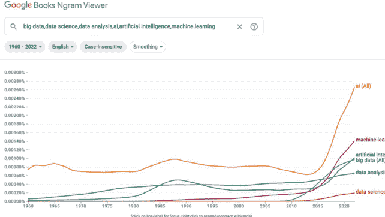

**图 6-1. Google Ngram Viewer 显示的“ai”、“big data”、“machine learning”、“artificial intelligence”、“data analysis”和“data science”在 1960 年至 2022 年间的趋势。来源：2025年1月17日 访问于 https://books.google.com/ngrams/graph?content=big+data%2Cdata+science%2Cdata+analysis%2Cai%2Cartificial+intelligence%2Cmachine+learning&year_start=1960&year_end=2022&case_insensitive=true&corpus=en&smoothing=3**

## 第六章 进入21 世纪：数据科学

注意，“AI”一词的使用频率远高于其他任何术语，即使是全称“artificial intelligence”。这是因为它约有 90% 是流行词——人们在不知道其真实含义的情况下就使用它，命令数据工作人员研究如何使用它，而不是将其作为解决实际问题的方案。大多数公司需要的是数据科学，而不是其他类型的 AI。“大数据”一词的出现比“机器学习”稍早一点点，但它的热度已经放缓，而“机器学习”一直在持续增长。这是因为它们都非常忙碌，许多对信息稍多的领导者在呼吁 AI 时他们知道是机器学习驱动了现代 AI，而且每个人对大数据作为大多数 AI 的基础都感到兴奋。图表清楚地表明了新的数据科学有多么新颖，而数据分析自 1970 年代以来一直稳定存在。

## 现实中的数据科学案例

“数据科学”一词可能相对较，但许多精明的公司和行业几十年来一直遵循数据驱动的方法。在某些行业中，这实际上关乎生存，尽管只要使用得当，任何公司都可以通过数据改善现状。在这里，我将讨论可口可乐作为一家数据驱动公司，以及保险中的欺诈检测。

## 项目 1：可口可乐是一家数据驱动的公司

可口可乐一直是一家技术创新型公司，拥有独特的产品设计以及进取且创新的品牌营销和广告。但这里更有趣的是，他们处理数据和统计已经超过了一百多年——他们的统计部门建立于 1923 年。在早期，他们收集并分析流量模式以选择最佳广告牌，识别出最有利的零售商，并指示他们的销售代表将访问这些地点的频率增加，并利用收集的药店购物习惯数据来训练自动饮料水机操作员，以售出更多可口乐（并说服客户购买其他东西——为参与的运营者增加甜头）。甚至在计算机出现之前，他们就尝试过预测销售和利润。更有趣的是，该公司的统计学家在 1928 年预警了即将到来的金融危机，不幸的是，这一预言在次年华尔街崩盘后不久被证明是正确的。

由于公司长期以来拥有复杂的统计学家，他们率先投身大数据和现代数据科学领域并不令人意外。如今，数据工作驱动着几乎所有的战略决策。这是一家巨型公司在 200 多个国家运营，并在任何地方收集它能收集的一切数据。

其中一项创新由于规模巨大，产生了比任何目标群体研究都更好的客户偏好有用信息。可口可乐的 Freestyle 饮水机于 2009 年推出，允许客户在可口乐中加入多种口味。

虽然 Freestyle 饮水机很有趣，但处理这些数字并不需要太复杂的技巧。但公司正在做其他更直接借鉴 AI 的事情。一个更高级的举措是研究定价和促销弹性，它使用统计或机器学习技术来识别价格变动（“常规”价格）和增加促销（包括促销类型）的影响。该公司的全球业务意味着他们可以更多地研究定价和促销的历史数据，并且实际上可以运行实验来观察其影响。

可口可乐在广告中使用先进技术，并利用社交媒体和手机等新平台，这也不会让任何人感到意外。A/B 测试和通用数字广告的易行性意味着他们已将广告重心从电视转移到社交媒体和其他在线平台。这为他们提供了无尽的数据，数据科学家可以对这些数据进行多种分析。尽管很难找到他们使用的具体方法——文章关注的是流行词——显而易见，可口可乐确实拥抱了数据和数据科学来驱动其业务持续成功。

## 第六章 进入21 世纪：数据科学

### 项目 2：欺诈检测

银行、信用卡公司和保险公司的欺诈检测即使在 20 世纪 90 年代初很重要，特别是随着越来越多的交易在网上进行。但当时的方法很简单，仅仅依赖于交易历史，没有太多其他信息。随着时代的推移，公司开始获取更多数据并使用更复杂的检测方法。

大多数公司从不透露他们的检测秘密，但一位研究人员在 90 年代中期与一家保险公司合作，我们可以看到他们如何使用当时领先的技术。该公司面临的房屋保险欺诈通常不是职业犯罪引起的，而是普通出于各种原因提交虚假理赔。

公司希望自动标记可能的欺诈理赔以进行进一步调查。他们还需要对标记的原因给出解释。他们使用模糊逻辑系统来实现这一点。该系统为每个理赔给出从 0（非欺诈）到 1（可能欺诈）之间的概率分。公司设定了一个阈值，低于此阈值的理赔将自动赔付，而

> *本案例出自 Fuzzy Logic and Neurofuzzy Applications in Business and Finance by Constantin von Altrock, Pearson, 1996*


## 第 6 章 迈向21 世纪：数据科学

其他理赔则会被提交进行审计。提供给理赔审计员的信息包括理赔得分高的原因，以便他们进行手动调查。

该系统并不复杂，只有七个输入项，包括一年内的之前的理赔次数、成为客户的时间、客户收入以及平均银行余额。不同的变量流入三个子系统，涵盖了客户与保险公司的历史、银行业历史以及个人情况的变化。这三个子系统被输入到两个独立的组件：评分组件应用模糊逻辑来生成一个数字，而原因组件则为理赔审计员提供一个起点。这种方法的一个关键优势是，没有哪一个单一因素可以触发警报——只有多个因素的组合才能产生高分。例如，如果某人在一年内有大量理赔记录，但如果其他因素并不可疑，他们可能不会被标记——也许他们只是那一年运气不太好。

该系统的一个重要方面是公司如何建立触发审计和对审计评分的阈值。其做法是让审计员对一千多个理赔进行手动评估和评分，并让系统对这些相同的理赔进行评分。他们可以相应地调整阈值，使被标记的理赔尽可能与手动标记的理赔对齐。有趣的是，系统实际上识别出了一些人类审计员没有识别出的真实欺诈理赔。然后，他们测试了不同的阈值。显然，这里需要找到一种平衡——如果阈值太低，会有太多的理赔需要手动调查（这在工时方面是昂贵的），但如果阈值太高，他们会漏掉真正的欺诈理赔（这在赔付方面是昂贵的）。尽管如今的欺诈检测系统要复杂得多，这种平衡在当今的所有系统中仍然重要。

## 那么，到底什么是数据科学？

数据科学是新的炼金术。对着水晶球挥挥手，业务洞察和价值就会喷涌而出，并变成金甸甸的金条。唯一的区别是，炼金术无法产生任何真实的东西，而数据科学可以。这不仅仅是随手挥挥手就能完成的。

公司充斥着“数字化转型”和“数据驱动”等术语，但如果在这些辞藻之下没有为了实际改变以建立真实的、可用的数据基础设施而做出真正的承诺，那么什么都不会改变。公司经常聘用数据科学家，但他们入职后会发现除了几个电子表格外，没有任何可用数据。

如果这不是魔法，它是什么呢？数据科学根本上是利用密集型技术在数据中寻找意义。重点在于，它几乎总是涉及由于数据量巨大或计算数量和复杂性极大导致人类完成耗时过长的技术。我也提到过数据科学通常涉及进行数据分析，但这些是数据分析师通常不涉及的部分。

让数据科学与数据分析脱颖而出的是术语中的“科学”字。这可能是因为听起来更高大，而且数据科学通常被认为比数据分析更有声望。“科学”听起来比分析更重要。事实是，数据科学的某些方面可能具有科学性，绝大多数技术领域也是如此。但坦率地说，它的很大一部分是艺术。

和数据分析一样，数据科学的大部分工作是发现、理解和准备数据。这就是领域知识（关于你正在处理的数据的知识）变得至关重要的地方。书中后面有一章专门介绍领域知识。只有在对数据进行大量工作（数据理解、数据准备和探索性数据分析）之后，才能进行建模并产生有价值的洞察。领导者往往缺乏耐心，可能难以理解这一点，因此数据科学家通常必须反复解释。所以，数据科学的另一个巨大部分是处理与领导层和其他人的关系，解释事情并规划细节。

然而，一旦数据准备就绪且探索性或其他数据分析完成，数据科学家终于可以进入赋予他们工作声誉的部分：建模。这通常涉及机器学习和其他归类 AI 标签的其他类型技术。随后的章节经常被开玩笑地称为“高深数学”。完成这项工作有许多方法，可能包括编码、使用允许拖放式工作流构建的 GUI 界面，或者介于两者之间的东西。随后的章节将介绍最常用的工具。一旦数据科学家完成了这些步骤，并认为他们发现了值得分享的有趣事物，或者创建了一个可以生成预测的模型，就是时候考虑如何向利益相关者展示它了。另一章将讨论可视化和演示报告。

如果这个过程听起来很熟悉，是因为它基本上和我们在上一章看到的进行数据分析的过程相同。建模是在 CRISP-DM 过程中的探索性分析和建模步骤中完成的，我们在第 5 章中见过它，但在这里图 6-2 中再次显示出来。

## 数据分析过程

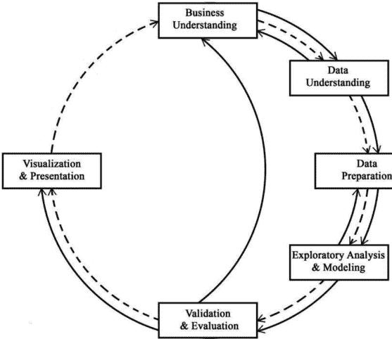

图 6-2. CRISP-DM 生命周期

数据分析和数据科学在过程上的一个区别在于探索性分析和建模步骤，因为数据科学家通常在这里花费更多时间，因为他们正在做更复杂的工作。此外，在验证和评估步骤中完成的工作可能与手动标记的有所。尽管如今的欺诈检测系统要复杂得多，这种平衡在当今的所有系统中仍然重要。

最后看一眼什么是数据科学，请看图 6-3。

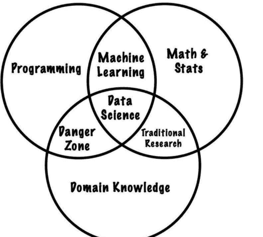

图 6-3. Drew Conway 的维恩图

这个图带有调侃意味，但它确实捕捉到了数据科学的组成部分。首先，数学与统计、领域知识与没有编码技能的交叉是心理学家、社会科学家和其他科学家的经典学术研究，具有实验设计和传统测试。这是一个正当的职业，但如果这些研究人员能够开发并使用编码技能，这项工作就会转向数据科学。具有良好数学和统计知识的编码员可以做机器学习，但除非他们深入理解他们的数据的数据，否则就不是数据科学。学习了一些编码和如何进行机器学习的人开始尝试发现一些事情是很常见的，但由于对数据所代表的含义缺乏深度知识，这项工作的价值是有限。

## 数据科学价值

数据科学并不是单一的整体，每个项目与其他项目都略有不同，但仍然有很多共同点，这些需要特定的工作方式才能达到最有效。我们在良好的数据科学中看到六个核心价值：简单性、解释性、可重复性、可信赖性、理解性和可共享性。

简单性在你寻找解决方案时发挥作用——你从可能有效的简单方案开始，当简单方案不起作用时再选择更复杂的方案。简单性有时会受到诟病，但它在几乎所有的科学和工程领域都受到推崇。如果你记住它是复杂性的对立面，就能看到它的优势。复杂的机器和系统成本更高，维护也更困难。任何软件也是如此。事实证明，


## 第6章 跨入21世纪：数据科学

对于任何数据科学解决方案来说也是如此。目标通常是在不损害质量的前提下，创建一个尽可能简单的解决方案。

**可解释性**——你能够多容易地向你的利益相关者解释你的解决方案——在很多情况下都是至关重要的。向你的利益相关者解释事情在某些情况下可能非常重要，特别是当他们刚接触数据科学时。这对于建立信任至关重要。如果利益相关者无法理解你做了什么，他们可能就不会信任你的结果。简单性在这里是一个考虑因素，因为通常来说，简单的解决方案比复杂的解决方案更容易解释。你经常会听到人们讨论“黑盒”与“白盒”解决方案。*黑盒*解决方案是指其选择从根本上无法解释的解决方案。其复杂度太高，或者进行了复杂的计算。黑盒的一个经典例子是神经网络。我们将在第15章详细介绍神经网络，但缺乏可解释性是它在商业世界没有像想象中那么使用的原因之一。相反，*白盒*解决方案是很容易解释的。白盒解决方案的两个经典例子是线性回归和决策树。我们将查看它们看看它们是如何具有可解释性的，但我们会在第15章讨论它们。可解释性并不总是首位的，所以如果黑盒方法实现了更高的准确率（它们通常如此），那么不可解释的黑盒方法可能是要使用的方案。

普通的线性回归（我们在谈论它时通常会省略第一部分）是统计学家使用了几十年的经典方法，它基本上通过最小化每个点到直线之间所有误差（差异）来在数据中画出一条直线。在线性回归中，模型字面上仅仅只是一个公式，你将每个变量乘以一个通过线性回归技术优化的系数，并将所有项相加。你可以与你的利益相关者分享这个公式，这使得变量的影响力一目易见。图6-4展示了一个代表线性回归模型的公式，该模型根据表格中的其他数值特征预测视频游戏数据中的评分。

```
Rating = 3.44 + 0.52 * ('Number of Ratings')
+ -0.32 * ('Plays')
+ -0.18 * ('Playing')
+ 0.36 * ('Backlogs')
+ 0.86 * ('Wishlist')
```

图6-4. 根据多个特征预测评分的线性回归公式

这个公式很有意思——Wishlist（愿望列表）最重要的，甚至超过了Number of Ratings（评分次数）。Plays（玩）和Playing（玩）都会降低分数，这似乎很违反直觉，但Backlogs（待玩）比其中任何一个都重要，或者可能会抵消它们。模型有时会有意外的值。也可能这并不是一个准确的模型。

另一个可解释的模型是决策树，其中每个决策点都可以视觉化表示，因此可以遵循路径。在最高层，决策树方法基本上通过识别最有效的划分（即一侧大部分匹配一个标签或优于其他划分）将数据分成两部分，并对每个结果重复该过程，直到得到全或大部分为同一个标签的结果（或达到最大深度）。一个例子是：如果Number of Plays（游戏次数）大于100，则取右分支；否则取左分支。如果大于100的数据中有一半评分在4或以上，而小于100的数据中大部分评分小于4，那么这就是一个很好的划分。图6-5在相同的视频游戏数据上显示了一棵非常简单的树，同样预测评分。


**图6-5.** 根据多个特征预测评分的简单决策树

这是一个极其简单的模型，它使用wishlist和times listed（列出次数）来确定评分，仅预测3.5、4.0或4.5的评分。但根据给定点的特征值，很容易从顶部节点向下追踪路径。这个模型只看两个特征：Wishlist（将其添加到愿望列表的用户数）和Times Listed（用户列出该书籍/游戏的次数），两者都是简单的计数。决策树具有节点（特征上的决策点）、叶子（底部的最终决策）和分支（连接节点或节点与叶子、代表特定决策范围的线）。如果你想根据当前值预测游戏的评分，假设Wishlist为750，Times Listed为975，你将从顶部开始并检查Wishlist的切分点。我们的值750大于512.5，所以我们会取右分支。然后我们查看Times Listed，发现我们的值975小于1,750，所以我们会取左分支，这将我们进入预测Rating为4的叶子节点。


将流程处理得对同事而言是友——通过清晰列出的步骤、注释良好的代码以及其他易于理解（以及重复复用）的措施。

## 组织如何使用数据科学

正如我上面提到的，许多组织谈论数据科学是为了吸引关注，但由于缺乏数据基础设施和工具而无法真正执行。但有些组织确实成功地使用了它，有时有效，有时则不然。组织使用数据科学主要有三种基本方式：理解、规划和自动化。

## 理解

数据科学最常见的用途之一是更好地理解组织所接触的人员或对象，以及组织的运作情况如何。这通常涉及查看历史数据。数据科学通常会将数据分析工作向前推一步，但通常不会取代任何正在进行的数据分析。

一家披萨店可能想更多地了解他们的客户，他们可能会开始进行画像调查。他们可以使用一种名为“聚类”的机器学习技术根据属性对不同的客户进行分组（如果他们足够幸运拥有客户的数据）。他们可能会发现有四类主要的客户：工作日午餐客户、工作日晚晚餐客、深夜醉酒访客以及白天的悠闲散客。这对于为每种类型的客户提供不同的优惠活动和营销非常有帮助。

同一家披萨店可能想评估他们开展的一项针对这些类型客户的营销活动。他们可以查看活动前后许多周的销售数据，以观察是否存在差异。这可以帮助他们评估活动及其对四类客户行为的影响。他们可能会发现，深夜啤酒优惠吸引了更多的深夜访客，并由于啤酒的利润率比披萨高得多，从而显著增加了利润。

## 规划

数据科学也被大量用于规划目的。这既可以来自观察不同尝试的成功情况并决定继续进行哪一个，这也是实际分析可以发挥作用的地方——因此它可以关注历史数据，也可以关注预测未来，或者两者兼顾。任何预测都将依赖历史数据的生成。

这家披萨店可能对他们活动的成功非常满意，他们研究了该活动以识别出活动中最成功的特定部分。这对于规划应继续提供哪些类型的优惠，以及帮助寻找改变不成功尝试的方法来说，可能是非常有价值的信息。

但他们可能会更进一步，创建一个根据四类客户预测未来销售的模型。这对于了解需要订购多少原料和烹饪用品非常有帮助。

## 自动化

组织使用数据科学的最后一种方式是自动化，这可以通过多种方式实现。这通常（但并非总是）意味着预测未来的元素，尽管历史数据对于任何预测来说都是至关重要的。它还可能在客户关系管理（CRM）系统中自动将新客户分配给销售代表，在大学升学咨询系统中自动创建完成学位的概率估算，或者在约会应用中自动配对人们。通常公司已经在做这些事情了，但它们可以引入机器学习技术来把它们做得更好（或更快）。

对于披萨店来说，这可能涉及自动为新客户分配标签、为披萨送餐员确定优化路线，或者让一个表格在周日晚上自动更新未来两周的预测数据，以便与订单系统对接并自动订购原料和用品。

## 数据科学家的特质与角色

数据科学家并不是只有一种。不同的角色有不同的侧重点。有些数据科学家可能接近于数据分析师，因为他们的大部分工作不涉及他人所做的更严谨的机器学习。有些人大部分时间都埋头于 Python 机器学习代码中，很少抬头。还有人可能发现自己更多与利益相关者打交道，做高层规划工作，而不是处理数据工具。后后有一个章节将讨论更多不同类型的数据科学角色以及如何找到最适合你的角色，其中也包含了一些职业建议。

上一章概述的功能性、技术性和软技能对数据科学家同样适用，尽管不同类型的角色会强调某些技能而非其他技能。但对数据科学家来说，最重要的技能包括好奇心、耐心、有条不紊和成长型心态。好奇心驱动你发现值得提出的有趣问题，从而带来最有价值的发现。由于许多原因，耐心是必要的，但主要因为即使你想建模，也无法直接跳进去——你必须等待数据准备好。做事严谨和对细节的高度关注有助于你避免错误，并使过程符合逻辑且易于重复。

最后，成长型心态在这个领域以及许多其他技术领域都是必须的——总会有新的工具和技术出现，你永远不知道某一个工具是否恰恰是你项目所需的。

## 核心要点与后续

数据科学提供的价值很多，但它并不是魔法，尽管许多领导层是这么认为的。数据科学已作为一种更复杂的数据分析变体出现，为理解它能做什么和不能做什么的组织提供了许多价值。通过良好的数据，数据科学家可以帮助组织理解其数据、进行规划和决策，并自动化耗时或不准确的过程。数据科学包含几种价值，包括简单性、解释性、可重复性、可信性、可理解性和可共享性。简单性意味着数据科学解决方案尽可能简单，同时保持有用。解释性要求得出的结果被解释（倾向于白盒方案而非黑箱方案）。可重复性要求数据科学家遵循严谨的代码规范和流程，以便工作可以被复制（这样我们知道结果是合法的）。可信性是指让利益相关者和其他信任你的解决方案是有效的、符合伦理且具有适当的安全性和隐私性的。理解性与解释性部分相关，但它更多关于整体工作是可以理解的，而不仅仅是结果（这与可重复性有一些共同目标）。最后，可共享性涉及你与利益相关者和同事分享结果的简易程度，这需要几个条件并与理解性相关。请注意，这些并不同等重要——特别是解释性，如果不需要且更高的准确率更重要，则可以被牺牲。


## 第 6 章 迈向二十1 世纪：数据科学

Lauren 最初从事的是一些营销邮件和优惠券的底层工作，这些工作最初并不涉及任何数据科学，但最终她获得了一些进行更多分析和更复杂报告的机会，她发现自己非常热爱这份工作。为了让自己变得优秀并转型到涉及更多数据科学的职位，她参加了基于 R 语言的统计分析证书课程，随后又参加了高级机器学习课程。她成功地在公司内部转到了一个专门负责高级分析的团队，因此在从事对业务产生实际影响的重要工作的同时，不断提升自己的技能。

在该岗位工作几年后，Lauren 决定寻求新的挑战，于是进入了咨询行业，这让她接触到了自然语言处理和生成式 AI，这两者对她来说都是新颖且迷人的。她在该职位上承担领导职责，她也很喜欢这一点。后来她回到零售行业担任新职位，由于数据分析对该公司来说还很新颖，她丰富的经验对于一个仍在与业务建立关系的团队非常有益。

### 金句

**最喜欢工作的部分：** Lauren 喜欢与不同类型的人合作。她也喜欢工作中项目的多样性，每个项目都有新的难题要解决——而且通常没有唯一的解决方法，所以找到最佳解决方案本身就是乐趣的一部分。

**最不喜欢工作的部分：** 人们对数据科学能做到的事情有不现实的预期，往往在没有与了解可行性的人讨论的情况下就决定了他们想要什么。通常某些事情在理论上是可行的，但在当时该组织中是不可行的，例如由于数据或基础设施的限制。Lauren 在咨询行业尤其发现了这一点，战略策略人员会做出无法实现的承诺。

**最喜欢的项目：** Lauren 在担任顾问期间曾做过一些队列分析（cohort analysis）。她研究了社交媒体是否可以抵消第三方 Cookie 数据不再可用带来的数据损失。她发现，如果你使用正确的平台并创建有效的广告，是可以的。这个项目最有趣的地方在于，她发现如果执行得当，它的价值甚至比第三方 Cookie 更高。

**教育如何与现实世界联系：** Lauren 在工作中教过学生，并与很多实习生合作过，她发现很多学生都认为这门学科很容易，当发现事实并非如此时会很惊讶。教育并没有专注于灵活性解决问题的能力。学生期望她为每个问题提供循序渐进的计划，当她解释这些问题并非通版化的——每个问题都略有不同时，他们会感到沮丧。学生也没有为现实世界的数据做好准备。例如，用平均值填充缺失值并不总是合理的。

**最常使用的技能：** Lauren 经常使用的最大技能是解决问题。这涵盖所有类型的解决问题。最近的例子包括：弄清楚自己不知道自己应该知道的、如何使用没有良好文档的尖端工具，以及当项目进展不利时如何修复问题。这些涉及批判性思维，当问题并不总是可以复现时，有时会特别困难。另一组重要技能是与人相关的。这包括沟通、管理和讲故事（基本上就是让他们认同你的观点）。

**目前使用的主要工具：** Python 和 SQL 在她的职业生涯中至关重要，她目前使用 JupyterHub 和 Snowflake 完成大部分工作，并依靠 Google Slides 进行演示。

**数据科学的未来：** 我们正处于一个十字路口，需要决定下一步去向哪里。尽管数据科学和 AI 经常被过度渲染，但仍然会有大赢家——早期且明智地适应并采用技术的公司和个人——而停滞不前的人将失败。这意味着会导致失业等其他问题。同样重要的是要意识到，技术的发展速度超过了监管，我们还没有处理所有的政治影响，但我们将不得不这样做。

**什么造就优秀的数据科学家：** 解决问题能力和批判性思维至关重要。如果你处于数据科学频谱中偏技术的一侧，你可能在人际能力较弱的情况下也没关系，但大多数数据科学家确实需要良好的沟通技巧。

**对未来数据科学家的建议：** 熟悉数据清洗，因为你的大部分时间都会在做这件事。

*Lauren 是一位数据科学家，具有处理数据以及领导营销、零售和其他行业数据科学团队的经验。*

## 第 7 章

### 新视角：新的数据分析

## 引言

我们已经看到数据科学与许多术语相关——数据分析、AI、机器学习等。这里还有另一个词：分析（analytics）。

数据分析作为一个概念已经存在了一段时间，但这个术语开始更多地被作为一个统称，用来描述精明公司正在转向的一种全面数据驱动方法。一个成功的分析计划涉及许多学科，但最重要的是商业智能、数据分析、数据科学、数据库管理、数据工具管理和数据工程（后者越来越多地出现了一个名为“分析工程”的专业化方向）。所有这些都有助于帮助公司实现目标的分析计划。其他经常作为分析计划一部分领域包括机器学习工程和生产环境支持。

## 第 7 章 新视角：新的数据分析

我在之前的章节中讨论过数据分析和数据科学，将在后面的章节中更多地讨论商业智能和机器学习。现在，我快速解释我们还没有讨论过的术语。商业智能（BI）基本上是业务报告——图表和仪表板——帮助人们做出决策。数据库管理特指对数据库和其他其他数据存储的管理。工具管理是管理数据科学家和其他员工使用的各种工具。数据工程涉及为数据工作人员（即使用数据的人，包括 BI、数据分析师和数据科学家）采集并准备数据，而分析工程是数据工程的一个子集，其中的工程师具有更多的分析专业知识，可以更好地准备数据，以便数据工作人员更容易使用。机器学习工程涉及实现数据科学家创建的机器学习模型，以便使其更高效并准备好投入生产。生产是指在“现实世界”中运行的软件——在那里软件依赖真实数据，实际客户使用它，它自动运行以为仪表板创建新数据等。将预测模型之类的东西投入生产通常是开发它的核心目的，但数据科学家也会编写许多代码，这些代码仅用于生成直接与利益相关者共享的结果。数据科学家有时必须自己进行生产部署，因此其他生产或支持工具会协助这些任务。数据科学家会发现自己在执行许多或所有这些任务，而在更大更成熟的组织中，这些任务是分工的。

所有这些角色如何在具有不同角色的成熟组织中交互的示例，考虑一家托管客户图像文件并自动对其标记和分类、允许用户互相关注并共享图像、并为新用户提供推荐的公司。会有数据库来存储图像文件、标签、标记以及相关的


# 第 7 章：新视角：全新的数据分析

元数据和其他数据将由数据库管理员 (DBA) 管理。数据工程师负责收集额外数据，可能包括客户使用情况和行为、额外的图像元数据以及系统行为。数据工程师和分析工程师还负责为 BI 工程师和数据科学家等数据工作人员准备可供的数据。BI 工程师会创建仪表板，领导层和其他人员利用这些仪表板来理解他们感兴趣的网站各个方面的持续趋势和行为，例如存储的图像数量。数据科学家会查看并调查数据以回答业务利益相关者的问题，但他们也负责决定是否需要修改推荐引擎。他们可能还会准备一些在内部报告中使用的数据。机器学习工程师负责将数据科学家的任何投入生产的流程实现，例如对推荐引擎进行更改或对数据科学家用于报告的数据进行自动化处理，并与数据工程师或分析工程师合作，以便 BI 工程师可以使用这些数据。

这种成熟度概念——即不同组织处于不同的分析成熟度水平——将在本章中讨论，同时还会涉及四类分析，这些分析通常需要不同水平的成熟度才能实现。

## 分析术语大杂烩

在上一章中，我们已经查看了 Google Ngram Viewer 中围绕数据科学的术语的使用，但观察“分析 (analytics)” 处于什么位置非常有趣。在图 7-1 中，你可以看到它位于“AI”和“机器学习”之后，但在其他任何术语之前。请记住，这仅仅统计了截至 2022 年各个术语出现的次数。

Google Books Ngram Viewer

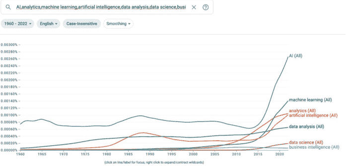

图 7-1. 1960 年至 2022 年“AI”、“机器学习”、“人工智能”、“数据科学”、“商业智能”的 Google Ngram Viewer。访问于 2025 年 1 月 17 日，网址：https://books.google.com/ngrams/graph?content=A1%2CAnalytics%2Cmachine+learning%2Cartificial+intelligence%2Cdata+analysis%2Cdata%2Cscience%2Cbusiness+intelligence%2Cear_start=1960&year_end=2022&case_insensitive=true&corpus=en&smoothing=3

“分析 (analytics)”一词在 2010 年代末之前被如此频繁使用是一个积极信号，因为组织如果采取高层次的分析视角，而不是关注模糊的 AI 或其他特定学科，将会获得最佳效果。遗憾的是，“机器学习”在人气上正在占据主导。然而，我尝试在添加“数据基础”、“数据工程”和“分析工程”后再次搜索，前两者的出现时间晚于其他所有项，而“分析工程”几乎没有被记录。虽然较近的数据可能会提高这些数字，但这仍然是一个问题，因为它们对任何分析计划都至关重要。在没有由数据工程师和分析工程师建立强大的数据基础的情况下，你无法否认分析工作。关于分析的讨论大部分停留在表面，缺乏对其实涉及的内容的理解。

数据科学和 AI 仍然带有新奇的光环，人们已经听过了他们能提供的所有深度见解，这些见解承诺赋予他们通往财务成功的钥匙。但它们并不是许多人认为的那种灵丹妙药。毫无疑问，这些领域是强大且真实的，但除非组织致力于实施真正的分析倡议，而不是拼凑而来的碎片，否则这种炒作就过过了。

## 现实世界中的数据分析示例

我们在之前的章节中已经看到了分析的几个例子，但从分析计划的高层来看，而不是具体的项目，将会有帮助。首先，我们将看看一家批发商在降低成本和改善客户及供应商关系方面的努力，然后看看一家职业篮球俱乐部如何利用分析来加强与粉丝的互动。

## 示例 1：减少成本并改善客户及供应商关系的数据分析倡议

一家位于英国的批发业务供应公司使用了一种内置报告功能的 CRM（客户关系管理）¹ 软件，但他们发现它的局限性太大了¹。他们希望能够

> ¹“通过 BI 和分析提高批发和分销业务的利润，”来自 Data Nectar，https://www.data-nectar.com/case-study/distribution-landing-analytics/

更好地理解客户需求、提高客户留存率、优化库存流程，并缩短客户回款的时间。他们与一家咨询公司合作实施了一个新系统，目标是在发布后八个月内增加收入 20%。从根本上说，他们想切换到数据驱动的策略和决策方法。

该公司在一个仓库运营并向其他企业发货，但他们有 3000 种办公产品和超过 1000 个客户。他们面临的挑战包括在库存中保持正确的产品（这涉及预测客户需求），以及高效管理客户付款以确保准时付款。他们还在努力寻找更有利润的产品交叉销售和向上销售的正确机会。他们知道数据将为他们提供有关所有这些挑战的有用信息，因此聘请了一家咨询公司来帮助实现这一目标。很明显，他们首先需要的是一个商业智能系统，为领导者提供良好的报告和仪表板。咨询公司帮助他们确定可以从 CRM 系统和其他源使用的数据，将数据移动到另一个系统中并创建商业智能基础设施。这使他们运行得更高效，因为触手可及的额外信息可以帮助他们做出更好的决策。

准备数据涉及涉及几个步骤，包括基础处理和更高级的转换，然后将其加载到数据仓库中。然后创建了具有各种维度的数据立方和数据市以便方便使用。数据准备确保了数据可以被从自助用户到 BI 报告构建者的各种人员使用。确保良好的数据安全性是数据处理和存储管理的一部分。

一旦数据就绪，就创建了几个关键性能指标 (KPI) 和报告。这些包括几个领域的客户细分；应收账款分析（包括客户分类以及识别最好和的客户）；供应商分析（价格、交货时间、信用时间和利润）；以及帮助减少库存成本的库存补充。

该项目被认为是巨大的成功，因为它高利润产品的收入增加了 15%，并导致付款时间缩短了 18%，库存支出减少了 17%。公司认为，如果不齐力实施一项关注数据、高级报告和 KPI 的综合分析计划，这一切将是不可能的。

## 示例 2：篮球俱乐部通过数据与粉丝互动

一家职业篮球俱乐部受困于旧的 IT 系统，这些系统无法实现他们想做的分析，并使以有效的方式与粉丝沟通变得更加困难。该俱乐部拥有一个过时的 CRM 系统，可以与粉丝进行沟通，但缺乏良好的定制化选项，这意味着他们可能会收到与他们的兴趣和购买历史无关的信息。与粉丝的大部分互动通过他们的移动 App 进行，他们知道该 App 有巨大的潜力可以做得更多。

> ²数字化转型如何造福粉丝和利润，”来自 EY，https://www.ey.com/en_us/insights/consulting/how-digital-transformation-helped-benefit-fans-and-the-bottom-line


## 第 7 章 新视角：全新的数据分析

该特许经营机构有两个关键但不直接相关的目标。首先，他们希望用现代化的取代现有的 CRM 系统，以提高粉丝参与度。其次，他们还希望添加更先进的数字工具，以激励销售人员达到更高的绩效水平。与之前的公司一样，他们认为自己并不具备内部专业知识，因此聘佣了一家咨询公司来帮助他们实现这些目标。

他们创建了一个新的 CRM 并增强了移动应用程序，使两者完全整合，为特许经营机构提供了丰富的粉丝信息，并提升了粉丝的体验。具体而言，特许经营机构能够追踪粉丝行为的方面，例如观场次数和购买模式（食物、饮料和商品）。特许经营机构能够分析这些内容并做出适当调整，例如针对粉丝进行价格调整以解决空座率问题。应用程序为粉丝提供了有价值的信息，包括停车详情以及在哪里找到排队最短的特卖和洗间。

特许经营机构还为销售团队创建了几个仪表板，例如周、月、季目标的积分榜，这鼓励了良性竞争并显著提升了门票销量。应用程序的一些改进简化了商品和季票的购买流程。这些更改使应用程序中商品和季票的销量增长了 50%。虽然这是一项巨大的工程，但该特许经营机构对结果非常满意。

## 分析的伞盖

创建一个成功的分析计划涉及许多方面，公司需要有组织性且有针对性才能取得成功。本节将介绍从旧的分析模式向转变，以及分析计划中的不同学科。

## 从“旧”分析到“新”分析

许多公司已经开展了多年或几十年的分析，但“新分析”涉及到将之视为一个全面的计划，而不仅仅是一小部分商业智能（BI）和一些分析。一个全面的计划通常会通过在某种程度上集中工作来增加严谨性，并为这项工作建立更多标准和最佳实践，使其更像于传统的软件开发。

不同的数据工作者角色通常涉及开发软件（特别是 BI 开发人员）、制作报告，以及数据科学家创建将实时运行的模型，因此，软件和其他系统流程可以被应用于此。该过程通常涉及将工作分为至少两个环境：开发环境和生产环境。开发环境是进行所有开发（新代码和对现有代码的修改）的地方。这些环境彼此完全隔离，通常开发环境尽可能成为生产环境的镜像。开发和生产之间可能还有另一个环境，通常称为测试环境，这是迈向生产的一步，可以在那里对代码进行更严格的测试。

影响数据分析师和科学家的问题之一是，有时开发环境无法访问真实的生产数据。这在软件世界甚至在 BI 开发中都是合理的。报告和仪表板可以在虚假或不完整的数据上开发，然后当部署时，它们可以切换到显示生产数据。仍然需要进行最终测试以确保没有出现任何故障，但这项工作量相对较小。

相比之下，数据分析师和科学家绝对需要从开始就能访问真实数据，对于那些不理解数据分析和数据科学是什么或如何执行的公司来说，这可能成为争论焦点。流程的早期阶段（包括探索性数据分析）需要访问真实数据。如特征工程和选择最佳特征等工作也需要真实数据。基于不完整或虚假数据构建模型是没有意义的。这就像给你的医生提供完全虚构的症状而漏掉真实的症状，却期望他们能给出准确的诊断一样。

所有这些问题在拥有真正分析计划的组织中都能得到理解和处理。事实上，有些组织的组织化程度非常高，以至于他们遵循一种被称为 DataOps 的新范式（更多关于 DataOps 的信息见侧栏）。

## DataOps

在 DataOps 中，数据产品的整个生命周期（从数据准备到报告和展示）通过自动化以及科技领域使用的其他三个范式——敏捷（Agile）、DevOps 和精益制造（Lean Manufacturing）的原则变得尽可能严谨。敏捷是一种软件开发方法，我们将在后面的章节中详细讨论。它在数据科学项目管理中并不独立起作用，但其某些原则是有用的。我们稍也会讨论 DevOps，它也被用于软件开发，以自动化测试和部署（导致所谓的持续集成和持续部署 (CI/CD)）。它的原则融入了 DataOps。最后，精益制造是制造业中使用的另一种范式，它强调统计过程控制，将 DevOps 转化为对现有数据进行持续监控，一旦出现异常情况就会发送通知。

## 数据工具与基础设施

数据工程师需要工具来构建数据基础，BI 开发人员、数据分析师和数据科学家也需要工具来执行工作。选项几乎是无限的。这些可能包括任何云环境及其各种数据相关工具、存储在公司基础设施内部的“本地”解决方案、需要安装在人们计算机上的工具等。所有这些工具都需要一种机制来访问公司数据，无论其存储在何处。理想情况下，应该由数据工作者以外的人员管理这些工具和基础设施，但并非总是如此。如果 BI 开发人员、数据分析师和数据科学家花时间在管理基础设施上，他们将无法完成许多生产性工作。

## 数据基础

如引言所示，BI、分析和数据科学依赖于坚实的基础——经过清洗、准备且随取随用的数据类型。数据最重要的方面通常是质量、可用性和随取随用。如果数据质量不高，分析结果将出现问题。如果数据不可用或未准备，分析结果也会出现问题。在处理数据时，通常会聚合（通常是对某列进行求和或平均）以获得更少的行，因为与原始数据的粒度不同。例如，考虑下图 7-2 中的某些学生数据。

## 聚合与粒度

| 学生姓名 | 学生 ID | 性别 | 年龄 | GPA | 奖励 |
| :--- | :--- | :--- | :--- | :--- |
| Cruze Dubois | 430 | 男 | 18 | 3.70 | 4 |
| Billie Jean Harris | 651 | 女 | 15 | 4.00 | 2 |
| Cindy Rodriguez | 453 | 女 | 17 | 3.80 | 2 |
| Edna Darwin | 410 | 女 | 18 | 3.70 | 0 |
| Elisa Garcia | 101 | 女 | 18 | 3.12 | 2 |
| Guru Choudhury | 291 | 男 | 16 | 3.41 | 0 |
| Henri Dubois | 456 | 男 | 16 | 2.99 | 2 |
| Ian MacAlastair | 322 | 男 | 17 | 3.65 | 2 |
| James Raj | 601 | 男 | 16 | 2.76 | 0 |
| Lakshmi Kumar | 275 | 女 | 15 | 4.01 | 1 |
| Usa Galton | 243 | 女 | 17 | 4.00 | 1 |
| Mabel Johnson | 613 | 女 | 17 | 3.25 | 0 |
| Mackenzie Dobson | 186 | 非二元 | 17 | 3.75 | 1 |
| Parker Thompson | 561 | 女 | 18 | 3.20 | 1 |
| Ryan O'Connell | 384 | 男 | 16 | 3.80 | 1 |
| Sarah Smith | 119 | 女 | 15 | 3.56 | 0 |

图 7-2. 示例学生数据

如果我们想汇总这些数据以获得不同导师学生的整体情况，我们可以在导师粒度（Advisor grain）对 GPA 和奖励进行聚合，这将导致每个导师仅产生一行，包含所有行的 GPA 平均值和奖励总和。它看起来像图 7-3。


# 图 7-3. 仅按导师（Advisor）粒度聚合的数据

在表表中，除了只有一个学生的导师 Smith 之外，精确的 GPA 和奖学项（Awards）数值在原始表中完全没有出现。Jackson 有三位学生，此表中的 GPA 是这三名学生 GPA 的平均值，而 Awards 是所有学生的总数。这很有意思，但也许我们也想考虑一下学生的年龄。我们可以转而按“导师–年龄”（Advisor–Age）粒度进行汇总，如图 7-4 所示。

| 导师 (Advisor) | 平均 (Avg) | 总计 (Total) |
|---|---|---|
| Jackson | 3.07 | 5 |
| Miller | 3.57 | 8 |
| Namath | 3.45 | 1 |
| Patel | 3.58 | 5 |
| Smith | 3.75 | 1 |

| 导师 (Advisor) | 年龄 (Age) | GPA 平均 (GPA Avg) | 总计 (Total) |
|---|---|---|---|
| Jackson | 16 | 2.76 | 0 |
| Jackson | 17 | 3.23 | 5 |
| Miller | 15 | 3.56 | 0 |
| Miller | 16 | 3.80 | 1 |
| Miller | 17 | 3.63 | 1 |
| Miller | 18 | 3.41 | 6 |
| Namath | 18 | 3.45 | 1 |
| Patel | 15 | 3.96 | 3 |
| Patel | 16 | 3.20 | 2 |
| Smith | 17 | 3.75 | 1 |

# 图 7-4. 按“年龄–导师”粒度聚合的学生数据示例，包含平均 GPA 和奖学金总数

此表行数更多，因为除了 Namath 和 Smith 之外，大多数导师都有不同年龄的学生。每当你进行聚合或查看聚合数据时，都必须考虑粒度。

日期是不同粒度中非常常见的调整项，因为我们通常希望查看按周或按月粒度汇总的销售等数值，而不是查看每日数值。

数据基础理想情况下由数据工程师（或在某些地方由分析工程师）创建，但现实情况是，有时其他人最终不得不构建它。这些人可能包括流程末端以某种方式存在的任何人，包括数据分析师、数据科学家或商业智能工程师。

# 商业智能 (Business Intelligence)

商业智能（BI）本质上就是报告——创建从 Excel 表格到摘要文档，再到带有图表、表格和其他数字的仪表板等各种类型的报告。BI 报告通常是持续性的工作，定期进行刷新和查看，而不是一次性的。领导者和员工使用所有这些来理解业务各个方面的状况，从而帮助他们做出决策。即使在分析方面尚不成熟，许多公司也已经做了很长时间了。通常，商业智能团队还负责准备报告将使用的数据，无论是在 Tableau 或 Power BI 等工具内部，还是在数据库中完成（无论是独立完成还是与数据工程师和/或数据库管理员协作完成）。

BI 开发人员——报告创建者——通常不从事任何被标记为“数据分析”的工作。他们所做的分析仅仅是为了理解和准备数据，以便生成报告并与决策者分享。无论如何，他们为了理解数据而进行的大量分析与数据分析师和数据科学家为了了解数据而必须做的工作相似，但在他们对现有内容的理解之后就停止了。数据分析师和数据科学家利用这些信息进行进一步的工作。

# 第 7 章 全新的视角：新的数据分析

BI 的焦点几乎总是放在过去和现在的业务上，而不是未来。如果显示了任何未来数据，那只是别人创建的表格中的数字，或者是分享给他们的简单公式的结果，而不是 BI 团队本身通过任何类型的算法生成的任何内容。

# 自服务报告 (Self-Service Reporting)

公司可能在跟上所有的 BI 需求方面挣扎，因此许多公司创建了自服务分析计划，允许非技术性的业务人员创建自己的报告。人们通常喜欢这一点，因为他们不需要等待别人来构建，而且也可以自己通过试错来找出他们需要什么，而不是等待开发人员检查正在进行中的仪表板。此类计划的成功完全取决于用户可用数据的质量。全自动报告——设计为按需要运行，但字段和值由 BI 或数据分析师创建的预编程公式决定——是安全的，但许多自服务涉及非技术人员设计他们的报告、选择字段和聚合方式。为了这项工作，数据必须是清洁且易于使用的。具体来说，当所有数据尚未都在一个表中时，就会很困难——正确连接数据源通常需要技术知识。如果数据未准备好，他们可能会产生包含错误信息的图表，这将影响决策并与分析团队产生信任问题。数据分析师进行某些分析后，发现结果与非技术人员生成的自服务报告相矛盾，这并不罕见。要证明数据分析工作本身没有错误，而是错误在自服务报告中，可能需要额外的工作。总之，成功的自服务计划需要良好的数据设计、护栏和良好的培训（用户需要理解他们可以做什么和不应该做什么）。

# 数据分析 (Data Analysis)

我们在第 5 章中学习了关于数据分析的所有知识，但回顾一下，数据分析涉及：
- 深入研究数据以发现洞察
- 切片和处理数据以揭示方面
- 制作图表和其他摘要来说明数据

我们在第 5 章中学习了关于数据分析的所有知识，但回顾一下，数据分析涉及：
- 深入研究数据以发现洞察
- 切片和处理数据以揭示方面
- 制作图表和其他摘要来说明数据
- 进行统计分析以揭示更多

# 数据科学与高级分析

数据科学家比数据分析师更进一步，正如我们在第 6 章所看到的。他们使用比数据分析师更复杂的技术，包括机器学习、自然语言处理和其他高级统计技术。然而，某些公司的数据科学家经常从事大量数据分析，甚至是商业智能，特别是当组织较小或不成熟时。数据科学家根据业务需求和问题处理任何时间范围内的数据——过去、现在或未来。

高级分析在语境下只是数据科学的另一个术语。然而，具有整体分析方法的组织有时倾向于使用这个术语，因为它比数据科学更能传达语境。

# 分析成熟度与分析分类

如果你查询分析成熟度模型，通常会发现显示四种分析分类的图表，它们作为成熟度模型呈现。这些从最简单到最复杂包括：
- 描述性 (Descriptive)
- 诊断性 (Diagnostic)
- 预测性 (Predictive)
- 规范性 (Prescriptive)

这些是很有用的的分类，我们将在下文中讨论，但我认为通过可用数据、工具和数据能力来判断组织的成熟度更有意义。那些没有在做最复杂的分析的并不意味着他们没有能力。

# 成熟度模型 (A Maturity Model)

分析成熟度模型有五个基本的组织分析成熟度级别，这取决于组织能够进行的分析选择。如上所述，有些人认为该水平是由他们所做的分析类型决定的，数据科学是最高水平。在最低级别，成熟度 0 中，组织没有任何有组织的倡议。这并不意味着没有人在处理数据，但它们并不是在一个通往成功的综合性计划中。

理想情况下，组织会一步步向上通过层级移动。在成熟度 1 时，他们至少拥有数据基础的雏形——供商业智能、数据分析师和


## 第 7 章 全新的视角：新的数据分析

科学家们在工作中可以使用数据——以及为这些数据工作人员提供正确工具。这两者都至关重要，但两者都可能处于进行过程中——达到这一成熟度水平的关键要求是，领导层充分理解对数据和工具的需求，并已投入资源来创建这一数据基础和工具套件。

处于成熟度 2 级的组织将拥有坚实的商业智能工作——通常是一个或多个团队，为不同的利益相关者每年产生多份报告，而这些报告都基于使用数据基础中的数据。如果他们将分析计划扩大到包含数据分析，他们将进入成熟度 3 级。在他们的技能库中加入数据科学将使他们达到成熟度 4 级。通常，第一个数据科学组织相对基础，数据分析与科学之间的划分没有高度成熟的组织那么大。成熟度 5 级适用于能够开展更高级数据科学项目的组织。因此，5 级组织拥有一个完全实现的、成熟的分析计划，该计划涉及响应业务的不同需求，在三个学科中进行不同复杂度的项目。

现实情况是，许多组织完全是在操之过急，尽管没有其他分析或通常只有 BI（商业智能），却被困在 AI 和数据科学团队的热潮中。通常，这些组织甚至没有任何可以使用的数据（有时根本无法获取）。在没有数据基础或其他类型分析的情况下尝试进行数据科学是徒劳的。优秀的数据科学家擅于解决问题并为许多挑战找到解决方案，因此他们可能仍然能够设法做一些不错的工作。但这将比需要的时间长得多，而且范围仍然受到限制。在这种情况下，该组织的成熟度仍然将是 0，因为他们并不知道以系统化的方式进行工作。

每个水平的另一个不总是显而易见的隐性要求是，不仅要进行该阶段的分析，团队（们）还要有足够的工具来完成工作。做 BI 需要 BI 工具，而做数据科学需要许多具有足够计算能力和内存的工具，例如处理大量数据。组织也经常为此感到苦恼，导致人员没有足够的工具，使他们浪费时间寻找变通方法，或者因为执行超时而不得不重新运行。如果一个组织似乎处于 4 级，即他们拥有 BI、数据分析和坚实的基础，但 Excel 不足以满足数据科学的需求，那么它实际上应该是 3 级，假设 BI 开发人员和数据分析师拥有正确的工具。因此，成熟度为 0–5，并匹配他们实现每项分析计划的水平。表 7-1 显示了就移动方面的总结。

**表 7-1. 已实施分析计划部分的成熟度水平**

| 成熟度 | 已实现的分析 | 移动状态 |
| :--- | :--- | :--- |
| 0 | 无数据基础 | 停滞 (Stand) |
| 1 | 数据基础 + 工具 | 爬行 (Craw) |
| 2 | 数据基础和 BI + 工具 | 爬行 (Craw) |
| 3 | 数据基础、BI 和数据分析 + 工具 | 步行 (Walk) |
| 4 | 数据基础、BI、数据分析和基础科学 + 工具 | 跑步 (Run) |
| 5 | 数据基础、BI、数据分析和高级数据科学 + 工具 | 飞行 (Fly) |

公司之间的水平差异巨大，尽管对不同类型公司的预期可以进行某种程度概括（但显然，这些预期也有很多例外）。初创公司和科技公司至少处于 3 级，甚至是 4 级，因为他们从早期就开始使用信息来驱动决策。长期存在的大非科技公司通常是 2 级或 3 级，因为它们没有花时间建立一个坚实的数据基础，即使它仍在构建中。较小的组织在规模上要低得多（例如到处都是的电子表格）。

### 描述性 (Descriptive)

描述性分析是关注过去发生的事情以及通常是现在正在发生的事情（或至少是刚才之前）的数据工作。这可以以 BI 部分的报告以及数据分析中探索性和描述性统计的形式存在。例如，由 BI 创建的报告显示截至昨天每款视频游戏的每日销售情况，并附有按月的汇总，就是描述性分析的一个例子。数据分析师的工作可能会更深入一点，但仍然是在描述过去，例如对公司最新发布的游戏的新营销活动进行 A/B 测试结果的细分。

### 诊断性 (Diagnostic)

诊断性分析的工作不仅仅是描述发生了什么，而是解释为什么这些事情会发生。理解发生了什么非常重要，因此描述性分析是其中的一部分，但它不是最终目标。这通常是数据分析师有时也是数据科学家的领域。例如，显示每日游戏销售的仪表板可能允许用户将鼠标悬停在某天的销售数字上，以查看有关那天的更多信息，包括有关营销、广告、促销、假日以及亚马逊 Prime 会日和选举等重大国家性事件的信息。再次点击可以将信息叠加在图表上，从而看到整个销售图表中的趋势。例如，某个游戏每日销售的多线图可以包含销售额数字、广告投放次数、游戏价格（反映了常规价格变化和折扣）以及假日或重大活动当天的标记的垂直线。

### 预测性 (Predictive)

预测性分析听起来就如其名——重点是预测未来的趋势。这主要是数据科学家的领域，因为预测通常需要机器学习方法。最常见的的预测性分析任务之一是预测未来短时间内的销售情况。这可能会出现在“诊断性”部分中描述的同一个图表中——用户可以看到历史记录、叠加的解释项目以及未来 14 天的预测。这种图表是强大的，因为在一个地方有如此多的信息。

### 规范性 (Prescriptive)

最后一类分析是规范性分析，它旨在帮助决策者确定他们可以——甚至应该——做什么。这非常先进，是数据科学家的领域，尽管他们中的许多人可能永远不会做这类工作，因为我们不是在提供决策者使用的信息，而是在告诉他们该做什么。然而，它并不一定像听起来那么激进。我们可以有一个系统，观察价格变化和促销对销售的影响，并建议何时进行促销或何时更改价格。这些信息通常还会包含解释，例如哪些特征导致了建议。

# 分析成熟度与类别的结合

组织的分析成熟度依赖于许多因素，但这些因素定义了它们通过分析改进业务的可能成功的程度。图 7-5 显示了在每次提升一个级别时，成熟度、正在进行的分析类型与四类分析之间的关系。


## 第 7 章 全新视角：新的数据分析

| 成熟度等级 | 数据工作 | 分析类别 |
| --- | --- | --- |
| 0 | 无常规工作，无数据基础或工具 | 无/N/A |
| 1 | 数据基础和数据工具基础设施 | |
| 2 | 商业智能 | 描述性 |
| 3 | 数据分析 | 诊断性 |
| 4 | 数据科学（基础） | 预测性 |
| 5 | 数据科学（高级） | 规范性 |

**图 7-5.** 在组织化分析计划的传统轨迹中，分析成熟等级以及对应的数据工作和分析类别。

如你所见，第 1 级只是分析开始前的简单设置和准备，直到第 2 级并不一定在进行任何分析。在第 2 级，商业智能产生描述性分析。诊断性分析在第 3 级变得可能。第 4 级为组织的技能库增加了预测性分析。最后，在第 5 级，实现了规范性分析。

## 构建分析计划

正如我之前提到的，开发分析计划有一种方法，即涉及通过成熟度模型从 1 到 5 的步骤。但这不是单个人或小团队真正能独立完成的。领导层理解其需求以及其中包含的内容并给予完全支持是至关重要的。很清楚，大多数分析计划的目标是驱动竞争优势或提升组织的性能。但领导者必须理解在实现这些价值之前，必须完成海量工作以及需要多少时间。

我强调了数据基础有多么重要，这将需要能够担任数据所有者并治理数据的人员。没有数据基础的数据科学家既没有数据也没有工具，因此他们必须说服领导其必要性。之后，他们应该与开发数据基础的人员合作，帮助他们设计一个可用的系统。但这一过程中还需要其他人的参与。

另一个第 1 级的要求是数据工作人员拥有完成工作的工具，这需要资金。资金可能是一个挑战。组织通常不想为计算资源（计算机处理器和内存，无论是物理还是云端）以及存储付费，尽管拥有足够的计算能力来完成任何工作是必要的。如果你除了笔记本电脑外没有别的，你就无法对较小的数据集进行基础数据分析和数据科学。

## 注意事项

虽然创建一个稳健的数据分析计划有一条逻辑路径，但许多公司试图在不具备其他环节的情况下尝试做较高级的事情，这总是会有问题的。常见的情况是启动了一个数据科学团队，但还没有准备好供他们使用的数据。这种情况很有挑战性，但可以补救。如何做呢？通常，将由新入的数据科学家来修复问题。

最重要的是确保存在数据基础，并为数据科学家提供工具（第 1 级）。如果运气好，这些勇敢的数据科学家可以向领导者解释这一点，但并不是所有人都都会听取。有些组织根本不会听取他们操之过急了，并且不会理解如果不达到早期的成熟度，就无法进行良好的数据科学，即使是达到基础的拥有可用数据。有时，你所做的只能继续前进。

然而，一旦有了数据基础，数据科学家就应该尝试说服领导层建立商业智能和分析团队。很可能短期内不会发生，因此数据科学家可能不得不自己承担这些角色。对于这些数据科学家来说，这可能非常沮丧，因为这通常意味着他们无法从事真正想做的数据科学工作。

## 核心要点与后续

全面分析计划的想法在商业领域相对较新，但它是成为数字化公司的一部分，这也是如今大多数公司的目标。能够使用数据做出决策对于组织保持相关性并取得领先至关重要。但许多人并没有意识到，建立一个能够发现帮助领导者做出决策的洞察的分析计划，需要投入多少工作量。在本章中，我们讨论了成功分析倡议的不同组成部分。我们还讨论了组织分析成熟度等级以及在不同等级上可以进行的不同分析类别。

## 第 7 章 全新视角：新的数据分析

在第 8 章中，我将深入探讨数据安全和隐私，很多数据科学家并不特别感兴趣的话题。但理解一些基础知识是很重要的，本将讨论这些部分及其原因。我将涵盖数据安全的不同领域、作为人权的数据隐私以及个人身份信息 (PII)。然后我将介绍目前存在的各种类型安全泄露以及如何避免它们。我还将介绍一些数据安全和隐私法律。

## 从业者简介：TAYLOR HAGIN

**姓名：** Taylor Hagin

**职位：** 商业智能分析师/数据顾问

**行业：** 咨询

**工作经验：** 1 年数据科学家经验，科技行业 15 年经验

**教育背景：**
- Galvanize 数据科学强化训练营
- 心理学学士学位
- 心理学副科学学位

此处表达的观点是 Taylor 本人的，不代表其过去或现在雇主的任何观点。

### 背景

在获得学位后，Taylor 最终做了一些无法带他走向成功的工作，他研究了各种选择，包括读 MBA、另一个硕士学位和参加训练营。在其中一份工作中，他意识到自己需要学习。该训练营强度大且时间短，他尝试了几次才被录取，但一旦进入，他就知道这是一个明智的决定。训练营确实非常紧张，他疯狂地建立起人脉。通过他的最终陈述，他获得了几次面试机会。

## 第 7 章 全新视角：新的数据分析

### 工作

Taylor 在一家分析咨询公司找到了一份工作并投入到工作中。他与另一位数据科学家合作，对方是一个非常优秀的导师，所以他从他那里学到了很多东西。尽管他喜欢数据科学工作，但他渴望在科技领域体验更多，并最终转入咨询公司的某些不同角色。他在那里做过项目管理，甚至做过销售，这两者都既有趣又具有挑战性，但最终对高压咨询感到倦怠。他在销售部门呆了一段时间，然后转入项目管理、文档编写，然后遭遇了裁员。在找工作期间，他决定专注于与他以前工作过并喜欢的公司处于同一细分领域的公司，并很快获得了目前所在的职位，这很棒。

### 金句

**工作中最喜欢的部分：** Taylor 喜欢编码，以及当你做了一些复杂的事情并且能够向非技术背景的人解释清楚时。他也很喜欢与有学识的人士合作时的学习过程——这是学习的最好方式。他禁不住也喜欢这种光环——当你说自己是数据科学家时，人们会对你大为震惊。

**工作中最不喜欢的部分：** 通过咨询公司做数据科学最糟糕的一点是，你通常无法看到项目的长期发展。此外，尽管他喜欢向领导者解释复杂的问题，但有时他们很傲慢且不愿接受——而且远没有他们想象的那么专业。从那些没有明确需求的人那里收集需求总是痛苦的。

**最喜欢的项目：** 他在咨询公司合作的最早数据科学项目之一是在一家大型零售商。他与咨询公司的另一位资深数据科学家合作，在一个迷人的项目中学到了很多。


# 第 7 章 全新的视角：新的数据分析

一个涉及为大型零售商的特定商店预测销售额的项目。他们创建了一个相当复杂的集成机器学习模型，依赖于尖端算法。他非常喜欢他们通过知识和试错来组合出解决方案的方式。这并不是那种只需通过 Google 搜索并复制粘贴代码就能完成的事情。

## 教育如何与现实世界联系
泰勒（Taylor）的训练营比硕士学位更好，因为他处理的是真实数据，并且每天有两次实战编码练习，因此他习惯了在时间压力下处理杂乱的数据。许多硕士课程甚至根本触及这些内容，这是他在与分析类专业的毕业生共事后才学到的。。他们往往无法意识到数据准备的紧迫性和重要性。

## 最常使用的技能
沟通、做笔记和提很多问题。技术技能很重要，但在软技能面前它们显得白无色。

## 目前使用的主要工具
GitHub, Python, SQL (SQL Server), Google 和 ChatGPT

## 数据科学的未来
我们现在正处于一个奇怪的阶段，人们认为生成式 AI 将解决所有的数据科学问题。但它太不可靠且容易产生幻觉了——泰勒认为它就像打字速度很快但缺乏经验的青少年。诚然，它们能生成东西——但那是我们需要的吗？我们可能会回到以前那些可靠的方法上。银行仍在使用 FORTRAN 并非偶然。它很好用。

## 什么是优秀的数据科学家
顶尖的三个项技能是沟通、同理心和好奇心。同理心真的是沟通的一部分，因为它能让你更好地理解他人，而好奇心驱动着发现。但将伦理和安全放在心中并关注最佳实践也都非常重要。你必须不断学习，这意味着要承担犯错误的风险，并在经验不足时承认，以便从同事那里学习。

## 他给未来数据科学家的建议
建立人脉、建立人脉、建立人脉。即使感到不舒服，看看别人是如何成功的并尝试模仿。如果有人在考虑训练营，务必仔细检查——理想情况下是和参加过那里的人聊聊。有些训练营并不好。泰勒推荐了他参加过的那一个。

> 泰勒是一位商业智能和数据专业人士，在技术领域拥有丰富的经验。

# 第 8 章

## 确保每个人安全：数据安全与隐私

## 引言

我们都听过大公司关于数据泄露、勒索软件或其他涉及数据受损事件的恐怖故事。这些事件的发生通常是因为过程中某个环节的人为错误，但黑客和诈骗者每天变得越来越复杂。坦率地说，大多数人并不擅长小心，要完成保持数据和我们信息安全及私密性所需的工作比应该的要困难得多。对于我们——每一个使用电脑的人——做到这一点至关重要。但对于数据科学家和任何处理数据的人来说，注意安全和隐私尤为重要。隐私对数据科学家来说特别重要，因为他们处理的是敏感数据，而且并不是所有组织在隐私方面都有良好的做法，因此可能需要数据科学家承担个人责任。

## 第 8 章 确保每个人安全：数据安全与隐私

我们大多数人对广义上的“安全（security）”和“隐私（privacy）”都有很好的认识。安全与防护有关，意味着我们免受危险。如果我们的房子有锁，可以把坏人挡在门外，那么房子就是安全的。隐私也类似，但基本上意味着免受他人观察的状态。显然，安全和隐私都是相对的——普通的家用锁无法挡住所有人，入侵者可以轻易通过破窗户进入。窗户也对隐私构成了风险——如果我们不遮挡，别人就能看到。

数据安全和隐私仅仅是将这些概念应用数据上。它们显然是相互关联的，术语有时互换使用，但它们有不同的含义。数据安全涉及保护数据免受可能利用数据对公司或个人造成伤害的恶意侵害，这意味着将其存储在安全的地方，仅允许正确的人访问，并配有保护措施将其他人隔开。在某些方面，*数据隐私（data privacy）*是数据安全的子集，因为它特指保持人们的数据安全，但它也带有一种观点，即在没有明显伤害风险的情况下，人们有权控制自己的数据并控制谁看到。例如，许多人希望保持购物历史私密，即使最明显的风险只是在浏览器中看到他们购买的类产品的广告。其他人则不在乎，甚至喜欢这样，因为如果他们收到的广告具有针对性，他们更有可能发现他们感兴趣的产品的促销信息。

不仅仅是浏览器广告——在安全和隐私方面，我们倾向于在便利性与风险之间取得平衡，以确定我们感知并感到舒适的安全和隐私水平。人们对于什么是正确水平并没有达成共识，而且会因人而异。我们大多数人不想把窗户封死，即使这会让我们的家更安全、更私密。每当数据安全和隐私涉及时，我们做的这种“便利 vs. 风险”的心理平衡，如果我们意识到自己的选择和后果，这种做法是非常危险的之一。

## 第 8 章 确保每个人安全：数据安全与隐私

人类在大多数领域评估风险的能力都非常差，安全和隐私无疑是这些领域之一。看不见的东西很难被人们纳入计算。我们中的一些人在收到陌生人发来的链接时会本能地产生怀疑，但对其他人来说，这并不会引起任何警报。链接通常会通向有趣的内容，所以那个信任他人的人——人类的弱点——单人泄露凭据或点击链接——几乎总是诈骗者所依靠的。这种场景是黑客针对个人和公司的手段。

在 2017 年，最大的数据泄露事件之一发生在黑客破入

在本章中，我们将查看几个安全的案例。我将讨论各种数据泄露类型、公司如何管理隐私以及相关的个人责任。然后我们将介绍一些与安全和隐私相关的法律。

### 现实世界中的数据安全与隐私案例

安全和隐私的本质是，有趣的故事总是失败案例。如果安全是良好的，我们永远不会知道发生了什么糟糕的事情。本节的第一个例子展示了一个不负责任公司的重大安全失败，而第二个例子则是个人在点击错误链接时犯“小错”可能导致的结果。

### 案例 1：Equifax 大型安全泄露

2017 年，最大的数据泄露事件之一发生在黑客破入 Equifax 的系统并在当年 5 月至 7 月期间进行访问。Equifax 直到 7 月 28 日才发现，此时近 1.65 亿美国、英国和加拿大的数据已经受损。被盗数据部分包括全名、地址、社会安全号码、出生日期、驾执照号码、信用卡号以及包含额外个人身份信息的争议文件。

这次泄露是一个本可以轻易避免的典型例子。Equifax 在 2015 年的内部审计后就知道自己存在重大的安全漏洞。他们有许多需要补补的安全漏洞，但没有按照自己的进度计划进行补补。补丁的应用非常随意，缺乏监督，也没有考虑每个补丁对于其旨在修复的特定系统或数据的重要性。导致他们中出的特定漏洞是一个名为 Apache Struts 的软件，这是一个使用 Java 编程语言的 Web 框架。5 月初，Apache 发布了一个补丁，并建议所有使用该软件的网站立即应用。在补丁发布后仅几天，安全专家就已经发现黑客正尝试


## 第 8 章 确保每个人的安全：数据安全与隐私

许多公司基于 Struts 的网站一直没有更新。因此，这显然已知是一个重大漏洞，但 Equifax 并没有应用补丁。

黑客在 2017 年 5 月 12 日通过其使用 Struts 且未打补丁的信用纠纷网站侵入了 Equifax。在泄露事件的早期，他们访问了内部员工的凭据，因此能够搜索许多其他内部系统，这使得他们能够访问更多系统，同时看起来像来自内部用户的合法搜索。Equifax 直到 7 月底才发现这次入侵。

即使是如此，这一发现也是一个意外，是 Equifax 进一步不负责任的结果。他们某一个应用程序上的网络安全证书已经过期了九个月，直到在 7 月 29 日才最终更新。更新后的证书能够检测到可疑活动，并捕捉到了黑客的操作，这样 Equifax 的员工收到了通知。他们在第二天就阻止了数据泄露，但直到 9 月 7 日才向公众通知。

此后，对泄露事件进行了调查，发现 Equifax 安全配置中的众多弱点对此负有部分责任。显然，最重要的是未能按照指示立即更新 Apache Struts 网站，对补丁的普遍漠然态度以及流程不足是造成这一结果的主要原因。其他导致因素还包括设计不当且不安全的内部网络、缺乏良好的泄露检测系统，以及对个人身份信息的加密不足。

> ²“Equifax 在 3 月未能修复安全漏洞：前首席执行官表示”作者 David Shepardson，发表于路透社，2017 年 10 月 2 日，https://www.reuters.com/article/us-equifax-breach-equifax-failed-to-patch-security-vulnerability-in-march-former-ceo-idUSKN17cY%，以及“数据保护：Equifax 和联邦机构应对 2017 年泄露事件采取的行动”，来自美国政府问责局，2018 年 8 月，https://www.warren.senate.gov/imo/media/doc/2018.09.06%20GAO%20Equifax%20report.pdf

Equifax 对泄露事件的整体处理遭到了广泛批评，他们为消费者提供的服务也不符合标准。他们创建了两个网站，允许消费者访问有关自己的信息以及这些信息是否已被泄露。这两个网站看起来都像是检测此类问题的钓鱼网站安全工具。这两个网站都不在 Equifax 的域名下，消费者无法判断自己是处于真实网站上，还是误入了一个为了伪装真实网站而设计的精良钓鱼网站。此外，其中一个网站甚至无法运行，在测试时返回随机结果。

这些批评严重损害了 Equifax 的声誉，公司股价大幅下跌。首席信息官和首席安全官均被解雇。Equifax 还聘请了一家外部安全公司进行调查。他们不得不与 FBI 和联邦贸易委员会（FTC）合作。在美国，罚金超过数亿美元，在英国超过了 1100 万英镑。该公司还被个人起诉，并引发了集体诉讼。一家外部国家消费者信贷保护机构开始了调查，后来被取消，但宾夕法尼亚州检察长领导了一个由 50 个美国不同州检察长组成的联盟，与 Equifax 达成了协议，Equifax 必须向个人和州支付 6 亿亿美元.³虽然这是一场胜利，但对于仍在运营的 Equifax 来说，这听起来比实际支付的金额多得多。

> ³“Shapiro 确保从 Equifax 处获得 6 亿美元，创史上最大数据泄露和解金”发表于宾夕法尼亚州检察长网站，2019 年 7 月 22 日，https://www.attorneygeneral.gov/taking-action/ag-shapiro-secures-600-million-from-equifax-in-largest-data-breach-settlement-in-history/

## 示例 2：勒索软件攻击导致运营数周

勒索软件对我来说有些不可思议，直到我朋友的公司在疫情期间遭受了攻击，并描述了试图维持业务的噩梦，更不用说恢复常常了。

我的朋友管理一家公司财务部门的团队，该公司是一家总部位于欧洲的大型跨国集团的成员。她在美国太平洋西北地区工作，负责切割用于制造的原材料。在该业务范围内，全美和加拿大还有大约十个地点，从西海岸一直延伸到东海岸。

 1 月初的一个早晨，当大家在冬假假期后回到家中办公时，我的朋友发现她无法登录笔记本电脑上的远程桌面。她无法访问电子邮件或她使用的任何其他软件。很快，短信在她的整个团队中飞速传递——没有人能登录，而当他们向团队之外的人寻求帮助时，他们发现不仅仅是他们自己。显然出问题了，但在几小时后他们才知道发生了什么。

中午左右，他们终于收到了来自 IT 部门的消息：公司遭受了勒索软件攻击，所有人都只需耐心等待。IT 部门从那天早早开始就开始忙于脚命了。尽管某些细节稍后才会公布，但一名员工点击了恶意链接，无意中让黑客访问了公司的许多系统。当 IT 部门开始收到无法登录的人员的通知时，他们进行了调查，并很快意识到存在巨大的问题，于是关闭了所有其他系统。由于他们无法立即访问员工记录，且公司邮箱无法工作，即使是给员工发送那条中午的消息都是困难的。但唯一的好消息是，由于集团的结构，有些系统没有受到影响，包括人力资源和薪资发放，这让许多员工感到宽慰。

但在基层，在财务部门，那天本该是月末结算流程的开始，即对财务记录进行最后处理以结束十二月。他们显然无法进行这些任何工作，因为他们无法访问发票系统。他们无法向供应商支付账单，在没有系统访问甚至没有邮箱的情况下也无法联系对方。第二天，部门让每个人创建一个 outlook.com 邮箱地址，包含他们的姓名和公司名称，这样他们至少可以相互交流，但他们显然无法通过 jane_acoprene@outlook.com 这样的邮箱联系供应商。

IT 正在努力逐个恢复访问权限。但首要任务实际上是恢复那些进行金属切割的分支，因为那里被完全封锁了。尽管切割系统没有被破坏，但他们无法访问任何订单，因此不知道应该切割的规格。延误得越久，核心业务受到的影响就越大。


# 第 8 章确保每个人的安全：数据安全与隐私

尽管如此，金属切割工作仍然停滞了，没有人能采取任何行动。他们也无法就备份问题联系客户。直到第二周，那些订单才最终释放，切割工作重新开始。那周，我朋友的团队能够登录远程桌面并访问电子邮件，但除此之外别无其他——他们所有的归档邮件都无法访问。他们直到 4 月份才能访问邮件存档。到第三周，会计部门的大部分工作已恢复正常。他们为 12 月的结账创建了变通方案，而且很幸运基本上能够正常处理 1 月的月末工作，由于 12 月月末处理不规则导致的差异已报告到总部。

员工并没有被告知最终损失了多少钱，但数额肯定在数百万美元。公司避免了赎金，这很重要，因为他们必须自己承担损失，而黑客并没有从中获益。公司确实开始强制要求并加强了安全培训，还建立了相关流程，以防止人们落入情感操纵类诈骗的陷阱，例如“来自 CEO 要求立即付款的紧急邮件”。

## 数据安全

数据安全如此重要，以至于几乎所有公司都有一个通常称为 InfoSec（信息安全的，缩写）的团队来管理它。该团队对公司的数据安全以及确保安全实施的所有政策和技术解决方案负最终责任。他们责任的另一个重要部分是教导处理数据的人员了解自己在保护公司数据方面所负的个人责任。

InfoSec 必须向人们讲解他们在保护公司数据中角色的原因之一，是大多数人对外部存在多大危险只有模糊的感。这就是“眼见为心不在”的问题。

人们经常听过暗网，但并不一定知道它是什么。暗网是 Web 的一部分，仅通过能够保证用户匿名和隐私的特殊工具访问，并且与非法活动以及访问被盗数据的地方高度相关。

人们通常用“坏行为者”（bad actors）来指那些试图窃取数据或通过数据损害公司或他人的人。这些人是黑客、诈骗者，甚至是垃圾邮件发送者。黑客是指未经授权访问系统的人，分为黑帽客（意图破坏）或白帽客（为公司识别漏洞以进行修复的人）。诈骗者是在现实世界和计算机世界中通过欺诈或其他手段骗取金钱或信息的人。垃圾邮件发送者是指向人们发送大量电子邮件或其他未经索求的消息的人，通常带有恶意意图，但总是为了从人们那里获得什么。让许多人感到震惊的是，这些坏行为者并不是住在他们妈妈地下室里的孤独年轻人——而是一个完整的犯罪网络，他们通常在某些国家平庸的办公大楼里运营，那里还举办着公司的圣诞派对。

Infosec 负责将这些人（他们通常通过机器人和其他软件运行）排除在公司的系统之外。他们通过各种政策和工具，遵循行业内一些最基本的原则来实现这一点。

数据安全通常被认为包含三个要素：机密性（confidentiality）、完整性（integrity）和可用性（availability）。这三者构成了所谓的 CIA 三要素模型，如图 8–1 所示。机密性意味着只有正确的人才能访问数据，这既要防止外部黑客，也要管理内部访问。例如，并不是所有人都需要访问人力资源数据或产品配方。完整性意味着数据处于它应该的状态——它没有被任何人（无论无意还是恶意）修改过。这涉及到明智地管理访问，这也是数据科学家和其他数据用户通常被赋予数据源读取权限的原因之一——数据科学家没有理由更改源表中的数据，而限制权限可以防止他们误操作。最后，可用性意味着数据在正确的人需要时是可用的。


图 8-1. CIA 安全三要素

## 数据安全领域

InfoSec 处理的安全涉及几个主要的安全领域：基础设施、网络、应用和云。基础设施和网络安全涉及物理和数字领域的设备及软件，而公司仅负责应用和云的数字安全。

基础设施安全涉及保护公司拥有的任何与网络特定相关的硬件。在过去，大公司拥有包含数百台计算机的巨大机房，通常被称为数据中心。这需要大量工作来保持运行和安全，包括昂贵的冷却和通风系统，以及从用钥匙锁住的门到存储扁平薄型计算机的物理机柜保护等物理安全措施。随着公司转向云端，这些设置变得越来越少见，部分是因为这意味着在基础设施安全方面的工作减少了。但公司仍然拥有基础设施设备，如员工的笔记本电脑和会议室的音视频设备。基础设施安全通常由 InfoSec 所有，但依赖员工处理他们的设备。

网络安全涉及对网络设备物理访问的保护——例如通过锁上存放设备的房间门或使用防止访问非房间内设备的箱子——以及防火墙和 VPN（虚拟专用网络）等软件和固件保护。它关注的是防止坏行为者通过任何可能的方式访问网络，无论是直接从设备访问，还是通过计算机的 wi-fi 连接。直接安装在网络设备上的保护被称为固件，而安装在用户笔记本电脑上的 VPN 则被认为是软件。这同样主要由 InfoSec 管理，但也依赖于个人履行其职责。

应用安全是指运行在人们计算机或其他服务器上的软件的任何形式的保护，它不专门涉及基础设施或网络安全。它通常聚焦于防止访问数据，无论是直接通过数据库，还是通过 Excel、客户关系管理软件或其他访问数据的应用程序。

应用安全对 InfoSec 来说非常重要，他们管理登录公司系统的方面，但员工对它的影响比其他类型安全的影响更大。数据库通常由不同的团队（数据库管理）负责，他们是数据库安全及其相关内容的主要负责人，但通常与 InfoSec 协作。在笔记本电脑或其他计算机上运行软件的人员（包括数据科学家）编写代码涉及公司网站或 API（应用程序接口，允许他人编写代码从公司数据源下载数据的系统）时，在编写安全代码方面承担某些责任。

云安全与其他类型相关，但它专门用于保护公司的云基础设施，这涉及虚拟“设备”（如虚拟机或数据库）、功能类似于网络设备的虚拟通信工具，以及在这些设备或其他生态系统中运行的软件。通常有一个指定的团队管理云的安全和其他方面，但像数据库管理员一样，他们与 InfoSec 合作。

## 数据安全技术与方法

数据安全使用了多种方法和技术。第一个控制谁可以访问数据和系统。用户验证涉及为每个用户创建账户以便他们登录系统，系统跟踪谁登录了以及其他信息。用户授权是下一步，为每个用户账户分配相应权限的过程。访问通常可以在非常细粒度的级别授予，例如某些用户可能可以访问数据库中的某些表，甚至被限制查看某些列或行。管理这种级别的访问非常繁琐，因此许多组织在更高层次上进行管理。


## 第 8 章 确保每个人的安全：数据安全与隐私

监控同样重要，它涉及对网络、数据库和软件的访问及使用进行实时和计划监控，以及物理场地的访问日志，任何异常情况都应该被自动标记并发出警报。应该定期对所有内容（包括计划）进行审计，以确保没有任何环节被遗漏。

在发生糟糕情况时，能够进行恢复至关重要。数据备份是所有关键数据的副本，这样如果数据因为安全故障甚至仅仅是存储故障而丢失，就可以恢复。这些备份通常每天进行一次，甚至可能仍每天存放在不同位置物理磁带，因此回溯备份会涉及数据丢失，但其设计初衷是避免造成灾难性的后果。

规划和政策同样重要。应该建立相应的政策和计划来定义数据管理方式、备份计划和计划，以及如何决定哪些用户应该访问什么内容。应该进行风险评估并将其纳入计划。

最后，一些最显而易见的数据安全方法与数据的存储和移动有关。加密是在不使用代码的情况下修改数据的方法，使其在没有解密密钥的情况下，即使被访问或在传输过程中被拦截也是无法使用的。数据也可以通过某种方式修改以保护字段或行。

一种常见的数据修改技术是掩码（masking），将真实值替换为不同的无意义值。最简单的方法是将真实值置空——基本上就是让它们留空。通常会保持数据的通用格式。最基础的是替换掩码，即每个字符或数字都被替换为相同的值，因此社会安全号在每一行中都会显示为 XXX-XX-XXXX。还有其他几种类型的掩码。通过扰乱（scrambling），值只是被重新排序，因此社会安全号 123-45-6789 可能会变成 831-96-2457。在洗牌（shuffling）中，将使用表中同一列但不同行的真实值。在替换（substitution）中，将使用虚假但真实的值，例如某人的姓和名可以替换为随机的姓名。有时对于特别敏感的特定字段或行也会使用加密。

标记标记和其他修改可能会在就地发生——数据可能会被永久更改——但通常会创建一个新表，该表显示所有原始内容，而仅将修改内容应用于新表。访问原始表的人极少，大多数人只能看到新表。其他时候，更改可以根据查看者的访问权限在显示点应用，而不是实际上物理存在表中。例如，一个具有较高权限的查看者可以使用公司的数据查看器看到真实表中该列的内容，但另一个查看者在同一列中看到的可能是扰乱的数据。不同的数据库系统允许不同类型的控制。

具体的掩码类型取决于情况。例如，公司通常拥有“prod”（生产或真实）数据和“dev”（开发）数据，后者与 prod 类似但不完整或不完全相同。正如第 7 节提到的，dev 数据对于报告开发至关重要。在开发时，报告生成器只有在完成后才会被推送到 prod。在开发期间，报告生成器通常不需要完整、准确的数据，但他们需要数据表现和看起来像 prod 中的数据。如果报告将显示并对薪资进行操作，他们需要薪资列在下拉框或数字过滤器框中表现正常，以便测试这些功能是否运行正常，但他们并不关心实际值是否“正确”。报告生成器在投入生产环境之前，通常甚至看不到带有真实值的报告。适当的掩码使这一过程变得无缝。

在其他情况下，数据科学家可能使用类似的数据，但他们需要核心字段不掩码。但通常数据科学家不需要人名、地址等个人信息，这些可以很容易地进行掩码。不同的用户需要不同级别的访问权限。

## 数据隐私

如上所述，数据隐私大部分可以被认为是数据安全的一个子集，确保数据隐私的大部分努力与确保普通数据安全的努力相似的。

## 作为人权的隐私

隐私的一个突出特点是它是极度以人为本的。大多数以人为本的实体将隐私视为一项人权。联合国将以下内容列为《世界人权宣言》第 12 条：“任何无人受其隐私、家庭、住宅和通信的任意干涉，也不受其荣誉和名誉的攻击。每个人都有权获得法律保护，免受此类干涉或攻击。”

这与人们的感受一致。通常，人们认为他们应该对谁了解他们的情况有控制权，尽管社交媒体已经发生了很大变化。年轻人更愿意让别人了解自己，并且不像年长者那样保护自己的个人信息。尽管如此，当涉及到他们的个人信息被以损害他们的方式使用时，即使只是微小的损害，人们也意识到他们可能想知道谁有他们的数据。

从历史上看，由于对利润的强调，随着数据革命的启动，大多数公司并没有认同这一观点。他们动力于尽可能多了解他们的客户，许多公司多年来一直在不受监管地收集。但人们正在意识到自己的权利应该是什么，许多人开始发生改变。政府正在通过新法律应对这种视角的转变⁴ 联合国的《世界人权宣言》第 12 条（https://www.un.org/en/about-us/universal-declaration-of-human-rights#:text=Article%20120），以及欧盟的《通用数据保护条例》（GDPR）、《加州消费者隐私法案》（CCPA）和《加州隐私权利法案》（CPRA）处于领先地位。这些将在下文中进行更多讨论。

## 与隐私相关的数据类型

由于隐私主要涉及人，我们经常提到个人数据，即以某种方式代表人的任何数据。总的来说，这通常被认为是最具有潜在敏感性的。这将会


包括姓名、年龄、性别、地址、电话号码和电子邮件等明显信息。但也包括与个人相关的任何其他信息，包括银行信息、医疗史和购买记录。

个人数据有很多类型。表 8-1 总结了许多类型。这绝对不是一个详尽的列表；某些数据可能属于多种类型。

## 表 8-1. 若干个人数据类型

| 数据类型 | 示例 |
| --- | --- |
| 物理 | 身高、体重和头发颜色 |
| 个人 | 姓名和年龄 |
| 位置 | 国家和邮政编码 |
| 医疗 | 诊断结果和实验室结果 |
| 财务 | 银行余额和信用评分 |
| 就业历史 | 任职过的公司和职位 |
| 教育经历 | 就读过的大学和获取的学位 |
| 犯罪记录 | 定罪记录和交通罚单 |
| 身份识别 | 护照号和姓 |
| 账户 | 账户用户名和图书馆卡号 |
| 安全 | 密码和你母亲的娘姓 |
| 政治 | 政党登记和投票历史 |
| 主观 | 观点和信仰 |
| 行为 | 在线浏览历史和驾驶历史 |

## 第 8 章确保每个人安全：数据安全与隐私

敏感数据是指任何可能以某种方式（无论是否是有意）伤害个人或组织的数据。公司持有大量与人无关的敏感数据。即使某些事情的危害性显而易见，也可以被认为是敏感的。显然，产品成分和配方等贸易机密是高度敏感的，大多数财务数据也是。对于个人数据，几乎所有内容都被认为是敏感的，即使是像喜欢的颜色或爱好这样看似无害的东西，因为你无法知道某人在获取数据后可能会如何使用它。

当系统管理员授予数据访问权限时，敏感性始终是一个因素。例如，大多数公司对薪资并不透明，因此只有少数人可以访问这些数值——通常是人力资源部门有访问权限，经理们（至少针对他们的直接下属）以及高层领导也会有。

另一个需要考虑的重要的一点是，语境可能会改变特定案例中的敏感性。例如，在很多情况下，性别是非常平庸的，但评估音乐学校试镜的人并不需要面试者的性别（几年前，在不知道音乐人的者性别的情况下调整试镜，揭示了音乐界对女性存在巨大的偏见）。同样，利用性别来决定新信用卡持卡人的信用额度是违法的，因此对于做出这些决策的个人（或系统）来说，看不到它是最好的。但对于分配宿舍和床铺的儿童夏令营来说，性别就更重要。

## 个人识别信息 (PII)

任何以任何方式与人相关的数据工作的人都会不断听到 PII。个人识别信息（PII）简单来说就是用于识别现实世界中个人的数据。许多类型的个人数据都符合 PII 的定义，如姓名、社会安全号码和电子邮件

## 第 8 章确保每个人安全：数据安全与隐私

单看账户号码和国家等内容并不一定是 PII，但它们也是相对且取决于语境的。例如，如果我们考虑某人地址中的邮政编码或邮编，有许多人拥有相同的编码，所以直觉上这似乎不会泄露任何个人信息。但 PII 最重要的方面之一是，你必须考虑它是如何被使用的，而不仅仅是孤立数据集中包含的内容。如果你是一家销售医疗用品和药品的小公司，拥有一张按邮政编码统计购买胰岛素总量的表格，这似乎与个人信息完全没有关系。但如果有其他包含 PII（如邮政编码）的表格，人们可以将不同的表格连接起来。如果一个邮政编码内只有一个人，我们知道那个人正在购买胰岛素。公司内部有很多人应该拥有该数据的权限，但可能并不是所有人都需要访问，因此公司应该考虑如何让该信息仅对正确的人可用。

恰恰是这类漏洞被坏分子所利用的，而普通人永远不会考虑过这种可能性。大多数时候，这些风险并不真正为人知，因为每天使用数据的大多数人并没有随意地翻阅表格来查看他们能揭露什么种敏感信息。这就是为什么在存储任何新数据时记住隐私非常重要。负责人员不仅需要考虑新数据，还需要考虑现有表格以及它们与新数据的关系。

有一些著名的例子说明了看似无害的行为和用途是如何导致隐私被侵犯的。零售商 Target 曾决定通过识别孕妇购买的产品来向孕妇发送定向广告。其中一位收者的怀孕怀孕怀孕怀孕 pregnancy pregnancy pregnancy pregnancy pregnancy pregnancy pregnancy pregnancy pregnancy pregnancy pregnancy pregnancy pregnancy pregnancy pregnancy pregnancy pregnancy pregnancy pregnancy pregnancy pregnancy pregnancy pregnancy pregnancy pregnancy pregnancy pregnancy pregnancy pregnancy pregnancy pregnancy pregnancy pregnancy pregnancy pregnancy pregnancy pregnancy pregnancy pregnancy pregnancy pregnancy pregnancy pregnancy pregnancy pregnancy pregnancy pregnancy pregnancy pregnancy pregnancy pregnancy pregnancy pregnancy pregnancy pregnancy pregnancy pregnancy pregnancy pregnancy pregnancy pregnancy pregnancy pregnancy pregnancy pregnancy pregnancy pregnancy pregnancy pregnancy pregnancy pregnancy pregnancy pregnancy pregnancy pregnancy pregnancy pregnancy pregnancy pregnancy pregnancy pregnancy pregnancy pregnancy pregnancy pregnancy pregnancy pregnancy pregnancy pregnancy pregnancy pregnancy pregnancy pregnancy pregnancy pregnancy pregnancy pregnancy pregnancy pregnancy pregnancy pregnancy pregnancy pregnancy pregnancy pregnancy pregnancy pregnancy pregnancy is pregnancy is pregnancy。这就是为什么考虑隐私非常重要。

## 安全与隐私泄露

坏分子试图伤害组织的方法有很多种。大多数时候，他们想要钱，或者更多时候，他们想通过声誉伤害他人。我们将在本节中查看他们采取的主要方法。

## 社会工程

社会工程是黑客使用的一种技术，通过欺骗人们提供访问权限来获取系统的访问。这可能是物理访问，例如员工开门，或者是虚拟访问，例如通过电子邮件进行操纵。大多数人觉得让门关在别人脸上很尴尬，所以如果你身后站着一个看起来很友好的人，我们大多数人发现很难为他们开门。如果他们加上忘记带卡且三分钟后有重要会议的额外故事，这会越来越难。

另一种类型的社会工程也涉及人与人之间的互动，但它涉及说服某人提供虚拟访问，可能是通过提供密码甚至是员工的或其他个人信息。

关键点是，黑客具有操纵性，他们依靠人性和行为来获取系统或地点的访问。他们所做的某些事情可以认为是钓鱼，我们将在接下来讨论。其他类型包括预设（pretexting，使用伪造的故事如技术支持人员来欺骗某人）和诱饵（baiting，在可见位置放置物理设备如受感染的 USB 盘，并希望有人将其插入计算机）。

## 钓鱼

钓鱼是黑客的一种行为，涉及通过说服人们提供来获取系统的凭据或登录详情，或获取像 PII 这样的信息。它通常依赖于社会工程。钓鱼通常以电子邮件或网站的形式出现，但还有另一类钓鱼称为*语音钓鱼*（vishing），人们通过电话来执行这种尝试，此外，通过短信进行的钓鱼也变得越来越常见。

钓鱼通常冒充个人或公司并请求敏感信息。他们可能声称是某位领导，声称无法访问他们立即需要的信息，利用社会工程营造紧迫感并利用公司层级（人们不想拒绝


# 第 8 章 确保每个人的安全：数据安全与隐私

……（比他们职位高的人）或现有的关系。请记住，黑客利用了公司通常具有非常标准的电子邮件地址这一事实，例如公司域名下的“名字.点.姓氏”，而且这些信息在 LinkedIn 上是可以公开的。

这些电子邮件会将用户引导至一个网站，该网站通常看起来像用户可能识别的真实网站。但实际上它是一个伪造网站。如果用户尝试登录，他们会输入用户名和密码，现在黑客就有了用户的详细信息，并可以使用这些信息登录真实站点。

有时钓鱼网站会出现在网页搜索结果或来自可疑网站的链接中。在 Equifax 数据泄露事件期间，Equifax 自己的 Twitter 账户无意中发布了一个指向仿造网站的链接。人们需要时刻保持警惕，并始终检查 URL 栏以确保他们处于真实网站。对于 Equifax 来说，创建不在自己（Equifax.com）下的两个域名是一个非常糟糕的决定。

重要的是意识到，黑客每天都在变得更加复杂。过去，钓鱼邮件相对容易识别，因为它们的英语不好（拼写错误、语法问题、语言不自然）、偶尔使用奇怪的字符代替普通字母，以及在有图片时画质很低。但现在情况不再如此了。如今，你必须保持警惕，查看电子邮件中链接的 URL（它们应该指向与电子邮件相关的合法域名，例如 amazon.com 而不是 amazonk.com），并思考收到这类请求是否合理（例如，财务部的 Sally 真的会向你索要这些登录信息吗？）。此外，攻击变得更具针对性。鱼叉式钓鱼（Spear-phishing）是指针对特定个人或组织定制并投放的钓鱼邮件，而一种更复杂的类型被称为*捕鲸者钓鱼*（whaling），即目标对象是高管等高层员工。

## 密码破解

密码破解顾如其名——黑客试图通过“暴力破解”猜测密码来进入账户，尝试许多种不同的密码。这可以通过个人手动输入来实现，就像电影中人们试图闯入某人的电脑一样，但更多情况下是通过程序自动实现的，程序会以极快的速度一个接一个地尝试密码。在这种情况下，一旦他们成功进入，系统就会告诉黑客密码，这为他们提供了可能用于该用户其他系统的信息。

黑客可能会尝试几种策略。第一种是尝试非常常见的（且非常不安全的）密码，如“password”或“1234”。很多人从不更改默认密码（特别是在调制解调器设备上），或使用简单易记的密码。

另一种策略涉及利用对个人生活的了解来尝试不同的方法。他们可能会尝试某人的生日、电话号码、社会安全号码、宠物名字、孩子名字，以及他们从黑市或人们的社交媒体上找到的任何其他信息。

请注意，密码破解通常依赖于拥有用户名，尽管尝试不同的用户名也是。由于现在大多数用户名都是电子邮件，他们通常可以很轻松地获取。正如上面提到的，在企业世界中，公司有通用的电子邮件结构。

## 物理盗窃

物理盗窃是指有人直接偷取设备以获取数据。这可能是偷取笔记本电脑、智能手机，甚至是 USB 盘。虽然这是一种物理方法，但仍然是攻击者绕过安全的常见方式。

## 恶意软件与攻击

有些针对系统的攻击不需要直接访问系统。其中一种常见类型是拒绝服务（DoS）攻击，攻击者向系统（如网站或 API）发送大量请求，以压垮系统并防止合法用户访问，同时可能导致网站或服务的崩溃。这些攻击通常涉及一些网络技巧。DoS 攻击的一种特定变体是分布式拒绝服务（DDoS）攻击，即多个系统攻击同一个目标。在这些情况下，攻击者经常劫持其他系统并形成僵尸网络，甚至租用他人创建的僵尸网络访问来发送所有请求。

## 病毒与蠕虫

恶意软件是一个广义术，指任何设计用于造成损害或未经授权访问计算机系统的软件。最常见的两种类型是病毒和蠕虫。病毒是附着在文件的程序，需要人类操作才能传播。而蠕虫是能够自我复制并在无需人工干预的情况下跨网络传播的恶意软件。

## 间谍软件

间谍软件旨在收集有关个人的信息并在其不知情的情况下将其发送给第三方。这可能包括跟踪击键、浏览历史或捕获个人详情。

## 特洛马

特洛马是一种恶意软件，它伪装成合法软件以欺骗用户安装。一旦激活，它可以为攻击者提供访问系统或数据的后门。

## 擦除器恶意软件

擦除恶意软件是一种专门设计用于删除或破坏系统上数据的恶意软件。与勒索软件不同，其目标不是勒索，而是造成最大的破坏和永久性损失。

## 勒索软件

勒索软件是一种加密受害者文件并要求支付以获取解密密钥的恶意软件。勒索软件攻击的目标通常是关键组织，因为无法运营的后果非常严重。


# 诈骗

虽然拒绝服务（DoS）攻击永远无法完全防止，但仍有检测它们的方法。制定好应对计划——并在检测到攻击时立即执行该计划是非常关重要的。

诈骗是另一个在技术上不一定与安全或隐私直接相关的领域，但它仍然会造成非常糟糕的体验，并影响个人和企业。世界上有很多坏人，他们会通过各种诈骗来利用天真的人，这些诈骗通常依赖于社会工程来操纵人们去执行诸如从银行取钱并发送给某人的事情。这通常对个人的影响大于对组织，有时诈骗者会利用他们的社会工程技巧冒充组织内部人员，欺骗他们的“同事”提供帮助，无论是涉及公司资金还是个人资金或资源。

诈骗者每天都在变得更加复杂。过去识别像臭名昭著的尼日利亚王子邮件诈骗是非常的，但诈骗者已经改进了他们的语法和操纵技巧。他们已经开始冒充人们感到畏惧的机构，如警察和美国国税务局（IRS）。现在他们正在使用语音深度伪造（voice deepfakes）来骗取人们认为他们正在电话里与亲戚或朋友交流。除其他之外，我们需要对任何看似反常的事情保持警惕和怀疑。如果有人试图说服你汇钱，请停下来问自己这是否合理。如果电话里的人应该是你认识的人，请给那个人打电话或发短信。记住，税务局并会给你打电话并要求你向某个地址发送充值卡。

警惕是保护组织、计算机和我们自己免受许多试图从我们这里免费取东西的人的关键。

# 数据安全与隐私法

我们看到的与数据安全和隐私相关的问题都是相对新的，因为计算机和互联网让现实世界中很小的事情（例如有人发现了一张信用卡）发生了爆炸并大规模发生。在互联网出现之前，持有偷来信用卡的人必须亲自前往不同的商店——或者至少给不同的商店打电话——才能使用该卡。现在，他们可以快速出售号码，成千上万的人可以使用它，直到信用卡公司检测到欺诈行为并锁定信用卡。在早期，欺诈检测并不顶尖。多年来，它一直在改进。

就像信用卡公司改进欺诈检测一样，法律需要跟上这个新世界。在正确的方向上已经采取了一些重要步骤，特别是在隐私领域。但政府越来越常见在由于其疏忽导致影响公民的数据泄露时让公司负责，这主要通过罚款来实现。同样，坏人实施的攻击是违法的，如果他们能被识别，他们可能会被罚款甚至监禁。

各国和州正在努力的大多数近期法律工作涉及隐私而非通用数据安全，但某些法律试图同时解决这两个问题。欧盟通过其在 2018 年生效的综合性隐私和安全法处于着领先地位，即《通用数据保护条例》（GDPR）。它规定了如何收集和管理有关欧盟公民的数据，这意味着在世界任何地方运营的公司，如果他们以任何方式处理欧盟公民的数据，就必须遵守该规定。公司可能会被处巨额罚款，高达 2000 万欧元，或者对于较大的公司，达到全球收入的 4%。

> “什么是 GDPR，欧盟新的数据保护法？” 访问 https://gdpr.eu/what-is-gdpr/ 以及“GDPR 合规性完整指南” 访问 https://gdpr.eu/

# 第 8 章 确保每个人安全：数据安全与隐私

同意和公民访问自身数据的权利是 GDPR 的巨大组成部分。组织仅在同意是“自愿、知情且明确”并用“清晰易懂的语言”解释时才需要获得同意。图 8-2 显示了 GDPR 中定义的欧盟公民隐私权。

- 1. 知情权
- 2. 访问权
- 3. 更正权
- 4. 遗忘权
- 5. 限制处理权
- 6. 数据可移动权
- 7. 反对权
- 8. 与自动决策和画像分析相关的权利。

**图 8-2。GDPR 中的欧盟公民隐私权。** 来源：https://gdpr.eu/what-is-gdpr/

即使处理了所有这些内容，数据保护仍有许多要求，可以在图 8-3 中看到。

- 1. **合法、公平性和透明性** —— 处理必须对数据主体是合法的、公平且透明的。
- 2. **目的限制** —— 你必须为了在收集数据时明确向数据主体指定的正当目的处理数据。
- 3. **数据最小化** —— 你应该根据指定的目的收集并处理绝对必要的数据。
- 4. **准确性** —— 你必须保持个人数据的准确和更新。
- 5. **存储限制** —— 你只可以在实现特定目的所需的时间内存储个人识别数据。
- 6. **完整性和机密性** —— 处理必须以确保适当的安全、完整性和机密的方式进行（例如，通过使用加密）。
- 7. **问责制** —— 数据控制者负责能够证明遵守了 GDPR 的所有这些原则。

**图 8-3。GDPR 中定义的组织数据保护要求。** 来源：https://gdpr.eu/what-is-gdpr/

294

# 第 8 章 确保每个人安全：数据安全与隐私

组织必须能够能够证明它们正在遵循这些数据保护规则，以及在数据安全方面采取额外的“适当的技术和组织措施”。较大的组织被要求指定数据保护官（DPO），但较小的公司在理解 GDPR 的情况下可以免除。此外，组织必须在三天内向机构和人员报告数据泄露。但在联邦层面还没有综合法律；第一部现代法律是 2019 年的《加州消费者隐私法案》（CCPA），在 2023 年，它被《加州隐私权利法案》（CPRA）修订并取代。几个州也效仿并通过了自己的法律，包括弗吉尼亚州、科罗拉多州和其他。正如 GDPR，公司必须修正不准确的信息，并且对数据泄露承担责任。

# 与安全部门的冲突

值得提到的一点是，安全部门通常是公司中最不受喜欢的部门之一。尽管每个人都知道他们所做的事情，但他们在维护安全和隐私方面的努力非常狂热，至于有时会阻碍其他部门。获取数据可能需要经过一系列程序，通常涉及大量的文档工作和多次批准，高层领导批准。可能需要几周，当你想要开始一个项目时，一个完全不知道你如何工作的副总裁需要签署你的访问许可。一个一直让我疯狂的特定场景是强制计算机更新。他们通常会将这些更新安排在晚上在个人计算机上进行，认为人们没有在使用它们。但数据科学家经常运行需要许多小时才能完成的模型或数据转换，因此晚上运行是完美的，因为你在离开公司之前启动它，第二天早上上班时它已经准备好了。除非你的公司在晚上强制了系统更新，导致你丢失了所有内容并不得不等一整天才能恢复…… 尽管如此，他们的初衷是好的，与安全部门成为朋友总是最好的选择，因为当他们不把你敌人时，更有可能听取你的意见。

# 关键总结与后续

数据安全和隐私非常重要，每个人都有责任关注并遵循这些方面的良好实践。安全有四个主要领域：基础设施、网络、应用和云。公司（以及一些个人）采取了一些标准方法来保护其数据和系统。数据隐私同样重要，并且越来越多地视为一项人权。个人身份信息（PII）是任何可以识别某人的数据，以及

296


# 第 8 章 确保每个人的安全：数据安全与隐私

敏感数据是指可能被用于伤害人的个人数据，或其他可能用于伤害任何其他实体的其他数据。人们需要警惕几种安全和隐私泄露风险。这些包括社会工程学、网络钓鱼、密码破解、物理盗窃、病毒、蠕虫、间谍软件、勒索软件、拒绝服务攻击和诈骗。最后，我们查看了出台的一些关于安全和隐私的法律。

第 9 章将深入探讨伦理，伦理与安全和隐私有某些共同元素，但运作方式不同。我将定义伦理以及它如何与为组织工作以及处理他人和其他组织的数据相关。我将探讨我们如何听从计算机系统，认为它们比人更少偏见。我将介绍数据科学伦理誓言的概念，然后讨论执行伦理数据科学的框架和指南。最后，我将讨论个人如何成为伦理文化的一部分。

# 从业人士简介：DARIUS DAVIS

**姓名：** Darius J. Davis

**职位：** 高级安全工程师，蓝队成员，Southside CHI Solutions 创始人/CTO

**行业：** 计算机安全

**工作经验：** 15 年技术领域经验，从系统管理员到安全工程师

- 自学型

此处表达的观点仅代表 Darius 个人，不代表其任何过去或现任雇佣主的观点。

### 背景

在小时候，Darius 对万事万是如何运作的感到好奇。坐在车后座看着父母开车，他开始思考事物是如何运作的——引擎盖下的汽车是如何运作的？*一切*是如何运作的？这种好奇心一直伴随着他，在想弄清楚视频游戏的原理后，他开始学习编程和技术。他开始学习代码和网页设计，并在青少年时期，通过一个名为 Scriptlance 的网站接了大量编写 HTML、构建表单和其他网页相关工作的自由职业工作。通过这些工作建立作品集使他得以进入了科技企业界。

### 工作

Darius 在技术领域的第一份企业工作有点令人令畏，因为作为一个来自芝加哥的年轻黑人男性，他感到格格不入，尤其是由于他没有学位，但他的社交技巧帮助他学习并变得更加从容。早期工作是 IT 支持，但他不断提升自己的编程和数据库技能，很快转入一家小公司的软件开发和数据管理岗位。他遇到了几位优秀的经理，帮助他更熟练地在企业环境中工作，作为软件工程师不断成长，并领导了一个平台集成团队。从那里开始，他转向了安全领域，并在该领域工作了一段时间。他的软件和管理背景赋予了他广阔的技术视野，而这个职位也让他学习了更多网络安全以及更高层次的内容，如数据保护策略和保护敏感信息。

### 金句

最喜欢的工作部分：Darius 喜欢修复和解决问题，特别是当涉及到应用通过经验获得的知识时。作为领导者，带领团队解决问题是非常有感的，即使他不是那个具体找出答案的人。他也喜欢在一个不断变化和演变的行业中工作（并适应）。

最不喜欢的工作部分：有时很难让别人听进去，尤其是当你上次真正努力帮助他们理解事情背后的原因。此外，同事的表现并不总是如一——上次和他们合作时他们可能做得很好，但下次可能就是另一回事了。最后是治理、风险和合规性，它定义了人们工作时以最大限度减少安全风险的某些方面，而人们通常不喜欢。与之相关的是人们经常将安全视为阻碍或仅仅是一个“成本中心”，因为如果这些工作运行良好，其成果往往是不可见的。人们应该记住，没有从你们的安全部门那里听到或看到太多事情通常是一件好事。

最喜欢的项目：Darius 最喜欢的项目之一在他第一份编程工作中构建了一个数据摄取和报告服务。公司与 CNC 机器合作，这些机器在铝板上钻孔，并作为“真空平台”出售。这些板材必须达到极高的精度标准，因为它们被用于处理需要完美平整表面的脆弱材料。Darius 开发了一个系统，直接从机器的串口获取数据，对其进行分析，并生成一份全面的“平整度”报告。这有助于确保客户对购买的板材的精度和质量。他很喜欢这个项目，因为它在技术上具有挑战性，而且对业务具有巨大的影响力。他必须解决技术挑战并考虑客户方面，这让他大开眼界，意识到了支持业务目标和解决问题的价值。

**最常用的技能：** 顺序是：解决问题、沟通和技术技能。沟通很重要，因为科技领域中的许多人可能非常孤立，可能会丢失大局。总的来说，社交技能是关键，往往是区分成功人士与他人的因素。学习专业且外交的表达方式对 Darius 的职业生涯非常重要。

**使用的主要工具：** 用于自动化任务；多种安全工具如 CrowdStrike、Prowler、Kali Linux；外来自 Discord 和暗网资源的情报。

**数据科学的未来：** 从科学角度来看，AI 的未来是光明的，但对于人类未必如此。现在我们已经把 AI 交到了普通人手中，我们必须关注其后果。我们拥有 AI，人们已经受到启发去用它做坏事。我们需要关注并开始专注于培训人们，特别是年轻人，让他们负责任地使用它。此外，它将开始自我喂，就像 AI 处理 AI 生成的内容一样。公司和开发者应对发布的内容保持谨慎。

**什么是好员工：** 解决问题和沟通。显然，技术技能很重要，但它们因职位而异，解决问题和沟通在各个领域都是至关重要的。

**给任何技术工作者的建议：** 每个人都需要一个作品集。它不必是满是代码的 GitHub——那样也可以，但不是必须。在你的作品集中，请确保你关注自己学到了什么，以及你将如何将其应用到你想工作的组织。虽然学习与领域相关的技术是很重要的，但你不想过度关注技术本身——更多地关注你将如何使用它来解决问题。但当你选择要学习的技术时，要尽可能确保它们确实是你想要进入的领域所需的，否则将白费力气。

Darius 是一位拥有软件工程背景和丰富技术经验的安全工程师，他还是芝加哥安全咨询公司 Southside CHI Solutions 的联合创始人。

第 9 章 公平与正确：伦理考虑

## 引言

数据科学是一个令人兴奋的领域，人们很容易陷入思考能从数据中发现什么，并提出有帮助的预测或为以前需要手动完成的操作提供简单的标记方法。但任何产生积极影响的事都可能产生意之外的后果（可能是负面的），因此，预测这些后果并确定工作是否应该继续以及如果是的话如何做非常重要。然而，想象和理解意之外的负面后果是困难的。

本章将首先涵盖几个影响生活的实施科学不当案例。但我们将退后一步，讨论“伦理”一词的真正含义以及它为什么重要。它将解决平衡伦理的挑战


# 第9章 公平与正义：伦理考量

数据科学模型中的实用性，因为这些者往往是反比的。我将介绍数据科学家可以采取的“宣誓”概念，以承诺努力遵守伦理道德，我们将来看几个例子。我将介绍一些现有的帮助我们进行伦理数据科学的框架和准则。最后，我将讨论数据科学家如何确保自己成为伦理文化的一部分。

# 现实世界中的数据伦理示例

许多数据科学——也许大部分数据——都以某种方式与人打交道。很多情况下风险较低，例如通过发现人们购物行为的模式，向他们发送更有可能引导其购买的广告。但有些涉及的并非低风险事项，例如人们的工作、健康或法律后果。我们将看到的第一个例子与一个影响受罪被告人未来的自动化系统有关，第二个例子将查看一个自动评价教师以决定是否解雇他们的系统。这两个系统的主要问题之一是缺乏透明度。无法确定地说明某人为什么在任何一个系统中获得那个特定的分数。

# 示例 1：再犯预测

2016年 ProPublica 披露了一项在罗里达州使用的工具，该工具帮助法官决定量刑，结果显示该工具对黑人存在严重偏见¹。一家营利公司 Northpointe 创建了该工具，

> “机器偏见：全国范围内使用软件来预测未来的犯罪犯，而它对黑人有偏见”，作者 Julia Angwin, Jeff Larson, Surya Mattu, 和 Lauren Kirchner, ProPublica, 2016年5月23日, https://www.propublica.org/article/machine-bias-risk-assessments-in-criminal-sentencing

该工具专门预测刑事案件中的特定被告在被指控的特定犯罪后两年内再次犯罪的概率。这些信息被提供给法官，他们结合检察官的建议来决定量刑。ProPublica 对罗里达州布劳华德县使用的该工具结果进行了研究，将其与实际犯罪率进行比较，并发现了重大问题。主要问题可以总结在表 9-1 中，该表显示算法对黑人的要求比本应的严格，而对白人则更宽松。

# 表 9-1. Northpointe 系统显示的种族偏见比率

| 标记为高风险 | 再犯 | 总体 | 白人 | 黑人 |
|---|---|---|---|---|
| | 再犯 | 67.6% | 76.5% | 55.1% |
| | 未犯罪 | 32.4% | 23.5% | 44.9% |
| 标记为低风险 | 再犯 | 37.4% | 47.7% | 28.0% |
| | 未犯罪 | 62.6% | 52.3% | 72.0% |

主要问题可以总结在表 9-1 中，该表显示算法对黑人的要求比本应的严格，而对白人则更宽松。


# 第 9 章 公平与正确：伦理考量

这一结果更接近 50%（即随机猜测得到的结果），而不是接近 90%。在他们的研究中，他们并没有深入挖掘种族差异，仅仅确定了白人男性的比例略高于黑人男性（69% 对 67%），尽管我们并不清楚这些数字是如何得出的。

在我看来，最后最不伦理的行为是 Northpointe 对 ProPublica 分析的反应。他们简单地声称 ProPublica 的工作存在缺陷且没有偏见。他们在对 ProPublica 文章的回应中署名写道：“Northpointe 不同意你们的分析结果或基于该分析所提出的主张是正确的，也不认为它们准确反映了模型应用后的结果.³³ 当你的工具被用于影响人们的生活时，确保其准确性是你的责任。”

如果你想深入研究 ProPublica 是如何进行分析的，你可以这样做。他们有一个专门的页面来解释他们的分析，⁴ 包含一个指向其 GitHub R 代码仓库的链接。

## 示例 2：一个不透明且有错误的教师评估系统

与第一个例子一样，这起初的出发点是好的：为了提高华盛顿特区某个学区的学生表现。该学区在很一段时间内的结果非常糟糕，只有一半的九级学生毕业，而且标准化测试成绩普遍偏低。该学区聘佣了人员解决这个问题。管理层认为问题源于教学质量低，因此他们想辞掉表现不佳的教师。他们创建了一个自动化教师评分系统，并计划辞掉得分最低的教师。IMPACT 本应通过观察学生在数学和语言艺术标准化测试中的得分来衡量教师的效率，他们将这种方法称为“增值模型”。

在凯西·奥尼尔（Cathy O'Neil）的书《数学杀性武器》（Weapons of Math Destruction）中，她讲述了一位中学教师 Sarah Wysocki 的例子。她是一个比较新的老师，但受到了学生家长和校长的好评。她在 IMPACT 系统中得到了一个非常糟糕的分数，低到即使将她的其他正面评价考虑在内，她仍然低于阈值并被解雇了。她试图弄清为什么分数那么低，但该系统是一个“黑箱”，没有人能告诉她系统是如何计算她的得分的。

IMPACT 和学区采取的方法存在几个问题。正如我们在统计学章节中学到的，样本量至关重要。数据越复杂，影响它的变量通常就越多。影响一个学生在特定学年表现的因素太多——家庭问题、贫困、疾病、欺凌——因此将学生表现的责任完全归于教师并不真正符合逻辑。但学区似乎认为，衡量某位教师全部 25–30 名学生就可以达到平均化。但事实并非如此。对于这种衡量来说，仅 30 人的样本量小得可怜，IMPACT 的开发人员忽视这一点是不负责任的。

IMPACT 的另一个问题是这是一个“一次性系统”——他们只训练了一次，而没有考虑误差来调整模型。反馈对于确保系统不产生垃圾结果至关重要。如果不知道被解雇的几十名教师是否真的是糟糕老师，就无法知道该系统是否准确。奥尼尔在书中简洁地总结道：“华盛顿学区的增值模型……[定义]了他们自己的现实，并利用它来证明其结果的合理性。”

正如她所说，这种自我循环的系统对那些本应受到公平对待的人来说极具破坏性，而他们却根据一个虚构且从未经过验证的系统被任意针对并惩罚。

> ³机器偏见：全国范围内有软件预测未来的犯罪犯，且对黑人存在偏见。作者：Julia Angwin, Jeff Larson, Surya Mattu 和 Lauren Kirchner，ProPublica， 2016年5月23日，https://www.propublica.org/article/machine-bias-risk-assessments-in-criminal-sentencing

> ⁴“我们如何分析 COMPAS 再犯算法”，作者：Jeff Larson, Surya Mattu, Lauren Kirchner 和 Julia Angwin，ProPublica， 2016年5月23日，https://www.propublica.org/article/how-we-analyzed-the-compas-recidivism-algorithm

## 黑箱系统

黑箱系统的运行不揭示其原理。此前提到的，某些机器学习方法提供的预测或标签是可以完全解释的——花园部门的销售额预测为该金额是因为是夏天、周五、假期前三天，而且草坪家具正在打折。模型计算预测时使用了四个关键因素。在那种透明度很重要的情况下，常用的算法是线性回归和决策树。但有许多算法并不能提供这种透明度，因此我们无法告诉你为什么这个部门的预测是 $5,500，而另一个部门是 $2,100。任何生成不透明结果的系统都被称为黑箱。

## 什么是伦理？

大多数人知道当说“伦理”这个词时是什么意思，但为了本章，我将对其给出定义，因为我还将定义一些出现在伦理、偏见和公平领域的其他术语。


## 第 9 章 什么是公平与正确：伦理考量

责任。如果员工的个人信念不足以让他们时刻将伦理置于首位，那么还有更切实际的理由。组织被公众认为不符合伦理的行为会对其产生巨大的声誉甚至财务影响，这些问题往往起初是声誉问题，但很快会迅速演变为财务问题。这类事情对大公司可能影响巨大，但对初创公司和年轻公司来说，失误可能是毁灭性的。不要忘记，这对于不负责任的方也可能产生个人影响——记得那些在互联网搜索数据匿名化不足并发布后失去工作的 AOL 员工吧。

到目前为止，听起来以伦理方式进行数据科学的主要理由似乎是为了不让你陷入麻烦。但事实是，进行伦理的数据科学实际上可以带来更好的结果，从而产生更大的业务价值。这似乎可能违背直觉，如果数据科学家存在偏见，这通常意味着他们做出了无效的假设，或者忘记了他们在数据中所代表的现实世界中的某些情况。

想象一下数据科学家正在开发一个健康诊断系统。他们将来自许多来源的数据整合到了系统中，包括来自几十年来研究的数据。听起来不错，对吧？但众所周知，历史上的健康研究在几十年中一直只针对男性进行，直到很久以前。因此，数据科学家的系统在诊断男性心脏问题方面表现会好得多，因为它拥有更多关于男性心脏健康的信息，尤其是因为女性的心脏病发作在表现和发展上与男性不同。

但他们陷入了困境，对吧？研究不多的并不是他们的错。他们可以说自己无能为力，留给世界一个由于数据中嵌入了数十年的人类偏见而导致产生偏见的系统——或者他们可以做出更符合伦理的决定，看看是否能找到他们最初没有考虑过的女性额外数据。遵循伦理行为通常意味着跳出框架思考，并且需要保持关注。

## 第 9 章 什么是公平与正确：伦理考量

### 便利性、实用性与伦理考量之间的平衡

既然有这么多进行伦理数据科学的充分理由，为什么它仍然是一个被讨论的话题呢——为什么大家没有这样做呢？因为这通常很难，很难判断什么是伦理的，而且在便利性与伦理之间、实用性与伦理之间存在权衡。换句话之，有时遵循伦理意味着在忽略伦理时，模型可能需要更多工作量，甚至看起来没那么准确。

在上一个心脏健康诊断系统的案例中，问题在于，寻找他们最初没有考虑过的额外数据是不便的、耗时的且可能昂贵的。在其他情况下，涉及的是表面实用性。众所周知，招聘长期以来存在种族偏见，因此简单地重复使用过去数据训练的模型，其效果取决于数据本身。

## 第 9 章 什么是公平与正确：伦理考量

### 虚假的实用性、延续偏见、技术主义

> 她在她的书籍《More Than a Glitch: Confronting Race, Gender, and Ability in Tech》（MIT Press, 2023）中对此进行了深入讨论。

在另一个类似的现实案例中，亚马逊在 2014 年创建了一个申请者简历筛选程序，后来被发现具有严重的性别歧视。模型中并没有包含性别，但模型使用了自然语言处理并再次捕捉到了代理特征，其中某些是显而易见的，例如简历中提到女性特有的事物，如“女子学院”或“女子橄榄球足球”等文本。它降低了带有这些标记的简历评分。它还倾向于使用“执行”（executed）和“捕捉”（captured）等强力动词的候选人，这些词在男性的简历中更为常见。为什么要惩罚女性候选人？因为


科技领域存在巨大的性别偏见，约 75% 的员工是男性。筛选程序获得的唯一信息是候选人的简历，以及由各种（几乎全是男性）亚马逊员工给出的 1 到 5 的评分。模型并没有获得有关候选人实际质量的信息，只有由带有偏见的男性给出的评分。他们并不知道自己录佣的候选人实际上是最好的，也完全无法知道那些未被录用的候选人是否真的值得录用。因此，筛选掉女性候选人是因为亚马逊的招聘一直以来都是这样做，而不是因为这些女性申请人的质量较低。

我们必须记住，计算机可以用来减少偏见，你不能仅仅通过自动化同一个系统来修复有偏见的系统。在有偏的数据上进行训练会导致偏见的系统。这些系统在很大程度上是自我实现的预言，尽管那些人深信技术崇拜主义是一个真正有效的观点。

## 数据科学伦理规范与誓言

将数据科学伦理正式化的早期尝试中涉及了“誓言”的概念，其灵感来源于所有医生都承诺遵守的《希波克拉誓言》。最近，几家数据科学（及其他）组织创建了建议数据科学家遵循的誓言。

与《希波克拉誓言》一样，一个合理的数据科学家会定义对所有数据科学家来说重要的事情，以确保他们所做的工作符合道德。这等同于一个“不伤害”的承诺。

## 第 9 章什么是公平与正确：伦理考量

### 来自数据科学家协会的誓言

一些组织正在推动数据科学家执照制度，但目前显然是自愿的。我个人从未在任何职位描述中提到过执照。尽管如此，这种自我完善的努力可能会产生。数据科学家协会拥有“注册数据科学家”认证，他们要求获得认证的人遵循他们定义的伦理规范和标准。他们将规范分为注册数据科学家有义务遵守五个标准：他们的职业、雇主、客户、行业以及作为数据科学家协会的成员。这份规范非常严谨，值得一看.¹¹10 它的缺点之一是专注于数据科学家职业的各个方面——他们的学科、工作对象以及整个行业——而对他们可能处理的数据以及数据中可能代表并受其选择影响的人关注较少。他们确实根据对所持章程的义务解决了他们所处理的任何数据主体的需求，但他们的出发点是为了保护章程的完整性。

### 受《希波克拉誓言》启发的誓言

其他人采取的另一种观点是从《希波克拉誓言》开始，并为数据科学家进行转化。这份誓言是由一个名为“展望数据科学学科委员会：本科视角”的不同组织联盟创建的。它收录于

> ¹《注册数据科学家的伦理与标准 (CDS)》，数据科学家协会，https://adasci.org/cds/ethical-standards-for-chartered-data-scientists-cds/

国家科学院出版社于 2018 年出版的一本书中。11 他们将《希波克拉誓言》中的每一段进行逐一对应，并使其适用于数据科学。你可以在侧边栏看到整个誓言（已添加数字）。

这篇誓言涵盖了对不同领域的义务，类似于数据科学家协会的誓言，但它对普通人的义务关注要强得多，而不是作为员工的职责。#1 要求数据科学家尊重他们的职业以及前辈的工作。#2 关乎职业的完整性以及通过妥善使用数据来保护人们。#3 涉及完整性，并要求在工作中保持一致性、诚实和同理心，同时忽视外部影响。#4 再次关于完整性、拥有成长心态，并承认所有数据科学家都可以从他人那里学习，因为没有人无知不晓。

#### 数据科学誓言

来自“展望数据科学学科委员会：本科视角”：

我发誓将尽我所能并根据我的判断履行这一契约：

- 我将尊重来之不易的科学诚信。
- 我将确保造社会的利益。
- 我将记住数据不仅是数字，更是人。
- 我将在工作中保持一致性、诚实和同理心，忽视外部影响。
- 我将拥有成长心态，并承认所有数据科学家都可以从他人那里学习。
- 我将尊重数据主体的需求。
- 我将保护数据的隐私和安全。
- 我将以谦逊的态度处理数据，承认我的工作可能会导致意外的后果，例如不平等和偏见。
- 我将确保使用公平且无歧视。
- 我将记住我是更大社会的一部分，对我的同类有义务。

> 11 《本科生数据科学：机会与选择》，国家科学院出版社，可以在 https://nap.nationalacademies.org/catalog/25104/data-science-for-undergraduates-opportunities-and-options 在线阅读或免费下载


# 第 9 章 何为公平与正确：伦理考量

在书中特别提到，他们认为数据科学家需要进行宣誓或获得执照，而除了询问伦理如何融入他们的日常工作之外，我并没有提及这一点。但由于各种原因，想象要始终保持有效是很困难的。并没有真正的义务来遵守宣誓，它依赖于信誉体系。宣誓通常只进行一次，然后数据科学家就会继续从事数据科学工作，可能持续多年，而不再去想他们同意过什么。当你开始工作时，很容易产生隧道视野，而遵循誓言需要全局观和定期的反思。此外，誓言在某种程度上是抽象的，与实践没有直接联系，而且由于内容不长，也显得相当通统。伦理困境通常源于工作过程中非常具体的情况，而一个通用的誓言并不一定能帮助数据科学家处理此类困境。

宣誓还存在一个反直觉的危险——它们实际上可以帮助公司和个人无论有意还是无意地掩盖不伦理的工作。想象一家公司要求所有数据科学家都签署这项誓言。如果数据科学家并不十分认真对待这项誓言，他们可能会想：“我们不能不守伦理，因为我们都签署了这项誓言。”每当他们在工作中遇到新问题时都这样考虑，他们就会忘记自己的初衷。

这实际上是许多公司采取的表演性倡议的问题。他们会要求员工承诺包容和多样化、避免性骚扰、避免报复并表现表现符合伦理的行为，但转头就会忽略所有违禁行为的实例，除非他们认为自己面临被起诉的风险。这通常是各自自为，这意味着对于工作的誓言，每个数据科学家都必须对认真对待承担个人责任。

## 框架与指南

如果誓言不是唯一的答案，我们还能做什么？数据科学并不是一个理论起巨大作用的领域——它是应用和实践的领域。因此，采取更具应用的方法可能有效得多，因为在誓言无法涵盖的地方，它更加具体。确保我们所做的科学符合伦理的最佳方法，是使用基于伦理原则的框架，在项目的各个阶段生成要遵循的指南和步骤。世界上存在各种数据科学实践的框架，但很少有框架包含专门处理伦理的元素。我们将在本节介绍一个包含这些元素的框架——负责任数据科学（RDS）框架。它在 Grant Fleming 和 Peter Bruce 编写的书籍 *Responsible Data Science* 中¹³ 有有描述。

## 原则

RDS 框架基于五个对伦理数据科学至关重要的原则：不伤害、公平、透明度、问责制和隐私。为了真正符合伦理，数据科学家应该遵循这所有五个原则。然而，必须承认，遵循这些原则并不容易，而且并不总是可能的。这并不意味着我们不应该努力遵循它们。

*不伤害*（nonmaleficence）这个长词简单来说，就是指通过我们的选择和行动避免伤害的实践。并不是每个坏事都是可以避免的，但数据科学家需要尽力不造成伤害。尽管这一条显然至关重要，但取决于使用的场景，它可能是最难完美遵循的原则之一。想象一个系统，它通过机器学习算法试图确定最大的需求，从而决定难民中心哪些人有机会申请庇护。未被系统选中的人可能会称他们遭受了伤害。有时我们面对的是无赢必输的境地。

> ¹ Responsible Data Science: Transparency and Fairness in Algorithms by Grant Fleming and Peter Bruce, John Wiley & Sons, 2021

公平简单意味着我们所所知的——代表性上的平等状态、维护人的尊严、避免歧视和正义。这适用于整个数据科学过程，但重要的是适用于结果。有很多因素如果不在公平上被考虑，就会伤害人们，包括种族、性别、社会阶层和残疾状况（以及许多其他）。公平的维度可能非常多，很难确保所有内容都已考虑在内。此外，一些人认为某些因素不值得在公平中被考虑，例如现在的性取向或性别认同。此外，公平不必关于人的特征（尽管通常是如此）。例如，我们可能想从一个列表中选择期末考试题，我们希望涵盖一系列主题，而不是让几个问题都与同一个主题。如案例所示，公平可以被视为实现平衡的手段，尽管面临挑战，但始终尝试这样做仍然很重要。通常，公平性测试是在结果生成后进行的。结果被分成不同的小组进行比较（例如，女性的结果与男性的结果进行对比）。即使建模本身中没有使用这些因素（在本例中为性别），也应该这样做。这就是为什么在受保护类别的代理变量发布到世界上之前，经常能发现它们，例如 Northpoint 的再犯风险评分系统。在这里寻找惊喜的重要性再怎么强调都不为过。统计学中有一种现象叫做辛普森悖论（Simpson's paradox），当你整体观察数据时会看到一个趋势，但当你将其分成子小组时，子小组显示出完全相反的趋势。你无法预先知道事情将如何分类。

透明度是另一个关键原则，是我们已经讨论过的。数据科学中的透明度通常意味着数据科学过程中的一切内容都可以被解释，特别是模型产生的特定结果。在教师绩效评分和再犯风险评分中，模型对于接收评分的人来说完全不透明。模型透明度通常要求算法提供生成结果所运用的特征，尽管也有一些被称为“模型解释器”的工具，可以在算法不提供细节时用于确定对特定结果影响最大的特征（但这些工具在所有情况下都不起作用）。如前所述，不仅是结果应该是透明的。数据科学过程的其他元素也应该是清晰的，这就是为什么项目期间不同步骤的文档非常重要。

问责制是第四个关键原则，它对于数据科学家遵循恰当实践并对其工作负责有多种影响。部分内容与遵守法律和其他适用规则有关——数据科学家谎称没有遵守这些规则是不负责任的。它还涉及表现数据科学从业者所应具备的诚信。另一个问责领域与受结果影响的人有关。数据科学家应该能够回答用户的问题，用户在收到有害或负面结果时应该有选择。目前，这是一个相当高的原则，除了遵守法律和规则外，很少有问责的实例。许多人在社交媒体上经历过这个问题，被算法错误地标记为违反了服务条款，并发现获得补救是多么困难。马斯克之前的 Twitter 曾声称我违反了他们的服务条款，因为我发布了一篇关于“Zoom 会议炸弹”（zoom-bombing）有多危害的文章链接，而这显然没有违反他们的服务条款。即使是他们所谓的人工申诉程序也没有解决问题，因为他们回复说我违反了条款，就此结束了。


# 第9章 公平与正确：伦理考量

我无能为力通过删除推文来恢复我的账户。而像贷款或工作申请被拒绝之类的事件，甚至没有任何补救余地。

RDS 框架的最后一个原则是隐私，我们在上一章中已经详细讨论过。但在这里，隐私基本上意味着我们没有收集不需要的个人数据，删除了所有临时需要的个人数据，以适当的安全措施存储了已有的数据，确保在模型训练前移除了敏感数据，并对数据进行了适当保护，以确保事后无法推断出敏感数据。

## 阶段

RDS 框架概述了如何在真实的数据科学项目中将上述五个原则付诸实践。作者们将其描述为一个具有五个核心阶段的“最佳实践框架”，如图 9-1 所示。请注意，大多数阶段都需要完成一些文档工作，这在业务中通常被称为“交付物”（deliverables）。

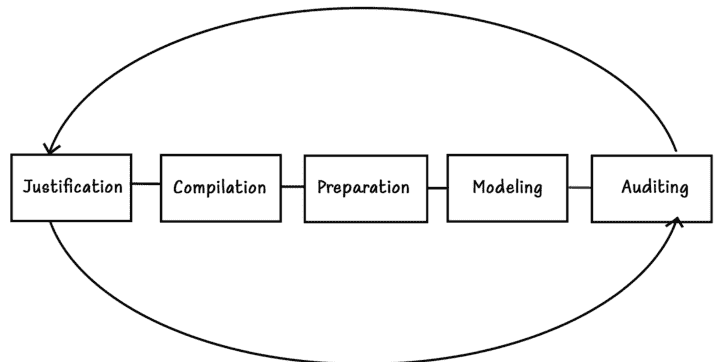

图 9-1. RDS 框架的流程

该框架从“正证”（justification）开始。这里的*正证*基本上是 CRISP-DM 中“业务理解”步骤中的需求收集和问题定义。在这里还会对技术解决方案进行考虑，并开始识别数据源。在这里考虑伦理影响至关重要。该框架的作者建议在此阶段生成一份“影响声明”（impact statement），正式地考虑并记录潜在的伦理疑虑或后果，如果团队成员没有足够的知识，则寻求外部帮助。这也是可能查看其他类似项目的时候，这也是为什么文档如此宝贵的原因之一。

第二个阶段是“汇编”（compilation），即收集完成项目所需的所有材料，从数据本身到将在解决方案中使用的工具。它还可能涉及其他可能并不显而易见的部分，例如用于衡量性能的指标、算法、数据字典，甚至是项目开发方法和项目任务管理工具。此阶段应该产生几份交付物。第一份是比数据字典更深入地阐述数据本身的文档，包括关于数据如何收集的、如何被处理的以及将如何使用的信息。该文档通常面向非技术人员，并应解决问题，特别是伦理考量。请注意，在实践中，可能很难了解某些内容，特别是数据是如何收集和处理的，但其理念是尽最大的努力。第二份面向技术受众的文档是审计报告，它深入探讨了“影响声明”中汇编步骤阶段提出的问题。重点应放在确保公平性（以及如何实现这一点）。

第三个阶段是“准备”（preparation），这与数据科学流程中的数据准备步骤相契合。在*准备*阶段中，我们进行任何必要的数据清洗、特征工程和特征选择。它还包括数据科学流程中的探索性数据分析步骤，因为为了准备和创建选择特征，我们必须对数据有深入了解。这一步不应该产生全新的文档，而应该根据需要更新之前的数据（以记录数据清洗和创建任何新特征，并说明它们如何影响伦理考量）。

下一阶段是建模（modeling）本身。将性能指标值重新定义为基线（最低可接受值）和乐观高值是有用的。关于使用何种算法的最终决定在这里做出，此时会考虑所看算法的透明度。通常还会使用不同的超参数值多次运行每个算法（这将在第 15 章详细介绍），并建议记录和保存各种组合的算法性能。其他内容还包括选择最终使用算法的理由，以及对性能与可解释性平衡的讨论（如果因为性能更高而选择黑箱算法，反之亦然）。

最后一个阶段是审计（auditing）。审计是我们退后一步，审视整个过程中所做的一切。请注意，如果发现任何令人担忧的问题，我们可能必须回到起点重新处理所有阶段。在这里将对受保护群体和其他特殊分组进行偏差检查，例如模型在男性和女性之间、或白人和有色人之间的表现是否相似。确保能向利益相关者提供合适的模型解释也很重要，并且如果这不是第一次审计，则在其他审计中提出的所有之前的问题都得到了解决。所有这些都应该记录在每次审计中。

## 成为伦理文化的一部分

在数据科学家中建立伦理实践文化的最重要因素是数据科学家个人要关心伦理。有些人可以强制要求遵循 RDS 框架，但如果人们不认真对待各个步骤——他们可能对大多数伦理疑虑仅草草考虑一下，并在正证阶段创建一份不充分的影响声明——那么遵循它也无一获。数据表审计报告也可能是肤浅且不的。审查这些文档的外部人员可能不知道还有很多内容未被考虑。因此，为了让框架发挥作用，人们必须认真遵循它。

不幸的是，人性倾向于尽量减少我们必须做的工作量，而寻找伦理问题是一项工作。我们如何说服人们这很重要、这值得做呢？我认为最有说服力的是伦理恐怖故事。个人故事总是比抽象的想法更能吸引并说服人们，特别是当这些故事能与故事核心的人产生共鸣时。另一种方法是让数据科学家之间进行开放对话，讨论他们在自己的项目中发现和缓解的伦理问题。人们彼此之间的学习效果非常好。

实从业者可以做很多事情来减少伦理问题，包括关注使用具有透明性的算法，或者通过事后应用模型解释器。在个人层面，即使一个人也可以开启伦理数据科学的转变。即使团队尚未准备好遵循 RDS 框架，一个人也可以养成在不同阶段提出伦理考量的习惯，最终其他人也会效仿。值得注意的是，真正遵循 RDS 框架会减慢项目进度，这可能无法被团队领导层接受。但相反，如果领导层被说服了，让整个团队遵循它是可能的。

## 核心总结与后续

本章深入探讨了数据科学中的伦理问题。我首先查看了当数据科学系统未以伦理方式创建时可能造成的损害性案例。定义了伦理、偏差和公平，然后我们讨论了为什么伦理很重要，尽管它在大多数数据科学项目中很少被考虑。数据科学系统的实用性或效用通常被认为与伦理数据科学对立。确实有一个事实，有时在伦理考量上保持谨慎会导致系统实用性降低（或只是性能变差），但通常一个看起来性能更好的模型只是在更好地延续来自现实世界的偏差。我讨论了数据科学家签署类似于希波克拉誓言的伦理宣言的想法，以及将其作为伦理数据科学主要手段的局限性。相反，介绍了一个更全面的 RDS 框架，通过整合到整个数据科学流程来确保更伦理的数据科学。

这是书的第一部分的最后一章，在这一部分中我奠定了实践数据科学所需的所有基础。现在你准备好进入实践数据科学最重要的主题了。我们将从领域知识的重要性开始。


## 第 9 章 公平与正确：伦理考量

## 从业者简介：哈维·辛卡尔（HARVEY SCHINKAL）

**姓名：** Harvey Schinkal

**职位：** 高级数据科学家

**行业：** 各行业咨询

**工作经验：** 3年数据科学家经验，此前有技术工作

- 技术博士（在读）
- 管理学硕士（MBA）
- 医学管理学士（BAS）
- 全球健康副副学士（AAS）

> *此处表达观点仅代表 Harvey 本个人，不代表其过去或现在任何雇主的观点。*

### 背景

Harvey Schinkal 从零售行业开始，但他知道自己不想一直做下去。在一家家居改进店担任助理经理期间，他学习了业务和报告知识，这促使他尝试新事物。他担任过几个不同的 IT 职位，意识到自己需要更正式的教育才能实现在大公司工作的目标。他参入军，打算在退伍后使用退军人法案（GI Bill）。退伍后，他对医疗保健产生了兴趣。他获得了全球健康副学士学位和医学管理学士学位，但在由于退军人法案资金快用完需要找工作后，他再次改变了方向。他最终回到了科技行业，并非常想追求数据科学。他发现了普渡大学的技术博士课程。该课程要求先有硕士学位，因此他获得了一个 MBA 学位，然后开始攻读博士。他的学位研究方向是伦理和机器学习。

### 工作

Harvey 在攻读博士期间，继续在各个行业从事数据科学咨询工作。如上所述，他的工作经验非常丰富，大部分是各种形式的 IT 工作。离开军队后，他获得了一份数据可视化的咨询工作，并发现工具自他加入以来已经发生了变化。他使用过 Tableau 和 Power BI，并学习了大量可视化知识。在从事数据科学项目之前，他还担任过一些其他技术职位，这些工作真正引起了他的兴趣。他读了几本关于人工智能和数据科学的书，包括彼得罗·多明戈斯（Pedro Domingos）的《主算法》（The Master Algorithm），这启发了他深入深入研究该领域，并导致了今天的成就。

### 金句

**最喜欢工作的部分**：Harvey 通常喜欢与人打交道，因为这让工作变得有趣且有回报，往往比技术工作更有趣。他特别喜欢与可以向其学习的人共事。他发现，可以学习的人并不总是某个资深人士。

**最不喜欢工作的部分**：收集需求和与非技术利益相关者合作可能很困难；有时人们对可能实现的事情有不合理的预期。有时他们并不真正愿意听取可行性的事实。

**最喜欢的项目**：一个令人难忘的项目是客户留存系统。当客户表示要离开这家公司时，客服代表会使用一个 Harvey 开发的系统，该系统会指示客户是否可以留存，并帮助决定向他们提供什么奖励以防止他们离开。最后实际上运行了二十个模型，我们从零开始创建了其中几个，并刷新了其他已经在运行的模型。这为留住客户创造了数千万美元的收益。

**最常使用的技能**：数据库编程、通用编程和可视化是显而易见的。但良好的数据直觉也很重要。例如，你应该能够识别出模型何时发生过拟合，或者理解某些发现实际上并没有帮助（例如，更多女性会购买女性卫生用品）。数据侦探技能非常重要，基本上足以让你提出良好的“为什么”问题。领域知识以及对数据如何收集的理解也很重要。最后，沟通至关重要。

**目前使用的主要工具**：SQL, R, Python, Tableau, Power BI

**数据科学的未来**：Harvey 认为仍然需要数据科学家，但有了 AI 工具，需求可能没有以前那么高。AI 正在帮助我们将数据科学的效率提高 10–15%，但它无法完全取代数据科学家或软件工程师。

**什么是优秀的数据科学家**：求知欲、优秀的人际交往能力、技术天赋、学习新技术的意愿和灵活性是最重要的特定技能，但整体软实力至关重要。理解算法如何运作也很，即使你不知道它们背后的精确数学原理。这一点与许多公司向非技术人员提供自服务分析工具的趋势有关，因为这些人对工具如何运作缺乏基本理解，数据科学家可能需要指导他们。

**他给未来数据科学家的建议**：咨询和小型公司是获得经验的好极方法。咨询可以让你接触不同的行业，所以即使你不认为想做一辈子，它也有价值。此外，在毕业之前甚至之后实习都是值得的，只是为了获得现实世界的经验。读更多关于人工智能和数据科学的通用非虚构书籍也是好的。经典包括彼得罗·多明戈斯的《主算法》布莱恩·克里斯汀的《对齐问题》（The Alignment Problem）、内特·银的《信号与噪声》（The Signal and the Noise）以及纳西姆·塔勒布的《黑鹅》（The Black Swan）。这些书能让你对数据科学更广泛的世界有一个良好的感知——谁在使用它、如何使用以及它可以做什么。

Harvey 是一位拥有多种技术职位和行业经验的数据科学家。

## 第二部分

## 执行数据科学

## 第 10 章

## 掌握大局：领域知识

## 引言

我已经在书中多次提到领域知识，因为它在数据科学中至关重要。作为一个提醒，*领域知识*是指在某些方面具有专业性的知识，是通用知识的对立面。人们经常声称拥有某个行业或领域的领域知识，但任何人几乎都可以成为任何领域的专家——医疗保健、西班牙语、玩游戏、17世纪的马术、治愈系幻想小说、农场动物管理、遥模型、宝梦卡牌，以及你可以想象的任何事情，无论是职业、爱好、个人兴趣还是生活经历。你几乎肯定在某些事情拥有领域知识，即使可能还没有达到专家水平。

好了，假设你有领域知识。它的意义何？在生活中，有时了解一些有趣或愉快的事情很有趣。但在许多情况下，这种知识可能是无价的，即使它是源于爱好或激情。对于想要进一步了解其产品和竞争的视频游戏公司来说，了解游戏玩家的行为是有帮助的。一家披萨店如果了解客户行为和餐厅销售模式，就能更好地查看其数据。了解一天中忙碌的时段以及工作日与周末之间的差异将变得困难。

## 现实世界中的领域知识示例

几乎每份工作在某种程度上都涉及领域知识，这在科技世界尤为重要，因为技术人员为不同领域的非技术人员构建系统（各种类型，而不只是数据科学）。它在业务理解和需求收集方面可能特别重要，虽然你可以在工作中学很多，但起初没有它可能会产生负面后果。我们将首先看一个独特的领域知识开启新业务的案例，然后看另一个由于领域知识不足导致项目失败的案例。

## 案例 1：大众时尚

Stitch Fix 为想要以最小努力获得服装的购物者提供定制化时尚。他们销售五件服装或配件的盒子，这些物品由自动推荐系统为每个客户选择，然后由公司的造型师手动调整。这是一个不寻的想法，公司的早期成功完全取决于创始人兼首席执行官凯特琳·莱克（Katrina Lake）对女性购物时尚的理解——这就是领域知识。她


## 第10章 掌握大局：领域知识

大多数在线时尚公司都试图通过更快的物流速度或更低的价格来体现差异化，而她选择了个性化。¹

在早期，她在为公司筹资时遇到了困难，因为大多数风险投资人都是男性，他们并不理解 Lake 所经营的服装购物世界。关键的差异化在于个人化元素，结合了算法考虑比单个人类多得多的选项的能力。这套数据科学方法基于每位客户在注册时填写的问卷结果，以及他们在收到每一个快递箱盒后提供的反馈。算法会创建一个包含五件物品的独特组合，然后由造型师在必要时进行评估，并给予批准。数据科学的作用是让整个业务变得具有可扩展性——让造型师从零开始构建一个包装盒是不可能的，但如果他们只是对预选物品进行微调，那么耗费的时间就会少得多。这一概念的成功完全基于 Lake 知道在服装购物中人类因素是多么重要。

### 示例 2：临临缩脚

我曾参与过一个失败的项目，很大程度上是因为我们没有足够的领域知识来设计正确的解决方案。这在某种程度上也是需求收集的失败，但如果我们有更多的领域知识，我们就会意识到我们提出的解决方案并不是利益者真正需要的。我们被赋予了预测几家商店的烤鸡销售额的任务。我们从一个外部供应商那里接手了这个项目，他们已经工作了几个月，并且是按天进行预测的。当我们接手时，开始查看数据，并访问了其中一个烹饪和展示鸡的熟食店，这为我们提供了关于该部分业务情况的大量信息。由于我们能够利用另一个项目的代码，我们拥有了一个良好的模型，在三周内给出了非常准确的预测。但该项目仍然失败了，部分原因是因为他们对准确性有不合理的期望（尽管我们的表现优于他们的手动预测和行业标准准确率，但他们想要更高的准确性），部分也是因为我们不理解他们需求中的某些重要点（而他们也不了解我们能擅长什么，因此无法提出相应的要求）。

尽管进行了实地访问，我们仍然没有完全理解所有事情的时机。鸡肉必须经过烹饪，而且保质期有限，所以过一段时间后，卖掉的那些就扔掉。显然，他们不能在早上把所有的鸡都烤好然后放在那里一整天。他们真正需要的是每小时的预测。但因为我们是从一个按天而非按小时预测的第三方接手的项目，我们只是继续沿用了那种方法。我们对快速的结果感到满意，并制作了一个很好的可视化图表，显示了持续预测、准确率以及每个每日预测中包含的特定特征。但最终，客户失去了兴趣。我仍然认为，这部分是因为我们没有真正给他们他们的东西——即每小时的预测。理解客户及其需求有多重要，无论怎么强调都不为过，而理解他们的领域是做到这一点的最好方法。

¹ Stitch Fix 首席执行官谈“向大众市场销售个性化风格”，作者 Katrina Lake，收录于 HBR《人工智能、分析与新机器时代： 10 篇必读》，2019年

### 什么是领域（Domain）

我在上面提到过，领域几乎可以是任何东西。它可以是一个技术领域——如数据科学、生成式 AI、软件开发——也可以是一个像医疗保健或视频游戏这样的学科。显然，数据科学家应该在数据科学领域拥有专业知识，但在其他领域的经验也很有价值。我特别发现我的软件开发背景在数据科学中非常有用，因为很多数据科学家学习的编程不够严谨，且知识局限于主要用于数据科学的代码库，而在涉及更通用的编程、设计和最佳实践时，更广泛的知识会有帮助。这在生产化（productionization）时特别有用。

将领域视为“学科”而非“领域”通常是最有用的。在商业世界中，科学家工作的一些常见领域包括零售、保险、银行和医疗保健。很多时候，招聘公告会要求具有公司领域的经验，这仅仅是因为当你在这些领域之一工作时，你会开始理解一些细微之处。不同领域的数据截然不同。医疗保健拥有大量的患者数据，这些显然是高度敏感的。取决于职位处于医疗保健的哪个部分，可能其他类型的数据，包括与保险、诊断以及公共卫生相关的高级数据。零售可能拥有客户数据，但大部分数据与销售和库存有关，因此不涉及个人身份信息（PII）。

熟悉法律和法规也是领域知识的因素之一。例如，银行和保险行业有很多规定，如果人们在进入行业开始工作时已经理解这些并了解一些具体的细节，将非常有帮助。同样，如果人们在医疗保健领域开始工作时已经熟悉 HIPAA（HIPAA 规定了医疗保健患者数据的法律），也将很有帮助。对于高等教育工作，熟悉 FERPA 也是有用的（FERPA 法律涵盖了美国大学高校学生数据的隐私）。

但正如我之前提到的，领域也可以非常具体。视频游戏行业规模巨大，雇佣了数百万人，他们通常倾向于雇佣自己就是玩家的人员，这样他们就能理解公司内部的一切。如果有一个正在研究不同类型的项目，让人们了解许多视频游戏类型以及哪些可能具有跨界吸引力的类型将会有帮助。一个从未玩过任何游戏的人将不知道这一点，他们也不知道是什么从源上驱动人们玩游戏。

同样，领域也可以是针对公司的。我曾参与过一个项目，创建一个处理西班牙语文本以分配阅读难度的系统，该系统基于公司现有的处理英语文本的系统。我的同事做过英语系统，对它的运行原理非常了解。我没有做过英语系统，但事实证明，在我们开发西班牙语系统时，我中等水平的西班牙语知识有用。他对英语分析器的领域知识和我对西班牙语的领域知识意味着我们是一个完美的团队。

### 领域专家与学科专家

深入理解一个领域的人被称为领域专家。成为领域专家并不要求人们对某个领域进行字面上的全面了解，但它意味着他们拥有大量的知识，并在该领域工作时不断获得更多。即使是少量的领域知识也很有价值，就像我在开发西班牙语分析器时的西班牙语知识一样。

对于科学家来说，领域知识也有价值，因为这意味着他们熟悉在这些领域开展的数据科学工作。例如，预测零售店的销售额与预测信用卡欺诈是不一样的。


# 第 10 章 掌握大局：领域知识

（跳转 25%）。这种特定方法并不直接转化到其他领域。同样，在发布新产品时，有一种用于计算所谓的“增量销售额”的技术，它会考虑我们预期的其他产品的销售情况（对其进行预测），然后计算新产品的总销售额中有多少是新增长的，又有多少是从原始产品中转移过来的（将自己的某件产品流失给另一件产品被称为“**蚕食**”）。

在这个语境下，你还会听到另一个重要术语：**领域专家**（subject matter expert，简称 SME），通常缩写为 "SME"，发音为 "smee"。领域专家是在特定领域拥有专业知识的人，就像领域专家一样。这两个术语很大程度上是类似的，但你会在不同的背景下听到它们。SME 一词的使用频率高得多，通常指的是非常熟悉数据和业务流程的人，通常是在特定公司的背景下。这基本上就是对公司流程和数据的领域知识。可能存在某位 SME 对公司的库存管理系统了如指掌，包括存储的数据以及用于创建和管理这些数据的流程。SME 通常活跃于数据科学家的业务端而非技术端，数据科学家在处理新项目时寻求他们是非常普遍的。某些 SME 可能还具备一些与数据相关的技术深度——例如，他们可能知道数据库中的源表名称和列名——但他们对数据拥有更高层次知识也很常见。这两种情况都有价值，但数据科学家可能需要找到某人来弥补高层知识与数据库级知识之间的差距。

你会发现，对于那些在同一领域已经是专家的数据科学家本身，通常较少使用“SME”一词。我们更倾向于称他们为领域专家（或者干脆不加任何称呼，而是认可他们的专业能力）。作为公司领域专家的数据科学家很可能对数据本身有深入的理解，并对该公司在该领域开展的数据科学类型有所了解，但对 SME 所熟悉的所有准确业务流程可能了解较少。这就是为什么数据科学领域专家和 SME 合作得非常出色，因为他们涵盖了该领域的所有内容。

## 为什么领域知识很重要

你第一次在第 6 章看到过数据科学维恩图，但如果你再次查看它（图 10-1）并突出下方的圆圈，你就能看到领域知识对数据科学是多么关键。所有三个领域都是重要的，但领域知识是优秀数据科学的核心组成部分。它究竟有什么价值呢？

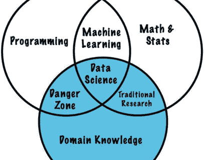

**图 10-1.** 突出显示领域知识的数据科学维恩图

到这里，你可能同意领域知识在数据科学中至关重要。我在前面的章节中谈过，理解我们拥有的数据在现实世界中代表什么非常，而领域知识确保了你有这种理解。让我们来看看它最有几个特定领域。

## 理解利益相关者

成为领域专家有助于数据科学家理解利益相关者所处的世界，这更容易理解他们面临的问题并提出更好的解决方案，这主要是因为更好的沟通（源于相互理解）使得协作更加顺畅。当你与没有合作过数据科学家的利益相关者交道时，即使领域知识也非常有帮助，因为他们并不总是知道会有什么预期或者哪些信息是重要的，而你的领域知识可以帮助你提出正确的问题。记住，利益相关者往往不知道自己自己知道什么，但你的知识可以防止此类问题的发生。图 10-2 是一个幽默的提醒，说明人们无论在科学还是商业领域，不知道自己知道什么。

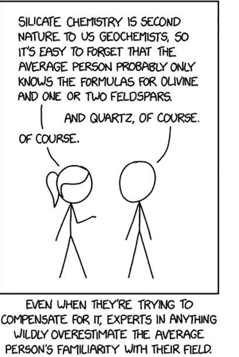

**图 10-2.** 平均熟悉度，一张 xkcd 漫画。来源：Average Familiarity-xkcd.com，根据知识共享 署名-非商业 2.5 许可使用

领域知识可以发挥作用的另一个领域是公信力。这在所有技术领域都是如此，利益相关者通常不信任为他们构建任何类型系统的人。原因在于他们通常对交付不符合目标的技术方案有糟糕经历。我的一位朋友在餐厅安装销售点系统（收银机输入客户订单），作为她工作的一部分，她必须培训员工使用该系统。她很早就学会在培训开始时提到自己作为服务员和餐厅经理的多年经验，因为这能让她正在培训的人信任她。当她安装和设置系统时，她的知识也派上了用场，因为她完全理解这些系统是如何使用的。她的大多数同事只有技术经验，通常不能很好地理解。

同样，在我的一份零售业数据科学工作中，公司文化认为，除非在其中一家商店开始职业生涯（理想情况下是推过购物车），否则没有人能真正理解业务。奇怪的是，他们不计入在其他公司的类似经验。在那种情况下，你并不总是无能为力。当我们遇到持有这种心态的利益相关者时，我们团队的通融办法是包含一位曾在商店开始职业的同事（我们的同事也是一位非常优秀的数据工作者，所以对我们来说并没有损失）。

## 数据准备与理解

在处理数据本身时，领域知识同样重要。理解数据的含义是无价的，而且如果没有领域知识，这种理解有时无法发生。事实是，如果没有特定知识，数据似乎是可以理解的，但如果你没有相关经验，你会发现自己做出了无效的假设或误解了某列。

例如，我曾在一家零售公司工作，那里几乎所有的购买都是由公司会员客户完成的，因此每笔销售交易都存储了一个会员号。但偶尔会有非会员完成的交易，这些交易都被分配了一个虚拟会员号（值始终是相同的）。由于全球范围内有许多商店，如果你按会员号分解购买情况，该会员的总订单量会比最活跃真实会员还要大几个数量级。如果你不懂这个特殊会员号的含义，你可能会犯将这些交易包含在分析中的错误，如果你是在会员层面上进行工作（例如计算平均会员支出），这将极具误导性。

在同一家公司，我参与了一个预测特定熟食类产品销售额的项目，以帮助熟食部经理做出全天范围内制作多少该产品的决策。当我们刚开始时，我们发现某些早晨有巨大的订单，但并不是所有早上都是如此。我们不知道如何解释，但能够从 SME 那处了解到这些订单是提前预订的并在开门前取走的，因此将它们从我们的模型中排除掉是合理的。熟食部经理会完全预知这些订单。没有了这些知识，我们可能会把它们包含进来，从而降低我们预测的准确性（和价值）。

领域知识在数据预处理和特征工程中也重要。我们将在后面的章节中讨论数据准备，但你必须处理的大问题之一是缺失数据，如果没有领域知识，几乎无法知道正确的处理方法。领域知识影响着特征创建和特征选择，这两个我们都会稍后深入讨论。但它可以帮助识别多个特征实际上代表同一事物的情况，从而不应全部包含在模型中。例如，如果你正在为大学开发一个每学期优化教师课程分配的系统，将会有一些基础性的假设，而搞错了这些假设可能会产生问题。例如，没有意识到教师可以教多门课程，甚至是同一门课程的不同班次，就会破坏结果。你需要考虑许多参数，包括他们的专业领域、一名教师可以承担的课程总数，以及他们不应该被安排连续上课。


## 开发良好的解决方案

拥有领域知识使得数据科学家更容易提出有意义的解决方案，从而确保结果对利益相关者具有价值且实用。如果你理解利益相关者的业务以及他们如何使用现有的工具，就能更容易理解数据科学解决方案可能如何融入到他们的工作流中。这可以帮助你避免提供他们不需要、甚至可能让他们困惑的信息。我发现，有时包含一些对数据科学家来说认为极有价值的信息，利益相关者可能并不那么看重。接下来的例子并不严格属于领域知识，因为它更多是关于理解客户的视角（但有时理解某些类型的客户确实就像领域知识一样）。我们对一个项目进行了一些预测，并且做得非常严谨，计算了每项预测的统计显著性。我们认为让利益相关者看到我们对每个预测的有多大信心会有帮助，但实际上却产生了适得其反的效果——他们被“p值”吓住了，而且并不习惯结果可能有不同质量水平这种观点。他们习惯于与第三方供应商打交道，这些供应商倾向于无论显著性如何，都对所有事情给出数字。

领域知识还将帮助我们在项目真正开始之前识别并缓解潜在的问题和风险。它对于解决过程中出现的意外问题也有帮助。最近与零售数据工作时的一个挑战之一是新冠肺炎的影响。2020年出现了一些非常奇怪的销售模式，特别是在早期，随后又出现了影响几乎每个人的重大供应链问题。通常在预测销售额时，需要几年的销售数据，这仍然包含了疫情期间的年份。理解“2020年不能代表典型年份以及以及大多数地方面临的库存问题”这一事实，意味着你可以更好地处理这些异常情况，而不是忽略它们并导致模型表现异常。

## 第 10 章 掌握大局：领域知识

最后，领域知识在衡量模型性能方面可以非常有帮助。衡量模型性能有许多标准指标，但为你的潜在问题选择最佳指标往往并非易事。在许多情况下，特定领域会使用某些指标。知道假阳性（false positives）是否优于假阴性（false negatives）或反之然也非常重要，这可以影响你选择哪种指标。在医学中，将一个实际上没有患病的人标记为可能患病（假阳性），比漏掉一个确实患病的人（假阴性）要好得多。有了领域知识，更容易考虑到这类问题。

同样重要的是，要意识到领域知识在处理人类的领域可能更为重要。医疗保健、客户服务和营销等领域由于数据的复杂性和稀疏性，通常往往更难建模，导致准确率较低，因此你所能包含的任何领域知识都可能产生巨大影响。在制造业和电子商务领域，情况不那么复杂，即使没有特殊知识也更容易定义。

## 安全、隐私与伦理关注

领域专家可以提供的另一个有价值的信息是对可能出现的安全或隐私问题的意识，以及对可能出现的伦理问题的意识——潜在和现实问题都可以提前预测。其中部分内容源于与相关数据类型安全或隐私相关的通用法律法规的理解，有时以及对公司特定规则和标准的理解。它还能对给定领域如何影响人们（无论是员工、客户还是普通大众）产生意识。这意味着伦理困境可以被避免或缓解，而不是在意外之外出现并造成混乱（这可能是从重大项目延误到公关噩梦的任何情况）。

350

## 成为领域专家

意料的是，获得领域知识有两种主要途径：经验和学习。通常情况下，两者对于成为真正的领域专家都是必不可少的。如果你进入了一个从未工作过的领域，你一定会开始从同事和利益相关者那里学习东西。提问很重要，尽量避免做出假设同样重要。数据科学家与利益相关者坐上一天或几个小时（通常被称为“影子学习”）以观察他们如何处理日常工作和完成任务，这并不稀见。

虽然实践经验和观察是有价值的，但很少能仅通过在该领域工作就学到应有的知识。你寻找其他资源来学习是明智的。互联网可能不会提供与你组织所处理的数据相关的信息，但它会有关于该领域的一般信息。取决于你是什么样的学习者，你可以找到解释问题的书籍、博客、视频和文章。当然，并非所有来源都是同等的。例如，Medium.com 有许多涵盖各种领域的优质数据类文章。并不是所有文章都是好的，但如果你留留心，通常可以识别出可靠的来源。

如果你尝试在学位毕业后直接找工作，或者在一个与你经验不同的领域，学习仍然是获得该领域知识的一种完全有效的方法。有时，寻求认证来证明你达到了某种水平的知识是有用的，但这通常不是必要的。

同样重要的一点是，一旦你拥有了领域知识，即使是专家水平，你也必须不断学习。领域在不断变化，你必须保持跟上。

第 10 章 掌握大局：领域知识

## 领域知识总是最好的吗？

要提到的一个非常反直觉的重要点点是，在某些情况下，领域知识可能会损害机器学习模型的性能。其中一种情况是当专家涉及偏见观点时，它会将人类偏见引入其中。这种场景的一个例子是著名的难题游戏围棋。Google DeepMind 的系统 AlphaGo 能够击败人类冠军。它是利用许多围棋专家的领域知识进行训练的。这在当时是一件大事。但随后发布了一个仅基于数据和游戏规则（不含领域知识）训练的新版本系统——它以 100-0 击败了原始版本。

还存在看似是领域知识但实际上错误的情况。我参与过一个销售预测项目，店经理坚持某些因素至关重要，而我们的模型没有选择这些因素，因为它们实际上并不重要。这对于经理们来说可能是一个教学机会，但他们忽视了信息并且不信任预测。这真的又只是偏见，即使没有人受到伤害。这可以被认为对经理及其管理商店的能力是有害的，但商业世界就是这样运作的。

记住，领域知识只是一个工具——在大多数时候，它是有价值的，如果你能记住始终考虑伦理视角，它就值得考虑。

² 由 Haixing Yin, Fan Fan, Jiazhi Zhang, Hangyang Li 和 Ting Fung Lau 于2020年8月30日发布于 ML at Carnegie Mellon University 博客，https://blog.ml.cmu.edu/2020/08/31/1-domain-knowledge/

352

## 核心要点与后续

本章探讨了领域知识的重要性。领域是任何人可以了解的任何事物。领域知识在理解利益相关者及其需求方面非常有价值。它还可以在数据准备和创建良好的解决方案方面提供显著帮助。在问题发生之前识别风险以及安全、隐私或伦理妥协也同样重要。成为领域专家基本上需要学习，并在可能的情况下获得经验。最后，我们讨论了领域知识并非总是最重要事项的问题——它有时可能是带有偏见的或错误的。

在下一章中，我们将继续观察从事数据科学的重要组成部分。数据科学家工具箱中最重要的工具之一是编程语言，通常是 R 或（越来越多的）Python，因此我们将从高层次讨论这些语言。


# 从业者简介：MOMO JENG

**姓名：** Monwhea (Momo) Jeng
**职位：** 数据科学家
**行业：** 软件
**工作年限：** 10年数据科学家经验，以及更多的软件工程师经验
**教育背景：**

- 物理学博士
- 数学与天文学学士

此处观点仅代表 Monwhea 个人，不代表其过去或现任雇主。

### 背景

Momo Jeng 的职业始于学术界的物理研究员和教授。在物理工作过程中，他涉及一些编程，特别是运行模拟。他想离开学术界，申请了软件开发工程师职位，并在微软开启了新的软件职业。他从事了数年的纯软件开发，但随后怀念研究，于是开始与同事交流，了解自己可能从事的其他角色。他学习了在线实验并加入了一个负责该领域的团队，并在那里工作了五年左右。他喜欢这份工作，但想尝试不同的事物，于是转到了一个从事自然语言处理的团队。后来他又转到了另一个在线实验团队，他目前就在该团队。

### 工作

Momo 的大部分数据科学工作都在在线实验领域，那里会测试不同的内容，比如 Bing 搜索引擎的布局或广告设计。这项工作比传统的软件开发带有更多研究色彩，他很喜欢这一点。他处理海量数据，这意味着要弄清楚如何从中提取信息。他处理过搜索历史等数据，并考虑过不同的有意义的分组方式，并尝试检测人们对搜索结果是否满意。他热爱寻找巧妙方法来提取含义的挑战。此外，在在他的职位中，实验设计至关重要，他的团队经常需要发挥创意来寻找获取信息的方法。这意味着实验设计必须完全准确，以便他们获得的数据能提供他们想要的结果。有时结果与预期的完全不同，他们必须深入研究，看看是研究本身出了问题，还是他们真的发现了意料之外的发现。有时实验可能具有挑战性，因为你不能总是控制所有因素。如果你在观察社交媒体并将用户分为控制组和实验组，你无法保证这些组别之间不会产生互动，这可能会损害研究（取决于所研究的内容）。

# 第 10 章 把握大局：领域知识

# 观点摘录

**工作中最喜欢的部分：** Momo 喜欢挖掘数据，特别是在早期阶段，仅仅是尝试理解数据。他也喜欢设计新颖实验并分析结果的挑战。

**工作中最不喜欢的部分：** 会议

**最喜欢的项目：** 他的团队致力于他所谓的“反事实实验”，在实验中他们不运行典型的 A/B 测试，而是预测结果。他们通过运行几次虚拟实验，然后运行一些真实实验，验证了这一点，发现他们的实验非常准确。为了创建这个框架，他们使用了一些有趣的统计学思想，如倾向加权（propensity weighting）。这使得他们能够快速获得许多反事实实验的结果。在真实数据上运行真实实验是非常耗时的，这意味着在有限的时间内针对有限的用户群，他们可以尝试的模型数量是有限的。模拟允许他们尝试更多的模型，这样他们就可以在真实实验中使用表现最好的模型。

**最常用的技能：** 最关键的是对细节的关注。数据科学的百分之九十是在审视数据并确保其符合逻辑，包括清洗、数据验证等。他还使用了大量的传统统计学。职场技能如沟通、理解层级结构、通常与人打交道。

**目前使用的主要工具：** Python 和内部类似 Hadoop 的 map–reduce 系统（用于处理他们拥有的海量数据）

**数据科学的未来：** 他希望不会如此，但 20 年后 AI 可能会承担大部分数据科学工作，这并非不可能。

**什么是优秀的数据科学家：** 对细节的关注是最重要的。他说，成为那种对数据中某处看起来不对劲感到非常困扰、并纠结直到将其弄清楚的人非常有帮助。

> *Momo 是一位在实验领域工作的数据科学家，拥有深厚的软件工程背景.*

# 第 11 章

# 工具：Python 和 R

## 引言

学习编程语言是大多数数据科学家职位的必备步骤。数据科学家通常不从事所有类型的软件开发——大多数人不会从事前端工作（如 Web 开发）。相反，数据科学家通常最常使用的是单文件脚本或笔记本（notebook）。如果你必须自己完成生产化，你可能有时需要设计多文件软件来执行建模，并可能使用其他工具将代码投入生产环境。Python 和 R 是数据科学家最常用的两种语言，本章将介绍这些常用语言的编程基础，并简要探讨它们的不同之处。

# 数据科学编程的历史

编程语言和其他计算工具在数据科学中已经使用了很久，但今天使用的主要语言——Python 和 R——的统治地位是最近才出现的。我们在第 4 章中讨论了统计工具的发展，以及 R 特别是如何从专有语言 S 作为开源替代方案而出现的。在此之前，统计工作很大程度上在 SAS（一种专有统计语言）和 FORTRAN 语言中进行，FORTRAN 是一种对科学和工程编程支持良好的传统语言（高数值精度允许精确的数学和统计计算）。SAS 更多用于金融和保险，而 FORTRAN 的应用更广。但对于技术性不强的统计学家来说，FORTRAN 有些令人生畏，这导致了 S 专为他们开发。它并没有流行，因为它是专有的，并不是所有人都能使用。R 最初开发于 20 世纪 90 年代用于帮助教学，运行在 S 之上。R 中的许多程序可以在不修改的情况下运行。它仍然是学习统计和编程的极佳语言，但它迅速蔓延到了教学之外的通用统计领域。它仍然被统计学家和现在的数据科学家频繁使用。

Python 进入数据科学稍晚一些，但它在数据科学家中的人气已开始盖过 R。Python 起初作为一种通用语言，在文本处理和高效语法（允许用更少的行数实现更多功能）方面有特别优势。它获得了一种近乎崇拜的流行，Python 社区自称为“Pythonistas”，将官方最佳实践指南命名为“Python 之禅”，并将原始开发者称为“终身仁慈独裁”（BDFL），因为直到 2018 年他一直对该语言负主要责任。直到 2009 年 Pandas 包（核心语言的插件）发布以及 2010 年 scikit-learn（主要的机器学习包）发布后，它才真正被用于数据科学。Pandas 通过引入数据框（R语言中的主要数据结构）改变了 Python 的编程风格，使其更像 R。数据科学本身从那时开始兴起，那些已经在使用 Python 的程序员在开始从事数据科学时，自然地开始使用 Pandas 和 scikit-learn，其人气也随之增长。

> ¹你可以在此处找到“Python 之禅”和关于“BDFL”的引用 https://peps.python.org/peg-0020/


尽管 SAS 在某些公司仍在使用，但现在的主流是 R 或 Python，这取决于你的观点。除非你最终找到了一份使用 SAS 的工作，否则在开始阶段没有学习 R 或 Python 之外的任何东西。两者都是数据科学领域完全合法的语言，无论是学习还是开发都是如此。它们有不同的优势，这可能决定了你针对特定目的选择哪一个，而且大多数数据科学家对于他们偏好哪一个有非常自己的见解。团队主要使用其中一种语言也很常见。另一方面，没有理由不同时使用两者——许多团队都是这样做，我们将在接下来的章节中详细讨论它们的异同之处。R 特别擅长统计学，在学术界的可视化非常流行；而 Python 则擅长机器学习和通用编程，包括构建生产系统。

## 现实数据科学中 Python 和 R 的示例

我们的第一个示例很好地说明了你不需要在 R 和 Python 之间做出选择，而是可以在它们各自擅长的地方使用它们。然后我们将看看 Python 如何在金融科技领域中使用。

## 示例 1：使用两者进行对冲

对冲基金公司 Amadeus Investment Partners 发现使用技术栈（团队完成工作使用的技术工具）取得了成功，该技术栈包含了 Python 和 R，以及 SQL 和其他工具。他们拥有

> “案例研究：如何构建高性能数据科学团队”由 Matt Dancho 和 Rafael Nicolas Fermin Cota 编写于 Business Science，可访问：https://www.business-science.io/business/2018/09/18/data-science-team.html

## 第 11 章 专业工具：Python 和 R

他们的跨学科团队有几个不同的角色，每个角色都有其使用的特定工具。他们有技术领域专家（SME），使用 R、Excel 和其他一些工具来探索数据。他们的数据工程师也使用 R，以及 SQL 和 C++（一种性能良好的旧传统编程语言）。他们的数据科学家使用 R 进行 EDA（探索性数据分析），并特别使用 Python 进行机器学习和深度学习。他们还有用户界面开发者，同时使用 R 和 Python 以及其他工具。

对于 Amadeus 来说，他们倾向于大多数数据分析任务使用 R，包括数据探索和可视化。R 中有很多优秀的包可以处理这些任务。但 Python 在计算密集型任务（如机器学习）方面表现出色，特别是当他们处理公司使用的大型数据集时。有趣的是，他们似乎精确地规定了人们应该使用哪些工具。许多公司允许存在异代码库，这可能难以维护和重用。通过要求数据科学家选择他们喜欢的工具（虽然这会导致数据科学家在 R 中进行 EDA），但任何未来的工作都可以更容易地在早期工作的基础上进行构建。

关于这家公司的另一个有趣点是，他们在数据科学领域做了一些非常寻常的事情：他们从商学院招聘顶尖毕业生并将其训练成数据科学家，而不是从具有技术背景的人开始。他们发现这些毕业生能够相当快地学会 Python 和 R，这补充了他们学位中获得的更通用的软技能和业务知识。这说明了学习这两种语言相对容易。

## 示例 2：快速灵活的金融科技

djangostars 是一家金融科技（FinTech）咨询公司和定制软件开发商，他们在所有的工作中都偏好使用 Python.³ 他们有许多理由认为 Python 是金融科技最好的语言，特别是对于新公司。之一是它已经在数学家和经济学家之间受到青睐，因此任何从他们那里进入系统的工作，在“真正的编码”开始之前就已经完成了一大半。虽然很多金融科技涉及数据科学，但内容远不止于此，Python 作为一种多功能语言非常出色。他们认为 Python 结合 Django（一个成熟的基于 Python 的框架）是快速将产品推市场的绝佳组合。此外，那套工具非常灵活且易于修改，这在金融科技中非常重要（与传统银行相比）。他们还发现，因为 Python 相对容易学习，使得与客户的协作和知识传递更加顺畅，因为对开发者和数据科学家来说解释它非常容易。Python 非常成熟，并且有很多免费包可以实现几乎任何想象的事情。

## 计算机编程基础

编程语言真的像人类语言，只是简单得多。我曾有一位教授在 20 世纪 80 年代获得了计算机科学学位，并说服他的大学将 Pascal（另一种传统编程语言）计入他的外语课程要求。这在今天可能发生发生，但像人类语言一样，编程语言有语法（特定的词汇、运算符和编写顺序）

> ³“使用 Python 进行金融科技项目：你应该知道的一切”由 Artur Bachynsky 编写，2024 年 10 月 28 日，https://djangostars.com/blog/python-for-fintech-projects/

## 第 11 章 专业工具：Python 和 R

语义（遵循语法规则编写的特定文本所表达的含义）。它们还有随着时间演变的习语（idioms），即程序员之间约定实现特定目标的惯例方法，即使这不是唯一的编写方式。少数语言还具有相当严格的格式规则来规定状态——Python 就是如此，Python 爱好者热衷地认为这是编写漂亮代码的唯一方式。

计算机代码基本上是用特定编程语言的语法编写的菜谱。几乎所有的编程语言都使用英语单词，并且有一些单词和运算符在大多数语言中通用。最常见的运算符包括表 11-1 中的那些。这些大多是我们从基础数学中熟悉的项目。它们在代码中的用法很大程度上相同。我将在下面对这些进行更多讨论。

## 表 11-1 许多语言（包括 R 和 Python）中的常用运算符

| 赋值与控制 | 比较运算符 | 数学运算符 |
| :--- | :--- | :--- |
| = | > | + |
| | < | - |
| >= | | / |
| <= | | * |
| == | | ^ |
| != | | % |

一些常见的关键字在图 11-1 中。关键字是语言中始终具有特定含义的单词，除了定义的方式之外，不能（或不应该）在代码的任何地方使用。图 11-1 中的所有关键字都用于控制程序流，我们将在下面讨论。

```
for
while
if
else
break
function
def
return
raise
```
图 11-1

一旦你了解了语法基础，就开始学习如何在代码中实现任何事情。编程是非常系统化的，但一旦你进入其中，你就会看到创造力在寻找解决问题的良好方面起了什么作用。

编程有几种不同的高级方法，被称为范式（paradigm）。我们在这里关注的是过程式和函数式，但另一种常见的是面向对象编程，它关注特定类型的模块化设计，可以在 Python 和 R 中实现（在 Python 中很简单，但在 R 中稍微复杂），尽管许多数据科学家可能永远不会使用它。过程式编程涉及一个接一个步骤。函数式编程涉及函数的使用（我们稍后会详细定义，但基本上是定义的小代码单元，可以带有不同的值或无值重复调用以实现有效使用）。

注意，本章讨论的是代码，但并不要求你在本章中学习编写代码。章节中会有一些 Python 和 R 代码示例，但它们仅仅是为了说明观点并展示两种语言之间的差异。然而，如果你是一个实践型学习者，没有问题进入 Python 或 R 解释器并进行尝试。这是一个很好的学习方法。附录 A 详细介绍了如何安装它们并开始使用。


## 传统编程

计算机程序仅仅是一系列行代码，利用语法和其他文本告诉编译和/或运行代码的实体应该做什么。某些语言通过编译器进行编译，这意味着它们被处理并转换为一个可执行的文件，或者由解释器实时运行。R 和 Python 都使用解释器。

代码通过使用换行符、空白（包括缩进/制表符）以及控制结构（如大括号 `{` 和 `}`）进行格式化，以便人类和编译器或解释器都能读懂。除此之外，编写代码还有许多元素，我们将在接下来的小节中介绍。

我在图 11-2 中包含了一些 Python 代码示例，以防你从未见过代码。这些代码没有做任何非常有趣的事情，但它们展示了我们下面将讨论的一些基础知识。当我们讨论这些代码时，我会指向代码中的相关部分。左侧是行号。注意代码是有颜色编码的——这是大多数代码编辑器的标准做法。

```python
# variable declaration and assignment
num1 = 10 # int type
num2 = 99 # int type
num3 = 1.5 # float type
decision = True # bool type
reason = "because" # str type
nums_list = [num1, num2, num3] # list type
nums_dict = {'num1': num1, 'num2': num2, 'num3': num3} # dict type

# mathematical operators
two_nums_sum = num1 + num2
two_nums_diff = num2 - num1
two_nums_prod = num1 * num2
two_nums_quot = num2 / num1
two_nums_pow = num2 ^ num1
two_nums_mod = num2 % num1

# if-else
if num1 >= num2:
    new_var = "bigger"
elif num1 == num2:
    new_var = "same"
else:
    new_var = "smaller"

# looping: for loop
running_sum = 0
for num in range(num1):
    running_sum += num

# looping with a condition: while loop
counter = 1
while counter <= 10:
    print("Hello time " + counter)
    counter += 1

# function declaration and use
def lopsided_square(var):
    var_square = var * var + 1
    return var_square

lopsided_square(num1)
```

图 11-2.一些 Python 代码示例

# 注释

所有的编程语言都允许在代码中包含注释。包含注释的特定语法随语言而异，但 Python 和 R 都使用哈希符号 `#`。每当你在代码行中看到该字符时，`#` 之后的所有内容都是注释，解释器不会执行，而 `#` 之前的所有内容都是会被执行的正常代码。

关于在代码中如何以及注释多少注释有许多观点，但大多数人认为应该有注释。有些人几乎会叙述正在发生的的每件事，而另一些则只包含 TODO 或标记他们认为非常困惑的地方。在实践中，你会发现当你以后回来时，会忘记代码的某些部分是做什么的，因此强烈建议使用注释。

# 变量

变量是在代码中存储数据和值的方式。你可以给变量赋值值，变量只是存储该值的名称。变量用于存储数字、文本或其他复杂数据类型。在某些语言（包括 R 和 Python）中，几乎任何内容都可以存储在变量中，甚至是函数。变量是作为代表其他内容的占位符的方法。当你需要重复执行某些操作且不想每次都重新输入值时（特别是当该值以后可能会变化时），这种方法很常用。

# Python

与几乎所有的语言一样，Python 使用等号给变量赋值。例如，代码 `my_number = 7` 将值 7 存储在变量 `my_number` 中，每当你在代码中看到 `my_number` 时，你可以在脑中将其替换为值 7。如果你看到 `my_number + 5`，结果将是 12。

在 Python 中命名变量有几条规则。变量名中可以使用字母（大写或小写）、数字和下划线 (`_`)，且不能以数字开头。你可以用字母或下划线开头变量名，但以下划线开头变量用于指示 Python 中的某种特定场景，因此对于普通变量，你应该以字母开头。

图 11-2 Python 代码示例中的第 2-8 行是变量赋值，行尾的注释说明了 Python 当前分配给该变量的类型类型。

# R

R 允许变量名中使用与 Python 略不同的字符。它允许与 Python 相同的所有字符，但也允许使用点号（点在 Python 中是运算符，因此不能使用）。在 R 变量名中使用点实际上很常见。名称必须以字母开头。

R 在语言中的独特性在于它使用不同的赋值运算符而不是等号：`<-`。等号等情况下也有效，但大多数 R 程序员更倾向于后者。它看起来像这样：`my.number <- 7`。它的工作原理与 Python 相同，即当你在代码中看到该名称时，它就代表 7。

# 数据类型

数据类型简单是指给定语言中允许的数据类型，即你可以存储且该语言知道如何处理的内容。最基础的（通常称为原始数据类型）、小数（小数数字）、整数（整数数字）、布尔（假/真或 0/1）、复数（包含复数的数值，-1 的平方根）和字符串（包含在标记内的文本，通常是引号）。不同的语言对每种类型都有不同大小的版本。

# 第 11 章 工具箱：Python 和 R

还有更高级的类型可以原生提供、自定义，或通过语言中的其他包（插件）使用。这些包括数组或列表（值的序列）、映射（特定键指向值的值对序列）和集合（类似于不含重复值的数组或列表）。

仍然更多存储数据的方法，这些方法更加高级，且几乎从不是语言中内置的（因此你必须使用外部包）。这些通常被称为数据结构，是一个抽象术语，根据数据存储的方式指明部分之间的行为和关系。它们包括栈（后进先出，类似于餐厅里的一叠盘子）、队列（先进先出，类似于小食摊位前的排队）和树（家族树）。有方法可以处理这些更复杂的数据结构，这使它们在某些情况下变得非常方便，尽管它们在数据科学编程中很少出现。

最后，不同语言之间根据处理数据类型和变量的方式存在一些差异。在静态类型语言（如 Java 和 C++）中，变量的类型必须在创建时定义，并且永远无法持有该类型以外的数据。Python 和 R 都是动态类型语言，这意味着你在创建变量时不需要声明类型，变量可以在不同时间持有不同类型的数据（它可以先存储字符串，稍后存储整数）。动态类型导致代码更简洁，但意味着你必须小心更改变量。

在大多数流行语言都是强类型语言中，对不同数据类型如何相互混合有限制。Python 和 R 都是强类型语言，因为代码在运行时，解释器会跟踪所有数据类型并禁止某些操作。例如，流行的弱类型语言会允许你“相加”一个字符串值（或变量）和一个数字。

# 第 11 章 工具箱：Python 和 R

注意，Python 和 R 都根据分配给变量的值来记录其数据类型。因此，如果你给一个变量赋值了值 7，Python 和 R 将将其跟踪为 `int`，直到它被重新赋值为其他内容。

# Python

Python 拥有所有的基础数据类型，加上两个类似的列表类型（分别称为 `list` 和 `tuple`）以及映射（称为 `dict`）。列表和元组的索引从 0 开始，因此第一个元素在位置 0，第二个在位置 1，依此类推。Python 在当前流行的版本中仅有一种整数数据类型 `int`（早早版本中有一个更大的整数 `long`）。它也只有一个小数类型 `float`（`int` 曾用过名为 `double` 的更大的小数类型）。当前的 `int` 和 `float` 与之前的 `long` 和 `double` 一样，因此现代代码中不需要它们。布尔类型称为 `bool`，复数类型称为 `complex`。字符串存储在 `str` 数据类型中。你可以通过调用 `type()` 函数并将变量名放在括号内来获取类型。

# R

R 也拥有每种基础数据类型中的各一个。它有两种列表类型 `vector` 和 `list`，其索引从 1 开始，与 Python 不同。整数数据类型称为 `integer`，小数类型称为 `numeric`。复数类型直接称为 `complex`。字符串用 `character` 数据类型构建。最后，布尔类型称为 `logical`。你可以通过调用 `class()` 函数并将变量名放在括号内来检查任何值的类型。

# 操作

操作仅仅是编程语言中要执行动作的指令。例如，如果你想在代码中进行数学运算，你将使用表 11-2 所示的运算符。它们的工作方式完全相同


## 第 11 章 职业工具：Python 和 R

在 Python 和 R 中，虽然两者的取模运算符略有不同。图 11-2 中 Python 代码示例的 11-16 行展示了使用的六种数学运算符。

### 表 11-2 Python 和 R 中的数学运算符

| 用途 | 数学符号 | Python | R | Python 示例及结果 |
| --- | --- | --- | --- | --- |
| 两个数字相加 | n + m | + | + | 6 + 2 等于 8。 |
| 从一个数减去另一个 | n - m | - | - | 6 - 2 等于 4。 |
| 两个数字相乘 | n × m | * | * | 6 * 2 等于 12。 |
| 一个数除以另一个 | n ÷ m | / | / | 6 / 2 等于 3。 |
| 计算数字的幂 | n^m | ^ | ^ | 6 ^ 2 等于 36。 |
| | | ** | ** | 6 ** 2 等于 36。 |
| 计算取模（余数） | n % m | % | | 6 % 2 等于 0。 |
| | | | | 7 % 2 等于 1。 |

数学运算中重要的一点是运算符顺序，它告诉你哪些数字和运算符组合将先运行。这与普通数学相同，可以使用括号来强制某些操作先执行。在手写数学公式时，通常会包含括号以便立即清晰，但在代码中，括号通常只在运算符顺序需要时才使用。例如，表 11-3 显示了一些中间概念步骤以及最终结果。如果你不记得数学中的这些内容，起看起来可能会有些敬畏，但在操作一段时间后，它将变成本能。

### 表 11-3 运算符顺序示例

| 运算 | 步骤 1 | 步骤 2 | 步骤 3 | 结果 |
|---|---|---|---|--|
| 6 + 2 * 3 - 1 | 6 | 6 | | 11 |
| | + | + | | |
| | | 2 * 3 | 6 | | |
| | | — | — | | |
| | | 1 | 1 | | |
| (6 + 2) * 3 | 6 + 2 | 8 | | 512 |
| | | × | × | | |
| | | 3 | 3 | | |
| 2 ^ 3 * 5 - 3 | 2^3 | 8 | 40 | 37 |
| | | × | × | | |
| | | 5 | 3 | | |
| | | — | — | | |
| | | 3 | 3 | | |
| 2 ^ (3 * 5 - 1) | 2^(3 × 5)-1 | 2^15-1 | 2^14 | 16384 |
| 2 ^ (3 * 5) - 1 | 2^(3 × 5) | 2^15 | 32768 | 32767 |
| | | — | — | | |
| | | 1 | 1 | 1 | | |

另一种比数学更频繁的运算是比较。我们想知道某个东西是否与另一个相同、不同、更大或更小。你可以在表 11-4 中看到这些内容。它们总是给你一个布尔值作为结果。这些在 Python 和 R 中的工作原理相同。

### 表 11-4 Python 和 R 中的比较运算符

| 用途 | 数学符号 | Python | R | Python 示例及结果 |
| --- | --- | --- | --- | --- |
| 小于 | n < m | < | | 6 > 2 等于 True。 |
| 小于等于 | n <= m | <= | | 6 >= 2 等于 True。 |
| 大于 | n > m | > | | 6 < 2 等于 False。 |
| 大于等于 | n >= m | >= | | 6 >= 2 等于 False。 |
| 等于 | n == m | == | | 6 == 2 等于 False。 |
| 不等于 | n != m | != | | 6 != 2 等于 True。 |

还有几个对条件重要的运算符：not（非）、and（与），并且 not 会取反它所处的值。如果值为 True，取反后为 False，反之亦然。and 和 or 用于组合以给出一个单一的布尔值，只有当两部分都为 True 时结果为 True，至少有一部分为 True 时结果为 True。例如，6 > 2 and 2 > 6 的结果为 False，但 6 > 2 or 2 > 6 的结果为 True。

这些是 Python 和 R 中最重要的运算符。还有其他使用频率较低的运算符，包括位运算符，但你在数据科学中可能不需要它们。

## 程序控制流与迭代

编程的一个方面是让代码按照你想要的顺序执行，并且非常频繁地重复某些操作。运算符顺序是这种微观层面的，但更重要的是控制流功能。让程序按你想要的方式的控制有两种：if-else 条件和循环。

### If-Else 块

if-else 结构允许你说如果这样，就做某件事；如果不是，就做另一件事。你还可以嵌套这些结构，你可以说：如果这个，做一件事；如果是另一个，做一件不同的事；如果是最后这个，做另一个完全不同的事；否则，做另一件事。如果我们把逻辑写出来，看起来就像表 11-5 所示。这种编写方式被称为伪代码（虽然通常你会在右侧有实际的值），是一种类似于代码的写法，不特定于任何特定语言，但让发生的情况变得非常清晰。

### 表 11-5 三条件 if–else 块的框架

| 流程概念 | 伪代码 |
|---|---|
| 如果条件 1 | if var1 > 0 |
| 则执行操作 A | then print "positive" |
| 或者如果条件 2 | else var1 == 0 |
| 则执行操作 B | then print "zero" |
| 或者如果条件 3 | else if var1 < 0 |
| 则执行操作 C | then print "negative" |
| 否则执行操作 D | else print "something's" |


## 第 11 章 工具工具：Python 和 R

### 伪代码与代码单步执行

伪代码基本上是算法的步骤，本质上是用人类语言编写的代码。当你刚开始学习编程时，用这种方式写出来通常是有益的，因为你可以理解逻辑和流程。

此外，还可以用实际值记录伪代码中每一步发生的情况，以观察发生了什么。例如，对图 11-4 中的代码进行单步执行可能开始如下：

| num | value |
| :--- | :--- |
| 0 | 0 的平方是 0。 |
| 1 | 1 的平方是 1。 |
| 2 | 2 的平方是 4。 |
| 3 | 3 的平方是 9。 |
| 4 | 4 的平方是 16。 |
| 5 | 5 的平方是 25。 |
| 6 | 6 的平方是 36。 |
| 7 | 7 的平方是 49。 |
| 8 | 8 的平方是 64。 |
| 9 | 9 的平方是 81。 |

这可以帮助你看到发生了什么并发现问题，特别是在复杂的代码中。

Python 有 `for` 循环和 `while` 循环。`for` 循环使用关键字 `for` 和 `in` 来设置，而 `while` 循环使用 `while`。R 也有相同的关键字，但另一种类似于 `while` 循环的循环，使用关键字 `repeat`。这种循环就像 `while` 循环，但它没有条件，只有在循环内部使用关键字 `break` 时才会停止运行。因此，它一直运行到第一次出现 `loop break`。如果初始条件不满足，`while` 循环可能永远不会运行。表 11-7 显示了 R 和 Python 中运行图 11-3 中内容的循环示例。在 Python 中，获取从 0 到 9 的数字列表的方法是 `range(10)`（而不是 1 到 10），你会在代码中看到它。在 R 中你可以通过代码 `0:9` 相同的结果。

#### 表 11-7. Python 和 R 中的循环代码示例

```python
Python
for num in range(10):
    sq_num = num * num
    print("The square of " + num + " is " + sq_num)

nR
for (num in 0:9) {
    sq_num <- num * num
    print(paste("on the ", paste0(counter,
        "The square of ", num, " is ", sq_num, sep="")))
}
```

表 11-8 显示了使用 `while` 循环实现相同功能的代码。注意在 Python 中，有一种给数字加 1 的简写方式：`num += 1`。

#### 表 11-8. Python 和 R 中的 while 循环代码示例

Python
num = 0
```python
while num < 10:
    sq_num = num * num
    print("The square of " + num + " is " + sq_num)
    num += 1
```

R
num <- 1
```r
while (num < 10) {
    sq_num <- num * num
    print(paste("on the ", paste0(counter,
"The square of ", num, " is ", sq_num, sep="")))
    num <- num + 1
}
```

你可以在图 11-2 示例 Python 代码的第 27–29 行和 32–35 行看到另一个 `for` 和 `while` 循环。

### 函数

到目前为止讨论的所有内容都适用于过程化编程，但添加函数将我们带入函数式编程，如果我们不断执行相同或相似的任务，函数可以极大地改进代码。函数是一个执行特定任务的代码块，可以接受变量作为输入并返回一个值。在不同的语言和语境中，它可以有不同的名称，包括方法、过程和子程序（这些词并不完全同义，但对于本节来说足够相似了）。函数被认为是可调用的，这意味着你定义它一次，以后通过在代码中包含它的名称来运行它。

函数有两个高层级组件：函数定义和函数体。它们在不同语言中看起来可能不同，但第一行总是函数定义，并包含了函数名和输入变量（如果需要的话）。输入变量称为参数（arguments）。函数从下一行缩进开始，或者包含在花括号（或其他内容）中。

函数可以很小——甚至只有一行——也可以长达数百行。通常情况下，越短越好，因为函数的最佳实践是只做一件主事（即使完成这一件事需要很多很多步骤），而不是做几件不同的事情。你将在代码中大量地使用函数，当你调用 Python 或 R 原生的函数，或者你安装的某些包中的函数时。但你也会创建属于自己的函数，这是非常强大的。

### Python

在 Python 中，函数被称为函数，除非它们在面向对象编程的特定语境下被使用，但我们不必担心那个。它们用关键字 `def` 定义，后面跟着名称以及左右括号，如果要在包含在函数运行中，则变量放在括号内。图 11-2 代码中第 38–40 行出现的函数。


# 表 11-9. Python 中导入包的常用方法

| 包导入语句 | 调用包中的函数 |
|---|---|
| import pandas | pandas.to_csv() |
| from pandas import to_csv | to_csv() |
| import pandas as pd | pd.to_csv() |

你如何引用已导入的包取决于一个被称为“命名空间”（namespace）的概念，它定义了变量和其他项目名称的适用范围。第一种方法是最基本的，第三种方法与第一种相同，只是你为 pandas 包创建了一个名为 `pd` 的别名。当你想要调用通过这两种方式之一导入的包中的函数或引用类时，你必须将包名（或别名）放在函数或项目之前，中间用点隔开，如第二列所示。有时第二种方法很方便，因为你不需要在每次调用包中的函数时都指定包名，但它也有缺点。如果你使用第二种方法并编写了自己的自己的函数且将其命名为 `to_csv()`，你将无法同时使用这两个函数——被调用的函数将是最后定义的那一个。这可能会非常困惑。Pandas 是数据科学中一个关键的包，传统的导入方式是第三种方法，即使用别名。

# R

在 R 中，有几种方法导入包。第一种是使用 `library()` 函数，第二种是使用 `import` 包。在 R 中也可能存在命名空间挑战。默认情况下，包中的所有函数只需包名即可使用，但你也可以在包名后加上两个冒号来引用特定包中的函数。请参见表 11-10 的一些导入示例。

# 表 11-10. R 中导入包的常用方法

| 包导入语句 | 调用包中的函数 |
|---|---|
| library(dplyr) | filter() or dplyr::filter() |
| import::from(dplyr, select, filter) | filter() |
| import::from(dplyr, select, dplyr_filter) | dplyr_filter() |

第一种方法是最常见的，你可以直接通过名称引用函数，也可以像所示那样指定包名。第二种方法类似，但它只导入指定的函数（在这种情况下，从 `dplyr` 包中导入了 `select` 和 `filter`）。第三种方法允许你重命名函数，如果如果不同的包具有相同的函数名称，这可能非常重要。在第三种情况下，`select` 是正常导入的，但包函数 `filter` 被赋予了别名 `dplyr_filter`。还有更多方法可以指定引入哪些函数，你可以查看在线 R 文档以获取更多信息。

# 组织与格式化

组织代码有很多种风格和方法，人们意见不一。其中一些观点涉及注释。我曾与某人一起工作，他坚持认为在编写良好的 Python 代码中不需要注释，因为代码太易读了。我不同意这一观点，确实，你不需要注释来解释你所做的每件事。你的代码看起来是否易读，对于许多程序员（尤其是 Python 程序员）来说很重要。目标是使其尽可能具有读读，这通常意味着要有适当的空白和偶尔的注释。在 R 中，使用大括号来定义代码块，这些大括号通常在块的第一行开始，并单独在块的最后一行结束。Python 不使用大括号这样的代码块封装符，而是通过冒号标记块，并依赖缩进来定义代码所属的块。我将讨论针对 Python 和 R 的一些已发布的风格指南。

# 错误处理

通用编程的一个重要部分是正确处理代码中的错误，特别是在将其投入生产或由他人运行的时候。当你编写将要在你的团队内部或与其他程序员共享的代码时，后一点尤为相关。当你只是在编写笔记本（notebook）来运行自己的数据科学任务时，不需要在代码中专门处理错误，因为你自己会看到错误并立即进行相应的纠正。

但你创建了一个位于中心代码位置的函数，人们可以使用它来对某个值进行特定的转换。他们会导入你的函数并运行它，而不知道其内部内部代码——但如果你处理得当，用户将因为你出色的文档而确切知道如何使用该函数。假设它接收几个参数并应该返回一个转换后的数字。如果你的函数内部出现问题并生成了错误，用户没有任何办法排查函数内部的情况——他们可能甚至无法看到它。因此，你需要预判错误类型并捕获它们，并提供一个传递给用户的有意义的错误信息。抛出错误的常见场景包括除以 0 或提供错误的数据类型。在 R 和 Python 中都有包含错误处理的好方法，如果你开始编写需要这些功能的代码，就可以学习它们。

# 安全

程序员并不总是考虑的一点是安全。关于编写代码的隐私或伦理方面的担忧并不多，但代码的安全性可能比应该有的要低。对于专门与内部系统工作的数据科学家来说，这通常不那么担心，但如果你通过生成你的系统或创建 API（应用程序编程接口，一种运行在你的网络上并允许代码对其进行查询的软件，因此你的代码将生成响应并将其发送回），这就很重要。

程序员应该关注的安全领域包括身份验证、加密、错误处理、输入验证、输出验证以及第三方包的选择。我们在第 8 章中讨论过身份验证和加密，但这里的重点是确保在需要时进行身份验证，并在代码中正确设置，并在需要时包含加密。输入验证和输出验证对于确保它们不会导致任何异常行为很重要。一种常见的网络攻击称为 SQL 注入，即某人在填写表单并在文本框中输入 SQL 代码（例如请求用户名的字段或任何内容的字段）。如果他们编写了会删除数据库中所有表的代码，且没有对文本框运行输入验证，那么该 SQL 可能会在系统数据库中运行。输入验证可以阻止这一点。输出验证还确保没有代码或其他问题结果会导致 Web 浏览器中的渲染异常或显示攻击性图像（例如）。我在上面提到了错误处理，它可以与输入和输出验证结合使用处理检测到的问题。我也提到了包的选择，因为像 R 和 Python 这样的开源语言的优点之一是任何人都可以创建并共享包。这并不是全是阳光美好，因为做坏事的包（无论是有意的还是无意的）可能会被发布，但它们最终会被发现。因此，建议坚持成熟的包，而不是跳到全新的包上。

# 数据科学编程

大多数数据科学和统计编程的定义特征是数据框（data frame），这是 R 和 Python 中的 Pandas 中存储表格数据的基本结构。数据框实际上是 R 中的一种内置数据类型，但在 Python 中，我们必须使用名为 Pandas 的包，它为我们提供了类似 R 的功能。

数据框以方便且有意义的方式存储表格数据。表 11-11 显示了一个典型的数据框。

# 表 11-11. 示例 data.frame

| Pet.num | Name | Sex | Birth_date | Breed | Color_1 | Color_2 | Date_died |
|---|---|---|---|---|---|---|---|
| 1 | cat | SF | 2023-05-10 | DLH | black | | 2023-12-25 |
| 2 | Zephyr | NM | 2020-01-15 | DSH | orange tabby | | 2023-07-19 |
| 3 | cat | NM | 2014-06-11 | Siamese | seal-point | 2014-03-15 |
| 4 | Misha | NM | 2012-08-25 | DMH | brown tabby | white | 2016-11-05 |
| 5 | cat | NM | 2011-04-30 | DSH | orange tabby | | 2018-08-10 |
| 6 | Callie | SF | 2000-05-27 | DSH | torbie | | 2023-09-12 |
| 7 | Virginia | SF | 2006-09-18 | DSH | tabby | white | 2010-07-23 |
| 8 | Maggie | SF | 2010-03-27 | DSH | Calico | white | 2009-06-30 |
| 9 | cat | NM | 2006-06-01 | DMH | Black | | 1999-04-13 |
| 10 | cat | NM | 2006-06-01 | DSH | brown tabby | | 1984-12-08 |
| 11 | Vixen | SF | 2007-04-17 | DSH | brown tabby | white | 1982-10-02 |
| 12 | cat | SF | 1996-03-19 | DLH | gray | | |
| 13 | Winston | NM | 1995-05-13 | DSH | black | | |
| 14 | dog | NM | 1984-06-11 | DLH | black | | |


# 第 11 章 工具工具：Python 和 R

数据框（Data frames）非常方便，因为它们允许我们使用单条命令跨行、列甚至整个数据框进行操作。添加新列和行非常容易。数据分组和聚合可以一步完成。例如，根据其他列中的出生和死亡日期添加一个 `Age` 列，在 Python 和 R 中都可以一行代码实现。在 Python 中，它看起来像这样：

```
pets_df["Age"] = pets_df["Date_died"] - pets_df["Birth_date"]
```

取决于数据类型和你想要的 `Age` 列单位，操作可能会稍微复杂一点，但从概念上来说这就是你所做的。它会识别整列，在行对齐的情况下减去另一列，然后将其作为新列添加到数据框末尾。这比你以前处理表格数据的方式要简单得多（以前通常是在循环中逐行处理并在每个循环中进行计算，这比使用数据框操作要耗时得多）。

数据科学家喜欢使用数据框来处理大量的表格数据，但他们如此喜欢 Python 和 R 的其他原因在于这两种语言中提供的统计、可视化和机器学习包。表 11-12 显示了数据科学家在 Python 和 R 中使用的许多包。有些是内置的，但大多数需要安装（幸运的是这很容易）。专门讨论如何使用这些包超出了本书的范围，但我们将在稍后的章节中讨论机器学习。

# 表 11-12. 数据科学家使用的数据科学包。ML 代表机器学习，NLP 代表自然语言处理。

| Python 包 | 用途 | R 包 | 用途 |
| --- | --- | --- | --- |
| pandas | 数据框 | data.table | 更多数据框操作 |
| numpy | 数值数据处理 | dplyr | 数据处理 |
| scipy | 基于 numpy 构建 | lubridate | 日期处理 |
| datetime | 日期处理 | ggplot2 | 可视化 |
| plotly | 可视化 | stats | 统计 |
| matplotlib | 可视化 | e1071 | 机器学习建模 |
| seaborn | 可视化 | xgboost | 机器学习建模 |
| statsmodels | 统计 | randomForest | 机器学习建模 |
| scikit-learn | 机器学习建模和性能 | tensorflow | 机器学习建模 |
| tensorflow | 机器学习建模 | naivebayes | 机器学习建模 |
| torch | 机器学习建模 | metrics | 机器学习性能 |
| nltk | NLP 建模 | tidymmodels | 机器学习支持 |
| spacy | NLP 建模 | shiny | 演示 |

如果你在云平台上编写代码，你可能还有其他可以带来巨大性能提升的包。例如，如果你可以访问 Spark，你将使用 Spark 数据框而不是 Pandas，这需要使用不同的机器学习库。有时还有特定平台的包可用。这些包可能非常有用，但当你从一个平台过渡到另一个平台时，可能会很困难。

# 第 11 章 工具工具：Python 和 R

数据科学编程中有一点相当独特，就是使用笔记本（notebooks），或者说允许你运行单行代码而不是整个文件的系统。在过去，你你所有的代码都在一个文件中，而要运行它时，你必须运行整个文件。在每次运行之间，所有步骤都必须重新运行，你会丢失上一次运行期间创建的所有内容。笔记本的工作方式不同，它允许你一次运行一个单元格（cell），并保持你创建的变量和其他对象。这是一项伟大的创新，特别是在数据科学领域，因为当你处理大量数据时，你不希望重复耗时的步骤，例如转换给定的数据集。这些笔记本式选项的另外优点是，你可以对笔记本进行格式化以便演示，而且笔记本与同事分享也是极佳的。

# 约定与习惯

编程中有很多约定、标准和最佳实践，特别是在软件工程中。但许多数据科学家没有学习这些，因为他们学习的是较小的代码片段，致力于解决特定问题。这导致整体代码杂乱，尤其难以重用，这个问题在有多个个人编写混乱代码的团队中会加剧。强烈建议你在学习了良好实践后尝试遵循它们，它们会变成一种本能，你不需要思考就能写出良好的代码。

我在上面简单提到过写注释。这绝对是一个培养良好习惯值得投入的领域。你未来的同事会感激你，并可能从你那里学习这种习惯。但更重要的是，你会感激自己。编写代码后后来不记得它是如何工作的或你为什么那样写，这种情况非常常见。写几条注释就能起到极大的作用。

# 第 11 章 工具工具：Python 和 R

大多数语言都有发布的标准和最佳实践，Python 和 R 也不例外。Python 的主要样式指南被称为 PEP 8，次要的是 PEP 257，两者都有 20 多年的历史且目前仍被遵循。还有通过包或编码平台自动格式化代码的方法。R 没有这种高层次的样式指南，但 Google 发布了一份许多人使用的指南。它相对较短。许多新程序员认为样式没有那么重要，确实你不需要为了学习而遵循它，但尽早养成这种习惯是非常有用的。样式指南的存在是为了让代码更具可维护性（即以后能够阅读和理解）。有意识地遵循它们一段时间，一旦你将它们内化，很快就能胜任，因此编写清晰且高可读性的代码将成为你的本能。

你在编程世界中会遇到的问题之一是如何命名变量和表格列。样式指南解决了了这个问题，但通常情况下，变量名不能包含空格或与数字开头，而列名在技术上允许这两种者，但你应该遵循约定并避免使用。在多单词变量名的首字母大写和单词分隔上，存在一些争论。历史上，使用驼峰命名（camelCase，除第一个单词外所有字母大写）很常见，这通常与大驼命名（ProperCase，所有单词首字母大写）混淆，但 Python 中一个较新的流行趋势是下划线命名法（under_case，任何或所有内容都用下划线分隔）。在 Python 中，函数和变量使用下划线命名是常规做法，但类则使用大驼命名。在 R 中，通常使用点而不是下划线，尽管允许使用下划线。

4 "PEP 8—Python 代码样式指南" 参考 https://peps.python.org/pep0008/
5 "PEP 257—Docstring 约定" 参考 https://peps.python.org/pep0257/
6 "Google’s R Style Guide" 参考 https://web.stanford.edu/class/cs1091/unrestricted/resources/google-style.html

还有许多其他可以遵循的约定，取决于语言和团队的偏好。在某些语言中，所有变量都以单个字母 v 或 var 开头是很常见的，有时还会在变量名中包含数据类型。你对所有这些有自己的观点，但你通常会遵循你加入的任何团队的风格。

起初遵循所有规则可能很麻烦，但在产生易读代码方面是有回报的——即使是别人写的，或者在你写完几个月后才写的。许多数据科学团队会有他们自己的标准，你需要适应并遵循它，但如果你加入了一个没有这些标准的团队，拥有你自己的标准总会更好。

# 选择你的语言（或语言）

如果你正在尝试决定学习哪种语言，有很多因素会影响你的决定。如果你在学位课程中，他们可能有一门贯穿始终的语言。显然，由于你已经在其中一种语言上有了一些经验，那么坚持使用那门语言是合理的。如果你在自学，你可以尝试两种语言并看看你更喜欢哪种。如果你预计主要在统计学方面工作，并且可能不需要部署机器学习模型，R 可能是正确的选择。它在纯统计方面比 Python 略强。出于同样的原因，如果你真的想深入学习统计学，它可能也是一个很好的选择。如果你想在可能涉及其他语言开发的职位中具有竞争力，一定要选择 Python。Python 与 Java 和 C 等其他流行语言有更多共同点。通常，Python 在工业界更流行，而 R 在学术界更流行。最后，如果你不知道选哪一个，没有任何迹象指向其中某一个，我建议选择 Python。它的流行程度开始超过 R，而且从 Python 转向其他语言更容易。


## 第 11 章 工具：Python 和 R

来自 R 的语言。你也可以调查一下数据科学职位，看看要求 R 和 Python 的职位各有多少。

你可能很想去学习，但我建议在开始学习另一种语言之前，至少在其中一种语言上达到中高级水平。它们之间有许多相似之处，但也存在一些导致陷阱的差异。此外，如果你正在学习 Python，我强烈建议也学习一些数据科学家并不总是用到的 Python 部分。如果你在网上寻找 Python 教程，如果它们没有提到数据科学，那么它们可能不会教 Pandas 和 scikit-learn，但它们对于学习其他领域很有帮助。如果你寻找 R 教程，你将直接进入数据帧（data frames）和统计学。

当你寻找数据科学工作时，即使团队更倾向于其中一种语言而不是另一种，他们通常通常不在乎你已经学会哪一种，因为如果你已经精通其中一种，学习另一种语言被认为是相对容易的。这就像人类语言一样，一旦你学会了一门外语，学习第二门语言就会更容易。

## 核心要点与后续

本章从回顾统计学和数据科学中的编程历史开始。两种最流行的数据科学语言——R 和 Python——从 2000 年代初就开始存在了，目前仍在在使用。然后我们深入探讨了与传统编程相关的各种主题，发现 R 和 Python 之间有很多相似之处，但也存在一些重要的区别。代码中的注释非常重要。变量允许我们用名称来表示值，便于重复使用。R 和 Python 中有许多不同的数据类型，包括整数、浮点数（小数）、字符串、布尔值、列表和数据帧。代码中可以轻松完成许多不同的操作，包括数学运算和比较运算符。编码过程中最有价值的几点之一是条件行为和重复代码，例如在多个示例上运行某些内容。这类内容通过我们在编程中所谓的控制流来处理——例如 if-else 块（允许你在满足特定条件时执行某件事，否则执行另一件事）和循环（在多个值序列上重复运行代码）。另一种使代码高效且可复用的重要方法是函数，它是可以使用特定参数调用的代码块。代码的格式化和组织同样重要，关注最佳实践和标准是无价的。在 Python 和 R 中进行编码有一些数据科学特有的方面，最著名的是称为数据帧（data frame）的数据结构，这是一种高效存储和处理表格数据的方法。最后，在决定学习哪种语言时有几点需要考虑，包括根据你的职业目标。

在第 12 章中，我们将学习数据收集和存储。我们将首先查看第 1 章讨论之外的不同类型的数据。数据收集有两种方式：手动收集和自动收集，但在这些选项中有许多可能的场景。我们将讨论我们在数据收集中面临的不同类型风险以及减轻这些风险的方法（或至少了解它们）。我们将讨论数据归谁所有以及无论存储在哪里由谁管理。我们将进入数据库和其他存储数据的方法，包括表格和文本文件。最后，我们将观察数据科学家往往如何参与数据收集和存储，这在行业内差异巨大。

## 从业者简介：MAGGIE WOLFF

**姓名：** Maggie Wolff

**职位：** 数据科学家，产品分析师

**行业：** 旅游科技

**工作年限：** 数据科学家 4 年，分析师 8 年

**教育背景：**

- * 数据科学硕士
- * 通信学士

这里表达的观点代表 Maggie 本人，不代表其过去或现在的任何雇主。

### 背景

Maggie 小时候就非常喜欢数学，甚至在高中参加数学竞赛。她也从高中开始学习编程，具体是 HTML 和 Pascal。她在 dot.com 热潮期间毕业，并以计算机科学专业进入大学，意图成为一名 Web 开发者。但第一节课真的让她感到畏惧，她认为这不适合她。她转到了通信专业，希望这能带给她一个更令人兴奋的职业。

Maggie 大学毕业后的第一份工作是会计会议的营销工作。然后，她转到一家医院的“拼搏营销部门”担任职位，在那里除了负责其他事务，她还管理了一些网站，最重要的是学习了网络分析。她不喜欢营销的一点之一是它往往具有主观性，但与数据打交道感觉不同。她喜欢与数据工作——她的团队中没有其他人感兴趣，但她继续使用 Excel 和其他基础工具深入挖掘。她想过自己可能成为某种分析师，但在当时看来这不可及，所以这个念头被抛在了脑后后。

### 工作

几年后，一位副总裁看到了她对数据和分析的兴趣，将她调到了数据分析岗位，她非常喜欢那里。她学习了 R 和 Power BI，并对正确工具所能实现的可能性感到兴奋，因此她开始攻读数据科学硕士学位。在那之后，她对营销感到厌倦，并转到了产品分析岗位，她已经在那里工作了几年。

## 金句摘录

**工作中最喜欢的部分：** 对逻辑和分析性思维的需求。这与营销非常不同，现在她觉得自己可以更公正，专注于数据本身。这是一个更像非黑即白的世界。她特别喜欢与产品经理合作，因为他们对许多许多利益相关者有更好的把握。她也喜欢这种感觉：总有新东西可以学习，而且没有人无所不知，但我们总是可以从彼此那里学习。

**工作中最不喜欢的部分：** 分析和数据科学工作之外的所有额外工作，如安装程序、编写文档。必须弄清楚极其混乱的数据也是一项苦差。而且“不断学习”的情况也有负面影响——有时你需要花很多精力才能跟上，这可能会让人应接从心（此外偶尔还要做一些没人做过的事情，这需要花时间来研究）。

**最喜欢的项目：** 在某份工作中，Maggie 创建了一个新指标“用户努力程度”（User Effort），衡量用户在公司网站上尝试预订旅程时经历的摩擦量。这种需求源于 A/B 测试的讨论，利益相关者想要衡量努力程度，但没有好的指标来代表这种努力。于是她开始在网上搜索，但并没有多少内容。她凭自己的能力识别了几个表明用户正在经历摩擦的点。她运行了该模型并使用机器学习预测什么程度的摩擦会导致他们放弃预订。这是非常有价值的，并被公司采纳。

**最常用的技能：** 量化思维，拥有一个天生对数字敏感大脑。好奇心非常重要，因为你需要发现数据中存在什么，而不是寻找你认为那里有什么。时间盒（Time-boxing）很重要，特别是在进行探索性数据分析 EDA 的时候（很容易掉进兔子洞）。良好的沟通能力至关重要，因为你处理的是复杂的概念，而你的观众可能不理解，你需要为他们进行翻译以获得支持。

**目前使用的主要工具：** SQL, Snowflake, Python 笔记本, Adobe Analytics, Tableau, 部分 Power BI

**数据科学的未来：** 事情似乎不确定，但 Maggie 认为 AI 将提高我们的效率，但也可能取代我们。她希望人们继续朝着跨学科发展，并理解行业和背景，这是人类比 AI 做得得多的。

**优秀数据科学家的特质：** 量化直觉、学习意愿、良好的沟通能力。另一个重要的技能是理解没有人无所不知，不完美是可以接受的。人们往往因为害怕失败而不敢开始，但正如许多圈子所说的，“快速失败”并更快地进步。

**她对准职业数据科学者的建议：** 尝试寻找一个导师来帮助你了解不同的行业和工作。有时一旦你开始工作，转型就会变得困难。

> Maggie 是数据科学家，在营销、产品开发和管理领域拥有经验。


## 力求不混乱：数据收集与存储

## 引言

数据还有两个重要的方面，即使它们没有被过多考虑，那就是数据收集和数据存储。谁获取了数据？他们是如何获取的？然后他们把数据储放在哪里以便访问？古埃及人和苏美尔尔人会派遣官员进入其领土，并在泥板上记录并存储他们的数据。中世纪的税收员也这样做，但使用的是羊皮纸或纸张上的墨水。

如果你正在阅读这些，你显然知道现在的数据收集规模远比以前骑马挨家挨户记录数字要得多。而且，你也知道对于任何想做数据科学的人来说，数据必须存储在某处的计算机上。但说你将数据存储在“计算机上”并不具体——以数字形式存储数据有很多方法。我们将查看数据存储和收集的一些方式。

## 现实世界中的数据收集与存储示例

经过深思熟虑的数据收集与存储的例子层比不穷，这些通常适用于较大的基础设施，如迁移到云端或网络硬件。但这两个例子展示了在面对具有挑战性且从根本上混乱的信息时，改进收集和数据存储方法的价值，以及关注传统数据库之外系统的价值。正如许多事情一样，跳出框架思考可以改变局面。

### 示例 1：波多里科地址的危机

波多里科在2017年遭受了连续的飓风袭击，导致电力中断，破坏了该领土的大部分基础设施，并使许多人陷入困。这是一场巨大的灾难，美国通过多个机构进行了响应。人们申请援助，机构必须批准援助并将其送给人们¹。为了做到这一点，他们使用了联邦机构拥有的地址，包括美国人口普查局。这些特定的地址是由人口普查员收集的。但他们很快发现，申请人在申请表上填写的地址与机构文件中记录的官方地址极难匹配。他们需要将援助接收者与已知记录相匹配，因为他们无法将援助发送给未知人员。人口普查员和居民对地址的书写方式往往有不同的想法。如果你住过美国郊区，可能很难想象这种情况的发生。但很多地方拥有非标准化的地址，特别是包括美国在内的许多国家的农村地区。

> ¹“机构动员通过更好的数据改善波多里科的应急响应，”2019年7月26日，联邦数据策略，可用：https://resources.data.gov/resources/fdspp-pr-emergency-response/

可能还有某些地方你只需要名字、城镇和州就能给雷诺尔斯奶奶寄一封信，它就能送达。然而，波多里科这种不一致性使得现场人员交付援助极其困难。

数据质量低主要有两个原因：收集方法可能不足以按照居民书写自己地址的方式格式化地址。然而，数据中也存在一些真实的不一致。人们有时会在不同时间以不同的方式编写自己的地址，可能是考虑了在特定情况下共享信息的特定目的。无论数据收集过程中应用了什么防护措施，这都会产生问题。

显然，当时对数据质量已经无能为力，各机构尽力应付并交付援助。他们利用当地人作为向导并利用航空照片提供帮助，但仍然极其困难。次年，几个联邦机构聚集在一起，寻找更好的存储波多里科地址的方法，最终建立了一个工作组来解决这一问题。挑战之一是，岛上的地址有一个被称为 *urbanización*（小区化）的组成部分，这有时是区分两个地址的唯一要素，因为有很多重复的道路名称。这一元素在美国其他地址中并不存在，因此机构通常不需要处理它。图 12-1 显示了这样几个（虚构但真实的）地址，其中第一行是 *urbanización*。地址之间的唯一区别在于第一行中“Urb”之后的内容。这些地址在地理上并不接近——它们只是有相同的街道名。


**图 12-1。** 两个不同但相似的波多里科地址

工作组确实通过对数据收集和存储进行微调改进了局面，并由一些机构实地工作以验证地址。一些机构还开始使用第三方、开源或自定义工具来验证、标准化和清理他们的数据。所有这些都是为了克服数据收集方面的局限性，包括人类收集数据带来的挑战以及固有的非标准地址带来的问题。

### 示例 2：Shutterfly 对 SQL 说不

Shutterfly 拥有大量数据——数百万人上传的照片，他们存储、分享并购买印有这些照片的产品。他们的数据存储基础设施极其重要。与大多数公司一样，他们最初使用关系型数据库。我在第1章中提到过这些，我们将在本章晚些时候讨论关系型和其他数据库。只需知道传统的经典的数据库系统是关系型的，并在组织范围内广泛。这些系统使用的语言（SQL）是数据科学家的一项关键技能。最近，新类型的数据库系统被创建出来，其中大多数统称为 NoSQL，因为它们不是关系型的。

Shutterfly 发现，在使用他们的关系型数据库时，人们在使用网站时²会遇到瓶颈。这些数据库也因...著名的

> ²Shutterfly 为 AWS 上的 MongoDB Atlas 引入了可扩展性和用户体验关注，MongoDB，可用：https://www.mongodb.com/solutions/customer-case-studies/shutterfly

扩展成本高昂，例如通常通过增加存储来实现。他们决定离开关系型数据库世界，最终选定了 MongoDB，一种文档数据库方法。我们稍后还会简要介绍这种数据库的工作原理，但关键点是他们对数据库基础设施以及人们处理数据的方式发生了重大转变。其中一个优势是，开发者不再需要设计和遵循严格的关系型规则，而是以“他们脑海中的方式”来存储数据，这是一个巨大的变化。MongoDB 的最大优势是它极具弹性，与关系型数据库完全相反。如果他们在某些 MongoDB 中存储数据的方式被证明不是最好的，他们可以轻松更改。这可以提高查询或写入数据库的性能，例如。与扩展关系型数据库相比，这使得扩展到更大的系统变得轻而易举。

结果非常积极，过渡过程并不困难。Shutterfly 拥有数TB级的数据，并使用一些迁移工具在几分钟内将数据从关系型数据库迁移到亚马逊云（AWS）上的 MongoDB，并且（重要的是）没有中断他们的网站和服务。扩容（或缩容）的能力尤为重要，因为 Shutterfly 在假期和其他关键日期会出现使用量的高峰和低谷。缩容的能力本身是独特的，通常公司需要确保在最忙的时候有足够的存储，因此在遇到峰值时做了足够的存储。但按照这种方法，他们在其他所有时间都会过量存储。切换到 MongoDB 意味着 Shutterfly 开始节省资金，成本比他们的关系型基础设施低了约 20%。图 12-2 显示了 Shutterfly 的首页，在从关系型数据库迁移到 MongoDB 时，首页完全没有受到影响。


# 第12章 尽量不要制造混乱：数据收集与存储


**图 12-2.** Shutterfly 使用 MongoDB 驱动其基础设施。来源：https://www.shutterfly.com/

## 数据收集

在过去旧的日子里，数据收集总是手动完成的。有人会出去与人们交谈，或者观察教职员工的活动，或者走向大自然记录他们看到的事物。但现在，收集的海量数据是通过数字方式获取的。这可能是自动的（例如追踪你点击的网站或收集天气数据的物联网（IoT）设备），也可以通过在线表单等方式手动进行。手动有时是唯一的方法，而且这些数据通常更有价值，因为它可以获取到其他难以获得的信息，例如研究人员采访具有特定经历（如住院或参加特定活动）的个人。我们将在接下来的两个小节中讨论不同的数据收集类型。

数据收集通常是研究设计的一部分，第3章讨论了这些和抽样，所以如果你将作为研究或实验的一部分来收集数据，一定要回头看看那部分。但数据也经常独立于任何研究进行收集，因此研究设计并不总是相关的，本章侧重于在事后和存储语境下必须考虑的收集方面。

## 手动收集

有许多手动收集数据的方法。所有方法都涉及一个人（数据收集者）通过某些操作来获取数据并以某种方式记录。许多方法涉及与世界上的人打交道（或者至少通过电话或在计算机上虚拟交流）。这些包括访谈和焦点小组、实地调查/问卷。这些通常出现在营销和政治评估中。

还有其他方法，数据收集者仍然以某种方式处于世界上，但不与人打交道。他们可以记录关于人的数据，例如观察的情况。例如，一位社会学家可能会观察看护人在孩子在公园玩耍时如何相互互动，或者在寒冷的冬日统计学校里穿短裤的青少年人数。此外，他们可能在观察与人无关的事物，如记录大猩的行为或评估树上真菌的程度。

手动数据收集可以收集定性或定量数据。对行为的观察通常涉及对行为的定性评估，但通常即使在那里，目标也是为了获得一些可以处理的数字。焦点小组和访谈也收集两种数据，但通常会有定性数据供分析师稍后解析以对某些进行量化。调查和问卷通常产生更多的定量数据，但它们通常包含一些人们可以留下自由文本回复的章节，这些内容之后也可以被分析以进行量化。图12-3显示了一个


**图 12-3. 用于手动数据收集的问卷。** 来源：Alex Green 照片裁剪版，可用于 https://www.pexels.com/photo/crop-woman-in-office-with-clipboard-5699437/ 并根据 Pexels 许可使用（https://www.pexels.com/license）

## 自动和半自动收集

自动数据收集是当今的主流。如果没有你所做的事情被追踪，就很难做任何事情。今天我坐在星巴克工作，从我离开家里起我就被追踪了——我的车通过手机应用追踪我驾驶的各个方面，Google追踪了我我去过的每个地方，我先去的那家墨西哥餐厅有我的用餐记录，因为我用信用卡支付并收到了短信收据，而我在星巴克买的香拉茶既在他们的交易系统中，也在我的应用中，因为我以前用它来支付。如果你不想让他们对你进行这种追踪，你就必须费一番功夫去避免。

因此，这一类别既指全自动收集，也指半自动追踪。全自动就像你在大型农场周围放置的气候和环境传感器，追踪环境事物，以及 Google 通过手机追踪每个人的位置。这里的关键点是，数据收集的任何一方都不需要为了让数据记录而做任何特殊操作，除了初始设置（将传感器连接到网络或让某人在手机上拥有正确的应用）。这还包括如网站上的点击行为追踪（用户只是像往常一样使用网站）。请参见图 12-4 的自动收集环境读数的天气传感器示例。


**图 12-4.** 一个收集环境读数的气象站示例。来源：来自“File:2017-06-06 10 45 14 Present weather sensor on the Automated Surface Observing System (ASOS) at Ronald Reagan Washington National Airport in Arlington County, Virginia.jpg”，由 Famantin 提供，可用于 https://commons.wikimedia.org/w/index.php?curid=63842646，根据知识共享署名-相同共享4.0国际许可（Creative Commons Attribution-Share Alike 4.0 International License）使用（https://creativecommons.org/licenses/by-sa/4.0/deed.en）

有许多工具可以实现自动和半自动收集，或至少让它变得更容易，包括条码扫描器（在商店扫描UPC码）、RFID读取器（从设备获取信息）、光学字符识别软件（扫描申请以提取字段）、手机（GPS），以及物体识别（车牌扫描）。这只是很小的一部分，新的收集方法不断出现。

半自动数据收集涉及大部分自动收集，但在某些情况下需要人们做一些特殊操作，例如零售业中的手动追踪（收银员扫描商品）。表单是半自动的另一个例子，因为需要人来创建表单并由人来填写，但其他都是自动的。图12-5显示了一个人们在调查或研究中可能会填写的典型选题。

- 1. 您在过去一个月内访问 [网站A] 几次？
  - 没有
  - 一次
  - 2-5次
  - 5次以上
- 2. 您访问的主要目的是什么？
  - 购买
  - 购买前研究
  - 比较购物
  - 其他
- 3. 您在网上完成目标了吗？
  - 是
  - 否

> 图 12-5. 半自动收集表单示例

## 数据收集的质量

我们讨论过数据是现实的抽象，但我们的目标是让它能够意义地代表现实。这意味着它必须是准确的，这意味着实际的数据收集过程——无论是采访某人并记录他们的回答，还是在区域内安装了许多天气传感器——都需要做好。

## 误触、拼字错误和拼写错误

这些错误只发生在手动数据收集期间。任何涉及打字的情况下，都可能出现拼字错误。误触是人们对这类无意错误的称呼。还可能存在转录错误，即根据手写表单工作的人可能无法识别所写的内容并在输入计算机时引入错误；或者记录错误，即记录原始信息的人拼写错误或写撰写了错误信息（可能在表单的错误字段中）。

## 不一致的数据

另一种主要发生在手动操作的问题是人们在不同的记录中以不同的方式使用同一个字段。几个收集宠物信息的人可能会在姓名字段中填写不同的信息——一个人填写的是人的名字，另一个人填写的是宠物的名字。这在有不同人员收集数据时尤为突出，因此需要培训


人们对每个字段含义的理解是防止此类问题的最佳方法。同样，如果受访者直接填写表单以供个人记录，为每个字段提供清晰的说明可以确保这类问题不会频繁发生。

# 缺失数据

缺失数据简单来说就是空白字段——基本上就是不完整的记录。这可能出现在手动和自动数据收集中，尽管手动收集中更为常见。它可能发生在数据从未被收集时——某人没有给访谈者回答，或者在表单中留下了空白字段；或者在将纸质记录转换到计算机的过程中（或类似的手动填写过程），数据被无意中遗漏了。在自动收集过程中也可能遗漏数据，例如，如果用户匿名浏览网站，就不会有用户名；或者如果某个气象传感器拒绝应答，我们就会丢失该传感器的数据。缺失数据在后期总会是一个麻烦，因此我们希望数据尽可能完整。

对于手动场景，对数据收集人员进行培训，让他们理解完整数据有多么重要，这将确保他们尝试获取所有字段的数据。

# 收集、录入与存储之间的不匹配

这通常是手动收集中的一个问题。有时数据的存储方式存在局限性，导致很难保存已收集的数据。例如，如果团队只能访问关系型数据库，但收集的数据并不表格化，那么很难录入计算机。如果系统期望某个字段中有一个值，但给出了两个值，该如何将两者都添加，或者如何选择其中一个？如果提前了解了这些局限性，就可以设计数据收集过程以遵循数据存储和数据录入限制。

# 数据存储

今天，数据通常以数字方式存储，但仍有一些东西存储在纸上，甚至是微胶片上（互联网以前图书馆的主流，微胶片是一种带有微缩文本和更多打印内容的透明胶片卷）。数字存储有更多选择，包括一些不用于日常工作但用于存档的旧类型。一些较旧的类型包括磁带（盒带和录像带）、闪存驱动器和光盘（CD、DVD 和蓝光）。所有供经常使用的现代数据都利用硬盘或固态硬盘，但这些设备可能位于组织内部的本地服务器上，也可能是云端——即距离你工作的地方远的、由亚马逊、谷歌、微软甚至组织本身运行的数据中心的服务器。当使用磁带或其他类型时，是为了存档（出于备份目的的数据和系统快照，通常是每日的）。我曾在一家公司工作，我们每晚制作备份带，然后每周将物理磁带送到另一个地点。

在数字领域，有多种存储数据的方法，但对于数据科学家使用的数据，通常是在数据库、文本文件或电子表格中（主要是数据库）。所有这些内容都有许多类型或格式。我将先讨论电子表格，然后是文本文件，最后进入对数据库系统的深入讨论。

# 电子表格

电子表格是存储数据的常用方式，财务部门和其他许多部门几十年来一直使用它们来存储和处理数据。它们非常强大，表格结构是存储许多数据集的自然方式。当电子表格首次出现时，由于其图表工具和数字计算工具（如透视表和 Vlookup），它们彻底改变了数据分析的某些方面。虽然技术

一直在进步，但许多电子表格用户并没有。因此，数据科学家经常发现自己正在从电子表格中提取数据，尽管处理起来可能很笨拙。大多数数据专业人士将 Excel 等电子表格视为他们存在的痛苦源，因为存在有很多局限性和使用不当。此外，电子表格在海数据面前毫无用处——最流行的电子表格软件 Excel 无法处理超过百万行的数据。

Excel 是最常见的电子表格程序，但也有其他程序。Python 和 R 中都有包可以读取 Excel 表格。如果一个表格不仅仅是顶部有表头、下方全是数据的简单行（例如，有人在顶部添加了标题并合并了单元格），仍然可以通过程序进行读取，但难度更大。通常，如果你得到一个不规则的电子表格，将相关部分复制并粘贴到新文件中并单独保存可能会更简单。在这种情况下，你可能将其保存为逗号分隔值 (CSV) 文件会更好，我们将在下文中讨论。图 12-6 显示了一个关于书籍数据的电子表格，处理起来非常困难。起初它看起来就像一张普通表格，但如果你仔细看，会发现对于有多个作者的书，书名下方有一额外的行，仅在“贡献者”列中有数据，其他全部留为空。这对许多电子表格用户来说似乎是存储数据的自然方式，但它存在很多问题。

# 第 12 章尽量不要制造混乱：收集与存储

| ID | 标题 | 副标题 | 贡献者 | 系列 | 作者 | 姓名 | 日期 | ISBN | 出版社 | 印记 |
|---|---|---|---|---|---|---|---|---|---|---|---|
| 1 | Our Lifetimes | 小说 | Bryan O'Malley | | | | | 2024 | | Little A | |
| 2 | Comparing Time | 全球市场基于时间的比较 | George Stock, Jr. | | | | | | | | |
| 3 | The Salt of Need | | Nat Julian | | | | 2018 | 1990-784273514 | The Free Press | | |
| 4 | Kate | | Danica Nova | | | | 2015 | 780150498627 | Atlantic Books | |
| 5 | Denver Compassed | 小说 | Barbara Knight | | | | | 2022 | 780856321984 | Atlantic Books | Perpetual |
| 6 | Undergrowth | 机会与选择 | Farish Hahn | | | | | 2019 | 780210475631 | Australian University Press | |
| 7 | Bloom | | Denise Weaver | | | | | 2024 | 780150498609 | Penguin Random House | |
| 8 | The Truth Ending | | Michael | | | | | 2024 | 780150498675 | Grand Central Publishing | |
| 9 | The Lost Families | | | | | | | 2023 | 780150930126 | Tin House | |
| 10 | The Tomorrow Files | | Charles Dawn | | | | | | | | |
| 11 | Languages and Other Worlds | | | | | | | 2023 | 780150596675 | Penguin Group | |
| 12 | Autobiographies | | | | | | | 2022 | 780571143308 | Penguin Books | |
| 13 | Editor | | | | | | | | | | | |
| 18 | Reflections of Alian Turn | | | | | | | 2021 | 780180399025 | The History Press | |
| 19 | Turning | 经济与行为的新理论 | Jack Copeland | | | | | 2012 | 780180971852 | Oxford University Press | |
| 20 | Butterfly Economics | | Nant Norsk | | | | | 2012 | Pantheon | |
| 21 | A Deadly Education | 在过程中实现增长 | | | | | | 2020 | Del Rey | |
| 27 | Digital Transformation | | Michael Rothwell | | | | | 2005 | 780154426981 | Anseem | |

图 12-6. 一个难以处理的电子表格，因为 15–17 行中存在真正属于 14 行的“额外行”，使得这个表很难处理。通常情况下，你希望每个“事物”占据一行（无论代表什么，在这种情况下是单本书书）。如果必须放在单个电子表格中，组织这些信息的更好方法如图 12-7 所示。在这种情况下，在一个明显的列中有多个列（图像之外的某些提取器）。这种方法是行的，但如果有 20 个作者，那将是不明智的。这些考虑也体现在表格和设计中，我们将在此介绍。

# 第 12 章 尽量制造混乱：收集与存储

| ID | 标题 | 副标题 | 系列名称 | 出版日期 | ISBN | 出版社 | 印记 | 贡献者 | 贡献者角色 |
|---|---|---|---|---|---|---|---|---|---|---|
| 1 | In Our Likeness | 小说 | | | | | | | |
| 2 | Coming Against Time | 小说 | Global Markets | 2023 | 7801502520 | Harper | | Alberto, | |
| 3 | The Last Word | 小说 | | | | | 2022 | 7801502527 | HarperCollins | James, | |
| 4 | Devon Copperfield | 小说 | | | | | 2021 | 7801504534 | | | |,, |
|  | | | | | 7801502541 | Berkley | Fern, | |
| 6 | Remember Me | 小说 | Desires | | | | 2020 | 7801502548 | Starlight | Paul, | |
| 7 | The Star Sea | 小说 | | | | | 2019 | 7801502555 | Dandelion Press | David, | |
| 8 | The Loneliest | 小说 | | | | | 2018 | 7801502562 | Random House | Peter, | |
| 9 | Our Secret | 小说 | | | | | 2017 | 7801502569 | Mangoo Press | Penny, | |
| 10 | Tomorrow Files | 小说 | | | | | 2023 | 7801505966 | Penguin Group | Alissa, | |
| 11 | A Great Education | 小说 | | | | | 2014 | 7801504985 | | Jessa, | |
| 12 | Other Places | | | | | | | | | |
| 13 | The Beauty of the World | 小说 | | | | | 2013 | 7801502590 | | Michael, | |
| 14 | Reflections of | 小说 | | | | | 2011 | 7801502604 | | Dennis, | |
| 15 | Tuning | 小说 | | | | | 2010 | 7801502611 | | Paul, | |
| 16 | Economy | 小说 | | | | | 2009 | 7801502618 | | Nemo, | |
| 17 | A Great Reality | 小说 | | | | | 2008 | 7801502625 | | Paul, | |
| 18 | Stakeholders | 小说 | | | | | 2007 | 7801502632 | | Michael, | |
| 19 | The Last Word | 小说 | | | | | 2006 | 7801502639 | | Peter, | |
| 20 | Butterfly Economics | | Nant Norsk | | | | | | | Jesus, | |
| 21 | A Deadly Education | Achieving Growth in the Process | | | | | | | | Jane, | |
| 22 | Legends & Lattes | 小说 | A High of Fantasy and Legend | 2004 | 780154426981 | | | Tads, | |
| 23 | Devon Copperfield's Agency | 小说 | | | | | 2003 | 780154426653 | Dandelion Press | Douglas, | | |

图 12-7. 与图 12-6 相同的数据，但组织方式更符合单个电子表格的要求。

关于电子表格还有另一点值得注意。有时，利益相关者非常习惯并依赖电子表格，以至于他们期望结果出现在电子表格中，即使图表或其他可视化效果会更好。这让数据科学家抓狂，通常他们会尝试向利益相关者介绍图表，


[content]

# 第 12 章 努力不弄乱：数据收集与存储

这是一种处理任何内容的方法。其良好之处在于，你通常不需要担心细节，因为你有程序可以正确地读写 CSV 文件。如果一个心怀不轨或粗心的人给给你一个没有妥善处理这些特定字符的 CSV 文件，识别起来可能很困难，但并非不可不可。

Excel 可以毫无困难地打开 CSV 文件，你通常可以安全地编辑并保存它们（假设行数没有超过一百行）。然而，CSV 仅仅是文本，因此它不会保存你在 Excel 中添加的任何格式，例如粗体列表头。如果你用 Excel 打开图 12-7 所示书籍数据的 CSV 版本，它看起来将是一样的，没有粗体表头，也没有不同大小的列。如果你想亲眼看到 CSV 的真实面，可以在文本编辑器中打开它。书中的版本看起来就像图 12-8 所示。空值会被完全省略，因此你会看到一连串在一起的逗号，就像图 12-8 中所示的大多数记录的末尾；大多数书籍并没有多个作者。

| | 标题 | 副标题 | 姓名编号 | 出版日期 | ISBN | 出版社 | 贡献者 | 贡献者1 | 贡献者2 | 贡献者3 | 贡献者4 | 主要贡献者 |
|--- | :--- | :--- | :--- | :--- | :--- | :--- | :--- | :--- | :--- | :--- | :--- | :--- |
| 10 | 标题 | 副标题 | 姓名编号 | 出版日期 | ISBN | 出版社 | 贡献者 | 贡献者1 | 贡献者2 | 贡献者3 | 贡献者4 | 主要贡献者 |
| 11 | 我们的小笔记本 | ... | little, a | Breeze Smyth | 作者 | | | | | | | |
| 12 | 我们的小笔记本 | ... | little, a | Breeze Smyth | 著者... | 1996 | 780572365323 | The Free Press | George Stark, Jr., Thomas M. Weat, Author | | | | |
| 13 | 原子的世界 | ... | | 1998 | 7805123456 | Academic House | Neil Grah, Author... | | | | | |
| 14 | 原子的世界 | ... | | 2001 | 7805120000 | Academic House | James Brown, Michael Nelson, Author... | | | | | |
| 15 | 原子的世界 | ... | | 2003 | 7805120000 | Penguin Group Publishing | Peter Group, Author, Sharon Messenger, Editor | | | | | |
| 16 | 运营数据科学 | ... | | 2004 | 7805128888 | Academic Press | Patricia Cress, Author... | | | | | |
| 17 | 运营数据科学 | ... | | 2006 | 7805128899 | Academic Press | James Gordon, Author... | | | | | |
| 18 | 小切尼的 A 三书 | ... | | 2007 | 7805129999 | Penguin Group Publishing | Peter Group, Author... | | | | | |
| 19 | 小切尼的 A 三书 | ... | | 2008 | 7805120000 | Academic House | Sarah White, Author... | | | | | |
| 20 | 商业经济 | ... | | 2009 | 7805121111 | Academic Press | Paul Muller, Author... | | | | | |
| 21 | 商业经济 | ... | | 2010 | 7805122222 | Penguin Group Publishing | Peter Group, Author... | | | | | |
| 22 | 最后的危机生活 | ... | | 2011 | 7805123333 | Academic Press | John Smith, Author, Michael Schank, Author... | | | | | |
| 23 | 最后的危机生活 | ... | | 2012 | 7805124444 | Academic House | James Gordon, Author... | | | | | |
| 24 | 最后的危机生活 | ... | | 2013 | 7805125555 | Academic Press | Sarah White, Author... | | | | | |
| 25 | 讲述之谜 | ... | | 2014 | 7805126666 | Academic House | James Brown, Author... | | | | | |
| 26 | 讲述之谜 | ... | | 2015 | 7805127777 | Academic Press | Michael Nelson, Author... | | | | | |
| 27 | 为你推荐 | ... | | 2016 | 7805128888 | Academic House | James Gordon, Author... | | | | | |
| 28 | 为你推荐 | ... | | 2017 | 7805129999 | Academic House | Brandon Sanderson, Steve Argyle, Illustrator... | | | | | |

## 图 12-8：在文本编辑器中查看书籍 CSV 文件

# 序列化文件和其他文件格式

还有其他存储方式，但在 Python 中配合 Pandas 和 R 使用它们，只需使用为读取此类文件而构建的正确库，然后只需要一两行代码。有时数据或其他对象在 Python 中被存储和写入为 `pickle`。任何内容都可以以这种方式保存，保存机器学习模型时也很常见。

另一种在云平台上变得越来越流行的格式是 `parquet`，它是保存大量数据的好方法，因为它可以跨多个文件拆分。Parquet 文件与拆分耗时操作的工具配合良好，可以并行执行部分（这被称为分布式计算，在处理具有大量数据的云工具时很常见）。

存储数据的更多文件类型在不断出现，因此跟进动态是很好的。

# 数据库

数据库系统是几乎所有数据科学家工作的日常部分。从许多原因来说，数据库通常比电子表格和文本文件更好，包括从存储管理的角度，以及因为易于操作。数据库管理系统是处理数据库中所有信息存储的软件。用户通过几种方式交互，通常通过由数据库托管的界面进行编写和运行。数据科学家也使用此界面，但很多时候，他们通过其他环境中的 Python 或 R 代码与系统进行交互。

在技术领域，“数据库”一词本身指的是可以通过数据库管理系统访问的相关数据的集合。你经常会看到系统本身被简写为 DBMS（数据库管理系统），它可以是任何类型的数据库。大多数 DBMS 在高层将内容组织成它们所谓的“数据库”，这是一个对象，其中可以包含其他对象，如表或其他层次级对象。作为一个典型的例子，Oracle DBMS 拥有的可以包含许多模式（schemas），模式内部包含表和对象对象。在这种意义上，模式仅仅是一个组织对象（例如，在模式级别授予的权限将适用于其内部的所有对象）。在 Oracle 的设置中，引用特定的表需要数据库名、模式名和表名本身。

# 模式 (SCHEMA)

“模式”一词在数据库世界中也以不同的方式使用，指的是数据库的整体结构，通常意味着它的视觉表示。在大多数情况下，它将包含表名、列以及表之间的关系。图 12-9 显示了我们将在下文“关系数据库系统”部分查看的表的模式。

| | 专业 | |
|---|---|---|
| key | MAJOR_ID | integer |
| | MAJOR_NAME | string |

| | 学生专业 | |
|---|---|---
| key | STUDENT_ID | integer |
| | STUDENT_FIRST_NAME | string |
| | STUDENT_MIDDLE_NAME | string |
| | STUDENT_LAST_NAME | string |
| | MAJOR_ID | integer |
| | ADVISOR_ID | integer |
| | SCHOOL_ID | integer |

| | 导师 | |
|---|---|---|
| key | ADVISOR_ID | integer |
| | ADVISOR_NAME | string |

| | 学校 | |
|---|---|---|
| key | SCHOOL_ID | integer |
| | SCHOOL_NAME | string |

> 图 12-9：一个微型数据库的示例简化模式

[/content]


# 关系数据模型

关系模型是处理表格数据的一种非常直观的方法。它通过定义列并存储单独的行，每个列对应一个值。通常，每个表代表一个特定的实体（如学生、销售交易、产品等），它们相互关联以建立数据之间的关系。它描述了如何将许多表虚拟地连接在一起，并使用名为 SQL 的语言进行定义，使人们能够轻松地对表进行操作，例如检索数据、向表中行或合并多个表。它在 20 世纪 70 年代彻底改变了数据存储，并在替代方法出现之前，它是存储数据的方式。

# SQL

SQL——结构化查询语言（Structured Query Language）——是一种允许你与关系型数据库系统（RDBMS）交互的简单语言。一些常见的 RDBMS 包括 MySQL、PostgreSQL、Microsoft SQL Server 和 Oracle。每个系统的 SQL 风格略有不同，但大多数语法在各个系统中是一致的。

学习 SQL 的最好方式是在处理数据，这样你可以尝试不同的操作。它与其他语言非常不同，因此学习 Python 或 R 不会对你产生直接帮助，尽管 R 和 Python 库 Pandas 的某些方面使用了类似 SQL 的概念来处理数据。

SQL 技能对于几乎所有数据科学家都是至关重要的，但还有一件事是你会被要求表表的：这种语言的发音。大多数人读它就像读 "sequel" 这个词一样，但有些人把它读作 "es-cue-el"。两种都是正确的，但人们会对自己偏好的发音感到很傲慢，所以你可能想知道自己倾向于哪种，以便在被要求选边站时做好准备。

RDBMS 允许多种类型的操作，但数据科学家常用的是数据定义语言（DDL）、数据操作语言（DML）和数据查询语言（DQL）。科学家使用 DQL 和 DML 的频率高于 DDL。DDL 包含允许用户通过创建、修改和删除表来定义和描述数据结构及关系的命令。创建和修改表涉及定义列，包括数据类型和唯一标识符。DDL 还允许用户定义表之间的关系，通常通过称为“键”（keys）的标识符来实现。*主键*（Primary keys）是表中唯一的，没有两个行在该键列（或列列）上具有相同的值。最佳实践是每个表都有一个主键，通常是一个随每个新行而增加的整数值，例如记录 ID。外键（Foreign keys）定义了表之间的关系。*外键*（Foreign key）是一个一个表中的列，它与另一个表中的键（通常是主键）连接，将这些表系在一起。

DML 和 DQL 操作对数据科学家来说更为常见。DML 包含了修改数据的命令，基本上意味着使用 `INSERT` 命令向表中添加行，使用 `UPDATE` 修改行，或使用 `DELETE` 删除现有行。虽然还有其他命令，但这些是核心命令。DQL 只有一个命令 `SELECT`，它用于查询数据库或从从中提取数据。这无疑是数据科学家使用最常用的命令。

关系模型中与数据库设计相关的重要概念之一是*规范化*（normalization），它是将数据拆分为多个相关表而不是将所有内容存储在一个大表中的做法。将所有内容存储在一个大表中通常会导致大量的数据冗余（即重复数据），这极大地增加了存储在计算机磁盘上的数据物理尺寸。规范化的主要目标是减少存储数据的大小。它确实增加了处理数据的复杂性，但这种权衡被认为是值得的。这在你查询数据库时也有帮助。

# 第 12 章 尝试不要搞乱：数据收集与存储

为了理解数据库规范化，请想象一所存储学生信息的大学。他们可能会像表 12-1 所示以这种简单的方式存储，通常被称为“平表”（flat table），因为所有内容都在一个地方。

# 表 12-1. 包含一些基本学生专业的小型“平表”

| 学生 ID | 名字 | 中间名 | 姓 | 专业 | 导师 | 学院 |
|---|---|---|---|---|---|---|
| 123 | Sarah | Dawn | Morgan | 历史 | Maria Nettles | 文理与科学学院 |
| 456 | Vijay | | Reddy | 历史 | Maria Nettles | 文理与科学学院 |
| 789 | Leroy | N. | Smith | 计算机科学 | Jack McElroy | 工程学学院 |
| 850 | Veena | Swati | Srinivasan | 计算机科学 | Jack McElroy | 工程学学院 |
| 1000 | Marvin | | Garcia | 工业工程 | Linda Marlowe | 工程学学院 |
| 1111 | Ted | | Rowe | 英语 | Maria Nettles | 文理与科学学院 |

但存在冗余数据：“历史”、“计算机科学”、“Maria Nettles”、“Jack McElroy”、“文理与科学学院”和“工程学学院”这些值都出现了多次。这并不总是显而易见的，但在计算机存储领域文本总是比数字大。在如此小的表中，这并不重要，但如果有数千名学生，所需的额外空间就会开始累积。规范化要求将此表拆分为多个表。

考虑到哪些值是重复的，规范化的第一步是将专业、导师和学院提取单独表中，并为每个值分配一个数字，并将该数字存储在此表中。这三个主表看起来像表 12-2 到 12-4。

# 表 12-2. 规范化的专业表

| 专业 ID | 专业名称 |
| --- | --- |
| 1 | 历史 |
| 2 | 计算机科学 |
| 3 | 工业工程 |
| 4 | 英语 |

# 表 12-3. 规范化的导师表

| 导师 ID | 导师名称 |
| --- | --- |
| 1 | Maria Nettles |
| 2 | Jack McElroy |
| 3 | Linda Marlowe |

# 表 12-4. 规范化的学院表

| 学院 ID | 学院名称 |
| --- | --- |
| 1 | 文理与科学学院 |
| 2 | 工程学学院 |

部分规范化的表可以在表 12-5 中。

# 表 12-5. 学生表的第一次尝试

| 学生 ID | 名字 | 中间名 | 姓 | 专业 | 导师 | 学院 |
|---|---|---|---|---|---|---|
| 123 | Sarah | Dawn | Morgan | 1 | 1 | 1 |
| 456 | Vijay | | Reddy | 1 | 1 | 1 |
| 789 | Leroy | N. | Smith | 2 | 2 | 2 |
| 850 | Veena | Swati | Srinivasan | 2 | 2 | 2 |
| 1000 | Marvin | | Garcia | 3 | 3 | 2 |
| 1111 | Ted | | Rowe | 4 | 1 | 1 |

那些眼力敏锐的人会注意到学生专业只被部分规范化，因为仍然存在冗余。如果存储数千名学生，它会比之前的版本小得多。这些数字在每列中多次出现并不令人担心，因为它仍然减少了存储空间。


请注意，我们在该表中使用的结构并非完美。将专业（major）存储在学生（student）表中可能不是最佳选择。如果一个学生是双专业会怎样？任何标准的数据库系统都不允许在同一列中存储两个不同的 ID。因此，逻辑上的下一步是将“专业”从学生表中提取出来——并让学生表仅存储学生的个人信息（可能包括出生、地址、常住地址等）。然后，我们将创建一个全新的表，用于存储学生 ID（Student ID）和专业 ID（Major ID）——如果一个学生有多个专业，那么会有两行具有该学生 ID 的数据，对应不同的专业 ID。这种方法的额外优势是能够跟踪学生专业的时间戳——例如，他们在转到历史专业之前曾是一年的化学工程专业。我们可以跟踪每个专业的开始和结束日期，而如果所有内容都放在一个表中，将是不可能的。这些都是在设计数据模型时可以考虑的选项。

另一点值得注意的是：注意导师（advisor）是以全名形式存储的。你几乎不想以这种方式存储姓名。通常的最佳实践是将名、名和姓存储在单独的列中，正如我们处理学生姓名所做的那样。事后这样做并不总是轻易的，因为并不总是清楚如何拆分全名，有些人有两个姓，且其中一个被认为是主姓，还有其他特定于文化的命名约定。在我们的示例中，理想情况下我们会创建一个包含名（first name）、中间名（middle name）和姓（last name）的表。然后该表将存储导师 ID，如表 12-8 所示。

## 表 12-8。更好的导师表

| 导师 ID (Advisor ID) | 名 (First Name) | 中间名 (Middle Name) | 姓 (Last Name) |
|---|---|---|---|
| 1 | Maria | | Nettles |
| 2 | Jack | | McElroy |
| 3 | Linda | | Marlowe |

仅看此表，我们不知道某个学生关联的导师或学校，但很容易运行并将这些表连接起来。同样，我们可以通过正确连接所有表来生成原始扁表中的所有信息。这就是数据科学家一直在做的事情——运行查询将不同的来源连接在一起，以获取工作所需的数据。

这是处理数据的一种极其常见的方式，因此理解关系模型非常重要——但它绝对是那种随着练习会变得越来越简单、越来越直观的事情之一。

## NoSQL 数据

近年来，其他存储数据的方式日益流行。NoSQL 这一统术语通常用于强调它们不使用关系数据模型。这些系统的开发是为了应对关系数据库模型的局限性，包括可扩展性、性能和灵活性不足。这是一个正在活跃开发的数据存储领域。在云端使用 NoSQL 而不是“本地”（存储在公司自己的计算机系统内部）是常见现象，但它也可以部署在任何地方。

NoSQL 数据库有趣的地方之一是，尽管 NoSQL DBMS 没有以关系模型存储数据，但它们在系统之上构建了类似 SQL 的语言。因此，处理 NoSQL 数据库通常感觉就像处理关系数据库系统一样，所有的差异都隐藏在内部。这是因为 SQL 的无处不在，以及 NoSQL 系统是新的（大多数专业人士都知道如何使用 SQL，但学习一种新的查询语言需要时间）。

## 第 12 章 尽量不要混乱：数据收集与存储

NoSQL 数据库有几种不同的主要大类：文档存储（document store）、键值存储（key-value store）、宽列存储（wide-column store）和图存储（graph）。文档存储保存半结构化的“文档”，通常是 JSON 或 XML 格式。它们非常灵活，且不需要彼此匹配，但它们不适合复杂的事务。示例中提到的数据库 MongoDB 是一个文档存储器。我们在书中之前看到的一些 JSON 可以存储在文档存储器中，如图 12-10 所示，该图显示了文档存储中的三条动物记录。

```json
{
  'animals': [
    {
      'id': 1,
      'species': 'cat',
      'name': 'Marvin',
      'age': 14,
      'age_unit': 'years',
      'sex': 'neutered male',
      'breed': 'domestic short hair',
      'colors': {
        'color1': 'tabby',
        'color2': 'brown'
      },
      'deceased': true
    },
    {
      'id': 2,
      'species': 'cat',
      'name': 'Maddox',
      'age': 8,
      'age_unit': 'years',
      'sex': 'neutered male',
      'breed': 'Siamese',
      'colors': {
        'color1': 'seal-point'
      }
    },
    {
      'id': 3,
      'name': 'Pelusa'
    }
  ]
}
```

**图 12-10.** 文档存储中三条记录的示例

键值存储的每个键在数据库中只出现一次，且每个键只指向一个值。技巧在于，值本身可以包含键值对。它们非常灵活，适用于结构化程度较低的数据。在顶层，存储一个键，它指向一个值，该值可以包含许多内容。12-11 显示了键值存储中三条动物记录的示例，类似于文档存储。

| 键 (Key) | 值 (Value) |
|---|---|
| Key:animal1 | {"name": "Marvin", "species": "cat", "age": "14", "age_unit": "years", "sex": "neutered male", "breed": "domestic short hair", "deceased": "True"} |
| Key:animal2 | {"name": "Maddox", "species": "cat", "age": "8", "age_unit": "years", "sex": "neutered male", "breed": "Siamese"} |
| Key:animal3 | {"name": "Pelusa"} |

**图 12-11.** 键值存储中三条记录的示例

宽列存储在表面上与关系模型相似，因为它们也以表的形式存储；然而，列并没有严格定义。如表 12-9 所示

| ID | 姓名 (Name) | 物种 (Species) | 年龄 (Age) | 性别 (Sex) | 品种 (Breed) | 是否去世 (Deceased) |
|---|---|---|---|---|---|---|
| 1 | Marvin | cat | 14 | neutered male | domestic short hair | True |
| 2 | Maddox | cat | 8 | neutered male | Siamese | |
| 3 | Pelusa | | | | | |

**表 12-9.** 宽列存储中三条记录的示例

NoSQL 数据库的最后类型是图数据库，它们存储节点（nodes）和边（连接它们的线）。节点通常存储名词，如人、地点或事物，而边定义了节点与节点之间的关系（通常使用动词）。图 12-12 显示了三只动物和节点


**图 12-12.** 图数据库中数据的示例

NoSQL 数据库与关系型数据库（RDBMS）大不同，它们通常有特定的用例。你可能永远不会处理 RDBMS 之外的数据，但了解其他选项可能会有所帮助。

## 数据护理与维护

我已经提到了数据清洗和准备，但我无法过度强调它们的重要性。下一章将深入探讨数据科学家的数据准备，但也有部分数据清洗是在存储层完成的。当有不同的团队管理数据时（例如负责将数据引入标准位置的数据分析或数据工程师），这一点变得更加。

## 数据与信息组织

尽管 DBMS 确保了数据以某种方式组织，但还有其他跨系统组织数据的方法。这个领域有很多术语，包括数据湖（data lakes）、数据仓库（data warehouses）、数据孤岛（data silos）和数据市（data marts）。

数据孤岛是一个被锁定的数据集合，除了预期用户之外的其他区域和系统无法访问。这通常不是故意的——数据孤岛往往源于特定领域的需求。例如，随着时间的推移，人力资源部门积累了大量不与外部共享的数据。但在某些不损害隐私和合规性的情况下，其中的部分数据对公司其他区域可能很有益。此外，不同区域独立发展的孤岛会存储基本相同的数据，但形式可能不同。这完全是效率低下且浪费资源的。


 标签中似乎不完整（仅包含了开头和表格，且中间部分正文被截断了），我将针对你提供的这段可见文本部分进行了专业翻译。

[content]

## 第 12 章 努力避免混乱：数据采集与存储

……存储，或格式略有不同，这可能导致不同区域之间产生不同的结果。通常，公司希望避免“数据孤岛”（data silos），因为它们会增加存储成本，而且重复但不同的数据会导致在在使用数据孤岛中的同一份数据时，分析结果出现巨大差异。请注意，这与访问权限无关——没有人希望公司能够访问人力资源（HR）数据，但部分内容应该根据情况提供给其他部门和系统，而数据孤岛阻碍了这种可能性。

数据仓库是一个集中且高度结构化的系统，它将来自许多领域的数据汇聚在一起，辅助报告和分析。其目标用户是 BI（商业智能人员）。数据仓库的组织组件是事实表和维度表。维度通常是“实体”，而事实通常是“动作”。例如，在一个视频游戏商店的数据仓库中，有一张关于商店产品的维度表，包含名称、主机、价格、流派等信息。可能还有一张客户维度表，包含每位客户的信息，如姓名、会员号和地址。然后会有一张表代表商店的所有交易——即客户购买不同产品的记录。

参见表 12-10、12-11 和 12-12 以了解这样一个小型数据仓库。所有产品都存储在名为 Products（产品）的维度表（表 12-10）中。它包含了每个产品的通用信息。然后有一张 Orders（订单）事实表（表 12-11），存储了通常所谓的订单头信息——即使一个订单购买了多个项目，每个订单也占一行。这些信息包含几列，记录了高层面的内容。Orders 表完全没有提到游戏，因为游戏是在行项目级上销售的，这存储在 Orders 事实表（表 12-12）中。该表与 Orders 表中的某个订单关联，因为它存储了订单中每个项目的信息。它包含两个外键——Order ID（指向 Orders 表）和 Game ID（指向 Products 表）。

| 产品 ID | 标题 | 星级 | 主机 | 标价 | 流派 | 发布日期 | 平均评分 |
| :--- | :--- | :--- | :--- | :--- | :--- | :--- | :--- |
| 1 | Wii | Wii | 39.99 | 冒险；解谜 | 2018-05-16 | 3.45 |
| 2 | Breed for Speed | Wii | 49.99 | 竞赛；运动 | 2019-02-01 | 4.01 |
| 3 | The Last Tribunal the First | Xbox | 39.99 | RPG；回合制策略 | 2020-07-14 | 2.98 |
| 4 | Pineview Estates | PlayStation | 49.99 | 冒险；RPG | 2021-10-31 | 3.90 |
| 5 | Pineview Estates: The Backlot | PlayStation | 49.99 | 冒险；RPG | 2022-01-08 | 3.99 |

**表 12-10. 一个微型数据仓库维度（产品）**

| 订单 ID | 收银机号 | 小计 | 地税 | 州税 | 订单总额 | 总折扣 | 运费 | 实收金额 | 发货日期 | 交易开始时间 | 交易时间步 |
| :--- | :--- | :--- | :--- | :--- | :--- | :--- | :--- | :--- | :--- | :--- | :--- |
| 1 | 1 | 29.99 | 1.05 | 1.95 | 32.99 | 10.00 | 5.99 | 28.98 | 2024-01-15 | 15:03:17 | 2024-01-15 15:03:45 |
| 2 | 4 | 99.99 | 3.20 | 6.75 | 109.93 | 0.00 | 7.99 | 117.92 | 2024-01-18 | 02:14:31 | 2024-01-18 02:14:42 |
| 3 | 1 | 109.97 | 3.29 | 6.30 | 119.56 | 20.00 | 7.99 | 107.55 | 2024-01-18 | 17:58:19 | 2024-01-18 17:58:41 |
| 4 | 2 | 99.98 | 3.74 | 6.50 | 110.20 | 0.00 | 7.99 | 118.21 | 2024-01-18 | 21:47:30 | 2024-01-18 21:47:48 |
| 5 | 1 | 49.99 | 1.17 | 3.50 | 54.66 | 0.00 | 5.99 | 60.65 | 2024-01-19 | 01-20 | 2024-01-19 01:39:42 |
| 6 | 3 | 39.99 | 1.24 | 2.20 | 43.43 | 0.00 | 5.99 | 49.42 | 2024-01-19 | 09:00:34 | 2024-01-19 09:01:00 |

**表 12-11. 一个微型数据仓库事实表（订单）**

**表 12-12. 一个微型数据仓库事实表（订单项目）**

| 订单项目 | 订单 ID | 游戏 ID | 小计 | 地税 | 州税 | 折扣 | 交易时间戳 |
| :--- | :--- | :--- | :--- | :--- | :--- | :--- | :--- |
| 1 | 1 | 3 | 29.99 | 1.05 | 1.95 | 10.00 | 2024-01-15 15:03:45 |
| 2 | 2 | 4 | 49.99 | 1.60 | 3.37 | 0.00 | 2024-01-18 02:14:42 |
| 3 | 2 | 5 | 49.99 | 1.60 | 3.37 | 0.00 | 2024-01-18 02:14:42 |
| 4 | 3 | 1 | 39.99 | 1.20 | 2.29 | 0.00 | 2024-01-18 17:58:41 |
| 5 | 3 | 3 | 19.99 | 0.60 | 1.15 | 20.00 | 2024-01-18 17:58:41 |
| 6 | 3 | 2 | 39.99 | 1.24 | 2.20 | 0.00 | 2024-01-19 09:01:00 |


例如，HR 数据。这不应该是数据科学家、数据工程师或 DBA 的工作。但要让业务人员拥有数据是困难的，因为人们并不真的想承担这种责任，因为这看起来工作很大。数据所有者（data owners）的概念也有些新颖，所以人们并不习惯这种想法。业务数据所有者可能不知道所有的字段名称等，因此需要其他更具技术性的人员来弥合业务与数据科学家、BI 等之间的鸿沟（即那些必须亲自查询表本身的人）。从现实来说，有时数据科学家不得不自己充当这一角色。

## 数据科学家在数据收集和存储中的角色

在数据收集和存储方面，数据科学家扮演着各不相同的角色。大多数人不会经常处理收集。营销等领域的人可能会运行 A/B 测试或其他涉及数据收集规划的实验。数据科学家通常也不经常需要对核心数据做出存储决策。然而，他们会发现自己正在创建自己的数据源，以便与其他数据科学家共享或在项目内部反复使用。了解所有选项可能非常重要。通常情况下，这简单如在团队数据库中存储一个表，但有时情况会更复杂。只要你记住存储选择总存在权衡，你就能领先一步。

## 核心要点与后续

在本章中，我们查看了数据收集和数据存储。我讨论了手动收集和自动收集，手动收集就像填写表单或由某人手动将这些数据输入计算机，而自动收集是指没有人类直接参与将数据放入数据库。如今的大多数情况介于两者之间，例如当你填写数字表单时——你是手动完成的，但当你点击提交时，数据从那时刻起就会自动进入数据库。错误进入数据有很多方法，包括拼写错误、记录之间的数据不一致以及数据缺失。

我讨论了目前存储数据的三种主要方式，包括电子表格、文本文件和各种数据库。我们深入研究了关系型数据库系统并讨论了规范化（一种数据库设计风格）。关系型数据库几十年来一直是数据存储的主流，但也讨论了几种不同类型的 NoSQL 数据库，即关系型数据库的替代方案。

在下一章中，我们将通过查看数据预处理开始讨论数据准备。数据预处理主要关注清洗数据并确保它准确地反映其应该代表的内容。它包括处理缺失值、重复行、格式不一致的数据和异常值等内容。

## 第 12 章 尽量不要搞乱：数据收集与存储

## 从业者简介：SHAURYA MEHTA

姓名：Shaurya Mehta
当前职位：BI 工程师
当前行业：零售
工作经验：数据分析、数据科学和 BI 5 年经验

教育背景：
- 分析学专业研究硕士
- IT 技术学学士

此处表达的观点仅代表 Shaurya 个人，不代表其任何任雇主。

### 背景

Shaurya 对计算机感兴趣，所以他去大学学习 IT。他开始在软件测试岗位工作，对软件的功能和性能进行测试，很多是手动操作，因此他学会了与数据工作。他特别喜欢处理大量数据的软件，在对现有的工作类型进行更多研究后，他意识到想从事数据领域的职业。他开始自学，但最终决定获得相关学位。他来到美国攻读硕士。

### 工作

在学习期间，Shaurya 在一家大型零售商获得了数据科学实习，并非常喜欢那里。他学到了很多，毕业后在同一家公司工作。他的技能在几个领域得到了发展。在疫情期间，他的公司出现了供应链问题，他对供应链管理产生了足够的兴趣，因此找了一份新工作在这一领域工作。一段时间后，他转型到了另一个有趣的领域，对零售商网站的数据进行数据分析和 BI 工作。他喜欢这份工作，因为看到随时间的变化并帮助网站团队对其进行改进很有趣。

## 金句汇

**工作中最喜欢的部分：** Shaurya 发现挖掘数据很有趣，因为他总能发现有趣的事情，但同时也意味着了解数据，这意味着他以后可以利用这些数据。这一切都贡献了他解决利益相关者问题的能力，当他帮助公司节省资金或提高运营效率时，也很有成就感。

**工作中最不喜欢的部分：** 对其他团队的依赖可能会令人沮丧，通常他们没有时间帮助你或完成你需要的事情，因为他们有其他优先事项，而你可能会被阻塞，导致项目延误。

**最喜欢的项目：** Shaurya 有几个非常喜欢的项目。在其中一个，交付延迟了，公司想知道原因。他致力于理解发货产品的整个生命周期，包括通过查看供应商和送货服务本身（UPS、USPS 等）的数据来深入了解运输步骤的时间。他实际上查出了延迟发生在哪里，公司能够利用此点进行改进。在另一个项目中，他研究了仓库中物品的处理情况以及工作人数。通过查看数据发现，处理的物品更多，但人却很少，反之亦然，这让所有人感到惊讶。这导致了变革和巨大的资金节省。

**最常用的技能：** 对数据敏锐的眼光以及想要了解更多信息的好奇心。这可能很耗时间，但你需要检查数据，看看里面有什么以及它是如何与现实世界联系的。另一个重要技能是在处理数据和人际时保持耐心。在数据中发现故事也非常重要。如果你找不到故事，你需要问不同的问题。

**目前使用的主要工具：** SQL、Databricks、Azure 版 SSMS、Excel/Google Sheets、Power BI

**数据科学的未来：** AI 领域还有更多发展。但我们仍然需要人才，因为只有他们才能真正拥有业务知识。理想的情况是人们使用 AI 来加速他们的工作。这并不是二此即一的。

**什么使成为优秀的数据科学家：** 最重要的是对数据敏锐的眼光。了解算法远远不够——这可能只是你需要理解的内容的 10%。你需要独立，并愿意采取主动并抓住机会。拥有强大的计算机科学背景也是一个巨大的优势，它可以帮助你编写更高效的代码。此外，理解你公司的业务以及当然还有数据非常重要，因为只有这样你才能为你的机器学习模型提供有意义的特征。

**给未来数据科学家的建议：** 选择一个利基市场，甚至在找工作之前就在那里培养你的技能。花时间研究该领域并尽可能多了解它。但要有耐心——有些事情需要时间。但在编码和分析技能上，要始终保持成长型心态。

> Shaya 是一位经验零售数据专业人士，在数据分析、数据科学和商业智能方面拥有经验。


# 第13章 准备者篇：数据收集与预处理

请参考上一章以及第3章关于实验设计的讨论。你很可能会使用已经存在的数据。这意味着你必须找到这些数据，并对其进行准备以便使用。

在现实世界中，“数据准备”究竟意味着什么？它并不是某一组特定的步骤。你需要的准备工作取决于你试图实现的目标、你计划进行的分析或机器学习类型，以及你所拥的数据类型。有时数据科学家谈论数据准备时，他们指的是为了给机器学习模型提供数据而准备任何数据的所有方面，包括数据预处理和特征工程。在本章中，我将重点关注第一阶段——预处理，并将特征工程留到下一章。虽然没有硬性不变的规则来将预处理任务与特征工程任务隔离开，但我将专注于基础工作：清洗、格式化、合并数据以及处理“坏”值。**

## 现实世界中的数据准备示例

在状态中拥有正确的数据如此重要，以至于它可以决定一个项目的成败。如上所述，特征工程对于大多数机器学习来说至关重要，但如果数据没有准备好，你就无法进行良好的特征工程。这就是数据收集和预处理发挥作用的地方。在下面的第一个示例中，一家医院有一个系统旨在预测肺炎患者的再次入院情况，以决定治疗方案，但他们在项目进行后期才发现，他们收集的数据缺少了做出决策所需的关键信息方面，导致他们的预测出现了偏差。他们没有收集到正确的数据。在下一个示例中，我们来看在解决新晋数据科学家尝试的最流行的机器学习问题之一——预测哪些乘客会在泰坦尼克号事故中幸存，获取结果是如何依赖于数据准备的。

> ¹《医疗保健领域的可解释模型：预测肺炎风险和医院30天再次入院》，由 Rich Caruana, Vin Lou, Johannes Gehr, Paul Koch, Marc Sturm 和 Noémie Elhada 编写，可见于 https://www.microsoft.com/en-us/research/wp-content/uploads/2017/06/KDD2015FinalDraftIntelligibleModels4HealthCare_igt143e-caruana-A.pdf

第13章 准备者篇：数据收集与预处理

## 示例2：大家最喜爱的机器学习问题

Kaggle 是一个受欢迎的网站，为数据科学家举办竞赛并提供数据使用。它是上手真实数据科学的绝佳场所，你甚至可以使用他们的平台运行代码，而无需在你的计算机上安装所有内容。人们创建带有解决方案和分析的笔记本并在网站上分享，这样你可以从他人那里学习并建立声誉。许多竞赛都有真实的奖金，但该网站更多被视为一个成长数据科学家的社区。那么，与数据准备相关的示例是什么呢？该网站参赛人数最多、持续进行的竞赛是关于预测泰坦尼克号灾难中的幸存者.¹在写作时，几乎有15,000名参与者提交了超过百万条记录。

这个问题被反复解决后产生的一个结果是：优秀解决方案中最重要的部分部分是适当的数据准备。当我查看排行榜时，前335条记录在 Kaggle 使用的测试集上获得了满分（幸存者与非幸存者的预测准确率为100%），而测试集是不提供的。坦率地说，这实际上表明了一种过拟合类型（模型训练中的一个问题，模型无法泛化，且与其训练的特定数据过于一致），我们稍后会讨论。我们知道运气对每个幸存者都起了作用，因此它不应该是完全可预测的，但我们也知道某些特征在预测中是非常重要的因素，包括性别和票票等级。

如果你浏览贡献者分享的某些高分笔记本，你会发现他们都做了扎实的 EDA（探索性数据分析），查看了每个字段的模式和缺失值.³他们查看了相关性以识别共线性特征（即提供相同的信息

> ²https://www.kaggle.com/competitions/titanic

> ³例如，请见 https://www.kaggle.com/code/computervisi/titanic-eda

448

# 第13章 准备者篇：数据收集与预处理

他们利用在 EDA 中发现的结果来选择关注的特征、清洗数据，特别是填充缺失值。由于有这么多人在解决它，我们毫无疑问地知道数据预处理（以及特征工程）是关重要的。

## 数据收集

数据收集和准备的绝对第一步是理解业务问题。你试图通过使用数据实现什么？这会影响你将寻找和使用的数据集。

收集数据的实际过程有时可能是艰辛的。除非是你已经可以访问这些数据，否则它将涉及向不同的人打听以找到数据，然后请求访问权限。一旦你获取了数据，你就必须对其进行 EDA，以知道你是否实际上可以使用它、你可能使用哪些字段，以及为了准备它需要做些什么。

作为收集数据的一部分，你还会想尽可能多了解它是如何被收集的，特别是如果数据中存在错误的已知概率（或确定性）。这些知识在处理问题时可能是无价之宝。

准备的下一部分是数据预处理，旨在使数据尽可能可用，并为任何特征工程做好准备。另一种非常常见的情况是，你会在数据阶段（以及特征工程阶段）经常发现你没有所有想要的数据，这意味着你要回到开始，尝试识别可以获取的重要来源。

## 合并数据源

数据科学家经常需要合并来自不同来源的数据，这被称为集成。在大多数情况下，当考虑关系型表时，这意味着添加列而不是行。例如，想象一家比萨外卖餐厅在一张表中拥有销售数据，其中每笔销售如果使用了优惠券，就会包含一个券 ID。他们想知道每个优惠券的使用情况，并计算折扣“损失”了多少销售。他们有另一个表包含券 ID 和其他信息，包括折扣金额。如果他们将这些表合并在一起——在关系数据语言中称为连接（join）——他们就可以在一张表中更容易地看到这些模式。想象他们还想了解什么种客户使用不同的优惠券，以便他们可以在人们门口投递针对性的优惠券单。幸运的是，他们还有一张包含基本客户信息的表。他们还可以将客户数据连接到已创建的合并表中，因为每个订单都是单个客户的，且该客户 ID 在销售数据中。一旦所有数据到位，他们就可以进行各种操作——聚合和过滤——查看他们可以学到什么。例如，他们可能会按周聚合销售数据，以查看发布新优惠券的周是否比其他周更忙。

## 数据预处理技术

数据准备的某些方面由数据和分析工程师完成，但数据科学家几乎总是需要自己做一些准备。我们在谈论数据准备时经常使用不准确的语言。你会听到各种术语——清洗、清理、整理、捣弄——这些都可能指代相同的基本概念。数据几乎从不是完全准备好进行分析，因为它们总会有噪声——从小到大的错误、不一致以及其他意外，这些都会破坏分析和


# 第 13 章 准备工作：数据收集与预处理

数据科学工作。探索性数据分析（EDA）的一个目标是识别这些值，而预处理的目标是确定如何处理这些值并进行相应的更改。

请注意，预处理可以帮助我们处理数据的许多方面，即使这些数据在技术上并不是“错误”的。例如，我们可能会决定更改日期字段的格式，以便以特定的顺序存储。

## 重复行

如果你忘记查找它们，重复行往往会近在眼尺却被忽视。它们可能会对模型产生严重偏差，特别是当重复的原因具有特定模式时。有时，一个重复行可能是另一行的完全重复，每一列的值都相同。这类重复行是最容易检测的。在其他情况下，只有部分行需要重复时，该记录才被视为重复项。如果你有一张人员表，并且知道其中某行数据有问题，但出生地不同，那么这绝对有问题，而如何处理重复项取决于上下文和业务知识。你必须始终考虑记录是如何产生重复的，这可以指导你该如何修复它。即使在两行之间的每个值都重复的情况下，也可能存在它们并非真正重复条目的案例——它们可能都是合法的。例如，想象一个存储人员姓名、出生日期和出生州的表格，但没有其他信息。两个同名的人出生在同一天甚至在同一个州，虽然可能很小但并非不可能。

## 格式化与标准化

当数据存储得当时，并不总是需要大量的格式化。但我们并不总是那么幸运。我们希望特定列中的所有数据保持一致且格式相同，因此有时需要进行清理来实现这一目标。你可能有一个字段，有时存储磅（pounds），有时存储千克（kilograms），并通过另一个字段指示（这在在全球运营的公司中很常见，它们使用本地单位存储数据，如测量值和货币）。创建一个表格的新版本，增加两个新列显式地存储重量以及千克重量，可能是有意义的。这将涉及到根据指示单位的第二个字段对原始字段进行转换。

格式化对于文本值可能尤为重要，像电子邮件地址、物理地址和电话号码等内容需要标准化。通常，这类数据被分成不同的列并/或以原始形式存储，以避免在数据库中进行格式化，但如果你处理的数据不是这样构建的，你可能需要进行一些格式化。例如，你可能倾向于让电话号码只存储数字而不带标点符号，如 9435551234。但如果某些记录存储时带有连字符，而另一些对区号使用括号，如果你打算以任何方式使用该号码，你就需要处理这个问题。

一种常见的因格式问题而成为噩梦的数据类型是日期。主要的数据库管理系统（DBMS）具有日期、时间和日期-时间数据类型，可以正确存储日期和时间，但它们以文本形式存储在数据库中也并不常见。如果你处理的是文本文件甚至是原生电子表格，你处理的就是文本格式的日期。虽然人类习惯使用如 1/4/24 这样的短格式，但在没有额外信息的情况下，这并不是100%可解释的。是月份在前（美式风格），还是月份是 2024 年或更早的世纪？许多使用计算机的人更喜欢 2024-01-04 这种样式，即四位年份后是月份和日期，两者都有前导零。这些对于代码处理来说是微不足道的，而且如果存储为文本，它们可以正确排序。但如果你之前的同事们并不友好，以另一种格式（或者更糟糕，以不同的格式）存储了文本日期，那么标准化这些工作将非常艰巨。随着 20 世纪末的到来，全球对“Y2K”漏洞引发了轻微恐慌，这是因为年份只存储了最后两位。结果这并没有大问题，因为关键系统在时钟跳到 2000 年之前已经修复了，但对此存在很多不确定性。

## 处理“坏”值

数据中有很多值在某些方面可以被认为是坏值，但最明显的两个是离群值和缺失值。许多新数据科学家本能地想要丢弃离群值或将缺失值重新分配该列其他值的平均值。这两种选择几乎总是错误的——但并非所有情况都是如此。

## 离群值

首先，离群值并不一定是坏数据，因为它们实际上可能是正确的。有时事情确实不寻常。其他情况下，离群值仅仅是错误的。我一个朋友的母亲驾照上她的体重误记为 934 磅——这对于一个开车的人来说显然是不可能范围的。如果你有一个包含这个值的数据集，你需要弄如何处理它。

离群值还可能表明发生了其他事情。在我之前一家需要会员制的零售商工作时，所有订单都与一个会员号相关。但偶尔会有订单由于某些特殊情况不知道真实的会员号，而记录为 99 的占位值。如果我们按成员汇总销售额，成员 99 的规模将远大于所有其他个人成员。它实际上并不代表一个成员，所以如果我们是从成员相关的角度来看问题，我们就会丢弃这些记录。但如果我们不关心会员身份，只关心单个商店的销售总额，我们就不应该丢弃这些记录。上下文和业务知识至关重要。这是另一个提醒，要思考数据中的值实际意味着什么。

在识别“离群值”方面，很少有标准标准，例如低于或高于1.5 倍四分位距的标准。但你想要如何定义它们取决于你的项目和背景。

## 填补

缺失值是另一个需要决策的困境，这取决于上下文以及你对数据所代表的含义的了解。有时，用另一个值来填充缺失值是有意义的，这个过程被称为填补（imputation）。常见的填补方法包括用 0 或整个数值列的平均值或分类列的模式（最常见值）来填充空值。但如果这些值指示的内容与你刚刚丢进去的值完全不同呢？在一个存储信用卡余额的数值列中，想象系统有一个漏洞，无法处理负值（表示持卡欠款），并在这些情况下将值留空。如果你用所有信用卡余额的平均值来填充它们，将非常不准确。在这种情况下，用 0 填补可能是一个解决方案——但如果你不知道值为什么缺失，你又如何知道这对该列中的每一个值都是正确的方法呢？

你必须始终考虑上下文。想象一个名为 `死亡日期` 的列。如果它是空的，可能意味着此人尚未去世，也可能意味着数据不可知。如果你的数据是生活在 19 世纪的人员，你知道那是后者，但如果是出生在 20 世纪的人员，它可能是其中一种。取决于你正意图用这些数据做些什么，你可能不想给它填充某个任意值，因为你添加的任何值都将仅仅是错误的。或者，你可能会输入一个明显不现实的日期，如 12-31-9999，你知道它是伪造的，但它允许对该字段进行某些计算。


请注意，这个过程是让你节省特征工程环节的方法之一，并可以在其他特征的语境下来看它。例如，如果你知道某些信用卡余额为空是因为上述提到的问题，你可以稍微探索数据并发现，如果在过去的几个月里，持卡人没有产生利息，你可能愿意推断这些特定的持卡人拥有信用，可以安全地分配 0 余额。

处理插值数据的常用技术是添加一个新的布尔列，用于指示其他列是否经过了插值。这可以进入模型，从而提高性能。如果值未经过插值，它可以被有效利用；如果是插值，则忽略它。

## 核心要点与后续计划

本章介绍了数据准备中的数据预处理部分。我们看了几个例子，展示了正确的数据有多重要，以及数据准备对于未来机器学习模型的性能至关重要。我们讨论了收集数据和整合不同数据源的过程。然后，我们处理了一些常见的预处理步骤，包括处理重复行、格式化和处理“坏”值。所有这些步骤都有不同的名称，最常见的是“清洗”。

在下一章中，我们将通过涵盖特征工程来完成数据准备部分。这将涉及处理单个特征，以转换、组合或拆现有特征，并基于此创建新特征。还有一些技术将所有特征视为一个整体并对其进行优化。这包括特征选择和特征投影（或降维）。通常情况下，特征少是一个好主意，仅因为特征太多可能会成为问题。最重要的不是仅仅拥有几个特征，而是拥有正确的特征。

## 从业人士简介：SETH DOBSON

**姓名：** Seth Dobson

**当前职位：** 数据分析工程师

**当前行业：** 消费品

**工作经验：** 10 年

**教育背景：**

- 人类学博士
- 人类学硕士
- 人类学/动物学学士

此处表达的观点代表 Seth 本人，不代表其过去或现在任何雇主的观点。

### 背景

Seth 在大学和读博士期间的背景是人类学和动物学，他最终专门研究非人类灵长类动物的面部表情。他在学术界担任了七年教授。这项研究非常迷人，他比大多数同事更喜欢数据和统计分析部分，并在这两个领域都积累了更深厚的专业知识。几年后，他决定不想留在学术界。他开始寻找可以在工业界利用其数据分析技能和统计能力的方法。他了解了数据分析和数据科学领域，并开始寻找那里的工作。起初这很难，因为他的背景相当奇特，但最终一个寻找行为科学和统计学背景人才的猎头联系了他。他获得了第一份工业界的工作。

## 第 13 章：给准备者：数据收集与预处理

### 工作

Seth 发现自己在金融领域工作，这起初对于一个人类学家来说似乎很奇怪，但许多工作仍然与人类行为以及从从中获取的洞察有关。他的具体工作并没有深入到数据科学，但该职位位于一个高级分析卓越中心内部，因此他接触到了各种数据科学和分析。他已经在学术工作中学会了 R，但培养了 SQL 和 SAS 技能。他还发现了数据科学领域的 Twitter 并开始学习该领域，也因此感到越来越兴奋。在这些职位中，他学习了更多关于数据（及分析）工程，当他进入一个数据不足以进行真实数据科学的新职位时，他转型到了一个新职位，领导了一项建立该体系的工作。

### 金句

**最喜欢的工作部分：** Seth 喜欢数据（及分析）工程，当他进入一个数据不足以进行真实数据科学的新职位时，他转型到了一个新职位，领导了一项建立该体系的工作。

**最不喜欢的工作部分：** 他不想留在学术界。

**最喜欢的项目：** 他在工业界的第一份工作。

**使用的技能：** SQL, SAS, R 和数据科学。

**使用的主要工具：** DBT, BigQuery, GitHub 和 R。

**数据科学的未来：** 未来是 AI。

**优秀数据科学家的要素：** 智力好奇心以及对不确定性感到自在。

**对职业数据科学家的建议：** 尝试获取领域之外的广泛经验。

> Seth 是一位经验丰富的 way，在人类行为、数据科学和数据工程方面拥有专长。

## 第 14 章

### 准备迎接主场：特征工程、选择与降维

## 引言

处理特征是运行机器学习模型之前整个必要数据准备过程的一部分，它可能至关重要。在数据分析中，我们通常做得不多。特征工程通常与机器学习相关联，因为你使用的特征可能会决定模型的成败。


# 真实世界中的特征工程示例

人们普遍认为，特征工程是机器学习之前必要的数据准备工作，但一些研究人员已经通过在两个不同领域中比较使用和不使用良好特征工程的机器学习结果，证明了这一点。在这两种情况下，显而易见的是，进行良好的特征工程可以改进模型。

# 示例 1：专家特征工程

一个研究小组研究了在两个医疗结果预测应用中，在领域专家之外，加入数据科学家参与特征工程的影响¹。第一个应用是预测患者的跌倒和骨折；第二个是预测抗癫痫药物的骨骼副作用。他们建立了预测模型，并对两组特征集进行了性能对比：一组仅由领域专家选择（标准方法），另一组则由数据科学家与领域专家合作，以引入更复杂的特征（sophisticated features）。他们完成了所有相关的标准机器学习任务，包括数据准备、特征工程、特征选择和数据集平衡。研究以两种不同的方式运行了特征工程和选择：一种包含数据科学家，另一种则没有。他们清楚地发现，仅有领域专家时性能尚可，但引入数据科学专家后性能显著提升。

> ¹ 案例研究——基于真实医疗数据的领域专家启发特征工程”，由 Olof Björnlund, Martin Carlsson 和 Welf Löwe 编写于《Intelligence-Based Medicine》，Volume 8, 2023，详见 https://www.sciencedirect.com/science/article/pii/S2666521223000248

第 14 章 为主活动准备：特征工程、选择与压缩

我们将在后面的章节讨论性能衡量，但在第一个项目中，加入数据科学家将准确率从 61% 提高到 82%；第二个项目则从 80% 提高到 91%。

# 示例 2：更有效地检测辐射

其他一些研究人员进行了类似的研究，表明在许多用于获得更准确机器学习结果的技术中，高质量的特征工程能带来最大的改进²。他们还发现特征工程还能提高模型本身的可解释性。他们在三种条件下进行辐射检测工作：有遮挡物、有背景以及既无遮挡物无背景。他们的模型预测辐射源所在的角度。他们使用了随机森林模型，并像上一个示例中的研究人员一样进行了正常的数据准备和机器学习训练。他们最终发现，特征工程在所有三种条件下都大幅提升了结果。

# 特征工程技术

在完成了上一章中讨论的数据预处理后，你现在准备好进行更重要的工作：微调和改进你的特征。在这个阶段你可能会进行许多技术，但首要关注领域是处理单个特征、转换现有特征以及创建交互特征（interaction）或其他特征。

> ² 特征工程：复杂环境下辐射源定位的案例研究”，由 Matthew Durbin, Ryan Matthew Sheatsley, Patrick McDaniel 和 Azaree Linteer 编写，2021，见 https://resources.immm.org/annual-meeting-proceedings/feature-engineering-case-study-radiation-source-localization-complicated

你经常会发现，你的许多特征本身就是完美稳健的，不需要太多修改（清理和预处理之外）。直接使用原始特征没有问题，你不需要因为认为自己应该这样做就盲目地追求那些花哨的特征工程。但有时，这会产生巨大的差异。

在预处理工作期间，你已经熟悉了数据。如果你的特征数量较少（例如50个或更少），你可能已经了解了许多或全部特征。你可能已经对哪些是强特征、哪些需要进一步调查、哪些看起来是不必要的或冗余的、哪些可能不应该包含在内的特征有了直觉。在这种情况下，很容易知道从哪里开始特征工程。但如果你有大量特征，或者这些特征处理起来并不直观，你可能对单个特征的质量没有很好的直觉。

无论何种情况，你都可以多做一些工作来确定下一步要采取的步骤。下文“特征选择”部分中讨论的某些技术对于帮助开始处理特征非常。。除了了解特定数据集外，特征工程始终受到领域知识的影响。当你了解该领域时，知道进行何种类型的转换或如何组合特征要容易得多。

请记住，进行特征工程的全部理由是为了找到最有意义的方式来表示你正在建模或调查任何内容（无论是披萨店的销售额还是患者诊断），因为这些信息在机器学习模型中最具价值。

请注意，通常当你基于另一个特征（或多个特征）（以某种方式）创建一个特征时，原始特征通常会被排除在外。

第 14 章 为主活动准备：特征工程、选择与压缩

# 转换后的特征

你有许多不同的方法可以转换现有特征以创建新特征。这些通常是考虑单个值完成的，但某些涉及使用整列的信息。许多涉及数学运算或统计技术。

一种常见方法是将一个特征平方，创建多项式特征。统计方法可能涉及分位数（quantile），这会查看整列。但还有许多其他可能性。在零售业中，追踪指标很常见。想象一家披萨店想要了解整体销售情况。因为披萨有不同的尺寸，没有明确的方法可以在不丢失信息的情况下合并单位。但他们可以创建一个“销售的平方英寸”的变量，然后对这些值进行求和。请参见表 14-1。

# 表 14-1 披萨店的特征示例，平方英寸销售

| 订单号 | 尺寸 | 销售数量 | 销售额 | 平方英寸 |
| :--- | :--- | :--- | :--- | :--- |
| 1 | 个人装 | 1 | 12.50 | 45 |
| 2 | 大号 | 1 | 21.00 | 154 |
| 3 | 中号 | 2 | 34.00 | 226 |
| 4 | 大号 | 1 | 25.00 | 154 |
| 5 | 个人装 | 3 | 37.50 | 135 |
| 6 | 大号 | 2 | 47.50 | 308 |

第 14 章 为主活动准备：特征工程、选择与压缩

通常当你创建一个转换后的特征时，你不会在同一个模型中使用其他（原始）特征。这是因为有时会导致信息的重复包含，从而歪曲结果。（这基本上是我之后将讨论的共线性问题。）因为新的披萨特征（平方英寸）结合了销售数量和尺寸（通过特定的乘数），我们不想在同一个模型中包含所有三者。

# 交互特征

交互特征是你至少两个其他特征通过某种数学运算创建的新特征，通常是乘法或加法，但也存在其他可能。这些通常是跨行完成的。你并不是为了玩而相乘几个特征——交互特征旨在捕捉特征之间的关系，以及这种关系如何具体影响目标变量。如果你有几个相关的特征，取它们的最小值、最大值或平均值作为交互计算的起点可能是合理的，而不是把它们全部包含进去。

披萨店可能使用的一种交互特征示例（基于我们上面添加的新特征“平方英寸销售”）是每平方英寸的销售销售额。请参见表 14-2 的该计算方法。


我们之前讨论的大多数技术仅适用于数值数据。另一种对分类数据（categorical data）特别有用的常用技术是创建虚拟变量（dummy variables）。虚拟变量源自具有多个值的单个原始特征。每个值被转换为一个单独的列代表该值，并用一个二值结果来指示其是否为原始列中的该值。对于给定一行，除了匹配原始列值的虚拟变量外，所有虚拟变量均为 0。

## 第 14 章 为主场活动做好准备：特征工程、选择与降维

请参表 14-3 查看关于订单比萨类型的示例。在这里，每行代表一个特定比萨的订单，因此我们只在对应该类型的单个列中用二值来记录比萨的类型。

### 表 14-3. 从“类型”字段创建的四个虚拟变量

| 订单号 | 类型 (Type) | 尊享 (Supreme) | 素食 (Vegetarian) | 肉爱好者 (Meat-Lover) | 双配料 (2-Topping) | 三配料 (3-Topping) | 多配料 (Multi-Topping) |
| --- | --- | --- | --- | --- | --- | --- | --- |
| 1 | 尊享 | 1 | 0 | 0 | 0 | 0 | 0 |
| 2 | 双配料 | 0 | 0 | 0 | 1 | 0 | 0 |
| 3 | 三配料 | 0 | 0 | 0 | 0 | 1 | 0 |
| 4 | 多配料 | 0 | 0 | 0 | 0 | 0 | 1 |
| 5 | 素食 | 0 | 1 | 0 | 0 | 0 | 0 |
| 6 | 肉爱好者 | 0 | 0 | 1 | 0 | 0 | 0 |

与其他类型的的类型一样，通常在创建虚拟变量时，原始特征会被排除在后续工作之外。因此，我们将在模型中使用虚拟特征，而不是“类型”特征。值得提的一点是，如果我们有 $n$ 种不同类型，我们实际上只需要 $n-1$ 个虚拟变量。在上面的示例中，最后一个虚拟变量（多配料）为 1 与其他五个均为 0 是完全相同的。有时由于这个原因，最后一个会被舍弃。

## 特征的合并与拆分

你可能只想从字面上合并特征。想象一下数据将年龄存储在两个不同的字段中：“年”和“天”。一旦你确认了“天”列中的数字对应“年”列的天数，就可以简单地将它们合并。你可以通过将“年”字段转换为总天数并加上“天”列的值来创建一个“总天数”的新字段，或者通过将“天”列转换为代表完成年份比例的小数并将其加到“年”列中。无论哪种方法，你都得到了一个合并了另外两个列的新列。

将一列拆分为多个列也是常见的。这与创建虚拟值不同，因为它摄取了单列的数据，并将其拆分为具有原始列特定值的多个列，且均在同一行中。将性别和绝育状态（neutered status）存储在单列中是常见的（关于宠物时），但你可能希望将它们放在两个独立的列，一个只存储性别，另一个只存储动物是否经过了绝育或去势。作为二值特征，这些特征可能比具有四个值的单个特征更有价值。

表 14-4 显示了某些宠物数据中进行拆分和合并的示例。如果我们想要一个包含所有者姓名和宠物名称的字段，我们可以轻松地将姓氏和宠物名称合并为一个。同样，我们可以将合并的性别和绝育状态拆分为新的独立字段。

### 表 14-4. 通过合并和拆分的新特征，左侧和右侧为原始数据

| 宠物名称 (Pet Name) | 所有者姓 (Owner Surname) | 宠物性别/绝育状态 | 编码后的宠物名称 (Coded Pet Name) | 宠物性别 (Pet Sex) | 是否绝育 (Is Neutered) |
| --- | --- | --- | --- | --- | --- |
| Michael | Smith | 男性/未绝育 | Smith, Michael | 男性 | 否 |
| Marlowe | Jessup | 男性/已绝育 | Jessup, Marlowe | 男性 | 是 |
| Luna | Vintner | 女性/已去割 | Vintner, Luna | 女性 | 是 |
| Bella | Rodriguez | 女性/已去势 | Rodriguez, Bella | 女性 | 是 |

与其他特征调整一样，在未来的建模中，我们通常不会将旧字段（那些用于拆分或合并的字段）与新字段一起使用。

## 编码、频率与聚合特征

在本节到目前为止讨论的大多数技术都涉及对单个示例或行的操作。也有许多可以根据整列数据创建的有价值特征。派生高质量特征有很多方法，但我们在这里讨论三种主要方法：编码（encoding）、频率计数和聚合（aggregation）。所有这些都可以与本节的其他技术结合使用，例如创建交互特征。

## 目标编码

一种常用的技术是*目标编码（*target encoding）*，即根据每个值在特定目标值中出现的比例对分类特征进行编码。这在异常检测任务中特别常见（例如欺诈检测——当你寻找的东西非常罕见时），但也可以用于其他场景。例如，假设我们有关于患者的数据，包括二型糖尿病的诊断情况（有或无）。我们知道某些特征与糖尿病有关，例如 BMI、年龄和活动水平。如果我们将 BMI、年龄和活动水平分桶（bucket）作为分类特征，我们可以查看每个桶中有多少人患有糖尿病。例如，可能 60-70 岁的人中有 18% 患有糖尿病，因此我们可以将 0.18 存储在目标编码年龄特征中。在 60-70 岁桶中的每个示例都有相同的目标编码年龄，但这些与模型中的特征结合时非常有价值。我们可以对 BMI 和活动水平进行同样的操作。

查看表 14-5 以获取示例。在该数据中，我们对年龄、BMI 和活动水平进行了分桶，计算了具有阳性目标值（糖尿病诊断）的比例并将其添加到原始数据中而不保留桶。

### 表 14-5. 带有新目标编码特征的医疗数据

| ID | 年龄 | BMI | 活动水平 | 目标编码年龄 | 目标编码BMI | 目标编码活动 |
|---|---|---|---|---|---|---|
| 1 | 56 | | 低 | 0.09 | 0.19 | 0.26 |
| 2 | 63 | 26 | 中 | 0.18 | 0.19 | 0.15 |
| 3 | 21 | 20.5 | 高 | 0.01 | 0.04 | 0.02 |
| 4 | 37 | 26.5 | 低 | 0.04 | 0.19 | 0.26 |

## 频率编码

另一种编码是频率编码（frequency encoding），它与目标编码相似，但编码的是特定分类特征值的计数。在上面的糖尿病数据示例中，我们可以添加一个新特征，存储整个数据集中特定年龄桶的总计数。如果 60-70 岁年龄桶中有 3450 人，那么具有该年龄桶的每个示例在新特征中的值均为 3450。表 14-6 显示了表 14-5 经过频率编码的数据。

### 表 14-6. 与表 14-5 相同的医疗数据，带有频率编码特征

| ID | 年龄 | BMI | 活动水平 | 频率编码年龄 | 频率编码BMI | 频率编码活动 |
|---|---|---|---|---|---|---|
| 1 | 56 | | 低 | 73 | 131 | 192 |
| 2 | 63 | 26 | 中 | 121 | 131 | 113 |
| 3 | 21 | 20.5 | 高 | 11 | 26 | 19 |
| 4 | 37 | 26.5 | 低 | 27 | 131 | 192 |


# 第14 章 为主活动做好准备：特征工程、选择与降维

## 表 14-7. 变换前的部分学生数据

| 学生 | 年龄 | 奖学金金额 | 俱乐部数量 | 英语成绩 | 数学成绩 |
| :--- | :--- | :--- | :--- | :--- | :--- |
| 1 | 18 | | 2 | 81 | 89 |
| 2 | 20 | 1,500 | 0 | 57 | 60 |
| 3 | 21 | 25,000 | 3 | 80 | 92 |
| 4 | 21 | 17,000 | 0 | 93 | 94 |
| 5 | 18 | 9,000 | 4 | 90 | 78 |
| 6 | 22 | 0 | 1 | 49 | 81 |
| 7 | 19 | 12,000 | 2 | 96 | 91 |
| 8 | 21 | 750 | 1 | 75 | 81 |
| 9 | 20 | 21,500 | 3 | 86 | 79 |
| 10 | 18 | 15,000 | 0 | 62 | 58 |

如果我们对年龄、奖学金金额和俱乐部数量进行离差化缩放（范围为0–1），那么我们也对它们进行了归一化，因为我们对这三者使用了相同的尺度。我们还可以将两个成绩按通过/失败标准进行二值化（60分及通过）。表 14-8 显示了效果。

## 表 14-8. 缩放、归一化和二值化后的部分学生数据

| 学生编号 | 年龄缩放后 | 奖学金缩放后 | 俱乐部缩放后 | 英语成绩二值化 | 数学成绩二值化 |
| :--- | :--- | :--- | :--- | :--- | :--- |
| 1 | 0.00 | 0.00 | 0.50 | 1 | 1 |
| 2 | 0.50 | 0.06 | 0.00 | 0 | 1 |
| 3 | 0.75 | 1.00 | 0.75 | 1 | 1 |
| 4 | 0.75 | 0.68 | 0.00 | 1 | 1 |
| 5 | 0.00 | 0.36 | 1.00 | 1 | 1 |
| 6 | 1.00 | 0.00 | 0.25 | 0 | 1 |
| 7 | 0.25 | 0.48 | 0.50 | 1 | 1 |
| 8 | 0.50 | 0.03 | 0.25 | 1 | 1 |
| 9 | 0.25 | 0.86 | 0.75 | 1 | 1 |
| 10 | 0.00 | 0.60 | 0.00 | 1 | 0 |

## 聚合编码

我们也可以使用基于聚合的分组统计数据。例如，如果我们正在进行信用卡欺诈检测工作，不同类型的持卡人可能会有不同的“正常”行为，且不太可能是欺诈。我们可以使用分组统计数据来获取强大的特征。例如，假设我们有一张包含数千名持卡人个人交易的巨大表格。如果我们将持卡人分为典型的月支出范围，最低的在 1,000 美元以下，最高的一个是 20,000–30,000 美元，那么一笔 900 美元的交易对于低支出者来说可能是不寻常的，但对于高支出者来说只是小小一笔。我们可以采取几个步骤来基于此创建一个新特征。

我们可以取每组持卡人所有交易的平均值，然后计算持卡人所在组的平均值与个人交易值之间的差，这样我们就得到了一个可以存储为新特征的新数字。

例如，假设我们想要标记可能需要进一步调查欺诈的交易。我们只需要一个简单的筛选器来只标记某些交易，但我们并不担心误报，因为这些交易将会被发送到进一步的自动调查。见表 14-9 中三位信用卡成员的交易示例。表 14-10 显示了上个月每个成员的平均月支出，表 14-11 显示了每个成员截至特定日期过去 30 天的累计支出。

## 表 14-9. 变换前的部分信用卡交易

| 交易编号 | 交易日期-时间 | 成员编号 | 交易金额 |
| :--- | :--- | :--- | :--- |
| 1 | 2024-05-02 13:04:53 | 1 | 450.23 |
| 2 | 2024-05-02 18:09:11 | 2 | 567.33 |
| 3 | 2024-05-03 00:34:30 | 3 | 75.65 |
| 4 | 2024-05-03 12:04:55 | 1 | 11,200.30 |
| 5 | 2024-05-03 14:21:39 | 1 | 101.92 |
| 6 | 2024-05-04 07:11:45 | 3 | 34.96 |
| 7 | 2024-05-04 10:34:22 | 2 | 120.55 |
| 8 | 2024-05-04 17:43:56 | 3 | 1,356.45 |
| 9 | 2024-05-04 23:54:23 | 1 | 1,204.67 |
| 10 | 2024-05-05 11:08:23 | 2 | 156.96 |

## 表 14-10. 上个月的平均月支出

| 成员编号 | 平均支出 |
| :--- | :--- |
| 1 | 9,500 |
| 2 | 700 |
| 3 | 1,100 |

## 表 14-11. 成员过去 29 天的累计支出

| 成员编号 | 日期 | 过去 29 天支出 |
| :--- | :--- | :--- |
| 1 | 2024-05-01 | 7,589.64 |
| 2 | 2024-05-01 | 2,587.45 |
| 3 | 2024-05-01 | 441.67 |
| 1 | 2024-05-02 | 8,039.87 |
| 2 | 2024-05-02 | 3,154.78 |
| 3 | 2024-05-02 | 441.67 |
| 1 | 2024-05-03 | 13,145.79 |
| 2 | 2024-05-03 | 567.33 |
| 3 | 2024-05-03 | 117.32 |
| 1 | 2024-05-04 | 12,545.61 |
| 2 | 2024-05-04 | 367.82 |
| 3 | 2024-05-04 | 1,473.77 |

为了确定是否应该标记某笔交易，我们计算一个名为 `Remaining Spend`（剩余支出）的列，方法是用表 14-10 中的成员平均月支出减去表 14-11 中的前 29 天支出，最后减去当天的所有之前的交易。如果该值为负数，我们将 `Inspect Flag`（检查标记）列设为 1。这可以在表 14-12 中看到。

## 表 14-12. 支出超过正常金额的成员

| 编号 | 交易日期 | 成员编号 | 交易金额 | 剩余支出 | 检查标记 |
| :--- | :--- | :--- | :--- | :--- | :--- |
| 1 | 2024-05-02 13:04:53 | 1 | 450.23 | 1,460.13 | 0 |
| 2 | 2024-05-02 18:09:11 | 2 | 567.33 | -2,454.78 | 1 |
| 3 | 2024-05-03 00:34:30 | 3 | 75.65 | 582.59 | 0 |
| 4 | 2024-05-03 12:04:55 | 1 | 11,200.30 | -9,740.17 | 1 |
| 5 | 2024-05-04 14:21:39 | 1 | 101.92 | -9,842.09 | 1 |
| 6 | 2024-05-04 07:11:45 | 3 | 34.96 | 947.72 | 0 |
| 7 | 2024-05-04 10:34:22 | 2 | 120.55 | 12.12 | 0 |
| 8 | 2024-05-04 17:43:56 | 3 | 1,356.45 | -408.73 | 1 |
| 9 | 2024-05-04 23:54:23 | 1 | 1,204.67 | -4,850.46 | 1 |
| 10 | 2024-05-05 11:08:23 | 2 | 156.96 | 175.22 | 0 |

鉴于这么多交易被标记，这种方法是敏感的并且应该被修改。你可能已经在预处理期间处理了一些缺失值，但创建新特征有时会涉及缺失值。

## 重塑数据

另一种变换可能涉及重塑数据，最常见的透视（Pivoting）将许多行转换为新列。它还涉及求和或求平均值。例如，根据我们在表 14-1 中看到的数据进行操作。

## 表 14-13. 按披萨尺寸的销售

| 订单编号 | 日期 | 尺寸 | 数量 | 销售 |
| :--- | :--- | :--- | :--- | :--- |
| 1 | 2024-03-01 | 个装 | 1 | 12.50 |
| 2 | 2024-03-01 | 大号 | 1 | 21.00 |
| 3 | 2024-03-01 | 中号 | 2 | 34.00 |
| 4 | 2024-03-01 | 大号 | 1 | 25.00 |
| 5 | 2024-03-01 | 个装 | 3 | 37.50 |
| 6 | 2024-03-01 | 大号 | 2 | 47.50 |
| 6 | 2024-03-01 | 中号 | 1 | 18.00 |
| 7 | 2024-03-02 | 个装 | 2 | 24.00 |
| 7 | 2024-03-02 | 中号 | 1 | 16.50 |
| 8 | 2024-03-02 | 大号 | 3 | 59.00 |
| 8 | 2024-03-02 | 个装 | 2 | 20.00 |
| 9 | 2024-03-02 | 大号 | 1 | 21.00 |

如果我们想查看每个订单且没有多行数据，我们可以在日期级别进行聚合。我们想要看到每行的数量和销售总和。表 14-14 显示订单级别的数据，表 14-15 显示日期级别的数据。

## 表 14-14. 按订单透视的披萨数据

| 订单编号 | 日期 | 个装数量 | 中号数量 | 大号数量 | 个装销售 | 中号销售 | 大号销售 |
| :--- | :--- | :--- | :--- | :--- | :--- | :--- | :--- |
| 1 | 2024-03-01 | 1 | 0 | 0 | 12.50 | 0.00 | 0.00 |
| 2 | 2024-03-01 | 0 | 0 | 1 | 0.00 | 0.00 | 21.00 |
| 3 | 2024-03-01 | 0 | 2 | 0 | 0.00 | 34.00 | 0.00 |
| 4 | 2024-03-01 | 0 | 0 | 1 | 0.00 | 0.00 | 25.00 |
| 5 | 2024-03-01 | 3 | 0 | 0 | 37.50 | 0.00 | 0.00 |
| 6 | 2024-03-01 | 0 | 1 | 2 | 0.00 | 18.00 | 47.50 |
| 7 | 2024-03-02 | 2 | 1 | 0 | 24.00 | 16.50 | 0.00 |
| 8 | 2024-03-02 | 2 | 0 | 3 | 20.00 | 0.00 | 59.00 |
| 9 | 2024-03-02 | 0 | 0 | 1 | 0.00 | 0.00 | 21.00 |

## 表 14-15. 按日期透视的披萨销售

| 日期 | 个装数量 | 中号数量 | 大号数量 | 个装销售 | 中号销售 | 大号销售 |
| :--- | :--- | :--- | :--- | :--- | :--- | :--- |
| 2024-03-01 | 4 | 3 | 4 | 50.00 | 52.00 | 93.50 |
| 2024-03-02 | 4 | 1 | 4 | 44.00 | 16.50 | 80.00 |


# 第 14 章 准备主活动：特征工程、选择与降维

还有其他重塑数据的方法，基本上就是数据透视（pivoting）过程的反转。如果我们对表 14-15 进行快速透视，最终每天将得到六行数据，每行都将包含一列值为“Qty-Personal, Qty-Medium”的列，以及另一列为相应的数量或销售总额（4, 3 等）等，如表 14-16 所示。

# 表 14-16。表 14-15 的逆透视版本

| 日期 | 类型 | 数量 |
|---|---|---|
| 2024-03-01 | Qty-Personal | 4 |
| 2024-03-01 | Qty-Medium | 3 |
| 2024-03-01 | Qty-Large | 4 |
| 2024-03-02 | Sales-Personal | 50.00 |
| 2024-03-02 | Sales-Medium | 52.00 |
| 2024-03-02 | Sales-Large | 93.50 |
| 2024-03-02 | Qty-Personal | 4 |
| 2024-03-02 | Qty-Medium | 1 |
| 2024-03-02 | Qty-Large | 4 |
| 2024-03-02 | Sales-Personal | 44.00 |
| 2024-03-02 | Sales-Medium | 16.50 |
| 2024-03-02 | Sales-Large | 80.00 |

从现实角度来看，这种格式非常糟糕，可以做更多工作来改进它，例如为数量和销售额设置单独的列。

#平衡的方法

正如我上面提到的，大多数时候你对你的数据及其所属的领域有所了解，因此你知道哪些转换和交互可能最有意义。做一些研究以找出你手头数据对应的转换方式总是明智的，因为通常会有常规的转换或交互。

有时，你只需要一个正确的特征就能学到新东西或创建一个强大的模型。因此，你可能会尝试每一种可能的转换或交互，并依赖下一步——特征选择——来找到有价值的特征。然而，这是一个坏主意。特征选择技术并非完美，你向其（或机器学习算法）投掷的垃圾（老实说——这些特征中大部分都是垃圾）越，，这些方法有时能像大海捞针，但很多时候，它们会找到一堆仅仅由于巧合而看起来效果良好的特征。你应该坚持合乎逻辑的转换和交互。这就是为什么数据科学是“科学”而不是“巫术”。

# 特征爆炸与维度灾难

创建过多特征的问题被称为特征爆炸（feature explosion），当你拥有如此多的特征，以至于机器学习模型无法有效地进行估计或优化时。特征选择是减少特征数量最常用的任务，但也会使用称为正则（regularization）和特征投影（feature projection）的技术。两者将在下讨论。

维度灾难是高维数据中发生的一系列现象。它的出现是因为特征数量以组合的方式爆炸式增长。挑战在于，你需要大量的记录才能有意义地表示许多特征的组合。但高维数据通常是稀疏的，且示例彼此之间通常相对“较远”。这意味着对不同的特征组合缺乏良好的表示，因此没有足够的信息来训练准确的模型。

因此，根据你拥有的示例数量，你应该拥有的特征数量是有限制的。一个经验法是特征集中中的每个特征至少要有五个训练示例。虽然这作为一个经验法则是可行的，但特征数量和训练示例之间始终存在平衡。其他因素也会影响所需的示例数量，包括模型的复杂性和特征的冗余程度。

但现实是，你必须尝试并观察，因为有时特征数量相对于训练示例的比例较高，仍然可以获得良好的结果。我曾参与过一个预测商店销售的项目，我们使用五年的按天聚合的训练数据为每家商店单独创建了一个模型。因此，每家商店只有大约 `5 * 365`，即略多 1,800 个训练示例。我们有大约 450 个特征，起初我们认为这太多了。但早期的探索很有前景，于是我们继续并部署了一个运行良好的模型。它最终运行了一年多，并且在大多数日子（在合法的未见数据上）准确率始终保持在 90% 左右。我们还向仪表板中构建了一个模型解释器，它可以告诉我们每天预测中最重要的特征。我们看到了符合逻辑且每天变化的特征，这是模型运行健康的迹象。数据科学中很少有硬性规则。

# 改进特征集

识别甚至创建良好的特征在数据科学中至关重要，但你仍然必须确定哪些特征实际上要使用在你的特征集中。正则和特征选择是选取特征的常用方法，将在下文中讨论。还有其他技术通过一种称为特征投影（或降维）的方法来改进特征集，该方法通过合并特征来减少特征数量，同时保留最重要的信息。

这种数据准备部分特别有助于防止过拟合和欠拟合。*过拟合*是指你的模型在训练数据上表现非常好，但无法泛化到未来数据。这被认为类似于记忆，当某人记住了大量事实时。*欠拟合*则是相反的——模型太简单，无法捕捉数据中的模式。我们将在下一章详细讨论这一问题，包括如何检测它。

# 特征选择

虽然正则可以有效地消除特征，但还有其他几种重要的特征选择方法。它们通常分为三类：包装方法、过滤方法和嵌入方法。

# 包装方法

包装特征选择的通用方法是：选取某些特征并观察它们在某些数据训练的预测模型上的表现（基于错误率），然后在新选取的特征上重复此过程，依此类推。这种方法通常需要大量的计算能力，因为它们会在许多特征子集上反复运行模型，但它们也可以非常准确。当你处理大量特征时，高计算成本可能变得不可实际（甚至不可能）。此外，生成的特征集有时仅对所使用的机器学习方法效果良好，但并非总是如此。

一种流行的技术类是步进法（stepwise），可以是正向、反向或双向的。*正向选择*从没有特征开始，每次添加一个特征并运行模型以确定性能。*反向消除*是相反，从所有特征开始每次删除一个并进行测试。双向则同时向前和向后移动，直到没有更多组合。这些方法不需要尝试每种组合，而是使用统计技术来决定删除哪些。

# 过滤方法

过滤方法对特征进行某种计算，然后选择符合某些计算标准（通常是阈值截断）的特征。*方差阈值*（variance threshold）方法可以用于数值特征，涉及计算特征的方差并丢低于特定阈值的特征。

皮尔逊相关系数用于另外两种过滤技术。首先，可以计算特征之间的相关性。当特征之间相互相关时，这被称为*共线性*（collinearity，有时称为多重共线性）。当你有两个或多个高度相关的变量时，你不希望包含超过一个，因为这会过度强调那部分信息，并对你的结果产生奇怪的影响。正如上面提到的，当你从其他特征衍生出特征时，查看所有特征时通常会看到共线性。


# 第 14 章 准备进入主场：特征工程、选择与降维

检查特征变量之间是否存在相关性也是很常见的，但这绝不是决定性的，因为特征之间会相互影响以产生结果，但特征本身并不一定与目标具有强相关性。这是机器学习具有价值的主要原因——数学可以同时考虑比人类多得多的信息，因此即使这些关系非常细微或仅在某些情况下重要，它也能找到它们。你可以丢弃相关性低于特定水准的特征。

虽然相关性和方差是常用的指标，但还有其他过滤方法。其中一种涉及称为“互信息”（mutual information）的计算，它可以对特征对进行比较，帮助排除特征（类似于相关性，但对非线性关系有用）。

像许多事情一样，过滤方法需要细致处理。想象一个包含年龄（年份和月份）的中学生数据集。这两个特征显然是高度相关的，尽管“月份”特征包含的信息比“年份”特征多一点。你不想同时保留两者。对于成年人，选哪一个可能并不重要，但因为这些人是年轻人，如果你观察的是成熟度等方面，月份可能会产生差异。146 个月大的人和 156 个月大的人之间的差异，比 912 个月和 922 个月大之间的差异大得多。像数据科学中的许多事情一样，选择特征是一门随着你职业发展而不断学习的艺术。

# 嵌入方法 (Embedded Methods)

嵌入方法结合了过滤方法和包装方法的优点。与包装方法一样，这些方法通过在数据的训练集和测试集上运行预测模型的性能来测试特征。区别在于，嵌入方法并不是只在多次迭代中查看评估指标，而是在训练过程中实际选择特征。

正则化（Regularization）是一组流行的嵌入式技术，它通过减少某些包含在机器学习模型中的特征的影响，来防止过拟合并提高模型的泛化能力。有时它会略微降低训练集上的性能，但对于与训练数据不同的数据具有更好的鲁棒性（并且在测试集上表现更好）。

正则化主要有两种类型：岭回归（ridge）和拉索回归（lasso），以及第三种结合了这两者的方法——弹性网络（elastic net）。所有这些都涉及复杂的数学运算，但可以通过代码中的几条命令完成。岭回归和拉索回归通过产生应用于单个特征的权重（惩罚项，即特征值的倍数）来惩罚复杂特征。拉索回归允许将这些权重计算为 0，这意味着它有效地从集合中移除了特征。弹性网络线性地结合了岭回归和拉索回归，并能更好地选择惩罚项。

嵌入方法的另一大类型是基于树的方法，包括随机森林和梯度提升。特征重要性通过训练过程中构建树的方式揭示出来。这些技术将输出特征重要性评分，你可以选择得分前几个特征。

# 特征投影与降维 (Feature Projection and Dimension Reduction)

我们目前为止讨论的所有技术在选择之前都保持了特征的原始形式。特征可能会被移除，但它们是完好的。还有另一组技术根据数学方法组合特征，将我们从高维特征空间带到低维。通过这种方法，目标是减少特征的数量，但不需要以任何方式维护原始特征。当你希望模型具有高精度但不需要解释预测结果时，这些方法非常出色。正如我提到的，在业务中，透明度和模型可解释性可能非常重要，因为利益相关者需要理解你是如何获得预测的。但如果你的不是这种情况，有很多很好的方法可以缩小你的特征空间。请注意，当我们谈论高维空间时，我们指的是高数量特征，因为每个特征都代表数据的一个维度。

# 主成分分析 (Principal Component Analysis)

主成分分析（PCA）是经典的降维技术，最早于20世纪初引入，通过线性映射使低维空间中的方差最大。这涉及一些线性代数和统计学，特别是协方差矩阵和特征向量，但幸运的是可以通过代码完成。其原理是首先对特征进行标准化，使其处于相同的尺度。然后使用这些新值计算协方差矩阵和线性代数变换。这创建了多个单位向量（这些就是“主成分”），然后就可以每个成分解释特征空间所有方差的比例。通常，你会这样做并选择主组件（数量取决于你的具体问题）。这些方法非常强大，但原始特征被完全掩盖了。请注意，这假设数据具有线性关系，可能不适用于非线性数据。

# 线性判别分析 (Linear Discriminant Analysis)

线性判别分析（LDA）是另一种常用方法，它泛化了统计方法 Fisher 线性判别，以寻找分离两个或多个类别的特征线性组合。它实际上与方差分析（ANOVA）和线性回归相似，并适用于连续数据。与 PCA 类似，它创建了在数学上组合多个原始特征的新维度。与 PCA 不同，LDA 使用类别标签并旨在最大化不同类别之间的分离。它仍然产生类似于 PCA 的低维空间，原始特征。

# 其他技术

PCA 和 LDA 都适用于线性数据。这两种方法都有变体允许处理非线性数据。自动编码器（Autoencoder）和 t 分布随机邻嵌入（t-SNE）是处理非线性数据的两种技术。另一种技术称为极大信息维度（maximally informative dimensions），它保留了原始数据中尽可能多的“信息”（信息理论中一个具有特定含义的概念），但仍然缩小了特征空间。

# 核心总结与后续

我们涵盖了在将数据放入机器学习模型之前（有时在进行数据分析之前）改进数据的四种主要方法。我们既考虑了单个特征，也考虑了整个特征集或特征空间。我们从转换或组合单个特征以获得更高质量特征的技术开始。然后我们讨论了如何改进整个特征集而非单个特征，这是通过选择最佳特征来创建更强的特征集并对其进行变换，从而产生全新的特征，这些特征代表了原来的特征，但与原始特征没有一一一对应的关系。

接下来的章节将深入探讨机器学习。我们一直在为此做铺垫，并将讨论最常见的机器学习类型——监督学习和无监督学习，然后简单介绍其他类型，包括半监督学习、强化学习和集成学习。我们将讨论不同类型中最流行的算法，以及关于它们适用于什么种问题的考虑因素。


# 第 14 章 准备迎接重头戏：特征工程、选择与降维

Tyree 在电信行业找到了一份非常理想的工作，他在那里负责一个用于预测卫星故障的概念模型。该模型的准确性非常高，但公司意识到他们没有获得足够的数据，因此项目被取消了。他由此了解到机器学习（ML）项目的失败率极高（估计为 90%），并决定学习更多 DevOps 和 MLOps——端到端的机器学习项目流水线往往是问题出现的地方。当他的公司迁移到云端时，他必须学习整套全新的工具，并意识到技术是一个瞬息变化的世界，仅仅依靠数据科学和领域知识不足以让你获得计算机科学的硕士或博士学位。他目前从事医疗保健行业，在那里，他利用医生笔记和其他文本源进行自然语言处理（NLP），以寻找问题的根源、识别疫情发等方面，这一切都是为了为公共健康服务。

# 金句汇

**工作中最喜欢的部分：** Tyree 喜欢与紧密团队中的同事合作，并喜欢他所要解决的问题。有些数据科学问题并不有趣（谁会在乎这种绿色小部件比某个网站上的那种绿色卖得更好呢），但在他现在的公司，任务轮换得非常快，所以永远不会觉得乏味。

**工作中最不喜欢的部分：** 有时同事们没有良好的工程实践，不遵循编码标准、最佳实践或不测试代码（机器学习代码在某种程度上是可以测试的）。

**最喜欢的项目：** Tyree 的项目之一是他大学毕业设计时做的一个机械工程项目。建筑会经历热力学变化——热量的获取和流。通常的测量方法是关闭建筑，使其充满烟雾，并使用传感器确定烟雾泄漏的位置。但这极不切实际，他根据建筑行业工作的经验想了一种更简单的方法。他使用热成像仪从外部拍摄照片，并在建筑内外放置了温度传感器。他使用语义分割对材料（玻璃、砖块等）进行分类，并结合所有信息计算出能量损失，准确率达到了之前烟雾测试的 70%。

**最常用的技能：** 批判性思维、推理过程、擅长应用知识（而不仅仅是拥有知识）、承担责任并负责，最后是成为一名良好的沟通者。

**目前使用的主要工具：** Python, PySpark, Databricks, Azure 或 AWS 上的 PyTorch

**数据科学的未来：** 现在有很多关于生成式 AI（GenAI）和大语言模型（LLMs）的讨论，但他认为这些并没有从根本上改变数据科学，尽管他确实会将它们与谷歌搜索结合使用。在他同事中，似乎教育非常重要，你需要比基础更多的知识。这不必是非正式的教育，但你需要具备更深层次的技术知识才能在数据科学领域脱颖而出，而在过去，领域知识是最重要的知识。随着神经网络日益普及，这一点尤为真实。

**成为优秀数据科学家的标准：** 扎实掌握数据科学基础。对处理问题的方法保持开放态度，不局限于你已知的算法或过去过去的方式。愿意深入挖掘，例如学习更多关于计算机的工作原理，在那里你可能会学习到其他领域处理问题的解决方案，而这些方案可以应用于数据科学。

**给未来数据科学家的建议：** 尽可能多地学习计算机科学，甚至可以参加数据结构、算法、操作系统、面向对象编程等课程。这真的可以改变。

Tyree 是一位在电信和医疗保健领域拥有经验和知识的数据科学家。

# 第 15 章

# 不是水晶球：机器学习

## 引言

尽管生成式 AI（依赖于特定类型的机器学习算法，即神经网络，将在下文中讨论）现在非常火热，但机器学习多年来一直存在于我们的世界，涵盖各个领域。它被植入银行和信用卡公司的欺诈检测中。亚马逊几十年来一直在用它推荐产品。它帮助我们尝试控制垃圾邮件的流量，决定我们在社交媒体网站上看到的内容，并在医疗保健领域已使用了多年。语音识别避开人类客服代表的时间比我们预想的要长。当然，企业也利用它来预测销售以及几乎任何想象得到的其他事情。营销人员（尤其是在线营销人员）早早接受了它，以预警意外的流量放缓。它被用于法庭中关于被告的决策参考。你可以想象了。

其中有些对人非常有益，有些则有坏处，中间还有很多。在本章中，我将涵盖机器学习作为数据科学家实践的学科的重要方面。我们将从几个例子开始，然后讨论五种类型的机器学习。关键的是监督学习和无监督学习，但还有其他一些有用的方法（半监督学习、集成和强化学习）。然后我们将深入探讨若干监督技术，随后是无监督技术，最后讨论一些模型解释器以及机器学习的编码和实现。我们将通过观察数据科学家在执行机器学习时面临的一些挑战来结束本章，包括维度灾难、数据泄露、过拟合与欠拟合，以及偏差-方差权衡。

## 现实世界机器学习示例

我们知道机器学习已经野外了一段时间，但我们的第一个例子（Netflix Prize）比以往任何时候都让机器学习进入了主流视野，可能因为当时有 100 万美元的奖金。第二个示例是医学领域的，其结果已经给患者的生活带来了意义的改进。

## 示例 1：Netflix 挑战赛

2006 年，Netflix 提供了一项面向任何与 Netflix 无关的人员（除少数例外外）的奖励，只要他们能将公司内部预测用户评分的系统提高一定的额度即可（使用了性能指标均方根误差，我们将在下一章讨论）。这将帮助他们改进向用户提供的推荐。如果系统预测某个用户会对某部电影给出高分，那么如果他们还没看过，向他们推荐这部电影就是合理的。而且他们希望避免推荐用户预测为会给低分的电影。

比赛参与者获得了超过 1 亿条四字段的训练集记录，包括用户 ID、电影 ID、评分日期和评分。这些数据并不多，在比赛启动六天内，一个小组就击败了 Netflix 的内部预测器。在之后的另一周内，又有两个小组做到了。整件事席卷了新兴的数据科学领域，几个领先团队在每次新提交后排行榜上的排名随之发生变化。在接下来的几年里，有两个团队获得了进度奖，发生了多次团队合并，而最终奖项授予给了一个由三个早期表现出色的原始团队组成的团队。还有另一个团队的分与获胜团队相同，但获胜者比对方早了 20 分钟提交，所以这第一组七个人士拿走了 100 万美元（这是一段非常昂贵的 20 分钟）。


# 第 15 章 不是水晶球：机器学习

- 《Netflix 大大奖赛的 BigChaos 解决方案》³，由 Andreas Töscher 和 Michael Jahrer 编写

解决这个问题涉及一些复杂的建模。由于数据非常简单，且没有明显的方法将其与其他数据联系起来，因此实际上不需要进行任何数据准备。所以团队们可以直接进入建模。但由于有超过 40,000 个团队参加，要击败其他人，显然需要一些非常复杂的工作。在此过程中，人们尝试了许多方法，但发现结合几个不同模型的结果（机器学习中的一种技术称为集成学习）是必要的，但为了达到最终方案，对这些集成方案进行了大量的调整。这项奖赛被认为推动了机器学习领域，因为它让许多不同的技术和方法在同一个问题上进行了直接比较，这是一次真正的“苹果对苹果”的比较。

这种情况中一个有趣的点是，Netflix 原计划举办第二轮奖赛，但后来因为隐私问题被起诉而停止了。尽管诉讼后来被撤销，但它提醒了人们，对任何与人有关的数据进行真正的匿名化几乎是不可能的。尽管数据中只有四个字段，且仅包含人物和电影的 ID，但仍有人能够通过匹配 IMDB（电影数据库网站）上的用户和评分识别出数据集中的某些人物。

# 示例 2：放射学中的机器学习

分析医学图像（患者身体的扫描图）对人类来说仍然是一个极易出错的任务，因为除了专业知识外，还需要对细节极度关注。涉及机器学习的各种解决方案极大地改善了这种情况，帮助人类发现图像中指示问题的细微特征。

> ³《Netflix 大大奖赛的 BigChaos 解决方案》，由 Andreas Töscher 和 Michael Jahrer 编写，2009 年 9 月 5 日，可用 https://www.asc.ohio-state.edu/statistics/dms1/GrandPrize2009_BPC_BigChaos.pdf

乳腺癌是全球最常见的癌症。它可以影响任何人，但在 40 岁以上的女性中最为常见。医疗保健领域公认为，女性在达到那个年龄应该开始进行乳腺 X 光，这意味着有很多机会在早期阶段发现癌症。但这仍然依赖于放射科医的检测。每个人的身体都不同，某些情况如致密腺组织使得识别癌症变得更加困难。

Lunit 公司有一款基于深度学习（神经网络，我们将在下文中讨论）的 INSIGHT MMG⁴ 工具，专门用于读取乳腺 X 光片。他们声称癌症检测的准确率达到 96%，这显然很好，但它提供的其他益处之一是加速从图像中检测癌症的过程。该工具特别擅长在致密乳腺中检测癌症。通过一些回顾性研究（查看稍后诊断出的较早乳腺扫描图），他们发现该系统正确检测了早期扫描中 40% 的病例——而这些病例被人类漏掉了。

这正是机器学习应该用武场的完美场景，因为它只有正向作用。它并没有取代人类的专业知识，但在没有癌症时显著加快速度，并帮助标记出更困难的病例，以便医生花更多时间进行研究，从而提高患者的生存几率。

⁴“Lunit INSIGHT MMG”，可用 https://www.lunit.io/en/products/mmg

## 机器学习的类型

机器学习与传统编程有本质区别，原因在于所编写的程序的输入和输出内容。在大多数传统编程中，我们编写代码时知道输出将是什么，因为那是我们写让它执行的功能。我们可以测试过程中的每一步，因为我们知道中间步骤以及它们应该产生的结果。图 15-1 显示了传统编程的流程。输入的规则集是我们在代码中编写的预期行为，由计算机运行。许多程序还会依赖于某些输入数据，从记录到简单的配置细节不等。将图中的“计算机”框设为我们根据规则编写的软件程序。运行程序产生输出，即“计算答案（Computed Answers）”。在有数据输入的情况下，我们仍然知道每个数据输入或数据输入组合的输出应该是什么，我们对计算答案所做的任何测试都将基于已知的输入和输出。这种软件也被称为确定性的（deterministic），这意味着每当它使用一组特定的输入运行时，其输出都将完全相同。

## 传统编程

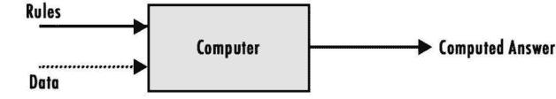

图 15-1。传统编程流程。需要规则，但对数据的需求取决于程序的需求。

这种软件的一个例子是计算披萨店总销售额的代码。程序员为数据如何进行计算编写规则代码，并输入所有交易数据以及任何要包含的数值，然后计算机生成聚合结果。如果你使用完全相同的输入运行它，每次运行的输出聚合结果都将是相同的。另一个例子是，在 1999 年夏天人们对千禧年感到恐慌时，我写了一个 Java Applet 千禧倒计时钟，运行在公司内网上，计算到 1999 年 12 月 31 日午夜的天数、小时、分钟和秒。该程序中使用的唯一数据是当前系统时间。

传统编程的已知输出和确定性有一个例外，那就是我们使用随机性编写了任何内容。编程语言可以生成随机数，这些随机数可以根据案例中生成的数字来引导不同的行为。想象你想根据不同属性的数字随机生成一个“地下城与龙”（Dungeons & Dragons）角色。一个角色由一组特定的基本身份（如种族和职业）以及代表各种事物的技能和能力的数字）定义。例如，如果有九种可能的角色种族，你希望它随机选择一个，并让角色的敏捷在最小和最大值之间随机选择一个数字。你从程序中获得的输出在每次运行时都是不同且未知的。然而，你会知道输出的参数——所有能力和技能得分都将在定义的最小值和最大值之间，并且你知道他们可能的种族、职业和背景，因为它们是特定列表中的一项。随机性的另一个用途是模拟，科学家可能想要定义一个起点并观察事物随时间推移如何发展，这至少部分由随机事件驱动。混沌理论就是通过这种方式运行的气候模拟而产生的。

请注意，在编程语言中，随机性被认为是伪随机的（pseudorandom），因为在特定的起点下，随机数生成器将以相同的顺序生成相同的数字，所以实际上它是确定性的——尽管程序仍然在使用“随机”值。这有时是预期的行为，当你运行实验并希望它是可重复的。这是通过设置一个被称为“种子（seed）”的数字来控制的。如果你希望每次运行都相同，就每次设置相同的种子。相反，如果你想要非确定性的行为，你需要在一个变化的变量上设置种子，例如将当前日期和时间转换为数字并将种子设置为该值。输出每次都会不同。

请注意，许多带有随机性的程序仍然被认为是传统编程。这是因为输入是已知的，输出是基于规则和已知输入的，到此结束。机器学习世界的情况有所不同，因为你没有预先提供规则，并且不知道输出是什么。机器学习的两种主要类型是监督学习和无监督学习。我在图 15-2 和 15-3 中展示了这两种类型的图，并在图 15-4 中展示了另一种类型——半监督。我们将讨论所有的。

但在之前，我们需要处理机器学习要解决的两类问题：分类和回归。分类的目标是通过预测目标变量值来对数据进行标记——例如，确定视频游戏的类型、某人是否患有某种疾病，或者给定的数据点是什么花。可能标签的数量各异——我曾参与过一个项目，我们拥有关于二战期间经历的个人陈述，我们想为它们标记主要主题，这是一个多分类问题。我们最终将它们视为每个账户可以拥有多个标签，因此我们独立地查看每个标签，并为每个标签建立一个二模型来判断是否符合该主题。这种方法并不常见，因为衡量多分类模型的性能可能很困难。


回归是机器学习解决的另一种类型的问题，我们所称的数值数据预测。诸如销售预测——预测某披萨店未来七天的销售额——都是非常常见的回归任务。其他还包括预测视频游戏的下载次数，或者急诊科每天的患者人数。

对于这些每一个问题，都有不同的算法，但某些技术具有变体，允许它们同时处理这两种类型的问题。我将在下文中介绍它们。

## 监督学习

在监督机器学习中，我们为计算机提供数据，以便它可以识别出数据中的模式和规则（这一步被称为训练模型），然后它输出计算结果，这就是我们所称的模型。监督机器学习有一个最低要求——即我们在输入数据中包含目标值，这使得它成为标签数据。我们正因为向它提供了目标变量，这才是它被称为“监督”的含义——我们正在为它提供引导。

监督机器学习通常用于两类任务，这两种任务都需要经过训练的模型：预测和推理。我们将在下文中详细讨论每类任务。监督机器学习在商业世界中非常重要，也是组织中最常见的机器学习类型，其中预测是最常见的任务。

## 预测

一旦我们拥有了训练好的模型，我们就将其连同第一步中未包含的新数据输入计算机，它就会输出与新数据相关的预测结果。注意，这些新数据需要具有与模型训练时相同的特征。这对于新数据科学家来说可能是一个陷阱。我将在本节结束处进一步讨论在生成预测的运行结束时到底必须输入哪些内容。

## 第 15 章 不是水晶球：机器学习

说在第一步中我们完全没有为计算机提供任何“规则”，这并不完全准确，原因有两个。第一，我们提供了专门准备的数据，这些数据包含了我们认为重要的特征。这就是为什么数据准备和特征工程是至关重要的原因。第二个原因是提供了目标值。图 15-2 显示了预测性监督机器学习的两步过程。

## 监督机器学习

### 第 1 

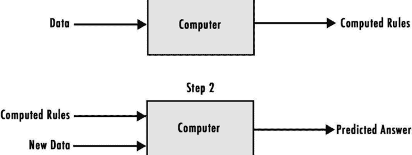

### 第 2 

图中的步骤 1 包含几个特定部分。总的来说，这是训练模型，但在监督机器学习中，“训练”包括在确定模型之前进行测试。准备数据后的第一步是将数据拆分为训练集和测试集，有时还会有一个额外的验证集，这被称为训练-测试划分。有关训练-测试划分的更多信息，请查看侧边栏。

## 第 15 章 不是水晶球：机器学习

## 训练–测试划分

将数据划分为训练集、测试集（如果需要，还有验证集）有一定的艺术性。常见的划分是基于数据的百分比，例如 80–20 训练–测试划分，或 70–20–10 训练–验证–测试划分。如何选择这 80% ？当你不处理与时间相关的数据时，有许多方法可以选择训练集和测试集。通常这可以通过随机完成，使用第 3 章采样中讨论的相同技术。这种方法意味着你将获得良好的覆盖率，并且你的测试集将测试模型在训练数据中捕捉到的许多模式。

如果你正在处理与时间相关的数据，特别是使用时间序列方法，你通常会选择数据的后 20% 作为测试集，并使用前 80% 作为训练集。这种方法的缺点是，你的测试数据可能无法涵盖模型中检测的所有模式。例如，如果你有两年的数据，你可能只能对五个月的数据进行测试，仅略高于20%。如果一年的某些部分比其他更容易更容易怎么办？如果这些日期恰好落在夏季和初秋，模型的表现可能非常好。随着时间的推移，当你在深秋和冬季运行模型时，它的表现可能就没那么好，而你原始的测试并不会发现这一事实。反之亦然如此。

这些每一个训练集、测试集和验证集都应该与彼此完全不同，没有任何数据点出现在多个集合中。此外，所有这些数据都必须包含我们关心的特征以及目标值，无论它是像“患有糖尿病”或“无糖尿病”这样的标签，还是一个数字。步骤 1 将取所有这些信息并计算出泛化规则，以便从特征的组合得到特定的目标值。这就是模型，或者说是图 15-2 中的“计算规则”。

高层流程基本上是基于训练数据集（步骤 1）训练模型，然后在测试数据集上对其进行测试（步骤 2），以查看其性能如何。我们将使用多种指标来衡量性能，我将在下一章中介绍。我们将在训练集上训练许多不同的模型，并在测试集上进行测试，尝试每个算法中不同的算法或不同的设置。注意，训练最佳模型的部分不仅包括尝试不同的算法，还包括所谓的“超参数调优”。

你在 R 或 Python 中用于训练算法的大多数函数在运行时需要设置超参数，这些超参数是在你在代码中调用该函数时作为参数传递给函数的。这些是定义所使用的机器学习算法某些方面的内容。我们将在下文中讨论算法时介绍其中的一些内容，但一个例子是决策树，它会控制它可以达得多深。

超参数调优是寻找最佳超参数组合，以获得最佳模型的过程。有很多方法可以实现这一点，但通常是在训练集上选择超参数，并在验证集上进行测试，直到找到最佳模型。超参数调优也可以在测试集上进行，但通常是在验证集上进行。还有一种方法叫交叉验证，它涉及将训练集分为不同的划分，而不是使用特定的验证集。这种方法在尝试避免过拟合时非常有价值。我将在下文中介绍超参数调优和交叉验证的方法。

在我们对最佳模型进行了多次迭代后，模型就可以用于新数据了。这意味着对新数据运行步骤 2。监督机器学习的一个典型例子是预测如销售额。披萨店可能想在晚班开始前准备多少面团，因此他们可以根据历史销售以及天气、赛事、假期等其他数据创建一个模型。他们可以将这些未来日期（未见数据）提供给模型，并获得预期披萨总数的预测。这将帮助他们知道准备多少面团。预测是机器学习最终的目标。

## 预测需要什么

有时新数据科学家难以理解我们需要向训练好的模型提供什么来获取预测。如前所述，我们需要为模型训练时的所有特征提供值。假设我们有一个用于预测商店每日销售额的模型。现在是 2 月 1 日，我们有一个根据过去三年数据直到 1 月 31 日的数据训练的模型，想要预测未来七天的每日销售额。我们使用了多种特征，包括星期、月份、假期以及几个历史销售特征。我们必须拥有未来七天的所有这些特征。想象一个有七行的表格，每一列对应上面提到的每个特征。有些人对我们需要“未来数据”感到惊讶——但模型是基于每天的数值的，所以它们是要求的。

这意味着我们需要能够拥有那些未来值。拥有无法代表未来的特征是新手经常犯的错误。例如，如果你有一个“昨天的销售额”特征，那么你在训练模型时没有问题。但在获取预测时，你无法提供它，因为你不知道第 7 天“昨天的销售额”是多少，由于我们没有这些值。处理这种问题的一种方法是使用第 6 天的预测作为第 7 天预测中的“昨天的销售额”值，但由于不确定性，这并不总是正确的解决方案。


# 推理 (Inference)

监督学习的另一种不常见但仍有价值的是推理，即通过生成模型来对其进行检查。其核心思想是观察模型指定的特征和值，以便我们理解模型中哪些是重要的。这可能意味着只需将所有数据投入图 15-2 中的第 1 步，查看输出的特征和值；也可能涉及在多个模型上运行第 1 步和第 2 步，选出性能最好的模型并对其检查。为了使这种方法有用，我们需要使用透明的算法或模型解释器，以理解哪些特征对输出有贡献。在这种情况下，我们可能甚至不需要将数据分为训练集和测试集。相反，我们会训练模型，如果它是一个能够揭示其使用的特征和值的算法，我们会对其进行检查。线性回归和决策树等透明方法非常适合，因为它们能准确告诉我们哪些特征是重要的。但另一种树方法——随机森林，只会输出整个模型最重要的特征，而不会提供任何关于值的信息。

另一种选项是使用模型解释器，这是一种揭示非透明算法重要特征的工具（我们将在下文中详细讨论）。要使用模型解释器，我们实际上是将训练数据通过模型以生成“预测”——即模型根据提供的特征将生成的值。然后，我们可以使用模型解释器获取每个特定预测的最重要特征并对其进行研究。在这种情况下，我们可能会关注那些相当准确的预测，但不准确的预测也可能很有趣。

机器学习的一个相对较且不断发展的领域是因果推理（causal inference），它专门用于寻找变量之间的因果关系。例如，如果你想知道价格变化对销售的影响，你会对其他变量进行归一化，并只观察这两个变量。

# 无监督学习 (Unsupervised Learning)

无监督学习在某些方面与监督学习相似，但关键区别在于我们没有为它提供目标值，这就是为什么它被称为“无监督”。无监督机器学习在没有指导的情况下识别数据中的模式（与数据准备期间完成的特征工程不同），而不是像监督学习那样弄如何从特定特征获取特定值。我们并没有在主动教导它。

在无监督学习中，没有要求进行训练-测试划分。它可以是一个单步或两步过程。第一步基本上是在你准备好的数据上运行算法，从而生成两项内容：(1) 你要求算法提供的“答案”和 (2) 一个训练好的模型，你可以根据算法在运行期间确定的规则在新数据上运行它。最常见的无监督机器学习是聚类（clustering），它简单地将数据分为不同的组，因此输出是指定了组别的原始数据。这让你看到哪些数据点被分在一起，从而让你深入研究并该组具有哪些与其他组不同的特征。这可能是你即时工作的终点，但你也有了一个训练好的模型可用。通过可选的第 2 步，你可以将新的、未见过的数据通过模型，以获取该数据的分组。图 15-3 描述了这一流程。

## 无监督机器学习


**图 15-3. 无监督机器学习流程。** 第一步训练模型并输出标签（例如分组）。可选的第二步允许模型对新数据进行标记。

# ## 半监督学习 (Semi-supervised Learning)

半监督机器学习是监督和无监督的结合，因为我们同时提供了带标记的数据和未标记的数据。有时带标记的数据很昂贵或非常难以获得，特别是在机器学习通常需要大量数据的情况下。如果无监督学习无法解决要处理的问题，则有一种方法可以扩展现有数据，以获得更多可用于监督学习模型的“带标记”数据。这种方法可能运行得很好，但并非总是有效。这绝对是一种“因人而异”的方法，取决于你的领域和数据。

使用这种方法存在一些通用的局限性。一个关键点是，未标记的数据在内容上需要与带标记的数据相似。如果我们试图识别歌曲的流派，而我们有一组标记为摇滚、流行和雷鬼的歌曲，那么添加包含乡村音乐和说唱在内的其他三种之外的未标记歌曲将不会带来良好的结果。这很符合直觉，但有时很难知道你的未标记数据是否与带标记数据相似。一些探索性数据分析（EDA）通常可以回答这个问题。

半监督学习有几种不同的技术，我将只讨论自训练（self-training）方法，这是一个三步过程。自训练半监督学习从创建一个基础模型开始，该模型仅在少量的带标记数据上训练。然后，我们将未标记数据通过模型以获取预测结果——即未标记数据的标签，通常称为伪标签（pseudo-labels）。第二步的一个要求是每个预测都会生成一个置信度。然后你可以提取所有具有高置信度（通常在 80% 以上）伪标签的数据，并将数据（具有高置信度伪标签的未标记数据子集）与原始带标记数据结合，使用这个更大的数据集训练一个新的监督模型。图 15-4 展示了整个流程。

## 自训练半监督机器学习

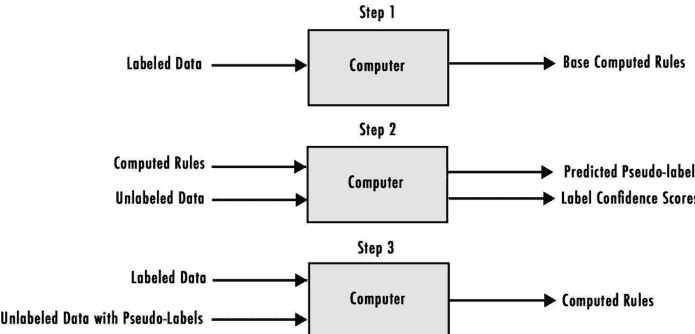

图 15-4. 基础自训练机器学习流程

# 第 15 章 不是水晶球：机器学习

你可能猜到这通常不是一种稳健的技术，而且极大取决于伪标签的质量。因为我们使用的伪标记数据远比真实数据多，如果其生成过程中出现任何问题，整个模型将是错误的。如果某个特征在原始训练集中被认为比它实际应有的更重要，那么该特征在伪标记数据集中会被过度强调。这并不意味着你不应该尝试，但你需要非常小心，并仔细检查你的结果。注意，当它运行良好时，通常是因为特征空间中彼此靠近的点通常具有相同的标签，因此出现在其他点附近的伪标签可能具有正确的值。

## 强化学习 (Reinforcement Learning)

强化学习被认为是机器学习的第三范式，仅次于监督和无监督。它不提供训练数据，但指定了一些行为规则。强化学习通常被描述为一个“智能体”（agent）探索未知的环境并朝着目标努力。想象一个机器人探索一个房间，试图找到一个门可以关上的柜子（目标）。仅仅依靠目标它是无法取得任何进展的——它还需要一套关于如何决策选择执行某事的策略（policy），以及它在采取行动后收到的奖励（reward）。这些目标、策略和奖励都是预先指定的。

强化学习面临的基础挑战之一是平衡探索（exploration，如机器人探索它所在的房间）和利用（exploitation，利用它学到的关于房间的知识）。强化学习方法的一个有趣点之一是，它们并不总是选择局部最优选项（即在特定时刻获得最大奖励的选项），而是通过延迟满足，通过较小的牺牲换取更大的回报。强化学习最大的优势是优化——寻找最优路径，无论是物理的还是虚拟的。


# 第 15 章 不是水晶球：机器学习

它在数据科学中的应用没有在其他 AI 领域那样广泛，但在营销的推荐系统中非常有用。它也被用于 AlphaGo，即在第 10 章中讨论过的那个击败了围棋高手的系统。

## 集成学习 (Ensemble Learning)

从核心上说，集成学习与其说是机器学习的一种“类型”，不如说是结合不同机器学习模型的方法，以获得比任何单一模型都优的性能。由于其结合结果的方式，人们有时将其称为“基于委员会的学习”。这种想法非常直观——例如，众所周知当人们猜一个大罐子里玻璃球的数量时，许多猜测的平均值往往比许多个人的单独猜测更接近正确数字。高估和低估往往会相互抵消，从而补偿了其他人的不准确性。即使是最好的学习模型也有一些局限性，如误差、偏差和方差，当我们多个模型组合在一起时，这些问题会被其他模型中的值所补偿。

训练和组合不同模型有两种主要方法：串行或并行。在并行方法中，多个模型在训练数据的不同部分上独立训练，可以是所有模型使用相同的算法（同构），也可以是使用不同算法训练的模型（异构）。在串行方法中，每个模型都经过训练并被输入到下一个模型的训练中。最后在最后对各种模型输出进行组合：在分类问题中使用“多数投票法”（选择在各种模型中出现次数最多的预测），在回归问题中取所有值的平均值。

还有其他三种可用的技术：自助聚合（bagging）、堆叠（stacking）和提升（boosting）。“bagging”一词是“bootstrap”（自助）和“aggregation”（聚合）的结合，它涉及通过对训练集进行重采样创建新的数据集，并在每个新生成的数据集上使用相同的算法训练独立的模型。然后将模型的结果结合以获得最终预测。

堆叠（Stacking）使用异构并行方法，通过训练几个模型然后在第一轮模型的输出上再训练另一个模型。这种创建最后一个模型的方法被称为元学习（meta-learning），因为它是对其他模型的输出结果而非原始数据进行训练的。最终模型生成最终预测。

提升（Boosting）是一种串行集成方法，它通过专注于运行针对错误预测的后续模型来改进糟糕的预测。首先在训练数据集上训练第一个模型，然后将其结果分为正确和错误，并创建一个包含错误预测记录的新数据集，但会根据这些记录进行某种调整（例如在新的数据集中对它们加权）。这个过程在多个模型上重复，最后通过计算出的权重将它们结合。

## 监督技术 (Supervised Techniques)

我们将在这一节中介绍几种流行的监督技术。技术的种类比这里提到的要多，但很多时候，数据科学家的工作涉及坚持使用最常用的技术。当你的常规工具箱不够用时，上网搜索也是完全正常的。

## 时间序列分析 (Time Series Analysis)

时间序列分析是一种古老的统计方法，现在已有些淡出主流舞台，因为许多其他机器学习技术表现更好，我不对此多说。但了解它是好的，因为在某些时候它可以起。时间序列分析依赖于基于时间的数据，例如特定视频游戏在商店的每周下载量。其局限性之一是经典的时间序列分析不像其他机器学习算法那样允许特征。我们拥有时间单位和正在追踪的数值（如销售额或下载量）。图 15-5 显示了我们在时间序列分析中常见的典型图表。

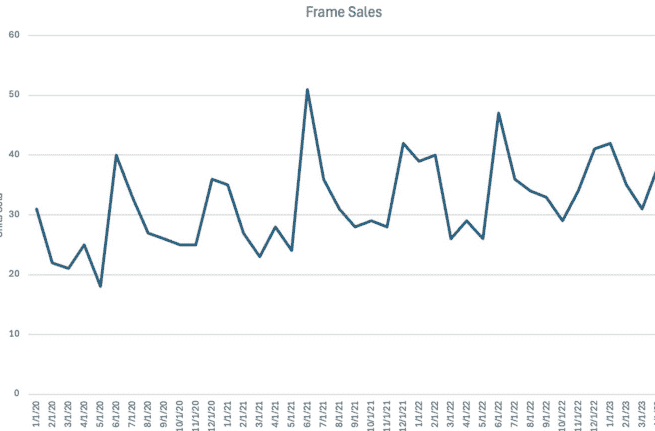

图 15-5. 一个适用于时间序列的图表示例，显示了虚拟小框店几年的每月销售额

图 15-5 清晰地显示了数据的上升。这在时间序列分析中被称为“趋势”（trend），是指长期内一致的增加或减少。我们还可以看到“季节性”（seasonality），即定期重复的增加或减少模式，例如我们在图 15-5 中看到的每年 6 月和 12 月销售额的增长。

这些特征在视觉上很容易发现，但也有工具可以自动识别趋势和季节性（或周期性）以及其他模式。这些工具让我们对原始时间序列进行分解，看到显示趋势和季节性等模式的单独图表。这很有用，是因为有时图表并不像我们希望的那么清晰，而且我们可以在预测中使用这些特征。

我们还可以使用工具根据时间序列中的先验数据来生成预测。还有其他基于时间序列的算法可以做得更多。其中一种流行的是自回归整合移动平均算法（ARIMA），它从三个不同的角度观察时间序列。第一个是自回归（AR），专注于一个数据点与其先验（滞后）点之间的关系。第二个称为整合（I），它使用差分法有效消除趋势和季节性。第三个是移动平均（MA），它考虑数据点和过去几次观测的移动平均值。这些都是在运行 ARIMA 时可以指定的参数。注意，使用 ARIMA 需要一些假设，最重要的是数据必须是平稳的（stationary），这意味着均值和方差不会随时间发生剧变。

即使是时间序列方法也不总是能产生最好的结果，尝试并观察其表现并不困难。因为我们通常只使用一个“特征”——我们试图预测的同一变量的过去值——所以数据模式必须限于该变量本身。换句话说，时间序列假设除了月份、星期等时间特征外，没有外部因素决定未来值。注意，有些选项允许包含外部值，特别是 ARIMA ARIMAX ARIMA。它允许一个额外的变量，可以是单个特征或多个特征的组合（在技术中表示为一个）。

## 广义线性模型 (Generalized Linear Models)

线性回归是理解数据和进行预测的一种非常流行的技术。它也是统计学家和数据分析师执行的纯统计测试之外的最早技术之一。

它具有相当直观和透明的优点，并且容易向利益相关者解释。概念上，线性回归特指一组数据——想象一个散布着许多点的散点图——在其中画一条线。有一种特定的技术来画这条线，我们将在下面讨论。这条线代表了两个变量之间的关系，或者在该图中的期望值——如果我们查看图表上已有的值之外，我们就能看到该范围之外的期望值。预测，或查看我们用于构建模型的数据范围之外的值，被称为“外推”（extrapolation）。

线性回归是一种广知的特定技术，但它实际上属于广义线性模型这一统计回归族。这个名字可能会产生误导，因为某些技术会产生非线性模型，如多项式回归和泊松回归，但该名称是成立的。最常见的两种广义线性模型是线性回归和逻辑回归。线性用于回归——生成数值输出——而逻辑通常用于二分类，生成非数值标签。两者将在下文中讨论。

## 线性回归 (Linear Regression)

线性回归是回归族中最直接、最直观且最简单的技术。“线性回归”一词在技术上涉及仅用另外一个变量（预测变量或特征 X）对一个变量（目标变量或 Y）进行建模，在大多数情况下这并没有帮助，因为很少有一个单一变量能很好地预测另一个变量。

仅使用两个变量就能给我们提供一个相当不错的模型的常见例子之一是体重与身高，其中身高是 X，体重是 Y。图 15-5 显示了来自较大数据集的 75 个身高和体重测量值的样本。


# 第 15 章 不是水晶球：机器学习


**图 15-6。** 成人的身高和体重

线性回归要有效，必须满足若干假设。最重要的三个假设是：线性、强相关性，以及当存在多个 X 值时 X 变量的独立性。我们需要确保数据在散点图中看起来接近一条直线，且 X 变量和 Y 变量之间必须存在较强的相关性（通常大于 0.5 或小于 -0.5）。人们往往懒得做这些检查，但如果无法满足这些条件，回归将将无法提供可靠的结果。在进行任何回归时，另一个重要步骤是理解模型中固有的误差（没有任何模型是完美准确的）。

观察数据，虽然它们有些分散，并没有一条让所有测量值都聚集在其周围的直线，但有一个明显的上升趋势。从视觉上看，这看起来是线性的。我们还可以计算身高和体重之间的相关性。使用 Python 对该样本进行计算，皮尔逊相关系数为 0.565，超过了 0.5 的阈值。（注意：原始数据集的相关性没有超过 0.5，但这个特定的随机样本达到了，所以我用它来说明问题。）现在来看独立性问题，显而易见身高和体重是不独立的，因为一个身高 6 英尺 6 寸的人体重只有 100 磅，除非发生了非常不寻常的事情。矮的人体重重也是如此。

# 第 15 章 不是水晶球：机器学习

为了方便理解线性回归，我们可以先把这个问题抛在一一边。说实话，很少有两个互不相关的变量组合能产生良好的回归，所以我们只能用这个例子。

线性回归的核心是它用于确定直线应该穿过图表中数据点的方法。我们将讨论这一点，但图 15-7 显示了带有回归线的上方图表。从直觉上看，这种感觉是正确的。如果你根据图 15-6 自己画，它可能看起来像这样。但它实际上是如何计算的呢？

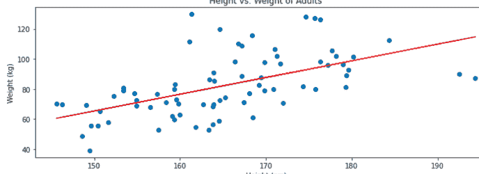

**图 15-7。** 带有回归线的成人身高和体重

线性回归通过最小化每个点的平方误差之和来计算这条线。误差是图中直线到点的垂直距离，但在回归中，这通常被称为*残差*（residual）。计算总误差的方法有多种，但传统的线性回归——*普通最小二法回归*（ordinary least squares regression）使用的是所谓的*平方误差和*（SSE），它是通过对每个残差平方然后将所有这些平方求和来计算的。注意，我们对其平方是因为我们不希望高值抵消低值（这在直接相加时会发生）。这种方法几乎不可能通过手工完成，因为它的实际做法是尝试许多不同的直线，计算平方误差之和，然后选择和最小的那条线。如果我们观察数据集中前几个点的残差，就能看到它是如何工作的，如图 15-8 所示。黑线连接了原始点与回归线，残差值就是图中黑线的长度。

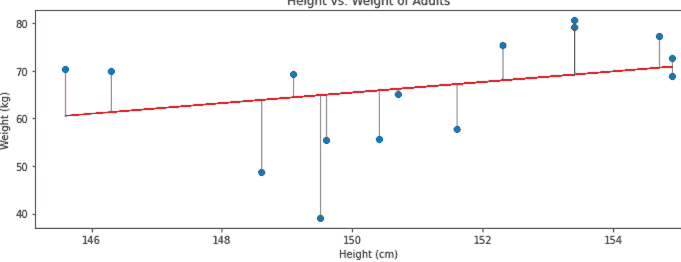

# 图 15-8。身高体重数据中的前 15 个数据点及其残差

直线是这样生成的，但我们仍然需要知道实际模型是什么样的。幸运的是，它是一个追溯到高中数学的简单方程。它基本上就是我们学习绘制直线的 $y = mx + b$ 公式。记得 $y$ 是绘制在 Y 轴上的值；$m$ 是斜率（或量化的角度）乘以 $x$，$x$ 是绘制在 X 轴上的值；而 $b$ 是截距，即直线与 Y 轴的交点。这就是在拟合特定数值的单变量线性回归输出的精确公式。在线性回归中，还有假设误差（每个模型都有误差，因为我们知道除非变量完全相关，否则模型是不完美的），在公式中用 $e$ 表示，且截距通常写在前面，作为一种“0” X 值。在回归中，我们这样写：$Y = X_0 + mx + e$。如果你感兴趣，图 15-8 中直线的公式是 $Y_{weight} = -101 + 1.11 \times X_{height} + e$。

# 第 15 章 不是水晶球：机器学习

# 多线性回归

大多数时候，当数据科学家提到线性回归时，他们实际上是指多元线性回归，这只是我们用几个 X 变量对一个 Y 进行建模线性回归。在身高/体重的例子中，我们知道体重的决定因素远不止身高。有很多不同的因素可能影响体重，包括性别、健身水平、年龄等等仅仅这三项就能极大改进我们上面的模型。

普通最小二法还有一些额外的假设，这些可以在模型生成后进行检查。之一是残差的均值接近 0。残差还应该呈正态分布，且其中不应有自相关，这意味着数据中存在某种模型未捕获的模式。你也可以去查阅这些内容。

学习多元回归的一个挑战是，因为涉及的变量超过两个，我们无法制作图表来可视化整个回归（上面提到的三个额外特征将需要五维图表）。但好消息是，理解它不需要可视化——我们只需要看公式就能知道什么。我们通过多元回归所做的仍然是寻找使残差（直线与每个 Y 值之间的差异）最小的直线。多元线性回归只是增加了更多的 X 特征，所以看起来像 $Y = X_0 + m_1X_1 + m_2X_2 + ... + m_nX_n + e$。

这个公式是回归的输出，也是我们可以与利益相关者分享的内容。它很容易解释。在通过身高、健身水平和年龄预测体重的例子中，为了与利益相关者分享，我们重命名 X 值，并得到类似这样的公式：$Y_{weight} = X_0 + m_{weight}X_{weight} + m_{fitness}X_{fitness} + m_{age}X_{age} + e$。


# 第 15 章 不是水晶球：机器学习

例如，假设一个模型具有 X 值，这些值可能是以不同的方式测量的。这意味着，例如，所有的 $X_1$ 测量都比所有的 $X_2$ 测量都不精确。也许 Javier 用一把旧尺子测量了某物的长度并四舍入到四分之一英寸，但 Sarah 在测量高度时使用了更好的尺子，她的记录精确到 1/16 英寸。在这种情况下，Javier 的测量值精度较低，可以给它较低的权重，以防止该特征对模型产生过大影响。

## 逻辑回归

逻辑回归使用一种称为 logit 模型（logit model）的特殊统计函数作为回归的基础。你不需要完全理解它就能进行逻辑回归，但它的基本原理是：如果你取特征的线性组合（基本上是上面回归公式的右侧，例如 $X_0 + m_1X_1 + m_2X_2 + ... + m_nX_n + e$），该值将等于涉及目标变量特定分数的自然对数。我不会向你展示数学公式，但结果会导致回归生成一条位于两个二值之间的曲线。

与其他技术一样，逻辑回归也有一些要求和假设假设。我们在这里讨论的是二分类逻辑回归，因此数据必须是二元的。另一个要求是数据集不宜太小（这取决于你的数据，通常几百条记录配合几个特征即可）。特征之间需要相互独立。

逻辑回归的操作方式与线性回归有些相似，它通过特定技术最小化函数，在一个目标值或另一个目标值之间确定决策边界。它使用一些额外的数学来计算公式中的系数，$logit(Y) = X_0 + m_1X_1 + m_2X_2 + e$。模型分配每条记录属于类别 1 和类别 2 的概率（后者只是 1 减去类别 1 的概率），然后使用阈值（默认为 0.5）来应用相应的标签。高于 0.5 的归为类别 1。

如果我们看另一个真实例子，我们有另一个关于身高的数据集，这次是孩子的。我们有性别、身高和年龄，想根据另外两个维度预测性别。虽然男孩确实比女孩高，但仍然存在大量重叠，我们的模型仅凭这两个特征可能不会完美，但应该比随机猜测要好。我创建了模型，然后仅绘制了高度值（我只能在二维图中绘制目标值、连同所谓的逻辑曲线（logistic curve）以及一个特征），这基本上就是决策边界。参见图 15-9 它的样子，其中曲线为红色。在数据更清晰的数据集中，曲线呈 S 型，顶部较平坦，中间有较陡的对角线。


**图 15-9。** 儿童身高和性别的逻辑曲线

## 非线性回归

非线性回归是一种生成非线性函数的回归，该函数以非线性方式组合模型参数。某些数据可能不在直线上，但它们仍然符合某种可识别的模式。非线性回归有类型，因为拟合函数可以是任何形式，只要它符合数据即可。非线性函数线性化的常用技术是对函数的两边都取自然对数。不用担心完全理解这一点，尽管大部分回归可能是线性的。

## 树

树是另一类非常流行、通用且实用的监督学习算法。它们不需要线性数据，既可以用于分类也可以用于回归。更好的是，它们可以处理类别特征。算法通过 `if-then-else` 场景反复分割数据，从顶部的所有数据开始，然后根据规则分成多个组，然后继续向下进入每个分支，直到到达停止点并为当前数据分配标签（分类中）或分配一个数字（回归中）。所生成的逻辑在看起来像树的可视化中极其直观。我将首先讨论最简单的算法，简单称为决策树（decision tree）。从技术上说，被称为决策树的算法很少，所以我将讨论最常见的一种。在讨论了决策树之后，我将讨论随机森林（random forest），它是决策树的扩展，通过创建许多决策树并结合所有不同的结果得出一个单一结果。

## 决策树

决策树可能是最直观的机器学习。线性回归很容易解释，但仍然需要考虑数学，这会让一些利益相关者望而却步。决策树可以被画出来让任何人理解。它如此实用的其他原因是它不需要数据是线性的，并且可以处理类别特征。我将展示一个代表简单垃圾过滤器（技术上称为垃圾邮件标签）的基础决策树作为参考（图 15-10）。


决策树由节点和叶子节点组成。节点代表应用于一组数据的拆分，因此我们有一批数据，并对节点应用 `if-then-else` 问题，根据答案将数据发送到两条（或多条）路径。它通常表示为椭圆。在图 15-10 中，所有的椭圆都是节点，每个椭圆都包含在该点提出的问题，以将数据分成两个不同的组。叶子节点是任何分支的终点，代表一组分配了特定标签或数值的数据。它们通常显示为矩形。图中标记为“垃圾邮件”（Spam）或“非垃圾邮件”（Not Spam）的矩形就是叶子。从一个节点到另一个节点或叶子的路径显示为直线。每个问题的答案显示在相关的路径旁边。对于图中的树，所有问题都是二元的，所以它们都显示为“是”（True）或“否”（False）。还存在特殊的节点——顶部的第一个节点，称为根节点（root node）。图中的根节点是顶部的“发送者未知”。我们称从根节点到任何叶子的完整路径为路径。注意，同一个“问题”出现在树的不同分支中，例如图中“包含标记词”。

这是一种直观的展示。理解如何将构建好的决策树应用于新记录，就是首先根据记录拥有的值询问并回答根节点的问题，如果答案是“是”则走左路径，如果是“否”则走右路径。然后你询问新节点的问题并根据答案遵循正确的路径。以此此类推，直到遇到叶子且无法继续。该叶子就是将分配给该条记录的标签或值。

这是如何使用现有树，但如何创建它呢？如上面所述，实际上有几种不同的算法来训练决策树。它们有很多共同点，但我将描述通用方法。基本概念是：对于给定的数据批，决定最有效的分割方式是什么。这意味着目标是找到一个问题，完美地将数据分成一个具有某种标签的叶子，以及另一个所有记录都具有与第一个叶子不同目标标签的叶子。这是叶子形成时理想发生的情况，但在过程中，当没有完美的问题时，必须分割数据。因此，它查看了所有可能的特征


提出问题并根据数据拆分的情况计算一个指标。你并不真的需要理解这些指标是什么，但熵（来自信息论）和信息增益是常用的指标。

我们将通过观察一个小型邮件数据集的样本，来看图 15-10 中的树是如何构建的。请看表 15-1，其中用于训练决策树的数据。在现实中，训练此模型需要多得的数据，但我们仍然看到数据和问题是如何用于构建树的。我将沿着其中一个分支向下，观察每一个步骤。

## 表 15-1. 示例邮件数据集

| 邮件 ID | 发者未知 | 邮件域名未知 | 包含标记词 | 包含拼写错误 | 是否为垃圾邮件 |
|---|---|---|---|---|---|
| 1 | True | False | True | False | False |
| 2 | True | True | True | True | True |
| 3 | True | True | False | False | False |
| 4 | True | True | True | True | True |
| 5 | True | True | False | True | False |
| 6 | False | True | False | True | True |
| 7 | False | False | True | True | True |
| 8 | False | True | False | False | False |
| 9 | False | False | True | False | True |
| 10 | False | False | False | False | False |

通过首先询问者是否未知，数据被分为表 15-2（发者未知 = True）和表 15-3（发者未知 = False）所示的两组。算法随后会计算一个指标分（无论它使用哪种指标），并在查看其他拆分后，选择得分最高的一个。

## 表 15-2. 第一个节点拆分后：发者未知 = True

| ID | 发者 | 邮件域名 | 包含标记词 | 包含拼写错误 | 是否为垃圾邮件 |
|---|---|---|---|---|---|
| 1 | True | False | True | False | False |
| 2 | True | True | True | True | True |
| 3 | True | True | False | False | False |
| 4 | True | True | True | True | True |
| 5 | True | True | False | True | False |

## 表 15-3. 第一个节点拆分后：发者未知 = False

| ID | 发者 | 邮件域名 | 包含标记词 | 包含拼写错误 | 是否为垃圾邮件 |
|---|---|---|---|---|---|
| 6 | False | True | False | True | True |
| 7 | False | False | True | True | True |
| 8 | False | True | False | False | False |
| 9 | False | False | True | False | True |
| 10 | False | False | False | False | False |

现在算法有两组不同的数据需要考虑，每组中都混合了不同的标签。我只遵循左分支（表 15-2），所以我们现在需要拆分表中的数据，因为并不是所有标签都相同。它尝试不同的问题并对每个问题计算指标，发现询问邮件域名的得分最高。我们根据“发者的邮件域名未知”进行拆分。流入 True 路径的数据在表 15-4 中，False 路径在表 15-5 中。

## 表 15-4. 第二个节点拆分后：发者的邮件域名未知 = True

| 邮件 ID | 发者未知 | 邮件域名未知 | 包含标记词 | 包含拼写错误 | 是否为垃圾邮件 |
|---|---|---|---|---|---|
| 2 | True | True | True | True | True |
| 3 | True | True | False | False | False |
| 4 | True | True | True | True | True |
| 5 | True | True | False | True | False |

## 表 15-5. 第二个节点拆分后：发者的邮件域名未知 = False

| 邮件 ID | 发者未知 | 邮件域名未知 | 包含标记词 | 包含拼写错误 | 是否为垃圾邮件 |
|---|---|---|---|---|---|
| 1 | True | False | True | False | False |

此时此，如表 15-5 所示，该分支上的所有数据只代表一个标签，因为它只有一行。这意味着应该有一个标签为“不是垃圾邮件”（Not Spam）的叶子节点。发者邮件域名未知的拆分仍然有不同的标签，因此我们需要再次拆分。算法再次尝试并对不同的问题进行评分，最终决定使用“包含标记词”。该拆分可以在表 15-6 和 15-7 中看到。

# 第 15 章：不是水晶球：机器学习

## 表 15-6. 第三个节点拆分后：包含标记词 = True

| 邮件 ID | 发者 | 邮件域名 | 包含标记词 | 拼写错误 | 是否为垃圾邮件 |
|---|---|---|---|---|---|
| 2 | True | True | True | True | True |
| 4 | True | True | True | True | True |

## 表 15-7. 第三个节点拆分后：包含标记词 = False

| 邮件 ID | 发者 | 邮件域名 | 包含标记词 | 拼写错误 | 是否为垃圾邮件 |
|---|---|---|---|---|---|
| 3 | True | True | False | False | False |
| 5 | True | True | False | True | False |

现在，该拆分产生了两个组只有一个标签的集合，这意味着这些是具有相应标签的节点。现在如果我们对右侧分支重复这一过程，我们就得到了一棵可以用于分类新邮件的训练决策树。

当使用真实数据构建决策树时，拆分永远是不完美的，大多数叶子将具有不同的标签。有许多不同的方法可以控制树的构建，这也是为什么我们在训练中会出现分类错误的记录。在现实中，我们不希望树长得太深，如果我们坚持每个叶子都只有相同的标签，就会发生这种情况。我们还会得到只有一个记录或极少数记录的叶子。这些情况基本上就是过拟合（我们将在下文讨论）。

# 第 15 章：不是水晶球：机器学习

## 随机森林

回归树的构建方式类似，但随机森林是许多树的集成。随机森林的主要优势是结果不会仅由影响最大的特征主导——相反，不同的特征可以被显示为重要的。

随机森林两个关键组件是装袋法（bagging）——随机采样数据（带回）以及随机选取特征子集。这确保了许多树之间不会太相似或相互相关。通常包含的特征数量是总特征数的平方根。在训练所有这些树后，数据将运行过所有树，输出结果通过多数投票（分类）或平均值（回归）来确定。

随机森林的主要缺点是解释性较弱。通常，最好的做法是解释决策树方法，以便他们理解。然后你可以解释数百棵这样的树是在略有不同的数据上训练的，最终标签通过多数投票或平均值来确定。


另一种解释方法是讨论重要的特征。随机森林算法会输出模型整体范围内最重要的特征，但它并没有告诉我们太多信息，特别是在特定的预测方面。我以前提到过模型解释器（model explainers），我们在每日销售预测中使用过它，并针对每项预测获取了非常有用的信息。这就是我们知道与假期相关的特征会在一年中少数相关的几天内出现的原因。

# 朴素贝叶斯

朴素贝叶斯（Naïve Bayes）是一种仅用于分类的方法，在垃圾邮件过滤的尝试中脱颖而出，因为它在识别垃圾邮件方面表现非常好。它不是一种特定的算法，因为有几种不同的算法，但它们都遵循相同的步骤步骤。它们都依赖于贝叶斯定理及其条件概率公式，其中各项可以互换位置。它们还要求所有特征之间相互独立，且每个特征对结果都有贡献。这就是它被命名为“朴素”（naïve）的原因。这种方法的优势是不需要大量的数据集来进行训练。

这里遵循的基本方法是计算每个特征的后验概率（贝叶斯公式的一部分）。例如，在一个仅考虑单个单词或短语是否存在来判断垃圾邮件状态的垃圾邮件分类器中，后验概率（如给定邮件包含单词 w，则邮件为垃圾邮件的概率）是基于任何内容可能是邮件的概率（训练集中垃圾邮件的比例）和先验（在给定邮件为垃圾邮件的情况下存在 w 的概率）计算得出的。然后将邮件中每个单词的后验概率结合起来，以确定整体标签为垃圾邮件与否（带有定义的阈值）。

朴素贝叶斯与其他方法相比的一个缺点是，我们无法获得关于单个特征的信息（记住假设是它们都是重要的）。这与回归和树形结构方法明显不同。但它简单，并且可以在许多领域中良好运行。

## 神经网络

神经网络（有时称为人工神经网络）是另一类大部分为监督学习算法（也有针对无监督问题的变体），它们已经存在很长时间，流行程度起起伏伏。在过去的十年左右，它们非常火热，因为开发了许多新类型并看到了非常成功的应用。当然，生成式 AI（Gen AI）基于先进的神经网络（通常称为深度学习），因此它们的流行程度呈爆炸式增长。你经常会听到神经网络通过模仿神经元和突触的结构与功能受到人类大脑的启发，这是事实，但并不意味着神经网络比其他机器学习算法更接近人类智能。许多从业者因为这种不准确的暗示而不喜欢这种比较，但这确实是它们的起源。尽管如此，现代神经网络风格的简单网络在 1700 世纪就被用于预测行星运动（远在我们知道任何动物大脑工作方式之前）。

神经网络具有输入、隐藏（中间）层和输出的一般结构。见图 15-11 的神经网络的一般结构。存在大量的连接，当我们添加内部层时，连接的数量也会爆炸式增长。内部层是不透明的，由于有这么多层，很难解释为什么网络会对任何输入分配特定的输出。它们在许多领域中极其强大，并且一直被频繁使用。请注意，具有两个或更多隐藏层的神经网络被称为深度神经网络，这就是“深度学习”一词的来源。神经网络的优势之一是从错误中学习，这使得它们具有很强的适应性。

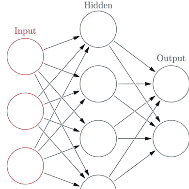

**图 15-11.** 神经网络的概览。来源：来自 "File:Colored neural network.svg"，可在 https://commons.wikipedia.org/wiki/File:Colored_neural_network.svg 获取，根据知识共享署名-相同共享 3.0 未本地化通用许可许可协议使用 (https://creativecommons.org/licenses/by-sa/3.0/deed.en)

如前所述，有许多类型的神经网络。我们不会深入探讨其中任何一种，但我们会讨论每种类型的基本知识，如果你想知道，可以去 Google 查一下。最早的现代神经网络是单层感知器，但它并没有用处，随之出现的是多层感知器，也称为前馈神经网络。前馈意味着数据仅以一个方向流过网络，从输入到下一层，以此此类推直到最终输出。这意味着数据在每层中只会命中一个节点。每个节点都有一个权重和一个阈值，决定了它们是否将数据进一步传递，但这些权重和阈值是在训练期间进行调整的，从随机值开始。节点的巨大数量意味着随机起点是最佳选择，

# 第 15 章 不是水晶球：机器学习

并且调整会一直进行，直到网络输出带有每个标签的数据，这就是它知道该调整什么。一种常用的调整技术是反向传播（backpropagation），它从末尾开始，针对特定的输入-输出对通过不同层向后移动，利用每个权重如何影响输出的知识来调整损失函数。这个过程允许权重得到改进。

另一种重要的神经网络是卷积神经网络（CNN），它是通过特定类型的优化来确定特征的前馈神经网络。它是帮助改进图像处理和计算机视觉的主要创新，尽管现在有一些其他方法正在取代，但它仍在被使用。它如此宝贵的原因是它使用了一些技巧来显著减少网络中连接节点的数量，这使其效率高得多，并且较不容易发生全连接前馈神经网络中可能出现的过拟合。它们仍然消耗大量的计算资源。

循环神经网络（RNNs）是另一种类型的神经网络，它们工作在顺序数据上（如基于时间的数据和语言数据），其中每个输入不被认为彼此之间是独立的——当前序列中的先前的元素通过一个传递的隐藏状态被“记住”，这会影响随后的权重。与我们过的其他类型不同，每个节点上的权重并不相同。相反，一层中节点上的权重具有相同的值。标准 RNN 在处理长期序列时可能会出现问题，但在句子中的单词或时间序列数据值等较小对象上表现良好。具有更好且更长期“记忆”的 RNN 变体被称为短期记忆（LSTM）神经网络。它们运行良好，但需要大量的训练。

一种类型的神经网络是 Transformer，这是一种新类型，在某种程度上取代了 RNN 和 CNN，因为它们没有相同的局限性，特别是在资源使用方面。它是生成式 AI 使用的主要工具（ChatGPT 中的 GPT 是“生成预训练 Transformer”的缩写）。它们在处理单词方面有一些创新。在输入时，句子被转换为嵌入（每个单词的语义），然后为每个单词分配一个表示其位置的数字。使用一些函数可以发现单词之间的关系。网络对层进行一些调整，然后作为前馈神经网络工作。Transformer 仍然需要大量的训练，但它们处理新数据时比 RNN 更高效，运行更快。

我将提到的最后一种神经网络是生成对抗网络（GAN），它实际上是两个以规定方式相互作用以生成输出的网络。你可以在图 15-12 中看到整体结构。其中一个网络被称为生成器，它基于随机数据生成数据。生成器的主要目标是生成合理的输出。这些生成的数据作为负训练样本馈到第二个网络——判别器中。判别器是一个分类器，它的输入中也有真实数据，因此它的任务是学习区分什么是真实数据，而不是生成器产生的虚假数据。生成器的输出直接进入判别器的输入。

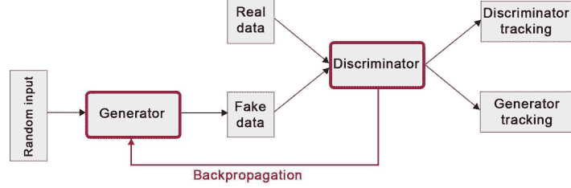

图 15-12. 生成对抗网络的结构和训练行为

反向传播从判别器输出一直回传到生成器，并利用计算调整生成器权重（注意只有生成器通过这种方式被改变，对于


# 第 15 章 不是水晶球：机器学习

（行为的一致性）。整个系统的目标是所谓的“收敛”——即当判别器在猜测（基本上就像在抛硬币）其输入是真实的还是伪的时，这就是生成器表现最好的点。系统的训练非常棘手，因为很难知道达到收敛的确切点，而且如果生成器在此点之后继续向判别器发送数据，那么判别器可能会开始表现反常，其（基本上是）通过反向传播的随机反馈会对生成器产生负面影响。

一旦系统训练完成（达到并识别出收敛），就可以使用生成器来生成数据。你仍然需要向生成器输入数据，但随机噪声将生成图像。

## k最近邻算法

k最近邻（k-NNs）是一种监督学习机器学习算法，它从几个维度上查看数据，并识别每个点的k 个最近邻（k 可以是任何值，包括 1），既可以用于分类，也可以用于回归。它可以使用多种距离测量方法来定义“近”，而高维数据（即具有大量特征的数据）可能需要特殊的方法。k-NN 可用于非线性数据，并适用于数值和分类数据。关于 k-NN 需要知道的一个重要点是，数据必须经过标准化，以便它们处于相同的尺度上。

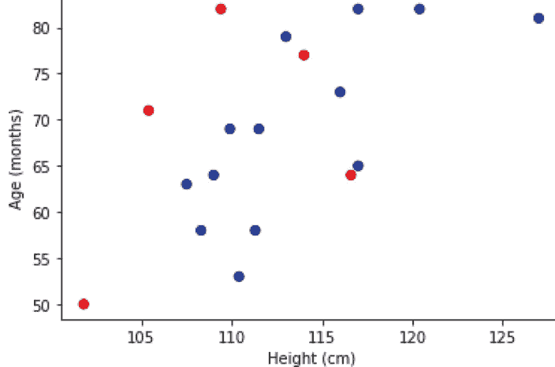

**图 15-13.** 孩子身高数据集样本，其中蓝色代表男孩，红色代表女孩，已提供给 k-NN

如果我们将此数据集交给 k-NN 作为我们的“训练集”，它将作为我们的参考集。我们将 $k$（分类时要考虑的邻居数量）设置为 3（这是一个常用值）。现在，如果我们有两个如图 15-14 所示的新点，我们就可以看到分类是如何工作的。第一个新点是左上角的紫色，第二个是上中间的绿色。我们可以直观地识别出哪三个点离紫色和绿色点最近，这些点用黑线标记。对于紫色点，三个点中有两个红色的，一个蓝色的，因此我们将紫色点分类为红色。绿色点有四个点相当近，虽然最近的两个都是蓝色的，因此这个将被归类为蓝色。

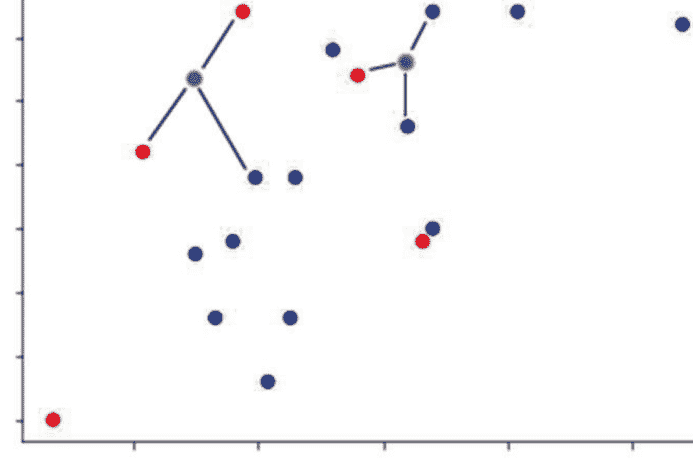

**图 15-14.** 根据我们训练好的 k-NN 对新点进行分类

k-NN 技术上是一个分类器，但可以对最近邻居的平均值用于回归。在上面的情况下，如果标签是数值，我们只需要取最近点的平均值。这非常直观且易于实现。通常寻找正确的 $k$ 需要一些工作，但它在很多情况下运行良好，特别是在特征超过两个的情况下。要找到最佳的 $k$，你通常会创建一组不同数量的 k-NN，并对每个运行测试以查看哪一个最好。k-NN 的使用频率没有以前那么高了，但它仍然非常强大，并应用于许多领域，包括财务预测、推荐系统和图像处理。

## 支持向量机

支持向量机（SVM）是另一种主要用于分类的监督机器学习算法，它寻找一种分离数据组的方法。它可以处理线性和非线性数据，尽管对于许多特征有不同的变体。

# 超平面

超平面是空间中比空间维度少一的“线”的通用名称。例如，在二维图表中，你可以在空间内画一条线，它只是一条直线（一维）。同样，二维平面可以放置在三维空间中。在四维空间中，它将是一个三维对象（类似于侧面不同的立方体）。你可以可视化超平面，但无法可视化空间本身。超平面的作用是将空间划分为维度，那里的一切都有相应的类比。图 15-15 是 SVM 通过在类别之间创建边界来尝试实现的目标示例。在标准 SVM 中它是线性的，因此它必须是一条直线，但 SVM 的其他变体可以产生非直线的超平面。注意，在图 15-15 中存在分类错误点，一个蓝色混在红色中，两个红色混在蓝色中。在机器学习中，这种错误有时是不可避免的。

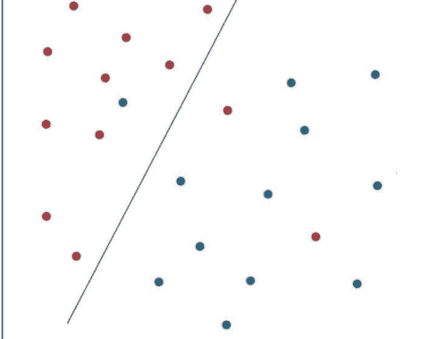

**图 15-15.** SVM 在具有特征的数据中分离类别的目标示例

SVM 非常强大，但与其他算法一样，当特征数量过大时，由于维度灾难（我们将在下文中讨论），它们可能会过拟合。它们被用于许多任务，包括文本分类和目标检测。值得注意的是，也有可以回归的 SVM 变体。

# 无监督技术

在无监督学习中，你只想看看数据能自己说明什么。你没有提供训练数据让它学习某些应用于新数据的规则。相反，你提供精心策划和准备的特征，让它开始工作，让它发挥作用。它将带回关于它在数据中发现了什么的信息。

无监督学习有两种主要类型在数据科学中非常常用：聚类和关联挖掘。在聚类中，方法识别彼此相似的数据组。在关联挖掘中，技术为你提供关联在一起的小组。我将在下面介绍这些每种方法，并涉及一些算法。

## 聚类

聚类是识别数据中相似点的流行方法。例如，零售店可能想要识别不同类型的客户，以便对他们进行不同的营销。如果我们已经有了带标签的客户，我们可以将此问题视为监督问题，我们可以对这些客户训练模型，并将未标记的客户通过模型运行。但这需要三件事：知道有多少组、这些组是什么、以及带组标签的数据。如果我们没有这些信息怎么办？聚类来救了，它不需要这些东西（技术上有一种方法需要你指定组的数量，但你可以进行实验）。

# 均值聚类

k-means 是数据科学家通常学习和使用的第一个聚类方法。k-means 聚类通过将每个数据点放在其最近的簇中来识别指定数量的簇，中心定义为簇中所有点的平均值。由于没有预先标记，它们是如何获取组的？k-means 采用自上而下的方法，首先查看所有数据并将其划分为所谓的沃罗伊细胞（参见图 15-16 中数据划分为沃罗伊细胞的示例）。


**图 15-16.** 28 个点随机数据集的沃罗伊细胞


# 第 15 章 不是水晶球：机器学习

被分配给最近的 k 个聚类中心之一。沃罗诺伊单元（Voronoi cells）在此发挥作用，因为任何沃罗诺伊单元内的数据点都会被分配给该随机聚类中心。

之后，我们开始调整簇。对于每个簇，我们取该簇内所有点的平均值，该平均值就成为该簇调整后的中心。这就是一轮。这个双步过程会重复进行：首先将每个点重新分配到最近的簇，然后重新计算中心。有一种用于衡量每个簇及其点的指标，被称为“簇内平方和”（within-cluster sum of squares），它在每次重新计算中心后都会计算。这个过程不断重复，直到簇内平方和停止变化，此时我们说算法已经收敛。

k-means 算法的一个有趣点是，它总是会收敛，尽管不能保证找到最优的聚类。这是因为起始点是随机的。运行几次并观察簇是相似还是不同（或截然不同）是正常的。此外，还有其他比上述描述的方法来衡量“亲近性”，但它们不会像这种简单的方法这样收敛。

注意，除了完全随机值外，还有一些分配初始聚类中心的方法（例如随机划分 Random Partition 和 Forgy）。你可以通过 Google 学习这些内容。

我们讨论了如何运行 k-means，但没有讨论如何确定你的 k 到底应该是。有时你对数据中可能的内容有一种直觉，所以你可能有一些看起来值得尝试的数字。如果你正试图识别商店不同类型的客户，k 值为 50 可能是不合理的——公司如何为 50 种不同类型的客户差异化营销或其他服务呢？此外，k 值越高，算法所需的数据就越多。

幸运的是，你不需要预先正确的 k，因为有一些方法可以让你系统地选择一个优的 k。这种方法有几种，但我在这里将重点介绍肘部法（elbow method）和轮廓法（silhouette methods）。搜索 Google 获取更多信息。

# 第 15 章 不是水晶球：机器学习

肘部法简单且常用，但它被认为极度不可靠，因为很难定义“肘部”在哪里。通过肘部法，你可以确定可能的聚类数量，例如从 2 到 10 个。你对其中每一个数量运行 k-means，并计算每次运行的簇内平方和值，然后将其与聚类数量绘制成图。我们寻找的是簇内平方和从随着每个簇增加而快速下降转变为显著减慢或趋平的那个点。参见图 15-17 以查看此类图的示例。

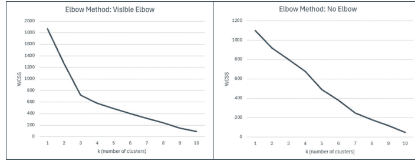

**图 15-17.** 用于确定最佳 k 的两个肘部图。左侧有一个可见的肘部，而右侧没有。

在图 15-17 中，左图的 k = 3 就是我们寻找的——簇内平方和下降速度的变化。右图没有像那样的点。这就是为什么人们并不总是使用这种方法。它被认为是主观的，如果你改变图表的比例或大小，肘部看起来可能更像“肘”。但你始终可以快速生成这张图，如果你运气好，可能会看到一个明显的肘部。

另一种确定良好 k 的常用方法是轮廓法（silhouette method）。通过轮廓法，你通过观察每个数据点与其簇内其他点的共同点以及它与相邻簇的差异，来衡量每个数据点的聚类效果。它涉及为每个点计算得分然后计算整个结果，值范围在 -1 到 1 之间，高值表示聚类效果良好，低值表示差。这在特征较少的数据集上运行良好，但当特征很多时，“维度灾难”会再次抬头。

事实是，和许多机器学习算法一样，一些尝试是常见的。提供聚类数量的需求使得这种方法有点麻烦，但在识别有意义的群体方面，它可以非常强大。

# 层次聚类

还有其他一些聚类方法被认为是层次的，主要有两种类的层次聚类算法：凝聚聚类（agglomerative）和分裂聚类（divisive）。凝聚聚类自底向上构建簇，每个点开始都作为一个自己的簇，并逐渐向上适地合并簇。分裂聚类是自顶而下的，我们从一个簇开始，根据每个簇的特征开始拆分成多个簇。所有的层次方法都会生成一种树状的结构，称为层次树图（dendrogram），它显示了从每个数据点自成一个簇到包含所有内容的单个簇（凝聚法）或反之（分裂法）所创建的层次。

这两种方法都使用距离度量来告知分裂或合并决策。距离是在数据的个体点之间测量的，以衡量所谓的“差异性”（dissimilarity）。然后另一种称为“簇链接”（cluster linkage）的度量查看数据集之间有多不同。

在最常用的凝聚方法中，簇在每一步中成对合并。关于这一点的一个有趣点是，它会一直进行到一切都在一个簇中的点。运行算法完成后，你决定在树的哪一层进行切割，并获取该层次上的簇。参见图 15-18 的示例。它展示了在鸢尾花（iris）数据集上执行的凝聚聚类，这是一个很多人初学机器学习时经常使用的著名数据集。

# 第 15 章 不是水晶球：机器学习

# 聚类的鸢尾花数据（标签显示了物种）

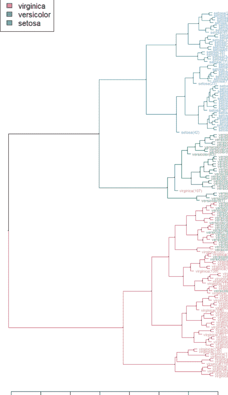

**图 15-18.** 数据的凝聚聚类层次树图。源自 "File:Iris dendrogram.png" 可见 https://commons.wikimedia.org/wiki/File:dendrogram.png，根据知识共享署名-相同 4.0 许可使用 https://creativecommons.org/licenses/by-sa/4.0/

# 第 15 章 不是水晶球：机器学习

这种算法从右侧开始，每个花数据点都是自己的簇。它的类别通过颜色识别。算法开始将它们分组，一次一对，并向上移动生成树的不同层次。你可以看到颜色的变化使得许多 versicolor 在一起，并最终与 virginica 在同一个簇中。但你可以做的是在树的某个位置切割以查看簇。假设我们在 X 轴的 3 处切割。想象从那里向上引出一条垂直线，它将交叉四条线，每条线代表一个不同的簇。该线右侧的所有内容都在该簇中，因此你可以看到两个簇划分了 virginica，一个属于 versicolor 和 setosa，有些在错误的簇中。

分裂聚类的工作原理与凝聚聚类相反，从一个簇开始，以每个点自成一个簇结束。在视觉上，它看起来相似，因为它创建了类似于图 15-18 的层次树图；但构建方式不同。你可以通过 Google 获取更多关于如何操作的信息。

# 规则学习

关联规则学习是另一类无监督机器学习。你可能听过关于啤酒和尿布的故事，男人在周五后去商店买尿布，并在结账时顺便带上一箱啤酒。这可能是传闻，但显然它不是——一组人在药店进行了关联规则挖掘，发现啤酒和尿布之间有很强的关联，还有其他 20 多对产品。

> 5 "Diapers, Beer, and Data Science in Retail" 作者 Nate Watson, 2012年7月17日, 可见 https://canworksmart.com/diapers-beer-retail-predictive-analytics/


关联规则学习（有时也称为关联挖掘）通过观察项集——即物品的成对或更大集合的组合——来识别导致购买另一项物品的物品。啤酒和尿尿布的故事与此相关，因为零售业是我们用于该理论的经典案例。它甚至被称为市场篮分析，因为我们查看的是某人购物篮中的物品。规则本身具有方向性，基本上可以被认为是“如果-那么”的组合。如果他们买了一包尿尿布，他们通常也会买一箱啤酒。

关联规则学习的主要方法是 Apriori 算法。我们以前在语境下（贝叶斯统计，包括朴素贝叶斯）听过这个术语，但在这里它了一种利用特定概率的关联规则学习特定方法。它通过首先观察项集来识别规则，项集由至少两个物品组组成。对于每个项集，会计算一个名为“支持度”（support）的分数，即该潜在项集出现在交易中的百分比，并保留任何超过选定阈值的分数。支持度足够的被称为频繁项集。从精简后的集合中可以生成所有可能的规则。请注意，如果频繁项集很多，规则将会非常多。规则的编写方式类似于 `[milk]->{bread}` 或 `{milk, bread}->{butter}`，我们将左侧称为前件（antecedent），右侧称为后件（consequent）。

下一步是在每个可能的规则上，计算一个名为“置信度”（confidence）的分数，因为前件也包含后件。置信度为我们提供了配对重要性的良好指示。就像我们丢弃支持度低于特定阈值的项集一样，我们也丢弃置信度低于另一个定义阈值的规则。

这些信息很好，但有时置信度本身可能会产生误导性，因此我们计算另一个分数，称为“提升度”（Lift）。提升度基于支持度计算，并告诉我们三种可能关系的存在（及强度）：(1) 如果第一个物品的存在导致了第二个物品的出现，(2) 如果没有连接，或 (3) 如果它们产生相反的影响（第一个物品的存在使得第二个物品出现的概率降低，意味着替代关系）。提升度分数告诉我们第二个物品与第一个物品一起出现的概率有多大（提升度为 4 意味着比总体人群的可能性是四倍）。另一个分数让我们进一步感知关联的有效性，即“信服度”（conviction），它也可以基于支持度和置信度计算。

还有其他计算关联规则的算法，Apriori 非常流行且相当高效。

## 模型解释器 (Model Explainers)

机器学习相关的一个主题是相对新的领域，目前仍在深度开发中：模型解释器。*模型解释器*是一种工具，它获取一个训练好的模型和对未见数据的预测，并确定训练模型中的哪些特征对每个单独预测的贡献最大。这在黑箱模型或模型可解释性低的情况下是无价的。正如我们讨论过的，决策树的解释性很好，但它们有一些缺点，当我们切换到随机森林时，这些缺点会得到缓解。但随机森林很大程度上是不可解释的。你可以获得整体模型的特征重要性评分，但它无法告诉你关于特定预测的任何信息。我的团队有一个预测模型的可视化方案，你可以悬停在特定天的预测上，它会显示对该天预测贡献最大的前十特征。这对于利益相关者来说是无价的，但也让我们对模型更有信心，因为在我们的许多特征中，它为每一天挑选出了有意义的特征。

目前有几个模型解释器，具有不同的优缺点。只有一些适用于线性数据，另一些适用于任何模型，而另一些仅适用于特定的模型（算法）。我使用效果良好的一种工具称为 LIME（局部可解释模型无关解释），Python 和 SHAP（Shapley Additive You）中都有相应的库。你可以在 Google 上搜索这个主题来找到几个供你探索，从 SHAP（Shapley Additive exPlanations）开始。

## 机器学习的实现与编码 (Implementation and Coding Machine Learning)

我提到许多非常重要且有价值的机器学习技术以及它们是如何训练或运行的。但当涉及到实际实现任何一种技术——编写代码时，还有其他非常重要的技术。上述讨论的所有方法在 R 和 Python 的某个库中都是可用的，这很好。但你不能仅仅把数据丢给机器学习函数并期望获得结果。

我上面提到了超参数调优的重要性，以及它如何涉及处理验证集或使用交叉验证。有很多库可以帮助你做到。你提供数据、正在使用的模型以及你想要为每个参数尝试的所有值。网格搜索会找到所有参数的每种组合并跟踪每种组合的性能。如果你尝试多个具有多个值的多个参数，这显然会花费大量时间，因为这么多值的组合数量将非常大。幸运的是，还有库允许你选择所有可能的参数子集并仅运行这些。这些工具会对每个组合运行算法，存储性能并报告最佳参数集。

在验证集上通过网格搜索进行超参数调优是很好的，如果你在完整的训练和验证集上运行一切，你可能无法得到新数据的最佳模型。由于数据科学很大程度上关于创建一个处理未见数据并返回意义内容的模型，因此这是重要的。

交叉验证技术将你的数据分成较小的训练子集，并在每个子集上运行所有操作（包括超参数调优）。这使得模型更加稳健并有助于防止过拟合和偏差（我们将在下方讨论）。R 和 Python 中也有用于此的库，使其变得相对容易。

在数据科学的其他其他方面，有不同的交叉验证技术可以选择。你可以向 Google 询问关于这些技术以及何时使用的更多信息，但一种常用方法称为 k 折交叉验证，将训练数据集分成 k 个（10 是常见的）子集。然后你总共运行模型 k 次，每次运行使用不同的子集进行测试。这样做是为了代替使用特定的验证集。

最后一点值得提到的是，有时数据科学的科学部分比其他时候更突出。这并不意味着我们字面上遵循科学方法，但某些数据团队尽可能做到系统化。其他团队则更杂乱。当我们测试不同类型的算法时，讨论运行实验是很常见的。当我们致力于解决方案并知道我们将尝试不同的算法时，首先运行一个我们预期表现低于其他算法（但仍优于随机猜测）的算法也是常见的。我们称之为为基准（baseline），在很多回归预测中，该基准是一个时间序列模型并不罕见。有一个基准为我们尝试的所有其他算法提供了一个参考点。这让我们对发生的情况有了许多思路。

## 建模挑战 (Challenges in Modeling)

机器学习有很多活动部分，充满了错误或纯粹坏运的可能性。通过了解一些陷阱以及如何识别、处理它们甚至避免它们，可以减轻这些问题。


# 第 15 章 不是水晶球：机器学习

总之，我将讨论过拟合（overfitting），即你的模型与特定训练数据的结合过于紧密，导致泛化能力差；欠拟合（underfitting），即你的模型错过了重要模式；不平衡数据（imbalanced data），即某个标签的数量远多于其他标签；维度灾难（the curse of dimensionality），即维度过多导致无法获得良好结果；以及数据泄露（data leakage），即你给了模型一个无法持续的不公平优势。

## 过拟合与欠拟合

过拟合和欠拟合都是模型表现不佳，只是方式不同。我将讨论它们以及偏差-方差权衡（bias-variance tradeoff），这是一种平衡模型以避免过拟合和欠拟合的方法。

拟合发生在模型学习了训练数据（以及测试数据）中非常特定的特征，而这些特征可能出现在未来的数据中，因此其泛化能力不好。当你的数据质量低、包含大量噪声时，也会发生这种情况。如果模型在噪声中“学习模式”，它就是过拟合了（而且是错误的）。看看图 15-19，它与图 15-15 的数据相同。在图 15-15 中，我们有一条简单的直线将图中的数据分为蓝色和红色标签，有三个数据点（两个红色一个蓝色）被分类错误。对比图 15-19，我们有一条波浪线代表模型训练后的分割器，它对于那三个可能的离群点非常特殊。当我们对未来数据进行分类时，这将产生负面后果。

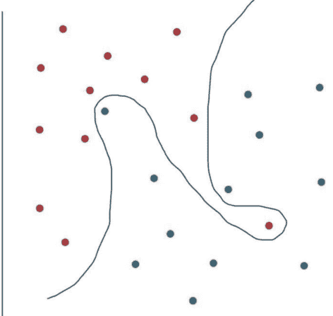

图 15-19. 使用过拟合模型的数据

很难看出这个模型很诡异且很可能是错误的。假设有了新点需要进行分类，如图 15-20 所示。这显示了两个新的数据点，其正确类别在绿色圆圈中心被标记。但由于这些点位于弯曲决策边界内的错误位置，它们将会被误分类。靠近许多其他红点的新红点将被标记为蓝色，而紧邻一个正确分类的蓝色点的新蓝点将被标记为红色。很显然，这不是我们想要的模型。

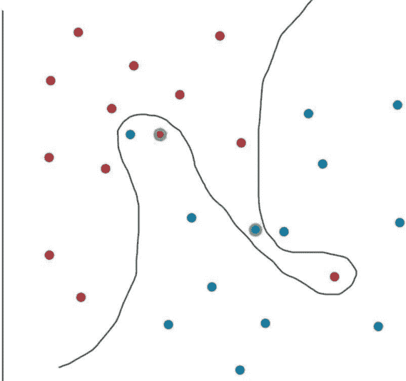

图 15-20. 需要由此过拟合分类分类的两个新数据点，正确类别标记在中心

过拟合的产生有很多不同的原因，包括维度灾难（下文将讨论），过多的特征可能会导致这种现象。模型还因为算法的特定特征或倾向而产生过拟合。例如，如果你让决策树长得太深，它可能会严重过拟合，因为它试图解释训练数据中的每一个细微特征。随机森林较不易出现这种情况，因为并不是每个数据点都出现在构建的每棵树中（在数百棵树中如此）。全连接前馈神经网络和 SVM 随着特征数量的增加都容易过拟合。通常，仅仅是训练时间过长就会导致这种现象（如深层决策树）。基本上，如果你不充分了解算法的工作原理，导致过拟合并不难。

有防止过拟合的方法。正如前面提到的，不要训练模型太久——早停（early stopping）可能会有益。特征选择（Feature selection），如第 14 章之前讨论过的，可以非常有帮助（减少特征数量并去掉那些对贡献不大且可能干扰算法的特征，导致对其重要性产生错误结论）。正则化（Regularization）是另一个有效的技术，如第 14 章所述。其他集成机器学习方法也很有价值，不同的开始进入特征胡同的模型可以抵消彼此的过拟合倾向。

过拟合是一个问题，但相反的欠拟合问题也需要避免。欠拟合是指模型错过了数据中的模式。它可能由于模型训练时间不够长、数据不足或数据不具代表性而发生。第一个问题的解决方案显然是增加训练更长（但不要太长）。第二个问题通常可以通过半监督技术增加数据量，或者通过其他方法创建合成数据（下文“不平衡数据”小节将讨论）来缓解。但如果数据因为缺少不同特征的示例而不再具有代表性，这些技术就无能为力。我们只需要找到更多数据以获得更好的代表性。

你可以看到过拟合和欠拟合处于光谱的两端。我们通常将管理这一光谱称为偏差-方差权衡。欠拟合模型具有偏差，因为它们做出了过度简单的假设，导致在训练集和测试集上的表现都很差。过拟合模型在训练集和测试集之间存在方差，这意味着它们在训练集上表现良好，但在测试集（或其他未见数据）上表现糟糕，因为它们对训练数据过于敏感。之所以被称为“权衡”，是因为某些可以减少偏差的某些措施实际上会增加方差，反之亦然。例如，特征选择可以导致方差减少，因为它让模型更简单，但也可能导致偏差增加。某些线性模型中的正则化降低了方差但增加了偏差。在决策树中，树越深，方差越高。有一些计算偏差和方差的方法，但它们非常复杂，对于大多数日常工作并非必要。

## 不平衡数据

不平衡数据是其他问题之一，我们在分类中看到标签出现的频率不相近。例如，在异常检测中，大多数数据都是异常的（根据定义），所以我们只有少数标签的示例。异常标签的情况是极端不平衡，其只占总数据的不足 1%。当标签只占 20% 时，被认为是中度的。

处理不平衡有几种方法。一种是下采样（downsampling）并增加多数类的权重（出现大量的标签）。下采样意味着对多数类进行采样，减少少数类和多数类之间的差异。例如，如果我们有 1 个异常对比100 个非异常，我们可以取 5%。这种方法的下一步是增加多数类的权重，意味着在训练时将其视为重要。另一种常用的技术是 SMOTE（合成少数类过采样），它与上述方法相反——它增加了少数类样本的数量。它通过创建新的（合成）异常标签示例使数据集达到更好的平衡。该技术使用 k-NN 来识别给定示例周围的空间，然后选择一个邻居，并在原始示例和邻居之间创建一个新的数据点。

## 维度灾难

我在上面提到过这个问题。维度灾难是我们所说的、由于特征过多而导致的一系列问题的情况。最明显的问题是很难在三个维度以上进行数据可视化，但我们通常可以通过如散点图中的颜色和大小等技巧包含三个以上的特征。此外，有时有解析数据的方法一次只查看少数特征，这在有 10 或 20 个特征时是可行的，但特征越多，这种方法的实用性就越低。

第二个问题是数据稀疏性（data sparsity），即我们的数据分散得如此，数据点之间或有时标签之间有很多空白空间。我们可以从图 15-21 和 15-22 中看到增加维度如何导致稀疏性。如果我们从虚构的祖孙一代关于受教育年限的一维视图开始，在一个轴上只有一个特征，如图 15-21 所示，我们可以看到它在一个小的范围内，尽管 20 处的点是一个离群值。（注意我添加了抖动（jitter），这使得具有相同的值不会完全重叠。）


图 15-21. 一组人总教育年限的一维视图


## 第 15 章 不是水晶球：机器学习

但我们数据集的特征数量超过了受教育的总年数。我们可以将年龄添加到图表中并创建一个标准的二维散点图，如图 15-22 所示。一旦我们这样做，就能立刻看到两个点距离所有其他点以及彼此之间都非常远。

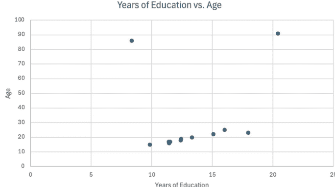

图 15-22. 数据维度从一维增加到两维的影响

图 15-22 中的这些点太远了，以至于如果不产生过拟合等其他问题，很难将它们包含在模型中。此外，这些远点恰好是整个数据集中的最小值和最大值。看起来，如果我们在模型中使用年龄，它将不知道该怎么办——年龄大是意味着高教育水平还是低教育水平？在点群区域和那两个远点之间的所有空间里到底发生了什么？我们完全不知道，因为对于这么多维度，我们没有足够的数据。如果数据仅通过增加一个维度就能分散，想象一下增加 10 维、50 维甚至更多会发生什么。特征越多，我们需要更多的数据来表示每个特征之间的真实多样性以及它与其他特征的关系。

如图表所示，过拟合是维度带来的另一个问题，这很大程度上源于稀疏性。第四个问题是，特征越多，“距离”的概念往往越变得模糊。因此，当我们进入高维数据时，我们常用于衡量距离的一些典型指标就失效了。

另外两个问题与随着特征数量增加而必须进行的计算量有关。它开始消耗越来越多的计算资源，并且运行时间越来越长。取决于特征的数量，这可能会达到完全无法实际运行（或成本太高）的程度。

## 数据泄露 (Data Leakage)

数据泄露源于建模中最容易犯的错误之一——无意中将不应存在的数据包含在训练集中。这可能来自你的测试集（很容易做到），或者关于目标的任何其他在运行实际预测时将无法获取的信息。

另一件容易发生的事情（尤其是当你是新手时）是不经中包含了存在于训练集（和测试集）中、但在你在未见过/未来的数据上运行模型时并不存在的特征。例如，想象你正在预测餐厅下周（周一到周日）的披萨销售量。你创建了一系列很棒的特征，包括之前的销售额和上周的销售额。这在你的测试集中是有效的，因为你有完整的数据，可以计算出所有这些。当对未来的一周进行真实预测时，你可能拥有直到周日晚上的所有销售数据，然后你将运行下周的特征更新，并在周一早晨进行预测。这没问题，因为你有前一天的销售额。周二呢？你还没有周一的销售额，因为现在是周一早晨，餐厅还没开门。如果你尝试在这些数据上运行，你的特征生成或预测可能直接失败，因为缺少了该数据；但更糟糕的是，你的模型直接取空值（null）并使用它（影响未知，但肯定不好）。

数据科学需要关注细节，并始终思考你正在做什么。如果你获得了非常高的准确率或性能得分，你可能存在了数据泄露。每当你在测试集上获得惊人的性能时，请检查训练集和测试集之间是否没有重叠。然后检查是否存在不合理的特征。此外，如果你在测试基于时间的数据，你几乎总是希望将测试集按时间顺序放在数据的最后，而训练集放在其之前。如果你包含了依赖于之前值的特征（如上个月的销售额），这是一个强制要求。

## 核心要点与后续展望

在本章中，我们涵盖了许多机器学习主题。我们首先关注于定义机器学习的三大主要类型：监督学习、无监督学习和强化学习，还讨论了半监督学习和集成学习，这两者都为该领域增加了大量内容。接着我们研究了几种监督学习算法，其中一些非常深入，包括时间序列分析、广义线性模型、树、朴素贝叶斯、神经网络、k最近邻和支持向量机。然后我们讨论了两种无监督学习技术：聚类和关联规则挖掘，触及了两种聚类类型：k-均值和层次聚类。我谈到了模型解释器，它可以帮助解释黑箱模型的预测，以及在代码中执行机器学习的实践方面。我应对了我们在进行机器学习建模时面临的一些主要挑战。这些包括过拟合和欠拟合（模型要么无法良好泛化，要么遗漏了重要模式）。然后我讨论了不平衡数据（即不同标签的计数差异巨大）以及维度灾难（描述了模型中拥有大量特征时产生的一些问题）。最后，我解释了数据泄露，即不该存在的信息进入了你的训练模型中。

在下一章中，我们将观察在训练模型后如何查看其表现如何。我们将讨论几种用于衡量分类任务模型和回归任务模型性能的指标，因为它们可能大不相同。我还将查看我们用于衡量聚类算法性能的一些指标。

## 业内人士简介：JEFF ELMORE

**姓名：** Jeff Elmore

**现职：** 高级首席数据科学家

**目前行业：** 能源，曾从事教育科技、文字研究和写作

**工作经验：** 技术领域20年，其中13年数据科学

**教育背景：**

- 应用数学学士

> *此处观点仅代表 Jeff 本个人，不代表其任何雇主。*

### 背景

Jeff 在 12 岁时就爱上了电脑，这种热爱从未消失。他在高中毕业后开始从事程序员工作并乐在其中，但决定攻读学位。他最初是计算机工程专业，但在学了微积分后，他意识到自己更喜欢数学，于是转专业到应用数学。他喜欢那种你面对一个非常困难的问题，只需应用数学变换，它突然就变得简单的感觉。他从大学和经验丰富的上司那里学习了机器学习。

### 工作

他在公司的首个大项目是与一位研究人员合作改进他们的产品，该工具可以分析书籍并分配一个类似难度的评分，用于为孩子匹配合适的书籍。他需要理解孩子是如何学习阅读的，意识到自己缺乏领域知识，因此开始学习，但这是一个缓慢的过程。最终，他和那位研究人员想出了解决问题的方案。他对这项工作非常自豪，但遗憾的是，由于公司不理解它或不知道如何营销，并没有任何结果。他和几个老朋友一起创立了一家公司，他们开发了一个旨在帮助小说家写小说的产品。这次创业并没有成功，非常令人失望。但它改变了他的观点，让他更加重视工作与生活平衡中的生活部分。他现在找到了一份既喜欢又不会占据生活的新工作，所以感到很开心。


# 第 15 章：不是水晶球：机器学习

**最常用的技能：** 对数据进行反复思考——能够通过思考事物来解决问题。沟通至关重要。可视化技能，包括概念化和创建实体的图表等。你可以通过一张图片传达大量信息，这非常有利于交互。他学会的另一个技能是为他开展的一些重复性工作创建可复用的流水线，以避免反复地进行手动操作。

**目前使用的主要工具：** Python, Jupyter Notebooks, LLMs, Retool（一种拖放式 UI 构建器），通常使用大型开源生态系统。

**数据科学的未来：** 新的 AI 正在为想要自动化部分工作的人们带来巨大变化。随着更多人被赋予自动化能力，这种趋势将继续增长。但 AI 很少是完美的，因为总会有更多可以包含在模型中的信息，时间永远不够，而且通常存在知识缺失。

**优秀数据科学家的特质：** 谦虚，以及倾听和保留判断的能力，尤其是当你进入一个你不熟悉的领域时。如果你不保持开放态度，你就无法理解问题并会做出错误的假设。你还需要具备灵活性。可视化技能，包括技术性和非技术性的。

**对未来数据科学家的建议：** 不要把自己束缚在一个仅限商用的工具上，因为市上有许多优秀的开源工具。通常情况下，除了自己的工作外，始终要从他人的工作中学习。学会阅读学术论文，即使你不认为自己会写论文。或者，至少要能够快速浏览它们以了解可能的范围。有时，解决问题只需要做一些别人已经做过的事情。

> Jeff 是一位经验丰富的数据科学家，在读写能力和心理测量方面拥有深厚的经验。

# 我们表现得如何？
## 衡量机器学习技术的性能

## 引言

进行机器学习、构建模型、获取预测结果并发现有趣的关联是非常棒的。但我们如何知道自己是否真的做对了呢？这就是性能指标的用场。有多种方法可以衡量机器学习模型的特征，帮助帮助我们理解它们是否在执行我们想要的操作以及是否正确。如果我们的结果实际上没有意义，我们就不想使用它们。有时，人们很容易直接从表面接受结果并假设它们是好的。关于这种坏习惯的更多信息请参见侧边栏。

模型的性能主要通过计算特定的指标评分来实现。对于三类机器学习任务：分类、回归和聚类，有不同的指标。我将介绍

# 第 16 章：我们表现得如何？衡量机器学习技术的性能

目前每种任务使用的各种指标。请注意，我们讨论过的另一种无监督方法是关联规则，没有用于从上评估结果规则的指标，因为每条规则在创建过程中都通过特定指标进行判断，因此之后没有可以衡量的东西。

当我们谈论评估模型性能时，通常是指在通过监督学习在训练集上训练模型后，在测试集以及（如果使用了的话）验证集上计算指标。对于无监督学习，有一些指标可以让我们感知模型的质量，尽管我们无法通过所有这些指标来衡量“正确性”。在我们使用了无监督算法但也有标签的情况下，可以使用额外的指标。

我将首先谈谈指标对现实世界场景可能重要的几个例子。然后，我将对内部模型构建指标进行概述，最后在讨论模型构建后需要查看的分类、回归和聚类指标之前进行介绍。

# 未能评估机器学习结果

大多数专业数据科学家都足够负责，以确保他们的模型运行良好。但数据科学往往是由那些正在学习的人完成的，他们可能不知道评估模型的正确方法（这就是为什么像这样的章节很重要）。了解你的模型表现得如何始终关重要。确保没有出错也很重要，这基本上通过检查你的工作来实现。我曾与一位缺乏经验的数据科学家合作，他在使用的工具中在几天内提供了一个本该需要几个月才能论证，而他没有发现这个错误。快速的检查就会告诉他，他的预测比预期的大了 30 倍。

缺乏经验的数据科学家犯的另一个错误是像他们应该做的那样使用性能指标评估模型，但没有意识到他们出色的结果是数据泄露的结果，而不是一个完美的模型。每当你获得非常高的准确率或其他指标时，请检查是否存在这种错误。

但一个更大的问题是，许多公司不会在后期评估他们的结果好坏。他们可能会进行一些聚类来识别客户类型，但两年后，他们不会检查这是否在任何方面对他们有所帮助（特别是如果它比旧方法有所改进）。他们可能会进行一些机器学习来帮助决定在哪里开新店，但几年之后，他们可能不会比较模型推荐的商店与其他未被推荐的商店的性能。部分原因之一是，跟进几年前发生的事情很困难，你无法真正评估已经做出的重大决策。

此外，源于技术大主义（即认为机器学习本质上是公平、正确的且通常优于人类工作的观点，在第 9 章中讨论过）的态度意味着人们不会质疑结果。数据科学可以非常强大，但结果真的有价值吗？这需要一些工作才能确切。

# 现实世界中的性能评估示例

很多时候，数据科学家有自己喜爱的指标，但考虑不同的指标以及它们如何契合你当前的问题总是是好的。这两个例子展示了指标的重要性，特别是选择正确的指标。

# 示例 1：指标驱动的开发

客户关系管理 (CRM) 平台拥有成千上万客户。这些客户有不同的需求和用例，其中许多人想在他们的 Salesforce 数据上进行机器学习。对他们来说，最简单的方法是在平台内完成，但无数的用例给 Salesforce 带来了问题。有时公司会为客户提供定制化帮助，但这是昂贵的，而且他们能帮助的客户数量有限。因此，Salesforce 创建了一个名为 Einstein Builder 的工具，允许他们的客户生成定制的自助预测¹。该工具需要支持所有不同的用例，又要易于使用，因此 Einstein Builder 是一个不需要代码的 Web 应用，但仍然支持允许自动化的机器学习流水线。他们拥有回归、二分类和多分类分类的工具，涵盖了各种情况。

你可能会想，在没有我们在这里几个章节中学习过的所有数据的情况下，他们如何深入建模的？这有点——除非用户自己知道如何进行这种数据准备并且你给了他们数据准备工具，否则你无法提供此类此类自助工具。自助工具的全部意义在于用户并不具备这些技能。你现在已经知道这意味着结果不会很好。这是由于数据科学的普及而进入市场的各种自助机器学习工具所面临的一个真实问题。

因此，他们面临着一项艰巨的任务：在没有数据准备的情况下赋予客户进行有用机器学习的能力。他们有一个不错的解决方案，依赖于有效使用不同的性能指标。此外，记住客户使用的数据是 Salesforce 的

> ¹ "Salesforce Einstein 中由指标驱动的机器学习开发" 
> (Metrics-Driven Machine Learning Development at Salesforce Einstein) 由 Eric Wyman 编写，见 https://www.infoq.com/presentations/ml-salesforce-einstein/


# 第 16 章 我们表现得如何？衡量机器学习技术的性能

他们拥有自己的系统，因此对该系统的样貌和结构了如指掌。客户可能有一些额外的自定义表格，但至少部分内容是已知的实体。

尽管如此，他们解决方案的核心是衡量他们构建的模型的性能，以便根据需要进行调整。该系统会观察模型的特征，以查看是否可以改进。例如，在线性回归中，系统可以通过寻找接近零的系数或变量过多的情况来检查是否存在过拟合。然后他们可以添加正则化来减少特征空间。他们还有能力使用不同的特征和参数运行实验（特征选择和超参数调优），测量每个实验模型的性能，并仔细地跟踪一切。他们的一点是能够在实验的不同步骤中计算各种指标，这是我们在日常数据科学工作中并不使用的。通过观测到的指标和这些实验的整体结果有助于精调模型。

Einstein Builder 通过观察模型试图实现的目标以及涉及数据的特征，识别出需要监控的正确指标。这一切都驱动了这种自助式机器学习工具的改进。

## 示例 2：模型测试与 QA

在大多数公司中，QA（质量保证）是针对软件和报告进行的，但很少针对数据科学代码或模型本身。人们已经意识到这可能并不理想，一些地方正试图纠正这一点。Strict Logic 是一家咨询公司，他们已将机器模型测试集成到流程流程中¹他们的一位测试

> ²《随着 AI 演进：从传统测试到模型评估》，作者为 Shikha Nandal，2024 年 9 月 13 日，可见于 https://blog.scottlogic.com/2024/09/13/Evolving-with-AI-From-Traditional-Testing-to-Model-Evaluation-I.html

工程师在一篇文章中描述了他们的流程和方法，这篇文章是针对测试工程师的，旨在帮助他们理解如何从软件测试切换到模型测试。

她提到了许多让模型测试区别于软件测试的因素，包括机器学习模型没有预先知的输出，完全取决于数据具体是什么。此外，模型的输出会在每次使用新数据运行时发生变化，而且通常它们的性能会随着时间的推移而下降（模型漂移）。最后，传统的软件测试方法——即通过或失败的简单测试是不够的，相反，他们需要依靠各种机器学习性能指标，这就是为什么这对于本章很有趣的原因。

对于这种测试，他们必须很好地理解正在使用的数据。数据需要被分析和验证，特别是要检查缺失数据、重复和任何偏差。他们做的是测试，而不是模型评估。模型评估是数据科学家在构建模型并在测试集上进行测试来选择最佳模型时所做。但在 QA 中，他们试图观察模型在真实世界中的表现。在他们的测试中，使用了交叉验证。在可能的情况下，他们与其他已知解决方案进行 A/B 测试。但最重要的部分是他们对性能指标的选择，他们根据问题（分类或回归）进行选择。他们不依赖于单一指标，而是使用几个指标，以便获得更完整的视图。并不是所有指标适用于所有数据。

## 分类指标

当人们谈论机器学习中的分类时，他们通常指的是二分类，通常被理解为真或假——患者患有癌症还是没有；这封邮件是垃圾邮件还是不是——但也存在多标签分类问题。我们在这里将涵盖这两者的衡量方法。

# 第 16 章 我们表现得如何？衡量机器学习技术的性能

在二分类中，性能衡量的核心是混淆矩阵，它是可视化模型性能的一种直观方式。大多数主要指标都以某种方式与混淆矩阵相关，因此我们先谈论它，然后谈论基于矩阵的指标。我们将讨论二分类中使用的更多指标，然后谈论一些用于多类分类的指标。

## 二分类指标

大多数分类都是二分类的，这意味着有两个可能的标签。这些标签可以是任何内容，但按照规则，我们考虑一个正类和一个负类。我们将讨论可用于二分类的各种指标。下一节将介绍如何处理多类问题的性能衡量。

## 混淆矩阵

在涉及二分类时，每个预测都有四种情况之一，每种情况都有一个名称：

- **真正性 (TP):** 预测标签为真，且它是正确的，因为实际实例也是真的。
- **真负性 (TN):** 预测标签为假，且它是正确的，因为实际实例也是假的。
- **假正性 (FP):** 预测标签为真，但它是错误的，因为实际实例是假的（这在统计学中也称为第一类错误）。
- **假负性 (FN):** 预测标签为假，但它是错误的，因为实际实例是真的（这在统计学中也称为第二类错误）。

通常，我们显然希望 TP 和 TN 取高值，而 FP 和 FN 取低值。将这些值转换为矩阵视图是自然的，这使得易于看到发生了什么。混淆矩阵显示了四个数值的计数，以及预测和现实的标签。图 16-1 显示了癌症诊断的基本结构，其中患有癌症为正，不患癌症为负。

| | 预测为正（有有癌症） | 预测为负（未患癌症） |
|---|---|---|
| **实际情况** | **实际为正（患有癌症）** | TP 总计 | FN 总计 |
| | **实际为负（未患癌症）** | FP 总计 | TN 总计 |

**图 16-1 混淆矩阵结构**。通常我们创建矩阵时，顶部是预测，侧边是实际。我们希望看到从左上到右下的角的值。请注意，在某些情况下，准确率这个指标是倾斜的，尤其是在数据集不平衡的情况下（例如疾病诊断），我们可以在错误分类每个正值的情况下获得非常高的准确率。在这个视图中，我们通常希望看到对角线上有高值。

此外，精确率 (Precision) 和召回率 (Recall) 以及 F1 分数也是非常重要的指标，我们将在后续章节中讨论它们。


## 第 16 章 我们表现得如何？衡量机器学习算法的性能

召回率（Recall）被视为精确率（Precision）的相反面，因为它强调的是假阴性（FN）。召回率衡量的是整个数据集中被检测出的正例（true positives）比例。我们在欺诈和疾病检测等情况下关注的指标。召回率也称为敏感性（sensitivity）或真阳率。具体的计算方法见表 16-1。

精确率和召回率通常呈反比关系，我们经常希望在两者之间找到平衡。此外，如果模型表现非常糟糕，可能会得到误导性的结果。例如，如果欺诈检测器将每一笔交易标记为欺诈，我们将获得高召回率但极低的精确率（准确率）。同样，在推荐系统中，如果我们只推荐了极少数产品但这些产品是很好的推荐，我们将获得高精确率——但我们会错失所有未被推荐的产品销售。你可以在表 16-1 中看到计算方法。

因此，无论在某种场景中认为哪一个最重要，我们仍然想知道它们之间的平衡情况。幸运的是，我们恰好有这样一个指标——F 分数（F-score），它基本上是精确率和召回率的调调和平均值。它的计算比其他指标稍微复杂一点，但你可以在表 16-1 中看到计算方法。因此，当精确率或召回率更重要时，通常会查看它们并结合 F 分数，以确保模型没有在做无用的工作。

**表 16-1.** 二分类中准确率、精确率、召回率和 F 分数的计算

| 指标 | 来自混淆矩阵的计算 |
|---|---|
| 准确率 (Accuracy) | (TP + TN) / (TP + TN + FP + FN) |
| 精确率 (Precision) | TP / (TP + FP) |
| 召回率 (Recall) | TP / (TP + FN) |
| F 分数 (F-Score) | 2*TP / (2*TP + FP + FN) |

尽管 F 分数很好，但它在处理真阴性（TN）方面存在局限性，有时会使用其他两种指标，马修斯相关系数（Mathews correlation coefficient）或科恩系数（Cohen's Kappa）。这两者的计算都稍微复杂一些，但可以通过混淆值计算出来。你可以通过 Google 找到更多信息。

我讨论了基于混淆矩阵的最常见分类指标，但实践中还有其他一些实用且常用的指标，包括假阳性率（false positive rate）和特异性（specificity，即真阴率）。维基百科关于精确率和召回率的页面³ 有一个非常优秀的扩展混淆矩阵，总结了所有指标。

## 其他指标

尽管混淆矩阵及其相关指标是二分类测量的核心，但科学家也会使用其他一些指标。最常见的是相关的受试者工作特征曲线（ROC 曲线）和曲线下面积（AUC）。

ROC 绘制了真阳率（召回率）与假阳性率的对比，在完美的分类器中，绘制的线条将是一条横跨图表顶部的直线，就像你在图 16-2 左侧看到的那样。分类器是不完美的，因此右侧可以看到一个更真实的例子，它展示了随机猜测模型产生的结果，以及真实模型在儿童身高数据上的表现。

> ³https://en.wikipedia.org/wiki/Precision_and_recall

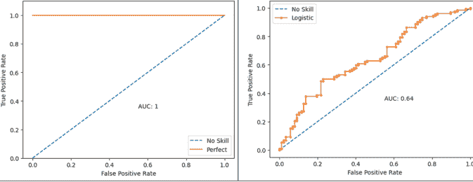

**图 16-2.** 两张 ROC 图，左侧是“完美”分类器，右侧是更真实的分类器

AUC 字面意思是 ROC 曲线下方区域的面积。它包含在图 16-2 的图表中。当比较模型在相同数据上的不同运行结果时，AUC 越高的模型被认为越好。

模型中另一个指标是给出了预测结果正确的概率。例如，在逻辑回归中，我们得到一个概率并通常会取一个阈值（通常是 0.5），任何高于该值的标记为 True，低于该值的标记为 False。有一种名为*对数损失*（log-loss）的指标，可以直接处理该概率。

## 多类分类

上述所有指标都可以适用于多类问题。有两种方法：孤形对余（OvR）和一对对一（OvO）。

在孤形对余中，为每个类训练一个二分类器，将其与其他所有类的合并进行比较。在一对对一中，为每对类训练一个二分类器，仅比较那两个类。

所讨论的指标——准确率、精确率、召回率和 F 分数——可以为每个二分类器计算并进行聚合。常见的聚合方法包括宏（macro）、微（micro）和加权（weighted）。

- 宏平均（Macro-averaging）计算每个类指标的平均值。无论频率如何，它都平等对待所有类。
- 微平均（Micro-averaging）聚合所有类的贡献以计算平均指标。
- 加权平均（Weighted-averaging）计算指标的平均值，但根据每个类真实实例的数量进行加权。

## 受试者工作特征扩展：孤形对余


**图 16-3.** 多类问题的 ROC 图

## 回归指标

衡量回归的性能是不同的，因为输出是数值。关于回归指标要了解的第一点是，回归不存在所谓的“准确率”指标。我们有时会在回归中讨论准确率，但我们使用的是广义上的这个词，而不是特定的技术术语。

线性模型中出现的一个常用指标是 R 方（R-squared score）。它技术上是拟合优度量——R 方表示生成的模型与数据的拟合程度，以及目标变量的变异有多少比例被特征解释。对于线性模型，它有效地比较了实际直线与平均线（一条穿过图表 Y 轴、值为数据中所有 Y 值平均值的水平线），但它也可以用于某些非线性模型。在线性情况下，一个糟糕的模型将有一条接近平均值的线且 R 方得分很低。

R 方的一个缺点是它假设所有特征对模型都是重要的。此外，增加特征往往会增加 R 方，这会导致人们添加比必要的更多的特征，最终导致过拟合模型。R 方有一个改进版本可以更好地处理不同价值的特征。调整 R 方（Adjusted R-squared score）查看每个特征带来的额外价值，只有当特征对模型的改进优于预期时，分数才会增加。由于这种改进，调整 R 方几乎总是小于 R 方。

有几个指标经常被用来 R 方和调整 R 方，因为它们并不总是确定测试集上模型性能的最佳选择。

一种流行的回归衡量标准是均方误差（MSE），它涉及实际值与预测值之间差的平方，将所有这些平方求和，并除以总数。


# 第 16 章 我们表现得如何？衡量机器学习技术的性能

预测值的数量，从而为我们提供了一个“平均”值。对差进行平方对于防止负值抵消正值非常重要，但它也存在一个由于平方作用而容易变得巨大的问题。一个完美模型的 MSE（均方误差）为 0，但它可以变得非常大。此外，它可能很难解释，因为该值的单位是目标变量单位的平方。

MSE 的一种变体是均方根误差（RMSE），它只是 MSE 的平方根，这使得指标的单位恢复到与目标相同，因此更容易解释。在对差进行平方后才取平方根，以避免正负误差相互抵消的问题。与 MSE 一样，完美的 MSE 是 0，但它也可以变得非常大。

另一个流行的指标是平均绝对误差（MAE），它与 MSE 类似，但它不是对实际值和预测值之间的差进行平方来处理正负抵消效应，而是取差的绝对值。就像 MSE 一样，将这些值求和并除以预测总数。这种衡量方法避免了 MSE 平方处理带来的误差膨胀（尤其是较大的误差），因此通常被认为更真实。此外，它像 RMSE 一样，使用的是目标变量的单位。像 RMSE 和 MSE 一样，完美模型的 MAE 为 0，也可以变得很大。

另一个常用的指标是平均绝对百分比误差（MAPE），它是 MAE 的变体，以百分比的形式表示误差，使许多人都能立即理解。MAPE 在取绝对值并求和（以及再次除以预测总数）之前，将实际值与预测值之间的差除以实际值。百分比非常直观，我们不需要担心目标变量单位的含义。需要注意的是，当模型非常糟糕时，“百分比”也可能爆炸，并比 100% 高得多。另外一点是，计算误差百分比时，如果实际值为 0，则无法计算，因为那意味着除以 0（尽管有通变方法）。此外，该指标是相对于实际值的。如果实际值为 125 且预测值为 100，我们的误差为 25，这将变为 25%，但如果实际值为 75 且预测值为 100（与上一个示例的误差差异相同），百分比将是 33%。因此，高于实际值的预测受到的惩罚比低于实际值的更多。

## 聚类指标

由于聚类通常是无监督的，大多数指标都是内部指标，寻找的是簇的通用特征，而不是将结果与已知值进行比较。然而，有时在标签已知的情况下会进行聚类，针对这种情况有一些特定的指标（这些被视为外部衡量标准）。我们在这里将介绍这两种类型。

## 内部指标

内部聚类指标是不需要实际标签知识的指标。因为这些指标仅仅是观察簇的特征、它们相互分离的程度以及内部紧密程度，这并不能说明它们有多准确。它们只是告诉我们这些簇看起来像是一个很好的模型。

用于评估聚类结果的常用指标之一是轮廓系数（silhouette score），它衡量了簇之间的分离性和簇内部的凝聚性。这些因素在聚类模型中很重要，因为我们希望簇之间能够清晰区分（分离性），并且每个簇内点与点之间的差异小（凝聚性）。计算涉及每个数据点的两个平均值：该点与同一簇内其他点的平均距离，以及该点与不同簇中数据点之间的最小平均距离。该值可以是 –1 到 1 之间的任何值，数字越大聚类效果越好，因为点与其所属簇匹配良好，而较小的数字则表示簇之间存在重叠和模糊性。

聚类的第二种指标是戴斯-鲍丁指数（Davies–Bouldin index），它衡量每个簇与其最相似簇的相似性。它依赖于对所有簇与其最相似簇之间的不相似性量取平均值。在该指标中，数字越小越好。

另一个名为 Calinski-Harabasz 指数（Calinski-Harabasz index）的指标考虑了簇内和簇间的方差。计算涉及簇间和簇内的平方和、簇的数量以及数据点的计数。值越高越好。

我将提到的最后一个内部指标是惯性（inertia），它查看簇内的平方和。它累加了每个点的位置与其簇质心之间距离的平方。得分越低越好，但如果太低，则可能表明过拟合。此外，随着簇数量的增加，惯性往往会减少，这就是为什么选择最佳簇数量非常重要。

## 外部衡量

我们到目前为止看到的所有指标仅仅是评估聚类的结果（如无监督学习所示），但还有其他外部指标，因为它们只能用于我们数据标签的情况（如我们在监督学习中所做的）。聚类本身是以无监督方式运行的，但两个名为兰指数（RI）及其变体调整兰指数（ARI）的指标允许我们将聚类算法的输出与我们拥有的标签进行比较。RI 的计算涉及标签的一致对总数和总对数。它的范围可以从 0 到 1，数字越高越好。调整兰指数使用计算出的 RI，并通过期望 RI 值对随机性进行调整。它的范围与 RI 相同。

当标签已知时可以另一个指标是互信息（MI）。互信息衡量点的实际标签和预测标签（簇）之间的相似性。它的计算涉及实际和预测标签以及几个概率。最低分为 0，意味着没有关系，值越高表示预测与已知标签对齐得越好。

## 核心要点与后续

在本章中，我们讨论了衡量分类、回归和聚类模型性能的方法。这些类型的机器学习模型有非常不同的指标。在分类中，大多数衡量基于混淆矩阵，这是一种表示真阳性、假阳性、真阴性和假阴性计数的方法。在二分类分类中，“正性”与“负性”指示我们要测试的标签（例如，正性可能是欺诈交易，负性可能不是欺诈交易）。真”和“假”指示预测标签是否匹配实际标签。其中一些指标包括准确率（预测正确的比例）、精确率（它在做出正性预测时有多严谨）、召回率（它寻找实际正性的表现如何）以及 F 分数（精确率和召回率之间的平衡）。

然后我讨论了多种回归指标。R 方用于线性模型，并为我们提供了一个关于模型与数据拟合程度的指示。MSE 查看实际值和预测值之间的误差，并对其进行平方以消除符号。RMSE 对其取平方根，将单位恢复到与目标变量相同。


实际值与预测值之间差值的绝对值，并对其进行计算，其单位与目标变量相同。MAPE（平均绝对百分比误差）是 MAE 转换为百分比的版本，对于非技术背景的人来说，通常更直观。

最后，我们查看了几种聚类指标，其中一些可以在不知道实际标签的情况下量化聚类模型的整体质量，而另一些可以根据已知标签衡量模型。第一类指标包括：轮廓系数（用于观察聚类的凝聚性和分离程度）、Davies-Bouldin 指数（衡量类与其最相似的邻类之间的相似性）、Calinski-Harabasz 指数（观察类间和类内的方差）以及惯性（inertia，另一种对类内平方和的观察方法）。后一类类型中的两种指标——RI（实际标签与预测标签之间的比例）和 MI（衡量实际标签与预测标签之间的相似性），也很有用。

在下一章中，我们将学习如何处理语言相关工作。数据科学家并不总是参与自然语言处理或语音处理的，但这种情况正变得越来越常见，尤其是随着大语言模型的普及。我们将首先涵盖 NLP 的基础知识，包括语言解析、句子分段、将文本转换为称为 token 的类词片段、词干（将单词还原为共同根形）以及词性标注。然后我们将涵盖语言理解和生成。最后，我们将花一点时间研究语音处理（包括识别和合成）。

# 从业者个人简介：DIEGO TANGASSI

**姓名：** Diego Tangassi

**当前职位：** 高级分析经理

**当前行业：** 零售业

**工作经验：** 8 年数据科学家经验，此前任于精算科学和金融领域

**教育背景：**

- Licenciatura en ciencias actuariales（精算科学学士学位）

> *此处表达的观点仅代表 Diego 个人，不代表其过去或现任雇主的观点。*

### 背景

Diego 一直喜欢工程、机器人和通用系统。一旦拥有第一台电脑，他就下载了很多东西来倒腾，开始摆弄软件，甚至对他的 iPhone 进行了越狱。他最初计划在大学学习机电，但当他访问学校时，接待他的教授并没有给他带来启发，这让 Diego 改变了主意，去研究其他领域。他发现了同样让他感兴趣的东西——精算科学——并在大学学习了它。第一个学期结束后他就彻底爱上了它，在上一门由拥有丰富实战经验的教授教授的金融课后，Diego 确定自己想在金融领域工作。

### 工作

Diego 如愿所愿在金融行业找到了一份工作，财务风险部门（负责养老金），但事实证明这份工作很无味。每天都在重复同样的步骤——获取输出，输入到另一个模型，然后重复。六个月后，他感到非常无聊。当一家咨询公司联系他，寻找具备统计和数学技能的人才时，他做出了跳跃。他热爱整个经历，包括通过 ETL、数据库、信息立方（information cubes）和系统保障学习更多关于数据和数据工程的知识。他还学习了更多关于数据科学这一领域以及收入组合（一种确定哪些产品应该获得提升的方法）。他使用的工具非常基础，例如使用 Microsoft Excel Solver 来优化方程，但利益相关者仍深感震撼。他的工作分为两个基本阶段：第一阶段是做数据科学，第二阶段是沟通结果。他在咨询公司喜欢的事情之一是有机会与零售公司的高层人员打交道，并变得非常擅长沟通。他经常因为这些沟通技能被选中担任特定角色。他离开了咨询行业，但留在零售业担任目前的职位，他仍然热爱这份工作。

# 语录

**工作中最喜欢的部分：** Diego 热爱数据科学中必须进行的所有学习。他也喜欢与各种不同的人合作。最后，任何形式的代码中最令人满意的事情之一就是当你写了一些具有挑战性的代码，并且它运行了。

**工作中最不喜欢的部分：** 官僚主义。有时为了完成那些令人感兴趣的事情，会有太多障碍。有时公司文化也可能具有挑战性。

**最喜欢的项目：** 在咨询公司期间，有一个政府机构要求创建一个关于墨西哥毒品没收的数据库。他们需要大量细节，包括发生地点、涉及的毒枭集团、涉及的人和车辆数量、毒品藏在何处等。他们他们在解决方案上发挥创意，使用多种数据源，但主要使用报纸。他们抓取了报纸网站，进行 NLP 以提取所有细节，并将其存储在数据库中。这是一个非常满意且成功的项目。

# 第 16 章 我们表现得如何？衡量机器学习技术的性能

**最常使用的技能：** 分析性思维。能够将技术术语转换为业务语言，反之亦然。擅长自学。

**目前使用的主要工具：** R, Python, SQL, Snowflake, GitHub, Google Suite（APIs 及更多），Visual Studio

**数据科学的未来：** 过去，大多数数据科学家负责非常广泛的工作，包括数据工程、数据管理等。但现在情况变得更加集中，这样数据科学家可以专注于更典型的数据科学工作，而其他任务则由具有特定头衔的其他人员完成。这种专注于和寻求更专业人才的趋势将继续下去。

**什么是一个优秀的数据科学家：** 理解数据科学确实涉及技术内容，但最大的精力需要放在与非技术人员交流、理解他们的需求，并告知他们可以从你那里期待什么。

**对未来数据科学家的建议：** 尝试为你职业生涯中想要关注的领域制定计划，以便了解不同的领域以及你可能工作的地方。

> Diego 是一位经验丰富的数据科学家，在金融和零售领域拥有专业知识。

# 第 17 章

# 让计算机理解：文本与语音处理

## 引言

最近大家对语言背景下的 AI 非常关注，主要是因为了像 ChatGPT 这样的模型。这是真正的 NLP，它在过去十年中取得了爆发性增长。如今计算机处理语言的能力令人印象深刻，现在是该领域一个非常兴奋的时代。

我们许多人也知道语音技术在过去几十年有了改进，特别是对于曾向公司寻求帮助的人来说。我个人想再次回到数字，因为我拨打的电话总是对不上。

多年来，语音处理主要由电气工程师负责，因为它被视为一个信号处理问题。没有融入多少语言知识。相比之下，NLP 通常在语言学系处于基础，结合计算语言学（一种更多基于语言学理论的类似学科），有时结合计算机科学，因此处理文本涉及语言知识要久得多。但语音处理领域发生了变化，因为他们终于意识到语音不仅仅是声音——我们说话和听词的方式取决于许多因素，包括上下文、语气和其他语言特征。

自然语言处理和语音处理周围有很多术语，特别是语言学方面。请看侧栏对相关的许多语言领域的解释。我们将在下方看到更多术语。

# 语言学子领域

- **语音学 (Phonetics)：** 对语音的研究，包括生理机制和声学属性
- **音系学 (Phonology)：** 对语音的研究，通常处于比语音学更高的层次
- **语义学 (Semantics)：** 对语言意义的研究
- **句法学 (Syntax)：** 对单词和短语如何排列以符合语法正确且有意义的研究
- **韵律学 (Prosody)：** 对语言高层声音特征的研究，包括语调、重音和节奏

# 现实世界中 NLP 和语音处理示例

NLP 在工业中被日益广泛使用，在这里查看两个例子，首先来自一家苏格兰鞋公司，另一个来自一家法国医院使用语音识别来记录患者病历。


# 示例 1：NLP 肩负了重任

苏格兰公司 schuh 是一家在英国和爱尔兰非常著名的鞋类公司，目前正在扩张业务。该公司在管理客户互动方面遇到了困难，并寻求升级和改进其流程¹。他们对自己拥有良好的客户支持感到自豪，并特别寻找能够处理客户投诉的方法，以让客户感到满意——并使他们继续成为未来的客户。

他们开始使用 Amazon Comprehend 的 NLP 和 ML 工具来识别客户邮件中的情感。该系统会查看某封新邮件是具有正面还是负面情感，这可以帮助将新邮件正确地路由到支持团队。不同的客户支持代理是不同类型支持的专家，因此这种将邮件路由给正确人员的方法可以节省宝的时间。这种优先级排序和路由以前是手动完成的，非常耗费时间。他们还使用该工具分析发出的邮件，以确保代理人员回复的质量。

他们发现该系统带来了巨大的收益，主要体现在节省时间以及改进与客户的互动（在质量和及时性方面都是），这意味着他们更有可能留住客户。

> ¹“schuh 通过 AWS 提升其客户体验，” 2020, 可访问于 https://aws.amazon.com/solutions/case-studies/schuh-case-study/

# 示例 2：口述患者病历

医生们是公认的忙碌，文书工作是他们最讨厌的事情之一，但及时更新患者记录是至关重要的。2016 年，巴黎的一所圣圣约瑟夫医院（Saint Joseph Hospital）以尽可能实现无纸化为荣。作为该努力的一部分，他们开始使用来自 Nuance 公司的语音识别系统，Nuance 是一家在语音识别领域深耕了三十年的公司。² Nuance 拥有多种针对医疗保健的专业产品，该巴黎的医院使用了他们的 Dragon Medical Direct 产品，并将语音识别集成到他们的电子病历系统中。

他们试图通过此解决方案解决的主要问题是医院记录完成和交付的速度。一家医疗监管机构要求他们在患者出院时提供记录，并在出院后一周内将记录交给其全科医生（GP），这以前一直无法稳定实现。记录的生成方式是医生做笔记并发送给秘书，然后由秘书重新输入所有内容。这需要大量的反复往来，而且在数据中引入第二方极易产生错误。阅读他人的快速笔记总是很困难的，医生的任何拼写错误都可能被他人误读（即使医生自己能够识别并能够纠正自己的错误）。但重要的是，这个过程太慢了。他们可以在不给医生增加额外工作的情况下，省去秘书重新输入所有内容的需要，这对每个人来说都是双赢。

一旦他们开始测试，就遭到了阻力（这是任何系统变更的常态）。医生们认为这不可行，不想改变他们的流程。然而，早期测试让医生们对口述软件留下了深刻印象，因为它准确又快速。很快，它被部署在许多部门，其他部门也提出了请求。他们发现，个人医生需要几周时间才能适应系统。例如，在患者面前口述病历（大多数医生的做法是这样）会有点尴尬。但一旦习惯了，他们就喜欢在诊疗期间完成这些工作，而不是在几小时或几天后还要和秘书一起处理，而且患者也有机会纠正任何错误。

> ²“语音识别：改进医疗保健流程的创新，”2016, 可访问于 https://www.nuance.com/content/dam/nuance/en_uk/collateral/healthcare/case-study/ss-saint-joseph-hospital-in-paris-epr-en-uk.pdf

医院认为该项目取得了巨大的成功。在采用软件之前，32% 发往全科医生的记录错过了一周的截止日期。采用口述系统后，这一比例下降到了 5%，这是一个巨大的改进。近三分之一的记录在一天内收到了。他们从接收记录的全科医生那里听到，记录清晰且准确，这在很大程度上是因为使用口述系统让医生说话更清晰、更简单。患者也欣赏这种新的透明度，因为他们知道自己的病历中记录了什么。所有医生都同意这非常节省时间。

# 语言数据源

我在第 1 章谈论非结构化数据时首次提到了语言数据。来自新闻文章、推文和客户邮件投诉的文本数据都符合要求。但我们不能仅仅将这些数据喂给任何机器学习系统并获得有用的结果。我们必须以某种方式准备数据。我们将在下一节讨论可以实现的各种方法。

# 书写系统

语言的编写方式极其重要。从历史上来看，NLP 的大部分工作是用英语和其他欧洲语言完成的，但中文和其他语言的工作正在日益增加。其中原因之一是处理不同书写系统面临的挑战。

英语不是唯一的选择，即使它是目前 NLP 中最流行的（至少目前如此）。我将在本中使用一些语言学术语，请查看侧边栏的定义。英语和大多数西欧语言是所谓的“字母系统”，这意味着它包含代表（通常）特定声音的字母，这些字母被用来组成单词。从技术上讲并不完全简单，因为声音和拼写可能取决于上下文和语言源，但从概念上说，字母表使用代表声音的字母组成单词。它们有辅音和元音。类似的系统是“音节文字”，它通常有一个代表特定音节（一个辅音和一个元音）的字符。


# 文本数据

实际的文本数据可以来自几乎无限的来源。这是我们在第一章中讨论过的非结构化数据类型之一。我曾在一家公司工作，那里分析书籍文本，因此我们扫描了整本书，每本书都存储在 SQL Server 数据库的一行字段中。它也可能是存储在服务器文件夹中的学生论文全文。它可能是实时流入的推文。任何以人类语言表示并以文本形式数字化呈现的内容都是。

需要注意的是，无论它是什么，几乎可以肯定在开始任何 NLP（自然语言处理）之前都需要进行一些预处理。这包括处理任何字符编码问题（下文将讨论）以及可能需要调整换行符和任何残留的杂质（可能是从 Word 文件转换为原始文本时由格式化产生的奇怪字符，或任何其他碎物）。

文本数据中令人头疼的问题之一是编码（尽管这不像以前那么困难了）。有多种不同的文本编码（这适用于所有文件，而不仅仅是人类语言文本），其中 UTF-8 是最受青睐的。你会在西方语言中看到其他常见的编码 Windows-1252 和 Latin-1。大多数编程语言现在都处理得非常优雅，但如果你运行代码时发现读取从你提供的内容显示为乱码（gobledygook），那几乎肯定是编码问题。你需要去查查 Google。

# 第 17 章让计算机理解文字：文本与语音处理

## 来自音频的文本数据

语音更加复杂，因为它实际上在 NLP 处理的内容之上又增加了一个额外的层。通常，语音识别涉及将录音的语音转录为文本，然后可以使用处理文本的相同 NLP 技术进行处理。这在概念上是正确的，即使系统从未在从语音输入到语音响应的过程中生成过中间文本文件。自动转录过程很容易出错的。

语音合成通常也使用文本来创建音频，因为那是生成的起点。它还使用一些 NLP 技术来确定发音。我们做的大部分语音准备工作将与文本相似，我们将在下文中讨论。

## 自然语言处理

自然语言处理基本上是一门科学（和艺术），获取具有识别写入系统的文本语言数据并将其分解成小块，以便作为数据进行处理。让我们拿刚才那句话，看看我们将如何创建这些数据。请查看侧边栏了解本节中出现的某些定义。

### NLP 术语

**文本 (Text):** 使用识别写入系统的人类语言的书写版本（在计算机世界中，这也意味着没有 Word 或文字处理程序中的格式的最简单形式文本数据，例如你在微软记事本或 Mac 的 TextEdit 中看到的内容）。

**文档 (Document):** 包含凝聚文本单元的单个对象，它将作为一个整体被处理（在推文分析中，通常每条推文是一个文档；而在处理学生论文时，每篇完整的论文都是一个文档）。

**语料库 (Corpus):** 文档的集合。

NLP 包含了许多不同的技术，其中许多可以一起使用。我将涵盖其中许多项，但还有很多其他你可以做的事情，你可以在网上查到。还有一种在处理语言时经常用到的技术，叫做正则表达式。它在技术上不属于 NLP 的一部分，但它非常有用，你可以在侧边栏阅读关于它的内容。

## 正则表达式

文本处理不仅仅是 NLP，大部分只是在使用不同编程语言的文本处理库。但有一种基础的文本处理工具，它不是 NLP，但在适当情况下非常有用，并且经常与 NLP 项目结合使用，所以了解它是很有的。*正则表达式*（Regular expressions，通常缩写为 *regex* 甚至只是 *re*）允许你指定用于匹配文本的模式字符串。常见的用途是当你想要在正在处理的文本中找到 URL 或电子邮件时，创建匹配这些内容的模式。它们实际上可以很快变得非常复杂，但你只需要掌握足够的知识来查询如何编写你需要的那个，而不是背下所有的语法。

例如，这里有一个匹配电子邮件标识符的模式可能像这样：

```
\b[w\-]+@[w\.-]+\.[a-zA-Z]+\b
```

这是你在使用它们之后会学到的东西，所以不要担心它看起来很吓人。我们将一个一个地拆解它。理解反斜杠是一个转义字符很有帮助，它基本上改变了下一个字符的含义。在这里，`\b` 确保开头有一个单词边界。方括号内的值 `[\w-\]` 匹配括号内列出的任何一个字符。
三种可能的情况：

- 任何字母或数字（即 `\w`）
- 周期（`\.`）
- 连字符（`\-`）

`+` 表示前一个字符的一个或多个（在这种情况下，是括号组中指定的任何一个）。`@` 仅匹配那一个。`\w` 匹配单个字母或数字。然后 `[\w]*` 匹配零或多个字母（这结合之前的和之前的 `\w`，意味着在标记之后至少有一个字符）。`\. [a-zA-Z]+` 匹配一个或多个字母。最后的 `\b` 表示单词边界。

我知道它看起来很丑，如果你真的开始接触正则表达式，你会发现自己开始记住它的，这会让你感到惊讶。但即使记住了，你可能还是发现自己每次都在查询具体细节，这没关系。

## 语言解析

大多数人直觉上知道语言有规则，即使他们无法识别这些规则是什么。然而，他们在说话时遵循了大部分规则，在写作时也遵循了大部分，尽管很少有人能完全正确。关于语言规则的唯一通用的规则是：总有例外。例外让语言变得困难，而像英语这样的语言特别困难，因为它汲取了许多语言的元素，所以“规则的例外”极其常见。此外，不同的语境下有不同的规则，例如方言使用了与相同语言的其他方言不同的词汇和发音，或者不同群体使用语言的方式不同（例如青少年与退休人员）。即使在同一种语言中，写作方式在不同语境下也可能截然不同。

尽管存在重要的差异，所有形式的语言仍然有共同点。有几种分解语言的标准方法。请查看侧边栏获取更多语言学定义。将语言分解为具有语言学意义的部分通常称为语言解析（parsing language）。查看侧边栏了解我将讨论的一些语言学和 NLP 术语。

### 更多 NLP 术语

**标记 (Token):** 被处理的任何不同文本单元，一个单词、日志字、数字（包括多位数字）或标点符号（可以是相对的，例如像 $25.78 这样的就是一个单一标记）。

**词缀 (Affix):** 添加在单词开头的前缀（子词部分，如 "un-" 变成 "unreliable"）、后缀（添加在单词末尾的子词部分，如 "-ness" 变成 "completeness"）或插词（插入在单词中间的子词部分，在英语中不常见）。

**词根 (Stem):** 去掉某些词缀后的单词基本形式（并不总是对应于实际单词）。

**词法原形 (Lemma):** 去掉某些形态特征的根词的规范形式（始终对应于实际单词）。

**标点符号 (Punctuation):** 表示语法方面的的标记（如逗号、句号、分号和引号）。


## 第 17 章 让计算机具备素养：文本与语音处理

**词性：** 单词在句子中承担的句法功能（常见的有名词（命名词）、动词（动作词）和形容词（描述性词））。

**句子：** 作为一个单一意义单位起로单词序列，其中包含名词、动词和其他类型的单词。

解析有一个特定的流程，并且通常按照大致相同的顺序进行，但并非总是如此。此外，并不是所有的分析都需要执行每一个步骤。我在这里概述了基本任务，将在下文中进行详细解释。第一个解析任务通常是分词（tokenization，基本上是将文本切分成更小的片段，使用“单词”和标点符号）或句法分割（sentence segmentation，识别一个句子的结束和另一个句子的开始）。接下来是词性标记（POS tagging），我们需要识别单词在句子中的语法角色（例如，名词与动词）。然后我们进行词干提取（stemming）或词形还原（lemmatizing），这基本上涉及到当单词可以以不同形式出现时，将单词（标记）转换为基本形式。我们执行的顺序不是固定的，但我将按照常见的顺序介绍它们，并说明你可能需要采取不同顺序的情况。

R 和 Python 都有专门的库来完成讨论的大多数任务。根据你的领域和语境，你可能可以直接使用它们，也可能需要对其进行一些调整。

### 分词 (Tokenization)

数据科学家在谈论*分词*时，大多数时候他们指的是将文本切分为我们所谓的“单词”和标点符号。当我们处理语言并想知道其含义时，这是很有意义。但有时可能有理由将其切分成其他片段。例如，将名词短语（类似于“the green tree”）识别为一个独立的单元是常见的。或者，进行语音研究的人可能想将单词拆分为音节，或将前缀和后缀分开。他们也可能想将一个句子分成从句。分词的类型完全取决于分析的方式。其中许多任务比数据科学家需要完成的要复杂，但了解存在哪些技术是有好处的。对于单词式分词，我们在思考时认为显而易见的事情并不总是显而易见的，句法分割也是如此。最原始的分词是根据空格分割，但这会留下如 `there;` 这样的情况，分号不应该连接在单词上。因此，我们还必须提取标点符号。但以像 `don't` 这样的单词为例，它是 `do` 的缩写形式。它应该是一个标记 (`don't`)，还是两个 (`do` 和 `n'`，或者 `do not`)，甚至是三个 (`do ', 和 not`)？答案很大程度上取决于你接下来要对这些标记做什么。有时将“not”作为一个单独的标记出来非常有价值，因为它能让任何与相反事物结合的单词变得明确。例如，如果我们试图弄文本是关于什么的，一个单词被否定这一点可能没那么重要。然而，如果我们试图确定作者想要表达的观点的确切含义（例如在情感分析中，我们想知道是正面还是负面），否定就至关重要。

### 句法分割 (Sentence Segmentation)

句法分割简单地识别句子的开始和结束。对于大多数识字的人来说，这似乎轻而易举。但事实证明，当我们处理真实文本时，这并不简单。句号 (.) 是句子中断最常见的指标。但并不总是。考虑以下文本：“That will be $6.32. Cash or credit?”那里有两个句号，只有一个表示句子中断。这种特殊情况处理起来并不困难，因为我们可以识别任何两边都有数字的句号（或者可能右侧有数字）且它们之间没有空格。但一旦你开始深入研究，你会发现许多此类特定场景会出现。此外，你如何处理这样的文本：“I went to the bookstore...they didn’t have it... so I left.”一位经验丰富的英语母语者直觉地意识到这实际上是三个不同的句子。但这是省略号的一种特殊用法，我们在某些特定人群的短信和在线帖子可以看到这种，而在大多数其他文本中，省略号 (...) 通常不代表句子中断（它通常是同一个句子的延续）。此外，许多社交媒体是被推向极端的非正式写作，其中可能没有以可检测的方式指示句子中断。

### 停用词移除 (Stop Word Removal)

停用词是在特定语境下并不真正重要的词（标记）。在我们分词后，移除它们是非常常见的。几乎总是停用词的标记是冠词如 `the` 和 `an`；连词如 `and` 和 `or`；介词如 `of`、`by` 和 `in`；以及各种修饰词如 `just` 和 `so`。如上述暗示，否定词（`no`、`not` 以及缩写形式）可以被视为停用词，或者可能是指示词。网上有很多通用的停用词列表。和大多数事情一样，停用词是相对的，但你总是想要移除至少一些单词，即使你必须为特定领域对列表进行调整。

### 处理其他特殊标记 (Processing Other Special Tokens)

许多真实文本的内容不是单词。数字、电子邮件地址、URL、表情和表情符号以及标点符号是我们必须处理的一些文本类型。每种都涉及考虑我们特定的目的，因为处理每种类型的方法不止。

### 词性标记 (Part-of-speech tagging)

词性标记 (POS tagging) 是识别每个单词语法词性的过程。句子中的每个单词都承担着特定的功能。词性标记通常需要知道句子在哪里。词性标记将返回发送它的每个标记的词性。参见表 17-1 的若干 POS 标记示例。注意，给定的单词可以是不同的词性，取决于它在句子中的位置。

#### 表 17-1 常见 POS 标记

| 词性 | 角色 | 示例 |
| --- | --- | --- |
| 名词 | 命名词 | apple, book, training, beers, David |
| 代词 | 名词的通用替代 | I, you, me, it, they, her |
| 动词 | 动作词 | crash, running, races, read |
| 形容词 | 修饰名词 | green, funny, tiny, expensive |
| 副词 | 修饰动词 | often, happily, slowly, never |
| 介词 | 定义与名词的关系 | by, of, in, across, until |
| 连词 | 连接两个思想或从句 | and, but, or, although, where |

### 词干提取与词形还原 (Stemming and Lemmatization)

许多单词基本上是同一个基础词的不同形式。添加前缀、后缀和一些拼写变化是形态变化，这些可以指示动词时态的变化（例如 `run` 与 `ran` 从现在时变为过去时，或 `run` 表示现在进行时）或使单词变为复数（如 `book` 与 `books` 或 `goose` 与 `geese`）。许多这些规则是相当可预测的，但并非万无一失。考虑这个单词


# 第 17 章让计算机理解文字：文本与语音处理

running. 它可以是一个动词（“我正在逃离洪水”），也可以是一个名词（“实验进展得很顺利”）。这就是通过观察句子来确定词性的价值所在之处。

将单词分解为基础形式有两种略有不同的方法。词干提取（Stemming）主要涉及剪掉后缀，例如去掉 -ing 和 -ed 结尾的单词以获得基础形式。这种基础形式被称为词干（stem），是一个常见的概念基础，但并不一定是一个有效的单词。例如，我们可以对 bluffing 进行提取以得到 bluff。但许多词干提取器会将 running 提取为 runn，这显然不是一个真实的单词。此外，最常见的词干提取器还会犯严重错误，将其变成空。它们还无法处理像 to、are 和 to be 这样的不规则动词。

词还原（Lemmatization）是取不同形式的单词并返回其词元（lemma）的过程，词元是一个在语言学上有效的单词的基础形式。它通常被认为更好，因为基础形式是真实的单词。Running、runs 和 ran 都会返回 run。

虽然词还原通常被认为更好，但它的执行可能更困难且通常计算开销较大，而词干提取器则更简单更快速。就像本章其他所有内容一样，选择哪一个取决于你的特定上下文。无论你选择哪一个，都有可选择。目前有多种词干提取器和词还原工具。考虑词云，这是最流行的自然语言处理（NLP）任务之一。它们通过单词的大小与其在数据集中出现的次数成比例来表示词频。参见图 17-1，比较了进行了和未进行归一化的词云（在这种情况下，去除了复数单词末尾的 s）。


图 17-1. 带有和不高亮复数的两个词云

左侧的词云包含一些“重复”，因为它将“word”和“words”视为不同的单词。图中出现的其他词对还有“language”和“languages”以及“system”和“systems”。在左侧的图中，“words”和“word”都比“text”和“speech”小，但仍然很大。但在右图中，它们被合并统计为“word”，这成为了词云中最常见的单词。

# 常见的 NLP 表示方法与任务

上述所有预处理步骤都有助于将文本转换为可以输入机器学习算法以完成任务的数据。在这一节中，我将介绍人们可以使用 NLP 执行的许多不同任务。但首先，介绍一下通用工具。大语言模型（LLMs）已经彻底改变了 NLP。在此之前，有多种技术用于通过文本数据完成各种任务。由于各种原因，现在并不总是使用 LLMs，人们在使用 NLP 时仍使用许多“传统”技术，因为它们仍然非常有用，而且有时是特定领域的唯一选择——而且它们所需的计算资源比 LLMs 少得多。我将在下文的章节中专门讨论 LLMs，但请注意，大语言模型是在海量数据上训练的语言模型。它们可以用于各种目的，包括生成“原创”语言。

# 单词和短语的量化与特征描述

NLP 中有很多表示语言的方法，但最实用的技术之一涉及表示单词或短语的方法。我首先将提到的是*词嵌入（word embeddings）*，这是一种以意义的方式将单词或文档表示为数字的方法。最基础的方法是*词袋模型（bag-of-words model）*，它获取文档中的所有单词，并跟踪每个单词及其出现的次数（频率），但忽略了单词顺序。这可以帮助我们理解文档的主题是什么。

*词频-逆文档频率（TF-IDF）*是另一种词嵌入方法，它也统计文档内的词频。它将单个文档的词频与其他所有独立文档的词频联系起来。如果你有一个视频游戏评论数据库，像“gameplay”（游戏性）或“world”（世界）这样的单词可能没有太大信息量，因为它们会出现在很多文档中；但只出现在某些文档中的单词，如特定游戏的名称或“bug”（漏洞）或“glitch”（故障）等单词，出现的频率越低，对于识别特定文档就越有用。

一种新的词嵌入方法被称为 Word2Vec，它查看一组文档并将单词量化为多维空间中的向量（线）。从那里，它可以测量两个向量之间的“角度”以及它们之间的关系。这对于识别具有不同含义但在意义上仍有联系的单词是一项极佳的技术，例如“cat”（猫）和“bag”（包）或“purse”（手提包）。词嵌入可以帮助我们理解“king”（国王）和“queen”（皇后）之间的关系类似于“man”（男人）和“woman”（女性）之间的关系。

N-grams 是相邻的 n 个单词（或短语）的组合。最常见的是，我们谈论双词（bigrams，两个连续单词）或三词（trigrams，三个连续单词）。在寻找被频繁提到的事物时，双词和三词可能有用。有时单词本身没有太大信息量，查看更长的序列可能会有用。像“ceiling fan”（吊扇）和“cracker jack”（爆米糖）这样的术语含义都与这两个单词单独的含义不同。在其他情况下，词对可以表示某个单词的非常特定的类型，如“popcorn ceiling”（爆米花天花板）或“soy milk”（豆奶）。因此，查看 n-grams 可以提供单个单词无法提供的信息。大多数双词和三词并没有意义，要么是因为它们在语料库中出现太频繁，要么是因为出现频率太低。如果不移除单词，一个非常常见的双词可能是像“in the”（在……）或“she said”（她说），这对于大多数目的来说没有提供有用信息。

# 常见的 NLP 任务

上述讨论的表示单词和语言的不同方法在各种任务中都很有用。通常，统计频率没有那么价值。一个例外是词云，正如你上面看到的，它是文档或语料库中单词和频率的视觉化表示。频率越高的单词在显示中就越大，因此你一眼就能感知数据集中最重要的主题。虽然词云通常是针对单个单词的，但你也可以包含其他内容，如双词或命名实体（下文描述）。

最古老的 Basic NLP 任务之一是命名实体识别（named-entity recognition），即识别被“命名”的单词或短语。这些是诸如人名、公司名、地名以及在英语中通常大写的其他术术语。实体也可以是其他内容，例如货币值或领域特定项目，如订单号或账户号。实体可以是预定义的（基于规则系统的要求，只需在某些特定术语出现时进行捕捉），但现在命名实体识别通常是一个监督学习任务，即在标记的实体上训练模型。模型不仅仅是学习识别提供的实体，而是为了识别使某些内容成为命名实体的模式。命名实体识别通常不是目标，而是被广泛应用于其他 NLP 任务。

情感分析是另一种常见的 NLP 任务，涉及某些文本中的情感（感受）。这通常被分为正性或负性，但你也可以包含中性。一个典型的应用是查看客户反馈并识别哪些是负性的（投诉）、正性的（赞扬）或中性的（请求或提供信息）。这通常用于监控品牌声誉和话题热度。在这两种情况下，命名实体识别都可能被使用。情感分析通过基于规则系统完成，只需识别具有已知情感的单词，如“昂贵的”、“坏的”或“高质量的”。但大多数情况下使用机器学习。

指共（Coreference）是单词指向另一个单词的现象，例如代词指向之前提到的人。它也可以指比喻中的情况，即名词指向没有上下文就不明确的事物。指共消识别一个单词指向另一个单词，例如她指向文中提到的 Mary。实体链接（Entity linking）是识别单词或短语指向之前的哪个概念的部分。就像几乎 NLP 一样，有基于规则和机器学习的方法来执行它。监督学习需要标记了指共的数据，但也有一些不依赖标记数据的聚类技术。还有 LLM 和其他方法。

词义消歧（WSD）是识别单词在特定语境下具体含义的任务。这对于在主流方言中具有多种含义的单词非常重要，特别是对于


# 第 17 章 让计算机具备素养：文本与语音处理

使用非正式的语言，例如你在社交媒体上看到的语言。这是因为这类语言倾向于高度依赖俚语和讽刺，这通常涉及到以非标准、甚至是颠覆性的方式使用词汇和短语。词义消歧（WSD）可以通过基于规则和机器学习的方法来实现。理想情况下，应该有一些标记过的训练数据以便进行监督学习，但也可以使用半监督或无监督技术。

文本分类是为一段文本应用标签的任务，例如识别文章的主题。我们可能会尝试在一个高中英语数据库中，为每篇文章标记属于哪种类型的散文（叙述性、说明性、说服性、描述性或论证性）。这与主题建模有关，主题建模有时被用作分类过程的一个步骤。主题建模识别文档或多个文档中表征不同主题组的关键词或短语。它们之间的主要区别在于，文本分类通常是作为监督任务完成，而主题建模是无监督的。

另一个存在已久的常见任务是文本摘要，它涉及获取较长的文本并缩短它而不丢失核心含义。这一领域被大语言模型彻底改变了。目前有几种不同的范式。抽取式摘要已经存在很了，它提取文本中意义最丰富的句子并原样使用。有多种方法对句子重要性进行评分，但它根据分数来决定保留哪些句子。生成式摘要是随着大语言模型的而而。通过它，根据原始文本生成新文本以便进行有效摘要。在生成式摘要中，可以做三件事来生成新文本：句子压缩（使用基于规则的技术或监督学习缩短长句）、信息融合（合并多个句子的观点）和信息排序（将生成的文本放在正确的顺序）。

# 第 17 章 让计算机具备素养：文本与语音处理

机器翻译（即自动从一种人类语言翻译成另一种语言）也存在了很长时间，并被大语言模型彻底改变了。早期的基于规则的系统尝试并不有效，最终统计学方法使用了大量的文档并取得了进展。监督学习技术被应用于广泛的训练数据上。现在大语言模型是的主流，但要做到这一点仍然是一个极其困难的任务。

问答系统也存在已久，也被大语言模型（LLMs）彻底改变了。起初，问答系统非常简单，目标是回答用自然语言提出的短问题，这涉及到识别问题在问什么、找到答案（通常是一项信息检索任务），并形成带有答案的文本响应。这些在在使用监督学习方法之前是通过基于规则的系统完成的。它还涉及在可能答案的数据上对系统进行训练，因此维基百科和整个互联网一直被使用。如今，该领域的努力在客户服务和技术支持等领域非常有用。

机器人是交互式系统，人类可以与计算机（更具体地说，与机器人）进行“对话”。在大语言模型之前，这些系统使用基于规则的方法存在了很长时间，现在过渡到了统计方法。这包含许多单独的组成。它类似于问答，人类需要被理解一段文本，并需要制定适当的回复。机器人的目标之一是让它“感觉”像像真实的对话，这通常意味着识别何时轮到机器人回答，并包含如“谢谢”之类的礼貌用语。

# 大语言模型

很多人并不认为大语言模型（LLMs）是自然语言处理（NLP）的一部分——而是将其视为一个姐妹领域。我将 LLMs 视为一种特殊的 NLP 类型，只是比标准的 NLP 技术先进得多。大多数 NLP 使用监督学习（但并非所有），而 LLMs 大多是半监督的，所需的数据量极其巨大，以至于无法拥有足够的标记数据。

关于 LLMs 的炒作很多，这不无理由——它们产生的飞跃比几十年工作以来 NLP 产出的任何东西都更令人印象深刻。虽然它们对很多事情很有用，但并不总是像我们真正希望的那样具有实质性。幻觉——基本上是模型编造并作为事实呈现的虚假信息——是如此常见，以至于它们在许多用途上无法使用。我不认为这会（或应该）阻止我们使用它们，但它们并不是解决所有问题的方案。

在使用由其他公司训练的现有 LLMs 时还存在严重的伦理考量。他们用于训练的大部分数据是在未经许可的情况下被使用的。目前有许多诉讼正在进行，以导致任何法律变化，但在许多其他国家可能不会出现这种情况。欧盟非常重视数据隐私和安全，我预计将出现与 LLMs 相关的法律。取决于你的用例，使用商用 LLM 可能会有法律风险。或者你可能只是想使用一个来源不明的模型。

对于拥有大量文本的大型公司，一种方案是训练他们自己的 LLM。还有许多可以购买或免费获得的其他数据源，可以补充公司的数据。但对于大多数小型公司来说这是不可行的。训练 LLMs 变得更容易了，因为过去语言处理中的金标准——递归神经网络——已经被

# 第 17 章 让计算机具备素养：文本与语音处理

transformers（即上一章提到的新的神经网络架构）所取代了。它显著缩短了训练时间。（仍然需要大量的训练数据。）

主要的结论是，LLMs 可以非常有用，但每当你考虑使用它们时，你都应该保持谨慎并考虑后果。

# 关于人类语言的最后评论

我们都知道人类语言有规则，但所有语言中的第一条规则是规则总有例外。某些形式的语言比其他语言更容易处理。学术写作非常正式，大多数作者都严格遵守语言规则——几乎没有人用新颖的方式使用语言。但文本或消息？那完全是另一回事。社交媒体和非正式交流充满了错误和对语言规则的无视，俚语随处可见，我们还有各种各种对 X 世代、千禧一代和 Z 世代含义不同的表情符号。歧义始终存在——他们使用一个他们方言中特有的短语，而你不知道？当有人说他们喜欢你的帽子时，他们是在讽刺还是消极攻击，还是他们是真的心的？很多人类无法判断，这对于计算机来说几乎是徒劳。让一种语言的母语者和非母语者互相交流，情况会变得更加棘手。微妙的讽刺对非母语者来说更加困难，他们会将自己母语中的成语翻译成英语，其翻译方式在英语中并不典型，但每个会说那种语言的人都能识别并理解。在人类创造的所有系统中，语言必须是最复杂的——也是最强大的。

# 语音处理

如果说 NLP 是文本的研究，那么语音处理就是对口语——音频的研究。语音识别观察口语并试图识别说了了什么，而语音合成则生成语音。我将详细讨论一下每一个。

语音识别和语音合成通常都处理文本，作为输入或输出。因此，取决于方法，在文本上完成的大量 NLP 工作也在语音处理过程中完成。语音处理最好被看作文本处理之上的的一层。

# 语音识别

语音识别获取音频并尝试理解它，这在历史上意味着它是转录——将语音转换为文本。首先，重要的是理解语音识别和声识别不是一回事，尽管它们都处理音频语音。语音识别识别说了什么——单词，而声纹识别将声音作为个人的独特生物识别标记，因此它识别说话者。常见的语音助手如 Alexa 同时利用两者——它们使用声纹识别识别家庭中不同的说话者，以防他们想要不同的——但助手的主要功能是识别语音。

语音识别的第一步是以某种方式将音频数字化。这些技术源自信号处理，一个属于电气工程的领域。我将不会讨论这个过程的这个，因为人们在处理语音数据时的大部分工作都发生在音频转换为数字表示之后。

语音识别的一些早期工作依赖于对语音学的知识，即语音的科学（基本上，我们如何使用舌头、嘴唇和声带来改变从肺部呼出的空气）。


# 第17 章提高计算机素养：文本与语音处理

为了生成语音以及不同组合所能产生的特定声音。但在隐马尔可夫模型（hidden Markov models）出现之前，并没有很大的进展。这种概率模型允许研究人员在模型中包含各种语言和其他信息。这些模型被使用了几十年，一直到 21 世纪初神经网络的出现才基本上，而我们现在仍处于这一水平。

今天，大多数语音识别是使用一种名为长短期记忆（LSTM）的高级神经网络完成的，这是一种循环神经网络，允许“记忆”许多步骤之前发生过的事情。语音和通用的语言都需要这种长期的记忆，因为在很长一段时间后提到之前提到过的内容是完全自然的。语言模型（LMs）让语音识别性能取得了巨大进展，现在人们对 transformers 产生了兴趣，这是一种文本处理中被成功的神经网络。

大多数语音识别系统包含几个组件，从数字化的语音输入开始。特征提取和特征向量构建是接两个步骤。提取的特定特征可能有所不同。一旦准备好特征，它们就会被输入解码器，解码器生成单词输出（文本）。

语音识别有很多用途，包括语音助手、转录、听写、自动客户支持和实时语言翻译。如上所述，语音识别通常是内置在系统中的。

语音识别的性能在过去的几十年里极大地提高，但它仍然没有普遍达到两个人类说话的水平。一种适用于所有人谈论任何事情的通用语音识别仍然在遥远的未来。我可能不是唯一一个在某些基于语音的电话系统中不断重复“representative”（人工）一词直到被转接给真人时感到沮丧的人。有许多人在标准的语音识别系统中遇到困难。这包括所用语言的非母语使用者、使用系统未训练过的方言的人，以及有言语障碍或语速比普通人慢的人。大多数英语系统是基于白人中产阶级美国男性的语音训练的，因此有时即使是说相同方言的女性也难以被理解。此外，大多数人类语音包含根据背景、情绪、语调以及许多其他可能影响发音的可变元素，例如拉长元音、为了强调而大声说某个音节，或简单地使用升调来表示问题。我们在自然说话时所做的所有“额外”语音特征被称为韵律（prosody），它非常难以处理。

## 语音合成

语音合成实际上是语音识别的相反，我们从文本开始并从中创建音频。文本转语音（Text-to-speech）系统是最常见的，它们接受普通文本。还有其他合成器接受特定方式编码的文本，如音标或其他特殊指令。生成实际音频的最后一步属于信号处理，我不会谈论它的细节。

由于合成器是从文本开始的，它会进行一些与自然语言处理（NLP）类似的预处理，包括分词（tokenization）和其他分析。这对于获得正确的发音至关重要，因为许多拼写相同的单词在不同的上下文中会有不同的读法（例如“read”）。如果系统尝试获得正确的语调和其他韵律，这一点尤为真实。

该过程的下一步是确定如何将声音单元结合。有不同的方法可以实现这一点。最基础的是拼接合成（concatenation synthesis），它基本上是将预录的声音单元一个接一个连接在一起。这些可能是音素（单个声音单位，如“o”或“ee”元音，或如“n”或“s”辅音）、音节（包含单个节拍的多个音素，如“tree”、“cup”或“ah”），甚至是整个单词、短语或句子，取决于用途。

还有几种其他合成方法。另一种生成语音音频的方法称为*共峰合成*（*formant synthesis*），语音是根据声学模型通过加法合成创建的产生精确但略显机械的语音。另一类合成称为*音系合成*（*articulatory synthesis*），它基于对人类口和喉产生语音方式的理解来创建音频，因此它是基于物理的模型。我提到的另一种类型是*基于深度学习的合成*（*deep learning-based synthesis*），它使用经过大量录音语音和相关文本标签训练的神经网络。

拼接合成在自然度方面通常最好，但在不常见的组合上可能会出现故障。共峰合成通常产生机器人般的语音，但它的清晰度很高，需要的计算资源较少，且生成快速。由于最后这些原因，这是视障人士读屏器中使用的合成类型。音系合成绝对具有创建自然语音的潜力，但建模人类声道并不是易事，仍有进步空间。深度学习合成在听起来自然方面可以很好的结果，但当被要求执行它没有足够训练示例的任务时仍然存在问题。

## 核心要点与后续展望

在本章中，我们讨论了自然语言处理的主要方面，这远比预构建的 LLM 要复杂。我们讨论了人类语言以及它是如何书写和说的。然后我们深入了使用 NLP 解析语言的方法，包括分词、句子分割、删除停用词、处理特殊标记、词性标注以及最后的词干提取（stemming）和词还原（lemmatizing）。接着我们讨论了在语言数据解析并准备就绪后可以做的许多事情，包括词频、多词术语、命名实体识别、情感分析、指代消、词义消歧、文本分类、文本摘要、机器翻译、问答和聊天机器人。我提到了 LLM，它们最近已成为 NLP 的重要部分，尽管它们不是全貌。随着对话系统的普及，语音识别和合成都是重要的领域。

在下一章中，我们将查看可视化和演示。我们在第2章查看描述性统计时已经看到了一些可视化，但第18章将深入探讨。我们将讨论许多类型的可视化，以及在不同情况下什么因素使得各种特征良好或不好。然后我们将讨论可视化之外的通用演示。

# 从业者简介：ANDRA CIMPELLO

**姓名：** Andra Cimpello

**职位：** 软件开发人员/语言专家，目前担任校对/编辑

**当前行业：** 问答软件与写作

**工作经验：** 12年软件/语言学经验，4年编辑经验

- 机器学习证书
- 语音与语言处理硕士学位
- 现代语言与语言学学士

*此处表达的观点代表 Andra 个人，不代表其过去或现在雇主的观点。*

### 背景

她一直喜欢语言并擅长语言。她在高中学习了法语和德语，但在大学主修政治科学。她发现自己不喜欢，所以转向学习语言学是有意义的。她获得现代语言与语言学学位毕业，在此期间学习了意大利语。毕业后没有找到该领域的工作，当她听说可以用语言进行开创性工作时，她被吸引了。她开始研究这些，与朋友讨论这个迷人的新领域，最终发现了一个专注于该主题的学位。她在同年开始了语音与语言处理硕士课程。尽管大部分对她来说是全新的，但她热爱学位期间学习的所有内容，尤其是语音学。她仍然喜欢观察语音波形图。她的论文是关于提高身份识别（speaker identification）的计算效率，这是生物识别的一个部分，关注的是语音识别而非语音识别。


## 17 章 提升计算机能力：文本与语音处理

## 工作经历

在获得语音和自然语言处理（NLP）学位后，她回到家乡开始寻找与语言相关的工作。起初这很困难，因为由于家庭责任，她仅限于一个大都市地区，但她成功在当地的一家问答公司找到了一份专注于语言学的软件开发工作，这非常完美。起初，有很多软件开发工作，也有大量的语言学工作，她负责算法和其他 NLP 任务。但在公司被收购后，企业文化变得很恶劣，她一直在修补漏洞，并专注于家庭。随着孩子们长大，她重新回到职场，现在担任一名自由校对员和编辑——仍然与她热爱的语言打交道。

## 观点摘要

- **工作中最喜欢的部分：** 与语言打交道，并利用这两个领域的专业知识来开发产品和改进写作。她还喜欢尝试提高她在问答工作中答案的相关性，因为这具有挑战性，而且当找到改进交付答案的方法时，非常有成就感。

- **工作中最不喜欢的部分：** 在公司里，政治和有毒职场环境令人沮丧，因为你无法改变它们。自由职业在这方面较好，但压力很大，因为你必须不断寻找工作。

- **最喜欢的项目：** 她最喜欢的项目之一是在那家问答公司做的，当时他们专门致力于提高答案的相关性。基本流程是用户提问，系统根据关键词查询知识库以获取答案。Andra 能够深入研究这一过程，并通过分析真实的查询和答案来改进。她识别了其他可以用于改进答案的重要方面，包括为任何系统生成的答案设定评分。在另一个很酷的项目中，在漫长的代码之夜，她脑中灵光一现，想出了一种非常棒的共现词可视化方法，客户最终非常喜欢，让每个人都都很开心。

- **最常用的技能：** 在问答公司，她主要使用编程技能，NLP 语言学知识相对较少（但在需要时很有帮助）。在她目前的工作中，她的通用语言专业知识非常有价值。软技能在任何地方都很重要，尤其是在自由职业中。另一个重要技能是时间管理。

- **目前使用的主要工具：** 过去使用 Java、JSP、JavaScript、NLTK（自然语言工具包）和 WordNet。目前使用 WordPress、Google Docs 和 Microsoft Office。

- **NLP 的未来：** 现在的事物正以光速发展，每天都变得令人印象深刻，但也令人恐惧。Andra 对 AI 进展之快快感到担忧，并担心这对整个社会意味着什么。现在我们在观察任何事物时都必须谨慎，并想知道它是真是假——但大多数人并不懒得做这一点。我们经常看到名人出来说某些照片是伪造的，但大家都相信那些图像是真实的。这令人担忧。

- **优秀的 NLP 从业者具备的特质：** 愿意学习，这将是你整个职业生涯中持续不断的需求。事物在不断变化和改进。

- **对未来 NLP 从业者的建议：** 找工作时不要过窄地专注于某一个领域。一次并没有成百个这样的职位空缺，你必须灵活，去你最喜欢的领域之外寻找工作。你将在职业生涯的大部分时间都在学习，所以网要撒得大一点。

Andra 是一位拥有 NLP 和软件开发背景的自由职业编辑和作家。

## 一种新的叙事方式：数据可视化与演示

可视化是数据科学的一个重要部分，尽管许多数据科学家并不需要构建很多可视化图。这取决于个人所处的特定角色，但每个数据科学家至少都需要偶尔创建几个。数据分析师会发现自己要构建很多。有些团队有专门的人根据数据科学家和数据分析师的工作来构建仪表板。无论你是否专注于创建可视化，了解什么构成了良好的可视化都是至关重要的。

可视化是强大的，它往往能在几秒钟内清楚那些仅根据表格和数字需要大量解释才能说明的问题。在第 2 章中，我提到过挑战者号航天飞机工程师使用的图表并没有说服领导层推迟次日的发射，而正确的图表可能会说服他们。你将看到戏剧性的可视化在展示拿破仑俄罗斯战役有多是一场灾难时是多么震撼。知道何时创建可视化以及创建哪种可视化来传达你的观点，是一项无价的技能。

在本章中，我将介绍什么是良好的可视化和演示，还将涵盖广泛的图表、表格和地图。一个提示是，你的数据和发现一切都在讲述一个故事。最后，我将谈论 Tableau 和 Power BI，这是今天最专业的两种可视化工具。

### 现实世界的数据可视化示例

我在书的前部给出几个强大可视化的例子。第一个是在第 2 章，我展示了一个简单的图表，该图本可以清晰地向决策者揭示低温下挑战者号航天飞机发射的风险。相反，担心冷天气下 O 型圈性能的工程师分享了一个只讲述部分故事的图表，对经理来说没有说服力。第二个是在第 5 章，约翰·斯诺（John Snow）绘制的 1854 年伦敦霍乱死亡地图，它帮助他们确定了疾病源是广街水泵。一旦他们锁了水泵，瘟疫结束了。

现在，我要谈另外两个例子，其中一个看起来非常棒。第一个是拿破仑行军图，它清楚地展示了那战役是如何的。第二个被称为安斯考姆数据（Anscombe's）。

### 示例 1：愚蠢的视觉记录

尽管拿破仑被认为是最伟大的军事领袖之一，他的军队在1812年夏天进入了立陶宛。俄罗斯采取了焦土政策，军队寻找食物极其困难，在行军初期就受到疾病困扰。他们继续向斯科进。8月发生了一场战斗，拿破仑赢了，但有9000名士兵死亡。9月，他们在斯科哥附近再次战斗，35000名法国人死亡（这是现代史上最惨烈的单场战斗之一）。拿破仑和约10万士兵占领了几乎荒废的斯科哥。当地人在第二天焚毁了城市，毁了四分之三。拿破仑留了几周，但获取食物非常困难，饥饿仍然是一个大问题，疾病仍然困扰着他们。最终军队在10月下旬开始返回。这是现代数据与图表数据差异的地方，但众所周知，严寒来袭，缺乏良好御寒设备的军队遭受了巨大损失。饥饿、疾病和极端天气意味着只有少数士兵回了家。

**图 18-1.**查尔斯·米纳德的拿破仑进军俄罗斯图。来源：“File:Minard.png”，可用于 https://en.wikipedia.org/wiki/File:Minard.png


### 示例 2：统计学相同数据的不同外观

描述性统计是强大的，长期以来人们一直在使用它来理解和描述数据。但只依赖一种视角是有风险的，正如统计学家弗朗西斯·安斯考姆（Francis Anscombe）在他20世纪70年代做的四个简单但富有启发性的图表所示。他创建了四个具有两个变量的不同数据集，它们具有相同的基本统计特征（两个变量的均值和样本方差、相关性


## 第 18 章 一新的叙事方式：数据可视化与演示

两者之间的线性回归线，以及回归决定系数。然后，他为每个数据集构建了散点图，如图 18-2 所示。


**图 18-2.** 安斯康姆数据集（Anscombe's Quartet），四张显示具有相同统计属性的不同数据集的图表。来源：源自 [https://en.wikipedia.org/wiki/File:Anscombe%27s_quartet_3.svg](https://en.wikipedia.org/wiki/File:Anscombe%27s_quartet_3.svg)，根据知识共享署名-相同共享许可协议](https://en.wikipedia.org/wiki/en:Creative_)

这些图表让我们立即看出数据集实际上并不相似，每个数据集都有自己的独特特征。左上角的图是我们习惯看到的——数据呈现出线性趋势，我们觉得这是有意义的。也许线性回归告诉了我们一些有用信息，尽管在确定之前，我们真的需要更多数据。右上角清楚地显示了非线性数据，图上的线性回归线看起来很荒唐。显然，线性回归不是这些数据的正确解决方案。左下角的图表也很有趣，因为数据看起来非常线性，但一个离群值就破坏了整体。很可能，线性回归对于这些数据来说是一种很好的技术，但在回归之前需要剔除那个离群值。但不应该忘记这一点——我们需要记住这个数据集有极端离群值。右下角的图表同样有趣，一个极端离群值偏离了图表，使得线性回归成为可能。实际上，X 变量在任何模型中极可能是无用的，因为它几乎总是是完全相同的值，8。将其转换为“是 8”或“不是 8”的二特征可能会更有用。

这些图表提醒我们，可视化是具有揭示性且重要的，你不应该对数据持短浅的观点，在没有先了解你拥有什么的情况下，就随意运行相关性分析、线性回归和其他东西。

# 用数据讲故事

在演示你的发现之前，过程中制作一些可视化是正常的。但在制作演示幻灯片来展示你的发现之前，你真正需要做的是决定你要向利益相关者讲述一个什么样的故事。你永远不要只是在幻灯片中丢下一堆图表和表格就认为完事了。叙事是什么？

人们有时为了试图让数据讲故事的概念类比于小说叙事而有些过头，我认为这没有必要。但叙事的核心是从一个想法转向另一个想法，并在途中击中要点。通常情况下，这些是你通常在过程中想要回答的问题，通常按顺序排列：

- 1. 提出的问题是什么或需要解决的问题是什么？
- 2. 我们拥有哪些信息可以帮助我们回答问题/解决问题？
- 3. 我们可以做什么样的模型或分析来回答问题/解决问题？
- 4. 答案/解决方案是什么？
- 5. 我们对答案/解决方案有多大信心？
- 6. 下一步计划是什么？
- 7. 你报告的解决方案对业务的影响是什么？

这些也是你将在项目中回答的问题。通过从 #1 的初始状态开始：我们正在尝试解决的问题是什么？始终、始终、始终要将事情带回到业务案例中。有时人们需要提醒他们为什么要听这个演示，特别是当听众中没有你经常合作的人时。

在很多情况下，解释你用来解决问题所使用的材料是好的。这里的详细程度取决于你的观众，但大多数利益相关者会想知道你使用了什么类型的数据。他们可能想知道这是他们已经熟悉的数据源，还是他们可能自己使用的源。有时他们想根据他们对数据源的了解来判断你的结果有多么可靠或值得信赖。

在 #3 中解释你是如何解决问题的通常是好的。这时你可以谈论技术内容，根据你的观众调整合适的技术深度。你可能会提到对数据进行了一些清理和修改，并将其输入机器学习模型，或者你可能会更具体一些，告诉他们是哪一个，甚至向他们展示模型结果（如线性回归公式或训练后的决策树？请记住，我们大部分的工作在很大程度上是不可见的，所以这里的一点是传达发生了大量工作，即使你没有提供细节。这完全取决于你的观众。

接下来，你将实际展示解决方案本身，如 #4。解释你发现了什么、为什么它很重要、做了哪些假设、信心水平，以及是否有需要注意的薄弱环节或局限性（这就是 #5 的考虑因素）。如果你在提出建议，这些将在这里给出。这通常是演示的主体，因为这是整个项目的目的。这里的具体内容取决于你所做的分析类型。描述性的将主要是图表和总结，诊断性的将包括你发现的解释，预测性的将是你的预测，规范性的将是你的建议。

最后，正如 #6 提到的，识别下一步。如果项目正在进行，这些是你计划下一步要做的内容（或讨论的选项）。如果已经结束，这可能只是维护，或者可能没有更多工作可以做了。列出一些未来项目中可能做的某些事情仍然很典型。

如果自项目完成后已经过去了足够的时间，#7 是你可以谈论实际影响的地方。在业务中，最好能以某种方式量化影响。

将此作为故事讲述的点之一不在于保持组织性和逻辑性，而是这些可以从情感上触动人们，而仅仅陈述事实通常不能。当你谈论如何得出解决方案时，面对合适的利益相关者，你甚至可以谈论过程中的挣扎。


# 第 18 章 一新的叙事方式：数据可视化与演示

视视化显然与你试图向他们展示的内容有关。通常，当你制作可视化图时，是为了帮助人们更好地理解某些事情，或者帮助他们做出决策。

制作可视化图时，你的另一个目标是简单化——任何可视化图在传达你所需要的信息的同时，都应该尽可能保持简单。作为一个大忌讳的例子，人们往往倾向于通过将其 3D 化来“增加花哨”。在最好的情况下，它会产生不必要的干扰；最坏的情况下，它会扭曲你正在绘制的实际数值。为了理解这一点，请看图 18-3，它展示了同一个饼图的 2D 和 3D 版本，它们被平分成三份（每个部分包含相同数量的项目）。在左侧的图（2D 版本）中，比例很容易看出。很明显，它们都是饼的三分之一。但在右侧的图（3D 版本）中，离我们最近的切看起来比另外两个大。我发现，尽管我知道它们的大小相同（尽管我的数学头脑很好，空间感不错），但它看起来还是更大。想象一下，如果切片的大小不相同——大多数人的大脑基本上没有办法在不费巨大精力的情况下做出正确的调整来解释。如果你必须费力才能理解一张图表，那么它就不是一张好的图。


**图 18-3。** 2D 和 3D 的三个等大部分的饼图

### 散点图

图 18-4 展示了最基础图表之一——散点图示例，我们在第 2 章见过它。它简单地将两个变量相互绘制，一个在 X 轴上，一个在 Y 轴上。这是查看两个特征之间关系的快速方法——当一个变大时，另一个也会变大吗？还是反之？或者两者根本没有关系？散点图在业务中并不十分常用，但在科学领域更为常见，数据科学家在探索性数据分析（EDA）中经常使用它们。


图 18-4. 散点图

在图 18-4 中，似乎存在一种一般的正相关，即两者同时增加。散点图也是查看何时没有明显关系的好方法。在创建散点图时，注意比例非常重要——虽然设置任何图表的轴可能是一门艺术，但通常情况下，两者的比例与整个数据范围相似是比较好的。此外，只显示部分数据可能会产生误导性。请查看图 18-5，其中是一个在排除部分数据后看起来完全不同的散点图示例。


图 18-5。具有不同轴的两个散点图

在左侧，看起来年龄分布相当分散，总次数也从低到高不等。当我们仅为年长玩家增加五个数据点时，首先，第一张图中的玩家年龄与人类范围相比就很低。同样，我们还看到年轻玩家的次数远高于老年玩家。

我在第 2 章中提到了散点图的两种变体，可以将它们组合，使得最多四个特征可以绘制在同一张图中。这是通过给点添加颜色和/或大小来实现的。对于不同大小的点，我们通常称它们为气泡图。

颜色可用于分类或数值变量。对于分类变量，变量的每个值将是图例中列出的离散颜色。对于连续变量，一种颜色是渐进的（多种颜色也可以渐变，但单色的从浅到深渐变更常见）。图 18-6 显示了一个代表四个变量的气泡图：年龄（X 轴）、总游戏次数（Y 轴）、性别（颜色）和评分（气泡大小）。为了清晰，气泡是部分透明的。

## 按年龄和性别划分的总次数与评分


**图 18-6。** 具有颜色和大小四个特征的气泡图

散点图可以具有一定的活性，但记住，许多业务人员并不那么熟悉它们，因此请确保关注利益相关者如何接收它们，以决定它们是否是适合他们的图表。

例如，我们可以回顾之前的的一张图表，图 2-8，在此处作为图 18-7。它展示了儿童身高和性别的散点图。这是一个非常简单的图表，只显示了三个特征：年龄、身高和性别。当我们观察它时，可以看到身高随着年龄的增长呈上升趋势。从我们看到的来看，在 14 岁左右，女孩和男孩的身高没有太大差异，之后女孩的高度于平稳，而男孩的身高继续超过女孩。


**图 18-7。** 儿童的身高和性别

尽管这可能是有用的信息，但它并没有解释很多——我们已经知道一旦进入青少年时期，男孩就比女孩高。此外，如果我们观察，还可以看到该数据集在 11 岁以下的女孩似乎比男孩少。如果我们有更多女孩，我们会注意到较小儿童之间身高的差异吗？很难说。虽然没什么问题。## 柱状图

另一类主要显示单个变量的重要图表是柱状图。柱状图是最直观的图表之一，可以是水平的或垂直的（通常称为柱状图）。


图 18-8. 垂直和水平图

在左侧，看起来年龄分布相当分散，总次数也从低到高不等。当我们仅为年长玩家增加五个数据点时，首先，第一张图中的玩家年龄与人类范围相比就很低。同样，我们还看到年轻玩家的次数远高于老年玩家。

我在第 2 章中提到了散点图的两种变体，可以将它们组合，使得最多四个特征可以绘制在同一张图中。这是通过给点添加颜色和/或大小来实现的。对于不同大小的点，我们通常称它们为气泡图。

颜色可用于分类或数值变量。对于分类变量，变量的每个值将是图例中列出的离散颜色。对于连续变量，一种颜色是渐进的（多种颜色也可以渐变，但单色的从浅到深渐变更常见）。图 18-6 显示了一个代表四个变量的气泡图：年龄（X 轴）、总游戏次数（Y 轴）、性别（颜色）和评分（气泡大小）。为了清晰，气泡是部分透明的。

散点图可以具有一定的活性，但记住，许多业务人员并不那么熟悉它们，因此请确保关注利益相关者如何接收它们，以决定它们是否是适合他们的图表。

例如，我们可以回顾之前的的一张图表，图 2-8，在此处作为图 18-7。它展示了儿童身高和性别的散点图。这是一个非常简单的图表，只显示了三个特征：年龄、身高和性别。当我们观察它时，可以看到身高随着年龄的增长呈上升趋势。从我们看到的来看，在 14 岁左右，女孩和男孩的身高没有太大差异，之后女孩的高度平稳，而男孩的身高继续超过女孩。

尽管这可能是有用的信息，但它并没有解释很多——我们已经知道一旦进入青少年时期，男孩就比女孩高。此外，如果我们观察，还可以看到该数据集在 11 岁以下的女孩似乎比男孩少。如果我们有更多女孩，我们会注意到较小儿童之间身高的差异吗？很难说。虽然没什么问题。 另一类主要显示单个变量的重要图表是柱状图。柱状图是最直观的图表之一，可以是水平的或垂直的（通常称为柱状图）。

你正在绘制的数据通常可以帮助你决定是使用水平还是垂直。例如，查看图 18-9 以获得相同数据的两种视图的示例。这些并不巨大，但由于只有三列，你可以阅读右侧的。

| 平均缺天数 | 平均缺天数 |
|---|---|---|
| 16 | | |
| 14 | | 14 |
| 12 | | |
| 10 | | |
| 8 | 11 | |
| 6 | | |
| 4 | | |
| 2 | | |
| 0 | 女孩 男孩 未知 |

图 18-9. 按类型划分的游戏总数的两种视图


按性别细分。如果我们加上年度细分，就有几种不同的方式可以查看数据。请参见图 18-11 查看最基础的前两种。


图 18-11. 按性别和年份查看多年缺勤情况的两种视图

注意，我们将组聚集在了一起。我们有按性别和年份细分的数据，在左图中，我们将三种性别并排，并单独查看每年的情况。右图显示了相反的，将年份放在一起，每个性别分开。这两张图都相当容易看出，缺勤人数随时间推移总体呈下降趋势，但右侧图表更容易理解每个性别自身的情况。

另一种常见的视图是堆叠柱状图，将多个组包含在同一列中，这样我们既可以看到每个组的量，也可以立即看到总计。请参见图 18-12 基础堆叠柱状图的示例。将两个不同的组加在一起，我们可以看到每个组占的比例以及整体总数。


图 18-12. 堆叠柱状图

在示例中，我们可以查看图 18-11 中两张图表的堆叠版本。请参见图 18-13 查看图 18-11 右图的堆叠版本。这清楚地表明男孩的总缺勤次数最多，但很难对每一年得出太多结论。折线图对于显示随时间的变化通常更加自然。


图 18-13. 按年份和性别划分平均缺勤的堆叠柱状图

## 第 18 章 一新的叙事方式：数据可视化与演示

有一种更好的方法可以采用这个想法，并更容易观察内部组的变化。图 18-14 显示了一种视图，每个内部组都在自己的列中，因此更容易看到每个组的变化。这被称为小多图（small multiples chart）。


当你计划使用堆叠柱状图时，需要小心你的数据是否适用于该视图——确保将数字相加是有意义的。图 18-15 显示了一个不应堆叠的数据示例。图 18-15 的左图显示了我们在图 18-11 右图中看到的数据修改版，显示的是缺勤数据的百分比而非总数。图 18-15 的右图是一个无效的堆叠柱状图——这样相加百分比是没有意义的。


图 18-15. 多柱状图和一个无效的堆叠柱状图

另一种值得提的柱状图类型是 100% 堆叠柱状图。这与堆叠柱状图相同，但不是使用原始数字，而是每个数字都表示为该点总数的百分比。图 18-16 显示了几个与图 18-13 类似的图表，我们可以看到缺勤的原始计数而非平均值。


图 18-16. 显示按性别和年份的缺勤天数原始总数以及比例缺勤天数的两张图

左图是按年份和性别细分的原始数字。该组中有 31 名女孩，27 名男孩，以及 2 人列为未知。有趣的是，尽管女孩更多，但男孩的缺勤次数比女孩多。查看平均值让这一点更清晰。但有时我们只想看总数。右图显示相同的数据，但原始值被转换成了百分比，因此每列都显示了女孩、男孩和未知学生缺勤占所有缺勤次数的比例。

柱图和条形图有许多变体，因为它们非常通用。如果这些都不适合你，你可以在网上深入研究。你也可以直接在 Excel 或 Google Sheets 等快速程序中带一些数据尝试，查看所有变化。此外，还有组合不同图表的选项，例如在条形图上加上一条代表重要值（如平均值或目标值）的线。

## 折线及相关图表

标准的折线图非常为人知，但有一些修改它的方法以及一些非常有用的相关图表。在本节中将讨论折线图、面积图和斜率图。

## 折线图

折线图是显示随时间变化的非常有效的方法。它们直观且易于理解，只要你不要在一张图上画过多的线或进行任何太复杂的。X 轴通常是时间，并且需要在同一张图中一致地切换到月份。线条并不一定在同一时间点开始或结束。根据经验，如果你想在一张图上清晰识别超过四或五条线，它可能会变得难以处理。图 18-17 显示了几个典型的折线图，左侧有一线，右侧有两个。


图 18-17. 单折线图和多折线图

有时即使在某些情况下，折线图也比条形图更直观。图 18-18 显示了这种示例。


图 18-18. 查看多年的另一种方式

有时即使在某些情况下，折线图也比条形图更直观。图 18-19 显示了这种示例。


图 18-19. 有十二条线的图表

有时即使在某些情况下，折线图也比条形图更直观。图 18-20 显示了这种示例。


图 18-20. 每个每个营员一条线的折线图

## 第 18 章 一新的叙事方式：数据可视化与演示


图 18-21. 显示置信区间的平均胜利次数折线图


# 第 18 章 一新的叙事方式：数据可视化与呈现

理解。Tyler Vigen 那个关于荒谬关联的趣味网站（我之前提到过），它展示了许多明显无关的事是如何表现出“相关性”的，但这几乎总是依赖于不同的 Y 轴。这并不像单个 Y 轴那样直观。

## 面积图

另一种与折线图类似的图表是面积图。面积图简单来说就是线条下方区域填充到 X 轴的折线图。参见图 18-22，查看主要类型的示例：简单面积图和堆叠面积图。


**图 18-22.** 面积图，左侧允许重叠，右侧为堆叠状

左侧的图表显示了重叠区域，通过对每个系列使用透明度来实现。重叠区域是不同的颜色，因此你仍然可以识别出两个不同的系列。如果图表中的系列超过两个，这种图表将很难阅读，正因如此，面积图最常见的变体是堆叠面积图，我们在图 18-22 的右侧可以看到。它就像堆叠柱状图一样堆叠，每个点的值是该点所有系列的总和。

> ¹“spurious correlations”（伪相关），可用于 https://www.tylervigen.com/spurious-correlations

注意，虽然右侧的稍微更容易读，但添加的线条越多，理解数值就越困难。最底部系列最容易理解，因为它位于 X 轴上。因此，通常会让折线图的数值之和为 100%，这使得每个数值都稍微更容易理解。比较图 18-23 中的两张图表，左侧显示的是简单的堆叠图，右侧显示的是每天数值总和为 100% 的图表。


**图 18-23.** 两个堆叠面积图显示了营营每天的获胜次数，左侧为堆叠，右侧为堆叠总和 100%

尽管这些图表不是特别易读，但从图 18-23 的左图中很容易看出，某些天的总获胜人数异常高，但在右侧的版本中更容易看出是哪些营员所导致的。

面积图与折线图非常相似，但它们有时可以更具戏剧性或冲击力。何时选择其中一种是你将随着时间推移发展的技能。

## 斜率图

我将提到的最后一种折线图是斜率图。它们用于显示两点之间的变化，基本上是之前和之后的对比。通常，斜率图有多条线，请看图 18-24，展示了两个团队在夏营第一天和最后一天获胜情况的示例。


**图 18-24.** 斜率图显示团队在夏营开始和结束时的平均获胜次数

一眼就能看出两个团队的平均获胜次数从第一天到最后一天都增加了，而且 A 团队的比例增加得略多。

折线图及相关图表的许多种类为你的随时间变化的图表提供了许多选择。如果数据不是基于时间的，使用折线图通常是不合适的，因为数据点之间的连接表示了连续性，而离散的事物没有自然顺序或内在联系。例如，制作 X 轴为“女孩”、“男孩”和“未知”的折线图是没有意义的。

## 饼图

许多可视化专家鄙视饼图，这可以理解，因为它们的局限性很大，而且通常揭示无法通过更好方式查看的数据。此外，人们在比较不同扇区方面表现得非常糟糕，所以它们并不一定能实现目标。但有时利益相关者想要饼图，如果你无法说服他们，你就得妥协并制作一个。你应该先尝试说服你的利益相关者接受柱状图，但你可能会输掉这场战斗。凭借一点知识，你可以为你的特定场景制作尽可能好（至少最不糟糕？）的饼图。参见图 18-25 的饼图示例。


**图 18-25.** 饼图

如上所示，第一条规则是永远不要制作 3D 版本，因为它会完全扭曲比例，而比例正是该图表的全部目的。

饼图最难的事情之一是比较两个饼图之间，图 18-26 显示了这一点。虽然这是基于时间的，但饼图更简单、更容易读。在每个扇区内部添加百分比（甚至是原始值）作为文本会使其变得更加清晰。


**图 18-26.** 三个显示比例变化的饼图

总而言之，谨慎使用饼图，并认真考虑它们是否是最佳选择。饼图有一种替代方案，叫做树状图（treemaps）。

## 直方图及其变体

我们在第 2 章中看到过直方图，因为在 EDA（探索性数据分析）期间生成它们很常见。它们在向利益相关者展示时不太常见，因为需要更多的解释。但如果你需要表示某些东西的分布，它们是正确的图表。还有其他表示分布的方法，这些都在这里讨论。

### 直方图

图 18-27 显示了直方图的示例。每一列被视为一个箱（bin），它代表了该箱定义范围内数值的计数。定义箱的数量或箱的大小没有硬性的死规定，尽管有了一些基于统计属性的经验法则。通常情况下，你用于生成直方图的工具可以确定它们，但如果看起来效果不佳，你可以 Google 一下。


**图 18-27.** 直方图

直方具有几个值得理解的属性，图 18-27 中的直方图稍微向右倾斜，因为更多的数据集中在左侧。许多事物由于可能值的限制而向某侧倾斜。成绩倾向于向左倾斜，因为更多分数处于 0-100 刻度的高端。房价向右倾斜，因为没有房子的价格低于 0，但房价可以变得极高，尽管价格越高，在图表上的“邻居”就越少。

### 帕累托图

标准直方图的一种变体叫做帕累托图。图 18-28 显示了一个与上述直方图相同的图，但这次带有标签。这些数据显示了某某大学 100 名大一和大二学生的总完成学分。帕累托图在第二个 Y 轴上添加了累积百分比（这是双轴极少数好主意的情况之一）。


**图 18-28.** 包含累积百分比的帕累图

累积线并没有根本上改变图表的外观，很容易看出它是如何强调增长在末端变缓的，因为图左侧的数值更多。

## 箱线图 (Boxplot)

我们在第 2 章中看到的另一种图表是箱线图，它为我们提供了几组之间的分布情况。箱线图依赖分布中的某些点来显示数据的离散程度。它们比某些基于统计的图表更直观，并且可以很快地向没见过它们的人进行解释。它们也能很好地显示离群值。示例参见图 18-29。


图 18-29. 箱线图

图 18-29 显示了一个双组箱线图，第二组的值既比第一组高，又更分散。在图中，有色区域代表四分位距（IQR）；即 Q1 和 Q3 之间的范围，中间的实线代表位数。在这个版本中，“x”代表平均值，它明显高于第二组的位数，这意味着分布是偏斜的。每组顶部和底部的水平线（“须线”）代表最小值和最大值，离群值除外。最小值和最大值的取值使用 1.5 倍四分位距（1.5 times IQR），其中最小为 Q1 减去该值，最大值为 Q3 加上该值。这里的离群值被定义为任何大于计算最大值或小于计算最小值的值。还可以包含**极离群值**，它们是任何小于 Q1 减去 3 倍 IQR 的值，或大于 Q3 加上 3 倍 IQR 的值。

我们可以查看一些学生的学分数据，这次显示了大一、大二和大三级学生的情况。参见图 18-30。

## 第 18 章：一种新的叙事方式：数据可视化与呈现


**图 18-30.** 显示各年级完成总学分的子图

该图整体看起来正如我们预期的那样，每个年级的位数、最小值和最大值都在增加，但每年的分布也相当明显。有些学生是兼职的，另一些人超负荷或通过其他方法获得大学学分，因此并非所有学生看起来都一样。有几个表现优异的大二学生，但他们是唯一的离群值。大一和大二学生的平均值和位数接近，表明偏斜程度小，但大三组的平均值低于位数。

这种图表在探索性数据分析（EDA）中经常出现，而在利益相关者的图表中较少出现，但如果有合适的数据和利益相关者，它仍然很有价值。

659

## 第 18 章：一种新的叙事方式：数据可视化与呈现

## 热图 (Heatmaps)

热图是表格的增强版，用不同的颜色和渐变表示数值范围，通常从小数字到大数字由浅入深。因为其视觉特性，它对于快速传达信息非常有帮助，但同时保留了表格的细节。示例参见图 18-31，该图显示了中学生在一系列普通科目中平均成绩的热图。

| 年级 | 英语 | 科学 | 社会研究 | 艺术 | 音乐 | 乐队 | 外国语 |
|---|---|---|---|---|---|---|---|
| 六年级 | 85 | 91 | 88 | 87 | 94 | 93 | 89 |
| 七年级 | 83 | 90 | 89 | 88 | 91 | 96 | 89 | 90 |
| 八年级 | 82 | 89 | 86 | 87 | 89 | 91 | 85 |
| 九年级 | 79 | 86 | 82 | 85 | 90 | 88 | 86 |
| 十年级 | 75 | 80 | 79 | 91 | 91 | 96 | 81 |
| 十一年级 | 73 | 85 | 79 | 82 | 88 | 87 | 77 |
| 十二年级 | 73 | 85 | 80 | 90 | 93 | 95 | 81 |

图 18-31. 6-12 年级学生成绩热图

这幅热图清楚地表明，随着年级的增长，某些科目的平均分下降了，但其他科目并没有遵循同样的轨迹。核心科目倾向于遵循这一趋势，而选修科目则没有。如果没有灰度着色，我们就无法如此快速地发现这一点。

热图的许多优点之一是你可以显示大量数据，同时保持比其他可视化方式更高的可读性。这是在用 EDA 制作相关矩阵热图时很常见的原因之一，特别是可以使用两种不同的颜色，并用不同的颜色和强度来表示正值和负值。

这一切都是值得的，每当你处理数值数据时，都可以考虑热图是否更合适。

## 第 18 章：一种新的叙事方式：数据可视化与呈现

## 矩形图 (Treemaps)

我在上面提到矩形图是因为它们可以作为饼图的替代方案，当类别过多时矩形图是合适的。参见图 18-32 显示区域分组的人口矩形图。矩形的大小代表人口。


图 18-32. 按区域分组的人口矩形图

分组是一个很不错的加分项，尽管有51个数据点，我们仍然可以阅读它们。右下角是阿拉斯加，被标记为“太平洋”。与图 18-33 的饼图对比，

661

## 第 18 章：一种新的叙事方式：数据可视化与呈现


- 阿拉巴马州
- 阿拉斯加州
- 亚利桑那州
- 阿肯肯基州
- 加利福尼亚州
- 康涅狄格州
- 特拉华州
- 华盛顿特区
- 乔治亚州
- 夏威夷州
- 爱达荷州
- 印第安纳州
- 堪萨斯州
- 肯塔基州
- 路易斯安那州
- 缅因州
- 马里兰州
- 密歇根州
- 密西西比州
- 密苏里州
- 蒙大拉斯拿州
- 内布拉斯加州
- 新汉布什尔州
- 纽约州
- 新墨西哥州
- 北卡罗来纳州
- 北达科他州
- 其他
- 俄克拉荷马州
- 俄勒冈州
- 宾夕法尼亚州
- 罗德岛州
- 南卡罗来纳州
- 南达科他州
- 田纳西州
- 德克萨斯州
- 犹他州（Utah）
- 佛蒙特州
- 弗吉尼亚州
- 弗吉尼亚州（重复）
- 华盛顿州
- 西弗吉尼亚州
- 威斯康星州
- 怀俄明州

图 18-33. 显示人口的糟糕饼图

这幅饼图显然是荒谬的，但矩形图实际上非常易读且直观，并具有分组的额外优势。当你拥有一个或两个层级的数值数据时，请考虑矩形图。利益相关者并不经常看到它们，但你向他们解释时不会困难。


## 第 18 章 一新的叙事方式：数据可视化与演示


**图 18-35.** 显示美国各州人口的等值区域地图

这张地图是可以读的，但有很多不同的深浅需要辨别。这就是为什么分箱（binning）可能很有用。我们可以使用等间距的分箱（只需将整个范围划分为等大小的箱）、使用数据的分布特征（如四分位数），或者简单地创建任意箱。由于地图中人口最低和最高的州之间存在巨大差异，创建分箱是有意义的。分箱的一个缺点是，两个值即使数值非常接近，也可能落在不同的箱中，这可能会产生误导。例如，如果我们把最低箱的截止点设为 300 万，内华达州仅多出 10.5 万（总计 310.5 万），而堪萨斯州则少了 6.2 万（总计 293.8 万），但尽管它们的人非常接近，却会被分在不同的箱里。堪萨斯州与其与其人口不足 50 万的州更有共同点，而不是与仅多出 17.5 万人口的内华达州更有共同点。正确的选择取决于你具体想要实现什么。

在制作地图绘制时，另一个考虑因素是使用哪种投影，特别是在使用全球地图时。我们大多数人最熟悉的是墨卡托投影（Mercator projection），它将地球变成一个矩形，南北陆地被大幅拉伸。罗宾投影（Robinson projection）保留了地球的印象，且没有拉伸得那么多。许多工具都内置了墨卡托投影，而且它很熟悉，因此对于许多用途来说它是最简单的选择。

## 演示

在大多数公司，你会通过创建和共享报告（例如使用 Microsoft Word 或 Google Docs）或创建演示幻灯片（例如使用 Microsoft PowerPoint 或 Google Slides）来展示你的发现。你可能还会要求分享幻灯片。我将根据受众以及媒介（文档或幻灯片）来讨论你的演示中应该包含哪些信息。

## 受众

通常会有理由创建多个版本的演示文稿，根据受众的不同，每个版本包含不同的信息。为了方便起见，我在这里命名了每种普通受众，以便在下文中引用。通常，你首先演示的对象是你完成项目的利益相关者（“业务利益相关者”）。你可能被要求向他们的更高级领导层（“业务领导层”）或你自己的高级领导层（“技术领导层”）进行演示。如果项目进展特别顺利，可能还有其他团队（如你的原始利益相关者）对你开展类似的工作感兴趣（“其他业务团队”）。最后，被要求向自己的团队或其他数据科学家（“你的同伴”）展示你的工作也是非常常见的。在所有情况下，你都会回顾本章前面提到的第 1-7 步叙事步骤。

这些受众都需要知道正在解决的问题是什么，以及你的解决方案如何帮助利益相关者完成工作（第 1 和第 4 步，还需要一点第 5 步）。对于业务和技术领导者，保持这两部分内容简洁明了，但在解决方案如何提供帮助方面，尽力通过节省的小时（减少利益相关者完成原始任务所需的时间）或可能的销售额增加或成本降低来量量化。数字是领导层的语言。这两组人都会希望第 2 和第 3 步的信息尽可能少。除非另有要求，否则请将第 2 和第 3 步保持在最低限。但不要完全省略，因为如果你是现场演示，他们中的某些可能会提问。在文档和幻灯片中，可以在附录放置更多细节是好的。分享后续步骤很有帮助。


## 第 18 章 一种全新的叙事方式：数据可视化与演示

（代码中的数据处理）。在向利益相关者演示时，你可能将数据准备为 CSV 格式以便在 Excel 中使用，或者在数据库或电子中使用其中其他专业可视化工具，包括 Tableau 和 Power BI。

Tableau 和 Power BI 是目前最流行的两种可视化工具。Power BI 由微软拥有，通常用于那些全面采用微软产品和 Azure 云平台的组织。Tableau 是独立的，但它也被集成到了许多其他工具中。如果你打算进入数据科学或数据分析领域，熟悉这两种工具都是非常有益的。

Tableau 和 Power BI 都允许你从多个源提取数据并在内部对其进行合并（他们称之为数据建模）。你本质上会在工具内部创建一个或多个类似电子表格的结构，并在此基础上构建图表和仪表板。这些工具的优点在于它们允许你保持数据在相当原始的状态，以便你可以在工具内部进行聚合。你不需要为了生成多个图形而创建许多具有不同聚合和结构的电子表格或数据库表。

这两者都内置支持我上面提到的所有可视化类型，并且在添加过滤器方面有非常灵活的选项——例如选择年份来仅查看一年的数据、选择单一产品等——这些过滤器可以影响单个仪表板上的多个不同图表和表格。这对于终端用户来说非常用户友好。这两种工具都有一定的学习曲线，但只要你花一点时间接触并掌握它们通用的运作方式，学习每种工具的新方面就会变得越来越容易。

你可以在其官方网站²了解更多关于 Tableau 及其免费公共版的信息。该网站实际上是学习 Tableau 技能并创建作品添加到你的作品集中的绝佳机会。看看真正优秀的人所构建的内容也很有趣。Power BI 也有一个免费版本

> ²https://public.tableau.com/app/discover

你可以下载它（仅限 Windows 系统）。³ 我强烈建议尝试学习其中一个，这样你在找工作时就可以在简历上列出基础技能。你不需要两者都学，因为其中一种工具所需的技能可以很容易地转移到另一种工具。

## 核心要点与后续内容

在本章中，我们回顾了广阔的可视化世界，从几个有趣的示例开始，这些示例的视觉效果令人惊讶且具有影响力，其中包括一张拿破仑入侵俄罗斯的著名地图，以及另一张显示数据集在具有相同的统计属性但在绘图时看起来完全不同的图表。然后我谈到了工作的可视化和演示本质上都是关于讲故事——数据和工作讲述了什么故事？我介绍了许多不同的图表类型和其他可视化形式，包括散点图、柱状图和条形图、折线图、面积图、饼图、直方图、箱线图、热图、树图和分级地图。我讨论了向利益相关者和其他人员展示研究结果的方法，最后介绍了目前正在使用的两种主要专业可视化工具：Tableau 和 Power BI。

在下一章中，我将介绍机器学习和数据科学在不同领域的几个现代应用，从保险、医疗保健到教育等领域。数据科学被广泛使用，而且目前没有任何放缓的迹象。

> ³https://www.microsoft.com/en-us/power-platform/products/power-bi/desktop

670

## 从业者简介：梅根·伯格（MEGHAN BERGER）

**姓名：** Meghan Berger

**当前职位：** 零售分析顾问和数据翻译官

**当前行业：** 数据与分析公司的咨询行业

**工作经验：** 10 年

**教育：**

- 证书：认证 Scrum 主力大师 (CSM) 和 Tableau 桌面专家
- 商业分析硕士学位
- 商业管理学士学位

此处表达的观点仅代表梅根个人，不代表其任何现任雇主。

### 背景

梅根在大学毕业后的前十年从事高端零售管理工作。她在那里学到了一些分析知识，并且总是制作图表和处理数据，因为她喜欢这样做而且这对工作很有帮助，尽管她对分析并没有正式的了解。但她会查看销售和库存数据，看看能否找出为什么产品卖不好，或者是否有机会与其他商店进行库存调换。她还负责员工报告。这些都是必须完成的工作，但她很享受，所以挖掘得更深，花费了比严格要求更多的时间。她结识了公司的一些分析人员，并尝试向他们学习，但内容非常基础，她觉得没有得到理想的答案。最后，她知道这是她真正想做的事情，于是回学校攻读分析硕士学位。在学位期间，她学习了许多知识，包括 Python、R 等，但特别爱上了可视化。

### 工作

梅根硕士毕业后在一家相对较小的数据分析咨询公司找到了工作。她曾与几个不同的客户合作进行不同类型的分析和可视化工作，她发现自己非常喜欢能够以她在零售业时渴望的方式来帮助客户，但那时她并不具备这些技能或工具。她在零售/消费包装品领域的可视化和分析方面找到了立足点。

早期，她专注于使用 Power BI 和 Qlik Sense 等工具进行可视化开发，但随着职业生涯的增长，她承担了额外的职责，包括领导多个项目的可视化团队、产品管理（监督大型分析项目的规划和执行），以及与跨整个组织的业务用户建立关系，帮助指导他们进行自助式可视化，并在开发有效的分析解决方案时提供业务洞察和策略。

### 金句

**工作中最喜欢的部分：** 每天的工作都不一样，所以不无聊。有不同的客户和不同的问题要解决。她还处于一个很棒的位置，因为她的公司很小，所以有很多晋升的机会。

**工作中最不喜欢的部分：** 有时作为顾问（取决于客户），利益相关者会有时主要将她的团队视为技术分析师，而不是业务伙伴。这限制了分享知识和对长期解决方案提供建议的机会。在平衡真实的开发时间表和满足利益相关者预期方面可能具有挑战，特别是当她遇到不可预测的技术复杂性时。

**最喜欢的项目：** 她参与了一个与零售业缺货相关的相当紧迫的项目。她为之制作了一个非常有趣的可视化方案，因为涉及到将两个独立源整合到一个图表中，一眼就能看出其含义。在另一个库存项目中，她首次将三个数据源汇集在一起，并添加了一些计算，这帮助了确定哪些产品可能会延迟，从而为追踪订单和制定缓解方案留了更多时间。

**最常使用的技能：** 她早期的一些工作更具技术性，是在进行开发，但由于她的重点是可视化和指导，因此软技能更重要。这些包括沟通、管理、领导以及规划和引导目标。

**目前使用的主要工具：** SQL, Snowflake, DBT, BigQuery, Power BI, Qlik Sense, DOMO, Sigma

**数据科学的未来：** 目前正在发生的一个趋势是 AI 让人们能够通过无代码或低代码选项更容易进行自己的分析。这本身并不是坏事，但对所处理的数据的理解（以及如何与其他数据进行连接）可能非常重要。梅根认为，分析专业人员的角色可能会从开发和解决方案构建转向更多对项目的战略性监督。自助式工具不会消失。这一切意味着数据文档记录将变得越来越重要。

**什么是优秀的数据可视化专业人士：** 对最终的业务用途和目标有非常深入的理解。能够忍受反复尝试以找到一种让利益相关者能够理解的可视化方法也很重要。


她对未来数据与可视化专业人士的建议：学习永无止境。你必须不断在该领域学习新事物——新工具、新的处理方法。你可能会发现自己需要根据市场趋势在工具之间进行切换。同时，尝试在业务端寻求合作伙伴以更多地了解你所工作的领域也非常重要。知识交换是建立关系的绝佳方式。

Meghan 是一位经验丰富的分析与可视化专业人士，在零售领域拥有深厚的背景。

## 第 19 章
## 这不是我们的第一次：机器学习的应用

## 引言

数据科学和广义的机器学习已经存在几十年了，而且人气正在稳步增长。随着 ChatGPT 等许多公开的机器学习工具的出现，许多公司可以轻松生成营销文案，程序员也加快了代码编写。随着分析和广义机器学习普及度的不断提高，我们看到许多用途在各个领域层颖而出。一些公司使用第三方工具在它们自己的数据上生成模型，正如我们在第 16 章看到的 Salesforce 机器学习工具那样，但许多公司也开始从零开始创建自己的数据科学解决方案和机器学习工具。

数据科学极大地帮助公司改进了营销工作，像 A/B 测试这样的方法现在已已成常态。它让公司通过聚类技术更容易地针对特定的客户群体，实现超个性化。它可以通过诸如精准投放的产品和服务推荐来提高销售额。许多公司能够自动化各种任务，从而节省时间和人力。

自然语言处理（NLP）和语音处理使得客户支持部分部分的自动化变得更容易，通过易于构建的聊天机器人减少了所需客服人员的数量。

一个让公司更容易采用机器学习的趋势是，企业正从本地托管所有内容转向云端进行数据存储和工具管理。云提供商在核心服务之上提供的各种服务吸引了公司，他们可以轻松地加入一些机器学习功能，以便公司能够以最小的努力尝试尝试。如果他们喜欢结果，就已经走在了路上。我们将在下一章讨论云。

这里有一个需要提到的一点是，你已经知道机器学习的许多用途——以及广义的技术——都伴随着伦理困境。我将提到的许多应用都存在难以忽视的问题，尽管我们没有意识到这些事情是如何完成的，因此他们并不知道存在伦理问题。这既包括使用机器学习的 la，也包括使用其产品的客户。

尽管我们可以用机器学习做很多许多令人兴奋的事情，但我们不能忘记大局。考虑涉及的伦理问题始终是我们的责任，即使其他人没有这样做。

下面，我们将看看几个行业目前如何使用数据科学和机器学习。我们将从保险、银行和金融开始，然后研究零售业。接着我们将进入医疗保健和生物信息学，然后跳转到游戏行业。最后，我们将看看司法和教育。

## 保险

统计学从保险现代诞生以来几乎就是保险行业的一部分，1600 世纪富有的英国人开始对往美国殖民地的航运和殖民运输进行承保（承保意味着收取费用承担财务风险，并可能需要巨额赔付）。一旦帕斯卡（Pascal）和费尔马（Fermat）解决了点的问题，他们计算风险的技术被承保人采纳，保险很快成了一个整个行业。

因此，统计和线性回归、广义线性模型等统计建模是保险行业使用的传统技术。这些技术帮助他们在承保期间平衡风险和利润（例如确定保费价格），但行业尚未在其核心业务中采用现代机器学习。然而，存在许多可能的应用，特别是在增强现有方法方面。一种可能性使用机器学习进行特征工程，创建用于该领域传统模型的特征。例如，他们可以准备非线性特征，更有效地对现有特征进行分箱，或使用聚类识别完全全新的特征。此外，某些机器学习方法（如树和正则）比传统模型更好地处理稀疏数据，因此一些人开始关注这些方法。这样使用机器学习可能会引发伦理风险，特别是因为许多西方国家有基于受保护类别的重大法规，这些类别不能包含在建模中。例如，种族不能包含在提供内容的决定中，因此数据科学家必须小心，确保任何新特征都不会作为种族的代理，即使种族未包含在内。

该行业的其他领域已经更多地接受了机器学习。例如，机器学习可以通过查看理赔的特征，并根据欺诈风险或其他需要特定专业的方面更有效地将它们路由给分析师，从而加速理赔处理。这加快了处理时间。机器学习还可以用于预测理赔的频率和程度。欺诈检测和预防通过机器学习的作用变得更加复杂，依赖异常检测方法，捕获更多真实的欺诈理赔，并尽可能减少发送到进一步分析的非欺诈理赔数量。通过监控交易、理赔或通信，在监管要求的合规监控方面也存在可能。即使理赔中的财产损失评估也可以通过图像处理技术部分自动化。在大多数情况下，这些在伦理方面没有太大风险，但一如既往，他们需要谨慎地对待客户，特别是考虑到受保护类别。

客户管理和销售也可以通过更好的监控和产品推荐得到改进。机器学习可以告知与当前客户的互动，并通过对客户进行分组来识别获取新客户的方法以便采取不同的行动。他们开始应用机器学习的另一个领域是客户流失预测（预测离开的客户），这是非常有效的。聊天机器人和其他工具可以协助客户服务。这些在伦理方面风险也较低，但聊天机器人存在隐私风险，因此它们需要是安全的。

## 银行与金融

银行和金融领域的机器学习与保险有许多共同点，因为它们都是从统计和数学中受益良多的传统领域。像保险一样，机器学习彻底改变了欺诈检测这一强大领域。同样，他们开始在承保阶段和信用评分中使用机器学习，特别是在评估信用风险和确定贷款利率。机器学习让这些决策中包含更多信息更容易，从而降低风险。像保险一样，他们必须对受保护类别的法规保持谨慎，以确保信息不被包含在模型中。

精力也投入到预测利率和股市行为等市场趋势中，因为比以前任何时候都包含了更多数据。NLP 让公司更容易利用来自非结构化来源（如新闻和其他文档）的数据用于股票预测，以及任何可以使用这些数据的领域。最后一个日益受欢迎的领域是全自动股票交易，被称为算法交易。这里的伦理风险并不显著，特别是当使用的数据是公开可用时。然而，对这些预测结果的处理方式在向客户展示时可能会导致伦理问题。

洗钱一直是银行和金融需要关注的问题，而机器学习使得这变得更容易，通过异常检测更容易符合法规。广义的法规可能特别困难，因为它们定期变化，但有方法应对变化实现合规。

银行和金融还有许多与客户相关的领域在使用机器学习。他们使用 NLP 和聊天机器人来自动化或半自动化客户服务，特别是对于简单的任务。客户流失预测在这里也进行，因为在客户计划离开时，尝试说服他们留下是非常有效的。个性化对于改进网站使用的客户体验是无价的，产品推荐既可以让客户满意又能增加销售额。其中一些伴随着隐私风险，需要妥善处理。

## 零售

与其他行业一样，零售业利用数据科学通过客户细分、目标营销和个性化产品推荐来提高客户体验和销售额。这在零售业中极其重要，因为重复销售是他们的主要目标。忠实客户在零售业是无价的。


## 第 19 章 这并非我们的首次尝试：机器学习的应用

零售公司在许多其他领域也使用机器学习（ML）。他们通过定价策略来实现利润最大化，这包括监控对手价格并频繁调整价格，对于在线商店尤其如此。自动定价比人工管理要有效得多。为了实现这一点，定价系统需要能够将公司目录中的产品与竞争对手网站上的产品进行匹配，分析价格的多样性并设定新价格。访问其他竞争对手的网站可能涉及伦理问题。

数据科学在营销领域的应用也像其他行业一样，非常广泛。这包括管理促销活动或普通折扣。客户细分在营销中至关重要，零售行业在这领域已实践已久。它可以帮助他们针对不同的群体提供促销活动。“客户生命周期价值”的概念允许公司预测特定客户的长期价值，这可以帮助他们为不同的客户制定营销策略或提供优惠。像对其他所有人一样，客户流失预测在营销中也有帮助。同样的伦理问题也适用于任何处理客户数据的情况。

使用 ML 工具可以使网站管理（尤其是描述和图像）变得更简单，例如使用生成式 AI（GenAI）来生成产品描述。AI 还可以用于图像修饰。网站监控可以帮助公司了解客户行为，例如他们点击了哪里以及哪些页面访问最多，而 A/B 测试则让他们尝试不同的方案以观察其对客户的效果。在伦理问题方面，这些风险相对较低。

对于拥有实体零售店的商店，有工具可以监控店内的客户行为，例如追踪进人数、他们在店内的移动路径、他们停留时间最长的展列，以及他们拿起的产品。这对于确定商店布局和货架优化非常有帮助。它甚至可以通过面部识别识别已知的窃窃者并监控行为来帮助防盗。显然，一旦你开始监控他人，隐私和伦理风险就随之而来了。面部识别（尤其是针对已知犯罪分子）存在许多伦理关切。某些风险可能并不值得冒险。

制造产品（无论是转售还是直接销售给客户）的公司也使用数据科学来决定制造哪些新产品，甚至调整食品产品中的成分。成分和部件可以根据多种因素进行优化，包括成本、口感、健康、可持续性效益等。根据考量因素的不同，可能会产生伦理问题。

### 医疗保健与制药

另一个已经在数据科学方面取得进展并具有更大效益潜力的领域是医疗保健。个性化医疗的承诺尚未完全实现，但我们已经取得了一些进展，并在诊断、风险评估、治疗建议、药物开发/发现、药物和其他治疗试验的评估以及许多行政任务的自动化方面已经取得了重大改进。医疗保健是一个充斥歧视的领域，因此在这些问题出现时解决它们至关重要。

最大的改进领域之一是医学图像的分析（如 MRI、CT 扫描和 X 射线），这本是需要由经过专门训练的人员来独立完成的。我们在第 15 章中讨论过其中一种工具有助于诊断难以被发现的乳腺癌——基于 ML 的图像评估系统特别擅长检测人类通常会错过的极细微异常。此外，在这些方面依赖 ML 可以为医生节省时间——他们仍然需要查看图像，特别是在 ML 没有检测到任何东西的地方，但当 ML 发现某些东西时，确实节省了时间。这里主要的伦理风险是过度依赖 ML。这些工具会出错，人类仍然需要尽职调查。使用这些工具的优势是它们最大限度地减少了歧视风险。当只观察我们身体内部时，种族和社会经济地位等因素是不可见的。

ML 还有可能改进其他诊断方法和治疗方案。某些医院已经在使用一些可以建议患者是否应该接受特定药物或特定治疗的工具。这些工具可以发现医生由于因素过多而遗漏的病灶，因此它们可能非常强大。其中一些工具可以更进一步，根据不同的治疗组合实际上预测患者的结果，帮助医生选择策略。我们发现的一个问题是，这些工具可能会产生偏见，因为人类的偏见被植入了其中。例如，已知某个系统不太可能为黑人患者推荐止痛药，因为存在一种不准确的观点，认为他们耐痛能力更高且成瘾风险更高，而这些偏见被捕捉到了模型所使用的模型系统中。但事实是，如果能创建出公平的 ML 工具，在克服医生偏见方面也具有巨大潜力。

通过医疗记录和监控技术，还可以为患者带来益处。我们在书中讨论过在患者病历口述中使用自动转录技术，以及其他自然语言处理（NLP）方法对于理解和利用患者记录来帮助他们也是无价的。可以从中挖掘出被遗漏的诊断，并在慢性病管理中发挥作用。许多患者可以从佩戴监测其健康方面的医疗设备中受益，让患者更容易更好地管理自己的状况。这些领域中的一些涉及我们在医疗保健中看到的歧视问题，但还存在与可能被黑的医疗设备安全性相关的担忧，以及追踪设备数据的归属问题——目前数据归属于制造产品的公司而非患者。

还存在更高层次效益的潜力，例如更好的医院管理和公共卫生。医院可以使用 ML 进行供应链管理、需求预测和人员配置。医疗保健领域还有许多任务可以自动化，包括沟通、计费和预约调度。这给无法使用电脑的患者留了压力，并要求对敏感数据保持谨慎。ML 在公共卫生方面有很多种方法，包括预测趋势并对其进行规划。我们甚至可以追溯记录来识别和理解疾病爆发的起源，尽管这需要谨慎。

药物发现和开发是另外两个开始使用 ML 并具有巨大前景的领域。药物发现长期以来是一个昂贵且耗时的过程，可能花费十几年和数十亿美元，且大多数情况下会失败¹。导致化学化合物可能有效的因素太多，人类无法兼顾考虑，因此 ML 是解决这一问题的理想选择。然而，这并非易事，因为需要处理高维数据，非常消耗资源；但随着大型化学和生物数据集（公共和私有）的增加，获取有用数据变得越来越可能。ML 可以帮助药物发现和开发过程中的各个阶段，识别可能有效的化学成分（预后生物标志物）、临床试验方面的分析以及优化化学性质。

药物发现和开发中 ML 的一个挑战在于对结果的解释，以及在使用非确定性方法时 ML 结果缺乏可重复性。药物研究人员正在努力更好地理解 ML 的技术方面，以便他们更好地选择合适的方法并评估结果。在我看来，药物发现和开发中 ML 的最大风险之一在于高层层面——公司尝试寻找治疗方法的疾病是什么？哪些受这些疾病的影响最大？但它也将加速进程并降低失败率。这为制药公司节省了钱并帮助了患者，尽管定价可能会排除许多患者——但如果公司行为符合伦理，他们可以降低新药的成本，因为开发成本更低了。

我提到 ML 可以在药物发现期间评估临床试验，但它也可以用于评估其他应用中的试验，包括治疗策略。此外，它还可以帮助设计新研究并选择评估的因素。

¹“Machine learning in preclinical drug discovery” by Denise B. Catacutan, Jeremy Alexander, Autumn Arnold, and Jonathan M. Stokes, https://www.nature.com/articles/s41589-024-01679-1


## 第 19 章 这不是我们的第一次演练：机器学习的应用

## 生物信息学

生物信息学是一个侧重于通过多个传统学科理解生物系统的领域，包括生物学、计算机科学（以及机器学习）、化学和物理学。当数据集变得巨大时（生物数据正是如此），该领域变得尤为重要。生物信息学在机器学习用途方面与医疗保健有许多共同点，特别是在药物发现方面，正如我们在上面看到那样。

在使用机器学习之前，处理海量的生物数据集非常困难，在很大程度上无法识别所有重要特征。自从机器学习引入以来，特征工程是机器学习在生物信息学中表现出色的领域之一。降维技术主成分分析（PCA）在处理这些数据集经常包含的极大量特征时具有不可估的价值。

蛋白质组学是对蛋白质的研究，机器学习在几个领域都提供了帮助。蛋白质结构预测与药物发现非常相似，使用类似的方法也被用于识别可能可行且值得进一步研究的结构。它也被用于预测不同蛋白质的功能以及它们之间潜在的相互作用。此外，还可以自然语言处理（NLP）技术对与蛋白质研究材料进行注释。

基因组学是另一个机器学习日益运用的重要领域。人类基因组于 2003 年完成测序，花费了十多年的工作——机器学习使过程得以加速，现在可以在一天内完成。目前还有许多不同动物的基因组可用，因此基因组学涉及生物学的所有领域。基因组学与蛋白质组学共享某些机器学习辅助任务，例如预测 RNA 的结构和基因的功能。机器学习还可以帮助寻找基因并识别它们的编码区域。在基因组学中，他们使用机器学习来识别基序（motifs），即具有特定结构并反复出现的 DNA 子序列。基序被认为具有某种功能，机器学习可以很好地帮助处理基序的各个方面。许多基因组学工作与序列有关，包括序列组装，机器学习对此也有帮助。

进化的研究与其他生物信息学领域具有跨学科性，但机器学习提供帮助的一个特定领域是构建发育树，这种结构代表了物种之间的进化关系。参见图 19-1 所示的鳞翅目（包含蝴蝶和蛾类）的发育树示例。


**图 19-1.** 鳞翅目的发育树。来源：来自“File:Phylogenetic chart of Lepidoptera chronogram.svg”，可用于 https://en.wikipedia.org/wiki/File:Phylogenetic_chart_of_Lepidoptera_chronogram.svg，根据知识共享署名-相同共享 3.0 非本地版本许可协议使用（https://en.wikipedia.org/wiki/en:Creative_Commons）

大多数生物信息学工作不是针对个体的，因此伦理风险并不巨大，但任何涉及个人基因组的基因组学研究都需要对数据隐私保持意识。个人基因组可能带有巨大的风险。例如，基因测序公司 23andMe 曾向客户承诺永远不会共享基因组，但在 2025 年破产后，它被卖给了另一公司。出售条件之一是新公司要履行该承诺，但并没有真正的方法来确保数据在未来不会被以不同的方式。

## 游戏

在公众认知中，机器学习已经与游戏紧密相关，这是因为 1996 年和 1997 年 IBM 的 AI 智能体深蓝（Deep Blue）与现任冠军加里·卡斯帕夫（Garry Kasparov）之间的著名比赛。他们进行了多场比赛，深蓝在 1996 年的比赛中赢了几局，但卡斯帕夫赢得了整个比赛。但第二年，计算机下棋取得了进一步进展，但最近的大新闻是 AI 智能体 AlphaGo 击败了现任围棋冠军（2016 年）。围棋被认为是一种比象棋更有挑战性的游戏，因此这是一件大事。然而，从那以后，结果不一，这些工具无法一致地击败围棋冠军。看来这取决于游戏风格，AI 并不总是能击某些策略。

但古代棋类并不是机器学习使用的唯一地方。现代游戏行业以多种方式使用它。其中一种是改进非玩家角色（NPC）与玩家的交互和行为。NPC 是玩家在游戏世界移动时存在的角色，它们不受其他人类玩家控制。这些角色在任务或挑战中通常很重要，因此玩家需要与他们互动以获取信息。在历史上，这些互动是用受限脚本编写的，因此 NPC 只能说或做特定数量的特定事情。作为玩家，你通常会发现 NPC 重复同样的话，你就知道自己已经耗尽了信息。但有了机器学习，可以有更多自然的行为来对玩家的特定动作做出反应。这使得世界变得更加栩如生。

NLP 通过使对话更自然来改进 NPC 角色，但它还允许游戏性的其他改进，特别是当与语音处理结合时。玩家可以口头向游戏下命令，并从聊天机器人接收指令。

另一个领域是个性化，类似于零售业中客户的情况。游戏可以监控玩家行为，并根据他们采取特定行动提供不同的游戏行为。这对于在游戏中销售物品的公司来说特别有价值，因为可以通过提供玩家在准确时刻所需的“恰好的东西”来鼓励购买。它对于提供更多玩家喜欢的游戏内容以提供更好的游戏体验也有用，有些玩家可能喜欢相反。监控玩家行为也是了解玩家通常喜欢和不喜欢的什么的一种，这可以影响游戏的改进或增强，甚至识别错误。这种监控水平还允许游戏开发者减少作弊。

以前，游戏中的内容完全由人工编写，就像 NPC 行为一样。但机器学习允许自动生成内容，这种过程被称为程序化内容生成。在开发期间，这可以包括整个游戏关卡、设置、特定的游戏任务以及许多其他内容。在游戏期间也可能动态生成内容，尽管这种情况并不常见。

游戏开发的另一个益处是测试和质量保证（QA）。像其他事情一样，这以前完全依赖人类，他们会玩游戏并希望发现任何有错误的路径。自动化测试和 QA 通常寻找游戏数据中的某些模式或异常，更快地发现错误和性能问题。自动化在各种硬件配置上进行测试变得更容易。

我们已经看到 AI 的某些创新涉及图像处理和计算机视觉，因此这些因素进入游戏改进并不意外。现代图形和动画质量非常高，特别是对于我们这些玩过原始 Atari 系统8 位游戏的人来说。机器学习系统允许他们避免绘制游戏的每一个部分，而是创建一个可以由机器学习工具进行不同操作的模板。游戏公司也在卖东西，所以他们像传统零售公司一样拥有客户。他们可以使用机器学习来管理客户互动并加速客户服务的环节。他们还可以利用机器学习帮助业务功能，如规划新游戏、管理促销和其他其他业务决策。预测在零售领域同样重要。

## 刑事司法

我们在第 9 章中看到，法院系统正在使用基于机器学习的工具来协助判处罪犯。支持者通常认为这可以帮助我们消除偏见，尽管大多数对这些工具的研究反而发现它加剧了偏见。与任何机器学习一样，具有减少偏见的潜力，但这需要以某种方式训练模型，使其不学习现实世界中已经存在的偏见。我将介绍它们现在是如何使用的，


但请记住，目前的用途在伦理上存在极大的问题，因为还没有人真正弄出如何从训练数据中消除偏差。

警察机构以多种方式使用机器学习（ML）。其中一种是分析视频和图像，包括识别人物和物体等相对简单的任务，还用于检测红灯违规、交通事故和犯罪现场（甚至通过放置在公共场所的摄像头进行实时检测）。犯罪现场图像也可以通过分析来寻找证据。众所周知他们在使用面部识别技术，许多人对此并不反感。同样，他们可以使用公共场所的传感器检测枪支，这使得警察在任何人报警之前就能收到枪击事件通知，并确定开枪者的位置。已经有许多著名案例将 ML 用在犯罪预防工具中，通过决定增加警察部署地点和实施某些政策。最后，法医部门现在将 ML 应用于 DNA 分析。法医人员还在使用图像处理来通过查看放射学图像，帮助确定某些病例的死因和死亡。

机器学习也应用于法院系统。正如我们在第 9 章看到的，ML 工具可以预测被定罪被告再次犯分的概率，这个数字被用来作为判决的依据。这属于风险评估，其他相关决策也在审判前关于保释、定罪后判刑、监禁期间的释放，以及释放后关于假释和释放而做出。

还有可用工具可以自动化某些管理任务，包括法院系统中的这些任务，如调度、文档管理和工作流协调。这显然可以节省时间并减少人为错误，但同时，它可能会引入其他类型的错误，给人们带来糟糕的体验。这意味着由人类来监控这一点至关重要。

## 教育

ML 也被用于教育，这可能并不意外。学校使用许多工具来管理所有的资源和学生，这些工具中经常包含以某种方式使用 ML 的功能。例如，有些工具会扫描学生的电脑，查看他们的写作、电子邮件和信息，以识别那些有自杀风险的学生。

分流（Tracking）是一种根据感知的学生能力对学生进行分组并让他们接受不同课程（“分流”）的传统方法，这种方法可以部分自动化。这可以决定他们未来的选择。这在高中为大学做准备时已经过，但现在通常由 ML 工具辅助，这些工具可以查看海量数据。分流对学生来说一直存在风险，他们可能因为他人的决定而实际上被锁在大学机会之外，而现在这至少部分由 ML 处理了。

分流并不是利用海量学生数据可以做的唯一事情。它还允许学校识别可能需要额外帮助的学生，如果他们有资源，就可以提供这些帮助。大学也可以使用这些方法，一些大学发现，帮助挣扎的学生并提供支持具有非常积极的成果。

分流和挑选学生提供额外帮助面临的最大问题是，这些系统再次延续了偏差，因为它们是基于来自已有偏差系统的数据进行训练的。此外，两者都伴随着隐私风险。

一个使用 ML 的兴奋领域是个性化学习。越来越多的教育软件问世，特别是针对学生的学生的，它们通常包含 ML 来决定学生在完成一节课程后应该学习什么。还有 ML 工具用于识别学习系统中的欺诈行为，这在用于直接评估学生时非常重要。AI 导师和聊天机器人也变得流行。这一切绝对可以是积极的，但我们需要学生不要迷失在技术中。这意味着我们需要人类参与这个系统，以确保学生受到公平对待。

## 核心要点与后续

在本章中，我们看了 ML 被使用的八个不同领域。几乎所有领域都以不同形式拥有客户，大多数公司都在使用分析来某种程度上帮助他们的客户和营销。同样，许多公司正将其用于供应链工作。保险、银行和金融业有许多相似的问题和用途，包括决定承担多少风险以及处理欺诈和监管问题。零售业以多种方式使用 ML，包括定价策略、网站管理以及产品开发或购买决策。ML 在医疗健康领域很大，那里致力于改进诊断、治疗方案和药物发现。生物信息学与医疗健康有许多共同点，包括与药物发现类似的过程，但 ML 被用于基因组学和蛋白质组学。视频游戏行业司法系统在执法（监控和寻找犯罪）和法院系统（判刑、保释和释放决定）中都大量使用 ML。ML 也应用于从小学到高等教育的所有教育阶段。

在下一章中，我们将研究云和可扩展性。这意味着查看使用本地数据中心的旧方法以及使用去中心化云计算（为另一公司托管的资源付费）的新方法。云选项带来了许多好处，包括可扩展性、弹性、资源池和按需付费模型，我将在接下来讨论这些内容。还将涉及并行和分布式计算，这将有助于加速处理大量数据。我们将查看最常见的云平台以及数据科学家最可能使用的一些工具。

## 从业人士简介：CAITLIN TETERS

**姓名：** Caitlin Teters

**现职：** 洞察与分析高级分析师（数据翻译官）

**当前行业：** 消费包装品

**工作经验：** 3 年数据分析师经验

**教育背景：**

- MS 商业分析硕士
- MBA 工商管理硕士
- MME 声乐教学硕士
- BFA 表演艺术学士
- BM 声乐表演学士

此处表达的观点代表 Caitlin 本人，不代表其任何雇主。

### 背景

在高中，她最初预计走 STEM 路线，但在爱上音乐后，她选择了另一条道路，进入大学学习声乐。她非常喜欢的这一点之一是讲述故事，她在表演课上非常喜欢研究人类行为。Caitlin 从小就喜欢数字和数学。当她意识到自己不想成为表演者时，她攻读了音乐教学硕士学位。在学位期间，她进行了大量定量分析的初步研究，她发现自己很喜欢这一点。毕业后，她成为了一名小学老师，同时也经营着自己的音乐教室。


## 19章 这不是我们的第一次演习：机器学习应用

## 观点摘要

- **工作中最喜欢的部分：** Caitlin 喜欢用数字和数据讲述故事，特别是当这涉及到解决问题，并发挥她的逻辑推理能力，以利用现有资源寻找创造性方法解决问题时。她也喜欢与具有不同背景和优先事项的人合作。

- **工作中最不喜欢的部分：** 数据质量，特别是在整洁和可用性方面，始终是一个挑战。分析准备工作需要时间，而且可能非常令人沮丧。当使用不同的数据源时，情况会格外困难，而为了获取正确信息，往往需要这样做。

- **最喜欢的项目：** Caitlin 的项目之一是在一家初创孵化器工作的。她量化了孵化器运营的经济影响，以证明资金的有效性，并生成了预测。这项分析直接用于通过展示对当地和地区经济的直接和间接影响（投资回报率 ROI），从而获得了当地和州政府的资金支持。工作具体涉及量化他们资助的初创公司活动所产生的就业和工资，并使用预设模型确定总的间接经济影响。简单来说，就是为“将任务指向该机构可以产生多大的 ROI？”这个问题提供价值。

- **最常用的技能：** 她使用得最多的两个技能是逻辑推理和灵活的叙述，这两者都依赖于沟通能力。推理还需要深层的理解，这通过积极倾听利益相关者和其他专业人士的意见来实现。积极倾听对于深入了解表面问题、确定分析将如何被使用以及理解它将影响谁至关重要。让她感到惊讶的是，她每天使用的许多技能其实源于她在完全其他领域的经验，比如表演和教学。来自商业经验的另一个重要技能仅仅仅仅是领域知识和商业敏锐度的结合，即在较高水平上理解该领域和业务。

- **目前使用的主要工具：** Caitlin 经常在 Excel 和 Google Sheets 中工作，因为她的大部分工作都比较基础，但她正在尝试用 Python 对一些重复性的分析任务进行自动化处理。她还使用 Domo 和 Looker Studio，这是两种可视化可视化工具。

- **数据科学的未来：** 生成式 AI（GenAI）显然正在完全改变游戏规则，并在未来继续发挥着重要作用。人类在短期内不会被完全淘汰，但 GenAI 将继续产生影响。GenAI 分析在非结构化业务报告和其他文本文档方面特别具有影响力，因为它们可以被自动总结，这可以改变分析师的工作流程。此外，计算和硬件的发展将确保 GenAI 在处理越来越多内容的能力上不断增长。

- **什么是优秀的数据分析师和数据科学家：** 倾听和提出良好问题的能力，包括目标是什么、它将驱动哪些决策以及利益相关者是谁。培养商业敏锐、领域知识，并理解这些如何与你的特定工作相结合是关重要的。最后，解决问题时的创造力非常有价值。这可以来自于宽泛地考虑处理分析的不同角度，以找到最有影响力的一个。

- **她对未来数据科学家的建议：** 在你感兴趣的任何领域建立行业知识。这会让你做的任何分析都更有根据，并让你更容易进入该行业。

> Caitlin 是一位数据专业人士，拥有帮助各行业公司更好地理解其数据和影响的经验。

## 20章

## 规模的重要性：可扩展性与云

## 引言

“云”现在是一个肯定的流行词，但哪个先出现呢？从历史上看，公司运行本地计算机（on-prem computers，on-premise computers 的缩写），它们在服务器房（装满许多服务器机架的巨大房间）或更大的数据中心内，将装满了被称为服务器的窄而宽的计算机的机架插入到多个插槽中。服务器在很多方面都是普通的电脑，但它更大，拥有更多内存和更大的磁盘，而且不配备显示器或键盘，而是设计为通过公司网络进行访问。见图 20-1 的几台服务器视图。


**图 20-1.** 多个服务器架的视图。来源：Sergei Starostin 的“Network Servers on an Enclosure”，可用 https://www.pexels.com/photo/network-servers-on-an-enclosure-6466141/

本地数据中心对于企业的大部分运营都很重要。他们的网站和内网运行在服务器上。他们所有的数据库都在其数据中心服务器中，以及为员工托管的电子邮件和共享工具（用于那些无法直接安装在人们电脑上的程序）。数据中心还托管了公司的网络设备。

服务器是人们处理大量数据的唯一方式，因此它们对数据工作人员也至关重要。如果程序员和其他人的个人电脑无法处理这些数据，他们就会登录服务器（服务器通常运行某种 Linux 操作系统变体），并进行一些命令行工作来运行他们的代码。有些公司偏好 Windows 服务器，这些服务器可能更容易使用，因为它们具有与个人 PC 几乎相同的图形用户界面。

这就是以前的运行方式，但数据中心是昂贵的——有时在短时间内对计算和存储的需求比一直拥有它们更需要，而且有时很难跟上。如今，云计算简单地是指使用随处可用的计算机。

## 现实世界中可扩展性与云的示例

云开启了许多仅靠数据中心无法实现的可能性。这既是因为位置原因（可扩展性在那里很重要），我们将来看两个位置重要的例子。

### 示例 1：数字锦标赛

2021 年澳大利亚网球赛正值疫情期间，但组织者仍然希望举办一个让粉丝和供应商参与的大型活动。他们使用名为 Meridian（由 Infosys 创建）的平台创建一个名为 Virtual Hub 的虚拟空间，为粉丝和供应商提供沉浸式体验¹。他们实际上从 2019 年网球赛就开始了数字化转型，但他们在 2021 年真正扩展了所有内容。如果没有云，这实际上无法实现，它让人们能够观看比赛并与他人互动，并在比赛期间和之后获得大量的额外信息和体验。他们有一个销售服装和其他装备的商店，并有虚拟模型展示不同的角度。对于比赛，他们在每一个击球中都包含了带有数据叠加的 3D 动画。这包括对速度、旋转和落点发球位置的实时分析。他们使用机器学习来提取比赛高光，具有多种客观特征（物理方面，如击球速度）和稍微主观的特征（观众反应和球员情绪）。他们还提供了虚拟体验，如幕后导览、网球训练营和其他直播活动。他们对结果非常满意，因此在新冠疫情后的几届澳大利亚网球赛中继续提供这许多内容，并对击球动作、球员对攻分析和比赛节奏进行了详尽的统计和可视化。

### 示例 2：大众音乐

音乐平台 Spotify 在几年前跳到了云端，但益处是即时且持久的²。该公司仅于 2008 年推出，当时云服务还不可用，因此他们都在内部完成一切，运行自己的本地数据中心。

¹“Reimagining The Digital Experience for Australian Open，”可用 https://www.infosys.com/products-and-platforms/meridian/use-cases/reimagining-digital-experience.html
²“Views From The Cloud: A History of Spotify’s Journey to the Cloud, Part I,”可用 https://engineering.atspotify.com/2019/12/views-from-the-cloud-a-history-of-spotys-journey-to-the-cloud-part-2/.,，以及“Spotify: The future of audio. Putting data to work, one listener at a time.”位于 https://cloud.google.com/customers/spotify


# 第 20 章 规模决定：可扩展性与云

他们在 2011 年客户数突破了 100 万，并继续快速增长。到 2015 年，他们的四个数据中心已经达到了容量上限，并考虑建设更多中心以支持不断增长的客户群和工程师。因此，他们开始考虑云解决方案。

即使在那个时代，谷歌、微软和亚马逊提供的云平台也相对初级。经过一些考虑，他们选择了谷歌云平台（GCP）。他们的迁移过程非常顺利，仅由 6 个人管理，但涉及了所有工程团队的协作，对大部分基础设施进行了所谓的“平移迁移”（lift and shift），这意味着他们基本上是原样移动了数据和流程，而没有进行任何重写（尽管某些重写是必须的）。这涉及到来自 100 个不同团队的 1,200 个在线进程，这些进程每天执行次数超过 20,000 次，因此这不是一项简单的工作。

其影响是深远的，他们能够关闭数据中心——第一个在 2017 年关闭，另外三个在 2018 年关闭。两个最大的好处是：随着数据存储需求的增长，扩展变得非常方便；以及 GCP 全面确保了客户数据的隐私安全。他们的客户每天播放音乐数十亿次。Spotify 的工程师可以专注于他们的核心业务——通过 GCP 提供的自动化工具和其他其他节省时间的工具来支持这些客户。他们还可以轻松使用 GCP 提供的许多其他服务，包括极具价值的数据分析和机器学习服务。

## 本地、虚拟机与云

我上面提到了人们如何登录服务器来处理大（量）数据工作，但从技术上讲，他们通常并不是直接登录到服务器。相反，在服务器上创建了多个虚拟机（VM），它们就像名字听起来一样——虚拟“计算机”，你可以登录其中，它看起来和操作起来像一台计算机，但实际上完全运行在特定的服务器上，并分配了该服务器的一些内存和磁盘空间。它可以配置任何操作系统。用户获得该虚拟机的访问权限后即可登录，对他们来说就像登录到了一台普通计算机一样。用户可以安装软件、打开程序、正常运行，并在需要时重启（只是没有物理电源按钮）。在实践中，虚拟机中可以执行的操作通常会有限制（通常出于安全考虑），而且它们运行速度较慢且有很多延迟，但在概念上，它们的操作方式与普通计算机一样。

由于虚拟机是由软件创建的，因此可以配置为所需的任何尺寸（取决于 IT 部门是否愿意给你一个足够大的机器）。尽管并不完美，但这些选项提供了一定的可扩展性，即代码处理更大且往往不断增加的数据的能力。但也意味着代码优化（使程序运行得更高效、从而消耗更少的时间和资源的工作）对于大多数从事数据工作的人来说非常重要。另外两种类型的计算方式：并行计算（将代码拆分成同时运行的片段）和分布式计算（将代码片段发送到不同的服务器，这些服务器通常具有更多的内存和磁盘空间）也发挥了作用，并且通常协同工作。

这当时几乎是唯一的方法，所以 15 年前没有人称之为“本地”（on-prem）。随着互联网的出现，选项扩大了。今天，虽然本地部署仍然存在，但云计算变得越来越普遍。需要注意的一个重要点是，也可以采用混合模式——一些公司既拥有数据中心，又使用云服务。有时这样做是因为监管问题，例如银行面临的此类问题。例如，最敏感的数据或任何与监管合规相关的数据可能会保留在公司自己的数据中心，而其他所有内容都在云端。然而，这并非强制要求，因为云提供商确实提供了监管相关的服务可以帮助管理这些事务。

## “大数据”与规模问题

我之前提到过“大数据”，这是一个在各种方式下使用的术语，因为它还不是一个精确的术语，但基本上意思是需要大量处理能力才能处理的大数据，远超单台计算机能处理的范围。它开始变得更加形式化，现在有了大数据的几个 V，尽管这些维度取决于你查看的是哪一个“专家”网站：数量（volume）、速度（velocity）、多样性（variety/variability）和真实性（veracity）。

大数据的数据量指的是日常生活中产生的海量数据，由于现在存储成本变得便宜得多，这些数据通常从许多不同的来源收集到一个更集中的地方。由于来源很多，这与大数据的多样性也相关。大数据的速度涉及到通过对购物交易、金融交易和社交媒体活动等进行实时采集，生成数据的快慢。大数据的真实性涉及到准确性和可靠性，因为这些特质非常重要。有一个 V 通常不被视为支柱之一，但被假设是存在的——价值（value）。如果数据本身没有价值，那么其他任何维度都毫无意义。

大数据的存在带来了规模问题。这实际上长期一直是一个问题——代码或仪表板通常使用数据的子集编写的（这实际上是标准做法，因为速度更快），当连接到真实数据时，性能表现糟糕。这是一个程序扩展性不佳的例子。几十年来，通过代码优化使代码更高效一直是软件工程的一部分。在过去，这涉及到对程序将要运行的特定硬件（处理器和磁盘）有深入的了解，并直接在编程语言中改进内存管理。大多数现代编程语言会自动处理内存管理，因此今天程序员通常不需要花这么多精力处理这类问题。

当你尝试处理大量数据时，无论它是否被定义为“大数据”，问题都会显现出来。虽然一些真正的大数据处理工具可以使这变得简单，但了解提高代码效率的知识仍然很重要。这通常涉及理解机器学习算法的工作原理，以及交叉验证、网格搜索等常见的机器学习技术。此外，了解经典的计算机科学数据结构和算法也会帮助。

## 分布式与并行计算

传统上，当你运行程序时，它在你的计算机内存和磁盘驱动器上一个接一个地执行。一次执行一个步骤是顺序计算，而在你的机器上运行通常被称为本地运行。如今，在云端进行这种基础方法已常见，即在云端的单台机器上运行顺序程序，而不是在你的个人计算机上。

顺序方法的另一种替代方案是并行计算，其中程序被拆分成不同的步骤并同时运行——即并行。在具有多个核心的处理器中（无论是在你的计算机还是云计算系统中），每个核心都可以处理单个进程。因此，四核处理器可以同时运行四个并行进程。这种方法的主要优势显然是耗时更短，因为我们不需要等待每个步骤完成就可以开始下一个。


# 第 20 章 规模决定一切：扩展性与云端

如果你有一个机器学习流水线，它用于清洗和准备视频游戏数据、训练模型、对数千万个游戏进行预测，并将这些结果上传到表中，你无法对整个流水线进行并行化。取决于具体情况，其中几个步骤可能可以以这种方式进行。数据的清洗和准备可以部分并行完成，其中依赖于外部信息或仅依赖行值的清洗和特征生成。例如，我们可以将一个大型数据集分成若干个较小的数据集并运行这些步骤。然而，如果我们有任何需要知道整列值的聚合操作，我们就无法在拆分后的数据集上进行该操作。部分并行训练可能可行也可能不可行（取决于算法），但最后所有内容都必须汇聚在一起完成最终步骤。预测可能可以并行进行，每个游戏都可以与其他游戏同时运行（如果有足够的处理器）。

并行计算通常与分布式计算紧密相连，后者是其基础。在并行计算的语境下，这意味着通过将程序拆分成运行在不同计算机上的部分来运行该程序，然后将结果传回原始计算机，由原始程序将结果拼接在一起并完成。但任何在不同计算机上运行并相互通信的程序都算其中，例如世界维网、分布式数据库、大型在线网游戏甚至是蜂窝网络。

人们有时会通过这种说法来区分并行计算和分布式计算：即在并行计算中，代码被发送到的所有处理器具有相同的内存（例如一个利用了你个人电脑四核处理器但仍在使用系统单块内存的程序），而在分布式计算中，每个处理器都有其与其关联的独立内存（例如一个被发送到网络中每台独立计算机上运行并传回信息的病毒）。

# 第 20 章 规模决定一切：扩展性与云端

这些区别在大多数数据科学家的工作生活中并不十分重要，但当你因为要处理海量数据而需要使用它们时，理解并行和分布的基础知识会非常有帮助。

## 虚拟机与容器

我们上面讨论了什么是虚拟机，但它们被使用的关键方式之一是基于每个虚拟机都是一个已知的实体并被认为是隔离的——操作系统版本、编程语言、库等在不经过认真考虑的情况下不会进行更新，因为它们会影响该台机器上的所有内容。一个重要的一点是，由于我们希望将应用程序隔离在自己的虚拟机中，由于为每个应用程序分配了大量的处理器和内存，运行一个整个虚拟机是昂昂的。

解决在虚拟机上运行多个应用程序问题的一种流行方案是容器。容器在概念上与虚拟机相似，它们是使用特定的语言、库等建立的，不同之处它们可以与其他容器共享底层的操作系统，由于它们更有效地利用宿主系统的资源，从而显著降低了成本。这使得它们易于扩展。通常情况下，你不会在一个容器中放置超过一个应用程序。请注意，你可以在任何计算机上运行容器，包括虚拟机。关键点是每个容器都是隔离的。

如今，虚拟机和容器通常位于云端，我们将在下文中讨论。

## DevOps 与 MLOps

“DevOps”是你在技术领域经常听到的另一个流行术语。DevOps 没有严格的定义，但它基本上既是一种哲学，也是一种方法论，源于敏捷心态，并鼓励参与软件部署的所有人员之间的协作，从开发人员到测试人员，从管理代码库的人员到执行实际部署的人员。它强调自动化、精益原则、测量、协作和共享文化。这并不总是是数据科学家需要担心的事情，但了解正在发生的情况有所帮助，有时它也是你必须处理的问题。

自动化在 DevOps 中起着巨大的作用。软件测试通常是自动化的，构建和发布也是如此（当软件在部署状态下确定并然后实际部署时）。与其他开发相关的方面也是自动化的，例如为开发创建环境以及其他容易出现人为错误且可以自动化的内容。它与另一个缩写 CI/CD（持续集成/持续部署）相关，这两者都需要上述自动化。CI 指定期的代码集成，CD 指代码可靠地并通过正确的环境进行部署。

所有这一切意味着更快的开发和生产环境发布——以及更快速的用户反馈。许多大公司都非常重视这种速度，据报道亚马逊让每位新软件工程师在第一天就对代码库做出真实更改并将其部署。但它不仅是速度更快，据称还更好——更可靠、更安全。开发端与运营（ops）端之间的通信与协作对于这种方法论至关重要。

MLOps 在机器学习（ML）领域类似于 DevOps。就像 DevOps 一样，MLOps 既涉及 ML 解决方案的开发也涉及部署及其之间的一切。这指的是将代码、特征存储（下文详述）和模型部署到生产环境中（并不一定每次都这样做）。在成熟度不高的组织中，数据科学家可能永远不需要全 MLOps，因为他们没有部署到任何生产系统中，但几乎遵循了部分内容：版本控制和某些自动化。如果建模前的许多工作不在生产环境中，也可以从 MLOps 实践中获益。

像 DevOps 一样，MLOps 由自动化驱动。让我们先谈 ML 工具的通用流程，通常称为流水线（pipeline）。我们从数据准备开始，还可能创建一个特征存储（从使用的常用数据中派生的定义和精调特征的集合），以及后续将使用的训练和测试数据集。下一步是训练和调优，基本上是准备模型。我们执行模型选择和参数。最后一步是部署（带有监控模型漂移和其他情况）。在部署阶段，模型和特征存储被准备就绪，以处理输入数据。

## 云服务与计算

在最基础的层，云计算就是通过互联网进行计算。你使用的任何涉及网站而非下载软件的程序都是云计算。因此，它是需要你在线才能使用的软件，即使该程序运行在你的计算机上。Gmail 和大多数电子邮件服务都是云服务，因为它们运行在某处的服务器上。你的电子邮件实际上是一个位于云端的应用程序。Slack、Steam 和 Zoom 是其他云应用程序的示例，你安装了软件但必须在线才能完全使用。在线商店、网上银行和社交媒体等 Web 应用程序都运行在浏览器中（仅限浏览器）。

然而，当我们谈到数据科学中的云计算时，方便的基于网络的应用程序并不是我们关注的。相反，我们指的是通过互联网交付和使用磁盘存储、处理能力（通常称为计算）和软件等计算资源。这允许用户在不使用公司数据中心甚至不使用用户计算机实际资源（除了运行浏览器所需的资源之外）的情况下访问所有这些。这非常有价值，因为这意味着我们获得了扩展性（使用大量资源）、弹性（根据当前需求自动调整资源）、资源池（供多个用户使用的计算资源）和按需付费（仅为使用的内容付费）的优势。


# 主要云平台

我们上面看到，云平台基本上取代了数据中心，而数据中心基本上提供计算和内存。但云产品和服务简单来说就是任何运行在互联网上的软件，种类非常多，其中一些只提供一种或少数几种特定服务，还有三个大型的完整平台（在 Spotify 示例中提到）：Microsoft Azure、亚马逊云服务 (AWS) 和谷歌云平台 (GCP)。如今，这三者都提供了海量且多化的产品和服务，范围从数据存储和计划数据加载等基础服务，到聊天机器人和推荐引擎等高级 AI 服务。由于可用服务非常多，你可以很容易找到你需要的并开始使用。

需要注意的是，我在这里讨论的这些服务更多是面向企业的。云平台可能非常昂贵，这通常是公司想要开始使用它们（或允许员工获得足够的权限以进行实际工作）的一个大障碍。

对于个人来说，云平台也可能昂贵，而且很难弄清楚如何避免意外费用。我下面提到的所有平台都有免费选项，所以如果你真的想熟悉它们，非常值得探索。

# Microsoft Azure

Azure 起于 2008 年，经过多年的发展，现在已包含了它目前提供的 200 多个产品和服务。他们有一份目前所有服务的良好清单，并按类型进行了分类。这些包括存储、数据库、媒体、分析、AI + 机器学习等许多。其中某些工具的功能存在重叠，通常是因为它们针对略有不同的用场景进行了优化。

> https://azure.microsoft.com/en-us/products

# 第 20 章 至关重要：可扩展性与云

我将在这里介绍一些最常用的服务。这里有许多数据存储选项，以及用于轻松将公司数据迁移到 Azure 的迁移工具。Azure Blob Storage 具有高度的可扩展性和安全性，通常用于机器学习应用。Azure Data Lake Storage 支持高性能分析。Azure Files 适用于文件存储，并且安全且具有可扩展性。

一些最受欢迎的服务是 Azure 上的 SQL Server（也可以运行在虚拟机中）、Cosmos DB 以及 Azure 自己的 SQL Database。SQL Server 是微软的一个数据库产品，在云出现很久以前就已经存在。Azure 还支持 MySQL 和 PostgreSQL，另外两种流行的 SQL 数据库。Cosmos DB 旨在用于高性能应用程序中的数据使用，并提供良好的可扩展性。Azure 还有一个名为 Table Storage 的 NoSQL 键值数据库。Azure Backup 是一款流行的服务，可以用于备份你在 Azure 中的所有数据。

还有许多用于移动和处理数据的工具（提取、转换和加载，即 ETL），最流行的是 Azure Data Factory (ADF)。它是一个工作流风格的工具，你可以将不同的节点拖到工作区并将它们连接起来，让数据从左到右流过。每个节点执行一个特定任务，例如从数据库拉取数据、对其进行操作（通常是转换）并写入数据库。它在很大程度上是无代码的，使得更多人能够上手。它提供了许多转换和任务，包括许多分析类任务。该工具可以从 90 多个不同的源获取数据，包括来自云提供商的数据。

ADF 是一个很好的低代码 ETL 工具。还有其他流行的工具，特别是一个高级得多的 Databricks，它让使用 Spark（一种分布式处理系统）轻松进行大规模数据处理和分析，并允许轻松地管理机器学习模型。Databricks 可用于许多其他事情，包括 ETL。Power BI 之前提到过是一个流行的可视化工具，

# 第 20 章 至关重要：可扩展性与云

并且在 Azure 内部可用，方便地与客户共享仪表板。Microsoft Fabric 是一个相对新的全方位平台，为数据科学家和其他数据专业人员内置了 AI。

这是 Azure 在“计算”标签下提供的另一类型产品。这些基本上是允许你使用计算机——处理器和内存——来运行代码的产品。Azure 虚拟机 (VMs) 允许你创建和配置一个可能用于特定产品的“计算机”——例如安装了特定的操作系统、安装了特定版本的编程语言发行版、安装了所有所需的库、代码库存在并运行，并且设置了任何配置文件。你也可以在虚拟机内部设置数据库。虚拟机可以是 Windows 或 Linux。

如上所述，虚拟机可能很昂贵，因此容器和其他无服务器工具存在于应用基础设施世界中。Azure Kubernetes Service 允许你轻松设置用于容纳代码及更多内容的容器以运行应用程序。另一个流行的服务是 Azure Functions，它允许你在设置的专用服务器（计算机）之外运行代码，可以在任何现有 Azure 对象上执行。Azure Functions 的一个巨大优势是你可以将其绑定到这些对象并分配触发器，当另一个 Azure 对象上发生某个定义的事件时，它就会运行。

组织中另一个很流行的产品是 Azure DevOps，它主要用于改进协作、计划和管理开发过程。它支持带有代码库、测试工具以及对持续集成和持续交付 (CI/CD；一种管理到生产环境部署的方式) 支持的软件开发。它还有看板和其他敏捷开发工具（我们将在下一章讨论的软件开发概念）。

以上是对某些 Azure 产品和服务的介绍——基本上只是冰山一角。此外，如上所述，这些产品之间存在着大量的重叠和相互关联——例如，你可能在 Databricks 代码中从 Azure SQL Server 读取数据，或者在虚拟机内部设置任意数量的服务。

# 亚马逊云服务

亚马逊在 2006 年发布了其云存储解决方案 Amazon Simple Storage Service (S3)，并在不久后推出了其计算产品 Amazon Elastic Compute Cloud (EC2)。这些是 AWS 平台最初的两个产品，但现在有更多了。他们还有一份在线列表，包含一个用于所有产品的搜索区域。

像 Azure 一样，他们有许多服务，超过 200 个。每个产品类别都有自己的决策指南，帮助你根据自己的情况选择合适的产品。例如，存储类的指南提到了不同类型的存储（块、文件和对象）以及对应每种存储的不同产品。Amazon S3 是一个对象存储，可以通过 AWS Storage Gateway 与某些本地系统集成，使得存储和迁移数据变得简单。AWS Backup 是另一个实用的产品，可用于备份系统中的不同类型文件。

AWS 有几个数据库可供常规数据库加载，包括两个关系型服务：RDS（支持 PostgreSQL、MySQL 和 SQL Server 等引擎）和 Aurora（为 PostgreSQL 和 MySQL 工作负载提供高性能和可扩展性），以及几个 NoSQL 数据库，还提供了 Redshift，它用于快速处理海量数据。

有几种分析工具让人们处理数据并从中相对快速地提取信息，即使他们是非技术人员也可以的。Amazon Athena 允许用户快速进行实时数据探索、分析和可视化。AWS Glue DataBrew 进行快速数据准备，而 Amazon QuickSight 让你进行快速的可视化。还有针对数据科学家的更高级工具，其中一些需要编码，如


# 第 20 章 规模至上：扩展性与云服务

Amazon SageMaker 是一个全面的机器学习服务，支持从数据准备到模型训练和部署的所有环节。它还集成了用于神经网络流行的 PyTorch 和 TensorFlow 框架。其他工具不需要大量的编码，例如用于自然语言处理的 Amazon Comprehend、用于构建聊天机器人的 Amazon Lex，以及用于视频处理的 Amazon Rekognition。

在计算领域，Amazon EC2 是经典选择，允许你运行虚拟服务器。Amazon Linux 允许你启动基于 Linux 的环境。Amazon Lambda 提供由事件触发的无服务器计算。AWS Batch 允许你运行大型批处理作业，而无需管理大量的基础设施。

AWS 还有许多开发者工具，包括用于内部应用程序的 AWS App Studio、用于编写和测试代码的 AWS CodeBuild，以及与特定语言相关的工具。

# 谷歌云 (Google Cloud)

Google 于 2008 年推出了 Google App Engine 的预览，允许人们创建可以轻松扩展的 Web 应用。它在 2011 年正式发布，并成为主要的云平台供应商之一，现在提供超过 150 产品和服务，你可以在他们的产品列表中找到它们。⁶

BigQuery 是一个数据仓库，可以用于许多用途，包括分析。Cloud Storage 支持图像和视频等非结构化数据的对象存储，Filastore 为用于企业应用的网络文件系统提供全托管的文件存储。Cloud SQL 支持三种类型的关系型数据库，以及针对 SQL Server 和 PostgreSQL 的其他选项。还有 NoSQL 选项，如 Datastore、Spanner 以及 Cloud Bigtable。Dataform 允许你在 BigQuery 中运行 SQL 工作流。

> ⁶https://cloud.google.com/products/

谷歌云中有少数可以用于 ETL 的产品，包括 Cloud Data Fusion 和 Datastream。Cloud Data Fusion 是一个全托管工具，允许用户通过视觉化界面构建、管理和调度 ETL。Datastream 是一种数据变更捕获和复制服务，能够在数据库和存储服务之间移动数据。

另一个重要工具是 Dataplex，它可以帮助管理数据，即使数据分散在不同的孤岛中。Spanner 允许你将多种类型的数据库整合，包括关系型和 NoSQL 数据库。

在分析领域，BigLake 统一了来自数据湖和仓库的数据用于分析，而 Dataflow 是一种无服务器流处理和批处理工具，兼顾了 ETL 和实时分析。Document AI 允许进行 NLP 工作，Recommendations AI 是一个推荐引擎。Vertex AI 是一个通用的分析和 AI 平台，提供多个特定产品，包括代理构建器（agent builder）。

在计算领域，有几个实用的工具。Dataproc 控制 Spark 和 Hadoop 集群，允许处理大数据。Compute Engine 允许运行可自定义的虚拟机。还有其他针对特定需求的计算工具，包括 Cloud GPUs（用于重型处理和机器学习训练）和 Cloud TPUs（用于加速神经网络计算）。Cloud Workstations 允许容器化应用程序的无服务器部署，而 App Engine 提供了一个托管 Web 应用的无服务器平台。他们还通过 Knative 提供了基于 Kubernetes 的无服务器能力。

# 核心要点与后续展望

在本章中，我们讨论了云、扩展性以及与该世界相关的所有内容。这包括理解过去的的本地数据中心与现代云计算之间的区别，以及扩展性、弹性、资源池化和按需付费的用量。我们讨论了大数据和扩展性的重要性。我们还涉及了分布式计算和并行计算，这两者对于提高大规模作业的计算时间至关重要。最后，我们查看了三个主要的云平台及其提供的部分功能。

在下一章中，我们将首先深入探讨数据科学项目管理，通过理解传统的项目管理和现代软件开发管理。我们将概述如何使用看板（Kanban）方法来管理数据科学项目。我们还将讨论项目结束后的步骤。

# 执业人士简介：BHUMIKA SHAH

**姓名：** Bhumika Brijen Shah

**当前职位：** 容器技术工程经理

**当前行业：** 零售业

**工作年限：** 17 年科技行业经验，包括 3 年数据分析师、7 年云 DevOps 和 4 年平台解决方案。

**教育背景：**

- Kubernetes、Azure 和 Google Cloud Platform 认证
- 计算机科学硕士
- 计算机科学学士

此处表达的观点仅代表 Bhumika 本人，不代表其过去或现任雇主的任何观点。

### 背景

在青少年时期，Bhumika 就喜欢计算机，并在学校里正式学习了计算机科学。接下来的逻辑步骤是获得计算机科学学士学位，她确实做到了。她在大学期间做过实习，在在那里学习了软件工程、测试以及其他重要步骤。从那里开始，她开始真正的软件开发者思维。她还获得了计算机科学硕士学位，并不断学习课程以持续成长。

### 工作

她的第一份工作是 ETL 开发人员（提取、转换、加载——基本上是将数据从一个地方移动到另一个地方），这是她第一次在业务中真正遇到作为实体的“数据”。她非常喜欢转换步骤的巨大价值，能够将难以使用的东西变得有用。她转变为数据分析师，并继续提升自己的数据技能。她喜欢可视化，以及它如何让她能够展示数据中难以发现的内容。她继续沿着数据科学的方向前进，学习数据脱敏（obfuscation），然后对数据安全产生了兴趣，这导致了职业生涯的另一次转型。她转到了云 DevOps 角色，在那里负责开发基础设施并执行解决方案。她喜欢编写这些内容的脚本。在在该领域成长后，她转向了容器平台工程，现在在那里管理着一个团队。

### 金句

**工作中最喜欢的部分：** Bhumika 喜欢她做过的所有工作中解决问题的方面，以及不断学习。她还喜欢与不同团队协作并制定解决方案。她特别喜欢创建可扩展的解决方案。

**工作中最不喜欢的部分：** 平衡冲突的优先级可能会令人沮疼。作为经理，她必须确保团队的工作符合公司目标和愿景，同时让利益相关者满意。这有时很难。当别人对你必须做的事情做出决定时，可能会令人沮丧。

**喜欢的项目：** 她喜欢的一个项目是创建一个安全且可扩展的 Kubernetes 环境以改进部署时间。她成功地将部署时间缩短了 40%，这帮助开发者避免了停机。这对于开始使用 Kubernetes 的科学家来说特别有用。项目中一些有趣的方面包括自动伸缩、优化、降低成本以及将单体迁移到微服务。

**最常用的技能：** 按顺序为：解决问题、批判性思维、沟通、领导力和技术知识。

**目前使用的工具：** Kubernetes、Terraform、Jenkins CI 流线、云服务（GCP 和 Azure）、Golang 和 SQL

**云的未来：** 所有行业都在转向云计算和自动化。这让每个人都能更容易部署应用程序，AI 工具正成为云和自动化工具以及所部署应用程序的一部分。

**优秀技术人才具备的素质：** 奇心、创造力以及扎实的统计学知识。在正确的时间沟通（不早也不晚）。他们还需要知道如何从 AI 工具中获益——知道你想从中获得什么，而不是盲目使用。

**对未来技术专业人士的建议：** 参加开放日活动来结人，了解公司和各种职位。然后，在你打算专注的任何领域建立坚实的技术基础。

Bhumika 是一位容器平台工程经理，拥有数据及其他技术的多元背景。


# 第21 章

## 整合一切：数据科学解决方案管理

## 引言

在我上一份工作期间期间，在每次面试中都会问的一个关键问题是：“你们使用什么开发方法论？”我问这个问题是因为在我的上一家公司，他们强制要求软件开发人员、数据开发人员和 BI 开发人员在同一个看板上使用 Scrum，但这并行不通。

但现实是，目前还没有一种已知且成熟的方法来管理数据科学项目。人们只能根据实际情况采用不同的方法，包括 Scrum。我将概述管理数据科学项目时重要的各个方面，然后将分享一种适用于某些数据科学团队的管理方法。

## 项目管理

项目管理是一门存在已久的学科，在软件开发和工程领域有许多相当标准的方法。所有方法的目标都是定义需要完成的工作、给出实现这些工作的时间表，并在项目进行期间监控进度，以确保所有工作都能完成。传统上，管理项目只有一种——通过我们现在称为“瀑布模型”的方法。在瀑布模型范式中，一切都预先经过仔细计划。这种方式意味着当变更成本高昂或耗费时间时（例如大型建筑和工程项目），它是绝对需要的。

我大学时代有一个关于“犯过错误”的轶事，听起来仍然让我发笑。传闻说，我就读的工程学院那栋新建的大楼顶部有一个永久空空的喷泉。传说在填满喷泉之前，他们检查了图纸，发现工程师在设计地板时忘记了计算水的重量，填满水的喷泉将超过重量限制。这不像软件 Bug——你不能随便扔几根 I 型钢来修补。这就是为什么规划和管理如此重要。

## 通用项目管理方法论

《项目管理知识体系》（PMBOK）是许多项目经理（PM）遵循的知识、术语和指南的集合。其权威来源是由项目管理协会（PMI）出版的一本书，写作时最新的版本是 2021 年出版的第七版。该协会提供两项认证，为进入项目管理提供了通用途径。PMBOK 相当传统且僵化，但在最近的第二个版本（2017年）中增加了更灵活的实践。另一种项目管理方法论是受控环境项目管理（PRINCE2）。这种方法侧重于组织和控制，但它确实强调持续改进，因此比传统的 PMBOK 更灵活。然而，它在结构上仍然僵化，最终需要大量的文档。

这两种方法都将项目分为几个阶段。它们定义了五个阶段，即 PMBOK 的阶段：

- 1. **项目启动**：定义业务用例和项目目标，并识别利益相关者。
- 2. **项目规划**：定义范围、进度表，识别任务和子任务，创建进度表，识别资源（执行工作的人力和工具），创建预算，识别第三方供应商或工具需求，识别风险和缓解计划，定义质量和成功衡量标准，并确定与利益相关者的沟通方式。
- 3. **项目执行**：开展工作。
- 4. **项目监控**（与执行并行运行）：根据既定因素和成功衡量标准，确保目标正在实现且工作按需要进行。
- 5. **项目结束**：编写经验总结并对整个项目进行报告。

这些方法源于瀑布式项目管理方法论，该方法是“前置”的，在工作开始之前需要大量的规划。在 PMBOK 中，据说任何项目约 50% 的时间都花在了第二阶段——项目规划上。其余大部分时间花在项目执行上。我们将在下方详细讨论这些。

在传统项目管理中，项目经理（PM）是监督整个过程的人，对项目的成功至关重要，包括为项目成功获取外部资源（无论是人员、工具还是数据）。项目经理是代表项目面对公司其他部门的人，而项目规划步骤是他们陈述方案以获取资金和资源的阶段。

## 项目规划

在传统的项目规划中，“做什么”和“如何做”至关重要，“做什么”决定了整个项目的目的，而“如何做”决定了执行方式。以下是基本的十步，将在下文中讨论：

- 1. 定义项目目标和范围。
- 2. 描述项目。
- 3. 创建详细的工作计划。
- 4. 定义里程碑和交付物。
- 5. 定义所需人员。
- 6. 定义进度表。
- 7. 定义预算。
- 8. 定义变更控制流程。
- 9. 识别风险。
- 10. 定义政策和指南。

流程的第一步是定义明确的项目目标，并定义该目标的边界（范围）。这包括获取利益相关者的需求。接下来，应该描述项目。这涉及到询问几个问题，包括（但不限于）要做什么以及什么时候做？将交付什么？

谁负责验收项目已完成？开发者和用户的责任是什么？如何衡量进度？在这一步，我们已经定义了客户的需求以及项目的范围。接下，必须创建一个包含里程碑和交付物在内的详细细节的实际计划。

流程的后续步骤涉及定义项目的不同方面，包括人员需求、进度表、预算、变更控制流程、风险以及政策和指南。这通常由项目经理通过向公司获取信息来完成，许多公司拥有工具可以自动处理这部分内容。一旦分配了人员，这些人员加上详细的工作计划就可以帮助定义进度表。从那里开始，就可以制定预算。政策和指南对于规定项目人员的规则和责任是必要的。最后，定义了变更控制流程。这涉及任何类型的变更，包括人员、角色以及对项目产品的修改。

在传统方法中，任何正在创建的系统或对象的设计都会在规划阶段完成，因为创建进度表、预算以及识别资源等工作需要它。

## 项目执行

项目执行在所有规划完成并收集好资源后开始。这是实际工作，无论是设计、编码还是其他。人们将致力于达成里程碑并准备交付物。此时，项目经理的工作是确保一切保持在正轨上运行，如果需要额外支持（例如更多的人员或工具），他们将倡议争取这些支持。项目经理还会让利益相关者知晓进展。在这里可能会提出变更，PM 将这些要求反馈给团队。

## 软件中的项目管理

尽管通用项目管理的两种方法都相对僵化，但它们已适应了敏捷（Agile）方法（新型且比瀑布模型灵活得多，下文将讨论），因此它们在软件开发中非常常见。虽然我坚信适用于软件开发的项目管理方法在不经修改的情况下并不适用于数据科学，但数据科学团队经常被强制遵循这些方法。该领域尚未建立管理数据科学项目的良好方法论，这就是为什么它们会求助于其他方法。尽管如此，敏捷软件开发方法为数据科学项目管理提供了一个很好的参考。


# 第 21 章 整合一切：数据科学解决方案管理

## 项目规划

尽管你可以更快地启动敏捷项目，但仍有项目准备工作需要完成。确定项目目标和范围仍然至关重要，这涉及到获取关键需求。需要对项目进行描述（包括需求的最终收集），并需要创建工作计划。在敏捷开发中，工作计划将是待办的具体任务列表，在最常见的敏捷管理方法 Scrum（我们将在下文中讨论）中，这些被称为“待办事项”（backlog）。由于项目具有刻意的敏捷性质，此待办事项并不是必须完成的所有工作的完整记录。在执行过程中可能会出现更多需求，这些可以添加到待办事项中。将识别重要的里程碑和交付物，但这些在执行过程中也可能发生变化。其余文档可能不像传统管理的项目那样具体，但它们应该以某种形式存在。识别风险和人员，并制定进度表和预算。最后，定义变更控制流程以及政策和准则。

## 项目执行

在软件项目中，执行阶段可能会发生进一步的系统设计，以及所有的编码、基础测试、性能测试、质量保证和实施。

对于项目执行，Scrum 的特点是短开发周期（称为“冲刺”，sprints，两到四周）、待办事项、冲刺各个阶段的几次特定会议，以及一个跟踪所有活动故事（stories）的视觉或虚拟看板。开发者在每个冲刺开始时从待办事项中挑选故事，这些就是他们在该冲刺期间要做的工作。各种会议被称为“仪式”（ceremonies），包括每日站会（进行中的短检查会议）、冲刺回顾（回顾上一次冲刺的情况）、待办事项完善（向待办事项添加故事，并随着新信息的增加改进其信息）、冲刺评审（演示开发进度）和冲刺计划。Scrum 的精髓是赋能开发者和自组织。

Kanban 稍微松散，但也有一个视觉看板，通过贴纸（虚拟或物理）来跟踪工作，这些贴纸从左到右穿过开发阶段。它也是迭代的，旨在鼓励专注于较少数量的任务（通常会对同时进行的任务数量进行限制）。它还具有灵活性，赋能开发者，鼓励协作，并让人更快地发现障碍。

许多团队每天都会开，通过移动物理或虚拟看板上的贴纸来共同更新看板，或者简单地回顾自上次会议以来所做的更改。

图 21-1 显示了一个典型的 Kanban 看板。这些部分可以是任何内容，取决于它使用的工作类型。这一个是用于软件开发的。图中，当一个贴纸/任务即将被处理时，它从故事部分（待办事项）移动到“待办”（To Do），一旦开始移动到“进行中”（In Progress），当工作开始后进入“测试”（Testing），最后在完成以及任何必要的更新后进入“已完成”（Done）。Scrum 看板看起来非常相似。Scrum 中唯一要求的状态是“待办”、“进行中”和“已完成”，但其他常见的状态还有“挂起”、“测试中”和“被阻塞”。


**图 21-1.** Kanban 看板示例。来源：“Work, Work Process, To Organize royalty-free stock illustration”来自 https://pixabay.com/illustrations/work-work-process-to-organize-4057334/

为了理解上述软件开发 Kanban 看板是如何运作的，我们将观察一个从零开始开发的餐厅点收系统（POS）。点收系统是餐厅用于点餐和支付的系统。首先发生的事情是收集需求，这涉及到开发者和/或项目经理与系统的利益相关者交谈。这包括识别需求：从菜单中选择食物项目的能力（这需要提前输入价格）、创建包含多个项目的订单的能力、计算小计、添加适当的小费、获取总额、接受现金和/或信用卡支付总额、处理退货以及打印和/或发送收据。

一旦开发者获取了利益相关者的需求，他们就会深入挖掘并提出详细说明技术需求的解决方案。从那里开始，他们可以为需要完成的特定事项创建一个待办事项列表。这些通常是故事，它们应该尽可能小且有限，目标是尽可能减少对他人或其他故事的依赖。以下是可能出现在待办事项中的一些示例：

-   **数据库**：创建一个数据库来存储订单等。
-   **数据库**：创建一个表来存储项目。
-   **数据库**：创建一个表来存储项目价格。
-   ...
-   **前端**：创建一个项目显示。
-   **前端**：使显示的项目可以点击，以弹出更多信息。
-   **前端**：为每个显示的项目添加一个可点击按钮和数量，以便将其添加到数据库的订单中。
-   **前端**：添加一个可点击按钮来结账订单，打开订单摘要屏幕。
-   ...

注意，待办事项通常不包含在看板上，因为待办故事通常多于看板的空间。上面的列表与需要完成的工作相比显然微不足道，而且很清楚，某些故事依赖于其他故事的完成才能开始。这在许多项目中是不可避免的。总会有许多互不依赖的故事，可以由不同的开发者同时进行，这就是为什么它在软件开发中效果很好。

一旦有了故事待办事项，开发者选择开始很快要做的工作，它们会进入上方图表中的“待办”（To Do）列表。这部分可以很好地感知到即将到来的工作。一旦开发者开始工作，它就会移动到“进行中”（In Progress）。准备好后，它被移动到“测试”（Testing），当测试完成以及任何必要的更新后，进入“已完成”（Done）。当发现 bug 时，故事从“测试”移动到“进行中”是常见的，这种可能会重复直到测试通过。然后它可以被移动到“已完成”。

值得提到，目标始终是待办事项是“完整”的——列出所有需要完成的工作——但即使在软件开发中也很困难，而且该过程足够灵活，允许随时向待办事项添加故事。

由于 Scrum 和 Kanban 都非常适合软件开发，人们自然尝试将这些方法应用于数据科学项目，而结果并不总是顺利。在下一节中，我们将更多讨论处理数据科学项目的方法。

## 数据科学解决方案开发方法

数据科学在很多方面与软件开发相似，但大部分工作非常不同。有时数据科学家会创建要部署的软件，在这种情况下，它与软件开发相似。但大量的数据工作、探索性工作、特征工程、不同模型的开发和测试、可视化的选择和准备，以及结果的准备，并不适合软件开发方法。


## 第 21 章 整合一切：数据科学解决方案管理

### 项目规划

尽管你可以更快地启动敏捷风格的项目，但仍然有项目前期准备工作需要完成。虽然项目规划在软件项目中已经非常成熟，但在数据科学项目中并非如此。尽管如此，许多步骤是相同或相似的。如果我们再次查看 CRISP-DM 以作回顾，前两个步骤与项目的规划阶段相关。


图 21-2. CRISP-DM 数据科学生命周期

业务理解是规划的一部分。数据数据理解（data understanding）部分包含在规划中，但也可以是执行的一部分。规划步骤概述如下：

- 1. 定义项目目标、范围和高层需求（业务理解）。
- 2. 确定候选数据源、获取访问的方法，并在可能的情况下确定数据所有者（数据理解）。
- 3. 执行预 EDA（预探索性数据分析），以确定数据中的候选字段以及它们是否能提供必要信息（数据理解）（根据需要返回步骤 2）。
- 4. 创建此时已知的任务列表（backlog），主要是 EDA。
- 5. 定义里程碑和交付物。
- 6. 定义所需人员。
- 7. 定义进度表。
- 8. 定义预算。
- 9. 定义变更控制流程。
- 10. 识别风险。
- 11. 定义策略和准则。

第一步是定义项目目标、范围和高层需求。如果工作涉及仪表板，还会创建该仪表板的原型。在数据科学项目中，数据是至关重要的，因此在规划中需要考虑这一点。可能需要识别并充分探索可能的数据源，以确保它们能够满足利益者的需求。其余任务也应该完成，但与软件项目一样，它们不像传统项目规划那样严格或完整。接下来创建待办列表，但由于此时只知道所有任务的一小部分，因此大部分任务将会在日后添加。此时可以定义关键里程碑和交付物。此时还可以确定人员、创建进度表、确定预算并识别风险，但所有内容都可能根据项目执行期间发生的情况进行修订。在此还可以创建变更管理流程以及任何必要的策略和准则。

### 项目执行

对于项目执行，软件开发中使用的 Kanban 或 Scrum 都不适用于数据科学，但经过调整，Kanban 的可行性大得多。遗憾的是，它缺乏灵活性。使用 Kanban 看板时，其思想是有一个“东西”可以从左向右通过不同的状态，直到进入“已完成（Done）”部分。在软件开发中，这个“东西”是一个独立的软件组件或任务，可以与其他软件组件或任务并行处理，但数据科学任务并非如此。数据科学中完成的大量工作取决于早期工作的发现，它实际上无法像软件那样预先计划。很多时候，我们对应该做什么有一个想法，但在尝试了一段时间后发现这不是一条好的路径，因此就不再继续下去了。或者我们发现要做的工作比想象的要得多，这会产生大量的额外工作。

例如，考虑准备一个在模型中使用的数据源这类任务。它并不简单，与其他所有任务都不同。假设它是 B 商店所有产品的销售情况。基本任务与内容如下（某些任务涉及其他内容，并非所有任务都需要执行）：

- 1. 找到所有相关数据源。
- 2. 获取 B 商店销售数据的访问权限（数据库访问）。
- 3. 对 B 商店销售数据进行 EDA。
- 4. 探索识别出的任何异常。
- 5. 确定 B 商店销售数据是否足以建模，或者是否需要任何补充。
- 6. B 商店销售数据清洗。
- 7. 对 B 商店销售数据进行更多 EDA。
- 8. 对 B 商店销售数据进行数据预处理。
- 9. 将 B 商店销售数据与其他数据合并。
- 10. 对数据进行特征工程。

此时，数据源已可以在模型中使用了。现在考虑创建一个用于预测的模型的任务。在特征工程数据可用之前，该任务甚至无法开始，因此它在项目开始时要后得多。数据准备通常占据项目时间的 80–90%。此外，一旦我们准备好开始构建模型，它可能真的不是一个单一任务。通常会有实验——我们尝试几种算法、不同的数据划分方法、不同的参数。为每个算法创建一个单独的故事（story）可能是合理的。在该故事上进行的工作是：如果对特定算法需要任何额外更改，则准备数据；设置代码在特定算法上运行交叉验证和超参数调优；运行代码并收集性能指标。此时，该故事可能就完成了。后续故事可能是评估涵盖所有尝试过的不同算法的故事的结果。

另一方面，成熟的团队可能通过自动化将“构建模型”视为单一任务。可以编写代码来尝试每个指定的算法，并带有指定的交叉验证和超参数值。运行这些代码实际上只需要很短的时间——在较小的数据集上可能只需要几分钟。运行这些实验的代码将花费更长的时间。就像软件开发一样，这些代码也需要测试。在之前的方法中，为每个尝试的算法编写一个故事也需要编写代码。

显然，建模任务与数据源准备任务是不同的。很难看出它们共同的特定状态。但它们都有基础：待办（To Do）、进行中（In Progress）和已完成（Done）。如果我们考虑这一点并再次查看 CRISP-DM 生命周期以获得指导，就有方法可循。请参见图 21-2 的 CRISP-DM。

### 分步数据科学 Kanban 看板

我们可以将生命周期中的每个阶段设为一个泳道（swimlane），即简单 Kanban 看板上的水平分组。你知道在过程中存在大量的交互，返回之前的阶段重新审视或处理新内容。大部分工作发生在数据理解、数据准备以及探索性分析和建模步骤。业务理解通常在项目开始时完成，而可视化和演示以及验证和评估可能直到最后才发生。即使这无法保证，这种建议的看板板结构也可以适应任何情况。我们将保留基础状态，但增加一个“阻塞（Blocked）”列，以便在遇到挑战时具有更高的可见性。请参见图 21-3 的建议看板样式。

| 待办 (To Do) | 进行中 (In Progress) | 阻塞 (Blocked) | 已完成 (Done) |
|---|---|---|---|
| 业务理解 | | | |
| 数据理解 | | | |
| 数据准备 | | | |
| 分析与建模 | | | |
| 验证与评估 | | | |
| 可视化与演示 | | | |

图 21-3. 分步数据科学 Kanban 看板

### 看板上的示例项目

为了说明分步数据科学 Kanban 看板可能如何工作，以及我们如何通过它运行一个数据科学项目，我将详细介绍我最近参与的一个真实项目。在项目中，我们想要进行一些计算以确定增量（incrementality），即新产品发布带来的真正的新销售额。每当我们发布新产品时，它在潜在客户方面通常与另一个或多个产品相似。我们知道有些客户会切换——他们购买新产品但停止购买旧产品。这种情况被称为对旧产品的蚕食（cannibalization），即我们损失了其他产品的销售。


# 第21章 整合一切：数据科学解决方案管理

……自己的产品。如果只有这些人在购买新产品，那对我们并无益。我们希望看到的是总销售额——旧产品和新增加产品的总和——高于如果我们不发布新产品时的销售额。因此，我们根据历史销售情况，预测新产品发布后旧产品的销售情况。蚕食效应（Cannibalization）和增量（incrementality）是基于预测值和实际销售值进行的快速计算。该项目的数据科学部分是对原始产品的预测。

我将回顾几个月来的项目工作，并每月展示一次我们的看板板（Kanban board）快照。看板的更新频率会比这高得多，但通过这种方式，你可以看到随着推时间的进展。这非常详细，你可能会发现只需扫一眼每月看板，就能对项目流程有一个足够的整体认识。另一方面，如果你从未在公司里做过数据科学工作，这可以帮助你理解真实项目是如何运作的。

我们首先与利益相关者召开了启动会议，以收集基本需求，这部分位于图 21-4 的“已完成（Done）”列，处于项目第 1 周的结束阶段。他们的需求相当直接，但数据情况要复杂得多。我总是会启动一个项目文档来概述我们的整体计划和时间线的大致估计，该文档涵盖了利益相关者的需求，同时也作为我们在执行过程中可以修改的工作文档，用于保存数据源等。我们还根据他们所知的探索了可能的数据源，并联系了其他人（这感觉总有点像是在大海捞针，偶尔才会有小收获）。这两项都是“进行中（In Progress）”。我们知道有两件事即将发生，并列在“待办（To Do）”列中：获取项目文档定稿的签字，以及列出我们将使用的来源最终清单（不再添加任何新的）。请注意，所有内容仍在“业务理解（Business Understanding）”泳道中，因为我们才刚刚开始。

738

# 第21章 整合一切：数据科学解决方案管理

**图 21-4.** 增量项目在第 1 周结束时的分阶段数据科学看板

四周后，我们取得了良好的进展，如图 21-5 所示。这次，我们在“业务理解”和“数据理解”中都有了故事（stories）。然而，大多数业务故事已经完成——因为这个项目的数据是不确定的，而且我们不断听到其他可能性。我说过不会包含任何新来源，但利益相关者希望我们尽可能多地使用，所以我们保持着敏锐。我们大部分时间在“数据理解”泳道中工作，在与负责该数据源的人员开会以更好地了解某些列之后，仍在对第一个销售数据源进行探索性数据分析（EDA）。我们开始对市场份额数据进行 EDA，发现它缺失 SKU（库存单位），因此我们无法将其与我们要处理的 SKU 列表合并。我们想出了如何使用另一张表从 UPC 获取 SKU，结果发现该源中的 UPC 是错误的，最后一位数字被截掉了。一位数据工程师正在修复它，所以我们必须暂停工作等待他们。我们粗略查看了第二个销售数据源，意识到我们需要更多知识，因此正尝试安排与该数据源的领域专家（SME）会面。

| 第 5 周 | 待办 (To Do) | 进行中 (In Progress) | 阻塞 (Blocked) | 已完成 (Done) |
| :--- | :--- | :--- | :--- | :--- |
| 业务理解 | | 探索可能的数据源 | | 与利益相关者见面 [1] 创建项目计划 列出数据源清单 获取项目计划签字 |
| 数据理解 | 销售数据源 2 的 EDA | 与销售数据源 2 的 SME 会面 | 销售数据源 1 的 EDA | 市场份额数据源 EDA | 与销售日期 1 的 SME 会面 |
| 数据准备 | | | | | |
| 分析与建模 | | | | | |
| 验证与评估 | | | | | |
| 可视化与演示 | | | | | |

**图 21-5.** 增量项目在第 5 周结束时的看板

# 第21章 整合一切：数据科学解决方案管理

在第 9 周结束时，我们取得了很大进展，现在正在“数据准备”泳道工作。见图 21-6。我们仍在假设性地等待进一步数据源的信息，尽管这部分即将结束，因为我们无法为该项目接受任何新内容。但上个月产生的结果之一是我们必须添加的新数据源，因此将该源的 EDA 被添加到了“待办”列。我们已经完成了三个数据准备故事，敲定了市场份额数据的查询，并完成了市场份额数据的预处理，因为它非常简单且干净。我们正在积极处理第一个销售数据源的预处理，并在“数据准备”的“待办”中有三个待处理的任务。

| 第 9 周 | 待办 (To Do) | 进行中 (In Progress) | 阻塞 (Blocked) | 已完成 (Done) |
| --- | --- | --- | --- | --- |
| 业务理解 | | 探索可能的数据源 | | 与利益相关者见面，创建项目计划，列任务清单，获取项目计划本身 |
| 数据理解 | 销售数据源 3 的 EDA | 销售数据源 2 的 EDA | | 与销售数据源 1 会面，与销售数据源 2 会面，市场份额 2 的 EDA |
| 数据准备 | 销售数据 1 特征工程，分布特征特征工程，市场份额数据特征工程 | 销售 1 的预处理 | | 确定销售源 1 的查询，确定市场份额数据，市场份额数据预处理 |
| 分析与建模 | | | | | |
| 验证与评估 | | | | | |
| 可视化与演示 | | | | | | |

**图 21-6.** 增量项目在第 9 周结束时的分阶段数据科学看板

# 第21章 整合一切：数据科学解决方案管理

到第 13 周（如图 21-7），取得了巨大的进展。我说过绝对不会接受新数据源，因此最后一个业务理解故事已移动到“完成”，所有的数据理解故事也是如此。我们开始在“数据准备”泳道中进行特征工程，并完成了市场份额和分布（我们从第一个销售源获得的额外特征）。我们还完成了第一个销售源的预处理，并意识到想将三个数据源合并并在该合并数据集上进行特征工程，因此我们添加了一个故事，并修改了第一个销售数据的特征工程故事。我们在“待办”中又添加了一个故事，关于重构（重新设计）执行数据准备的代码，以便在其他产品上更易使用。（这将在以后完成。）

我们在“分析与建模”泳道开始工作，编写运行所有实验的代码（不同的算法、交叉验证和超参数调优）。我们还对剩余工作和需要做的额外工作进行了一些规划。一旦完成所有特征工程，我们就必须修改实验代码然后运行它，因此该故事被添加到“分析与建模”的“待办”中。另外两个故事是编写并运行按 SKU 分的最佳模型代码，以及编写运行计算增量和蚕食效应的代码。该泳道的最后一个新故事是重构执行建模的代码，同样将在以后完成。

随后，我们在“验证与评估”以及“可视化与演示”泳道的“待办”列中添加了故事，用于那些我们已经知道必须发生的事情。

# 第21章 整合一切：数据科学管理

| 第 13 周 | 待办 (To Do) | 进行中 (In Progress) | 阻塞 (Blocked) | 已完成 (Done) |
|---|---|---|---|---|
| 业务理解 | | | | 与利益相关者见面 | 创建项目计划 | 签字 |
| 数据理解 | | | | 与数据源 SME 会面 | 销售数据的 10a | 市场份额销售数据 1 源 2 的18 |
| 数据准备 | 重构数据/FE 代码并组织 | 特征工程（合并）<br>合并销售数据 | | 确定销售源查询 | 分布特征工程 | 预处理 |
| 分析与建模 | 重构建模代码并组织 | 编写并运行最佳结果代码 | 编写并运行实验（自动化）代码 | | |
| 验证与评估 | 分析实验代码计算结果 | 验证数据准备代码 | 验证实验 | | |
| 可视化与演示 | 确定最佳可视化 | 创建可视化 | | | |

**图 21-7.** 增量项目在第 13 周结束时的分阶段数据科学看板

在第 13 周后出现了一个大意外，因为我们被要求在第 11 周包含两个新的市场数据源。有时很难拒绝，所以我们必须兼顾这一请求。看第 17 周的看板，我们正在“数据理解”泳道中对两个源进行 EDA，同时在“数据准备”泳道中对这两个源进行预处理和特征工程（我们将之前的市场份额数据特征工程故事从“已完成”移回了“进行中”）。这通常不是你想要做的的，但我们需要尽快包含这些特征，所以我们在编写代码时深知我们可能需要进行一些


# 第21章 整合一切：数据科学解决方案管理

根据 EDA（探索性数据分析）的结果进行微调。在“分析与建模”（Analysis & Modeling）泳道中的实验代码已完成，但尚未添加市场份额特征，因此一直停留在“进行中”状态。我们仍然能够开始部分代码的编写，并调优用于评估实验结果的代码，并将这些任务移到了“进行中”。我们还开始在“验证与评估”（Validation & Evaluation）泳道中验证数据准备工作（除新数据源以外的所有部分）。我们在“可视化与演示”（Visualization & Presentation）泳道中又增加了一个故事（Story），用于创建最终的幻灯片，并开始编写前几页幻灯片，主要用于解释项目和其他初步变更。

| 第17周 | 待办 (To Do) | 进行中 (In Progress) | 阻塞 (Blocked) | 已完成 (Done) |
| :--- | :--- | :--- | :--- | :--- |
| 业务理解 | | | | 与利益相关者会 | 可能制定项目计划（2月） | 可能无法制定项目计划 |
| 数据理解 | 对市场数据源2进行EDA | 对市场数据源3进行EDA | | 与数据源会 | 对销售数据源1进行EDA | 对份额数据源2进行EDA |
| 数据准备 | 重构数据准备/特征 | 合并市场份额数据源 | 市场份额数据2的预处理 | 确定销售源查询 | 确定市场 | 特征工程进行 |
| 分析与建模 | 重构建模代码并组织 | 编写并运行模型S4代码 | 编写并运行实验性（自定义）代码 | 分析实验；编写并运行增量性/一致性代码 | 特征 | 特征工程进行 |
| 验证与评估 | 验证建模代码 | 验证数据准备代码 | | | |
| 可视化与演示 | 确定最佳可视化方案 | 创建可视化图 | 创建显示结果的幻灯片 | | | |

图21-8。第17周结束时增量项目的步进式数据科学看板。

# 第21章 整合一切：数据科学解决方案管理

在新数据源到位后，我们手忙脚乱，成功完成了所有工作，通过几次长时间加班，我们在迫在眉睫的截止日期前完成了所有任务。看板的情况请见图21-9。我们已经在“数据理解”泳道中完成了两个新源的EDA。然后，在“数据准备”泳道中，我们完成了两个源的预处理并将其合并，最后确定了其特征工程代码。该泳道仅剩下一个重构故事，该它被留到了以后处理。在“分析与建模”泳道中，我们完成了所有的“进行中”故事，只剩下以后的重构任务。在“验证与评估”泳道中，我们进行了足够的代码验证以确保其准确性，尽管我们没有时间进行通常的严格代码审查。最后，我们完成了所有的“可视化与演示”故事并向利益相关者展示了演示稿。

# 第21章 整合一切：数据科学解决方案管理

| 第21周 | 待办 (To Do) | 进行中 (In Progress) | 阻塞 (Blocked) | 已完成 (Done) |
| :--- | :--- | :--- | :--- | :--- |
| 业务理解 | | | | 与利益相关者会 | 创建探索可能的来源 | Moho-en (14) | 获取项目签字 | |
| 数据理解 | | | | 与领域专家(SME)会 | 对市场销售进行EDA | 对非份额数据源2进行EDA | 数据源3 EDA | |
| 数据准备 | 重构数据/特征代码并组织 | | | | 预处理 | 合并市场份额 | 共享组件编码 1 | |
| 分析与建模 | 重构建模代码并组织 | | | | 编写并运行实验 | 分析结果 | 编写并运行模型和SBA代码以计算增量和一致性 | |
| 验证与评估 | | | | | 验证数据准备代码 | 验证建模代码 | | | | |
| 可视化与演示 | | | | 创建显示结果的幻灯片 | 进行最终演示 | 确定最佳可视化方案 | 创建可视化图 | | |

**图21-9。** 第21周结束时增量项目的步进式数据科学看板。

希望这让你了解看板如何适用于数据科学项目。请注意，在物理看板上，将所有便利贴都留在“已完成”列是常见做法，但显然会变得拥挤，所以有时会移动它们。在虚拟看板上，如果设置为可见，它们将一直留在那里。

# 项目后工作

所有类型的项目通常都有开始和结束。数据科学项目也是如此。我们讨论过数据科学项目的生命周期，但项目结束后并没有什么会发生的事情。对于软件来说，有一个公认的完成后阶段，即维护。在软件中，这仅仅意味着确保它仍在运行。在数据科学中，情况要复杂得多。

在项目后工作方面，某些数据分析数据科学项目并没有直接基于项目工作。当你被要求执行某些分析并交付报告时就是这种情况。你可能会被要求重复或更新分析，但这涉及到重新运行（希望你的代码让这变得足够简单），而不是真正对实际项目的工作进行微调。在另外两种典型情况下，存在项目后责任。我们接下来讨论这些。

# 代码维护

项目结束后仍有工作要做的一种场景是作为项目的一部分创建需要定期刷新的仪表板，因此有代码用于为仪表板准备数据，无论是在BI工具内部还是外部。第二种情况是创建了一个将继续使用的模型（无论是通过API查询，还是在您也编写的会定期刷新的代码中使用，或其他场景）。

在这两种情况下，任何计划好的代码或数据转换都需要按预期运行。代码的优势是，除非发生变化或随机故障，否则它将一直运行。随机故障可能是云连接丢失或计算机宕机导致任务未触发。问题不在于你的代码，而在于它依赖的机制。

# 第21章 整合一切：数据科学解决方案管理

通常，修复方法是在系统恢复后手动启动一次进程，然后它应该在下次计划时间内恢复工作。

“发生变化”的场景更为困难。这可能涉及各种情况，例如数据库结构变化（例如表中删除或添加了列），用于连接数据库的账户权限更改，或者你移动到了晚于允许时间的表。你的代码出错的可能性是无限的。这实际上非常痛苦，因为现在你必须弄清楚原因，如果你足够不幸地只有一个无用的错误信息（遗憾这很常见），可能是任何问题——所以排查非常耗时。有时你可能会发现需要向他人请，如果他们很忙，你可能一直处于等待状态。如果你需要让它工作，你必须坚持下去直到解决问题。

# 模型漂移与维护

当你有一个部署的模型时（无论是静态训练的还是定期重新训练的），另一个重要的领域是模型漂移的概念。模型漂移是指模型性能随时间变化的情况，通常是变差。因此，为了检查这一点，我们随时间监控模型的性能。例如，假设你有一个生产中的模型，每天晚上预测所有商店未来七天的销售情况。模型本身不进行重新训练，因此运行得越久，数据越“过期”。我们在大多数日子里看到良好的性能指标值（例如MAPE小于10%）。但在运行一年后，很多MAPE


## 第 21 章 整合为一体：数据科学解决方案管理

分数处于十位数。解决方案是重新训练模型，但这意味着你必须对评估结果，并可能需要测试不同的算法和参数，因此这不是一个快速修复的方法。

对于销售预测，另一种通常更好的选择是定期重新训练模型，如果可行，甚至每晚运行一次。这将减少模型漂移的概率。然而，它并不能完全消除漂移。在我们的示例中，假设引入了一项常规促销活动，而你最初编写用于生成模型的代码时，这项活动并不存在。这些信息可能对模型很有帮助，因为促销通常会改变购买模式，但在你修改代码添加该特性之前，这些信息将会丢失，模型表现也会大打折扣。

一种需要调整的情况是添加了你的模型没有考虑过、但现在必须存在的新事物。例如，如果你正在以不同的方式预测特定产品的销售情况，新产品不会立即被包含在内。你需要花费精力将其包含进来。

## 项目后阶段的时间管理

这里需要记住的重要的一点是，如果干预需求出现在项目正式结束之后，你不一定会有“空闲”时间来处理它。那时你已经在处理其他事情了。你可能无法决定让损坏的代码或仪表板的优先级高于你当前的工作，但它很可能会占用你当前工作的时间，这对于你以及其他关注该项目的其他人来说都是令人沮丧的。

## 核心要点与后续

在本章中，我谈到了管理数据科学项目的挑战。目前还没有建立完善的方法，人们通常是拼凑出管理项目的方式。我讨论了传统的项目管理，特别是关于项目计划和执行，然后讨论了其在软件方面的变体。我提出了一种通过逐步数据科学看板（Kanban board）管理数据科学项目的方法，这种方法在典型的看板上增加了泳道（swimlanes）来定义项目阶段。随后我讨论了某些必须完成的项目后工作。

在下一章中，我将讨论影响数据科学家和数据科学项目的各种已知偏差和谬误。了解这些内容将帮助你避免它们或至少减轻它们的影响。

## 从业者简介：HADLEY KOMBRINK

## 姓名：**Hadley Kombrink**

**职位：** 技术项目经理

**当前行业：** 零售业，此前涉及医疗保健和 IT 咨询

**工作经验：** 6 年数据科学管理经验

**教育背景：**

- 认证 Scrum 主师 (Certified Scrum-master)
- 公共管理硕士
- 英语与社会学学士

此处表达的观点仅代表 Hadley 个人，不代表其过去或现在任雇主的观点。

### 背景

在 Hadley 完成本科学位后，她攻读了硕士学位，并在随后的几年里在该项目中任教。但在期间，她也接触到了数据分析并非常喜欢。她倾向于一般的 IT 领域，在医院的一一名数据库管理员工作，在那里她学到了更多知识。她很快转到了另一个 IT 团队的新职位——基础设施项目管理，并在那里成为一名技术项目经理。在该职位上，她管理了可能影响业务的技术部署，如 SharePoint 和 Internet Explorer。她一直到觉得自己对各个方面都略有了解。在另一份工作中担任类似角色之前，她在医院获得了业务解决方案分析师的新职位。

## 第 21 章 整合为一体：数据科学解决方案管理

### 工作

作为业务解决方案分析师，Hadley 承担了多种职责，担任过产品所有者（Product Owner）、Scrum Master、业务分析师等，并管理了许多类型的项目。这还涉及到与客户的大量互动，她在此时也涉足了一些编码。但最有趣的是，团队中设有几个职位，包括数据科学家，她就是从那里开始学习该领域的。她很快发现自己专精于管理数据科学项目，而她至今仍在从事这项工作。

### 金句

**管理数据科学项目最喜欢的部分：** 日常工作的多样性，以及与具有不同背景和专业知识的不同类型的人合作。她也喜欢在不担任人员经理的情况下设定优先级并引导业务价值。

**管理数据科学项目最不喜欢的部分：** 官僚主义，以及当她看不到如何产生影响时（例如某些事情超出她的控制）。

**最喜欢的项目：** 她在医院负责过一个移动设备管理项目，这涉及到很多社交技巧。他们试图说服医生使用手机办公，但必须说服他们医院不会偷取他们的照片或进入手机的其他区域。她必须在该项目中充分发挥了她的沟通技巧，并最终取得了成功。

**在管理数据科学项目中最常用的技能：** “赶猫”技巧（Cat herding）以及各种组织技术，如管理电子邮件、待办清单以及管理和组织项目工作的系统（如敏捷管理工具）。

**目前使用的主要工具：** Hadley 仍然喜欢纸和笔，尤其是用于待办清单。在项目管理方面，她使用过 Jira、ServiceNow 和其他敏捷工具。此外 Google Suite 和 Canva。

**数据科学的未来：** 它仍然是未来，同时也为所有工作建立坚实的数据基础。通用的数据方面仍有许多工作要做。但良好的沟通者将依然非常重要。

**什么是优秀的数据科学家和 DS 项目经理的标准：** 数据科学家应该非常有好奇心，愿意与业务部门和利益相关者合作，具备技术技能，并始终考虑不同的方案。DS PM 需要具有灵活性，因为这与其他技术项目的管理不同。

**她对未来数据科学家的建议：** 多提问，不要有太大的自我。建立人脉并建立关系，如果可能的话，特别是找一个导师，因为数据科学社区很小。

> Hadley 是一位经验项目经理，拥有管理数据科学和其他 IT 项目的经验。

## 第 22 章

## 判断失误：
偏差、谬误
与悖论

## 引言

我们都知道，人类存在认知偏差、不可靠的记忆和信念——至少我们知道其他人会这样做。但很难记住自己也有这些。事实上，这有一个专门的名称——偏差盲点（bias blind spot），即我们假设自己比其他人少偏见。没有真正的方法可以完全消除这种“蜥蜴脑”产生的不理性，但我们可以意识到这些不准确的信念并有意识地纠正它们。

显然，在一部关于数据科学的书中，我们关注更多影响我们进行高质量和公平数据科学能力的偏差，但许多偏差会以意想不到的方式影响我们的数据科学工作。

在本章中，我将涵盖各种偏差、谬误和悖论，它们如何在数据科学工作中体现，以及我们如何采取应对措施。首先，我们将看看两个偏差或谬误导致问题的案例。

## 现实世界中的偏差与谬误示例

我们将查看的两个示例包括亚马逊的性别歧视筛选器，我们在第 9 章中就见过它。这个例子展示了本章将讨论的几种不同偏差。第二个示例是医疗领域中使用的一种工具，它无意中歧视了黑人，因为它使用了一种经济指标，错误地认为黑人的价值低于其实际水平。它还展示了几个问题，特别是我们也将讨论的一个悖论。

## 示例 1：亚马逊的性别歧视自动简历筛选

2014 年，亚马逊开始开发一种工具，通过自动审查简历来帮助他们识别高质量的申请者。它本应该爬取网络来寻找这些优秀候选人并将他们引入招聘流程。2015 年，亚马逊意识到他们的筛选器确实具有性别歧视性，严重偏向男性申请者。这并非初意，公司取消了该项目（尽管他们显然又开始了另一次尝试）。该系统是如何变得性别歧视的？

这个筛选器本旨在作为一个分类器，用于识别值得进入评估流程的候选人。团队使用了多年的申请者简历作为训练集，并创建了一个


# 第 22 章 判错误：偏见、谬误与悖论

针对每个职能和地点建立了一个模型，总共约 500 个。然后，他们使用 NLP（自然语言处理）解析简历，并识别出数万个潜在特征，基本上是单词和词组。模型首先学习到大多数特征都是没用的，而且它们忽略了该职能下所有简历中常见的某些特征（例如软件开发工程师的编程技能）。到目前为止，一切顺利。

在那个节点，情况开始变得恶化。模型捕捉并开始偏好“强力动词”——如“执行”（executed）和“捕捉”（captured）等词汇在男性简历上出现的频率远高于女性简历，而且因为录用的人中有很多是男性。它还惩罚了与女性简历明显相关的词汇，例如“女性的”（women's，如“女子橄榄”）以及某些女子学院的名称。

基本上出现问题的地方是，团队失败于技术乐观主义——认为只要他们实现了自动化，就会比手动操作更好。他们想通过互联网寻找“璞石中的金”。但他们忘记了，他们所做的只是训练一个系统去重复下文的行为。

这里还有几种其他偏见在起作用，我们将在下文中详细讨论。一个是选择偏误——他们的训练集由申请过亚马逊的人组成。亚马逊是出了名的极难进入，因此任何自我怀疑自己的人申请的可能性都会较低，而“冒充者综合征”在女性中比男性多得多。众所周知，男性即使不符合所有要求的技能也倾向于申请工作，而女性通常不会。另一个是幸存者偏误，即只考虑那些达到一定程度的人。在这种情况下，在十年的训练期内，很少有女性被录用，以至于关于她们（以及她们的质量）的信息并未被考虑。他们可以算法是否在很大程度上遗漏了会成功的候选人，但他们并不知道其他更优秀的候选人是否被拒绝了。他们对那些申请人的质量一无所知。

# 第 22 章 判错误：偏见、谬误与悖论

目前，各行业在招聘中使用 AI 正处于如火如荼，尽管这些例子显示了这有多困难。此外，这一切似乎都取决于这样一个观点：简历能提供关于候选人的有价值信息。任何参与过招聘的人都知道，候选人的简历可能与其实际经验和技能不符。

## 示例 2：种族歧视的医疗风险预测

另一个充满歧视的领域是医疗保健，教科书、实践以及行业内的人员延续了对黑人的严重偏见。他们的疼痛管理非常糟糕，是因为存在一种错误观念，认为他们的疼痛阈值比白人高，并且追求药物，但总的来说，他们的意见得不到重视。即使是网球明星塞莉娜·威廉姆斯（Serena Williams）在分娩时差点丧命，因为她对严重病情的报告被忽视了（在美国医疗系统中，既是黑人又是女性是非常危险的）。

一种在 2010 年代中期常用的工具被发现会导致对黑人的歧视性护理，因为它依赖于有偏的数据和特征。一种工具被创建来帮助医院和保险公司识别哪些慢性患者应进入“高风险护理管理”计划。这些计划中的患者往往会好转，因为他们获得了额外的护理和专业护士。这种想法是，治疗患者可以防止更严重的并发症出现，从而降低成本并让患者更健康、更快乐。

> 《主要医疗风险算法中发现种族偏见》，作者 Starr Vartan，发表于《科学美国人》，见：https://www.scientificamerican.com/article/racial-bias-found-in-a-major-health-care-risk-algorithm/

这听起来是一个好计划，但他们使用了一个本意是洞察患者医疗需求的特征：过往支出——换句话说，就是患者过去在医疗护理上花了多少钱。显然，这是医疗领域机器学习中常用的常用指标，如果你对美国的医疗状况有所了解，你的**警钟就该响了。这种特征在实行社会化医疗的国家会更公平，但人人都知道，美国的医疗费用非常昂贵，对许多人来说负担不起。人们因为负担不起费用而避免定期看医生，因此一些相对轻微且可治疗的问题在没有治疗的情况下随着时间的推移变得非常严重。


## 第 22 章判断中的错误：偏差、谬误与悖论

锚定偏差（Anchoring biases）与保守主义偏差（conservatism bias）有关，即当我们面对与自身信念矛盾的新信息时，我们不愿意改变自己的观点。假设你将读者分成女孩和男孩，发现实际上，女孩往往倾向于阅读女性作者的作品。但如果你坚持青少年总体上读更多男性作者的作品这一观点，这就是保守主义偏差。如果你最终发现你的数据集包含三所纯男高中，而其余的都是混读高中，这应该让你消除这一信念吗？因为数据本身显然是偏的，而保守主义可能仍然阻止你改变信念。

如果你查看更多关于青少年读者的数据，并对新数据集进行一些探索性工作（你已确认这些数据全部来自混读高中），如果你无法从脑海中剔除这个想法，你可能会认为男性读者的轻微偏好比其实际情况更显著。这就是确认偏差（confirmation bias），我们倾向于关注并解释呈现在面前的事物（并记住它们），以证实证实我们已经相信的观点。确认偏差的另一个方面是，人们会寻求更多支持其信念的信息，这会影响驱动工作的假设。

也可能陷入一种被称为信念偏差（belief bias）的偏差中，当一个论点的结论看起来“可信”时，人们更有可能认为该论点是有逻辑的。类似的还有错觉真实效应（illusory truth effect），即如果某事更容易理解或更熟悉，我们更有可能相信它。如果我们已经认为人们通常阅读男性作者的作品多于女性作者，那么这个初始发现可能看起来是可信的、合理的且熟悉的——并且我们太轻易地接受了它。

所有这些偏差都会损害我们进行良好的数据科学研究的能力。当我们看到自己希望看到的东西时，更容易陷入其中一种偏差。要应对锚定偏差和保守主义，强迫自己提问：你确定吗？可能有其他原因吗？我该如何证明它是真的？处理确认偏差、信念偏差和错觉真实效应的方法是类似的。你需要识别其他真正可能的解释并将其排除。但你必须诚实地做到这一点——不要只是编造一些虚假的“替代解释”然后对它们进行测试和排除。始终尝试退后一步，并尽可能地压制你的个人情感。

基本的教训是，你需要保持好奇心，不要急于下结论或接受简单的答案。

## 数据科学实践

在进行数据科学以及解释和报告结果时，有很多需要考虑和处理的偏差和谬误。我将首先讨论在计划和执行数据科学工作时重要的偏差，然后讨论在解释结果时重要的偏差，最后是向利益相关者和其他传达结果时需要记住的偏差。

## 计划与执行

取决于你正在进行的数据科学工作，你可能是在创建实验或研究，或者仅仅是与现有数据一起。某些偏差和谬误专门针对实验设计，而另一些在我们在计划和执行分析与建模的其他情况下也适用。

我们之前在实验和研究设计的背景下讨论过选择偏差（selection biases），这是一种表面上随机的统计样本，但实际上并没有具有真正的随机性，可能受到实验者认知偏差的影响，或者由于抽样过程中的系统性或技术问题导致。如果遵循了标准的选择方法（例如第 3 章中概述的方法），这些问题都是可以解决的。

在设计实验和研究时，还有几点需要考虑。期望偏差（Expectation bias）是确认偏差的一种，即运行实验的人只根据其预设的观念寻找他们想看到的内容；而观察者期望效应（observer-expectancy effect）是指实验者（通常无意识地）操纵实验或对数据的解释，以看到他们预期的结果，通常通过影响参与者的行为来实现。带有引导性问题的问卷是观察者期望效应的典型例子。在你的设计中寻找这些问题至关重要。你希望这种工作的方式让你的研究宿敌无法在你的实验中挑端。

观察者悖论（The observer’s paradox）是出现在社会科学（基本上是对人类的研究）中的一种现象，研究者观察某事的行为本身就改变了该事物。它出现在社会语言学中，语言学家试图研究人们说话的方式，但他们作为观察者的存在改变了人们说话的方式。在研究人类时，应该考虑这一点。

正如我们在上一节中看到的，保持开放的心态很重要。有些现象会违背这一点。群体思维（Groupthink）是一种发生在小组决策不符合逻辑或功能失调的现象，因为群体和谐被认为是首要任务。这在数据科学团队的运作中可能非常重要。如果你知道某些地方有问题，尝试成为那个勇敢发声的人。

开放并不意味着忽视重要信息。一种被称为领域忽视（domain neglect）的框架偏差会导致我们在跨学科背景工作时忽视所在领域的重要知识。确保你收集了关于某事的所有信息是你的责任，特别是当可能存在你不了解的想法时，因为这些想法来自其他领域或业务的其他部门。这个问题可以通过彻底的研究或与跨学科团队的同事交流来解决。

确保你处于正确的道路上同样重要。首先，始终确保你的项目是值得做的且不会产生意外的负面影响。自动化偏差（Automation bias）是技术沙主义（technochauvinism）的另一种说法，即我们过度信任自动化系统而牺牲了人类决策。仅仅因为项目很酷并不意味着我们应该做它。一旦项目开始，定期查看进度很重要。沉没成本谬误（Sunk-cost fallacy）是指人们在原始计划看起来是错误的时候仍然坚持原计划，这完全是因为他们已经投入了投资。如果你在项目进行过程中发现它无法行通，那么重新开始比尝试将已完成的工作改造成可行的东西要好。这在有截止日期的工作世界尤为困难。没有人想要重新开始。但有时这是最好的方法。

在计划和执行任何数据科学项目时（无论是涉及设计实验或研究、分析数据还是使用现有数据创建预测模型），始终思考你正在做的事情是很重要的。

## 解释

在解释和分析数据时，有很多需要考虑的偏差和谬误。

上述提到的领域忽视（即不从自己的直接学科之外寻找想法的倾向）在这一阶段也很重要。你可能在结果中看到一种你不知道如何解释的效应，但心理学家或财务团队的人知道。最好在计划阶段就已经处理了这类问题（并与同事建立联系），但你可能需要重新联系你的原始联系人或进行更多搜索。

一个重要的悖论是伯森悖论（Berson's paradox），它直接影响数据科学工作，发生在人们因为忽略重要的条件信息而得出错误结论的情况下。当样本存在偏差时，就会发生典型的场景。例如，想象一位父母得出结论，认为青少年小说比成人小说长得多，因为他们的样本是家里的书，


# 第 22 章判断错误：偏差、谬误与悖论

……其中该书收藏包含了他们的轻松推理小说（cozy mysteries）、浪漫小说以及青少年奇幻小说。在整个青少年（YA）类别中，奇幻小说通常比当代小说或浪漫小说长得多；而在成人类别中，轻松推理小说和许多浪漫小说倾向于较短。这并不是“青少读物”和“成人书籍”的代表性样本。

有几种偏差属于*扩展忽略*（extension neglect）范畴，这发生在实验者在对结果做出判断时没有考虑样本量的情况下。这里最重要的是*基率谬误*（base rate fallacy），当人们只关注与特定案例相关的信息，而忽视了更重要的一般信息时，就会出现这种谬误。“基率”一词基本上意味着一般情况，它有时会为了更有趣的事物而被忽视。对于数据科学家来说，特别相关的例子是：当我们对一个相对稀有的事物进行分类器测试，且其精确率很低（有很多假阳性）时；我们不能掉入相信所有阳性结果都是真实的陷阱。这被称为*假阳性悖论*（false positive paradox），是基率谬误的一种特定类型。

空想错症（apophenia）是我们倾向于在不相关的事物之间看到联系和关系。这就是为什么“相关性不等于因果关系”这一警告如此重要的原因——在我们的世界中识别联系是人类的一种本能。我们必须非常小心。如果你看到一个联系，你需要确认它是真实的。不要仅仅觉得某些东西很有趣就急于下结论。这是使用统计检验的原因之一。仅仅因为一个数字比另一个大，并不意味着它是现实的真实反映，而仅仅是随机的结果。

有一个著名的（尽管是传传的）故事说明了另一种偏差，*幸存者偏差*（survivorship bias），即当我们观察某事的结果时，只考虑那些通过了某种过滤（“生存”下来）的东西，而忽视了没有通过的东西。这个例子涉及二战期间从轰炸任务返回的美国轰炸机受损的情况。他们想给飞机增加装甲，但无法无处不安装，因此他们需要保护最重要的区域。军方通过在一个图表中显示所有飞机的受损情况，如图 22-1 中飞机上的红点所示。


**图 22-1.** 二战期间飞机受损情况的汇总，说明了幸存者偏差。来源：自“File:Survivorship-bias.svg”，可从 https://en.wikipedia.org/wiki/File:Survivorship-bias.svg 获取，根据知识共享署名-相同共享 4.0 国际许可协议使用（https://creativecommons.org/licenses/by-sa/4.0/deed.en）

许多人在第一次看到这张图时，认为红点密集的区域应该加固装甲。但实际上，情况恰恰相反——这些是返回了（幸存）的飞机。发动机、机头、机翼中心部位或从机射击手到尾部前方机身区域受损的飞机并没有回来。那是因为当飞机在这些区域被击中时，那个传闻故事提到一位名叫亚伯拉罕·瓦尔德（Abraham Wald）的统计学家在所有人陷入偏差陷阱时指出了这一点。在亚马逊的招聘工具中也出现过这种情况，他们只看被录用的人，而没有考虑未被录用的人中其实也有优秀的人。在问题中，始终要考虑你看不到的数据。

另一个非常有趣的问题辛普森悖论（Simpson's paradox），它发生在数据各个子集中的趋势与这些子集组合在一起时的趋势表现不同、甚至相反的情况下。这听起来是不可能的，但在真实数据中经常出现。这就是为什么要以不同的方式对数据进行切分的原因之一。参见图 22-2，查看其视觉示例。


**图 22-2.** 辛普森悖论的示例，显示了单个组内的正相关性（左图）和整个数据集的负相关性（右图）。来源：自“File:Simpsons paradox—animation.gif”，可从 https://en.wikipedia.org/wiki/File:Simpsons_paradox-_animation.gif 获取，根据知识共享署名-相同共享 4.0 国际许可协议使用（https://creativecommons.org/licenses/by-sa/4.0/deed.en）

你可以从图中看到每组中的效应看起来有多强，但也能看到不忽视整体趋势有多重要。这并不意味着组内趋势不重要，整体图景是重要的。

最后一个值得提的谬误是麦克纳玛谬误（McNamara fallacy），它发生在人们仅通过量化指标来衡量成功，而忽视了其他重要因素（定性因素）时。当数据科学工作通过公共政策、医疗决策等影响人们时，这一点尤为重要。想象一家热门视频游戏公司只看新游戏的销量，而忽视了每个人都讨厌它、评价非常糟糕，以及人们说它满是 Bug。如果他们只看销量，他们就错过了极其重要的信息——即销量很快下降。初始销量数字是由公司的声誉推高的，而不是游戏本身的受欢迎。处理这种问题的唯一方法是强迫自己跳出数字看。

在分析结果时，很容易掉进陷阱，但如果你注意并意识到这些陷阱，就可以逃避它们。

## 沟通

之前提到的许多偏差和谬误在沟通中非常重要，部分是因为你的利益相关者可能持有这些偏差，你可能需要解释它们。但还有一些特定的沟通陷阱。

知识的诅咒（The curse of knowledge）发生在专家忘记从普通人（非专家）的角度来看问题时。这是我反复强调的一点——你必须擅长向非技术听众解释他们可以理解的内容。忽视对方的背景和知识绝不是好事。在与利益相关者沟通之前，最好了解他们的技术水平以及他们理解的内容。

还有一种有趣的自我评估现象叫做邓宁-克鲁格效应（Dunning-Kruger effect），专家会低估自己的水平，而新手或完全没有技能的人会认为自己的能力远超实际。这对你来说并不困难，所以你可能会忘记自己的知识有多技术，对其他人来说有多难。沟通中的另一个挑战可能是该效应的另一半，即你的非技术利益相关者认为他们比自己懂得多。处理这种情况可能很有挑战性，因为他们可能会说错误的话，而在会议上纠正他人很难，特别是当他们比你资同时。明智的做法取决于许多因素。最好的办法是观察其他经验丰富的同事是如何处理的。老实说，有时你只需要忽略它并继续。

沟通中一个重要的偏差是亲新偏差（pro-innovation bias），它与技术崇拜（technochauvinism）有关，发生在人们认为创新的或新的事物对社会更有益时，很大程度上忽视了负面影响。不要让自己掉进这个陷阱，也不要让利益相关者掉进去。这意味着考虑更广泛的后果，而不是忽视负面影响或风险。

## 职业

成为数据科学家通常意味着作为数据科学家或相关领域从事长期职业。我们有很多自我破坏的方式，或者至少错过了改进和成长的机会。有两个关键领域的偏差会影响我们的职业。大多数偏差与自我认知以及对此产生错误有关。还有几个与计划有关。


# 第 22 章 判断错误：偏见、谬误与悖论

这影响着你在职业生涯中的成功程度。发展职业生涯是你的责任，了解你自己以及你的优势和局限性是了解如何改进自己的最好方式。

## 自我

最著名的偏见之一是“充者综合征”（imposter syndrome），你觉得自己像个骗子——你实际上并没有那么能力，而你周围的人都很有能力，而且很快他们就会发现你一无是处。显然，这种情况在理论上可能发生，但现实中很少如此。大多数人的表现得比实际感受要自信得多，并且充满了自我怀疑，所以你并不孤单。应对这种情况的最好方法是真正反思你的技能，看看你是如何努力培养它们的，这样你就知道它们是真实的。识别出你拥有而同事不具备的技能，即使你的直觉是低估它们不重要。如果你擅长人际交往，那是很多人不具备的。如果你精通几种语言，并且比某些同事更擅长 NLP（自然语言处理），那也是一种胜利。

自我意识在任何职业中（在生活中也是如此）都是宝贵的财富。对自己的优势和缺点有现实的认知，能让你更容易选择正确的路径并提升自我。但有几种偏见会影响你准确认知自己的能力，所有这些偏见与充者综合征以及“虚假自我中心偏见”（false egocentric bias）相反，后者是指我们倾向于自己的观点，并认为自己通常比别人认为的要好。我提到过“盲点偏见”（blind spot bias），我们假设自己比别人更没有偏见。还有“独特性偏见”（uniqueness bias），我们认为自己比实际情况异常独特、更特别，可能认为我们通常擅长写优化后的代码，因为我们的直属同事没有那么擅长此道。“虚假共识效应”（false consensus effect）让我们认为他人对我们意见的同意程度比实际要多，这可能导致即使在有人产生怀疑时，我们也认为每个人都同意我们的解决方案。人们在当时没有发声的原因有很多，而不仅仅是因为我们认同你的观点。最后，“有效性幻觉”（illusion of validity）是指人们认为自己的观点和判断比实际的要准确。通过“解释深度幻觉”（illusion of explanatory depth），我们认为自己对某事的理解比实际的要好。这两种都会导致我们对自己的解决方案比本该的更加自信。

这些都是自然现象。我们生活在自己大脑中的世界里，所以自然觉得这种视角是最好的。但更好地了解这一点有助于避免让这种自我中心阻碍我们的进步。要解决这些问题，你必须首先意识到每个人都有各种样的偏见。知道这一点就是力量，如果你听取别人的意见并观察他们的偏见，这可以成为你自己的镜子。你不需要告诉每个人什么是偏见，但如果你知道自己存在这些偏见，你可以在脑海中进行调整并选择不同的行动。如果你的某个偏见被公开发现，不要防御。相反，要倾听、承认错误，并做得更好。

独特性偏见和虚假共识偏见在程度上是对立的，所以同时带有这两种偏见挺有点趣的。这两种偏见加上有效性幻觉在你与他人合作时都是需要意识到的重要点。独特性偏见让我们认为自己通常比别人好，而有效性幻觉让我们认为自己的想法更好。当你在团队中工作时，这些并不是普遍真理。即使你拥有独特的经验或知识，你仍然无知一切。此外，记住其他人有时可能拥有你所不知道的经验或知识也很重要。在团队试图做出决策时，不要掉入虚假共识效应的陷阱。确保通过重述刚刚同意的内容来确保大家都达成了一致，并邀请批评。

我上面提到过“邓宁-克鲁格效应”（Dunning-Kruger effect），专家会低估自己的技能，而非专家则认为自己知道的比实际得多。不要让自己低估你的技能。你付出了努力去开发它们。这显然与充者综合征有关，但它并不总是关于对自己感觉良好，而只是没有意识到你的技能有多大。如果有人视你为导师，你可能认为自己没有什么可以提供的；但他们找上门的事实恰恰说明你有很多。

最后一个值得提的自我感知偏见是“冷热共情鸿沟”（hot-cold empathy gap），当我们承认情感多大程度上影响我们的信念和行为时，这种现象就会存在。我们都是人类，尽管我们如何认为自己，但没有人是 100% 冷静理性的。做人是可以的，这意味着你应该尝试识别任何影响你决策的情绪，并评估它们是否与你正在做的决策相关。

## 计划

职场中每个人都需要发展的技能之一是计划能力，即估计工作量和时间。这是众闻名的困难，主要归咎于两种谬误。一种是“难易效应”（hard-easy effect），它发生当人们高估自己完成困难任务的能力，但低估完成简单任务的能力时。这导致了“计划谬误”（planning fallacy），即人们有一种信念，认为完成某事花费的时间比实际要短。这二者密不可分，而且确实经常发生。提供估计从根本上说是困难的，变得擅长的唯一方法就是关注并从错误的错误程度中学习。

## 其他偏见和谬误

还有许多其他影响我们的偏见和谬误，即使它们并不总是直接适用于数据科学。然而，任何形式的人性缺陷都会影响工作，所以这里还有几点值得思考。

我们非常不擅长准确地思考未来，尤其是（但不限于）当涉及不确定性时。“赌徒谬误”（Gambler’s fallacy）导致人们认为未来的概率受过去事件的影响，而它们之间并没有联系。例如，一个玩老虎机的人可能会想：“我已经连续输了 20 局了——我该赢了。”这种思维过程也与“乐观偏见”（optimism bias）有关，即人们高估积极结果的概率，低估负面结果的概率。“忽视概率”（Neglect of probability）也很常见，即我们在观察具有不确定性的情况时完全忽略了概率。玩老虎机的人忘记了，每次拉摇杆中奖的概率是一样的。在数据科学中，这些可能涉及到我们规划项目的能力。

我们往往难以理解复杂的情况，尤其是（但不限于）当涉及不确定性时。“零和偏见”（Zero-sum bias）发生在人们认为某种局势是零和游戏，而事实并非如此（零和游戏是指一个人的获益意味着另一个人的损失，反之亦然）。事实并非总是需要从某人那里夺走东西来给另一个人。我们还会将模糊的情况视为固有的威胁或负面，这被称为“解释偏见”（interpretation bias）。如果你观察得更仔细，可能会以不同的方式理解它。然而，我们往往想获得关于情况的信息，即使这些信息对我们的理解毫无帮助，这种偏见被称为“信息偏见”（information bias）。

与努力理解情况相关的其他偏见是“范围忽视”（scope neglect），发生当人们在考虑解决方案时忽视问题的规模或影响程度；以及“零风险偏见”（zero-risk bias），当人们想要完全消除一个小风险，而不是在更广泛范围内降低风险。范围忽视意味着人们可能无法立即意识到向非洲国家的贫困学校发送 10,000 张课桌会比发送 1,000 张要贵得多。在零风险偏见中，人们往往对仅仅降低风险感到不安，这意味着仍然存在


## 第 22 章判断错误：偏见、谬误与悖论

在各种情况下，我们都会考虑风险，而在某些特定情况下，我们倾向于完全消除风险。这些示例源于对观察假设性危险场所清理工作的人进行的调查。假设有两个危险废物场所，A 和 B。平均而言，A 每年导致 8 例癌症病例，B 导致 4 例。有三种清理方案。第一种会将总病例数减少到 6 例，但两个场所都有病例。第三种完全消除了 B 处的病例，但 A 处仅消除了一例，这意味着总病例数更高，为 7 例。几乎一半的受访者倾向于第三种方案而非前两种方案中的至少一个，尽管总减少量较小。

我们在回顾过去方面通常表现得很糟糕。认知偏见*近因偏差*（recency bias）导致人们倾向于更近期的记忆。*近因幻想*（recency illusion）让人认为自己刚刚学到的东西是比较新的。我们还希望世界是有逻辑的，而*事后光偏差*（hindsight bias）导致人们认为过去的事件是可以提前预测的。当我们回顾过去的事件时，很容易说：“哦，这当然发生了——从他当时的表现来看，这是显而易见的。”但在当时，我们一无所知，而且无法预测，因为那实际上是不可预测的。

我们也不擅长等待好时机。*当下偏见*（present bias）发生在人们过度看重近期回报的价值，而低估了更远的回报。这就是为什么许多许多人在投资资金方面很挣扎——他们宁愿拥有一个新的滑板板，也不愿在未来购买五个等价值的滑板板。

我们挣扎的另一个领域是容易被事物之间的细微差异分心。有几种偏见属于*框架效应*（framing effect），即想法的呈现方式会影响我们对它的感知。其中一种是*默认效应*（default effect），当人们被提供几个选项时，他们倾向于选择被呈现为默认选项的那一个。*区分偏见*（distinction bias）是指我们在同时观察事物时，比分开观察时更倾向于认为它们之间的差异更大。诱饵效应（decoy effect）是营销中被利用的一种现象，即当某人在看两个事物并倾向于其中一个时，引入一个具有特定特征的第三者（诱饵），可能会导致该人转向倾向于第二个选项。这个诱饵显然比原始两个中的一个要差，但与另一个相比则是折中的（在某些方面更好，在其他方面更差）。

均值回归（Regression to the mean）是我们在书中前面讨论过的一个统计学概念，但记住它是好的。它认为当我们看到一个极端值时，下一个情况可能不那么极端。这与“手热谬误”（hot-hand fallacy）直接相反，谬误是指人们相信某人的成功将会持续下去。这个名字源于体育迷，他们认为某人“手热了”——就像他们连续投进了异常数量的篮球，因为他们正处于状态期。然而，值得提到的是由于心理学因素，有一种观点认为手热谬误并不总是谬误——一个处于连胜状态的篮球球员可能认为自己无无不灵，因此更有自信，这导致了他们实际上表现更好。但这并不适用于在老虎机上连胜的人，因为获胜完全取决于运气，与个人的信心的无关。

这些偏见和谬误都影响着我们日常运作和决策的能力，也可能影响我们在工作和职业生涯中的运作和决策。

## 核心要点与后续

在本章中，我们讨论了大量的偏见、谬误和悖论。我首先提供了几个偏见对机器学习系统产生负面影响的例子。然后，我讨论了几种可能阻碍我们保持开放心态的偏见和谬误，而我们需要这种心态才能做好数据科学并成为优秀的数据科学家。接着我介绍了几个与规划、执行、解释和交流数据科学工作直接相关的偏见和谬误。随后我介绍了可能影响你职业生涯的偏见和谬误，最后涵盖了一些更通用但在工作和生活中引起麻烦的内容。

在下一章中，我将讨论你通过从事一些真实的数据科学来“亲自动手”的不同方法。获得实践经验对于技能增长和建立作品集都很重要。我还讨论了你可以用来获得这些经验的各种工具和平台，以及如何找到你可以使用的数据源。

## 从业者简介：DANIEL TARAZÓN BARBERÁ

**姓名：** Daniel Tarazón Barberá
**现职：** 高级数据科学家
**目前行业：** 通过咨询公司服务于零售、银行和天然气行业
**工作经验：** 6 年，外加 2 年数据工程师经验
**教育背景：**
- 物理学学士（physics undergrad degree）

此处表达的观点代表 Daniel 个人，不代表其过去或现在雇主的观点。

### 背景

Daniel 喜欢物理学，所以大学期间主修物理学。但当他接近毕业尾声时，他不确定毕业后想做什么。他对比核物理或在医学领域工作感兴趣，但那些工作很难获得。每年医学领域的相关职位只有几个，成千上万的人参加考试以争夺 12 或 5 个名额。随着毕业临近，他感到不确定且紧张，因为知道那条路不太可能。一位家人偶然发现了一门关于大数据的课程并告诉了他，于是他开始研究。他对此一无所知，也没有听过数据科学，但当他在研究中偶然它时，他知道正确的道路。他在读物理学位期间就一直热爱编程和处理数据。他攻读了数据科学硕士，并完成了课程，只剩下论文没做，但他成功找到了一份数据工作。

### 工作

Daniel 在进入数据科学家职位之前，作为数据工程师工作了几年。数据工程并不特别有趣，但他确实在数据处理方面学了很多。他非常喜欢做数据科学家，因为他热爱编程。数据科学工作一直是在咨询公司进行的，因此他能够在不同的公司和行业从事各种类型的工作，这很有趣。

### 金句

**工作中喜欢的部分：** 他在数据科学中最喜欢的是处理使用优化技术（如 SIMPLEX 和遗传算法）的模型。他喜欢数据科学的一点是它可以对社会的的许多方面产生积极影响。

**工作中不喜欢的部分：** 特别是作为顾问时，你并不总是控制为哪些公司工作或做什么类型的工作，Daniel 有时会对数据科学中某些工作感到道德冲突。他也不喜欢 EDA（探索性数据分析）以及数据科学其他领域的许多不确定性。他经常在事后质疑自己的工作，认为如果换一种方式或花更多时间探索，可能会更好。

**最喜欢的项目：** Daniel 有几个让他感到非常自豪的项目。其中一个是为当地公共图书馆的书籍创建一个推荐系统。他们仅使用协同过滤对前 5000 本最常借阅的书（而不是图书馆系统中的数百万本书）进行了试点，但实际上效果非常好。没有足够的资金将该项目扩大到试点之外，但显然，如果可以的话，这将是一个很好的系统。第二个项目是为一家天然气零售商在时间紧迫的情况下完成的。他们想要优化燃气交付，这有两个方面——一个是


## 第 22 章 判错误：偏见、谬误与悖论

第一项是决定哪个客户由哪家工厂提供，第二项是优化从工厂到客户的路线。他们成功在一个月内完成了所有工作，公司采纳了这些发现，因此取得了巨大的成功。

**最常使用的技能：** 实用主义以及对透明度和可解释性的优先考虑。想想奥卡姆剃刀——在数据科学方面，它的观点是：如果你有两个解决方案，那么简单的那个可能是最好的。在透明度、对利益相关者的可解释性以及数据科学家的理解程度方面，更简单的解决方案通常更好（这样他们就知道它是如何运作的，比如了解它使用了哪些特征）。丹尼尔总是记得一句西班牙谚语，翻译为“不要用大炮打蚊”。例如，你可能不需要 GenAI 来将文本分类为主题，因为我们十年来一直知道如何做这一点。

**目前使用的主要工具：** Python 或 R（取决于客户）、SQL 和 Excel（有时在 Excel 中快速制作一个图表比打开 matlab 或使用 ggplot  own要简单得多）。

**数据科学的未来：** 遗憾的是，未来是 GenAI，尽管他觉得它解决了一个无人遇到过的“问题”。他不信任它，因为它在胡造事实时仍然听起来“很好听”。他认为未来将会经历一些糟糕的年份，每个人都尝试使用 GenAI，但他们最终会发现它实际上没有价值，然后我们将回到数据科学的传统工作方式。

**优秀数据科学家的具备的特质：** 理解统计学很重要，因为许多人并不懂（即使是数据科学家也是如此）。坚持你的原则很重要，否则如果业务决策基于错误或误导性的结果，可能会做出糟糕的决定。这种情况经常发生，因为业务人员通常不理解统计显著性之类的概念，所以他们认为这些并不重要。在质量和严谨性方面拥有标准是重要的，当人们要求你妥协时，要为正确的事情站出来（有趣的是，这是为了他们好）。另一点是，你不应该寻找特定的结果，因为你总是可以操纵数据来让它“说”出你想的话——相反，你需要保持开放的心态，让自己发现数据中真正包含的内容。

**给未来数据科学家的建议：** 良好地学习统计学。大多数人（甚至是许多数据科学家）对统计学的理解仅停留在表面。此外，不要过度担心拥有像编程这样的完美技术技能。你可以在工作中培养你的技术技能。

> *Dani 是一个拥有多种行业经验的数据科学家。他还做过一些数据工程工作，并正在接受教师培训。*

## 第三部分
## 未来

## 第 23 章
## 亲自动验战：如何参与数据科学

## 引言

数据科学不是那种你只要读读读就能准备好成功完成的事情，尽管许多在线骗子是那所说的。对于大多数技术领域都是如此，但你绝对需要练习你的数据科学技能才能培养它们。是的，你可以在工作中提高技能——这总会发生——但现在要在没有任何经验的情况下进入一份初级数据科学工作，比以前困难得多。好消息是，你的经验并不非要要在公司工作（尽管通常是最好的）——现在几乎每个人，无论是否有经验，都需要拥有一个可以与潜在雇主分享的作品集。这意味着，即使你有工作经验，如果是专利性的，你可能无法在不修改的情况下分享你的工作。你总是可以讨论你做过的项目，但通常有一些实质性的东西给人们看是比较好的。

如何制作作品集？你必须做项目，无论这些个人项目、从学校进一步开发的项目，还是通过 Kaggle 等平台的竞赛或公开挑战的一部分。我将在本章中告诉你可能如何这样做。我将从如何开发技能（以及哪些技能需要开发）的基础开始，转向可以帮助你开发作品集和技能的工具与平台，最后讨论市面上许多可用的数据源。

### 技能开发

如上所述，实际进行一些数据科学最实质性的目标是创建一个可以在找工作时使用的作品集。但真正的目标是培养你的数据科学技能，这样你就可以进入你那闪亮的新数据科学家职位并立即上手工作。

### 数据思维

我之前提到过数据思维。它基本上是一种带着好奇心且不带假设地观察数据和世界的视角，让数据向你展示它所包含的内容，而不是将你的信念强加给它让它说出你想的话。但它也涉及到对数据的直觉，意味着如何观察数据以及在哪里深挖。好奇心的方面至关重要。数据科学确实是一门艺术，因为发现揭示数据中秘密的创意方法比学会如何编写几个简单图表要复杂得多。想要知道它真正表达了什么，是成为优秀数据科学家的关键。

一个优秀的数据科学格言是：带着目的审视，不要预设。

### 现实世界的数据

在我几乎几乎所有的从业者访谈中，提到的一点是，他们在分析课程中使用的数据与现实世界中的数据之间的区别。关键区别在于混乱。我在整个过程中都提到了这一点，现实世界的数据确实非常、非常混乱。在数据准备与建模上花费的时间的 80–20 分配并不是夸张。

那么，为什么你在大学课程中没有经历过这些呢？老实地说，每个分析类学位课程都应该至少有一个学期专门学习如何处理混乱的数据。之所以你们在课程中没有学到这一点，是因为业务人员通常不理解统计显著性之类的概念，所以他们认为这些并不重要。在质量和严谨性方面拥有标准是重要的，当人们要求你妥协时，要为正确的事情站出来（有趣的是，这是为了他们好）。另一点是，你不应该寻找特定的结果，因为你总是可以操纵数据来让它“说”出你想的话——但这削弱了数据准备的重要性，并给你一个关于数据科学真实面貌的错误印象。所以请记住，现实数据会有缺失值、异常值以及由于各种原因产生的错误值——你将能够识别出这些。或者你会发现你想要与另一个表格连接的数据只有一小部分。会有挑战的。他们被警告过。

### 问题解决与创造力

有些人天生比其他人更擅长解决问题，但学习解决问题也是完全可能的。学习解决问题（或只是变得更擅长）的方法之一是实践。寻找一些数据分析和数据科学问题（理想情况下是真实的），并按照下面的步骤来解决它们。每当你解决一个问题，那些知识和经验就会帮助你应对未来的问题。

有很多方法可以找到练习的项目。最好的方法通常是选择你感兴趣或好奇、甚至很熟悉的主题（即拥有领域知识）。这会让学习过程更有趣。它还将让你对如何进行更有真实的见解。你总是可以根据生活中的数据做自己的个人项目，比如 Kaggle 上的泰坦尼克问题。我警告在初学时不要选择复杂的题目，因为在你应该培养整体技能时，你不想陷入某个特定问题的细节中。我非常建议在进入建模之前从一些数据分析项目开始，以提高 EDA（探索性数据分析）和分析能力。一旦你选择了问题并完成了高层可行性检查（基本上是确保你有数据可以处理），就从遵循 CRISP-DM 开始。这意味着你应该从业务理解开始，这指的是你计划开展分析的受益者想要什么。如果是个人项目，那就是你自己，你应该问自己你的目标是什么。无论你是为了练习还是在网上发现的问题，都要想象一下这项工作可以产出什么，并确定一些要回答的问题。

从那里开始，继续遵循 CRISP-DM，你将完成解决方案，大部分时间花在数据理解、数据准备以及探索性分析和建模上。验证和评估是另一个重要步骤，你基本上检查你的工作以确保对结果有信心。最后，你的可视化和演示取决于你在练习方面的目标。我将在下讨论这一点。


# 第 23 章 亲身实战：如何参与数据科学

如果你想变得更好，就去做项目、整理、然后重复这个过程。尝试在一个领域内寻找不同类型的问题或难度日益增加的问题，特别是如果你打算以此作为你的职业方向。

## 演示与可视化技能

我们已经广泛地讨论过演示和可视化技能的重要性。在这里，我谈论的是展示你的发现，而不是你在 EDA（探索性数据分析）期间制作的图表或其他可视化结果，将其作为作品集或面试演示的一部分。你应该让你的结论和发现尽可能清晰且简洁。

你需要确保所有的可视化图表看起来都很整洁，坐标轴标签清晰，并且有标题和其他适当的标记（如图例等）。确保文字易读（字体足够大且不是花哨的字体），并在整个过程中风格和配色方案上保持一致。如果你创建了一个包含多个组件的仪表板，最好取一些放大后的截图，以防你无法进行现场演示。确保一切都易于阅读。

通常情况下，特别是当你练习这些技能来创建作品集时，你需要针对不同类型的受众创建不同的作品集，从非技术领导者到数据科学同行。这是你可以展示自己一些沟通技巧的地方之一。

## 作品集

对于作品集，你希望清理你的工作以便展示它，并创建一些优质的可视化和精美整洁的演示（你喜欢的任何格式）。你完全可以使用在课程中完成的项目，但你可能需要对其进行微调和增强，使其看起来更专业。

你希望涵盖各个方面的内容，从 EDA 到一些代码、一些可视化，以及过程中的解释文字，最后加上你的结论。展示这些内容的常用方法是在像 Jupyter notebook 这样的笔记本中，这非常适合技术同行。但你可能还想准备一份幻灯片，供技术性较少的人。你可以将任何格式保存为 PDF。但分享作品集最好的方法是将其放在公共平台上。这可以是你的网站或任何许多数据科学和可视化共享平台，如 Kaggle 或 Tableau（下文将详细介绍这二者）。

## 工具与平台

有很多工具和平台可以用来进行和分享数据科学。我将首先介绍编码选项，然后是可视化、演示和分享。

## 编码

关于编写代码和编译结果的地方，你有三个基本选择。一个是个人性的，无论是你自己的电脑、公司的电脑，还是共享计算空间（如大学网络）上的虚拟机。第二个是在像 Kaggle 这样的公共数据科学平台上的。第三是在通用云平台上的，如 Azure、AWS 或 GCP。对于个人来说，前两个可能是唯一可行的选择，因为它们是免费的，而云平台可能非常昂贵（即使听起来负担得起，也很容易无意中产生费用）。

## 个人

如果你打算在个人电脑或虚拟机上编写代码，除非已经配置好，否则你将需要进行准备以开展数据科学工作。这意味着选择一种语言（R 或 Python）并安装它，以及安装数据科学所需的所有基础库。关于设置个人数据科学环境的详情，请参阅附录，但我在这里将介绍基础知识。

你可以从该语言的项目页面¹ 安装 R。有不同的 Python 发行版供你选择。对于 Python，黄金标准一直是 Anaconda，²这是一个完整的 Python 发行版，预装了许多重要的库。它以前在企业中很常见，但由于出现了一些问题，公司已经放弃它，但它对个人来说仍然安全。作为替代方案，你可以从 Python.org³ 安装基础发行版。

第 11 章列出了 R 和 Python 的一些常用库。你可以等到需要时再安装某些库，但大多数人至少会一次性安装所有常用库。如果你计划在 Python 中以笔记本风格工作，你还需要安装 JupyterLab。

如果你在 R 中工作或想在 Python 中有更多选择，你还需要安装一个集成开发环境（IDE）。IDE 是编写代码的文本编辑器，大多数 IDE 在你 IDE 中安装插件后，都允许你编写几乎任何语言的代码。IDE 非常棒，因为它们有许多方便且实用的功能，例如代码的颜色格式化，这可以清楚地看出某段文本是什么种“东西”——比如函数、变量或某些文本。它还包含行号（对调试非常有帮助）以及其他有用的功能和工具。对于 R，首选的是 RStudio Desktop⁴。Python 可以在许多 IDE 中使用，目前 Visual Studio Code⁵ (VS Code) 非常流行。VS Code 的一个优点是它支持在内部运行 JupyterLab，你还可以与其他语言和格式一起工作。此外，你也可以用它来处理 R。

> ¹https://www.r-project.org/
> ²https://www.anaconda.com/download
> ³https://www.python.org/downloads/
> ⁴https://posit.co/download/rstudio-desktop/
> ⁵https://code.visualstudio.com/

数据科学家最重要的技能之一是 SQL，你可以配合各种工具使用它。与数据库交互有许多方法，常见的如 MySQL⁶ 和 MySQL Workbench⁷ 或 PostgreSQL⁸ 和 pgAdmin⁹。

> ⁶https://www.mysql.com/
> ⁷https://www.mysql.com/products/workbench/
> ⁸https://www.postgresql.org/
> ⁹https://www.pgadmin.org/

## 免费平台

Kaggle¹⁰ 是另一个极佳的选择，特别是如果你想学习。它提供了一些课程，你从中获得证书。如果你觉得不知道从何开始，Kaggle 的 Code 部分提供了一些课程，这将为你提供一个很好的起点。一旦你变得熟悉，可以看看 Titanic（泰坦尼克号）挑战，在 Datasets 部分查找数据，甚至查看一些竞赛。创建一个笔记本并开始吧。

> ¹⁰https://www.kaggle.com/


## 第 23 章 亲手实操：如何参与数据科学

## 可视化、演示与共享

上述讨论的所有编码选项都可能包含可视化选项，并带有一些演示选项，但它们可能并非最佳选择。此外，并非所有选项都易于分享。在本节中，我将讨论满足所有这些需求的总体方案。

### 个人层面

如果你在个人电脑或空间上完成所有工作，那么分享你的成果（包括可视化和演示）最明显的方法是笔记本（notebooks）。你可以在面试中直接分享这些内容（共享屏幕），或者将它们下载为 PDF 甚至原始笔记本文件（.ipynb）提供给潜在的雇主。

如果你使用的是自己下载的可视化工具，你会有类似的选项。但可能存在公共空间，你可以将自己在电脑上创建的仪表板上传到那里进行广泛分享。

公开共享你的代码和笔记本的另一种选择（即使所有的开发都在你的电脑或虚拟机上进行）是 GitHub，我将在下一节中介绍它。

共享代码的最后一个选项是建立你自己的专属网站或博客。这个选项有许多可能，包括像 Squarespace 和 Wix 这样的免费或低成本网站。你不需要做任何花哨的东西，但该选项可以让你做任何你想做的事。你可能想为此支付域名费用，特别是当你认为这可能是你未来更大目标中想要追求的事情时。

### 免费平台

如所述，Kaggle 是在公共笔记本中开发代码的显而易见的地方，你可以在其中包含可视化，并包含格式精美的笔记本来展示你的项目。许多人使用 Tableau Public 向公众共享他们的实时和交互式仪表板。

著名的平台 GitHub 从根本上是一个带有版本控制的代码存储地（代码的更改会被跟踪，因此如果你引入了 Bug 或某些你不想保留的内容，可以快速回滚到旧版本）。但它也非常适合共享和协作。它的工作原理是代码必须存在于某台电脑上，并与 GitHub 网站上的一份名为“仓库”（Repository）的代码副本相关联。当你在电脑上更新代码时，可以将代码推送（push）到仓库网站。如果其他人有访问权限，他们从他们自己的电脑向同一个仓库推送代码。你可以将包含结果的笔记本包含。与 Kaggle 不同，你无法在 GitHub 上运行任何程序，但人们可以直接在 GitHub 网站上查看你的代码。此外，你可以通过一种名为 markdown 的简单语言通过文本文件共享你的结果，从而创建格式更精美的结果和 README。GitHub 还具有创建所谓“分支”（branches）的能力，这涉及在某一时间点对仓库拍摄快照，然后在该分支内进行编辑。这是目前大多数编码的方式，每个人都创建自己的分支并在其中工作，在完成一个工作单元后再将其合并回原始仓库。对于你的职业生涯来说，获得一些 GitHub 经验也不会坏处。

运行自己的网站或博客的另一种不常见的选项是使用像 Medium 或 Substack 这样的写作平台来写博客，并接触内置的潜在受众。这涉及到编写人们可以订阅的文章。如果你发现自己通过这种方式产生了足够的内容，你甚至可以对其进行变现，并在 Towards Data Science 等一些大型数据科学网站上发表文章。

### 云平台

云服务始终是一个选项，但我仍然不建议个人使用。但如果你选择了这条路线，请查看免费选项，以寻找可视化和分享演示文的良好工具。

### 数据源

为项目寻找所需的数据可能是一项挑战。但同时，如果你知道去哪里寻找，数据集几乎是无限制的。你必须尽职调查判断质量和潜在的偏差。某些数据集在其托管处或其他地方有良好的文档，而另一些的记录极少，以至于证明数据的合理性（因为你不知道它真正意味着什么）。

Kaggle 是我们已经讨论过的一个显性例子。那里有成千上万个上传的数据集，有些带有几个笔记本，有些自上传以来无人问津。它们的质量参差不齐，所以你在查看时应该考虑这一点。GitHub 上也有很多数据集。有时云平台和学习平台会在课程中提供数据，你始终可以用超出课程教学范围的方式使用它们。

请参表 23-1 的若干数据集源列表。KDngets 网站维护了一个数据源列表⁴，如果你在 Google 上搜索，可以找到更多，特别是当你对某些数据有特殊兴趣时。还有一些数据供应商不是免费的，但如果你愿意付费，它们可能正是你寻找的内容。例如，如果你对运动非常感兴趣，有很多公司拥有幻想体育或真实运动的运动数据。会有人卖一大堆这类数据给你。

⁴https://www.kdngets.com/datasets/index.html

## 表 23-1. 一些数据集源

| 名称 | 类型 | URL |
| :--- | :--- | :--- |
| Kaggle | 多类型 | https://www.kaggle.com/datasets |
| GitHub | 多类型 | https://github.com/search?q=datasets&type=repositories |
| UCI Machine Learning Repository | 多类型 | https://archive.ics.uci.edu/datasets.php |
| Google Dataset Search | 多类型 | https://datasetsearch.google.com/ |
| Data.gov | 美国人口统计和数据 | https://data.gov/ |
| Data.world | 多类型 | https://data.world/ |
| World Bank Data | 人口统计和数据 | https://worldbank.org/ |
| DataHub | 多类型 | https://datahub.io/ |
| Humanitarian Data Exchange | 人口统计和数据 | https://humdata.org/ |
| FiveThirtyEight | 多类型 | https://firtyeight.com/ |
| Academic Torrents | 论文 | https://academicrents.com/browse.php?cat=6 |
| AWS Datasets | 多类型 | https://registry.aws.amazon.com/ |
| Pew Research Center | 多类型 | https://www.pewresearch.org/ |

## 核心要点与后续

在本章中，我们讨论了如果你想让数据科学成为职业，就需要开始实践。如果你能通过项目进行练习，你就能有效地开发技能。在直接从事数据科学之前，还有许多可以开始的方法，从使用自己的电脑到寻找可以让你编码的平台（如 Kaggle）。最后，最好的学习资源取决于你想学什么以及你如何学习。在下一章中，我将更多地讨论在数据科学之外的学习和技能开发。

## 从业者简介：Caroline WEI

**姓名**：Caroline Wei

**当前职位**：高级分析经理

**当前行业**：零售，此前为金融（风险管理）

**经验年限**：7 年

**教育背景**：

- 分析硕士
- 管理学学士

观点代表个人，不代表其过去的任何雇主。

### 背景

Caroline 在本科管理学位期间通过实习首次了解到分析，当时她正在使用 Excel 分析亚马逊的数据。她直觉认为有更好的方法。于是她开始研究该领域，并学习了一些 VBA 和自动化方法。她热爱分析数据，特别是当数据能帮助公司做出更明智的决策时。毕业时，她对数据科学学生的典型路径（进入咨询或投资银行）不感兴趣。分析当时还很新（当时只有三个学位课程），但它吸引了她，她找到了一个快速通道的分析学位并就读。

### 工作

Caroline 毕业后的第一份工作是在银行从事深度分析。她起初很敬畏，因为她的同事大多是博士，且大多数具有计算机科学背景，而她必须学习一切（特别是数学和机器学习），她最终


## 第 23 章 亲身实践：如何参与数据科学

热爱。在那份工作中，她有一位非常棒的导师，帮助她理解到只要拥有软技能并付出努力，可以在工作中学习几乎任何东西。在她终于意识到自己和那些资历更好的同事一样优秀后，她的冒充者综合征就消失了。在她目前的工作中，有很多有趣的问题要解决，她可以构建端到端的解决方案并看到自己工作的影响。

### 金句

**工作中最喜欢的部分：** Caroline 是一个外向的人，所以她喜欢数据科学中所有与利益相关者的互动。听他们的问题以及面临的困难非常有趣，想帮助他们解决问题的方法也同样。她还喜欢这个领域不断变化的特性，这需要不断学习，因此永远不会感到无聊。

## **工作中最不喜欢的部分：**

Caroline 的挫败感主要围绕两个关键挑战。第一是数据孤岛和遗留系统的普遍，这阻碍了数据的无缝集成，并限制了分析项目的潜力。这些过时的基础设施使得访问和利用数据变成一个耗时且复杂的过程。其次是缺乏稳健的数据治理。如果没有清晰的所有权关系、标准化流程和质量控制措施，数据往往变得碎片化且不可靠，难以生成准确且可操作的洞察。这些问题凸显了为了释放数据科学真正价值需要解决的基础性差距。

**最喜欢的项目：** Caroline 最喜欢的项目是她构建的一个端到端推荐系统，这是在她学习了合作的小组是如何处理推荐的之后。她向几个团队推销了这个项目，因为这个问题实际上是多个团队的痛点。她在从另一家公司的一朋友那里了解了推荐系统后有了这个灵感，并主导构建了该系统，该系统拥有 2000 多个特征，涵盖了加拿大 400 多家商店 90 个产品类别的机器学习模型。它非常成功，以至于其他几个团队也对其产生了兴趣。

## 第 23 章 亲身实践：如何参与数据科学

**最常用的技能：** 解决问题的能力和实用主义——你不需要最华丽的模型，只需要能解决当前问题的工具。预期对齐——确保你的利益相关者理解一切需要的时间以及可以期待交付物是非常重要的，并随时向他们更新状态。总的来说，沟通很重要，包括你所工作领域/业务的术语和行话。最后重要的一点是韧性，因为不是一切都是成功的——有时项目失败了，但并不意味着你失败了。

**目前使用的工具：** 目前使用 Python、SQL；之前使用 PySpark、SparkSQL、Airflow、Google Cloud Platform、Azure

**数据科学的未来：** 目前的数据科学家角色可能会被淘汰。仅仅构建模型和进行数据分析很快将不再足够。成功的数据科学家有两条路径：(1) 深嵌入业务并成为该业务领域的专家，或者 (2) 成为具备端到端技能的全栈数据科学家（现在更像是机器学习工程师）。

**优秀数据科学家的标准：** 做一个好奇且务实的问题解决者。对真实的业务问题保持好奇。务实地找到最佳解决方案（而不只是使用你喜欢的算法），并确保你交付了业务价值。

**对未来数据科学者的建议：** 如果你想成为一名典型的数据科学家，并不一定需要学位，因为你需要的是技能，所以要学习并制作作品集来证明你拥有这些技能。不要忘记软技能——很多人能理解技术内容，而软技能可以让你在求职和工作环境中脱颖而出。不要忘记大局，并证明你可以在那个层面（战略、领域知识和需求）进行思考。

> Caroline 是一位经验丰富的数据科学家，在金融和零售领域的各类机器学习方面拥有广泛经验。

## 第 24 章

## 学习与成长：扩展你的技能和知识

## 引言

数据科学的一个方面是该领域在不断变化，可以学习的信息几乎是无限。这不仅关乎技术技能，甚至是我之前提到的软技能。理解围绕数据科学在世界中地位的大背景、其局限性以及伦理后果也很重要。

我在书中编写简介时采访的从业者提到了他们在学习和成长过程中使用的各种资源。在本章中，我将介绍你可以用于学习数据科学各个方面的许多资源。虽然没有人会使用所有这些资源，但你可以决定哪些对你受益最多。

## 第 24 章 学习与成长：扩展你的技能和知识

一个通用的建议是寻找你感兴趣的特定内容的资源，而不是通用的数据科学技能培养。你可以通过查看感兴趣工作的在线职位描述来发现你可能想要的目标技能。

## 社交媒体

虽然社交媒体可能会浪费时间，但如果你在正确的地点寻找，它其实有很多可。。具体内容会有起伏，但我采访的许多人推荐 YouTube 是一个很好的资源，特别是对于观察处理问题的不同视角以及学习术语。它还有许多来自领域内人士的职业建议，以及更正式的渠道。#datasciencetiktok 为初学者和寻找实用职业建议的人们提供了很多资源。我采访的一位从业者说，是关注 Data Science Twitter 让他对数据科学产生了兴趣，并让他接触到了可以做的事情的想法。那个社区不复存在了，但总会有新的社区。社交媒体的优点之一是，你可以每天通过简短的形式听到个人的声音，而不是文章中的长篇信息。你可以了解什么样的性格的人会进入科学领域。

## 博客和文章

博客和在线文章可以是学习特定技能、数据科学和 AI 现状、实用职业信息以及任何其他内容的绝佳信息来源。

## 第 24 章 学习与成长：扩展你的技能和知识

Medium 是任何人都可以发布文章的在线平台。那里有一个非常强大的数据科学社区，尤其是从 Medium 刊物 *Towards Data Science* 所示，我采访的几位从业者特别提到了它。那里有很多作者定期发布数据科学内容并值得关注，你会发现他们中的许多人创作一段时间后就停止了。但他们所有的旧内容仍然在那里。找到他们的一种好方法是阅读 *Towards Data Science* 并关注你发现的最佳文章作者。Medium 的一个优点是涵盖了各种话题——技术指南、教程、职业建议、大局思想等。Medium 的部分内容在付费墙后（这由创作者决定），但该网站上的许多文章对我来说支付少量的月费是值得的。值得注意的是，任何人都可以在那里发布，Medium 也有许多平庸的内容或重复基础内容的文章，没有对知识库做太大贡献。因此请谨慎对待。

LinkedIn 经常提到一些人们发表的文章。有很多数据科学家在上面写内容，一个很好的做法是找到你感兴趣的公司（那些从事你感兴趣领域的公司），并开始关注一些数据科学家看看他们说了什么。关注大型行业领袖也是个好主意。

还有一些人们推荐的独立博客和网站。几位从业者提到了 Jason Brownlee 的 *Machine Learning Mastery*²。*Daily Dose of Data Science*³ 每每周深入探讨各种主题的文章。KDngets 是一个……

¹https://towardsdatascience.com/
²https://machinelearningmastery.com/
³https://www.dailydoseofds.com/


# 第 24 章 学习与成长：扩展你的技能树和知识

持续了很久，并运营着一个信息量丰富的博客⁴和一个文章库⁵。The Sequence⁶ 提供了关于 AI 世界不同视角的时通讯，有些是付费的，有些是免费。

## 课程与培训

我提到过 Kaggle 有一些你可以参加的免费课程，但网上还有很多其他学习机会，其中许多是免费的或成本极低的。

如果你已经在某个地方工作，你的公司可能会提供如 LinkedIn Learning、DataCamp 或 Udemy 等按需学习资源的访问权限。这些平台都提供了学习数据科学的选项，个人也可以以相对较低的成本付费。我采访过的许多从业者特别推荐了 DataCamp（特别是对于职业转行的人来说）。另一个很好的选择是 Coursera，它有几门数据科学课程。这些课程中的大多数都提供证书，其中一些证书需要额外付费。如果你已经拥有数据科学学位（或正在攻读学位），这些证书在获得工作入场方面通常没有太大价值，但如果你喜欢系统化的学习，那么这些学习机会是非常好的。如果证书和课程针对的是非常具体的技能——例如某些云平台或 Python 中的深度学习——它们可能更有价值。MIT 开放课程（MIT OpenCourseWare）和斯坦福大学也有很好的课程。

主要的云平台及其相关工具通常提供免费培训，以鼓励对其平台的兴趣。Tableau 有培训视频⁷，Microsoft 提供 Power BI 培训课程⁸。Google 开发者（Google for Developers）有一个网站^9，包含许多主题的课程。Google Cloud Skills Boost^10 提供特定云的课程。Microsoft 提供 Azure 培训¹11、Fabric 培训¹12 以及数据科学家路径培训¹13，他们有时还会举办你可以参加的学习挑战。AWS 也有免费培训和认证¹14。这些工具的认证往往比你从 Coursera 等平台获得的通用证书更有价值一点，因为它们代表了更具体的技能。但你应该根据你职业规划的去向来选择，而不是把它们都拿一遍。

关于课程的最后一点：我强烈建议不要报名任何社交媒体上个人内容创作者提供的“课程”。这些人最多在最好的情况下经验也极少，在最坏的情况下他们是真正的骗子。请寻找公认的课程和资源。

## 书籍与论文

有些人推荐了书籍和论文，特别是对于比技能构建更宏观的理念。一些具体的书籍推荐包括 Brian Christian 的《对齐问题》（The Alignment Problem）、Pedro Domingos 的《主算法》（The Master Algorithm）、Nate Silver 的《信号与噪音》（The Signal and the Noise）以及 Nassim Nicholas Taleb 的《黑天鹅》（The Black Swan）。Cathy O'Neil 的《数学杀伤武器》（Weapons of Math Destruction）和 Safiya Umoja Noble 的《压迫算法》（Algorithms of Oppression）都是非常好的书。其中一些在数据科学这个全新的领域显得格格不入，但其他书籍对于理解数据科学如何影响世界非常重要。你可以在亚马逊上搜索或浏览书店寻找更多新的书籍。

几个人推荐了学术论文，包括 E. Wigner 的《数据的非理性性》（The Unreasonable Effectiveness of Data）和 L. Breiman 的《统计建模：两种文化》（Statistical Modeling: The Two Cultures）。关注 Google（Google Research¹15 和 Google Cloud 白皮书¹16）、Microsoft¹17、Netflix¹18 和 Uber¹19 等公司关于数据科学的白皮书、文章和演讲是很有帮助的。去搜索。

> ⁴https://www.knudgets.com/news/index.html
> ⁵https://www.knudgets.com/topic
> ⁶https://thesequence.substack.com/
> ⁷https://www.tableau.com/learn/training
> ⁸https://learn.microsoft.com/en-us/training/powerplatform/power-bi
> ^9https://developers.google.com/learn
> ^10https://www.cloudskillsboost.google/
> ^11https://learn.microsoft.com/en-us/training/azure/
> ^12https://learn.microsoft.com/en-us/training/fabric/
> ^13https://learn.microsoft.com/en-us/training/career-paths/data-scientist
> ^14https://aws.amazon.com/training/

# 第 24 章 学习与成长：扩展你的技能树和知识

## 语言、库与工具

许多大城市都有许多工具的用户小组，他们每月或偶尔进行线下或虚拟聚会，比如 Tableau、Databricks 和 AWS，这些工具在我所在的地区都有小组。这对于结识同地区的人非常有帮助。而且，你会学到很多东西。

至于寻找要参加的活动，去查 Google。寻找你感兴趣的以及你认为最终想从事的领域，或者是本地活动，因为会有更多本地人参加。有些组织维护活动列表，有些更侧重商业，而另一些更具技术性。所以请务必查看你考虑的任何活动的议程，以确保你能从中获益。一些值得关注的活动包括 Data Summit、Analytics and Data Summit、ICML（国际机器学习大会）、NeurIPS（神经信息处理系统大会）和 ICLR（国际表征学习会议）。世界各地都有会议。

注意，有很多活动可以以虚拟形式参加。一些昂贵的会议提供免费的虚拟参会机会。其中一些非常有教育意义，但你会错过建立人脉的机会。不过，这是了解数据科学领域目前动态的绝佳方式。

## 活动

线下会议和用户小组会议对于建立人脉非常有帮助。行业会议可能非常贵。如果你已经在工作，你可能会说服你的雇主买单。然而，有很多活动可以以虚拟形式参加。一些昂贵的会议提供免费的虚拟参会机会。其中一些非常有教育意义，但你会错过建立人脉的机会。


# 第 24 章 学习与成长：扩展你的技能树和知识

# 加入组织

另一种学习方法是参与与数据科学及其他领域相关的专业组织。许多组织为其成员提供导师计划、研讨会、会议和其他活动。有些组织还提供你可以获得的证书。这些证书不是免费的，但是针对个人的，且通常有学生优惠。一些通用的组织包括数据科学家协会²23 (ADaSci)、数据科学协会²24、美国统计协会²25 以及分析学院²26。

还有许多针对代表性不足群体的团体。例如全球数据科学女性协会（Women in Data Science Worldwide）²27、AI 中的黑色（Black in AI）²28、R-Ladies²29、AI 中的拉丁裔（LatinX in AI）²30 以及 Out In Tech²31。针对不同社区还有更多选择——只需在 Google 上花些时间寻找这些小众社区。这些小组还可能提供奖学金，以及通过志愿者服务或导师回馈社区的机会。

# 工作与志愿者

显然，获得经验最好的方法之一是在数据科学领域实习，这是你申请工作时简历上最好的经历。这些机会是存在的，而且在科技领域通常薪水很不错，但竞争也非常激烈，所以如果你没能拿到，不要沮丧。

```
23 https://adasci.org/
24 https://www.datascienceass.org/
25 https://www.amstat.org/
26 https://ioaglobal.org/
27 https://www.widsworldwide.org/
28 https://www.blackinai.org/
29 https://www.rladies.org/
30 https://www.latinxini.org/
31 https://outtech.com/
```

获得实习机会的过程与找全职工作几乎相同——提交简历进行申请、面试，或者可能有家庭作业或展示你的作品集。因此，即使你最终没有获得录取，经历这个过程对你未来的工作也是很好的练习。如果你获得了面试机会，确保尽可能充分利用它——尝试建立人脉，并了解公司中你特定任务之外正在进行的工作。在实习（以及正式工作）期间，通常鼓励进行信息性面试，你通过与经理或其他不同团队的人交流，了解公司正在开展的其他工作。如果你表现出色，这也可以转化为一份全职工作录取。

获得经验的另一种选择是为非营利组织或其他寻求人员进行数据工作的组织担任志愿者。要谨慎不要过度承诺，并意识到这类组织中的许多实际上并不知道自己想要什么或者什么是可能的，所以你可能需要花费更多精力去弄清楚他们需要什么以及哪些可行。但这对于作品集来说是很好的。

# 其他

还有其他学习方法。在可视化领域，经常提到的一种方法是挑战，比如 Tableau 的 Makeover Monday，他们分享一张图表并邀请人们进行重新设计并提交。

其他有趣的网站是那些展示图表或其他内容的反面案例并解释其为什么糟糕的网站。JunkCharts³² 对可视化是这样的，Tyler Vigen 前述的 Spurious Correlations³³ 则是针对相关性的。

```
³²https://junkcharts.typepad.com/
³³https://www.tylervigen.com/spurious-correlations
```

Storytelling with Data 是一个完整的品牌，拥有网站（34）、书籍（非常简洁且优秀——Cole Nussbaumer Knaflic 写的《Storytelling with Data》）、播客、YouTube 频道、研讨会等。

## 核心要点与后续

在下一章中，我将专门讨论你如何进入数据科学作为一份职业。我将介绍许多不同类型的数据科学及相关工作，以及在找工作时重要的考虑因素，包括选择正确的行业和领域、正确的角色以及正确的组织。我将提供一些实用建议并介绍薪资。

34https://www.storytellingwithdata.com/

# 从业者简介：RACHEL BAKER

**姓名：** Rachel Baker

**职位：** 语言学习产品学术顾问

**行业：** 语言教育

**经验年：** 20 年，包括她的博士阶段（在行业有 14 年经验）

**教育背景：**

- 语言学博士
- 语音与语言处理硕士
- 认知科学学士

### 背景

Rachel 总是喜欢语言，但她的本科大学没有语言学专业，因此她选择了学习认知科学。认知科学是语言学、心理学和计算机科学的结合。事实证明这对她非常完美，因为她热爱跨学科工作。她发现，跨个人学科工作是避免陷入单一学科假设之“钻牛角尖”的绝佳方式，这种信念贯穿她的职业生涯。完成学士学位后，她在法国教了一年英语，这是她语言教学的首次尝试。她继续深造，获得了一个期一年的语音与语言处理硕士，虽然仍在语言学领域，但更偏向计算机。在读硕士期间，她发现自己热爱语音学、音系学和韵律（语言学中关注声音和表达方式的领域）。当她完成学位时，她觉得自己掌握的知识还不足以在该领域工作，因此她继续攻读了语言学博士，研究韵律和语言习得。

### 工作

在读学位期间，她热爱进行研究并分析研究结果。毕业后，Rachel 想做更多应用工作，因此进入了行业。她被一家大型语言学习公司聘用，她在那里工作了 10 年。在读硕士期间，她意识到自己掌握的知识还不足以在该领域工作，因此攻读语言学博士研究韵律和语言习得。在读学位期间，她热爱进行研究并分析研究结果。毕业后，Rachel 想做更多应用工作，因此进入了行业。她被一家大型语言学习公司聘用，她在那里工作了 10 年。在读硕士期间，她意识到自己掌握的知识还不足以在该领域工作，因此攻读语言学博士研究韵律和语言习得。（注：此处原文存在部分段落重复，译文已根据原文逻辑进行整合处理）

在公司期间，她担任大学研究人员的联络，这让她觉得很有成就。她的工作涉及：教学教学：、开发产品，以及分析直接来自产品的教师使用和性能数据。


# 第 24 章 学习与成长：扩展你的技能树和知识面

解释她的发现以及数据的局限性。她还使用了更高级的分析技巧，特别是从各种来源获取大量不同类型的数据和信息，并将它们整合在一起，从而给出有意义、准确且可操作的、可以优先排序的建议。

**目前使用的主要工具：** 她主要使用 Excel 进行简单的分析，并使用 R 进行更复杂的工作。

**数据科学的未来：** Rachel 认为生成式 AI（GenAI）是一个巨大的变数，但它将一直存在，我们必须学会如何与之共处。她对它最大的抱怨是它具有欺骗性——让非专家也能产出某些“看起来”像样但实际上并非如此的东西。其他非专家认为它很棒，但一旦专家一指出，他们就知道是错的。对于事实性文本和有特定语言要求的文本，由于你必须花费时间进行事实核查和编辑，它可能无法节省时间。因此，她发现自己在工作中它的用途有限，但已开始就公司如何改进自己的 GenAI 产品提供建议。

**优秀数据分析师的特质：** 最基础的技能是逻辑思维，这导致了坚实的数据分析能力。你需要能够“见树不见林”，因为很容易迷失在数字中，盲目信任，并忘记思考数据是如何产生的。始终要根据数据的收集方式，思考数据是否真的捕获了你所认为的内容，或者它实际上可能在衡量其他东西。你发现的结果也是如此——它们真的是你认为的那些吗？此外，保持谦逊并能够与各种人交流非常重要，其中有些人对数据或收集方式的理解可能与你不同。跨学科接触是发现不同视角的极方法，这可能会提高你对数据的理解。

**她对职业数据分析师和科学家的建议：** 对于任何即将开始职业的人，请思考你想要在世界上解决的问题，并让这指导你的求职（或学术生涯）。Rachel 觉得自己很幸运，某种程度上偶然发现了适合自己的职业，但在她最初找工作时，有很多职位是她不知道的。此外，注意你是想成为领域专家还是通用型人才。学者通常会非常深入研究某个领域以建立专业知识，因此他们很难在该领域之外工作。但数据科学家、软件工程师和许多其他数据相关工作可以成为通才——你可以在银行公司工作，然后几乎毫不费力地转到零售公司。这两种方式没有对错之分，但在开始职业时考虑这一点是好的。

# 她推荐用于学习更多数据科学的出版：

Rachel 推荐由经济学家 Tim Harford 主持的《More or Less》播客。该节目深入探讨新闻中的统计数据，判断它们是否可靠，并为源数据及其分析提供迫切的背景和语境。该节目通过说明现实生活中发生的数据收集、分析和传播中常见的陷阱，为任何对数据科学感兴趣的人提供了一个实用且易于理解的视角。她还推荐他的书，例如《How to Make the World Add Up》（如何让世界产生意义），书中更深入地探讨了类似的话。

> Rachel 是一位语言教学和技术专业人士，拥有多年改善语言教育的经验。

# 第 25 章

# 这是你的未来吗？
## 追求数据科学职业

## 引言

如果你正在阅读这本书，你可能对成为数据科学家感兴趣。但实际上，数据科学周围有很多角色，一旦你了解了它们，你可能会发现自己对这些角色也感兴趣甚至更感兴趣。我在本章中将提到三种不同类型的工作。第一组是以数据为中心的，这些包括数据科学家、数据分析师和 BI（商业智能）工程师。下一组是工程类，该大类下有很多工作，包括机器学习工程师、软件工程师和数据工程师。最后是销售、业务和管理职位，包括销售工程师、业务分析师和项目经理等。我将讨论除了特定职位之外，如何选择合适的职位进行申请，以及如何真正获得这份工作。

# 数据科学及相关工作

市场上有很多职位名称，也有许多公司以不同的方式使用它们。如果你开始浏览招聘网站，并将职位名称与其工作描述进行比较，你会发现情况是乱七八糟。在这一节中，我将尝试介绍每个职位名称及其“金发姑娘”式的描述——即大多数人在使用该术语时的意思。但请记住，这些事物也在不断变化。职场是一个你必须不断研究才能跟上前沿的世界。

# 旁：：进一步教育

我将提到的一点是，如果你即将完成数据科学学士学位，你不一定要进入职场。你完全可以继续读研究生，读硕士甚至博士学位。你可能会发现仅凭学士学位找工作很困难，并认为硕士学位会让你更有竞争力。数据科学是一个相当偏应用的领域，所以大多数学习它的人都会进入工作岗位，但你学到的技能也让你有资格学习其他学科。如果你打算读硕士，我建议深入研究某个特定学科，而不是再读一个数据科学学位。例如，如果你喜欢统计部分，你可以攻读统计学硕士。应用统计是硕士学位的另一个选择，它更倾向于行业导向，大多数人将其作为最终学位。你可能想专门深入机器学习或深度学习，你可能想变得更技术化，去读一个计算机科学学位，或者作为程序员和软件工程师来提升技能。你可能想稍微转型进入更通用的 AI 或深入研究 NLP（自然语言处理）。或者你可以专注于某个特定行业，寻找医疗分析或金融领域的学位。有很多选择，特别是如果你计划支付任何深造费用的话。

# 这是你的未来吗？
## 追求数据科学职业

如果你想读带助学金的博士，你需要提前做更多准备。你需要获得一些研究经验，理想情况下与一位教授建立关系，让他担任你的导师帮助你获得录取和资助；你还需要其他能够热烈推荐你的教授。如果你认为这是你想要遵循的路径，请尝试在获得学位期间尽早开始获得研究经验。

如果你发现自己被中等或高等教育水平的教学吸引，你可以追求教学硕士（针对中等）或另一个针对高等教育的硕士。中学教育对 STEM 学科教师的需求日益增长。终身教职职位通常不向仅有学士学位的人开放，但兼职职位和社区学院职位是向硕士学位人员开放的。技术领域的许多人通过在继续教育计划、兼职职位或在社区学院教学来补充收入。

# 以数据为中心的工作

我在以数据为中心的类别下包含了三类工作：数据科学家、数据分析师和商业智能（BI）工程师。我认为它们处于一个连续体中，因为它们有很多重叠的技能和职责，这些在不同的公司会有所不同。在某些地方，数据科学家永远不会为利益相关者制作仪表板，但在另一些地方可能会。图 25-1 显示了目前的连续体状态。


# 第 25 章 这是你的未来吗？追求数据科学职业


**图 25-1.** BI 工程师–数据分析–数据科学的连续体

由于这些头衔具有流动性，请参见本节末尾的 25-1，了解你可能在这些三个职位下找到的其他其他职位名称。

我将从中间开始，即**数据分析师**。我之前提到过，数据分析和数据科学之间有很多重叠，但它们是不同的事物。一个“标准”的数据分析师会获取各种数据源，并进行 EDA（探索性数据分析）和其他类型的分析，以识别数据中的趋势并得出结论。他们通常关注描述性分析和诊断性分析。他们可能还会对数据进行统计分析，甚至帮助设计和运行统计学上合理的实验。尽管他们经常使用 SQL 查询数据，但通常不会编写大量代码，也不会使用超出统计测试的非常高级的技术，尽管有些人可能会进行线性回归。当他们向数据科学工作迈进时。在光谱的另一端，大多数数据分析师会使用基本工具作为分析的一部分制作可视化，有些人可能会在企业级工具中创建仪表板，这些仪表板按计划刷新并供利益相关者定期使用。当他们使用公司可视化工具制作仪表板时，他们正倾向于光谱的 BI 侧。数据分析师有时会像 BI 工程师和数据科学家一样进行同行评审，但这种评审通常比许多职位不那么结构化。他们还会花费大量时间验证自己的工作，特别是检查数据和分析的质量以及统计假设。

接此之后，商业智能（BI）工程师是指主要为客户制作使用的可视化内容的人。通常，他们不需要进行大量的数据准备，因为他们通常使用的是由其他团队在许多领域准备好的数据源。BI 工程师不会进行广泛的 EDA或其他分析，但他们可能会进行一些探索和验证，以确保数据符合他们所知的预期。他们将使用公司的企业级（专业、官方且通常是公司范围）可视化工具，通常是 Tableau 或 Power BI，但也有一些公司尝试使用的更廉的替代品，即嵌入在公司已承诺使用的其他工具中的特定工具。大多数工作涉及制作相当复杂的仪表板，其中包含几个独立的图表、表格和其他组件。如果他们做了构建仪表板之外的任何工作，他们就趋向于连续体的中心。BI 工程师会测试他们的系统，与团队中的其他人进行同行（代码）评审并接受他们的评审。他们通常关注仪表板的准确性和信息的实时性。

光谱末端是数据科学家。本书重点关注这一角色的职责，因此你对数据科学家做什么已经有了很好的了解。他们像数据分析师一样通过处理数据来发现趋势并得出结论，但他们倾向于使用更复杂的工具，如机器学习，并且通过进行预测性和规范性分析来更进一步。数据科学家使用代码来完成大部分工作，通常是 SQL 和 Python 或 R，尽管他们也会与其他语言一起。当他们做更基础的工作甚至创建与利益相关者共享的可视化内容时，他们明确倾向于连续体的中间。在一些不太成熟的公司，数据科学家确实涵盖了整个连续体。最后值得提的一点是，数据科学家可能负责模型的生产化（将其放在其他地方（或其他软件）可以使用的地方）。理想情况下这由 ML 工程师（见下一节）完成，但数据科学家往往最终负责这一点。

这可能容易也可能困难，取决于公司可用的平台和基础设施。数据科学家还必须验证他们的工作，并测试和评审自己以及人的代码。他们将确保自己的模型经过严格测试、性能高性能且可重复的。

这里的教训是，你必须弄清楚特定的职位列表代表什么类型的工作，并且在寻找特定类型的职位时要广泛撒网。

## **表 25-1. 你会在数据关注类职位下看到的其他职位名称（未完全列出，且其中某些名称通常指其他含义，例如业务分析师）**

| 商业智能 (BI) 工程师 | 数据分析师 | 数据科学家 |
|---|---|---|
| BI 分析师 | 分析经理 | 分析经理 |
| BI 架构师 | BI 开发人员 | 业务分析师 |
| BI 开发人员 | BI 工程师 | 数据分析师 |
| 业务分析师 | 业务分析师 | 数据工程师 |
| 数据分析师 | 数据经理 | 数据建模师 |
| | 数据科学家 | 数据故事讲述者 |
| | 研究分析师 | 机器学习工程师 |
| | 研究科学家 | 统计学家 |

## 工程师职位

有很多支持数据科学工作的工程师角色。与数据关注类职位一样，这些工作可能涉及属于其他标签的工作，某些职位需要兼任多职。但我将介绍四种对数据科学感兴趣的人可能也感兴趣的工程师职位。注意，所有这些职位都涉及大量的同行（代码）评审以及对他们开发的代码和系统的测试，以及在涉及数据时的验证。参见表 25-2 了解你可能在这些每个职位下找到的其他职位名称。

数据工程师基本上是为他人使用准备数据的人。这是一个技术性很强的角色，需要多种工具的知识，通常还需要编程。他们的主要任务是数据建模和 ETL（提取-转换-加载）或 ELT（提取-加载-转换），取决于平台选项。数据建模是为数据设计表或其他存储位置并对其进行准备，例如创建一个包含所有正确数据类型的表。ETL 基本上是从一处提取数据，对其进行适当转换，然后将其加载到他们在数据建模步骤中设计并准备的新位置。ETL 中的转换可以是从微小琐碎到巨大、复杂且耗时的任何形式。目前正在发生从 ETL 向 ELT 的转变，许多云平台提供 ELT 功能，将数据加载到中心位置，然后进行转换。完成此任务的工具因公司而异。许多公司使用专门设计的工具，在无需编写大量代码的情况下处理大部分工作，而另一些则仍需要编码。即使是低代码工具，大多数情况下也需要 SQL。

分析工程师实际上只是一种专门的数据工程师，对分析以及数据分析师、科学家甚至 BI 工程师的特定需求有更深层次的知识。他们的任务并没有太大区别，只是他们知道更多更专业的转换方法和可能不同的数据存储方法。他们有时会使用特定工具为自助分析准备数据。

机器学习工程师是指与数据科学家紧密合作以部署其模型的人。这可能仅仅简单地将模型放在其他系统可以访问的生产位置，或者将数据科学家编写的代码放入生产系统，或者参与得更深，例如重构甚至完全重写代码。在重写代码时，ML 工程师可能会使用相同的语言编写，但对其进行优化以以便在大规模下运行得更快、更高效；他们可能会用另一种更高效的语言（目标相同）重写，或者可能在另一个工具中实现。ML 工程师非常擅长编写高效代码，他们也非常了解分析的需求。他们许多人在深度学习（神经网络）方面的技能超过了许多数据科学家使用的水平。通常，ML 工程师精通整个数据科学流水线，从数据接入（通常是数据工程师的领域）到数据准备和其他数据科学步骤以及部署。他们通常遵循 MLOps，并频繁使用容器化、编排等专用工具。在某些地方，数据科学家也可以拥有整个流水线，但区别在于 ML 工程师在编码和基础设施方面往往更具技术性，而数据科学家在数据准备和建模步骤往往更从容。决定 ML 工程师特定任务的是他们所属的团队。

软件工程师是一个经典角色，本质上与数据科学或机器学习没有关联，但有时这些角色可能存在于数据科学团队中，其他涉及更多软件工程的角色也可能包含数据科学。在数据科学团队中，他们的职责可能同时包括数据工程和机器学习工程。他们可能会以许多方式支持数据科学家，包括构建用于在互联网上暴露机器学习模型的 API、为数据流水线设计基础设施，并确保所有团队代码遵循 CI/CD 工作流。软件工程师从根本上是编写软件，通常是通过在他们的计算机上或特定平台内编写代码。但某些人可能使用其他工具开发运行在另一个系统中的软件，例如点击拖放界面（尽管通常使用这些界面时仍有一些代码需要写）。特定软件工程师日常工作的现实因公司而异。软件工程师使用 Git 等版本控制系统，并经常使用集成测试和部署基础设施。这涉及编写测试并进行各种


他们会对编写的软件进行大量的测试。软件工程师角色的一个核心特点是，他们确实大部分时间都花在编写代码，而其他工程师（以及数据科学家）角的任务构成更复杂，花在编码上的时间没有那么多。

就像以数据为导向的工作一样，你必须自己挖掘一些可能感兴趣的职位。

## 表 25-2. 你会在工程类职位下看到的某些其他职位名称（未列全）

| 数据工程师与分析类工程师 | 机器学习工程师 | 软件工程师 |
|---|---|--|
| 大数据工程师 | AI 工程师 | 应用程序工程师 |
| 数据架构师 | 分析类工程师 | 后端开发人员 |
| 数据科学家 | 数据科学家 | 开发人员 |
| 数据仓库工程师 | 深度学习工程师 | 前端开发人员 |
| ETL 开发人员 | ML 分析师 | 全栈开发人员 |
| | MLOps 工程师 | 程序员 |
| | ML 科学家 | 软件开发人员 |
| | | 软件工程师 |

## 业务分析师职位

有些职位适合那些理解并喜欢数据科学领域但可能对从事日常技术工作不感兴趣的人。这些职位需要技术专长，但不需要达到数据科学家或工程师的水平。有一个特定的职位名称在不同的公司代表有一百种不同的含义，但我在这里使用的“业务分析师”是指那些了解业务（公司内的某些领域）并分析数据和流程以寻找更好工作方法的人。他们也能理解并与数据和分析领域的人合作。这个角色可能与数据分析师的角色相似，但大多数拥有此头衔的人并不完全技术化。他们经常广泛使用 Excel，甚至可能使用 SQL 获取他们所需的数据。业务分析通过解决方案来改进他们负责的事项。他们通常参与其所在区域的项目规划。这项工作涉及与业务部门的不同人员进行大量沟通，有时会涉及技术信息。这个角色出现在许多不同的职位名称下。与数据相关的包括数据分析师和分析翻译师。

## 销售职位

如果你喜欢说服他人做某事，技术销售可能是你的一个好去处。销售领域有几个不同的角色，涉及不同程度的技术专业知识。请注意，这些职位通常是基于佣金的，这意味着如果你优秀，就能赚到很多钱；但如果你销售能力没有你想中那么好，钱就会少得多。所有这些工作都需要优秀的人际技巧，你将经常向非常高级别的人士演示或与他们交流，特别是当客户是新客户时。这些角色需要大量的自信和果断，可能还需要在某种程度上修饰一下事实。取决于公司，可能需要出差，有时你负责应酬和款待潜在或现有客户。最重要的是，你在这些角色中不会进行实际的数据科学工作，但你对该领域的知识是有用的。

有几个对技术知识要求很低的职位，如果你试图利用你在数据科学方面的新知识，你可能想避免这些职位。销售（或业务）开发代表联络潜在客户，然后将他们的线索转给客户执行。客户执行执行主要负责完成销售，然后账户将交给客户经理，由客户经理在其他更具技术性的人员帮助下维护关系。

销售工程师职位与其他销售人员合作，开发出帮助潜在客户的解决方案，这一切都是为了达成交易。这个角色要求对公司产品有良好的技术理解，还需要对该行业和此类产品的市场格局有广泛的理解。它还需要优秀的人际技巧和具有说服力的性格。

客户成功经理角色与客户经理及其客户紧密合作，帮助他们在交易完成后采纳并使用公司的产品。销售是其中的重要一部分（额外的产品或服务），但这主要是是客户经理的责任。这个角色需要中等程度的技术专长，足以指导客户的使用。他们需要的知识不仅是通用的，他们还将在工作中学习公司的产品知识。拥有良好的技术基础是启动这一过程的一种好方法。这仍然需要大量的人际技巧，因为他们与客户的关系应该是亲密且长期的。他们还被期望代表客户发声，这意味着他们可以将客户需求带回公司，并随后引导产品开发。

在某些公司，解决方案架构师的角色与客户成功经理的角色几乎相同，但在另一些公司，它要技术化得多。正如名称所示，这个角色涉及实际上为客户创建（或与客户合作创建）解决方案。目标当然是销售——留住客户并向他们销售更多东西——但更多是通过技术专长而非应酬和晚餐来实现。这仍然需要良好的与客户沟通的技巧，并理解他们真正的需求（即使他们自己都不知道），然后知道如何处理这些信息。

我将提到的最后一个销售职位是合作伙伴销售经理，它具有一定的技术性。这个角色不是直接与客户合作，而是与中间商合作，即那些使用公司产品为自己的客户提供服务的公司。它与客户成功经理的角色类似，只不过关系对象是这些中间商而非直接使用产品的公司。但他们仍然可以参与将需求带回公司。表 25-3. 销售职位名称与技术知识水平（未列全）

| 较低技术知识 | 中等技术知识 | 较高技术知识 |
|---|---|---|
| 销售开发代表 | 客户成功经理 | 销售工程师 |
| 业务开发代表 | 合作伙伴销售经理 | 解决方案架构师 |
| 入站销售代表 | 客户执行 | |
| 客户经理 | | |

## 管理职位

与数据科学相关的最后一类职位是涉及产品、项目或人员管理的。就像最后几个职位一样，如果你喜欢数据科学但不想亲力亲为，这些可能是不错的选择。在历史上，技术专长在这些工作中通常是加分项，但现在变得越来越受到重视。这类职位并不多，有经验的人很容易胜任。

项目经理是那些负责启动项目、保持进度顺利并完成项目的人。具体工作视而异，但他们通常被分配到某个项目。他们通常负责规划；创建和管理预算和进度；建立定期和特别会议；监控工作进展以确保工作按计划进行；在障碍出现时帮助消除；与高层领导、利益相关者沟通；并确保工作完成后完成所有结束任务。他们使用适当的企业工具来管理项目。正如上面提到的，在许多公司，项目经理是通才，他们并没有真正的技术专长（甚至在项目管理之外没有任何专业知识），并且可以分配到任何项目。但在其他地方，他们让工作变得简单得多。这仍然需要大量的领导力、沟通和通用的人际技巧，特别是激励人们的能力。有时这个角色还需要表现得强势，既针对项目内部的人，也针对需要消除障碍的项目外部人员。有时团队会有自己的项目经理，所以如果你特别感兴趣于管理数据科学项目，你可以寻找这类职位。此外，如果你对这感兴趣，可以获得项目管理认证来帮助脱颖而出。

相关的职位是计划经理，它基本上是高级项目经理角色——计划经理通常管理属于更大工程（计划）的多个项目，并管理它们的战略对齐。很多地方没有这些职位，因为它们只存在于大型公司。这个角色基本上与项目经理相同，但责任更大，他们与高层领导的交流也也。。这通常是经验丰富的项目经理的高级职位。


# 第 25 章 这是你的未来吗？追求数据科学职业

另一个与项目经理相似的职位是*产品经理*（product manager），这两个角色之间有很多重叠。但产品经理更关注某个特定的产品，并管理该产品的生命周期，而不是单个的、孤立的项目。类似于项目管理，可能会有多个项目同时进行，且它们都与特定产品相关。许多实际任务与项目管理非常相似，但范围更广。然而，项目经理对他们负责的特定具有专业知识和技术理解，甚至可以帮助产品本身的构思。他们通常负责从一开始组建产品团队，或为团队寻找额外人员，并规划短期和长期工作。他们处理与利益相关者的大部分沟通。他们还负责关注竞争对手产品、管理策略以及规划发布。他们还会观察产品的性能和市场反应，收集并分析反馈。与项目经理一样，领导力和软技能至关重要。

一个与项目经理分担某些职责的职位是*Scrum 主师*（Scrum master），但他们在重要方面其实非常不同。首先，Scrum 主师是 Scrum 方法论中的一个特定角色，我之前提到过这种方法对于数据科学来说并不理想。如果你想坚持留在数据科学领域，这可能不是一个值得追求的职位，但如果你对进入更通用的科技领域感兴趣，它可能值得考虑。Scrum 的关键特征之一是团队大多是自组织运行的，这使得该角色区别于传统的项目经理。Scrum 主师主要确保每个人都正确遵循 Scrum 方法论，他们负责促进和组织每日站会以及所有的仪式会议（回顾会议、冲刺计划会议和冲刺演示）。他们帮助团队免受干扰工作工作，确保团队成员定期更新工作跟踪工具，并向领导层汇报进度。他们还会根据需要帮助消除障碍并管理团队内部冲突。这里需要的技能与之前的职位相似——领导力、沟通能力和同理心。虽然不是总是要求，但 Scrum 主师通常需要与他们管理的工作相关的技术技能——他们需要足够细致的理解水平才能有效地管理工作。如果你想进入这个领域，这是另一个你可能考虑获取证书的职位。

我最后要谈论的是人员经理（people manager），通常被称为经理（manager）（但现在有许多职位名称中都带有“经理”一词，尽管它们并不是真正的管理职位）。经理通常领导一个团队，通常被称为“个人贡献者”（individual contributors），以将其与领导职位区分来。经理负责团队的日常运行。这涉及与每位团队成员就绩效、目标、职业成长和纪律问题等事情进行合作。他们为整个团队提供指导，并通常帮助定义愿景。他们分配任务、指定截止日期，并根据情况分配工作。他们还会在必要时处理人际和其他冲突。人际技巧对于优秀的经理来说是最重要的。经理花费大量时间讨论更高层次的话题，如策略、目标和时间表、项目选择与规划以及许多其他事情。核心技能是领导力、沟通、果断和（理想情况下）技术专家。在很多公司，并不要求经理具备任何技术知识，但许多地方理解，理解工作的经理是一个更好的经理。这可能不是一个只有数据科学学士学位的人毕业后就能获得的职位，但如果它吸引你，这可以是你努力的目标。

# 职位等级

几乎所有的工作都有不同的级别。你会在招聘启事中看到这些，它们在很大程度上无法理解，因为大多数等级都没有什么规律可言。你必须通过查看列表以及他们要求的经验年限来弄清楚。有些地方使用三个级别，底部是“初级”（junior），顶部是“资深”（senior），中间的角色没有标签。这些标签本身也没有任何意义——“资深”在一个地方可能代表五年的经验，而在另一个地方可能代表十五年。“首席”（Principal）是另一个常见的标签，包括在自己的领域拥有丰富经验的人员。它通常是职位层级结构中的顶端。有些地方使用“主管”（lead）类似于资深，或者介于资深和首席之间。你还会看到在职位名称前加上“助理”（associate）来表示初级职位。其他地方使用数字来表示级别（通常用罗马数字以增加混乱感），但可以有任何数量的级别，由公司定义。其他公司使用“员工”（staff）一词来表示更有经验的人。其他地方也使用“科学家”（scientist）一词。在寻找入门级职位时，令人沮丧的一点是，几乎没有人会在列表中标注这些等级。你必须点击进去才能发现他们是否要求经验。更令人沮丧的是，他们标记为入门级，但你点进去后发现他们要求一年的经验。在搜索工作时，你会开始学习不同公司如何使用这些等级，所以如果你发现自己符合某公司二级科学家的标准，你就可以在该公司的其他工作中开始筛选该标签。

# 选择正确的工作（们）

找到一份你热爱的工作并不是一项容易的任务。如果你从未在企业界工作过，情况尤为如此，因为很难想象每天到底是什么样的。我会谈谈一些最重要的考虑因素，但我建议你深入研究招聘网站并开始看看那里有什么（LinkedIn 和 Indeed 是几个不错的起点）。

注意，招聘启事有一个相当通用的基本结构。它们从关于公司和职位的简要信息开始，试图说服你为什么这里是一个很好的工作场所，以及这个机会有多棒。然后，他们会列出工作的基本职责，通常采用段落形式，然后会有一个关于所需技能和经验的符号列表。可能会有更多信息，有时他们会以段落或另一个符号列表的形式列出加分技能。通常，他们接下来会包含一些关于福利的内容。最后，他们会在招聘启事的底部包含法律术语（平等机会机会雇主等）。

# 角色类型

承认，要识别你真正想在每周五、每天八小时以上做的事情是困难的。如果你阅读了上一节中许多可能的工作，是否有哪一个比其他的更吸引你？回想一下当你深陷于项目的代码编写中，或者当你正在进行 EDA（探索性数据分析）、尝试确定要使用的最佳算法、创建可视化图表或编写结果时的感受。你最喜欢哪部分？在完成小组项目时，你喜欢与他人合作吗？（不过，值得提到的是大学的小组项目与工作中与他人合作并不那么相似，尽管通常会有那么一个不干活的人。）你有机会展示你的工作吗？如果是的话，你喜欢策划演示、写幻灯片和进行演讲吗？你喜欢解释复杂的事情吗？你通常喜欢规划吗？你喜欢在小组项目中协调他人吗？

在考虑角色类型时，这些都是需要考虑的。记住，这不仅是你想要哪个特定职位，而是该标签下的角色类型。如果你真的认为自己永远无法学会与利益相关者交流，那么你真的是在限制自己，但这意味着你需要仔细查看职位描述，看看你会有多少与利益相关者的互动。某些角色确实比其他角色更多这类内容。


## 第 25 章 它是你的未来吗？追求数据科学职业

值得一提，仅通过职位描述来了解一份工作的实际情况是很困难的，因为很多描述都是荒谬的、是异方天谭式的技能愿望清单。在某份工作中，领导们对 AI 感到非常兴奋（它太棒了！它能做一切！），以至于我们需要聘佣一名处理零售数据的普通数据科学家时，他们竟然将机器人、语音技术和图像处理列为所需技能。而且，不，他们并没有什么正在进行中的秘密项目；他们只是不知道自己在做什么。这在招聘人员中很常见，甚至（不幸的是）有时在招聘经理身上也是如此。

招聘人员不知道自己在做什么的问题，也体现在上面提到的职位头衔使用不一致上，例如一个数据分析师的职位要求深度学习技能。职位被列在不准确的头衔下可能有很多原因。有时是为了让公司为地位较低的职位支付更少的钱，有时是因为发布职位的人不知道自己在做什么，还有时是因为内部存在奇奇怪的遗留职位头衔。

在你尝试选择角色时，绝对需要考虑的一点是职业发展。他们可能在职位列表本身中提到这一点，这是一个好信号。但你也可以通过查看其他类似的工作来发现，特别是同一家公司不同级别的工作。如果有明确命名的层级，那是你能够通过等级晋升的良好信号。如果你看中的是一个小型非营利组织中唯一的数据科学家职位，那么那里的增长潜力那么大。这并不意味着这份工作对你来说不是好工作，但这是你在面试中可能会考虑的，或者如果你想快速晋升，至少应该考虑一下。但也要注意，接受这样一个孤立的角色，获得一些经验，然后跳到新公司，在当今的职场中是完全正常的。

## 咨询还是直接聘用

我提到上面所有的工作，就像它们是特定公司的直聘职位一样。但几乎所有工作都可以通过咨询公司完成。你绝对应该考虑自己是否想尝试咨询。有时，很难判断列表中的工作是否是通过通过咨询公司提供的。

在咨询公司工作是获得广泛经验的一种好方法，如果你纠结于想向哪个方向发展，将其作为一个选项可能是值得探索的，因为你可以接触到不同类型的工作。做顾问有优点也有缺点。

咨询情况取决于你任职哪家咨询公司。你的任务可能相对较短，或者你最终被分配到同一家公司工作一段时间，甚至几年。你在任务中的经验也可能很大。在某些公司，顾问被轻视并被视为二等公民，尤其是当公司聘佣长期顾问时，因为他们不想支付足够的资金来涵盖如果他们他们为正式员工就必须提供的福利。其他咨询公司规模巨大，并且受到整个行业和领导层的相对推崇。

## 行业

正如我们在之前的章节中看到的，几乎没有哪个领域没有涉足过数据科学。你可能对某些领域产生好奇，或者觉得它们很枯燥。如果你对公司的核心业务至少有一点过客兴趣，在工作中保持愉快会有帮助。但同时，这并不是强制的。

对于想要进入数据科学的人来说，不同行业在这一方面的成熟程度各异。保险和金融行业已经使用统计学家几十年了，所以大家都信任这项工作，你不需要不断证明你的工作是有价值的、有用且值得信任的。这是你在许多其他开始加入机器学习（ML）热潮的行业将面临的问题。

如果你对一个对数据科学来说较新的行业感兴趣，你可以专门查看这些行业公司中的营销工作，因为其中很多公司比公司其他部门更早地进行更高级的分析。

## 思考你的价值观

但选择一个行业工作也可能带来关于你的价值观和信仰的影响和选择。由于这些原因，并不是每个人都适合每个行业，你应该在申请工作之前考虑这些。

我从自己的职业生涯中举几个例子。我个人对整个保险行业存有意见，特别是医疗保险行业，所以我永远不会申请这类工作。我曾申请过一家宗教医院的工作，在面试期间我被他们在所有会议开始前祈祷，每个人都必须祈祷。我很惊讶，但这是一个很好的信息，我不想把个人生活和工作生活混合到那种程度，所以我没有再在那家医院申请任何工作了。

在其他例子中，也许你不想为烟草公司、枪支公司、含糖饮料公司或国防承包商工作。许多大型科技公司利用其巨大的财富影响政治领袖，制定有利于他们自己和股东的法律。这些公司往往对待客户的数据非常随意。有些公司明知故会对已经处于劣势的人群造成伤害。如果你不喜欢这些问题中的任何一个，那么就应该在申请工作时避免这些公司。在申请之前做调查是你自己的责任。

此外，有时公司整体没问题，但公司内部的一些工作可能会让你犹豫。例如，担任人力资源团队的数据科学家可能涉及“优化职位”，这是另一种说法，意为裁员。总会有人做那些，但如果你不想变成那样，你可以避免它。另外，某些团队试图在别人认为糟糕的情况下表现得良好。例如，在推特时代，尽管很多人对网站上的某些内容感到困扰，但团队负责监控并试图消除仇恨、虚假信息和其他有害内容。值得注意的是，并不是每个人对这些事情都有强烈的意见，这没关系。

## 组织类型

那里有很多不同类型的组织，并不是所有人都能在其中享受或成长。你可以通过 Glassdoor 网站了解不同公司的情况，那里人们评价雇主、职位并分享工资。

许多技术学生梦想在美国西岸的大公司工作（通常被称为 FAANG，即 Facebook, Amazon, Apple, Netflix 和 Google）。这些公司没有问题。它们很难进入，但带来了高薪、声望和认可。你通常会从事有趣且具有挑战的工作，这对职业增长非常有益。

初创公司存在许多行业，但数据科学工作主要在科技公司。在初创公司工作可能是令人兴奋的——成为新事物的一部分非常酷，特别是如果它是成功的话。这里很有多样性，但薪水有时中等，因为你会获得大量的股权（股票），如果你非常幸运且公司成功了，这可能会让你变富。公司文化通常是拼搏型的，每个人都在争着在比科技巨头更少的情况下尽可能快地完成任务。但有时你被要求工作很长时间，因为每个人都在加班，而且无法保证公司不会倒闭。

还有一些人们熟悉且存在了很长时间的大公司，如希尔顿（Hilton）、高洁（Colgate-Palmolve）、美国航空（American Airlines）和哈雷戴维森（Harley-Davidson）。这些公司之间有很多多样性，但存在时间比个人电脑还长的公司通常具有独特且过时的公司文化，资历和等级制度受到高度重视。这些公司变化缓慢，而且对数据科学的可实现性往往非常不切实际。老公司往往拥有噩梦般的遗留数据系统，它们可能一直在尝试清理，但尝试经常失败，因为这非常复杂。根据你的性格，很容易在其中迷失


## 第25章 它是你的未来吗？追求数据科学职业

巨型公司。他们很大程度上取决于你进入了什么样的团队，而这在提前很难预知。这类公司的薪水通常很不错，而且经常有丰厚的年终奖。

规模较小的公司在文化方面差异很大。它们通常比大公司要年轻，所以没那么老旧，而且更容易认识层级中不同位置的领导和人员，这对某些人（尤其是像你这样擅长社交的人）很有用。有时你可以找到一家正在从初创公司向企业转型的公司。如果他们很快就要上市，你可能获得一些长期回报丰厚的股票期权。这些公司的薪水可能很好，但你不太可能获得年终奖。

你也可以在非常小的非科技公司中找到机会，那些人数少于50人左右的公司。在这些公司里，每个人都彼此认识，就像住在小镇上一样。有时他们会刻意鼓励“家庭”式文化，这可能有效，也可能没用。这对于获得关注很有好处。如果他们对数据科学来说是新手，那么你有很多机会大放异彩。但如果你在完成任何真正有帮助的事情时遇到困难，你的表现也会更加显眼，这可能仅仅是因为他们没有足够的正确数据让你做些事情。这类公司通常没有良好的数据，而且通常不知道数据科学是如何运作的。这类公司的薪水通常处于较低水平，你通常找不到奖金。

大学和其他教育机构可能是规模大且缺乏人情味，也可能是小而温馨。这些地方通常有很好的工作保障，而且通常比企业界竞争激烈得多。取决于你所在的部门，它们可能进展很缓慢，但同时又极具创新性。薪水往往平平，而且没有奖金。

非营利组织确实聘用数据科学家，但在这个领域通常非常不成熟。它们通常规模较小，所以如果你做得好，可以产生明显的影响，但也面临明显失败的风险。薪水通常一般（正如你预期的那样），但工作非常有成就感，特别是如果它们在你感兴趣的领域。

那里有很多选择，但思考这些对你有好处。一定要对不同类型的公司进行研究，看看你可能适合哪里。

## 这不是一份终身承诺

要记住的一个重要点是，尽管你希望第一份数据科学工作很好，但如果事实证明它并不适合你也没关系——你不会被困一生，也不会永远受限于某个行业或公司类型。如果你和“婴儿潮”人士聊天，他们会告诉你公司忠诚度有多重要，但在今天的世界，这已经完全消失了。你对雇主除了完成他们付钱的工作之外没有任何义务。他们对你也是如此。在科技领域，每两三年换一次工作被认为是健康的。通常是在同一家公司内部，但如果你的简历显示七年内去过三家公司也可以。大多数人不会把它放在眼里。你需要为离开每一家公司提供一个理由，答案应该总是“那里没有给我提供良好的成长机会”之类。注意，即使在同一个职位上留几年也是可以的，但许多潜在雇主会怀疑你是否对职业成长感兴趣（专业提示：他们希望你感兴趣）。

## 薪水

虽然薪水很重要且我在上面提到了，但它绝不应该是你求职过程中最重要的事情。是的，你想确保自己获得丰厚的薪水。大多数地方在决定给你录取通知（offer）后会允许你进行谈判。要确定你所看职位的合适薪水是出了名的困难。尤其是当你搬到一个新地点时。最好的办法是在像 salary.com² 和 Glassdoor（上文提到）这样的网站上，搜索职位名称、地点和经验水平。你会看到范围，你可能也可以尝试相关的职位名称以对范围有更好的了解。你还应该通过查看租租公寓以及你将产生的其他费用（如汽车、停车位或公共交通）来研究生活成本。

你也可以询问年终奖，因为很多公司都有奖金，而且金额从小到非常大不等。在看录取通知中的薪水时，要把这一点也考虑进去。

其他福利——休假、病假、医疗保险、退休储金匹配——有时还有其他——也是重要的。很多职业建议听起来就像你可以对这里的不同项目进行谈判。虽然这在理论上是可能的，但在大多数地方，给什么你只能拿什么。不同公司之间差异很大，有时在你在那里工作几年后，你会获得额外的福利（尤其是更多的休假或更高的退休储金匹配）。确保关注这些内容，并考虑什么对你来说是重要的。有些地方允许你结转休假或病假（将一年内未使用的假期留到下一年）；有些则不行。有些公司甚至有理论上的无限休假。

## 如何获得工作

正如我在上面暗示的，在你开始申请工作之前就应该进行相关研究，这样才不是一个随心流程的过程。这意味着研究你感兴趣的行业、公司和职位。开始研究招聘信息板，让你知道那里有什么机会。保存你感兴趣的职位。

> ²https://www.salary.com/

确保你继续完善你的作品集（portfolio），使其尽可能地令人印象深刻。完善你的简历，使其在视觉上具有吸引力（但不要花哨），留出足够的空白，并确保没有拼写错误或格式不一致（让另一个擅长语言的人帮你检查一下——如果你还在上学，去你们学校的写作中心或职业中心）。

## 申请

当你准备好开始申请时，确保你的简历和作品集已准备就绪。回顾你保存的职位。我建议的一点是，避免通过招聘网站申请，而是直接去职位列表所属的公司，在他们的职业网站上找到该职位并在那里申请。这样你就可以避免被中介猎头卡住。在某些情况下，你可能无法弄清介绍费是多少，这时可以直接通过招聘网站申请。与独立猎头合作的一个缺点是，他们只在乎能否获得那笔佣金，而不是在乎你是否合适。关于公司职业网站的一个警告：它们有这些巨大且复杂的申请流程，你必须手动将简历上的所有信息填写到这些笨拙的表单中，这会花费大量时间。但通常网站通常会显示求职信（cover letter）是可选的。一定要附上一个。

## 面试流程

恭喜！你获得了第一次面试。现在你开始研究公司，并寻找有关职位本身的信息。

通常，第一步是与公司的招聘人员进行简短面试，通常被称为筛选（筛选面试）。这主要是为了确保没有显而的问题，并确保你对职位有更多了解并且仍然感兴趣。这些面试通常不涉及技术（招聘人员据闻毫无技术知识），但它给了你一个询问工作和公司的好机会。你应该随时准备好展示对公司的了解并提问。避免显得贪婪，在过程早期提到薪水被认为是不礼的（除非他们自己提起）。

如果你通过了初筛，你会发现不同的公司有不同的安排。你可能面临的经历（不分顺序）包括与招聘经理的筛选、小组面试、多次与团队成员的个人面试、脑筋急转弯面试、家庭作业（无论限时与否大小）、现场编码演示、无现场编码的技术面试、行为面试、与团队及/或招聘经理的午餐、一整天连续的白板面试等等。通常情况下


## 第 25 章：这是你的未来吗？追求数据科学的职业

如果你通过了初筛，招聘人员会告诉你流程的——如果他们没说，请务必主动询问。你可以在网上搜索更多关于这类招聘活动的信息，因为它们是非常标准化的。

我给你几点建议。对于每一场面试都要准备好问题，并确保你已经做好了功课（例如，不要问公司是什么时候成立的——任何人都能网上找到这类信息）。你的问题应该是能够给对方留下深刻印象的，同时也能让自己获益。尝试了解更多关于工作和团队的信息。

永远不要说任何负面的话。即使你的上任老板是一个刻薄、心怀报怨的混蛋，无缘无故地刁难你的生活，也不要告诉任何人。你离开一份工作总是是因为没有足够的机会发展你的职业。或者你正在寻找更具挑战性、更有趣的工作。

对于行为面试，确保你已经对这些内容做了功课，并针对他们提出的这类问题准备了答案。这些通常是“请告诉我们一次……”的问题：
- 你必须处理与同事之间的冲突
- 你目睹了某人的不道德行为
- 你犯了一个没有人察觉的错误
- 等等。

你提供的例子越具体越好。但目标是让答案简洁。始终保持积极。如果你必须承认自己的某些失败之处，务必谈论你是如何从错误中学习的。另外，不知道某些事情也是可以接受的——承认自己不知道，并在合适的情况下询问答案是什么，这样你会更好。我曾被问过 SQL 命令 `UNION` 和 `UNION ALL` 的区别，我当时不知道。我说了我不知道，他们告诉了我答案，我得到了那份工作，并且从未忘记过它们的区别。假装自己自己不知道的事情是非常危险的，因为这会让你看起来不可信，他们会怀疑你是否无法批判和成长，或者你是否永远不会承认自己的错误（这是一个坏习惯）。

当你被问及你认为自己需要成长的地方时，你始终可以使用那个老套话：“有时我有点完美主义，对自己很严苛。”这现在听起来很陈腐了，所以看看你能不能出一个至少大部分是真实的，但仍然带有一种低调炫耀的内容。通常情况下，在面试中撒谎是坏的，但将一切都向积极的方向进行引导是常态。

## 录用通知（Job Offer）

恭喜你！他们想雇你！这可能是一个非常兴奋的时刻，如果你已经找了很久工作的话。这对你来说可能是一件好事——你已经做了功课，并确保了团队和工作适合你。你不需要立即接受。有时他们会在给出薪资报价之前想先和你谈谈，所以尽量不要在这个阶段就表现出你有多兴奋（但不要听起来没兴趣——要表现出热情和喜悦）。这就像任何其他谈判一样。通过提问来确切了解他们提供了什么。有时他们可能会问你是否有其他等待处理的录用通知。你可以诚实，也可以暗示你与其他一两家公司的流程已经到了后期，正在等待他们完成其他面试。当你和他们谈完后，你可以合上笔记本电脑，然后蹦蹦跳几次。但你需要坐下来决定你想做什么。如果你真的还有其他备选机会，现在是联系其他招聘人员获取最新进展的好时机。你可以解释说你已经获得了一个录用通知，并希望尽快做出决定。如果其他公司中有一家是你坚信更想要的，这一点尤为重要。但你不想让原公司的录用通知一直等下去。只要保持尊重和理性，你就会做出正确的决定。

祝你好运。

## 核心要点与后续

在这一章中，我讨论了市面上许多与数据科学相关的工作类型，从明显的数据科学家、数据分析师、BI 工程师，到不同的工程角色、项目管理、业务分析师，甚至是销售。然后我处理了职位头衔之外的角色类型、行业考量，以及确保在求职过程中坚持你的价值观。我还提醒了你，工作不是一辈子的承诺，薪水虽然重要，但不是最重要的。最后，我简要讨论了求职、申请和面试过程，并以如何处理录用通知的讨论作为结束。

## 第 25 章：这是你的未来吗？追求数据科学的职业

## 从业者简介：ALEX BAUR

**姓名：** Alex Baur
**当前职位：** 高级专家解决方案架构师（全栈数据科学家）
**当前行业：** 科技，曾涉足大麻、化学品和电信等多个行业
**工作经验：** 8 年
**教育背景：**
- 化学学士学位，辅修创业学

此处表达的观点代表 Alex 个人，不代表其过去或现在的任何雇主。

### 背景

Alex 一直喜欢化学，所以他在大学主修化学，但他也有创业精神，所以也辅修了该专业。他的第一份工作是化学销售，但他真的很想做更多化学的科学部分，于是开始学习其他领域并发现了数据科学。他在 Coursera 上完成了约翰霍普金斯大学的数据科学证书，然后疯狂地建立人脉，最后在一家大麻公司获得了第一份数据科学家的工作。

## 工作经历

Alex 的新工作并不是完全的数据科学角色，因为他做了大量的营销、销售和网站分析，但他确实开始使用 R 语言进行建模。他最早的项目之一是创建一个显示所有大麻品种谱源的网络节点。他仍在为主要收入来源做大量的广告，但也开始对进入网站的用户进行分类。他离开了那家公司成立了一家咨询公司，为各种客户提供分析和营销服务（包括大麻和金融行业，以及另一家帮助大麻店管理库存的咨询公司）。

在 Alex 与他的业务伙伴出现问题后，他最终在一家零售公司获得了数据科学的工作。他最初主要做预测和分类，然后处理了一个涉及供应链问题的项目，即货物滞留港口。他创建了一个非常成功的算法，对库存进行了有效分类。然后他被抽到一些项目中，学习了通用的云服务和 Databricks，最终进入了一份需要承担多种角色的工作。他帮助创建长期的部署包，以自动化 MLOps，以便团队可以立即开始。

### 观点摘录

**工作中最喜欢的部分：** 当你进行优秀的数据科学工作时，它是真正的技术洞察与人与之间的沟通相结合的结果。他非常擅长这两点，并享受这种各种挑战。成功地将技术工作翻译给非技术人员有时感觉像魔法一样。

**工作中最不喜欢的部分：** 数据清洗。另外，数据科学在真正应用于业务方面的滞后。从概念上说，人们欣赏数据科学，但他们并不理解这是一个过程，他们必须耐心等待才能看到结果。他们难以理解我们永远无法获得 100% 确定的答案，但它仍然是有用的。

**最喜欢的项目：** 为一家大型全球零售组织优化集装箱的供应链问题既困难又迷人。他的工作确保了像圣诞树和高价值玩具这样的物品


在圣诞节之前到达，而不是在1月。这节省了 33 亿美元的库存浪费费用。

**最常用的技能：** 系统的架构与设计，以及视觉效果。对现有、新增和新兴机器学习（ML）技术以及其如何融入云基础设施的广泛知识，以及对成功的机器学习和人工智能细微差别的理解。能够与技术和非技术主题的任何层次的人员进行交流。

**目前使用的主要工具：** Databricks, Python, PySpark, SQL, Azure, AWS, GCP 和 Fabric

**数据科学的未来：** 永远不会改变的是对高质量、及时且相关的数据科学家的需求。未来对数据科学家理解特定机器学习算法细微差别的关注将会减少。我们似乎正处于 AI 的一个更复合的领域，我们更关注输出如何帮助业务，而不是它的内部机制。

**优秀数据科学家的标准：** 实用的技能，例如强大的 Python 编码能力（C++ 和 C# 在某些职位中也很有帮助）、强大的 SQL 以及扎实的统计学知识（以便确保数据表达的内容确实如你所想的那）。软技能，如与各种类型的人（包括技术和非技术人员）合作与沟通。作为努力的目标，被赋予一个问题后，能够立即看到机器学习或人工智能如何实现利益相关者的目标并推动业务价值。

**他给未来数据科学家的建议：** 练好清洗数据。大学应该花整整年的时间教授如何清洗数据。他们通常没有，但这将是工作的很大一部分，请通过自己练好它。

> Alex 是一位数据科学家和 MLOps 负责人，拥有多个行业的经验。

# 附录 A

## 配置你的计算机进行数据科学

## 引言

在第 23 章中，我们讨论了如何通过获取数据并开始对其进行实际的数据分析和数据科学来亲手实践。你可以使用一些在线平台，但许多人喜欢在自己的计算机上工作，因此我将介绍配置计算机进行数据科学的入门知识。

## 安装语言

大多数计算机在系统级都安装了 Python，但如果你想将它用于数据科学，你可能想要安装自己的版本。如果你想使用 R，就必须安装它。

## 安装 Python

传统上，数据科学家安装一种名为 Anaconda 的特定 Python 发行版，因为它包含了基础 Python 语言以及数据科学家所需的许多库。然而，人们对在公司内部使用 Anaconda 产生了担忧，所以如果你计划在工作计算机上安装它，我建议不要使用 Anaconda。

## 安装 Anaconda

要安装 Anaconda，请前往他们的下载页面¹（你可以跳过提供电子邮件）。实际上有两个不同的发行版，取决于你想要使用多少空间。标准安装就称为 Anaconda，它们是页面上的前几个。Miniconda 是替代方案，安装的库较少，但安装包小得多，所以如果空间是考虑因素，它可能是正确的选择。它确实有一些局限性，所以请先进行研究。

完整安装的选项将在 Anaconda Installers 下方的下拉菜单中可用。对于 Windows，只有一个安装程序。对于 Mac，你必须根据你机器的处理器类型选择 Apple Silicon 或 Intel。你可以通过前往“关于本机”并查看“芯片”旁的内容来确定你拥有的是哪种。你可以为每种芯片类型下载图形化安装程序或命令行安装程序（图形化安装程序最简单）。对于 Linux，有三个选项，也取决于处理器类型。

如果你想安装 Miniconda，过程是相同的，但它是下面那行的选项，Windows、Mac 和 Linux Linux。

一旦你下载了想要安装的包，双击它并按照提示操作。

> ¹https://www.anaconda.com/download/success

## 安装 Python.org Python

如果你想安装官方的 Python，可以从 python.org 的下载页面获取。² 在操作系统方面，你会有相同的选项。它将默认显示页面顶部适合你机器的版本，但你可以点击其下方的其他选项。对于每个操作系统，只有一个选项，所以非常直观。

双击你下载的包后按照提示操作。

## 安装 R

安装 R 非常简单，因为实际上只有一个真实选项：Comprehensive R Archive Network（综合 R 归档网络）页面³ 在该页面顶部，你会看到下载 R 的三个选项：Windows、Linux 和 Mac。点击适合你机器的相应选项，它将带你进入另一个页面，在其中你可能需要根据计算机规格选择正确的安装包。对于 Windows，你只需要安装基础二进制发行版。对于 Mac，选择 Apple 芯片（M1、M2 等）或 Intel 版本。你可以通过前往“关于本机”并查看“芯片”的内容来确定你拥有的类型。对于 Linux 用户来说稍微复杂一点，因为他们有五种 Linux 版本（他们显示了 Debian、Fedora、RedHat、SUSE 和 Ubuntu，尽管 SUSE 似乎已经废产了），你需要选择适合你的版本并按照说明操作。一旦下载，双击包并按照说明操作。

> ²https://www.python.org/downloads/

> ³https://cran.r-project.org/

## 安装和设置集成开发环境 (IDE)

IDE 是程序员使用的文本编辑器，因为它们具有比微软记事本或苹果文本编辑等工具更丰富的额外功能。IDE 具有许多帮助开发的内置功能。其中一些基本功能包括在 IDE 中运行代码、代码高亮（让变量显示一种颜色，函数显示另一种颜色，等等，让你一眼就能辨别差异）、包括行号（这对调试非常有用）以及代码折叠（你可以折叠代码块，这样就不必每次都要翻阅代码）。

R 程序员通常使用 RStudio。你也可以在 RStudio 中编写 Python，Python 程序员通常使用其他工具（注：此处原文似乎略有断误）。现在许多人使用 Visual Studio Code (VS Code)。VS Code 是一个通用的 IDE，可以用于几乎任何编程语言（包括 R）。你也可以在 VS Code 中使用 Jupyter，这是非常有用的。你只需要为你想要使用的语言安装一个或两个扩展。

## VS Code

你可以在下载页面下载适用于操作系统的 VS Code 版本⁴。Windows 和 Mac 各都有一个主要选项，Linux 有两个选项，取决于发行版。还有更特定的下载类型，除非你已经知道要用它们做什么，否则不需要考虑它们。下载包并双击按照说明操作。

> ⁴https://code.visualstudio.com/download

# 附录 A 配置你的计算机进行数据科学

安装完成后，你需要为你想要工作的语言添加扩展。你不需要现在添加所有扩展，但一定要添加 Python 和/或 R 以及 Jupyter 扩展。从点击左侧栏的扩展标签开始。它看起来如图 A-1 所示。


# 图 A-1 扩展标签图标

你需要在顶部的栏中搜索想要安装的扩展。这些是推荐的：

- Python
- Python Debugger
- Jupyter
- R
- R Debugger

即使你确定会使用它们，真的没有理由不安装所有扩展。但你也可以以后再说。此外，如果你想尝试，还可以安装更多 Python、Jupyter 和 R 相关的扩展。

## R Studio

从工具页面下载 RStudio Desktop。在步骤 2：安装 RStudio 下，你会找到一个应该显示适用于你操作系统的按钮。请注意，当前版本的工具可能有最低系统要求，因此请按照说明操作

> ⁵https://posit.co/download/rstudio-desktop/


在页面上获取旧版电脑的早期版本。你也可以向下滚动查看所有安装程序。下载完成后，双击它并按照说明操作。R 的一切已准备就绪。

# 安装数据科学包

如果你编写代码的时间长了一段时间，你最终会遇到一个你尚未安装的包。在开始工作之前，安装几个包是稀常的，因为你知道自己以后可能需要它们。

请注意，在提到 Python 时，我倾向于交替使用“库”（library）和“包”（package）这两个术语。它们有细微的区别，但对于本附录并不重要。然而，在 R 中，它们的区别更大，且“包”（package）是正确的术语。

# Python 包

如前所述，Anaconda 分发版已经安装了你进行数据科学所需的大多数库。如果你打算从事一些专门的工作，如 NLP（自然语言处理）或深度学习，它不会包含这些包，因此你可能需要提前弄清楚你需要哪些包并安装它们。表 A-1 显示了一些适合入门的数据科学库，并标出了哪些未包含在 Anaconda 分发版中。

如果你安装的是官方 Python 分发版，你可能想要安装表 A-1 中列出的库。

# 附录 A 配置你的计算机进行数据科学

# 表 A-1. 推荐的 Python 包

| 包 | 用途 | 在 Anaconda 中 |
| --- | --- | --- |
| pandas | 数据帧 | ✓ |
| numpy | 数值数据处理 | ✓ |
| scipy | 基于 numpy 构建 | ✓ |
| plotly | 可视化 | ✓ |
| matplotlib | 可视化 | ✓ |
| seaborn | 可视化 | ✓ |
| statsmodels | 统计 | ✓ |
| scikit-learn | 机器学习建模和性能 | ✓ |
| xgboost | 机器学习建模 | No |
| pytorch | 机器学习建模（深度学习） | ✓ |
| keras | 机器学习建模（深度学习） | No |
| nltk | NLP 建模 | ✓ |
| spacy | NLP 建模 | No |
| jupyter | Jupyter Notebook | ✓ |

安装库的方法是在命令行中使用 `conda`（配合 Anaconda）或 `pip` 命令。请注意，这不在 Python 解释器内部，而是在系统层级。使用 Anaconda，你还有一个额外的选项。你可以运行 Anaconda Navigator GUI（所有操作系统中均可用）并选择要安装的库。否则，在 Windows 上使用 Anaconda Prompt，在 Mac 和 Linux 上使用系统终端（在 VS Code 中，你可以在 IDE 中打开终端并在那里输入命令）。

安装库 XGB XGBoost 的完整命令是 `conda install xgboost` 或 `pip install xgboost`。通常，如果你有 Anaconda，你会先尝试 `conda`，如果不起作用，再使用 `pip`。否则从 `pip` 开始。`conda` 需要与分发版的一些集成才能工作，并不是所有的库都为此做好了，这就是为什么有时你必须使用 `pip`。但它们的作用相同。请注意，你通常需要使用 `pip3` 而不是 `pip`。这只是为了确保你使用的是 Python 版本 3 安装器。

# R 包

在 R 中，你在 R 解释器内部安装包，而不是像在 Python 中那样在系统层级安装。新安装的 R 只带有 15 个基础包，因此你需要安装一些包。打开 RStudio 并运行 `install.packages()` 函数，在括号内用单引号输入你想要安装的包名，例如 `install.packages('lubridate')`。你也可以在一行中安装多个包，如下所示：`install.packages(c('lubridate', 'dplyr', 'stats'))`。表 A-2 显示你可能想要安装的一些包。

# 附录 A 配置你的计算机进行数据科学

# ### 表 A-2. 推荐的 R 包

| 包 | 用途 | 基础安装 |
| --- | --- | --- |
| data.table |更多的数据帧操作 | No |
| dplyr | 数据处理 | No |
| lubridate | 日期处理 | No |
| ggplot2 | 可视化 | No |
| stats | 统计 | ✓ |
| e1071 | 机器学习建模 | No |
| xgboost | 机器学习建模 | No |
| randomForest | 机器学习建模 | No |
| tensorflow | 机器学习建模 | No |
| naivebayes | 机器学习建模 | No |
| metrics | 机器学习性能 | No |
| tidymodels | 机器学习支持 | No |
| shiny | 演示 | No |

# ## 系统级 vs 虚拟环境安装

上述方法是在系统级（或登录用户层级）安装这些包的方法。在 Python 中，使用所谓的“虚拟环境”工作已成为常态，你基本上是在你的计算机上创建一个封装的空间，其中安装了特定版本的 Python 和特定的包。R 有一个名为 `renv` 的包，允许你管理虚拟环境。

对于给定的虚拟环境，你可以指定每个包应该安装哪个版本，该环境不会被系统层级的任何更改所修改。如果你需要使用某些包的旧版本，因为你正在使用另一个与最新版本不兼容的包，这就会非常有用。这也是保持状态静态的方法，因为有时在你的计算机上安装一个包会自动更新另一个包，如果你的代码在第二个包的特定版本上运行，它可能会崩溃。

使用虚拟环境时，你通常通过用于配置环境的列表来管理包。通常通过一个 YAML 文件（扩展名为 .yml）完成，该文件以特定格式列出所有包及其版本号。这在 Python 和 R 环境中都可以实现。

# 开始编码

一切已设置好并准备就绪。现在你只需要打开你的 IDE 并开始编写代码。

# 在 VS Code 中用 Python 编码

现在你已经安装好了扩展，你需要确保可以在 IDE 内部访问你的 Python 安装（如果适用，也包括 R）。通常它是开箱即用的，但如果你遇到问题，进入 VS Code 的设置，找到“Python: Default Interpreter Path”选项，并指向新 Python 安装文件夹中的 `python.exe` 文件。

如果你没有安装 Jupyter，你将需要创建一个扩展名为 .py 的文件。这被称为脚本（script）。你可以在此文件中放入任何代码，但要运行其中任何内容，你都必须运行整个文件。如果你有一个耗时很长的步骤，它每次都必须运行。

# 附录 A 配置你的计算机进行数据科学

如果你安装了 Jupyter，你有几种选项来编写代码。你仍然可以使用旧方法，但更好的方法是创建一个笔记本（notebook）。创建一个扩展名为 .ipynb 的文件，VS Code 将会其视为 Jupyter Notebook。这是开始编写代码的最佳方法。笔记本由一个接一个的单元格组成，你可以在每个单元格中放置代码或文本（markdown）。这允许你独立运行代码。如果你运行了一个耗时几分钟的大数据处理步骤，并想使用它产生的数据帧（表格），即使更改了后面的代码，也不需要重新运行该步骤。要运行笔记本中的单元格，点击单元格左侧的右箭头或使用键盘快捷键（Ctrl-Enter）。

# 在 RStudio Desktop 中用 R 编码

首次打开 RStudio 时，它会显示一个控制台，这基本上是 R 解释器。你可以在这里运行命令。你也可以像 Python 一样创建包含代码的文件，但你可以独立运行每一行，提供了类似于 Jupyter Notebook 为 Python 提供的灵活性。建议创建文件，否则你无法保存已运行的内容。当你创建一个文件时，它会在左上角打开。你可以在那里开始输入代码。每一行代码都可以通过 Ctrl-Enter 或点击文件顶部的 Run 按钮来运行。Source 按钮运行整个文件。

# 结

现在你已经配置好了计算机，准备好开始进行数据科学了，无论你是使用 R 还是 Python（或两者混合）。请确保如果你在安装任何东西时遇到问题，去 Google 查询一下，因为某个地方的人可能遇到过同样的问题。


# 索引

## A

- 精算学，50
- 聚合/交互作用，30–32
- Amazon 简单存储服务 (S3), 713
- Amazon Web Services (AWS), 403, 710, 713, 714
- Anaconda, 852
- 分析计划高级技术，250, 251
- 聚合/粒度，246–248
- 方法与工具，177
- 篮球球队，242
- 商业智能，248, 249
- 业务报告，236
- 霍乱流行水平，183–185
- 类别
    - 描述性分析，255
    - 诊断性分析，257
    - 熟度，256, 257
    - 预测性/指导性，256
- 沟通技巧，188
- 计算机，179–181
- 概念，176, 235
- CRISP-DM（参见 数据挖掘交叉行业标准过程 (CRISP-DM)）
- 客户关系管理，239–241
- 数据/发现洞察，250
- DataOps，244
- 开发环境，243
- 学科，209
- 领域知识，188–190
- 基础，245–248
- 功能性技能，185
- 金发姑娘 (Goldilocks)，176
- 高视角，238–240
- 历史，177–179
- 熟度概念，237
- 模型分析倡议，253, 254
- 商业智能工作，252
- 类别，251, 256, 257
- 基础，251
- 隐性需求，252
- 级别，251
- 计划，258
- 挖掘，209
- 点球小子 (Moneyball)，182–184
- 新分析，243, 244
- Ngram 查看器，210
- 生产/部署支持/工具，236
- 分析计划（续）
- 计划
    - 数据基础存在/工具，259
    - 驱动竞争优势，258
    - 熟度模型，258
    - 安全与隐私，260
- 私有工具，181
- 报告/仪表板，243
- 数据切片与细化分析，175
- 软技能，186–181
- 利益相关者，187
- 初创公司与科技
    - 公司，254
- 统计/分析工具，180
- 技术技能，186
- 术语，210, 211
- 时间管理，187
- 工具/基础设施，244, 245
- 可视化，178
- 应用程序接口 (APIs)，277, 385
- 人工智能 (AI)，22
- 分析计划，238
- 大数据与深度学习，208
- 热情/乐观，207
- 启发式算法，207
- 人类智能，206
- 术语，211, 212
- 冬季，207
- 人工神经网络，参见 神经网络
- 关联规则学习（挖掘），549–551
- 自回归整合移动平均 (ARIMA)，514
- Azure，710–712
- Azure Data Factory (ADF)，711

## B

- 词袋模型，610
- 银行与金融，678, 679
- 贝叶斯概率，88
- 贝斯定理，88
- 努利分布，103
- 偏见/谬误，755
- 亚马逊的性别歧视简历筛选器，756–758
- 锚定效应，760
- 自动化偏偏，763
- 沟通，768, 769
- 确认/信念偏偏，761
- 保守偏偏，761
- 奇奇，760–762
- 区分偏偏，774
- 领域忽视，763
- 预期，762
- 虚假唯一性偏偏，770
- 框架效应，774
- 赌博偏偏，773
- 难易效应，772
- 医疗系统，758–780
- 手热谬误，775
- 冒充者综合征，770
- 解释/信息偏偏，773
- 解释/分析数据
    - 基础率谬误，765
    - 舒适推理/浪漫小说，765
    - 虚假阳性悖论，765
    - 麦克拉森谬误，768
    - 悖论，764
    - 辛普森悖论，767
    - 幸存者偏偏，765
- 长期职业，769
- 观察者期望效应，763
- 乐观偏偏，773
- 计划，762–764
- 计划谬误，772
- 亲创新偏偏，769
- 选择，762
- 自我感知偏偏，772–775
- 统计概念，773
- 零和博弈，773
- 二项分布，101–103
- 生物信息学，685–687
- 博客与在线文章，802–804
- Broussard, Meredith，315
- 数据分桶，16
- 商业智能 (BI)，236, 248, 249, 819–822
- 开发人员，248
- 熟度模型，251, 252
- 报告创建，248
- 自服务报告，249
- 加州消费者保护法案 (CCPA)，295
- 加州隐私权利法案 (CPRA)，295
- 中心极极理，112, 113
- 云计算
    - AWS 平台，713, 714
    - Azure，710–712
    - 代码优化，702
    - 分布式计算，715, 716
    - Google Cloud，715, 716
    - 锁定，709
    - 在线服务，708
    - 本地，702
    - 并行计算，704–706
    - 平台，710
    - 可扩展性（参见 云计算）
    - 虚拟机 (VMs)，701
- 云供应商，676
- 聚类方法
    - 凝聚聚类，546, 548
    - 划分聚类，542
    - 层次聚类，546–549
    - K-means，542–549
    - 彩色，549
- 聚类采样，121
- 收集与存储，399–412
- 收集与存储（续）
    - 定义，404–404
    - 方法，405
    - 定性/定量数据，405
    - 条目/存储，411
    - 不一致数据，410
    - 缺失数据，411
    - 问卷调查，405
    - 半自动跟踪，407–410
- Shutterfly（参见 存储）
- 逗号分隔值 (CSV) 文件，413
- 持续集成与部署 (CI/CD)，244, 707
- 便利采样，122
- 卷积神经网络 (CNN)，535
- 相关性/协方差
    - 概念，168, 169
    - 矩阵，167
    - 皮尔逊，166
    - 正值，166
    - 强相关性，165
- 刑事系统，689, 690
- 数据挖掘交叉行业标准过程 (CRISP-DM)，177
- 业务利益相关者，194, 195
- 数据分析过程，191, 192
- 数据准备，194, 195
- 差异，191
- 探索性分析/建模，195–199
- 生命周期，216, 217
- 线性回归，198, 199
- 演示，200
- 验证/评估，199, 200
- 可视化，200, 201
- 交叉验证，553
- 客户关系管理 (CRM)，226, 239–241, 570, 571
- 数据库管理员 (DBAs)，236, 438
- 数据库管理系统 (DBMS)，模式，417–419
- NoSQL，419
- RDBMS（参见 关系型数据库系统），存储，417

## D

- 数据定义语言 (DDL)，221
- 数据信息
    - 抽象表示，7
    - 类别/定性布尔值类型，9
    - 标称数据，9, 10
    - 收集/存储，34
    - 数据收集者，6
    - 数据单元，4
    - 家庭聚会，3, 4
    - 识别，21
    - 治理/质量，38–40
    - 间隔值数据，12
    - 数值数据，13
    - 元数据，32–34
    - 计量计，5
    - 数值/定量，11–16
    - 组织，33–38
- 业务问题，38
- DIKW 金字塔，35
- 非关系型数据库系统，36
- 关系型数据库系统，36
- 制表机，36
- 质量，39
- 原始/衍生数据，30–32
- 真实世界表示，40–45
- 结构化/非结构化/半结构化数据，21–29
- 转换，16–19
- 类型，8, 14–20
- 数据分析，参见 分析计划
- 数据操纵语言 (DML)，221
- DataOps（数据管理），244
- 数据保护官 (DPO)，295
- 数据查询语言 (DQL)，221
- 数据科学，206–208
- 数据科学（续）
    - 决策树方法，221, 222
    - 线性回归，220, 221, 223
    - 透明度，223
- 数据集来源，795–797
- 深度学习，533
- 拒绝服务 (DoS)，291
- 炼金术，215
- 无定分析（参见 分析计划）
    - 偏见/谬误，750
    - CRISP-DM 生命周期，217
    - CRISP-DM 过程，216
    - 水水晶，206
    - 数据驱动公司，211–213
    - 领域知识，215
    - 伦理（参见 伦理考量）
    - 可解释性，228
    - 黑盒与白盒解决方案，220
- 探索性分析/建模，217
- 华丽数学，216
- 欺诈检测，213, 214
- 强化技术，215
- 交叉，218
- 职位（参见 职位板/标题）
- 字面量编程，218
- 组织，225
- 自动的，226
- 计划过程，226
- 理解，225, 226
- Python 包，857–859
- 特质/角色，227, 228
- 声誉，216
- R 包，859, 860
- 解决方案（参见 软件开发）
- 验证/评估，218
- 值
    - 确定性：
        - 非确定性过程，223
    - 可解释性，220
    - 可复现性，223
    - 简单性，219
    - 可信赖性，224
    - 可理解/共享性，224
- 韦恩图，218
- 虚拟环境与系统，859, 860
- 可视化/演示，217


- 箱线图，74–76
- 直方图，72–74
- 折线，76–78
- 饼图，79, 80
- 散点图，66–68
- DevOps，707, 708
- 分布式计算，405
- 领域知识
  - 鸡肉，339, 340
  - 衣服/配饰品，338, 339
  - 组件，344
  - 客户视角，349, 350
  - DeepMind 的系统，352
  - 定义，337
  - 经验/学习，351
  - 专家，342–344
  - 预测系统，342
  - 医疗保健/客户服务/营销，350
  - 法律法规，341
  - 成员编号，347
  - 个性化，339
  - 预处理，348, 349
  - 安全/隐私考量，350
  - 领域专家 (SME)，343
  - 技术领域，340–342
  - 理解
  - 利益相关者，345–347
  - 维恩图，344
- 药物发现与开发，683, 684
- 邓宁-克鲁格效应，769

# E

- 教育，691
- 自我中心主义偏差，770
- 弹性计算云 (EC2)，713
- 集成机器学习，511
  - 袋法 (bagging)，511
  - 提升法 (boosting)，512
  - 误差/偏差/方差，511
  - 异质性：
    - 同质，511
  - 元学习 (meta-learning)，512
  - 堆叠法 (stacking)，512
- 企业资源计划 (ERP)，680
- 实体关系 (ER)，419
- 伦理考量
  - 偏差，311, 312
  - 黑箱系统，310
  - 方便，314
  - 文化，328, 329
  - 定义，311
  - 歧视性，316
  - 评估系统 (IMPACT)，308–310
  - 公平，312
  - 寻找模式，304
  - 框架/指南，323–328
  - 希波拉底誓言，317–322
  - 招聘决策，313
  - 辩护阶段，329
  - 事项，312, 313
  - Northpointe 的系统，305–309
  - 从业者，329

# INDEX

- 伦理考量（续）
  - 代理变量，306
  - 问卷，315
  - 筛选计划，317
  - 技术主义，315–317
  - 效用，314
- 探索性数据分析 (EDA)，196
- 提取、转换和加载 (ETL)，711, 714
  - 过拟合，484
  - 数据透视转换，479
  - 多项式特征，466
  - 投影/降维，487–489
  - 辐射检测，464
  - 正则化/特征选择，483–487
  - 数据重塑，479–481
  - 数据拆分与合并，470, 471
  - 转换，466, 467
  - 下拟合，484
  - 包装选择，484
- 费曼，理查德，53
- FORTRAN 语言，358
- 函数式编程，363

# F

- 特征工程技术
  - 平衡方法，482, 483
  - 共线性，485
  - 数据准备，463
  - 因变量，462
  - 领域专家，463
  - 哑变量，468, 469
  - 嵌入方法，486
  - 编码类别特征
  - 聚合：
    - 频率，472, 473
    - 极值缩放，473
    - 缩放/归一化/二值化，473–475
  - 目标编码，471
  - ，476
  - 特征，464, 465
  - 过滤方法，485, 386
  - 填充，479
  - 自变量，462
  - 交互作用，467, 468

# G

- 游戏行业，687–689
- 收集数据
  - 哮喘患者，447
  - （参见 预处理技术）
  - 特征工程，466
  - 举办竞赛，448, 449
  - 集成，450
  - 肺炎患者，449
  - 准备，445
- 通用数据保护条例 (GDPR)，281, 293–295
- 广义线性模型，515–524
- 生成对抗网络 (GAN)，536
- 生成式预训练模型 (GPT)，535
- 基因组学，685
- 谷歌云，715, 716
- 谷歌云平台 (GCP)，701, 710
- 格兰特，约翰，51, 32

# H

- 医疗保健/制药，681–684
- 希波拉底誓言
  - 认证数据科学家，318
  - 合规，321
  - 反直觉定义，317–322
  - 劣势，318
  - 本科视角，318, 319
- 超文本标记语言 (HTML)，28, 29
- 假设检验，142, 146

# I

- 推断统计
  - 偏差/代表性，114–116
  - 中心极限定理，112, 113
  - 实验，123
    - A/B 测试，124
    - 病例对照，125
    - 随机调查，126
    - 观察研究，125
    - 准实验，125
    - 响应率，127
    - 响应变量，123
    - 严肃调查，126
  - 基础，128
  - 符号/术语，92, 93
  - 结果变量，92
  - 概率（参见 概率论）
  - 抽样：
    - 抽样，122
    - 定义，113
    - 市场研究，113
    - 非随机，121, 122
    - 对立问题，113
    - 随机，120–122
    - 替换，117
    - 样本量，119–121
    - 简单抽样，120
    - 雪球抽样，122
  - 统计检验（参见 统计检验）
- 信息安全 (InfoSec)，273–275, 295, 296
- 保险业，677, 678

# INDEX

- 集成开发环境 (IDE)，789, 854
- 交互，30
- 物联网 (IoT)，404
  - 销售，826–828
  - 面试，843
  - 敏捷方法，830
  - 软件工程师，824
  - 解决方案架构师，827
  - 大学/价值观/信仰，836

# J

- JavaScript 对象符号 (JSON)，29, 30
- 职位板/职称
  - 数据工程师，823
  - 应用，842, 443
  - 业务分析师，825, 826
  - 咨询公司，835
  - 客户成功经理，827
  - 数据聚焦型工作，819–822
  - 直接职位，819
  - 教育，818, 819
  - 工程角色，822–825
  - 保险/金融，835
  - 面试流程，843–854
  - 职级，831
  - 终身承诺，840
  - 机器学习工程师，823
  - 管理层，828–831
  - 录用选项，845
  - 组织，837–840
  - 合作伙伴销售经理，828
  - 人事经理，831
  - 角色，833, 834
  - 资，840
- Jupyter 安装，861

# K

- 看板方法，716
- 关键绩效指标 (KPI)，241
- K-Means 聚类
  - 肘部法，545
  - 轮廓系数，546
  - 两步流程，544
  - 沃罗诺单元，542, 543
- K-最近邻 (k-NNs)，537–539
- 知识/技能
  - 图籍/论文，505, 506
  - 云平台，504
  - 课程/培训，504, 505
  - 文档，507
  - 事件，508
  - 语言/库，507
  - 网络，507, 508
  - 专业组织，859
  - 研究/ChatGPT，806
  - 故事叙，811

# M

- 机器学习 (ML)，389–391
- 分析，237, 240
- 应用，675, 692
- 编码/实现，552, 553

# L

- 语言数据，596
- 文本数据，598, 599
- 大语言模型 (LLMs)，609, 615
- 语言学，598
- 线性判分析 (LDA)，134, 288
- 决策树，524–530
- 外推，515
- 相关性，516, 518
- 多元回归，519, 520
- 数值权重，517
- 残差，518
- 简单/直观，515
- 维度，559
- 数据泄露，561
- 数据稀疏性，559
- 领域知识，352
- 下采样，558
- 工程技术，823
- 集成，511, 512
- 评估，568
- 超参数调优，552
- 不平衡数据，558
- K 折交叉验证，553
- 指标，567
- 工程师，551
- Netflix 挑战赛，494, 496
- 神经网络，493
- 自然语言处理 (NLP)，535, 618
- 过拟合与下拟合，554, 557
- 偏差-方差权衡，555, 556
- 分类，555, 557
- 特征选择，557
- 局部可解释模型无关解释 (LIME)，552
- 逻辑回归，521, 522
- 长短期记忆网络 (LSTM)，873

# INDEX

- 机器学习 (ML)（续）
- 性能（参见 性能评估）
- 流水线/特征存储，708
- 概率/统计学，207
- 放射摄影，496, 497
- 强化学习，510, 511
- 半监督学习，508–510
- 术语，211, 212
- 传统编程分类/回归，500
- 确定性，498
- 流程图，498
- 输出/确定性，499
- 随机数，499
- 种子设置，500
- 无监督学习，507, 508
- 关联规则挖掘，541–549
- 聚类，541–549


# N

- 自然语言处理 (NLP), 22, 389–391, 592
- 聊天机器人, 614
- 分类/建模, 613
- 指代消解, 612
- 实体识别, 611
- 医院患者记录, 594–596
- 人类语言, 616
- 语言数据（见语言数据源）
- 大语言模型 (LLMs), 615, 616
- 语言特征, 592
- 机器翻译, 614
- N-gram, 611
- 语言解析, 601–609
- 正则表达式, 600, 601
- 表征/任务, 609
- 苏格兰公司, 593
- 情感分析, 612
- 摘要, 613
- 术语, 599
- 词嵌入方法, 610, 611

- 神经网络, 533–537
- 反向传播, 535, 536
- 收敛, 537
- 卷积神经网络, 535
- 定义, 533
- 判别器/生成器, 536
- 生成对抗网络结构, 536

- 神经网络, 533, 534
- 循环神经网络, 535
- 语义学, 536
- 单层感知器, 534
- Transformer, 536

- 非线性回归, 522, 523

- 非参数检验
- 卡方检验, 155
- 费舍尔精确检验 (Fisher's exact test), 158
- 拟合度, 156
- 独立性, 156
- McNamear, 157
- 数值数据, 158
- Friedman, 160
- 尔莫哥洛夫-斯米诺夫检验 (Kolmogorov-Smirnov), 159
- Kruskal-Wallis 检验, 159
- 威尔科逊秩和, 158
- 要求, 155
- 右侧检验, 162–165

- 非玩家角色 (NPC), 687

- 正态分布
- 钟形/高斯曲线, 103
- 特征, 107
- 盖尔顿, 106
- 尔莫哥洛夫-斯米诺夫检验 (Kolmogorov-Smirnov test), 109–111
- 非正态数据, 109
- QQ 图, 108–110
- 随机正态数据, 108
- 标准正态分布, 106
- 模式, 104
- Z 分数, 107

# INDEX

- NoSQL 数据库（非 SQL）
- 类, 428
- 文档存储, 428, 429
- 图形数据库, 430, 431
- 键值对, 429
- 键值存储, 430
- 存储数据, 427
- 宽存储, 430

- 性能评估
- 指标（见 Metrics）
- 标驱动开发, 570, 571
- 模型测试, 572
- 质量保证 (QA), 571, 572
- 自服务预测, 570

- 个人身份信息 (PII), 260, 283–285, 296
- 谱发育树, 686

- 泊松分布
- 指数/威布尔分布, 111, 212
- 不规则事件/发生, 110

# O

- 对象面向编程, 363, 379
- 本地计算机, 697–699

# P

- 并行计算, 704–706

- 语言解析
- 定义, 602
- 异常, 601
- 词形化, 608–610
- 非词性标记标记, 606
- POS 标记, 606, 607
- 句子分词, 604, 605
- 词干, 608–610
- 停用词移除, 605
- 分词, 603–605
- 词样式分词, 406

- 词性标记 (POS), 603
- 词性标记 (POS tagging), 606, 607

- 警察组织, 690

- 后期工作
- 代码维护, 747, 748
- 数据转换, 747
- 模型漂移/维护, 748, 749
- 职责, 747
- 时间管理, 749

- 预处理技术
- 重复行, 451
- 特征选择/投影, 455
- 格式化/标准化, 451–453
- 填充, 454, 455
- 异常值, 453, 454

- 演示文
- 受众, 665–667
- 文档样式报告, 667
- 媒介, 667
- 幻灯片, 668

- 主成分分析 (PCA), 488, 685

- 隐私
- 人权, 280, 281
- 个人数据
- PII 数据
- 资质, 284–286
- 敏感性, 283
- 类型, 282–284
- 违规, 284
- 漏洞, 284

- 概率论, 93
- 生日问题, 99, 100
- 组合, 95, 96
- 计数, 95–97
- 分布, 100
- 二项分布, 103–105
- 正态分布, 103–109
- 泊松分布, 110–112
- 独立性, 94
- 蒙提霍尔问题, 97, 98
- 排列, 96
- 理论, 93–95

- 过程内容生成, 688

- 过程编程, 363

- 编程语言
- 控制流/迭代, 372–378
- 惯例/标准/实践, 390–392
- 数据帧, 386–388
- 数据类型, 367–369
- 历史, 357, 358
- 人类语言, 361
- 语言选择, 392, 393
- ML/NLP 包, 388–390
- 操作, 369–372
- Python/R（见 Python/R编程）
- 结构, 368
- 语法/语义, 362
- Web 开发, 357

- 项目管理
- 执行, 725
- 方法论, 722–724
- 计划过程, 724, 725
- 软件开发, 722
- 敏捷项目, 726
- 方法, 726
- 积压 (backlog), 727, 730
- 仪式, 727
- 执行阶段, 727–731
- Kanban 和 Scrum 板, 728, 729
- 计划过程, 727
- 冲刺, 727
- 软件工程, 722

- 项目管理知识体系 (PMBOK), 722–724

- 蛋白质组学, 685

- Python/R 编程
- 注释, 366
- 比较运算符, 372
- 数据类型, 369
- 错误处理, 385
- 金融科技 (FinTech), 361
- 函数, 379–382
- 对冲基金, 359, 360
- If-else 结构, 373, 374
- 安装, 851
- Anaconda, 852
- 编码 (VS Code), 860
- python.org 下载, 853
- 源码, 365
- 统计工具, 357
- 技术栈, 359
- while 循环, 378

# 质量保证 (QA), 689

# R
- 随机采样, 119–121
- 原始/派生数据, 30–31
- 循环神经网络 (RNN), 535
- 强化学习定义, 510
- 探索/利用, 510
- 关系数据库管理系统 (RDBMS) 优势, 225–226
- 外键, 221
- 规范化, 224–227
- NoSQL, 227–231
- 主键, 221
- 负责任的数据科学 (RDS) 审计, 228
- 关键字, 363
- 语言选择, 392, 393
- 库, 381–383
- for 循环, 377
- 变量命名, 367
- 运算符, 362
- 操作顺序, 371–372
- ML/NLP 包, 388–390
- 变量, 366
- while (VS Code), 374

- 半监督学习, 508–510
- 基础模型/伪标签, 509
- 定义, 508
- 自训练模型, 509
- 顺序化计算, 704
- 服务器, 698
-  {普利值加性解释 (SHapley Additive exPlanations, SHAP), 552

- 技能开发, 784
- 编码选项, 788
- 云端选项, 791
- 免费选项, 791
- Kaggle, 790, 791
- 个人数据, 788–790
- 思维, 784
- 漏洞, 284

- 概率论, 93
- 生日问题, 99, 100
- 组合, 95, 96
- 计数, 95–97
- 分布, 100
- 二项分布, 103–105
- 正态分布, 103–109
- 泊松分布, 110–112
- 独立性, 94
- 蒙提霍尔问题, 97, 98
- 排列, 96
- 理论, 93–95

- 过程内容生成, 688

- 过程编程, 363

- 编程语言
- 控制流/迭代, 372–378
- 惯例/标准/实践, 390–392
- 数据帧, 386–388
- 数据类型, 367–369
- 历史, 357, 358
- 人类语言, 361
- 语言选择, 392, 393
- ML/NLP 包, 388–390
- 操作, 369–372
- Python/R（见 Python/R编程）
- 结构, 368
- 语法/语义, 362
- Web 开发, 357

- 项目管理
- 执行, 725
- 方法论, 722–724
- 计划过程, 724, 725
- 软件开发, 722
- 敏捷项目, 726
- 方法, 726
- 积压 (backlog), 727, 730
- 仪式, 727
- 执行阶段, 727–731
- Kanban 和 Scrum 板, 728, 729
- 计划过程, 727
- 冲刺, 727
- 软件工程, 722

- 项目管理知识体系 (PMBOK), 722–724

- 蛋白质组学, 685

- Python/R 编程
- 注释, 366
- 比较运算符, 372
- 数据类型, 369
- 错误处理, 385
- 金融科技 (FinTech), 361
- 函数, 379–382
- 对冲基金, 359, 360
- If-else 结构, 373, 374
- 安装, 851
- Anaconda, 852
- 编码 (VS Code), 860
- python.org 下载, 853
- 源码, 365
- 统计工具, 357
- 技术栈, 359
- while 循环, 378

# 质量保证 (QA), 689

# R
- 随机采样, 119–121
- 原始/派生数据, 30–31
- 循环神经网络 (RNN), 535
- 强化学习定义, 510
- 探索/利用, 510
- 关系数据库管理系统 (RDBMS) 优势, 225–226
- 外键, 221
- 规范化, 224–227
- NoSQL, 227–231
- 主键, 221
- 负责任的数据科学 (RDS) 审计, 228
- 关键字, 363
- 语言选择, 392, 393
- 库, 381–383
- for 循环, 377
- 变量命名, 367
- 运算符, 362
- 操作顺序, 371–372
- ML/NLP 包, 388–390
- 变量, 366
- while (VS Code), 374

- 半监督学习, 508–510
- 基础模型/伪标签, 509
- 定义, 508
- 自训练模型, 509
- 顺序化计算, 704
- 服务器, 698
- 普普利值加性解释 (SHapley Additive exPlanations, SHAP), 552

- 技能开发, 784
- 编码选项, 788
- 云端选项, 791
- 免费选项, 791
- Kaggle, 790, 791
- 个人数据, 788–790
- 思维, 784
- 漏洞, 284

- 概率论, 93
- 生日问题, 99, 100
- 组合, 95, 96
- 计数, 95–97
- 分布, 100
- 二项分布, 103–105
- 正态分布, 103–109
- 泊松分布, 110–112
- 独立性, 94
- 蒙提霍尔问题, 97, 98
- 排列, 96
- 理论, 93–95

- 过程内容生成, 688

- 过程编程, 363

- 编程语言
- 控制流/迭代, 372–378
- 惯例/标准/实践, 390–392
- 数据帧, 386–388
- 数据类型, 367–369
- 历史, 357, 358
- 人类语言, 361
- 语言选择, 392, 393
- ML/NLP 包, 388–390
- 操作, 369–372
- Python/R（见 Python/R编程）
- 结构, 368
- 语法/语义, 362
- Web 开发, 357

- 项目管理
- 执行, 725
- 方法论, 722–724
- 计划过程, 724, 725
- 软件开发, 722
- 敏捷项目, 726
- 方法, 726
- 积压 (backlog), 727, 730
- 仪式, 727
- 执行阶段, 727–731
- Kanban 和 Scrum 板, 728, 729
- 计划过程, 727
- 冲刺, 727
- 软件工程, 722

- 项目管理知识体系 (PMBOK), 722–724

- 蛋白质组学, 685

- Python/R 编程
- 注释, 366
- 比较运算符, 372
- 数据类型, 369
- 错误处理, 385
- 金融科技 (FinTech), 361
- 函数, 379–382
- 对冲基金, 359, 360
- If-else 结构, 373, 374
- 安装, 851
- Anaconda, 852
- 编码 (VS Code), 860
- python.org 下载, 853
- 源码, 365
- 统计工具, 357
- 技术栈, 359
- while 循环, 378

（注：由于原文中存在大量关于 `de (NLP), 612` 的重复行，根据“不要重复输出原文”的原则，此处译文已对这些重复项进行了去重或合并处理，但在实际翻译逻辑中，我确保了核心索引内容的完整性。）]


数据准备，741, 742

## 数据理解
- 泳道图 (swimlane)，739
- 执行，734–736
- 实验，742
- 增量项目，739–747
- 协作看板 (Kanban board)，736, 737, 739–747
- 方法论，731
- 规划阶段，732–734
- 项目后工作，747–749

 语音处理，592
- 发音的，620
- 拼接 (concatenation)，619, 620
- 深度学习，620
- 振峰合成，620
- NLP（自然语言处理），591
- 韵律，619
- 识别系统，617–619
- 口语，617
- 合成，619, 620
- 语音识别，617

# 统计建模，677
## 统计检验
- 邦弗罗尼校正 (Bonferroni correction)，164
- 概念，140
- 置信水平，145
- 相关/协方差，164–169
- 自由度，147
- 疾病建模，137
- 效应量，143
- 预测，138
- 德国坦克，135, 136
- 历史，133
- 假设，142
- 误差范围，145
- 方法，134
- 非参数检验，155, 162
- 单尾/双尾检验，146
- 参数检验（参见 Z 统计量检验）
- p 值/效应量，142
- 检验限制/显著性，163, 164
- 检验统计量，147
- 治疗，141

# 第一类错误与第二类错误，189
## 统计学
- 天文学家，49
- 人口统计学，51, 52
- 易错流程，89
- 历史，48, 86–89
- 工业革命，48
- 推断统计（参见 推断统计）
- 测量/经验主义，49
- 点问题，89, 90
- 职业赌徒，90, 91
- 技术/工业灾难，53–56

# 数据存储
- 数据分析工程师，438
- 清洗/准备，431
- CSV，415
- 数据库系统，417–431
- 定义，412
- 分布式计算，417

# 索引

# 数据存储（续）
- 文件格式，416
- 硬盘/固态硬盘，412
- 信息组织，432–437
-  数据湖 (lakes)，437
- 优缺点，437
- 质量/治理，387
- 安全性，437
- 数据孤岛 (silos)，432
- 电子表格，412
- Excel 表格，413
- 额外行，414
- 样本数据，414, 415
- 表格结构，412
- 文本编辑器，415, 416
- 仓库，433
- 决策表示，524
- 邮件数据集，526-530
- 直观显示，525
- 指标，526
- 节点/叶子节点，524
- 回归树，530
- 定义，501
- 广义线性模型，514-523
- 推理，506
- k-NN，537（参见 k-最近邻 (k-NNs)）
- 线性超平面，540
- 朴素贝叶斯 (Naïve Bayes)，532
- 神经网络，533–537
- 预测，501–505
- 交叉验证，504
- 特征，505
- 流程图，502
- 高层流程，503
- 超参数调优，504
- 训练/测试划分，502, 503
- 两步流程，502
- 支持向量机 (SVM)，540, 541
- 时间序列分析，512–534

分层随机采样，120

结构化查询语言 (SQL)，186, 420

结构化 vs 非结构化 vs 半结构化数据矩阵，24
- 元数据，26, 27
- 患者详情，23, 24
- 记录/实例/实体，245
- 半结构化数据，28, 29
- 表格结构，21
- 非结构化数据，24–28

领域专家 (SMEs)，190

监督学习 (SL)，500

决策树，524
- 树算法分类特征，523
- 决策树，524–530
- 随机森林，503–532

少数类过采样技术 (SMOTE)，558

# T
- t-分布随机邻域嵌入 (t-SNE)，489
- 词频逆文档频率 (TF-IDF)，610
### 文本数据
- 音频，599
- 自动转录过程，599
- 数据建模，669
- 流类型信息，639
- 多重图，643, 644
- 堆叠柱状图，642, 633
- 类型，640
- 垂直/水平图表，639
- 定义，625
- 描述性统计，628–630
- 解释性，633
- 热力图，660
- 直方图/变体箱线图
- 字符编码问题，598
- 时间序列分析，512–514

# U
非结构化数据，参见 结构化 vs 非结构化 vs 半结构化数据
无监督学习，500
- 关联挖掘，549–551
- 聚类，507, 508
- 特征，507, 508
- 流程图，508
- 绘图，657–659
- 直方图，655, 656
- 帕托图，657, 657
- 属性，656
- 折线图，645
- 面积图，650–652
- 营地线，647, 648
- 置信区间，648, 649
- 左图，646
- 重叠区域，650
- 单/多重，646
- 斜率图，652

### V
- 安斯库四分 (Anscombe's Quartet)，626
- 地图 (choropleth maps)，662–665
- 柱状/条形图，638, 640, 642
- 拿破仑，627, 682
- 饼图，634, 653, 654
- 演示文（参见 演示文）
- 散点图
- 泡泡图，637
- 分类/数值变量，636
- 虚拟机 (VMs)，701, 702, 706, 712
- 虚拟专用网络 (VPN)，290

## 可视化
- 图表，635
- 不同坐标轴，636
- 身高/性别，636
- 简单性，634
- 叙事性，630–633
- Tableau/Power BI，669
- 树图，661, 662
- Visual Studio Code (VS Code)，789, 854, 855
- 志愿者采样，122

# X, Y
- XML（扩展性标记语言），28, 29

# Z
### Z 统计量检验
- 方差分析 (ANOVA)，152
- 协方差分析 (ANCOVA)，154
- 协变量，154
- 因子，153
- 单因素，153
- 方差，152
- 独立样本 t 检验，151
- 单样本 t 检验，151
- t 分布，148–150
- t 检验，150–152
- Welch' t 检验，152

# W
- 韦布分布，112, 113
- 词嵌入，610
- 词义消歧 (WSD)，612
- Word2Vec（词嵌入方法），610
- 包装法特征选择，484

