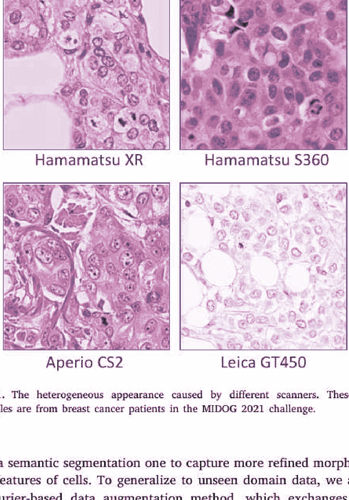
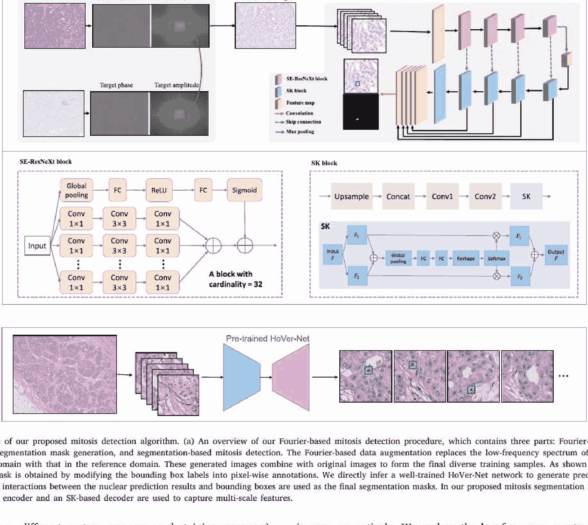
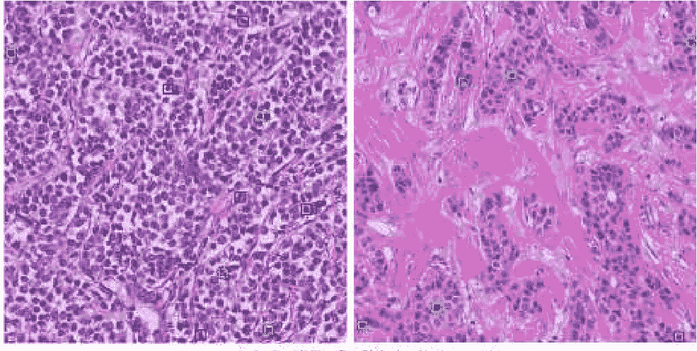
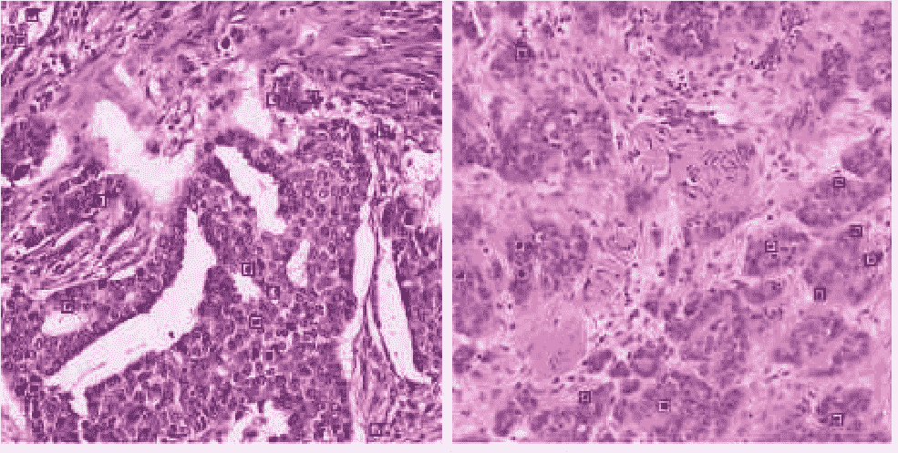
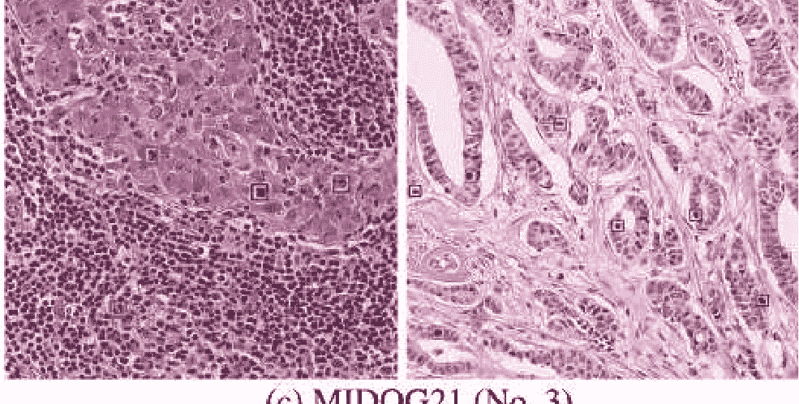
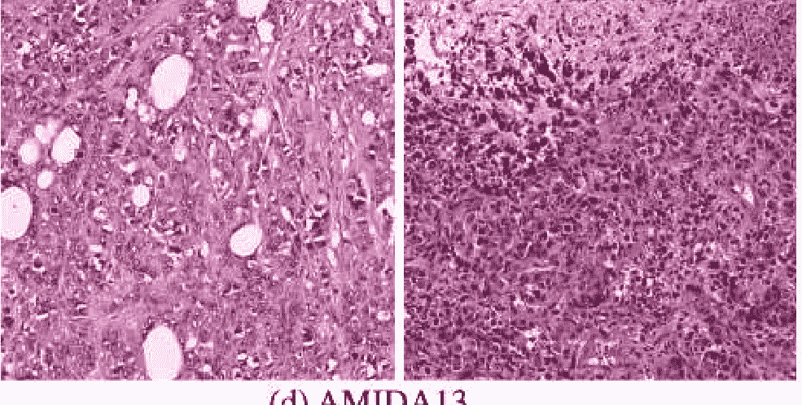
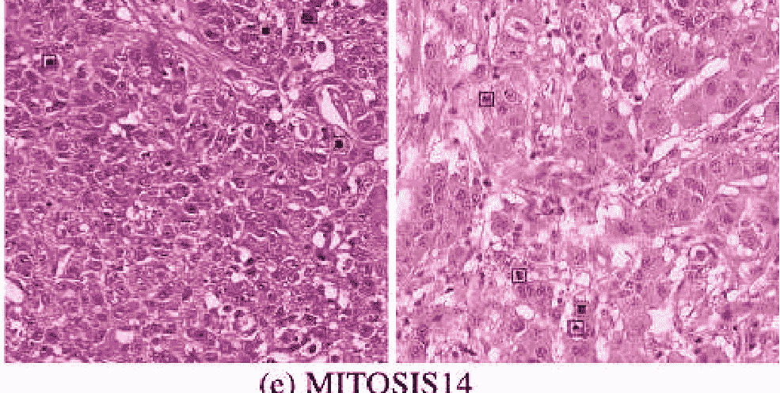
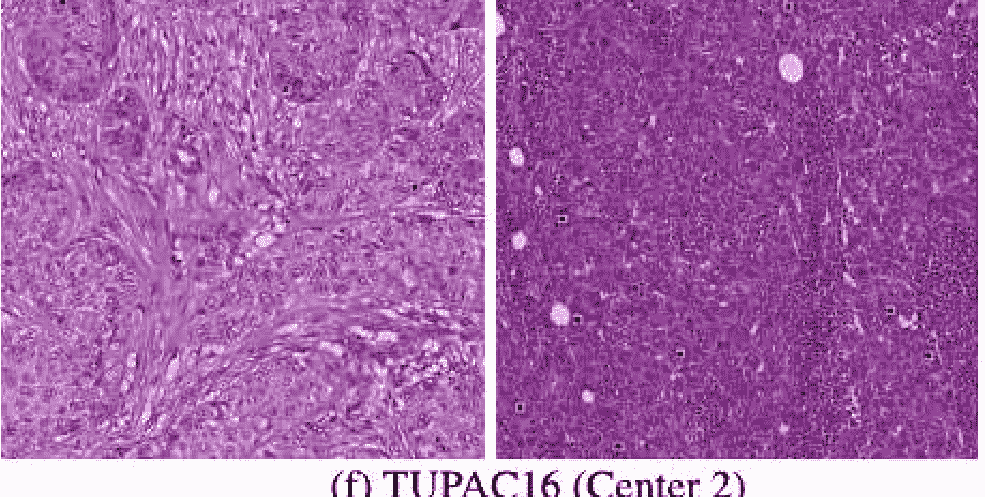
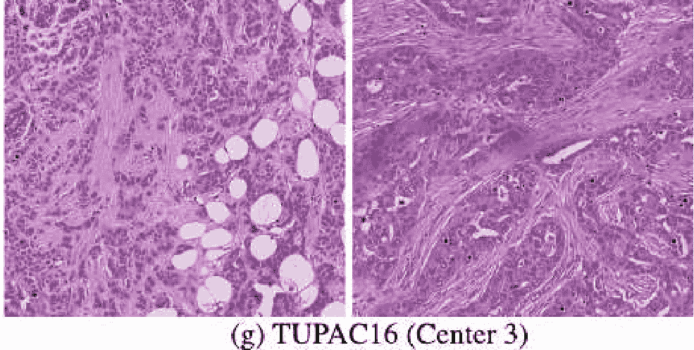
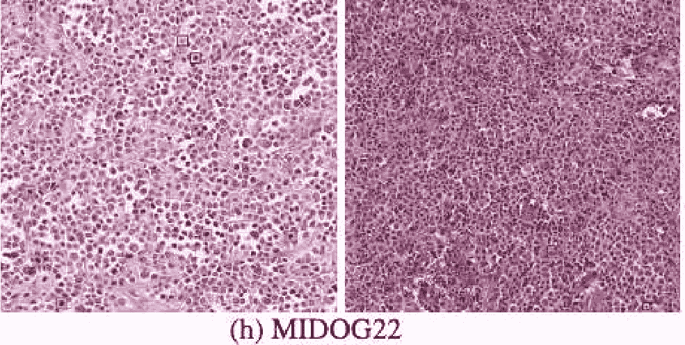

# 多中心乳腺组织病理图像中有丝分裂检测的通用且稳健的深度学习算法

## 文章信息

关键词:
- 组织病理学
- 有丝分裂检测
- 域偏移
- 特征提取
- 深度学习

## 摘要

组织活检中有丝分裂计数是乳腺癌患者的重要生物标志物，可支持疾病预后评估和治疗规划。开发一个鲁棒的有丝分裂细胞检测模型具有很大挑战性，由于其复杂的生长模式以及与非有丝分裂细胞的高相似性。大多数有丝分裂检测算法在图像域之间具有较差的泛化性，且在多中心环境中缺乏可重复性和验证。为克服这些问题，我们提出了一种可泛化且鲁棒的有丝分裂检测算法（称为 FMDet），该算法在多中心乳腺组织病理图像上进行了独立测试。为了捕捉细胞更精细的形态特征，我们将目标检测任务转换为语义分割问题。有丝分裂细胞核的像素级标注是通过取经过训练的细胞核分割模型生成的掩码与 MIDOG 2021 挑战赛提供的边界框的交集获得的。在我们的分割框架中，开发了一个鲁棒的特征提取器以捕捉有丝分裂细胞的外观变化，该提取器通过将通道级多尺度注意力机制集成到全卷积网络结构中构建而成。借助低层谱变化不影响高层语义感知的事实，我们采用基于傅里叶的数据增强方法，通过在两个域之间交换低频谱来减少域差异。我们的 FMDet 算法已在 MIDOG 2021 挑战赛中进行了测试并排名第一。此外，我们的算法还在四个独立的有丝分裂检测数据集上进行了外部验证，与之前发表的结果相比表现出最先进的性能。这些结果表明我们的算法具有作为临床实践中辅助决策支持工具部署的潜力。我们的代码已发布在 https://github.com/Xiyue-Wang/1st-in-MICCAI-MIDOG-2021-challenge。

## 1. 引言

根据 2020 年美国癌症统计数据，乳腺癌是女性最常见的癌症之一，占女性癌症的 30%（Siegel et al., 2020）。Nottingham 分级系统被用作乳腺癌分级的临床标准，其中有丝分裂计数、核异型性和小管形成是需要考虑的三个因素（Elston and Ellis, 1991）。其中，有丝分裂计数是患者预后评估的关键生物标志物，因为有丝分裂密度与细胞增殖活性高度相关。在临床上，有丝分裂细胞的数量是通过在 8–10 个显微镜高倍视野 (HPFs) 中手动计数正在进行有丝分裂的细胞核获得的（Balkenhol et al., 2019; Sohail et al., 2021a）。这项重复性任务对病理学家来说非常耗时且劳动密集。此外，由于有丝分裂细胞外观不均一，存在较高的观察者内和观察者间变异性（Yousif et al., 2021; Pan et al., 2021）。自动有丝分裂检测技术迫切需要以减轻繁琐的手动计数和观察者之间的广泛变异，帮助病理学家提供快速、准确且可重复的辅助诊断。然而，由于有丝分裂细胞特征高度多样以及域差异导致组织病理图像外观不同，自动有丝分裂检测具有很大挑战性。

* 通讯作者。电子邮件地址：jing_zhang@scu.edu.cn (J. Zhang), haroldhan@tencent.com (X. Han)。

首先，有丝分裂细胞之间存在广泛的外观变异性，且有丝分裂细胞与非有丝分裂细胞之间相似度很高。有丝分裂（即细胞分裂）具有复杂的生长模式，包括四个阶段（前期、中期、前期、后期和末期），每个阶段的细胞形态差异很大（Wilkins and Holliday, 2009）。特别是在末期，细胞核分裂为两部分，但只能计为一个有丝分裂细胞。此外，一些非有丝分裂细胞（例如凋亡或坏死细胞核、致密细胞核、受压细胞核、“垃圾”颗粒和其他伪影）与有丝分裂细胞差异很小（Veta et al., 2015），这使有丝分裂计数过程复杂化。其次，不同实验室的组织病理图像由于切片制备和图像采集过程的差异而表现出不均一的外观，这被称为域偏移问题。在切片制备过程中，不同的染色剂、试剂、制造商、方案、室条件等可能会引入变异（Schönig-Markietka et al., 2021; Madabhushi and Lee, 2016）。在切片扫描期间，不同的扫描仪类型和参数设置（例如图像压缩水平、色彩方案、亮度和对比度）也可能导致域偏移（Schönig-Markietka et al., 2021）。正如 MIDOG 2021 挑战赛所强调的（Aubreville et al., 2022），不同的扫描仪会导致有丝分裂图像外观出现较大差异。事实上，正如之前研究指出的那样（Leo et al., 2016; Aubreville et al., 2020, 2022），扫描仪引起的域偏移的影响可能比切片制备差异引起的影响更强。图 1 显示了来自不同实验室和扫描仪的具有有丝分裂细胞的多样化乳腺组织病理图像。这些严重的域变异使得在多样化队列中开发可泛化且鲁棒的有丝分裂检测算法非常具有挑战性。

图 1. 不同扫描仪引起的不均一外观。这些四个示例来自 MIDOG 2021 挑战赛中的乳腺癌患者。

已有一些关于自动有丝分裂检测的研究，可分为基于补丁分类（Maroof et al., 2020; Saha et al., 2018; Sigirci et al., 2021）、基于目标检测（Sebai et al., 2020）、基于语义分割（Li et al., 2019a）和混合方法（Li et al., 2018; Mahmood et al., 2020; Sohail et al., 2021a; Lei et al., 2020; Nateghi et al., 2021; Tellez et al., 2018）。尽管这些方法取得了令人鼓舞的结果，但仍有三个方面可以进一步改进。首先，需要一个简单有效的特征提取器。在这些方法中，提出了各种特征提取方法以覆盖有丝分裂图形的复杂外观，包括传统特征（例如形态、统计和颜色特征）（Maroof et al., 2020; Saha et al., 2018; Sigirci et al., 2021）和基于深度学习的特征（Li et al., 2019a, 2018; Sebai et al., 2020; Mahmood et al., 2020; Sohail et al., 2021a; Lei et al., 2020; Nateghi et al., 2021）。为了进一步提高深度特征的鲁棒性，提出了一系列策略，包括两步学习（Li et al., 2018; Mahmood et al., 2020; Sohail et al., 2021a; Lei et al., 2020; Nateghi et al., 2021）和模型集成（Mahmood et al., 2020; Tellez et al., 2018; Sohail et al., 2021a）。然而，这两种策略都大大增加了网络的复杂性和训练时间。其次，当前的有丝分裂检测算法缺乏在多中心队列上的可重复性和独立验证。这些方法没有充分考虑组织病理图像领域广泛存在的域偏移（Madabhushi and Lee, 2016），这使得有丝分裂检测算法在域外数据上的性能急剧下降，导致临床试验不切实际。第三，目前公开可用的用于有丝分裂检测的数据集非常小且样本多样性有限。它们是公开的挑战数据集（例如 AMIDA13 Veta et al., 2015，MITOSIS14 MITOS-ATYPIA-14, 2014，和 TUPAC-auxiliary Veta et al., 2019），其中 TUPAC-auxiliary 是最大的数据集，包含 73 个 WSI。

为解决上述问题，本工作在乳腺组织病理图像上提出了一种新颖的有丝分裂检测算法（称为 FMDet），通过将检测问题转换为语义分割问题以捕捉细胞更精细的形态特征。为了泛化到未见域数据，我们采用基于傅里叶的数据增强方法，在两个域的图像对之间交换低频和高频分量。为了更好地提取鲁棒的特征表示，我们将通道级注意力机制集成到 U-Net 框架中，有助于提取多尺度特征。我们的算法是在 MIDOG 2021 挑战赛的更大训练数据（200 个 WSI，分辨率为 8000 × 8000 像素）上开发的。然后，它通过未见域的数据进行评估（例如 MIDOG 2021 挑战赛中的独立测试数据和四个外部数据集），表现出最先进的性能。我们的主要贡献总结如下。

- 1. 我们提出了一种可泛化且有效有丝分裂检测算法，这是首批充分考虑跨域不匹配的研究之一。
- 2. 我们将有丝分裂检测任务转换为语义分割任务以实现精确的有丝分裂图形识别。注意力机制被用于生成通道级多尺度特征，有助于网络提取更鲁棒的特征。
- 3. 为了减少域差距，我们采用一种无监督方法通过在域之间交换低频谱来对齐域差异。
- 4. 我们的方法在旨在推动无论不同扫描仪解决方案的 MIDOG 2021 挑战赛中排名第一。此外，我们的算法还显示出对四个未见的独立多中心数据集的成功泛化。这些结果充分验证了我们有丝分裂检测算法的有效性。

## 2. 相关工作

本节首先简要回顾最近的有丝分裂检测方法。然后，还回顾了组织病理图像中使用的域适应/泛化策略，因为域偏移是影响模型泛化的关键因素。

### 2.1. 有丝分裂细胞检测

随着公开数据集（如 MITOSIS14、AMIDA13 和 TUPAC16）的出现，一系列自动有丝分裂检测算法也应运而生。早期算法通常将手工设计的特征（如形状、纹理、颜色等）与机器学习（或简单深度学习）技术相结合，用于有丝分裂图像分类（Maroof et al., 2020; Tellez et al., 2018; Beevi et al., 2019; Hwang et al., 2020; Saha et al., 2018; Sigirci et al., 2021）。这些方法通常采用一些阈值约束来寻找候选有丝分裂细胞，然后在选定的区域上应用支持向量机（SVM）、线性分类器或 CNN 架构进行进一步的有丝分裂验证。Maroof et al. (2020) 在蓝色比率图像上应用阈值技术来筛选候选细胞核，并提取核特征（如颜色、形态和纹理特征）。然后，使用 SVM 将这些候选细胞核分类为有丝分裂和非有丝分裂。Tellez et al. (2018) 通过迭代检测所有满足直径阈值约束的圆形区域来寻找候选有丝分裂细胞，然后应用 CNN 架构进一步验证这些候选有丝分裂。Beevi et al. (2019) 利用局部主动轮廓模型和磷虾群算法定位细胞核，然后应用预训练的 VGG 将相应的细胞分类为有丝分裂和非有丝分裂。Hwang et al. (2020) 使用模糊阈值方案分割潜在的有丝分裂细胞核，并使用基于线性注意力的分类器进行进一步的有丝分裂识别。Saha et al. (2018) 和 Sigirci et al. (2021) 结合了传统手工特征与高层基于深度学习的特征进行有丝分裂检测。在上述方法中，候选有丝分裂检测过程涉及各种阈值技术，可能产生较高的假阳性和假阴性区域。

近年来出现的用于有丝分裂检测的深度学习技术可分为三类：（1）目标检测；（2）目标检测与二分类相结合；（3）语义分割。第一类方法进行端到端学习，并直接将检测结果作为最终的有丝分裂细胞，其中 Faster-RCNN 被用作主要框架（Sebai et al., 2020）。第二类方法采用两阶段策略，首先检测候选有丝分裂细胞，然后由分类模型进一步分类。所使用的检测方法包括 Faster-RCNN（Li et al., 2018; Mahmood et al., 2020; Sohail et al., 2021a）、定制区域提议网络（RPN）（Lei et al., 2020）和基于块的分类（Nateghi et al., 2021）。二分类过程旨在进一步识别有丝分裂区域，其中使用了 ResNet50（Li et al., 2019）、多分支分类（Lei et al., 2020）或两个或多个 CNN 框架的集成（Mahmood et al., 2020; Tellez et al., 2019; Sohail et al., 2021a）。最后一种语义分割方法将检测问题转化为像素级分类问题（Li et al., 2019a），直接从分割图中推断有丝分裂的精确位置。然而，上述研究并未充分考虑域之间的差异。

### 2.2. 组织病理学中的域偏移

域偏移定义为源域和目标域之间的数据异质性（Challen et al., 2019），导致在源数据上训练的模型难以泛化到未见过的目标数据。对于组织病理学图像，域偏移主要由不同的载玻片制备过程和显微镜扫描引起，即使在同一机构内，外观差异也可能随时间出现。目前已提出多种方法来缓解域偏移问题，可分为三类：数据增强、染色归一化和域不变表示。

数据增强方法通过增加数据多样性使模型能够应对各种图像变化，包括两种技术：基于规则的变换和基于生成对抗网络（GAN）的数据生成。（1）对于基于规则的变换，常用的数据生成方法包括旋转、对比度、清晰度、颜色失真等（Faryna et al., 2021）。其中，基于颜色的增强是组织病理学图像中使用的主要方法，因为颜色变化是染色差异的主要表现形式。一些研究通过在每个 RGB 通道（Lafarge et al., 2017）或苏木精、伊红和残留通道（Tellez et al., 2018）上添加颜色失真来对训练数据进行颜色变换。最近，Chang et al. (2021) 提出了一种染色混合增强方法，通过混合源域和目标域之间的染色颜色矩阵来实现。尽管与上述颜色增强相比，染色混合能产生更真实的染色颜色，但它需要访问目标域的信息。在实际场景中，目标域的数据往往是不可见且不可预测的。

最近，出现了一些基于 CNN 的图像变换算法，包括将内容特征的均值和方差跨风格对齐的神经风格迁移方法（Yamashita et al., 2021），以及基于向量乘法的核自适应方法，该方法跨域对齐卷积核的分布（Huang et al., 2017）。（2）对于基于 GAN 的数据生成方法，CycleGAN 和条件 GAN 已被广泛用于数据增强（Mahmood et al., 2019; de Haan et al., 2021; Xue et al., 2021）。CycleGAN 旨在学习域之间的映射，已被用于为细胞核分割任务合成训练数据（Mahmood et al., 2019）、为组织病理学图像分类生成真实样本（Xue et al., 2021），或在不同染色之间转换染色风格（de Haan et al., 2021）。

染色归一化已广泛应用于数字病理学领域（Chen et al., 2021），其目的是减少外观变化（Stacke et al., 2020）。传统的染色归一化方法需要首先选择一张图像作为参考，然后在颜色通道或染色通道中将所有图像的颜色谱匹配到该参考图像（Stacke et al., 2020）。然而，手动选择参考图像需要专业技能。近年来，GAN 消除了对参考图像的需求，也被用于统一颜色变化（Shaban et al., 2019; Cho et al., 2017）。Shaban et al. (2019) 使用 CycleGAN 将图像映射到不同的颜色模式，但保留相同的组织结构。Cho et al. (2017) 应用条件 GAN 来学习训练数据的某种染色风格分布。

已有若干研究致力于学习域不变表示，可分为两类方法：特征对齐（Alirezazadeh et al., 2018）和域对抗学习（Lafarge et al., 2017; Zhang et al., 2019）。为了对齐不同数据源的特征，Alirezazadeh et al. (2018) 学习了一个投影矩阵，将从训练集和测试集中提取的特征向量映射到一个不变空间。然而，这种特征映射过程依赖于手工特征，难以获得稳定且鲁棒的性能。域对抗网络是一种常用的技术，通过添加域分类器来学习域不变特征（Lafarge et al., 2017; Zhang et al., 2019）。Lafarge et al. (2017) 开发了一个同时具有有丝分裂和域识别分支的分类模型，以确保从学习到的特征表示中无法恢复原始域。Zhang et al. (2019) 使用对抗学习来学习域不变特征，减少域之间的差异。然而，这种对抗训练计算量大且难以实现稳定（Chen et al., 2020）。

## 3. 方法

我们开发了一种基于傅里叶的有丝分裂检测算法（称为 FMDet），如图 2 所示，该算法缓解了域偏移问题，以确保对未见域具有更好的泛化能力。我们的 FMDet 算法可分为三个部分：基于傅里叶的数据增强（Yang and Soatto, 2020）、像素级标注生成以及基于分割的有丝分裂检测。所提出的基于傅里叶的数据增强旨在减少由不同

**图 2.** 我们提出的 有丝分裂检测算法流程。(a) 我们基于傅里叶的有丝分裂检测流程概述，包含三个部分：基于傅里叶的数据增强、分割掩码生成和基于分割的有丝分裂检测。基于傅里叶的数据增强用参考域中的低频谱替换源域图像的低频谱。这些生成的图像与原始图像结合形成最终的多样化训练样本。如(b)所示，分割掩码是通过将边界框标签修改为逐像素注释获得的。我们直接推理一个训练良好的 HoVer-Net 网络以生成精确的细胞核边界。细胞核预测结果与边界框之间的交互被用作最终的分割掩码。在我们提出的有丝分裂分割框架中，使用 SE-ResNeXt50 编码器和基于 SK 的解码器来捕获多尺度特征。

条件（例如不同的中心、扫描仪和染色过程），其通过用参考域中的低频部分替换源域图像的低频部分来实现。该过程在图像级别进行，无需任何训练过程且可非常快速地实现。随后，这些图像被裁剪成小块以进行详细的 有丝分裂检测过程。MIDOG 2021 挑战赛的组织者仅提供有丝分裂区域的边界框，这些边界框在像素级别上并非严格标注。为了为有丝分裂细胞核生成更准确的像素级注释，我们首先使用一个训练良好的细胞核分割网络（HoVer-Net）来获得细胞核的掩码（Graham et al., 2019），然后新的有丝分裂掩码通过将细胞核掩码与组织者提供的边界框相交获得。最后，生成的新的有丝分裂掩码用于开发我们的分割网络。以下我们将详细介绍我们的 FMDet 算法。

图像，分别。我们用参考域中的低频谱替换源域图像的低频谱，然后源域中的新频谱通过逆 FFT 变换以生成相应的新图像。生成的图像保持与原始源图像相同的标签。该方法在不改变任何图像细节或物体边界的情况下将参考域的风格转移到源域。基于傅里叶的数据增强可以被视为无需任何训练过程的图像到图像转换，其公式如下。

假设算法开发有 *M* 个域，我们随机选择两个域分别作为源域和参考域来执行基于傅里叶的数据增强。例如，给定源域中的图像 \(I^s=\{x_i^s\}_{i=1}^{N^s}\) 和参考域中的图像 \(I^r=\{x_i^r\}_{i=1}^{N^r}\)，其中 \(x_i\in\mathbb{R}^{H\times W\times 3}\) 为一幅图像，\(N^s\) 和 \(N^r\) 分别表示源域和参考域中的图像数量。通过应用基于傅里叶的数据增强，生成的数据可以表示为 \(I^g=\{x_i^g\}_{i=1}^{N^g}\)。详细的计算过程将在下面展示。

### 3.1. 基于傅里叶的数据增强

为了解决域偏移问题，我们提出了一种具有良好域泛化能力的基于傅里叶的有丝分裂检测方法。其动机在于低频幅度谱的变化不会影响高层语义感知（Yang and Soatto, 2020）。我们的基于傅里叶的数据增强首先对 MIDOG 2021 挑战赛提供的所有训练数据执行快速傅里叶变换（FFT）。然后，从两个不同域中采用图像作为源域和参考域

对于一幅图像 \(x\)，其快速 FFT 可以表示为

\[F(x)=F(u,v)=\sum_{x=0}^{H-1}\sum_{y=0}^{W-1}x(x,y)e^{-j2\pi(ux/H+vy/W)},\quad j^2=-1.\tag{1}\]

其中 \(F^A=|F(u,v)|\) 和 \(F^P=\angle F(u,v)\) 分别表示幅度谱和相位谱，其保持与图像 \(x\) 相同的大小。

用 $\mathcal{F}^{-1}$ 表示的逆 FFT 被应用于将源图像恢复为新图像 $\mathbf{x}^s$，计算如下。

$\mathbf{x}^s = \mathcal{F}^{-1} \big( \big[ (M_{\beta} \cdot \mathcal{F}^A (\mathbf{x}') + (1 - M_{\beta}) \cdot \mathcal{F}^A (\mathbf{x}^s) ), \mathcal{F}^P (\mathbf{x}^s) \big] \big)$, (2)

其中 $M_{\beta} \in \mathbb{R}^{H \times W \times 3}$ 表示用于获得低频部分的掩码，其在中心区域的值为 1，其余区域为 0。$\beta \in (0,1)$ 用于通过以下设置控制掩码的范围。

$M_{\beta}(h,w) = \begin{cases} 1, \text{if } (h,w) \in (-\beta H : \beta H, -\beta W : \beta W) \\ 0, \text{else}, \end{cases}$ (3)

### 3.2. 分割掩码生成

对于有丝分裂检测任务，MIDOG 2021 挑战赛提供的标签是边界框，如图 2(b) 所示。我们将这些边界框标签转换 为用于分割这些有丝分裂细胞核的像素级注释。我们使用一个名为 HoVer-Net 的训练良好的细胞核分割网络来获得细胞核的像素级边界，该网络在多个独立的多组织苏木精-伊红染色组织病理学图像数据集上表现出优异性能（Graham et al., 2019）。HoVer-Net 采用多任务学习同时实现细胞核分割和分类，这有助于更好的特征提取过程。此外，为了实现更精确的分割，它利用水平和垂直距离图来分离重叠的细胞核。由于其卓越的分割能力，我们直接推理训练好的 HoVer-Net 进行细胞核分割，从而消除了细胞核注释的需求。如图 2(b) 所示，绿色线条包围的区域是 HoVer-Net 预测的细胞核区域。蓝色边界框是挑战赛组织者提供 的有丝分裂细胞注释。绿色和蓝色区域的交集被作为我们有丝分裂细胞核分割的最终注释。

### 3.3. 基础网络架构

我们的基础网络结构采用编码器-解码器 U-Net 框架，如图 2(a) 所示。在我们的分割网络中，使用了两个具有注意力机制的关键模块以实现更好的特征挖掘，即 squeeze-and-excitation（SE）(Hu et al., 2018) 和 selective kernel（SK）(Li et al., 2019b) 模块。SE 模块将特征信息压缩为全局特征描述符，然后将其与输入描述符集成以动态建模通道级特征依赖，这使得模型能够选择性地和自适应地强调对预测结果贡献更大的特征图，类似于人类视觉感知（Li, 2014）。SK 模块使用通道级注意力机制动态融合具有不同卷积核大小的特征图，这使得网络能够自动聚合预测任务的适当特征尺度。总体而言，这两个注意力模块有助于网络识别细胞大小、颜色、纹理、形态等存在较大变化的有丝分裂。

编码器部分使用 SE-ResNeXt50 模型，通过聚合残差变换从多个子空间学习融合特征。它包括四个主要层，每个层通过重复一个具有 C 条路径（基数）的块构建，该块执行 C = 32 组卷积。四个编码器层中重复块的数量分别为 3、4、6 和 3。每个块由 ResNeXt50 网络和 SE 注意力模块组合构建。对于输入特征图 x，注意力特征可通过 $\mathbf{x}' = \mathbf{x} + f_{SE}(\sum_{i=1}^{C} \mathcal{T}_i(\mathbf{x}))$, (4) $f_{SE} = f_{gp}(f_{fc}(f_{fc}(\cdot)))$, (5) 计算，其中输入特征图 x 和输出特征图 x' 保持相同的维度。$\mathcal{T}_i$ 表示每条路径中的变换函数，

其在每个块中保持相同的拓扑结构。例如，在第一个块中，$\mathcal{T}_i$ 表示如图 2(a) 所示的 1 × 1 卷积、3 × 3 卷积和 1 × 1 卷积的序列。$f_{SE}$ 表示使用的 SE 模块，其通过全局池化和密集连接操作的序列实现以捕获通道级注意力特征。

解码器部分由五个上采样块组成，将这些特征图恢复到原始图像大小。如图 2(a) 所示，在每个上采样块中，首先执行 TransConv 以增加特征图的图像大小，然后将这些特征图与相应编码器层中的特征图连接。接下来，在每个上采样块中加入两个卷积层和一个 SK 模块。如图 2(a) 所示，SK 模块旨在通过非线性聚合具有不同核大小的多个分支，使网络自适应地调整其感受野大小（Li et al., 2019b）。SK 注意力特征的详细计算过程如下所示。

给定输入特征 x'，它使用具有不同扩张值的 3 × 3 空洞卷积拆分为两个新特征 $(\mathbf{x}'_k, k = 1,2)$。然后，两个特征图相加并经过全局池化和两个全连接层以获得聚合特征 $\mathbf{z} \in \mathbb{R}^{2C}$。然后，z 按通道方式重塑为 $\mathbf{z}' \in \mathbb{R}^{2 \times C}$ 以生成软注意力如下。$m_k = e^{W_k z'} / \sum_{k=1}^{2} e^{W_k z'} \quad (k \in \{1,2\})$, (6)

最终特征图 $\hat{\mathbf{x}}$ 可通过整合来自两个分支的自适应特征计算得到。$\hat{\mathbf{x}} = \mathbf{x}' + \sum_{k=1}^{2} m_k \times \mathbf{x}'_k$, (7)

在解码器之后，我们在五个不同分辨率级别融合多尺度特征，其通过将解码器每个块的特征（表示为 $\hat{\mathbf{x}}_0$、$\hat{\mathbf{x}}_1$、$\hat{\mathbf{x}}_2$、$\hat{\mathbf{x}}_3$ 和 $\hat{\mathbf{x}}_4$）上采样到与输入图像相同的大小，然后将这些特征连接在一起作为 $[\hat{\mathbf{x}}_0, \hat{\mathbf{x}}_1, \hat{\mathbf{x}}_2, \hat{\mathbf{x}}_3, \hat{\mathbf{x}}_4]$。获得的多尺度特征图经过卷积、批归一化和线性整流单元以生成最终分割图 $out = conv([\hat{\mathbf{x}}_0, \hat{\mathbf{x}}_1, \hat{\mathbf{x}}_2, \hat{\mathbf{x}}_3, \hat{\mathbf{x}}_4])$。

### 3.4. 分割的损失函数

我们的 FMDet 架构使用 focal loss ($L_{FL}$) 和 Dice loss ($L_{DICE}$) 的组合进行训练。Focal loss 已成功用于解决各种分割和检测任务中的数据不平衡问题（Yang et al., 2021; Lin et al., 2017）。在这项工作中，我们使用 focal loss 来缓解有丝分裂细胞和非有丝分裂细胞数量之间的不平衡。Dice loss 被提出用于衡量两幅图像之间的重叠程度，已被广泛用作图像分割任务中的度量。对于单个图像，我们的损失函数 $L_{seg}$ 计算如下。$L_{seg} = L_{FL} + L_{DICE}$, (8)

$L_{FL} = - \sum_i [(1 - \hat{y}_i)^\gamma y_i \log \hat{y}_i + (\hat{y}_i)^\gamma (1 - y_i) \log (1 - \hat{y}_i)]$, (9) $L_{DICE} = - \frac{2 \sum_i y_i \hat{y}_i + \epsilon}{\sum_i y_i^2 + \sum_i \hat{y}_i^2}$, (10) 其中 $y_i$ 和 $\hat{y}_i$ 分别表示第 $i$ 个像素的真实标签和预测标签。focal loss 中的 $\gamma \ge 0$ 是一个可调的聚焦参数。当 $\gamma$ 等于 0 时，focal loss 退化为交叉熵。Dice loss 中的 $\epsilon$ 设置为一个很小的正值以考虑训练稳定性。

### 表 2

MIDOG 2021 挑战赛中排名前 13 的队伍比较。注意“排名”列中的每个队伍都有一个超链接，对应官方排行榜。

| 排名 | F1 分数 | 召回率 | 精确率 | 检测 | 分割 | 分类 | 数据增强 | 对抗学习 | 染色归一化 | 集成 | 多阶段 |
|---|---|---|---|---|---|---|---|---|---|---|---|
| 1 | 0.7476 | 0.7416 | 0.7537 |  | ✓ |  | ✓ |  |  |  |  |
| 2 | 0.7474 | 0.7624 | 0.7330 |  | ✓ | ✓ |  |  | ✓ |  | ✓ |
| 3 | 0.7361 | 0.7095 | 0.7647 | ✓ | ✓ | ✓ | ✓ | ✓ |  | ✓ | ✓ |
| 4 | 0.7243 | 0.6790 | 0.7761 | ✓ |  |  | ✓ | ✓ |  |  |  |
| 5 | 0.7108 | 0.7319 | 0.6909 | ✓ |  | ✓ |  | ✓ |  |  |  |
| 6 | 0.7069 | 0.6870 | 0.7279 | ✓ |  | ✓ |  |  | ✓ | ✓ | ✓ |
| 7 | 0.7064 | 0.7047 | 0.7081 | ✓ |  |  |  |  | ✓ |  | ✓ |
| 8 | 0.7010 | 0.6437 | 0.7697 | ✓ |  |  | ✓ | ✓ |  |  | ✓ |
| 9 | 0.6963 | 0.6533 | 0.7454 | ✓ |  |  | ✓ |  |  |  |  |
| 10 | 0.6859 | 0.6854 | 0.6865 |  | ✓ |  | ✓ | ✓ |  |  |  |
| 11 | 0.6764 | 0.6677 | 0.6853 | ✓ |  | ✓ | ✓ |  |  |  | ✓ |
| 12 | 0.6708 | 0.7030 | 0.6413 |  |  | ✓ |  | ✓ |  |  | ✓ |
| 13 | 0.6319 | 0.6035 | 0.6631 |  |  | ✓ | ✓ |  |  | ✓ |  |

检测 (Det.)、分割 (Seg.)、分类 (Cla.)、数据增强 (Aug.)、对抗学习 (AL)、染色归一化 (SN)。

### 表 3

与最先进的有丝分裂检测方法的比较（在来自 MIDOG21 数据的域外验证集上评估）。

| 方法 | 技术 | F1 分数 | 召回率 | 精确率 |
|---|---|---|---|---|
| RetinaNet (Aubreville et al., 2021b) | RetinaNet 检测器 | 0.6236 | 0.6687 | 0.5842 |
| DeepMitosis (Li et al., 2018) | 两阶段：Faster-RCNN + ResNet50 分类器 | 0.6440 | 0.6265 | 0.6624 |
| MaskMitosis (Sebai et al., 2020) | Mask R-CNN 检测器 | 0.6601 | 0.6024 | 0.7299 |
| SegMitos (Li et al., 2019a) | FCN 分割 + 阈值过滤机制 | 0.6791 | 0.6271 | 0.7405 |
| DHE-Mit (Sohail et al., 2021a) | 两阶段：Mask R-CNN + 五个分类器集成 | 0.6996 | 0.7200 | 0.6804 |
| FMDet (ours) | 端到端分割 | 0.7773 | 0.8146 | 0.7440 |

### 表 4

不同模型架构和标注方案对有丝分裂检测精度的影响。结果是在 MIDOG21 的域外验证数据上计算的。

| 方法 | F1 分数 | 召回率 | 精确率 |
|---|---|---|---|
| U-Net + 边界框掩码 | 0.6521 | 0.7169 | 0.5980 |
| U-Net + 实例掩码 | 0.6757 | 0.7519 | 0.6103 |
| U-Net (SEResNeXt50) + 边界框掩码 | 0.6822 | 0.7070 | 0.6592 |
| U-Net (SEResNeXt50) + 实例掩码 | 0.7184 | 0.7801 | 0.6657 |
| SK-Unet (SEResNeXt50 + SK) + 边界框掩码 | 0.7003 | 0.7375 | 0.6667 |
| SK-Unet (SEResNeXt50 + SK) + 实例掩码 | 0.7343 | 0.8096 | 0.6719 |

第 6 队分别训练五个模型（ASTMNNet、ATTENNet、DSTMNet、ResidualNet 和 RHINet）用于有丝分裂分类。他们采用这些模型的平均值作为有丝分裂的最终预测。集成策略通过平衡不同模型之间的误差提供了可观的性能提升，但计算成本很高。在两阶段方案中，如上所述，分类器通常与有丝分裂候选选择方法（检测或分割模型）结合。这种方法需要训练不同的模型，与我们的端到端方案相比更复杂。

### 4.5. 与最先进的有丝分裂检测方法比较

为了公平地与最先进的有丝分裂检测方法进行比较，我们比较了五种已向公众发布代码的算法，包括 RetinaNet (Aubreville et al., 2021b)、DeepMitosis (Li et al., 2018)、MaskMitosis (Sebai et al., 2020)、SegMitos (Li et al., 2019a) 和 DHE-Mit (Sohail et al., 2021a)。详细结果见表 3。RetinaNet 和 MaskMitosis 方法直接使用目标检测框架（如 RetinaNet 和 Mask R-CNN）来检测有丝分裂图形。DeepMitosis 和 DHE-Mit 方法采用两阶段技术，结合目标检测器和 CNN 分类器。SegMitos 和我们的方法采用语义分割来获得有丝分裂区域，其中 SegMitos 还添加了另一个阈值过滤机制以进一步识别目标有丝分裂区域。值得注意的是，由于 MIDOG21 的测试集不可见，我们从训练集中划分了一个单独的验证集，将来自三个扫描仪的图像视为域外验证集。

如表 3 所示，可以看出我们的方法实现了最佳性能，在 F1 分数方面比 DHE-Mit 高出约 +8%。将我们的端到端分割方案与 SegMitos 进行比较，我们的方法高出约 +10%。如此大的性能提升的主要原因是之前所有方法都没有充分考虑训练数据与未见测试数据之间的域偏移。根据它们发布的代码，只有 MaskMitosis 方法应用了染色归一化策略以保证更好的泛化能力。将 MaskMitosis 与 RetinaNet 进行比较，可以看出 MaskMitosis 方法的性能高出 +2%。这可归因于 Mask R-CNN 中多任务学习技术的贡献以及对域偏移问题的染色归一化。将两种两阶段方法（DeepMitosis 和 DHE-Mit）进行比较，可以看出 DHE-Mit 的 F1 分数高出约 +5%。巨大的性能差异可能是由 DHE-Mit 中使用的模型集成技术造成的。

### 4.6. 消融研究

我们进行消融实验以验证我们所用策略的有效性，包括采用 SEResNeXt50 块作为编码器、在解码器中添加 SK 注意力模块、修改语义分割掩码以及添加基于傅里叶的数据增强以生成多样化图像。该实验也在上述 MIDOG21 数据的域外验证集上进行。详细结果见表 4 和表 5。

表 4 显示了有丝分裂检测中边界框（Bbox）掩码和实例掩码的比较。Bbox 掩码是通过查找 MIDOG 2021 挑战赛组织者提供的边界框注释的内切圆获得的。与粗糙的 BBox 掩码相比，实例掩码对应于有丝分裂细胞核的详细像素级注释，这些注释是通过将真实边界框与经过训练的 HoVer-Net（Graham et al., 2019）得到的细胞核分割结果相交获得的。如表 4 所示，无论使用哪种分割网络，实例掩码都比 Bbox 掩码提供了稳定的性能提升。特别是对于 SK-Unet，使用实例掩码使 F1 分数提高了约 3%，召回率提高了 7%，精确率提高了 0.5%。这些结果表明，使用实例掩码提供的更精细注释可以引导网络更专注于有丝分裂图形的关键部分，有助于网络更好地学习有丝分裂细胞核的特征并减少假阳性。

### 表 5

基于傅里叶的数据增强方法对有丝分裂检测精度的影响。结果是在 MIDOG21 的域外验证集上计算的。（aug. 表示数据增强）。

| 方法 | F1 分数 | 召回率 | 精确率 |
|---|---|---|---|
| U-Net + 实例掩码 | 0.6757 | 0.7519 | 0.6103 |
| U-Net + 实例掩码 + 基于傅里叶的数据增强 | 0.6982 | 0.7573 | 0.6477 |
| U-Net (SEResNeXt50) + 实例掩码 | 0.7184 | 0.7801 | 0.6657 |
| U-Net (SEResNeXt50) + 实例掩码 + 基于傅里叶的数据增强 | 0.7488 | 0.7866 | 0.7145 |
| SK-Unet (SEResNeXt50 + SK) + 实例掩码 | 0.7343 | 0.8096 | 0.6719 |
| SK-Unet (SEResNeXt50 + SK) + 实例掩码 + 基于傅里叶的数据增强 (ours) | 0.7773 | 0.8146 | 0.7440 |

### 表 6

在外部测试集（AMIDA13、MOTOSIS14、TUPAC-auxiliary 和 MIDOG22 数据集）上将所提方法与先前工作进行比较。中心 1、2 和 3 分别表示 UMC Utrecht、SPEC-Alkmaar 和 SPEC-Zaandam。MITOSIS14 和 MIDOG22 数据分别收集自巴黎 Pitié-Salpêtrière 医院病理科和 FU Berlin。

| 中心 | 方法 | F1 分数 | 召回率 | 精确率 |
|---|---|---|---|---|
| AMIDA13（也是 TUPAC-auxiliary 中的中心 1） | SegMitos (Li et al., 2019a) | 0.6728 | 0.6773 | 0.6685 |
|  | Deep consensus network (Wollmann and Rohr, 2017) | 0.6090 | 0.6860 | 0.5470 |
|  | FMDet (ours) | 0.6791 | 0.7405 | 0.6271 |
| TUPAC-auxiliary（中心 2 和 3） | SegMitos (Li et al., 2019a) | 0.6690 | 0.7000 | 0.6400 |
|  | Domain-adversarial neural networks (Lafarge et al., 2017) | 0.6200 | / | / |
|  | Detection based on paired staining (Tellez et al., 2018) | 0.4800 | / | / |
|  | Semi-supervised mitosis detection (Akram et al., 2018) | 0.6400 | 0.6710 | 0.6130 |
|  | FMDet (ours) | 0.7458 | 0.8018 | 0.6971 |
| TUPAC-auxiliary（中心 1、2 和 3） | Deep consensus network (Wollmann and Rohr, 2021) | 0.4700 | / | / |
|  | Two-stage mitosis detection (Mahmood et al., 2020) | 0.6420 | 0.6420 | 0.6410 |
|  | FMDet (ours) | 0.6946 | 0.7738 | 0.6301 |
| MITOSIS14（扫描仪 1 和 2） | MitosisDetection (Lei et al., 2020) | 0.4000 | / | / |
|  | DeepMitosis (Li et al., 2018) | 0.4370 | 0.4430 | 0.4310 |
|  | MaskMitosis (Sebai et al., 2020) | 0.4750 | 0.4530 | 0.5000 |
|  | FMDet (ours) | 0.4901 | 0.5564 | 0.4380 |
| MIDOG22 | RetinaNet* (Aubreville et al., 2021b) | 0.6145 | 0.7325 | 0.5292 |
|  | DeepMitosis* (Li et al., 2018) | 0.6375 | 0.7656 | 0.5462 |
|  | SegMitos* (Li et al., 2019a) | 0.6797 | 0.7603 | 0.6146 |
|  | DHE-Mit* (Sohail et al., 2021a) | 0.6863 | 0.7524 | 0.6309 |
|  | FMDet (ours) | 0.7389 | 0.7796 | 0.7022 |

为了提高模型的泛化能力，我们使用无监督的基于傅里叶的数据增强通过改变其频率内容来增加训练样本的多样性。基于傅里叶的数据增强方法对有丝分裂检测精度的影响总结于表 5。如表 5 所见，基于傅里叶的数据增强在所有比较设置中都带来了稳定的提升。例如，与完整的 SK-Unet 网络和实例掩码一起使用时，基于傅里叶的数据增强使 F1 分数提高了约 4%，召回率提高了 0.5%，精确率提高了 7%。精确率的显著改善是由于假阳性大幅减少，这可归因于基于傅里叶增强方法生成的丰富多样训练样本。这些多样且通常较难的样本提高了训练网络区分真实有丝分裂与相似假阳性的能力。

表 4 和表 5 还可以看出不同网络设计的比较结果。如两表中顶部所示，使用经典的 U-Net 模型（Ronneberger et al., 2015; Siddique et al., 2021）产生的检测性能最低。将原始 U-Net 的编码器替换为 SEResNeXt50 模块可使 F1 分数至少提高 3%，如两表中中间部分所示。为了自动聚合不同尺度的特征，我们还在 U-Net 解码器中添加了 SK 注意力模块，这使 F1 分数又提高了 2%，如表 4 和表 5 中底部与中间结果的比较所示。

图 3(a)–(c) 显示了在 MIDOG21 的域外验证数据上一些代表性的有丝分裂检测结果。可以看出，我们方法产生的黄色边界框与组织者提供的真实绿色边界框匹配良好。确实存在假阳性，但它们主要对应于硬负样本（用蓝色标注）。这些结果是可以接受的，因为即使是经验丰富的病理学家对这些硬负样本的判断也高度主观。

### 4.7. 在外部数据集上与相关方法比较

为了进一步验证我们模型的泛化能力，我们直接在四个外部多中心数据集上对训练好的模型进行推理，即 AMIDA13、MITOSIS14、TUPAC-auxiliary 和 MIDOG22，这些数据集来自总共五个不同的中心。需要注意的是，TUPAC-auxiliary 涵盖了 AMIDA13 数据的全部范围。表 6 比较了我们在四个数据集上获得的结果与几种相关方法的结果。我们方法的有丝分裂检测结果的可视化也显示在图 3(d)–(h) 中。这些比较方法的結果来自其相应出版物，除带星号的方法外，这些方法由我们根据其发表的代码重新实现。

如表 6 所示，可以看出我们的方法在所有测试数据集上都产生了最高的 F1 分数。即使 SegMitos (Li et al., 2019a) 使用了类似的语义分割方案，该方法使用弱注释进行训练，其 F1 分数在 TUPAC-auxiliary 和 MIDOG22 数据上比我们低 6%–7%。我们提出的方法利用训练好的细胞核分割网络为有丝分裂细胞核生成准确的掩码，这有助于引导模型学习重要的有丝分裂特征并导致

(a) MIDOG21（第1号）

(b) MIDOG21（第2号）

(c) MIDOG21（第3号）

(d) AMIDA13

(e) MITOSIS14

(f) TUPAC16（中心2）

(g) TUPAC16（中心3）

(h) MIDOG22

图3. 拟议FMDet方法的有丝分裂检测结果可视化。预测的语义分割结果通过在每个分割掩码的质心周围绘制固定大小的矩形转换为边界框。绿色和蓝色边界框由相应的数据提供者标注的真实值，分别代表真实的有丝分裂和困难负样本（类似有丝分裂）。黄色边界框是我们方法预测的结果。子图对应于从不同数据源的WSI中裁剪的子区域，以便更好地可视化。子图（a）–（c）显示了来自MIDOG21的示例，分别采集自第1号：Hamamatsu XR nanozoomer 2.0、第2号：Hamamatsu S360（0.5 NA）和第3号：Aperio ScanScope CS2扫描仪。子图（d）和（e）分别显示了来自AMIDA 13和MITOSIS14的示例。子图（f）和（g）显示了TUPAC16数据集中SPEC-Alkmaar（中心2）和SPEC-Zaandam（中心3）的示例。子图（h）显示了来自MIDOG22的示例，其采集自一个新中心（FU Berlin）。

准确率。在完整的TUPAC-auxiliary数据中，两阶段有丝分裂检测方法（Mahmood et al., 2020）在F1分数方面比我们低约5%，这可能是由于其未考虑域偏移问题。 我们的方法采用基于傅里叶的数据增强来减少域差异，在所有实验中均显示出稳健的性能。 尽管有一项研究报道了在TUPAC-auxiliary数据上更高的性能（Sohail et al., 2021b），但同一数据集在模型训练期间被使用。

换句话说，所报道的结果并未得到独立验证。 相比之下，我们的结果是在完全独立的测试数据上计算的，这更客观，也能更好地反映所提方法在实际应用中的泛化能力。 尽管我们的方法获得了最高的F1和召回分数，但精确度指标并不最优。 例如，SegMitos（Li et al., 2019a）在AMIDA13上、两阶段有丝分裂检测方法（Mahmood et al., 2020）在TUPAC-auxiliary上，以及MaskMitosis（Sebai et al., 2020）在MITOSIS14上产生的精确度分数均高于我们的FMDet，这表明我们方法预测的结果包含更多假阳性图像。 可能的原因可总结如下。 （1）一些非有丝分裂细胞（例如凋亡或坏死核、致密核、受压核和“垃圾”颗粒）与有丝分裂细胞外观相似，可能被我们的算法错误检测为有丝分裂，如图3（d）–（g）所示。但它能够提高漏检有丝分裂的检出率，这在临床实践中非常重要。 （2）在一些工作中（例如SegMitos和MaskMitosis方法（Li et al., 2019a; Sebai et al., 2020）），其数据不存在域差异，训练和测试图像来自同一实验室和扫描仪。 与其设置不同，我们采用表6中列出的这些数据集作为未见域，用于独立算法验证，这可以模拟实际临床场景。 （3）一些工作采用复杂计算来提高性能。 例如，Mahmood et al.（2020）采用模型集成来推断有丝分裂区域，这可以是一种减少错误预测的有效策略。 SegMitos（Li et al., 2019a）需要复杂的后处理才能获得准确的有丝分裂区域。 相比之下，我们的端到端模型不需要任何后处理步骤，这确保了更快的推理速度和更可靠的预测。

从表6可以看出，我们的方法在MITOSIS14数据上的准确率最低。 有几个解释。 首先，MITOSIS14数据集因组织外观的高变异性而被认为更具挑战性（Mahmood et al., 2020; Beevi et al., 2019; Sebai et al., 2020）。 其次，不同数据集之间存在标注不一致，因为每个数据集均由不同的人类观察者标注，因此存在观察者间变异。 我们注意到，其他方法在MITOSIS14上的报道结果仅使用一种扫描仪类型的数据计算，而我们的方法在所有MITOSIS14数据上进行测试。 如果仅使用相同扫描仪的数据进行测试（共1200张图像），F1分数将为0.5218而不是0.4901，比之前报道的最佳结果高约5%。

### 4.8. 与染色归一化方法的比较

在本小节中，我们进行了一系列实验，将我们缓解域偏移的策略（即FFT-based数据增强）与现有的染色归一化方法进行比较。 染色归一化方法旨在去除染色变异，以便为训练和测试数据获得一致的颜色分布，这通常被用作组织病理学图像分析中的预处理步骤。 最广泛使用的染色归一化方案是颜色解卷积，其中从RGB图像中分离染色是关键步骤（Tosta et al., 2019）。 表7中比较了三种流行的染色归一化方法。 Macenko et al.（2009）的基于SVD的方法使用奇异值分解（SVD）获得染色向量。 结构保持颜色归一化（SPCN）方法使用稀疏非负矩阵分解来分离染色（Vahadane et al., 2016）。 全切片图像颜色标准化器（WSICS）方法使用图像颜色和空间信息推导染色成分（Bejnordi et al., 2015）。

表7
在MIDOG21的域外验证集上与其他染色归一化方法的比较。 基线方法是我们结合SK-Unet（SEResNeXt50 + SK）和实例掩码的有丝分裂分割方法。 Nor.和Aug.分别表示归一化和基于傅里叶的数据增强。

| 方法 | F1 分数 | 召回率 | 精确率 |
|---|---|---|---|
| 基线 | 0.7343 | 0.8096 | 0.6719 |
| 基线 + SVD-based Nor. | 0.7375 | 0.7946 | 0.6881 |
| 基线 + SPCN | 0.7390 | 0.7756 | 0.7056 |
| 基线 + WSICS | 0.7428 | 0.7938 | 0.6980 |
| 基线 + Aug.（我们的方法） | 0.7773 | 0.8146 | 0.7440 |

从表7可以看出，这些染色归一化方法对有丝分裂检测任务的性能提升很小，而我们的基于傅里叶的数据增强方法提供了更大的性能改进。 这些结果与之前的一项研究（Tellez et al., 2019）一致，其中数据增强在病理分类任务中比使用染色归一化提供了更高的准确性。 原因是很难从单张图像中准确估计染色，传统的染色归一化方法可能会产生图像伪影。 与深度学习方法一起使用时，由于染色归一化导致样本多样性降低，可能会增加模型过拟合的风险，而我们的数据增强方法增加了数据变异，促进了更稳健的网络训练。

## 5. 结论

在本工作中，我们提出了一种在乳腺组织病理学图像上的有丝分裂检测方法（FMDet）。 为缓解域偏移问题，我们采用基于傅里叶的数据增强来生成多样化的域无关图像。 我们的数据增强方法的重要性已在消融实验中得到验证。 然后，我们基于全卷积网络将检测任务转换为语义分割任务，其中粗略的边界框标注被转换为有丝分裂细胞核的精细像素级边界。 具有精确监督的基于实例的语义分割与基于边界框的分割相比产生了更高的性能。 为了实现更稳健的特征提取，我们将通道级多尺度注意力机制集成到U-Net框架中，这也在我们的消融研究中被验证为实现了优越的性能。 我们的FMDet算法已在MIDOG 2021挑战赛中进行了评估并获得第一名。 与最先进的有丝分裂检测方法的比较实验也证明了解决方案的有效性。 此外，我们在四个独立的数据集上外部验证了我们的泛化能力以进行有丝分裂检测。 相应的实验结果为模型在多中心队列中的泛化性和可重复性提供了证据。 在未来的工作中，我们将尝试通过在大规模未标记数据上结合自监督学习来提高模型的泛化能力。

## 竞争利益声明

作者声明他们没有任何已知的竞争性财务利益或个人关系可能影响本文所述工作的报告。

## 数据可用性

我已在稿件中分享了我数据/代码的链接。

## 致谢

本研究部分由中国国家自然科学基金（编号61571314）、中国四川省科学技术厅（编号2020YFG0081）以及中国国家海洋局海洋遥感工程技术研究中心创新青年项目（编号2015001）资助。

## 参考文献

- Akram, S.U., Qaiser, T., Graham, S., Kannala, J., Heikkilä, J., Rajpoot, N., 2018. Leveraging unlabeled whole-slide-images for mitosis detection. In: OMIA COMPAY. Springer, pp. 69-77.
- Alirezazadeh, P., Hejrati, B., Monsef-Esfahani, A., Fathi, A., 2018. Representation learning-based unsupervised domain adaptation for classification of breast cancer histopathology images. Biocybern. Biomed. Eng. 38 (3), 671-683.
- Aubreville, M., Bertram, C.A., Donovan, T.A., Marzahl, C., Maier, A., Klopfleisch, R., 2020. A completely annotated whole slide image dataset of canine breast cancer to aid human breast cancer research. Sci. Data 7 (1), 1-10.

- Aubreville, M., Bertram, C., Veta, M., Klopfleisch, R., Stathonikos, N., Breininger, K., ter Hoeve, N., Ciompi, F., Maier, A., 2021a. 有丝分裂域泛化挑战：挑战设计的结构化描述 (MIDOG 2021). http://dx.doi.org/10.5281/zenodo.4573978.

- Aubreville, M., Bertram, C., Veta, M., Klopfleisch, R., Stathonikos, N., Breininger, K., ter Hoeve, N., Ciompi, F., Maier, A., 2021b. 量化有丝分裂检测中的扫描仪诱导域差距. arXiv preprint arXiv:2103.16515.

- Aubreville, M., Stathonikos, N., Bertram, C.A., Klopfleisch, R., ter Hoeve, N., Ciompi, F., Wilm, F., Marzahl, C., Donovan, T.A., Maier, A., et al., 2022. 组织病理学图像中的有丝分裂域泛化——MIDOG 挑战. arXiv preprint arXiv:2204.03742.

- Balkenhol, M.C., Tellez, D., Vreuls, W., Clahsen, P.C., Pinckaers, H., Ciompi, F., Bult, P., van der Laak, J.A., 2019. 用于乳腺癌的深度学习辅助有丝分裂计数. Lab. Invest. 99 (11), 1596–1606.

- Beevi, K.S., Nair, M.S., Bindu, G., 2019. 使用基于卷积神经网络的深度迁移学习在乳腺组织病理学图像中自动检测有丝分裂. Biocybern. Biomed. Eng. 39 (1), 214–223.

- Bejnordi, B.E., Litjens, G., Timofeeva, N., Otte-Höller, I., Homeyer, A., Karssemeijer, N., Van Der Laak, J.A., 2015. 全切片组织病理学图像的染色特异性标准化. IEEE Trans. Med. Imaging 35 (2), 404–415.

- Challen, R., Denny, J., Pitt, M., Gompels, L., Edwards, T., Tsaneva-Atanasova, K., 2019. 人工智能、偏见与临床安全. BMJ Qual. Saf. 28 (3), 231–237.

- Chang, J.-R., Wu, M.-S., Yu, W.-H., Chen, C.-C., Yang, C.-K., Lin, Y.-Y., Yeh, C.-Y., 2021. 染色混合：组织病理学图像的无监督域泛化. In: MICCAI. Springer, pp. 117–126.

- Chen, C.-L., Chen, C.-C., Yu, W.-H., Chen, S.-H., Chang, Y.-C., Hsu, T.-I., Hsiao, M., Yeh, C.-Y., Chen, C.-Y., 2021. 一种用于肺癌类型病理分类的无标注全切片训练方法，使用深度学习. Nature Commun. 12 (1), 1–13.

- Chen, M., Zhao, S., Liu, H., Cai, D., 2020. 用于域适应的对抗学习损失. In: AAAI, Vol. 34. pp. 3521–3528.

- Cho, H., Lim, S., Choi, G., Min, H., 2017. 使用 GAN 进行组织病理学图像的神经染色风格迁移学习. arXiv preprint arXiv:1710.08543.

- Elston, C.W., Ellis, I.O., 1991. 乳腺癌的病理预后因素。I. 乳腺癌中组织学分级的价值：来自一项长期随访的大型研究的经验. Histopathology 19 (5), 403–410.

- Faryna, K., van der Laak, J., Litjens, G., 2021. 为 H&E 染色组织病理学定制自动化数据增强. In: Medical Imaging with Deep Learning.

- Graham, S., Vu, Q.D., Raza, S.E.A., Azam, A., Tsang, Y.W., Kwak, J.T., Rajpoot, N., 2019. HoVer-Net：多组织组织学图像中细胞核的同时分割和分类. Med. Image Anal. 58, 1–15.

- de Haan, K., Zhang, Y., Zuckerman, J.E., Liu, T., Sisk, A.E., Diaz, M.F., Jen, K.-Y., Nobori, A., Liou, S., Zhang, S., et al., 2021. 基于深度学习的 H&E 染色组织向特殊染色转换. Nature Commun. 12 (1), 1–13.

- Hu, J., Shen, L., Sun, G., 2018. 挤压和激励网络. In: CVPR. pp. 7132–7141.

- Huang, Y., Zheng, H., Liu, C., Ding, X., Rohde, G.K., 2017. 组织病理学图像中通过卷积神经网络和无监督域适应的上皮-间质分类. IEEE J. Biomed. Health Inf. 21 (6), 1625–1632.

- Hwang, M., Wang, D., Wu, C., Jiang, W.-C., Kong, X.-X., Hwang, K.-S., Ding, K., 2020. 一种用于学习有丝分裂分类的模糊分割方法. Int. J. Fuzzy Syst. 22, 1653–1664.

- Kingma, D.P., Ba, J., 2014. Adam：一种随机优化方法. arXiv preprint arXiv:1412.6980.

- Lafarge, M.W., Pluim, J.P., Eppenhof, K.A., Moeskops, P., Veta, M., 2017. 用于解决组织病理学图像外观变异性的域对抗神经网络. In: Deep Learning in Medical Image Analysis and Multimodal Learning for Clinical Decision Support. Springer, pp. 83–91.

- Lei, H., Liu, S., Elazab, A., Gong, X., Lei, B., 2020. 用于从组织病理学图像中检测有丝分裂的注意力引导多分支卷积神经网络. IEEE J. Biomed. Health Inf. 25 (2), 358–370.

- Leo, P., Lee, G., Shih, N.N., Elliott, R., Feldman, M.D., Madabhushi, A., 2016. 评估扫描仪和染色变异下组织形态计量特征的稳定性：来自全切片图像的前列腺癌诊断. J. Med. Imaging 3 (4), 138–150.

- Li, Z., 2014. 理解视觉：理论、模型与数据. Oxford University Press, USA.

- Li, X., Wang, W., Hu, X., Yang, J., 2019b. 选择性核网络. In: CVPR. pp. 510–519.

- Li, C., Wang, X., Liu, W., Latecki, L.J., 2018. DeepMitosis：通过深度检测、验证和分割网络进行有丝分裂检测. Med. Image Anal. 45, 121–133.

- Li, C., Wang, X., Liu, W., Latecki, L.J., Wang, B., Huang, J., 2019a. 使用同心损失在乳腺组织病理学图像中进行弱监督有丝分裂检测. Med. Image Anal. 53, 165–178.

- Lin, T.-Y., Goyal, P., Girshick, R., He, K., Dollár, P., 2017. 用于密集目标检测的焦点损失. In: CVPR. pp. 2980–2988.

- Macenko, M., Niethammer, M., Marron, J.S., Borland, D., Woosley, J.T., Guan, X., Schmitt, C., Thomas, N.E., 2009. 一种用于定量分析的组织学切片归一化方法. In: ISBI. IEEE, pp. 1107–1110.

- Madabhushi, A., Lee, G., 2016. 数字病理学中的图像分析和机器学习：挑战与机遇. Med. Image Anal. 33, 170–175.

- Mahmood, T., Arsalan, M., Owais, M., Lee, M.B., Park, K.R., 2020. 使用 Faster R-CNN 和深度 CNN 在乳腺癌组织病理学图像中基于人工智能的有丝分裂检测. J. Clin. Med. 9 (3), 749–769.

- Mahmood, F., Borders, D., Chen, R.J., McKay, G.N., Salimian, K.J., Baras, A., Durr, N.J., 2019. 组织病理学图像中多器官细胞核分割的深度对抗训练. IEEE Trans. Med. Imaging 39 (11), 3257–3267.

- Maroof, N., Khan, A., Qureshi, S.A., ul Rehman, A., Khalil, R.K., Shim, S.-O., 2020. 使用混合特征空间在乳腺癌组织病理学图像中检测有丝分裂. Photodiagn. Photodyn. Ther. 31, 101885.

- MITOS-ATYPIA-14, 2014. Mitos-atypia-14 数据集. https://mitos-atypia-14.grand-challenge.org/dataset/.

- Nateghi, R., Danyali, H., Helfroush, M.S., 2021. 有丝分裂检测的深度学习方法：应用于全切片图像的肿瘤增殖预测. Artif. Intell. Med. 114, 102048.

- Pan, X., Lu, Y., Lan, R., Liu, Z., Qin, Z., Wang, H., Liu, Z., 2021. H&E 染色乳腺癌病理图像中的有丝分裂检测技术：综合综述. Comput. Electr. Eng. 91, 107038.

- Ronneberger, O., Fischer, P., Brox, T., 2015. U-Net：用于生物医学图像分割的卷积网络. In: MICCAI. Springer, pp. 234–241.

- Saha, M., Chakraborty, C., Racoceanu, D., 2018. 使用乳腺组织病理学图像进行有丝分裂检测的高效深度学习模型. Comput. Med. Imaging Graph. 64, 29–40.

- Schömig-Markiefka, B., Pryluchin, A., Hulla, W., Bychkov, A., Fukuoka, J., Madabhushi, A., Achter, V., Nieroda, L., Büttner, R., Quaas, A., et al., 2021. 数字病理学中基于深度学习的诊断模型的质控压力测试. Mod. Pathol. 34 (12), 2098–2108.

- Sebai, M., Wang, X., Wang, T., 2020. MaskMitosis：用于组织病理学图像中完全监督、弱监督和无监督有丝分裂检测的深度学习框架. Med. Biol. Eng. Comput. 58, 1603–1623.

- Shaban, M.T., Baur, C., Navab, N., Albarqouni, S., 2019. StainGAN：数字组织学图像的染色风格迁移. In: ISBI. IEEE, pp. 953–956.

- Siddique, N., Paheding, S., Elkin, C.P., Devabhaktuni, V., 2021. 用于医学图像分割的 U-Net 及其变体：理论与应用综述. IEEE Access 9, 82031–82057.

- Siegel, R.L., Miller, K.D., Jemal, A., 2020. 癌症统计，2020. CA: Cancer J. Clin. 70 (1), 7–30.

- Sigirci, I.O., Albayrak, A., Bilgin, G., 2021. 使用深度与手工特征在乳腺癌组织病理学图像中检测有丝分裂细胞. Multimedia Tools Appl. 1–24.

- Sohail, A., Khan, A., Nisar, H., Tabassum, S., Zameer, A., 2021a. 使用深度集成分类器对乳腺癌组织病理学图像中的有丝分裂细胞核进行分析. Med. Image Anal. 72, 102121.

- Sohail, A., Khan, A., Wahab, N., Zameer, A., Khan, S., 2021b. 一种基于多阶段深度 CNN 的乳腺癌组织病理学图像有丝分裂检测框架. Sci. Rep. 11 (1), 1–18.

- Stacke, K., Eilertsen, G., Unger, J., Lundström, C., 2020. 测量组织病理学中深度学习的域偏移. IEEE J. Biomed. Health Inf. 25 (2), 325–336.

- Tellez, D., Balkenhol, M., Otte-Höller, I., van de Loo, R., Vogels, R., Bult, P., Wauters, C., Vreuls, W., Mol, S., Karssemeijer, N., et al., 2018. 使用 PHH3 作为参考训练蒸馏染色不变卷积网络的 H&E 乳腺组织学全切片有丝分裂检测. IEEE Trans. Med. Imaging 37 (9), 2126–2136.

- Tellez, D., Litjens, G., Bándi, P., Bulten, W., Bokhorst, J.-M., Ciompi, F., Van Der Laak, J., 2019. 量化计算病理学中卷积神经网络中数据增强和染色颜色归一化的影响. Med. Image Anal. 58, 101544.

- Tosta, T.A.A., de Faria, P.R., Neves, L.A., do Nascimento, M.Z., 2019. H&E 染色组织学图像的计算归一化：进展、挑战与未来潜力. Artif. Intell. Med. 95, 118–132.

- Vahadane, A., Peng, T., Sethi, A., Albarqouni, S., Wang, L., Baust, M., Steiger, K., Schilter, A.M., Esposito, I., Navab, N., 2016. 用于组织学图像的结构保持颜色归一化和稀疏染色分离. IEEE Trans. Med. Imaging 35 (8), 1962–1971.

- Veta, M., Heng, Y.J., Stathonikos, N., Bejnordi, B.E., Beca, F., Wollmann, T., Rohr, K., Shah, M.A., Wang, D., Rousson, M., et al., 2019. 从全切片图像预测乳腺肿瘤增殖：TUPAC16 挑战. Med. Image Anal. 54, 111–121.

- Veta, M., Van Diest, P.J., Willems, S.M., Wang, H., Madabhushi, A., Cruz-Roa, A., Gonzalez, F., Larsen, A.B., Vestergaard, J.S., Dahl, A.B., et al., 2015. 乳腺癌组织病理学图像中有丝分裂检测算法的评估. Med. Image Anal. 20 (1), 237–248.

- Wilkins, A.S., Holliday, R., 2009. 有丝分裂向减数分裂的演化. Genetics 181 (1), 3–12.

- Wollmann, T., Rohr, K., 2017. 用于组织病理学图像中有丝分裂细胞检测的深度残差霍夫投票. In: ISBI. IEEE, pp. 341–344.

- Wollmann, T., Rohr, K., 2021. 深度共识网络：聚合预测以改进显微镜图像中的目标检测. Med. Image Anal. 70, 102019.

- Xue, Y., Ye, J., Zhou, Q., Long, L.R., Antani, S., Xue, Z., Cornwell, C., Zaino, R., Cheng, K.C., Huang, X., 2021. 使用HistoGAN进行选择性合成增强以改进组织病理学图像分类. Med. Image Anal. 67, 101816.

- Yamashita, R., Long, J., Banda, S., Shen, J., Rubin, D.L., 2021. 使用医学无关风格迁移增强学习计算病理学的领域无关视觉表示. arXiv preprint arXiv:2102.01678.

- Yang, D., Myronenko, A., Wang, X., Xu, Z., Roth, H.R., Xu, D., 2021. T-AutoML：使用Transformer在3D医学影像中进行病灶分割的自动化机器学习. In: CVPR. pp. 3962-3974.

- Yang, Y., Soatto, S., 2020. FDA：用于语义分割的傅里叶域自适应. In: CVPR. pp. 4085-4095.

- Yousif, M., van Diest, P.J., Laurinavicius, A., Rimm, D., van der Laak, J., Madabhushi, A., Schnitt, S., Pantanowitz, L., 2021. 人工智能在乳腺病理学中的应用. Virchows Arch. 1-19.

- Zhang, Y., Chen, H., Wei, Y., Zhao, P., Cao, J., Fan, X., Lou, X., Liu, H., Hou, J., Han, X., et al., 2019. 从全切片成像到显微镜：用于组织病理学癌症图像分类的深度显微镜自适应网络. In: MICCAI. Springer, pp. 360-368.
