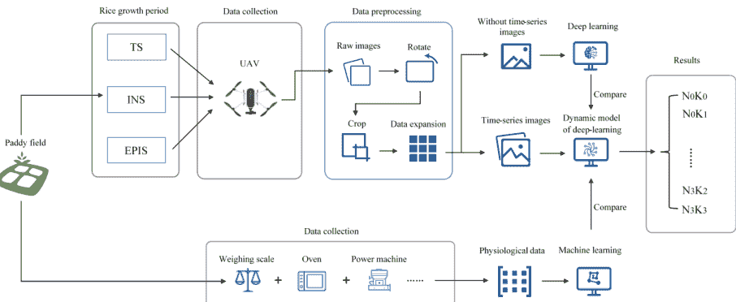
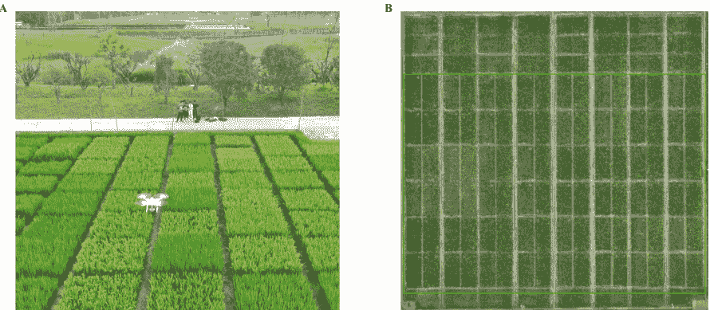
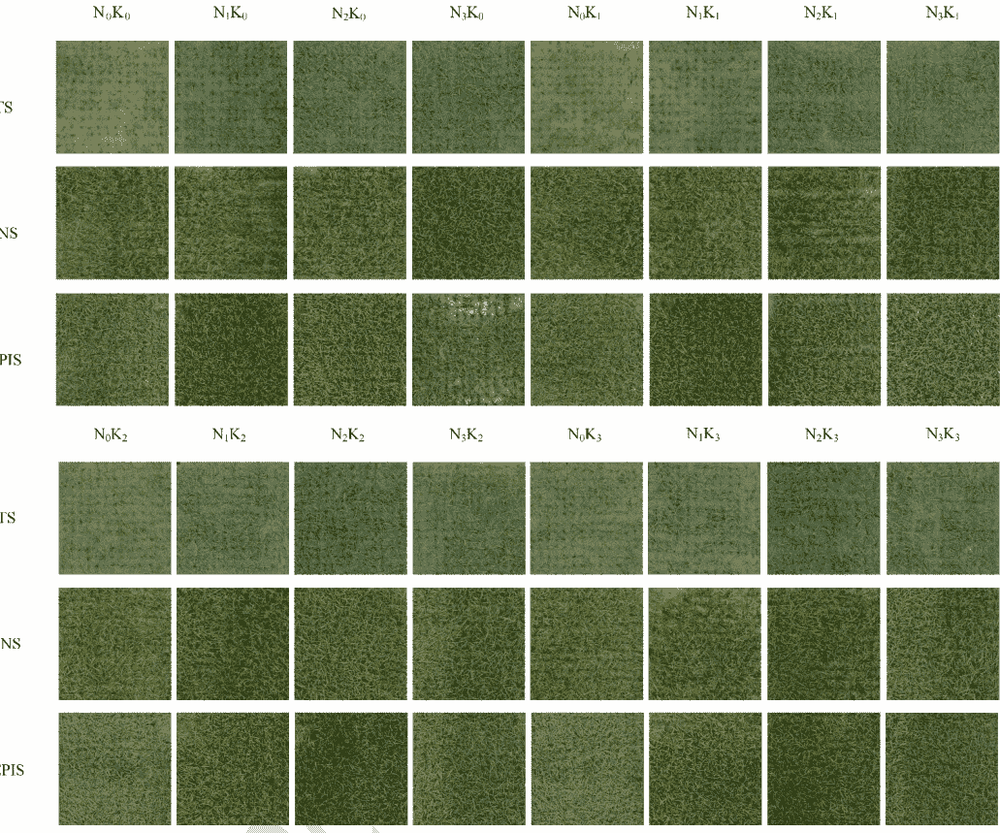
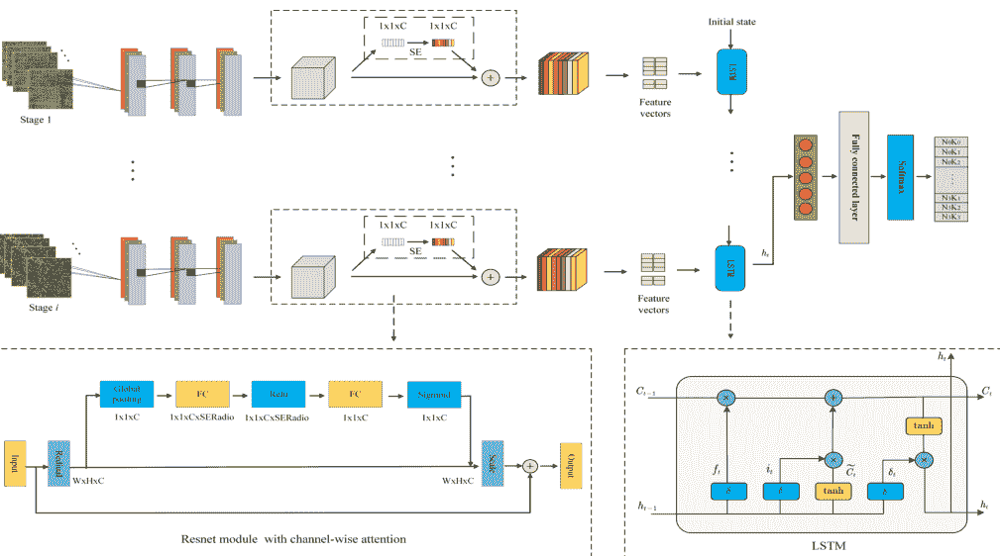
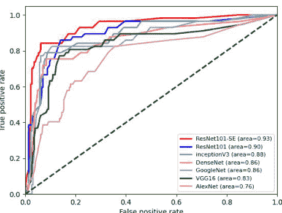
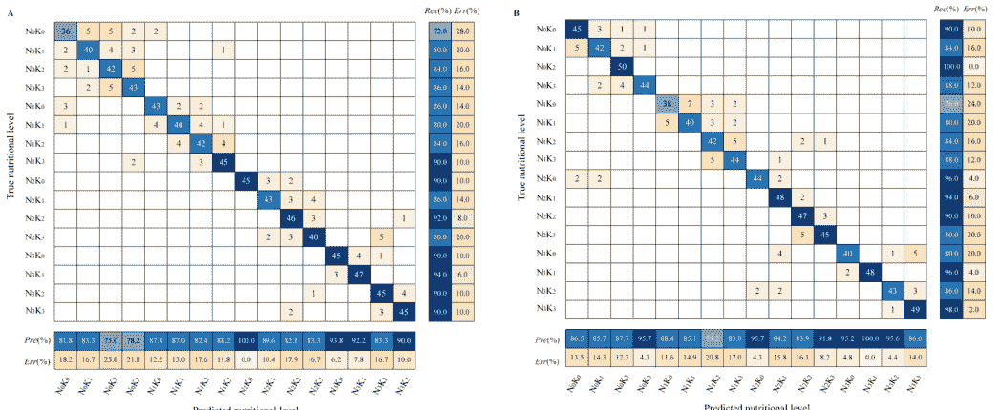

# 水稻穗分化阶段水稻营养水平诊断的混合 CNN-LSTM 模型

## 摘要

氮（N）和钾（K）是水稻生长中涉及的两种关键矿质营养元素。在特定水稻生长阶段合理施用肥料，对准确诊断N和K状态至关重要。因此，我们提出了一种用于在早期幼穗分化期（EPIS）诊断水稻营养水平的混合模型，该模型将卷积神经网络（CNN）与注意力机制以及长短期记忆网络（LSTM）相结合。该模型在两年试验期间，由无人机（UAV）从不同生长阶段的水稻冠层收集的一组大型序列图像上进行了验证。与VGG16、AlexNet、GoogleNet、DenseNet和InceptionV3相比，ResNet101与LSTM相结合在黄华占（HHZ，一种籼稻品种）数据集上获得了最高平均准确率83.81%。在2021年对HHZ和秀水134（XS134，一种粳稻品种）数据集进行测试时，增强了挤压与激励（SE）模块的ResNet101-LSTM模型分别达到了最高准确率85.38%和88.38%。通过跨数据集方法，2022年对HHZ和XS134数据集的测试平均准确率分别为81.25%和82.50%，显示出良好的泛化性。我们提出的模型利用不同水稻生长阶段的动态信息，能够高效诊断EPIS时期不同水稻营养状态水平，这有助于在幼穗分化期做出关于合理施肥方案的实际决策。

关键词：深度学习动态模型，无人机，水稻幼穗分化期，营养水平诊断，图像分类。

## 1 引言

氮（N）和钾（K）不仅是影响水稻光合作用、种群生长和谷物生产的关键营养因素，也是决定水稻产量和粮食安全的关键因素（Vitousek et al. 2009；Hou et al. 2019）。因此，准确判断水稻对N和K的需求并合理优化田间施肥，以实现优质高产水稻，具有重要意义。幼穗分化期（PI）是水稻幼穗快速生长和发育的时期。在此期间，合理施用穗肥非常关键，肥料中的N和K养分可以被有效吸收，以增加每穗小花数和穗大小，从而增加水稻产量（Liu et al. 2021）。目前，诊断水稻营养需求的方法主要包括外观诊断、化学诊断和现代营养诊断。外观诊断方法主要依赖具有长期诊断经验的技术人员，通过目视观察水稻茎叶的颜色、形状和生长速率（Chen and Wang 2014；Sun et al. 2018）。该方法具有主观性，容易导致水稻营养状态误诊。化学诊断方法主要通过化学分析方法测定不同植物器官中氮的临界浓度，包括全氮诊断和硝酸盐诊断（Zhang et al. 2022）。但这些方法存在破坏性取样和分析操作复杂的问题，因此难以推广和应用于大规模的营养水平诊断。现代营养水平诊断方法主要包括叶绿素测定法和高光谱遥感法。相关研究表明，水稻叶片氮含量与叶绿素含量呈正相关，土壤和植物分析开发（SPAD）值与叶绿素呈线性相关，这使得该方法在田间作物氮诊断中有用（Ghosh et al. 2020）。尽管该方法广泛用于氮营养诊断（Peng et al. 2010；Ali et al. 2015；Ling et al. 2017；Baral et al. 2021），但它仍有一些缺点。例如，SPAD值受光照影响很大，因此需要多次测量才能有效减少变异性，且不适合大规模农田检测。高光谱遥感方法主要分析目标对象的光谱差异。植物冠层的光谱反射特征受许多因素影响，如植物叶片含水量、植物冠层几何结构和土壤覆盖度（Wang et al. 2018；Zheng et al. 2019），这大大限制了使用遥感传感器进行作物氮诊断的可靠性和可及性。因此，生产中目前施用穗肥主要依赖农业专家和技术人员的经验和诊断知识。近年来，随着农业人口老龄化，急需开发一种智能、高效、无损且简便的方法，用于诊断水稻生长期间的营养需求。

随着数字图像处理和人工智能的快速发展，许多研究都集中在基于图像的作物营养状态诊断方法上。这些方法可分为传统图像模式识别方法和深度学习方法。基于各种图像特征的传统分类模型识别作物对营养元素缺乏的反应症状，这些特征主要包括形态特征（Chen and Wang 2014；Sun et al. 2018）、纹理特征（Wood et al. 2012）、颜色特征（Sun et al. 2018）和局部特征（Gu et al. 2012；Li et al. 2015）。传统模式识别方法的步骤通常包括首先去除背景，然后手动设计图像特征，最后训练分类器。通常，在测试集上可以获得较高的准确率。然而，田间情况中的生物多样性和复杂背景导致传统模式识别方法表现出较差的鲁棒性和泛化能力。卷积神经网络（CNN）在大规模图像识别中的出色性能（Li S X et al. 2022；Sun G J et al. 2022），使得基于CNN的玉米（Condori et al. 2017；Wu et al. 2020）、大豆（Xiong et al. 2020）、番茄（Tran et al. 2019）和水稻（Yao et al. 2021）营养缺乏识别方法取得了出色的识别结果。然而，这些研究中的作物营养诊断通常基于在单一时间点收集的图像集。实际上，作物对营养缺乏的反应发生在作物漫长的生长期内。迄今，许多学者对玉米和小麦等作物的时间序列数据进行了一些研究，结果表明，时间序列数据的融合显著提高了产量估算的准确性（Lin et al. 2020；Li Q et al. 2022；Sun Z Z et al. 2022）。

水稻冠层的营养水平与种群结构、叶片形态、分蘖分布、其他生理特征及其动态变化相关（Vitousek et al. 2009）。由于水稻不同发育阶段植物结构和营养胁迫症状的复杂性，为了准确监测水稻种群营养状态，应考虑作物种群生长的实时特征及其动态变化。在两年试验中，我们首先建立了不同营养水平的水稻种群，然后使用无人机拍摄时间序列图像，以构建图像种群。然后，使用CNN从图像中提取高维特征，并将其与LSTM相结合，以增强时间维度中的特征相关性。该方法能够提高早期幼穗分化期营养水平诊断的准确性，这对于实现穗肥精细管理和增产增收具有重要意义。

## 2 材料与方法

图1展示了我们实验的流程图。由安装在无人机上的RGB相机收集的水稻冠层图像用于训练不同模型，用于水稻早期营养诊断。同时，收集了水稻生理数据以训练两个用于诊断水稻营养水平的机器学习模型。最后，比较了这些模型以验证混合CNN-LSTM模型的性能。

### 2.1 实验设计

实验于2021年和2022年在中国浙江省杭州市中国农业科学院国家水稻研究所（CNRRI）的水稻田（30°04′N, 119°55′E）进行。土壤理化性质如下：土壤碱解氮含量115.37 mg kg-1，速效磷（P）14.20 mg kg-1，速效钾140.19 mg kg-1，有机质含量30.48 g kg-1，阳离子交换容量18.37 mg kg-1，pH 5.83。实验田概况见图2。

两个测试水稻品种为黄华占（HHZ，一种常规籼稻品种）和秀水（XS134，一种常规粳稻品种）。水稻种植方法采用分割分割区随机区组设计，以水稻品种为主区，N肥水平为分区，K肥水平为子分区；因此，两个水稻品种分别接受了四种不同N和K剂量的16种组合处理（Table 1）。设置了三个重复区组，形成96个小区。在两次试验中，N肥分别在移栽前2-3天施用一次和水稻分蘖期施用一次，剂量比例为5:3，K肥在移栽前2-3天施用一次。所有区组施用P肥，剂量为97.5 kg P2O5/ha。每个区组均由覆盖PVC薄膜的埂分隔，以防止N和K淋失。

并渗透到其他区块。所有区块的水分管理和病虫害防治措施均与当地高产栽培采用的方法相同。

### 2.2 图像采集与预处理

2021年和2022年，使用安装在无人机（P4 Multispectral，大疆创新科技有限公司，中国）上的配备六颗1/2.9英寸CMOS图像传感器的相机采集了稻穗冠层图像。无人机在当地时间上午（8:00-11:30）晴朗无风的条件下，以1 m/s的速度在试验区上空10 m的高度执行飞行任务。飞行在稻穗分蘖期（TS）、早期穗分化期（EPIS）和中间期（INS）进行。原始图像使用大疆智图软件（v3.4，大疆创新科技有限公司，中国）与正射影像图进行拼接。每个阶段采集了六张图像，每张图像大小为26372*15284像素。

由于拼接后的原始图像存在倾斜，采用Hough直线检测方法（Ballard 1981）进行倾斜校正。为避免不同光照条件引起的颜色差异，采用灰世界方法（Kwok et al. 2011）校正原始图像的色彩。为获取每个试验区的图像，为每个试验区创建了掩膜，并从原始图像中裁剪出每个试验区的图像。为增加样本量，每个试验区图像被分割为12张方形试验区图像，每张512*512像素，因此从每个N和K处理在每个稻穗生长阶段获得了216张方形试验区图像。我们获得了10368张原始子图像，并将2021年的稻穗样本数据集随机分为80%用于模型训练、20%用于模型测试。为进一步测试模型的泛化能力，在土壤性质和施肥处理相同的不同农田上，按照2021年的相同操作方法，采集了2022年TS、INS和EPIS三个生长期的稻穗冠层图像。2022年的新数据集用于测试在2021年数据集上训练的模型。

为提高模型的鲁棒性和泛化能力，通过左右镜像、图像90°旋转和添加高斯噪声等数据增强方法，将每个处理的训练图像数量扩展至500张。由于我们的模型在时序图像上训练，噪声被随机添加到图像中，其他数据增强操作在训练集的所有图像上执行。最终，总共获得了24000个训练样本。图3展示了16种不同N和K剂量处理在三个不同稻穗生长阶段的HHZ稻穗时序图像示例。这些示例表明，不同营养水平的稻穗在同一生长阶段的视觉差异有限且相似度高（图3）。其中，N2K0、N2K1、N2K2和N2K3在TS时差异不明显，但在从TS到EPIS的整个稻穗生长过程中存在差异。

### 2.3 稻穗生理指标测定

无人机采集不同稻穗生长阶段的图像后，从每个试验区采集稻穗样品。人工测量株高并数穗数。然后将样品分离为绿色叶片、枯叶片以及茎秆加叶鞘，并在80°C烘箱中干燥72小时以上，以测定各组织器官的干重。叶面积指数（LAI）使用叶面积仪（LI-3000A，LICOR，美国内布拉斯加州林肯）测定，比叶重（SLA）计算为绿色叶面积与其干重之比。植物组织中N和K浓度使用湿消解后的凯氏定氮法（Goyal et al. 2022）测定，N和K累积量表示为浓度与其干物质重量的乘积。

### 2.4 稻穗营养诊断模型

稻穗生长是一个动态过程，不同生长阶段稻穗的N和K表型不同。为实时准确诊断稻穗的营养水平，提出了一种基于深度学习方法的营养诊断模型CNN-LSTM，用于提取稻穗冠层图像的时空特征。涉及的LSTM是一种特殊的递归神经网络（RNN），可以学习序列数据中时间步之间的短期和长期依赖关系（Hochreiter and Schmidhuber, 1997）。LSTM的输入由单元状态C t-1、隐藏状态ht-1和输入向量xt组成，输出由单元状态Ct和隐藏状态ht组成，主要由输入门（i）、遗忘门（f）、候选门（g）和输出门（o）控制。LSTM样本单元图如图4所示。

目前，典型的CNN识别模型包括AlexNet（Krizhevsky et al. 2012）、VGG16（Simonyan and Zisserman 2015）、GoogleNet（Szegedy et al. 2015）、DenseNet（Huang et al. 2017）、inception v3（Szegedy et al. 2015）和ResNet101（He et al. 2016）。在本研究中，使用了这六种不同的CNN模型进行特征提取。所有这些网络都应用了Imagenet公开数据集（Weiss et al. 2016）上的预训练模型以加速训练。最终，最佳模型（ResNet101）被用作本研究中提取特征的基本模型。然后，将SENet通道注意力机制添加到ResNet101模型中，以增强关键特征的提取。SENet的本质是利用相关特征图学习权重分布，然后将训练得到的权重应用于原始特征图进行加权求和，从而进一步提高网络获取局部有效信息的能力。

ResNet101-SE-LSTM网络框架如图4所示。首先，将神经网络模型ResNet101与挤压-激励（SE）模块结合，以从时序图像中提取特征。为避免有用特征的丢失，模型跳过了最后的全连接层，然后通过reshape层直接将特征转换为特征向量，以重新生成适合LSTM输入的特征矩阵。LSTM的每个单元输入（大小：m*n）是包含每个时间步的稻穗冠层图像的一组特征向量，其中m是每个时间步的图像总数，包括TS、INS和EPIS，n是神经网络提取的特征向量。在图4中，i是输入模型框架的时间步，等于2或3。实际上，由于该框架的灵活性，时间步可以根据实际需求和模型输出反馈进行调整。其次，通过端到端可训练的类架构，LSTM模型使用反向传播算法进行反复迭代，并将交叉熵用作模型训练的损失函数。LSTM的超参数如表3所示。最后，最后一个LSTM单元的隐藏层ht对序列数据的关键信息进行编码。我们通过全连接层转换生成的输出向量，并将其长度转换为类别数。然后使用softmax层对稻穗营养水平进行分类，其神经元数量与类别数相同。

### 2.5 模型训练

所有模型均在配备AMD Ryzen 5 3600 6核心处理器3.60GHz CPU的PC上运行。该计算机配备了3块GeForce GTX 1080Ti。其操作系统为Linux 16.04，主机内存为32.00 GB。

训练过程中，预训练模型的权重进行了微调，模型通过多线程在三块GPU上同时使用16组小批量样本数据进行训练，并选择随机梯度下降作为优化策略。ResNet101-SE-LSTM的详细配置参数如表2所示。

### 2.6 评价指标

为评估 ResNet101-SE-LSTM 模型的识别效果，我们采用准确率（Acc）、精确率（Pre）、召回率（Rec）和 F1 分数（F1）作为衡量模型性能的评价指标。Acc、Pre、Rec 和 F1 的计算方法如公式 (1-4) 所示。

$Acc = \frac{TP + TN}{TP + FP + FN + TN}$ (1)

$P_{re} = \frac{TP}{TP + FP}$ (2)

$R_{ec} = \frac{TP}{TP + FN}$ (3)

$F_1 = \frac{2P_{re}R_{ec}}{P_{re} + R_{ec}}$ (4)

其中 TP 表示正样本被预测为正样本，FN 表示正样本被预测为负样本，FP 表示负样本被预测为正样本，TN 表示负样本被预测为负样本。

### 2.7 基于水稻生理特征的机器识别方法

为区分不同 N 和 K 相互作用的发育差异，我们采集了经典植物生理特征数据，并使用 Monte Carlo 采样器（Metropolis 和 Ulam 1949）扩展了测试数据。这些生理特征包括干物质重量、植物组织（叶片、茎秆和叶鞘、穗）中 N 和 K 含量及积累、全地上部生物量、比叶重、绿叶重、叶面积指数、植株高度和分蘖数。我们训练了两种机器学习模型，即支持向量机（SVM）和随机森林，用于诊断 N 和 K 处理相互作用下的水稻营养水平。将结果与 CNN-LSTM 的诊断结果进行比较，以间接评估 CNN-LSTM 模型的可行性。

## 3 结果

### 3.1 不同模型的识别结果

七种特征提取网络，即 VGG16、AlexNet、GoogLeNet、DenseNet、inceptionV3、ResNet101 和 ResNet101-SE，与 LSTM 模型相结合，用于诊断 EPIS 时期 HHZ 的 N 和 K 营养水平。诊断结果如表 3 和图 5 所示。AlexNet 在 16 种营养水平诊断中表现最差，准确率为 73.94%，其曲线下面积（AUC）最低，为 0.76。ResNet101 表现相对较好，准确率为 83.81%，相应的 AUC 为 0.90。在 ResNet101 基础上添加基于通道域的 SE 模块后，ResNet101-SE 的精确率和召回率分别提高了 4.94% 和 2.45%，AUC 提高到 0.93，在所有测试的 CNN 特征网络中表现最佳。因此，采用 ResNet101-SE 提取水稻特征。

### 3.2 含或不含时间序列的模型

为评估时序和非时序模型的诊断效果，我们在不同生长阶段的两个水稻品种上测试了 ResNet101-SE 和 ResNet101-SE-LSTM 模型。诊断结果如表 4 所示。ResNet101-SE 在 TS 时期诊断 N 和 K 水平时的准确率、精确率和召回率均低于 60%。当使用 ResNet101-SE 诊断 EPIS 时期的 N 和 K 水平时，这些评估数值提高到 70% 以上。ResNet101-SE-LSTM 模型在诊断 INS 和 EPIS 时期的 N 和 K 水平时表现良好。在诊断 HHZ 和 XS134 品种 INS 时期的 N 和 K 水平时，ResNet101-SE-LSTM 模型的准确率比同期非时序模型高出 10% 以上，且该模型在 EPIS 时期诊断两个水稻品种 N 和 K 水平的 F1 分数均超过 85%，这表明将 ResNet101 模型与长短期记忆模型相结合有助于提高模型识别能力。

植物在不同生长阶段对营养胁迫的反应不同，其表型特征具有动态性。因此，单一生长阶段无法反映植物的整体生长状态。此外，确定营养水平诊断的最佳生长阶段或为不同生长阶段开发单独模型是一项艰巨的任务，并且未必能为施肥决策提供可靠结果。传统深度学习分类器仅提取当前阶段的信息，无法学习不同生长阶段水稻数据之间的依赖关系，导致预测能力较低（表 4）。另一方面，LSTM 是一种由自循环单元组成的循环神经网络，允许信息在内部传输，因此更适合处理多时序数据。

为 HHZ 和 XS134 生成了 ResNet101-SE-LSTM 的混淆矩阵，以证明我们提出的框架可以区分不同的营养水平（见图 6）。ResNet101-SE-LSTM 在常规 *indica*（指示型）稻（HHZ）（图 6-A）和常规 *japonica*（粳型）稻（XS134）（图 6-B）中均表现出优异性能，能够有效诊断不同 N 和 K 相互作用处理后的 16 种营养水平。在 HHZ 测试中，N0K0、N0K1、N0K2 和 N0K3 存在一定的相互误判，其准确率分别为 72.00%、80.00%、84.00% 和 86.00%。在 XS134 测试中，N1K0、N1K1、N1K2 和 N1K3 存在一定的误判，其准确率分别为 76.00%、80.00%、84.00% 和 88.00%。在这些组合中，N1K0 和 N1K1 的误判最为严重，但大多数误分类发生在同一 N 水平下的不同 K 处理之间。总之，N 对水稻综合生长的影响显著高于 K。

### 3.3 模型泛化能力

为测试我们提出模型的泛化能力，该模型在 2021 年数据集上训练，并使用 2022 年数据集进行评估。结果表明，HHZ 的准确率和精确率均高于 81.00%，XS 的准确率和精确率均高于 82.00%（表 5）。这些结果表明该模型具有优异的泛化能力。在复杂的水田环境中，我们的先进框架能够从处理后的图像中提取水稻群体结构、叶片形态及其动态变化，以准确诊断植物营养水平。所有这些过程均由深度学习自动完成，无需任何人工干预，为水稻营养水平的智能监测提供了极大便利。

### 3.4 机器学习与深度学习模型的比较

为进一步探讨深度特征对水稻营养水平诊断的贡献，我们基于水稻生理数据训练了 SVM 和随机森林模型，对 EPIS 时期的水稻营养水平进行分类和识别。表 6 显示了这两种模型在识别两个水稻品种营养水平方面的结果。SVM 模型的准确率通常高于随机森林模型，HHZ 和 XS134 的识别准确率分别达到 86.00% 和 81.00%。同时，我们提出的模型在 HHZ 中的准确率和精确率分别为 85.88% 和 86.12%，在 XS134 中分别为 88.38% 和 88.70%（表 4）。这些结果表明，ResNet101-SE-LSTM 模型的营养水平诊断效果与基于水稻生理特征的 SVM 模型一致，但需牢记，机器学习方法需要许多繁琐的操作和破坏性取样，而我们的方法可以大幅降低人工成本。

## 4 讨论

### 4.1 基于单时间点和多时序作物图像分析的营养诊断

卷积神经网络对单时间点作物图像进行营养诊断的近期研究已取得一些进展（Condori 等，2017；Tran 等，2019；Wu 等，2020；Xiong 等，2020；Yao 等，2021）。例如，Wu 等人（2020）在特定时间采集了彩色图像和五通道多光谱数据，并训练模型识别玉米营养状态。结果表明，基于彩色图像和多光谱数据的识别准确率分别为 84.7% 和 90.5%，能够在不破坏玉米植株的情况下快速提供玉米作物的营养状态。Tran 等人（2019）提出了一种方法，将统计集成平均法应用于 Inception-ResNet v2 和自编码器模型，在温室条件下实现了番茄植株生长图像营养诊断 91% 的准确率。

上述所有研究均关注作物生长期间的单一关键时间节点，关键时间节点的选择容易通过研究经验或现场视觉观察获得。然而，不同类型的营养缺乏症状在作物不同生长阶段可能相似，且作物植株的营养缺乏症状在所选时间节点可能并不明显（Vitosuek 等，2009）。事实上，营养胁迫引起的表型可在作物整个生长动态期间出现，因此表型分析应考虑时间序列数据。尽管神经网络在诊断作物营养缺乏方面表现良好，但其与时间序列分析模型（如 LSTM）相结合将更符合实际。LSTM 已应用于处理时间序列数据集，如情绪识别（Son，2017）和疾病预测（Dua 等，2020）。此外，在实验室条件下，Taghavi Namin 等人（2018）通过 LSTM 研究了植物生长和动态信息，并将这些特征作为拟南芥营养分类的重要差异表型，实现了 93% 的分类准确率。这是第一次

LSTMs被用于研究植物的时序特性和动态信息，展示了其在植物营养状态分类方面的潜力。在本研究中，通过比较单点时间数据集和时间序列数据集的结果，发现对于不同品种的水稻，时间序列数据集的分类性能普遍优于单点时间数据集（表 4）。这一改进表明，时序信息提取在分析植物营养分类方面具有巨大潜力，这与 Taghavi Namin 等人（2018）得出的结论基本一致。

### 4.2 作物生长状态对 N 和 K 处理的响应

作物的生长状态可能源于人为和/或环境途径中的非生物/生物因素。在这些因素中，N 和 K 是影响水稻田作物生长的两种主导营养元素。N 分别有益于营养生长期和生殖生长期的分蘖产量和穗部发育，这有助于提高穗的数量、大小和重量，并在成熟期获得高产量（Liu 等人，2021）。此外，N 和 K 对叶片光合作用也至关重要（Coskun 等人，2017），并且与冠层大小、颜色和形状存在直接或间接关系（Che 等人，2016）。由于 N 和 K 广泛参与植物的各种生理代谢过程，使用一两个指标很难区分生长状态。因此，结合各种生理特征进行综合诊断可能是评估关键生长阶段作物生长状态的一种有前途的方法。在本研究中，利用人为确定的作物生理特征，采用 SVM 和随机森林模型来评估 N 和 K 处理引起的作物生长状态，SVM 模型在 HHZ 和 XS134 上的识别准确率分别为 86.00% 和 81.00%。然而，应注意的是，生理特征的采集耗时、费力且涉及破坏性取样，不适合生产应用。

在最近几十年，关于 N/K 肥料施用的报告主要集中在通过评估最终产量来测试关键生长阶段的肥料用量和/或类型（Ma 等人，2019；Huang 等人，2021），这不仅耗时费力，还依赖于环境条件和品种。因此，需要一种简单的水稻营养状态诊断技术用于追肥施用。报告表明，EPIS 时期追肥的时机对提高源体量有重大影响（Ma 等人，2019）。然而，由于 N 和 K 对作物生长和产量表现的定量影响，植物生长状态对不同 N/K 处理水平的响应是渐进的，当处理水平之间的差异较小时，症状难以区分，这导致基于 PI 前实际养分水平的定量施肥研究很少（Li 等人，2017；Wang 等人，2021）。另一方面，N 和 K 肥料的施用将以空间（冠层形态变化）和时间（即分蘖/LAI 动态）两种方式影响水稻生长。N 和 K 含量影响水稻生长并响应水稻表型。在本研究中，开发了一种时空卷积网络模型，用于诊断 PIS 前不同 N 和 K 处理引起的作物生长状态。结果表明，ResNet101-SE-LSTM 模型的效果与基于水稻生理特征的 SVM 模型一致。结果有助于提高穗初期追肥施用的准确性。

### 4.3 作物营养水平与产量预测的关系

作物的传统产量预测模型通常采用使用环境因子和作物生长因子的数据拟合方法（Gonzalez-Sanchez 等人，2014；Khaki 和 Wang，2019；Yao 等人，2020）。环境因子包括土壤类型、光照和 CO2。作物生长因子包括作物生长和发育速率。近年来，遥感技术结合光谱学已被用于在实际环境中预测作物产量。例如，Latwal 等人（2019）使用农业气象回归模型、基于遥感指数的经验模型和半物理模型来估算区级油菜和芥菜的作物产量。Kang 等人（2021）分析了基于无人机多光谱影像的六种植被指数，并利用它们开发用于预测水稻产量和蛋白质含量的回归模型。Panda 等人（2010）使用 BP 神经网络（BPNN）建模方法，验证了四种光谱植被指数（NDVI、绿色植被指数（GVI）、土壤调整植被指数（SAVI）和垂直植被指数（PVI））在玉米作物产量预测中的有效性。

这些研究中的大多数主要基于现有因子的数值回归进行产量拟合。主要因子包括当前阶段水稻的 N 和 K 吸收含量，因为 N 和 K 在作物健康和发育中起着重要作用（Vitousek 等人，2009；Hou 等人，2019）。同时，环境因子和成本要求审慎施用 N 和 K（Chlingaryan 等人，2018）。因此，建立参考养分水平的追肥量和产量变化动态模型以实现最佳 N 和 K 管理具有挑战性。我们对 EPIS 时期水稻的不同养分水平进行了分类，并在不进行动态施肥的情况下继续让水稻生长至成熟期。这使我们能够形成产量不同的水稻种群，这与 Wang 等人（2013）的研究基本一致，该研究中不同 N 肥料导致了产量不同的水稻种群。水稻早期养分水平将影响未来的水稻产量。EPIS 时期水稻养分水平的诊断是实现穗肥精细管理的一种简单方法。未来，我们将关注水稻早期养分水平、施肥量和产量预测之间的关系。

## 5 结论

本研究提出了一种基于 ResNet101 结合 SE 模块和 LSTM（ResNet101-SE-LSTM）的深度学习动态模型，以探讨使用无人机采集的水稻冠层图像在 2021 年和 2022 年识别养分水平的可行性。训练了七个卷积神经网络来识别 N 和 K 养分水平。结果表明，ResNet101-SE 模型可以有效地从空间和时域提取图像特征，用于水稻养分水平的识别。本研究还表明，在单一动态模型中加入时域提取对诊断营养水平非常重要。在我们的实验中，ResNet101-SE-LSTM 模型在 2021 年分别为 HHZ 和 XS134 实现了最高的总体准确率 85.88% 和 88.38%。我们的模型还表现出较好的泛化能力，2022 年分别为 HHZ 和 XS134 达到了 81.25% 和 82.50% 的总体准确率。与涉及水稻营养状态破坏性检测的传统方法相比，我们的方法提供了一种在 EPIS 识别水稻养分水平的方法，可在水稻施肥期间为田间工作者提供实时数据和参考，以提高水稻产量。

## 致谢

本作品得到中国国家重点研发计划（2022YFD2300700）、中国国家稻研究院－CNRRI 国家重点实验室开放课题（20210403）以及浙江“万名人才”计划科技创新领军人才项目（2020R52035）的支持。

## 利益冲突声明

作者声明不存在利益冲突。

## 参考文献

- Ali A M, Thind H S, Sharma S, Singh Y. 2015. 基于叶绿素计和叶片颜色图的干旱直播水稻部位特异性氮管理. 壤学报, 25, 72-81.

- Ballard D H. 1981. 将霍夫变换推广以检测任意形状. 模式识别, 13, 111-122.

- Baral B R, Pande K R, Gaihre Y K, Baral K R, Sah S K, Thapa Y B, Singh U. 2021. 基于决策支持工具的实时氮管理提高水稻氮利用效率. 农业生态系统养分循环, 119, 355-368.

- Che S G, Zhao B Q, Li Y T, Yuan L, Lin Z A, Hu S W, Shen B. 2016. 中国水稻粮食产量增加时的养分吸收需求. 综合农业杂志, 15, 907-917.

- Chen L S, Wang K. 2014. 基于静态扫描技术和图像信息提取的水稻氮胁迫诊断. 土壤科学与植物营养学报, 14, 382-393.

- Chlingaryan A, Sukkarieh S, Whelan B. 2018. 精准农业中作物产量预测和氮状态估计的机器学习方法：综述. 农业计算机与电子学, 151, 61-69.

- Condori R H M, Romualdo L M, Bruno O M, de Cerqueira Luz P H. 2017. 玉米作物氮素缺乏检测中传统纹理方法与深度学习描述子的比较. 载于：2017年计算机视觉研讨会（WVC）. Curran Associates, 纽约, NY. 7-12页.

- Coskun D, Britto D T, Kronzucker H J. 2017. 氮-钾交叉点：膜、代谢与机制. 植物细胞与环境, 40, 2029-2041.

- Dua M, Makhija D, Mishra P Y L, Manasa P. 2020. 基于CNN–RNN–LSTM的融合用于阿尔茨海默病检测. 医学与生物工程杂志, 40, 688-706.

- Ghosh M, Swain D K, Jha M K, Tewari V K, Bohra A. 2020. 东印度水稻-小麦轮作系统中优化叶绿素计（SPAD）读数以实现水稻和小麦高效氮利用. 作物生产科学, 23, 270-285.

- Gonzalez-Sanchez A, Frausto-Solis J, Ojeda-Bustamante W. 2014. 大规模作物产量预测中机器学习方法的预测能力. 西班牙农业研究杂志, 12, 313-328.

- Goyal K, Singh N, Jindal S, Kaur R, Goyal A, Awasthi R. 2022. 凯氏定氮法. 分析化学先进技术, 1, 105.

- Gu Q, Deng J S, Lu C, Shi Y Y, Wang K, Shen Z Q. 2012. 基于扫描叶片光谱和形状特征的水稻氮营养诊断. 农业机械学报, 43, 170-174. (中文)

- He K M, Zhang X Y, Ren S Q, Sun J. 2016. 图像识别的深度残差学习. 载于：2016年IEEE计算机视觉与模式识别会议（CVPR）. IEEE计算机学会, 纽约, NY. 770-778页.

- Hochreiter S, Schmidhuber J. 1997. 长短期记忆. 神经计算, 9, 1735-1780.

- Hou W F, Tränkner M, Lu J W, Yan J Y, Huang S Y, Ren T, Cong R H, Li X K. 2019. 氮和钾对水稻叶片光合作用及光合氮分配的交互作用. BMC植物生物学, 19, 1-13.

- Huang G, Liu Z, Van Der Maaten L, Weinberger K Q. 2017. 密集连接卷积网络. 载于：2017年IEEE计算机视觉与模式识别会议（CVPR）. IEEE, 皮斯卡特韦, 新泽西州. 4700-4708页.

- Huang Y G, Luo D Q, Jiang X H, Li M, Li L J, Ji G M, Li S X, Xu Y. 2021. 不同氮肥施用比例对宜香优2115谷物产量和品质的影响. 杂交水稻, 36, 94-99. (中文)

- Kang Y, Nam J, Kim Y, Lee S, Seong D, Jang S, Ryu C. 2021. 基于无人机多光谱影像的水稻产量和蛋白质含量预测回归模型评估. 遥感, 13, 1508.

- Khaki S, Wang L. 2019. 使用深度神经网络的作物产量预测. 植物科学前沿, 10, 621.

- Krizhevsky A, Sutskever I, Hinton G E. 2012. 使用深度卷积神经网络的ImageNet分类. ACM通讯, 60, 84-90.

- Kwok N M M, Wang D, Jia X, Chen S Y, Fang G, Ha Q P. 2011. 基于灰度世界的图像增强色彩校正与强度保持. 载于：2011年第4届图像与信号处理国际会议. IEEE, 皮斯卡特韦, 新泽西州. 994-998页.

- Latwal A, Saxena S, Dubey S K, Choudhary K, Sehgal S, Ray S S. 2019. 在FASAL项目下，印度主要芥菜籽产地州的收获前产量预测评估. 摄影测量、遥感与空间信息科学国际档案, XLII-3/W6, 18-20.

- Li H, Hu B, and Chu C C. 2017. 作物氮利用效率：来自拟南芥和水稻的经验. 实验植物学杂志, 68, 2477-2488.

- Li L T, Zhang M, Ren T, Li X K, Cong R H, Wu L S, Lu J W. 2015. 使用数字图像处理技术诊断水稻氮营养. 植物营养与肥料学报, 21, 259-268. (中文)

- Li Q, Jin S C, Zang J R, Wang X, Sun Z Z, Li Z Y, Xu S, Ma Q, Su Y J, Guo Q H, Jiang D. 2022. 解读近距离感知中光谱和结构数据对小麦产量估算的贡献. 作物学报, 10, 1334-1345.

- Li S X, Feng Z L, Yang B J, Li H, Liao F B, Gao Y F, Liu S H, Tang J, Yao Q. 2022. 水稻冠层病虫害智能监测系统. 植物科学前沿, 13, 972286.

- Lin T, Zhong R H, Wang Y D, Xu J F, Jiang H, Xu J L, Ying Y B, Rodriguez L, Ting K C, Li H F. 2020. DeepCropNet：县级玉米产量估算的深度时空学习框架. 环境研究快报, 15, 034016.

- Ling Q H, Wang S H, Ding Y F, Li G H. 2017. 对利用顶部第3片叶与第4片叶之间的颜色差异作为高产水稻统一指标的重新评价. 中国农业科学, 50, 4705-4713. (中文)

- Liu H J, Zhang H, Sheng J, Zhang Y F, Guo Z, Zheng J C, Chen J C, Chen L G. 2021. 基肥侧深施用下水稻穗肥减量对氮利用效率的影响. 生态学报, 40, 1366. (中文)

- Ma P, Yang Z Y, Li Y, Lin D, Sun Y J, Ma J. 2019. 小麦/油菜季氮减量和水稻季氮肥管理对轮作系统作物产量和氮吸收的影响. 浙江农业科学, 31, 1769-1778. (中文)

- Metropolis N, Ulam S. 1949. 蒙特卡洛方法. 美国统计协会杂志, 44, 335-341.

- Panda S S, Ames D P, Panigrahi S. 2010. 使用神经网络技术进行农作物产量预测中植被指数的应用. 遥感, 2, 673-696.

- Peng S B, Buresh R J, Huang J L, Zhong X H, Zou Y B, Yang J C, Wang G H, Liu Y Y, Hu R F, Tang Q Y, Cui K H, Zhang F S, Dobermann A. 2010. 基于部位特异性氮管理改善水稻氮肥施用：综述. 可持续发展农艺学, 30, 649-656.

- Simonyan K, Zisserman A. 2015. 大规模图像识别的非常深的卷积网络. 载于：国际学习表征会议（ICLR）. OpenReview.net, 伊塔卡, 纽约州. 1-14页.

- Son H H. 2017. 使用LSTM循环神经元网络的情绪识别拟议框架. 程序计算机科学, 109, 1028-1034.

- Sun G J, Liu S H, Luo H L, Feng Z L, Yang B J, Luo J, Tang J, Yao Q, Xu J J. 2022. 基于探光灯诱捕和机器视觉的迁飞害虫智能监测系统. 植物科学前沿, 13, 897739.

- Sun Y Y, Tong C, He S, Wang K, Chen L S. 2018. 基于叶片形态和颜色时间动态的氮磷钾缺乏识别. 可持续性, 10, 762.

- Sun Z Z, Li Q, Jin S C, Song Y L, Xu S, Wang X, Cai J, Zhou Q, Ge Y, Zhang R N, Zhang J R, Jiang D. 2022. 基于时间序列近距离感知的多任务深度学习同时预测小麦产量和谷物蛋白含量. 植物表型组学, 2022, 13.

Szegedy C, Liu W, Jia Y Q, Sermanet P, Reed S, Anguelov D, Erhan D, Vanhoucke V, Rabinovich A. 2015. 更深入的卷积. In: 2015年IEEE计算机视觉与模式识别会议(CVPR). IEEE, 美国新泽西州皮斯卡塔威. 第1-9页.

Taghavi Namin S, Esmaeilzadeh M, Najafi M, Brown T B, Borevitz J O. 2018. 深表型组学：基于深度学习的时间表型/基因型分类. 植物方法, 14, 1-14.

Tran T T, Choi J W, Le T T H, Kim J W. 2019. 深度卷积神经网络在预测和分类番茄植株大量营养元素缺乏症中的比较研究. 应用科学, 9, 1601.

Vitousek P M, Naylor R, Crews T, David M B, Drinkwater L E, Holland E, Johnes P J, Katzenberger J, Martinelli L A, Matson P A, Nziguh eba G, Ojima D, Palm C A, Robertson G P, Sanchez P A, Townsend A R, Zhang F S. 2009. 农业发展中的营养元素失衡. 科学, 324, 1519-1520.

Wang L, Chen S S, Li D, Wang C Y, Jiang H, Zheng Q, Peng Z P. 2021. 基于无人机高光谱图像估算水稻叶片和植株水平的氮含量及积累量. 遥感, 13, 2956.

Wang S W, Cheng X, Zhao Q H, Li X W, Zhang Y, Mani A, Wang R T. 2018. 寒冷地区基于高光谱反射率结合SG-FD-CARS-ELM估算水稻冠层氮含量. 系统工程, 3, 25-34.

Wang Y, Fu L D, Li X, Sui X, Ren H, Lv X H. 2013. 氮施用量对水稻生长发育及产量的影响. 北方水稻, 43, 14-17. (中文)

Weiss K, Khoshgoftaar T M, Wang D D. 2016. 迁移学习综述. 大数据期刊, 3, 1-40.

Wood E M, Pidgeon A M, Radeloff V C, Keuler N S. 2012. 图像纹理作为植被结构的遥感测量方法. 环境遥感, 121, 516-526.

Wu G, Peng Y Q, Zhou G Q, Li X L, Zheng Y J, Yan H J. 2020. 基于多光谱图像和卷积神经网络的玉米营养识别方法. 智慧农业, 2, 111. (中文)

Xiong J T, Dai S X, Ou J H, Lin X Y, Huang Q H, Yang Z G. 2020. 基于深度学习的大豆叶片缺素症状检测方法. *农业机械学报*, **51**, 195-202. (中文)

Yao Q, Feng J, Tang J, Xu W G, Zhu X H, Yang B J, Lv J, Xie Y Z, Yao B, Wu S Z, Kuai N Y, Wang L J. 2020. 基于机器视觉的水稻灯光诱虫自动监测系统的开发. *农业综合学报*, **19**, 2500-2513.

Yao Q, Li C, Li B, Yi J, Jing T T, Lv B. 2021. 深度学习方法在水稻氮营养诊断中的应用初步研究. *华南农业*, **15**, 125-129. (中文)

Zhang Z S, Xia J Q, Alfatih A, Song Y, Huang Y J, Sun L Q, Wan G Y, Wang S M, Wang Y P, Hu B H, Zhang G H, Qin P, Li S G, Yu L H, Wu J, Xiang C B. 2022. 硝酸盐充足条件下水稻NIN样蛋白3调节氮利用效率和谷物产量. *植物*, **45**, 1520-1536.

Zheng H B, Zhou M, Zhu Y, Cheng T. 2019. 利用无人机多光谱图像纹理信息监测水稻氮素状态. In: *2019年IEEE国际大地测量和遥感研讨会*. IEEE, 美国新泽西州皮斯卡塔威. 第7251-7253页.

## 图1 不同营养水平诊断方法的流程图. TS，分蘖期；EPIS，早穗分化期；INS，TS和EPIS之间的中间阶段；UAV，无人机.

## 图2 无人机获取的水稻冠层图像（A）和试验田概览（B）.

## 图3 2021年HHZ（籼米品种）在不同氮钾处理下不同年生期的时序图像示例. TS，分蘖期；EPIS，早穗分化期；INS，TS和EPIS之间的中间阶段.

## 图4 基于时序图像数据集的水稻营养诊断ResNet101-SE-LSTM模型框架. SE，挤压-激励模块；FC，全连接层；Relu，整流线性单元；LSTM，长短期记忆网络.

## 图5 基于2021年HHZ数据集不同模型的受试者工作特征曲线.

## 图6 籼米品种HHZ(A)和粳稻品种XS134(B)的ResNet101-SE-LSTM模型混淆矩阵. Rec，水稻各类营养水平诊断的召回率；Pre，水稻各类营养水平诊断的精确率；Err，各值与100%的差值.

## 表1 2021年和2022年浙江省杭州市HHZ和XS134水稻各处理的氮钾肥施用量

| Class | N0K0 | N0K1 | N0K2 | N0K3 | N1K0 | N1K1 | N1K2 | N1K3 |
|---|---|---|---|---|---|---|---|---|
| N | 0 | 0 | 0 | 0 | 67.5 | 67.5 | 67.5 | 67.5 |
| K | 0 | 54 | 108 | 162 | 0 | 54 | 108 | 162 |
| Class | N2K0 | N2K1 | N2K2 | N2K3 | N3K0 | N3K1 | N3K2 | N3K3 |
| N | 135 | 135 | 135 | 135 | 202.5 | 202.5 | 202.5 | 202.5 |
| K | 0 | 54 | 108 | 162 | 0 | 54 | 108 | 162 |

## 表2 CNN-LSTM模型参数说明

| Parameter | Value |
|---|---|
| 学习率 | 5e-4 |
| 迭代次数 | 200 |
| 层数 | 1 |
| 分割比例 | 0.2 |
| 批量大小 | 16 |
| 隐藏单元数 | 256 |
| 动量 | 0.9 |
| 潜在维度 | 512 |

## 表3 基于2021年HHZ数据集不同模型的水稻营养水平诊断结果

| 特征提取网络 | Acc (%) | Pre (%) | Rec (%) | F1 (%) |
|---|---|---|---|---|
| VGG16 | 77.81 | 71.50 | 77.81 | 74.51 |
| AlexNet | 73.94 | 75.06 | 72.88 | 74.12 |
| GoogleNet | 81.25 | 84.50 | 79.37 | 83.37 |
| DenseNet | 80.46 | 85.06 | 74.68 | 80.43 |
| inceptionV3 | 81.71 | 78.06 | 81.56 | 81.25 |
| ResNet101 | 83.81 | 81.18 | 83.43 | 83.81 |
| ResNet101-SE | 85.88 | 86.12 | 85.88 | 85.61 |

1) Acc，水稻营养水平诊断的准确率；Pre，水稻营养水平诊断的精确率；Rec，水稻营养水平诊断的召回率；F1，水稻营养水平诊断的F1得分.

## 表4 时序模型和非时序模型的识别结果

| 水稻品种 | 生育期 | 模型 | Acc (%) | Pre (%) | Rec (%) | F1 (%) |
|---|---|---|---|---|---|---|
| HHZ | TS | ResNet101-SE | 57.75 | 58.29 | 57.75 | 57.68 |
| | INS | | 63.88 | 65.20 | 63.88 | 64.04 |
| | EPIS | | 72.63 | 74.06 | 72.72 | 72.77 |
| | INS | ResNet101-SE-LSTM | 74.25 | 75.20 | 74.25 | 74.10 |
| | EPIS | | 85.88 | 86.12 | 85.88 | 85.61 |
| XS134 | TS | ResNet101-SE | 57.25 | 58.32 | 57.25 | 57.43 |
| | INS | | 65.63 | 65.90 | 65.56 | 65.88 |
| | EPIS | | 68.38 | 68.81 | 68.38 | 68.54 |
| | INS | ResNet101-SE-LSTM | 77.63 | 78.37 | 77.71 | 77.99 |
| | EPIS | | 88.38 | 88.70 | 88.38 | 88.53 |

1) Acc，水稻营养水平诊断的准确率；Pre，水稻营养水平诊断的精确率；Rec，水稻营养水平诊断的召回率；F1，水稻营养水平诊断的F1得分.

## 表5 2022年EPIS时期HHZ和XS134数据集中ResNet101-SE-LSTM模型的水稻营养水平诊断结果

| 水稻品种 | 模型 | Acc (%) | Pre (%) | Rec (%) | F1 (%) |
|---|---|---|---|---|---|
| HHZ | ResNet101-SE-LSTM | 81.25 | 81.13 | 79.54 | 80.49 |
| XS134 | | 82.50 | 82.96 | 83.34 | 83.14 |

1) Acc，水稻营养水平诊断的准确率；Pre，水稻营养水平诊断的精确率；Rec，水稻营养水平诊断的召回率；F1，水稻营养水平诊断的F1得分.

## 表6 使用两种不同机器学习模型的营养水平识别结果

| 水稻品种 | 模型 | Acc (%) | Pre (%) | Rec (%) | F1 (%) |
|---|---|---|---|---|---|
| HHZ | SVM | 86.00 | 81.88 | 74.94 | 79.44 |
| | 随机森林 | 73.46 | 73.53 | 73.46 | 72.96 |
| XS134 | SVM | 81.00 | 81.87 | 81.06 | 79.43 |
| | 随机森林 | 79.91 | 79.79 | 79.90 | 79.57 |

1) Acc，水稻营养水平诊断的准确率；Pre，水稻营养水平诊断的精确率；Rec，水稻营养水平诊断的召回率；F1，水稻营养水平诊断的F1得分.

