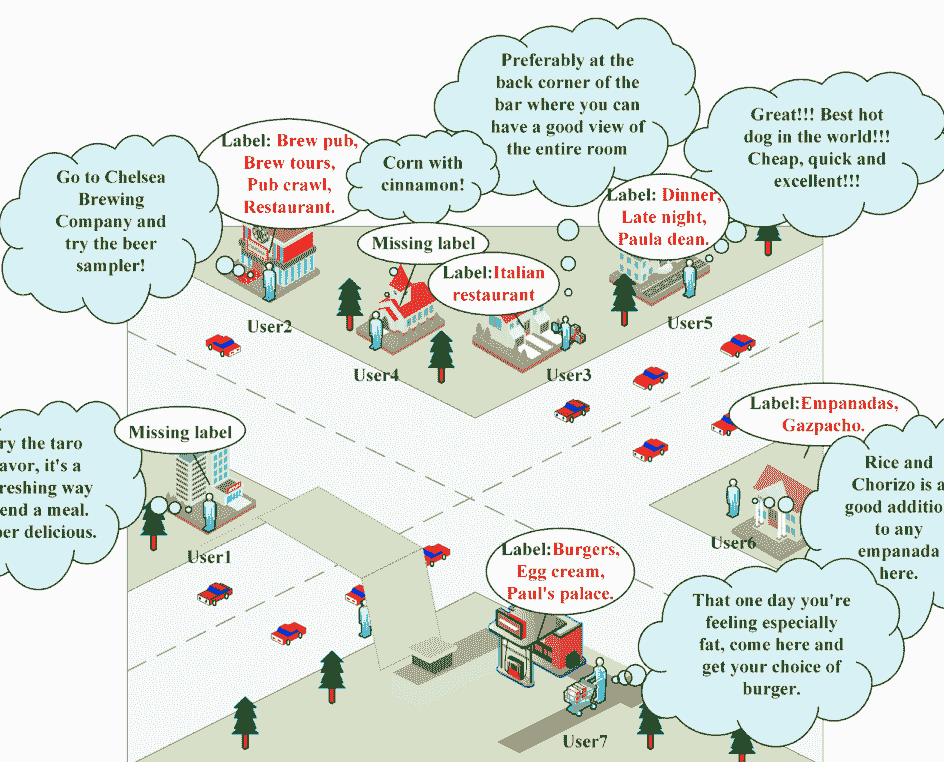
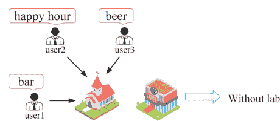
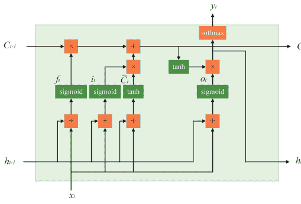
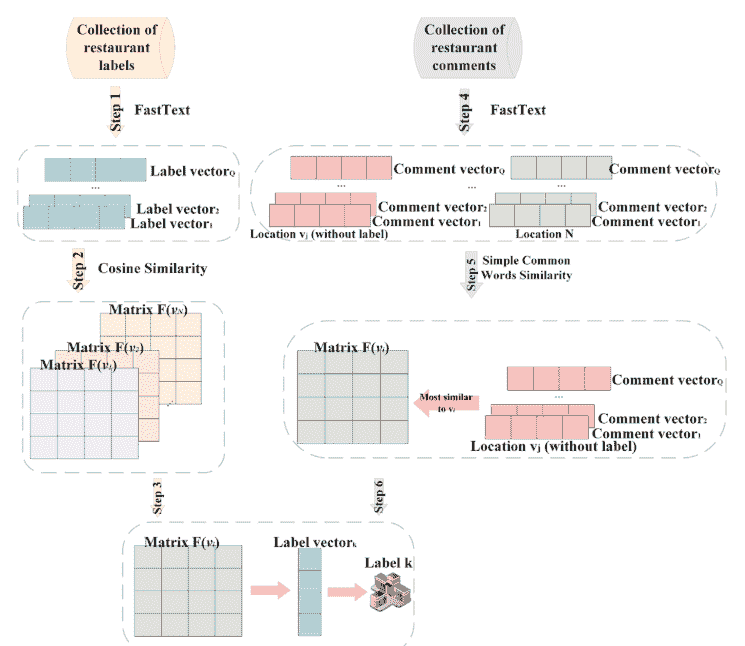
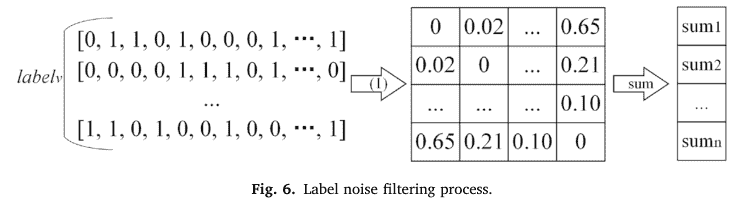
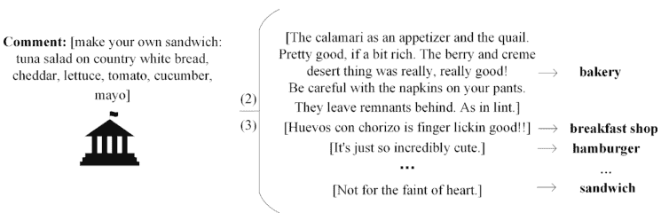

# 基于博弈论的标签噪声过滤与标签缺失补充框架


标注数据广泛应用于各种分类任务。然而，存在一个巨大的挑战，即标签通常是人工添加的。恶意用户添加的错误标签会影响模型的训练效果。标注数据的不可靠性阻碍了研究。为了解决上述问题，我们提出了一种标签噪声过滤与缺失标签补充（LNFS）框架。我们以基于位置的社交网络（LBSN）中的位置标签为例来实现我们的框架。针对标签噪声过滤问题，我们首先使用 FastText 将餐厅的标签转换为向量，然后基于这样一个假设：位置中与所有其他标签最相似的标签最具代表性。我们使用余弦相似度来判断并选择最具代表性的标签。针对标签缺失问题，我们使用简单的常用词相似度来判断用户评论的相似度，然后使用相似餐厅的标签来补充缺失的标签。为了优化模型性能，我们将博弈论引入模型，以模拟恶意用户与模型之间的博弈，提高模型的可靠性。最后，给出了一个案例研究来说明 LNFS 的有效性和可靠性。

## 1. 引言

物联网 [1]、移动众包 [2] 等新技术已在各行各业得到广泛普及和应用，催生了海量数据。此类数据的形成往往离不开人的参与。此类数据蕴含的巨大价值不容小觑。对于许多行业来说，如何利用大数据是赢得市场竞争的关键。随着计算机设备的不断进步，人们已经能够处理大规模数据。然而，由于大部分数据来自网络，其真实性会因人们的恶意行为而降低。例如，在机器学习 [3] 中，一项常见的工作是使用标注数据来训练神经网络用于分类、回归或其他目的 [4]。此时，数据质量将直接影响模型性能。标签通常由人类分配，数据标注任务耗时、费力且昂贵。一些恶意标记行为会导致大量标签噪声。因此，在实际应用中必须考虑噪声标签的影响。我们需要一个能够准确识别标签噪声的模型，以主动消除噪声数据的影响。

目前，人们乐于标记一些热门地点以证明自己去过那里。同时，用户会留下评论并为他们去过的餐厅打上标签，以展示他们有多喜欢这些餐厅，并帮助他人判断餐厅是否符合自己的兴趣。然后，其他用户可以通过搜索不同的标签来找到他们偏好的餐厅。像大众点评 [5] 这样的应用可以实现这一功能。然而，此类标签的质量参差不齐，因为它们是由各种人标记的。一些恶意用户会向地点添加无效标签，导致一些标签准确真实，而另一些则错误或模糊 [6]。因此，一个巨大的挑战是如何为地点选择一个正确的标签，以帮助有真实需求的其他用户进行搜索并过滤掉不准确的噪声标签。我们提出一个标签噪声过滤框架来解决上述问题。

首先，标签是多样的，因为它们是由各种人根据自己的理解来标记的。而且，一些恶意用户会故意向竞争对手添加虚假标签，以损害其他商店的声誉。因此，我们需要一个能够及时识别错误标签并为地点生成正确标签的模型。地点最合适的标签必须涵盖其他通用标签的大部分含义。因此，我们首先假设，地点中与所有其他标签最相似的标签是最具代表性的。其次，由于计算机无法直接处理文本，我们需要采用嵌入方法将标签转换为词向量形式。然后采用适当的标签相似度测量方法来判断每个标签之间的相似度。我们选择与所有其他标签最相似的标签作为地点的唯一标签。为了增强识别能力，我们使用博弈论的思想。我们首先识别唯一标签，然后模拟攻击者，主动向地点增加标签噪声，然后使用模型来识别唯一标签。值得注意的是，虽然有些地方有许多标签，需要过滤标签噪声，但仍有一些地方缺乏标签。对于没有标签的地点，我们考虑地点相似度来进行适当的标签补充。最后，我们为每个地点找到最佳标签，以便数据在实际应用中能发挥最大价值。我们的研究主要贡献如下。

- (1) 我们提出了一种标签噪声过滤和缺失标签补充模型。我们使用 FastText 为所有用户文本标签训练合适的词向量，并使用余弦相似度来计算标签之间的相似度。然后，选择与所有其他标签最相似的标签作为地点的唯一标签，并删除其他标签的噪声。对于没有标签的地点，我们可以通过用户评论找到相似的地点。相似地点的标签用作该地点的标签。

- (2) 为了持续优化我们提出的模型性能，我们将演化博弈论应用于地点标签过滤过程，并讨论了博弈建模的详细仿真场景。

- (3) 我们将我们的演化博弈方法应用于地点标签噪声过滤方案，并进行了案例研究。结果表明，我们的方法可以描述详细的演化过程，并且我们的模型可以实现更好的性能。

本文余部分安排如下。第 2 节介绍与博弈论和标签噪声过滤相关的研究工作。第 3 节介绍我们工作的研究动机。然后，第 4 节介绍本研究涉及的相关知识，第 5 节介绍我们提出的标签噪声过滤方法。最后，第 6 节和第 7 节分别介绍所提方法的案例研究和结论。

## 2. 相关工作

### 2.1. 博弈论

博弈论是现代数学的一个新分支。它是研究具有斗争或竞争现象的数学理论和方法。目前，博弈论与各种应用的结合对社会进步做出了巨大贡献 [7,8]。He 等人 [9] 提出将博弈论引入综合能源系统。它可以解决综合能源系统中能源供应侧、配电网、需求侧以及共同规划和调度等问题。博弈论也用于解决电力系统问题。Abapour 等人 [10] 对博弈论在电力系统中的应用进行了系统总结。此外，为了提高雷达性能，有必要控制发射波形的极化状态。Zhang 等人 [11] 提出了一个寻找最优发射极化的框架。雷达系统的极化问题被转化为雷达与干扰机之间的零和博弈，以提高系统的抗干扰性能。传统博弈论假设所有参与者都是绝对理性的，但在大多数情况下这很难保证。因此，演化博弈论为解决这个问题提供了新思路 [12]。此时，人们不再是绝对理性的参与者，演化博弈开始迅速发展。Lin 等人 [13] 提出使用演化博弈论来研究长期绿色行为。他们充分考虑了价格弹性、市场竞争、绿色投资和绿色相关性，制定了价格决策模型。航运公司可以在减少环境污染的同时最大化利润。然而，演化博弈论尚未应用于地点标签的噪声过滤。这将是优化噪声过滤模型的一个合适策略。

### 2.2. 标签噪声过滤中的问题

带有标签噪声的数据将影响许多任务的性能，例如预测 [14–17]、安全 [18,19] 和隐私保护 [20] [21] [22]。带有标签噪声的数据集对分类器有许多负面影响。目前，已有许多研究致力于减轻标签噪声的负面影响。一些研究侧重于建立鲁棒模型，以在带有标签噪声的数据中获得更好的模型性能 [23,24]。一些研究旨在从数据集中区分标签噪声和真实标签，并为模型训练获得更好的数据集。接下来，本节将介绍标签噪声的研究进展。

标签噪声阻碍了一些采样技术 [25,26]。研究人员在处理不平衡分类任务时，通常使用合成少数类过采样技术（SMOTE）方法。在数据采样过程中，一旦收集的数据包含过多标签噪声，SMOTE 就难以达到预期效果。Chen 等人 [27] 提出了一种自适应鲁棒 SMOTE，它使用相对密度来衡量少量样本的局部密度，然后根据相对密度区分特征，用于标签噪声的不平衡分类。在存在标签噪声的情况下建立模型，Huang 等人 [28] 预测了风力涡轮齿轮箱中滚动轴承的故障。他们面临数据不足和噪声标签过多的问题，并使用了一种由有限数据驱动的改进标签噪声鲁棒辅助分类器生成对抗网络（AC-GAN）。该方法提高了模型在实际运行中的泛化能力，并具有良好的鲁棒性。除了文本标签噪声外，还有图像标签噪声 [29]。从图像中提取信息并为图像打标签是一项困难的任务。例如，从卫星图像中提取建筑物需要大量准确数据来训练深度神经网络，以实现建筑物标签的自动生成。但模型训练需要大量准确数据，图像标签噪声会阻碍模型训练。为应对这一挑战，Zhang 等人 [30] 提出了一个通用标签噪声自适应神经网络框架，用于判断真实标签与噪声标签之间的关系。该框架有助于自动生成图像标签并减少人工标注。此外，Cai 等人 [31] 提出了一种在隐私保护条件下高效上传数据的方法，Qi 等人 [32] 提出了智慧城市场景中的数据融合模型。Zhang 等人 [33] 提出了一种改进的噪声损失修正算法，用于从噪声标签中学习。

至于标签噪声的区分，也有多样的研究。在工业信息学中，数据是高维的、带噪声的且容易被错误标记。Guan 等人 [34] 集成了传统的两步方法，然后提出了一种序列集成噪声过滤器（SENF），为每个特征实例生成噪声比例，从而识别噪声标签。在分类技术方面，通常使用二次判别分析（QDA）。然而，标签噪声和测量噪声会严重损害模型的预测能力。Vrankx 等人 [35] 提出了一种新的实时鲁棒 QDA 方法，将最不典型的观测值视为标签噪声。该方法不仅可以区分




图 1. 多用户动态：示例。

标签噪声，还能实时识别标签噪声。然而，面对复杂的多类分类问题时，上述方法效果较差。为弥补这一不足，Xia 等人 [36] 提出了一种多类分类的标签噪声过滤框架。在多类环境中，采用了多类完全随机森林（mCRF）和多类相对密度的过滤方法。考虑到参数优化，提出了一种使用 2-means 聚类算法的参数优化方法。该框架不仅可以过滤标签噪声，还可以处理多类分类中的数据不平衡问题。此外，Feng 等人 [37] 专门提出了一种标签噪声清洗技术。该技术使用三种不同的分类器（bagging、AdaBoost 和 k-近邻（k-NN））来识别标签噪声。

总而言之，无论是文本标签噪声还是图像标签噪声，标签噪声的研究都会对实际模型应用产生负面影响。目前，标签噪声研究已取得一些进展。然而，在各个行业中，从海量标签中识别标签的准确性仍不够高。此外，不同场景的条件各不相同，很难有一个完美的框架来实现所有场景下的标签噪声过滤 [38]。为应对这一挑战，我们提出了一种文本标签噪声过滤框架。该框架不仅可以过滤冗余的标签噪声，还可以补充缺失的标签。为更详细地介绍我们的框架，我们选择一个位置标签选择场景，详细描述文本标签的噪声过滤框架。



图 2. 标签噪声和标签缺失。

## 3. 动机

在基于位置的社交网络（LBSN）中，用户经常在不同地点签到。例如，用户会标记他们去过的餐厅，并留下关于餐厅的评论。如图 1 所示，用户 1 在一家英国餐厅用餐后发表评论“尝试芋头味，它是结束一餐的清爽方式；超级美味”，而喜欢酒廊酒吧的用户 2 则发表类似“最好在酒吧的后角落，那里可以看到整个房间的美景”的评论。除了对餐厅发表评论外，LBSN 还提供为餐厅添加标签的功能，以方便用户检索。在图 1 中，用户 2 访问的位置有四个标签，而用户 4 访问的位置没有标签。用户可以主动根据自己的想法为餐厅添加标签，因此位置标签是由各种用户主观添加的，可能存在故意添加错误标签的恶意用户。我们以真实应用为例，如图 2 所示，说明噪声标签对模型性能的影响。从图中可以看出，位置 1 有三个不同的标签。如果用户 2 向位置 1 添加错误标签“happy hour”，其他用户根据该错误标签搜索位置 1 时可能不满意。而位置 2 没有用户添加标签。这种情况会导致一些标签准确，而一些标签冗余或不恰当。还有些位置没有被用户标记。这对用户准确搜索位置是严重障碍。目前，关于 LBSN 中位置标签噪声过滤的研究很少。

为解决上述问题，我们提出了一种标签噪声过滤和缺失标签补充框架。（1）我们假设，位置中与所有其他标签最相似的标签是最具代表性的。对于每个具有冗余标签的位置，使用余弦相似度计算每个标签与所有其他标签之间的相似度，然后将相似度之和作为关键词的特征。最后，将所有特征中最大的标签作为位置的标签。（2）对于缺失标签的位置，我们使用用户的评论，通过判断评论的相似度来找到相似位置，然后使用相似位置的标签为该位置分配标签。（3）为优化性能，我们将演化博弈论应用于我们的方案。通过不断增加标签噪声并执行相应的噪声过滤，对所提出的模型进行优化。

## 4. 预备知识

### 4.1. 问题表述

用户 U = {u1, u2, ..., uM} 将访问不同位置 V = {v1, v2, ..., vN} 并发布他们的评论 Cv = {c1, c2, ..., cO} ∈ C。评论通常暗示用户对位置的态度。对于不同位置 vi ∈ V，用户会主动使用 Lv = {l1, l2, ..., lQ} ∈ L 为其打标签。特别是，M、N、O 和 Q 分别指用户、位置、评论和标签的总数。然而，用户对位置的主观打标签导致标签可靠性下降。有些位置标签是准确的，有利于其他用户的检索。与此同时，有些标签是用户随意添加的，这会误导用户的搜索结果。还有些位置没有被任何用户标记，这也不利于被其他用户检索。

**定义 1.** 标签噪声过滤：我们需要为每个位置 vj ∈ V（1 ≤ j ≤ N）选择一个唯一标签，即，对于每个标签 lk ∈ L（1 ≤ k ≤ Q），如果 k ≥ 2，则证明存在噪声。我们需要识别并删除位置标签。

**定义 2.** 标签补充：对于没有标签的位置，即 lk ∈ L（k = 0），我们需要根据位置之间的用户评论找到相似位置，并使用相似位置的标签为没有标签的位置补充标签。

### 4.2. FastText

社交平台上的非正式讨论以自然语言文本的形式积累了大量知识 [39]。例如，文本描述可用于挖掘和创建兼容的混搭 [40]。表示文本的方法有很多种，例如基于 one-hot 编码的术语频率-逆文档频率（TF-IDF）和 TextRank [41]、基于主题模型的潜在语义分析（LSA）和潜在狄里克莱分配（LDA）[42]，以及基于词向量的固定表示，例如 word2vec [43] 和 FastText [44]。One-hot 编码浪费内存，无法捕捉单词之间的关系。LDA 适用于主题建模，并从文本中推断文档的主题主题分布。显然，它需要大量信息来训练文档主题，不适合标记数据。Word2vec 不共享任何



图 3. LSTM 的结构。

参数。每个单词都根据上下文学习。Word2vec 无法处理训练中未遇到的任何单词。例如，word2vec 无法找到具有相同词根的单词之间的联系，例如“eat”和“eaten”。但 FastText 可以处理此类问题。其关键思想是利用单词的内部结构来获取单词的向量表示。当每个位置包含太多标签或缺少标签时，我们需要为位置找到最合适的标签，以便用户可以准确检索它。由于计算机无法直接处理文本信息，我们考虑的第一步是为每个标签训练某个词向量。FastText 是一种用于词向量计算和文本分类的工具，其优势也很明显。在文本分类任务中，FastText 通常可以达到与深度网络相同的准确率，但训练时间比深度网络快得多。

### 4.3. 长短期记忆网络 (LSTM)

长短期记忆网络（LSTM）模型是一种特殊的循环神经网络（RNN）[45]。该模型可以更好地实现记忆和遗忘功能，并能捕捉输入数据之间的长期和短期依赖关系。下图 3 显示了 LSTM 门的结构。LSTM 的计算如下：

$f_i = \sigma(W_f \cdot [h_{t-1}, x_t] + b_f)$ (1)
$i_t = \sigma(W_i \cdot [h_{t-1}, x_t] + b_i)$ (2)
\(\bar{C}_t = \tanh(W_C \cdot [h_{t-1}, x_t] + b_C)\) (3)
$C_t = f_t * C_{t-1} + i_t * \bar{C}_t$ (4)
$o_t = \sigma(W_o[h_{t-1}, x_t] + b_o)$ (5)
$h_t = o_t * \tanh(C_t)$ (6)

## 5. 标签噪声过滤和缺失标签补充框架：LNFS

本节将详细介绍我们提出的标签噪声过滤和缺失标签补充框架的实现过程。

### 5.1. 训练标签的词向量

由于我们的模型无法直接处理文本类型的标签数据，我们需要做的第一步是将文本类型的标签转换为向量。目前，表示词向量的方法有很多种，例如 one-hot 编码。然而，这种方法需要高维




图 4. 我们 LNFS 的技术架构。

在单词过多的情况下，会减慢我们模型的巡逻速度 [46]。此外，由一热编码方法训练的词向量彼此不相关，因此我们在此框架中不使用一热编码。FastText 用于训练标签的词向量。使用 FastText 有几个优点。首先，FastText 训练速度快，且能达到与神经网络相同的训练结果。其次，由 FastText 训练的词向量彼此相关，相似单词的词向量通常更相似。第三，FastText 添加了 n-gram 特征，可用于字符级训练。例如，在“apple”和“apples”的情况下，其他词嵌入方法无法找到两个单词之间的关系，但 FastText 可以做得很好。

### 5.2. 标签噪声过滤

有些位置是由用户随机标记的，或由恶意用户故意标记的，这些不可靠的标签会对地点的声誉产生不良影响。因此，我们提出如下假设：

| | 标签 1 | 标签 2 | 标签 3 | 标签 4 | 总和 |
|---|---|---|---|---|---|
| 标签 1 | 0 | 0.27 | 0.09 | 0.092 | 0.452 |
| 标签 2 | 0.27 | 0 | 0.03 | 0.04 | 0.34 |
| 标签 3 | 0.09 | 0.03 | 0 | 0.97 | 1.09 |
| 标签 4 | 0.092 | 0.04 | 0.97 | 0 | 1.102 |

图 5. 用于噪声过滤的包含四个标签的位置示例。

与该位置所有其他标签最相似的标签最具代表性。许多用户已为该站点添加了标签，因此最合适的标签通常是公众舆论的集合。选择唯一标签也是为了尽可能准确地表示位置。在后续的用户兴趣挖掘中，唯一标签可用作用户的兴趣。当保留多个标签时，可能存在一些重复标签，或者存在一些与位置不太匹配的标签。这会导致信息冗余。但这并不意味着选择多个标签是不合理的。带有多个标签的位置更容易被搜索到。因此，可以根据不同场景保留不同数量的标签。在我们的研究场景中，与站点所有其他标签最相似的标签被选为唯一标签。接下来，以特定位置及其标签为例介绍我们的方法。假设一个地方包含四个标签。首先，我们提取四个标签的词向量。然后，我们使用余弦相似度 [47] 计算四个标签之间的相似度。余弦相似度的计算公式如 (7) 和 (8) 所示。

\(F(v_i) = \frac{\vec{x} \cdot \vec{y}}{|\vec{x}||\vec{y}|}\) (7)

\(\cos \theta = \frac{\sum_{i=1}^n (x_i y_i)}{\sqrt{\sum_{i=1}^n (x_i)^2} \sqrt{\sum_{i=1}^n (y_i)^2}}\) (8)

其中 \(\vec{x}\) 表示目标标签向量，\(x_i\) 表示向量元素。\(\vec{y}\) 表示位置的其他标签向量，\(y_i\) 表示向量元素。此外，我们得到位置的相似度矩阵，将每个标签与其他标签之间的相似度之和作为标签的特征，并得到位置的特征向量。其中，特征值最大的标签与其他位置最相似，该标签被选为位置的唯一标签。该过程如图 4 步骤 1–3 所示。首先，我们通过 FastText 获取标签向量，然后使用余弦相似度计算每个位置中所有标签向量的特征值。最后，选择特征值最大的标签。如图 5 所示，一个位置有四个标签。使用余弦相似度获得标签之间的相似度后，得到相似度矩阵。通过对每个位置的相似度矩阵求和，我们得到四个标签的特征值。可以看出，标签 4 的特征值最大，因此我们选择标签 4 作为位置的标签。此外，具体实验过程如算法 1 所示。

```
**Algorithm 1 Label noise filtering**
Require: Locations V and their labels L
Ensure: Unique label {l_k} for each location v
//Select a location with labels >= 3
1: V_f = Ø
2: for each location v in V do
3:   if L_v = {l_1, l_2, .. l_Q}, Q >= 3 then
4:     Add v in V_f
5:   end if
6: end for
// Establishing similarity matrix
7: Training label vectors with FastText
8: for each location v in V_f do
9:     Calculate F(v) by (7)
10:    Sum each line vl_i of F(v)
11:    Find the max vl_i
12: end for
13: return label {l_k}
```

然而，标签噪声过滤模型需要优化。LBSN 中的位置不断接收用户添加的标签，包括恶意用户添加的错误标签。因此，为了使我们的模型具有更好的噪声识别能力，我们模拟一组用户添加标签。用户包括普通用户和攻击者。普通用户添加正常标签，攻击者添加错误标签。模型再次用于识别标签噪声。通过多次博弈，模型可以实现模型优化的目的。

### 5.3. 缺失标签补充

在 LBSN 中，许多位置仍未被用户标记。这些位置可能很少有人造访，也可能是新建的，或者用户太不愿意添加标签。无论如何，缺乏标签会使其他用户难以搜索这些餐厅，这不利于餐厅的发展。虽然这些餐厅缺乏标签，但它们收集了用户的评论。由于用户留下评论的餐厅通常具有相同类型的位置，我们提出的方法是通过判断与其相似的已标记位置，为该位置添加一个标签。该过程如图 4 步骤 4-6 所示。这涉及如何判断用户评论之间的相似度。由于用户评论数量庞大，我们选择了一种更复杂的方法，但这种方法耗时且耗费人力。因此，我们选择简单的共同词相似度方法。直观地，我们首先统计被比较的两个位置的字符总数，然后统计关于位置的共同词的字符总数，最后用共同词除以最长文档的字符数来得到相似度度量值。

假设对于位置 A = {c_1, c_2, ..., c_Q} ∈ C 没有标签，我们将其与其他带有唯一标签的位置进行比较以找到相似位置。假设存在位置 B = {c_1, c_2, ..., c_P} ∈ C，则位置 A 和 B 的文本相似度由以下公式 (9) 和 (10) 计算。

```
S(v_{ij}) = \frac{A \cap B}{Q} (Q \ge P) (9)
```

```
S(v_{ij}) = \frac{A \cap B}{P} (Q < P) (10)
```

其中 A 表示关于位置 A 的评论词，B 表示关于位置 B 的词，Q 表示关于位置 A 的词的总数，P 表示关于位置 B 的词的总数。通过判断不同位置评论之间的相似度，我们可以找到与没有标签的位置相似的位置的标签，然后将该标签添加到该位置。此外，具体实验过程如算法 2 所示。

```
**Algorithm 2 Missing label supplement**
Require: Users U, locations V, labels L and comments C
Ensure: Unique label {l_k2} for every missing location v
//Select a location without label
1: V_s = Ø
2: for each location v in V do
3:   if L_v = Ø then
4:     Add v in V_s
5:   end if
6: end for
//Finding similar locations
7: Training label vectors with FastText
8: for each location v in V_s do
9:     for each comments c in C do
10:    Calculate S(v_ij) by (9) (10)
11:    l_v = l_v + sim_v
12:   end for
13: end for
14: return label {l_k2}
```

最后，我们总结所提出的标签噪声过滤和缺失标签补充框架。对于只有一个标签的位置，我们默认该标签是位置的唯一标签。对于三个或更多标签的位置，我们假设与位置其他标签最相似的标签最具代表性，然后我们使用余弦相似度计算每个位置的相似度矩阵，并求和每个标签的特征值。特征值最大的标签被作为位置的唯一标签。对于缺失标签的位置，我们使用简单的共同词相似度方法找到带有唯一标签的相似位置，并将其标签作为该位置的标签。特别是，上述解决方案不能用于两个标签的位置。因此，我们首先根据共同词相似度方法找到一个相似位置。此时，该位置有三个标签，最后根据标签噪声过滤方法确定唯一标签。

### 5.4. 位置标签的应用

为每个位置选择合适的标签后，我们需要证明 LNFS 框架的性能。由于位置标签由网络用户添加，位置标签没有固定标准。无法将过滤噪声后的标签与标准位置标签进行比较。我们可以从应用角度衡量我们方法的实用性。我们首先选择用户会签到的 LBSN 位置相关场景。因此，能够预测用户可能下一步造访的位置并及时向用户推荐，对智慧城市产业的发展非常有帮助 [48,49]。但仅根据特定位置来查找用户的签到偏好非常困难。因此，我们选择位置标签作为用户偏好来预测用户签到行为。
我们输入已执行标签的用户的签到信息


#### 表 1
用户签到数据。

| 用户 | 位置 |
|---|---|
| 35 443 | 899 |
| 24 973 | 42 406 |
| 14 860 | 177 |
| ... | ... |
| 133 970 | 41 096 |

#### 表 2
位置-标签数据。

| 位置 | 标签 |
|---|---|
| 15 | |
| 20 | 面包店,酒吧,烧烤,bbq,小酒馆,精品店,bravo,brawny,名人叹息,哥伦比亚咖啡,纸杯蛋糕,鱼卷,烤玉米,久等,猪肉,米饭和豆子 |
| 25 | ... |
| 558 276 | 甜甜圈店 |

#### 表 3
标签：向量化实现。

| 标签 | 向量 |
|---|---|
| 面包店 | [0, 0, 1, 0, 1, 1, 1, 0, 1, 0, 1, 1] |
| bbq | [1, 0, 0, 0, 0, 0, 1, 1, 1, 0, 0] |
| 烧烤 | [1, 1, 0, 1, 0, 1, 1, 1, 0, 0, 0] |
| ... | ... |
| 133 970 | [1, 0, 0, 0, 0, 0, 1, 1, 1, 0, 0] |

将噪声过滤和缺失标签补充按时间序列输入 LSTM 进行训练，以便预测用户可能下次访问的标签类别。然后，将未执行标签噪声过滤和缺失标签补充的用户签到信息输入 LSTM 模型进行训练，并预测用户可能下次访问的标签类别。通过比较这两个 LSTM 模型的性能，我们可以充分证明我们提出的 LNFS 框架的优势。

### 5.5. 案例研究

在本节中，我们使用特定的案例研究来演示 LNFS 框架的可靠性。

#### 5.5.1. 步骤 1：嵌入

位置的标签数据被处理为词向量。我们使用的数据包括表 1 中显示的用户-位置数据对，每个数据对表示用户在某个位置签到过一次。用户会在签到位置留下评论。位置-标签数据显示在表 2 中，表示每个位置收到的所有用户添加的标签。我们通过 FastText 将所有标签信息转换为 300 维向量以供后续处理，如表 3 所示。

#### 5.5.2. 步骤 2：标签噪声过滤

对于拥有超过 3 个标签的位置 $v_t$，我们需要选择最具代表性的标签。因此，我们使用 (1) 来查找 $v_t$ 所有标签向量之间的相似度。可以得到 $v_t$ 的相似度矩阵。然后，将相似度矩阵的每一行相加以得到每个标签的特征值，特征值最大的标签即为 $v_t$ 的唯一标签。最后，图 6 显示了标签噪声过滤过程。然后，攻击者添加恶意标签，LNFS 模型执行标签噪声过滤。模型与攻击者之间的博弈优化了模型的性能。

#### 5.5.3. 步骤 3：缺失标签补充

每个位置都包含用户留下的评论。对于没有标签的位置 $v_t$，我们通过判断评论的相似度来找到一个相似位置，并使用相似位置的标签来补充没有标签的位置。此外，对于拥有两个标签的位置，两个标签之间的相似度相同，因此无法通过计算特征值来找到唯一标签。我们首先使用评论的相似度来找到相似位置的一个标签，然后使用标签过滤方法来选择唯一标签。最后，图 7 显示了缺失标签补充过程。

#### 5.5.4. 步骤 4：用户签到位置预测

通过前面的步骤 1-3，我们已经能够为每个位置选择一个唯一标签。我们需要验证我们提出的 LNFS 框架的性能。由于标签是由不同人员添加的，没有统一标准能直接证明我们框架的性能。





##### 表 4 预测标签与实际标签的比较。

| 用户 | 预测标签 | 实际标签 | 过滤后准确率 |
|---|---|---|---|
| 1 | 咖啡, 烧烤, 酒吧, 咖啡 | 咖啡, 烧烤, 酒吧, 咖啡 | 75% |
| 2 | 小酒馆, 早午餐, 素食友好, 啤酒 | 大学, 早午餐, 汉堡, 啤酒 | 50% |
| 3 | crunk, 鸡肉, 素食, 汉堡 | crunk, 红茶, 球, 热狗 | 25% |
| ... | ... | ... | ... |
| 133 970 | 私人用餐, 面包店, 啤酒, 汤 | 唱片店, 啤酒, 西班牙饭, 面包店 | 50% |

| 用户 | 预测标签 | 实际标签 | 过滤前准确率 |
|---|---|---|---|
| 1 | 烧烤, 闹鬼的, 早午餐, 啤酒 | 咖啡, 烧烤, 披萨, 咖啡 | 0% |
| 2 | 咖啡, 餐馆, 素食友好, 法式 | 大学, 早午餐, 汉堡, 烧烤 | 0% |
| 3 | 煎饼, 男孩, 冰淇淋, 球 | 红茶, 艺术画廊, 球, 热狗 | 25% |
| ... | ... | ... | ... |
| 133 970 | 曲奇, 小吃, 舒适, 墨西哥卷饼 | 唱片店, 啤酒, 西班牙饭, 面包店 | 0% |

为应对这一挑战，我们使用一个特定的应用：将噪声过滤前后的数据输入 LSTM 模型进行训练，然后使用训练好的模型预测用户的签到行为，并预测他们可能下次访问的地点的标签。模型的预测结果显示在表 4 中。案例研究也证明了我们的 LNFS 框架是有效且可靠的。

## 6. 结论

旨在解决基于位置的社交网络（LBSN）中不可靠标签的问题，我们提出了一种标签噪声过滤和缺失标签补充框架。为解决标签噪声过滤问题，我们首先使用 FastText 将餐厅的标签转换为向量形式，然后使用余弦相似度来获取与该位置其他标签最相似的标签。为解决标签缺失问题，我们使用简单的共同词相似度来判断用户评论的相似度，然后使用相似餐厅的标签来补充缺失的标签。为了提高模型的可靠性并保护位置声誉免受恶意标签影响，使用博弈论来模拟恶意用户添加错误标签，并不断使用 LNFS 模型来识别标签噪声。最后，我们应用案例研究来证明我们方法的有效性和可靠性。

在未来工作中，我们将把这项研究应用于兴趣点推荐。根据位置的唯一标签，可以挖掘用户对位置的兴趣偏好。然后我们可以向用户推荐有趣的位置。

## 利益冲突声明

我们声明，关于投稿不存在利益冲突，且该手稿未提交给其他期刊或会议审考。

## 致谢

该研究得到中国国家自然科学基金（编号：61872219）和山东省自然科学基金（ZR2019MF001）的支持。

## 参考文献

- [1] Z. Cai, Z. He, 大型 I/O 数据上的私有范围计数交易，在：2019 年 IEEE 第 39 届分布式计算系统国际会议，2019，第 144–153 页。
- [2] Y. Wang, Y. Gao, Y. Li, X. Tong, 优化平台中心移动众包系统的工人选择激励机制，计算机网络。(2020) 107144。
- [3] H. Huang, J. Lin, L. Wu, B. Fang, Z. Wen, F. Sun, 基于机器学习的软机器人手多模态信息感知，清华科学技术。25 (2) (2020) 255–269。
- [4] Z. He, M. Yang, H. Liu, L. Wang, 带标签相关性的校准多标签分类，神经处理快讯。50 (2) (2019) 1361–1380。
- [5] F. Wei, M. Choi, X. Shang, 大众点评企业文化研究，国际先进文化技术杂志。7 (4) (2019) 69–75。
- [6] N. Bhardwaj, P. Sharma, 使用模糊软集的高级不确定性度量：应用于决策问题，大数据挖掘与分析。4 (2) (2021) 94–103。
- [7] C. Esposito, O. Tamburis, X. Su, C. Choi, 使用博弈论的物联网强健去中心化信任管理，信息处理与管理。57 (6) (2020) 102308。
- [8] V. Hassija, V. Chamola, G. Han, J.J. Rodrigues, M. Guizani, Dagiov：一种使用有向无环图和博弈论的车辆到车辆通信框架，IEEE 电子技术汇刊。69 (4) (2020) 4182–4191。
- [9] J. He, Y. Li, H. Li, T. Zong, Y. Yang, W. Huang, 博弈论在集成能源系统中的应用：综述，IEEE 访问。8 (2020) 93380–93397。
- [10] S. Abapour, M. Nazari-Heris, B. Mohamadi-Ivatloo, M.T. Hagh, 解决电力系统问题的博弈论方法：全面综述，工程计算机方法档案。27 (1) (2020) 81–103。
- [11] X. Zhang, H. Ma, J. Wang, S. Zhou, H. Liu, 极化 MIMO 雷达中欺骗性干扰抑制的博弈论设计，IEEE 访问。7 (2019) 114191–114202。
- [12] C. Adami, J. Schossau, A. Hintze, 进化博弈论中基于代理仿真的合理有效性，物理生命评论。doi:10.1016/j.plrev.2016.11.005。
- [13] D.Y. Lin, C.J. Yuan, M. Ng, 使用进化博弈论评估海运班轮运输中的绿色策略，洁净生产杂志。279 (2021) 123268。
- [14] Y. Liu, F. Wang, Y. Wang, X. Zhang, H. Wang, H. Dai, L. Qi, 用于下一 POI 推荐的基于注意力的类别感知 GRU 模型，国际智能系统杂志。doi: 10.1002/int.22412。
- [15] X. Chen, Z. Yuan, Z. Cui, D. Zhang, X. Ju, 基于过滤的排名特征选择对安全漏洞预测影响的实证研究，IET 软件。15 (1) (2021) 75–89。
- [16] F. Wang, H. Zhu, G. Srivastava, S. Li, M. R. Khosravi, L. Qi, 带用户-项目-信任记录的强健协同过滤推荐，IEEE 计算社会系统汇刊。doi:10.1109/TCSS.2021.3064213。
- [17] R. Kumari, S. Kumar, R.C. Poonia, V. Singh, L. Raja, V. Bhatnagar, P. Agarwal, 印度 COVID-19 引起的传播、康复和死亡分析与预测，大数据挖掘与分析。4 (2) (2021) 65–75。
- [18] Z. Cai, Z. He, X. Guan, Y. Li, 用于防止社交网络中敏感信息推断攻击的集体数据净化，IEEE 可靠与安全计算汇刊。15 (4) (2016) 577–590。
- [19] X. Chen, Y. Zhao, Z. Cui, G. Meng, Y. Liu, Z. Wang, 感知工作量的安全漏洞预测方法的大规模实证研究，IEEE 可靠性汇刊。69 (1) (2019) 70–87。
- [20] H. Kou, H. Liu, Y. Duan, W. Gong, Y. Xu, X. Xu, L. Qi, 通过隐私感知链接预测过程在签名社交服务网络上构建信任/不信任关系，应用软计算。100 (2020) 106942。
- [21] Z. Sun, Y. Wang, Z. Cai, T. Liu, X. Tong, N. Jiang, 基于区块链的移动众包两阶段隐私保护机制，国际智能系统杂志。doi: 10.1002/int.22371。
- [22] Y. Khazbak, J. Fan, S. Zhu, G. Cao, 网约车服务中的个性化位置隐私保护，清华科学技术。25 (6) (2020) 743–757。
- [23] J. Bootkrajang, 存在标注错误时的分类广义标签噪声模型，神经计算。192 (2016) 61–71。
- [24] A. Cappozzo, F. Greselin, T.B. Murphy, 基于修剪和约束的模型分类强健方法，高级数据分析与分类。(2019) 1–28。
- [25] T. Liu, D. Tao, 通过重要性重加权进行带噪声标签的分类，IEEE 模式分析与机器智能汇刊。38 (3) (2015) 447–461。
- [26] Z. Zhao, L. Chu, D. Tao, J. Pei, 带标签噪声的分类：马尔可夫链采样框架，数据挖掘与知识发现。33 (5) (2019) 1468–1504。
- [27] B. Chen, S. Xia, Z. Chen, B. Wang, G. Wang, Rsmote：一种用于带标签噪声的不平衡问题的自适应强健 SMOTE，信息科学。553 (2021) 397–428。
- [28] N. Huang, Q. Chen, G. Cai, D. Xu, L. Zhang, W. Zhao, 基于有限带噪声数据的风力涡轮齿轮箱轴承在实际运行条件下的故障诊断，IEEE 仪器与测量汇刊。70 (2020) 1–10。
- [29] K.H. Lee, X. He, L. Zhang, L. Yang, CleanNet：用于带标签噪声的可扩展图像分类器训练的迁移学习，在：IEEE 计算机视觉与模式识别会议论文集，2018，第 5447–5456 页。
- [30] Z. Zhang, W. Guo, M. Li, W. Yu, 带标签噪声自适应全卷积神经网络的 GIS 监督建筑物提取，IEEE 地球科学与遥感快报。17 (12) (2020) 2135–2139。
- [31] Z. Cai, X. Zheng, 智能网络-物理系统中数据上传的私有高效机制，IEEE 网络科学与工程汇刊。7 (2) (2018) 766–775。
- [32] L. Qi, C. Hu, X. Zhang, M.R. Khosravi, S. Sharma, S. Pang, T. Wang, 面向智能城市工业环境的时空上下文隐私感知数据融合与预测，IEEE 工业信息汇刊。17 (6) (2021) 4159–4167。
- [33] Q. Zhang, F. Lee, Y.g. Wang, R. Miao, L. Chen, Q. Chen, 用于从带噪声标签学习的改进噪声损失修正算法，视觉通信与图像表征杂志。72 (2020) 102930。


- [34] D. Guan, K. Chen, G. Han, S. Huang, W. Yuan, M. Guizani, L. Shu, 工业信息学高维数据的新型类噪声检测方法, IEEE Trans. Ind. Inf. 17 (3) (2020) 2181–2190.

- [35] I. Vranckx, J. Raymaekers, B. DeKetelaere, P.J. Rousseeuw, M. Hubert, 存在标签和测量噪声时的实时判别分析, Chemometr. Intell. Lab. Syst. 208 (2021) 104197.

- [36] S. Xia, B. Chen, G. Wang, Y. Zheng, X. Gao, E. Giem, Z. Chen, Mcfr 和 MRD：基于新型多类标签噪声过滤学习框架的两种分类方法, IEEE Trans. Neural Networks Learn. Syst. doi:10.1109/TNNLS.2020.3047046.

- [37] W. Feng, Y. Quan, G. Dauphin, 基于噪声检测度量的自适应集成方法的标签噪声清洗, Sensors 20 (23) (2020) 6718.

- [38] G. Patrini, A. Rozza, A. Krishna Menon, R. Nock, L. Qu, 使深度神经网络对标签噪声具有鲁棒性：一种损失修正方法, in: Proceedings of the IEEE Conference on Computer Vision and Pattern Recognition, 2017, pp. 1944–1952.

- [39] X. Chen, C. Chen, D. Zhang, Z. Xing, Sethosaurus：软件工程中的 WordNet, IEEE Trans. Software Eng. doi:10.1109/TSE.2019.2940439.

- [40] L. Qi, H. Song, X. Zhang, G. Srivastava, X. Xu, S. Yu, 基于文本描述挖掘的兼容性感知 Web API 推荐，用于混搭创建, ACM Trans. Multimed. Comput. Commun. Appl. doi:10.1145/3417293.

- [41] L. Yao, Z. Pengzhou, Z. Chi, 基于 TF-IDF 和 TextRank 的新闻关键词提取技术研究, in: 2019 IEEE/ACIS 18th International Conference on Computer and Information Science, IEEE, 2019, pp. 452–455.

- [42] S. Bergamaschi, L. Po, 基于内容的电影推荐系统中 LDA 和 LSA 主题模型比较, in: International Conference on Web Information Systems and Technologies, Springer, 2014, pp. 247–263.

- [43] M. Maimaiti, Y. Liu, H. Luan, M. Sun, 利用预训练词典嵌入丰富低资源神经机器翻译的迁移学习, Tsinghua Sci. Technol. doi:10.26599/TST.2020.9010029.

- [44] J. Choi, S. Lee, 利用子词逆文档频率改进 FastText, Pattern Recogn. Lett. 133 (2020) 165–172.

- [45] M. Khan, H. Wang, A. Riaz, A. Eltaiyani, S. Karim, 基于双向 LSTM-RNN 的单变量时间序列分类混合深度学习框架, J. Supercomput. 77 (7) (2021) 7021–7045.

- [46] P. Rodriguez, M.A. Bautista, J. Gonzalez, S. Escalera, 超越独热编码：低维目标嵌入, Image Vis Comput. 75 (2018) 21–31.

- [47] K. Park, J.S. Hong, W. Kim, 结合余弦相似度与分类器的文本分类方法论, Appl. Artif. Intell. 34 (5) (2020) 396–411.

- [48] J. Mabrouki, M. Azrour, D. Dhiba, Y. Farhaoui, S.E. Hajjaji, 基于 Arduino 无线传感器网络的远程图形应用和警报天气监测 IoT 数据记录仪, Big Data Min. Anal. 4 (1) (2021) 25–32.

- [49] Y. Jin, W. Guo, Y. Zhang, 面向服务的时间感知动态服务质量预测方法, Tsinghua Sci. Technol. 25 (2) (2020) 227–238.
