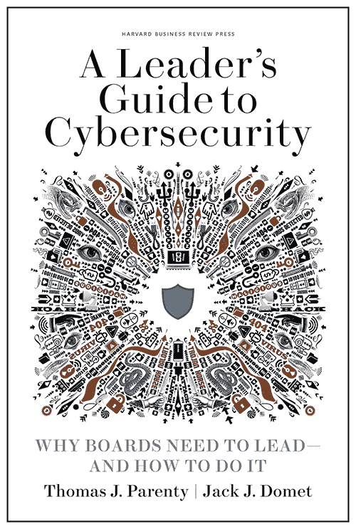
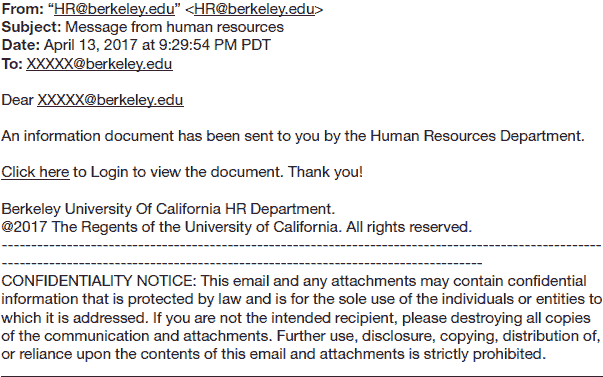

# 领导者网络安全指南：董事会为何需要领导以及如何实施

致 哥白尼

- 致谢
- 作者简介

# 引言

# 数字管理

在过去的十年里，随着世界变得数字化，公司、政府和组织在网络安全上投入了大量资金。然而，随着投入的增加，网络攻击的后果也随之增长。打开任何地方的报纸，你可能发现一个具有毁灭性后果的网络攻击故事。近期案例包括 2016 年孟加拉国银行（该国中央银行）的网络劫案，导致了 8100 万美元的损失——这是该国外汇储备的一部分。¹2017 年，“影子经纪人”（Shadow Brokers）一个名副其实的个人或组织盗取了国家安全局（NSA）开发的工具。²被盗工具中包含名为`EternalBlue`的工具，黑客随后将其用于 WannaCry 攻击，该攻击影响了 150 个国家的 23 万多台计算机系统，估计损失达 40 亿美元。³2018 年，万豪酒店宣布其星辰酒店预订系统遭到破坏，泄露了 5 亿名客人的个人和财务信息；印度的国家身份数据库`Aadhaar`（英文：Foundation）遭到黑客，泄露了该国几乎所有 11 亿公民的个人、财务和生物识别信息。⁴

显然，情况需要改变。

根据我们与全球客户咨询的经验，网络安全投入的数十亿资金至今未产生实质作用，核心原因在于，网络安全的关注焦点一直是并将继续集中在技术——主要是计算机和基础设施及其漏洞，而不是对公司运营和战略方向的业务风险。

诚然，技术一直处于中心是有其历史和逻辑上的原因。计算机科学家最早关注网络安全。他们关注的是攻击和防御的具体细节，以及如何构建运行计算机的操作系统的内核（`kernel`）以抵御攻击。当然，没有数字技术就不会有网络风险，网络安全技术及其周围的活动也是至关重要的。

此外，网络安全技术的专业性以及描述其时使用的充满术语的语言，意味着非技术利益相关者（包括董事会）在讨论如何保护公司免受网络威胁时，没有实质性的话语权。当对网络风险的讨论开始于保护为公司创造最大价值的当前及战略活动时，这种情况就会发生变化。这种方法上的微小改变使你和其他董事成员处于监督网络风险管理的正确位置。

只有从关键业务活动（而非网络安全技术）开始，贵公司才知道应该购买哪些网络安全产品以及开展哪些活动。对技术的狭隘关注还会分散人们对非技术动态的注意力，而这些动态对技术性网络安全产品有效性的影响，远大于其功能本身的复杂程度。这些动态包括维护和使用网络安全产品、或在公司网络防御中发挥作用的个人的的动机、激励措施和优先级。例如，我们遇到过许多情况，员工刻意绕过网络安全控制，因为这些控制干扰了他们的首要任务——完成工作。在其他情况下，我们看到网络安全人员因为额外的工作和压力（如果高水平防护会导致误报或干扰业务运营的某个方面）而降低了网络安全产品的保护级别。网络安全部门的有效性受其在公司结构中位置的影响。如果母组织的负责人有不同的优先级，网络安全部门可能无法获得所需的资金和关注度。

如果贵公司想要实质性地提高其网络防御，它需要正确的催化剂——你和你的董事成员。我们认为网络安全从根本上是一个治理问题，并将公司治理视为公司应对其网络安全需求最有效的方法。

网络安全治理始于顶层，即董事会的监督和执行层管理方向的设定。从这里开始，它流向组织的其余部分，涉及到责任的转变和重点的转移。对网络安全和网络风险管理的最终责任从技术专家转移到企业领导层。重点从网络安全技术转向业务、其运营、战略和重大赌注——以及网络攻击可能中断或摧毁这些内容所带来的业务风险。

由于你代表了贵公司所有者的信托利益，并被赋予了公司健康、盈利和增长的长期视角职责，你有权发起对整体网络安全战略和网络防御的改进。你可以在市场力量失灵且政府法规无法提供帮助时介入。

## 数字管治 (Digital Stewardship)

许多董事告诉我们，网络安全令人生畏，甚至让人无所措。他们感觉自己是在没有可靠数据的情况下做出投资决策，并且并不完全网络网络技术的能力。此外，许多人认为学习曲线太陡。另一些人说，他们不知道关于网络安全和网络风险应该问什么问题——或者什么才算好答案。通常，他们只能依靠网络安全或 IT 管理层提供的泛泛而谈，诸如“我们这儿没问题，但那边还需要改进”。精通技术的管理层可能涵盖了网络安全工作，但疑虑仍然存在，即他们可能并未完全到位。

情况绝非如此。你只需通过履行你的治理和监督职责即可做出改进。网络安全监督在概念上类似于物理学中的“观察者效应”，即对事件的观察会改变其结果。你对信息的请求会激励贵公司关注相关动态，并进行其原本不会做的必要分析。

你对网络安全责任的承担不必是一项艰巨负担。尽管普遍认为网络安全复杂且不可逾越，但我们的经验表明，其治理和监督不需要广泛的技术背景。虽然加强对网络安全问题的理解无疑很重要，但你不需要深入理解网络安全来领导你的公司。追求正式的网络安全教育收益有限，且耗时且切实际。在董事会活动的自然过程中，你将获得对网络安全问题所需的熟悉。

为了帮助你，我们开发了一个名为“数字管治”的框架，它包含四个原则、三项责任和一系列备忘录（aide-mémoires）。原则提供了简洁的参考点，指导你进行网络安全审议和决策。三项责任涉及贵公司最重要的网络安全任务，并为你提供了监督的基础。备忘录包含一系列你可以立即使用的询问，以指导你对这些责任的监督。通过采用数字管治框架，你将知道如何成为网络安全领导者，你应该要求公司什么，以及如何理解和解读它为你提供的信息。

# 原则

- `如果你不理解，就是他们没有解释清楚。` 公司内部的网络安全管理和人员`负责为`其董事会提供非专业人士也能理解的材料和简报。
- `业务正面临风险。` 所有与网络安全和网络风险相关的讨论和行动都始于并结束于业务及其运营和战略方向的风险，而不是于计算机及其漏洞。
- `让网络安全主流化。` 在公司组织和活动中，将网络安全从孤立的职能中抽出来，并将其纳入主流运营中。
- `激发动机。` 理解并统一员工和部门的利益与动机，以激励导致实现网络安全目标的行为。

### 责任

# 管理网络风险

最主要的网络安全责任是网络风险的管理。所有其他责任都支持网络风险管理，并取决于对网络事件的业务影响的清晰理解。有效管理网络风险要求你清楚理解公司面临的最重大业务风险、可能导致这些风险的网络攻击类型，以及防止或尽量减少其影响的缓解控制措施之间的关系。确保控制的有效性包括识别并考虑到那些可能抵消最强大技术的非技术动态。

#### 巩固公司

公司可以通过利用组织结构、流程和文化的工具，同时考虑到员工的动机和激励措施，大幅提高其网络安全活动的整体有效性。发现新网络风险的过程将回答问题：“我们现在有多安全？”以及“我们未来会有多安全？”网络安全部门的设置以及对董事需要的（和不需要的）专业知识的理解，可以提高两者的有效性。此外，对责任制的思维转变可以释放对于明智董事和执行层决策至关重要的价值信息。

#### 在危机中领导

虽然公司不应忽视预防性和防御措施，但它需要为应对由网络攻击引发的危机做好准备。这种准备工作涉及两个不同但相关的领域进行先前的规划、准备和协调。首先，公司需要具备识别和响应网络攻击的能力，这包括一支技能熟练的网络响应团队以及他们应该遵循的程序。其次，执行团队必须准备好在网络危机期间领导公司，这包括如何处理他们将面临的局面以及在危机期间将做出哪些决策。通过利用在网络风险缓解过程中已经开发的信息和材料，执行人员可以在网络危机发生前考虑好他们的行动方案。

书中的每份备忘录都包含四个部分。第一部分是与你公司网络安全责任的一个方面相关的提问。我们起草了这些提问，以便你可以直接按照书面内容使用。第二部分从公司网络防御和网络风险管理活动的角度，对提问给出了简要的理由。下一部分提供了回答提问的证据类型的示例和描述。最后一部分描述了你为了履行与该提问相关的监督职责而应该采取的行动。使用备忘录并不要求你具备任何先前的网络安全或技术经验。此外，这些备忘录实际上是你公司管理网络安全和网络风险的关键绩效指标。

我们编写这本书专门为了向你——一位董事会成员——提供建议和帮助，以履行你的网络安全治理监督职责。由于履行这些职责需要你公司的投入和行动，我们为执行领导层和网络安全管理提供了指导，既涉及他们公司的网络保护，也涉及履行他们对你及董事会的职责。虽然本书专门针对公司董事会，但我们在这里提供的原则和实践指导也适用于其他类型的组织，包括政府机构和非营利组织。

本书分为四个大部分，每一部分都有助于你从董事会监督职责的背景理解网络安全。

在整书中，我们使用了公共领域的示例和我们自己的实践来说明数字管理原则和实践在现实生活中的应用，以及未应用这些原则时的一些后果。

## 让我们从两个问题开始：

- 你是否曾经觉得关于网络安全和网络风险的某些某些信息听起来并不真实，但你不确定如何表达这种怀疑？
- 你是否曾经怀疑关于网络安全的讨论比它们实际上要复杂得多？

如果是这样，你的直觉是对的。在网络安全领域，看似真实的情况与事实之间存在巨大差异。在讨论数字管理原则和职责之前，我们将揭开一些误导性的陈调、隐藏的动态和误导声音的面纱，这些因素引发了你的怀疑，并让解决网络安全问题变得更加困难。

# 误导性的陈调

网络安全话语充满了陈调，这些陈调初看似乎显而易见且具有说服力，但经过更深入的思考发现，它们是信息错误的、无效的或适得其反的。遗憾的是，人们重复这些陈调过于频繁，以至于它们带上了真理的外壳，并扭曲了对网络安全优先级和行动方案的认知。网络安全常识中的三个此类核心——“这是一个人的问题”、“保护皇冠上的宝石”以及“网络威胁是新颖且不断变化的”特别令人困扰。

## 这是一个人的问题

“网络安全是一个人的问题，而不是技术问题。”这种陈调通常以另一种形式出现：“人是最薄弱的一环。”虽然人确实会犯错，例如丢失 `USB` 优盘或打开恶意邮件附件，但我们并不认为问题在于粗心的的员工；相反，问题在于网络安全人员，他们未能处理人在数字世界中的行为方式，而且其人的动机和激励机制负面地影响了他们的保护方法。

为了提供背景，请比较一下我们在保护物理世界和数字世界时，我们是如何处理人的问题的。在物理世界中，我们理解某些环境和情况具有较高的内在风险，而且人们在应对这些风险时并不总是很小心。为了补偿这一点，我们建立了保护措施来帮助减轻潜在伤害。例如，在高速公路上设置护栏，在学校前方设置减速带。我们考虑人类行为，并不因为人们……嗯，表现出人性而埋备他们。我们不认为或预期人们会仅仅因为我们告诉他们就采取不同的行动。数字世界的情况则截然不同，在那里我们很少保护人们免受那些可以理解的错误。相反，当他们出错时，我们指责他们，并建议增加更多的安全意识培训作为解决方案。

### 丢失 USB 优盘

在 2007 年和 2008 年，发生了九起事件，导致一万六名香港居民的个人和医疗数字信息意外丢失。结果，香港医院管理局聘请我们加入患者数据安全和隐私任务组。我们的目标是理解泄露的根源并建议安全改进。¹

其中一起事件涉及香港新界威尔士公主医院的一名文职人员，他在出租车上丢失了一个 `USB` 闪存盘。很容易得出结论，认为该员工缺乏安全意识是该事件的根源，就像在电影或电视剧开头，我们可能会假设站在尸体旁持枪的人就是杀手一样。

但我们只问了两个问题就找到了真正的根源：“你的工作是做什么？”该职员负责为威尔士公主医院进行的病理检查准备跨院交叉结算电子表格。“你为什么要将这些信息复制到 `USB` 优盘中？” 理由并不是阴险，而是许多在大型公司工作的人可能会面临的实际挫折。她的电脑上没有安装 `Excel`，所以她使用 `USB` 优盘将从其他医院获取的电子表格复制到安装了 `Excel` 的同事电脑上，以便能够工作。尽管如此，她多次要求 IT 部门在她的电脑上安装 `Excel`，但无果。

因此，这一事件是人为问题的结果，而不是办事员的问题。问题出在 IT 人员身上，他们没有在她电脑上安装 Excel。当他们最终安装了 Excel 后，她通过 USB 驱动器丢失患者信息的风险就消失了，因为她再再也没有理由使用 USB 驱动器了。这个例子表明，人们有动力完成工作，即使这可能会损害网络安全。该办事员并没有意识到自己的行为可能会损害患者信息。她只是想完成自己的工作。

### 钓鱼

人们经常会打开电子邮件中的附件并点击链接，导致恶意软件被下载到他们的计算机中。攻击者在利用从社交媒体和职业社交网站获取的信息来编写这些钓鱼邮件方面变得越来越精明，因此收件者发现越来越难以区分真伪。尽管少数尼日利亚王子仍然想给你数百万美元，但他们的邮件在很大程度上被各种更具说服力的邮件所取代。加州大学伯克利分校维护着一个钓鱼攻击示例数据库，例如一个声称来自人力资源部的邮件（参见图 1-1）。²

图 1-1

钓鱼攻击示例

图中的邮件看起来是合法的，而且登录账户以查看文档的指令并不可疑，因为这是许多组织的标准做法，特别是当文档包含敏感信息时。伯克利信息安全办公室针对此类示例提供的安全建议是，邮件收件人在点击链接之前，应首先验证该链接是合法的。要进行验证，邮件收件人需要首先将手指或鼠标悬停在“点击此处”上，这样网站地址就会出现。然后，最关键的一点是，收件人需要判断这是否真的是资源部门网站的地址，而不是试图冒充该网站的地址。

这种建议得到了大多数网络安全专家的认同，但没有考虑到两个因素。因素是在工作时看邮件不是一项休闲活动；人们试图尽可能快地处理。许多人会发现，将鼠标悬停在链接上、查看网站地址并判断其是否合法需要花费太长时间。另一个更重要的因素是，确定网站地址的有效性并不是大多数人可以可靠胜任的责任，因此不应该是公司应该强加给他们的任务。

### 安全意识培训

防止钓鱼攻击以及更广泛地防止恶意软件引入企业环境的常用控制措施是安全意识培训。然而，即使是网络安全公司的员工在内化安全意识培训方面也存在困难。英特安全（前 McAfee）测试了来自 140 个国家的 19,000 人，只有 3% 的人能够识别出 10 封样本中的所有钓鱼邮件，而 80% 的人没有发现任何钓鱼邮件。³ 无论进行多少安全意识培训都无法很好地缓解这种风险，因为只需要一个人点击错误的链接或打开受污染的附件，这类攻击就能成功。

### 识别恶意软件

另一种破解钓鱼攻击及其相关恶意软件的工具是反恶意软件技术，它通过在恶意软件在计算机上建立立足点并开始利用过程之前对其进行检测来工作。问题就在于此——如何识别恶意软件。最初，这是通过编译已知恶意软件的特征码（或指纹）列表，并在允许软件运行之前与任何新程序进行比较来实现的。更复杂的反恶意软件产品会查看潜在恶意软件的额外特征，包括行为。然而，挑战依然存在，因为防御者不断试图跟上攻击者擅长创建的新版本恶意软件。

2017 年底，本身作为反恶意软件解决方案提供者的 Malwarebytes 公司检查了来自近 1000 万台计算机的恶意软件检测率，发现即使是排名靠高的反恶意软件产品未能检测出其所测试的 60% 以上的恶意软件。⁴ 回到 2013 年，《纽约时报》揭露其公司网络曾遭到入侵，目的是为了发现记记者的消息源。⁵ 这次攻击使用了 45 种不同的恶意软件，其中只有一种被其反恶意软件解决方案检测到。

追溯到计算机病毒的早期，杀毒软件行业的创始人就意识到了杀毒解决方案的局限性。当第一个计算机病毒在 1986 年出现时，两年内，这个蓬勃的市场中多就有 40 家杀毒软件供应商。⁶ 随着供应商的快速扩散，开发出第一个成功的商业杀毒程序的 John McAfee 估计，“目前营销的产品中，高达 75% 的产品是无效的，因为它们无法检测或防御很大比例的病毒。”⁷ 他公开表示担心，“终端用户的缺乏理解创造了一个易于虚假信息、情绪化和欺诈的环境。”⁸ 截至 2018 年，这类产品的全球年收入已超过 150 亿美元，并预计将以 10% 的速度快速增长。⁹

对于解决钓鱼攻击和所有其他类型的恶意软件，有一种优雅的技术解决方案，它从本质上是有效的，而且不需要你的所有员工对他们点击或打开的内容始终做出完全正确的决定。`Application whitelisting`（应用白名单）基于这样一个原则：如果恶意软件不能在计算机上运行，它就无法伤害计算机。它借用了通常用于限制进入俱乐部、派对和其他特殊活动的做法——访客名单。`whitelisting` 不是尝试判断每个程序或软件是否是恶意的，而是侧重于只允许已知安全的软件在计算机上运行。人们点击了什么链接或打开了什么附件并不重要。每天创建多少种新版本的恶意软件变体也不重要。只要恶意软件不在名单上，它就无法被允许。

### IT 员工激励

`application whitelisting` 背后的安全概念已存在多年。有商业化的白名单产品，甚至 `Windows` 和 `macOS` 操作系统包含白名单工具。因此，问题仍然是，为什么人们不更广泛地使用白名单？此外，为什么你可能从未听说过它，而 `antivirus` 或 `anti-malware` 产品却非常熟悉？答案在于动机和归责。

由于目前的恶意软件防御并不有效，感染成了常态并被认为是不可避免的。当感染发生时，公司不指责安全意识培训的提供者，也不指责反恶意软件解决方案。他们也不会指责采购这些产品和服务的员工。组织内部的网络安全职能没有动力从无效的方法变为有效的方法。

然而，对于网络安全或 IT 部门的人员来说，采用应用白名单代替反恶意软件存在明显的消极因素。在传统的企业办公环境中，反恶意软件解决方案的部署非常简单，而且持续管理在很大程度上是自动化的。同样，只要部署了，即使不起作用也不怪任何人的错。而部署应用白名单解决方案则需要 IT 人员投入更多的精力和精力。他们需要确保现有应用程序的更新保留在白名单中，并添加新的授权业务应用程序。如果他们没有正确完成这项工作，导致公司里的某人无法使用计算机或所需的应用程序，IT 人员将受到指责，并面临立即解决问题的巨大压力。

根本问题归结为：谁负责创建一个让人们可以从中工作的安全的数字环境？到目前为止，公司在很大程度上将这一责任推给了那些根本没有能力保护自己的个人，以及给了那些永远无法真正有效的技术。这种做法的根本原因与激励和问责（或者更准确地说，是缺乏问责）直接相关。“这是一个人为问题”这种陈词仅仅掩盖了问题本身。

## 保护核心资产

报告的最常见的网络安全漏洞类型是由于对公司和政府计算机系统的攻击，导致个人信息丢失，包括财务数据、医疗信息、信用卡详情、国家身份号码和密码。紧随其后的是商业秘密、知识产权、战略计划和内部财务的损失。鉴于并非所有数字化资产的价值都相等，优先保护价值价值资产是有意义的。“保护核心资产”这一陈词滥调的问题在于，它往往会促进既不恰当也不能有效降低公司重大网络风险的活动。

保护核心资产的指令隐含地将信息的机密性放在最高优先级。这种想法认为，最好延迟发送或共享信息的速度或便利性，以确保信息不会落入他人手中。然而，取决于你的具体业务或需求，数据机密性可能并不是你的首要任务。

例如，如果你的公司运营一款多人在线游戏，那么必要的计算能力和网络带宽是最高优先级，因为你希望你的数十万玩家随时随地玩。如果他们无法玩，你的公司很快就会倒闭。

如果你的公司使用驱动石油炼化、化工制造或发电的工业控制系统，那么通信速度至关重要。这些系统由许多独立的计算机组成，这些计算机通常非常老旧，对网络通信的延迟非常敏感。如果一台机器没有在预期时收到另一台机器的消息，它可能会发生故障，导致工业控制系统其他组件产生级联反应，可能导致运营中断或完全停止。

速度在医疗环境中也可能至关重要。尽管医疗保健领域的网络安全优先事项倾向于机密性，但在紧急情况下，网络安全的优先事项会发生天翻覆地的变化。当患者处于急诊室或手术台上时，医生希望尽可能地获取患者的病史信息。这关乎生命。在手术的迷雾中，如果有人获取了不应获得的信息，可以在患者康复时调查并解决。

然而，这些例子表明，公司还面临许多其他与机密性无关的网络风险。专注于保护核心资产并不能帮助你识别和缓解这些风险。这种方法也不一定能为你的机密信息提供全面的保护。这是因为许多保护核心资产的尝试都集中在保护信息存储的地方。因此，泄露后的常见问题是：数据加密了吗？这个问题通常指的是存储信息的主数据库。然而，为了让信息产生价值，它必须从数据库中取出、共享并使用。在这些活动期间的风险暴露远大于信息静止在数据库中。为了实现优先关注网络安全并提供全面保护的目标，你的公司应该专注于保护其最重要的业务活动，你将在过程中获得对敏感信息的保护。

例如，账户和账单的客户服务。这项业务活动需要访问敏感个人信息（如地址和身份证号码）以及敏感财务信息（如信用卡和银行账户号码）。通过追踪创建新客户账户到账户活跃期间客户互动，再到关闭账户的过程，你的公司将知道存储这些信息的所有计算机、信息经过的所有网络以及所有访问信息的个人。你的公司不仅需要保护敏感信息，更广泛地说，还需要保护客户的信任。

关注关键活动的一个额外好处是，你可能会识别出以前没有意识到如此重要的信息类型。在加州中央谷种植和销售杏仁、核桃和开心果的相对低科技业务提供了一个案例。坚果是小偷极具吸引力的目标。一卡车坚果的价值高达 50 万美元，而且与电子设备不同，坚果没有序列号。一旦被吃掉，证据就消失了。创新的小偷已经不再劫持偏僻路段的卡车，转而采用基于网络的攻击。他们首先黑入坚果种植者和加工者的计算机，窃取计划发货的信息。这允许他们为已经安排的货运生成看起来合法的文档，并在真实司机到达之前发送他们自己的卡车。在某些情况下，小偷雇佣了并不知道自己正在参与抢劫的司机。

## 网络威胁是新颖且不断变化的

由于公司被似乎不断增加的新型网络威胁所淹没，他们犯了两个常见的错误。他们认为对保护的投资应该与威胁的大小成正比。如果威胁急剧增加，投资也应该相应增加。类似地，他们认为需要投入更多投资来对抗从未见过的威胁。鉴于这些紧迫感影响了网络安全投资决策，深入探讨这些观点是很有用的。

### 世界转得快慢取决于你所处的位置

网络威胁格局的快速变化是董事会更频繁进行网络安全简报的常用理由。虽然我们完全同意网络安全值得在你的议程中花费更多时间，但这是因为主题的广度和重要性，而不是因为它的变化速度。

用于指示网络威胁快速增长的一个常用指标是新恶意软件的数量。2017 年的数据范围从 15,107,232 到 128,160,000 不等，而这仅是反恶意软件厂商能够检测到的恶意软件。¹¹ 虽然这些数字很大，但它们在很大程度上毫无意义。公司保护自己免受百万种恶意软件攻击与免受一千万或一亿种恶意软件攻击之间并没有真正的区别。真正的问题在于如何中和任何恶意软件。

### 如果你不了解，它对你来说就是新的

广泛的网络安全意识相对较近，这导致人们认为我们正面临的网络威胁是新的。然而，网络安全领域的起源可以追溯到五十多年前的 1960 年代，当时美国空军就已经关注到了某种如今作为新威胁占据头条新闻目的的问题：针对关键基础设施的国家级攻击。涉及的国家是苏联，而关键基础设施是美国的核武器库。特定的风险——使用恶意软件破坏计算机系统——似乎也异常地具有当代感。根据深度参与这些问题的退役空军上校罗杰·谢尔（Roger Schell）介绍，当时的一个首要担忧是，控制陆基核导弹导航的计算机中的恶意软件可能会重定向这些导弹以攻击美国城市。¹²

鉴于 1960 年代的互联网连接与我们现在完全不同，当时感染计算机感染恶意软件的主要途径是软件开发人员以及将他们编写的程序转换为机器可以理解的指令的工具。为了应对这些风险，开发人员经过背景调查，且他们所有的工具都是内部开发的。尽管软件开发的经济模式多年来发生了变化，但网络安全专家在 1960 年代理解的一种风险在 2015 年再次出现。

Apple 为开发 iPhone 和 iPad 等 `iOS` 设备程序的程序员提供了一个名为 `Xcode` 的工具。虽然 Apple 免费提供该工具，但也可以从面向软件开发人员的网站下载。其中一个网站`百度云盘`包含了一个 `Xcode` 的恶意软件版本，称为 `XcodeGhost`，它在软件开发人员不知的情况下向程序添加了额外的指令。¹³ 当这些指令被整合到下载量数千万的流行应用程序中，可能会从应用程序用户处窃取个人信息并发送到未知服务器。

除了美国空军五十年前就意识到这种类型的网络攻击这一见解外，对公司而言更广泛的教训是：理解他们究竟在依赖哪些内容以及谁来防御网络威胁非常重要。公司问这个问题还远远不够，而你处于纠正这一状况的理想位置。

1970 年冬季，美国国防部科学委员会计算机安全任务组发布了一份题为《计算机系统安全控制》的报告。¹⁴该报告因其主要作者威利斯·沃尔（Willis Ware）而被称为《沃尔报告》（Ware Report），它识别了我们今天面临的大多数网络漏洞和风险，我们在 表 1-1 中对其中部分示例进行了总结。

#### 表 1-1：持续性网络漏洞示例

| 主题领域 | 具体关注点 | 如今的相关性 |
| --- | --- | --- |
| 文件 | 敏感信息的窃取、复制和未经授权的 | 这仍然是组织面临的最严重的网络风险之一。 |
| 软件 | 安全功能失效，包括对人们可以访问信息的控制 | 在大多数内部窃取公司信息的案例中，访问控制失效导致了窃取。 |
| 用户 | 计算机用户身份验证弱 | 犯罪分子冒充用户（通常通过使用被盗密码）继续困扰公司和个人。 |
| 网络通信 | 监听和拦截网络流量的能力 | 风险仍然存在，但由于加密解决方案已广泛部署。 |
| 系统管理 | 管理失误导致妥协 | 物联网以及 IT 部门之外的技术日益采用，其主要风险之一是这些设备的用户不知道如何安全地管理它们。此外，许多存储在云端的企业信息泄露是由于配置错误造成的。 |
| 程序员 | 程序员修改软件以禁用安全功能、引入后门或其他破坏安全行为 | 所有这些关注点目前都存在。 |

计算机面临的根本性网络漏洞既没有增加，也不是新的。我们使用和结合数字技术的创新方式引入了新的挑战，但这些都是现有主题的变体。

此外，尽管计算机现在有从大型机、笔记本电脑到手表和冰箱的各种形式，并且需要新的保护方法，但网络安全问题从根本上是相同的。攻击方式也是如此。攻击的某些细节可能不同，但攻击在本质上没有区别。例如，想想包含链接的电子邮件，点击后会在你的笔记本电脑上下载恶意软件。现在想想一条短信，点击后会在你的手机上下载恶意软件。投递机制是不同的（电子邮件与短信），而恶意软件也会为了适应笔记本电脑与手机的运行而有所不同。

当你参与网络安全工作时，最初感兴趣的领域之一就是了解你的公司抵御网络攻击的能力如何。诸如“我们有多安全？”“我们做得对吗？”“我们做得够多吗？”这类问题非常典型。为了取代进行以业务为导向的网络风险评估（我们将在书后部分讨论）来回答这些问题，公司通常利用对网络安全标准的遵守情况来判断自身的防护水平，并确定未来投资的优先级。尽管网络安全标准可以为你提供关于常见问题的有用思路，但为了从这些标准中获得价值，你需要理解它们的用途、局限性，以及被迫遵守多个标准和法规所带来的非预期后果。

## 标准的内在局限性

### 适用于所有人，但不适用于任何人

网络安全标准在设计上针对广泛的受众。衡量标准成功的指标之一是其采用规模。然而，在试图顾及所有人时，网络安全标准并没有针对任何特定的需求。`改进关键基础设施网络安全的 NIST 框架`（简称 `NIST Framework`）最初是为了帮助减少关键基础设施的网络风险。¹ 然而，该框架的引言明确指出，任何公司或组织都可以该标准，零售和酒店业等不同行业的公司正日益采用它。核电站的网络安全优先级与百货商店或酒店明显不同。任何标准，无论起草得有多完美，都无法为这类迥异的组织提供具体的指导。

即使由你所在的行业协会发布的网络安全标准，也无法保证它能提供针对你行业有帮助且具体的指导。例如，美国化学会发布了其《负责关怀安全管理实践规范实施指南》。² 虽然可以认为这份指南为网络安全管理实践提供了有用的建议，但它没有任何内容是专门针对驱动化学制造的工业控制系统中的独特网络安全挑战的。它的通用性太强，既适用于化学公司前台的 `IT` 系统，也适用于其编写时针对的制造系统。

为了解决标准的缺失，许多公司开发了自身的政策。这是一个明智的举措，但你需要确保你自己的标准与行业和外部标准不同，是针对你的业务的特定的。而且你需要跟上增长。如果你收购了公司并建立了新产品，你的网络安全方法将需要改变。例如，一家金融服务客户在依靠其自有数据中心内数十台主机的计算能力时开发了其网络安全标准。这为它服务了很一段时间。然而，随着市场状况的演变，它的服务发生了变化，交付方式也随之改变。它的标准变得越来越无关。

这种无关性在该公司收购一家印度公司时变得尤为重要，该公司的交易处理托管在一个云提供商处。第一个问题是，现有的网络安全标准对于如何保护自己免受面临的网络风险提供任何指导。第二个问题是，它始终不符合公司标准，管理层不得不花费大量且低效的时间来处理不可避免的审计发现。

### 永远过时

网络安全标准总是过时的。例如，最著名的国际网络安全标准之一的 `ISO 27001` 首次于 2005 年发布。³ 修订花费了八时间。2018 年，北美电力可靠性协会颁布了其 `关键基础设施保护 (CIP)` 标准 5 版。该标准取代了它十五年前（即 2003 年）首次批准的紧急行动标准 `1200`。⁴

问题不在于标准无法跟上快速变化的网络威胁。在`第 1 章`中，我们解释了这种快速变化是如何被过度夸大的。问题在于标准无法跟上业务发展的快速节奏。业务运营的变化、所提供服务的变化以及所生产产品的变化构成了企业面临的新型网络风险。

### 财务激励

认证符合网络安全标准的流程证明了影响审计方和被审计方双方的财务激励如何对特定合规性的意义产生质疑。公司通常向外部审计员付费，然后由审计员证明其符合法规和行业标准，从而引入了潜在的冲突和盲点。`支付卡行业数据安全标准 (PCI DSS)` 提供了一个很好的案例研究。⁵

在 2004 年版 `PCI DSS` 发布后不久，我们在亚洲建立了`合格安全评估员 (QSA)` 实践来进行信用卡安全评估。我们注意到的第一件事之一是，大多数商户以及存储或处理支付卡信息的公司的主要动力不是保护信用卡信息，而是获取能够显示他们确实符合合规要求的年度合规报告。此外，客户希望以最低的成本和最少的精力获得该报告。即使在我们为其中一个创始的 `PCI` 支付品牌工作时，低成本评估也是如此优先考虑，以至于我们停止了合作。无法以其愿意的价格聘用到合格评估员。

另一方面，执行合规评估的公司和个人的动机是最大化收入和利润。毕竟这是一门生意。`QSA` 公司可以通过重复业务轻松实现这一点，因为 `PCI DSS` 审计是年度性活动。然而，如果 `QSA` 今年给客户打了不及格，明年可能无法被聘用。我们接触过的许多 `QSA` 评估员表示，他们的管理层经常提醒他们这种商业现实。

影响 `PCI 评估` 质量的另一个因素是投入的时间。对于个人 `QSA` 而言，执行越来越多的评估会对总薪酬产生重大影响。`Trustwave` 是最大的 QSA 公司；其中一位前评估员说：“你在一个季度内塞进的评估越多，你的奖金就越大、越丰厚。”例如，一个底薪为 100000 元的员工，通过尽可能产出大量的评估报告，每年可以多赚 30000 到 50000 元。⁶

保护信用卡信息显然很重要，`PCI 评估` 是增加这种保护的手段之一。然而，非技术动态（如我们刚刚描述的财务动机）削弱了评估的价值。例如，家得宝在发生数据泄露时是符合 `PCI` 的，该事件泄露了其 5600 万客户的信用卡详情。⁷

#### 合规与受保护

新网络安全法规的产生了一些积极结果：公司在保护资产和客户方面付出了更多努力。但这些法规产生了非预期后果。由于法规数量巨大以及合规的负担，企业正在忽视最重大的网络风险。

这里涉及到多个问题的共同作用。首先，如家得宝（Home Depot）的案例所示，符合网络安全标准并不等同于受到保护。确定什么才构成了足够的网络保护，与满足法规要求相比是一项不同且规模更大的任务。第二个问题涉及人们处理即时痛苦与未来痛苦的方式有所不同。不符合法规规定会在罚款、处罚和其他惩罚性措施方面带来可预见的、即时的痛苦。企业合规部门之所以存在，正是为了避免这种痛苦。另一方面，潜在的网络泄露的影响及其发生时间是未知的。这是一种未来的痛苦，虽然被认为非常重要，但对许多人来说，它并不像违规合规那样具有同样的紧迫感。因此，确定真正的网络安全需求让位于合规性之后。另一个意料之外的后果是，公司越发地认为合规是安全的代名词，而不再考虑额外的风险降低活动。

员工有动力去完成工作并做好工作。他们对晋升、奖金或经理认可的渴望，或者作为团队中高效的一员的感觉，都是能够驱动这种动力的因素。问题在于：除非员工在公司的网络安全部门工作，否则他们的动力和激励与网络安全毫无关系。大多数员工对网络安全是漠不关心的。他们不希望公司遭受网络泄露，也不希望为此类泄露做出贡献。但是，在适当的激励下，员工可能会采取可能损害你公司网络安全的行为。

### 完成工作

这种动态关系的一个例子来自一家亚洲汽车制造商，该公司由于一起未公开的、导致先进研发信息泄露的网络泄露遭受了 10 亿美元的损失。泄露发生后，高管指示 IT 网络安全团队加强对与新汽车开发相关信息的保护。网络安全团队采取的方法是将用于汽车设计的网络嵌入到公司内网中。其逻辑是，外部攻击者必须攻破两个网络而不是一个网络才能窃取公司的敏感信息。这借鉴了欧洲中世纪城堡的防御做法，这种做法包括了护城河和城墙。

遗憾的是，网络安全团队并不理解汽车的设计流程；设计团队与外部合作伙伴密切合作，这些合作伙伴需要访问并共享相同的信息。通过将汽车设计网络隔离开，网络安全团队阻止了这些外部合作伙伴的访问，导致公司自己的员工无法正常工作。那么员工做了什么？他们为合作伙伴创建了虚假的员工账户，以便访问公司内网上的信息。没有员工觉得需要向任何人透露他们正在做的事情。

后来，当我们问他们是否理解自己的行为让公司面临更大的网络风险时，他们说是肯定的。但他们并不是真的在道歉。由于他们的工作是设计汽车，他们并没有考虑就移除了一个阻碍他们前进的障碍。他们只关心情况的即时性——即他们需要完成工作，以及后果的确定性——他们会错过截止日期。

由于他们的行为导致的网络风险增加是不确定的。他们的外部合作伙伴可能滥用也可能不滥用内部访问权限。如果他们滥用了，可能是明天、下个月、明年或更久以后。此外，即使发生了滥用，这些员工也不可能听听到任何滥用的消息。

### 网络安全反向激励

财务激励可能会加剧员工工作与公司自我保护之间的潜在冲突。这些激励要么与个人成就（如达成挑战目标）相关，要么与部门成就（如达成里程碑）相关。例如新产品发布或公司收购。这两项活动都应该包含多项不同的网络安全任务。对于新产品，公司应该选择、实施并测试正确的安全功能 set。对于公司收购，公司应该分析目标公司的网络安全状况，以支持交易的准确定价。但如果执行这些安全任务（或执行得不够好）延迟了发布或交易完成，网络风险的降低将退居其次。员工和高管因按时完成而获得奖金；他们错过截止日期则没有奖金，即使原因是为了防止一起下游网络事件，而该事件的影响将远超推迟几周或几个月发布产品的影响。

三星 Galaxy Note 7 就是一个典型的例子。手机在媒体中被广泛报道的自燃倾向并非网络漏洞的结果；相反，它是文化与激励的共同作用导致了进度排在安全之上。为了利用 Apple iPhone 乏味的的发布周期，三星加速了生产计划，匆忙将一个功能丰富但带有隐性设计和制造缺陷的产品推向市场。在此后，三星损失了约 95 亿美元的销售额和 50 亿美元的利润，而不是获得它所希望的竞争优势。

## 网络攻击的经济学

了解潜在对手的能力长期一直是国术的常态；这适用于数字世界。网络攻击者（尤其是国家级）的技术复杂程度经常是选择网络防御方案的因素。市场力量与技术的结合正在挑战该领域的某些长期假设，并使得“是谁干的？”这个问题变得没那么重要了。这些变化直接影响了网络安全投资以及评估网络风险的整体方法。

### 国家能力

许多人认为，某些网络超级大国，如朝鲜、俄罗斯、中国和美国拥有必要的技术能力和资源来构建其他人无法企及的复杂黑客工具。这一假设既被用增加网络安全资金的理由，也被当作网络安全防御失败时的借口。虽然一个资金充足且技术先进的国家仍然需要部署航空母舰，但开发网络攻击工具并非如此。

例如，两个安全研究人员 Brian Meixell 和 Dillon Beresford 仅凭 MacBook Pro 笔记本电脑，除了投入时间外没有任何投资，就证明了他们如何“在没有国家支持的情况下，渗透世界上最坚固的设施”。[../Text/26_9781633698000_notes.html#ch2_rfn28] 他们通过利用一家知名制造商的可编程逻辑控制器（PLC）中的缺陷做到了。

PLC 是工业自动化的核心骨干。它们控制着从工厂车间的机器人到炼油厂机械设备，再到核电厂离心机的一切。正如许多技术和产品一样，它们在开发时没有考虑网络安全，结果 PLC 之间的通信并不总是加密的。这一漏洞使得 Meixell 和 Beresford 能够向一个 `PLC` 发送特意构造的消息，结果是他们对其夺了完全控制。他们可以使其 `PLC` 运行错误或完全不运行。此外，他们可以使用一个被攻破的 `PLC` 作为跳板，从而接管整个工业控制系统环境中的所有 `PLC`。

硅谷的传奇充满了许多根源极其平凡却极其成功的公司故事。例如，苹果公司（Apple）和惠普公司（Hewlett-Packard）字面上说的都是从创始人的车库开始的。也许关于最复杂的网络攻击也有类似的故事情：它们并非在政府大楼的地下室开发的，而是在时尚的城市咖啡馆里，由 Meixell 和 Beresford 这样的人拿着笔记本电脑开发的。

## 不再是“唯有我们”

即使是一个国家开发了复杂的黑客工具，也不意味着它将独占这些工具。凭借年度预算超过 100 亿美元，美国国家安全局（NSA）投入了巨资开发了一系列令人印象深刻的黑客工具，供其专属使用^((11) 得益于一系列尴尬的泄露和黑客攻击，进取的组织现在正向全球急需消费者市场推销这些工具，而这些消费者已经对其造成了毁灭性的影响。

`WannaCry` 勒索软件爆发——这仍然是网络安全史上最具破坏性的事件之一——提供了一个很好的例子，说明国家并不能总是将自己的黑客工具留给自己。虽然政府将继续对某些能力（垄断地位（例如维持常备军），但他们的网络攻击能力不再是 NOBUS（唯有我们）。个人和组织（无论是犯罪还是其他）都可以触及这些能力。

在 2017 年 5 月 12 日至 5 月 15 日的四时间内，`WannaCry` 勒索软件感染了 150 个国家的 200,000 多台计算机^((12) 勒索软件是恶意软件的一种，会加密受感染计算机上的数据。只有在受害者支付赎金后，黑客才会提供解密密钥，从而重新获得对数据的访问。

NSA 的黑客小组“定制化访问行动”（Tailored Access Operations）开发了实现 `WannaCry` 的工具 `EternalBlue`。它是“影子经纪人”（Shadow Brokers）偷取的 NSA 网络武器大库的一部分，“影子经纪人”是一个旨在为这些网络武器向政府、企业和个人建立商业市场的黑客组织。在最初将 `EternalBlue` 投出拍卖后，“影子经纪人”于 2017 年 4 月将其免费发布了^((13)

在公开发布后不到一个月，成千上万家公司发现自己受到了 `WannaCry` 的影响，有时导致了灾难性的结果^((14) 在好几页里，英国的国家医疗服务体系（NHS）遭到中断，其部分设施被迫转运救护车并拒绝非紧急急诊患者^((15) 汽车制造商本田（Honda）、日产（Nissan）和雷诺（Renault）都各自关闭了生产线^((16)

## 黑客攻击的高效市场

网络攻击的广义经济正在发生变化，使得复杂的黑客工具和服务落入任何能够付得起费用的人手中。在许多情况下，价格出奇地合理。市场已经演变，包含了各种工具和服务，不仅对政府可用，对任何付得起这些通常低廉费用的人可用。例如，预算相对有限的政权，如刚果民主共和国、阿拉伯酋联合国和津巴布韦，已经能够获得 `Verint Systems` 的 `SkyLock` 工具，该工具允许他们进行监控^((17) 这种攻击能力不再是少数人的专利，个人和组织（无论是犯罪还是其他）都可以触及。

这种市场在 2017 年之前是 200 亿美元，`Verint` 公司进入了全球范围的客户^((18) 这种攻击能力是增长的。网络武器的全球市场正以两位数的速度增长^((19) 这种市场规模从 2001 年的接近零增长到现在的 20 亿美元^((20) 这种黑市场增加了供应商愿意或无法提供的需求^((21) 无论在互联网的阴暗角落还是光天化日运营，他们都可以向全球受众推销他们的商品和服务。这种市场是高效且具有竞争性的，并轻松将犯罪分子与他们所需的工具和人才连接起来。由于其 24 小时技术支持承诺，它提供了基于价值的月费，从“铜级”选项的 18.99 美元到“铂金”服务的 49.99 美元^((22) 对于那些寻求全程服务的人来说，兴起的“黑客即服务”市场包含了从研究分析到设计、开发和执行的整个攻击链，可以外包给第三方。一个例子是已倒闭的 `webstresser.org`，这是一个用户友好零售商，以低廉的价格对其客户指定的任何公司或组织执行拒绝服务攻击。

由于这些动态变化，公司需要转而关注其信息、操作甚至是操作中断的价值，不仅是对自身，也对他人。组织或个人愿意花费多少钱？无论是构建、购买还是租赁攻击能力都不重要。它将创造市场。

# 攻击与防御的不对称性

在盾牌和长矛时代之前的传统战争中，攻击的力量与必要防御的强度之间存在着比例关系。这种关系在比较例如地堡炸弹的穿透力与它旨在摧毁的地堡深度和硬度时依然存在。在数字世界中，这种比例关系并不存在。针对复杂的网络攻击的防御通常可以是简单、廉价，且有时是常规的。

## WannaCry

由美国国家安全局（NSA）开发的驱动 WannaCry 的攻击工具确实非常复杂。现在让我们来看看公司可以采取或已经采取哪些主动措施，以便 WannaCry 无法将其劫持：

1. **更新 Windows**。我们都习惯了在电脑和手机上看到通知，提醒我们安装经常修复安全漏洞的软件更新。在 WannaCry 袭击互联网大约二十天前，微软发布了一项中和它的安全更新。安装安全补丁既复杂也不昂贵，对于台式电脑和笔记本电脑，这可以自动完成。

2. **备份系统和数据**。如果公司进行定期且及时的备份，那么即使 WannaCry 感染了计算机，它也可以恢复到之前的、洁的系统和数据并恢复工作。

从 WannaCry 中，我们还可以学到一些有趣的教训，不仅关于它是如何被使用的或如何防御它。首先，未能保护公司免受 WannaCry 侵害是一个管理问题，而非技术问题。预防性技术和活动是常规工作，但对它们的重视程度不足。其次，虽然 WannaCry 很复杂，但董事成员需要理解的此类攻击信息并不复杂，而且这些信息完全包含在本章中。

## Quantum Insert（量子插入）

Quantum Insert 是另一个由 NSA 投入巨资开发的网络攻击工具。虽然很难为 Quantum Insert 的开发成本精确定价，但 NSA 在 2013 年的预算中增加了 3200 万美元用于“非常规解决方案”。该工具不仅仅是简单的监听目标的互联网浏览，而是利用某人的浏览为机会在其计算机上安装恶意软件。当 Quantum Insert 看到目标请求某个网站页面时，它就会采取行动。在网站响应之前，Quantum Insert 工具会在网页中嵌入恶意软件，然后将其发送给目标。由于目标浏览器正期待接收来自网站的页面，它会毫无置疑地接受该恶意页面。

这类工具非常流行，以至于公司为预算有限的国家创建了商业版本。例如，Gamma International GmbH 以 87.5 万瑞士法（约 85.8 万美元）向土库曼斯坦政府出售了由 Dreamlab Technologies AG 开发的类似工具。甘后，中国创建了一个名为“巨炮”（Great Cannon）的类似工具。

Quantum Insert 及其模仿者的根本问题在于它们很容易被击败。在加密网页浏览面前，它们是无能为力的，因为它们无法看到伪造网页回复所需的细节。越来越多的网站开始支持加密。而且这些不仅仅是银行和在线购物网站。即使是表情符号网站——`https://emojipedia.org/`——也会加密。

你可以通过查看地址的前五个字母来判断你与网站的通信是否经过加密。如果是“httpshttps”，则连接是加密的，你对这种攻击是免疫的。这种保护是免费的，不需要你采取任何行动。如果你不想依赖单个网站来保护自己，可以使用虚拟专用网络（`VPN`）服务，它可以加密你所有的互联网通信。有些 `VPN` 服务是免费的或收取少量的费用。

理解网络攻击与防御之间缺乏比例性，将从你监督职责的两个方面提供帮助。第一与网络安全投资有关。你意识到，需要挑战任何仅基于新网络攻击复杂性这一说法而引起的大额新投资号召。此外，你知道，网络攻击的复杂性并不是公司未能保护自己的有效借口。

# 误导的声音

媒体、广告以及在某种程度上，流行文化影响了我们对网络风险的意识和优先排序，以及如何缓解这些风险。由于网络安全是一个相对较新的关注的话题，你可能没有背景来解读新闻标题，并确定它们对你公司的相关性，或者你应该问哪些后续问题。虽然随着时间的推移，增加网络安全的接触会让这个过程变得更容易，但在吸收网络安全新闻时，你需要考虑额外的因素。这些包括解读网络安全信息以及考虑来源利益和目标。

网络安全领域最常见的评论员是`政府`和`网络安全厂商`。由于他们的大部分信息通过新闻媒体传达，我们将讨论影响哪些网络安全故事被报道、哪些不被报道的`媒体`特征。

## 政府

政府的一项基本责任是提供公共利益。从历史上看，这包括提供国防、执法和提高生活水平的经济环境。尽管在实现这些目标的细节上仍存在分歧，但人们广泛认为这些是重要的优先事项。随着生活中各个各个领域数字化程度的提高，政府正在评估他们不断演变的角色以及如何更好地服务人民和公司。

### 警告责任

政府通常会对迫在眉睫或预期的灾难提供警告：第二次世界大战期间伦敦的空袭、美国东南部的飓风、印度洋的海啸。这些情况都有两个特征。第一，建议的行动方案（例如，进入防空洞、开车或移到高地）是易于理解的。第二，人们可以遵循这些建议。

遗憾的是，关于网络威胁的警告通常不那么易理解且具有可操作性。你可能记得，在 2018 年春天，美国和英国都发布了一份关于俄罗斯对政府、企业和个人进行网络攻击的建议。告建议强调了对网络路由器（将互联网带入家中的专用计算机）的威胁，以及对恒温器和摄像头等属于广泛物联网范畴的联网设备的威胁。告建议指出，尚不清楚俄罗斯黑客的成功有多大，甚至不知道此类入侵的意图。告建议以建议结束，即如何确定你自己的家庭网络是否被破解，以及如何加强其以防止未来可能的破解。

问题在于，所提的建议超出了受到攻击的设备所有者的者的理解范围。此外，由于消费者与提供商之间的权力悬殊，某些建议（例如与互联网服务提供商谈判合同条款）是不可能实现的。

在该公告发布的同时，荷兰外交事务部也发布了一封信函，警告前往土耳其、中国、俄罗斯和伊朗的荷兰游客，其电子设备面临着网络威胁。² 建议的预防措施（例如携带数据量极少的“纯净”笔记本电脑和手机手机）是政府对国际旅行的标准建议。这种建议的问题之处在于，它没有考虑到人们在出差期间开展业务所需的信息和技术。它还未能解决在外国国家生活和工作的实际问题。

虽然发布这些警告可能有其他（或许是地缘政治）动机，但它们并不能保护那些表面上为了这些警告的企业和个人。相反，它们只引发了担忧，而没有提供减少恐惧的途径。

## 你应该接受政府援助吗？

针对企业的网络攻击日益增加且愈成功（通常归因于国家行为），这引发了人们对扩大政府国防责任范围、以保护公司免受网络攻击影响的活跃讨论。这一提议对企业具有重要影响。传统的国防防御得益于定义明确国界以及（相对）容易识别的对手。而在数字战场上，这些优势消失了。

要解决的首要问题是识别攻击者。如果例如，有一排坦克部署在你的边界处，在攻击发生前识别他们很容易实现的。但对于源自世界上任何地方的网络攻击，情况并非如此。对波士顿某公司的攻击看起来来自北韩国，但实际上可能源自纽约，并在途中经过了法国和新加坡的迂回路径。通常用于识别网络攻击者的所有迹象，如黑客软件的来源、网络黑客在开发软件时使用的计算机默认语言，以及他们在攻击中使用的计算机地址，都可以被轻易修改以误导侦查。此外，所有这些指标只有在攻击开始后才能进行分析。我们无法预知网络攻击的外国来源，因此也无法预知军事反应的合理性。

对于政府提供的任何直接网络防御援助，企业领袖都需要考虑他们可以减少哪些风险、不能减少哪些，以及政府的帮助是否会引入新风险。大多数关于军事和执法网络服务的建议都包括对进出公司的所有网络通信进行监控。这应对了基于互联网的恶意软件攻击风险。然而，监控无法解决任何需要了解公司运营和业务开展方式才能缓解的网络风险。它无法防止第 2 章描述的某亚洲汽车制造商所遭受的十亿美元损失(../Text/10_9781633698000_ch2.html)，或者例如，无法检测采购部门的财务欺诈或合资企业伙伴对知识产权的盗窃。

除了网络攻击的线索外，受监控的通信还包含了公司大量的敏感信息，而这些信息现在掌握在政府手中。对于跨国公司来说，监控可能涉及不止一个政府。鉴于各国和跨国公司的全球利益并不相同，存在一种风险：政府为防止网络攻击而收集的信息可能被用于其他用途。某跨国矿业客户的全球安全主管正因为这个原因拒绝了美国政府某局提供的安全网络监控服务。³ 几年后，该局再次向全球安全主管的继任者提出了类似的提议。在协议的细则条款中，该局声明其有权使用收集的任何信息进行刑事调查。全球安全主管再次拒绝了该提议。即使这些信息从未被挪他用，在政府保管期间仍然面临风险。包括 `NSA` 在内的政府机构——其中间名字面上意思就是“安全”——在保护自身及其信息免受网络攻击方面，表现记录并非最佳。⁴

这不是对政府提供网络安全援助的批判。相反，它强调了政府提供的援助其性质与他们习惯应对的威胁直接相关（例如来自国家的军事攻击）。企业面临着根据优先级需要处理的不同威胁。

## 网络安全供应商

尽管网络安全市场的增长超过了经济其他大部分领域，但竞争依然激烈。根据一项估计，2018 年约有 2300 家网络安全供应商在竞争少数几种产品类型。⁵ 而市场进入者的数量只会继续增加。供应商面临着巨大的压力，需要从竞争对手中脱颖而出。

### 调查与报告

供应商有时利用调查和报告来强调影响范围或能力的规模，以便在拥挤的领域中建立特色。特别是尚未成熟的供应商，可以通过发布关于网络犯罪成本的报告来引起关注。Cybersecurity Ventures 的 2016 年报告预测，全球网络犯罪年度成本将达到 6 万亿美元。⁶ 从数字上看，这超过了除美国中国之外的世界每一个国家的 GDP。

CrowdStrike 的年度威胁报告提供了另一种示例。除了汇总网络事件的公开信息外，其 2018 年的报告还包含了其`Falcon`平台收集的 901 亿次事件。⁷ 它执行的网络监控与我们之前描述的政府建议监控相似，具有相同的局限性，甚至是相同的风险。这 90 亿次事件都与同一种互联网恶意软件攻击有关。它没有解决内部风险，例如不满的 IT 员工关闭空管系统。

通过歪曲威胁描述来提高公司网络安全产品的知名度是有历史的。2009 年 3 月 19 日，AT&T 前高级副总裁兼首席安全官爱德华·阿莫索在向参议院商务、科学和运输委员会提交的书面证词中写道：“去年 FBI 宣布，网络犯罪收入首次超过了毒品交易，成为全球最有利的非法业务，估计每年非法利润超过 1 万亿美元。”⁸ 他没有为这一说法提供任何参考依据。从数据对比来看，这一所谓的利润将是 AT&T 自身利润的 80 倍，超过了除十二个国家以外的所有国家的 GDP。⁹ 在其证词的几页后，阿莫索建议联邦采购优先级应该改变，以鼓励民用机构使用 AT&T 提供的反 DoS 攻击服务。¹⁰

## 立法需求

正如阿莫索（Amoroso）所建议的，立法市场需求是增加产品需求和收入的另一种方法。2017 年，以色列手机取证厂商 `Cellebrite` 游说一项纽约州法律，该法律要求使用其 `Textalyzer` 产品对涉及事故的所有驾驶员的手机进行取证分析，以检测事故发生前是否发生过短信行为[¹¹]。在美国，有 49 个州制定了“驾车短信”法律，每年有近 18,000 个州和地方执法机构报告了 630 万起机动交通事故[¹²]。鉴于该市场的潜在规模，`Cellebrite` 支持其他州采取类似的立法，并在国家层面进行游说[¹³]。

厂商利用这些巨大的数字吸引注意力，并关注特定的网络安全风险和解决方案[¹⁴]。虽然许多网络安全厂商发布的报告包含真正有用的信息，但你需要根据自己公司的背景来考虑这些突出的网络风险，并对所有财务损失的估算保持怀疑。

## 媒体

新闻媒体是政府和网络安全厂商发布其信息的主要手段，因此也是我们理解和优先处理网络安全问题信息的主要来源。几个因素影响了可用的网络安全新闻。

### 报道已知情况

显然，媒体只能报道他们获知且在某种程度上已公开的网络攻击或数据泄露事件。这些泄露通过以下几种常见方式公开：

- 泄露的影响是可见的，例如 2015 年乌克兰电网遭到黑客攻击事件[¹⁵]。
- 黑客自己公开泄露事件，通常是为了突出其目标糟糕的网络安全卫生状况。一个例子是阿什莉麦当（Ashley Madison）的泄露，随后公布了 3200 万使用该公司网站进行婚外情情的客户的姓名和个人细节[¹⁶]。
- 发现或分析了泄露事件的安全研究人员将其公开。例如，在 2018 年 5 月，一名安全研究人员发布了关于影响 300 多个网站的黑客攻击活动的报告，其中包括圣地亚动物园和墨西哥奇瓦瓦州政府的网站[¹⁷]。
- 报告条例迫使组织披露有关泄露的信息。富安信（Equifax）——一家大型消费者信誉评估公司——导致美国近一半人口的个人和财务信息丢失，这就是通往公共记录路径的一个例子[¹⁸]。

媒体无法报道实际上是秘密的泄露或网络事件，许多类型的事件（包括窃机密、财务欺诈和勒索）往往保持隐藏状态。

### 读者需求

虽然媒体在公民社会中发挥着重要作用，但也有一些市场因素影响其出版内容。具体来说，它出版的是读者想要的内容，“有血流就有头条（If it bleeds, it leads）”的格调在数字世界中翻译为报道那些国家支持的（特别是如果该国家的书文字不使用罗马字母）、极其复杂的、前所未见的、且是国家或全球范围内即将来临灾难的预兆的泄露事件。这种故事比“营销部门一个没有任何黑客技能的人因为没人想到要保护它而拿走了研发信息”的故事要吸引人得多。即使来自竞争对手、合作伙伴、客户、供应商和员工的威胁常见得多，且财务影响通常更大，但这些故事……怎么来说，很无味，不吸引观众。

他们的角色、目标和激励影响了政府、网络安全厂商和媒体的声音。通过理解这些影响，你将能够超越头条新闻，理解对你和你的公司真正重要的事情。现在我们已经概述了现有的网络安全格局，在书的其余部分，我们将展示如何引导你的公司采用新的网络安全方法，这种方法将有效保护公司、其股东以及更广泛的利益相关者。

# 原则

作为董事会成员，你需要利用现有的业务动态和运营的知识来帮助公司执行有效的网络安全战略，这包括理解、管理和减少对业务的风险。

为了实现这一点，你不需要开发一套全新的策略。你不需要从根本上改变你监督的性质。相反，你将帮助公司将其网络安全重点扩大到技术之外，并将业务及其面临的风险置于决策的核心。

为了帮助你完成这一过程，我们考虑到几项考量制定了四项数字管治（digital stewardship）原则。第一，它们不需要任何网络安全或计算技术背景。它们是立即可用的。其次，无论你收到多少网络安全建议（包括本书），你永远无法为每种情况或每个需要的决策做好准备。这些原则提供了指导，并在遇到新情况时可以作为准则使用。

你还可以将这些原则作为测试公司如何管理网络风险活动的试金石。公司是否遵循这些原则？此外，你随后可以使用它们来指导你的组织及其自身的监督执行。这些原则还基于一种理解：你的职责与公司内部其他人的不同——特别是对于那些将网络安全视为主要职责的人。这些原则针对的是往往不在网络安全专家控制或影响范围内的动态和情况，但这些情况对他们的成功至关重要。

*公司网络安全管理和人员负责向董事会提供非专业人士可以理解的材料和简报。*

## 现状

网络安全简报会让会议桌两端都感到沮丧。一些董事向我们提到，他们很高兴在全体会议和委员会上投入更多时间关注网络安全，但他们经常对从公司网络安全团队收到的简报和材料缺乏相关性或用感到沮丧。演示通常是重复的，仿佛团队在努力寻找素材来填充时间。另一方面，首席信息安全官（CISO）对董事成员对于理解他们看来是基础但重要的技术概念表现出的明显缺乏兴趣感到沮丧。

如果没有相关且易于理解的信息，你就无法评估公司的活动、当前方法、韧性或应对攻击的能力。令人混乱的陈述也会损害你评估当前或未来投资是否合适且有效的能力。此外，如果你没有充分掌握信息，你会发现自己陷入了“进退两难”的境地（Hobson’s choice）。你可能需要在不清楚投资将如何降低风险并保护业务的情况下批准资金，要么拒绝资助，并可能在之后发生网络安全事件时面临指责和事后追责的风险。

由于这种信息不对称，常见的做法是将监督权下放给网络安全或 IT 团队。当这种情况发生时，你是在不了解其任务和目标的情况下，完全信任这些个人的能力和判断力。如果你不了解网络安全技术人员在做什么，你就无法质疑或监督他们的行动和支出。

## 前行之路

你必须坚持网络安全专业人士以易于理解且能共鸣的方式表达他们的发现和建议。他们可以通过在公司及其业务活动的背景下提供信息来实现这一点。如果不理解网络安全控制与业务风险保护的相关性，那么了解安全控制的成熟度是没有意义的。下一章节“业务面临风险”提供了一种实现这一目标的方法，建立了业务风险、可能导致这些业务风险的网络攻击类型，以及防止或缓解网络攻击的控制措施之间的关系。

如果没有业务风险与网络攻击起因之间这种清晰的联系，网络安全简报将是混乱的——就像在不了解板球运动细节的情况下听板球新闻报道。像“击球手”和“投手”之类的术语会让你感到陌生，更不用说比赛或者说是“场赛”的运行机制了。

# 业务面临风险

*与网络安全和网络风险相关的所有讨论和行动都始于并结束于业务及其运营和战略方向的业务风险，而不是计算机及其漏洞。*

## 现状

网络安全团队可使用的标准、产品和服务并没让应对网络风险的工作变得更容易。事实上，它们强化了这样信息：网络安全是关于保护计算机的，而不是业务。全球认可的网络安全标准，如`NIST cybersecurity framework`和`ISO 27000`系列，识别了保护计算机及其其中存储数据的控制措施。这些标准并没有解决控制措施如何帮助保护关键业务功能免受网络攻击的问题。正如我们之前提到的，这种疏忽并非标准制定者的疏忽，而是标准本身的固有局限性，因为这些标准是为各种组织设计的。

网络安全产品和服务也有类似的局限性。例如，防病毒产品防止恶意软件，防火墙防止基于互联网的入侵，加密可以保护丢失或被盗窃的数据。这些解决方案对于特定问题有用，但就此而言，它们无法解决保护业务的大局。商业考量进一步促使供应商关注保护计算机而非业务。与通用的、以计算机为中心的网络安全工具相比，针对单个公司解决特定业务风险的产品，其市场要大得多，开发成本也低得多。

## 后果

外部因素并不会鼓励专家关注计算机系统技术保护之外。此外，由于许多此类活动（如安装软件安全更新）的价值，专注于保护计算机具有一种诱惑。问题在于，很容易把所有时间都花在以计算机为中心的活动上。

当你的网络安全控制没有对业务运营方式的理解时，会出现两种结果。首先，控制措施可能会干扰业务进行，就像汽车工人无法访问有价值的信息，因为这些信息被“安全”地移动到了公司内网。“安全阻碍了业务开展”是这种情况下的常用短语。我们更倾向于使用“设计不当的网络安全阻碍了业务”。理解业务如何运作是确保设计正确的方法。

另一个基于计算机的关注点的结果是对业务的保护不完全。如果网络安全团队不知道业务活动的细节，他们就无法确保业务得到妥善保护。

## 前行之路

如果没有外部激励和市场力量来推动将业务活动和运营纳入网络安全防护的开发，你的公司需要一种替代激励。鉴于你的治理和监督责任，你处于提供这种激励的理想位置。

“管理网络风险”包含了你可以问的问题，以确保你的公司采取这种关注点。这都是从意识到有必要将网络减少活动的关注范围扩大到保护计算机之外开始的。

执行是第二步，而这种重要的跟进需要合作和共同责任。企业领导者仅仅指示网络安全（或 IT）管理部门使公司变得安全是不够的。企业领导者需要要求业务经理负责，向网络安全小组提供足够的关于其运营的信息，以便网络防御能够支持而非干扰业务运营。

# 使网络安全主流化

*在企业组织和活动中，将网络安全从孤立的职能中提取出来，并整合到主流业务中。*

在大多数公司中，人们普遍认同网络安全是高优先事项。然而，他们也有一种类似的宽泛认知，即网络安全部门或 IT 部门负责保护公司免受网络攻击。衡量网络安全支出占整体 IT 预算的百分比的常用指标为这一点提供了证据。员工们也有一种相关的认知，认为他们的网络安全责任在选择强密码且不将其记录下来就结束了。他们并不将网络安全视为其工作描述的一部分。支持这一观点的想法是：网络安全过于复杂，外行人士根本无法为公司的防御做出任何实质性的贡献。他们认为，网络安全是最好交给专家处理的事情。

## 后果

在公司内部将网络安全或 IT 安全功能孤立起来，其导致与专注于保护计算机而非保护其所支持和自动化的业务活动产生相同的负面后果。我们在第 2 章中提到的那家亚洲汽车公司提供了一个案例。IT 部门决定将研发网络置于公司内网，以及员工为承包商创建虚假员工账户以访问内网，这些决定都是在研发部门与 IT 安全部门之间没有任何沟通的情况下做出的，因为这两个小组之间没有任何组织或运营上的联系。

导致十亿美元损失的最初泄露并非国家级力量、有组织犯罪集团甚至是某个独行侠罪犯之手。那是营销部门某人的所为，她完全没有网络黑客技术。这位营销人员确实拥有对研发信息的授权访问，她利用该权限下载了文件并将其带出公司。当时，许多产品本可以防止盗窃和相应的财务损失。然而，与研发部门一样，并没有组织上的网络安全连接。此外，位于加利福尼亚的 IT 安全小组成员与位于亚洲的营销部门，从字面上来说并不说同一种语言。

公司内部网络安全能力的组织和运营孤立对网络防护产生了深远的负面影响。业务部门通常假定网络安全小组已经在处理由其活动引起的网络安全风险，因此这不关他们。这反过来意味着网络安全小组错失了与业务部门接触的机会。

## 前行之路

一个专门的网络安全小组显然具有价值。任何拥有董事会的公司如果没有建立这样一个小组将是失职的。然而，除非这支专门的网络专家小组了解业务及其目标，并且组织在整个过程中利用这些知识，否则他们的行动就像谚语中森林里静静倒下的树，因为没有人听见它。

有几种方法可以确保你公司的网络安全专业知识产生影响并引起关注，其中一种是组织层面的：

*   将网络安全小组置于业务职能部门中，特别是具有重大网络风险的部门，而不是职能部门（如 IT）。

*   将网络安全人员嵌入到业务部门中。

*   在风险最大的业务部门内部开发内部网络安全专业知识。

短期内将网络安全团队成员移动到某些业务部门内部可能是不可行的。无论如何，确保在业务活动的关键节点提供（并执行）网络安全审查和建议的正式流程是一个强大的工具。这些在第 9 章这种动态贯穿于整个公司，包括负责专门网络安全责任的工作人员，以及那些网络安全任务仅是其整体工作一部分的员工。

知道应该激励什么行为是另一个挑战。当交付物清晰具体时（例如满足销售配额），高管在激励员工表现方面经验丰富。激励网络安全结果（例如成功防御网络攻击）要复杂得多，因为很难考虑到所有可能在早得时候、在其他人的管辖下发生的活动和决策，是这些活动塑造了结果。此外，你是否应该为员工良好的网络安全实践提供奖励，还是这仅仅是他们工作的一部分？例如，医生不会因为没有害死患者而获得奖金，飞行员也不会因为安全降陆飞机而获得额外报。

## 后果

一家总部位于美国的全球金融服务公司提供了一个例子，说明个人 IT 人员的个人动机和利益如何使公司的防火墙基本失效。防火墙的设计是为了阻止来自互联网的连接（黑客可能利用这些连接攻击公司网络内的计算机），同时允许到业务应用程序的合法连接（例如客户自助服务）。IT 人员通过编写防火墙规则来实现这一点，规定哪些通信是允许或不允许的。由于业务应用程序随时间推移而变化，IT 人员需要审查并更新这些规则。当我们询问该金融服务公司的 IT 人员多久审查和更新一次防火墙规则，他们说：“从未。”随着对话的进行，原因变得清晰了。如果公司由于网络墙规则错误而遭受网络攻击，它不会归咎于 IT 人员，特别是如果怀疑是国家级力量在幕后。然而，如果员工更新了防火墙规则并意外阻止了对业务应用程序的访问，他们将面临立即的后果，并需要尽快补救局面。

一家位于亚洲的跨国保险公司说明了完成公司战略的动力可能如何损害网络安全。该公司当时正处于大大支的状态，以实现其激进的、收购驱动的增长战略目标。与此同时，董事会委托进行了一项网络风险审计。有趣的是，审计范围仅限于核心业务，排除了业务发展职能和并购交易流。由于增长压力如此巨大，管理层不想引入任何可能减缓交易流程的风险，即使这意味着要向核心业务中引入新的网络风险，或者为因预先网络安全问题而受损的交易支付过高价格。

## 前行之路

你应当假设员工和经理会将自己的即时和个人利益置于公司的网络安全需求之上。拒绝更新防火墙的 IT 人员，以及设计了不安全变通方案以帮助外部承包商访问公司内网的汽车工程师，都说明了这一点。指责这些个人为了自身的最佳利益而行动是并不可用的，而且忽略了核心问题：公司在很大程度上应对决定员工的最佳利益是什么负有主要责任。

理解员工的日常动机是实现更有效网络安全的关键。如果你的公司在做出网络安全决策时基于对员工动机的理解，那么它受网络威胁的保护程度将远高于安装最新版本的网络安全产品所带来的。

# 第三部分

# 职责

我们在接下来的三个章节中描述的责任是你数字管理（digital stewardship）的基础。在履行这些责任时，你向公司展示了它必须承担的基础性活动、应该考虑的动态因素以及必须交付的结果。只有你才能提供这种领导力，这正是网络安全领导力的本质。

作为基础，这些职责涉及了公司必须实现的最关键网络安全目标：

*   在业务优先级和价值的背景下识别网络风险

*   将网络安全活动无缝整合到业务活动之中

*   在发生网络危机时提供领导力和有效响应

数字管理还延伸到诸如参与利益相关者、应对法规和培养人才等责任。所有这些都依赖于你正在建立的基础。

# 管理网络风险

你公司首要的网络安全责任是管理其面临的网络风险。你相应的治理职责是确保公司根据一套清晰的业务优先级，识别、理解、管理和监控网络风险。

为了履行你的义务，你需要解决一系列重叠的问题，包括：

*   我们面临哪些网络风险？

*   网络攻击如何影响我们的业务？

*   我们的执行团队是否参与了网络风险的优先级排序？

*   我们是否在正确的领域进行投资以防御自己免受网络攻击？

*   我们的网络防御是否有效？

以下实用的步骤将帮助你回答这些及更多问题。为了辅助这一过程，我们建议你重新审视网络风险管理的三个要素：

1.  **网络风险的含义。** 请从网络攻击可能导致的业务风险的背景下思考网络风险。

2.  **网络安全控制的作用。** 从其所保护的业务活动的角度来看网络安全控制，而不仅仅是它们防止的技术攻击。

3.  **有效性的决定因素。** 超越网络安全产品和服务的技术能力，关注决定成功的非技术因素。

## 识别网络风险

为了履行网络风险识别的监督职责，你必须确保公司：

*   在公司关键业务活动及其风险的背景下识别网络风险

*   让执行管理层参与网络风险识别和业务影响评估的过程

### 将网络风险与业务风险联系

亚洲第三大电力供应商 CLP 的首席执行官理查德·兰卡斯特（Richard Lancaster）描述了他的公司对网络风险的观点：“起初，我们主要将网络风险视为 IT 问题。随着时间的推移，我们意识到我们的发电和传输系统也面临风险。现在我们意识到网络风险真的是业务风险，我作为 CEO 的工作就是管理业务风险。”高管和专家们认同兰卡斯特的观点。挑战在于如何将两者联系起来，以支持董事会和执行层的参与，并为网络风险缓解提供清晰的指导。关键在于决定从哪里开始连接过程。

最常见的方法是从某些网络攻击的技术方法开始，例如恶意软件或破解密码，然后想象可能导致的负面业务结果。目前的市场力量推动了这种方法。例如，供应商销售检测恶意软件和增加登录过程安全性的产品，而标准描述了处理此类威胁的通用方法。挑战在于，没有依据可以将一种通用的网络风险与你公司相关的业务风险联系起来。仅仅知道恶意软件是一种威胁，对于识别它可能造成的特定业务风险并没有提供任何可操作的指导。

一种更务实的方法是从识别你公司最关键的业务活动及其面临的风险开始。从这个起点，你公司的网络安全小组可以识别网络攻击如何导致业务风险变为现实。例如，假设你是一家制造工业产品的公司的董事。你已经理解了公司生产线的重要性，以及热带风暴、停电或设备故障带来的风险。现在，问一个问题：网络攻击如何扰扰你们公司的生产线？

想想机器人。自动化的优点之一是装配线可以相对容易地重新配置，只需向控制机器人的计算机中上传新程序即可制造不同的产品。正是这种灵活性使得你的公司容易受到网络攻击。要扰扰你们的生产线，网络对手可以更改控制机器人的计算机程序，这可能导致机器人运行错误或完全停止工作。这种首先从业务活动开始的方法，为你的网络安全团队提供了清晰的指导，即他们需要做什么——保护机器人软件的完整性——以防止业务风险的发生。

这种调整可能看起来在你思考网络风险的方式上发生了细微变化，但这种心态的转变是深刻的。通过从制造这一业务活动、该活动的通用风险，以及计算机化系统如何支持该活动开始，你、其他董事成员以及整个公司可以清晰地看到业务风险与网络风险之间的联系，并利用这种察察来开发网络防御。

### 开发网络威胁叙事

在处理了与业务活动相关风险背景下的网络风险之后，你需要为讨论和决策建立一个共同的信息基础。优先排序和修复网络风险是一个社会过程，而不仅仅是技术任务。从高管、高级经理、网络安全专家到 IT 团队，每个人都有自己的观点和意见。但你需要建立共识，以便统一的目标感和方向向前。

讲述故事是一种收集和组织信息以分享广泛受众的常用方法。我们开发了网络威胁叙事，其中包含四个元素（参见表 8-1）。

为了开发网络威胁叙事，不同部门合作对信息进行编制和分析。除了执行人员及其管理团队外，还包括：

- `Operations`：参与日常业务活动的人员，例如汽车设计师、放射科计单员和营销人员。

- `Systems`：负责管理支持业务活动的计算机系统的人员。

- `Cybersecurity`：网络攻击和防御技术方面的专家。

- `Specialists`：具有不同专业知识的员工，例如法律、公共关系、人力资源和物理安全。

### 表 8-1：网络威胁叙事的四个元素

| 元素 | 目的 |
| --- | --- |
| 关键业务活动和风险 | 识别关键业务活动及其面临的风险 |
| 支持系统 | 识别业务活动所依赖的计算机系统 |
| 网络攻击及后果 | 可能导致关键业务活动风险发生的网络攻击及其影响 |
| 网络攻击者 | 识别和刻画可能出现的攻击者 |

让我们来看网络威胁叙事中的每个元素。

#### 关键业务活动和风险

叙事的第一个元素是识别和描述关键业务活动、其提供的益处以及其面临的风险。例如，对于我们讨论过的那家化学公司，这可能是芳香树脂和聚酯树脂的制造。

业务活动的关键性在不同公司和行业之间不同。例如，对于许多公司来说，客户支持是一项低风险活动。但如果你经营一家赌场，客户支持就是至关重要的。例如，位于前葡萄殖民地澳门的赌场依赖于一小部分 VIP 客户（即通常所说的“大户”），贡献了超过 54% 的总毛彩博彩收入。吸引和留住这些玩家需要大量的投入，例如补充性地使用私人飞机和提供米其林星餐厅服务的宽敞套房。对于赌场而言，客户关系管理的风险威胁着它们的底线。

一旦业务活动被确定为关键活动，下一步就是评估内在风险。你应该关注两种类型的风险。首要关注的是防止你的公司从业务活动中获益的风险。例如，在某家化学公司的案例中，制造运营的中断（风险）将阻止其生产树脂（后果），从而降低其收入（益处）。

还有可能损害你的公司、客户或其他利益相关者的附带风险。在一家化学品制造公司的案例中，向环境中释放有毒化学品就是一个例子。最受公众关注的附带风险是机密客户信息（如密码和信用卡信息）的泄露。

有时，两种类型的风险可能会汇聚。当赌场培养 VIP 时，他们提供的不仅是奢华的优惠；他们还收集数据，如玩牌时间、每手平均下注金额、每小时平均手牌数和技能水平。这些信息帮助赌场优化高额玩家的赌博体验，以及自身的利润。VIP 的财务信息也很有价值，但这些信息的范围远超信用卡详情。对离岸银行账户和全球资产持仓情况的了解，增加了赌场提供信贷和收回贷款的信心。吸引 VIP 玩家的竞争异常激烈，因为一个人就能为底线贡献数百万甚至更多资金。在竞争对手手中，这些数据可能被用来识别并诱走赌场最有利的客户。在税务机关或犯罪分子手中，这些数据可能对 VIP 的整体财务状况构成实质性威胁。

在进行这项练习时，不要假设业务活动的每一个潜在风险都应该关注。2006 年，我们在硅谷的一家《富比时》世界 500 强硬盘制造商的总部，与一位独立非执行董事会了面。董事会议室的墙上挂着装框的、镀金的专利副本，这是公司创新历史的见证。鉴于这些展示，你会认为知识产权被盗是一项重大风险。但事实证明，知识产权并不令人担心。该公司与所有主要竞争对手都签署了专利交叉许可，并搬到了马来西亚，马来西亚及其邻国新加坡和泰国占了总产量的 80%。[^1] 对某家公司构成重大风险的因素，对另一家公司可能不是。虽然树脂生产的中断对化学供应有害，但另一生产商的类似中断可能并不会。也许它对底线的贡献微乎其微，或者替代来源可以很容易地获得。

你对这一步的监督责任是确保：

 你的公司已识别其最关键的业务活动、其提供的益处以及它们面临的最重大业务风险。

这一步的备忘录是第 11 章中的风险查询 1。

## 新的网络引发的业务风险

网络攻击的力量可能会引入此前关注度远低的新业务风险。医疗信息的敏感性就是一个例子。黑市对患者信息的需求急剧增加，完整的病历售价超过 1000 美元。[^2] 医院及其监管机构已经注意到这一趋势。2017 年，Advocate Health Care 医院网络因三起 2013 年导致 400 万人数据泄露的独立事件向美国卫生服务部支付了 550 万美元罚款。虽然患者数据丢失显然是医院需要解决的风险，但一种更令人胆寒的风险并非源于窃取患者信息，而是源于更改信息。

想象两个医院网络之间的竞争局面，市场主导地位可以产生巨大的财务回报。你如何将患者从竞争对手医院引到你自己的门下？通过黑入竞争对手的计算机系统并更改患者的药物、剂量、诊断和手术说明。错误的药物或过量的正确药物可能导致患者生病或死亡。在切肾手术前，将患者病历中的“左侧”改为“右侧”，对患者来说是死刑，对医院来说也同样如此。这类网络攻击的最终结果将侵蚀人们对医院的信任。谁会去一个害死人的概率和治愈概率相等的医院呢？

军事和情报部门长期以来关注信息的完整性；关于该主题的正式网络安全工作于 1975 年发布。[^3] 随着业务活动自动化程度的不断提高，商业企业也应该关注完整性。

## 支持系统

网络攻击的目标是支持业务活动的一个或多个计算机系统。因此，为了建立网络防御，你的公司需要识别这些计算机系统以及它们提供的服务和功能。

运营人员应该启动发现过程，因为他们熟悉自己使用的计算机系统和应用程序，并且了解这些系统发生故障或停止运行的后果。系统人员维护计算机系统并了解其职责的全范围（包括运营人员不可见的功能），他们也应该协助这一过程。通常，IT 人员在通用计算机上担任此类系统角色，而工程师在工业控制系统环境中担任该角色。

鉴于计算机系统和网络的复杂性，所有支持关键业务活动的计算机系统都必须进行清点。清单必须包含系统的物理位置，以便网络事件响应人员在发生网络攻击时知道需要去哪里修复问题。

你对这一步骤的监督责任是获得以下保证：

 你的公司拥有其关键业务活动依赖的计算机系统的最新清单。

这一步骤的备忘录是第 11 章中的风险查询 2。

## 网络攻击与后果

### 网络攻击

网络威胁叙述的下一个要素是识别并刻画可能导致业务风险的不同类型的网络攻击。这涉及检查成功攻击的方法和要求。

在最基础的层面，网络攻击利用各种被称为“威胁向量”的技术来利用计算机系统中的漏洞。作为首要调查工作，网络安全人员需要将网络攻击技术与支持计算机系统中的固有漏洞关联起来。例如，在 WannaCry 事件中，网络攻击技术包括利用微软应用程序中安全编程错误的恶意软件。而其固有漏洞是运行了具有安全相关编程错误的应用程序。

攻击并不总是尖端的或在技术上复杂的。例如，所有计算机共有的一个漏洞是管理员对其中的信息和应用程序几乎完全的控制权。这种权力对于适当的操作和维护是必要的，但管理员可以滥用它。在这种情况下，攻击技术仅仅是管理员决定误用她的权力。

在制造中断的示例中，攻击者可以采取两种基本方法来破坏机器人的软件指令。一种是使用机器人内部的功能获得对过程的控制权以上传指令。根据机器人的设计，这可能需要也可能不需要密码或特殊权限。或者，攻击者可以使用恶意软件利用机器人自身底层计算机系统的漏洞，并绕过所有对上传指令的限制。在这两种情况下，攻击者都将通过网络连接到机器人，或者通过插入 USB 或设备连接到机器人。

### 影响范围

网络攻击不受地理位置限制。攻击可以源于任何地方，并迅速扩散到整个企业。例如，一家拥有 2000 家门店的跨国零售商被盗取了 9400 万信用卡信息。[^4] 对导致此类停电的黑客工具的近期分析显示，它可以用于更大规模。[^5] 导致后果远超其他原因的最相关原因是，攻击背后有一个攻击者。

### 攻击要求

并不是所有的网络攻击都是平等的。也不是所有攻击都同样容易实施。为了了解你和公司应该担心的网络攻击类型，你必须确保你的公司理解攻击者发起成功网络攻击需要什么。三种网络攻击的前提条件是：

1. **知识**：涵盖攻击者需要知道的内容；从编写恶意软件到管理用于运行水电坝的系统不等。

2. **工具和设备**：不仅包括黑客工具，还包括笔记本电脑和无线电发射器等设备。

3. **位置**：攻击者所在的位置，可以是地理上的（例如，地图上的某点）或组织上的（例如，员工或承包商）。

在我们东南亚某银行调查的借记卡欺诈案中，所需的知识包括 Visa 和 Mastercard 授权码的格式以及如何配置信用卡终端。工具包括几台终端，以及一个借记卡账户号码数据库。攻击者必须位于当地范围内，以便与参与欺诈的商户进行协调，但他们并不一定需要在银行工作。

虽然贵公司的网络安全小组主要负责制定网络攻击描述，但你们的运营和系统人员可以帮助理解其产生的后果。一系列“如果……会怎样？”的问题可以构成这种合作的基础。例如，如果医院的患者记录因勒索软件攻击而无法访问，医疗服务的供应会发生什么变化？在 `WannaCry` 事件之后，英国国家医疗服务体系（NHS）给出的答案是“取消了数千次预约和手术”。[^6]

某些后果的影响超出了纯粹的财务损失。2017 年的 `NotPetya` 网络攻击中断了运营，并导致全球范围内许多大型公司的财务损失，包括估计损失达 2 亿至 3 亿美元的 `AP Moller-Maersk` 和损失达 4 亿美元的 `FedEx`。[^7] 制药巨头 `Merck`（默克）估计，由于直接成本和收入损失，`NotPetya` 的影响金额达 6.7 亿美元。[^8]

对 `Merck` 客户来说，后果可能糟糕得多。`NotPetya` 攻击瘫痪了 `Merck` 的生产流程，包括其癌症疫苗的生产，该疫苗建议十一岁或十二岁以上的儿童使用。[^9] 幸运的是，`Merck` 得以从美国疾病控制与预防中心（CDC）的储备中借用了剂量来满足其无法满足的需求。如果 `Merck` 无法获得储备剂量，其后果将不仅限于账面损失，还会增加年轻人患癌症的风险。

高执行领导层和高级管理层非常适合识别这些活动的风险及其后果。法律、财务和合规等其他部门的专家可以帮助进一步识别附带风险。与执行领导层的会议至关重要，但并不需要耗费大量时间。编写良好的访谈和讨论是收集和记录高层意见的有效方式。

你们对网络威胁叙述中这一要素的首要监管责任是确保贵公司已识别出以下内容：

 导致关键业务活动风险发生的最主要的网络攻击类型

 对贵公司及其利益相关者可能产生的影响范围

此步骤的备忘录（aide-mémoire）是`风险查询 3`，位于`第 11 章`。

## 网络对手

网络攻击不是自然灾害；它们不是偶然发生的。背后有人在操纵。问题是，谁在针对你？答案可能是国家、犯罪组织、竞争对手、不满的员工、恐怖分子或倡议团体。CLP 的兰卡斯特观察到：“网络威胁格局正在发生变化。关键基础设施，尤其是电力，正日益成为网络攻击的目标。我们关注的对手是资金充足且组织严密的犯罪分子和国家级机器。”

识别潜在的对手以及他们的动机和能力，可以帮助贵公司评估网络攻击发生的概率，并确定为了阻止攻击而所需的控制措施。正如我们在`第 2 章`中描述的那样，高级黑客工具对许多潜在的网络对手来说是随处可见。这增加了其他能力（如资金、人力和后勤）的重要性。

思考贵公司拥有哪些可能对他人有价值的东西。例如，竞争对手可能对你们的研发和商业秘密感兴趣，而犯罪组织则可能对窃取客户财务记录并在黑市出售更感兴趣。

即使是客户也是潜在的网络对手。`AMSC`（前身为 `American Superconductor Corp.`）曾是一家盈利公司，其在马萨诸塞州德文斯的总部开发了用于控制风力涡轮机的软件。2011 年，其最大的客户之一 `Sinovel`（华远新能源）突然取消了所有已交付产品和未来合同的付款，价值超过 8 亿美元。调查显示，`Sinovel` 贿赂了 `AMSC` 的一名欧洲开发者盗取了软件以免付款，随后将该软件部署到中国的一千多台涡轮机上。2018 年 7 月，在被窃七年后，美国一家法院判给 `AMSC` 5900 万美元，其中部分资金已支付。然而，这远不能弥补 `AMSC` 超过 10 亿美元的股东权益损失和 700 个工作位的损失（这占其全球总人数的一半以上）。[^10] 由于这次知识产权被盗取，`AMSC` 在 2010 财年报告了超过 1.86 亿美元的损失，且收入从未恢复到盈利水平。[^11] 由于这种知识产权窃取的结果，`AMSC` 报告了 2010 财年损失超过 1.86 亿美元，且收入从未恢复到盈利水平。

此步骤的备忘录请参考第 11 章中的风险查询 4。

## 当对冲基金成为网络攻击敌手时

2016 年，专门从事医疗保健行业的网络安全研究公司 MedSec 发布了一份关于圣朱德医疗公司（St. Jude Medical）制造的起搏器和除颤器的漏洞报告。这家跨医疗设备制造商后来被雅培实验室（Abbott Laboratories）收购。此前，MedSec 花了八个月时间检查了来自各种供应商的医疗设备，正如 MedSec 执行官朱斯汀·博恩（Justine Bone）所说：“在安全保护方面，圣朱德的缺陷极其严重。”[^12] MedSec 在圣朱德起搏器中发现的较值得关注的漏洞之一是更改起搏器设置的能力，例如，在五十英尺外停止起搏并耗尽电池。根据博恩的说法，其他安全研究人员曾在 2013 年带着类似的结果接触过圣朱德，但圣朱德并未对这些信息采取行动。

MedSec 认为圣朱德同样不会对其发现的结果采取行动，因此采取了不同的方法来引起对漏洞的关注并促使圣朱德采取行动。MedSec 联系了泥水基金（Muddy Waters），这是一家拥有长期做空历史的投资公司。通过做空，如果圣朱德的股价下跌，泥水基金就能获利。据报道，MedSec 协调安全报告的发布与泥水基金做空圣朱德股票同步进行，并约定两家公司将分享产生的利润。舆论迅速转向反对 MedSec 和泥水基金，圣朱德则以强力否认和名誉侵谤诉讼做出了回应。[^13]

在争议中，美国国土安全部和食品药品管理局（FDA）随后进行了调查。[^14] FDA 发布了自身的警报，称有 46 万台起搏器存在漏洞并应该更新软件。然而，与可以远程批量更新的公司计算机不同，更新这些起搏器是一项巨大的工程。46 万名植入起搏器的人需要就看医生，由医生来执行更新。遗憾的是，在少数情况下，某些操作可能会导致“设备功能完全丧失”。[^15]

这个案例为网络攻击敌手和网络攻击提供了几个有趣的观察。造成损害的并非网络攻击。网络攻击可能成功的证据损害了圣朱德的声誉并引发了召回。其次，披露风险的损害方式——旨在压低股价并使空头者富有——伤害了所有股东，而不仅仅是圣朱德。该案例还将追逐利益的对冲基金和网络安全研究公司加入了潜在网络攻击敌手的名单——仿佛这个名单还不够长似的。最后，圣朱德在解决潜在网络安全缺陷方面表现出的不情愿为其网络攻击敌手提供了动力。

### 叙事：马鲁奇郡

一次网络危机说明了其显著特征如何与网络威胁叙事的元素相对应。这一事件进一步证实了叙事如何成为解释网络攻击和防御技术细节的一种既方便且易于理解的方式。数字管理的第一条原则——如果你不理解，那就是他们没有解释清楚——是可以实现的。

马鲁奇郡（Maroochy Shire）是一个牧业社区和旅游胜地，位于澳大利亚布斯班以北一百公里的昆士兰州阳光海岸，那里太平洋全年温暖，常年天气预报是“今天美丽，明天完美”。该地区具有卓越的自然美和生态意义，拥有长长的白沙滩、壮丽的湖泊以及带有峡谷、溪流和瀑布的热带雨林。它是考拉以及光黑黑嘴鹉和地鹦鹉等稀有物种的栖息地。

在郡内，马鲁奇水务公司（Maroochy Water Services）通过管理水储蓄、处理和分配的所有方面为社区提供服务。这项活动至关重要，因为每天有平均 3500 万升污水流经网络。[^16] 由于郡内的高度变化，原污水从泵站溢出并流过设施。马鲁奇水务公司有一个中央运营中心，可以执行开关泵站以及增加或减少流量等操作。

2000 年 1 月下旬，管理泵站的中央系统开始表现异常，例如丢失通信和控制并发出虚假报警。[^17] 几周后，供应商认为有人正在攻击系统，但为时已晚。反复溢出的入侵了社区、潮汐运河，甚至是曾经五星级的库姆度假酒店（Hyatt Coolum Resort）的 PGA 锦标赛高尔夫球场。[^18] 在附近的太平洋天堂镇（Pacific Paradise），多达一百万升原污水流入了雨水系统。[^19] 在当地的公园和水道中，“海洋生物死亡了，溪水变黑，居民忍受着可怕的恶臭”。[^20] 这一切都是网络攻击的结果。

网络攻击在 4 月 23 日晚上结束，当时警方在名为名副其实的欺骗湾（Deception Bay）镇的一个泵站附近发现了一名嫌疑人正在开车。在嫌疑人的车里，警方发现了被盗的泵站控制设备、计算机、网络电缆和双向无线电设备——这些发动网络攻击所需的工具。在近三个月的时间里，罪犯的汽车作为他的移动控制中心，他实施了四十多次网络攻击。

此案中的网络攻击敌手是提供泵站控制设备的供应商的前员工。在与供应商经历了一段充满争议的雇用关系后，他两次申请马鲁奇水务公司的工作但未被录用。结果，他变得不满和愤恨，想要对这两家公司进行报复。[^21]

此次网络攻击利用了专门为泵站正常管理设计的系统，导致其发生故障。这次攻击涉及两个部分：建立与各个泵站控制系统的网络连接，然后操纵控制系统以导致局部损坏并接管中央运营管理系统。为了执行这次网络攻击，这名心怀不满的前员工仅需利用两个网络安全漏洞。第一个漏洞是登录泵站控制设备不需要密码。第二个漏洞是用于与控制设备通信的无线电频率可以通过公司文档轻松获取。虽然该前员工需要处于无线电覆盖范围内，但他并不需要物理闯入泵站。

尽管攻击者的内部身份有助于其成功，但实施类似攻击的资源——曾仅仅是员工和承包商的专有领域——现在是任何连接到互联网的人都可以获取的资源。只需通过少量的网络搜索，就可以下载与泵站使用的相同设备相关的通信协议、产品文档、编程说明和软件。在在线论坛上，专家们乐意回答问题并就该类设备的使用提供建议。知名品牌的在线零售商和拍卖网站也在测试套件和硬件方面拥有活跃的售后市场，因此攻击者可以在世界任何地方的家里或办公室里计划并测试他们的攻击。

可怕的是，这次网络攻击本可以糟糕得多。从技术上讲，攻击者可以停止所有泵站并让原污水淹没社区，这将造成更大的灾难。其影响规模比非网络原因（如炸毁泵站）可能造成的要严重得多，而且成本也低得多。

Maroochy 水务案例提供了几条教训（请参见表 8-2）。其一是理解网络攻击如何利用系统漏洞的重要性。另一个是决定正确的控制措施以阻止攻击。在这个案例中，只需要两种控制措施：登录控制设备需要密码以及加密无线电通信。相比之下，由于攻击者没有使用恶意软件，防病毒产品或防钓鱼培训等常用措施将无法提供保护。此外，正如你所看到的，对这次网络攻击技术机制和缓解措施的解释通俗易懂，它是贵公司应该提供的网络风险描述类型的示例。

#### 表 8-2

Maroochy 县网络威胁叙述的四个元素

| 元素 | Maroochy 县示例 |
| --- | --- |
| 关键业务活动与风险 | 活动：废水处理 风险：泵站故障 |
| 支持系统 | 集中化运营管理系统 泵站控制设备 |
| 网络攻击与后果 | 利用不安全的网络通信以及泵站控制设备缺乏用户身份认证 大量排放原污水 |
| 网络对手 | 心怀不满的前员工 |

另一个教训是，当你处于识别网络风险的过程中时，寻找网络安全设计缺陷具有至关重要的性。控制系统缺乏身份验证和无线电通信缺乏加密是控制系统设计中的技术缺陷。我们之前提到的借记卡欺诈根原因是授权购买协议中的技术设计缺陷，以及在支付商户和处理争议费用（challenging charges）方面的程序性设计缺陷。只有通过在业务活动的背景下识别网络风险，公司才能发现这些漏洞。

### 网络威胁叙述如何侧重于公司网络安全活动

将网络威胁叙述作为理解公司最重大网络风险的框架，通过以下方式支持数字管治和有效的企业网络风险管理：

* **改变对话内容。** 网络风险的识别和优先级排序将对话从技术讨论转向坚定植根于保护贵公司最重要的业务活动和运营的讨论。公司领导层和管理层可以参与这一过程，而你和其他董事会成员可以引导它。

* **将技术信息置于背景中。** 贵公司收集、分析和组织与网络攻击技术、计算机漏洞和计算基础设施相关的技术信息的方式，都有助于为保护关键业务活动提供必要的知识。

* **提供实用化方法。** 贵公司需要定义信息收集、分析和决策活动，并确定最适合执行这些任务的人员。贵公司可能已经在执行许多任务，因此可以通过协调现有活动并使用已收集的数据来开发网络威胁叙述。

[^1]: 参见原文注释 69。
[^2]: 参见原文注释 70。
[^3]: 参见原文注释 71。
[^4]: 参见原文注释 72。
[^5]: 参见原文注释 73。
[^6]: 参见原文注释 75。
[^7]: 参见原文注释 76。
[^8]: 参见原文注释 77。
[^9]: 参见原文注释 78。
[^10]: 参见原文注释 79。
[^11]: 参见原文注释 80。
[^12]: 参见原文注释 81。
[^13]: 参见原文注释 82。
[^14]: 参见原文注释 83。
[^15]: 参见原文注释 84。
[^16]: 参见原文注释 85。
[^17]: 参见原文注释 86。
[^18]: 参见原文注释 87。
[^19]: 参见原文注释 88。
[^20]: 参见原文注释 89。
[^21]: 参见原文注释 90。

**促进协作与共识。** 网络威胁叙述的发展过程为广泛的人员（从执行领导层到网络安全专家，以及运营业务活动的人）的贡献提供了正式结构。这有助于围绕风险优先级以及公司需要采取的活动达成共识。

**统一网络与风险相关信息。** 网络威胁叙述包含了一个统一的信息集合，建立了网络攻击与其潜在风险之间的关系。贵公司内部的团队和个人将根据其角色和职责使用这些信息的局部。贯穿所有这些信息的线索有助于整个公司识别、优先排序并管理最关键的网络风险。

**为所有数字管治职责奠定基础。** 在更广泛的业务风险背景下组织和展示网络风险，为贵公司的网络安全活动奠定了基础。这包括我们在本章提到的网络风险管理活动，我们在后续章节中讨论的应对网络引发危机的企业弹性。将网络风险置于业务风险背景下进一步告知了影响公司网络风险管理能力的组织结构和文化问题。

**促进董事会参与与监督。** 在叙述开发的每个阶段，你们的职责都是清晰的。你们对所监督的公司所需的保证也是同样的，即其已进行的网络风险相关活动、涉及的话题、涉及的人员以及交付的文档。

## 缓解攻击

从监督的角度来看，你们网络风险缓解方面的职责是确保公司：

- 根据相应的网络攻击对贵公司最关键业务活动可能产生的影响对网络风险进行优先级排序
- 根据可以有效缓解的优先级网络风险选择控制措施
- 检查控制措施的有效性
- 开发与所保护的业务活动直接相关的网络风险修复计划。

在实际操作中，网络风险无非是导致业务风险变为现实的网络攻击。因此，确定网络风险优先级的过程实际上就是确定网络攻击优先级的过程。方便的是，贵公司进行这种优先级排序所需的所有信息都可以在网络威胁叙述（cyber threat narratives）中找到。

在最基础的层，确定网络攻击优先级的标准是它们对公司造成损害的能力。因此，逻辑上的起点是网络威胁叙述的第一个元素，它描述了贵公司的关键活动及其所面临的固有业务风险。这回起了数字治理（digital stewardship）的第二个原则——“面临风险的是业务。所有与网络安全和网络风险相关的讨论和行动，都始于并结束于业务以及对其运营和战略方向的风险，而不是始于计算机及其漏洞。”

在识别出这些关键业务活动和相关风险之后，优先级排序的下一步是确定哪些风险最容易受到网络攻击。其余三个网络威胁叙述元素为这种对影响和概率的检查提供了依据。在考虑支持系统（第二个元素）的情况下，第三元素识别了可能对关键业务活动产生影响的网络攻击、成功攻击的要求，以及产生影响的程度和范围。特别是，贵公司应该寻找那些产生的影响比其他原因可能更大的网络攻击，以及那些执行更简单的攻击。最后需要考虑的元素是潜在对手的动机和能力，因为网络攻击不会凭空发生。

贵公司对网络攻击（因此是对网络风险）的优先级排序，不仅为选择应对这些攻击的控制措施奠定了基础，还为网络人员配置和技能开发提供了参考。通过对这一优先级排序过程的监督，你正在确保公司在网络安全上的资金投入直接与减少其最严重的网络和业务风险相关。

你的监督责任是确保公司基于以下基础对网络攻击进行优先级排序：

 它们对关键业务活动造成风险的能力

 可能产生的影响范围

 成功攻击所需的资源

 潜在网络对手的动机和能力

这一步的备忘录（aide-mémoire）是第 11 章中的风险查询 5。

## 选择控制措施

在确定了要防御的网络攻击之后，下一步是为工作选择正确的工具。公司在网络威胁叙述中建立的网络攻击技术与业务活动支持系统漏洞之间的联系，为识别最合适的网络风险控制措施提供了基础。这些控制措施在逻辑上位于网络攻击和支持计算机系统之间。选择控制措施的一种方法是从优先级排序的网络攻击开始，选择能够缓解攻击的控制措施。网络安全标准，如`ISO/IEC 27002`，“信息技术——安全技术——信息安全控制实践规范”，是很有用的资源，因为它们描述了不同控制措施应对常见网络安全挑战的适用性。²⁷

一旦公司确定了缓解最严重类型网络攻击的控制措施，随后就应该检查这些措施是否有效。由于公司尚未安装这些控制措施，因此无法测试其功能。然而，在控制措施使用的两个方面考虑“人为因素”是衡量未来有效性的良好指标：(1) 网络安全人员对控制措施的管理，以及(2) 人在面对控制措施时的行为。

超出控制措施宣传功能的动态可能会阻碍其妥善管理，从而降低其有效性。在第 7 章中，我们描述了一家金融服务公司的动态机制如何阻碍 IT 人员测试和正确配置公司的防火墙，因为在执行这些任务时保持严谨可能会导致他们受到批评并增加工作压力。

影响有效性的另一个因素是技术控制措施日益复杂化，由此导致在配置、管理和使用它们时产生的复杂性增加。例如，保护公司内网以及所有支持业务运行的系统和信息需要使用多种控制措施。这些措施从防火墙、入侵检测和防御系统到对入站和出站网络通信的监控各不相同。参与此类内网边界保护的每个设备，以及公司内网内的计算机，都会捕并记录与其防护体系各个部分性能相关的事件。单个日志记录了诸如密码更改失败或禁用杀病毒软件等活动。

单独查看这些日志，在检测基于互联网的攻击方面价值有限。然而，如果将它们结合并进行分析，它们就是检测和响应攻击的强大工具。市场已经通过各种日志收集和分析工具做出了响应。汇总和分析数千或数百万条独立日志记录的能力也变成了一个劣势，因为在确定应该关注哪些日志事件以及在何种情况下应该提醒人员进行调查方面面临着挑战。为了解决这一问题，供应商提供了标准模板来应对特定的网络安全关注点，例如符合支付卡网络安全标准。²⁸。这些模板具有普通标准共有的固有缺陷：它们无法了解特定公司运营的细节，因此无法提供智能手段来过滤相关性较低的日志记录。结果是，网络安全人员发现使用日志分析工具来降低网络风险面临挑战。

网络威胁叙述通过识别对支持公司最关键业务活动的计算机系统构造成最大威胁的网络攻击相关技术，解决了这一问题。如果没有这种重点和方向，网络安全人员经常发现自己的处境与 SETI 计划中的无线电天文学家相似——在一个充满静电的宇宙中徒劳地努力听到外星信号。

## 人类行为

我们刚刚讨论的日志分析工具是一个对网络安全人员外的所有员工都透明的网络风险控制措施示例。许多其他控制措施不仅对员工广泛可见，而且直接影响他们。员工在面对控制措施时的行为可能会抵消控制措施的保护价值，也可能引入新的网络风险。在第 2 章中，我们讨论了将汽车设计网络嵌入公司内网的这一初衷良好的控制措施，如何促使设计人员为外部合作伙伴创建员工计算机账户，从而削弱了整个公司的网络安全防护。汽车设计师采取行动故意破坏某项控制措施，因为干扰了他们完成工作的能力。

未能充分考虑完全可预测的人类行为可能会导致控制措施失效，并增加该控制措施旨在缓解的风险或损害。洗手这一日常任务恰恰说明了这一点。得益于对生拇指，我们的手非常擅长操纵各种被细菌和病毒覆盖的物体。手部自然产生的油脂会捕捉细菌，并成为病原体进入我们身体的主要途径。在某些情况下，它们会让我们生病。

用肥皂洗手一直被认为是对抗细菌攻击和我们身体易感疾病的有效控制措施。肥皂从化学上分解手部含有病原体的油脂，并让水流将病原体冲下水道。肥皂作为卓越手部清洁控制措施的五千年历史在 1972 年遭到了质疑，当时抗生素被加入肥皂中。³¹。表面上看，用抗菌肥皂洗手似乎是一件好事，但由于人们倾向于快速洗手，抗生素被证明是没用的，因为它们需要在皮肤上停留整两分钟。我们大多数人在洗手时并没有那么耐心，许多科学研究已经证实了这一点，一项研究认为平均洗手时间仅为 6 秒。³²]。抗菌肥皂在实践中不仅无效，还通过干扰光合作用对环境产生负面影响，并具有产生抗药细菌的潜力。

我们在围绕密码的网络安全策略中可以看到类似的情况，密码可能是所有控制措施中最可见且侵入性最强的。许多公司要求员工定期（有时是每月或季度）更改密码。强制更改是一种应对黑客可能通过个人信息、常用密码列表甚至完整的字典搜索发现当前密码风险的控制措施。其原理是，通过定期更改密码，黑客在员工每次更改密码时都要重新开始。在考虑到人类记忆密码的能力有限时，这一切才显得合合理。

我们在一家总部位于亚洲的金融服务集团研究了这种情况。该密码策略要求用户每月更改一次密码。他们不能重复使用之前的密码。正如所料的，当我们分析密码样本时，我们发现员工想出了创造性的方法来应对该政策带来的负担。例如，一名员工使用了以下系列：

- `Password201801`（用于 1 月）
- `Password201802`（用于 2 月）
- `Password201803`（用于 3 月）
- 依此类推

虽然密码对于员工来说容易记忆，但对于黑客来说同样容易预测。这种做法损害了安全性，因为感到沮丧的用户往往会就此创建弱密码。³³

密码策略不仅没有考虑到人类行为，而且没有考虑可用的网络安全控制措施。得益于 20 世纪 90 年代中期出现的密码管理器，现在可以轻松地为你所使用的每个网站、应用程序和服务创建长长、唯一且随机的密码，而无需记住其中任何一个。你只需要记住密码器的密码即可。例如，即使拥有每秒可进行 100 万亿次密码猜测的计算资源，破解一个随机的 30 字符密码仍需要超过 600 亿亿万年，远超宇宙的剩余寿命。有了如此强力的密码，你没有理由更改它，除非你强烈怀疑它在针对使用该密码的计算机的网络攻击中泄露了。尽管，如果发生这种情况，创建另一个 30 字符密码也只需点击一下。

你的监管职责是确保你的公司：

 已识别并采取措施克服非技术障碍（例如人类行为），实现控制措施的妥善管理以及控制措施在实践中的有效性

此步骤的备忘录（aide-mémoire）是第 11 章中的风险查询 7。

## 缓解计划

在确定网络风险优先级、选择控制措施和检查控制有效性之后，下一步是制定网络风险缓解计划。除了如部署控制措施的时间表等常规细节外，该计划应该回答几个问题，首先是：你的公司为什么要开展这些网络安全活动？答案源于关键业务活动、其支持系统的漏洞、可能利用这些漏洞的网络攻击以及对业务活动本身产生的影响之间的相关性。你的公司可以在网络威胁叙述中找到这些信息。

除了为网络安全优先级提供基于业务的理由外，网络风险缓解计划还应该回答以下问题：什么时候才够了？你的公司何时将其网络风险降低到了可接受水平？虽然网络风险需要缓解，且某些投资可能是巨大的，但网络安全预算绝不应该是空白支票。

由于识别和优先考虑网络风险的过程与业务风险紧密相关，你的公司完全有能力回答这个问题，即通过分析网络攻击破坏或损害关键业务活动的能力，与控制措施以及相关的持续网络安全行动（旨在降低这种能力到可接受水平）之间的关系。该分析依赖于对控制性能的网络安全投入以及高层对可接受业务风险的投入。

结果是，你公司的网络风险缓解计划成为一份声明，说明为了将其网络风险降低到可接受水平，所需的活动和投资。一旦公司部署了控制措施、开发了相关能力并建立了持续流程，它就为业务活动提供了其所需的网络保护水平。

从监管的角度来看，你的工作是确保你的公司：

 提供网络风险缓解计划，证明如何以及何时通过部署所选控制措施及活动，将公司最关键的网络风险降低到可接受水平

此步骤的备忘录是第 11 章中的风险查询 8。

# 9

# 加固公司

在引导你的公司在充分理解业务风险的背景下应对网络风险之后，你现在需要确保它能够持续应对网络风险。这需要深思熟虑的组织结构和流程，并由促进开放与沟通的文化提供。

你的公司首先需要知道去哪里寻找新的网络风险。好消息是，不需要找得太远。一些新的网络风险源于外部，例如脆弱的商业软件。但你的公司面临的几乎所有新网络风险其起源都源于公司内部的由业务驱动的变化。为了捕捉这些新风险，你的公司需要在变更管理流程中建立定义的检查点，以评估网络风险，并落实制定网络风险缓解计划。

你的公司应定期向你汇报其与特定业务相关的当前网络风险态势。本章介绍了了一种确定公司当前态势的两步流程，基于控制性能测试和网络风险缓解计划的进展程度。

除了识别和跟踪新网络风险的流程外，网络安全小组在公司内部的定位对于减少公司的网络风险起着重要作用。你的监管职责之一是确保公司在为网络安全寻找位置时，考虑到使命和利益的组织对齐。

在章节末尾，我们将研究广泛接受的企业行为规范如何产生意想不到的影响，导致你、董事会其他成员以及高管对公司内部网络安全的状况一无知。

## 机构网络风险预见

为了履行持续网络风险管理相关的监管职责，你必须确保你监管的公司：

- 知道在哪里寻找以及寻找什么以识别可能引入新风险的变化
- 开发具有明确检查点和分配职责的流程，以持续捕捉新风险并创建缓解计划

### 预测网络风险

预测地震的尝试至少追溯到公元四世纪，亚里士多德在《气象学》中推断，可以通过观察“月食”或“细小的、明亮的、长云”来预测地震。¹ 在随后的千年里，地震学家在寻找更可靠的预测地震的信号方面进展甚微。

同样，可靠地预测网络攻击也被证明是困难的。在其他网络安全学科中，威胁情报（地震学的网络对应学科）负责预测计划或迫在眉睫的攻击。威胁情报对对手及其意图和能力的关注与政府情报活动非常相似。然而，许多公司收集的威胁情报很少提供具体的行动建议，例如对网络防御进行特定更改以抵御即将发生的网络攻击。网络威胁情报是一项真正具有挑战性的工作，部分原因是由于供应商、威胁馈、暗网、社交媒体、政府和情报共享社区涌入的海量原始数据，所有数据都需要经过过滤和解读。

尽管许多网络威胁源自互联网深处，且网络威胁情报的产出有限，但公司仍然具有预测和采取行动的能力。网络风险预测的未来已经到来，只需要改变视角就能洞察它。

## 不要在何处寻找

每当公司更改支持业务活动的计算机系统之一时，就会让自己面临攻击的风险。这只需要更新配置设置或安装新软件即可。

由于数据量极其庞大，追踪和分析跨越公司计算基础设施的技术变化是不可行的。而且由于缺乏网络威胁叙述所提供的业务背景，只能进行最基础的网络安全分析，这一过程并无意义。

目前经常被挖掘新网络风险的一个领域是现有的可用网络攻击技术。从战术角度来看，网络安全小组应该熟悉促进系统漏洞利用的工具和技术。然而，这类研究的战略价值很，正如我们在第 1 章中指出的，未来的网络攻击是 20 世纪 60 年代 70 年代已理解并记录的攻击的变体。

公司经常检查的可能产生新网络风险的另一个来源是大型技术趋势，例如物联网、大数据、人工智能、区块链和云计算。正如所有计算机技术领域（包括数据库和图形等老式技术）一样，它们都有特定的网络安全问题，公司的网络安全小组应该熟悉这些问题。然而，只有在规划和部署新技术的背景下，公司才会有必要的细节来识别并理解某项技术如何将其业务活动暴露于新的网络风险之中。如果说的话，这些趋势提醒了我们，由于业务日益利用技术来推动创新，解决网络风险是必要的。

## 业务变化至关重要

每当业务运营以及支持它们的技术发生变化时，新的潜在网络风险就会随之产生。这种认识为有意义的分析和优先级排序提供了一个框架。它还为捕捉新的网络风险并将其纳入日常运营提供了方向。你可以从多个视角来看待单次业务变化。接下来，我们将解释如何在识别新网络风险的过程中理解这些不同的观点。

## 新增和更新的业务活动

需要底层系统提供不同支持的业务变化可能会在这些系统中引入新的漏洞。增加新活动（例如开发和提供新产品或服务）可能会引发新风险。新的网络风险可能出现在产品和服务本身，或者为网络攻击开辟新路径。

公司处理内部功能方式的变化也会引入新的网络风险。这些变化范围从采购的新授权流程到将某些人力资源或财务功能外包给云提供商。在采购方面，如果未能妥善设计身份和访问控制机制来支持并执行新流程，可能会引入新的网络风险，使公司面临欺诈的风险。

## 业务结构的变化

业务结构或组织的大规模变化会引入网络风险。例如，扩展到新的地区或国家。大多数关于国家支持的网络攻击的媒体报道集中在针对其他国家目标的攻击复杂性上。但如果目标位于境内，国家支持的攻击可能更加直接。例如，在 2012 年，我们媒体关注了中国几个警方部门强迫外国公司安装网络设备，这些设备将允许警方拦截其中国办公室进出的所有通信内容。² 这个案例似乎是一个地方倡议，而非广泛的政策。但全球各地的政府可以在不诉诸网络攻击或在本地安装网络设备的情况下，访问其境内的电信基础设施。他们只需要要求即可。或者，正如我们在澳门赌场案例中描述的那样，即使是竞争对手也可以在信息通过其拥有的电信网络时获取你的信息。我们并不是说公司不应该扩展到存在新网络风险的国家。相反，它应该将风险考虑为扩张决策过程的一部分。

兼并也会引发许多新的网络风险和后果，因为购买一家公司等同于收购了其目前所有的网络安全风险。如果在交易达成后，你发现了重大的网络风险或泄露，收购的经济价值可能会发生剧变。如果公司没有预先考虑到网络风险修复的成本，那么交易的定价和商业条款可能是错误的。除了财务影响外，被收购公司的网络传染可能会蔓延到围墙之外，对整个公司产生影响。

## 外部业务生态系统的变化

与公司有战略业务关系（如联盟和供应链伙伴关系）的企业是新网络风险的另一个来源。第三方网络风险正变得越来越普遍。业务日益需要技术集成来支持合作。反过来，公司对第三方网络风险修复的个人见解或控制力在减少。例如，对 Target 公司的网络攻击是通过一个暖空调供应商到 Target 内部网络核心的合法网络连接发生的。

公司从供应链面临的网络风险比单纯为网络攻击提供便利路径要更隐蔽。供应商提供的产品和服务中的漏洞可能会损害与其集成的计算机系统。新产生漏洞的系统可能是公司赖以运行或支持其产品和服务的系统。像警察执法记录仪、数字相框和音乐 CD 这样不同的产品，在出厂时都包含了恶意软件。³ 缓解这些类型的网络风险需要一种综合方法，包括供应商开发过程的严谨性以及公司质量审查的严谨性。

我们到目前为止讨论的视角都与业务目标和目的驱动的变化有关，例如扩大市场、简化运营、降低成本或销售新产品。对于大多数情况，都会有正式的计划、审查流程和管理批准。如果在你的公司写完网络威胁叙述后，某项变化达到了至关重要的水平，你将需要参与。

#### 由持续业务活动引起的变化

持续的日常业务活动也可能向关键系统引入漏洞。有时，这些是我们上述讨论的变化的自然延续。让战略性供应商直接访问公司应用程序是一个导致变化的一次性决策。然而，对供应商员工账户的管理是一项持续活动，它可能会引发网络风险，例如，错误地授予了比需求更强大的权限。将业务信息存储在云端是另一个例子，它属于单次变更后会带来多次产生新网络风险的机会。`Amazon Web Services` 云端文件库的配置错误暴露了无数组织的敏感信息，包括 `NSA`（美国安全局），其泄露了战场情报系统的细节；以及 `Accenture`（埃哲），其丢失了用于保护客户信息的密码和加密密钥[⁴](../Text/26_9781633698000_notes.html#ch9_rfn104)。

正如供应商提供的软件应用程序可能包含漏洞，内部开发的软件也是如此。软件开发人员很少从零开始编写程序，而是倾向于通过组装以前编写的例程（部分来自外部来源）来提高效率。例如，2017 年，爱沙尼亚政府由于智能卡内置的第三方软件存在加密缺陷，暂停了超过 75 万张智能身份卡的使用。编写该漏洞软件的德国研究生并没有恶意；他只是简单展示了设计和编写复杂程序的困难性。

“影子 IT”是指员工在 IT 部门不知或未批准的情况下使用技术。建立连接到公司网络的无线网络就是一个例子。这种做法已急剧扩大，现在包含了对云服务和物联网设备的广泛使用。通常，员工会采取这些变通方案来提高生产力和便利性。由于他们认为 IT 部门工作过载，无法及时部署所需的技术，或者认为不会获得批准，因此他们自顾其事。

虽然这些变化中没有哪一个达到你关注的程度，但你需要确保人们已经识别了这些引入新网络风险的隐性手段，并建立了适当的控制措施来防止它们。记住公司自身的行为会产生新的网络风险，将帮助你和高管在公司活动、结构或业务生态系统发生变化时更加警惕。在计划特定行动之前，任何对网络风险的讨论都是假设性的，但你不和其他其他董事成员不应放弃进一步了解业务活动（如建立合资企业）或技术（如物联网）所广泛的网络风险影响。

这意味着当你的公司准备好采取行动时，你的监管才开始。你不需要试图预测未来。

### 系统化捕捉业务变更

为了持续处理新的网络风险，你的公司需要将捕捉业务变化的流程嵌入到其运营中。同样，你的公司还需要将分析这些网络风险并确定适当补救措施的流程常规化。

你的公司可以从现有的变更管理和审批流程中寻找检查点，以捕捉与网络风险相关的变更。它可能需要通过以下两种方式增强这些现有流程：第一是扩展范围，涵盖所有可能引入网络风险的所有类型的业务变更；第二是确保进行网络安全审查。虽然许多公司在 IT 部门发起的项目中包含了网络安全审查，但他们往往忽略了源自组织其他部分的项目。

根据我们的经验，在缺乏任何证据的情况下，人们通常认为会有其他人在处理与网络风险相关的任务，这源于对网络安全和 IT 员工的自信，以及认为任务太明显、太重要而不会被忽视的想法。如果参与业务变更规划的每个人都假设有其他人在负责网络安全问题，那么就没有人会负责。

我们在上一章中描述的所有风险识别、优先级排序和补救活动都适用于捕捉新网络风险的过程。此外，在检查公司现有网络风险时开发的许多分析和发现（例如识别可能造成最大损害的网络攻击以及减轻这些攻击的控制措施），可以直接借鉴网络威胁叙述（cyber threat narratives）。同样，你的公司应该利用开发网络威胁叙述时使用的相同企业专业知识组合，对分诊标准进行编码，并对新的网络风险进行优先级排序。这包括参与日常业务活动和支持这些活动的计算系统管理的人员，以及网络安全专家和其他相关学科（如法律）的专家。

开发检查点是相对直接的。挑战在于决定看什么以及深度有多深；变更量可能非常巨大，分析所有内容是不可行的。在上一章中，我们建议你根据业务活动的关键性对其进行扫描优先级排序。这些关键业务活动是一个很好的起点，因为你永远没有足够的资源来审查一切，尤其是是在及时的情况下。

最终使公司能够预测未来网络风险的过程和活动必须是内部的。只有内部员工（而不是外部顾问）才能有效地深入了解公司的运营，从而在危险演变成全面问题之前发现其苗头。

从监管的角度来看，你的工作是确保你的公司：

 捕捉可能引入新网络风险的业务变更

 对这些变更进行网络安全审查，以确定适当的网络风险缓解措施

此步骤的备忘录是 第 12 章 中的 Fortify Inquiry 1。

## 了解公司当前的风险状况

为了履行持续跟踪当前风险状况的职责，你必须确保你监管的公司：

- 定期测试其网络风险控制措施的有效性

- 持续跟踪网络风险缓解计划的进展

测试控制的有效性有助于理解当前的残余风险。这种测试至关重要，正如我们多次展示的那样，控制措施的存在并不意味着它能提供保护收益。测试控制性能是为了验证控制措施在缓解网络攻击方面履行其角色的优劣。在第 2 章中，我们提到过计算机备份是帮助保护组织免受 `WannaCry` 攻击的控制措施之一。即使 `WannaCry` 本质上通过加密破坏了重要信息，公司也可以通过从计算机备份中恢复相关文件来重新获得对信息的访问。计算机备份是一项长期建立且广泛使用的控制措施，不仅可以缓解网络风险，还能缓解各种计算机故障和人为失误。为了测试公司计算机备份控制措施的有效性，仅仅核实有人在进行备份是不够的。还需要更进一步，验证备份是否可以成功恢复。

虽然第三方测试和评审可以帮助选择特定产品，但你的公司应该在内部测试网络风险控制措施。第三方测试平台与公司自身的计算环境之间存在太多差异，可能会扭曲结果。你也不应该期望某种控制措施能可靠地测试自身的有效性。例如，反恶意软件产品无法识别它无法检测到的恶意软件类型。公元一世纪的罗马诗人尤维纳在提出“谁来守护守卫者自己？”这个问题时就预料到了这种情况[⁵]](../Text/26_9781633698000_notes.html#ch9_rfn104)。这一原则超越了技术范围，延伸到了网络安全人员。不参与决策制定的人员应该审查网络安全架构和设计决策，例如将汽车研发网络嵌入到公司内网中。

从监督的角度来看，你的工作是确保你的公司：

 定期测试控制措施在缓解该控制措施所选定的网络风险方面的性能

此步的备忘录是第 12 章中的 Fortify 询问 2。

### 跟踪网络风险缓解计划进度

正如我们在上一章中讨论的，网络风险修复计划是你的公司关于为保护关键业务活动所采取的合理且充分行动的陈述。一旦公司完成修复计划并实施了持续的网络保护活动，由于该网络风险而产生的关键业务风险的残余风险就已达到了可接受的水平。

在公司实现这一里程碑之前，网络风险修复计划的当前进展状态识别了存在待解决风险的领域。例如，如果公司尚未部署其选定的用于缓解网络攻击的控制措施，那么易受此类网络攻击的业务活动仍然暴露在不可接受的风险水平上。通过将此状态信息与控制性能测试结果相结合，你的公司可以为你提供其单项业务活动网络风险态势（残余网络风险）的清晰图景。

从监督的角度来看，你的工作是确保你的公司：

 提供网络风险缓解计划的状态更新

 报告其关键业务活动当前的网络风险态势

此步的备忘录是第 12 章中的 Fortify 询问 3。

## 优化有效性

为了履行优化组织有效性的监督职责，你必须确保你的公司：

- 在确定网络安全小组的位置时考虑组织动态、利益和激励措施

- 促进一种开放文化，鼓励分享网络安全信息相关问题

### 网络安全小组的位置

在首席信息安全官（CISO）的领导下创建一个专门的网络安全小组是推进公司网络安全战略和防御的重要一步。该小组在公司组织结构中的位置是决定其有效性的重要因素。要考虑的一个因素是 CISO 与其上级之间利益和目标的统一。历史上，IT 部门承担网络安全的主要责任，因此新成立的网络安全小组通常位于那里。这种决策很少考虑到首席信息官（CIO）与 CISO 之间的差异。

广义上，公司奖励 CIO 部署新系统和应用程序以及升级计算机和网络基础设施，同时比去年更快更便宜地完成这些任务。在高层次，CISO 负责制定网络安全战略并承担我们在本章早期描述的许多网络风险相关活动。履行这些职责可能会影响 CIO 获得奖励的活动，并且如果未能实现里程碑，会对 CIO 的薪酬产生负面影响。个人财务考虑之外，问题在于 CISO 的预算以及该预算可以支持的网络安全活动包括购买网络安全控制措施。由于 CISO 的预算是 CIO 预算的一部分，CIO 本质上在投入资金改善用户体验与投入资金缓解某种网络攻击的风险之间做出最终决定。

我们并不是要指责 CIO；我们与许多将公司的网络安全需求放在自身利益之上的人合作过。然而，良好的公司治理不能依赖于员工违背利益的行为，也不能依赖于特定时期担任 CIO 职位的人格和判断。如果 CISO 目前向 CIO 汇报，公司应该识别出补偿这种固有利益冲突的控制措施。

网络安全小组的安置决策还应考虑其他因素，例如 CISO 汇报的高管层级。虽然每家公司都有可能影响位置决策的独特特征，但我们建议首先查看 CEO 的直接下属。让 CISO 在这一级别汇报有若干益处。CISO 目标的实现和网络安全小组活动的成功需要公司内部不直接向 CISO 汇报的员工配合。CISO 行使必要影响以获得这种配合的能力，通过向 CEO 执行团队的成员汇报将得到大大加强。此外，将 CISO 和网络安全小组放在这一层，对于公司对网络安全的承诺和优先考虑，比任何备忘录或声明都显得更有力。

虽然在由哪位高管将网络安全小组纳入其部门范围内通常没有标准答案，但某些考虑因素可能会影响这一决策。例如，鉴于工业控制系统及整个流程自动化面临的网络威胁日益增加，首席运营官（`COO`）是一个逻辑选择。对于涉及关键基础设施的公司来说，这是一个极佳的选择，但对于任何制造公司来说也是一个逻辑选择。

当 CLP 决定聘用一名集团 `CISO` 时，他们面临的问题之一是将这个人放在哪里。这个决定归根结底是风险的所有权。CLP 的集团 `COO` Derek Parkin 观察到：“我对 CLP 的所有运营负责，因此物理安全和安全都在我的部门内。然而，在管理可能最具破坏性的风险——网络攻击时，我并没有获得直接的支持。”[⁶](../Text/26_9781633698000_notes.html#ch9_rfn106) 现在这种情况已不再是，因为集团 `CISO` 直接向他汇报，并且就坐在走廊的另一头。Parkin 看到，通过物理安全与网络安全之间的更密切合作，以及将安全文化原则扩展到网络安全，向他的部门中加入网络安全具有额外的收益。

总法务是领导网络安全小组的另一个良好选择。无论是天生还是后天培养，公司律师总是仰望远方，以预判未来的问题，并采取行动减轻或消除可能出现的风险。有趣的是，我们发现，许多总法务理解网络风险及其后果比某些软件开发人员更容易，因为这些软件开发人员专注于创建新的、实用的应用程序，而不一定关注他人可能如何破坏他们的创作来造成伤害。首席财务官（`CFOs`）也是一个很好的选择。他们对战略规划的参与以及对财政纪律的关注是两个优势。

这种安排的最后一个好处与你和董事会直接相关。正如我们已经提到的，你和董事会同事需要准确的信息来执行他们的监督职责。`CISO` 在组织架构上距离董事会越远，其信息和发现在传递给你们的过程中被扭曲的风险就越大。想象一下童年时的“传声筒”游戏，孩子们围成一圈，第一个孩子向下一个孩子耳语一些话。这一直沿着圈持续下去，直到回到第一个孩子那里，他不可避免地发现刚刚听到的信息与游戏开始时说的话完全没有相似之处。

我们有一个不建议 `CISO` 向其汇报的高管：`CEO`。虽然你可能将这种汇报安排视为公司对网络安全承诺的终极体现，但其实效果是相反的。这种安排实际上将网络安全与公司的其他部分及其运营隔离开。它将网络安全置于孤岛之中，只是比其他孤岛更高的山坡上。

从监督的角度来看，你的工作是确保公司：

 对网络安全小组的设置有合理的解释，并考虑了与公司其他部分的整合、免受干扰以及与董事会的优化通信。

这一步的备忘录是`Fortify Inquiry 4`，位于`第 12 章`。

### 董事会专业知识

通过组织结构优化公司网络安全有效性的机会并不适用于董事会本身。本质上，董事会不需要改变，他们可以根据意愿组织自己、其委员会和程序，只要他们记住数字管理原则——“让网络安全主流化”。

鉴于网络安全日益增长的重要性以及董事会成员普遍缺乏网络安全经验，有人呼吁通过聘任具有网络安全背景的独立非执行董事（`INEDs`）并建立网络安全委员会来增强他们的能力。除了可选择的人才库极其匮乏外，还有其他几个原因解释了为什么任命精通网络安全的 `INEDs` 这个看似良好的主意会适得其反。其一是自然产生的结果：董事会的其他成员会认为他们不需要关注网络安全，因为他们假设其他人正在处理，而且做得会比他们任何时候都好。而且，在发生泄露时，`INED` 很有可能成为替罪羊。网络安全经验也不是判断候选人是否能成为优秀董事会成员的良好指标。许多网络安全专家狭窄视角和对技术的关注削弱了高效的董事会服务。具有深厚技术网络安全专业知识的 `INED` 可能会进一步模糊治理与管理之间的界限。

董事会也不应该设立专门的网络安全委员会。正如我们讨论过的，阻碍有效网络安全最大的障碍之一是将网络安全组织和活动与公司其他部分隔离开，导致孤立的网络安全决策，而没有充分考虑业务因素。这进一步导致产生一种错误的印象，认为委员会正在处理网络安全，因此没有必要担心。因此，建立网络安全委员会看似是一个积极的举措，实际上是适得其反的。让网络安全成为技术委员会的一部分也是如此，因为它强化了观点：这仅仅是一个技术问题，是而非技术人员可以忽略的问题。

CLP 的总法务兼公司秘书 David Simmonds 与董事会紧密合作。“网络安全并没有想象中那样无坚不可破，”他观察到，“这不仅关乎高端技术。这是一个广泛的治理问题，就像董事会所做的许多其他事情一样。我们不需要在董事会中有一个网络安全专家；实际上，那样会适得其反。”[⁷](../Text/26_9781633698000_notes.html#ch9_rfn107) Simmonds 继续道，“董事会将网络风险管理视为首要任务事项，并将网络安全监督视为一项重要责任。董事会议程中增加网络安全的时间，以及审计和风险委员会参与网络演练，都是这种承诺的例子。”

通过组织支持，有方法可以简化董事会的数字管理监督职责并减少履行这些职责所需的时间。备忘录提供了一系列提查询，你可以将其作为履行数字管理治理职责的基础。备忘录进一步描述并提供了响应这些提查询的信息类型和证据示例。其中一些信息（例如关键业务活动的优先级排序）邀请你提供反馈。其他信息则提供了背景和语境，使你更容易理解公司面临的网络风险。

第一是确认证据的存在，例如系统资产清单和网络威胁叙述。单是此点就能让你对公司网络安全表现的信心大幅提升，远超通常情况下获得的信息所能提供的程度。如果你的公司无法提供支持调查的证据，这可能表明有必要对其在该领域的能力进行进一步审查。此外，内部审计还可以根据优先顺序，评估证据的质量以及收集和开发这些证据的流程。

内部审计的协助可以显著减少你的时间投入，并消除网络安全监督职责中的繁杂工作。通过将评估重点集中在对实质性改进公司网络安全最相关的活动上，它将为你的公司带来更多收益。

## 提高透明度

在公司运营的所有各个方面，执行领导层都需要准确且及时的信息来做出决策。虽然获取这些信息是一个普遍性挑战，但在网络安全领域这更加困难。原因之一是，对于普通观察者来说，网络安全方面有极少的内容是显而易见的。如果你看万里长城，可以想象它能抵御的攻击类型。防火墙则不然，它的保护能力被隐藏在一个像音响设备的机箱里。即使你不是专业的油漆工，也能看出墙是否最近被粉刷过，并判断油漆工作的质量。但许多网络安全活动（例如网络入侵检测服务器的配置）却并非如此。

这种透明度的缺乏意味着企业领导者实际上不得不更加信任网络安全消息的传递者。为了帮助确保这种信任是合理的，你的监督职责包括确保执行领导层营造一种开放的企业环境，让每个人都能快速地分享并报告网络安全信息，尤其是负面信息。

为了给有助于营造开放环境的因素提供背景，我们首先回顾 2018 年新加坡网络危机发生前和期间影响通信的一些动态。

### 新加坡健康（SingHealth）

消息最终通过电子邮件送达。2018 年 7 月 10 日，SingHealth 的首席执行官 Ng 博士接到通知，一周前其电子病历（`EMR`）系统已遭到破解。该 `EMR` 系统已服务了近十年，是 SingHealth 几乎所有关键业务活动的核心——从患者护理、管理到账单结算。Ng 立即意识到这起事件“确实非常严重”，并指示 `CIO` 通知当局。⁸

她的直觉证明是正确的，因为她后来得知这将是新加坡历史上“最严重的个人数据泄露事件”。⁹ 作为新加坡最大的医院系统，SingHealth 此时丢失了新加坡 25% 人口的患者记录，其中包括新加坡总理李先贤龙（Lee Hsien Loong）的处方药史。¹⁰

Ng 在转向医疗保健管理之前是一位备受赞誉的儿科医生，现在她的办公室里仍然留着在她照顾下失去的孩子的照片，“以此提醒[她自己]，当我们照顾患者时，做得永远是不够的”。¹¹ 作为 SingHealth 的首席执行官，这种以患者为中心的敏感性转化为了她的临床和行政议程，其中包含了患者数据的安全。在 Ng 的监督下，SingHealth 在最佳实践安全技术和流程上投入了大量资金，“并批准了所有与网络安全相关的预算请求，没有任何下减”。¹²

多年来，一队审计师认证了她公司网络安全计划的质量，董事会的风险和审计委员会定期接收网络安全投资、活动和风险的简报。公司拥有定义良好的策略，符合最新的国际标准，专注于确保符合现行法规。公司拥有一位 `CIO`，其 `CISO` 直接向其汇报，并开展“对所有 SingHealth 员工进行钓鱼演练，并发送群邮件以通知 IT 人员安全政策、职责和安全漏洞”。¹³

然而，尽管有了这些投资，在泄露发生很久以前，组织内部就已经酝酿了麻烦。董事会和执行领导层对关键问题和决策的看法有限，而这些决策构成了攻击的基础以及 SingHealth 的应对措施。由于缺乏领导见解，决策实际上被委托给了技术人员，并意料之然地反映了对关键 `EMR` 系统及其支持的业务功能的缺乏理解。

尽管 Ng 宣称“我们的患者数据被泄露的恐怖是一个不可接受的风险”，但 SingHealth IT 部门做出的决策并没有反映这一观点。¹⁴ 在泄露发生几年前的 2014 年，一名 IT 员工发现并报告了 `EMR` 系统中的安全漏洞。由于技术与业务功能之间缺乏联系，一名中期 IT 经理选择不跟进。IT 后确认攻击者利用了这一漏洞。

在攻击发生之前的几年里，许多安全决策并没有反映出对关键业务功能的彻底理解。本可以阻止攻击或允许有效响应的安全控制并未得到实施，尽管这是一项关键功能。

在攻击期间，前线的基层 IT 员工表现出了极大的主动性，尽管他们的一些行动是误导的。但 IT 管理链中从事件响应负责人到`CISO`再到`CIO`的每一层管理不作为，阻碍了员工的努力。

在数据泄露引发的舆论愤怒中，新加坡健康（SingHealth）董事会任命了一个独立小组，负责审查相关员工的角色、责任和行动，并对员工进行惩戒，以期未来“确保问责制”。¹⁷ 根据此类规模公共事件的典型做法，公司削减了奖金，解雇了技术和安全人员，并降了`CISO`。

最终，个人和组织的声誉都受到了损害，产生了罚款，高管们经历了证词录取和调查，新加坡健康还承担了一份充满技术要求的五百页同意法令。新加坡健康将进行很长时间的清理工作。

## 问责还是责备

正如新加坡健康数据泄露事件所示，在企业网络泄露事件发生，对问责的呼声与寻找替罪羊往往交织在一起。高管问责有多种形式，从愤怒的利益相关者和立法者指责公司，到通过失去奖金、高管职位和董事会任命来实施惩罚。这种高管问责方式的动机之一，是鼓励他们未来对网络安全投入更多关注，不仅是在受影响的公司，也包括那些高管在旁观的竞争对手公司。简而言之，公众的目标是消除网络泄露，而方法是让高管承担压力。鉴于问责的呼声来自公司外部，高管们无法从根本上改变这些要求。然而，他们可以预判这种情况，并在网络危机发生时为自己和公司做好准备，正如我们在下一章中描述的那样。

然而，领导者可以决定公司内部处理网络安全问责和责备的方法。这种选择非常直观，尽管表面上看似乎是自矛盾的。他们要么为了员工的个人网络安全失败而惩罚他们，要么拥有一个免受网络威胁的良好保护的公司。这两者不可兼得，因为追求前者注定了你和高管领导层将无法获得实现后者所需要的信息。

新加坡健康董事会在泄露发生后委托的针对个人责任的外部调查，从表面上看是一项负责任且必要的行动。我们可以想象，其他发生泄露的公司董事会可能希望自己也这样做。该调查还表扬了几名员工在压力下的表现，这一事实可能是调查客观性和公平性的证据。

让我们来看看任何带有责备性质活动的后果，以及它是如何影响人类行为的。我们见过许多案例，对个人被责备的恐惧导致员工向公司层层瞒有关网络风险和漏洞的关键信息。几年前，我们与某家欧洲制造公司的中国区总经理见面，我们之前曾对他们进行过网络安全风险评估。他表示，对我们没有发现任何网络安全问题感到非常高兴。我们感到很惊讶，因为我们的报告远非一份“完全健康报告”。向其提交报告的工厂经理在将报告转交给总经理之前，将我们发现的所有结果都改成了更积极的版本。

即使是“认为自己可能被责备”这种错觉，也会促使某些员工在报告中加入某种带有误导性的正面粉饰。例如，某大型跨国公司的`CISO`和`CIO`聘请了一家网络安全供应商对其网络安全防御进行渗透测试，包括他们聘请的第三方安全监控服务。为了让这项活动更真实，他们没有告诉任何员工这项演习正在进行。

取决于你的观点，渗透测试要么是完全成功，要么是彻底失败：供应商能够在未被发现的情况下渗透进系统的核心。即使`CISO`和`CIO`召开了一系列会议来审查失败原因、制定计划并开始执行计划。到目前为止，`CISO`和`CIO`所做的一切都是教科书级别的做法。

然而，当简报在组织内传给董事会时，主要的结论是结果与他被引导所相信的有所不同。当我们向接收简报的主席分享背景故事时，他惊讶地发现为什么有人觉得需要歪曲结果。告诉他公司已经测试了防御、发现其不足，并正处于补救过程中，这就是一个完整的回答。

对被当作替罪羊的恐惧紧随对被责备的恐惧，并进一步阻碍了透明度。在我们对某东南亚银行启动银行欺诈调查后不久，该银行的一位高管表示他想看到“地板上流血”，这种情绪在银行内广泛传播。我们注意到的一个直接结果是，IT 员工开始对我们撒谎。即使考虑到从印尼语翻译成英语带来的偏差，显而易见他们改变了说法。最终，他们承认经理指示他们向我们撒谎，因为他担心流在地板上的血会是自己的。他的恐惧最终是毫无根据的，因为他保住了工作；而那位高管没有。

## 别杀死送信的人

在 1972 年获得奥斯卡奖的电影《教父》中，主角的律师汤姆·海登提出了一项被拒绝的商业提案。海登立即辞职并表示：“柯里昂昂先生是一个坚持要听听坏消息的人。”在这方面，虚构人物唐父·柯里昂昂是非常罕见的。“不要杀死送信的人”这个表达之所以存在，是因为这种对接收坏消息的积极态度并不常见。

一千多年前，亚美尼亚的国王提格拉斯正在与罗马帝国进行战争。当他的其中一名信使告诉提格拉斯罗马将军卢库鲁斯正在逼近时，提格拉斯感到非常不悦，砍掉了那个信使的首级。¹⁸ 随着那头的落地，前线的通信被切断，罗马人彻底击败了提格拉斯规模远大的军队。¹⁹ 对上级反应的恐惧强烈地激励着人们隐藏部分或全部真相。一项研究发现，60%的 IT 员工在安全风险变得紧急（因此更难以缓解）之前不会报告，并承认如果可以，他们会省略负面细节。²⁰

一种相关的动态被封装在管理格言中：“给我带解决方案，不要给我问题。”虽然这一指令在鼓励员工超越眼前的问题并寻找解决方案方面可能具有价值，但在网络安全领域，它往往是适得其反的。员工可能解决问题的能力，因为解决方案取决于其领域之外的非技术动态因素。正如`SingHealth`泄露事件所示，由于担心在没有解决方案的情况下提出问题会带来个人后果，导致员工们继续让`SingHealth`的高层一于不知。

还有其他原因导致负面网络安全消息无法传达给公司领导层，包括与报告信息后果相关的不同或冲突的利益。考虑一家最近变更了所有权的公司。这家公司最初是一家国有企业与一家来自世界其他地区的私营财团的合资企业。根据在合资企业一线监控网络入侵的网络安全人员的说法，曾有多次尝试攻破合资企业的防御墙，但没有一种攻击是高复杂的，而且都被轻易地击退了。

当国有公司收购其伙伴并获得完全所有权后，情况发生了变化。不久后，公司的网络监控系统提醒网络安全人员，有几名`IT`管理员正从公司总部外部登录关键系统。网络安全团队认为这些管理员可能正在休假或出差，于是检查了门禁记录，发现他们实际上在办公室室内。这意味着有人能够捕获他们的用户名和密码，然后使用这些凭据远程入侵公司电脑。

这清楚地表明针对该公司的网络攻击复杂程度显著增加。网络安全人员怀疑网络攻击的变化与新所有权有关。拥有完全所有权的国家长期以来与另一个频繁对外国利益发动网络攻击的国家处于对立状态。新的网络攻击类型与此前归因于该国家的攻击类型是一致的。

一位因职位代表公司所有者的高级政府官员即将访问，网络安全人员认为他应该了解公司正面临的新型且更危险的网络安全风险。他们通过管理链向`CEO`报告了他们的发现、怀疑和建议。然而，`CEO`对其与新老板的的有有不同的议程，完全没有提到这些网络攻击。

`Twitter`提供了另一个利益冲突的例子。`Twitter`的工程师注意到，在俄罗斯、乌克兰及前苏联国家其他地区注册了大量可疑账户。察觉到事不妙，工程师们建议删除这些账户。²¹ 然而，工程师们没有权限这样做。权力掌握在“增长团队”手中，那是市场部门的一部分，而该团队并不赞同。他们的首要考虑是缩小`Twitter`与`Facebook`之间的用户数量差距，删除账户只会扩大这一差距。这些账户被保留了下来，并在 2016 年美国大选中发挥了作用。

在这两个案例中，员工都掌握了与网络风险相关的重大信息，但没有路径或机制在公司管理链之外传达这些信息。结果是公司领导层一直一无所知。正如这些或其他示例所示，个人动机和利益是可能破坏网络风险管理许多不同方面的强大力量。我们一贯发现，指责个人是适得其反的。我们进一步认为，试图说服个人经理报告可能损害或干扰其自身利益的网络安全信息是毫无意义的。相反，你需要确保你的公司考虑到了人类自我保护的本能。除其他措施外，还应该建立机制，让员工在独立于其汇报结构的情况下，向你或董事会代表报告其他无法升级的网络安全疑虑。

## 系统与个人

除了防止公司领导层获取关键信息外，对员工因其分享的负面消息进行指责既不公平，也不能改善网络安全实务和防御。正如上一章讨论的，单一的控制措施很少能缓解网络攻击，而是多种控制措施的协同工作。类似地，单个员工的行为很少能决定公司是击退网络攻击还是沦为受害者。在被`WannaCry`勒索病毒袭击的公司案例中，指责没有及时安装安全更新的人或没有备份电脑的人是没有意义的。如果你在寻找应该指责谁或什么什么，那么你应该审视业务和网络安全活动的整体系统，而这些个人只是其中的两个部分。这也是寻求改进的地方。

医疗保健研究质量机构（Agency for Healthcare Research and Quality）的出版物《患者安全进展：新方向与替代方法》（*Advances in Patient Safety: New Directions and Alternative Approaches*）指出，“意识到不良事件的发生往往是因为系统崩溃，而不仅仅是因为个人的无能，”这是医疗保健行业许多人正在重新思考将错误等同于无能的原因，并且不再认为“惩罚在激励个人更加谨慎方面是恰当且有效的。”[²² 他们意识到指责具有毒性。“低报告率几乎无法从错误中学习，法律顾问通常支持并鼓励这种方法，以减少医疗事故诉讼的风险。”²³

相反，公司应该将放在放在系统和流程上，而个人行为只是一部分。最近的一个中国观察捕捉到了在出现问题时观察系统而非个人的重要性：“如果鱼都死掉了，问题不在于鱼，而在于水。”上一章讨论的识别和缓解网络风险的过程，以及本章之前讨论的网络风险管理运作化，共同致力于加强和改进公司的网络安全实务，其程度超过了任何个人行为所能实现的水平。

针对网络攻击的技术响应需要经过良好培训的团队、响应程序以及实践演练。鉴于贵公司此前识别过相关的网络攻击，你们已经清楚这些准备工作的重点应放在哪里。

贵公司的高管承担着与受影响方、媒体和政府机构进行沟通的首要责任。这些利益者中的每个人的优先事项都不同，从归咎责任到寻求赔偿或援助不等。由于此前已开发了网络风险修复计划并对后果进行了分析，贵公司可以为高管可能需要说的内容以及公司需要采取的行动做好充分准备。如果网络危机的性质需要你直接参与，可以使用高管层准备的活动和材料。在深入准备工作之前，回顾一下网络攻击和危机的的一些独特特征将有裨益。

# 网络攻击的特征

危机的本质特征是不确定性、信息不完整，以及限制领导者采取行动和进行沟通的外部力量。即使贵公司擅长处理危机管理并习惯于处理危机，领导者仍需从网络安全的视角来应对危机管理中的三个核心挑战——危机范围、可见性缺失以及公众认知。

## 危机范围

在任何危机中，确定损害范围（特别是在初期阶段）都是挑战性的。但网络危机有一个使其与众不同的特征。网络攻击所造成的地理和组织范围内的损害可能远超其他类型的危机。社会动荡和暴乱可能会关闭世界上某一个地区的办公室或工厂，但它不会对该地区之外的公司设施和运营产生影响。`TJX`信用卡案例展示了始于某地的网络攻击如何迅速扩展到全球。黑客可以在如此广泛的地理规模上发动攻击，这一事实提醒人们，管理层对网络攻击引发的危机的响应可能需要处理比公司习惯的范围广得多的司法管辖区内的利益相关者问题。

预测网络危机将持续多久也极其困难。由于在地理范围和损害规模方面缺乏典型的限制，确定损害的全范围并开展所有必要的修复活动可能需要很长时间。

## 可见性缺失

由于几个原因，网络攻击很难被检测。首先，它们缺乏物理攻击的可见性。从工厂车间偷盗设备是显而易见且会被很快发现的。窃取控制设备的软件则并不明显。

网络攻击的开始可能在很一段时间内不被发现。最近的分析显示，从入侵到检测之间的平均时间（通常被称为“停留时间”或“识别时间”）在 101 到 197 天之间。[¹¹]](../Text/26_9781633698000_notes.html#ch10_rfn123) 为什么？公司没有在寻找网络攻击的信号，或者查看了太多信号，又在寻找错误的信号。此外，即使发出了警报，也并不总是清楚计算机故障是网络攻击的结果，还是仅仅是软件错误或管理员失误的结果。

此外，确定网络攻击背后的幕后黑手是出了名的难题，因为攻击者可以伪造所有用于识别他们的迹象。这些迹象包括他们的位置、在编写恶意软件的计算机上使用的语言，以及他们所在的时区。几十年来，黑客通常首先控制世界另一部分的某计算机，然后从那里发起攻击，以此扰乱调查者的视线。鉴于`第 2 章`中描述的黑客工具和专业知识的丰富市场](../Text/10_9781633698000_ch2.html)，找到一个能够用不同语言进行阅读和编程的恶意软件专家并不困难。那种认为黑客只想在工作时间内管理和更新其网络攻击的假设，并没有考虑到网络敌手的奉献精神，或者计算机程序员的工作和睡眠习惯。

## 国家级归因

许多国家正在开发网络攻击能力，要么是自主研发（如`美国网络司令部`），要么是通过向位于米兰的`Hacking Team`等公司购买工具。²² 某些国家有动机利用这些能力对个人公司发动网络攻击。

成为广泛报道的网络攻击受害的公司可能会声称某个国家是攻击的幕后黑手，以此来推卸责任。毕竟，任何公司又如何能防御如此强大的对手呢？

政府机构和网络安全供应商可以通过强调其服务和产品的必要性，从归因于国家的网络攻击中获益。

对直接财务损失的担忧也发挥着作用，不断演变的网络保险市场证明了这一点。在`NotPetya`攻击之后，零食制造商`玛氏国际`（Mondelēz International）向`瑞瑞美国保险`（Zurich American Insurance）提出了其网络保险单的理赔申请。`瑞瑞`拒绝了理赔，理由是对于任何政府敌对行动造成的损失有免责条款。³³

## 公众认知

许多人在甚至读完关于网络攻击的新闻标题之前，就急于归罪于公司，而不是黑客。公司承担了过去对那些准备不当的被黑公司的积怨。

这正确吗？指责遭受网络犯罪的受害者似乎类似于指责一个穿得体面的人被抢劫，但存在显著区别。在抢劫案中，只有他一个人受到伤害。而在网络的情况下，正如`Equifax`漏洞事件所示（这增加了 1.4 亿人的身份盗用风险），个人即使与被黑的公司没有业务关系也会受到影响。

人们倾向于认为公司对入侵的真实性质和范围撒谎。公司自身对问题的可见性缺失，以及领导层对于应该以及何时披露信息的困惑，加剧了这种不信任。如果高管在信息公开之前利用这些信息获取个人利益（例如在漏洞公布前出售`Equifax`的股票），这种不信任会进一步强化。⁴⁴

# 网络事件响应

响应网络攻击（通常被称为网络事件响应）需要技术网络安全技能以及跨企业组织和协调团队的经验。具体的网络安全技能取决于网络攻击本身的性质。

不要让网络事件的技术性质阻碍你。通过询问选定的非技术问题，你可以获得对公司准备情况的极大信心。确保贵公司准备好响应网络攻击需要确保公司：

- 组建了具备响应重大网络攻击所需技能和经验的团队
- 开发了网络事件响应程序，并包含了对最重大类型攻击的具体细节
- 定期进行演练以测试公司的响应能力并识别需要增加关注的领域

## 人员到位

通常，核心事件响应团队包括网络安全和 IT 人员。虽然某些通用技能适用于任何网络事件，但贵公司事件响应团队所需的专业技能取决于其可能面临的网络攻击类型。例如，针对使用病毒的网络攻击进行响应时，可以从恶意软件反向工程专家的手中获益；另一方面，计算机取证专家在应对由员工财务欺诈引起的网络事件时将更有用处。在网络威胁叙述中识别出的网络攻击和攻击技术，将帮助贵公司的`CISO`决定团队需要哪些技能组合。

根据网络攻击的性质，其他部门的代表（如法务、人力资源、物理安全或执法部门联络人员）可以充实核心团队。对于稀有或很少需要的技能，聘请第三方供应商通常是切实际的。作为一个一般原则，公司应该在内部维持频繁所需的专业知识，仅在需要时才外包稀缺的网络安全专业领域。除了这些考虑之外，需要深入理解公司运营的网络事件响应最好由内部人员配置。而受益于对类似情况进行广泛接触的活动，则留交给第三方为佳。

您的监督职责是确保贵公司已具备：

 一个具备必要技能的网络事件响应团队，能够有效应对破坏性最强的网络攻击

此步骤的备忘录是第 13 章中的危机查询 1。

## 响应程序

响应任何网络事件的标准步骤始于确定：贵贵公司正在遭受或已经遭受了网络攻击。限制攻击范围和恢复受影响的计算系统是响应的其他典型要素。与贵公司内部其他职能（包括应急和危机管理）的升级和协调也是同样常见的活动。

正如响应网络攻击所需的技能取决于攻击类型一样，某些事件响应程序也会根据攻击类型而异。侧重于特定网络攻击细节的响应程序描述了所需的关联活动和支持工具。在网络危机发生之前，贵公司应该既有通用的网络事件响应程序，也应该针对特定攻击的补充程序。

从监督的角度来看，您的工作是确保贵公司：

 拥有必要的网络事件响应程序，以应对破坏性最强的网络攻击

此步骤的备忘录是第 13 章中的危机查询 2。

## 事件响应实践

准备网络事件是一回事，而冷静地付诸行动则是另一回事。在程序中看起来清晰易懂的内容，在火线上执行时可能具有挑战性。网络事件响应练习的一个重点是技术技能和判断力，例如：判断最近的信号和事件是否表明网络攻击正在进行，或配置网络以防止进一步入侵贵公司的计算基础设施。

网络事件响应的另一个需要重点练习的方面是物流和协调。虽然这可能没有恶意软件反向工程那样光鲜，但练习对于成功响应至关重要，而且往往未得到充分对待。例如，如果员工需要在本地受损的计算机上重新安装软件，您需要知道该计算机的物理位置。网络事件响应计划通常按头衔和部门确定协调和升级的联系点。为了减少更新计划的频率，这种做法是合理的，但在危机中，必须明确知道要联系的具体人员及其电话，并确信他们在接听电话时知道该做什么。

我们使用“练习”（practice）和“准备”（preparation）这两个词来描述这些活动。我们特意避免使用“测试”（test）一词，因为它意味着你正在进行评估或评分。练习的目的是识别需要额外关注的领域。练习不为绩效评估提供依据。网络事件响应演练需要足够的复杂性，以测试技术技能、决策制定、沟通和物流。一个没有人犯任何错误且每次响应都成功的演练并不能提高贵公司的网络准备能力，而且是对资源的浪费。

最终，练习的目标是对贵公司应对网络攻击的技术和组织能力建立稳固的信心。通过强调演练作为识别改进领域手段的重要性，您正在设定基调和预期，这将产生更有价值的演练。

从监督的角度来看，您的工作是确保贵公司：

 开展网络事件响应演练和活动，以应对其面临的最重大网络风险

 对演练进行结构化组织，以识别需要增加关注和改进的领域

此步骤的备忘录是第 13 章中的危机查询 3。

## 执行领导层

网络危机是由于网络攻击而表现出的业务危机。这意味着您的高管理人员可以依靠现有的危机管理系统和流程。他们还可以利用已经准备好的材料来管理相关的业务危机。有了这么多流程支持，高管理人员可以专注于危机管理的重大要素，而这些要素受到了本章之前识别出的网络危机三大特征的影响。

在发生网络危机时，执行领导层应该做什么或说什么？响应很大取决于危机的性质、贵公司的整体情况以及其安全态。然而，无论正确的行动是什么，高管理人员都可以为发生网络危机时可能面临的情况和决策做好准备。这需要：

- 网络危机准备的优先级排序
- 网络危机响应期间的企业级决策
- 指导恢复公司和受影响方的行动
- 向公众提供及时、有回应且能解决利益相关者关心的信息

### 网络危机优先级

考虑到贵公司面临的网络风险数量多且多样，可能无法为所有可能出现的网络危机让高层做好准备。为了使网络危机准备的优先级排序合理，我们建议考虑三个因素。

#### 重要性和影响

在考虑为哪些网络攻击让高层做好准备时，应该对那些威胁贵公司最重要业务活动并导致严重后果的攻击赋予最高优先级。由于网络攻击会严重损害业务活动和公司，您需要区别于其他引起的原因来考虑它们。在电网中传输电力是一个根据重要性和影响选择的业务活动良好示例。停电，特别是长时间停电，会对整个社区造成巨大损害，而网络攻击的影响比对单个变电站的物理攻击要广泛得多。

鉴于攻击者可以蓄意地发动网络攻击，高管人员也应考虑业务目标对相关威胁对手的吸引力。贵公司为其最关键业务活动汇编的网络威胁叙述，为这一优先排序过程提供了依据。特别是对业务活动、风险和后果以及网络攻击者的描述，涵盖了它们的重要性及其影响。

## 网络防御态势

另一个考虑因素是贵公司对防御不同类型网络攻击的准备情况如何。对于大型公司而言，部署检测和防止网络攻击的控制措施可能是一个漫长的过程，而尚未配备这些措施的系统内在风险高于已经受保护的系统。此外，一旦部署，控制措施的效果可能因多种原因而异。人员配置、投资水平或其应对的网络攻击性质都可能影响控制措施的效果。高管层可以考虑有关关键业务活动当前网络风险态势的报告，以便对态势进行优先排序。

## 网络危机组合

高管人员面临着由不同类型网络危机独特特性引起的不同问题和挑战。例如，网络攻击导致的环境破坏（如 Maroochy Water Services 发生的情况）以及专利软件被盗（如风力涡轮机公司 AMSC 发生的情况），给高管带来了截然不同的挑战。贵公司可以从现有的网络威胁叙述中提取出一个具有代表性的网络危机组合，以便高管在没有针对特定准备的情况下适应网络危机。

您的监督职责是确保贵公司基于以下基础对网络危机准备进行优先排序：

 网络攻击的重要性和影响

 关键业务活动的当前网络防御态势

 各种不同类型的网络危机

此步骤的备忘录（aide-mémoire）是第 13 章中的危机调查 4。

## 网络危机场景

对贵公司可能面临的网络危机类型进行优先排序后，下一步是开发场景，以便高管在危机发生时可以使用它们为自己和公司做好准备。场景应起始于概述可能导致网络攻击的业务、政治和社会动态。这包括识别潜在的网络攻击者、他们的动机，以及为什么贵公司是一个可能的目标。

为了使场景具有真实性，网络攻击本身的描述应首先简要解释为什么攻击者选择这种特定类型的网络攻击，而不是其他网络攻击或不同类型的攻击，以及攻击者成功需要什么。成功的先决条件包括攻击者所需的知识（例如设备是如何运行的）以及所需的工具（范围从成套渗透测试工具包到断路器不等）。此外，场景应指定攻击者的位置，包括地理位置上（例如本地或远程）和组织上（例如员工或承包商与外部人员）。它应该强调网络攻击的主要步骤，且所有都要符合数字管理的首要原则——“如果你不理解，说明他们没有解释清楚。”场景应通过描述对贵公司及其运营、设备的影响，以及对贵公司客户和其他利益相关者的影响来结束。对这些描述应与贵公司的风险偏好进行比较。这些大部分信息已包含在相应的网络威胁叙述中。

您的监督职责是确保贵公司在网络危机场景中包含了以下信息：

 网络攻击及引发的危机可能发生的广泛背景

 网络攻击概述

 对贵公司及其利益相关者造成的后果

此步骤的备忘录是第 13 章中的危机调查 5。

## 高管意识

贵公司高管在网络危机期间领导公司所需的信息包括：网络攻击概述、贵公司已采取的网络防御措施及其失效原因、对贵公司及其利益相关者的后果，以及应对网络事件响应的当前进展。

虽然网络攻击总会有一些公司无法提前预测的特定细节，但相应的网络威胁叙述提供了一个起点，描述了可能导致危机的网络攻击类型以及可能产生的后果范围。

为了理解贵公司未能击退网络攻击的原因，首先查看相关的网络风险修复计划，这些计划解释了贵公司选择了哪些缓解网络攻击的网络风险控制措施。此外，计划的执行进度提供了有关在攻击发生时公司处于通可接受剩余网络风险路径的何处的信息。

没有人能提前准备好进行网络事件响应活动的信息。然而，贵公司可以做好准备，确保所有流程和信息源已到位，以便高管获得及时且准确的更新。

## 网络危机的迷雾

网络攻击何时开始以及损害范围是多少是异常难以快速回答的问题。这种透明度的缺乏会阻碍高管的内部危机管理决策，并使利益相关者的参与变得复杂。在涉及网络危机通信时，及时性和准确性往往是完全对立的。

例如，美国零售商 Target 最初估计其 2013 年销售点系统的泄露影响了 4000 万客户，仅在一个月后的 2014 年 1 月将该数字修订为 7000 万。当客户诉讼解决时，该数字达到了 1.1 亿，几乎是最初估计的三倍。⁵2016 年 9 月，雅 宣布了 2014 年发生的 5 亿账户泄露（当时的记录），仅在三个月后揭露 2013 年还发生了另一次入侵，暴露了 10 亿用户。2017 年 10 月，它再次修订了这一数字：事实上所有 30 亿雅账户都被破解了。⁶ 高管面临着艰难的选择：是做出因不准确而损害信誉的早期披露，还是延迟披露并冒被不合作或不透明的指责。

您的监督职责是确保贵公司准备好向高管提供以下信息：

 网络攻击

 网络防御措施及其失效原因

 网络事件响应的进展

此步骤的备忘录是第 13 章中的危机调查 6。

### 网络高管指导

事件响应

我们在本章早些时候描述的网络事件响应流程定义了技术性活动协调性活动。然而，在技术背景下采取的某些行动可能会对贵公司及其利益相关者产生更广泛的影响。当检测到活跃的网络入侵时，贵公司需要决定如何进行后续。例如，其中一种方案是允许攻击者留在贵公司的网络中，以便收集更多的取证信息，这些信息有助于了解损害程度以及黑客使用的技术。另一种方案是切断网络连接以试图停止攻击。然而，阻断与互联网的连接可能会干扰公司的其他活动，无论是内部的还是面向客户的。当公司拥有网络入侵的某些证据时，是否应该关闭在线零售平台或汽车组配线？这些考虑因素超出了行动的技术可行性范畴，需要管理层的指导。

鉴于响应网络事件固有的时间压力，预先为技术响应建立基本规则至关重要。贵公司应该有明确的指南，规定在何时需要领导层纳入考虑范围。从贵公司网络威胁叙述中记录的支持系统开始。公司应根据对业务活动相应的干扰影响，评估任何可能影响支持系统的网络事件响应行动。

贵公司的高管需要意识到网络事件响应的潜在业务影响，并在危机发生之前批准广泛的行动方案。这不需要任何技术网络安全知识。我们在上面在描述将黑客排除在公司网络之外与将客户排除之间的潜在权衡时，所使用的详细程度是足够且适当的。对网络攻击的响应不应增加贵公司的损害或责任，使其超过其从攻击本身已经遭受的损失。

你还需要从技术决策之外的角度考虑网络事件响应的更广泛的意义。例如，贵公司在何种节点（如果的话）会在其网络事件响应中引入执法部门？执法部门（包括警察和检察官）的利益和激励与遭受网络攻击的公司的利益有重叠，但又有所不同。公司的首要目标是恢复并度过危机，而执法部门的目标是发现、起诉并判定攻击背后的犯罪分子。执法部门可能会没收证据或发布与贵公司自身利益相背的公共声明。

从监督的角度来看，你的工作是确保贵公司的执行管理层：

 已对网络事件响应的潜在业务影响进行简报，并提供了用于指导事件响应决策的指导意见

此步骤的备忘录是 第 13 章 中的 危机查询 7。

## 恢复计划

在网络攻击发生之前，贵公司的高管需要决定贵公司将如何对造成的损害做出响应。虽然可能无法预测攻击的时间，但可以预判其对受影响利益相关者和贵公司的损害。这些内容在贵公司网络威胁叙述的“风险与后果”部分以及相应的网络危机情景中有所描述。

与任何危机一样，贵公司需要准备修复损害，例如服务或生产的中断、计算系统的损坏或设备的损坏。根据网络攻击的经验和教训，公司可以改进网络安全实践和控制措施，以减少再次发生的概率。企业领导层在管理团队和网络安全小组的支持下，可以重新审视公司的网络风险容忍度。

在大多数情况下，公司会继续受近期网络危机影响的业务活动。然而，一家遭受大规模借记卡欺诈的东南亚银行提供了一个反面教材。执行经理最终决定退出银行的信用卡和借记卡获取业务，因为他们意识到未来无法管理这些风险。他们做出这一决定不仅基于银行自身的网络防御能力，还基于外部因素，例如在获取商户处理过程中促进欺诈的佣金结构，以及在欺诈调查中与其他银行缺乏合作。

高管关于贵公司将为受影响利益相关者提供何种支持的决策是他们在网络危机过程中最可见的行动之一。在讨论高管对网络危机的准备期间，CLP 的 Lancaster 表示：“我们作为公司的价值观必须指导我们在危机中的一切行动，而这从保护生命开始。”鉴于网络攻击可能造成的损害规模和范围存在差异，贵公司为受影响者所采取的活动可能与其他类型的危机有所不同。

虽然不同类型的网络攻击会导致独特的损害，但高管在决定行动方案时，无论涉及具体的网络攻击，都应该考虑一些共同点。其一是法律影响，包括贵公司在可能许多司法管辖区的法律义务。此外，如果以后发生类似类型的损害，设定先可能会给贵公司带来未来的义务。

另一个考虑因素是贵公司的援助给受影响方带来了什么负担。个人数据泄露后常见的公司反应说明了这一点。数据泄露公开后，公司通常向所有可能受影响的个人发送电子邮件，指示他们必须采取什么行动来查询自己的信息是否包含在泄露中。另一种常见做法是提供额外服务，例如一年的信用监控，但也要求受影响的个人采取行动以从该服务中受益。

给受影响的利益相关者增加这些额外负担会导致两个后果，之一是针对公司的负面反应。利益相关者可能将公司的指示视为雪上加霜。另一个后果与公司提供的援助有效性有关。如果攻击后获得建议的帮助太大，个人就不会这样做。这意味着他们仍然面临泄露暴露出的风险。

你的监督职责是确保贵公司的领导层已决定：

 恢复公司的步骤

 贵公司为协助受网络危机负面影响的利益相关将采取的行动

此步骤的备忘录是 第 13 章 中的 危机查询 8。

虽然贵公司可以决定如何处理组织内部的网络安全问责，但网络危机可能导致外部问责压力，具体表现为领导层变动或财务处罚。贵公司应该预测这些外部压力并准备应对。此外，还可以预判并为在特定类型网络危机发生时贵公司可能面临的查询或调查做好准备。

## 问责

提供给高管的信息，以及他们在恢复和问责方面的决策，构成了与利益相关者互动的内容，贵公司的企业传传和公共事务部门可以像处理任何其他危机时一样使用这些内容。网络危机中的利益相关者参与问题与任何其他类型的危机中的问题是相同的，尽管由于网络攻击引发了危机，其答案可能会有所不同。

在解决这些利益相关者问题之外，贵公司还应该考虑另外两个问题：

- 公开某些信息是否会造成损害？

例如，如果贵公司目前正遭受活跃的网络攻击，公开宣布可能会引起攻击者的注意，并促使他们采用可能被检测到的不同技术。在这种情况下，披露信息会削弱贵公司应对攻击的能力。

- 不披露是否会造成损害？

如果贵公司不公布其已获知的网络攻击，是否会导致客户和其他利益相关者暴露在他们无法缓解的新风险之中，因为他们对这些风险一无所知？

从监管的角度来看，你的工作是确保贵公司高管：

 在发生网络危机时准备好与公众互动

这一步骤的备忘录（aide-mémoire）是第 13 章中的危机查询 1。

# 第四部分

# 备忘录 (The Aides)

三个基础章节描述了贵公司及其执行领导层必须开展的活动，以便管理网络风险、提高网络安全活动的有效性，并在发生网络危机时提供领导。为了进一步协助你对这些活动进行监管，我们在这里提供的备忘录为你提供了需要询问的具体网络安全问题，以及衡量答案响应情况的方法。

从设计上来说，备忘录并没有涵盖董事会可能感兴趣的每一个企业网络安全问题。根据我们的经验，我们知道公司开展并由你监督的每项与网络安全相关的活动都有成本，不仅是金钱，还有时间和精力。资源（包括注意力）总是有限的。我们选择包含的备忘录的流程是基于在四十多个国家网络安全领域超过三十多年的经验，在此期间，我们对几乎每项企业网络安全活动进行过执行、管理、审计或向董事会汇报。我们选择了处理企业网络安全中最重要且经常被忽视的元素。正如我们在书中早期强调的，许多对于有效网络风险管理所需的活动经常被忽视，因为没有市场、公司或个人的迫切要求去开展这些活动。

我们起草了这些备忘录，使得它们的使用不需要任何先的网络安全或技术经验，但使用它们将自然地增加并深化你对网络安全的理解。你可以立即开始使用它们。备忘录让你处于了解贵公司应该提供的网络安全信息的地位，而不是处于更常见的情况——由公司决定给你提供什么信息。

每份备忘录包含四个组成部分：

- *查询 (Inquiry)*。我们将查询构定为问题，其答案应当是肯定的，或者是贵公司应该能够提供的信息请求。我们编写了这些查询，以便你可以直接使用。

- *理由 (Rationale)*。简要说明某项查询在贵公司网络防御和网络风险管理活动中所扮演的角色。

- *证据 (Evidence)*。用于响应查询的证据类型的示例和描述。在某些情况下，证据还可以包括关于如何开发这些证据以及谁参与开发的指导意见。

- *监管 (Oversight)*。描述你履行与查询相关的监管职责所采取的行动。董事会有三种行动：

1. *确认证据存在*

某些备忘录中的证据在性质上是技术性的，例如依赖关键业务活动的计算机系统清单。虽然你需要知道这项技术活动已经开展，但你不需要对其进行审查。鉴于其作用以及与董事会的关系，内部审计部门可以为你提供这种确认，并定期验证证据以及收集这些证据的过程。如果贵公司无法提供支持查询的证据，你可能建议进一步检查公司在这一领域的能力。

2. *对查询提供建议 (Provide advice on the inquiry)*

一些备忘录涉及的是纯粹的业务和业务风险主题。优先考虑关键业务活动和识别未来可能发生的业务风险是两个例子。鉴于你丰富的经验，你非常适合讨论这些以及其他非技术问题。

3. *知情权 (Be informed)*

某些备忘录除了证明贵公司正在开展对网络网络防御至关重要的活动外，还有另一个额外目的。它们让你有机会更深入地了解贵公司面临的网络威胁。正如第 8 章中 Maroochy Shire 危机的示例所示，如果这些攻击成功，描述网络攻击、缓解它们的控制措施以及对业务的影响之间的关系是直接的。由于我们在你董事职责的背景下提供这些信息，从你花费的时间和获得的知识来看，你的学习将比通过参加网络安全课程所获得的效果更有效。

# 11

# 备忘录：管理网络风险 (Manage Cyber Risks)

这份备忘录的目的是提供你所需的保证，确保贵公司正关注其最重的网络风险，并且网络安全投资专注于减少这些风险。这从优先考虑贵公司最关键的业务活动以及理解网络攻击如何给这些活动带来风险开始。这些信息为选择控制措施和开发部署计划提供了基础。

## 识别网络风险

表格 11-1

关键业务活动与风险

| 风险查询 1 | “公司最关键的业务活动是什么？它们提供了什么利益？它们面临的最重大的业务风险是什么？” |
| --- | --- |
| 理由 | 这个问题为真正的基于风险的方法提供了基础，该方法关注公司业务的具体风险，而不是通用的计算机风险。这是确保贵公司的网络安全投资直接关联并根据创造最大价值的业务活动排序的第一步。 |
| 证据 | - 针对识别出的每个关键业务活动，简要描述该活动、其提供的价值及其面临的最重大业务风险。考虑与贵公司产品和服务相关的内部运营以及涉及公司战略未来的活动。 - 识别识别这些业务活动和风险的人员的会议纪要或其他文件。这些应确认领导层参与了这一过程。 |
| 监管 | - 确认业务活动和风险的描述已经汇编，特别是有了高管的意见。 - 就选择关键业务活动及其相关风险提供建议。 |

表格 11-2

支持系统

| 风险查询 2 | “公司是否拥有关键业务活动所依赖的计算机系统的最新清单？” |
| --- | --- |

### 依据

网络攻击通过利用支持这些业务活动的计算机系统中的漏洞，来破坏关键业务活动。为了让贵公司理解其面临的网络风险，首先需要了解涉及哪些系统及其漏洞。此外，网络安全控制措施的实施可能是一个漫长的过程。控制措施的分阶段部署应基于其所支持的业务活动的重要性。在发生网络攻击时，响应团队需要知道受影响的计算机所在位置，以便执行多项修复活动。

**证据**

- 计算机系统清单，包括每项已识别的关键业务活动的硬件、软件和机器位置。IT 部门通常会维护硬件和软件清单，尽管这些清单往往没有保持与时同步，或不包含位置信息。
- 贵公司用于保持清单更新的流程和工具说明，以及若干个清单更新的示例，以证明这些流程正在使用。

**监督**

- 确认这些清单存在，并已使用了保持其更新的流程和工具。

---

### 表格 11-3：网络攻击及其后果

| 风险问询 3 | “导致关键业务活动风险发生的最主要的网络攻击类型有哪些？它们对公司和利益相关者的可能影响范围是什么？” |
| :--- | :--- |

| **依据** | 通过此项问询，你正在帮助确保公司对网络风险的处理与整体业务风险管理以及贵公司的风险偏好保持一致。网络攻击的影响往往大于业务中断的其他原因。风险缓解活动和控制措施的优先级排序应考虑到这些差异。 |

| **证据** | * 导致关键业务活动风险发生的最主要的网络攻击类型及其可能影响范围的描述。网络攻击的执行方式变体几乎是无限的。列举所有变体既不实际也没有用处。对于你此项问询的用途而言，贵公司识别出基本的网络攻击类型即可，例如使用恶意软件的外部攻击，或滥用其计算机权限的员工。 |

| **监督** | * 确认贵公司已识别出由网络攻击引起的关键业务活动的最主要风险以及可能的影响范围。 * 此项问询让你有机会更多地了解网络攻击的类型，以及它们对贵公司及其运营可能造成的损害程度。 |

---

### 表格 11-4：网络对手

| 风险问询 4 | “谁可能对公司发起网络攻击？他们的动机和资源是什么？” |

| :--- | :--- |

| **依据** | 了解有动机攻击贵公司的对手类型，对于确定网络攻击发生的概率是有用的输入。 |

| **证据** | * 可能的网络对手列表、他们的动机以及执行网络攻击的资源。这些动机可能源于贵公司的特定方面，例如业务惯例、高价值的贸易秘密或地理布局。 |

| **监督** | * 确认贵公司在制定网络安全策略时已考虑了这些信息。 * 对可能的网络对手及其动机提供建议。 |

---

## 缓解网络风险

### 表格 11-5：网络攻击优先级排序

| 风险问询 5 | “根据以下考虑因素，提供一份按优先级排序的网络攻击列表： * 它们导致关键业务活动风险的能力、 * 可能影响的范围、 * 成功攻击所需的资源，以及 * 可能的网络对手的动机和能力。” |

| :--- | :--- |

| **依据** | 这份清单是贵公司对网络风险缓解优先事项的声明。问询的框架确保了这些优先级稳固地基于缓解对贵公司最可能且影响重大的业务风险。 |

| **证据** | * 按优先级排序的网络攻击描述性列表。 |

| **监督** | * 确认该清单考虑了问询中识别的四种考虑因素。 |

---

### 表格 11-6：选择控制措施

| 风险问询 6 | “提供一份推荐的网络控制措施列表，其选择基于这些措施缓解按优先级排序的网络攻击的适用性。” |

| :--- | :--- |

| **依据** | 此项问询确保贵公司的网络安全投资涵盖了其最主要的网络风险，并且这些控制措施的保护效益在业务背景下是可理解的。 |

| **证据** | * 推荐的网络控制措施列表，包括每项控制措施有助于缓解的网络攻击，以及每项控制措施因此有助于避免的业务活动风险。通常使用一组控制措施而非单一控制措施来缓解网络攻击。 |

| **监督** | * 确认推荐的网络控制措施的描述引用了相关的网络攻击和业务活动。 * 此项问询让你有机会更多地了解网络攻击、它们可能破坏的业务活动与贵公司为缓解这些风险所采取的措施（即控制措施）之间的关系。 |

---

### 表格 11-7：检查控制措施有效性

| 风险问询 7 | “识别公司为克服控制措施妥善管理的非技术障碍以及控制在实践中的有效性所采取的措施。” |

| :--- | :--- |

| **依据** | 如果不考虑到与控制措施管理相关的非技术动态或员工在面对控制措施时的行为，即使是最复杂的网络安全控制措施的有效性也可能被消除。 |

| **证据** | * 贵公司为消除破坏控制措施管理和配置的非技术动态所采取的措施描述。根本原因包括对控制措施预期用途的不明确，或者严格执行控制干扰业务运营的预期负面反应。这些证据主要适用于网络安全和 IT 人员。 * 贵公司为考虑到员工对控制的预期反应而采取的措施描述。这包括正确使用控制措施的负担过大或阻碍工作的情况。这些证据广泛适用于员工。 |

| **监督** | * 确认贵公司正在处理这些非技术动态。如果贵公司没有识别出任何影响控制有效性的障碍，那么需要重新检查。 |

---

### 表格 11-8：制定修复计划

| 风险问询 8 | “提供一份网络风险修复计划，证明所选控制措施及相关活动的部署如何以及何时将公司最关键的网络风险降低到可接受的水平。” |

| :--- | :--- |

| **依据** | 除了提供网络安全路线图外，网络风险修复计划是贵公司认为保护其关键业务活动免受相关网络风险影响所需的投资和活动的声明。这意味着一旦公司部署了控制措施、开发了相关能力并建立了持续流程，这些业务活动就获得了它们所需的网络保护。 |

| **证据** | * 一份网络风险修复计划，该计划实质上是贵公司关于将其网络风险降低到可接受水平所需的活动和投资的声明。 |

| **监督** | * 确认制定网络风险修复计划。 |

## 备忘录：强化公司安全

本备忘录的目的是为您提供必要的保证，确保贵公司具有持续管理其网络风险的原生能力。这包括内部流程，通过定义良好的检查点和分配的职责来捕获新的网络风险，并持续制定网络风险缓解计划。它还就公司如何向您通报其当前的网络风险态势以及对剩余业务风险的影响提供了指导。最后，它探讨了严重影响所有网络安全相关活动效率的结构性和运营性问题。

- 确保资金决策是在咨询了负责控制措施所缓解的网络引发业务风险的经理后做出的。

## 建立机构网络风险预见

### 表格 12-1：业务变化的系统化捕获

| 项目 | 内容 |

| :--- | :--- |

| 强化提问 1 | “公司拥有哪些流程和组织支持来捕获可能引入新网络风险的变化，包括： <ul><li>新的和更新的业务活动， <li>业务结构的变更， <li>外部业务生态系统的变化，以及 <li>因持续业务活动而产生的变化？”</ul> |

| 原理 | 跟踪提问中识别出的变化类型，是识别计算机系统修改或增加（这些增加可能为贵公司的业务活动引入新的网络风险）最的方法。只有将这种变化捕获过程整合到公司的日常运营中，贵公司才能持续地管理网络风险。 |

| 证据 | <ul><li>针对提问中识别的所有类型变化的变更管理文档。文档应包含以下信息：<ul><li>网络审查的挂钩点和检查点</li><li>决定哪些变化需要进一步进行网络风险检查的（分诊）理由</li><li>网络风险缓解行动的跟进</li><li>分配的职责和所需的能力</li></ul><li>与检测到网络安全相关变更并启动修复的案例相关的笔记、邮件往来等示例。</li></ul> |

| 监督 | <ul><li>确认公司已有变更管理流程，并正在使用这些流程捕获与网络安全相关的变更，并在需要时启动网络风险修复行动。</li></ul> |

## 管理新网络风险

贵公司理解和管理新网络风险所需的信息，与 `../Text/18_9781633698000_ch8.html` 中描述现有网络风险的信息相同。因此，您对公司管理新网络风险的监督将使用在 `../Text/22_9781633698000_ch11.html` 中引入的相同备忘录。由于贵公司的许多新网络风险将与现有的业务活动和支持系统有关，未来可以使用之前的大部分分析和文档来理解新网络风险。

## 了解贵公司的当前网络风险态势

### 表格 12-2：控制性能测试

| 项目 | 内容 |

| :--- | :--- |

| 强化提问 2 | “提供测试结果，量化控制措施在缓解其被选中时针对的网络风险方面的性能。” |

| 原理 | 部署网络控制措施与获得其应提供的保护之间存在显著差异。通过这一提问，您帮助确保公司在网络控制方面投资的稳健性，以及这些控制措施保护贵公司的可靠性。 |

| 证据 | <ul><li>网络控制有效性测试的结果，包括对结果在防止业务风险发生方面的意义和影响的解释。控制措施不能被用于测试自身的有效性。</li></ul> |

| 监督 | <ul><li>确认公司已完成测试和分析。</li><li>加深对不同网络控制措施与其对贵公司最重要业务风险的保护之间关系的理解。</li></ul> |

### 表格 12-3：网络风险缓解计划进度

| 项目 | 内容 |

| :--- | :--- |

| 强化提问 3 | “提供网络风险缓解计划的当前状态更新。结合网络控制有效性测试的结果，描述公司关键业务活动面临的剩余网络风险。” |

| 原理 | 这一提问为您提供了一个客观的方法，来衡量公司在缓解其面临的最重大网络风险方面的进展。结合上一个提问的定量控制测试结果以及之前建立的控制措施与其所保护的业务活动之间的关系，您就有了真正理解贵公司网络安全态势及其发展方向的基础。 |

| 证据 | <ul><li>网络风险缓解计划的状态报告。</li><li>结合上一个提问的结果，对风险提问 1（“关键业务活动与风险”）中识别的所有关键业务活动的当前剩余风险陈述，以及每个关键业务活动的剩余网络风险达到可接受水平的预计日期。</li></ul> |

| 监督 | <ul><li>确认公司已制定状态报告且该报告是及时的。</li><li>这一提问进一步帮助您理解您和其他董事面临的最重要问题之一：“我们的公司受网络风险的保护情况如何？”</li></ul> |

## 优化网络安全效能

### 表格 12-4：网络安全小组位置

| 项目 | 内容 |

| :--- | :--- |

| 强化提问 4 | “描述首席信息安全官 (CISO) 和网络安全小组在公司内部设置的理由。描述这种设置如何考虑与公司其他部分的整合、免受干扰并优化与董事会的沟通。” |

| 原理 | 网络安全小组在公司内部的位置对于其成功起着很大作用。由于历史原因，网络安全小组通常设立在 IT 部门，尽管 CIO 和 CISO 之间存在内在的利益冲突。如果贵公司的网络安全小组位于 IT 部门且目前无法移动小组，那么您需要确保公司正在管理这种利益冲突。这是一个治理问题，而非针对任何 CIO 的个人批评。 |

| 证据 | <ul><li>网络安全小组在公司内部位置的理由。</li><li>公司为避免可能损害 CISO 效率的潜在利益冲突所采取的措施。</li></ul> |

| 监督 | <ul><li>确认公司正在处理这种动态。</li></ul> |

### 表格 12-5：提高透明度

| 项目 | 内容 |

| :--- | :--- |

| 强化提问 5 | “公司如何营造一种企业环境，使网络安全信息（尤其是负面信息）能够容易且快速地报告？” |

| 原理 | 这一提问承认了许多员工不愿报告坏消息，尤其是当可能影响他们声誉时。它意识到贵公司防御网络攻击的能力很大程度上取决于负面消息的快速沟通，而非取决于宣扬成功。作为董事，您拥有独特的地位来影响公司文化，从而通过改进沟通直接提升网络安全态势。 |

| 证据 | <ul><li>关于沟通网络安全信息重要性的正式公司政策，强调对于那些非恶意行为可能导致网络安全问题的员工，不会产生惩罚性后果。</li></ul> |

* 不同类型的公司内部沟通示例，旨在提高对该政策的意识。

* 确保公司在实践中遵循该政策的组织措施。

## 监督

* 您通过提出此查询并确认证据存在来履行您的监督职责。

# 13 备忘录（Aide-Mémoire）：危机领导

本 `aide-mémoire` 的目的是为您提供必要的保证，确保公司在发生网络攻击引发的危机时已做好准备。这种准备既包括公司应对网络攻击的技术能力，也执行团队在危机期间进行领导和沟通的准备工作。虽然任何危机都会存在信息不完整、不确定性和意外，但公司需要的技能类型、资源以及高管将面临的决策在很大程度上是可以预测的，并可以在危机发生前做好准备。

## 网络事件响应

### 表格 13-1：人员配置

| 危机查询 1 | “公司是否有足够的人员来有效应对破坏性最大的类型网络事件？” |

| --- | --- |

| 依据 | 虽然应对任何网络事件都需要一套通用的技能，但完整的技能组合取决于事件类型。此查询让您了解公司已准备好应对可能给公司造成最重大损害的网络事件。 |

| 证据 | * 网络事件响应团队的核心成员名单、其角色和资质。 * 扩展内部团队成员部门名单、其角色以及他们参与的网络事件类型。 * 第三方事件响应服务列表、其负责的网络事件类型以及合同责任。 * 当员工被抽调至响应活动时，公司将如何继续运营。 |

| 监督 | * 确认已提供的信息，并涵盖了在 `第 11 章` 的 `风险查询 5` 中确定的优先事项网络攻击。 * 此查询让您有机会了解在响应影响贵公司的网络事件时所涉及的不同类型的技能。 |

### 表格 13-2：网络事件响应计划和程序

| 危机查询 2 | “公司为准备应对不同类型的网络事件做了哪些正式规划？” |

| --- | --- |

| 依据 | 正如对不同类型网络事件的响应需要不同的技能，它们还需要不同类型的响应活动和相关工具。您需要确保公司的网络事件响应团队已经考虑了其可能面临的网络事件类型，理解了与事件相关的响应类型，并做了必要的准备。 |

| 证据 | * 网络事件响应计划，涵盖了任何网络事件涉及的标准步骤，以及与特定类型网络事件相关的额外活动。 * 必要的事件响应工具识别，以及发生事件时公司将如何获取这些工具。贵公司可能内部拥有一些频繁使用的工具，而对于不常用的工具则依赖第三方服务提供商。 |

| 监督 | * 确认已提供网络事件响应计划，并涵盖了在 `第 11 章` 的 `风险查询 5` 中确定的优先事项网络攻击。 |

### 表格 13-3：事件响应实践

| 危机查询 3 | “公司开展哪些事件响应演练和练习？它正在计划哪些类型的网络危机？” |

| --- | --- |

| 依据 | 鉴于危机期间的压力，针对最严重的网络危机进行练习是有益的。更重要的是，练习将使这些响应变得更有价值。 |

| 证据 | * 针对可能导致重大业务损失和危机的优先事项网络攻击的计划。 * 测试技术技能、决策和后勤的网络事件响应演练。 * 事件响应计划。 |

| 监督 | * 参加事件响应演练。 * 确认事件响应演练涵盖了可能导致危机的网络攻击。 |

## 执行领导力

### 表格 13-4：设定网络危机优先级

| 危机查询 4 | “公司确定了哪些网络危机需要高管进行准备？” |

| --- | --- |

| 依据 | 让高管为每种类型的网络危机做准备是不行的，但一旦发生网络危机，让他们做好准备是非常关重要的。通过提出此查询，您确保了公司正在为高管应对最严重的网络危机做准备。 |

| 证据 | * 选定的供高管准备的网络危机描述及其依据。这些依据应包括： * 受影响业务活动的重要性以及影响的严重程度 * 由于缺乏控制导致的风险增加 * 不同类型网络危机的组合 |

| 监督 | * 确认网络危机的选择及其底层依据。 * 对其他类型的网络危机提供建议。 |

### 表格 13-5：网络危机场景

| 危机查询 5 | “提供网络危机场景，描述可能导致危机的网络攻击、攻击可能发生的广泛背景以及后果的范围。” |

| --- | --- |

| 依据 | 为了让高管对潜在网络危机的讨论产生用，场景必须是真实的，并清晰地将针对贵公司计算机的网络攻击与对公司业务的影响联系起来。 |

| 证据 | * 每个优先事项网络危机的场景，包括： * 网络攻击及后续危机可能发生的广泛背景 * 网络攻击的概述、成功的条件以及执行步骤 * 对贵公司及其利益相关者的后果 |

| 监督 | * 确认网络危机场景包含了所需的信息。 * 利用此查询以及剩余的危机查询，作为进一步了解贵公司可能面临的网络危机的机会。 |

### 表格 13-6：高管意识

| 危机查询 6 | “描述在整个网络危机期间保持高管知情状态的准备工作，包括信息来源和分配的职责。” |

| --- | --- |

| 依据 | 在网络危机期间，高管需要及时且准确的信息来领导公司并与公众接触。鉴于危机期间的时间压力，贵公司应提前做好准备。 |

| 证据 | * 通知高管的计划： * 网络攻击 * 网络防御及其失败的原因 * 网络事件响应进展 |

* 确认贵公司已识别信息来源并制定了相关程序。

## 表格 13-7：网络安全事件响应的高层指导

| 危机查询 7 | “执行管理层是否已就网络安全事件响应措施的潜在业务影响接受了简报，并为指导事件响应决策提供了方向？” |

| --- | --- |

| 原理 | 某些网络安全事件响应措施（例如切断互联网连接）可能会对贵公司的运营产生意想不到的后果，并对其利益相关者产生更广泛的影响。高层领导既需要意识到这一问题，又要提供指导。为了避免在响应网络安全事件时出现不必要的延迟，应提前制定此类分析和指导。 |

| 证据 | * 针对每种优先考虑的网络攻击，描述可能对业务运营产生影响的事件响应措施，并对解决网络安全事件的效能与支持关键业务活动的计算系统遭受的中断进行权衡分析。 * 会议纪要、电子邮件或其他证据，证明参与开展这些活动的网络安全、IT 和运营人员组成的组合执行了此类分析。 * 关于业务优先级的执行层指导，用于指导事件响应决策。 |

| 监督 | * 确认贵公司已进行权衡分析并提供了执行层指导。 |

### 表格 13-8：恢复计划

| 危机查询 8 | “公司将采取哪些行动来恢复运营并协助受影响的利益相关者？” |

| --- | --- |

| 原理 | 贵公司恢复运营和修复网络攻击造成的效率具有直接财务效益。公司在网络危机发生后处理受影响利益相关者需求的方式，对公司声誉的影响起着重要作用。为了提供充足的时间进行理性讨论并做出必要的准备，这项活动需要在网络危机发生很久之前进行。 |

| 证据 | * 恢复公司运营以及修复计算系统和设备损坏的计划。 * 公司对受影响利益相关者计划援助的描述。 * 文档（如采购订单或合同），证明贵公司已做出必要的准备。 |

| 监督 | * 确认贵公司已深思了恢复受影响利益相关者将采取的行动。 * 针对计划的恢复措施的合理性和适用性提供意见。 |

### 表格 13-9：问责制

| 危机查询 9 | “公司如何准备应对外部问责要求？” |

| --- | --- |

| 原理 | 无论公平与否，在网络攻击之后，许多不同都会向贵公司归咎责任和过错。公司需要具备应对能力。 |

| 证据 | 

# 处理领导层变动要求的计划

* 识别可能出现的查询和调查以及相应的响应计划。

## 监督

* 确认贵公司已考虑了外部反应和要求。
* 对贵公司对领导层变动响应的合理性提供意见。

### 表格 13-10：利益相关者参与

| 危机查询 10 | “公司高层如何准备在网络危机发生时与公众接触？” |
| --- | --- |
| 原理 | 通过使用备忘录（`aide-mémoire`）查询，你已确保贵公司已经收集并分析了高层在提供指导时所需的大部分信息。为了避免在响应网络安全事件时出现不必要的延迟，应提前制定此类分析和指导。 |
| 证据 | 通过使用备忘录查询，你已确保贵公司已经收集并分析了高层在提供指导时所需的大部分信息。某些网络安全事件响应措施（例如切断互联网连接）可能会对贵公司的运营产生意想不到的后果，并对其利益相关者产生更广泛的影响。高层领导既需要意识到这一问题，又要提供指导。 |

责任章节和备忘录（`aide-mémoires`）包含了关于贵公司应采取的活动以及应提供的证据的详尽细节。提供此类这种程度的细节有几个相互关联的动机。首先，我们希望通过为贵公司提供清晰的参考和使用指南，让网络安全监督尽可能地变得简单和直接。此外，我们希望向贵公司展示其需要做什么才能将注意力从技术问题扩展出来，以获取信息并进行必要的分析，保护其免受网络风险的侵害。

这包括向您及其他董事成员提供适当且易懂的信息。数字管理（`digital stewardship`）的第一项原则指出，您应该获得您能理解的网络安全解释。我们编写这些不仅是为了让您的网络安全治理变得更容易，它也能帮助网络安全人员工作得更好。如果他们能够解释例如，关键业务活动中断与导致这些中断的网络攻击之间的联系，他们就能更清楚地知道将重点放在哪些网络防御活动上。他们也更有可能为网络防御寻求资金，因为投资的益处现在可以在业务语境下被清晰地理解了。此外，我们希望证明董事会及其公司为了进行有效的网络风险管理需要采取的所有活动都是务实且简单的。不需要魔法，也不需要庞大的顾问团队。深入熟悉公司运营方式的员工执行这些活动时最有效。

在机制层面，您通过对证据的监督请求来改变和改进贵公司的网络安全活动和防御态势。简单来说，您通过将对话的重心从技术转向技术所支持的业务来促进这种改进。这种重心的转变不仅提高了网络风险管理的有效性，还减轻了董事会、执行领导层和网络安全人员的难度和负担。对于您和执行领导层来说，网络安全讨论和决策因此被大大简化。对于网络安全人员来说，处理非技术动态以及与受影响的人交流比许多网络安全技术任务容易得多。这种对话的转变将注意力从更困难但用较小的活动转移到了更容易且更有益的活动上。

# 面向的管理

我们讨论了您和其他其他董事成员是贵公司网络安全工作的天然领导者。但网络安全领导力这个更广泛的问题呢？谁可以领导？

鉴于政府传统的军事和执法职责，向政府寻求网络安全领导力是自然的。有时，政府机构会通知公司自身尚未察觉的外部网络攻击。但仔细检查发现，政府并不擅长提供公司所需的协助或领导力。例如，他们永远无法理解公司内部网络安全问题的复杂性。他们也无法配备足够的员工来协助超过一小部分商业企业，更不用说广大大众了。

如果您将视角从政府转向商业世界，动态情况就会完全不同。像贵公司这样的公司，而不是政府，构建、拥有并管理着政府、商业和整个社会所依赖的大部分信息、基础设施、产品和服务。公司处于网络攻击和防御的前线。贵公司整合到其产品和服务中的网络保护措施将影响其产品用户在遭受网络攻击时表现得好坏。

从这个更广泛的视角来看，贵公司网络安全活动的质量和有效性不仅让公司及其直接利益相关者受益，也让全世界受益。在履行对贵公司的网络安全治理职责时，您实际上在为整个更安全的数字世界做出贡献。

而且您从今天就可以。

# 注释

# 引言

- [1] `../Text/07_9781633698000_intro.html#intro_fn1`. Matthew J. Schwartz，“孟加拉银行攻击者黑进了了 SWIFT 软件，”`BankInfoSecurity`, 2016 年 4 月 25 日 [`https://www.bankinfosecurity.com/report-swift-hacked-by-bangladesh-bank-attackers-a-9061.`]。
- [2] `../Text/07_9781633698000_intro.html#intro_fn2`. “孟加拉银行攻击者黑进了 SWIFT 软件，”[`https://www.bankinfosecurity.com/report-swift-hacked-by-bangladesh-bank-attackers-a-9061.`]。
- [3] `../Text/07_9781633698000_intro.html#intro_fn3`. “孟加拉银行攻击者黑进了 SWIFT 软件，”[`https://www.bankinfosecurity.com/report-swift-hacked-by-bangladesh-bank-attackers-a-9061.`]。
- [4] `../Text/07_9781633698000_intro.html#intro_fn4`. “孟加拉银行攻击者黑进了 SWIFT 软件，”[`https://www.bankinfosecurity.com/report-swift-hacked-by-bangladesh-bank-attackers-a-9061.`]。

### 第一章

- [1] `../Text/07_9781633698000_ch1.html#ch1_fn5`. “医院管理局患者数据安全与隐私工作小组报告，”[`http://www.ha.org.hk/haho/ho/hesd/Full_Report.pdf`]。
- [2] `../Text/07_9781633698000_ch1.html#ch1_fn6`. 伯克利安全，“钓鱼示例：来自人力资源的消息，”[`https://security.berkeley.edu/news/phishing-example-message-human-resources`]。
- [3] `../Text/07_9781633698000_ch1.html#ch1_fn7`. Tom Reeve，“报告显示，即使安全专家无法识别钓鱼邮件，”`SC Media`, 2015 年 5 月 19 日 [`https://www.scmagazineuk.com/even-security-experts-fail-to-spot-phishing-emails-finds-report/article/537183/`]。
- [4] `../Text/07_9781633698000_ch1.html#ch1_fn8`. Steve Ragan，“`Malwarebytes` 正在追踪传统杀毒软件漏掉的检测，”`CSO`, 2017 年 11 月 7 日 [`https://www.csoonline.com/article/3236254/security/malwarebytes-tracking-missed-detections-in-traditional-anti-virus.html`]。
- 5. Gerry Smith, “为什么反病毒病毒软件没能让《纽约时报》免受黑客攻击，”`Huffington Post`, 2013 年 1 月 31 日，[`www.huffingtonpost.com/2013/01/31/antivirus-software-hackers_n_2589538.html.`](https://www.huffingtonpost.com/2013/01/31/antivirus-software-hackers_n_2589538.html.)。
- 6. “大脑生日快乐，世界上第一个 PC 病毒，”`Computer Active` 388 (2013): 9。
- 7. `Inventors and Inventions`，第 4 卷（纽约州塔里敦: Marshall Cavendish, 2007），1033; Laura DiDio, “反病毒软件供应商成立行业监管小组，”`Network World` 5, no. 28 (1988): 17。
- 8. DiDio, “反病毒软件供应商。”
- 9. MarketsandMarkets, “终端安全市场到 2020 年将价值 173.8 亿美元，”新闻稿，访问日期为 2018 年 5 月 19 日，[`www.marketsandmarkets.com/PressReleases/endpoint-security.asp;`](https://www.marketsandmarkets.com/PressReleases/endpoint-security.asp; ) Technavio, “全球反病毒软件软件包市场 2016–2020，”访问日期为 2018 年 5 月 19 日，[`www.technavio.com/report/global-enterprise-application-global-antivirus-software-package-market-2016-2020.`](https://www.technavio.com/report/global-enterprise-application-global-antivirus-software-package-market-2016-2020.)。
- 10. Geoffrey Mohan and Richard Winton, “在复杂的空壳游戏中，窃偷者袭击了中央谷的坚果种植户，”`Los Angeles Times`, 2016 年 4 月 14 日，[`www.latimes.com/business/la-fi-nut-theft-20160414-story.html.`](https://www.latimes.com/business/la-fi-nut-theft-20160414-story.html.)。
- 11. “数据中的 2017：恶意软件的指数级增长，”`Panda Security Center`, 2018 年 1 月 4 日，[`www.pandasecurity.com/mediacenter/malware/2017-figures/`](https://www.pandasecurity.com/mediacenter/malware/2017-figures/) Tara Seals, “每天有 36 万个新恶意软件问世，”`Infosecurity`, 2017 年 12 月 14 日，[`www.infosecurity-magazine.com/news/360k-new-malware-samples-every-day.`](https://www.infosecurity-magazine.com/news/360k-new-malware-samples-every-day/)。
- 12. 私下会谈，2018 年 2 月 15 日。关于 20 世纪 60 年代网络安全问题的更多细节可以在 Roger R. Schell 的 `Oral History with Roger R. Schell` (Charlesabbage Institute, 2012 年 5 月 1 日), [`conservancy.umn.edu/handle/11299/13349.`](https://conservancy.umn.edu/handle/11299/13349.)。
- 13. Joseph Cox, “黑客简报：恶意软件潜入中国 iOS 商店，”`Wired`, 2015 年 9 月 18 日，[`www.wired.com/2015/09/hack-brief-sneaks-chinese-ios-store.`](https://www.wired.com/2015/09/hack-brief-sneaks-chinese-ios-store/)。
- 14. William H. Ware, “计算机系统的安全控制，”`Rand Corporation` (`Rand Report` [`www.rand.org/pubs/reports/R609-html.`](https://www.rand.org/pubs/reports/R609-html.))

## 第 2 章

- 1. Matthew P. Barrett, “改进基础设施框架，版本 1.1，”国家标准技术研究院，2018 年 4 月 16 日，[`www.nist.gov/publications/framework-improving-critical-infrastructure-cybersecurity-version-11.`](https://www.nist.gov/publications/framework-improving-critical-infrastructure-cybersecurity-version-11.)。
- 2. 美国化学会，“责任爱安全规范实施指南：现场验证，”2002 年，[`www.nj.gov/dep/enforcement/downloads/ACC%20Care%20Site%20Guidance.pdf.`](https://www.nj.gov/dep/enforcement/downloads/ACC%20Care%20Site%20Guidance.pdf.)。
- 3. 国际标准化组织，“`ISO/IEC 27000` 系列——信息管理，”[`www.iso.org/isoiec-27001-information-security.`](https://www.iso.org/isoiec-27001-information-security.)。
- 4. 北美电力可靠性协会，“1200——网络安全（紧急行动），”，[`www.nerc.com/pa/Pages/1200_Sec_Renewa.aspx.`](https://www.nerc.com/pa/Pages/1200_Sec_Renewa.aspx.)。
- 5. 安全标准委员会，“共同保障支付未来，”[`www.pcisuritystandards.org/`](https://www.pcisuritystandards.org/)。
- 6. Jennifer Bjorhus, “好评发生在 Target 数据泄露之前，”`Star Tribune`, 2014 年 3 月 31 日，[`www.startribune.com/clean-reviews-preceded-target-s-data-breach-and-others/252963011/`](http://www.startribune.com/clean-reviews-preceded-target-s-data-breach-and-others/252963011/)。
- 7. Julie Creswell and Nicole Perl, “前员工称 Home Depot 存在漏洞，”`纽约时报`, 2014 年 9 月 19 日，[`www.nytimes.com/2014/09/19/ex-employees-say-home-depot-vulnerable.`](https://www.nytimes.com/2014/09/19/ex-employees-say-home-depot-vulnerable.)。
- 8. Jethro Mullen and Min Jeong, “三星 Galaxy7 的惨剧，”`Bloomberg`, 2016 年 9 月 18 日，[`www.bloomberg.com/news/articles/2016-09-18/samsung-takes-galaxy-7-fiasco`](https://www.bloomberg.com/news/articles/2016-09-18/samsung-takes-galaxy-7-fiasco)。
- 9. Jethro Mullen and Mark Thomson, “下一个三星 Galaxy Note 7，”`CNN`, 2016 年 10 月 11 日，[`money.cnn.com/2016/10/11/samsung-galaxy-note-next/`](http://money.cnn.com/2016/10/11/samsung-galaxy-note-next/)。
- 10. Robert McMillan, “西门子 SCADA 攻击演讲因安全原因被拦截，”`PC World`, 2011 年 5 月 19 日，[`www.pcworld.idg.au/article/38709/siemens_scada_hacking_talk_pulled_over_security.`](https://www.pcworld.idg.au/article/38709/siemens_scada_hacking_talk_pulled_over_security.)。
- 11. “黑色预算：美国机密情报资金，”`纽约时报`, 访问日期为 2018 年 5 月 7 日，[`www.washingtonpost.com/wp-srv/special/black-budget/`](http://www.washingtonpost.com/wp-srv/special/black-budget/)。
- 12. Brian Fung, “如何防止受到全球勒索软件攻击，”`纽约时报`, 2017 年 5 月 15 日，[`www.washingtonpost.com/news/the-switch/wp/2017/05/15/how-to-protect-yourself-from-the-global-ransomware-attack.`](https://www.washingtonpost.com/news/the-switch/wp/2017/05/15/how-to-protect-yourself-from-the-global-ransomware-attack.)。

## 第 2 章注释

13. {存档，“方程组——网络武器拍卖，”访问日期为 2018 年 5 月 7 日，[`web.archive.org/web/20160816004542/http://pastebin.com/NDTU5kJQ.`](https://web.archive.org/web/20160816004542/pastebin.com/NDTU5kJQ.)。

14. The Shadow Brokers，“不要忘记你的基地，”`Medium`, 2017 年 4 月 8 日，[`medium.com/@shadowbrokerss/dont-forget-your-base-867d304a94b1.`](https://medium.com/@shadowbrokerss/dont-forget-your-base-867d304a94b1.)。

15. Alex Hern，“报告显示，英国国家医疗服务（NHS）本可以通过‘基础 IT 安全’避免 WannaCry 攻击，”*《卫报*》，2017 年 10 月 26 日，[`www.theguardian.com/technology/2017/oct/27/nhs-could-have-avoided-wannacry-hack-basic-it-security-national-audit-office.`](https://www.theguardian.com/technology/2017/oct/27/nhs-could-have-avoided-wannacry-hack-basic-it-security-national-audit-office.)

16. “WannaCry 病毒袭击计算机网络后，本田停止日本汽车工厂，”路透社，2017 年 6 月 21 日，[`www.reuters.com/article/us-honda-cyberattack/honda-halts-japan-car-plant-after-wannacry-virus-hits-computer-network-idUSKBN19C0EI.`](https://www.reuters.com/article/us-honda-cyberattack/honda-halts-japan-car-plant-after-wannacry-virus-hits-computer-network-idUSKBN19C0EI.)

17. “SkyLock 产品说明 2013（小册），”*《华盛顿邮报*》，于 2018 年 5 月 6 日，[`apps.washingtonpost.com/g/page/business/skylock-product-description-2013/1276/.`](http://apps.washingtonpost.com/g/page/business/skylock-product-description-2013/1276/.)

18. Verint，“我们的公司，”于 2018 年 5 月 7 日访问，[`www.verint.com/our-company/index.html.`](https://www.verint.com/our-company/index.html.)

19. Jennifer Valentino-DeVries, Julia Angwin 和 Steve Stecklow，“文档库揭露了监控手段，”*《华尔街日报*》，2011 年 11 月 19 日，[`www.wsj.com/articles/SB10001424052970203611404577044192607407780.`](https://www.wsj.com/articles/SB10001424052970203611404577044192607407780.)

20. “网络战争市场规模与份额，全球行业报告，2018–2025，”Grand View Research，2018 年 2 月，[`www.grandviewresearch.com/industry-analysis/cyber-warfare-market.`](https://www.grandviewresearch.com/industry-analysis/cyber-warfare-market.)

21. 零日漏洞是指应用程序供应商尚未提供安全更新的漏洞，通常是因为他们并未意识到该漏洞的存在。Shadow Brokers，“我的天呐！Comey 的 WannaCry 版，”Steemit（博客），2018 年 5 月 8 日，[`steemit.com/shadowbrokers/@theshadowbrokers/oh-lordy-comey-wanna-cry-edition.`](https://steemit.com/shadowbrokers/@theshadowbrokers/oh-lordy-comey-wanna-cry-edition.)

22. Internet Archive，“Webstresser，”于 2018 年 1 月 18 日访问，[`web.archive.org/web/20180118144032/https://webstresser.org/.`](https://web.archive.org/web/20180118144032/https://webstresser.org/.)

23. 在企业环境中修补服务器需要更多的时间和测试，以确保关键业务应用程序继续运行，而在工业控制系统环境中，修补在所有情况下可能都是可能的。补偿这些情况的措施同样并不复杂。

24. Kim Zetter，“如何检测隐蔽的‘Quantum Insert’，”*《Wired*》，2015 年 4 月 22 日，[`www.wired.com/2015/04/researchers-uncover-method-nsa-quantum-insert-hacks.`](https://www.wired.com/2015/04/researchers-uncover-method-nsa-quantum-insert-hacks.)

25. Jacob Appelbaum 等，“NSA 为未来做准备，”Spiegel Online，2015 年 1 月 17 日，[`www.spiegel.de/international/world/new-snowden-docs-indicate-scope-of-nsa-preparations-for-cyber-battle-a-10139.`](https://www.spiegel.de/international/world/new-snowden-docs-indicate-scope-of-nsa-preparations-for-cyber-battle-a-10139.)

26. Wikileaks，“引文：感染项目 1，”于 2019 年 5 月 3 日访问，[`www.wikileaks.org/spyfiles/DREAMLAB-2010-TMInfe.`](https://www.wikileaks.org/spyfiles/DREAMLAB-2010-TMInfe.)

27. Bill Marczak 等，“中国的长城炮，”The Citizen Lab，2015 年 4 月 10 日，[`citizenlab.ca/2015/04/chinas-great-cannon.`](https://citizenlab.ca/2015/04/chinas-great-cannon.)

## 第 3 章

1. David D. Kirkpatrick 和 Ron Nixon，“美英对网络攻击的警告涉及私人住宅，”*《纽约时报*》，2018 年 4 月 16 日，[`www.nytimes.com/2018/04/16/world/us-uk-russia-cybersecurity-threat.html?emc=edit_nn_20180417&nl=morning-briefing&nlid=5079423220180417&te=1`](https://www.nytimes.com/2018/04/16/world/us-uk-russia-cybersecurity-threat.html?emc=edit_nn_20180417&nl=morning-briefing&nlid=5079423220180417&te=1) [`www.ncsc.gov.uk/alerts/russian-state-sponsored-cyber-actors-targeting-network-infrastructure-devices.`](https://www.ncsc.gov.uk/alerts/russian-state-sponsored-cyber-actors-targeting-network-infrastructure-devices.)

2. “土耳其构成网络安全威胁，荷兰警告游客，”Ahval，2018 年 4 月 9 日，[`ahvalnews.com/cybersecurity/turkey-poses-cyber-security-threat-holland-warns-travellers.`](https://ahvalnews.com/cybersecurity/turkey-poses-cyber-security-threat-holland-warns-travellers.)

3. 私人对话，2019 年 4 月 16 日。

4. Scott Shane, Nicole Perlroth 和 David E. Sanger，“安全泄露和泄露秘密动摇了美国国家安全局（NSA）的根基，”*《纽约时报*》，2017 年 11 月 12 日，[`www.nytimes.com/2017/11/12/us/nsa-shadow-brokers.html.`](https://www.nytimes.com/2017/11/12/us/nsa-shadow-brokers.html.)

5. Crunchbase，于 2018 年 3 月 8 日访问，[`www.crunchbase.com/search/organization.companies/70fb49fd65d4beea2d65330825fd1023eed764a7.`](https://www.crunchbase.com/search/organization.companies/70fb49fd65d4beea2d65330825fd1023eed764a7.)

6. Steve Morgan，“黑客帝国：网络犯罪揭秘，”Cybersecurity，2016 年 8 月 26 日，[`cybersecurity.com/hackerpocalypse.`](https://cybersecurity.com/hackerpocalypse.)

7. “2018 CrowdStrike 全球威胁报告：国家手段与战术的界限，”CrowdStrike，2018 年，[`www.crowdstrike.com/resources/2018-global-threat-report-blurring-the-lines-statecraft-and-tradecraft.`](https://www.crowdstrike.com/resources/2018-global-threat-report-blurring-the-lines-statecraft-and-tradecraft.)

8. 美国参议院商务、科学和运输委员会关于改善网络安全的听证会，AT&T 高级总裁兼首席安全官 Edward Amoroso 的证言，2009 年 3 月 19 日，[`www.commerce.senate.gov/public/_cache/files/e8d018c6-bf5f-4ea6-9ecc-a990c4b954c4/750D7CB7E27E1FE44016EA5F7A503D2.testimonyofedamoroso31709.pdf.`](https://www.commerce.senate.gov/public/_cache/files/e8d018c6-bf5f-4ea6-9ecc-a990c4b954c4/750D7CB7E27E1FE44016EA5F7A503D2.testimonyofedamoroso31709.pdf.)

9. Amoroso 证言当年的 AT&T 净利润为 1250 万美元。AT&T 公司，2009 年度报告，2009 年 12 月 31 日，第 30 页，于 2018 年 3 月 9 日访问，[`www.att.com/Common/about_us/annual_report/pdfs/ATT2009_Financials.pdf.`](https://www.att.com/Common/about_us/annual_report/pdfs/ATT2009_Financials.pdf.)

10. 2009 年，1 万亿美元的规模将使网络犯罪的 GDP 在 183 个国家中位列第 13 位。国际货币基金组织，“世界经济展望数据库》，2012 年 4 月版，[`www.imf.org/external/pubs/ft/weo/2012/01/weodata/index.aspx.`](http://www.imf.org/external/pubs/ft/weo/2012/01/weodata/index.aspx.)

11. “纽约州议会举办分心驾驶游说日活动”，YouTube 视频，时长 46:05，由纽约州参院发布，2017 年 4 月 24 日，[`www.youtube.com/watch?v=r3N0TL\_WEtE.`](https://www.youtube.com/watch?v=r3N0TL_WEtE.)

12. 参院法案 S6325A，2015-2016 会议（纽约州 2016），[`legislation.nysenate.gov/pdf/bills/2015/S6325A;`](http://legislation.nysenate.gov/pdf/bills/2015/S6325A;) 高公路安全协会，“各州手机使用法律”，访问于 2019 年 7 月 17 日，[`www.iihs.org/topics/distracted-driving/cellphone-use-laws;`](https://www.iihs.org/topics/distracted-driving/cellphone-use-laws;) 警方报告的 2015 年交通事故：美国交通运输部国家统计与分析中心（NCSA）机动交通事故数据资源页，“2016 年快速事实”，[`crashstats.nhtsa.dot.gov/Api/Public/ViewPublication/812451.`](https://crashstats.nhtsa.dot.gov/Api/Public/ViewPublication/812451.)

13. 美国司法部，司法计划办公室，“2008 年州和地方执法机构人口普查”，2011 年 7 月，[`www.bjs.gov/content/pub/pdf/csllea08.pdf;`](https://www.bjs.gov/content/pub/pdf/csllea08.pdf;) “分心操作员面临伤亡风险（DORCs）：纽约州议会和 DORCs 宣布打击分心驾驶的独特努力”，美通社，2016 年 4 月 5 日，[`www.prnewswire.com/news-releases/new-york-state-legislature-and-dorcs-announce-unique-efforts-to-combat-distracted-driving-300246450.html.`](https://www.prnewswire.com/news-releases/new-york-state-legislature-and-dorcs-announce-unique-efforts-to-combat-distracted-driving-300246450.html.)

14. 游说问题包括“与刑事司法、国家安全、国土安全以及数字证据和取证鉴定相关的问题”，美国参议院游说披露数据库，“LD-2 披露表”，访问于 2018 年 3 月 9 日，[`soprweb.senate.gov/index.cfm?event=getFilingDetails&filingID=1DE19BE9-5152-4AB3-8037-D7194268FD0B&filingTypeID=51.`](https://soprweb.senate.gov/index.cfm?event=getFilingDetails&filingID=1DE19BE9-5152-4AB3-8037-D7194268FD0B&filingTypeID=51.)

15. E-ISAC 和 SANS ICS 报告，“对乌克兰电网网络攻击的分析”，2016 年 3 月 18 日，第 4 页，[`www.nerc.com/pa/CI/ESISAC/Documents/E-ISAC_SANS_Ukraine_DUC_18Mar2016.pdf.`](http://www.nerc.com/pa/CI/ESISAC/Documents/E-ISAC_SANS_Ukraine_DUC_18Mar2016.pdf.)

16. Kim Zetter，“黑客终于发布了被取的 Ashley Madison 数据”，“*Wired》，2015 年 8 月 18 日，[`www.wired.com/2015/08/happened-hackers-posted-stolen-ashley-madison-data/.`](https://www.wired.com/2015/08/happened-hackers-posted-stolen-ashley-madison-data/)

- 17. Troy Murch，“针对漏洞 Drupal 网站的大规模加密攻击”，“Bad Packets 报告”，2018 年 5 月 5 日，[`badpackets.net/large-cryptojacking-campaign-targeting-vulnerable-drupal/`](https://badpackets.net/large-cryptojacking-campaign-targeting-vulnerable-drupal/)

- 18. Brian Fung，“Equifax 大规模数据泄露事件持续”，“*华盛顿邮报》，2018 年 3 月 1 日，[`www.washingtonpost.com/news/the-switch/wp/2018/03/equifax-data-finding-millions-people-were-affected-by-its/`](https://www.washingtonpost.com/news/the-switch/wp/2018/03/equifax-data-finding-millions-people-were-affected-by-its/)

### 第 5 章

- 1. Thomas Parent，《数字防御：关于保护资产你需要了解》，波士顿：哈佛大学出版社，2003），第 vii 页。

### 第 7 章

- 1. 同上，第 23 页。

### 第 8 章

- 1. Steven Kerr，“奖励 A 而期望 B 的愚蠢”，“*管理学院执行》，第 9，，第 1 期（1995 年 2 月），访问于 2018 年 12 月 15 日，[`www.ou.edu/russell/Kerr.pdf.`](https://www.ou.edu/russell/Kerr.pdf.)

- 1. 私人对话，2019 年 5 月 20 日。

- 2. 澳门博彩协调局，访问于 2019 年 1 月 17 日，[`www.dicj.gov.mo/web/en/DadosEstat.html.`](http://www.dicj.gov.mo/web/en/DadosEstat.html.)

- 3. A. Shameen，“认为东南亚正在落后吗？再想想吧”，“*首席执行》，第 217 (2006)：44–47。

- 4. Brigid Sweeney，“黑客的恐惧新领域：医疗记录”，“*现代医疗》，2017 年 4 月 10 日，[`www.modernhealthcare.com/article/20170410/NEWS/17041987.`](https://www.modernhealthcare.com/article/20170410/NEWS/17041987.)

- 5. K. J. Biba，“安全系统的完整性考量”，MITRE 技术报告，1975 年 6 月 30 日，[`seclab.cs.ucdavis.edu/projects/history/biba75.pdf.`](http://seclab.cs.ucdavis.edu/projects/history/biba75.pdf.)

- 6. 美国诉 Albert Gonzalez 等，08 CR 10.2.3 PBS（马萨诸塞州联邦地区法院，2008）。

- 7. E-ISAC 和 SANS ICS 报告，“对乌克兰电网网络攻击的分析”，2016 年 3 月 18 日，第 4 页，[`www.nerc.com/pa/CI/ESISAC/Documents/E-ISAC_SANS_Ukraine_DUC_18Mar2016.pdf;`](http://www.nerc.com/pa/CI/ESISAC/Documents/E-ISAC_SANS_Ukraine_DUC_18Mar2016.pdf;) Kim Zetter，“深入解析乌克兰电网精明且前所未有的攻击”，“*Wired》，2016 年 3 月 3 日，[`www.wired.com/2016/03/inside-cunning-unprecedented-hack-ukraines-power-grid.`](https://www.wired.com/2016/03/inside-cunning-unprecedented-hack-ukraines-power-grid/)

- 8. Joe Slowik，“攻击剖析：检测并击败 CRASHOIDE”，Dragos 白皮书，访问于 2018 年 12 月 3 日，[`dragos.com/whitepapers/CrashOverride2018.html.`](https://dragos.com/whitepapers/CrashOverride2018.html.)

- 9. Owen Hughes，“WannaCry 对 NHS 的影响比预计的更大”，“Digital Health，2017 年 10 月 27 日，[`www.digitalhealth.net/2017/10/wannacry-impact-on-nhs-considerably-larger-than-previously-suggested..`](https://www.digitalhealth.net/2017/10/wannacry-impact-on-nhs-considerably-larger-than-previously-suggested/)

- 10. Richard Milne，“马士基将网络攻击成本高达 3 亿美元”，“*金融时》，2017 年 8 月 16 日，[`www.ft.com/content/a44ede7c-825f-11e7-a4ce-15b2513cbff;`](https://www.ft.com/content/a44ede7c-825f-11e7-a4ce-15b2513cbff;) Kim S. Nash, Sarah Castellanos 和 Adam Janofsky，“NotPetya 网络攻击一年后，企业仍在为恢复成本而挣”，“华尔街日报》，2018 年 6 月 27 日，[`www.wsj.com/articles/one-year-after-notpetya-cyberattack-companies-still-wrestle-with-financial-impacts-1530095906.`](https://www.wsj.com/articles/one-year-after-notpetya-companies-still-wrestle-with-financial-impacts-1530095906.)

11. 同上。

12. Bill Berkrot，“默克制瑞路达销售额激增，但欧洲申请被撤回”，路透社，2017 年 10 月 27 日，[`www.reuters.com/article/us-merck-co-results/merck-keytruda-sales-soar-but-european-application-pulled-idUSKBN1CW1EF;`](https://www.reuters.com/article/us-merck-co-results/merck-keytruda-sales-soar-but-european-application-pulled-idUSKBN1CW1EF;)疾病控制与预防中心，访问于 2019 年 2 月 3 日，[`www.cdc.gov/hpv/parents/questions-answers.html.`](https://www.cdc.gov/hpv/parents/questions-answers.html.)

13. Nate Raymond，“中国天信公司在美国被控犯窃取商业秘密罪”，路透社，2018 年 1 月 24 日，[`www.reuters.com/article/us-sinovel-wind-gro-usa-court/chinas-sinovel-convicted-in-u-s-of-trade-secret-theft-idUSKBN1FD2XL.`](https://www.reuters.com/article/us-sinovel-wind-gro-usa-court/chinas-sinovel-convicted-in-u-s-of-trade-secret-theft-idUSKBN1FD2XL.)

14. AMSC 年度报告，访问于 2018 年 12 月 2 日，[`ir.amsc.com/financial-information/annual-reports.`](https://ir.amsc.com/financial-information/annual-reports.)

15. Barton Gellman 和 Jerry Markon，“爱德华·斯诺登表示泄密动机是为了揭露‘监控国家’，《华盛顿邮报》，2013 年 6 月 10 日，[`wapo.st/31Gc1jd.`](https://wapo.st/31Gc1jd.)

16. Kim Zetter，“石油公司引发了泄密，感谢匿名人士”，“《连线杂志》，2012 年 7 月 16 日，[`www.wired.com/2012/07/oil-companies-hacked/.`](https://www.wired.com/2012/07/oil-companies-hacked/)

17. 彭博社，“MedSec CEO：圣朱德医疗有掩盖问题的历史”，YouTube，2016 年 8 月 25 日，[`www.youtube.com?v=curdJoTysF8.`](https://www.youtube.com?v=curdJoTysF8.)

18. Tom Spring，“研究人员：MedSec、Muddy Waters 与圣朱德医疗创创了不端先例，”Threatpost，2016 年 8 月 31 日，[`threatpost.com/researchers-medsec-muddy-waters-set-bad-precedent-with-st-jude-medical-short/12026.`](https://threatpost.com/researchers-medsec-muddy-waters-set-bad-precedent-with-st-jude-medical-short/120266/)

19. 路透社，“医疗供应商圣朱德正在起诉做空机构 Muddy Waters，”Fortune.com，2016 年 9 月 7 日，[`fortune.com/2016/09/07/st-jude-sues-muddy-waters/.`](http://fortune.com/2016/09/07/st-jude-sues-muddy-waters/)

20. 美国食品食品药品管理局，“旨在解决雅敦植入式起搏器网络安全漏洞的固件更新：FDA 安全公告，”，2017 年 8 月 29 日，[`www.fda.gov/MedicalDevices/Safety/Alertsandices/ucm573669.`](https://www.fda.gov/MedicalDevices/Safety/Alertsandices/ucm573669.)

21. Joseph Weiss，*工业控制系统免受电子威胁的保护*（纽约：Momentum Press，2010），109 页。

22. Nabil Sayfayn 和 Stuart Madnick，“马鲁奇郡溢漏事件的安全分析，”工作论文，麻省理工学院斯洛恩管理学院，2017 年 5 月，[`web.mit.edu/smadnick/www/wp/2017-09.pdf.`](http://web.mit.edu/smadnick/www/wp/2017-09.pdf.)

23. Cornelia Dean，“在澳大利亚阳光海岸遭遇泄露，《纽约时报》，1993 年 4 月 4 日，[`www.nytimes.com/1993/04/04/travel/indulged-on-australia-sunshine-coast.`](https://www.nytimes.com/1993/04/04/travel/indulged-on-australia-sunshine-coast.)

24. Glenis Green，“法院：黑客导致下水溢流，《邮报》，2001 年 10 月 17 日，[`www.mail-archive.com/cybercrime-alerts@topica.com/msg00577.html.`](https://www.mail-archive.com/cybercrime-alerts@topica.com/msg00577.html.)

25. 同上。

26. Glenis Green，“黑客因破坏下水系统被捕，《邮报》，2001 年 11 月 1 日，[`web.mit.edu/smadnick/www/wp/2017-09.pdf.`](http://web.mit.edu/smadnick/www/wp/2017-09.pdf.)

27. 信息技术—安全技术—信息安全控制，ISO（国际标准化组织）和 IEC（国际电工委员会），日内瓦，2013 年。

28. Mary K. Pratt，“什么是 SIEM？它是如何工作的以及如何选择合适的工具，”CSO.com，2017 年 11 月 28 日,[`cso.com/article/what-is-siem-how-it-works-and-to-choose-the-tool/`](http://cso.com/article/what-is-siem-how-it-works-and-to-choose-the-tool/)（注）。

29. Michael Riley, Ben Elgin 和 Carol Matlack，“漏掉的警报和被盗的 4000 万信用卡号，《彭博社》，2014 年 3 月 17 日，[`www.bloomberg.com/news/articles/2014-03-17/target-breach-the-epic-hack-of-data`](https://www.bloomberg.com/news/articles/2014-03-17/target-breach-the-epic-hack-of-data)

30. Elizabeth A. Harris 和 Nicole Perlroth，“Target 漏掉了泄密迹象，《纽约时报》，2014 年 3 月 13 日，[`www.nytimes.com/2014/03/14/business/target-missed-signs-of-a-breach.`](https://www.nytimes.com/2014/03/14/business/target-missed-signs-of-a-breach.)

31. 古巴比伦的发掘，带有公元前 2800 年的肥皂铭文。

32. C. Borchgreink, J. Cha 和 S. Kim，“大学城的洗手习惯，《环境健康杂志》第 75 卷，第 8 期（2013 年）：18–24。

33. M. Mazurek 等人，“衡量整个大学的密码破解性，”工作论文，卡内基梅隆大学 Cylab，2013 年 10 月 22 日，[`www.cylab.cmu.edu/_files/reports/CMUCy1301.pdf.`](https://www.cylab.cmu.edu/_files/reports/CMUCy1301.pdf.)

### 第九章

1. 亚里士多德，《气学》，E. W. Webster 译本，互联网经典档案馆，访问于 2019 年 1 月 17 日，[`classics.mit.edu/Aristotle/meteorology.2.ii.`](http://classics.mit.edu/Aristotle/meteorology.2.ii.)

2. Kevin Voight，“陷入中国安全网的国际公司，”CNN，2012 年 8 月 24 日，[`www.cnn.com/2012/08/24/business/china-foreign-companies-internet/index.html;`](https://www.cnn.com/2012/08/24/business/china-foreign-companies-internet/index.html;) Jonathan Ansfield，“中国当局向企业施压协助审查网络，《纽约时报》，2012 年 11 月 13 日，[`www.nytimes.com/2012/11/14/world/asia/china-pressures-businesses-to-help-censor-web.html.`](https://www.nytimes.com/2012/11/14/world/asia/china-pressures-businesses-to-help-censor-web.html.)

[3]. Catalin Cimpanu，“警方执法记录仪预装了 Conficker 病毒”，Softpedia 新闻，2015 年 11 月 15 日， [https://news.softpedia.com/news/police-body-cameras-shipped-with-pre-installed-conficker-virus-496177.shtml;]. Gregg Keizer，“Best Buy 售出了受感染的数字相框”，*Computerworld*，2008 年 1 月 23 日， [https://www.computerworld.com/article/2538961/best-buy-sold-infected-digital-picture-frames.html;]. Bruce Schneier，“流氓根内核的真实故事”，“*Wired*，2017 年 11 月 5 日, [https://www.wired.com/2005/11/real-story-of-the-rogue-rootkit/.].

[4]. “五角大楼机密数据泄露至公共云”，BBC News，2017 年 11 月 29 日，[https://www.bbc.com/news/technology-42166004;]. Zack Whittaker，“埃森哲在暴露的服务器上留下了大量高度敏感数据”，ZDNet，2017 年 10 月 10 日，[https://www.zdnet.com/article/accenture-left-a-huge-trove-of-client-passwords-on-exposed-servers/.].

[5]. 维基百科，访问于 2019 年 1 月 23 日，[https://en.wikipedia.org/wiki/Quis_custodiet_ipsos_custodes%3F.].

[6]. 私人对话，2019 年 5 月 17 日。

[7]. 同上。

[8]. 新加坡通信与媒体部，“关于针对新加坡医疗服务私人有限公司患者数据库遭受网络攻击的调查委员会（COI）公开报告”，新闻稿，访问于 2019 年 3 月 6 日，[https://www.mci.gov.sg/pressroom/news-and-stories/pressroom/2019/1/public-report-of-the-coi.].

[9]. 网络安全部长 S. Iswaran 在议会就 SingHealth IT 系统遭受的网络攻击发表的声明，2018 年 8 月 6 日。

[10]. 同上。

[11]. “为什么 SingHealth 首席执行官在办公室里保留去世年轻患者的照片”，AsiaOne，访问于 2019 年 3 月 5 日，[https://www.asiaone.com/health/why-singhealth-ceo-keeps-photos-dead-young-patients-her-office.].

[12]. 新加坡通信与媒体部，“调查委员会公开报告”，第 15 页。

[13]. 亚洲新闻新闻台，“SingHealth 调查委员会报告：处理 IT 事件提出了 16 项建议”，`Gov.sg`，2019 年 1 月 13 日，[https://www.gov.sg/news/content/channel-newsasia-singhealth-coi-report].

[14]. Faris Mokhtar，“SingHealth 高层希望为互联网问题提供新的解决方案，该问题曾导致诸多不便”，TODAY（新加坡），2018 年 11 月 5 日，[https://www.todayonline.com/singapore/singhealth-top-executive-hopes-new-solutions-internet-which-has-multiple].

[15]. 新加坡通信与媒体部，“调查委员会公开报告”，执行摘要，第 v 页。

[16]. 同上。

[17]. IHiS，“IHiS 致力于改进医疗行业的网络防御”，2019 年 1 月 14 日，[https://www.ihis.com.sg/Latest_News/Media_Releases/Committed-to-Improving-Cyber-Defence.aspx].

[18]. 普鲁塔克，*卷 III*，约翰·德莱登译本，“卢库鲁斯传”，第 25 节；一个略有不同的描述（信使被吊死）见于阿庇安的《罗马史 XII，米特里达底战争》，第 84 节。

[19]. J. Richard，“提格拉诺凯塔战役，公元 69 年 10 月 6 日或 7 日”，访问于 2019 年 1 月 22 日，[http://www.historyofwar.org/articles/battles_tigranocerta_69_bc.].

[20]. Sean Martin，“网络安全：60% 的技术人员除非情况‘严重’否则不会向老板报告泄露事件”，*International Business Times*，2014 年 4 月 16 日，[https://www.ibtimes.co.uk/cyber-security-60-techies-dont-tell-bosses-about-breaches-unless-its-serious-1445072].

[21]. David Dayen，“Twitter 如何从机器人和虚假账户中秘密受益”，“*Intercept*，2017 年 11 月 6 日，[https://theintercept.com/2017/11/06/how-twitter-secretly-benefits-from-bots-and-fake-accounts/].

[22]. Linda Emanuel 等，“患者安全到底是什么？”*患者安全进展：新方向与替代方法*，第 1 卷（马里兰州罗克维尔尔：医疗研究与质量局，2008 年）。

[23]. 同上。

# 第 10 章

[1]. 中位停留时间 = 101 天，包括美洲、欧洲、中东、非洲和亚洲地区。FireEye M-Trends 2018 报告，[https://www.fireeye.com/content/dam/collateral/en/mtrends-2018;]; 平均识别时间（MTTI）=197 天，包括 15 个国家/地区（n=477）。Ponemon Institute，“2018 数据泄露成本研究”，[https://databreachcalculator.myuemix.net/assets/2018_Global_Cost_of_Data_Breach_Report.pdf].

[2]. 美国网络司令部，访问于 2019 年 1 月 28 日，[https://www.cybercom.mil/]; Hacking Team，访问于 2019 年 1 月 28 日，[http://www.hackingteam.it/].

- 5. Hiroko Tabuchi，“目标公司数据泄露的 1000 万美元和解获得初步批准，”，《纽约时报》，2015 年 3 月 19 日，[https://www.nytimes.com/2015/03/20/business/target-settlement-on-data-breach.html.]

- 6. Alina Selyukh, “2013 年中存在的每一个雅账户都可能被黑客攻击，”[NPR.com](http://NPR.com)，2017 年 10 月 3 日，[https://www.npr.org/sections/thetwo-way/2017/10/03/555016024/every-yahoo-account-that-existed-in-mid-2013-was-likely-hacked.]

# 索引

- **Aadhaar (印度身份系统)**，1
- **埃森哲 (Accenture)**，123
- **责任制 (accountability)**，7, 139–142, 164–165, 191
- **广告 (advertising)**，47
- **倡导医疗保健 (Advocate Health Care)**，88
- **医疗研究与质量局 (Agency for Healthcare Research and Quality)**，145
- **备忘录 (aide-mémoires)**，7–8, 134–135, 169–191
- **公司加固 (company fortification)**，179–184
- **危机领导力 (crisis leadership)**，185–191
- **网络风险管理 (cyber risk management)**，173–178
- **亚马逊会员 (Amazon Prime)**，42
- **亚马逊云服务 (Amazon Web Services)**，123
- **美国化学理事会 (American Chemical Council)**，33
- **阿莫罗索，爱德华 (Amoroso, Edward)**，52
- **AMSC**，95, 157
- **匿名者 (Anonymous)**，96
- **反恶意软件技术 (anti-malware technology)**，19–21
- **反病毒软件 (antivirus software)**，20, 66, 102, 110
- **AP 勒克 (AP Molersk)**，93
- **苹果 (Apple)**，27, 40
- **应用白名单 (application whitelisting)**，20–22
- **Ashley 麦迪逊 (Ashley Madison)**，54
- **攻与双方的不对称性 (asymmetry of attack and defense)**，31, 43–46
- **AT&T**，52
- **审计师 (auditors)**，34–35
- **自动化 (automation)**，83–84, 90–91
- **备份 (backups)**，44, 127
- **坏消息的传递 (bad news, communication of)**，142–145
- **百度云盘 (Baidu Yunpan)**，27
- **孟加拉银行 (Bangladesh Bank)**，1
- **贝雷福德，迪伦 (Beresford, Dillon)**，39–40
- **黑市 (black market)**，42–43, 88
- **指责 (blame)**，139–146, 150–151
- **网络安全简报 (boards of cybersecurity briefings)**，25, 61–63
- **数字治理 (digital stewardship by)**，2–9
- **参与度 (engagement of)**，104
- **专业知识 (expertise of)**，133–135
- **未来治理 (future stewardship by)**，196–197
- **独立非执行董事 (independent nonexecutive directors)**，133–134
- **监督 (oversight by)**，4–5, 104, 105, 106, 115, 118, 134–135, 170–171
- **骨恩，贾斯汀 (Bone, Justine)**，97
- **业务变革 (business change)**，120–126
- **在外部生态系统中 (in external exosystem)**，122–123
- **重要性 (importance of)**，120
- **新活动 (new activities)**，120–121
- **持续活动 (from activities)**，123–124
- **结构 (to structure)**，121–122
- **系统捕获 (systemat of)**，124–126
- **业务背景 (business context)**，108, 119
- **业务风险 (business risks)**，6, 63, 65, 68, 82–89, 104, 105
- **业务结构 (business structure)**，121–122, 129–133
- **赌场 (casinos)**，85–87, 95, 121
- Cellebrite, 52–53
- 变更。*参见业务变更 (business change)*
- 变更管理流程，117, 124–126
- 首席执行官 (CEO), 131, 132–133
- 首席财务官 (CFO), 132
- 首席信息官 (CIO), 130
- 首席信息安全官 (CISO), 129–133, 152
- 合规性的虚象 (chimera of compliance), 31, 32–36
- 中国，39, 45, 121
- 云计算，123
- CLP，82–83, 131–132, 134, 162
- 协作，103–104
- 附带风险，86, 93–94
- 公共利益，47–48

## 通信

- 网络攻击发生后，147–148
- 监控，50–51, 121

## 公司

- 强化，117–146, 179–184
- 公众认知，150–151
- 公司文化，117
- 合规性的虚象，48
- 合规评估，34–35

## 计算机系统

- 备份，44, 127
- 变更，119–120
- 漏洞的利用，90
- 清单，89, 135
- 防护，65–67
- 类型，27

## 计算机病毒

- 20

## 共识

- 103–104

## 控制管理

- 109–111

## 应急响应的协调

- 154

## 公司行为

- 118

## 公司治理

- 3–5, 81, 130

## 公司领导力

- 3–4, 67, 93–94, 129–133, 135–136, 155–165, 188–191

## 公司策略

- 75

## 信用卡信息

- 35

## 危机

- 高层期间的意识，159–160, 189
- 范围，148–149
- 缺乏可见性，160
- 网络组合，157–158
- 期间的优先级，156–158, 188
- 对...的响应，151–155, 161–164, 189–190
- 随后的恢复计划，162–164, 190
- 场景，158–159, 188–189

## 危机领导力

- 3, 147

## 关键业务活动

- 3, 23
- 网络安全与，65–68, 138
- 网络威胁叙事，110, 156–157
- 聚焦于，24–25
- 识别，83, 85–86, 106
- 新的和更新的，120–121
- 面临的风险，86–89, 174

## 关键基础设施

- 26, 32, 91, 94, 99–102, 131

## 关键基础设施保护 (CIP) 标准

- 34

## CrowdStrike

- 52

## 客户支持

- 85–86

## 网络攻击者

- 94–98, 176
- 潜在能力，39–40
- 确定，149
- 对冲基金作为，97–98
- 识别，49–50, 94–96
- 动机和能力，106
- 国家国家作为，39–40, 48, 121, 150

### 网络攻击

- 攻防不对对称性，31, 43–46
- 作为业务风险，88–89
- 特性，148–151
- 后果，2, 93–94
- 成本，51–52
- 针对防御，157
- 检测，149
- 披露，165
- 经济性，31, 39–43
- 范围，148–149
- 影响，91, 156–157, 175, 193
- 缺乏可见性，149
- 缓解，2, 105–115
- 国家资助的，39, 48, 121, 150
- 钓鱼攻击，17–21
- 优先级，105–106, 176
- 针对保护，32
- 公众认知，150–151
- 报告，51–54
- 要求，92
- 响应，7, 147–148, 151–155, 161–164, 186–190
- 恢复计划，162–164, 190
- 相似性，28–29
- 技术，120
- 类型，90–91

## 网络危机

- *见*危机

## 网络保险

- 150

## 网络风险态势

- 126–129

### 网络风险

- 预期，118–124
- 评估，32
- 业务变化作为新风险来源，120–126
- 业务风险和，6, 63, 65–68, 82–89, 104, 105
- 示例，27–28
- 发现新的，117, 125–126, 181
- 识别，82–104, 174–176
- 机构远见，118–126, 180
- 管理，3, 4, 6, 81–115, 173–178
- 含义，82
- 缓解，128–129, 176–178, 182
- 优先级，105–106
- 补救计划，114–115, 128–129

# 网络安全

## 第三方

- 122–123

## 类型

- 22–23

## 责任制

- 对...的责任，139–142
- 活动，103–104
- 意识，26
- 关于...的简报，25, 61–63
- 核心焦点，2, 193–194
- 对...的观点转变，194–196
- 关于...的评论员，47–55
- 关键业务活动及，3, 23, 65–68, 138
- 专门负责...的小组，71–72
- 设计缺陷，102
- 关于...的论述，13, 15
- 叙述，38
- 员工及，3
- 执行，67
- 专业知识，133–135
- 加强，6–7
- 治理，3–4
- ...中隐藏的动态，31–46
- 激励，73–75
- 领导力，79, 129–133
- 作为运营，69–72, 133
- 关于...的误导性陈词，15–29
- ...的监督，2–5
- 人的问题，15–22
- ...的实际方法，103
- ...的优先级，129–133
- 对...的责任，22
- 审查，125
- ...的根源，26
- 关于...的转变，103
- 技术，2–3

## 网络安全控制

- 业务背景，108
- 集合，107–108
- 部署，157
- ...的效力，82, 109–113, 177
- 人的行为及，111–113
- ...的管理，109–111
- 密码策略，112–113
- 物理，107–108
- 程序性的，107–108
- ...的角色，82
- 选择，107–109, 177
- 测试，127–128, 181

## 网络安全人员

- 15–16
- 由...提供的简报，25, 61–63
- ...的激励，21–22
- 应急响应，152–153, 186–187
- 组织结构内的，118, 129–133, 183

## 网络安全标准

- 广度，32–33
- 业务风险及，65–66
- 合规性对比保护，35–36

# 索引

- 合规，32
- 控制选择，107
- 网络威胁叙述，85
- 财务激励，34–35
- 固有局限性，32–36
- 过时，34
- 网络安全供应商，51–53, 66, 83, 110
- 网络安全风投，51

## 网络威胁叙述

- 关键业务活动，110, 156–157
- 发展，84–98
- 元素，85, 102
- 存在，135
- 表达力，98–102

### 聚焦网络安全活动的用法，103–104

## 网络威胁

- 不断变化的性质，25–29
- 关于……的警告，48–49
- 网络武器的销售，41–43

## 数据

- 备份，44, 127
- 泄露，16, 22, 35–37, 53–54, 136–142, 160, 163
- 机密性，22–23
- 加密，23–24
- 医疗，88, 136–139
- 个人，22–25, 27, 136–139, 163
- 保护，22–25, 35–36, 37
- “每月数据倾露”，42–43
- 数据泄露防护（`DLP`），108–109

## 组织

- 刚果民主共和国，41
- 国防部标准 5200，107
- 国土安全部，97

## 技术方面

- 设计缺陷，102
- 数字管治，1–9, 194–197
- 备忘，7–8, 169–191
- 网络威胁叙事，104
- ……的原则，5–6, 59–75
- ……的责任，6–7, 79–165

## 实体与个人

- Dreamlab Technologies AG，45
- 警告的义务，48–49
- 地震预测，118–119
- 网络攻击的经济学，31, 39–43
- 电子医疗记录（`EMR`），136–139
- 员工动机，6, 17, 31, 36–38, 73–75
- ……的员工，111–113
- 对网络风险的归咎，139–146
- 网络安全与，3
- 不满的，100
- 对网络安全的感知，69–70
- ……的生产力，37–38
- ……的安全意识培训，19 *另见* 网络安全员工；网站，45–46
- 环境小组，96
- Equifax，54, 151
- 爱沙尼亚，123–124
- EternalBlue，1, 41
- 作为备忘录的证据，170
- 管理层意识，159–160, 189
- 管理层力，93–94, 129–133, 135–136, 155–165, 188–191
- 外部生态系统，122–123
- Falcon 平台，52

### 财务激励

- 网络安全标准与，34–35
- 员工动机与，38, 73–74
- 金融机构，74–75, 108–109, 112–113
- 财务损失，51–52, 93, 150

防火墙，74–75, 107, 109, 110, 136

食品与药品管理局（`FDA`），97–98

Gamma International GmbH，45

总法务，132

治理，3–5, 81, 130

政府，47–51

- 来自的援助，49–51, 196
- 警告义务，48–49
- 领导力，196
- 作为攻击实施者，39, 48, 121, 150

巨型炮（Great Cannon），45

hackerpocalyse，51

黑客攻击的有效市场，41–43

作为服务的黑客攻击，43

黑客攻击团队（Hacking Team），150

- 发展，40, 45
- 出售，41–43, 149

洗钱，112

医疗保健行业，23, 88, 97–98, 136–139, 145–146

对冲基金，97–98

惠普（Hewlett-Packard），40

隐藏动力学，31–46

- 攻防双方的不对称性，31, 43–46
- 合规的奇美拉兽，31, 32–36
- 网络攻击的经济学，31, 39–43
- 员工激励，31, 36–38

家得宝（Home Depot），35, 36

本田（Honda），41

香港医院管理局，16

人类行为，111–113, 140

《负责任关安全管理实践规范实施指南》（美国化学会），33

独立执行董事（`INED`），133–134

工业自动化，39–40

行业标准，33

信息

- 访问，135–136
- 政府收集的，50–51
- 网络风险相关的，142–145
- 保密性，22–23
- 针对高层的危机，159–160
- 完整性，88–89
- 医疗，88, 136–139
- 所有权，91
- 保护，22–25, 35–36, 108–109
- 云端存储，123
- 技术，103
- 窃取，27

信息不对称，62

对基础设施的攻击，26, 91, 94, 99–102, 131–132

作为组件的，170

机构性远见，118–126, 180

知识产权，87, 91

内部审计，135

入侵检测与防御系统，107, 110

`ISO 27000` 系列，65

`ISO 27001`，34

`ISO/IEC 27002`，107

`IT` 员工，109

网络风险识别与，89

对于的激励，21–22

针对应急响应的，152–153, 186–187

在组织结构中的位置，129–133

影子 `IT`，124

Kerr, Steven, 73

网络攻击所需的知识，92

Lancaster, Richard, 82–83, 162

# 领导力

- 问责，164–165
- 企业的，3–4, 67, 93–94, 129–133
- 危机的，7, 147–165, 185–191
- 网络安全，79, 129–133
- 执行层的，93–94, 129–133, 135–136, 155–165, 188–191
- 政府的，196
- 立法的，52–53

事件，110, 110–111

应急响应的，154

马士基（Maersk），41

恶意软件网络攻击及，90

- 识别的，19–21
- 相似性的，28–29

恶意软件，25–26, 50

恶意马（Malwarebytes），20

市场需求的，立法的，52–53

马鲁奇郡（Maroochy Shire），98–102

马鲁奇水务局（Maroochy Water Services），99–102, 157

万豪酒店（Marriott），1

约翰·麦菲（McAfee, John），20

媒体，47, 53–55

医疗信息，88, 136–139

MedSec，97

布莱恩·米塞尔（Meixell, Brian），39–40

默克（Merck），41, 93

兼与收购，122

军事网络服务，50

缓解计划，117, 126, 128–129, 182

蒙德利国际（Mondlez International），150

泥水乐队（Muddy Waters），97

跨国公司，50

国家能力，39–40

国家健康服务，41, 93

国家安全局（`NSA`），1, 40–41, 45, 51, 123

国家资助的网络攻击，39, 48, 121, 150

Netflix，42

荷兰，49

新闻媒体，53–55

纽约时报，20

倪·凌（Ng, Ivy），136–138

尼桑，41

`NIST` 关键基础设施网络安全框架，32

`NOBUS`（除我们之外没有别人），40–41

不合规，36

朝鲜，39

军库，93

观察者效应，1, 2

石油公司，96

运营人员，84, 89

组织优化，129–135

组织结构，117, 121, 122, 129–133

问责职责，4–5, 104, 105, 106, 115, 118, 134–135

帕金（Parkin, Derek），131–132

密码管理器，113

密码策略，112–113

专利，87

患者数据，88, 136–139

支付卡行业数据安全标准（`PCI DSS`），34–35

渗透测试，141

人为因素问题，作为网络安全，15–22

个人数据，163

- 保护，22–25
- 盗窃，27, 136–139

钓鱼攻击，17–21

物理控制，107–108

流行文化，47

针对网络攻击的部位，92

程序性控制，107–108

可编程逻辑控制器（`PLC`），39–40

专有信息，91

“保护核心资产”，22–25

公开性，53–54

公众认知，150–151

合格安全评估师（`QSA`），34–35

量子插入，45–46

勒索软件，1, 40–41

- 作为回忆录的一部分，170
- 网络安全故事读者，54–55

修复计划，117, 126, 128–129, 182

雷诺（品牌/人），41

报告，51–54

响应过程，151–155, 186–187, 189–190

恢复计划，162–164, 190

风险

- 数字世界中的风险缓解，23–24
- 政府协助与，49–51
- 缓解计划，117, 126, 128–129, 182
- 物理世界中，16
- 附带风险；机器人，83–84, 90–91

俄罗斯，39, 48, 96, 144

三星 Galaxy 笔记，7, 38

景观态，142

谢尔，罗杰，26

安全意识培训，19

计算机安全控制，27

安全日志分析，107

安全补丁，44

`SETI` 计划，110

影子经纪，1, 41, 42–43

影子 `IT`，124

西蒙德斯，大卫，134

SingHealth，136–139, 140, 143

上华电气，95

SkyLock 工具，42

斯诺登，爱德华，96

软件

- 反病毒软件，20, 66, 102, 110
- 开发，123–124
- 恶意，19–21, 28, 90
- 恶意软件，25–26
- 更新，44

专家人员，85

- 目标，110–111, 122, 160
- 技术信息，103
- 科技趋势，120
- 技术，2–3
- Textalyzer，53
- 驾驶时发短信法律，53
- 第三方网络风险，122–123
- 威胁情报，119
- 威胁向量，90
- TJX，91, 148
- 用于网络攻击的工具和设备，40–43, 45, 92, 149
- 商业秘密，91
- 透明度，135–146, 184
- Trustwave，35
- 土尔其曼斯坦，45
- Twitter，144
- 乌克兰，91, 96, 144
- 阿联酋，41
- 英国，48
- 美国，39, 48, 53
- 美国空军，26, 27
- 丢失的 `USB` 驱动器，16, 17
- 美国网络司令部，150
- 美国国防科学委员会，27
- 供应商，51–53, 66, 83, 110, 123
- Verint Systems，41–42
- 虚拟专用网络（`VPN`）服务，46
- WannaCry 攻击，1, 40–41, 44, 90, 96, 127, 145
- Ware Report，27
- 网站，加密的，45–46
- [webstresser.org](http://webstresser.org)，43
- 白名单，应用，20–22
- Windows 更新，44
- Xcode，27
- XcodeGhost，27
- Yahoo，160
- 津巴布韦，41
- 美国太平保险，150

# 致谢

我们感谢许多客户，他们行业、地理、文化和组织的多样性为我们提供了完善和测试工作的机会。

Harvard Review Press 在整个创作过程中提供的支持非常出色。特别是我们要感谢 Julie Devoll，她确保了从本书到这本书的连续性；Tim Sullivan，他发起了这个项目；以及 Kevin Evers，他引导我们完成了出版。

最后，我们感谢我们的家人。我们的妻子 Yang 和 Beverley 意识到写这本书的重要性，并在创作过程中鼓励我们。我们的孩子马丁、杰克奎琳、夏洛特和娜莉——以及他们代表的未来——一直激励着我们。反之，希望这本书也能激励他们在他们继承的世界中做出领导并产生变革。
