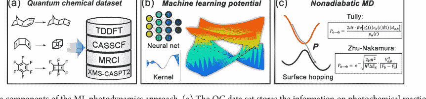
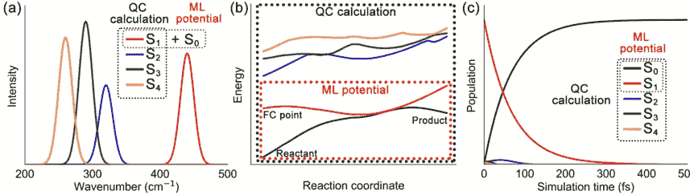
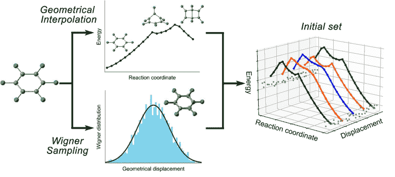
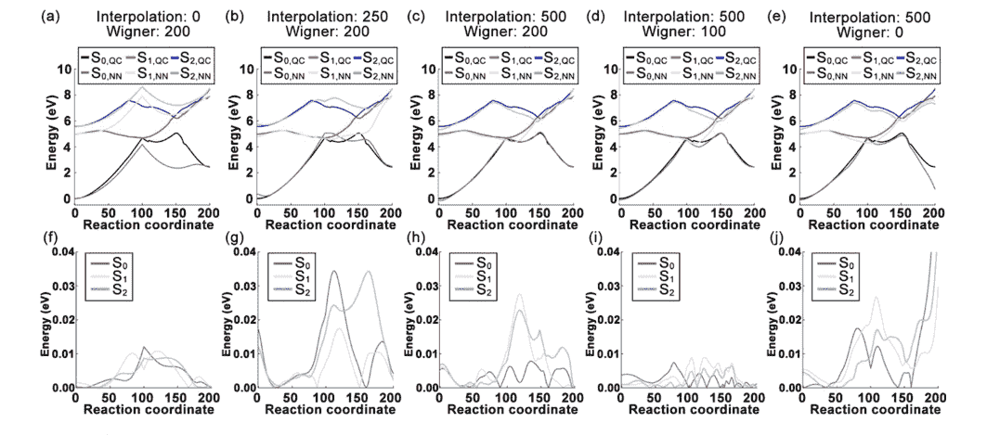
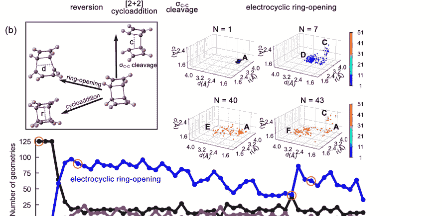
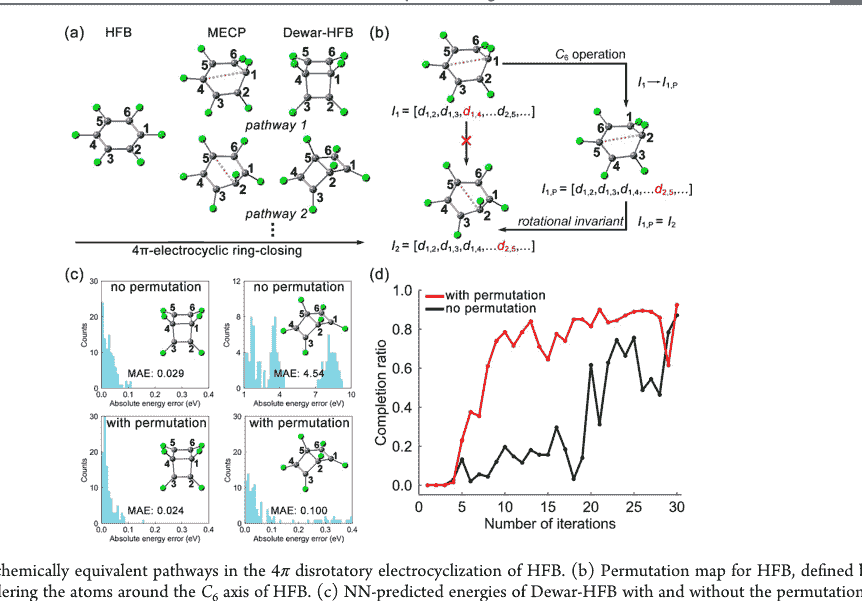
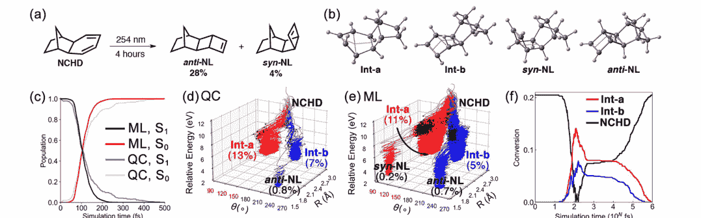
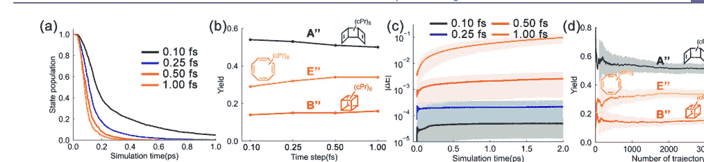

# 机器学习光动力学模拟黑箱揭秘

**图1.** 机器学习光动力学方法的三个组成部分。(a) 量子化学数据集存储光化学反应的信息。(b) 机器学习算法学习激发态势能面。(c) 使用机器学习势通过非绝热分子动力学传播轨迹。

分子动力学（PyRAI²MD）并展示了纳秒尺度光动力学模拟在解析实验中观察到的光扭矩选择性（photo-torquoselectivity）中的作用。

-   Li, J.; Stein, R.; Adrion, D. M.; Lopez, S. A. 机器学习光动力学模拟揭示了取代基效应对立方烷光化学形成的作用。J. Am. Chem. Soc. 2021, 143, 20166–20175.² 这项工作展示了机器学习光动力学模拟在复杂光化学反应中的优势，揭示了取代基效应对八取代立方烷的光化学[2 + 2]环加成反应的影响。
-   Li, J.; Lopez, S. A. 激发态畸变通过机器学习加速的光动力学模拟促进氟苯的光化学4π-顺旋电环化反应。Chem. - Eur. J. 2022, DOI: 10.1002/chem.202200651.³ 这项工作证明了机器学习光动力学模拟在揭示氟苯长寿命非辐射衰减机制及其在光化学形成Dewar-氟苯中的作用的重要性。

## 1. 引言

光化学之所以引人入胜，是因为它利用可再生的太阳能，在温和条件下以高原子转化效率合成化学产品⁴和燃料⁵⁻⁸。光化学反应通过超短时间尺度（10⁻¹⁵−10⁻¹² s）上的无辐射过程发生。机理研究依赖于时间分辨实验（即阿托化学⁹）来探测激发态的分子振动和电子结构。综合研究辅以计算建模，以解开难以捉摸的光谱特征并识别关键的激发态结构。激发态电子结构的量子化学（QC）计算通常成本高昂。因此，引入了机器学习（ML）技术来加速计算。

ML模型从大型QC数据集中学习分子结构与相关性质（例如能量¹⁰⁻¹³、跃迁偶极矩¹⁰⁻¹³和振子强度¹⁴,¹⁵）之间的关系。这些应用已成功发现新分子¹⁶和材料¹⁷、预测反应势垒¹⁸、寻找过渡态¹⁹,²⁰、求解薛定谔方程²¹,²²、建模波函数²³,²⁴、优化密度泛函²⁵,²⁶、计算红外光谱²⁷、紫外-可见光谱¹¹,¹³和核磁共振谱²⁸，以及模拟激发态动力学¹²,²⁹和复杂光化学反应。¹⁻³ 能量预测达到了化学精度（1 kcal·mol⁻¹），这是实现真实化学预测和与实验比较所必需的。

与同级别的QC计算相比，计算成本可以忽略不计。¹²,²⁹ 因此，许多研究将ML势用作非绝热分子动力学（NAMD）模拟的突出加速器，例如多组态时间相关Hartree（MCTDH）³⁰和轨迹面跳跃（TSH）³¹计算。多个课题组开发了ML混合量子-经典NAMD方法（在本述评中称为ML光动力学），例如与Newton-X³³结合的MLAtom³²以及与SHARC³⁵结合的SchNarc³⁴。为了研究光环加成和电环化反应，我们课题组开发了Python快速人工智能从头算分子动力学（PyRAI²MD）代码。¹

训练ML势是一项具有挑战性的任务。首先，生成高质量的可机器学习QC数据需要计算化学和ML方面的专业知识。训练数据生成协议常常带有需要特定步骤去除的人类偏见。其次，ML模型的快速发展使得比较这些模型的效率和性能变得相当困难。³⁶ 我们首先概述ML光动力学的基本背景。然后，我们将提供构建ML势的简短教程，并讨论我们近期出版物中的应用。最后，我们将总结我们的发现和对未来方法发展的展望。

## 2. 机器学习光动力学方法

ML光动力学方法通常包含三个关键组成部分（图1）：QC数据集、ML势和NAMD。

### 2.1. 用于训练的量子化学数据集

单参考方法（如含时密度泛函理论）用于计算垂直激发能，误差范围为0.3至0.5 eV。³⁷ 然而，当电子态之间存在强耦合（例如避免交叉或圆锥交叉）时，它们会失效，因为这违反了玻恩-奥本海默近似。单参考方法在这些交叉区域也可能预测错误的分支平面维数。³⁸,³⁹ 多组态自洽场（MCSCF）方法，如完全活性空间自洽场（CASSCF），更适合描述交叉区域附近的电子结构。术语CASSCF(m,n)指的是m个电子和n个轨道的活性空间。使用现代量子化学软件，CASSCF波函数通常被限制在22个电子和22个轨道的活性空间内。⁴⁰ 活性轨道的选择并非易事。太小的活性空间可能导致高能态沿反应坐标变得相对低能，称为入侵态。考虑电子相关能显著改善能量，可接近实验能量。

**图2.** 基于(a)吸收光谱、(b)反应坐标图和(c)QC-NAMD模拟的态布居数三种选择电子态的视角。

相关能分为静态相关和动态相关两部分。CASSCF通过其多参考形式恢复了静态相关。然而，它忽略了动态相关，因为它在其他电子的平均场中处理每个电子。因此，它通常导致激发能被高估。CASSCF数据的使用必须与多参考方法仔细验证，例如多参考组态相互作用（MRCI）和扩展多态完全活性空间二阶微扰理论（XMS-CASPT2）。我们推荐ANO型双ζ基组或可比的aug-cc-pVDZ基组，因为它们在计算成本和精度之间提供了平衡，并能捕获包括里德堡态在内的多种激发类型。此外，Bowen、Lester及其同事表明，在CH₂OO Criegee中间体的解离中，以及最近Marquet及其同事表明，在酪氨酸的解离中，没有可用的参考方法能描述整个反应空间，需要结合使用多种QC方法。

### 2.2. 机器学习势

核方法和神经网络（NN）是训练ML势的两种最常见方法。各种示例包括高维神经网络势（HDNNP）、SchNet、PhysNet、ANI、深度势光滑版（DeepPot-SE）、梯度域机器学习（GDML）、使用RE描述符和高斯核的核岭回归（KREG）、再生核希尔伯特空间（RKHS）和高斯近似势（GAP）。一些ML方法集合的软件包包括MLatom和原子稀有事件快速学习（FLARE）。NN和核方法的比较表明，在ML光动力学模拟中它们的精度相当相似。关于方法基准测试的更多信息，我们请读者参阅参考文献12和32。我们下面的讨论将集中于基于全连接前馈多层感知机的神经网络最基本架构。

ML势使用3D分子结构的数值表示来预测分子性质。全局描述符包含完整的分子结构信息，例如所谓的库仑矩阵和逆距离矩阵。它们是平移和旋转不变的，因此可以区分任意方向和位置的分子结构。然而，全局描述符对置换的化学等效原子不是不变的。引入了专门技术（例如键包、随机排序库仑矩阵和置换不变多项式）来强制全局描述符的置换不变性。然而，这些技术可能仅适用于小分子，并导致势能面（PES）不连续。另一方面，局部描述符使用一组置换不变的基函数来描述原子环境。然而，它们可能引入系统相关的超参数（例如基函数的形状和大小）。一些例子是原子中心对称函数（ACSFs）、原子位置平滑重叠（SOAP）和Faber–Christensen–Huang–Lilienfeld（FCHL）。此外，Pozdnyakov及其同事建议，在描述符中包含高阶项对于进一步提高模型精度至关重要。在ML光动力学中，ML势通常针对特定分子训练。因此，为了简单起见，我们在PyRAI²MD中实现了全局描述符（例如逆距离矩阵）。我们通过数据增强方法实现更高效的训练（见第3.4节）。

许多数据库，如GDB-13、GDB-17及其子集QM7、QM7b、QM8、QM9，以及VERDE材料数据库，旨在学习平衡几何构型下的分子性质。然而，ML光动力学依赖于更专业的数据集，该数据集包含给定分子在不同几何构型下的分子性质。主动学习是完成这项任务的有效且实用的策略。它允许模型采样类似于自动反应探索的欠采样数据。我们将在第3.2节讨论初始集生成，在第3.3节讨论主动学习。

### 2.3. 非绝热分子动力学

ML光动力学方法基于使用TSH方法的混合量子-经典NAMD，例如Tully的最少切换面跳跃（FSSH）。它通过非绝热耦合（NAC）计算同一自旋多重度两个态之间的跳跃概率，并通过自旋-轨道耦合（SOC）计算不同自旋多重度之间的跳跃概率。预测NAC比SOC更具挑战性，因为NAC是矢量性质。Marquet及其同事建议将NAC的分子分量拟合到虚拟势的一阶导数上，以避免态交叉附近的不连续数据。我们课题组和Gómez-Bombarelli课题组最近的工作表明，随着原子数的增加，NN倾向于低估NAC，这是因为无法获得非物理虚拟势的训练数据和/或交叉区域附近能隙预测精度低。NAC预测问题的一个可能解决方案是使用基于ML预测能量的Baeck-An近似。能隙的改进具有挑战性，并且需要大量的

在交叉区域附近生成数据的计算成本很高。通过Zhu–Nakamura面跳跃理论（ZNSH）可以绕过NAC预测。^74 ZNSH在跳跃概率计算中仅使用两个交叉态的能量和力。在基于三点插值的广义一维模型中，这些力被透热化。^75–77 ZNSH已显示出与FSSH一致的结果。^75–77 它还有一个利用SOC计算系间穿越的公式。^78 我们在第4节中的示例使用了ZNSH。由于ZNSH完全依赖于PES的形状，如果QC-NAMD数据可用，必须用FSSH验证ZNSH的结果。此外，近年来用于多尺度系统的ML方法^79 和基态势中长程色散^80 的发展，为未来面向更大系统的ML光动力学方法铺平了道路。

## 3. 训练ML光动力学模型

### 3.1. 构建ML势

我们首先确定构建ML势所需的合适电子态数量。建议首先计算吸收光谱并与可用的实验结果进行比较，以评估激发中涉及的相关态（图2a）。反应坐标图也有助于表征所选态以及可能的反应路径（图2b）。更严格的论证需要分析QC-NAMD模拟过程中的态布居（图2c）。由于图2中的模型在吸收光谱和反应图中显示出分离的S₁态和更高的态，并且态布居转移主要涉及S₁和S₀态，因此我们可以构建ML势来学习S₀和S₁的能量和力，从而减小数据集规模和训练噪声。

训练ML势使用梯度下降方法最小化均方误差损失函数。^81 我们将训练数据分为两部分（例如9:1）。第一部分用于训练模型；另一部分用于测试或验证。核方法和神经网络可能包含需要额外优化的超参数，这可以通过网格搜索和随机搜索来完成。^82 在训练数据量有限的情况下，k折交叉验证是超参数优化的有效方法。^83 神经网络势容易出现过拟合，即模型拟合训练数据和噪声，这通常会导致训练集之外的预测失败。因此，我们建议采取过拟合预防措施（例如早停、随机失活和权重衰减）。^82,84 早停法在验证误差增加而训练误差减少时停止训练过程。随机失活随机忽略一些节点的输出，以防止层内节点复杂的共适应，从而使预测更稳健。权重衰减在损失函数中加入小的惩罚项以防止过拟合。

### 3.2. 初始集采样

初始集采样为学习PES提供了基线。在热反应中，结构采样已通过基于MD的方法（伞形采样、^85 轨迹引导采样、^86 增强采样^87 和元动力学^88）、随机表面行走、^89 Wigner采样^90 和简正模式扫描^71,91 完成。然而，这些技术对复杂光化学反应的效果有限。例如，对反应物或产物几何结构进行Wigner采样只能捕获局部或全局最小值附近可达到的非平衡几何结构。简正模式扫描包含许多不相关的分子振动；基态MD模拟所访问的机理路径与激发态过程不同。随着自由度数量的增加，激发态MD变得极其昂贵。我们最近报道了一种复合方案，该方案结合Wigner采样和几何插值，以生成紧凑而相关的初始集（图3）。

图3. 通过几何插值和Wigner采样生成初始集。彩色曲线表示插值点，灰色点表示Wigner采样的反应物和产物结构。

Wigner采样通常用于生成光动力学和吸收光谱的初始条件。^92 学习Wigner采样的反应物有助于减少Franck–Condon（FC）区域附近结构的欠采样。几何插值补充了数据集中反应物和产物之间的结构相关性。我们使用测地线插值^93 来生成优化的反应物、产物和最小能量交叉点（MECP）几何结构之间的中间结构。我们将反应物的Wigner采样几何位移与插值结构相结合，以拓宽采样空间（图3）。对于复杂环境中较大系统的结构采样，Wigner采样需要与多尺度MD模拟相结合来对环境进行采样。^94

我们训练了五个模型以展示Wigner采样和几何插值的效果。每个模型由两个独立训练的神经网络组成。超参数和训练结果可在辅助信息中获取。

我们使用预测标准差来估计预测不确定性。训练集基于两个不同比例的子集构建：Wigner采样集包含100个反应物和产物结构，几何插值集包含500个结构（25条路径×20个中间体）。测试集包含六氟苯（HFB）4π对旋电环化反应中的201个插值结构。

图4. (a–e) 不同大小的Wigner集和插值集的神经网络预测反应坐标图。(f–j) 神经网络预测的S₀、S₁和S₂能量的不确定性。预测能量是两个独立训练的神经网络结果的平均值。不确定性是两个神经网络预测的标准差。训练数据计算在XMS-CASPT2(6,7)/aug-cc-pVDZ水平下进行。

图4a显示，仅用Wigner集训练的神经网络预测的S₁/S₀交叉区域附近的PES拓扑结构不正确。预测不确定性升至>0.01哈特里（>6.2 kcal mol−1），这表明存在结构欠采样区域（图4f）。在加入50%的插值集后，神经网络学习到了S₁/S₀交叉，但预测出两个交叉区域（图4b），并在S₁/S₀和S₂/S₁交叉附近表现出高不确定性（>0.03哈特里）（图4g）。加入完整的插值集后，整个反应坐标图的拓扑结构预测得到改善（图4c）。不确定区域缩小到S₀/S₁交叉附近（图4h）。将Wigner集减少50%后，S₁/S₀交叉区域附近出现了类似的误差（图4d）。然而，不确定性降至0.01哈特里以下，这使得模型在检测欠采样结构方面效果较差（图4i）。从图4e可以看出，移除Wigner集会带来显著的不确定性，尤其是对产物而言（图4j）。我们的发现表明，在初始集生成中Wigner采样和几何插值具有同等重要性，但尚未表明Wigner集和插值集之间的最佳比例。

### 3.3. 主动学习

主动学习用于搜索初始集中的欠采样结构，最初由Behler^95 为基态MD模拟引入，随后由Marquetand及其同事^71 将其改进用于激发态PES。主动学习使用相似性度量来确定MD模拟过程中预测的分子性质的不确定性。基于核的方法（例如高斯过程回归）可以提供预测的协方差作为预测不确定性的估计。然而，神经网络势需要一个至少包含两个独立训练的神经网络的委员会模型来评估不确定性。ML势首先用初始集进行训练，并传播一组轨迹以搜索欠采样结构。如果当前结构的预测能量、力、NAC和SOC超过预定义阈值（例如，能量和力分别为0.043哈特里和0.25哈特里·玻尔−1），则这些轨迹终止。^1,2 不确定的结构通过QC计算重新计算，并添加到ML势的再训练中。我们最近对八甲基-[3]-梯形二烯（A）的ML光动力学模拟显示，主动学习在自动发现新反应路径方面具有显著效果。^2 初始训练集仅包含从[2 + 2]环加成的插值反应坐标图中采样的4321个结构。主动学习在1 ps（0.5 fs时间步长）内从S₁态传播了125条轨迹。它在51次迭代后完成，从σC–C断裂和电环开环路径中发现了4982个新结构，并预测出五个中间体或产物（图5a）。

图5. (a) 神经网络预测的八甲基-[3]-梯形二烯的光化学反应及产率。(b) 八甲基-[3]-梯形二烯的收集结构数量随主动学习迭代次数的变化图。图例显示了由三个反应坐标r₁、d₁和c₁定义的反应空间，分别对应[2 + 2]环加成、电环开环和σC–C断裂路径。插图中的3D图展示了收集结构的空间分布。

在图5b中，我们绘制了收集结构的数量及其分布，以可视化反应空间中的学习进度。在前三次迭代中，轨迹在FC区域周围搜索（A，r > 2.0 Å，d < 2.0 Å，c < 2.0 Å）。从第7次迭代开始进行了更广泛的探索，学习到通向D和E的电环开环路径（r > 2.0 Å，d > 2.0 Å，c < 2.0 Å），以及通向C的σC–C断裂路径（r > 2.0 Å，d < 2.0 Å，c > 2.0 Å）。电环开环路径中的欠采样结构在第36–40次迭代期间逐渐减少到一个平台。此后，轨迹检测到一条通向F的新路径（r > 2.0 Å，d > 3.2 Å，c < 2.0 Å）。

### 3.4. 数据增强

图6. (a) HFB的4π对旋电环化中的两条化学等价路径。(b) HFB的置换映射，由“C6操作”定义，即绕HFB的C6轴重新排列原子。(c) 有和没有置换映射的神经网络预测的Dewar-HFB能量。左列是控制集，右列是测试集。(d) 有和没有置换映射的HFB主动学习曲线。完成比是完整轨迹数除以总轨迹数。

对称分子使得逆距离矩阵无法学习光化学反应路径。例如，HFB（D6h对称性）发生4π对旋电环化反应。它有六个等价碳原子（图6a）。由于逆距离矩阵不具备置换不变性，主动学习倾向于搜索所有等价反应路径。这使训练数据计算量增加了约6倍。为了减少这些冗余的QC计算，我们引入了一种称为置换映射的数据增强方法，以

从现有数据生成等价数据。在图6b中，路径1和2具有等价但表示不同的最小能量交叉点（MECP），即I1和I2。置换映射将路径1中MECP的原子围绕HFB的C6轴重新排序。置换后的MECP具有新的表示I1,p，且I1,p = I2，因为逆距离矩阵是旋转不变的。由于置换映射重新排序了表示中的原子，所有向量性质（例如力和非绝热耦合（NACs））也相应地被重新排序。

我们比较了有和没有置换的Dewar-HFB的预测能量，以展示我们数据增强方法的重要性。神经网络超参数和训练结果的详细信息见支持信息。训练集包含来自Wigner采样和C1–C4键形成的几何插值的901个结构[3]。控制集包含100个具有C1–C4键的Dewar-HFB结构。预测显示无论是否置换，误差分布相似（图6c）。测试集包含100个具有C2–C5键的Dewar-HFB结构。没有置换时，预测产生4.54 eV的大平均绝对误差（MAE）。然而，使用置换映射将MAE降低到0.100 eV。图6d比较了直接主动学习方法与使用HFB置换映射的主动学习方法的进展。它在10 ps内（0.5 fs时间步长）从S1传播200条轨迹。在使用置换的主动学习中，完成率在10次迭代时达到0.8，在30次迭代时超过0.9。没有置换时，学习曲线在前20次迭代中波动，需要29次迭代才能达到0.8的完成率。使用置换的主动学习收集的结构（2128）明显少于不使用置换的（3029）。使用置换不变的局部描述符（如SchNarc中实现的描述符）可以避免数据增强[34]。

## 4. 机器学习光动力学模拟的应用

### 4.1. 降冰片基环己二烯的光诱导旋转选择性异构化

降冰片基环己二烯（NCHD）的光照引发旋转选择性的4π对旋电环化闭环反应，生成主要（anti-NL）和次要（syn-NL）降冰片基梯形烯（NL）产物（图7a）[1]。我们进行了QC和机器学习光动力学模拟，以揭示光旋转选择性的起源。我们在CASSCF(4,3)/ANO-S-VDZP水平上计算了NCHD的240条QC轨迹，并使用在相同水平上训练的神经网络在1 ps内计算了3954条ML轨迹。QC轨迹需要17天，而ML轨迹在单个CPU上仅需38秒。最终的MD快照被优化为中间体和产物（图7b）。

ML轨迹显示的激发态动力学和S1半衰期与QC轨迹一致（图7c）。它们预测syn-NL的量子产率为0.2%（图7e），由于轨迹数量有限，这在QC轨迹中缺失（图7d）。ML光动力学模拟与我们的PES计算一致，并确认syn路径比anti路径更陡峭，形成更高比例的Int-a。然而，anti路径在S1/S0交叉缝处具有更陡峭的能量下降，有利于anti-NL。984条1 ns的ML轨迹揭示了从意外中间体Int-a和Int-b到NCHD的热转化（图7f），这解释了它们在实验中的缺失。这项工作证明了ML光动力学模拟的效率和准确性，并强调了长时间尺度模拟的重要性。

图7. (a) 降冰片基环己二烯（NCHD）的光诱导旋转选择性异构化。(b) 在CASSCF(4,3)/ANO-S-VDZP水平优化的中间体和产物的几何结构。红色和蓝色虚线突出显示了syn和anti构型中的角度θ。黑色虚线显示距离R。(c) 240条QC和3954条ML轨迹的态布居。(d) QC和(e) ML的NCHD轨迹在300 K下1 ps模拟。黑点表示每条轨迹中最后一个表面跳跃点。(f) 1 ns内NCHD与Int-a和Int-b之间的转化。来自参考文献1。CC BY-NC 3.0。

### 4.2. 取代基对[3]-梯形二烯光化学反应的影响

[3]-梯形二烯的[2 + 2]环加成反应可以得到立方烷。在甲基（CH3）、三氟甲基（CF3）和环丙基（cPr）八取代的[3]-梯形二烯中，立方烷的量子产率增加[2]。我们最近使用机器学习光动力学对这些分子进行了首次模拟[2]。神经网络通过CASSCF(8,7)/ANO-S-VDZP+ANO-S-MB（用于取代基）计算训练。轨迹从S1弗兰克-康登（FC）区域传播2 ps（时间步长0.5 fs）。我们收集了八甲基（A）、八三氟甲基（A′）和八环丙基[3]-梯形二烯（A″）的3835、3259和3122条轨迹，以分析激发态动力学。图8a、b展示了观察到的路径和S1→S0弛豫半衰期。ML轨迹在八甲基[3]-梯形二烯的轨迹中发现了四条S1弛豫路径：（1）[2 + 2]环加成，（2）4π对旋电环开环，（3）σC–C键断裂，（4）6π顺旋电环开环。4π和6π开环反应的弛豫速率高于[2 + 2]环加成（图8b）。CF3中的闭壳层排斥阻碍了6π开环路径，从而增强了[2 + 2]环加成。cPr的空间位阻效应也加速了[2 + 2]环加成反应，使其与4π对旋电环开环反应竞争。图8c显示了朝向五种产物的宽轨迹分布，其中八甲基立方烷的量子产率为1%。从图8d、e可以看出，空间冲突缩小了反应路径的空间分布，并使副反应通道失活。这些发现解释了八三氟甲基（14%）和八环丙基立方烷（15%）量子产率增加的原因。这项工作突显了ML光动力学模拟发现复杂光化学反应的能力。

图8. (a) 神经网络预测的八甲基、八三氟甲基和八环丙基[3]-梯形二烯的弛豫路径。(b) 神经网络模拟的取代[3]-梯形二烯的弛豫速率。(c–e) 分别为(c) CH3、(d) CF3和(e) cPr取代的[3]-梯形二烯的神经网络轨迹。每个图包含400条随机选择的轨迹。平均起始点、表面跳跃点和产物分别用红点、黑圈和黑点标记。内嵌图例显示了具有预测产率的最后一个轨迹快照。复制自参考文献2。版权所有2021美国化学学会。

### 4.3. 六氟苯的光环化反应

苯的六氟化显著提高了光化学4π对旋电环化生成张力型Dewar-HFB的化学选择性（图9a）[96]。然而，HFB的长寿命非辐射衰变和Dewar-HFB的低量子产率阻碍了有效的QC-NAMD模拟来理解其机理[96]。ML光动力学模拟使我们能够在XMS-CASPT2(6,7)/aug-cc-pVDZ水平上模拟HFB在4 ns内的激发态动力学[3]。

ML光动力学模拟显示大多数HFB重新形成反应物。图9b展示了前600 ps（0.6 ns）内的一条HFB轨迹。快照显示了伪Jahn–Teller畸变，通过C–F键的面外弯曲破坏了平面结构。非辐射衰变发生在一个涉及πC–C顺反异构化的表面跳跃点，在0.29 ns时扭转角α为110°。图9c绘制了HFB跳跃点的分布。跳跃结构揭示了C–F键围绕C1–C2键的平滑扭转，表明存在连续的S1/S0交叉缝。然而，导致4π对旋电环化的结构沿交叉缝稀疏分布，没有特定的聚类模式（R = 2.58–2.87 Å）。这意味着πC–C扭转和1,4-碳距离都不能直接决定Dewar-HFB的形成。因此，HFB的4π对旋电环化可能归因于表面跳跃后结构中的动力学效应，核动量持续填充成键振动模式。图9d展示了一个产生杜瓦氟苯的表面跳跃点。预测的反应量子产率为0.3%，与实验结果（≤3%）一致[97]。

图9. (a) HFB的光化学4π对旋电环化反应。(b) 在前0.6 ns模拟中一条回复到HFB的轨迹。它追踪了一个2 ps区间内的扭转角α，在结构上用红色圆圈标出。黑色圆圈标记每个快照中的扭转角。(c) HFB跳跃点的结构分布。散点由扭转角α（红色虚线标出）和1,4-碳距离R（蓝色虚线标出）定义，显示在对齐的跳跃结构中。颜色从蓝色到红色表示跳跃点的累积密度从低到高，由高斯核密度估计评估。黑色圆圈标记经历4π对旋电环化的跳跃点。(d) 一个导致4π对旋电环化的HFB跳跃结构。经许可复制自参考文献3。版权所有2022 Wiley-VCH。

### 4.4. 关于ML光动力学模拟的评述

长时间尺度的ML光动力学模拟广泛地积分牛顿运动方程。时间步长强烈依赖于所研究体系的振动频率。例如，小有机分子中C–H伸缩的典型振动周期约为10 fs，这表明最大时间步长应为1 fs。过大的时间步长可能会在轨迹传播中累积大量误差。模拟还需要足够数量的轨迹，以满足所考虑性质（如时间常数和量子产率）的统计收敛。然而，由于计算成本，这些信息在QC-NAMD研究中通常不可用。在本小节中，我们使用ML光动力学模拟来探索积分时间步长和轨迹数量对光化学反应模拟的影响。模型体系为八环丙基[3]-梯形二烯（A''）。

轨迹从S1态传播1 ps。我们分别以0.1、0.25、0.5和1 fs的时间步长（Δt）收集了3266、3268、3271和3211条轨迹。图10a绘制了S1态布居随时间的变化。当Δt = 0.1 fs时，预测的S1半衰期为165.6 fs。将步长增加到1 fs使半衰期缩短至80 fs。然而，产物分布对时间步长的敏感性低于态布居。将Δt从0.1 fs增加到1 fs，A''的产率仅从0.54降至0.50，B''的产率从0.14增至0.16，E''的产率从0.29增至0.34（图10b）。Barbatti及其同事最近的一项基准测试报告，在Δt = 0.5 fs时，能量计算中10−5哈特里的随机数值噪声会导致NAMD模拟中总能量不守恒[98]。由于神经网络势以化学精度（1.6 × 10−3哈特里）训练，Δt的选择需要格外谨慎。当Δt = 0.1 fs时，轨迹获得了合理的能量守恒，绝对能量漂移为5 × 10−5哈特里（图10c）。在Δt = 0.25和0.5 fs时，能量漂移分别增加到2 × 10−4和2 × 10−3哈特里。然而，Δt = 1 fs在2 ps模拟中累积了接近0.1哈特里的巨大能量漂移。因此，我们认为在ML光动力学中，能量守恒要求Δt = 0.5 fs。

图10d绘制了预测产率与A''轨迹数量的函数关系。我们在QC-NAMD模拟中通常考虑的典型500条轨迹无法预测收敛的产率。在低于1000条轨迹时，产率波动显著。因此，ML光动力学模拟至少需要1100–1500条轨迹才能达到统计收敛。

图10. (a) S1态布居，(b) 产物分布，以及(c) 在Δt = 1、0.5、0.25和0.10 fs下A''的ML光动力学模拟中的能量守恒。(d) 预测产率与A''轨迹数量的函数关系。(c)和(d)中的阴影区域表示从总轨迹中随机抽取10%进行100次自举获得的一个标准差范围。(d)图改编自参考文献2。版权所有2021美国化学学会。

## 5. 结论与展望

我们概述了机器学习光动力学，并证明了其在解析取代基效应对反应性、立体选择性以及自动

利用主动学习识别光化学反应中的机理路径。我们将Wigner采样与几何插值相结合，以简化训练数据的生成。该方法训练高效的机器学习（ML）势，以预测定性正确的势能面（PESs）并检测交叉区域附近采样不足的结构。此外，我们讨论了通过原子置换进行数据增强，以缓解逆距离矩阵表示中的置换方差；这大大加速了高对称性分子光化学反应的主动学习。

机器学习光动力学能够以CASSCF和XMS-CASPT2的精度，对相对较大的分子进行高效的纳秒尺度非绝热分子动力学（NAMD）模拟。训练过程对目标光化学反应所需的先验知识极少。目前机器学习光动力学的局限性在于对交叉区域附近的非绝热耦合（NACs）和能隙的预测不尽如人意。在开发出更合适的NAC预测模型之前，目前的机器学习光动力学模拟可采用无NAC的表面跳跃方法，如Zhu–Nakamura理论。总体而言，机器学习光动力学模拟为研究长时间尺度的光化学反应提供了宝贵的工具。我们期望本文有助于加深对机器学习光动力学方法的理解，并激励其在分子固体和显式溶剂模拟等光化学应用中的应用，进而在化学生物学、材料化学、固态、显式溶剂和生物系统中得到进一步应用。

### 关联内容

#### 辅助信息

辅助信息可在https://pubs.acs.org/doi/10.1021/acs.accounts.2c00288免费获取。

- 神经网络超参数、训练指标和数据可用性（PDF）

### 作者信息

#### 通讯作者

**史蒂芬·A·洛佩斯** — *美国马萨诸塞州波士顿东北大学化学与化学生物学系，邮编02115*；◉ orcid.org/0000-0002-8418-3638；电子邮件：s.lopez@northeastern.edu

#### 作者

**李敬白** — *美国马萨诸塞州波士顿东北大学化学与化学生物学系，邮编02115*

完整的联系信息见：https://pubs.acs.org/10.1021/acs.accounts.2c00288

#### 备注

作者声明无竞争性经济利益冲突。

#### 作者简介

**李敬白**于2019年在伊利诺伊理工学院获得博士学位，师从Andrey Yu. Rogachev教授。他曾是东北大学的博士后研究员，与Steven A. Lopez教授合作，在Lopez课题组开发了PyRAI²MD。他目前是深圳职业技术学院霍夫曼先进材料研究院的副教授。他的研究专注于开发机器学习光动力学方法，以研究复杂环境中的光化学反应。

**史蒂芬·A·洛佩斯**于2015年在加利福尼亚大学洛杉矶分校获得博士学位，师从Kendall N. Houk教授。他曾是美国能源部能源效率与可再生能源博士后研究员，在哈佛大学与Alán Aspuru-Guzik教授合作。他目前是东北大学化学与化学生物学系的助理教授。他的课题组专注于利用最先进的量子化学（QC）方法和机器学习技术理解有机分子和软材料中的光驱动过程。

### 致谢

J.L.和S.A.L.感谢美国海军研究办公室（N00014-18-1-2659）、美国国家科学基金会（CAREER基金NSF-CHE-2144556）以及美国国家科学基金会（NSF-OAC-2118201）对这项研究的资助。J.L.和S.A.L.感谢东北大学研究计算团队的协助，以及马萨诸塞州生命科学中心（基金G00006360）提供的计算资源。

### 参考文献

- 1. Li, J.; Reiser, P.; Boswell, B. R.; Eberhard, A.; Burns, N. Z.; Friederich, P.; Lopez, S. A. 利用纳秒机器学习光动力学模拟自动发现光异构化机制. *Chem. Sci.* **2021**, *12* (14), 5302–5314.
- 2. Li, J.; Stein, R.; Adrion, D. M.; Lopez, S. A. 机器学习光动力学模拟揭示取代基效应在立方烷光化学形成中的作用. *J. Am. Chem. Soc.* **2021**, *143* (48), 20166–20175.
- 3. Li, J.; Lopez, S. A. 激发态畸变通过机器学习加速光动力学模拟促进氟苯的光化学4π-电环化反应. *Chem. - Eur. J.* **2022**, DOI: 10.1002/chem.202200651.
- 4. *太阳能到化学能的转换：光催化与光电化学过程*; Sun, H., Ed.; Wiley, 2021.
- 5. de Meijere, A.; Redlich, S.; Frank, D.; Magull, J.; Hofmeister, A.; Menzel, H.; Konig, B.; Svoboda, J. 八环丙基立方烷及其部分异构体. *Angew. Chem., Int. Ed. Engl.* **2007**, *46* (24), 4574–6.
- 6. Xie, J.; Zhang, X.; Shi, C.; Pan, L.; Hou, F.; Nie, G.; Xie, J.; Liu, Q.; Zou, J.-J. 自光敏化[2 + 2]环加成反应合成高能量密度燃料. *Sustainable Energy & Fuels* **2020**, *4* (2), 911–920.
- 7. Dong, L.; Feng, Y.; Wang, L.; Feng, W. 偶氮苯基太阳能热燃料：设计、性质与应用. *Chem. Soc. Rev.* **2018**, *47* (19), 7339–7368.
- 8. Orrego-Hernandez, J.; Dreos, A.; Moth-Poulsen, K. 降冰片二烯/四环烷光开关在分子太阳能热能储存应用中的工程化. *Acc. Chem. Res.* **2020**, *53* (8), 1478–1487.
- 9. Merritt, I. C. D.; Jacquemin, D.; Vacher, M. 附加观点：控制电子是光化学的未来吗？ *J. Phys. Chem. Lett.* **2021**, *12* (34), 8404–8415.
- 10. Westermayr, J.; Gastegger, M.; Menger, M.; Mai, S.; Gonzalez, L.; Marquetand, P. 机器学习使长时间尺度分子光动力学模拟成为可能. *Chem. Sci.* **2019**, *10* (35), 8100–8107.
- 11. Westermayr, J.; Marquetand, P. 利用SchNarc进行紫外吸收光谱的深度学习：向化合物空间可迁移性迈出的第一步. *J. Chem. Phys.* **2020**, *153* (15), 154112.
- 12. Westermayr, J.; Marquetand, P. 分子电子激发态的机器学习. *Chem. Rev.* **2021**, *121* (16), 9873–9926.
- 13. Westermayr, J.; Maurer, R. J. 受物理启发的分子激发和光发射光谱深度学习. *Chem. Sci.* **2021**, *12* (32), 10755–10764.
- 14. Pronobis, W.; Schütt, K. T.; Tkatchenko, A.; Müller, K.-R. 用机器学习捕获DFT/TDDFT的强度量和广延量分子性质. *Eur. Phys. J. B* **2018**, *91* (8), No. 178.

(15) Ramakrishnan, R.; Hartmann, M.; Tapavicza, E.; von Lilienfeld, O. A. 化学空间中来自TDDFT和机器学习的电子光谱. *J. Chem. Phys.* **2015, 143** (8), No. 084111.

(16) Nandy, A.; Duan, C.; Taylor, M. G.; Liu, F.; Steeves, A. H.; Kulik, H. J. 过渡金属配合物的计算发现：从高通量筛选到机器学习. *Chem. Rev.* **2021, 121** (16), 9927–10000.

(17) Friedrich, J.; Hase, F.; Proppe, J.; Aspuru-Guzik, A. 面向下一代物质模拟的机器学习势. *Nat. Mater.* **2021, 20** (6), 750–761.

(18) Lewis-Atzwell, T.; Townsend, P. A.; Grayson, M. N. 机器学习化学反应活化能. *Wiley Interdiscip. Rev.: Comput. Mol. Sci.* **2021**, DOI: 10.1002/wcms.1593.

(19) Peterson, A. A. 利用机器学习加速鞍点搜索. *J. Chem. Phys.* **2016, 145** (7), No. 074106.

(20) Pozun, Z. D.; Hansen, K.; Sheppard, D.; Rupp, M.; Muller, K. R.; Henkelman, G. 通过基于核的机器学习优化过渡态. *J. Chem. Phys.* **2012, 136** (17), 174101.

(21) Hermann, J.; Schätzle, Z.; Noe, F. 电子薛定谔方程的深度神经网络解. *Nat. Chem.* **2020, 12** (10), 891–897.

(22) Han, J.; Zhang, L.; E, W. 利用深度神经网络求解多电子薛定谔方程. *J. Comput. Phys.* **2019, 399,** No. 108929.

(23) Schutt, K. T.; Gastegger, M.; Tkatchenko, A.; Muller, K. R.; Maurer, R. J. 用深度神经网络统一机器学习和量子化学以计算分子波函数. *Nat. Commun.* **2019, 10** (1), 5024.

(24) Gastegger, M.; McSloy, A.; Luya, M.; Schutt, K. T.; Maurer, R. J. 用于准原子最小基组表示的分子波函数的深度神经网络. *J. Chem. Phys.* **2020, 153** (4), No. 044123.

(25) Zhou, Y.; Wu, J.; Chen, S.; Chen, G. 迈向精确交换相关势：一种三维卷积神经网络结构. *J. Phys. Chem. Lett.* **2019, 10** (22), 7264–7269.

(26) Dick, S.; Fernandez-Serra, M. 机器学习电子密度的精确交换相关泛函. *Nat. Commun.* **2020, 11** (1), 3509.

(27) Gastegger, M.; Behler, J.; Marquetand, P. 用于红外光谱模拟的机器学习分子动力学. *Chem. Sci.* **2017, 8** (10), 6924–6935.

(28) Gao, P.; Zhang, J.; Peng, Q.; Zhang, J.; Glezakou, V. A. 通过机器学习增强DFT精确预测分子13C/1H NMR化学位移的通用方案. *J. Chem. Inf. Model.* **2020, 60** (8), 3746–3754.

(29) Dral, P. O.; Barbatti, M. 从机器学习视角看分子激发态. *Nat. Rev. Chem.* **2021, 5**, 388–405.

(30) Bonfanti, M.; Worth, G. A.; Burghardt, I. 多组态含时Hartree方法：从量子到半经典和量子-经典. In *Quantum Chemistry and Dynamics of Excited States: Methods and Applications*; González, L., Lindh, R., Eds.; Wiley, 2021; pp 383–411.

(31) Mai, S.; Marquetand, P.; González, L. 表面跳跃分子动力学. In *Quantum Chemistry and Dynamics of Excited States: Methods and Applications*; González, L., Lindh, R., Eds.; Wiley, 2021; pp 499–530.

(32) Dral, P. O.; Ge, F.; Xue, B. X.; Hou, Y. F.; Pinheiro, M., Jr.; Huang, J.; Barbatti, M. Meltom 2：原子级机器学习的综合平台. *Top Curr. Chem.* **2021, 379** (4), 27.

(33) Barbatti, M.; Ruckenbauer, M.; Plasser, F.; Pittner, J.; Granucci, G.; Persico, M.; Lischka, H. Newton-X：用于非绝热分子动力学的表面跳跃程序. *Wiley Interdiscip. Rev. Comput. Mol. Sci.* **2014, 4** (1), 26–33.

(34) Westermayr, J.; Gastegger, M.; Marquetand, P. 结合SchNet和SHARC：用于激发态动力学的SchNarc机器学习方法. *J. Phys. Chem. Lett.* **2020, 11** (10), 3828–3834.

(35) Mai, S.; Marquetand, P.; Gonzalez, L. 非绝热动力学：SHARC方法. *Wiley Interdiscip. Rev.: Comput. Mol. Sci.* **2018, 8** (6), e1370.

(36) Pinheiro, M. J., Jr.; Ge, F.; Ferre, N.; Dral, P. O.; Barbatti, M. 选择合适的分子机器学习势. *Chem. Sci.* **2021, 12** (43), 14396–14413.

(37) Huix-Rotllant, M.; Ferré, N.; Barbatti, M. 含时密度泛函理论. In *Quantum Chemistry and Dynamics of Excited States: Methods and Applications*; González, L., Lindh, R., Eds.; Wiley, 2021; pp 13–46.

(38) Huix-Rotllant, M.; Nikiforov, A.; Thiel, W.; Filatov, M. 用密度泛函方法描述圆锥交叉. *Top Curr. Chem.* **2015, 368**, 445–76.

(39) Levine, B. G.; Ko, C.; Quenneville, J.; Martínez, T. J. 含时密度泛函理论中的圆锥交叉和双激发. *Mol. Phys.* **2006, 104** (5–7), 1039–1051.

(40) Vogtliatzis, K. D.; Ma, D.; Olsen, J.; Gagliardi, L.; de Jong, W. A. 将组态相互作用推向极限：迈向大规模并行MCSCF计算. *J. Chem. Phys.* **2017, 147** (18), 184111.

(41) Helmich-Paris, B. CASSCF方法的电子激发态基准测试. *J. Chem. Theory Comput.* **2019, 15** (7), 4170–4179.

(42) Gomez, S.; Ibele, L. M.; Gonzalez, L. 3s里德伯态作为1,1-二氟乙烯超快动力学中的门态. *Phys. Chem. Chem. Phys.* **2019, 21** (9), 4871–4878.

(43) Roos, B. O.; Merchan, M.; McDiarmid, R.; Xing, X. 降冰片二烯电子光谱的理论与实验测定. *J. Am. Chem. Soc.* **1994, 116** (13), 5927–5936.

(44) Kidwell, N. M.; Li, H.; Wang, X.; Bowman, J. M.; Lester, M. I. 振动活化的CH₃CHOOC Criegee中间体解离为OH自由基产物的单分子解离动力学. *Nat. Chem.* **2016, 8** (5), 509–14.

(45) Westermayr, J.; Gastegger, M.; Vörös, D.; Panzenboeck, L.; Joerg, F.; González, L.; Marquetand, P. 对酪氨酸的深度学习研究揭示了漫游（roaming）可导致光损伤. *Nat. Chem.* **2022**, DOI: 10.1038/s41557-022-00950-z.

(46) Behler, J. 四代高维神经网络势. *Chem. Rev.* **2021, 121** (16), 10037–10072.

(47) Schutt, K. T.; Sauceda, H. E.; Kindermans, P. J.; Tkatchenko, A.; Muller, K. R. SchNet——一种用于分子和材料的深度学习架构. *J. Chem. Phys.* **2018, 148** (24), 241722.

(48) Unke, O. T.; Meuwly, M. PhysNet：用于预测能量、力、偶极矩和部分电荷的神经网络. *J. Chem. Theory Comput.* **2019, 15** (6), 3678–3693.

(49) Gao, X.; Ramezanghorbani, F.; Isayev, O.; Smith, J. S.; Roitberg, A. E. TorchANI：基于PyTorch的免费开源ANI神经网络势深度学习实现. *J. Chem. Inf. Model.* **2020, 60** (7), 3408–3415.

(50) Zhang, L.; Han, J.; Wang, H.; Saidi, W. A.; Car, R.; Weinan, E. 用于有限和扩展系统的端到端对称性保持原子间势能模型. In *Proceedings of the 32nd International Conference on Neural Information Processing Systems*; Curran Associates, 2018; pp 4441–4451.

(51) Chmiela, S.; Sauceda, H. E.; Muller, K. R.; Tkatchenko, A. 利用机器学习力场迈向精确分子动力学模拟. *Nat. Commun.* **2018, 9** (1), 3887.

(52) Koner, D.; Meuwly, M. 多原子分子的置换不变、再现核势能面：从甲醛到丙酮. *J. Chem. Theory Comput.* **2020, 16** (9), 5474–5484.

(53) Bartok, A. P.; Payne, M. C.; Kondor, R.; Csanyi, G. 高斯近似势：没有电子的量子力学精度. *Phys. Rev. Lett.* **2010, 104** (13), 136403.

(54) Xie, Y.; Vandermause, J.; Sun, L.; Cepellotti, A.; Kozinsky, B. 来自主动学习的贝叶斯力场，用于模拟锡烯的维度间转变. *npj Comput. Mater.* **2021, 7** (1), No. 40.

(55) Westermayr, J.; Faber, F. A.; Christensen, A. S.; von Lilienfeld, O. A.; Marquetand, P. 神经网络和核岭回归用于

- (56) Rupp, M.; Tkatchenko, A.; Muller, K. R.; von Lilienfeld, O. A. 利用机器学习快速准确地建模分子原子化能. Phys. Rev. Lett. 2012, 108 (5), No. 058301.
- (57) Hansen, K.; Biegler, F.; Ramakrishnan, R.; Pronobis, W.; von Lilienfeld, O. A.; Muller, K. R.; Tkatchenko, A. 机器学习预测分子性质：化学空间中精确的多体势和非局域性. J. Phys. Chem. Lett. 2015, 6 (12), 2326–31.
- (58) Hansen, K.; Montavon, G.; Biegler, F.; Fazli, S.; Rupp, M.; Scheffler, M.; von Lilienfeld, O. A.; Tkatchenko, A.; Muller, K. R. 用于预测分子原子化能的机器学习方法的评估与验证. J. Chem. Theory Comput. 2013, 9 (8), 3404–19.
- (59) Qu, C.; Yu, Q.; Bowman, J. M. 置换不变势能面. Annu. Rev. Phys. Chem. 2018, 69, 151–175.
- (60) Behler, J. 用于构建高维神经网络势的以原子为中心的对称函数. J. Chem. Phys. 2011, 134 (7), No. 074106.
- (61) Bartók, A. P.; Kondor, R.; Csányi, G. 关于化学环境的表示. Phys. Rev. B Condens Matter 2013, 87 (18), 184115.
- (62) Christensen, A. S.; Bratholm, L. A.; Faber, F. A.; Anatole von Lilienfeld, O. FCHL 再探：更快更准确的量子机器学习. J. Chem. Phys. 2020, 152 (4), No. 044107.
- (63) Pozdnyakov, S. N.; Willatt, M. J.; Bartók, A. P.; Ortner, C.; Csányi, G.; Ceriotti, M. 原子结构表示的不完备性. Phys. Rev. Lett. 2020, 125 (16), 166001.
- (64) Blum, L. C.; Reymond, J. L. 化学宇宙数据库 GDB-13 中用于虚拟筛选的 9.7 亿个类药小分子. J. Am. Chem. Soc. 2009, 131 (25), 8732–3.
- (65) Ruddigkeit, L.; van Deursen, R.; Blum, L. C.; Reymond, J. L. 化学宇宙数据库 GDB-17 中 1660 亿个有机小分子的枚举. J. Chem. Inf. Model. 2012, 52 (11), 2864–75.
- (66) Rupp, M.; Tkatchenko, A.; Muller, K. R.; von Lilienfeld, O. A. 利用机器学习快速准确地建模分子原子化能. Phys. Rev. Lett. 2012, 108 (5), No. 058301.
- (67) Montavon, G.; Rupp, M.; Gobre, V.; Vazquez-Mayagoitia, A.; Hansen, K.; Tkatchenko, A.; Müller, K.-R.; von Lilienfeld, O. A. 化合物空间中分子电子性质的机器学习. New J. Phys. 2013, 15 (9), No. 095003.
- (68) Ramakrishnan, R.; Dral, P. O.; Rupp, M.; von Lilienfeld, O. A. 134,000 个分子的量子化学结构和性质. Sci. Data 2014, 1, 140022.
- (69) Abreha, B. G.; Agarwal, S.; Foster, I.; Blaiszik, B.; Lopez, S. A. 用于发现电子材料数据库的虚拟激发态参考：有机分子基态和激发态性质的开放获取资源. J. Phys. Chem. Lett. 2019, 10 (21), 6835–6841.
- (70) Maï, S.; Marquetand, P.; González, L. 一种在轨迹面跳跃中描述系间窜越动力学的通用方法. Int. J. Quantum Chem. 2015, 115 (18), 1215–1231.
- (71) Westermayr, J.; Gastegger, M.; Menger, M.; Mai, S.; Gonzalez, L.; Marquetand, P. 机器学习使得长时间尺度分子光动力学模拟成为可能. Chem. Sci. 2019, 10 (35), 8100–8107.
- (72) Axelrod, S.; Shakhnovich, E.; Gómez-Bombarelli, R. 使用化学可迁移机器学习势的大尺寸光开关分子的激发态非绝热动力学. Nat. Commun. 2022, 13, No. 3440.
- (73) do Casal, M. T.; Toldo, J. M.; Pinheiro, M.; Barbatti, M. 具有Baeck-An耦合的最少切换表面跳跃. Open Res. Eur. 2021, 1, No. 49.
- (74) Ishida, T.; Nanbu, S.; Nakamura, H. 通过Zhu-Nakamura非绝热跃迁理论阐明非绝热化学动力学：从三原子体系到溶液中的反应. Int. Rev. Phys. Chem. 2017, 36 (2), 229–285.
- (75) Yu, L.; Xu, C.; Lei, Y.; Zhu, C.; Wen, Z. 在避免交叉情况下不计算非绝热耦合的基于轨迹的非绝热分子动力学：偶氮苯中的 trans→cis 光异构化. Phys. Chem. Chem. Phys. 2014, 16 (47), 25883–95.
- (76) Shchepanovska, D.; Shannon, R. J.; Curchod, B. F. E.; Glowacki, D. R. 中间耦合状态下的非绝热动力学：将分子动力学与能量粒度主方程进行比较. J. Phys. Chem. A 2021, 125 (16), 3473–3488.
- (77) Yue, L.; Yu, L.; Xu, C.; Lei, Y.; Liu, Y.; Zhu, C. 全局切换与局部切换在轨迹面跳跃分子动力学模拟中的基准性能：Cis↔Trans 偶氮苯光异构化. ChemPhysChem 2017, 18 (10), 1274–1287.
- (78) Yue, L.; Yu, L.; Xu, C.; Zhu, C.; Liu, Y. 二甲基1,2-二氧杂环丁烷单重态和三重态化学激发的量子产率：从头算非绝热分子动力学模拟. Phys. Chem. Chem. Phys. 2020, 22 (20), 11440–11451.
- (79) Lier, B.; Poliak, P.; Marquetand, P.; Westermayr, J.; Oostenbrink, C. BuRNN：极化嵌入神经网络/分子力学模拟的缓冲区域神经网络方法. J. Phys. Chem. Lett. 2022, 13 (17), 3812–3818.
- (80) Westermayr, J.; Chaudhuri, S.; Jeindl, A.; Hofmann, O. T.; Maurer, R. J. 用于混合有机-无机界面结构搜索与优化的包含长程色散的机器学习势. Digital Discovery 2022, DOI: 10.1039/D2DD00016D.
- (81) Kingma, D. P.; Ba, J. L. Adam：一种随机优化方法. arXiv（计算机科学.机器学习），2017年1月30日，1412.6980，版本9. https://arxiv.org/abs/1412.6980（访问于2022-05-09）.
- (82) Goodfellow, I.; Bengio, Y.; Courville, A. 深度学习；MIT Press, 2016.
- (83) Hastie, T.; Tibshirani, R.; Friedman, J. H. 统计学习要素：数据挖掘、推断与预测，第2版；Springer: New York, 2009.
- (84) Bishop, C. M. 模式识别与机器学习，第1版；Springer: New York, 2006.
- (85) Kästner, J. 伞形采样. Wiley Interdiscip. Rev.: Comput. Mol. Sci. 2011, 1 (6), 932–942.
- (86) Tao, G. 用于分子动力学模拟的轨迹引导采样. Theor. Chem. Acc. 2019, 138 (3), No. 34.
- (87) Yang, Y. I.; Shao, Q.; Zhang, J.; Yang, L.; Gao, Y. Q. 分子动力学中的增强采样. J. Chem. Phys. 2019, 151 (7), No. 070902.
- (88) Herr, J. E.; Yao, K.; McIntyre, R.; Toth, D. W.; Parkhill, J. 元动力学用于训练神经网络模型化学：一项竞争性评估. J. Chem. Phys. 2018, 148 (24), 241710.
- (89) Shang, C.; Liu, Z. P. 用于结构预测和路径搜索的随机表面行走方法. J. Chem. Theory Comput. 2013, 9 (3), 1838–45.
- (90) Dahl, J. P.; Springborg, M. 位置空间、动量空间和相空间中的莫尔斯振子. J. Chem. Phys. 1988, 88 (7), 4535–4547.
- (91) Smith, J. S.; Isayev, O.; Roitberg, A. E. ANI-1：一种可扩展的神经网络势，以力场计算成本实现DFT精度. Chem. Sci. 2017, 8 (4), 3192–3203.
- (92) Barbatti, M.; Sen, K. 不同初始条件采样对吡咯光动力学和光谱的影响. Int. J. Quantum Chem. 2016, 116 (10), 762–771.
- (93) Zhu, X.; Thompson, K. C.; Martinez, T. J. 反应路径的测地线插值. J. Chem. Phys. 2019, 150 (16), 164103.
- (94) Avagliano, D.; Lorini, E.; González, L. 量子力学/分子力学轨迹面跳跃非绝热动力学中的采样效应. Philos. Trans. R. Soc. A 2022, 380 (2223), 20200381.
- (95) Behler, J. 构建高维神经网络势：教程式综述. Int. J. Quantum Chem. 2015, 115 (16), 1032–1050.
- (96) Cox, J. M.; Bain, M.; Kellogg, M.; Bradforth, S. E.; Lopez, S. A. 全氟效应在六氟苯选择性光化学异构化中的作用. J. Am. Chem. Soc. 2021, 143 (18), 7002–7012.
- (97) Haller, I. 六氟苯的光异构化. J. Am. Chem. Soc. 1966, 88 (9), 2070–2071.
- (98) Mukherjee, S.; Pinheiro, M., Jr.; Demoulin, B.; Barbatti, M. 长时间尺度下分子光动力学模拟. Philos. Trans. R. Soc. A 2022, 380 (2223), 20200382.

### ACS 推荐

- **使用机器学习增强的量子动力学模拟预测分子光化学**
  Gareth W. Richings 和 Scott Habershon
  2022年1月4日
  ACCOUNTS OF CHEMICAL RESEARCH
  阅读

- **光化学中非绝热动力学的量子轨迹平均场方法**
  Lin Shen, Wei-Hai Fang 等
  2019年8月2日
  THE JOURNAL OF PHYSICAL CHEMISTRY A
  阅读

- **纳米与凝聚态系统中的非绝热动力学建模**
  Oleg V. Prezhdo
  2021年11月10日
  ACCOUNTS OF CHEMICAL RESEARCH
  阅读

- **周期表后部元素中的系间窜越：观点**
  Andrew J. S. Valentine 和 Xiaosong Li
  2022年3月29日
  THE JOURNAL OF PHYSICAL CHEMISTRY LETTERS
  阅读

获取更多建议 >
