# 机器学习与人工智能视角下的高等教育机构效研究研究


## 作者简介

`John Moye` 是佛罗里达州杰克逊维本地人，他在那里的杰克逊维大学就读。在本科和硕士学习期间，他向了一系列具有前瞻性的教育思想领袖学习，并产生了对学习科学的兴趣，以及对教育对所有学习者的力量和重要性的信念。这些兴趣贯穿了他的职业生涯，使他专注于高等教育的绩效、效能和职责。

Moye 博士通过在佛罗里达州立大学攻读博士学位继续追求学习科学，他的研究重点集中在心理物理学领域。受新兴神经科学领域的深远影响，他研究了人类感知系统对感官刺激的反应，将其作为理解个人和组织中学习这一心理物理过程的模型。本文包含的概念框架基于学术学习文献中不断涌现的学习心理物理学证据。

Moye 博士曾在美国多所高等教育机构担任效能相关职位，包括明尼苏达州圣玛丽大学、卡佩拉大学（Capella University）以及位于芝加哥的德保罗大学（De Paul University），在这些机构，他研究、开发并应用了这些方法，以开发相关、创新且有效的学习环境。此外，他还作为顾问为广泛的其他高等教育机构做过贡献，这为复杂组织中的测量与评估科学提供了全面的视角。

Moye 博士认为，机构改进系统的杠杆点在于获取真实、可靠且值得信赖的信息，以便对机构绩效进行理解，从而改进效能。研究和开发系统性评估以衡量独特机构的效能是他持续专业努力的重点。

## 前言

本著作旨在引发讨论并思考，如何利用可靠且信赖的数据来衡量、评估并理解机构绩效所需的信息。对于那些认为改进机构绩效可能的的人来说，本书提供了一种通过数据驱动的问题解决和决策，来改进对学生及社会服务的方法。

实现这一结果需要能够客观描述机构“实际”绩效的数据，教职员工利用这些数据来理解当前绩效，并改进其项目和机构的未来绩效 (Tadesse, Manathynga, & Gillies, 2018)。其结果是一个系统，其中机器学习的原理定义了数据处理函数，并为机构效能创建一个可靠且信赖的人工智能 (Yousef, Allmer, Baştanlar, Özuysal, & Walker, 2013)。本著作的目的是提供一个完全对齐的真实评估系统，为教职员工提供可靠且信赖的信息，以监测、展示和增强机构绩效 (Swaggerty & Broemmel, 2017)。

本著作中的过程和程序将组织效能学科中近期及现有的绩效测量、评估和理解策略，转化为一种基于科学的方法，用于高等教育机构效能的评估与理解 (Cameron & Whetten, 2013)。组织评估原则以及教育和心理测量与评估科学定义了该系统中收集信息的内容和结构 (Knight, McLaughlin, & Howard, 2012)。因此，这种方法是机构评估和效能的“最佳科学”方法。在书中，目标是展示一个由适当技术约束的、完全对齐的机构效能评估系统。

该评估系统采用的方法和工具源于研究、设计、开发，以及将其作为跨领域高等教育机构效能评估工具的结果测试。这些工具持续产生了关于机构绩效的稳定、具有统计效力、可靠且信赖的数据。这些数据为真实评估、数据建模和理解功能提供了支持，以评估机构的效能 (Swaggerty & Broemmel, 2017)。

机器学习和人工智能的原理构建了数据建模和理解策略，从多个角度可视化真实的机构绩效。这种方法的输出是一个系统，为效能评估提供可靠、信赖且有意义的数据，并由机构内部的人类智能进行评估。

# 第一章

## **定义、衡量与评估效能**

### 概述

本讨论的目的是阐述假设，并澄清用于设计系统性评估方法以衡量（监测）、评估（展示）和理解机构效能的术语。这种方法将评估科学和相关概念整合到实用且强大的评估系统的各个设计和开发中，为机构理解产生真实、可靠且有效的数据。

评估理论和实践的扩展实证讨论超出了本书的范围，仅用于建立对这些设计决策假设的理解。本著作的参考文献列表包含了大量的研究，读者可以查阅以详细探讨这些理论以及支持这些设计决策的研究。

### 定义效能与无效能

在组织术语中，有效的过程产生预期的结果 (Daft, 2006; Harrison & Shirom, 1999)。机构效能是机构履行其所言之事、以其所言方式的能力。效能包括对产品（什么）和过程（如何）的评估，以理解机构的绩效。


产生非预期结果的过程或程序是低效的。在组织术语中，低效性意味着缺乏有效性。换句话说，系统产生的结果与预期的不符。从系统的角度来看，系统总是产生其设计所导致的结果，而人为的干预影响微乎其微。将一个低效的系统转换为有效的系统需要对系统设计进行更改。因此，这项工作重点于衡量和改进机构制度的设计，而不是个人。

## 有效性评估

在所讨论的系统评估模型中，机构有效性是所有功能流程的协同相互作用，产生一个大于所有功能流程总和的结果。为了评估有效性，收集、分析并对功能性能的测量数据进行建模建模，以展示这些功能间的相互作用。然而，单一的测量数据不足以理解机构有效性（Badia, 2014; Glidden, 1996; Macfadyen & Dawson, 2012）。

对机构有效性的信誉评估，是根据机构的使命、愿景和价值观（MVVs）所定义的每个功能的绩效进行衡量（Camelia & Marius, 2013; Mouritsen, 1986）。这些组织陈述定义了每个功能系统的预期结果，而收集的测量值描述了流程在多大程度上交付了预期结果，这就是有效性的传统定义：系统产生了预期的结果。用于衡量每个功能绩效的数据描述了利益相关者之间的相互作用，以及他们与功能系统的相互作用（Sullivan & Wilds, 2001）。

真实的交互数据存在于它们发生的环境中，而非实验室中（因为实验室会控制对信誉和公信力的威胁）。这些数据包含测量误差和不精确性，而这种系统过程中的测量、评估和意义构建过程尊重了这些因素（Bowman, Kibria & Banik, 2013）。

## 术语

评估（Assessment）是一组定义良好且具有适应性的科学，通过通过多年的应用和测试而成法（Banta, 2009）。这些科学阐述了本工作中所采用的方法，用于设计、开发和管理真实的测量工具，总结并汇总这些数据以形成对功能性能有意义的评估，并将这些相同的数据建模为工具，以促进对机构有效性的意义构建。然而，研究方法的适应性和多种应用导致了评估科学家及从业者在使用术语上的不一致。

每位评估设计者都有责任阐明所使用的术语，并一致地使用这些术语与多元化的群体进行沟通，让这些群体的多样性参与到协同结果的创造中。本文讨论遵循下述阐明的定义和解释，并不意味着这种用法是“正确”的定义。

### 测量（Measurement）

为了这些讨论，测量是指从多个个人来源收集数据以量化功能性能的过程。测量数据 `describe` 了机构流程与程序（功能）之间的性能以及与系统用户的相互作用。它们衡量了机构功能与个人的绩效（Harrison, 2015）。

生成的个人数据中相关性的大小揭示了关键绩效指标（KPI）（Badawy, El-Aziz, Idress, Hefny, & Hossam, 2016; Chan, 2015）。至关重要的是，这些测量必须产生可信誉且可赖的数据，客观地描述每个功能与每个用户的绩效，并能够根据这些相同的数据实现机构有效性的建模。这些数据描述了由 MVVs 中述的意图所界定的预期绩效。

### 评估（Assessment）

评估总结了其所衡量的功能性能指标的个人响应。这些绩效指标汇总将数据聚合到它们所定义的构念中。这种聚合将指标的焦点从对个人绩效的测量转向对功能绩效的展示。

评估过程将每个指标的多次测量值聚合到评估构念中，从而展示功能的绩效。评估功能是另一个描述性过程，旨在对绩效提供一个可信誉且可靠的表征。

### 分析（Analysis）

分析是检查数据以确认其内部数学结构和关系的过程。在工作中，分析始终是指通过数学或统计方法发现数据中涌现的“性质”，而非推断数据。这些方法揭示了数据内在的依赖关系（Tadesse, Manathy, & Gillies, 2018）。

### 评价（Evaluation）

解释评估数据以理解预期与实际绩效之间关系的过程。在这种应用中，比较决定了每个功能按预期执行的程度。在机构研究中，数据的缺乏精确决定了使用描述性方法而非推理方法（Heinze, Shapira, Rogers, & Senker, 2009; Knight, McLaughlin, & Howard, 2012）。在这一评估系统中，流程的评价阶段是客观的（观察性的）且描述性的。它描述了机构内部功能的实际绩效。

### 意义构建（Sensemaking）

机构意义构建有助于“超越评估数据”，量化功能之间的相互作用（协同作用），从而产生机构有效性（Birnbau, 1991; Macfadyen & Dawson, 2012）。Teresa Amabile (1998) 将这种智力过程描述为扫描数据之间之外的感知空间。机构有效性研究中，意义构建是一个协作过程，整合多样化的视角以产生创新且合理的解释（Gokhale, 1995; Perry, 1999）。这些分歧视角融合中产生的差异和分歧驱动意义构建过程进入新的创新的方向（Binswanger & Oechslin, 2015; Snehal & Kremer 2010; Woerkom & Sanders, 2010; Young, Alibali, & Kalish, 2012）。通过将差异的价值整合到机构决策中，意义构建过程为改进和有效性的文化奠定了基础（Drouin, Stewart, & Van Gorder, 2015; Goldman, 1999）。

根据 Weick (1995)，组织意义构建的智力过程具有七个程序特征。这些特征是：

1. **植根于身份构建**——这种方法通过使用组织共享的 MVVs 来收集和组织数据来实现。
2. **追溯性**——这种模型通过关注对自然环境中发生的真实事件的客观测量来实现。
3. **合理环境的构建**——这种方法通过假设经历的条件与参与者的结果之间存在联系来实现，例如假设教学系统组件与学生成绩之间的因果关系。


4. `社交` – 意识到意义构建需要组织的集体智能来对数据进行解释。数据提供了线索和提示，领导者的创造性智能将这些线索合成性能和效的完整蓝图 (Fourie-Malherbe, 2015; Leithwood & Mascall, 2008)。

5. `持续` – 将意义构建嵌入并内化到持续的活动和操作中，该方法通过设计系统性的评估方法来实现，利用可靠且可信的数据来监控性能。

6. `聚焦并基于提取的线索` – 该方法中通过将关键绩效指标聚类为实际性能模型，并利用这些模型作为机构有效性的线索或提示（指标）来实现。

7. `由合理性而非精确性驱动` – 该模型中通过将机构数据概念化并处理为指标，而非具有绝对精确性的数据来实现。也就是说，尊重数据其“原本如此”的属性，而不是分配或假设它们未证明的属性（即参数化数据与非参数化数据）。对合理性的寻求是该评估过程的一个显著特征，也是区分实践性研究与实证研究的关键。

总而言之，意义构建活动为评估机构性能的有效性创建了一个系统过程。来自测量的数据监控个人层面的性能，评估将这些数据聚合为构念以展示计划或功能层面的性能，而意义构建过程则利用数据评估机构层面的性能，这一切都在数据所包含的置信度（效力）范围内。

### `有效数据 – 可信性`

“有效性”（validity）一词适用于收集的数据而非测量工具。数据的内容证明了其有效性，这与待验证函数的有效定义相同。在一种情况下有效的数据，只有在两种情况完全相同（而非相似）时，在另一种情况下才有效。

本文的讨论重点是设计有效性，它通过每个工具的设计假设来证明构念（概念）有效性和内容（过程）有效。然而，有效性是收集数据的属性，而非工具的属性。由于机构数据包含大量的差异和误差，本文中描述有效数据的术语是`可信性`（credibility），它假设数据定性性大于定量性，并尊重其缺乏精确性的事实。

### `可靠数据 – 可信赖`

工具的结构产生了所收集数据的信赖度（trustworthiness），这种信赖度在收集的数据中得到了确认（计算）。信赖度是指数据揭示受访者意图含义的程度。为了实现这些目的，统计效力测试衡量了所收集数据的信赖度 (Fosnacht, Sarraf, Howe, & Peck, 2017)。在本章稍后将详细讨论的效力测试直接测量收集数据的属性以确定其信赖度。

### `真实数据`

数据的另一个对机构评估至关重要的特征是**的**真实性**（authenticity）。真实性描述了从与性能目标一致的活动中收集的数据。如果目标是展示知识，那么数据就衡量知识；如果展示的是性能，那么数据就衡量性能。对于机构研究而言，性能的“最佳证据”是对真实活动的直接测量。本工作的一个显著特征是在数据收集阶段对真实性的关注。

### `功能性数据`

功能性数据是指影响并影响特定机构功能性能的数据。在高等教育领域，这些数据衡量教学、学习和支持服务的组成部分。

### `机构有效性评估`

教育机构是复杂的组织，需要反映这种复杂性的评估系统。全面评估有效性至少需要两种广泛的信息模型：政治模型和基于性能的模型。

有效性的政治模型衡量的是满意度构念。它要求利益相关者决定他们对性能是否满意。基于政治模型对整个组织进行评估并不能完整地证明有效性，而且可能评估的是学生的特征而非机构的特征。

基于性能的有效性模型收集性能的客观测量值，并将其汇为性能构念。这些数据揭示了功能数据内部的驱动因素和限制。这些模型将机构构想为复杂的、由部分协同作用产生的多维度现象。因此，单一的绩效指标无法完全证明机构性能，有必要“跳出”绩效指标来理解有效性 (Bazeley, 2015; Bedeian, 2015)。

### `机器学习 – 人工智能`

机器学习(`ML`) 是利用算法对数据进行建模以揭示复杂系统的“实际”性能 (Alpaydin, 2014; Burger, 2018)。机器学习利用算法定义数据属性并构建相关的性能模型，这些模型描述当前性能并预测变化对未来性能的影响 (George, Osinga, Lavie, & Scott, 2016; Hastie, Tibshirani, & Friedman, 2009)。对系统（机器）内部交互或过程的测量构成了 `ML` 数据 (Domingos, 2015)。这种方法产生了推断数据点之间因果关系并预测系统变化结果的能力，这一过程被称为预测分析 (White & Breckenridge, 2014; Witten, 2017)。

这种机构有效性的系统性方法应用 `ML` 原则来设计测量、评估和数据建模过程 (Alpaydin, 2014)。以下机器学习策略被用于构建这一系统性评估。


在机器学习（ML）过程中收集的数据能够真实地衡量系统的性能。在机构效能（IE）体系中，这一目标通过衡量系统与用户之间个体交互的特征，并对这些数据进行建模以评估来实现（Mohammed, Khan, & Bashier, 2017）。

## 作为测量策略的算法

对个体交互的测量是由性能定义来界定的，这些定义提取自组织效能理论，并适用于机构系统。这些算法定义并界定了机器（机构系统）与人类（用户、利益相关者）之间的交互，以衡量性能（Domingos, 2015; MacKay, 2003）。

## 内部数据

为了揭示系统的性能，数据描述了了系统的性能。系统外部且不受系统控制的数据在机器学习环境中并不是系统性能的有效衡量标准，并且会干扰机器学习过程通过连贯的系统评估过程来描述实际性能的能力。

## 非周期数据

对机构性能的测量汇总了来自多个性能周期（场次、学期、季度、年份）的数据，以全面理解机构随时间演变的性能。非周期数据增加了数据的统计效力，允许离群值和其他异常数据在区分阈值之上显（Lerma, 2012; Liu, Yue, & Li, 2011; Wanner, Hajicová, Gerdes, & IOS Press, 2013）。

## 分类

在机器学习和统计学中，分类是将数据分类或分组为相互关联子集的过程。换句话说，所有影响某个函数的数据都被归入该函数的描述中，即使它们可能被应用于多个函数（Medler, 1998）。这些分类源于数据的总结（Anitha & Deisy, 2015; Balyan, McCarthy, & McNamara, 2018; Medler, 1998; Salles et al., 2017）。

## 统计建模

数据总结、聚合和建模策略采用了适用于数据属性的有效统计方法，以对数据进行分析和建模。机器学习过程原始测量数据进行聚合、描述和组织，形成构建机构性能的评估（Hastie et al., 2009; Yan, Wang, & Lu, 2018）。

## 降维与建模

降维是指通过计算原始数据中包含的每个交互的统计强度，来减少受评估动作数量的过程。这一过程将数据组织成较小的数据点集，以增强人类处理信息的极限（Goodfellow, McDaniel, & Papernot, 2018; Saraswati, Nguyen, Hagenbuchner, & Tsoi, 2018; Tangkaratt, Morimoto, & Sugiyama, 2016）。

## 关联学习

关联学习是一种用于发现大型数据库中变量之间有趣关系的机器学习方法。它利用趣味性衡量（因果关系）揭示数据中存在的强规则（关系）。随着数据集的增长，数据内部增强的力量（非周期性）产生新规则，这些规则揭示了隐藏的“兴趣”（Piatetsky-Shapiro, 1991）。

## 离群值检测

在机器学习中，离群值（异常）检测是识别稀有数据、事件或观测值的过程，这些值与大多数数据有显著差异（趣味性）（Piatetsky-Shapiro & Matheus, 1994）。通常，异常项目代表系统的一种属性，该属性存在于群体中的少数样本中，因此没有足够的效力达到系统性能水平（Angiulli, Ben-Eliyahu-Zohary, & Palopoli, 2014; Ha, Seok, & Lee, 2015; Yan, Wang, & Lu, 2018; Zimek & Schubert, 2017）。

## 结构化预测

结构化预测是一种机器学习技术，涉及预测被构想为复杂现象的系统结构，区别于离散或单一（线性）值。结构化预测利用数据中的关联性来确定一个数据点的变化对其他点的影响（Du, 2017; Jiuqing, 2017）。

## 人工智能

将机器学习数据输出组织为描述人类智能定义的机构性能的模型，形成了人工智能（AI）（Duda, Stork, & Hart, 2001; Gopnik, 2017; MacKay, 2003）。人工智能模型许多灵活的概念框架集合，用于对数据的属性和关联性进行建模（Boden, 2015; Ngai, Tao, & Moon, 2015; Russell & Norvig, 2014）。为了将数据可视化为一系列相互关联的因果关系（Marcus, 2001），AI 经常使用人工神经网络（ANN）来组织和显示数据。ANN 能够适应多种因果关系和关联性的定义，以理解复杂的机构数据（Bishop, 1995; Chernoded, Dudko, Myagkov, & Volkov, 2017）。

人工智能并不排除或取代组织和机构管理中的人类智能：它通过关于机构性能的客观信息来启发人类智能（Birnbaum, 1991），这些信息尽可能准确，并以揭示数据内部关联性的格式进行格式化。这些相互连接代表了产生机构性能现象的协同效应。AI 是一个数据驱动、基于证据的意义构建过程的输入，该过程包含了所有数据（按贡献大小进行平衡）以及异常或离群值信息。它不对任何数据的重要性做出先验判断。

人类智能负责评估 AI，确定其内容的合理性，并决定如何利用这些信息来推进机构或提高性能。AI 提供了实际性能的“提示”和“线索”，是人类智能填补了“提示”与“线索”之间的空白以理解这些信息。就像数学一样，AI 是一种表示语言；人类智能决定 AI 代表什么。这一决策过程的策略和技术是机构效能系统性评估的组成部分（Birnbaum, 1991）。

## 机构研究的混合方法

本文提出的系统性评估过程遵循混合方法研究的结构（Cresswell, 2006, 2015; Cresswell & Poth, 2017; Tashakkori & Tedlie, 1998）。这种研究和决策方法的基础假设与数据属性以及机构效能评估的目标是一致的。混合方法设计由于其多维、非线性的设计假设，以及将定性和定量数据整合到可信的研究设计和意义构建过程中，具有无限的灵活性（Galliott & Graham, 2016）。这种灵活性从多维度功能性能指标之间的相互关系揭示了机构性能的协同效应（Vinyard, Mullally, & Colvin, 2017）。


从自然环境和在自然环境中收集的数据，为系统对人类体验的影响提供了真实的最佳证据。自然主义数据收集了从个人角度对“可观察事件”或经历的意见、感知或判断。测量结果产生的方差或误差源于人类构想和标记其经历的方式差异（Bowman & Herzo, 2011）。这种方差揭示了对可能被忽视的功能性和机构性表现的视角（Cameron, 1978, 1986; Kale, 2015; Mikelsone & Liela, 2016）。在机构效能研究中，这些“离群值”数据可能包含某些创新和动态发现的线索或暗示（Sokolova & Krishna, 2016）。

混合方法采用了一种“建构主义/现象学”过程来分析研究数据，该过程从多个数据源中“构建”意义。这种构建方法能够容纳“人类动态自适应”系统数据（现象）的变幻和复杂性（线索和暗示），这些数据包含了关于功能性能和机构效能的重要信息。从这些系统收集和关于这些系统收集的数据包含大量的方差，使其成为对事件的不精确测量（Museus & Griffin, 2011）。

在组织研究中，这些衡量标准是性能的“指标”，以反映这种不精确性。这种不精确性排除了使用统计量分析数据的可能性。因此，机构研究使用意义构建（sensemaking）方法在数据中寻找合理的意义，而不是确定性。意义构建过程与混合方法研究方法的建构主义/现象学方法一致。

机构研究中的评估方法通常试图通过消除或排除数据中的方差（如光环效应）来限制方差，并忽略包含独特信息的数据（例如，“离群值”）。如果数据中的所有响应都完全相同，则数据的方差为 0。虽然这种结果可能是自我肯定的，但它产生的数据没有统计效力或可靠的意义。聚合数据中的方差（平均差异）是产生统计效力的关键因素，它显示了数据用于意义构建的可信度。在这种评估系统中，目标是产生具有足够方差的数据，以便在收集的数据产生可接受的统计效力。这种策略主要取决于测量工具的设计和提问结构，但也取决于研究设计及其容纳多维数据的能力。

## 效能的系统方法

混合方法将研究过程组织成一套测量和评估系统，为机构意义构建提供必要的数据（Museus & Griffin, 2011）。将局部测量聚合为评估并根据机构定义进行聚类，创建了一个连贯的功能性能测量和评估系统，使数据与机构的愿景、使命和价值观（MVVs）内容保持对齐（Banta, 2009; Esi, 2013）。这种对齐在局部测量、功能评估和全局意义构建之间建立了一个概念框架。

系统评估方法各阶段的概述有助于构想整个系统以及创建它的过程。这些定义综合了 Popham (1990, 2011)、Daft (2006) 以及 Harrison 和 Shirom (1999) 的工作，以及针对特定条目的引文。该过程中的阶段为：

1. **定义**：定义整个系统及其创建它的过程（Popham, 1990, 2011; Daft, 2006; Harrison and Shirom, 1999）。
2. **测量**：使用聚合为评估并根据机构定义聚类的局部测量（Banta, 2009; Esi, 2013）。
3. **评估**：将局部测量聚合为评估，以创建一个连贯的功能性能系统（Museus & Griffin, 2011）。
4. **分析**：使用意义构建方法在数据中寻找合理的意义，而不是确定性。
5. **功能模型**：将数据与机构的 MVVs 内容对齐。
6. **机构模型**：在局部测量、功能评估和全局意义构建之间建立概念框架。
7. **意义构建**：评估数据用于意义构建的可信度。
8. **利用组织学习进行改进**：产生具有足够方差的数据以产生可接受的统计效力。

## 思维的多样性

在该过程中，强调多样性、差异以及对意义构建结果产生意见至关重要。在意义构建过程中参与多样化思维是评估和意义构建评估数据的一项关键领导技能（Altaf, 2011; Binswanger & Oechslin, 2015; Woerkom & Sanders, 2010），也是创造绩效和改进文化的关键（Kataria, Rastogi, & Garg, 2013）。多样化思维产生了理解上的差异，从而产生了新的、动态的、意外的学习（Perry,1999）。

## 效力与样本量

如所述，评估设计者的责任证明评估过程中所收集数据的信誉和可靠性。虽然许多统计程序可以衡量工具的属性，但`统计效力检验`为机构评估所收集的数据的可信度提供了直接证据。统计效力检验是一个四因素计算，在目前的统计软件软件包中易于执行和解释。该测试为研究人员提供了显示信息可信度的信息。


通常情况下，由于该过程引发的伦理考虑，机构研究不会不对访者进行抽样。因此，研究结果对更大人群的推断概括性（这需要随机受访样本）对于大多数机构研究来说是不可能的。样本的使用（排除了部分学生的投入）不符合机构研究和教育研究的伦理标准（美国教育研究协会，2014；Fuller, 2017）。然而，计算样本量的过程也计算了收集数据中包含的统计效能，并“衡量”了数据对于决策的可信度。出于这一目的，关键考虑因素不是样本量或其特征（响应率），而是通过效能检验揭示的收集数据中的效能。

统计效能检验分析统计计算结果（在本应用中为相关系数），以确定数据支持决策的可靠性。在决策（假设检验）过程中会发生两种错误：`Type I error` 和 `Type II error`。`Type I error` 是在结果为负性时报告为正性结果：即假阳性错误。`Type II error` 是在结果为正性时报告为负性结果：即假阴性错误。统计效能检验衡量一组数据中两种错误发生的概率，这些错误始终存在于所有研究分析中。在这种评估体系中，研究者利用效能检验的结果来展示数据支持意义构建和合理性探寻的可信度。

Jacob Cohen (2013) 对统计效能和样本量的研究进行了规范化。多年来，Cohen 定义并完善了一个系统过程，用于计算数据中的效能，帮助研究人员理解其研究结果解释的局限性。他发现效能是数据四个属性的函数：

1.  显著性水平
2.  统计效能
3.  效应量（方差）
4.  样本量

`Significance level`（`α` 或 `alpha`）指的是结果由偶然发生的概率。对于教育研究，它通常为 `0.1`（10% 的随机概率）或 `0.05`（5% 的随机概率）。对于机构数据而言，显著性水平没有统计效能那么重要。

`Statistical power` 是衡量数据能够准确支持其所得出的结论的程度。计算出的效能水平在 `0.80` 到 `1.00` 之间表示强效。小于 `0.8` 则数据太少，不足以信任其含义，且决策中出现 `Type I error` 的可能性很大：即假阳性错误。大于 `1.00` 则数据过多，出现 `Type II error` 的可能性很大（Cohen, 2013）。

`Effect size` 是响应之间的平均差异（分歧、方差）。如果所有响应都相同，则没有方差，或效应量为 `0`。如果每个响应类别的响应数量各不相同，则存在最大效应量。随着效应量的增加，所需的样本量会随之减少。

在这一系统评估过程中，设计决策的驱动因素是让受访者能够根据其经验区分绩效水平，并以等比例尺度的方式进行报告。效应量的作用是量化各种响应，这些所有数据，特别是离群值。机构数据中的方差包含了评估机构有效性的至关信息（元信息、差异、分歧）（Binswanger & Oechslin）。

`sample power` 是衡量数据能够准确支持其所得出的结论的程度。计算出的效能水平在 `0.80` 到 `1.00` 之间表示强效。小于 `0.8` 则数据太少，不足以信任其含义，且决策中出现 `Type I error` 的可能性很大：即假阳性错误。大于 `1.00` 则数据过多，出现 `Type II error` 的可能性很大（Cohen, 2013）。

`Effect size` 是响应之间的平均差异（分歧、方差）。如果所有响应都相同，则没有方差，或效应量为 `0`。如果每个响应类别的响应数量各不相同，则存在最大效应量。随着效应量的增加，所需的样本量会随之减少。


为了监控、展示并增强机构的有效性，需要一个概念框架来设计衡量标准、编制评估方案，并将收集到的数据与机构绩效联系起来。该概念框架阐述了机构存在的意图、策略和原因，这些构成了机构绩效的要素和内容；而有效性评估则用于确保数据的可靠性、信度和真实性。对于大多数机构而言，机构共享的使命、愿景和价值观（MVV）陈述阐述了机构的概念框架。

为了发挥最大的效用，这些概念通过精心设计的陈述进行传播，向内部和外部利益相关者以及整个社区表达机构高层承诺、意图和愿景（Bart & Baetz, 1998; Bart et al., 2001; Mouritsen, 1986）。

从组织角度来看，MVV 陈述通过以下方式界定机构绩效 (Gurley, Peters, Collins, & Fifolt, 2015)：

*   对机构宗旨建立共同理解，以使个人及机构绩效保持一致。
*   通过确保机构反映所有利益相关者的利益和贡献，从而获得利益相关者对机构的认同。
*   将利益相关者的注意力集中在机构绩效上。

从有效性的角度来看，MVV 陈述阐述了概念框架（Mission statements Harrison & Shirom, 1999），该框架：

*   验证在衡量过程中收集的数据。
*   定义评估过程中的数据簇。
*   为意义构建过程定义机构有效性。

管理文献中对这些陈述的定义和组织方式不相同。就本文工作而言，机构概念框架的组成部分定义为：

*   使命陈述（Statement of Mission）：阐述组织打算做（`what`。
*   愿景陈述（Statement of Vision）：识别组织打算如何（`how`完成其使命。
*   价值观陈述（Values statements）：解释组织为何（`why`执行这项使命，其`存在的理由`。虽然使命和愿景陈述是务实且可预测的，但价值观陈述是愿景性的。

有效的 MVV 陈述是协作的结果，这种过程将所有利益相关者的集体思考整合到陈述的制定中。环境扫描的结果为协作提供了信息，以确保机构能够感知并响应外部环境（Fisher et al., 2013）。然而，这些陈述代表了机构成员为了创造共同成果、流程和绩效而产生的潜在利益和承诺。某种形式的 MVV 陈述对机构有效性的评估至关重要，就像研究问题一样，清晰地表达了机构的关注点。

在机构层面，MVV 陈述足够广泛以涵盖机构的整个运营，又足够具体以传达预期成果。为了良好地实现这一目的，MVV 陈述是非歧义的。在此应用中，广度和清晰度是协同价值。

模拟所有类型组织陈述的标准模型缩写为 `SMART`：具体的（Specific）、可衡量的（Measurable）、可能的（Achievable）、现实的（Realistic）和定时（Time-bound）。该缩写的具体内容在使用不同作者运行时可能有所不同，但它们定义的属性是一致的，并生成了用于设计 MVV 陈述的有用清单。出于这些目的，有效 MVV 陈述的属性是：

*   `Specific`（具体）：术语对陈述中包含的概念提供了清晰且无歧义的理解。
*   `Measurable`（可衡量）：概念通过某些可靠有效的数据或可信誉的信息，以某种有意义的方式直接衡量。
*   `Achievable`（可能的）：机构反映了所有利益相关者的利益和贡献。
*   `Realistic`（现实的）：概念在环境中是可以实现的。
*   `Time-bound`（定时）：流程在特定范围内（例如学年）内是观测的。

某种形式的 MVV 陈述对机构有效性的评估至关重要，就像研究问题一样，清晰地表达了机构的关注点。在机构层面，MVV 陈述足够广泛以涵盖机构的整个运营，又足够具体以传达预期成果。为了良好地实现这一目的，MVV 陈述是非歧义的。在此应用中，广度和清晰度是协同价值。

### **使命陈述 (Mission Statement)**
使命陈述阐述了组织打算做（`what`）。在机构层面，MVV 陈述足够广泛以涵盖机构的整个运营，又足够具体以传达预期成果。使命陈述描述了机构为社区和更大社会提供的贡献。从组织角度来看，使命陈述识别了它寻求实现的成果。从操作角度来看，使命陈述定义了`产品`。

### **愿景陈述 (Vision Statement)**
愿景陈述识别了组织打算如何（`how`完成其使命。使命陈述阐述了成果，而愿景陈述概述了实现这些成果的内部流程或程序。从组织角度来看，愿景陈述阐述了内部利益相关者在追求使命时的预期行为。从操作角度来看，它阐述了利益相关者与机构互动时期望的氛围和体验。

### **价值观陈述 (Values Statements)**
价值观陈述解释了组织为何（`why`执行这项使命，其`存在的理由`。这些陈述阐述了机构信念，这些信念为机构建立了道德和伦理框架。价值观陈述足够全面，包含了对整个机构至关重要的思想。


这三项组织声明的内容是独特且针对每个机构的，以反映每所机构内部人员的多样性。创建这些声明的最有效技巧之一是首先列出需要包含的构要素清单，而不一定需要对它们进行定义（Camelia, & Marius, 2013）。一旦列表完成，就可以制定一个包含这些构要素并阐述利益相关者意图的声明。`表 2`提供了一个为协助这一过程而开发的模板。其中填充了来自一所虚拟新药学院的信息，以演示这一过程。

`MVVs` 声明关注机构内部运营以及所有职能对机构的贡献。这些声明及其包含的构要素将机构及其内部个人的绩效与机构绩效评估对齐起来。

### 功能性 MVVs 声明

功能性 `MVVs` 声明将机构绩效转化为职能绩效。功能性声明阐述了每个职能（部门、服务、项目等）对机构 `MVVs` 的贡献方式。如果机构声明足够宽泛，每个职能领域会将机构声明解析为各自的功能性声明。这些声明是机构声明的派生内容，而不是机构声明的线性重述。

在`表 2`中，构要素列展示了机构声明的组成部分，这些部分作为通用构要素包含在功能声明中。

这一程序使得职能领域能够在机构声明的边界内定义他们构想的绩效。因此，每个职能的绩效都与机构声明对齐，并确保功能绩效构要素的衡量构成了机构绩效的评估（Camelia, & Marius, 2013）。

这些声明对机构绩效的重要性无论如何强调都不过。为了让组织按预期运行，组织内部的人员必须理解他们对机构成功贡献了什么，以及他们的职能预期如何产生贡献。`MVV` 声明为机构所有层的人员提供了所需的信息，以便他们能够按照机构的预期执行任务（Lunenburg, 2010）。这种设计共同了一个将个人与机构绩效对齐的绩效管理系统。

简而言之，每所机构的 `MVVs` 有三个目的：第一，阐述机构的绩效意图；第二，将职能绩效与机构意图对齐；第三，定义机构对绩效和有效性评估的构要素（使命）和内容（过程）。

表 2：药学院的 `MVVs` 声明。

| `组成部分` | `包含的构要素` | `声明` |
| --- | --- | --- |
| 使命 | `PharmacyProfessionalCareerEntry-level` `Career advancementPractical education` | 药学院提供药学领域的实务教育，为毕业生提供所需的职业知识、技能和价值观，使其能够进入并在专业药师的职业中晋升。 |
| 愿景 | `Professionally situatedLearning effectivenessAligned instructional systemLearning stylesMultiple delivery modes` | 译（见） | 药学院通过有效的教学系统来实现其使命，这些系统与专业标准对齐，将学习置于专业应用中，并采用多种交付模式以适应不同学生群体学习风格的个体差异。 |
| 价值观 | `Professional ethicsCompassionate practiceHuman performanceInterpersonal effectivenessProfessional scholarshipEvidence-based practicePractical assessment` | 价值观 | 药学院重视遵循专业药学领域职业伦理、仁怀实践和循证标准的从业者，也重视基于专业学术和实务评估进行决策的人际效能。 |

### 衡量外部环境

机构有效性系统评估的第一组成部分是对外部环境的扫描，这为定义机构 `MVVs` 的过程提供信息。环境扫描识别了外部环境的需求、期望和渴望，这些因素影响了外部对机构成功的认知以及机构在环境中的地位（Morrison, 1993）。环境扫描目的是对外部环境建立客观现实的理解，这指导了 `MVVs` 的定义以及机构有效性多次评估的设计（Christiansen & Lechman, 2016）。

外部环境是一个复杂且动态的社会、政治和文化背景，既驱动也限制了设计的各个方面。环境扫描通过对外部环境进行系统分析，确定机构绩效的驱动因素和限制，这些因素是由外部环境的偶然性产生的（Goldratt, 1990; Volberda, Weerdt, Verwaal, Stienstra, & Verdu, 2012）。

在组织理论中，与环境具有良好协同关系的组织是“开放系统”模型（Daft, 2006）。如果没有与环境的共生关系和认知，开放系统无法运行。成功的组织不断扫描环境，以识别并预测机构为了生存和繁荣必须应对的外部变化。环境扫描提供了维持这种意识的信息，并指导机构的响应。

环境扫描是对机构外部存在的事件、模式、趋势和关系的系统测量，机构对这些没有太大的控制力或影响力，但它们会影响其 `MVVs`（Wissam, Harik, & Khoury, 2014）。信息扫描从两个来源收集环境信息：社会对机构的外部偶然性或期望，以及机构为应对这些期望所采取的策略和努力。这种响应可能是肯定的，通过直接纳入策略（`如果...那么`响应），也可能是反对，通过间接或差异化策略（`如果不...那么怎么办`响应）。在差异化响应中，承认偶然性的存在，并在不赞同它的情况下采取应对策略，通常通过引导或促进环境变化（例如社会公正）。

任何机构的环境扫描都从开发一个相关的框架开始，以定义真实的衡量策略，该策略证明了数据对于特定机构的可信度和。本评估系统采用的方法分析了以下机构互动的环境因素，这些因素成为衡量环境条件的构要素：

*   *社会因素*——包括高等教育的地位和感知需求、高等教育专业的地位、以及社会和其他全球偶然性所阐述的高教育作为生活成功的先决条件（Johnson & Peifer, 2017）。


- `经济因素` – 包括教育成本、基于有或无教育薪资预期的投资回报率、财务资助的可用性、完成课程所需的时间等（Christiansen & Lechman, 2016; Douglas-Gabriel, 2018）。
- `就业/职业因素` – 包括职业领域的预期，以及毕业生在完成学习计划后找到相关工作或继续深造的能力（Parris & Saville, 2011）。
- `政治因素` – 包括机构在市场中的地位、社区对所提供教育价值的认知、外部环境对机构提供给社区的教育和服务的尊重程度（Foxlee, 2014; James, 2015b）。
- `技术因素` – 包括交付方式、先进教学技术，以及以与学生成熟度和不断变化的预期相符的方式与机构系统交互的其他方法（Chambers & Poore, 1975）。
- `法律因素` – 包括控制机构运营的因素。所有机构都有需要满足的预期，例如《美国残疾人法案》和《残疾人教育法》等，且这些预期被理解并融入到机构绩效中（Fuller, 2017）。

这些信息揭示了机构面临的全球性关注问题。这些信息是计划生存性与可行性评估的因素，该评估检查针对所提供的每个项目的特定信息（James, 2015a, 2015b）。计划生存性与可行性评估将在下一章中讨论。

### 测量外部环境

这些构因素的数据提取自信誉良好的外部信息源，这是外部预期的“最佳证据”。通常这些是定量信息；而在有时是定性信息（指的是“性质”，而非对“质量”的判断）。这项练习的目的是根据外部环境的定义，对外部环境中的偶然发生因素提供准确且现实的分析。

对于测量中的每个构因素，会识别三到五个偶然发生因素，并通过简要描述对该特定偶然因素进行一般详细说明来进行报告。陈述必须真实、可靠且可靠地描述外部环境中存在的条件，这些条件是每个构因素的组成部分。

对于内部分析，机构的领导和管理层会对针对每个外部偶然因素的策略和努力建立共同理解。这些策略为机构创建的、用于引导和阐述其绩效的 MVVs（愿景、使命、价值观）声明提供信息。

表 3 提供了一个有助于环境扫描过程这一阶段的简单工具。

对于每个因素，识别并记录信息的来源，以及每个来源关于环境当前和未来状态的信息。在全面的环境扫描中，这些类别的偶然因素为评估过程提供了一个最低框架，并可以扩展到机构认为有意义且与机构相关的任何偶然因素类别。

在此过程中收集的数据监控外部环境的偶然因素，并与功能性数据进行比较，以揭示外部环境偶然因素与机构绩效之间的相关性（Wissam, Ramy, & Joseph, 2014）。

### 评估环境

评估阶段的作用是将测量数据汇总定义的类别，以描述外部环境并展示内部响应。评估过程尽可能准确和客观地描述外部环境中存在的偶然因素以及机构对这些因素的响应，而不对情况判定好坏（Banta & Palomba, 2014）。这种评估模型通常被描述为“竞争价值”评估，其中外部环境预期与机构的潜在价值（响应）之间的关系进行比较。这是一个识别和解释机构状况的过程，以提供机构所面临问题的清晰感知。

表 3：支持机构定义的环境测量。


*假设*：该工具的设计假设外部环境的特征以一种可知的方式驱动并限制机构绩效。*假设*：这些数据与其他绩效数据之间的相关性揭示了计划绩效和学生成功的驱动因素和限制因素。

为了评估环境，在测量阶段收集的真实、可信且信誉良好的信息汇总在环境偶然因素的类别中。为了成为实用的环境分析，每个类别都具有外部和内部组成部分，尽管内部响应可能是“无响应”。

一旦数据进行分类，从机构的角度评估，外部和内部响应之间的关系就会对机构产生积极、负面或中性的影响。中性响应是一种负面状况，因为它表明内部和外部对该问题的认知之间存在差异。缺乏响应是一种负面状况。

该过程的测量、评估和评价阶段是区别且分离的，以确保在解释（即对客观数据进行主观评估）之前已知情况的现实。此评估的目标是报告外部预期与机构内部绩效之间存在的关系，以理解外部偶然因素对机构绩效的驱动因素和限制因素。机构响应的有效性产生意义构建阶段，并用于解释机构有效性。

表 4 展示了从某高等教育机构扫描中收集的假设信息。评估人员判断每个陈述中代表的信息和条件对机构绩效产生积极还是负面的影响，并在最后一列记录他们的结论。此表填充了用于演示目的的假设数据。


*评估目标*：外部偶然因素，内部响应。

*测量单位*：环境偶然因素。

*管理*：来自外部偶然因素测量的数据。

在此模型中，第二列总结了外部环境测量中识别的条件。第三列引用了这些信息的来源。第四列识别了机构对这些条件的响应。第五列包含了内部与偶然因素之间关系的描述，这确立了四种状况：

- 外部积极偶然因素与内部积极响应。
- 外部负面偶然因素与内部积极响应。
- 外部积极偶然因素与内部负面响应。
- 外部负面偶然因素与内部负面响应。


这些关系评估的结果被汇总并根据机构的感知进行分类分类报告，即其所感知的优势、劣势、机会和威胁。环境扫描报告将结果列在一个 `2 × 2` 列联表中，这在组织研究中被称为**优势、劣势、机会或威胁分析**（**`SWOT` 分析**）。在 `SWOT` 分析中，`SWOT` 将内部/外部关系转化为四种 SWOT 条件：

- 外部正面且内部正面构成了**优势**。
- 外部正面且内部负面构成了**劣势**。
- 外部负面且内部正面构成了**机会**。
- 外部负面且内部负面构成了**威胁**。

这种方法将环境扫描收集的数据建模为机构状况的概述。表 5 展示了根据高等教育机构收集的可能信息所填充的环境测量工具；评估列将信息归类为对机构绩效的正向和负面影响。为了演示之目的，每个权变类别仅存在一个测量值；但在实践中，每种权变情况可能有三到五个测量值，从而导致对环境产生复杂的评估。`SWOT` 列将对关系的评估转化为 `SWOT` 类别。

`SWOT` 分析通过将数据汇总为 `SWOT` 类别，将数据转化为机构绩效。表 6 展示了对该环境扫描数据进行 `SWOT` 分析的假设结果。

该表将机构面临的状况以及应对这些条件的机构响应汇总为对机构在所处环境中状况的高层级回顾（Lewin & Gullickson, 1997）。这些评估描述的是状况，而不是对其进行好坏的分析或评价。

### 表 5：环境数据汇总。


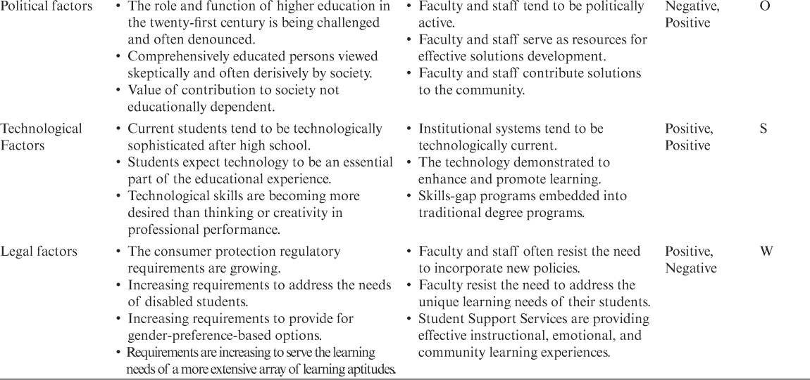

- **评估目标**：机构。
- **测量单位**：对外部权异的内部响应。
- **管理来源**：来自环境扫描的数据。

### 表 6：SWOT 分析。

| 优势 | 劣势 |
| --- | --- |
| 社会期望技术精通，且目前的机构系统使用了先进技术。总来说，教职员工倾向于政治活跃，这使得在课堂上创造政治相关成为可能。 | 监管环境正在增加条款以协助和促进学生学习，但内部教职员工和工作人员正在抵抗这些努力。 |
| 机会 | 威胁 |
| 从外部来看，教育的角色受到攻击，教职员工公开可见，并能够在与外部社区的互动中应对这些权异。 | 大学教育的价值在外部受到质疑，内部机构并未向社会阐明这一价值。 |
| 从外部来看，对学位的需求受到质疑，内部教职员工正在设计新的交付模式以提供非学位选择。 | 内部成本正在上升，产生结果所需的资源正在大幅削减，危及机构的生存。 |

- **评估目标**：机构。
- **测量单位**：环境权异。
- **管理来源**：来自环境扫描的数据。

这一系列评估共同建立了一个系统流程，用于衡量机构的外部内部权异，比较这两种状况，并将比较汇总为对机构在其所处环境中地位的高层评估。

如果这种方法看起来是机械的且缺乏判断或裁量，那么它确实如此。评估过程的相关性取决于评估中所用数据的可靠性和可信度，这些数据被汇总并分类到类别中，以尽可能客观（冷静）地描述机构绩效。其目的是准确地“知晓”存在的状况，以便它们能与其他机构数据相关联，以理解并解释绩效以及有效性。

《高等教育机构效益的机器学习与人工智能方法》，15–29


# 第章

## 衡量与评估结构：预期绩效

### 概述

本章介绍了衡量和评估学术计划设计的工具和方法，以遵循标准并优化学习。功能设计产生了许多机构绩效问题，对设计每个方面的可信和可靠测量为机构改进流程提供了参考。这些工具旨在收集真实数据，以监控组件、流程和程序的设计（`机构愿景`）。产生的数据描述了功能性属性及其对绩效的贡献。

该评估过程衡量了设计的三个维度：课程的设计、计划学习的交付以及计划在外部环境中的可行性（Ali, 2018）。这些评估共同衡量了设计结构实现使命的能力（Casarejos, Gustavson, & Frota, 2017）。

### 衡量课程

交付机构使命、愿景和价值观的过程从课程及其教学的设计开始（Mouren, 1986）。课程和课程设计了教学体验，使学习者能够有效高效地实现机构宣传以及每个学生所寻求的学习（Rubenstein & Ridgley, 2017）。课程对学生的成功产生两种影响：一条可以遵循的路径和防止失败的“护栏”。从教学系统的角度来看，课程创建了学习过程的驱动力和限制。描述课程属性的可靠可信数据的可用性，提供了理解课程设计如何有助于学生成功、留存、保留以及其他教学绩效指标的机会（Duque, 2016; Holder, 2007; Macfadyen & Dawson, 2012）。在这个评估系统中，课程设计的目的是促进和增强入学计划的学生及机构的学习需求（Barnett, Coate, & Society for Research into Higher Education, 2005; Curry & Wergin, 1993, 1997; Diamond, 2008），并包括任何离散的学习单元：计划、专业、主修、辅修、通教育等。


虽然对高等教育中课程设计属性的性能的研究仍然有限，但已有文献阐述了一系列理论属性，这些属性假设能够以创造有效学习体验的方式组织学习（Diamond, 2008; Ewell, 1997; Ferren, 1997; Leow, Neo, & Hew, 2016; Marsh & Willis, 2003）。这些属性形成了一个概念框架，用于衡量和区分课程设计，并衡量其促进机构内学生学习的能力。在这一测量过程中，将有效课程设计的属性与阐述的标准进行比较，构成了对课程连贯性及其对机构绩效贡献的直接衡量。

课程的结构是学习者能够参与预定内容和学习过程的首要考虑因素（Rubenstein & Ridgley, 2017）。学生以符合其智力逻辑的方式来理解和处理学科内容的能力，是使学习投入成为可能的课程属性。因此，对课程设计属性的衡量是学生参与度评估中的一个关键考虑因素。测量数据监控了课程在事务层面的表现，即学习者与其互动并“体验”机构所预期的学习。此外，课程设计与其他职能表现之间的相关性揭示了机构教学过程的协同效应（Sullivan & Wilds, 2001）。

本文提供了一种工具，该工具利用研究文献中提取的标准来衡量课程的“质量”（Diamond, 2008; Ewell, 1997; Ferren, 1997; Marsh & Willis, 2003），基于以下标准：

### 外部有效性内容
该标准描述了课程内容与外部环境预期的一致性。这些预期发表在学科文献、专业领域雇主、许可委员会或认证机构中（Brown, 2017），为课程构建了概念框架。这一维度决定了课程内容的关联性，通过为学习者产生即时性来促进其学习投入。外部有效性内容代表了由各学科专业人士的集体智慧所构思的学科组织，并且更容易被多样化的学习者群体接受，因为创建内容的是多样化的专业人士（这在理论上与学生群体相当）。外部有效性课程确保学习与专业和学科相关，并对多样化的学生群体具有意义（Thompson, Griffith, & Armon, 2014）。

### 覆盖范围
该标准考察了定义项目的成果的广度。这一维度决定了课程传递学科全面概念的能力（Mena Report, 2015; Oprandi, 2014）以及机构的教育目标（Oaks, 2015）。

### 连贯性
连贯性是一个经常被阐述为课程标准但缺乏明确定义的标准。课程与实证学习理论中所阐述的学习心理生理过程的对齐，创造了连贯的学习体验（Marcus, 2001）。这一维度被指定为“概念框架”（Fortuin, Koppen, & Leemans, 2011），有助于学生参与教学系统的能力。将学习理论应用于学习过程的结构设计，是应用了现有的最佳证据来设计以最高效的方式获取和学习材料的最佳机会（Blackmore & Kandiko, 2012; Imam, 2018; Pietarinen, Pyhältö, & Soini, 2017; Pietarinen, Soini, & Pyhältö, 2014）。课程的连贯性是高等教育绩效评估和改进的关键因素（Hurst, 2016; Kress & Selander, 2012; Pautler, 1989）。

### 关联性与对齐
该标准决定了项目学习目标是否合理构建了项目成果。最有效的学习目标将项目成果解析为学生所构建的学习体验（Ellis, 1998; Gurvitch & Metzler, 2013; Marcus, 2011）。这一维度决定了课程提供有效学习体验的能力（Rubenstein & Ridgley, 2017; Swaggerty & Broemmel, 2017）。

### 复杂度
这一维度通过分析课程，确定学习目标中所述的学习深度是否适合课程所交付的学习水平。这一维度决定了学习目标是否创造了适当的严谨性或深度，以产生对项目学习的全面理解（Fortuin et al., 2011; Soleimani & Alaee, 2014）。

### 成果展示
该标准考察课程，确定课程是否为学习者展示项目成果提供了充分的机会。这一维度衡量了设计在课程中的展示项目成果的机会。

使用这些标准作为概念框架，创建了一个工具来衡量课程设计中是否存在这些特征。第一个工具将项目学习目标与其构建的项目成果进行归类。表 7 展示了一个用于衡量课程结构的工具。

该工具要求评估者检查课程对每项标准的展示情况，而不对其好坏进行主观评价。评估者确定每个项目学习目标是否展示了每项标准。分类计数报告了展示每项标准的 get 数量。分类平均值指示了课程设计与每个标准之间的对齐程度（Blouch, Ulrich, & Michenzi, 2016）。所得数据监控了每门课程的设计，并与其他职能数据进行比较，以发现机构绩效与课程属性之间的相关性（Sullivan & Wilds, 2001）。

表 7：课程测量工具。


**假设**：该工具的设计假设课程的设计特征影响学生参与、学习以及在项目中取得成功的能力。该工具收集的信息揭示了学生表现与课程属性之间的相关性。

**目标**：课程。

**测量单位**：课程属性。

**实施**：学科背景的教师。

### 课程测量

学术项目中的课程交付了课程设计所定义的课程内容。课程的集体设计（协同效应）提供了另一个实用的维度，监控课程设计对学习体验的贡献。这些信息描述了课程（组）作为学习过程因素的相互关系。

根据教育文献（Diamond, 2008; Ewell, 1997; Ferren, 1997; Marsh & Willis, 2003），以下属性展示了课程高效交付课程的能力：

**结构**。结构指的是课程有效交付课程的集体能力。虽然课程结构影响学习投入，但课程的集体结构产生了学习体验（Alt, 2015; Borges, Vittori, Nabak, & Lewis, 1998; Clifton, Baldwin, & Wei, 2012; Freeman, Haak, & Wenderoth, 2011）。


## 整合 (Integration)
整合指的是程序学习目标在课程中的分布。实现这一目标有多种方法，由教师团队决定并由他们对学科的概念化所驱动（Bock & Randall, 2014; Islam, Talukder, Taheri, & Blanchard, 2016; Walker & Freeze, 2011）。学习目标根据结果、学习特征、问题解决或其他策略进行分组，以确保课程提供最佳的学习体验。一个理想的模型使每个学习目标以最少次数出现，从而有效地学习该目标。过度处理学习目标会降低学习体验的效率（Dirks-Naylor, Wright, & Alston, 2015）。

## 排序 (Sequencing)
排序是指学习者追求课程的顺序。预计课程内部及课程之间清晰的流程促进学习，确保学生拥有参与每门课程所需的信息（准备就绪）（Bock & Randall, 2014; Dirks-Naylor, Wright, & Alston, 2015; Swaggerty & Broemmel, 2017）。

## 一致性 (Consistency)
一致性衡量课程内学习目标分组与结构的一致性，且每个标准的分类平均值表示了课程组对每个标准的合规性。这些数据描述了课程结构的属性，而没有对好坏进行主观评估。将所得数据与其他功能性性能数据进行比较，以揭示机构性能与课程设计属性之间的相关性。这种策略允许通过学习者与功能之间的交互收集的性能数据揭示机构性能的实际特征。在流程的这一阶段，目标是客观地在个人（学生）层面描述机构的性能。评估展示了每个功能的性能，而意义构建过程展示了每个功能对机构性能的贡献。对机构性能的理解为性能改进的规划过程提供了信息。

在测量阶段收集的个人交易数据会对每门课程进行汇总，通过揭示每门课程与设计标准的对齐程度来评估课程的设计。此评估过程的目的是将课程结构与所采用的机构或特定学科特定模型进行对比（Porter, 2004）。

测量数据在多个机构层面进行汇总和聚合，以展示程序、部门或机构层面的课程结构。

在所有分析层级中使用通用数据集，可以使所有分析层级的评估过程保持一致。表 9 展示了一个评估工具，用于汇总（计数）和聚合（平均值）测量数据，以描述特定课程的属性。


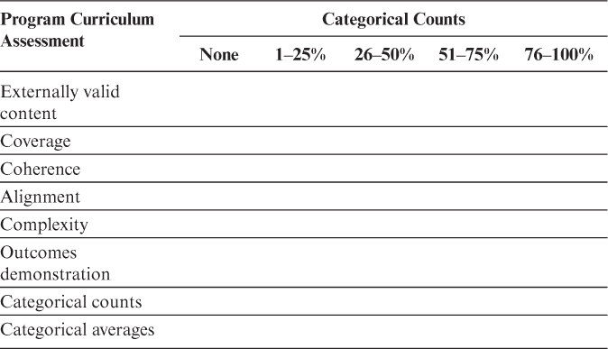

**评估目标**：单门课程。

**测量单位**：课程属性。

**管理**：来自测量的数据。

此层级的分析展示了单门课程的设计属性。分类计数汇总了每个合规类别中存在的实例数量，分类平均值将测量数据聚合为对整个课程结构的展示。在这项评估中，目标是确定课程设计的物理结构。从多门课程收集的数据在部门、分部或其他机构层面进行聚合，以展示这些每个机构性能层面的课程结构。在这些每项评估中都报告了分类计数，以便于将数据重新聚合到多个性能层面的过程。


**评估目标**：机构课程。

**测量单位**：程序属性。

**管理**：来自合规性测量的数据。

表 10 提供了将测量数据聚合为机构层面课程结构评估的示例。

测量数据的分类计数将个人程序数据聚合为机构结构内所有程序课程属性摘要。此评估描述了机构内所有课程对全局设计标准的合规性。这些数据监控多个机构层面的课程设计及其对标准的合规性，并与其他机构数据进行比较，以发现课程结构与机构性能之间的相关性。

### 课程性能评估 (Course Performance Assessment)
在课程测量阶段收集的数据以相同的方式聚合，以描述课程内课程的功能设计，反映其对课程设计所采用标准的合规性。在这种情况下，评估的是课程组的效果。表 11 展示了一种将课程测量数据聚合为评估标准的方法，并利用它们来展示程序内课程的设计结构。
表 11：程序课程结构数据摘要。
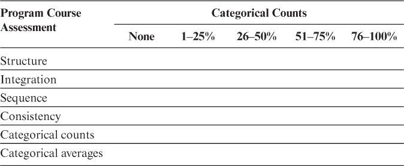

**评估目标**：程序课程。

**测量单位**：单组课程。

**管理**：来自属性测量的数据。


课程测量（Course Measurements）的计数填充了此评估工具，该工具对某组课程的设计进行了汇总（计数），并聚合（平均）了每项标准的结果。请注意，这些数据并非评估单个课程，单个课程需要单独的评估过程。生成的数据还将与其他功能性数据进行比较，以确定课程设计（组）与机构绩效之间的相关性。

为了探索机构层面的课程结构，来自多个项目课程结构测量（Program Course Structure Measurements）的分类计数填充了一个评估工具，该工具对机构内或整个机构的系列项目的课程测量进行了汇总。来自项目评估的分类计数被汇总到各种机构模型中。表 12

**评估目标**：机构课程设计。

**测量单位**：项目属性。

管理：来自属性测量的数据。

这些标准具有全球性，适用于各种情况，并代表了课程设置质量的衡量标准，而非单纯的“质量”。它们提供了一个区分课程设计属性的机会，并将这些属性与学生成功的信誉且可靠的衡量相关起来，从而揭示了课程设计在满足学生学习需求方面的表现。

### 衡量项目学习成果

项目学习成果衡量评估学生作品，用以衡量学生作品多大程度上展示了其学术项目中所交付的项目学习成果。在教学系统的`Student Learning Outcomes`（学生学习成果）测量（稍后将介绍）中编写的学生作品集提供了展示项目学习成果的学生作品。然而，项目学习成果过程的重点是项目设计的性能，旨在培养学生能够展示项目成果。从成果中解析出的项目学习目标构成了用于衡量每项成果展示的标准。

构建一个量表（rubric）来衡量项目成果，该量表使用项目学习成果作为被测量的构建，并使用离散的性能水平对测量进行缩放和区分。评估者使用量表来衡量学生作品，以衡量其对性能标准定义的项目成果的展示。

此处所示量表通过定义的性能类别作为标准进行了缩放，以区分不同的性能水平。该量表是定性（性质）性能类别的定名尺度。该量表使用“无展示”、“基础理解”、“使用理解的能力”以及“熟练或敏捷地使用信息的能力”作为锚点来界定性能水平。此示例中的每项标准都使用相同的量表。

在测量过程中，评估者检查学生作品，以确定学生展示了何种水平的性能。评估类别是独特且清晰定义的，互不重叠，以确保数据的可靠性。

表 13


**假设**：该测量工具的设计假设学生在作品中对成果的展示是项目评估的一个因素。这些数据与其他绩效数据之间的相关性揭示了教学系统结构与学生成功之间的关系。

**测量目标**：项目学习成果。

**测量单位**：项目成果。

**管理**：教师评估学生作品。

**管理频率**：每年一次。


**假设**：该测量工具的设计假设学生在项目学习目标上的表现是学生成功的因素之一。这些数据与其他性能数据之间的相关性，揭示了项目成果展示与项目属性之间的关系。

**测量目标**：项目学习目标。

**测量单位**：项目学习目标。

**实施方式**：教师对学生课程作业的评估。

**实施频率**：每年一次。

这些工具提供了数据，用于监控教学系统交付学习目标的组成部分，而这产生项目学习成果。它们对项目在交付其课程中确定的学习内容方面的表现，提供了可信、可靠且真实的测量。这些数据与其他功能性数据进行比较，以揭示机构表现与学习系统设计之间的相关性。

### 设计评分量表

在项目学习成果的测量与评估中，评分量表（rubrics）引导并结构化了评估者的决策过程，并有助于收集可靠且可信的数据（Mertler, 2001）。本讨论解释了在此过程中使用的评分量表结构以及投入这些设计中的系统性思维。讨论的目的是解释这一系统化过程中提出的评分量表的特征。

研究过程确定了指导设计过程并作为结果评估标准的标准（Mertler, 2001; Smit & Birri, 2014; Tierney & Simon, 2004）。最初的目标是创建用于衡量项目学习成果展示的量表，并迅速演变为一种为了多种目的评估学生学习产品的策略。课程、项目和机构层面创建的评分量表设计之间的一致性，为学生和机构的学习提供了积极且建设性的益处（Diamond, 2008; Tierney & Simon, 2004）。

建立的标准为项目学习测量评分量表的设计了以下标准：

**标准 1**：量表的内容是项目学习成果和项目学习目标。成果构成了测量的构念，而学习目标是测量的标准。

**标准 2**：量表通过评估学生学习作品来衡量成果和目标，这些作品为学生提供了真实展示成果或目标的机会。

**标准 3**：学习目标充当表现标准。

**标准 4**：标准列在量表左侧的第一、二垂直列中，以便评估者能够易地辨别（并区分）所有标准。

**标准 5**：对于每个标准，使用一个四部分的概念框架通过名义量表定义了学习作品中可以展示的表现类别。该量表可以遵循许多学习模型。下模型包含一个使用布鲁姆认知与情感领域、佩里知识与伦理发展模型、能力发展模型以及表现模型的示例（King & Howard-Hamilton, 2000）。

量表的行包含从左到右排序的标准。不使用“接受”、“极小”、“卓越”、“优异”等全局性描述词来标记或描述表现类别，因为这会导致评估者进行主观评价，而不是将标准应用于作业。量表的设计被动地将测量限制在量表所包含的标准内。

**标准 6**：标度模型被转化到行中，以评估每个标准。量表对于所有标准可以是相同的，也可以每个标准独有。在这个示例中，所有表现标准都使用了相同的表现量表。

**标准 7**：每个标准使用的离散、不重叠的表现类别不超过五个，因为区分表现类别的能力会变得越来越不精确且模糊，这会对数据的可靠性构成威胁。

**标准 8**：量表采用网格模式布局，量表的低点在左侧，向右侧的高点移动。大多数文化以这种方式表示时间（进展、发展、学习）。

**标准 9**：量表包含的标准不超过七个，表现类别不超过四个，尽管其中一个表现类别可能是像“项目成果/目标评估量表”中使用的“非表现”类别。

表 15 展示了一个具有多个测量标准的通用量表模型。

表 16 展示了一个量表模型，该模型将这些量表构建标准应用于学习成果测量工具的内容。表现水平使用基于表现的模型进行量化。

用于评估学生学习成就的学生学习产品（在教学系统评估过程中讨论）的量表，与用于评估项目学习成果和学习目标展示的量表相同。

### 评估项目学习

项目学习评估需要汇总两组数据以证明教学系统的成果：项目学习成果和项目学习目标。项目成果评估是对教学系统交付学习成果表现的总结性评估。项目目标评估是对交付这些学习的过程（过程）的形成性评估。

在测量过程中收集的个体数据被汇总和总结，以描述项目学习过程的结果（成果），课程将其阐述为学习目标（课程）。

表 17 提供了一个工具，用于汇总特定项目成果表现的个体测量。测量过程中的学习成果定义了数据汇总类别。

类别计数汇总了每个层级的展示。类别平均值根据每个表现水平的这些计数得出，并展示了每个项目交付其项目成果的表现。

表 15：评分量表模型。

数据还按项目进行汇总，以证明机构向学生交付项目成果的能力。

表 18 提供了一个评估工具，将项目数据汇总为机构层面的学生学习评估。

该工具报告了每个项目每个表现水平的类别计数。根据这些计数计算出的类别平均值展示了每个项目向学生交付其项目学习成果的表现。这些数据还与其他功能表现数据相关联，以揭示成果表现与教学系统其他属性之间的关系。


项目学习目标通过“项目学习目标测量流程”来衡量课程中各项目标的个人表现。这些测量结果被总结并汇总到评估中，用以展示课程在交付每个项目的学习目标方面的表现，而这些目标共同构成了项目产出。从学习产出中解析出学习目标，可以创建一个课程和学习体验的构建模型（Alt, 2015; Brandon & All, 2010; Henson, 2012; Ültanir & Ültanir, 2010）。在这一课程模型中，学习目标产生的结果大于各个目标的总和，这需要学习目标之间存在协同效应。在该系统中，在课程中嵌入展示项目学习产出的机会有助于促进这种协同效应的产生。

### 表 17：项目学习产出数据摘要 – 项目级。


- **目标群体**：完成项目阶段的学生。
- **评估单位**：项目学习目标。
- **管理方式**：教职人员对学生学习成果展示进行评审。
- **频率**：每三年一次。

### 表 18：项目学习产出评估 – 机构级。


- **目标群体**：完成项目阶段的学生。
- **评估单位**：项目学习目标。
- **管理方式**：教职人员对学生学习成果展示进行评审。
- **频率**：每三年一次。

表 19 提供了一个工具，将项目学习目标的测量结果汇总为项目学习过程的形成性评估。

每个单元格记录了在每个学习目标上表现出特定类别的学生人数。分类计数汇总了数据，分类平均值则描述了项目交付构建其每个项目产出的学习目标的能力。

### 表 19：项目学习目标数据摘要工具。

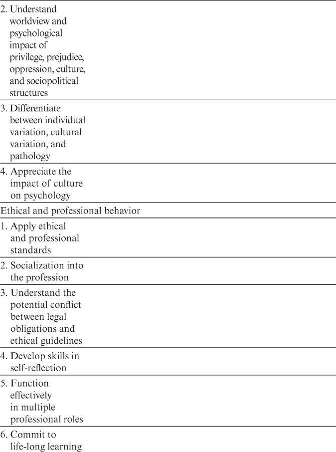
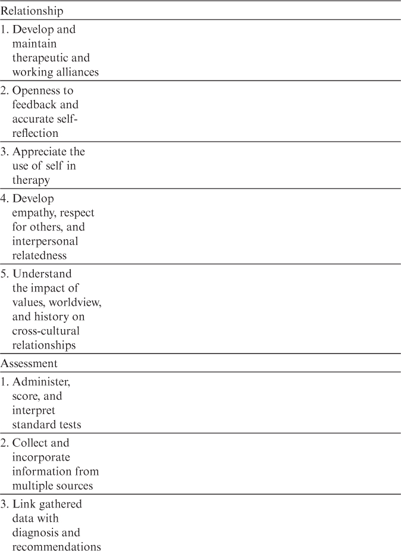
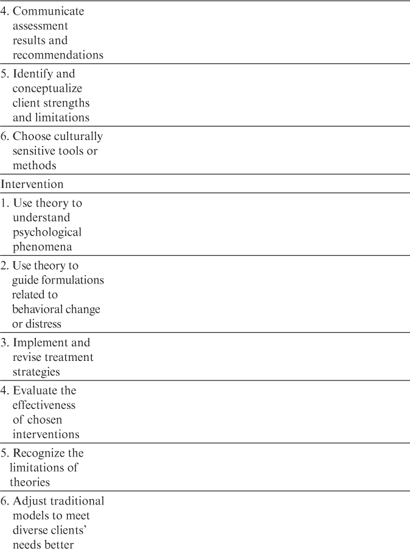
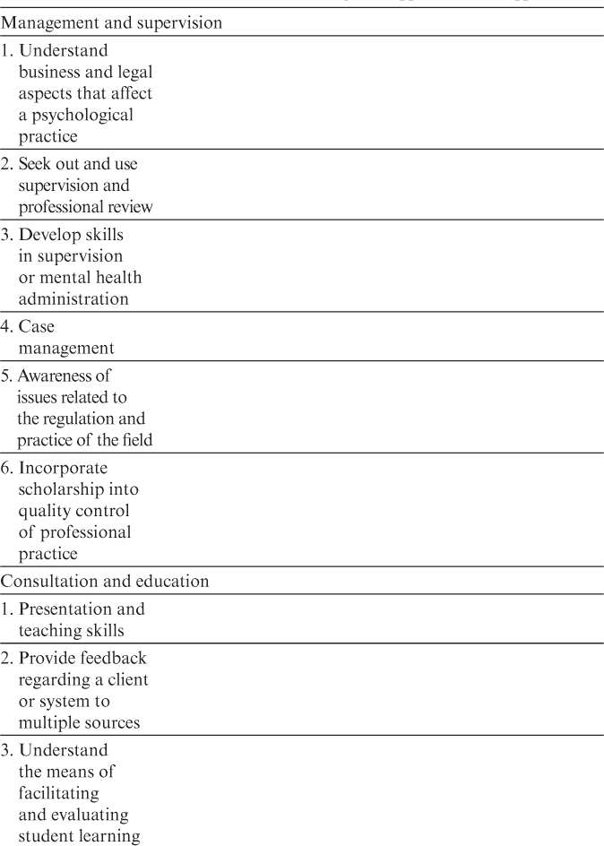
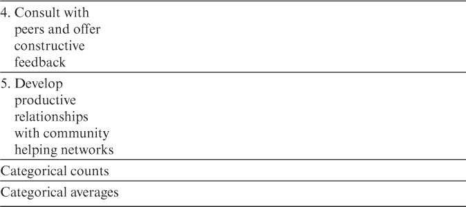

- **目标群体**：修课期间的学生。
- **评估单位**：项目学习目标。
- **管理方式**：教职人员对学生学习成果展示进行评审。
- **频率**：每三年一次。

在机构层面共同探索学习目标的整体表现也是很有用的。

表 20 提供了一个工具，按项目汇总项目学习目标的测量结果，并进行总结，以展示该机构交付其内部所有项目课程学习目标的能力。

分类平均值展示了机构层面项目学习目标交付的表现。分类计数则允许这些数据与其他功能性表现数据相关联，以寻找机构表现与学习目标交付之间的关系。

对这些功能性相关性的寻找需要收集不预设特定模型的描述性数据，这样相关性才能揭示机构表现与教学系统属性之间意料之外的关联。如果数据假设了特定的理论视角，那么这些数据就变成了对理论的测量，而非对教学系统的表现。关于学习投入、体验和成就的理论需要测试，以证明它们在特定机构中的表现（Hurst, 2016）。虽然这些理论为教学系统的设计提供了良好的概念框架，但它们在每个特定且独特的学习环境中的表现需要测量和证明。这种系统性评估方法中的方法和程序使得此类验证性研究成为可能。

### 表 20：机构学习目标评估。

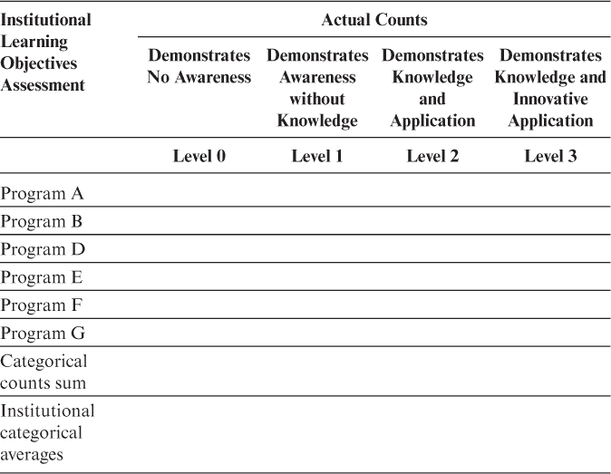

- **目标群体**：修课期间的学生。
- **评估单位**：项目学习目标。
- **管理方式**：教职人员对学生学习成果展示进行评审。
- **频率**：每三年一次。

## 衡量可行性与可用性

作为一个开放系统模型，外部环境的偶然因素驱动并限制着项目。机构的有效性取决于其应对这些偶然因素的能力。一个项目在内部表现良好，但从外部环境的角度来看可能是无关或不必要的。如果没有评估项目应对外部环境的性，项目表现改进策略可能是无效的（Pritchard, Pausits, & Williams, 2016）。

机构环境扫描识别了外部环境中运作的偶然因素。这些因素影响着学术项目的设计和表现，并需要进行测量和评估（Freeman, Chambers, & King, 2016）。项目可用性的测量与评估通过比较两组数据来描述项目表现：与项目相关的外部因素（来自环境扫描）以及项目设计对这些因素的响应（来自机构的任务、愿景和价值观）（Freeman, 2017）。这两个视角之间的关系系统地检查了新项目的可行性或现有项目的可用性（Grosemans et al., 2017）。

`GoF` 分析是一种实现此类分析的研究模型（Bozeman & Feeney, 2008; Demir, 2016; Shayan, Elahi, Ghazinoory, & Hoseini, 2018）。`GoF` 分析是一种统计方法，通过比较两组定量数据来确定这些数据的比较程度。

在应用于可行性或可用性时，该分析描述了学术项目结构与机构的任务、愿景和价值观的匹配程度（Harrison, 2015）。`GoF` 方法论提供了一个相关的概念框架，用于监测项目、外部环境与机构之间的一致性。数据还与其他功能性数据进行比较，以发现功能性表现与外部环境偶然因素之间的相关性。

可行性分析的第一部分是确定项目的 MVVs（任务、愿景和价值观）与机构 MVVs 之间的一致性。表 21 提供了一个工具，衡量项目与机构任务的匹配或一致性。为了演示，该工具使用了假设的机构承诺：有效性、服务他人、价值观驱动的表现、人类尊严和包容，作为所有项目的预期。

评估人员检查课程（或拟议）的内容，以衡量项目与机构任务中所包含维度之间的对齐情况。结果以百分比记录，转换为小数，并对每个维度进行报告。除了监控现有项目的对齐外，这些数据还与其他功能性表现数据相关联，以发现项目属性与机构表现之间的相关性。


计划可行性评估的第二个部分是衡量计划与机构价值观的对齐程度。表 22 提供了一项用于衡量计划与机构价值观之间对齐程度的工具。在这种情况下，标准是机构的价值观：“教育创新”、“全球视野”、“伦理行为”、“多样性与包容性”以及“财务责任”。

### 表 21：机构使命对齐测量表。

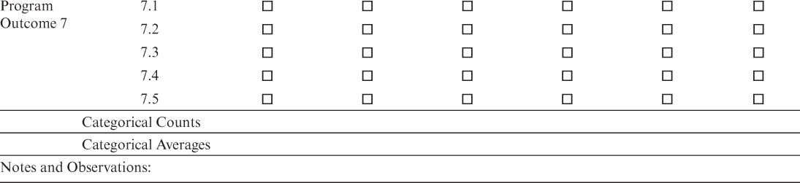

*假设*：该工具的设计假设，计划与其所属机构使命的对齐程度是计划成功的因素。这些数据与其他绩效数据之间的相关性揭示了使命对齐与计划绩效之间的关系。

*目标*：单个计划。

*测量单位*：使命声明中的构构要素。

*施/方式*：管理人员对计划内容的评估。

*频率*：每三年一次。

### 表 22：机构价值观对齐测量表。

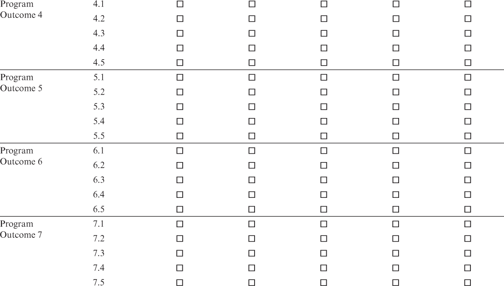


*假设*：该工具的设计假设，计划与其所属机构价值观的对齐程度是计划成功的因素。这些数据与其他绩效数据之间的相关性揭示了价值观对齐与计划绩效之间的关系。

*目标*：单个计划。

*测量单位*：价值观声明中的构构要素。

*施/方式*：管理人员对计划内容的评估。

*频率*：每三年一次。

与使命对齐测量一样，评估人员将计划课程的内容与每个构构要素进行比较，以证明该计划体现机构价值观的何种程度。

可行性测量的另一个部分是对每个计划的竞争对手进行评估。这项分析包括对机构市场中每个相似计划的识别、定义和市场成功情况。

表 23 提供了一项用于识别和衡量计划竞争情况的工具。

第 1 列识别了机构竞争关注区域内提供相似计划的每个竞争计划。第 2 列记录机构名称，第 3-7 列分别报告每个计划授予的证书、计划的认证、当前入学人数、学费和交付模式，并对应每个竞争计划的相应列。市场百分比通过将每个计划的当前入学人数除以机构区域内所有计划的总入学人数计算得出。这些数据提供了对相似计划的系统测量，研究了现有或新计划的成功潜力。

目标人群的独立且离散衡量也是可行性测量的一个关键组成部分。表 24 提供了一项用于衡量和描述现有或新计划每种交付格式的目标人群的工具。

### 表 23：竞争对手测量表。

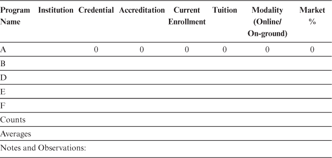

*目标*：单个计划。

*测量单位*：竞争对手属性。

*施/方式*：管理人员对计划的评估。

*频率*：每三年一次。

与使命对齐测量一样，评估人员将计划课程的内容与每个构构要素进行比较，以证明该计划体现机构价值观的何种程度。

目标人群的独立且离散衡量也是可行性测量的一个关键组成部分。表 24 提供了一项用于衡量和描述现有或新计划每种交付格式的目标人群的工具。

### 表 24：目标人群测量表。

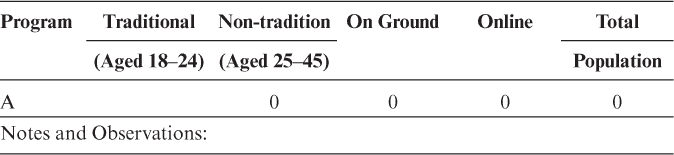

*目标*：目标人群。

*测量单位*：潜在学生。

*施/方式*：管理人员对市场规模的评估。

*频率*：每三年一次。

目标人群的独立且离散衡量也是可行性测量的一个关键组成部分。表 24 提供了一项用于衡量和描述现有或新计划每种交付格式的目标人群的工具。

### 表 25：市场与职业测量表。

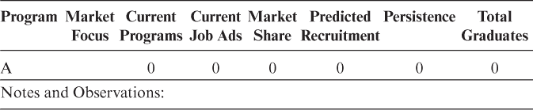

*目标*：潜在入学人数。

*测量单位*：潜在毕业生。

*施/方式*：管理人员对市场规模的评估。

*频率*：每三年一次。

目标人群的独立且离散衡量也是可行性测量的一个关键组成部分。表 24 提供了一项用于衡量和描述现有或新计划每种交付格式的目标人群的工具。（注：此处原文存在重复）

与使命对齐测量一样，评估人员将计划课程的内容与每个构构要素进行比较，以证明该计划体现机构价值观的何种程度。

可行性测量的另一个部分是对每个计划的竞争对手进行评估。这项分析包括对机构市场中每个相似计划的识别、定义和市场成功情况。

表 23 提供了一项用于识别和衡量计划竞争情况的工具。

第 1 列识别了机构竞争关注区域内提供相似计划的每个竞争计划。第 2 列记录机构名称，第 3-7 列分别报告每个计划授予的证书、计划的认证、当前入学人数、学费和交付模式，并对应每个竞争计划的相应列。市场百分比通过将每个计划的当前入学人数除以机构区域内所有计划的总入学人数计算得出。这些数据提供了对相似计划的系统测量，研究了现有或新计划的成功潜力。

目标人群的独立且离散衡量也是可行性测量的一个关键组成部分。表 24 提供了一项用于衡量和描述现有或新计划每种交付格式的目标人群的工具。

计划可行性的最后一项测量是对于交付计划所需的基础设施的测量。在此用法中，基础设施是指必须参与计划交付的机构功能集合（Dougherty & Natow, 2015; Holbeche, 2017）。

表 26 提供了一项工具，用于衡量机构现有资源在多大程度上适用于交付计划。

当前教师计算显示了对计划学科有兴趣和专业知识的机构教职人数。教学设计能力、学生服务、招生、财务援助和职业服务的计算旨在估算计划对这些职能当前容量的影响。


为了进行决策制定，能够比较多个计划的结果以评估其成功的潜力至关重要。表 28 了一了一个汇总多个计划评估数据的工具。

每列报告了测量阶段六个数据收集过程之一的摘要。每行报告单个计划的值，而列则比较了一系列计划中每个类别的值。这种展示计划可行性的方法为理解计划成功的潜力创建了一个系统化的流程。本评估中呈现的数据还与其他功能性数据相关联，以寻找机构绩效（institutional performance）与计划可行性之间的相关性（Casarejos, Gustavson, & Frota, 2017）。

### 表 26：基础设施测量。

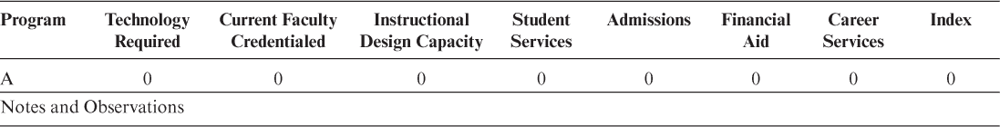

- **目标**：机构能力。
- **计量单位**：机构资源。
- **管理方式**：管理人员对可用资源的评估。
- **频率**：每三年一次。

### 表 27：计划可行性数据摘要。

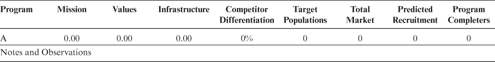

### 表 28：计划可行性评估。

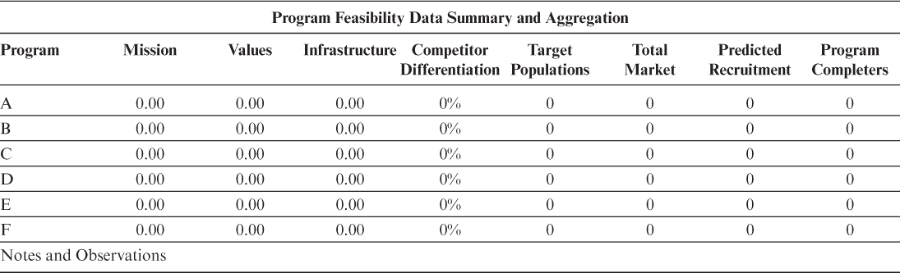

- **目标**：新计划或现有计划。
- **计量单位**：计划属性。
- **管理方式**：管理人员对计划属性的评估。
- **频率**：每三年一次。

高等教育机构效能机器学习与人工智能方法，31–75
版权 © 2019 由 John N. Moye
保留任何形式的复制权
doi:10.1108/978-1-78973-899-520191003

# 第 4 章

## 教学测量与评估：预期绩效

### 教学系统

教学系统包含了学生为了获得计划中所规定的学习内容而与之交互的学习环境的所有方面。该系统包括课程的内容和结构、课程组件的设计、教学策略、学习资源以及教学支持（Clouder, Cureton, & Steventon, 2016; Rubenstein & Ridgley, 2017）。对教学系统的评估需要测量学生与教学系统所有组件的交互，以确定他们交付预期学习的能力（Lecca, 2015）。这种有效性的最佳证据是学生对教学系统组件在多大程度上帮助他们学习的感知（Allen & Nichols, 2017; Bell & Aldge, 2014; Macfadyen & Dawson, 2012）。

教学系统包含四类交互：学习投入、学习体验、学习成就和学习支持。这些类别协同作用产生一个动态的学习系统，对这些每个构构进行测量使得研究这些类别之间的交互成为可能。本节考察了教学系统的直接测量。下一节详细介绍了教学支持服务的测量与评估。系统化评估分别测量这些功能，并将这些测量结果汇总为对整个教学系统的评估。

### 教学愿景

教学系统包含了学生为了获得计划中所规定的学习内容而与之交互的学习环境的所有方面。该系统包括课程的内容和结构、课程组件的设计、教学策略、学习资源以及教学支持（Clouder, Cureton, & Steventon, 2016; Rubenstein & Ridgley, 2017）。对教学系统的评估需要测量学生与教学系统所有组件的交互，以确定他们交付预期学习的能力（Lecca, 2015）。这种有效性的最佳证据是学生对教学系统组件在多大程度上帮助他们学习的感知（Allen & Nichols, 2017; Bell & Aldge, 2014; Macfadyen & Dawson, 2012）。

教学系统包含四类交互：学习投入、学习体验、学习成就和学习支持。这些类别协同作用产生一个动态的学习系统，对这些每个构构进行测量使得研究这些类别之间的交互成为可能。本节考察了教学系统的直接测量。下一节详细介绍了教学支持服务的测量与评估。系统化评估分别测量这些功能，并将这些测量结果汇总为对整个教学系统的评估。

### 测量学习投入（课堂观察）

学习投入被定义为获取或访问信息过程中教职工、课程组件与其他学生之间的交互。这些交互决定了学生获取预期学习的能力。学生参与学习过程的主要途径之一是与教师在教室内外的交互（Scheerens & Blömeke, 2016; Taut & Rakoczy, 2016）。课程组件、教材、媒体等等结构和格式影响学生投入学习的能力（Heikonen, Pietarinen, Pyhältö, Toom, & Soini, 2017）。


此测量工具用于记录描述教师在实时课堂中活动和行为的数据。该工具要求观察者每一分钟识别一次正在发生的互动类型。观察者使用间隔计时器或带有秒针的手表，记录每一分钟发生一次互动。这种方法产生了互动的系统性样本，客观地描述了这些互动。

该工具可以扩展以包含更多数量的观察结果或其他互动标准，例如教学效能模型（Scheerens & Blömeke, 2016）。主工具的实施不需要任何专门培训或学习理论知识；它观察的是通用且离散的互动行为。如果该工具扩展到包含教学模型（Fisk, 2016），则观察者需要接受这些模型在理论和实践方面的培训。

### 表 29：学习投入度观察表。

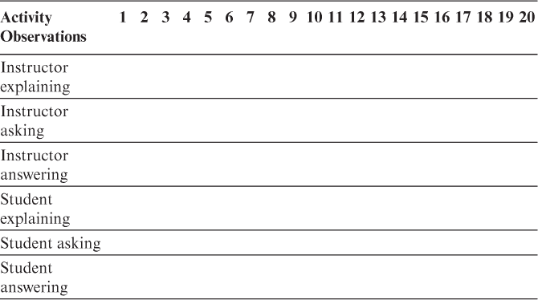

*数据来源*：教师的课堂互动
*测量单位*：互动。
*实施方式*：课堂互动期间教师的观察。

该工具的目的是描述教师与学生之间互动的质量，而不是判断教学的效力。这些数据直接（真实地）衡量了这些互动的特征。衡量的是学习投入的质量，而不是教师或教学。产生的数据描述了课堂投入策略的绩效，并在与其他功能性数据比较时，揭示了机构绩效与投入策略效力之间的相关性。

## 测量学习体验（课程组件测量）

上述上述学生与教师的互动外，学生与课程教学组件之间的互动也定义了学习体验（Chianese, 2015）。学生与教学系统组件之间的互动产生了学习体验。这些测量的目的是为学生与教学组件互动的效力提供一个可靠且可信的描述。与某些组件的互动有助于学习投入，而其他组件则贡献于学习体验的特征以及产生的学习环境。

学习体验的测量需要测量教学系统所有组件影响学生学习需求的能力。这些组件对学习的影响是只有学生才知道的信息，是从每位学生那里收集的（Blair & Valdez Noel, 2014; Grebennikov & Shah, 2013; Seale, 2010）。该问卷衡量的是学生与课程组件互动的质量，而不是教师。

表 30 提供了一份在课程中或结束时发给学生的问卷，用于收集学生对每个组件促进学习目标和成果能力的感知。在这种情况下，问卷是收集这些测量结果的有用工具。

问卷是一种工具，它通过直接提问要求受访者评估其外部的状况，而调查则倾向于收集主观意见（Bowman-Bowen & Menard, 2016）。问卷中的问题具有更强的结构性，并将受访者的注意力集中在对特定刺激的反应上。

通过此“学习体验问卷”收集的信息将信息组织成课程设计、教学系统和学习评估的构念。问题（内容）根据教学系统的设计假设衡量这些构念。每个问题都要求学生描述课程组件在多大程度上帮助他们学习课程材料。

该工具产生的数据描述了课程组件帮助每位学生实现学习目标的效力。该工具对回答的含义或合适性不作任何假设；它的设计仅用于描述课程组件支持所有人学习课程目标的能力。通过这些数据，教职员工和工作人员评估这些信息以评估学习体验的效力。这些回答还与机构绩效数据相关，以揭示机构绩效与课程属性之间的关系。

### 表 30：学习体验问卷。

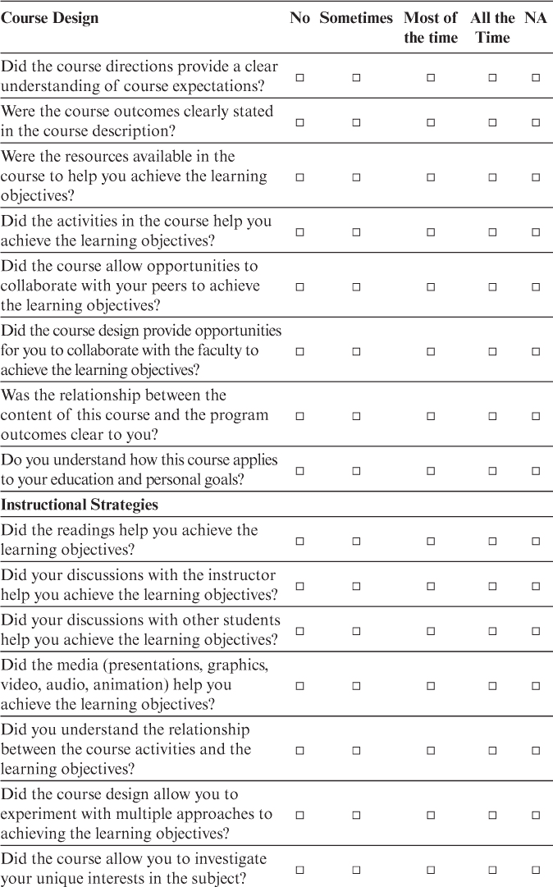

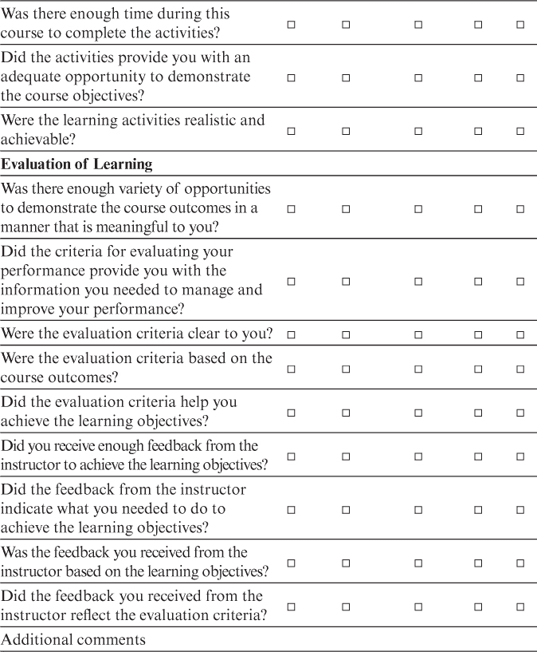

*假设*：该工具的设计假设学生对学习体验交付项目学习目标能力的感知是学生成功的因素。这些数据与其他绩效数据之间的相关性揭示了学习体验属性与项目绩效之间的关系。
*目标群体*：每门课程学生的体验。
*测量单位*：教学互动。
*实施方式*：特定课程的学生。

## 测量学习成就（档案集、先验学习测量）

研究教学系统效力所测量的最后一个因素是该教学系统产生的学习成就的衡量。学生与教学系统互动产生的学习，衡量了学生在其工作产品中展示预期成果的能力。衡量学习成就需要既衡量项目成果又衡量项目（课程）学习目标的数据（Penn, 2011）。这些成果的测量是课程评分的独立过程，对随机抽取的工作产品进行，以通过通用性最大限度地减少教职员工的工作量。

学习成果的测量通过汇集选定的学生工作产品形成发展性档案集来有效地进行。学习素材是在项目课程期间汇编的，或通过独特的项目课程（如毕业设计或专题课程）生成的。作为测量过程的一部分，学生选择他们认为展示了每项成果的素材。

在本文介绍的模型中，项目成果和项目学习目标定义了每个项目学习成果的构念和内容衡量，这些是档案集的一个部分。测量量表协助教职员工收集可靠且可信的项目学习成果衡量。表 31 展示了一个学生学习成果档案集的模型，该模型衡量了一个假设性心理学项目的成果。


第 1 列识别了待测量的项目成果。第 2 列识别了定义和衡量第 1 列项目成果的标准（来自项目学习目标）。第 3 列要求学生识别其选择用于评估的成果，第 4 列要求学生解释该成果如何证明了该成果。每位学生都以其特定且符合兴趣的方式展示每项标准。这种工具并非寻求寻找标准错答案，而是为每位学生提供一个机会，以对其有意义（真实）的方式展示每项标准。

表 31：学生学习成果作品集。

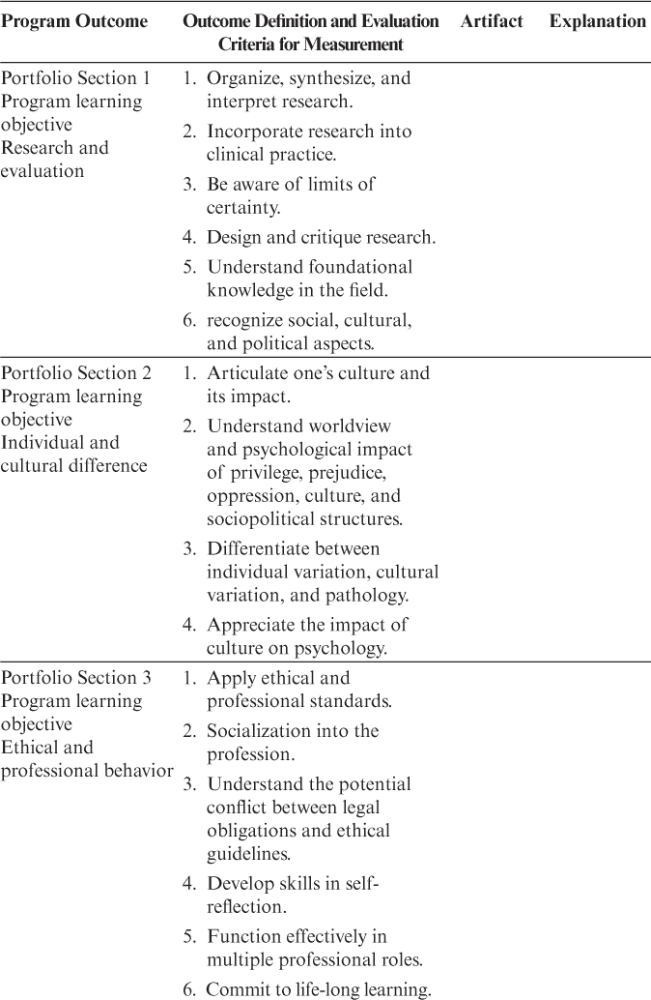
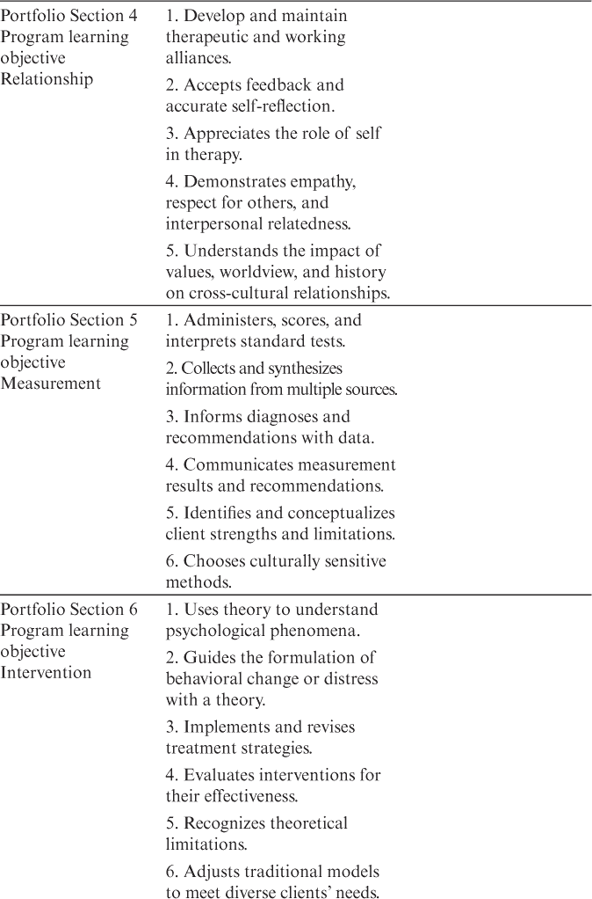


**假设**：工具的设计假设项目学习目标已整合到项目成果中，并通过学生作品集进行衡量，以向学生和评估者说明项目学习目标与成果之间的相互联系。这些数据与其他性能数据之间的相关性揭示了学生成效与教学交付之间的关系。

**数据来源**：学生学习成果展示。

**分析单位**：教学系统。

**实施**：由学生填充来自课程或先验学习的成果。

从该工具收集的数据监控了学习者在项目中通过展示的学习成就功能。学生成效是机构有效性的关键组成部分（Kuh et al., 2015; Oaks, 2015）。

### 先验学习衡量

这一过程的额外益处是，该作品集还可以使用评价该项目学生工作相同的标准来开展先验学习衡量。在进行先验学习衡量的情况下，学生提交其工作经历或过往学术活动等的成果，以证明每项标准和成果。用于评估成果的标准在两项评估中是相同的，这确保了先验学习衡量与完成学术项目的学生工作成果的评估是等同的。

总而言之，这一系列测量提供了可信赖且可靠的数据，以监控教学系统引导学生学习、促进学习以及交付项目学习成果的功能。这些数据与其他功能数据相关联，揭示了学生成效与教学系统属性之间的关系。

### 评估学习参与度（观察法）

学习参与度数据包含告知学生参与度两个维度的信息：互动策略的变异以及随时间变化的速率或模式。在本例中，收集的数据假设没有首选的参与模型；它们衡量了师生互动期间观察到的互动。这些数据汇总并聚合为对单次互动的评估，展示了教师使用的互动策略以及这些策略在时间维度上的分布。该模型也可以与教职员工认为理想的首选互动模型进行比较（Houser & Frymier, 2009）。

表 32 展示了填充了假设数据的测量工具，用于描述一个特定的课堂环节。

该工具将单节课程的数据可视化，揭示了互动的分布情况以及其的变化速率。最后一列的摘要统计了观察到的每种策略的次数，这些信息被用于计算每种策略的使用百分比。这种可视化揭示了教师在课堂上促进的学习参与度概况。

一系列课程的数据针对每位教师进行了汇总和聚合，以描述单位教师的集体表现（Walker & Freeze, 2011）。这种聚合揭示了每位教师正在使用的学习参与度方法。

表 33 展示了一个描述教师使用的学习参与度策略的工具。

表 32：学习参与度数据报告。

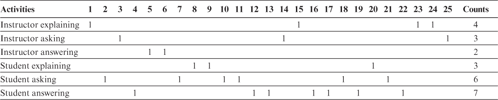

**假设**：该工具的设计假设教师与学习者之间的互动分布和变化速率驱动了学生的参与。这些数据与其他性能数据的相关性揭示了教学交付与学生参与之间的关系。

**目标群体**：单一课堂。

**评估单位**：课堂互动。

**实施**：数据的编制与聚合。

表 33：个人教师多门课程的参与策略分布。

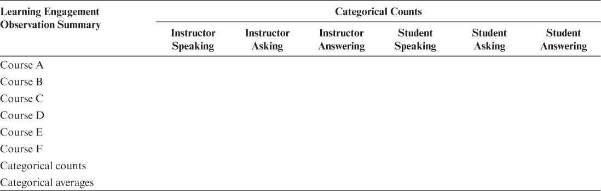

**目标群体**：个人教师。

**分析水平**：学习参与模型。

分类平均值通过分类计数计算并聚合为每个教师的评估。这些数据也可以在项目层面进行聚合，以揭示学生所经历的学习策略。在这种情况下，分类计数汇总了每类互动的使用百分比。

表 34 展示了描述项目学习参与度策略的数据聚合工具。在这项评估中，每位教师的计数计数相加，以提供项目按互动类别的总计数。计数计算了项目内学生经历的每类互动的百分比。

这些数据将机构的愿景声明与学习参与努力的执行情况进行比较。

最后，测量数据被聚合为评估工具，以描述整个机构的学习参与策略。该评估将整个机构的学习参与策略与机构愿景声明进行比较，以描述对机构愿景的合规性。

表 35 展示了聚合为机构愿景评估的测量数据。

这一系列评估能够从多个维度展示机构教师的学习参与策略，创建教师学习参与策略的总结。除了教师观察外，数据还与其他功能数据进行比较，以发现学习参与属性与机构绩效之间的相关性。这种对学习参与策略的系统评估揭示了学习参与策略对机构有效性的贡献。

### 评估学习体验（课程组件评估）

课程组件问卷收集的数据衡量了课程组件促进每门课程学生学习的能力，评估了学习体验。这些数据描述了每门课程设计向学生交付学习目标的有效性。表 36 展示了一个汇总和聚合单门课程学生数据的工具。


所有学生的数据都汇总在一起，以证明每个课程组件的有效性，从而促进当前修读该课程的学生群体学习。这种有效性随学生群体的班级不同而异。然而，这种跨越时间和人群的差异确保了评估包含了多样化认知风格的观点，从而产生全面的结论。

表 34：学习参与度数据摘要。

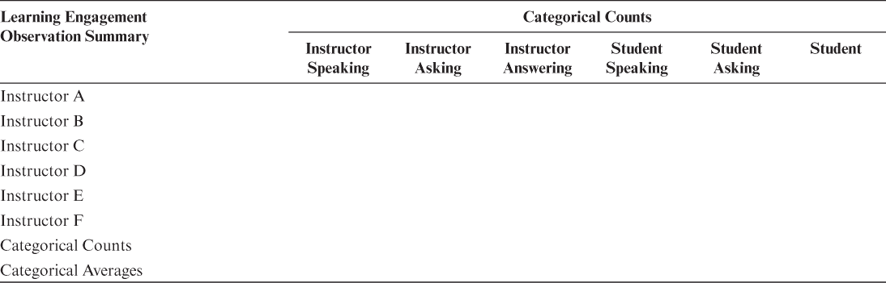

*目标群体*：教师的组织小组。
*分析层级*：项目。

表 35：学习参与度数据聚合。

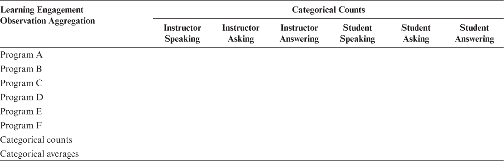

*群体*：机构。
*评估层级*：机构。
*频率*：年度。

表 36：学习体验数据报告。

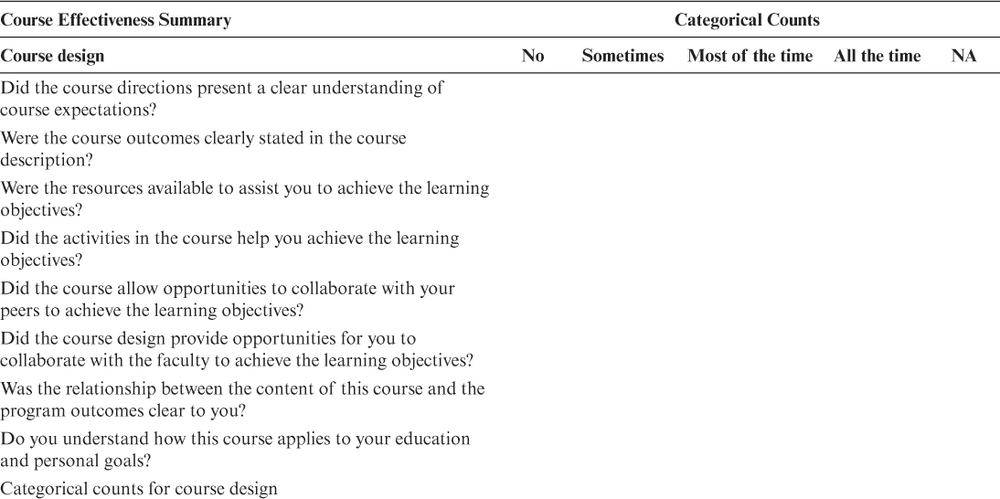
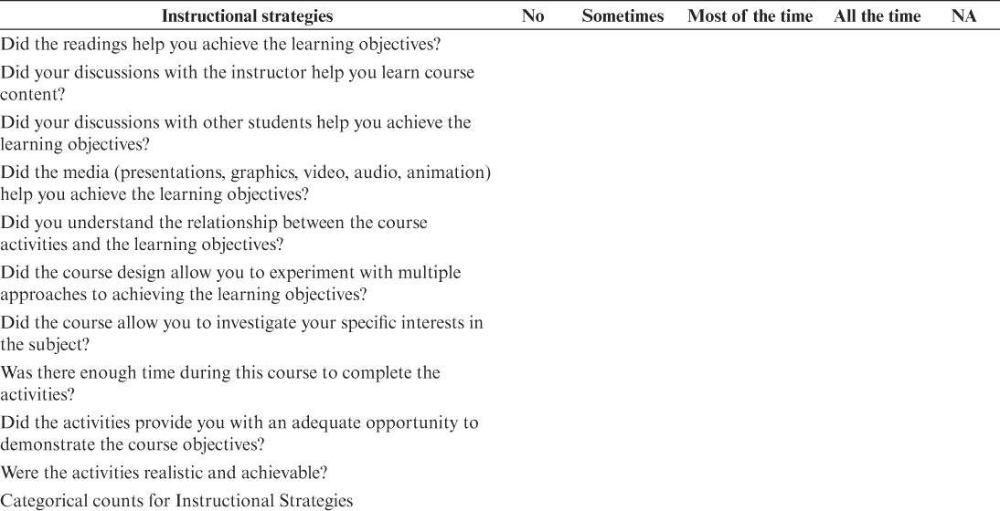
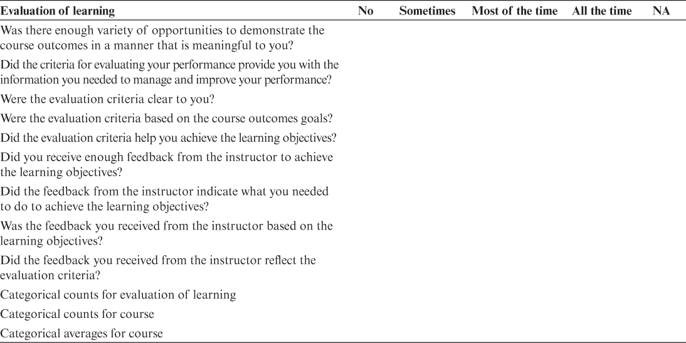

*目标群体*：学生 × 课程。
*评估单位*：单门课程。
*管理时间*：课程期间。
*频率*：每门课程结束。

分类计数针对学习环境的每个维度进行了汇总：学习参与度、学习体验和学习成就。该模型中的分类平均值描述了课程的有效性。分类计数则提供了与业务数据的额外聚合和比较，以揭示机构绩效与教学系统属性之间的相关性。

这些数据还被汇总为对一个项目内课程有效性的评估。表 37 展示了一种评估工具，它将测量数据汇总并聚合为该项目内所有课程的评估。

表 37：学习体验数据摘要。

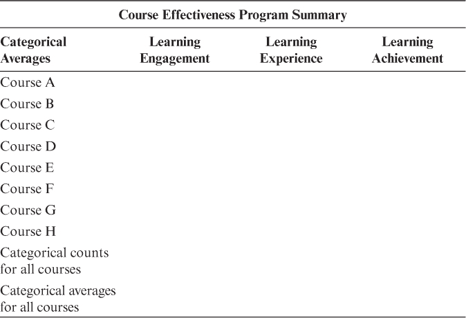

*目标群体*：课程 x 项目。
*评估单位*：参与度、体验和成就。
*管理时间*：按每个学期计算。
*频率*：每个学期结束。

每门课程的分类计数为学习参与度、学习体验和学习成就这三个类别中的每门课程创建了平均值。所有课程的分类平均值评估了项目内的课程（或其他课程分组），并将所有课程的分类平均值与机构绩效数据进行比较，以揭示项目课程属性与机构绩效其他方面的相关性。这种方法将由多名教师教授单门课程原始数据聚合为该项目内所有课程的摘要，证明了特定项目内教学系统的有效性。

表 38 展示了一种评估工具，它将测量数据聚合为该机构内所有课程的指标。这些数据描述了机构级教学系统的整体有效性，并与其他功能性数据进行比较，以确定教学系统属性与机构绩效之间的相关性。

分类平均值评估了机构内所有项目的有效性。机构的总计数与其他机构绩效数据进行比较，以揭示机构绩效与总教学系统特定属性之间的相关性。

表 38：学习体验数据聚合。

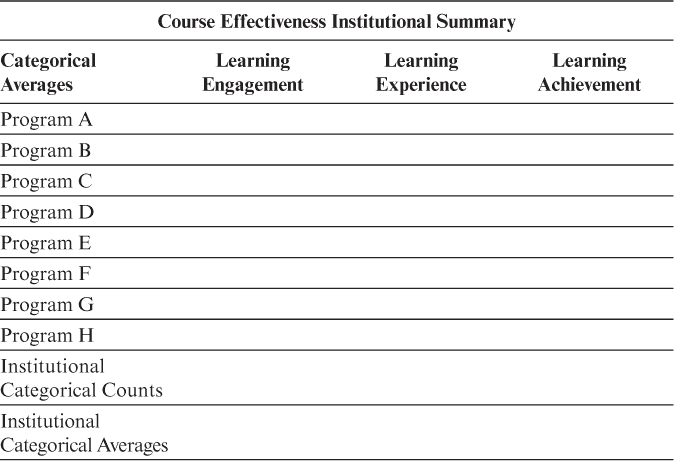

*目标群体*：机构。
*评估单位*：参与度、体验和成就。
*管理时间*：按每个学期计算。
*频率*：每个学期结束。

对这些相关性的寻找要求在不预设特定模型的情况下收集数据，以便这些相关性可能揭示机构绩效与教学系统属性之间意料之外的关系。大多数关于参与度、体验和成就的理论都是未在特定机构工作条件下经过测试的理论。虽然这些理论为设计教学系统提供了概念框架，但它们对每个特定且独特学习环境的有效性仍需测量和证明。该系统中创建的工具提供了进行这些评估的数据。

这些评估通过汇总从现有最佳证据（即体验系统的学生）中真实收集的可靠且可信的数据，证明了整个教学系统的有效性。这一系列测量产生的数据集可以进行挖掘，以回答关于教学系统性能的特定研究问题。

高等教育机构有效性的机器学习与人工智能方法，77–98
版权所有 © 2019 John N. Moye 
保留任何形式的复制权利
doi:10.1108/978-1-78973-899-520191004

# 第 5 章

## 测量与评估支持服务：预期绩效

### 定义学生支持服务

与机构组织的所有组件一样，学生支持服务需要以使命、愿景和价值观声明形式存在的概念框架，以促进绩效并衡量结果 (Perl & Noldon, 2000)。这种组织或战略计划对于支持服务可能更为关键，因为服务是过程而非产品。此外，支持服务帮助学生满足其特定需求，且解决方案和结果并不是标准化的。系统地监控、证明和增强这些过程绩效的能力对于机构的成功至关重要 (Pickering & Sharpe, 2000)。

学生支持服务在三个责任领域帮助学生：体验性学习体验、教学和学习支持以及过渡支持。这些类别中包含了大量令人印象深刻的专业领域，以支持多样化的人和思想，并体现学生支持服务对机构成功的贡献 (Chambers, 2011; Holder, 2007; Levy & Polnariev, 2016)。

有许多学生服务组织模型设计了这些功能 (Ellis, 1998; 2010)。为了演示之目的，以下陈述为学生服务的测量提供了概念框架。

表 39 展示了一个模板，用于设计和阐述高等教育机构内学生服务功能的使命、愿景和价值观。

在该示例中，机构的使命、愿景和价值观转化为体验学习、教学支持和过渡服务维度下的学生服务功能。创建此模型的程序与创建机构使命、愿景和价值观的程序相同，但受到机构声明的约束。在这些陈述中识别出的概念构建了学生服务功能每个组件的性能测量，其内容与每个责任领域特定 ((Harrison, 2015) Maloshonok & Terentev, 2016)。

表 39：学生服务功能的使命、愿景和价值观。

| | **成果** | **陈述** |
| --- | --- | --- |
| 使命: | | |
| 教学和学习支持体验 | 促进学生成功 | |
| | 支持学生发展 | |
| | 引导学生学习体验 | |
| | 促进体验性学习体验 | 学生支持服务的使命是促进学生成功、支持学生的智发展、引导学生学习并为所有学生提供体验性学习体验 |
| 愿景: | | |


# 体验式学习体验 || 促进沟通与社区建设

- 持续教育（终身学习体验）
- 维护学习体验的完整性
- 让学生了解成功的流程
- 辅导
- 辅教
- 建设性问题解决

我们通过学习活动来实现我们的使命，促进全校范围的沟通、持续教育，维护学习体验的完整性，并告知学生有助于他们成功的流程。我们通过有效的辅导、辅教和建设性的问题解决来完成这些任务。

### 价值观

### 转接支持 || 成功的学生
- 相信学习是一生的终身事件
- 成功的毕业生
- 社区活动家
- 稳定的家庭

### 表现 
- 尊重学生的时间限制
- 理解学生对其困境的感知

我们参与这些活动是因为我们看重成功的学生、终身学习、成功的毕业生、社区活动家以及稳定的家庭。为了实现我们的使命和愿景，我们将精力集中在表现上，尊重学生的时间限制，并理解学生对他们生活中困境的感知。

由于这些衡量的目标是支持性服务，因此需要了解这些服务对学生学习的影响。学生是每个职能服务其特定需求的真实来源和最佳证据。因此，该工具衡量的是过程（满足他们的需求）的有效性，而不是最终结果，结果受学生支持服务之外许多因素的影响（Ellis, 1998）。

这些工具要求学生报告他们对每个职能如何帮助他们学习和成功的感知。学生对服务在装备和激励他们成功方面的有效性的感知，是“支持”功能的关键组成部分（Chambers, 2011; Holder, 2007; Levy & Polnariev, 2016）。

## 衡量满意度

在这些工具中，学生的感知通过模拟一个或多个满意度实证构因素的问题来提供满意度衡量。虽然“你对……满意吗”是一个可以接受的问题，但对于机构的有效性来说，它产生的信息不足以改进机构表现。

问卷调查是以结构化或框架化方式收集个人和个性化信息的工具（Sheu, Mejia, Rigali-Oiler, Prime, & Chong, 2016）。问卷询问的是收敛性问题，关注外部刺激产生预期内部反应的影响，而调查倾向于询问关于内部结果的发散性问题（你对……有多满意）。在衡量过程中，目标是衡量服务人员所采取策略（无论策略是什么）的有效性，以达到学生预期并需要以成功的结果，而无需具体指定这些结果（Dumitrescu & Martinsson, 2016）。

工作满意度的评估已证实了满意度的衡量性（Dawis, 2004）。工作满意度模型提供了一种系统性的、基于科学的满意度衡量方法，并被适用于学生支持服务（Bowling, Wagner, & Beehr, 2018; Forero & Gómez, 2017; Sheu et al., 2016）。

有五种满意度实证模型被用于量化和衡量学生支持服务职能中的满意度（Dawis, 2004）。这些是：

1. **需求的满足** – 策略和方法是否提供了成功所需的指导，例如，教学支持服务。
2. **价值观的实现** – 体验是否反映并效法了声明的价值观，例如，社交体验。
3. **预期的实现** – 体验是否交付了为其创造的预期，例如，转接支持服务。
4. **公平性的感知** – 体验是否以平等的尊重和协助帮助了所有学生、文化和性别，例如，多样性和跨文化服务。
5. **社会信息处理** – 体验是否为小组或体验式学习创造了机会，例如，社区学习体验。

由这些满意度模型构建的问题衡量了学生支持服务的有效性。每个工具中的问题都包含了所有五个满意度模型的示例，以匹配服务对学生成功的预定贡献。每个工具都使用相同的“李克特型”量表，以帮助受访者衡量他们的回答（Uebersax, 2006）。

## 衡量体验式学习服务

许多策略提供了体验式学习；其中大多数策略的意图是创建一个学习体验社区（Levy & Polnariev, 2016）。这些体验为每个学科的学习提供了实践背景，并增强了教学体验，使其包含了全球范围（社会信息处理）的活动。相关活动为所有计划的学习体验提供了即时性，并为机构创造了学习文化（Kennedy-Phillips, Baldasare, & Christakis, 2015; Lee, 1995）。体验式学习体验的作用是增强全体人口的学习体验（Bauer, Stevenson, & IGI, 2014; Fink & Hummel, 2015）。

特别报告、校园生活活动或实习，交付了学生服务职能的体验式学习部分，以使学生参与学术社区（Pomerantz, 2006; Terkla & O’Leary, 2014）。

在本演示中，所有学生支持服务的共同概念是“对学习的支持”，在这种情况下，是社区或集体学习（Kooy, 2015; Wilson, Gochyyev, & Scalise, 2017）。[表 40](#CH005.html#tab40）提供了一个问卷，用于衡量学生生活办公室的贡献，该办公室在这一虚拟机构中管理学生支持功能的体验式学习部分。

该问卷要求受访者报告他们对学生生活服务在满足其预期和创造对他们有意义的社区学习体验方面的性的感知。并非所有学生都有相同的需求，因此问题的回答尊重个人学生带入情况的需求和兴趣，并不提供好坏的衡量，而是描述为了满足他们的兴趣和需求所提供的服务。这种方法接受学生现状及其在发展中的阶段，并寻求推动他们朝着个人目标前进。

所得衡量代表了个人对产品促进每个学生学习能力的感知。因此，衡量的是服务满足机构所有学生“需求”的能力，这是对服务“支持”所有学生需求的直接衡量。这些数据监控学生生活服务的有效性，并与其他职能数据进行比较，以发现机构表现与学生生活表现属性之间的关联。

实习体验是一种扩展学生体验以与专业社区互动的策略，并将专业经验作为学术体验的一部分（Moore, 2014）。[表 41](#CH005.html#tab41）提供了一个问卷，用于衡量实习体验对学生支持功能体验式学习部分的贡献。


假设：该工具的设计假设学生生活活动是创建社区学习体验的组成部分。这些数据与其他性能数据之间的相关性揭示了学生生活供给与学生支持服务交付之间的关系。

- **目标群体**：参加过学生生活办公室活动的学生。
- **测量单位**：学生对活动的满意度。
- **管理人员**：服务用户。
- **频率**：每节。

表 41：实习/校外体验的测量。

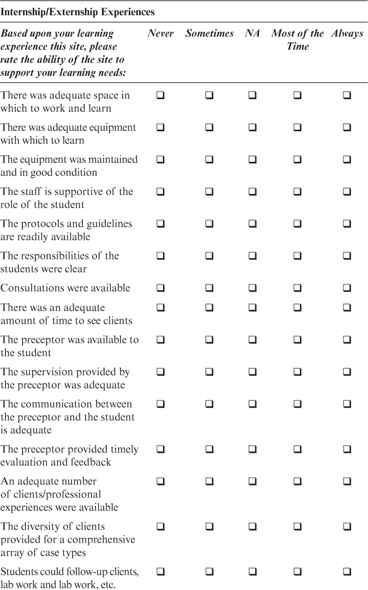
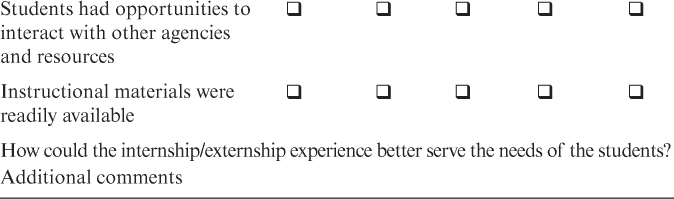

假设：该工具的设计假设实习/校外体验的质量是学生支持服务功能中体验式学习部分交付的因素。这些数据与其他性能数据之间的相关性揭示了实习体验与学生支持服务功能之间的关系。

- **目标群体**：参加过实习/校外项目的学生。
- **测量单位**：学生对实习/校外的满意度。
- **管理人员**：服务用户。
- **频率**：每节。

作为体验式学习的一个组成部分，实习/校外体验提供探索职业机会的质量，是对该部分对学生支持服务功能中体验式学习部分贡献的直接衡量。该工具衡量了实习/校外项目提供能够“符合参与者预期”的学习体验的能力。

产生的数据监测了实习/校外服务提供有意义的外部学习体验的能力。这些数据与其他功能性能数据进行比较，以揭示机构绩效与实习体验属性之间的相关性。

### 衡量学生学习支持服务

学习支持服务以多种形式和交付方式存在，以适应不同学生群体的认知风格。一个离散过程衡量了学习支持服务通过提供个性化策略和解决方案来促进和增强每个学生学习的能力（York, Gibson, & Rankin, 2015）。这些工具衡量了教学支持服务在这些服务的个体中促进和影响学生学习的能力。表 42 展示了一个工具，用于衡量学术成功中心对学生支持服务功能中教学支持部分的贡献。

表 42：学术成功中心测量。

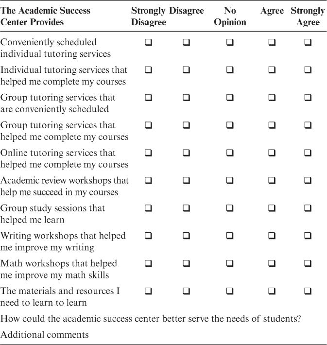

假设：该工具的设计假设学术成功中心的质量是学生支持服务功能中学习支持部分交付的因素。这些数据与其他性能数据之间的相关性揭示了成功中心绩效与学生支持服务功能之间的关系。

- **目标群体**：使用过学术成功中心的学生。
- **测量单位**：学生对学术成功中心的满意度。
- **管理人员**：服务用户。
- **频率**：每节。

该问卷要求使用过服务的学生识别学术成功中心提供的服务在多大程度上帮助他们应对个人学习挑战。为了使这些服务可用并有用，它们必须在物理上对学生可用，并且是及时的。产生的数据监测了学术成功中心服务支持学生学习需求的有效性。

图书馆在学生支持服务中提供了一个类似但独立的功能。*美国图书馆协会*（American Libraries Association）为高等教育机构的图书馆制定并发布了标准。这些标准提供了表 43 所示工具的内容，该工具衡量了图书馆对学生支持服务功能中教学支持部分的贡献。

图书馆问卷要求学生评估图书馆设施和服务的可用性和便利性，以帮助他们进行个人学习。这些图书馆服务可能以物理或虚拟形式提供，且两种情况下的问题相同，因为提供的服务都能有效有助于这两种交付方式。

表 43：图书馆问卷。

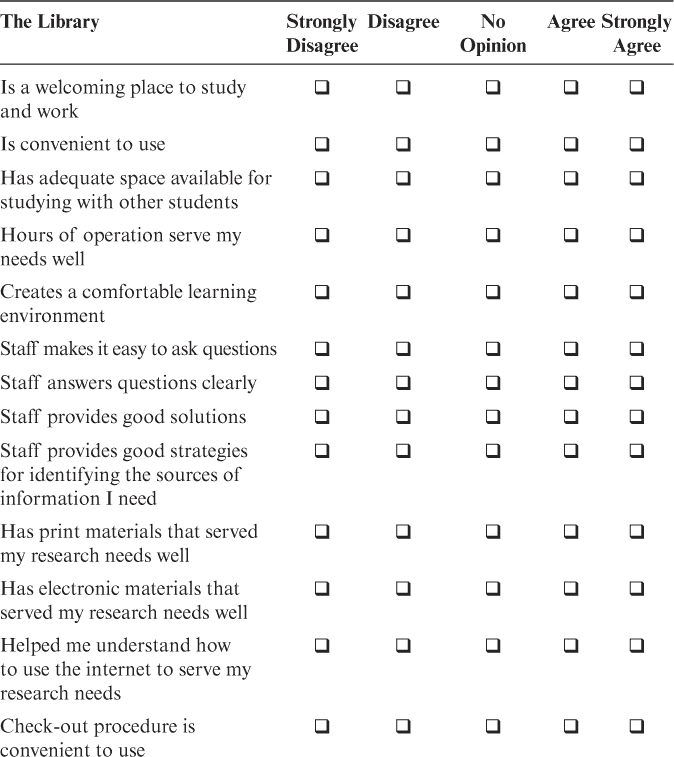
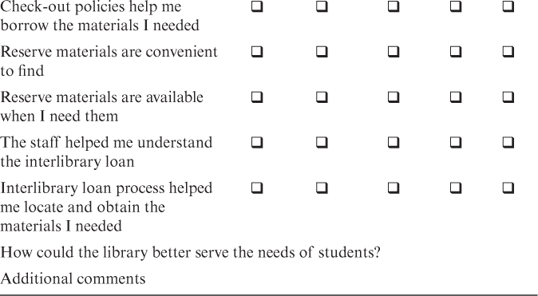

假设：该工具的设计假设图书馆的质量是学生支持服务功能中学习支持部分交付的因素。这些数据与其他性能数据之间的相关性揭示了图书馆绩效与学生支持服务功能之间的关系。

- **目标群体**：使用过图书馆的学生。
- **测量单位**：学生对图书馆的满意度。
- **管理人员**：服务用户。
- **频率**：每节。

这些数据监测了图书馆服务履行学生学习需求的有效性。数据与其他功能数据进行比较，以揭示机构绩效与图书馆功能属性之间的相关性。

对于学生来说，一项基本且必须的服务是为特殊需求学生提供便利设施。这些服务单独向各种监管机构提供各种报告，并仅在使用这些服务的学生进行。这里的问题涉及物理准入以及学习准入可用性。

表 44 展示了一个工具，衡量残障服务对支持服务功能中教学支持部分的贡献。

残障服务测量中确定的服务是联邦机构和《美国残疾人法案》（*Americans with Disabilities Act*）要求的。在许多州，机构所在州还阐述了额外的要求，该工具必须包含这些特殊要求。产生的数据监测了残障服务的有效性，以确保有残障的学生能够获得所有学生都能获得的学习体验。

表 44：残障服务测量。

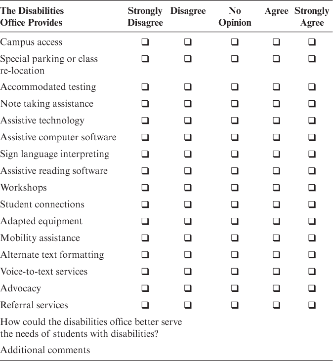

假设：该工具的设计假设残障服务的质量是学生支持服务功能中学习支持部分交付的因素。这些数据与其他性能数据之间的相关性揭示了残障服务绩效与学生支持服务功能之间的关系。

- **目标群体**：使用过残障服务的学生。
- **测量单位**：学生对残障服务的满意度。
- **管理人员**：服务用户。
- **频率**：每节。

最后一项也是监管要求的服务是由经过专业培训并持有执照的咨询师提供的咨询服务的存在和可用性。这些服务的重点是学术咨询，帮助学生在学术上取得成功并适应学习环境。表 45 展示了一个工具，衡量咨询服务对学生支持服务功能中教学支持部分的贡献。

表 45：咨询服务测量。

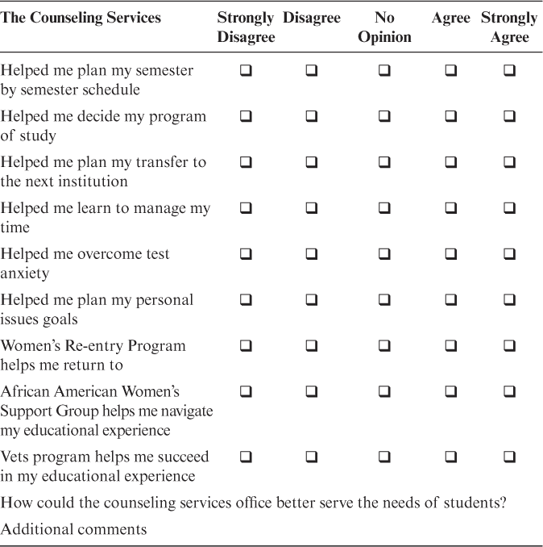


假设：该工具的设计假设咨询服务的质量是影响学生支持服务功能中学习支持服务部分交付的因素。这些数据与其他性能数据之间的相关性，揭示了咨询服务表现与学生支持服务功能之间的关系。

**目标群体**：使用过咨询服务的学生。

**测量单位**：学生对咨询服务的满意度。

**实施人员**：服务使用者。

**频率**：每次会话。

咨询服务办公室为有各种表现需求的学生提供支持和指导。此问卷要求使用过这些服务的学生评估这些服务在帮助他们社交及学术方面取得成功方面的有效性。产生的数据监测了咨询服务在支持寻求帮助的学生入学和学习需求方面的有效性。

这系列工具衡量了某机构教学支持组件样本的有效性，以满足利用这些服务的学生的需求和兴趣。每个组件都经过单独测量，产生的数据监测了该服务的表现。这些数据还将与职能性能数据进行比较，以揭示机构表现与学生支持服务功能属性之间的相关性。

## 衡量学生过渡支持服务

学生支持服务功能的最后一个部分是支持学生从学术生活过渡到下一阶段的生活体验，可能是个人、职业或教育方面的。学生体验的结果可能是成功就业、深造教育或其他生活经历，学生服务功能必须支持所有可能性。衡量过渡支持组件协助学生从机构过渡到下一阶段生活体验的能力，是学生支持服务功能有效性的关键部分。

许多机构的职业服务办公室或就业办公室提供过渡服务。该办公室为学生离开机构时获得就业、深造教育或其他广泛的其它经历做准备。来自该办公室的数据是大多数机构认证和监管要求的关键组成部分，这些机构通常在学生毕业多年后仍继续提供服务。表 46 中所示问卷要求学生报告一个假设的职业服务办公室对学生支持服务功能过渡部分的贡献。

迄为止讨论的工具收集的数据侧重于学生支持服务功能每个服务和组件的特定贡献。除了这些特定数据外，从完成学习计划并经历过学生支持服务的学生那里收集数据，从更全局、完整的视角来看是有用的。这两组数据的比较往往会揭示惊人的差异，从而识别出服务、组件和功能的巨大改进空间。

研究生学生支持服务问卷发放给毕业生，要求他们反思整个学习体验并报告支持服务对他们成功的贡献有多大。在他们的经历期间定期进行的问卷通常显示出负面结果，因为在测量时服务是不完整的。在学术经历结束时，学生能够更客观地评估服务对其总成功的贡献。表 47 提供了一个问卷，用于衡量学生支持服务功能对他们成功的整体贡献。

研究生调查要求学生对支持其学习体验的学生支持服务提供全局评估。这些数据监测了整体功能的成功情况，并与其他职能性能数据进行比较，以揭示机构表现与学生支持服务功能属性之间的相关性。

这系列工具提供了全面衡量学生支持服务功能对学生成功贡献的数据。虽然这些数据旨在评估功能每个组件的贡献，但数据还与其他职能数据进行比较，以确定职能性能与学生支持服务功能特定属性之间的相关性。这些相关性往往揭示意之外的关系，并提供动态数据为改进决策提供参考。

### 表 46：职业服务测量。

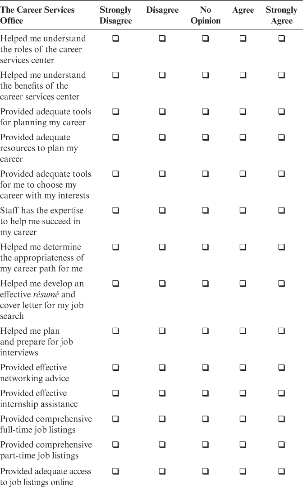

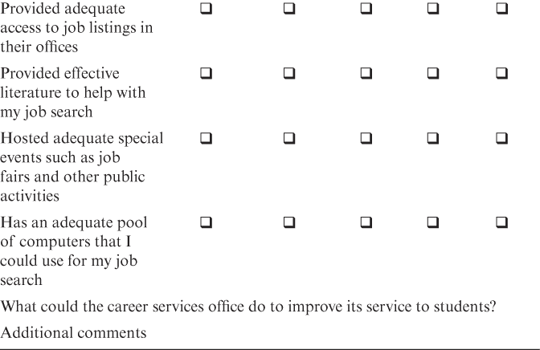

假设：该工具的设计假设职业服务的质量是影响学生支持服务功能中过渡服务部分交付的因素。这些数据与其他性能数据之间的相关性，揭示了职业服务表现与学生支持服务功能之间的关系。

**目标群体**：使用过职业服务的学生。

**测量单位**：学生对职业服务的满意度。

**实施人员**：服务使用者。

**频率**：每次会话。

虽然实证框架和理论制定了帮助学生的策略，但来自真实来源收集的可信且可靠的数据证明了它们在特定环境下的有效性（Duque, 2016）。这种证明对于学生支持服务特别相关，因为这些服务正在根据学习者的复杂性和认知风格管理差异化的策略。

## 评估学生支持服务

学生支持服务的评估通过将测量数据汇总并分类到支持服务使命、愿景和价值观构要素所定义的类别中来实现。这些数据模型创建了数据的多个视图，展示了支持服务在服务、组件、职能或机构层面的预期表现（Henning & Roberts, 2016）。

### 表 47：研究生学生支持服务测量。

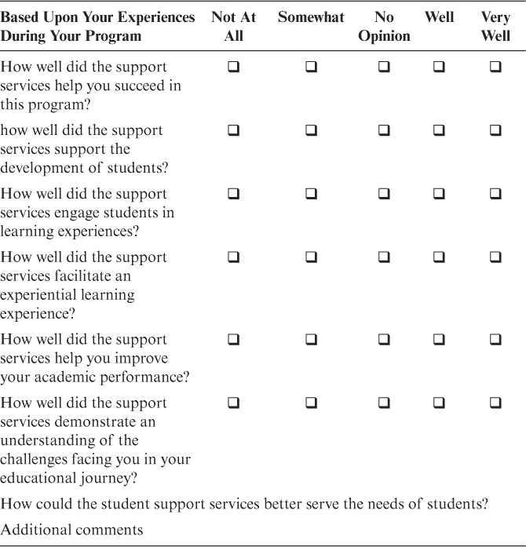

假设：该工具的设计假设学生支持功能的质量是学生成功完成课程的因素。这些数据与其他性能数据之间的相关性，揭示了学生支持服务表现与学生课程完成之间的关系。

**目标群体**：所有毕业生。

**测量单位**：学生对学生支持服务的满意度。

**实施人员**：服务使用者。

**频率**：每次会话。


服务级评估汇总了每个单项服务的测量数据，并描述了每个服务及其组成部分的性能。这些数据向使用这些服务的个人证明了服务的有效性。组件级评估将测量数据汇总到支持服务功能中三个组件的类别中：体验式学习、教学支持和过渡服务。功能级评估汇总了每个项目的测量数据，以展示学生服务功能对其所服务的不同项目的性能。这些多个维度的目的目的是向学生、组件、功能以及机构展示学生服务的预期性能和其有效性。这些数据还将与其他功能性数据进行比较，以揭示机构性能与功能属性之间的相关性。

## 体验式学习评估

支持服务功能中的体验式学习组件提供学生生活以及实习/校外实践体验服务。这两项服务分别和共同进行评估，以展示它们的个体性能以及它们对创建学生支持服务功能中的体验式学习体验组件这一大目标的贡献。

表 48 显示了学生用户响应的摘要，并描述了学生生活办公室为每个学生创建学生支持服务体验式学习组件的贡献。

分类计数行显示了每个性能类别的总计数，这些数据计算了每个性能类别的分类平均值。其他评估将分类计数汇总为分类平均值，从而展示了服务的性能。

这些数据被重新聚合，以展示学生生活办公室对每个学术项目的贡献。每组学生的特定需求取决于他们所从事的学术学科的性质和结构。因此，适用于文科类项目的相同策略可能无法满足高级科学项目学生的需求。

表 49 显示了每个项目原始测量数据的聚合，以探索学生生活服务对不同项目学生成功的贡献。

同样的方法被用于学生支持服务的所有组件，用以评估组件、学生服务功能和机构。

通过按“不同”项目对每项服务的数据进行聚合的过程，产生了一种研究相同策略的性能与不同认知风格学生之间相关性的能力。这些中的差异或分歧为进一步理解每项学生服务的性能和有效性提供了机会（Binswanger & Oechslin, 2015; Snehal & Kremer, 2010; van Woerkom & Sanders, 2010; Young, Alibali, & Kalish, 2012）。

表 50 提供了一个工具，汇总来自学生支持服务功能体验式学习中实习/校外实践组件个体用户收集的数据。

这种对个人响应的汇总展示了每项服务满足其服务的学生需求的有效性。

表 48：学生生活服务评估。

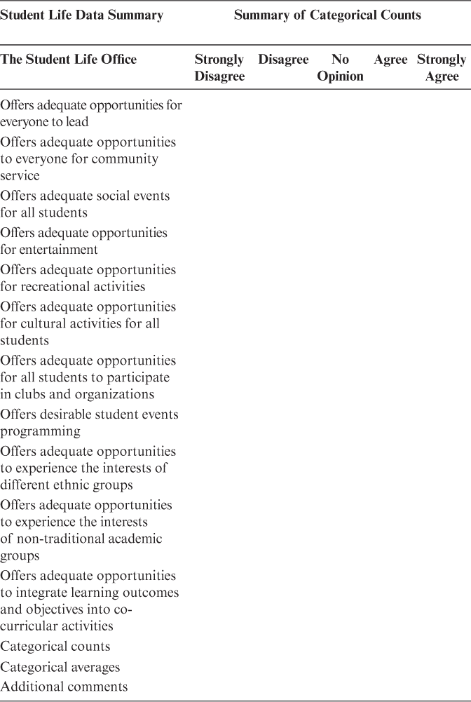

目标群体：组件学生用户。
评估单位：学生生活办公室。
管理：从原始数据计算。
频率：每年一次。

表 49：学生生活组件评估。

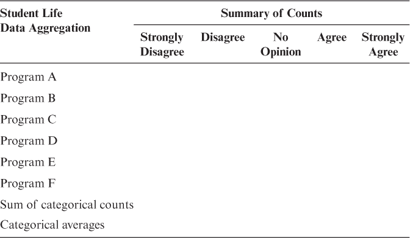

目标群体：组件学生用户 × 项目。
评估单位：学生生活办公室。
管理：从原始数据计算。
频率：每年一次。

表 50：实习/校外实践体验服务评估。

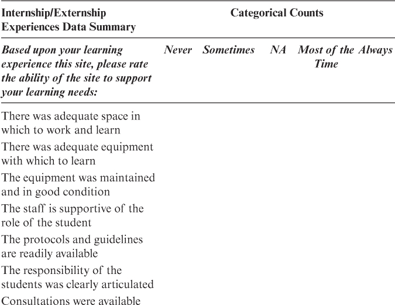
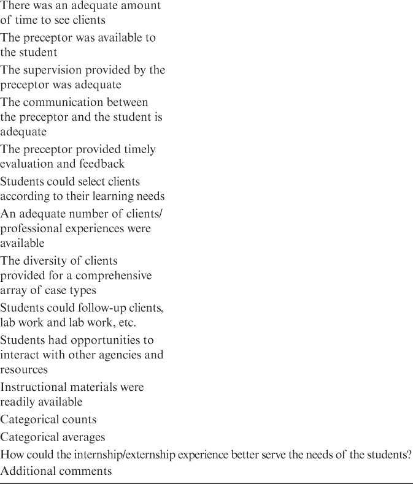

目标群体：组件学生用户。
评估单位：实习/校外实践组件。
管理：从原始数据计算。
频率：每年一次。

表 51 提供了一个工具，按项目汇总实习/校外实践用户的数据，以展示实习/校外实践体验满足每个学术项目中个体用户需求的能力。

这些表格中的聚合分类计数展示了在最终评估中学生体验式学习组件对支持服务功能的贡献。总体而言，学生生活组件和实习/校外实践服务提供了学生支持服务功能的体验式学习组件。

## 学生学习支持服务

相同的格式用于评估每个学生支持服务组件和功能，并展示其有效性。表 52 提供了一个工具，汇总个体用户响应，以展示学术成功中心作为服务对学生支持服务功能教学支持组件贡献的有效性。

表 53 提供了一个工具，将个体用户响应汇总为学术成功中心服务对学生支持服务功能教学支持组件性能展示（Brigman & Hanson, 2000）。

不同项目响应之间的差异和分歧再次为进一步理解针对不同认知风格的服务性能和有效性提供了可能。

表 51：实习/校外实践体验组件评估。

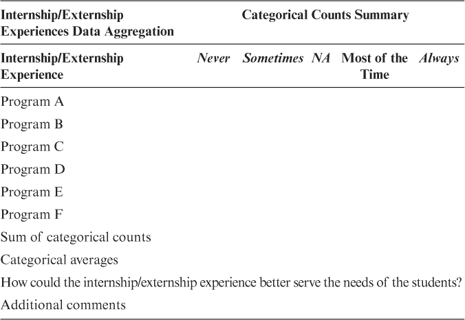

表 52：学术成功中心服务评估。

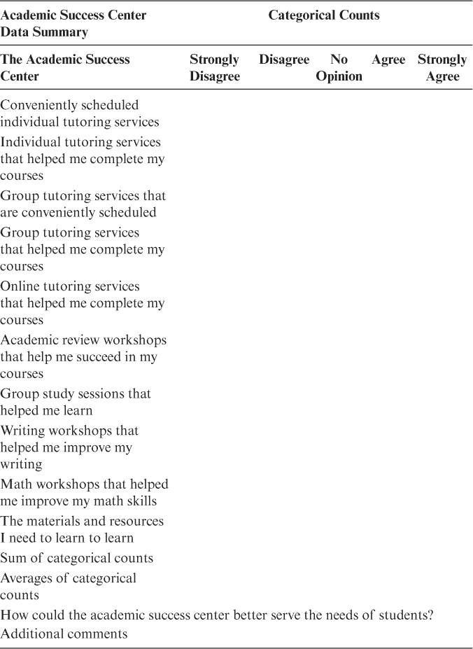

目标群体：组件学生用户。
评估单位：学术成功中心。
管理：从原始数据计算。
频率：每年一次。

表 53：学术成功中心组件评估。

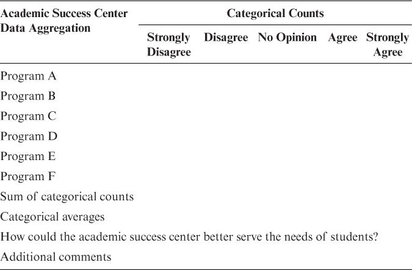

目标群体：组件学生用户。
评估单位：学术成功中心。
管理：从原始数据计算。
频率：每年一次。

表 54 提供了一个工具汇总个体用户响应，展示图书馆作为学生支持服务教学支持功能中一项服务的性能。

表 55 提供了一个工具，将图书馆用户响应数据汇总为对图书馆支持每个项目教学努力能力的评估，以对每个项目学生支持服务功能教学支持组件的贡献。

表 56 提供了一个工具汇总个体用户响应，展示残障服务作为学生支持服务功能教学支持组件中一项服务的有效性。

表 57 提供了一个工具汇总个体用户响应，展示残障服务对学生支持服务功能教学支持组件贡献的有效性。

表 58 提供了一个工具汇总个体用户响应，展示咨询服务作为学生支持服务功能教学支持组件中一项服务的性能。


表 59 提供了一个工具，将个人用户响应汇总，以展示咨询服务的绩效情况，从而为该机构每个每个项目的教学支持部分做出贡献。

### 表 54：图书馆服务评估。
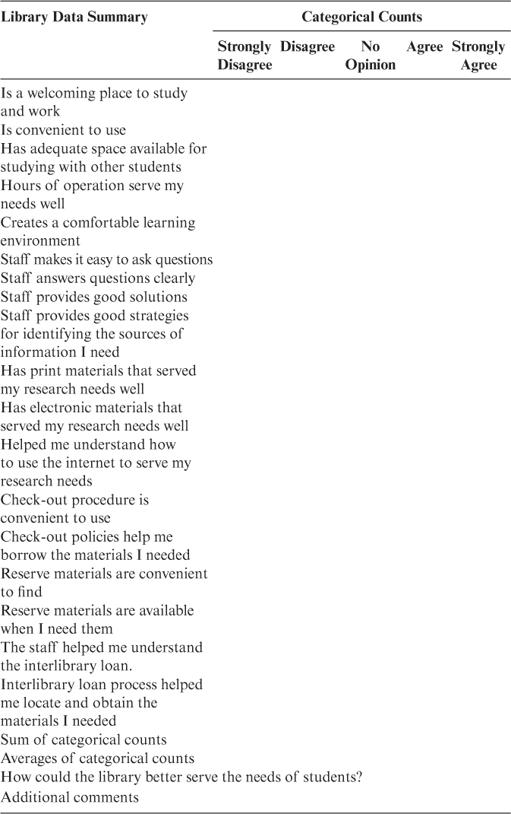

目标群体：该组件的学生用户。
评估单位：图书馆。
管理方式：根据原始数据计算。
频率：每年一次。

### 表 55：图书馆组件评估。
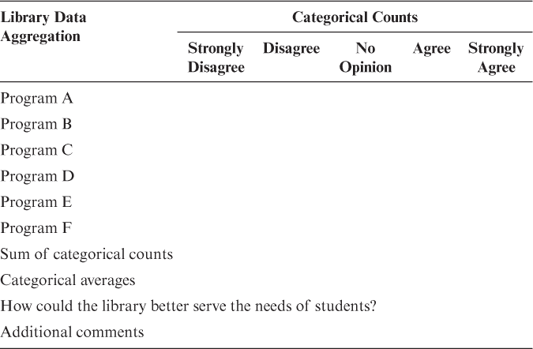

目标群体：该组件的学生用户。
评估单位：图书馆。
管理方式：根据原始数据计算。
频率：每年一次。

### 表 56：残障服务服务评估。


目标群体：该组件的学生用户。
评估单位：残障服务。
管理方式：根据原始数据计算。
频率：每年一次。

### 表 57：残障服务组件评估。


目标群体：该组件的学生用户。
评估单位：残障服务。
管理方式：根据原始数据计算。
频率：每年一次。

### 表 58：咨询服务服务评估。


目标群体：该组件的学生用户。
评估单位：咨询服务。
管理方式：根据原始数据计算。
频率：每年一次。

学术成功中心、图书馆、残障服务和咨询服务共同履行了学生支持服务功能中的教学支持部分。这些评估被进一步汇总，在机构层面形成对该功能的展示，并与功能性数据进行比较，以揭示学生支持服务功能属性与机构绩效之间的相关性。

### 表 59：咨询服务组件评估。


目标群体：该组件的学生用户。
评估单位：咨询服务。
管理方式：根据原始数据计算。
频率：每年一次。

### 学生过渡支持服务

一个中心化的职业服务办公室负责履行学生过渡支持功能。在所考虑的这一学生支持服务假设模型中，该办公室专门负责这些服务。

表 60 提供了一个工具，汇总个人用户响应，并评估职业服务办公室对学生支持服务功能中过渡服务组件的贡献。

表 61 提供了一个工具，将学生个人用户数据汇总，以展示职业服务办公室为每个项目提供学生支持服务功能中过渡服务组件的绩效情况。

学生过渡服务的测量数据将与功能性数据进行比较，以揭示机构绩效与过渡服务属性之间的相关性。

表 62 提供了一个评估，以证明学生支持对学生支持服务功能三个组件的贡献。

### 全球学生服务评估

对学生服务功能对机构内学生贡献的全球评估，汇总了《研究生服务问卷》的数据。这项测量在项目结束时进行，以对这些服务对学生体验的贡献提供总结性评估。

### 表 60：职业服务服务评估。


目标群体：该组件的学生用户。
评估单位：职业服务。
管理方式：根据原始数据计算。
频率：每年一次。

### 表 61：职业服务组件评估。


目标群体：该组件的学生用户。
评估单位：图书馆。
管理方式：根据原始数据计算。
频率：每年一次。

### 表 62：学生支持组件评估。


目标群体：所有用户。
评估单位：学生服务组件。
管理方式：根据原始数据计算。
频率：每年一次。

表 63 提供了一个工具，将这些全球数据汇总，以展示学生支持对其学术成功的整体贡献。

表 64 提供了一个工具，将每个服务的学生个人用户数据汇总，以对提供组件的评估以及学生支持服务功能对机构绩效的总贡献进行全面评估。

表中的全球数据将与各个组件评估中的数据进行比较，以揭示从这些多视角差异中可能产生的相关性或推论。这些评估以提供服务的预期意图为框架，并供学生支持服务人员用于展示学生支持服务功能的有效性。

### 表 63：研究生学生支持服务功能评估。


目标群体：毕业学生。
评估单位：全球服务。
管理方式：根据原始数据计算。
频率：每年一次。

### 表 64：研究生支持服务机构评估。


目标群体：毕业学生。
评估单位：支持服务组件。
管理方式：根据原始数据计算。
频率：每年一次。这些这些数据还将与功能性数据进行比较，以揭示机构绩效与学生支持功能属性之间的相关性。

在学生支持服务评估中，个人数据监控每项服务的绩效，汇总数据展示了组件和服务对项目的有效性，而全球数据则将毕业学生（总结性评估）与“在读中”的学生（形成性评估）的回进行比较。这些评估共同为学生支持服务的有效性提供了全面的展示。


在前面的章节中，仪器收集了可信、可靠且真实的数据，用于在机构职能与利益相关者之间的事务层面或服务点层面，衡量功能系统的性能。这些数据描述了职能为完成工作而使用的各个流程和程序的结果，并为功能系统服务其成员需求的性能提供了最佳证据。

研究共测量了超过 90 项性能指标（测量值）。从个体来看，这些测量值描述的是职能与个体之间的性能，而不是职能的整体性能。每个指标的功能性数据会被聚合，以展示每个职能预期性能。

## 功能数据建模

数据建模是一个搜索和发现大型数据集中存在的数学关系的多维过程（Antony, & Lott, 2012; He, Levine, Fan, Beemer, & Stronach, 2018）。在此应用中，数据模型揭示了功能性能数据中涌现的相互关系，并将这些信息转化为有意义的实际性能模型，且该模型不受 MVVs（预期性能）的框架限制。MVVs 定义了职能在做什么，即预期性能。数据建模揭示了系统正在做什么，即实际性能。建模过程中指标之间揭示的相互关系（相关性）代表了构建机构性能的跨职能性能“协同”。

在测量阶段，性能数据被汇总，以监控每个职能与利益相关者之间的性能。在评估阶段，这些个体数据被聚合，以展示职能在所在机构多个层面的性能。数据建模过程将功能性数据转换为机构性能模型，从而证明机构的有效性。

在数据建模的第一阶段，通过使用相关系数来量化这些相互关系的大小和关系（Cook & Zhu, 2014; Cook et al., 2014）。相关性是在测量数据中的所有指标之间计算的（Peral et al., 2017）。数据建模的第二阶段通过将组织效能方法作为每个模型的概念框架，将这些相互关系归类，从而形成真实的机构性能模型（Cameron & Whetten, 2013）。

对功能性数据集（对所有指标的所有响应）进行探索性因子分析，通过计算所有指标之间的相关性来分析功能性数据的相互关系。虽然在这一阶段可以使用许多数据建模方法和统计方法，但探索性和验证性因子分析是特别有用的方法，因为它们可以识别功能数据内部合理的关系，并将这些相关性合并为描述性模型。因子分析报告了所有指标（变量）之间的相关性矩阵，并利用数据中的方差来计算因子模型，用最少的指标来解释性能。

总功能性数据集包含了对功能系统中测量的 90 项性能指标中每个指标的个体响应。在过程的这一阶段，每个变量（课程结构、课程效率等）仅被构想为性能“指标”（而非 KPI）。由于这些是定类数据，因子分析使用了 `Spearman Rho` 相关系数（Kalkan & Kelecioglu, 2016; Plewis & Raab, 1999），该系数衡量了每个指标与其他所有其他指标之间相关性（协同）的大小以及相关方向。该分析的结果是一个 90 × 90 的相关性矩阵，总共包含 8,100 个相关性。该矩阵太大，无法以有意义的方式评估性能，因此有必要将这 8,100 次计算还原（转换）为最完整解释机构性能的数据模型。因子建模函数将这些相关性减少到能够完全定义机构性能的最小指标集。

相关性矩阵识别了功能数据中相关性最强（正或负）的性能指标。最强的相关性成为 KPI（Kucukaltan, Irani, & Aktas, 2016）。正 KPI 相关性表示性能的驱动因素，负 KPI 相关性表示性能的约束（Goldratt, 1990, 2009; Goldratt & Weiss, 2005; Techt, 2015）。

## 将功能数据聚合为因果三元组

如，单一指标不足以展示机构性能的复杂性。在这个示例中，有 90 个性能指标，这意味着任何单一指标只能解释总性能信息的 1/90。指标被三角化为有意义的组组，以提供实际意义。在这一评估系统中，KPI 被聚类成三元组以展示性能。KPI 之间的相关性根据其相关性强度定义了这些三元组。这些三元组展示了指标之间的相互关系，代表了功能性能的协同（Nagarajan & Maluk Mohamed, 2017）。

对数据集进行分析，以计算指标之间的 KPI 并展示所有 90 个指标的操作流程。表 65 展示了从原始功能性数据集中 90 个指标中选出的 14 个指标进行因子分析后报告的相关性矩阵。

表 65 展示了 14 个指标中的每一个与另外 14 个指标中的每一个之间的相关性。通过这些信息，可以识别出共同变化（或“协变”）的最强指标。相关性低于 –0.400 且高于 +0.400 被认为强相关，而 –0.400 到 +0.400 之间的被认为是弱相关。相关性为零或接近于零表示不相关。最强的相关性成为机构性能的 KPI，因为它们代表了机构性能最强大的驱动因素。

每个 KPI 与它的两个相关项（正或负）三角化成三个 KPI 的簇，即 KPI 三元组。每个三元组包含主指标及其两个最强指标。聚类程序是计算和揭示功能性能协同的方法（Drouin, Stewart, & Van Gorder, 2015; Tewari, Singh, & Tewari, 2016）。

表 66 展示了上述相关性矩阵计算出的 KPI 聚类结果。以**粗体**表示的相关性是正相关，以*斜体*表示的是负相关。包含了每个指标的相关性以及关系的描述，以便将簇的含义转化为功能性能。

表 66 识别了每个指标的两个最强相关性。产生的一些三元组包含强相关，而另一些没有。在描述机构性能时，数据模型会将具有弱相关的三元组排除在数据模型之外。在性能的系统评估中，这种分析产生了计划人员和经理用于确定实际功能性能原因的信息。


## 功能变化的一级、二级和三级效应

聚类过程也提供了一种方法，用于预测为增强或修正性能而对系统所更改变化的后果。在组织学习领域，这些是策略变化的一级、二级和三级效应（Aminbeidokhti, Jamshidi, & Hoseini, 2016; Börjesson Rivera, Håkansson, Svenfelt, & Finnveden, 2014; Noumair & Shani, 2018; Pinelli & Maiolini, 2017; Robinson, 2001）。

一级效应是指变化发生的层面。在表 66 中，第 2 列和第 3 列识别了第 1 列指标变化所预期的一级效应。也就是说，如果`课程结构–外部效度`（curricular structure–external validity）产生了积极变化，那么一级效应将是与外部效度相关性最强的指标的预期变化：`课程结构–连贯性`（curricular structure–coherence）和`残障服务`（disabilities services）。由于这两个相关性均为负相关，因此`课程结构–外部效度`指标的积极变化可能会导致`课程结构–连贯性`和`残障服务`指标的负变化。

`课程结构–外部效度`变化的二级效应将取决于与`残障服务`相关的 KPI，而`残障服务`是与`课程结构–外部效度`变化相关性最强的 KPI。`残障服务`指标与`课程结构–外部效度`负相关（这是一个一级效应），与`课程有效性`（course effectiveness）指标相关。因此，预计`课程结构–外部效度`的积极变化会对`课程有效性`指标产生负向二级效应，因为它与主要指标`课程结构–外部效度`的相关性是负的，而`残障`与`课程有效性`之间的相关性是正的。相关性的大小预测了此类结果发生的可能性。

二级效应中包含的每个指标相关的指标也有影响；这些是三级效应。`课程结构–外部效度`变化的三级结构性效应将是与第二强相关性相关的指标的预期变化。在本示例中，三级效应将是`课程结构–连贯性`，它与`项目学习目标`（program learning objective）和`辅导绩效`（tutoring performance）正相关。由于`课程结构–外部效度`与`课程结构–连贯性`之间的相关性是负的，`课程结构外部效度`指标的积极变化会对`课程结构–连贯性`指标以及`项目学习目标`和`辅导绩效`指标产生负面影响，因为它们与`课程结构–连贯性`呈正相关。

这种方法为全体员工和管理人员提供了信息，用以预测他们正在考虑的功能系统变更的后果，从而指导行动计划过程。是否存在真实效应将在变化实施后，使用识别该变化的相同工具进行测量来确定（Harmon et al., 2018; Noumair & Shani, 2018）。在对复杂、非线性动态过程的系统化评估中，这些计算旨在为识别策略变化的一、二、三级后果提供可考虑的可能情况。

## 随时间汇总功能数据

通常，希望随时间研究系统的性能，以更好地理解对功能系统所作更改的结果（Harmon et al., 2018）。评估过程中计算的性能平均值比较了多年的实际性能数据。这种策略揭示了多年数据中的趋势，以及功能系统变更的长期影响。在实施变更策略时，对变化的即时反应通常是负面的。如果变更策略产生了积极变化，这种变化将在长期内显现。

表 67 展示了使用计算出的 KPI 对所有项目进行五年功能性能仪表板。该仪表板展示了机构某项功能在五年内的实际性能视图。

KPI 分为三个功能汇总：`学习环境`（learning environment）、`教学系统`（instructional system）和`学生产出`（student outcomes，学习与生活）。这三个类别反映了机构在使命、愿景和价值观中所述的机构承诺。在本示例中，选择了 19 个强有功能的 KPI 并将其归类为三个类别，以对机构的实际功能性能提供高层描述。这一过程将预期的功能性能数据转换为实际的功能性能数据。

记分板在采用最多三个类别的分析且每个类别不超过七个 KPI 时最易理解（Fooladvand, Yarmohammadian, & Shahtalebi, 2015）。这一设计标准得到了神经科学领域绝对判断原则的支持，该领域研究人类信息处理（意义构建）系统的特征和能力（Alan, 1994; Linhares et al., 2011; Miller, 1956; Shiffrin & Nosofsky, 1994），以理解这些指标。该研究的传统结论表明，三个通道七个指标是人类有效处理指标的最大数量，这一假设被纳入测量和评估工具的设计中。

这些数据模型侧于描述和展示功能层面的性能。在数据建模的第二阶段，功能 KPI 被重新组织为组织有效性方法（Antony & Lott, 2012; Ashraf & Kadir, 2012），以创建从每个功能到机构级别的真实模型。

## 机构数据建模

在数据建模的第二阶段，从第一阶段数据建模产生的 KPI 被重新组织为组织有效性模型，以开发功能性能的机构视角。数据建模方法将信息重组为机构有效性方法，从多个角度展示机构性能（Brown, 2017; Harrison & Shirom, 1998; McClure, 2017; Tadesse, Manathynga, & Gillies, 2018）。这些模型将实际功能性能的 KPI 分组成机构性能模型，并根据每个功能执行其使命所使用的过程特征进行区分（Dey, Hassanien, Bhatt, Ashour, & Satapathy, 2018）。数据建模的第二阶段提供了可视化数据模型，以促进机构有效性的意义构建过程（Morgan, 1996）。

表 67：汇总功能评估的机构仪表板。


有效性模型促进了“超越功能性能数据”的过程，以查看机构的实际性能，并发现可用于性能提升的隐含策略（La Salle & Johnson, 2016; Vinyard et al., 2017; Macfadyen & Dawson, 2012）。

为了充分理解机构在环境中的性能，将运营性能（效率）维度纳入机构性能模型也是非常有用的。这些数据是由监控机构功能之外日常交易的系统收集的。


意义构建过程可以使用与功能性数据相同的数据建模方法，将功能数据和运营数据整合为机构绩效模型。生成的 `KPIs` 揭示了机构层面实际绩效的驱动因素和限制因素（Goldratt, 1990）。

已对五种组织有效性方法进行了研究、测试，并确认它们是论明功能性教育系统和流程对机构绩效贡献的适当模型。这些方法包括：目标路径法（通常标识为目标达成法）、系统法、战略利益相关者法、战略权变法（Hickson, Hinings, Lee, Schneck, & Pennings, 1971）以及竞争价值法（Rukh & Qadeer, 2018）。每种方法都假设了一个截然不同的功能过程，并将功能性 `KPIs` 重新组织为数据模型，从而证明机构意义构建的机构有效性。

### 目标路径法
`goal-path approach` 假设有效性是指清晰定义的 goal（或多个目标），这些目标产生了符合特定标准的相同结果。对于那些采取深思熟虑、理性的追求目标的努力，并使用可预测的过程从一致输入产生相同结果的功能或机构来说，这种方法最具可信度。目标可能分为短期或长期类别，且必须是具体的、可衡量的且共享的。

该方法是为产生相同产品的制造应用设计的（例如电子仪器的制造），对于机构绩效中需要统一性的方面来说，是一种有用的方法。在对教育机构的这种系统评估中，该方法被应用于项目课程和课程设计的有效性评估。

### 系统法
`systems approach` 假设有效性是通过建立和维护产生一致结果的流程和程序产生的。这种方法中的有效性是通过产生以每种产品（在限制范围内）独特的方式展示出符合特定但复杂标准的结果来证明的；在教育领域，即个性化产品。该方法通过展示三个功能过程（投入、转化和输出）的完整性来解释组织的绩效。

系统过程是交互的、相互依赖的且具有因果关系的（协同的）；因此，`KPIs` 需要某种程度的关联性，这种关联性通过直接从指标之间的相关性计算 `KPIs` 在该系统中产生。该方法常用于以流程为导向的功能，与功能组件的特征一致，即从外部环境获取具有不同特征的资源，以结构化的方式处理这些资源，并将这些具有新或改进特征的资源返回外部环境。被衡量和评估的是这一过程。

在这一系统评估中，系统法被用于理解每个学术项目的绩效对机构绩效的意义。

### 战略利益相关者法
`strategic constituencies approach` 假设利益相关者对机构满足其个人需求努力的满意度是有效性的证明（Alfirević, Pavičić, & Mihanović, 2007; Börjesson et al., 2014; Holbeche, 2017; Nellesen, Birnbaum, & Greenberg, 2010）。战略利益相关者法衡量规模大到足以产生统计效力以成为独立小组的利益相关者群的满意度。规模不足的小组将与其他小组合并，直到权力足够且分析包含所有利益相关者小组，无论大小如何。

这种方法通过评估不同利益相关者的结果，确保机构的努力（设计假设）了所有利益相关者的需求（真实绩效）。在这一系统评估过程中，战略利益相关者模型为学生支持服务功能的测量和评估设计提供了参考。

### 战略权变法
组织有效性的 `strategic contingencies approach` 假设机构的有效性是通过有效交付机构内部每个功能的产出或结果产生的（Junqueira et al., 2016; McAdam, Miller, & McSorley, 2016; Qiu, Luo, Jackson, & Sanders, 2017）。它解释了机构在其战略计划上的绩效。在这一系统过程中，战略权变法被用于设计教学系统的测量和评估，以交付项目学习成果和项目学习目标。在这种应用中，战略权变是机构意图交付的项目成果。项目学习目标提供了交付这些成果的术和策略。战略权变法与教学系统交付学习所采用的流程一致（Doyle & Segren, 1984）。

虽然这种方法类似于目标路径法，但在战略上是不同的。目标路径法评估的是产品；而战略权变法评估的是过程。

### 竞争价值法
`competing-values approach` 将之前方法中的许多属性以一种更加灵活且不那么精确的方式结合在一起。这种方法假设机构有效性取决于机构如何良好地管理具有竞争关系的利益和力量，并产生广泛且灵活的结果（Grabowski, Neher, Crim, & Mathiassen, 2015; Rukh & Qadeer, 2018）。有效性衡量的是对条件的响应，而不寻求改变该条件。

竞争价值法通过将 `KPIs` 建模为刺激-响应格式来解释机构绩效。在这一系统性评估模型中，竞争价值法被用于设计环境扫描，以衡量外部环境的期望。

这些方法适用于组织有效性，前提是这些功能展示了与每种有效性方法相同的假设。任何方法都可以应用于机构绩效的任何方面，以匹配机构对自我的概念以及其希望评估绩效的方式。将这些方法作为数据模型使用，有助于系统地“透视”功能性数据的过程，以理解机构有效性，并提供了一系列分析和组织功能性数据以理解机构有效性的方法。

这些方法通过其支撑的假设和思维体系而有所不同（Cresswell, 2006）。由于这些模型将机构的集体智力引入审查、评估和意义构建过程中，因此阐明这些方法在构想绩效方面的差异是有帮助的。

目标路径模型和战略权变法都是二元对立的思维模型。它们假设对于任何问题，都有一个正确的解决方案。两者都将有效性视为一种二元对立的事件；即非黑即白的评估。这种方法对于以二元对立或机械方式看待绩效的机构或功能最为有用。


系统方法假设对于每个问题都有几个可行的解决方案。这种方法通过功能性数据对多个方案进行衡量，并评估其有效性。

这些差异化的模型根据机构对自身的构想来解释机构的效能。每个模型都适用于多种情况，取决于机构领导者选择承担的构想。

高等教育机构效能的机器学习与人工智能方法，133–144
版权所有 © 2019, John N. Moye
保留所有形式的复制权利
doi:10.1108/978-1-78973-899-520191006

# 第 7 章

## 机构数据建模：超越数据本身

### 概述
在流程的这一阶段，初始数据建模阶段计算出的 KPI 被重新组织到组织效能模型中，以理解每个职能的绩效及其对机构整体绩效的贡献。在此过程中，由 MVV（使命、愿景、价值观）定义的功能部门绩效 KPI 被转换为机构绩效 KPI，并根据机构效能框架进行区分。使用组织效能方法对 KPI 进行建模，可以从多个角度构建真实的机构绩效模型（Fortuin, van Koppen, & Leemans, 2011）。

### 通过目标路径法理解功能 KPI
组织效能的 `goal-path` 方法（也称为目标达成法）通过配置 KPI，以便对那些旨在产生具有相同属性的明确定义结果的职能进行理解。`goal-path` 方法的结果是产生一个与标准偏差有限的相同产品。产品符合机构所立标准的程度决定了其效能。

`goal-path` 方法包含两个组成部分：要完成的特定目标或结果，以及产生该结果的流程和协议。评估标准定义了一个特定的模型、标准和准则，以衡量完成的产品。`goal-path` 方法假设职能对机构效能的贡献是线性的、稳定的、可预测的且的。目标路径法的假设是绩效是一个二元事件：目标已达成/未达成；遵循了约定的策略、标准或方法/未遵循（Casarejos, Gustavson, & Frota, 2017; Moran, 2016）。

### 使用目标路径法评估效能
在本文所讨论的机构系统性评估中，`goal-path` 方法解释了课程设置和科目与机构效能之间的关系。目标是设计能够展示特定设计属性的课程，从而产生有效的课程。路径是课程展示的属性（准则），这些属性创造了这种效能。

课程和科目都遵循为高等教育实际设计和交付教学而研究开发的流程和程序。设计者、教师和员工决定了这些属性在课程设计中体现的具体方式。对于而言，KPI 展示了课程设计对这些设计标准和准则的合规性。

在 `goal-path` 方法中，结果评估的是对设计标准的合规性，而不是课程或科目的绩效。表 68 展示了 `goal-path` 方法在理解某一课程设计属性方面的应用。

该准则报告了课程展示各项准则的百分比，以评估一个项目中课程和科目的结构。每个单元格中都是每个设计准则的索引或平均值。报告项目学习结果 KPI，以便与结构性 KPI 进行比较和相关分析。这种比较为每个准则的效能提供了指标。

表 69 展示了一个将这些 KPI 汇总为更大组（学院、系部、学科等）的工具，以理解课程随时间变化的绩效及其趋势。这些信息证明了课程设计服务不断变化的学生群体需求的有效性。

表格展示了过去四个学年（AYx）的课程绩效。目标列设定了 90% 的初始目标，这是每个组件的预期合规水平。

`goal-path` 方法揭示了所有项目中的课程展示既定标准的程度（Blouch, Ulrich, & Michenzi, 2016）。

这种建模揭示了合规程度，也指出了不合规的领域。从这些不合规领域中出现了改进课程和项目设计的机会（Ladyshewsky and Taplin, 2015）。总体而言，这种技术对课程向机构绩效的贡献提供了真实的评估，并通过适当使用 `goal-path` 方法实现了效能管理。

### 通过系统方法理解评估 KPI
机构效能的系统方法有助于机构或职目的理解，重点关注向利益相关者传递机构使命、愿景和价值观的流程。系统方法忽略绩效中的外部因素，而关注那些机构负责直接评估其愿景的因素。它假设效能是通过其在绩效中遵循的流程和程序证明的（Erichsen et al., 2013; Hart & Paucar-Caceres, 2017; Tadesse et al., 2018）。在示例中，系统方法解释了教学项目对机构绩效的贡献。

表 68：用于理解的目标路径法。


表 69：机构级使用目标路径法的趋势分析。


在系统方法中，功能性关键绩效指标（KPI）被归分为三个性能维度：输入、吞吐量和输出。这三个维度分别是利益者的获取、利益者的教育或培训，以及这些利益者在离开机构后的成功。

用于获取利益者（输入）的流程的有效性不仅需要对进入机构的利益者数量进行定量衡量（Sullivan & Wilds, 2001）。它还包括这些学生的表现，以及机构满足这些利益者需求的能力。对输入过程衡量指标的评估证明了机构吸引其所需学生的能力、吸引交付系统能够满足需求的利益者的能力，以及吸引那些坚持、成功并从机构意图中受益的利益者的能力。总而言之，输入过程的有效性是通过进入并经历机构过程的利益者（人员）的表现来证明的。

意义构建系统方法的吞吐量衡量的是机构用于执行其使命的流程和程序的性能。系统方法的这一维度评估了课程设计、各课程组件以及这些过程所产生的参与度、体验和结果的有效性。吞吐过程评估了计划的设计，以确保其向进入该计划的学生交付其所承诺的内容。

意义构建系统方法的输出研究的是输入和吞吐过程交付其所阐述结果的有效性。利益者在整个计划中（无论成功失败）坚持下去的能力和动机（Deci, 1975），带着机构声称交付的知识、能力和价值观进入社会，并坚持他们所选生活路径的能力，是证明机构表现有效性的关键绩效指标（KPIs）。

意义构建系统方法证明了计划层面上教学愿景的有效性。通过延伸，它还评估了机构愿景的有效性。

为了将计划性能数据转化为机构性能，根据 `3 × 7` 规则（Alan, 1994; Linhares et al., 2011; Miller, 1956; Shiffrin & Nosofsky, 1994），分布在三个类别中的 21 个关键绩效指标评估了计划的有效性。为了将此方法应用于机构层面，将 21 个机构级 KPI 分布在相同的三个性能类别中。某些指标可能与两种评估都相关，另一些仅与一种情况相关。对于机构愿景的评估，这些指标是全球性的，重点关注所有计划的集体表现，以贡献于整个机构的性能。

表 70 使用组织为输入、吞吐量或输出的构建作为理解机构有效性每个维度的基础。对于每个构建，选择一个关键绩效指标，识别其来源并对其进行定义。

表 70：机构 KPI 的识别与阐述。


KPI 还跟踪随时间变化的性能，以确定性能与目标之间的长期差异、差异的百分比大小以及随时间变化的趋势。表 71 使用为此意义构建过程中选定的 KPI 展示了此类报告。

该策略将关键绩效指标按机构类别进行归类：学生获取（输入）、学生体验（吞吐量）和学生成功（输出）。`AY1–AY4` 列指的是学年，并报告了该练习过去四年的情况。`Δ` 目标（与目标的差异）列识别了当前性能（`AY4`）与每个指标建立的目标之间的差异。`Δ` % 列识别了当前性能与目标之间差异的百分比，最后一列识别了过去四个学年的趋势。

通过这种趋势报告，机构领导者可以根据过去四年中每年计算出的 KPI，理解机构随时间推移的性能。这是教育机构中有效性系统方法的一种真实应用。

### 通过战略权变法理解评估类 KPI

战略权变法衡量了功能系统在产生阐述结果方面努力的成果。与目标路径法相比，战略权变法具有更高的灵活性，且对成功的定义更宽泛、不那么僵化。例如，在目标路径模型中，预期结果是精确定义的，且所有结果都旨在保持相同。在战略权变法中，结果是广义定义的，且所有结果都是等效的。战略权变法适用于有机过程，例如学生的学习和成功，以证明其有效性（Coates, 2014; Kuh et al., 2015）。

在本次演示中，意义构建的战略权变模型适用于计划学习结果交付相关的职能。表 72 展示了使用战略权变法将计划学习目标 KPI 转化为机构性能的应用。

在此工具中，所有计划的所有项的平均值被记录在 `AY1–AY4` 列中，以展示机构中在课程学习期间展示计划学习目标的学生百分比。还展示了过去四年的平均表现以及该期间的趋势。趋势是通过对过去四年的表现取平均值并将该平均值与 `AY4` 值进行比较得出的。差异即为当前的趋势和方向。战略权变模型的应用证明了每个计划中的课程以及机构交付计划结果“部分”的有效性。

同样的方法理解学生对计划结果的展示。所有计划的所有结果的平均值记录在 `AY1–AY4` 列中，以展示机构中在其学习计划期间展示计划学习结果的学生百分比。表 73 展示了遵循意义构建战略模型的计算格式。

在该方法中，计划学习结果 KPI 通过战略权变法进行建模，以证明学生在每个计划中展示计划结果的表现。这种演示展示了教育机构中有效性战略权变模型的一种真实应用。

在所研究的系统评估方法中，学生支持服务职能展示了战略权变法对机构有效性所假设的功能属性（Connolly, Conlon, & Deutsch, 1980）。


战略利益群体方法（The strategic constituencies approach）将通过利益相关者满意度衡量的关键绩效指标（KPI）汇总到一个数据模型中，以解释学生支持服务组件以及整个功能的有效性。由于其目标是确定支持策略对每个利益群体的效果，因此针对每个利益群体分别计算 KPI。通过利益群体对 KPI 进行比较，展示了学生支持服务对所有利益群体的相对有效性（Alfirević et al., 2007; Duque, 2016; Smith & Parker, 2005）。

利益群体分组是一个经过计算的决策。个体未能表现出足够权力的利益群体将与其他利益群体聚类，以产生足够的权力。由于学生服务关注的是支持学生表现和成就的过程，而非结果，因此展示机构层面表现的 KPI 是具有事务性的。

表 74 提供了一个分析学生支持服务 KPI 的工具，这些 KPI 是之前创建的工具收集的，并根据支持服务确定的三个机构责任领域进行分类。

在该工具中，学生支持服务功能的三个机构责任领域的每个 KPI 都被汇总，并针对四个战略利益群体进行了呈现。利益群体之间的性能差异提供了有价值的信息，有助于理解和改进学生支持服务功能各个组件的性能。三个责任领域中所有群体的平均值监测了该功能在不同学年的表现。

表 75 提供了一个工具，利用成员平均值描述学生支持服务对机构性能水平的整体贡献。该表展示了所有程序按学年划分的平均 KPI，以及通过计算趋势分析来展示这些 KPI 随时间的变化。

趋势分析有多种进行方式，但本系统推荐的方法是将四年的数据取平均，并将 `AY4` 分数与该平均值进行比较。差异显示了每项机构责任趋势的大小和方向。战略利益群体方法是一种理解学生支持服务对机构愿使命、愿景和价值观（MVVs）贡献的真实方法（James, 2015b）。

## 通过竞争价值模型理解评估 KPI

用于组织有效性的竞争价值模型（The competing-values approach）对环境扫描结果进行了合理解释。在这种竞争价值模型中，选择 KPI 是为了证明内部对外部突发状况响应的有效性（Chidambaranathan & Regha, 2016; Pounder, 2000; Rizvi & Lingard, 2011）。这种方法通常评估大型复杂机构与其所处外部环境之间的相互作用（Kroeger & Weber, 2015; Qiu et al., 2017）。每个环境关注类别中的突发状况数量最多为七个（Alan, 1994; Linhares et al., 2011; Miller, 1956; Shiffrin & Nosofsky, 1994）。

竞争价值评估收集的 KPI 有一半半是在内部衡量的（程序可行性和生存性评估），另一半是在外部收集的（机构环境扫描）（Volberda et al., 2012）。外部 KPI 客观地描述了影响机构性能的外部环境状况。内部 KPI 则描述了机构对这些外部突发状况的响应。

意义构建过程（The sensemaking process）通过组织 KPI，来证明机构应对外部突发状况和预期的响应有效性。在竞争价值模型中，是否存在合理且有效的策略来平衡外部环境的利益与机构的承诺，决定了有效性。在这种竞争价值模型中，不存在对/错、恰当/不恰或其他任何线性范式的假设。相反，假设是外部环境创造了机构试图解决的条件，而这种解决可能是成功的，也可能是失败的。

在实践中，由于机构承诺（即使命、愿景和价值观），机构可能无法或不愿解决这些问题。这种情况在机构与外部环境之间创造了认知失调，这种失调被识别并表达出来，但不可避免的。然而，这种认知差异建设性地揭发现了推进双方利益的策略（Woerkom & Sanders, 2010; Snehal, & Kremer, 2010）。以这种方式进行操作，竞争价值模型可以显著提升机构在冲突环境中的地位（Qiu et al., 2017）。

表 71：机构意义构建数据趋势报告。


表 72：各程序展示程序学习目标的学生百分比。


表 73：所有程序展示程序学习成果的学生百分比。


在所考虑的系统过程中，竞争价值模型组织了从程序可行性和生存性评估中收集的 KPI，这与外部预期与内部程序的属性进行了比较。表 76 展示了从程序生存性评估生成的此类 KPI 汇总聚合报告示例。

在此应用中，KPI 是现有程序评估的总结，因此这是一种生存性分析。相同的方法适用于对新程序的考虑，在这种情况下它将是可行性分析。每个类别中的值是根据可行性评估中的个体测量计算出的，并汇总到机构评估中（Volberda et al., 2012）。这些提供了竞争价值评估所需的内部 KPI。

表 74：学生服务 KPI 的战略利益群体分析。


表 75：机构支持服务责任。


表 76：所有程序的内部可行性 KPI 汇总与聚合。


表 77 展示了衡量环境扫描中所包含因素的外部环境 KPI。在表 77 中，外部突发状况列包含了外部环境的关注点，示例中每个因素有三个。内部响应列包含了内部系统对这些突发状况的响应。评估列识别了证明机构响应有效性的 KPI。评估列识别了每个内部响应的 KPI。


由于缺乏系统意义构建的方法论，对外部环境的扫描和评估可能是机构研究中最被忽视的评估。竞争价值法是一种理解机构与外部环境之间关系的真实方法，用于解释、增强或改进机构效能，该方法在教育机构也有类似的应用（Grabowski et al., 2015; Gulosino, Jones, & Franceschini, 2016）。

这五份报告共同展示了各职能绩效及其对机构效能协同效应贡献的差异数据模型。这种协同效应的可视化源于`KPI`聚类策略，该策略代表了来自因素分析的绩效依赖关系（协同）。这些协同作用定义并展示了机构绩效。

## 机构效能模型的意义构建

在意义构建过程这一阶段，从机构的角度对效能数据模型进行检查，以揭示实际机构绩效的特征。聚类过程中产生的强`KPIs`揭示了职能绩效的驱动因素和限制因素，以及指标任何变化带来的后果。数据模型提供了实际绩效的暗示和线索（指标），然后通过机构领导者的集体智能进行评估，以理解机构效能并识别增强和改进的机会（Birnbaum, 1991）。该评估过程的输出是机构的行动计划，将倡议活动分配到整个组织中实施。

表 77：竞争价值环境分析。


## 机构效能报告

机构效能的最终确定取决于机构领导者的综合思维（Freeman, 2017）。综合思维是将信息重新组合成新模型，以可视化并揭示未被识别的含义（Breazeale, 2013; Morgan, 1996; Weber, 1996）。相比之下，“分析”是将现象分离或解析为其组成部分的过程；“综合”是将数据重新组装成新模型的过程，这一过程通过将数据集反复重构为多个绩效模型证明了这一点（Antony & Lott, 2012; Breazeale, 2013; Patel, 2016）。

在此应用中，领导层使用建模为机构绩效的职能`KPI`聚类来评估和理解机构效能（Harmon et al., 2018; Meier, 2016）。如果领导层跨越机构的所有层级，决策过程就会让整个机构的集体智能参与意义构建过程（Altaf, 2011; Kroeger & Weber, 2015），这是彻底的动态意义构建过程的关键部分。

通过应用效能模型创建的职能绩效真实模型，提供了从职能数据理解机构效能所需的信息（输入）。`KPI`聚类策略揭示了驱动因素和限制因素，这些因素代表了机构绩效的协同作用。这些数据模型共同描述了当前的机构绩效，这是机构意义构建的起点。

这些数据模型共同代表了机构绩效和机构效能。对于报告的每个职能部门，一个初始问题有助于促进领导者对机构效能的评估。表 78 提出了一种用于规划和执行创意协作的全面且实用的技术。理解定性数据的方法见 Bazeley (2013)，用于关联数据集的概念模型见 Freeman (2017)。从意义构建讨论中得出的结果和结论被记录下来，并用于制定旨在机构增强和持续质量改进的行动计划（Bennis & Bidermann, 2007; Popham, 2011）。

表 78：机构效能执行报告。


## 持续质量改进

机构效能过程的最后阶段是利用基于协作得出的结论来增强或改进机构效能。组织管理中赋予这一过程的名称之一是持续“质量”改进。作为一种基于绩效的机构效能模型，目前的寻求是将注意力放在机构的特定属性和绩效上，而不是为了让系统运行的人员（Kang, Zhao, Li, & Horst, 2016）。这种方法超越了将职能绩效视为结果，而是将其视为实现目标的“手段”，目标即机构效能。系统的“质量”或设计产生了职能系统的效能（O’Connor & McDermott, 1997; Martin, 2016）。这种方法将机构效能的责任放在机构身上，而不是内部内部个人（Hajisoteriou, Karousiou, & Angelides, 2018）。相反的做法被认为是高等教育效能计划失败的重要原因（Kataria et al., 2013; Thompson, 2004）。

## 行动计划

行动计划过程分为两个部分：1）识别并提取考虑改进计划的项目（Hajisoteriou et al., 2018; Stonebraker & Howard, 2018）；2）对这些增强方案进行批判性评估，以预测绩效变化策略的后果（Fooladvand et al., 2015; Middaugh, 2010）。表 79](#CH007.html#tab79）提供了一个记录领导者在理解机构效能报告时产生的结论或问题的工具。

表 79：行动计划输入。

| **项目** | **支持绩效数据** |
| --- | --- |
| 1. | |
| 2. | |
| 3. | |
| 4. | |
| 5. | |
| 6. | |
| 7. | |


该表格要求领导者识别出通过对《机构效能报告》（Institutional Effectiveness Report）进行集体意义建构而产生的改进想法，并记录产生这些想法的数据。通过这些讨论，最多选出七项内容以供进一步考虑（（Alan, 1994; Linhares et al., 2011; Miller, 1956; Shiffrin & Nosofsky, 1994）。产生每个想法的绩效数据被记录在 `column 2` 中，以展示并促进基于证据的决策过程（Stonebraker & Howard, 2018）。

从这七项中，有三项被选用于机构行动或战略规划。从机构变革的角度来看，超过三项变更会对机构绩效产生混杂效应，这会影响领导者实时监测和证明变更有效性的能力（Jones et al., 2016）。

`Table 80` 提供了一个工具，用于记录这三项行动项目并对其进行系统评估，以规划变革倡议和策略（Middaugh, 2010）。

对于所选的三个行动项目中的每一个，都记录了变革策略、预期结果、用于评估结果的关键绩效指标（KPIs）、负责人、实施变革策略所需的资源以及完成时间表。规划的类别可能因机构而异，每个变更项目包含的考虑因素最多不少于七项。

正如在聚类过程中讨论的那样，聚类后的 KPI 三元组识别了单一 `KPI` 变化产生的初级、次级和三级影响。《机构效能报告》中的 KPI 簇提供了填充“意外后果”一列的信息。

这一行动规划过程创建了一套基于数据的机构变革程序（Stonebraker & Howard, 2018），对三个层面的后果进行了系统评估（Winnaar, Frempong, & Blignaut, 2015），并将其责任分配给项目所有者（Middaugh, 2010），这促进了持续的质量改进讨论，并将决策整合到机构基础设施中。对机构效能的系统评估使得结论能够从评估过程中产生，并反馈到机构系统的重新设计（变更）中。机构效能所有方面的变更结果将在下一次评估中进行测量和评估，并使用与识别该变更时相同的测量和评估方法。

表 80：行动规划过程。


高等教育机构效能的机器学习与人工智能方法，145–172

Copyright © 2019 by John N. Moye

保留任何形式的复制权

doi:10.1108/978-1-78973-899-520191007

# 第 8 章

## 持续质量改进

### 概述

通过对一组假设的功能性绩效数据进行分析，进行一项练习来演示意义建构（sensemaking）的过程。这些数据包含了在本系统工具中发现的绩效模型，这些模型与大多数高等教育机构保持一致。为了演示，使用了系统方法将指标汇总到机构效能的评估中。为了确保在意义建构之前指标的完整性，计算了这些这些 `KPIs` 的效力，并确定其足以包含为 `KPI`。

### 意义建构

意义建构是机构效能评估和持续质量改进中关键且终性的组成部分，它是机构参与意义建构过程中多元人类智能的产物。意义建构过程需要组织内人类的直觉、判断、敏捷思维和创造力，以展望效能并规划创新改进（Leber, 2005; Sofo, 2013）。然而，意义建构需要真实、可靠且可信赖的指标作为决策依据（Khezrimotlagh, Zhu, Cook, & Toloo, 2019）。

本章的目的是演示指标建模在意义建构中的应用（Pîlog & Balint, 2016）。这些讨论均不寻求为指标含义提供绝对解释，而是为了在数据中寻找意义和效能性。解释绩效的可能性有很多，为了清晰起见，本讨论仅包含几个。在实践中，寻找的是合理性，所有合理的含义（包括异常或离群值）都被包含在内。对合理的扫描产生了详尽、动态且具有创造力的意义建构。

### 实践中的意义建构

在所讨论的评估系统中，机构效能的意义建构至少采用了两种类似的分析方法。第一个分析扫描《机构效能报告》，以探索预期绩效中的异常。在这一评估中，预期绩效由 `MVVs` 定义，而 `KPIs` 展示了实际绩效。意义建构过程“超越 KPIs”，以评估由 `MVVs` 所指出的的机构绩效的有效性。从这一评估过程中，产生了用于改进绩效的机构变革策略（Kulkarni, 2016）。

第二个分析评估指标簇，以确认指标之间的因果相互关系，这些关系成为绩效的驱动因素和限制因素。绩效的驱动因素和限制因素代表了功能指标内部的协同效应，这些产生了机构绩效。聚类分析中的每个三元组都经过评估，以确定影响每个 `KPI` 有效性的驱动因素和限制因素。

在这两个分析讨论中，目的并非寻找真理或绝对意义。相反，协作的目的是共同识别合理的解释和解决方案，这些解决方案通过改进策略解决，在实践中进行测试，通过真实的绩效评估进行衡量，并对其有效性进行评估（Ioannidis, Fanelli, Dunne, & Goodman, 2015）。意义建构是一个制定问题以进一步调查的过程，通过将功能绩效拆分为其组成部分（簇）并将其重新组合为机构效能模型，该模型基于 `KPIs` 内部的关系（Chan, 2015）。

### 数据

`Table 81` 展示了从一组假设指标汇总并使用本文讨论的指标建模程序处理的机构效能报告。这些指标包含并展示了大多数高等教育机构存在的协同效应。

`Table 82` 展示了为本报告选择的每个 `KPI` 的定义，基于系统每个组件的特征：学生获取、学生体验和学生成功。

选择这些 `KPIs` 用于本报告是因为它们与系统绩效每个组件的其他指标显示出最强的相关性。效力检验确定了产生足够意义建构效力的相关系数。`Table 83` 展示了三个相关性的效力检验结果。

效力检验结果表明，任何大于小于 .200 的系数都产生了足够的效力以纳入分析。由于所有计算的样本量和显著性水平相同，效应量是所有计算效力的适当判别标准。


该报告将绩效指标组织为一种系统方法，利用学生获取（机构的投入）、学生体验（机构的产出过程）和学生成功（机构的产出）的构建概念，将绩效指标整合为有意义的绩效展示。报告展示了四个学年（`AYx`）中每个绩效指标的绩效，随后是当前的绩效目标、实际绩效与目标之间差异的计算值，以及当前绩效（`AY4`）相对于目标的趋势。

### 表 81：机构效能报告 – 四年度。


### 表 82：机构效能报告中的指标定义。

| 关键绩效指标 | 定义 |
| --- | --- |
| 潜在客户 (Leads) | 咨询过该机构的潜在录取人数 |
| 潜在客户申请百分比 | 申请该机构的潜在客户百分比 |
| 申请入学百分比 | 申请并入学该机构的潜在客户百分比 |
| 毕业生专业平均 GPA | 毕业于专业的学生的最终平均成绩点 |
| 项目存续期间退学率 | 在项目长度定义的期间内退出项目的录取人数百分比 |
| 退出项目平均时间 | 学生在退学前在项目中持续的平均时间长度 |
| 退学学生平均 GPA | 退出项目的学生的平均成绩点 |
| 专业课程完成率（留存率） | 退出专业内课程的学生百分比 |
| 专业课程 – 生师比 | 专业内课程的平均生师比（班级人数） |
| 专业课程不及格率 | 完成但未通过专业课程的学生百分比 |
| 专业课程平均退学时间 | 学生在退出专业课程前在课程中持续的平均时间长度 |
| 通用教育（GE）课程完成率（留存率） | 退出通用教育课程的学生百分比 |
| GE 课程生师比 | 通用教育课程的平均生师比（班级人数） |
| GE 课程不及格率 | 完成但未通过通用教育课程的学生百分比 |
| GE 课程平均退学时间 | 学生在退出通用教育课程前在课程中持续的平均时间长度 |
| 项目完成率 | 开始项目并最终完成该项目的学生百分比 |
| 毕业生“领域内”就业率或认证考试通过率 | 从项目毕业并在所在领域内找到工作或通过其研究领域认证考试的学生百分比 |
| 学生成功人数 | 开始项目并完成项目、毕业并在所在研究领域找到工作的学生百分比 |
| 完成项目的平均时间 | 完成项目的学生完成该项目所需的平均时间 |
| 学生持续性 – 发展性学生 | 完成项目的发展性学生百分比 |
| 学生持续性 – 非发展性学生 | 完成项目的非发展性学生百分比 |

### 表 83：职能性绩效指标的效力分析。


在 KPI 簇中发现的许多强相关性揭示了机构绩效的协同效应。有一个簇仅包含一个强相关性，但大多数簇包含两个以上的强相关性。其中一个簇包含一组具有相同相关性的强相关，尽管其中一个是负相关而其他是正相关。总体而言，该报告包含了根据功能评估收集的指标计算出的强有力 KPI，这确保了指标用于意义构建（sensemaking）的有效性。

### 机构效能报告的意义构建

报告讲述了在所有绩效维度上的机构效能故事，意义构建过程试图揭示并阐述这些内容。意义构建过程始于对报告进行检查，寻找值得进一步探索的绩效异常。这一阶段的意义构建是探索性的，旨在识别所有可能的、合理的绩效协同效应。

报告中最令人担忧的绩效指标是 22% 的平均项目完成率，这是一个运营指标。然而，功能性的交互或交易产生了该指标。在这种情况下，开始项目的人数除以完成项目但未毕业的人数，将项目完成情况与学生成功隔离开来。

当检查与其他指标的相互关系时，项目完成率和课程完成率在理论上是共变，且是等效的。专业课程的课程完成率为 89%。预测到八个季度，89% 的课程完成率预测出项目完成率为 44%。这种不一致性表明，除了课程完成外，还有其他因素正在限制或干扰项目的完成。

毕业生的平均 GPA 为 3.80，而离开机构的学生的平均 GPA 为 1.80。毕业的学生似乎以高度的学术成功毕业，而退学的学生在学业上并没有失败（`GPA<1.0`），尽管他们的 GPA 低于完成项目的学生。专业课程的不及率为 5%。那么为什么项目完成率只有 22% 呢？

指标表明，课程设计和交付良好，但整体学生体验未能维持他们的兴趣。负责创建相关性且连贯体验的机构绩效组成部分是课程。为了证实这一假设，对项目结果评估（该评估在机构层面不属于 KPI）进行了额外评估以获取更多信息。此外，还评估了指标 17，该指标报告了毕业后在领域内或成功通过学位认证考试的学生百分比，占完成项目学生的 63%（不包括继续深造的人员）。这一百分比支持了以下结论：课程可能缺乏外部效度，因为只有 63% 的学生在他们的研究领域找到了工作。这些只是从这种数据意义构建方法中可能产生的一些可能性。第一种意义构建方法是探索单个指标的问题，并寻找指标之间的关系以解释或进一步理解该指标的绩效。

系统报告的第二种意义构建方法涉及寻求理解机构效能三个领域的整体绩效：学生获取、学生体验或学生成功。本演示评估了学生获取功能以意义构建。


毕业生的平均 GPA 为 3.80，这表明在该计划毕业的学生在学术上是成功的。退学学生的平均 GPA 为 1.80，这表明他们并非由于失败，而是面临着表现上的困难，发展中学生 11% 的留存率也支持了这一点。退出该项目的平均时间为 43 周，说明学生具有韧性，没有很快放弃。学生成功人数为 14%，即满足三个条件的学生百分比：开始某项计划、顺利毕业，并在其所准备的领域找到了职位。通识课程的不及格率为 8%，略高于专业课程 5% 的不及格率，这表明录取的学生在学术准备上可能未达到预期，但在其专业或职业教育方面可能更为擅长。从这些数据中得出的一个问题是：“学生是否已经准备好充分接受该机构所提供的教育？”

从招生的角度来看，这可能表明录取的学生有该机构无法满足的需求，这建议对 `student support services` 功能进行审查，以确定是否缺少了某些类型的支持。


| 通用课程学生/教师师比 −0.742 | 通用课程平均退课耗时 −0.742 | 专业课平均退课耗时 −0.501 |
| 通用课程不及格率 | 通用课程平均退课耗时 0.742 | 专业课平均退课耗时 0.501 |
| 通用课程平均退课耗时 | 通用课程完成率 0.742 |
| 通用课程不及格率 0.742 | 通用课程学生/教师师比 −0.742 |
| 专业完成率 | 学生成功人数 0.897 | 完成项目的平均耗时 −0.781 |
| “仅在相关领域”就业的学生百分比 | 学生成功 – 开发者类学生 0.650 | 专业课学生/教师师比 −0.594 |
| 学生成功人数 | 毕业率 0.897 | 完成项目的平均耗时 −0.738 |
| 完成项目的平均耗时 | 退学学生平均 GPA −0.796 | 学生成功 – 非开发者类学生 −0.792 |
| 学生成功 – 开发者类学生 | 专业课学生/教师师比 −0.793 | 退学学生占比 0.657 |
| 学生成功 – 非开发者类学生 | 完成项目的平均耗时 −0.792 | 学生成功人数 0.706 |

在这种情况下，潜在线索（leads）的数量与咨询机构及其项目后申请的学生百分比正相关。这种关系证明了潜在线索转化率与生成的潜在线索数量之间的联系，这是意料之中的且显而易见的。与退学学生平均 GPA 的负相关性则更具启示性。随着退学学生 GPA 的下降，可能会得出结论：其实际体验与入学前向学生展示的描述不符，这可能表明缺乏有效的营销或引导。

```
Apps who start Leads −0.509 GE course failure rate 0.500
```

这三者之间的关系代表了录取后开始项目的申请人数、潜在线索总数以及通用课程不及格率之间的协同作用。这些协同作用表明，随着入学某项目的申请人数增加，潜在线索的数量反而减少了。换句话说，更多的潜在线索并不意味着能产生更多的入学。在招生过程中，人气与转化率呈反相关。同样，随着入学申请人数的增加，通用课程的不及格率也随之增加。这些数据表明，大量的入学人数可能会产生学术准备较差的学生，从而负面影响招生过程的有效性。这些结论的显著性使其成为利用机构集体智慧进行“意义建构”（sensemaking）讨论的肥沃课题。

```
Graduates avg GPA Student success – non-dev students −0.475 NA
```

毕业生的平均 GPA 是衡量该机构教学系统在支持和向进入特定项目的学生提供学习方面的有效性的指标。在许多系统中，评分制度与学术表现完全脱节，且往往被认为不能衡量任何与表现相关的标准。然而，这项练习的目标是理解机构的绩效而非具体的功能。当与项目学习成果评估进行比较时，会出现如分数膨胀等问题，还可能存在评分制度与教学目标不一致且不利于学生成功的情况，这会负影响评分过程的有效性。与所有这些指标一样，毕业生的 GPA 与其他合理且可衡量的指标聚类分析时，其力量大得多。

在这种情况下，存在一种强相关性，即与学生成功指标呈负相关。换句话之，评分制度可能无法支持所有学生的成功，且仅在学术准备最差的学生身上达到可检测的水平。这种情况的恰当也是机构价值观的一个因素，并具有讨论价值。

```
WD students % Prog avg time to WD 0.731 Graduated percentage −0.680
```

退出机构的学生百分比直接衡量了招生过程的有效性，即能否吸引那些从机构努力的集体成果中受益的学生。该指标与项目的平均退课时间正相关，与毕业率负相关。这两种关系都是符合逻辑的绩效关系，表明招生过程是有效的。

```
Prog avg time to WD WD students % 0.731 Major course failure % 0.698
```

退出项目的平均时间与退出项目的学生百分比在数学上是相关的，且在逻辑合理，但对于机构有效性而言，它们提供的信息可能比测量的一致性多不了多少。与专业课不及格率和平均退课时间的正相关激发了强有力的意义建构讨论。这种关系表明，专业课的成功是减少项目退出学生比例的杠杆点。项目退出的原因有很多，其中一些在机构的影响范围内，另一些不在。这三者之间的关系表明，专业课的成功可能是学生坚持的动力。这组指标可以产生广泛且有意义的意义建构讨论，作为寻求有效性的一部分，对机构价值观进行评估。

### 学生体验

```
Major course completion % Avg LoT to WD from major courses −0.584 Graduated percentage 0.582
```

这三者之间的关系为教学系统的有效性提供了一些有趣的思考。专业课完成率与专业课平均退课时间负相关，表明学生在某门课程中持续的时间越长，成功的可能性越小。虽然这种关系看起来可能不合逻辑，但这些关系表明学生可能被鼓励坚持直到没有成功的希望，这取决于机构的价值观，可能是积极也可能是负面的情况。

例如，在课程早期退课的学生由于学业负担减轻，在其他专业课程中获得了更好的成功机会。延迟退课的学生也会对其他课程产生负面影响。专业课完成率与毕业率呈正相关，表明学生坚持的驱动力是完成专业课程。这一信息为意义建构过程揭示了另一个高效的讨论。

```
Major course S/I ratio WD students % −0.604 Prog avg time to WD −0.689
```

这三者之间的关系为班级规模与坚持之间的关系提供了参考。这三者表明，较大的班级会导致项目退出人数减少并提高项目坚持率。这种关系与这些 KPI 中的其他数据关系一致，表明关于班级规模在机构绩效中作用的流行观点在该机构的背景下值得审查。


这三组指标通过比较同一群体在专业课程和通识教育课程中的表现，对学生的课程留存率（退课平均持续时间）进行了全面回顾。课程留存率与通识教育完成率正相关，与专业课程完成率负相关，这表明随着专业课程留存时间的增加，专业课程的完成率提高，而通识教育课程的完成率下降，通识教育的不及格率上升。这些关系*本质上*并非因果关系，但它们描述了一种值得讨论的关系。

所有指标与通识教育课程中的生师比均负相关。这再次表明班级规模是留学生（机构视角）以及学生在校范围内成功完成课程的因素。通过对这些三组指标进行深入讨论，可能还会出现其他这些关系的合理迹象，但影响最大的可能是重新审班级规模在学生留存中的作用。请注意，这三个相同的次级指标之间的相关性大小表明，它们与学生留存率（学生视角）的关系具有一致性。未讨论的其他三组指标也包含支持班级规模对学生留存作用讨论的证据。

这个示例展示了系统化评估过程如何揭示并挑战机构绩效的“传统智慧”。在这所机构中，较小的班级规模与若干指标负相关，这强烈表明保持较小的班级规模并没有提高或增强学生的成功率。唯一的方法是增加班级规模，看看其他指标是否会随之上升。如果提高绩效是目标，这是一个值得追求的谨慎行动项。

### 学生成功三组指标

课程完成率 学生成功分值 0.897
完成课程的平均时长 −0.781

正如预期的那样，课程完成率与学生成功指标之间高度相关。完成课程的平均时长呈负相关，意味着较短的完成周期会产生更高的毕业率。这一信息表明，较短的退课时间将成功不佳的学生从计算中剔除，这意味着从机构的角度来看，没有办法可以解决这个问题。然而，另一个同样合理的解释是课程的长度对许多学生来说太长了。后一个结论表明，存在一个缩短课程以增加学生成功的机会。

留住学生是提高留存率经常追求的解决方案之一，但在这种情况，外部越来越多的证据表明另一种可能性：学生越来越多地只能追求更短的课程。该机构有机会迎合不断变化的学生群体的兴趣和偏好。适当的机构反应可能是创建交付方法，将学位课程分解为一系列较短的课程，这些课程组合以获得学位，如果这符合机构的使命、愿景和价值观（MVVs）。然而，这一发现对许多机构传统学位课程的外部效性提出了质疑。

学生成功分值 毕业率 0.897
完成课程的平均时长 −0.738

这三组指标提供了更多关于学生成功时间因素的证据。学生成功与毕业率之间的高相关性是预料之中的。学生成功与完成课程时长之间的强负相关迫使领导层进行讨论，以理解这些影响并设计倡议来应对局面。如果该机构寻求提高绩效，这种解释为考虑可的方案提供了提示和线索。

完成课程的平均时长 完成课程的平均时长 −0.796
学生成功 – 非发展性学生 0.792

学生成功 – 发展性学生 专业生师比 −0.793
退课率 0.657

这三组指标提供了更多关于生师比与学生成功之间负相关的证据，这次是针对经过充分准备的学生。

### 由意义构建支持的结论

如行动计划过程所示，共选择了七项进行评估。在这些从意义构建中产生的项目中，有三项被选用于机构行动并计划实施。基于对三组指标的意义构建，表 86 展示了选入考虑的行动项。该表述了指标与改进努力之间的联系。

表 86：行动项

| 项目 | 支持性数据 |
| --- | --- |
| 1. 确认招生对预期的代表 | 潜在客户 × 开始申请人数 0.971 × 退课学生的平均 GPA −0.616 |
| 2. 是否为了增加客户而做出了不当妥协（市场对预期的感知）？ | 开始申请人数 × 潜在客户 −0.509 × 通识不及格率 0.500 |
| 3. 异常高的毕业 GPA 是否表示分值膨胀或评分过程不匹配？ | 毕业生平均 GPA × 学生成功 – 非发展性学生 −0.475 |
| 4. 为发展性学生是否有足够的学生教学支持？ | 毕业生平均 GPA × 学生成功 – 非发展性学生 −0.475 |
| 5. 如果专业课程成功率提高，学生留存率会增加吗？ | 专业课程完成率 × 专业课程平均退课时长 −0.584 × 毕业率 0.582 |
| 6. 更大的班级规模是否增加学生成功？ | 专业课程生师比 × 退课率 −0.604 × 专业平均退课时间 −0.689 |
| 7. 更短的课程长度是否增加学生成功？ | 学生成功分值 × 毕业率 0.897 × 完成课程的平均时长 −0.738 |

除了为其他评估功能提供信息外，KPI 簇还指导行动计划过程，将最适合干预和变革策略的项目。最强的 KPI 识别了功能系统中变革的杠杆点，这些点决定了提供最大变化潜力的绩效方面。这一过程为选择对机构绩效影响最大的变革策略提供了一个框架（Noumair, & Shani, 2018），并确保行动计划过程是基于证据的。因此，KPI 簇为变革策略的选择提供了一个系统化的流程。

表 87 展示了从七项列表中选出的三项指标的行动计划结果。这三个行动项展示了对机构改进做出贡献的能力，以及对机构长期效效的预期贡献。


第 1 列包含了建议的机构倡议事项。第 2 列概述地确定了建议的解决方案，由部门人员将其转化为针对其计划特定需求的解决方案。第 3 列根据 KPI 簇内部的相关性暗示了可能的意外后果。第 4 列识别了评估结果的 KPI。第 5 列和第 6 列识别了涉及的人员，第 7 列确定了建议的时间。行动计划过程为基于证据的机构战略规划提供了一种系统化的方法。

## 机器学习循环

这种意义构建过程产生了基于数据驱动、基于证据的组织学习，以用于机构绩效改进工作。行动计划过程利用这种学习（数据）来规划绩效增强策略，并将机构学习反馈到机构的职能重设计中。这些信息提供了一个真实且知情的机构效能视角，可以用于评估并预测机构绩效改进努力的有效性 (Cabral & Huet, 2014)。

### 系统化过程

该过程的整体完整性通过 `ML` 和 `AI` 的策略和技术得到了证明，这些技术被用作模板来设计此评估系统的各个组件。这些理论和技术构建并组织了整个过程，产生了可靠且值得信的数据，这些数据可以建模为可视化形式，以监控、展示和增强机构绩效。为了完成该主题的闭环，第 1 章中介绍的 `ML` 和 `AI` 方法和技术在整个系统化评估过程中演示如下。

`真实数据` (Mohammed, Khan, & Bashier, 2017)。在测量阶段收集的数据真实地衡量了机构系统在个体交互层面的绩效。

表 87：行动计划。


`算法作为测量策略` (Domingos, 2015; MacKay, 2003)。测量数据描述了用户与机构系统之间交互的预期绩效。这些算法选择并并将机器（机构系统）与人类（用户、成员）之间交互的性能将其界定为绩效。机构绩效通过应用多种理论、框架和模型来恰当定义绩效 (Duque, 2016)。每个测量过程都会收集可靠且值得信的数据。

`内部数据`。只有在系统内部生成的绩效数据才包含在测量、评估、建模和意义构建过程中。一组数据被用于这些过程。

`非周期数据` (Lerma, 2012; Liu, Yue, & Li, 2011; Wanner, Hajičová, Gerdes, & IOS Press, 2013)。该系统中使用的绩效测量值从多个绩效周期中收集，以衡量机构绩效，而不受周期循环的限制。

`分类` (Anitha & Deisy, 2015; Balyan, McCarthy, & McNamara, 2018; Salles, Rocha, Mourão, Gonçalves, Viegas, & Meira, 2017)。测量数据被汇总为绩效类别，以评估不同职能和事件的绩效。聚类、数据三元组和组织效能建模是基于计算的概念的其他应用。

`统计建模` (Hastie et al., 2009; Yan, Wang, & Lu, 2018)。数据汇总、聚合和建模技术使用统计方法来分析和格式化数据。具体而言，平均值、因子建模、Spearman 相关矩阵和数据聚类都是统计程序。

`降维与建模` (Goodfellow, McDaniel, & Papernot, 2018; Saraswati, Nguyen, Hagenbuchner, & Tsoi, 2018; Tangkaratt, Morimoto, & Sugiyama, 2016)。作为因子分析一部分从原始数据计算的相关矩阵将变量数量从 81 个减少到 21 个。因子分析的因子建模输出是该过程的另一个示例。

`关联学习` (Piatetsky-Shapiro, 1991)。聚类函数识别数据模型，揭示了实际系统绩效的驱动因素和约束。

`异常值检测` (Angiulli, Ben-Eliyahu-Zohary, & Palopoli, 2014; Ha, Seok, & Lee, 2015; Yan, Wang, & Lu, 2018)。相关矩阵识别绩效离群值，解释了隐藏或受抑制的绩效特征。在定性数据分析中，离群值包含了丰富且有意义的信息，用于描述不同人群的系统绩效。

`结构化预测` (Du, 2017; Jiuqing, Xu, & Xianhang, 2017)。因子分析揭示了一个绩效模型，使用每个职能内根据绩效特征分类的最强指标。此外，绩效三元组将每个关键绩效指标的绩效与其它直接或间接协变的绩效相关联。这些是预测绩效的结构化过程。

### 人工神经网络

最终数据（KPI）被建模为组织效能展示，将机构作为系统（机构）之系统（职能）的绩效可视化。采用五种不同的机构效能模型来区分这些可视化，并促进从数据中构建意义。

`AI` 可视化通过开展创意协作来处理，投入人类智能以建设性和创造性的方法对机构绩效信息进行理解（合理性）。在这个系统中，`AI` 并不排除、替换或替代人类智能；它提供了人类智能用以理解机构绩效的证据。

总之，这些 `ML` 和 `AI` 技术构成了这一机构效能系统化评估的组件。这些技术产生了过程和程序，构构成了一个机构效能评估系统。这种方法产生的信息系统确保了真实、可靠且值得信的数据可用性，用于评估机构绩效和 IE（机构效能）。

**高等教育机构效能的机器学习与人工智能方法，173–193**

Copyright © 2019 by John N. Moye

保留所有形式的复制权利

doi:10.1108/978-1-78973-899-520191008**

## 后记

本工作提供了一种系统化方法，完全基于数据评估机构效能，这些数据衡量了与成员交互点上的机构职能绩效。这组交互绩效数据用于初始收集这些数据之后发生的所有数据处理和程序。数据收集、建模和可视化过程构成了 IE 评估过程的开始（输入）。

通过这个系统，领导和管理者拥有可靠且值得信的证据来为他们的领导和管理决策提供支持。绩效的改进变成了利用这些信息确定合理意义以创建绩效改进策略的问题，这些策略将被实施、进行有效性衡量，并根据未来的绩效需求被采用、调整或拒绝。正是这一由人类智能执行并协助的最后一步，产生了机构效能。


机构效能是一个过程。不存在所谓的“灵丹妙药”、绝对的“真理”、“被证明”的事实，或其他可以将 21 世纪大型复杂机构的绩效和效能简化为二元论或线性范式的方法。这种方法使用客观、机械化和自动化（能力）流程来提供可信且信赖的信息，这些信息被接收、响应、组织、内化并用于造福机构（Bloom, Engelhart, Furst, Hill, & Krathwohl, 1956）。这是对系统化评估过程所提供信息的建设性且负责任的使用。

对于那些相信高等教育可以且必须提高绩效的人。系统化评估过程提供了需要回答的问题，而不是答案本身。对于那些致力于确保其终身的职业处于巅峰水平的人来说，系统化评估过程提供了指导这些努力的提示和线索。从根本上说，就像所有人类（非线性）、动态（交互性）、自组织（自适应）系统一样，人类智慧的行动决定了我们的成功。技术是帮助我们的工具。对于人工智能，技术与我们并肩行走；直到最后一步。人性和快乐在于最后一步。

享受最后一步吧！

John N. Moye, 博士


2019 年 1 月

## 参考文献

Alan, B. (1994). 神奇的数字七：多年后依然神奇吗？*心理学评论*（*Psychological Review*），*101*, 353。

Al-Anzi, K. S. (1995). 阿阿拉伯国家高等教育图书馆信息技术发展因素研究，特别针对科威特。检索自 [`search.ebscohost.com/login.aspx?direct=true&AuthType=sso&db=edsble&AN=edsble.390979&site=eds-live&scope=site&authtype=sso&custid=ns083389`](http://search.ebscohost.com/login.aspx?direct=true&AuthType=sso&db=edsble&AN=edsble.390979&site=eds-live&scope=site&authtype=sso&custid=ns083389)

Alfirević, N., Pavičić, J., & Mihanović, Z. (2007). 社会责任任高等教育的多利益相关者方法：克罗地地亚案例。*转型中的企业：国际会议论文集*（*Enterprise in transition: International conference proceedings*）（1–22 页）。检索自 [`search.ebscohost.com/login.aspx?direct=true&AuthType=sso&db=bth&AN=32582614&site=eds-live&scope=site&authtype=sso&custid=ns083389`](http://search.ebscohost.com/login.aspx?direct=true&AuthType=sso&db=bth&AN=32582614&site=eds-live&scope=site&authtype=sso&custid=ns083389)

Ali, L. (2018). 具有建设性对齐的高等教育课程、评估与评价的设计*教育与电子学习杂志*（*Journal of Education and E-Learning Research*），*5*(1), 72–78。

Allen, J., & Nichols, C. (2017). 你能听到我的吗？学生声音、学术成功与留存。*学生成功*（*Student Success*），*8*(2), 123–129。

Alpaydin, E. (2014). *机器学习导论*（第 3 版）。马萨诸塞州剑桥：麻理工出版社。

Alt, D. d. (2015). 评估建构主义学习环境对高等教育学术自我效能的贡献*学习环境研究*（*Learning Environments Research*），*18*(1), 47–67。

Altaf, A. (2011). 组织文化对组织效能的影响：霍夫斯泰文化模型作为组织效能模型的启示*国际跨学科科学期刊*（*International Journal of Interdisciplinary Social Sciences*），*6*(1), 161–174。

Amabile, T. M. (1998). 组织中创造与创新的模型*组织行为研究*（*Research in Organizational Behavior*），*10*, 123–167。

美国教育研究协会、美国心理学会和国家教育测量委员会. (2014). *教育与心理学测试标准，2014 年版*。华盛顿特区：美国教育研究协会（AERA）。检索自 [`search.ebscohost.com/login.aspx?direct=true&AuthType=sso&db=edsble&AN=edsble56876&site=eds-live&scope=site&authtype=sso&custid=ns083389`](http://search.ebscohost.com/login.aspx?direct=true&AuthType=sso&db=edsble&AN=edsble56876&site=eds-live&scope=site&authtype=sso&custid=ns083389)

Aminbeokhti, A., Jamshidi, L., & Hoseini, A. (2016). 全质量管理通过组织学习对组织创新的影响。*高等教育研究*（*Studies in Higher Education*），*41*(7), 1153–1166。

Angiulli F, Ben-Eliyahu-Zohary R, Palopoli L. (2014). 限制性理论：表达能力与异常值检测*计算机科学*（*Computer Science*），*56*, 107-130。

Anitha, D., & Deisy, C. (2015). 一种基于学习风格的电子学习系统分类排序的新方法*智能系统杂志*（*Journal of Intelligent Systems*），*29*(2), 539–552。检索自 [`doi.org/10.3233/IFS-1432`](https://doi.org/10.3233/IFS-1432)

Anohina-Naumeca, A., & Sitikov, V. (2012). 基于工作的高等教育法律问题*社会行为科学*（*Procedia social and behavioral sciences*），*69*（教育与心理国际会议）（526–534 页）。检索自 [`doi.org/10.1016/j.sbspro.2012.442`](https://doi.org/10.1016/j.sbspro.2012.442)

Antony, J. S., & Lott, J. L. (2012). 研究中的多水平建模技术与应用：研究的新方向，第 154 页。加利福尼亚州旧山：Jossey-Bass。检索自 [`search.ebscohost.com/login.aspx?direct=true&AuthType=sso&db=edsebk&AN=464973&site=eds-live&scope=site&authtype=sso&custid=ns083389`](http://search.ebscohost.com/login.aspx?direct=true&AuthType=sso&db=edsebk&AN=464973&site=eds-live&scope=site&authtype=sso&custid=ns083389)

Ashraf, G., & Kadir, S. A. (2012). 机构效能模型回顾：高等教育中的 Cameron 模型*国际教育研究*（*International Education Studies*），*5*(2), 80–87。

Badawy, M., El-Aziz, A. A., Idress, A. M., Hefny, H., & Hossam, S. (2016). 关键绩效指标调查*未来计算与信息学*（*Future Computing and Informatics*）。检索自 [`doi.org/10.1016/j.fcij.2016.0401`](https://doi.org/10.1016/j.fcij.2016.0401)

Badia, A. (2014). 数据、信息、知识：信息科学分析*信息科学协会杂志*（*Journal of the Association for Information Science & Technology*），*65*, 1279–1287. doi:10.1002/asi.23043

Balyan, R., McCarthy, K. S., & McNamara, D. S. (2018). 用于预测说明性文本难度的机器学习分类方法。资助提交。检索自 [`search.ebscohost.com/login.aspx?direct=true&AuthType=sso&db=eric&AN=ED58216&site=eds-live&scope=site&authtype=sso&custid=ns083389`](http://search.ebscohost.com/login.aspx?direct=true&AuthType=sso&db=eric&AN=ED58216&site=eds-live&scope=site&authtype=sso&custid=ns083389)

Banta, T. W. (2009). *设计有效的评估：良好实践的原则*。加利福尼亚州旧山：Jossey-Bass。

Banta, T. W., & Palomba, C. A. (2014). *评估要素：高等教育的规划、实施与改进*。加利福尼亚州旧山：Jossey-Bass。检索自 [`search.ebscohost.com/login.aspx?direct=true&AuthType=sso&db=edsebk&AN=845929&site=eds-live&scope=site&authtype=sso&custid=ns083389`](http://search.ebscohost.com/login.aspx?direct=true&AuthType=sso&db=edsebk&AN=845929&site=eds-live&scope=site&authtype=sso&custid=ns083389)

Barnett, R., Coate, K., & Society for Research into Higher Education. (2005). *高等教育中的课程参与*。伯克斯希尔：麦格劳教育。检索自 [`search.ebscohost.com/login.aspx?direct=true&AuthType=sso&db=edsebk&AN=233844&site=eds-live&scope=site&authtype=sso&custid=ns083389`](http://search.ebscohost.com/login.aspx?direct=true&AuthType=sso&db=edsebk&AN=233844&site=eds-live&scope=site&authtype=sso&custid=ns083389)


Bart, C. K., & Baetz, M. C. (1998). 使命宣言与企业绩效之间的关系：一项探索性研究。《*管理研究杂志*》，*35*(6), 823–853。

Bart, C. K., Bontis, N., & Taggar, S. (2001). 使命宣言对企业绩效的影响模型。《*管理决策*》，*39*(1), 19–35。

Bazeley, P. (2013). *使用 NVivo 进行定性数据分析*. 千橡橡市, CA: Sage。

Bauer, J. C., Stevenson, C. N., & IGI Global. (2014). 在高等教育机构中建立在线社区：创造协作经验。赫希, PA: IGI Global. 获取自 [`search.ebscohost.com/login.aspx?direct=true&AuthType=sso&db=edsebk&AN=752350&site=eds-live&scope=site&authtype=sso&custid=ns083389`](http://search.ebscohost.com/login.aspx?direct=true&AuthType=sso&db=edsebk&AN=752350&site=eds-live&scope=site&authtype=sso&custid=ns083389)

Bazeley, P. (2015). 管理研究中的混合方法：对该领域的启示。《*商业研究方法电子杂志*》，*13*(1), 27–35。

Bedeian, A. G. (2015). “意义不仅于表面”：管理研究中报告的描述性统计和相关性矩阵的解读指南。《*拉丁美洲战略杂志*》，*14*(2), 8–22。

Bell, L. M., & Aldge, J. M. (2014). *学生之声、教师行动研究与课堂改进*. 荷兰鹿特丹: Sense. 获取自 [`search.ebscohost.com/login.aspx?direct=true&AuthType=sso&db=edsebk&AN=869912&site=eds-live&scope=site&authtype=sso&custid=ns083389`](http://search.ebscohost.com/login.aspx?direct=true&AuthType=sso&db=edsebk&AN=869912&site=eds-live&scope=site&authtype=sso&custid=ns083389)

Benbow, R. J., Hora, M. T., & University of Wisconsin-Madison, W. C. for E. R. (WCER). (2016). *价值技能的文化属性：对威斯康星州高等后科学教育和“技能缺口”的定性调查*. WCER 工作论文第 2016-06 号。威斯康星州教育中心. 获取自 [`search.ebscohost.com/login.aspx?direct=true&AuthType=sso&db=eric&AN=ED580894&site=eds-live&scope=site&authtype=sso&custid=ns083389`](http://search.ebscohost.com/login.aspx?direct=true&AuthType=sso&db=eric&AN=ED580894&site=eds-live&scope=site&authtype=sso&custid=ns083389)

Bennis, W. G., & Biedermann, P. W. (2007). *组织天才：创意协作的秘密*. 丁顿, MA: Basic Books。

Binswanger, J., & Oechslin, M. (2015). 分歧与关于改革的认知。《*经济杂志*》，*125*(584), 853。

Birnbaum, R. (1991). *治理中的教职员工：院会和联合委员会在学术决策中的作用*. 旧金山, CA: Jossey-Bass。

Bishop, C. (1995). *用于模式识别的神经网络*. 纽约, NY:  Oxford 大学出版社。

Blackmore, P., & Kandiko, C. (2012). *大学战略性课程变革：全球趋势*. 伦敦, England: Routledge。

Blair, E., & Valdez Noel, K. (2014). 通过学生评价系统改进高等教育实践：学生之声被听到了吗？《*高等教育评估与评价*》，*39*, 879–894。

Bloom, B. S. (编), Engelhart, M. D., Furst, E. J., Hill, W. H., & Krathwohl, D. R. (1956). *教育目标分类法：教育目标的分类：手册 1：认知领域域*. 纽约, NY: David McKay 公司。

Blouch, W. E., Ulrich, T. A., & Michenzi, A. R. (2016). 重新审视审计课程的有效性。《*商业与会计杂志*》，*9*(1), 37–56。

Bock, D. E., & Randall, E. J. (2014). 针对客户的项目成功的序贯课程整合策略。《*大西洋营销杂志*》，*3*(2), 143–152。

Boden, M. A. (2015). 人工创造力。《*科学评论*》，*11*, 7–13。

Borges, M. N., Vittori, K., Nabak, M., & Lewis, M. (1998). 针对客户的项目成功的序贯课程整合策略：一种教学法的框架。获取自 [`search.ebscohost.com/login.aspx?direct=true&AuthType=sso&db=edsebk&AN=752350&site=eds-live&scope=site&authtype=sso&custid=ns083389`](http://search.ebscohost.com/login.aspx?direct=true&AuthType=sso&db=edsebk&AN=752350&site=eds-live&scope=site&authtype=sso&custid=ns083389)

Bazeley, P. (2015). 管理研究中的混合方法：对该领域的启示。《*商业研究方法电子杂志*》，*13*(1), 27–35。

Bedeian, A. G. (2015). “意义不仅于表面”：管理研究中报告的描述性统计和相关性矩阵的解读指南。《*拉丁美洲战略杂志*》，*14*(2), 8–22。

Bell, L. M., & Aldge, J. M. (2014). *学生之声、教师行动研究与课堂改进*. 荷兰鹿特丹: Sense. 获取自 [`search.ebscohost.com/login.aspx?direct=true&AuthType=sso&db=edsebk&AN=869912&site=eds-live&scope=site&authtype=sso&custid=ns083389`](http://search.ebscohost.com/login.aspx?direct=true&AuthType=sso&db=edsebk&AN=869912&site=eds-live&scope=site&authtype=sso&custid=ns083389)

Benbow, R. J., Hora, M. T., & University of Wisconsin-Madison, W. C. for E. R. (WCER). (2016). *价值技能的文化属性：对威斯康星州高等后科学教育和“技能缺口”的定性调查*. WCER 工作论文第 2016-06 号。威斯康星州教育中心. 获取自 [`search.ebscohost.com/login.aspx?direct=true&AuthType=sso&db=eric&AN=ED580894&site=eds-live&scope=site&authtype=sso&custid=ns083389`](http://search.ebscohost.com/login.aspx?direct=true&AuthType=sso&db=eric&AN=ED580894&site=eds-live&scope=site&authtype=sso&custid=ns083389)

Bennis, W. G., & Biedermann, P. W. (2007). *组织天才：创意协作的秘密*. 丁顿, MA: Basic Books。

Binswanger, J., & Oechslin, M. (2015). 分歧与关于改革的认知。《*经济杂志*》，*125*(584), 853。

Birnbaum, R. (1991). *治理中的教职员工：院会和联合委员会在学术决策中的作用*. 旧金山, CA: Jossey-Bass。

Bishop, C. (1995). *用于模式识别的神经网络*. 纽约, NY:  Oxford 大学出版社。

Blackmore, P., & Kandiko, C. (2012). *大学战略性课程变革：全球趋势*. 伦敦, England: Routledge。

Blair, E., & Valdez Noel, K. (2014). 通过学生评价系统改进高等教育实践：学生之声被听到了吗？《*高等教育评估与评价*》，*39*, 879–894。

Bloom, B. S. (编), Engelhart, M. D., Furst, E. J., Hill, W. H., & Krathwohl, D. R. (1956). *教育目标分类法：教育目标的分类：手册 1：认知领域域*. 纽约, NY: David McKay 公司。

Blouch, W. E., Ulrich, T. A., & Michenzi, A. R. (2016). 重新审视审计课程的有效性。《*商业与会计杂志*》，*9*(1), 37–56。

Bock, D. E., & Randall, E. J. (2014). 针对客户的项目成功的序贯课程整合策略。《*大西洋营销杂志*》，*3*(2), 143–152。

Boden, M. A. (2015). 人工创造力。《*科学评论*》，*11*, 7–13。

Borges, M. N., Vittori, K., Nabak, M., & Lewis, M. (1998). 针对客户的项目成功的序贯课程整合策略：一种教学法的框架。获取自 [`search.ebscohost.com/login.aspx?direct=true&AuthType=sso&db=edsebk&AN=752350&site=eds-live&scope=site&authtype=sso&custid=ns083389`](http://search.ebscohost.com/login.aspx?direct=true&AuthType=sso&db=edsebk&AN=752350&site=eds-live&scope=site&authtype=sso&custid=ns083389)

Bazeley, P. (2015). 管理研究中的混合方法：对该领域的启示。《*商业研究方法电子杂志*》，*13*(1), 27–35。

Bedeian, A. G. (2015). “意义不仅于表面”：管理研究中报告的描述性统计和相关性矩阵的解读指南。《*拉丁美洲战略杂志*》，*14*(2), 8–22。

Bell, L. M., & Aldge, J. M. (2014). *学生之声、教师行动研究与课堂改进*. 荷兰鹿特丹: Sense. 获取自 [`search.ebscohost.com/login.aspx?direct=true&AuthType=sso&db=edsebk&AN=869912&site=eds-live&scope=site&authtype=sso&custid=ns083389`](http://search.ebscohost.com/login.aspx?direct=true&AuthType=sso&db=edsebk&AN=869912&site=eds-live&scope=site&authtype=sso&custid=ns083389)

Benbow, R. J., Hora, M. T., & University of Wisconsin-Madison, W. C. for E. R. (WCER). (2016). *价值技能的文化属性：对威斯康星州高等后科学教育和“技能缺口”的定性调查*. WCER 工作论文第 2016-06 号。威斯康星州教育中心. 获取自 [`search.ebscohost.com/login.aspx?direct=true&AuthType=sso&db=eric&AN=ED580894&site=eds-live&scope=site&authtype=sso&custid=ns083389`](http://search.ebscohost.com/login.aspx?direct=true&AuthType=sso&db=eric&AN=ED580894&site=eds-live&scope=site&authtype=sso&custid=ns083389)

Bennis, W. G., & Biedermann, P. W. (2007). *组织天才：创意协作的秘密*. 丁顿, MA: Basic Books。

Binswanger, J., & Oechslin, M. (2015). 分歧与关于改革的认知。《*经济杂志*》，*125*(584), 853。

Birnbaum, R. (1991). *治理中的教职员工：院会和联合委员会在学术决策中的作用*. 旧金山, CA: Jossey-Bass。

Bishop, C. (1995). *用于模式识别的神经网络*. 纽约, NY:  Oxford 大学出版社。

Blackmore, P., & Kandiko, C. (2012). *大学战略性课程变革：全球趋势*. 伦敦, England: Routledge。

Blair, E., & Valdez Noel, K. (2014). 通过学生评价系统改进高等教育实践：学生之声被听到了吗？《*高等教育评估与评价*》，*39*, 879–894。

Bloom, B. S. (编), Engelhart, M. D., Furst, E. J., Hill, W. H., & Krathwohl, D. R. (1956). *教育目标分类法：教育目标的分类：手册 1：认知领域域*. 纽约, NY: David McKay 公司。

Blouch, W. E., Ulrich, T. A., & Michenzi, A. R. (2016). 重新审视审计课程的有效性。《*商业与会计杂志*》，*9*(1), 37–56。

Bock, D. E., & Randall, E. J. (2014). 针对客户的项目成功的序贯课程整合策略。《*大西洋营销杂志*》，*3*(2), 143–152。

Boden, M. A. (2015). 人工创造力。《*科学评论*》，*11*, 7–13。

Cameron, K. (1978). 衡量高等机构的有效性。《行政科学季度刊》，*23*, 604。

Cameron, K. S. (1986). 有效性作为悖论：有效性概念的共识与冲突。《管理科学》，*32*, 539。

Cameron, K. S., & Whetten, D. A. (2013). *组织有效性：多种模型的比较*. 布灵顿, MA: Academic Press。

Casarejos, F., Gustavson, L. M., & Frota, M. N. (2017). 美国高等教育机构：可持续发展承诺与环境维度的一致性。《清洁生产杂志*》，*159*, 74–84。

Chambers, C. R. (2011). *多样化人群的支持系统与服务：考虑种族、性别与黑人女性本科生的需求* (第一版). 冰利, United Kingdom: Emerald Group。

Chan, V. (2015). 关键信息人士对安大略大学关键绩效指标效效的评估。《加拿大高等教育期刊》，*45*, 440–456。

Charteris-Black, J. (2005). *政治家与修辞*. Houndsmill: Palgrave MacMillan。

Charteris-Black, J., & Palgrave Connect (在线服务). (2011). *政治家与修辞：隐喻的说服力* (第 2 版). Houndsmills, Basingstoke, Hampshire: Palgrave Macmillan。


- Chernoded, A., Dudko, L., Myagkov, I., & Volkov, P. (2017). 数据分析中的深度学习神经网络与贝叶斯神经网络。*EPJ Web of Conferences*, *158*, 1–9。

- Chianese, G. (2015). 教学效果的开发与评估。*Procedia social and behavioral sciences*, *191*, 692–695.

- Chidambaranathan, K., & Regha, V. S. (2016). 使用竞争价值框架诊断阿拉伯联合酋高等教育图书馆的组织文化。*LIBRES: Library & Information Science Research Electronic Journal*, *26*(2), 99–112.

- Christiansen, B., & Lechman, E. (2016). *神经经济学与决策过程*。宾法法州：Business Science Reference。

- Clifton, R. A., Baldwin, W. G., & Wei, Y. (2012). 大一化学课程的结构、参与度与学生的成就。*Chemistry Education Research and Practice*, *13*(1), 47–52。

- Cline, T. R. (1999). *课程评估*。马萨诸塞州里丁：Addison-Wesley Longman。

- Clouder, D. L., Cureton, D., & Steventon, G. (2016). *高等教育中的成就：问题、争议与辩论*。英国伦敦：Routledge。

- Coates, H. (2014). *高等教育学习成果评估：国际视角*。德国法兰克福：Peter Lang GmbH。

- Cohen, J. (2013). *行为科学的统计效力分析*。马萨诸塞州伯灵顿：Academic Press。

- Connolly, T., Conlon, E. J., & Deutsch, S. J. (1980). 组织效能：多利益者方法。*The Academy of Management Review*, *5*(2), 211。

- Cook, W. D., Tone, K., & Zhu, J. (2014). *数据包络分析：在选择模型之前*。英国牛津：Pergamon Press。

- Cook, W. D., & Zhu, J. (2014). *数据包络分析：内部结构与网络建模手册*。纽约纽约：Springer。

- Cresswell, J. (2015). *混合方法研究简明*。加利福尼亚州千橡市：Sage。

- Cresswell, J., & Poth, C. N. (2017). *定性探究与研究设计：五种方法中的选择*。加利福尼亚州千橡市：Sage。

- Cresswell, J. W. (2006). *定性探究与研究设计：五种方法中的选择 [附带 CD-ROM]*（第 2 版）。加利福尼亚州千橡市：Sage。

- Curry, L., & Wergin, J. F. (1993). *专业教育：应对对能力和责任的新预期*。检索自 `http://search.ebscohost.com/login.aspx?direct=true&AuthType=sso&db=eric&AN=ED358771&site=eds-live&scope=site&authtype=sso&custid=ns083389`

- Curry, L., & Wergin, J. F. (1997). 专业教育。收于 J. Gaff, J. Ratcliff, & 美国学院与大学协会（编），*本科生课程手册：目的、结构、实践与变化的全面指南*（第 341–358 页）。加利福尼亚州旧金山：Jossey-Bass。

- Daft, R. L. (2006). *组织理论与设计*。马萨诸塞州波士：South-Western College。

- Davids, N., & Waghid, Y. (2016). 教育的有价值的风险：从教学遭遇的启动到通过教学实现共属。Educational Philosophy & Theory, 48(11), 1138–1150。检索自 `https://doi.org/10.1080/00131857.2015.1118611`

- Dawis, D. (2004). 工作满意度。收于 M. Hersen（系列编） & J. C. Thomas（卷编），*心理评估综合手册：第 4 卷。工业与组织评估*（第 470–481 页）。新泽西州霍霍肯：Wiley。

- De Donder, P., & Martinez-Mora, F. (2017). 高等教育录取标准的参与差距的政治经济。*The Journal of Public Economics*, *1*。检索自 `https://doi.org/10.1016/j.jpubeco.2017.07.004`

- Deci, E. L. (1975). *内在动机*。纽约：Plenum。

- Demir, E. (2016). 测量学校特征的文化差异。*Journal of Education and Learning*, *5*, 337–348。

- Dey, N., Hassanien, A., Bhatt, C., Satapathy, S. C. (2018). *面向下一代智能的物联网与大数据分析*。瑞士恰姆：Springer。

- Diamond, R. M. (2008). *课程设计与评估：实用指南*（第 3 版）。加利福尼亚州旧金山：Jossey-Bass。

- Dick, W., Carey, L., Carey, J. (2014). 系统课程设计：21 世纪教材（第 7 版）。哈洛市：Pearson。检索自 `http://search.ebscohost.com/login.aspx?direct=true&AuthType=sso&db=edse&AN=ED35871&site=eds-live&scope=site&authtype=sso`

- Domingos, P. (2015). *主算法：终极学习将如何重塑世界*。纽约纽约：Basic Books。

- Dougherty, K., Natow, R. (2015). 高等教育绩效。Douglas-Gabriel, D. (2018). 教育督察员对共和计划的担忧。*The Washington Post*。检索自 `http://search.ebscohost.com/login.aspx?direct=true&AuthType=sso&db=edsg&AN=530171&site=eds-live&scope=site&authtype=sso`

- Doyle, K., Seagren, A. T. (1984). 创新气候管理的权变方法。检索自 `http://search.ebscohost.com/login.aspx?direct=true&AuthType=sso&db=eric&AN=ED258509&site=eds-live&scope=site&authtype=sso`

- Drouin, M., Stewart, J., Van Gorder, K. (2015). 使用方法三角验证研究在线导师项目的有效性。*Distance Education*, *36*, 400。

- Du, X. (2017). 结构化输出的半监督学习。Neurocomputing, 220, 151–159。检索自 `https://doi.org/10.1016/j.neucom.2016.02.086`

- Duda, R. O., Stork, D. G., & Hart, P. E. (2001). *模式分类*（第 2 版）。纽约纽约：Wiley-Interscience。

- Dumitrescu, D., & Martinsson, J. (2016). 作为社交体验的调查：调查设计对受访者体验及后续优化行为的影响。*International Journal of Public Opinion Research*, *28*, 534。

- Duque, L. C. (2016). 高等教育分析框架：学生满意度、感知学习成果与退学意向。*Quality Control and Applied Statistics*, *25*(1/2), 135。

- Ellis, N. (1998). 重新思考天赋性：发展的连接主义视角。*Studies in Second Language Acquisition 3*, 451。

- Ellis, S. E. (2010). 但它们真的有效吗？2002-2007 学生服务愿景。*New Directions for Student Services*, *132*, 87–100。


Esi, M. C. (2013). 商业组织使命定义、断言与具体化的绩效与卓越性。*社会与行为科学进展集*,*92*, 323–327。

Ewell, P. T. (1997). 课程质量指标的识别。在 J. Gaff, J. Ratcliff & 美国学院与大学协会 (编)，*本科生课程手册：目的、结构、实践与变化的的全面指南* (pp. 608–637)。加利福尼亚州旧金山：Jossey-Bass。

Fadelelmoula, A. A. (2018). ERP 实施关键成功因素对高等教育领域信息系统关键角色全面成效的影响。*信息、知识与管理跨学科期刊*，*13*, 21–45。

Ferren, A. S. (1997). 实现有效性与效率。在 J. Gaff, J. Ratcliff & 美国学院与大学协会 (编)，*本科生课程手册：目的、结构、实践与变化的全面指南* (pp. 533–557)。加利福尼亚州旧金山：Jossey-Bass。

Fink, J. E., & Hummel, M. L. (2015). 所有人享有教育利益：通过为弱势学生群体设计的学习社区实现校园包容。*学生服务新方向*，*149*, 29–40。

Fisher, J. A., Patenaude, G., Meir, P., Nightingale, A. J., Rounsevell, M. D. A., Williams, M., & Woodhouse, I. H. (2013). 强化概念基础：生态系统服务与减贫研究的框架分析。*全球环境变化*，*23*, 1098–1111。

Fisk, P. C. (2016). 绩效评估的绩效评估。*月度劳动评论*。获取自 `http://search.ebscohost.com/login.aspx?direct=true&AuthType=sso&db=edsjsr&AN=edsjsr.90001341&site=eds-live&scope=site&authtype=sso&custid=ns083389`

Fooladvand, M., Yarmohammadian, M. H., & Shahtalebi, S. (2015). 战略规划与平衡计分模型的应用。*社会与行为科学进展集*，*186*, 950–954。

Forero, D. E., & Gómez, A. (2017). 基于期望和感知绩效的测量模型比较。*心理学*，*24*, 87–96。

Fortuin, K. P., van Koppen, C. S., & Leemans, R. (2011). 应对复杂性和跨学科性的概念模型价值。*生物科学*，*61*(10), 802。

Fosnacht, K., Sarraf, S., Howe, E., & Peck, L. (2017). 高调查率有多重要？*高等教育评论*，*40*, 245。

Fourie-Malherbe, M. (2015). 转型中高等教育的问责制与自主权：南非案例。*世界大学*，*8*(4), 39–50。

Foxlee, N. (2014). 政治家与修辞：隐喻的力量。*议会事务*，*3*, 745。

Freeman, M. (2017). 定性数据分析模式。纽约：Routledge。

Freeman, S., Chambers, C. R., & King, B. R. (2016). 高等教育发展中机构数据的重要作用。*高等教育新方向*，*168*。加利福尼亚州旧金山：Jossey-Bass。

Freeman, S., Haak, D., & Wenderoth, M. P. (2011). 课程结构提高绩效。*10*, 175–186。

Fuller, M. B. (2017). 评估与领导力的法律考量。*高等教育新方向*，*172*。加利福尼亚州旧金山：Jossey-Bass。

Galliott, N. Y., & Graham, L. J. (2016). 关注什么：使用探索性小组增强混合方法设计。*澳大利亚教育研究*，*43*, 567。

Gardner, H. (1999). *纪律的心灵：所有学生应该理解的*。纽约：Simon & Schuster。获取自 `http://search.ebscohost.com/login.aspx?direct=true&AuthType=sso&db=edsue&AN=6900623&site=eds-live&scope=site&authtype=sso&custid=ns083389`

Gavin, R. B. (2012). 影响本科教育流出的潜在因素探索。*音乐教育研究*，*60*, 310–323。

George, G., Osinga, E. C., Lavie, D., & Scott, B. A. (2016). 大数据与数据科学方法。*管理学会期刊*，*59*, 1493。

Glidden, R. (1996). 处于十字路口。认证。*教育记录*，*66*(4), 22。

Gokhale, A. A. (2005). ERP 实施的关键成功因素。*信息系统期刊*，*12*, 45–60。

Goldman, P. (1999). 学生声音：定性：约束理论在高等教育中的应用。*管理期刊*，*11*, 11–12。

Gold,,,.. (1900). 约束理论。*教育期刊*，*11*, 15–30。

Goldratt, E. & N. (2005). 约束理论的应用。*管理学期刊*，*24*, 100–115。

Goldratt, E. (2009). 约束理论。*商业期刊*，*14*, 20–35。

Goldratt, E. & Weiss, N. (2011). 约束理论。*管理期刊*，*14*, 10–15。

Goldratt, E. (2013). 约束理论。*管理期刊*，*15*, 50–65。

Goldratt, E. (2015). 约束理论。*管理期刊*，*15*, 10–35。

Goldratt, E. (2015). 约束理论。*10*, 10。

Goldratt, E. (2015). 约束理论。*管理期刊*，*15*, 10–35。

Goldratt, E. (2016). 约束理论。*管理期刊*，*16*, 10–35。

Goldratt, E. (2017). 约束理论。*管理期刊*，*17*, 10–35。

Goldratt, E. (2018). 约束理论。*管理期刊*，*18*, 10–35。

Goldratt, E. (2019). 约束理论。*管理期刊*，*19*, 10–35。

Goldratt, E. (2020). 约束理论。*管理期刊*，*20*, 10–35。

Goldratt, E. (2021). 约束理论。*管理期刊*，*21*, 10–35。

Goldratt, E. (2022). 约束理论。*管理期刊*，*22*, 10–35。

Goldratt, E. (2023). 约束理论。*管理期刊*，*23*, 10–35。

Goldratt, E. (2024). 约束理论。*管理期刊*，*24*, 10–35。

Goldratt, E. (2025). 约束理论。*管理期刊*，*25*, 10–35。

Goldratt, E. (2026). 约束理论。*管理期刊*，*26*, 10–35。

Goldratt, E. (2027). 约束理论。*管理期刊*，*27*, 10–35。

Goldratt, E. M. (2015). 约束理论。*管理期刊*，*15*, 10–35。

Goldratt, E. M. (2016). 约束理论。*管理期刊*，*16*, 10–35.

Goldratt, E. M. (2017). 约束理论。*管理期刊*，*17*, 10–35.

Goldratt, E. M. (2018). 约束理论。*管理期刊*，*18*, 10–35.

Goldratt, E. M. (2019). 约束理论。*管理期刊*，*19*, 10–35.

Goldratt, E. M. (2020). 约束理论。*管理期刊*，*20*, 10–35.

Goldratt, E. M. (2021). 约束理论。*管理期刊*，*21*, 10–35.

Goldratt, E. M. (2022). 约束理论。*管理期刊*，*22*, 10–35.

Goldratt, E. M. (2023). 约束理论。*管理期刊*，*23*, 10–35.

Goldratt, E. M. (2024). 约束理论。*管理期刊*，*24*, 10–35.

Goldratt, E. M. (2025). 约束理论。*管理期刊*，*25*, 10–35.

Goldratt, E. M. (2026). 约束理论。*管理期刊*，*26*, 10–35.

Goldratt, E. M. (2027). 约束理论。*管理期刊*，*27*, 10–35.


Gurvitch, R., & Metzler, M. (2013). 学习活动与教学模式的对齐。《体育教育、休闲与舞蹈杂志》，*84*(3), 30。

Hajisoteriou, C., Karousiou, C., & Angelides, P. (2018). 文化多样化学校改进的成功要素。《学校效能与学校改进》，*29*(1), 91。

Ha, J., Seok, S., & Lee, J.-S. (2015). 一种精确的离群值检测排序方法。《信息科学》，324, 88–107. 检索自 [`doi.org/10.1016/j.ins.2015.06.030`](https://doi.org/10.1016/j.ins.2015.06.030)

Hargreaves, A., Boyle, A., & Harris, A. (2014). *提升领导力：组织、团队和社区如何提高绩效*。加州旧金山：Jossey-Bass。

Hargrove, R. A. (1998). *掌握创意协作的艺术*。纽约，纽约：McGraw-Hill Professional。

Harmon, J., Kowalski, R., & Kowalski, D. (2018). 用于组织对话与变革的情境映射干预。《组织发展从业者》，*50*(1), 13–21。

Harper, V. B., Jr. (2011). 课程组合分析：评估学术课程的可行性与构成。《评估更新》，*23*(3), 7–10。

Harrison, D. J. (2015). 评估在线教育视频的体验：将多个建构响应转换为可量化数据。《开放与分布式学习研究国际评论》，*16*(1), 168–192。

Harrison, M. I., & Shirom, A. (1999). *组织诊断与评估：桥接理论与实践*。加利福尼亚州千树奥克斯：Sage。

Hart, D., & Paucar-Caceres, A. (2017). 决策支持：一种关注利用且可行系统方法，用于评估技术支持的学习。《欧洲运筹学杂志》，*259*, 626–641。

Hastie, T., Tibshirani, R., & Friedman, J. H. (2009). *统计学习的要素：数据挖掘、推断与预测*（第 2 版，第 7 次修正印刷）。纽约，纽约：Springer。

He, L., Levine, R. A., Fan, J., Beemer, J., & Stronach, J. (2018). 随机森林作为机构研究中回归的预测分析替代方案。《实用评估、研究与评价》，*23*(1)。 检索自 [`search.ebscohost.com/login.aspx?direct=true&AuthType=sso&db=eric&AN=EJ1173275&site=eds-live&scope=site&authtype=sso&custid=ns083389`](http://search.ebscohost.com/login.aspx?direct=true&AuthType=sso&db=eric&AN=EJ1173275&site=eds-live&scope=site&authtype=sso&custid=ns083389)

Heikonen, L., Pietarinen, J., Pyhältö, K., Toom, A., & Soini, T. (2017). 职业早期教师在课堂中的专业代理感：与离职意向及师生互动中感知不足的关联。《亚太教师教育杂志》，*45*, 250–266。

Heinze, T., Shapira, P., Rogers, J., & Senker, J. (2009). 组织因素对创新的影响。《研究政策》，*38*, 610–623。

Henning, G., & Roberts, D. M. (2016). *学生事务：理论到实践*。弗吉尼亚州：Stylus。

Henson, A. (2012). 为什么技术对课程对齐至关重要。《评估更新》，*23*(3), 7–10. 检索自 [`search.ebscohost.com/login.aspx?direct=true&AuthType=sso&db=eric&AN=EJ1173275&site=eds-live&scope=site&authtype=sso&custid=ns083389`](http://search.ebscohost.com/login.aspx?direct=true&AuthType=sso&db=eric&AN=EJ1173275&site=eds-live&scope=site&authtype=sso&custid=ns083389)

Hickson, D. J., Hinings, C., Lee, C., & Schneck, R. E. (1971). 《会计与财务杂志》，*27*, 334–348。

Holder, B. (2007). 《高等教育》，245。

Houser, M., & Frymier, A. (2015). 社会背景如何影响对高等教育的信任。《高等教育》，*88*, 619–644.

Jones, K., McNay, I., Newton, J., Robinson, M., Yorkstone, S. (2016). *高等教育中的领导与治理——第 14 卷：实施战略*。德国：DUZ Verlags und Medien。

Junqueira, E., Dutra, E., Filho, H., & Gonzaga, R. P. (2016). 战略选择与管理系统对组织绩效的影响。《会计与财务杂志》，*27*。

Kale, V. (2015). *卓越悖论：企业如何利用差异实现业务卓越*。佛罗里达州博卡托顿：Productivity Press。

Kalkan, Ö., & Keleoglu, H. (2016). 样本量对参数和非参数分析方法的影响。《教育科学：理论与实践》，*16*(1), 153–171. 检索自 [`search.ebscohost.com/login.aspx?direct=true&AuthType=sso&db=eric&AN=EJ1101178`](http://search.ebscohost.com/login.aspx?direct=true&AuthType=sso&db=eric&AN=EJ1101178)

Kandusi, C., & Waiganjo, E. (2015). 社会文化因素影响坦桑尼亚马斯赛妇女参与决策的情况：以龙吉多地区为例。《国际科学与技术研究杂志》，*4*(6), 15–19。

Kang, N., Zhao, C., Li, J., & Horst, J. A. (2016). 用于生产系统运营管理与持续改进的关键绩效指标的层级结构。《国际生产研究杂志》，*54*, 6333–6350。

Kataria, A., Rastogi, R., & Garg, P. (2013). 员工参与度作为组织效能的函数。《南亚管理杂志》，*20*(4), 56–73。


- Kennedy-Phillips, L., Baldasare, A., & Christakis, M. N. (2015). *衡量课外学习：IR 办公室的作用：机构研究的新方向，第 164 号*。旧金山，加：Jossey-Bass。

- Khezrimotlagh, D., Zhu, J., Cook, W. D., & Toloo, M. (2019). 决策支持：数据包络分析与大数据。《欧洲运筹学杂志*，*274*, 1047–1054。

- Kibria, B. M. G., & Banik, S. (2013). 用于估计两个偏态总体均值差异的参数和非参数置信区间。《*应用统计学杂志*，*40*, 2617。

- King, P. M., & Howard-Hamilton, M. F. (2000). 利用学生发展理论为机构研究提供参考。《机构研究的新方向*，*108*, 19–36。

- Knight, W. E., McLaughlin, G. W., & Howard, R. D. (2012). *机构研究手册*（第 1 版）。旧金山，加：Jossey-Bass。

- Kooy, M. (2015). 通过协作教学与学习构建师生社区：参与受影响最大和受咨询最少的群体。《教师发展*，*19*, 187–209。

- Kress, G., & Selander, S. (2012). 多模态设计、学习与承认文化。《互联网与高等教育*，*15*, 265–268。

- Kroeger, A., & Weber, C. (2015). 用于比较社会价值创造的概念框架开发。《管理学学会评论*，*4015*, 43–70。

- Kucukaltan, B., Irani, Z., & Aktas, E. (2016). 全文：物流行业关键绩效指标识别与优先排序的决策支持模型。《人类行为中的计算机*，*65*, 346–358。

- Kuh, G. D., Ewell, P. T., Hutchings, P., Kinzie, J., Ikenberry, S. O., Jankowski, N. A., & Cain, T. R. (2015). *利用学生学习证据来改进高等教育*（第 1 版）。旧金山，加：Jossey-Bass。

- Kuh, G. D., Hayek, J. C., Carini, R. M., Oimet, J. A., Gonyea, R. M., & Kennedy, J. (2000). *学生参与度国家调查*。检索自 `http://search.ebscohost.com/login.aspx?direct=true&AuthType=sso&db=mmt&AN=test.2582&site=eds-live&scope=site`

- Kulkarni, D. K. (2016). 研究结果的解释与展示。《印度麻醉杂志*，*60*, 657–661。

- La Salle, R. A., & Johnson, R. S. (2016). 剥开墙纸。《教育领导》，*74*(3), 79–82。

- Ladyshewsky, R., & Taplin, R. (2015). 使用 360 度评估评估课程和学生学习需求。《高等教育评估与评价》*，*40*, 698–711。

- Lahav, O., Nolan, C., & Katz, N. (2016). 高等教育学生的学术与社会关注。《工作》*，*55*, 757–764。

- Leber, R. (2005). 在职场中释放创造力：超越操作手册。《领导力进展在线™》，，(V)。检索自 `http://www.regent.edu/acad/global/publications/lao/issue_5/unleashing_creativity_leber.htm`

- Lecca, H. (2015). *英国不断变化的高等教育环境：学生感知研究*。检索自 `http://search.ebscohost.com/login.aspx?direct=true&AuthType=sso&db=edsble&AN=edsble.681192&site=eds-live&scope=site&authtype=sso&custid=ns083389`

- Ledder, G. (2016). 实证建模：选择模型并将其与数据拟合。《大学数学杂志》*，*47*(2), 109。

- Lee, C. D. (1995). 基于文化的认知学徒制：向非裔美国高中生教授文学阐释技能。《阅读研究季报》*，*30*, 608–630。

- Leithwood, K., & Mascall, B. (2008). 集体领导力对学生成就的影响。《教育行政季报》*，*44*, 529–561。

- Lerma, M. (2012). 依赖理论在计算机科学和数学中的应用。新德里，印：White World Publications。检索自 `http://search.ebscohost.com/login.aspx?direct=true&AuthType=sso&db=edsebk&AN=397666&site=eds-live&scope=site&authtype=sso&custid=ns083389`

- Leow, F.-T., Neo, M., & Hew, S. (2016). 构建关键绩效指标的语义规范与推导。《数据与知识工程》*，*1*, 30。

- Macfady, L., & Dawson, S. (2012). 影响在线学习的视觉设计与响应格式。《教育技术与社会》*，*15*, 149–163。

- Levy, K., & Polnar, C. (2016). 管理咨询公司在高教育改革中的框架与策略。《高等教育政策与管理》*，*39*, 575–589。

- Lewin, K., Gullickson, T. (1997). 用于解决冲突的贝叶斯网络。《计算机科学中的数》*，*42*, 756。

- 17。

- Marcus, G. F. (2001). *代数思维：整合连接主义与认知科学*。剑桥，马：剑桥大学出版社。

- Marsh, C. J., & Willis, G. (2003). *课程：替代方法、持续问题*（第 3 版）。上撒德河，新：Merill Prentice Hall。

- Martin, T. N. (2016). *智能决策：战略思维的艺术*。纽约，纽约：Palgave Macmillan。

- Maté, A., Trujillo, J., & Mylopoulos, J. (2016). 业务分析关键绩效指标的规范与推导。《数据*。

- Matherly, L. L., Amin, N., & Al Nahyan, S. S. K. (2017). 代际与社会经济地位对阿联高等教育价值的影响：一项纵向研究。《国际教育发展》*，*55*, 1–10。检索自 `https://doi.org/10.1016/j.ijedudev.2017.0402`

- McAdam, R., Miller, K., & McSorley, C. (2016). 实现战略对齐质量管理的权变理论视角。《国际生产经济》*，*207*, 195–209。

- McClure, K. R. (2017). 有效与效率的仲裁者：美国高等教育管理咨询公司的框架与策略。《高等教育政策与管理》*，*39*, 575–589。

- McLendon, M. K., Hearn, J. C., & Mokher, C. G. (2009). 党派人士、专业人士与权力：政治因素对州高等教育经费的影响。《高等教育杂志》*，*80*, 686–713。

- Medler, D. A. (1998). 连接主义的简史。《神经计算综述》*，*1*(2), 18。

- Meier, D. (2016). 情境领导力理论作为混合学习框架的基础。《教育与实践》*，*7*(10), 25–30。


Melnik Oleksandr, H. (2017). 残障人士经济整合的教育因素。*Bìznes Inform*, *5*(472), 148–154.

Mena Report. (2015). *课程覆盖率测量提供*. 获取自 [http://search.ebscohost.com/login.aspx?direct=true&AuthType=sso&db=edsgea&AN=edsgcl.420385285&site=eds-live&scope=site&authtype=sso&custid=ns083389]

Mertler, C. A. (2001). 为你的课堂设计评分量表。*Practical Assessment, Research & Evaluation*, *7*(25) 1–8.

Meyer, P. (2015). *敏捷转型：创建敏捷高效的领导、团队和组织*。Brookline, MA: Routledge.

Middaugh, M. F. (2010). *高等教育中的规划与评估：证明机构效能*（第 1 版）。San Francisco, CA: Jossey-Bass.

Mikelsone, E., & Liela, E. (2016). 创意管理与组织效能：研究缺口。*Journal of Business Management* 12, 4–23.

Miller, G. A. (1956). 魔法数字七，加减二：我们处理信息能力的某些限制。*Psychological Review*, *63*(2), 81–97.

Mocanu, C., Zamfir, A. M., & Pirciog, S. (2014). 高等教育课程与劳动力市场需求的匹配：现状、障碍与促进因素。*Procedia Social and Behavioral Sciences*, *149*, 602–606 (LUMEN 2014 – 从社会科学的理论到调查，罗马尼亚，雅西锡，2014 年 4 月 10–12 日)。

Moore, T. L. (2014). *社区-大学参与：构建民主社区的过程：ASHE 高等教育报告，40:2*。Hoboken, NJ: Jossey-Bass.

Mohammed M., Khan M.B., Bashier, E.B.M., (2017). 机器学习：算法与应用。Boca Raton, FL: CRC Press. 获取自 [http://search.ebscohost.com/login.aspx?direct=true&AuthType=sso&db=edsebk&AN=1293656&site=eds-live&scope=site&authtype=sso&custid=ns083389]

Morgan, G. (1996). *组织构象。新国际版*. 获取自 [http://search.ebscohost.com/login.aspx?direct=true&AuthType=sso&db=eric&AN=ED418490&site=eds-live&scope=site]

Moran, K. A. (2016). 组织韧性：在经历组织衰落的较小私立非营利美国高等教育机构中维持的机构效能。*Work*, *54*, 267–281.

Morrison, J. L. (1993). *教育规划中的环境扫描：建立战略趋势信息系统*. 获取自 [http://search.ebscohost.com/login.aspx?direct=true&AuthType=sso&db=eric&AN=ED36897&site=eds-live&scope=site&authtype=sso&custid=ns083389]

Mouritsen, M. E. (1986). 大学使命宣言：大学与变革的工具。*New Directions for Higher Education*, 55, 45.

Museus, S. D., & Griffin, K. A. (2011). *使用混合方法研究高等教育中的交叉性：研究的新新方向，第 151 号*。San Francisco, CA: Jossey-Bass.

Nagarajan, V., & Maluk, M. A. (2017). 一种基于预测的数据密集型应用程序的复制策略。*Computers and Electrical Engineering*, *57*, 281–293.

Nelles, D., Birnbaum, H. G., & Greenberg, P. E. (2010). 比较效性的视角：来自多元利益方的观点。*Pharmacoeics*, *28*, 789–798.

Ngai, E. W., Tao, S. S., & Moon, K. L. (2015). 社交媒体研究：理论、构构和概念框架。*International Journal of Information Management*, *35*, 33–44.

Noumair, D. A., & Shani, A. B. (2018). *组织变革与发展的研究*（第 1 版）。Bingley, United Kingdom: Emerald.

Oaks, D. J. (2015). 课程目标映射。*New Directions for institutional research*, *164*, 51–60.

O’Connor, J., & McDermott, I. (1997). *系统思维的艺术：解决问题的关键技能*。伦敦：Thors.

Online Higher Education Market. (2018). 全球份额、主要参与者、增长与预测。*M2 Press*. 获取自 [http://search.ebscohost.com/login.aspx?direct=true&AuthType=sso&db=edsble&AN=edsble.5749&site=eds-live&scope=site&authtype=sso&custid=ns083389]

Oprandi, P. (2014). 支持教学的课程覆盖。获取自 [http://search.ebscohost.com/login.aspx?direct=true&AuthType=sso&db=edsbe&AN=edsble.5749&site=eds-live&scope=site&authtype=sso&custid=ns083389]

Patel, D. (2016). 学生交叉事务研究方法综述：定性与定量。*Library Review*, *65*(4–5).

Pautler, A. (1989). 提高机构效的课程对齐。*Community/Junior College*, *13*(3/4), 173.

Penn, J. D. (2011). 复杂通识学习成果的新方向。*New Directions for Institutional Research*, *2011*(149), 109–117.

Peral, J., Maté, A., & Marco, M. (2017). 应用数据挖掘识别相关性能指标。*Computer Standards & Interfaces*, *50*, 55–64.

Perl, E. J., & Noldon, D. F. (2000). 切分饼：机构研究、评估与学生事务研究。*New Directions for Institutional Research* (108), 37–48.

Perry, W. J. (1999). *大学期间智与伦理发展的形成：一种方案*。San Francisco, CA: Jossey-Bass Higher Education Series.

Piatetsky-Shapiro, G. (1991). Strong 规则的发现、分析与呈现。见 G. Piatetsky-Shapiro & W. J. Frawley (编), *数据库中的知识发现*。Cambridge, MA: AAAI/MIT Press.

Piatetsky-Shapiro, G., & Matheus, C. J. (1994). *离值的有趣性*。技术报告 – 美国人工智能协会（编号 94/03），第 25 页。获取自 [http://search.ebscohost.com/login.aspx?direct=true&AuthType=sso&db=edsbl&AN=CN00698864&site=eds-live&scope=site&authtype=sso&custid=ns083389]

Picking, J. W., & Sharpe, M. S. (2000). 切分饼：机构研究、评估与学生事务研究。*New Directions for Institutional Research* (108), 79–90.

Pietarinen, J., Pyhältö, K., & Soini, T. (2017). 芬兰的大规模课程改革：探索实施策略、改革功能与课程一致性之间的关系。*Curriculum Journal*, *28*(1), 22–40.


- Pietarinen, J., Soini, T., & Pyhältö, K. (2014). 学生的情感与认知投入作为学校福祉与成就的决定因素。*International Journal of Educational Research*, *67*, 40–51. 获取自 [`doi.org/10.1016/j.ijer.2014.05.001`](https://doi.org/10.1016/j.ijer.2014.05.001)

- Pinelli, M., & Maiolini, R. (2017). 可持续发展策略：组织动机、利益相关者期望与可持续发展议程。*Sustainable Development Bradford*, *25*, 288.

- Pîrlog, R., & Balint, A. O. (2016). 关键绩效指标 (KPI) 对中小企业 (SME)决策过程的影响分析。*Hyperion International Journal of Econophysics & New Economy*, *9*(1), 173–185.

- Plewis, I., & Raab, G. (1999). 社论：结构化分类数据的建模。*Journal of the Royal Statistical Society: Series A (Statistics in Society)*, *162*(3), 269–272.

- Pomerantz, N. K. (2006). 学生投入：学生事务的新范式。*College Student Affairs Journal*, *25*, 176–185.

- Popham, W. J. (1990). *现代教育测量：从业者视角*。Englewood Cliffs, NJ: Prentice-Hall.

- Popham, W. J. (2011). *行动中的变革性评估：应用过程的内部观察*。Alexandria, VA: Association for Supervision and Curriculum Development. 获取自 [`search.ebscohost.com/login.aspx?direct=true&AuthType=sso&db=edsebk&AN=366529&site=eds-live&scope=site&authtype=sso&custid=ns083389`](http://search.ebscohost.com/login.aspx?direct=true&AuthType=sso&db=edsebk&AN=366529&site=eds-live&scope=site&authtype=sso&custid=ns083389)

- Porter, A. (2004). 课程评估。见 J. Green, G. Camilli, & P. Elmore (编)，*教育研究的互补方法*。Washington, DC: American Educational Research Association.

- Pounder, J. S. (2000). 行为锚定评分法在高等教育机构自评估中的应用。*Assessment and Evaluation in Higher Education*, *25*(2), 171–182.

- Pritchard, R. M. O., Pausits, A., & Williams, J. (2016). *高校定位：从这里到那里*。荷兰，鹿特丹：Sense. 获取自 [`search.ebscohost.com/login.aspx?direct=true&AuthType=sso&db=edsebk&AN=1356205&site=eds-live&scope=site&authtype=sso&custid=ns083389`](http://search.ebscohost.com/login.aspx?direct=true&AuthType=sso&db=edsebk&AN=1356205&site=eds-live&scope=site&authtype=sso&custid=ns083389)

- Purcell, J., Scott, H., & Mixson-Brookshire, D. (2017). 在线教育的持续改进：通过观察记录在线环境中的教学效果。*Online Journal of Distance Learning Administration*, *20*(4), 1–7.

- Qiu, J. X., Luo, B. N., Jackson, C., & Sanders, K. (2017). *复杂世界中的组织理论：复杂世界中的研究进展*。纽约，NY：Routledge.

- Rizvi, F., & Lingard, B. (2011). 澳大利亚高等教育中的社会公平与价值汇编。*Cambridge Journal of Education*, *41*(1), 5–22.

- Robinson, V. M. J. (2001). 组织学习的描述性和规范性研究：定位 Argyris 和 Schon 的贡献。*International Journal of Educational Management*, *15*(2), 58.

- Roga, R., Lapiņa, I., & Müürsepp, P. (2015). 高等教育国际化：影响留学生选择高等教育机构的因素分析。*Procedia Social and Behavioral Sciences*, *213*, 925–930.

- Rubenstein, L. D., & Ridgley, L. M. (2017). 统一课程设计：现有计划模式、交付选项和课程组织。*Gifted Child Today*, *40*, 163.

- Rukh, H., & Qadeer, F. (2018). 利用竞争价值框架诊断公共组织文化：一种混合方法法。*Pakistan Journal of Commerce & Social Sciences*, *12*, 398–418.

- Russell, S. J., & Norvig, V. (2014). *人工智能：现代方法*。Pearson.

- Salles, T., Rocha, L., Mourão, F., Ghazino, M., & Vieira, W. (2017). 基于证据的决策：意识、过程与实践。*Higher Education*, *73*, 71–87. doi:10.1016/j.st.

- Soleimani, H., & Alaee, F. F. (2014). 外语学习中的复杂性理论与呼课程。*International Journal of Applied Linguistics and English Literature*, *3*(3), 19–25.

- Stonebraker, I., & Howard, H. A. (2018). 基于证据的决策：管理课堂中的意识、过程与实践。*The Journal of Academic Librarianship*, *44*, 113–117.

- Sullivan, M. M., & Wilds, P. C. (2001). 机构效能：不仅是衡量目标，更是学生评估。*Assessment Update*, *13*(5), 4.

- Swaggerty, E. A., & Broemmel, A. D. (2017). 真实性、相关性与连接性：研究生在线阅读教育课程中的学习偏好与体验。*The Internet and Higher Education*, *32*, 80–86.


# Tadesse, T., Manathunga, C. E., & Gillies, R. M. (2018). 理解埃塞俄比亚高等教育的教学与学习质量：揭示现状以实现未来承诺。*Journal of University Teaching and Learning Practice*，*15*(1), 1–20。检索自 [http://search.ebscohost.com/login.aspx?direct=true&AuthType=sso&db=eric&AN=EJ1173790&site=eds-live&scope=site&authtype=sso&custid=ns083389]

# Taljard, A. (2015). 高等教育机构中层管理行政实践限制因素评估：自由邦中央技术大学的案例研究。检索自 [http://search.ebscohost.com/login.aspx?direct=true&AuthType=sso&db=edsndl&AN=edsndl.oai.union.ndltd.org.netd.ac.za.oai.union.ndltd.org.cut.oai.ir.cut.ac.za.11462.218&site=eds-live&scope=site&authtype=sso&custid=ns083389]

# Tangkaratt, V., Morimoto, J., & Sugiyama, M. (2016). 基于降维的强化学习模型。*Neural Networks（国际神经网络学会官方期刊）*，*84*, 1–16。检索自 [https://doi.org/10.1016/j.neunet.2016.08.005]

# Tashakkori, A., & Teddlie, C. (1998). *混合方法论：结合定性与定量方法*。加利福尼亚州千树奥克斯：Sage 出版社。

# Taut, S., & Rakoczy, K. (2016). 学校评估背景下教学质量的观察。*Learning and Instruction*，*46*, 45–60。

# Techt, U. (2015). *高德拉特与约束理论：管理中的量子飞跃*。[无出版地]:ibidem-Verlag。检索自 [http://search.ebscohost.com/login.aspx?direct=true&AuthType=sso&db=edsebk&AN=999517&site=eds-live&scope=site&authtype=sso&custid=ns083389]

# Terkla, D. G., & O’Leary, L. S. (2014). *评估公民参与度：机构研究的新方向，第 162 号*。加利福尼亚州旧金山：Jossey-Bass 出版社。

# Tewari, D., Singh, A., & Tewari, P. C. (2016). 制造业基于 JIT 生产系统中性能指标的排名。*IUP Journal of Operations Management*，*15*(1), 25–34。

# Thompson, A. S. (2004). *机构效能官员对影响机构效能活动因素的感知*。未发表的博士论文，明尼苏达州威尼哈，圣玛丽大学。

# Thompson, L. F., Griffith, R. L., & Armon, B. K. (2014). *组织心理学课程的国际化*。纽约州纽约：斯林格出版社。检索自 [http://search.ebscohost.com/login.aspx?direct=true&AuthType=sso&db=edsebk&AN=668780&site=eds-live&scope=site&authtype=sso&custid=ns083389]

# Tierney, R., & Simon, M. (2004). 评分量表仍存在的问题：关注跨量表性能标准的一致性。*Practical Assessment, Research & Evaluation（实用评估、研究与评价）*，*9*(2), 1–7。

# Ültanır, Y. G., & Ültanır, E. (2010). 探索基于理论的成年教育的课程维度：东安纳托利亚东南部地区样本。*International Journal of Instruction*，*3*(2), 24。

# Uebersax, J. S. (1987). “决策模型的多样性与评分者一致性的测量。”*Psychological Bulletin*，*101*(1): 140–46。doi:10.1037/0033-2909.101.1.

# Uebersax, J. S. (2006). 李克特量表：消除困惑。统计方法可用性：http://john-uebersax.com/stat/likert。

# Vinyard, M., Mullally, C., & Colvin, J. (2017). 在这个时代，学生为何寻求帮助？使用定性方法超越统计数据。*User Services Quarterly（用户服务季度）*，*56*, 257。

# Volberda, H., der Weiner, N., Stienstra, M., & Verdu, A. (2012). 权宜匹配、机构匹配与公司绩效：一种组织关系的元拟合方法。*Organization Science（组织科学）*，*23*, 1040。

# Walker, A., & Freeze, R. (2011). 多组整合：提高讲师效率和课程质量的案例。*International Journal of Management Education (Oxford Brookes)（国际管理教育期刊（牛津布鲁克斯大学））*，9。

# Wanner, L., Hajičová, E., & Gerdes, K. (2013). 计算依赖。阿姆斯特丹：IOS 出版社。检索自 [http://search.ebscohost.com/login.aspx?direct=true&AuthType=sso&db=edsebk&AN=999517&site=eds-live&scope=site&authtype=sso&custid=ns083389]

# Weber, R. J. (1996). 发明与合成思维的语言。*Creativity Research（创造力研究）*，9。

# White, P., & Breckenridge, R. (2014). 社会科学中的权衡、局限性与承诺。*Review of Policy Research（政策研究评论）*，31。

# Wilson, M., Gochiev, P., & Scalise, K. (2017). 从交互式网络中识别评估。*Electronic Journal of Educational Research（电子教育研究期刊）*，13*(1), 151–102。


Zimek, A., & Schubert, E. (2017). 离群点检测.  L. Liu & M. Tamer Özsu (编), *数据库系统全书* (页 1–5). 纽约，纽约州: Springer 出版. doi: 10.1007/978-1-4899-7993-3_80719-1

## 索引

*注*：页码后带有“*n*”的数字表示注释。

- 能力/能力, 1, 6, 10–11, 31–32
- 教学支持服务, 105
- 持久化, 153, 157
- 学业成功中心
- 组件评估, 121
- 服务评估, 120
- 学年 (AYx), 146, 175, 178
- 认证, 71, 111
- 文化适应, 4
- 实现/可实现的/成就, 16–17, 31, 63, 78, 80, 97, 142, 155
- 获得, 150
- 行, 164
- 行动计划过程, 171–172, 189–191
- 活动, 4, 17, 79, 102
- 实际功能表现, 135, 140
- 非周期性数据, 192
- 在机器学习中, 7
- 适应/适应性/适应能力, 2, 7
- 倡导, 109, 124
- 聚合/聚合/聚合, 2–3, 7, 10–11, 26, 29, 36, 39–41, 52–53, 62, 73, 75, 77, 87, 90, 96–98, 113, 115, 119, 121, 126, 129, 131, 133–134, 158, 161, 192
- 相关性矩阵, 136
- 功能数据转化为三元组, 135
- 基于相关性的 KPI, 137–138
- 敏捷, 51
- 敏捷性, 43
- Aktas, E., 135
- Al-Anzi, K. S., 24
- Alaee, F., 33
- Alan, B., 17, 140, 150, 156, 172
- Aldge, J. M., 77
- Alfire, N., 143, 155
- 算法, 6
- 测量策略, 7
- 选择交互框架, 192
- Ali, L., 31
- Alibali, M. W., 4, 13, 115
- 对齐, 15, 18
- 一齐, 10, 18, 33, 39, 64, 147
- Allen, J., 77
- Allmer, J., 219
- Alpaydin, E., 6
- Alston, G., 36
- Alt, D., 36, 57
- Altaf, A., 11, 164
- Amabile, T. M., 3, 4
- 兼并, 4
- 美国图书馆协会, 107
- 美国残疾人法案, 21, 108
- Amin, N., 23
- Aminbeokhti, A., 139
- Amirato, S., 164
- 分析/分析, 3, 11–12, 39
- 分析的, 6, 173
- 锚点, 43
- Angelides, P., 171
- Anohina-Naumeca, A., 25
- Antony, J. S., 133, 140, 164
- 应用, 7, 64, 144, 157, 177
- 欣赏, 46–47, 58–59
- 资赋, 25, 28
- Aranha, C. N., 17
- Armon, B. K., 32
- 阐述/清晰, 1–3, 10, 15–18, 20–21, 32–33, 36, 52, 78, 99, 108, 129, 140, 144, 154, 156, 178, 189
- 手工, 83
- 人工智能 (AI), 6, 8, 190
- 人工神经网络 (ANN), 9, 193
- Ashour, A., 142
- 愿景/抱负, 15–16
- 评估/评估, 1, 3, 6, 11, 22, 31, 39, 41, 113, 115, 119, 126, 144, 146, 190
- 真实应用, 154
- 职业服务服务, 127–128
- 通过竞争性价值方法, 156, 158, 160–161
- 竞争性价值, 22
- 组件级, 115
- 咨询服务服务, 125–126
- 课程组件, 90–98
- 残障人服务组件, 124
- 残障人服务服务, 123–124
- 体验式学习, 115–119
- 国际学生服务, 126, 129–131


# 机构关键绩效指标 KPI 的识别与阐述，151–153

# 机构效能，173

# 过程，21–22

# 通过战略利益相关者方法，155–156, 159

# 通过战略权变性方法，154–155, 158

# 通过系统方法，146, 150

# 机构意义建数据的趋势报告，157

# 关联学习，8, 192

# 成就，142

# 吸引利益相关者，150–151

# 属性，4–9, 11–12, 16, 31–33, 36, 38, 40, 42, 51, 55, 62, 64, 78, 111, 155, 158, 171

# 真实性(性)，1, 5, 15, 22, 42, 173, 193

# 真实数据，5, 190

# 衡量功能系统的性能，133

# 在机器学习中，7 

# 模型，161

# 平均值 (Avg)

# 退学学生的 GPA，177

# 完成课程的时间，178

# 毕业生的课程 GPA，177

# 退出课程的时间，177

# Badawy, M.,3

# Badia, A., 2

# Baetz, M. C., 10, 15

# Baldasare, A., 102

# Baldwin, W. G., 36

# Balint, A. O., 173

# Banta, T. W., 22

# Barnett, R., 32

# Bart, C. K., 10, 15

# Bauer, 102

# Bazeley, P., 6, 164

# Bedeian, A. G., 6

# Beehr, T. A., 101

# Beemer, J., 134

# 行为/行为)，17, 48, 60, 79, 161

# 信仰，17

# Bell, L. M., 77

# Benbow, R. J., 23

# Bennis, W. G., 171

# Bhatt, C., 142

# Bidermann, P. W., 171

# Binswanger, J., 4, 11, 13, 115

# Birnbaum, H. G., 143

# Birri, T., 51

# Bishop, C., 199

# Blackmore, P., 33

# Blair, E., 80

# Blanchard, N., 36

# Blignaut, R., 172

# Bloom, B. S., 196

# Bloom 的 s，51

# Blouch, W. E., 33

# Bock, D. E., 36

# Boden, M. A., 8

# Bontis, N., 10

# Borges, M. N., 36

# Bortree, 164

# Borysich, 172

# Bowling, N. A., 101

# Bowman-Bowen, L. C., 18

# Boyle, A., 164

# Bozeman, B., 64

# Brandon, A. F., 57

# Breazeale, D., 164

# Breckenridge, R. S., 6

# Brigman, S. L., 119

# Broemmel, A. D., 33, 36

# Brown, J. S., 164

# Brown, J. T., 140

# Burger, S. V., 6

# Cabral, A. P., 190

# Camelia, G., 2

# Cameron, K. S., 9, 11, 134

# 能力 s，16

# 容量，73

# 职业，72, 111

# 职业服务组件，128

# 服务评估，127–128

# Carey, J. O., 180

# Carey, L., 180

# Carini, R. M., 78

# Casarejos, F., 145

# 类别平均，33, 38, 53, 55, 62, 148

# 计数，33, 38–42, 50, 55, 62, 96, 119

# 类别/分类/分类类，13, 21–22, 26, 29, 42–43, 62, 73, 77, 79, 90, 99, 115, 140, 142, 150, 161

# 因果的，4, 9, 133, 142, 174, 181

# 因果关系，8–9, 181

# 因果作用，6

# 因导致性的，180

# 中央职业服务，126

# 认证的，176–177

# 气候，17

# 变革策略，140, 172, 190

# 渠道，140

# 性格/性格，4, 64

# Charteris-Black, J., 6

# Cheroded, A., 201

# Chianese, G., 8

# Chidambaran, K., 156

# Chong, S. S., 101

# Christakis, M. N., 102

# Christiansen, B., 164

# 级规模，187–188

# 分类过程，7, 192

# Clifton, R. A., 36

# 气候，17

# Cline, T. R., 133

# 临床实践，46, 57

# Clouder, D. L., 77

# 线索，4, 9–10, 161, 188


聚类的/簇（Clustered/cluster(s)),10–11, 15, 135, 155, 174, 178, 181, 186, 190

聚类（Clustering），4

分析（analysis），174

程序方法（procedure method），135

过程（process），139

Coate, K.,32

Coates, H.,154

编码的（Codified），2, 12

系数（Coefficient），14, 134, 174

Coertjens, L.,23

认知失调（Cognitive dissonance），156, 风格（styles），78, 90, 115, 119

Cohen, J.,12–13

一致性（Coherence），33, 139, 147

连贯体验（Coherent experience），179, 学习经验（learning experience），33, 系统（system），10

Colapinto, C.,164

合作/协作的/协作（Collaborate/collaborative/collaboration），4, 16, 81, 164, 193

Collins, L.,15

Colvin, J.,9

社区（Community），11, 15, 17, 20, 102

社区学习（Community learning），101–102, 152, 157

能力（Competence），53

胜任能力（Competency），1–52

竞争价值模型（Competing-values approach），143–144, 156, 158, 160–161

竞争者（Competitor(s)），22

编译的/编译/编译中（Compiled/compile(s)/compiling），6, 15, 42, 83, 146, 155, 173–174

完成者（Completers），74

完成因子（Completion factor），180

复杂性（Complexity/complexities），10, 33, 113, 135, 147

合规（Compliance），38–40, 90, 146

组件级评估（Component level assessments），115

组件（Components），4–5, 16, 18, 21, 77–78, 80, 83, 99, 110–111, 115, 119, 126, 129, 145, 193

概念（Concept），16, 102

概念框架（Conceptual frameworks），8, 10, 15–16, 32–33, 51, 63–64, 77, 98–99, 134, 144

信心（Confidence），4

确认（Confirm），3, 174, 179, 181, 189

验证性分析（Confirmatory factor analyses），134, 研究（research），63

混杂效应（Confounding effect），172

一致性（Congruence），36, 64

Conlon, E.,155

连接性（Connectedness），42

Connolly, T.,155

后果（Consequences），139, 161, 171–172, 190

一致性（Consistency），10, 32, 36, 148, 186

合并（Consolidate），174

成员性分组（Constituency grouping），155

成员（Constituent），7, 192

平均值（averages），155

组（groups），155

部分（parts），164, 174

有效性的约束（Constraints of effectiveness），181–190

性能的（of performance），135

结构（Construct(s)），3–6, 8–9, 15, 18, 20–21, 33, 42, 51, 57, 62, 64, 71, 77, 79–80, 83, 99, 150, 174

构建法（Constructed approach），10, 57, 学习经验（learning experience），33

建主义过程（Constructivist process），9–10

消费者保护（Consumer protection），25

内容（Content），5, 9, 15, 18, 32, 36, 51–52, 64, 77, 80, 83, 99, 107

背景（Context），102, 187

偶然性（Contingency），20–21, 26

连续数据（Continuous data），171, 173

有效性的驱动因素和约束（drivers and constraints of effectiveness），181–190

机构报告意义构建（institutional report, sensemaking），178–181

机器学习循环（machine learning loop），190–193

意义构建（sensemaking），173–174

收敛性问题（Convergent questions），101


- 绩效指标，182–184
- 斯皮尔曼相关矩阵，192
- 咨询服务，121
- 组评估，126
- 服务评估，125

## 课程

- 组评估，90–98
- 组件测量，80–83
- 测量，36–38
- 绩效评估，40–42
- 协变，135
- 覆盖率，33, 147
- 可信度，2, 5, 12, 20, 29
- 可信的，2–4, 9, 15, 21–22, 31, 42–43, 51, 73, 77, 80, 83, 98, 113, 133, 142, 173, 189, 190, 192–193
- Cresswell, J. W.,9, 144
- 标准，32–33, 36, 39–42, 51–52, 64–65, 72, 79, 87, 142, 145–146
- 则，33, 38, 41, 43, 51–52, 83, 87, 145–146
- 关键的，10–12, 16, 32–33, 71, 87, 99, 101, 111, 171, 173
- 跨功能绩效，134
- 过程，180
- 文化/文化，4, 11, 17, 19, 46, 48, 52, 60, 101
- Cureton, D.,77
- 课程/课程，31–32, 39–41, 146
- 评估，39–40
- 课程–外部效度，139
- 设计，152
- 测量，31–35
- Curry, L.,32
- 数据建模，133–134
- 机构的，140, 142–144
- 过程，6
- 数据集，8, 13, 39, 133–135, 164, 181
- Dawis, D.,101
- Dawson, S.,2–3, 11, 32, 77, 142
- De Donder, P.,23
- Deci, E. L.,150
- 决策过程，73, 164
- Demir, E.,64
- 证明/已证明/演示，1, 2, 12, 15, 18, 22, 26, 33, 36, 38, 40, 41, 43, 46, 47, 53, 62, 63, 73, 83, 87, 90, 99, 140, 142, 149, 154–155, 174, 179, 181, 190
- 取决，144, 187
- 依赖，29
- 描述性过程，3, 62, 134
- Deutsch, S. J.,155
- 发展性档案，83 学生，180, 189
- Dey, N.,142
- 诊断，44
- Diamond, R. M.,32, 36, 51
- 二分法事件，144
- Dick, W.,180
- 差异，4, 9, 11–14, 154–155
- 差异化，41
- 维度，32–33
- 降维与建模，8, 192
- Dirks-Naylor, A. J.,36
- 残障/残疾，108
- 组评估，124
- 服务评估，123–124
- 分歧，11, 13
- 学科，32–33, 36, 38, 64, 78, 146
- 离散的，8, 32, 42–43, 52, 71, 78, 105, 115, 143
- 歧别，13, 52
- 认知失调，156
- 独特的，22, 43, 77
- 区别特征，4–5
- 分布/分布，36, 71–72, 78–79, 87, 140, 150
- 差异性视角，4
- 多样/多样性
- 策略组合，17
- 认知风格，78
- 受众，143
- 人群，2, 32, 105
- 思考方式，11–12


Domingos, P., 6–7, 192

Dougherty, K. J., 24

Douglas-Gabriel, D., 24

Doyle K. J., 143

Driver(s), 6, 13, 17, 19, 22, 31, 135, 142, 161, 164, 174, 181, 186–187, 192

Drouin, M., 4, 11

二元论思维模型, 6, 144

Duda, R. O., 8

Dudko L., 201

Dumitrescu, D., 101

Dunne, D. D., 174

Duque, L. C., 155

Dutra, E. V., 11

经济因素, 20, 27, 162

教育机构, 5–6, 16, 142, 161

影响(s), 40, 101

size 属性, 13

系统的, 9

有效性, 1

评估, 2

对机构的评估, 5–6

对机构概念框架的, 15

对教学系统的, 83

对……的系统方法, 10–11

效能, 43, 80

效率, 36, 134, 142

Elahi, S., 64

Ellis, S. E., 99

嵌入/嵌入式的/嵌入, 4, 12, 17, 21, 57

出现, 4, 7–8, 129, 146, 164, 171, 174, 181, 186–187, 189

涌现的相互关系, 134

情感的, 28, 163

共情心, 44, 47, 85

实证模型, 101

雇用, 2, 5

雇主, 23, 27, 32, 162

就业/因素, 20, 27, 162

参与(s)/投入的/参与, 2, 4, 11, 32–33, 73, 78–79, 87, 115, 144, 173, 181, 193

产生, 12

工程师, 31, 33

增强/增强/提升, 8, 15, 32, 36, 41, 99, 102, 105, 111, 139, 146, 161, 164, 171, 190

环境/环境(s)

对齐, 153

评估, 21

环境数据聚合, 27–28

机构环境数据, 23–25

支持机构定义的测量, 22

扫描, 19–20

SWOT 分析, 26, 29

（等地, 13, 72, 87, 154, 179

Erichsen, E. A., 149

错误, 2, 5, 9, 12–13

si, M. C., 10

伦理行为, 71

框架, 17

标准, 12

评估/评估, 2, 11, 49, 53

每个人, 83

基于证据的决策过程, 172

Ewell, P., 32, 36

考试, 43, 178, 187

期望, 18–22, 32, 101, 102

预期的, 18, 36, 79, 139, 180

经验(s), 104, 119, 130

体验性学习, 15

经历, 99–105

显性的, 189

探索, 134

外部环境, 156, 161

带有……, 32

在水平上, 64

测量, 19–20

外部, 32, 147

实习, 102, 104–105, 115, 117, 131

提取/提取, 7, 21, 32, 171

促进学习, 10, 20, 36, 72, 134

教职工, 83

Fadele, A. A., 24

可行性分析, 21, 64, 161

Feeney, M. K., 64

Fernandez, R., 25

Ferren, A. S., 32, 36

Fifolt, M., 15

Filho, H. Z., 11

财务责任, 71

Fink, J. E., 102

Finnveden, G., 139

功能变化的的第一阶影响, 139

Fisher, J. A., 16

Fisk, P. C., 79


- 假设测试, 12
- 识别, 71
- 在行动规划过程中的 171
- 关键绩效指标 (KPI), 151
- Idress, A. M., 3


IE 系统，7

Ikenberry, S. O., 87, 154

Imam, T., 33

即时性，32, 102

启示，188

隐性策略，142

隐含的“好与坏”，161

不精确/不精确性，2, 10

无能，53

不一致，2

指标，3, 174, 177

将机构数据概念化并处理为，4

相关性矩阵，136

课程协调性与残障服务，139

功能性的，174

单项绩效，6

个体过程，133

《残疾学生教育法》，21

无效/无效，1

推理/推断/推论方法，3, 129

基础设施测量，74

Iniesta-Bonillo, M. A., 25

机构数据建模，140, 142–144。（参见功能数据建模）

行动计划，171–172

竞争性价值法，156, 158, 160–161–163

持续质量改进，171

通过目标路径法的功能性 KPI，145

通过目标路径法评估有效性，146, 147–149

机构绩效报告，164–171

机构绩效模式的感悟，161

利益相关者法，155–156, 159

权变法，154–155

系统法，146, 150–154, 157

机构绩效，1–2, 193

方法/方法路，140, 161, 171

评估，173

报告，164–171, 174–177

感悟，178–181

机构/学校，188, 193

有效性评估，5–6

竞争性的，71

概念框架，16

功能性评估仪表板，141

环境扫描，64, 156

功能，133

使命对齐，65–67

机构研究的混合法，9–10

模型，11

绩效模型，134, 142

感悟，3

价值对齐测量，68–70

教学的，77

评估学习参与，87–90, 91–92

评估学习体验，90–98

课程组件测量，80–83

先验学习测量，87

以及学习支持，99

衡量学习成就，83–87

衡量学习参与，78–80

衡量学习体验，80–83

支持，115, 152

系统，31, 77, 140, 180

愿景声明，77–78

教师，78–80, 87, 90

工具，73, 77, 101

整合/综合/集成，4, 36, 148, 172

智力认知过程，3–4

预期功能性绩效，140

预期绩效，3, 115, 134, 174

相互连接/相互联系/关联性，7–9, 33

跨文化服务，101

相互依赖/相互依存，3, 11, 142, 161

内部数据，192

在 ML 中，7

实习/校外体验，102

组件评估，119

测量，104

服务，115

课程间的相互关系，36

在功能绩效中，134

指标之间，135, 174, 179

Ioannidis, J. A., 174

Irani, Z., 135

Islam, M. A., 36

Jackson, C., 143

Jackson, D., 23

James, M. R., 20–21

Jamshidi, L. l., 131

Jankowski, N. A., 87, 154

工作满意度模型，101

Johnson, D. R., 20

Jones, K., 172

Jones, L., 161

Joseph, 21

Junqueira, E., 11, 143

Kadir, S. A., 140

Kale, V., 9

Kalish, C. W., 4, 13, 115

Kalkan, Ö. K., 13

Kandiko, C., 33

Kandusi, C., 23

Kang, N., 171

Karousiou, C., 171

Kataria, A., 11, 171

Katz, N., 23

Kelecioglu, H., 13

Kennedy, J., 78

Kennedy-Phillips, L., 102

关键绩效指标 (KPIs), 134, 145, 154, 174, 193

clusters, 181, 190


通过系统方法理解评估评估 KPI，146, 150–154

最强相关性，184–185

Khezrimotlagh, D., 173

Kibria, B. M. G., 2

King, B. R., 64

Kinzie, J., 87, 154

知识、技能与价值观，153

Kooy, M., 102

Koppen, C. S. A., 33

Kowalski, D., 11

Kowalski, R., 11

Kremer, I., 13, 115, 156

Krishna, A., 9

Kroeger, A., 156, 164

Kucukaltan, B., 135

Kuh, G. D., 78, 87, 154

Kulkarni, D. K., 174

Kyndt, E., 23

Ladyshewsky, R., 146

Lahav, O., 23

Lapiņa, I., 23

Lavie, D., 6

Leader， 4, 171

评估，164

机构的，154, 161, 181

领导，11, 21, 164

引导，177

学习。*.*（参见机器学习 (ML)）

环境，140

衡量学习成就，83–87

成果，152

支持服务，105–106

学习参与度，152

评估，87–90, 91–92

衡量，78–80

学习经验（s），102, 152

评估，90–98

衡量，80–83

Leber, R., 164

Lecca, H., 77

Lechman, E., 164

Ledder, G., 133

Lee, C. A., 142

Leemans, R., 33

法律因素，28, 163

机构交互，21

Levine, R. A., 134

Levy, M. A., 99, 101–102

Lewin, K., 26

Lewis, M., 36

Li, J., 171

图书馆，107, 125, 138, 170

组件评估，123

服务评估，122

许可/委员会，32

辅导员，109

Liela, E., 9

生命路径，153

“李克特”表，102

限制/边界，4, 10, 17, 145

线性范式，156

价值观，8

Lingard, B., 156

Linhares, A., 17, 140, 150, 156, 172

Lunenburg, F. C., 1, 18

Luo, B. N., 143

Macfen, L. P., 2, 3, 11, 32, 77, 142

机器学习 (ML)，6

无环数据，7

作为测量策略的算法，7

关联学习，8

真实数据，7

分类，7

降维与建模，8

内部数据，7

离群值检测，8

统计建模，7–8

结构化预测，8

机器学习循环，190

人工神经网络，193

系统过程，190–192

MacKay, D. J. C., 7–8, 192

Maiolini, R., 139

专业平均退课时长，177

专业课程完成率%，177

失败率%，177

专业课程/教师比例，177

Mashok, N., 99

Maluk, M. A., 135

管理，45, 55, 61, 86

Mash, C. E., 140

Manifest，146

Mash，1

Marcus, G., 17

Marsh, J. C., 32, 36

Martin, T. N., 171

Martinez, F., 23

Master，101

Mathy, L., 23

Matric/注册，177, 185

Matrix，134

Mash, R., 143

Mash, K., 140

Mead, I., 171

Mash, C., 24

Meay，209

Measures，4, 5, 7, 10, 101, 143

Meid, D., 212

Meir, P., 204

Mejia, A., 101

Meena, Z., 25

Meard, S., 80

Metler, C. A., 51

Metadata, 11

Metaphors, 17

Methodology, 161

Metzler, M., 33

Meyer, P., 164

Meichenzi, A. R., 33

Midaugh, M. F., 164

Mihanović, Z., 171–172

Mihanović, Z., 143

Mikelsone, E., 9

Miller, G. A., 17, 140, 150, 156, 172

Miller, K., 143


# 机构研究的混合方法法，9–10

Mixson-Brookshire, D., 79

Mocanu, C., 23

Modality, 71

Modes, 78

Mokher, C. G., 24

Moon, K. K. L., 8

Moore, T. L., 102

Moran, K. A., 145

Morgan, G., 142, 164

Morrison, J. L., 19

Mouritsen, M. E., 2, 10, 15, 31

Mullally, C., 9

多维度或现象学量表， 161

Multiplistic, 22

Newton, J., 172

Ngai, E. W. T., 8

Nichols, C., 77

Nightingale, A. J., 16

Nolan, C., 23

Noldon, D. F., 99

定名量表， 51

命名量表， 42–43

Norvig, P., 8

Nosofsky, R., 17, 140, 150, 156, 172

Noumair, D. A., 139

Nuraan, 23

O’Leary, L. S., 102

Oaks, D. J., 33, 87

客观地/客观目标， 3, 5, 11, 22, 29, 79, 155

可观察的/被观察到的/观察性的/观测， 3, 8–9, 16, 79, 87, 90

观察者， 79

观察， 79

O’Connor, 171

Oechslin, M., 4, 11, 13, 115

职业服务或就业办公室， 111

imet J. A., 210

“开放系统”模型， 20

运营绩效， 142

Operationalize, 16

andi, P. R., 33

最优模型， 36

优化学习， 31

有机系统， 144 有效方法， 134, 140 智力意义过程， 4 改进， 11 理论， 20

导向， 185

inga, E. C., 6 swick, C., 17

结果， 2, 17 演示， 33, 147 程序， 33

离群值， 7, 10 探测， 8, 192 grave Connect, 6, 22

参数， 14

参数化的， 4

职业的， 23, 27Parker, S., 155

Parris, M. A., 20

解析/解析， 6, 18, 43Patel, D., 164Patenaude, G., 204 路径， 31

模式， 52Pau-Caceres, A., 149Pits, A., 64Pautler, A. J., 33avičić, J., 143Peck, L. K., 5Peifer, J. L., 20Penn, J. D., 83Pennings, J. M., 142Peral, J., 11

百分比， 14of leads, 177 感知， 9, 22

知知的， 3 绩效

of functional, 10 指标， 181 机构， 134, 142 基于绩效的有效性模型， 6Performs, 3, 11Perl, E. J., 99Perry, W. J., 53Perry 的智力与道德发展模型， 51–52 坚持率， 31, 72 视角， 90Peters, G. B., 15 现象， 10 现象学的， 9 现象， 6Pickering, J. W., 99piinen, J., 33inelli, M., 143ciog, S., 23 就业， 111plausible, 4is, 212factors, 108, 163ly, 29interaction, 20, 163model of effectiveness, 6of, B. A., 99omerantz, N. K., 102percentage, 10


## 课程测量, 36–38
- 课程评估, 39–40
- 课程测量, 31–35
- 设计优化评分量表, 51–52

## 项目的可行性与可行性
- 评估, 73–75
- 测量, 63–73

## 项目学习
- 评估, 52, 179
- 目标测量, 43–51, 55–63, 148
- 结果测量, 42–43, 56, 148
- 预测, 179
- 方案, 145
- 心理的, 46
- 心理学, 43
- 心理物理的, 33
- Purcell, J., 79
- Pyhält, K., 33
- Qade, F., 17
- Qiu, J., 143
- 定性的, 9
- 质量, 42, 80
- 量化, 3–4, 13
- 定量的, 9
- 量子, 6
- 问卷, 11, 80, 101
- 学习经验, 81–82
- Raab, G., 134
- Rakoczy, K., 78
- Ramy, 21
- Randall, E. J., 36
- Rankin, S., 105
- Rastogi, R., 11
- 比例, 14
- 准备就, 36
- Regha, V. S., 156
- 注册员, 191
- 规定, 86
- 监管的, 21
- 关联性, 47
- 关系, 9, 20
- 相对论的, 144
- 相关性, 29
- 可靠/可靠地/可靠性, 1, 21, 52
- 数据, 5
- 表征, 8, 11
- 有韧性的, 180
- 响应, 10, 20
- 责任, 99–100
- 留住, 187
- 留存率, 188
- Rho, S., 136
- Ridgley, L. M., 31
- Rigali-Oiler, M., 101
- Rivera, M., 139
- Rizvi, F., 156
- Roberts, D. M., 114
- Robinson, V. M., 139
- Roga, R., 23
- Rogers, J. D., 3
- Rounsevell, M. D., 204
- Rubenstein, L. D., 31
- 评分量表, 42–43
- 设计优化评分量表, 51–52
- 模型, 53
- 项目学习成果, 44–50, 54–55
- Rukh, H., 17
- Russell, S. J., 8
- 样本量, 12–14
- 采样, 13
- Sánchez-Fernández, R., 25
- Sanders, K., 4, 11, 115
- Sarraf, S., 5
- Satapathy, S. C., 142
- 满意度, 6
- 测量, 101–102
- Saville, K., 20, 23
-  old 度/标准化/量表, 42–43, 52
- Scalise, K., 102
- 扫描, 19
- Scheerens, J., 78–79
- Schlesinger, W., 25
- Schneck, R. E., 142
- 科学, 115
- 评分卡, 140
- Scott, B. A., 6
- Scott, H., 79
- Seagren, A. T., 143
- Seale, J., 180
- 二阶功能变化, 139
- Senker, M., 3
- 意义建, 3–4, 11, 173–174
- 学生获取, 181, 185
- 行动规划, 189–190
- 通过竞争性价值的评估, 156, 158, 160–163
- 绩效指标相关矩阵, 182–184
- 驱动因素, 181
- 学生经验, 186–188
- 通过目标路径方法的关键 KPI, 145
- 平均毕业 GPA, 185–186
- 机构效能, 181, 185
- 聚类, 182–184
- 战略过程, 142, 155, 173–174
- 通过战略方法, 146, 150–154, 155, 158
- 成功学生, 188
- 系统, 140


` 标签中，且内容似乎是术语表或索引列表，我将按照您的要求，将这些术语翻译成中文。

以下是为您翻译的译文：

[content]

# 特定的、可量的、可实现、现实和有时限的属性（SMART 属性），16–17

- 相关利益者, 133, 143, 150–151
- 标准, 16
- 统计建模, 7–8, 192
- 功率属性, 13
- 功率测试, 12–13
- 统计学, 134
- Stevenson, 102
- Steventon, G., 77
- Stewart, J., 4
- Stienstra, M., 19
- Stonebraker, I., 164
- Stork, D. G., 8
- 战略权变法, 142–144, 154–156, 159
- 项目学习目标的学生百分比, 158
- 战略的/战略性地/战略, 6, 10, 17, 143
- 优势、劣势、机会或威胁分析（SWOT 分析), 26, 29
- Stronach, J., 134
- 结构化的/结构, 36, 148
- 学科的, 115
- 课程的, 32, 39, 146
- 预测技术, 8, 192
- 量表的, 51

- 学生招源, 181, 185
- 组成评估, 129
- 职业服务, 127–128
- 体验, 186–188
- 研究生支持服务, 114
- 学习成果集, 84–86
- 生活测量, 103
- 成果, 140
- 认知, 101
- 留存学生, 178
- 非留存学生, 178
- 服务组织, 99
- 成功人数, 178
- 支持服务, 115
- 转接支持服务, 111–113, 126
- 学生学习支持服务, 105, 119
- 学术成功中心, 106, 120–121
- 咨询服务, 125–126
- 咨询测量, 110
- 残障服务, 123–124
- 残障服务测量, 109
- 功能性数据, 111
- 图书组件, 123
- 图书问卷, 107–108
- 图书服务评估, 122
- 学生支持服务, 99–101, 152
- 评估, 113–115
- 评估学生支持服务, 113–115
- 体验式学习评估, 115–119
- 体验式学习服务, 102–105
- 功能, 101, 107, 119
- 全球学生服务, 126, 129–131
- 学生功能的使命、愿景和价值观, 100
- 满意度, 101–102
- 学生学习支持服务, 105–111, 119–126
- 学生支持服务, 99–101
- 学生转接支持服务, 111–113, 126
- 成功完成, 153
- Sullivan, M. M., 2
- 总和, 57
- 汇总/摘要/总结, 7, 22, 26, 39, 73
- 摘要, 3, 26
- 总结性的, 52
- 支持/被支持, 5, 180, 189
- 调查, 80, 101
- Svenfelt, Å., 139
- Swaggerty, E. A., 33
- 协同效应, 9, 36
- 跨部门绩效, 134
- 机构流程, 32
- 参与者, 164
- 可视化, 161
- 协同的/协同地/协同, 6, 77, 161
- 合成/综合/综合, 1, 10, 164
- 系统的/系统地/系统, 4, 64, 150, 154
- 方法, 142, 146, 150–154
- 评估方法, 1, 9, 13, 139, 155, 190–192
- 有效性, 10–11
- 机构趋势数据, 140, 149
- Tag, S., [35]
- Ta, A., 20, 28, 63
- Taluk, R., 36
- Tao, S. C., 5
- Taplin, R., 146
- 目标, 29, 71, 101, 178
- Tashakkori, A., 9
- Taut, S., 78
- 技术因素, 20, 28, 63
- Terentev, E., 139
- Toloo, R., 9
- Terken, E., 99
- Terla, D. G., 102
- Tewari, D., 135
- Tewari, P. C., 135
- 理论, 1, 33, 79, 113
- 功能变化的三级效应, 139
- Thompson, A. S., 171
- Thompson, L. F., 32
- 威胁, 2, 26, 52
- 3 × 7 法则, 150
- 吞吐量, 142, 150, 174
- Tibshirani, R., 6
- Tierney, R., 51
- Toloo, M., 173
- Tone, K., 11


Toom, A., 78

转换（过的), 26, 134, 145

过渡期支持服务, 99–100, 115

学生, 111–113, 126, 159

翻译/翻译过的/翻译, 10–11, 18, 52, 135, 137–138, 190

三元组, 133, 135, 174, 181, 186–187, 189

三角测量的/三角测量, 135

Trujillo, J., 1

可信度, 5, 10, 12

可信的, 3, 10, 15, 113, 192

辅导, 139, 141

决策过程中的第一类错误, 12

决策过程中的第二类错误, 12

Ulrich, T. A., 33

Ulrich, E., 57

Ulrich, Y. G., 57

预期的, 62–63

意外的, 11–12, 51

无违的, 172, 190

Valdez, K., 80

有效的, 5, 13

已验证的, 147

数据的有效性, 5

价值观, 8, 16

陈述, 17

van der Weer, N., 19

Van G, K., 4, 11

van Koppen, C. S. A., 204

van Worker, M., 4, 11, 13

变量, 8, 13, 134, 192

方差, 10, 13, 19

Verdu, A., 19

Verwa, E., 19

可行性测量, 71

可行的, 73, 144, 188

Viard, M., 9, 142, 164

愿的, 31

指令性的, 150

陈述, 17

可视化/可视化, 8–9, 87, 161, 164, 190

Vittori, K., 36

Volber, H., 19, 156, 161

Volkov, P., 201

Vukasović, M., 209

Wagner, S. H., 101

Waigan, E., 23

Walker, A., 36, 87

Waters, 164

Weber, C., 4, 11

Weiss, 135

Well, 77

Wender, M., 36

Wergin, J. F., 32

Whetten, D. A., 32

White, P., 5, 11, 32, 41

Williams, J., 64

Willis, G., 32, 36

Wilson, M., 102

Winnaar, L. D., 172

Wissam, E. L., 20–21

退出/撤回/退出, 13–14, 179, 186–188

已退出的, 180

Witten, I. H., 6

女性重返计划, 110, 125

Woodhouse, I. H., 204

Wright, N. J. D., 36

Yarmohammadian, M. H., 140

York, T. T., 105

Yorkstone, S., 209

Young, A. G., 4, 11, 115

Yousef, M., 219

Zamfir, A. M., 23

Zhao, C., 171

Zhu, J., 11, 134, 173
