# 基于辐射传输模型反演训练的机器学习方法，用于从 VIIRS 顶观测生成七种全球陆地与大气估值


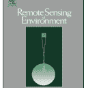

# 一种通过辐射传输反演训练的机器学习方法，用于从 VIIRS 大气顶估值生成全球严重陆地和大气估计


Guodang Zhang a, Han Ma b,c*, Shulin Lin b,c*, Aolin Jia b, Tao He b, Dongdong Wang b

+ a 中国武汉大学遥感与信息工程学院，武汉 430006

b 美国马里兰大学地理科学系，College Park, MD 20742, USA

c 中国香港大学地理系，香港 990077

# 文章信息 摘要

编辑者：Jing M. Chen

+ 关键词

机器学习

随机森林回归

辐射传输模型 (RTMs)

VIIRS 产品

可见光红外辐射计 (VIIRS) 自 2011 年以来一直在观测地球，并将持续几十年。遗憾的是，高层地表产品尚未被生产并广泛发布。辐射传输模型 (RTM) 的数值反演传统上用于从卫星传感器（例如，使用 ASTER 的 MODIS）中反演陆地和大气变量，但对于估计有用气变量非常有效。已经开发了多种机器学习 (ML) 模型，主要通过地面测量（这在不同条件下可能不适用）或由于不确定性和缺乏校准而可能不真实的 RTM 模拟。我们开发了使用 VIIRS 反演训练的机器学习算法，用于同时估计大气变量。利用该数据集，探索了两种多输出算法：反向传播神经网络和随机森林 (RF) 回归。随后将表现最好的 RF 模型用于从 VIIRS 数据中估计七个陆地和大气变量：光合有效辐射吸收 (PAR)、红外短波辐射 (SWIR)、陆地反照率、地表反射率和大气顶 (TOA) 反照率。使用四个地点的地面测量对结果进行了评估，并扩展到更大的区域以测试该方法。最后产生了 2013 年的七个全球估计。与卫星产品的比较显示，VIIRS 估计与全球陆表的 LAI 和 FAPAR 产品具有高度相似性。然而，对于 VINP4MA3 反照率和 VINP9A1 反射率，反演估计匹配良好。它还表明，所有变量的估计比定量估计单个变量更准确、高效。

# 1. 引言

遥感提供了对地球表面的实时和系统观测，对大规模陆表过程和环境监测做出了显著贡献（Wolanin et al., 2019）。随着高光谱任务的繁荣和分辨率成像光谱仪的发展，无与伦比的遥感提供了光学遥感新时代的数据流（Evitez et al., 2020）。然而，从如此巨大的数据流中提取由于地球大气成分引起的地表和大气变量，需要准确、稳健且高效的方法（Ali et al., 2021）。基于物理辐射传输模型 (RTM) 模拟的方法因其合理性和通用性成为首选（Auberger and Richter, 2012; Jacquemaud et al., 2009; Liang, 2004）。

* 通讯作者

邮箱：mahans@whu.edu.cn (H. Ma), liang@umd.edu (S. Liang)。

提高 RTM 计算效率有三种主要策略。第一种实用方法是使用查找表 (LUTs) 将输入变量映射到输出方程，同时生成变量的光谱输出。虽然 LUTs 可以捕获重要属性，并在空间最终采样后映射到大量的 RTM，但从我们之前的研究来看，我们使用 RTM 估计 400–2300 nm 的光谱反照率（Ma et al., 2020），因此大气变量被存储在 LUT 中。虽然从 LUT 获取参数非常高效，但可以显著提高反演精度。

第二种策略是通过使用机器学习提高 RTM 计算。通过统计学习方法模拟 RTM 函数可以实现许多新应用的计算效率和精度（Verret et al., 2021）。这些新开发的方法包括机器学习 (ML) 模型，可以模拟 RTM 的大气变量，但局限性是它们只使用了 RTM 的输出。

第三种策略是将 RTM 与多个卫星观测和模型相结合。这种方法用于减少 RTM 反演的计算负担。方位角是由卫星轨道几何引起的（Barclay et al., 1994），在模拟中考虑这些角度，使用估计数据训练 ML 模型可以避免这些问题。

最近，第三种策略是：NASA 极轨道伙伴 (SPO)卫星上的可见光红外辐射计 (VIIRS) 将用于详细观测。然而，由 NOAA（https://viirs.noaa.gov）生产的高层数据很少。我们的目标是开发高分辨率产品。有一种更直接的方法是在卫星观测和模型输出之间建立 ML 方法。通过在反演框架内使用 RTM 处理变量，我们可以评估该方法的效果。幸运的是，无论是否有地面测量，这种方法的优势在于它将 RTM 方法从理论水平引导到应用水平，因为它具有高计算效率。这种方法使用了训练数据集中不确定的输入变量。

G. Zhong et al.

图 1 显示了 VIIRS/NPP 中等分辨率 (NPP_VMAE_LI) 的太阳顶角、仰角和相对方位角。我们的训练样本是通过选取在每个月 GLASS LAI (V5.0)、MODIS LAI 和 PROV-V1 LAI 具有相同时间差异的像素的（Li and Liang, 2022）。VIIRS 提供 22 个波长从 0.4 到 12.5 um 的光谱段，包括五个高分辨率通道（I 波，350 m）、六个分辨率通道（M 波，750 m）和一个昼夜波（DNB，750 m）。本研究中使用的 VIIRS 波段如表 1 所示。此外，使用了 VIIRS 云图（Kopp et al., 2017）和 MODIS 云图来考虑天气状况。根据“Internal_Cloud_map”提供的值，位在 2-3 之间的像素被确定为晴天。VIIRS 数据记录 (SDR) 云产品可在 https://gov.modis.gov/modis_maps/ 获取。

我们样本的代表性可以在第 2.2 节和第 4.1 节中找到。图 1a 的结果代表 NPP_VMAE_LI 产品中所有可用观测的分布以及我们在第 3 节中的训练样本分布。

## 2.2 分析与卫星产品

为了评估训练数据的代表性，使用了生成 GLASS LAI (V6.1) 的数据集。在这项研究中，样本是通过选取在 GLASS LAI、MODIS LAI (V5.0) 和 PROV-V1 LAI 中具有相同系列观测的像素。第 3 节定义的 MODIS LAI（Li and Liang, 2022）被定义为真实的 LAI，因为 GLASS LAI 是通过 MODIS 反射率数据的双向长辐射传输模型（Li et al., 2023）产生的，并非真实的 LAI。PROV-V1 LAI 也被定义为真实的 LAI。

## 表 1

所用 VIIRS 波段信息。

| 波段编号 | M1 | M2 | M3 | M4 | M5 | M7 | M8 | M10 | M11 |

|---|---|---|---|---|---|---|---|---|---|

| 中心波 (nm) | 412 | 445 | 488 | 555 | 672 | 865 | 1240 | 1610 | 2250 |

| 空间分辨率 (m) | 750 | 750 | 750 | 750 | 750 | 750 | 750 | 750 | |

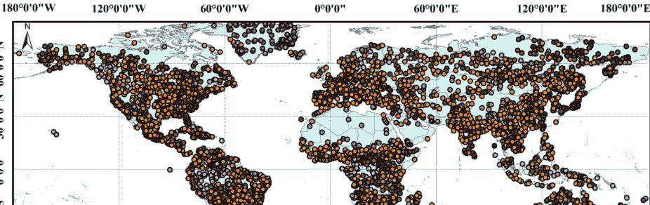

- 常绿针叶林

- 常绿阔叶林

- 落叶针叶林

- 落叶阔叶林

- 混合林

- 闭合灌木丛

- 开放灌木丛

- 木本稀树

- 草地

- 农田

- 城市和建成地

- 永久雪冰

- 荒漠

图 2. 测绘点的位置。

(Wang et al., 2013) 以及 VIIRS 地表反射率产品 VNP9A1 (Roger et al., 2016) 用于比较。MODIS 集合根据太阳天顶角和天空覆盖比例提供黑天反照和白天反照 (Privette et al., 2004)：

$a(\theta) = (1 - \cos(\theta))a_b(\theta) + \cos(\theta)a_w(\theta)$

其中 $a_b$ 是黑天反照；$a_w$ 是白天反照；$a(\theta)$ 是太阳天顶角为 $\theta$ 时的散射反照比例，它是气胶密度的函数，我们使用基于 6S 大气辐射传输代码确定的查找表进行计算 (Zhao et al., 2016)。本研究使用的卫星产品列于表 2。

## 表 2

所用卫星产品的特征。

| 产品 | 空间分辨率 | 时间分辨率 | 时间跨度 | 主要算法 |

|---|---|---|---|---|

| GLAS (V6.1) | 250 m | 8 天 | 2000-2020 | 深度学习 |

| GLAS (V6) | 500 m | 8 天 | 2000-2020 | 深度学习 |

| MODIS (MAI/PAR) | 500 m | 1 天 | 2000-2018 | 回归 |

| MODIS (M015A14, V006) | 500 m | 每日 | - | BRDF 传输 |

| MODIS (M023A02, V006) | 500 m | 每日 | - | 半球形 BRDF 算法 |

| MODIS BRDF/反照率质量 (M024A02) | 500 m | 每日 | - | 半球形 BRDF 算法 |

| VIIRS 反照率 (V006, V001) | 1 km | 每日 | 2012-now | 直接方向修正 |

| VIIRS 反射率 (VNP90A1, V001) | 1 km | 每日 | 2012-now | 基于 RT 的严谨 LUT 算法 |

## 2.3. 野外数据

验证首先在 54 个野外站点进行，这些站点从综合海洋观测系统 (ICOS)、图像、表面辐射 (SURAD)、AMFlux 和 OceanSat 中选取。表 3 列出了观测测量网络站点的位置，该网络包含跨越海洋的 140 个标准站 (Heiskanen et al., 2021)。本研究期间使用的使用的 9 个 ICOS 站点以每 30 分钟的间隔提供 ISR 和反照率。ICOS 数据可以通过 http://www.icos-data.org/ 获取。对于 VIIRS 传感器，IMAG 数据集在世界范围内 20 个站点的单日野外活动或多时空野外活动中提供了 LAI 和 FAPAR 的实测数据 (Xu et al., 2018)。其中，我们选择了一年内测量次数超过三次的 10 个站点，以验证检索的 LAI 和 FAPAR。IMAGes 均来自 http://www.fp-images.gov/ 以支持全球气候和变化研究，SURFRAD 自 1995 年以来 NOAA 全球计划局期间一直进行测量 (Augustine et al., 2000)。我们在各个 SURRAD 站点收集了每 1 个月间隔一次的地表反照率和 PAR 测量值用于验证。SURRAD 数据可以通过 http://www.noaa.gov/mod/surfad 获取。FLUXNET 是最大的生态系统网络之一，包括伯克利国家实验室 (美国)、AmerFlux 和 OzFlux (Baldocchi et al., 2001)。自 1991 年以来，这两个网络提供了每小时的卫星反照率。卫星数据可以通过 https://www.offlux.org/ 获取。这些站点的估算变量通过实测进行验证，未测量的变量（如反照率、TOA 反照率和反射率）与其他站点进行比较。用于验证和训练的站点完全独立的，将 3 km 以下的高度分为 10 组，并将低于 3 km 的高度分为一组。对于调查，我们将 40° 以下的坡分为 8 组，大于 40° 的坡分为一组。方面分为 9 组。S1 和 S2 显示了站点的位置

## 方法

从 VIIRS TOA 观测创建并应用 ML 模型整体过程如图 3 所示。使用优化方法从 VIIRS TOA 反射率数据生成训练数据集。然后，使用训练数据集开发多个模型。ISR、PAR 和 TOA 反照率以及 LAI、FAPAR、短波反照率和反射率在地表变量使用 VIIRS 云掩膜开发。随后，使用 RF 模型估计 50 个站点的时间序列变量进行验证。最后，使用 RF 模型生成全球产品。

## 2.4. 全球产品

为了更好地评估产品在不同地被类型和地形下的性能，我们对每个地被类型和高度类随机选择了 30 个像素，并将值与 GLASS 和 VIIRS 产品比较。注意，尽管选择是随机的，但我们确保每个类型的像素分布均匀。对于高度的区别，我们划分了：

### 3.1. 生成数据集的优化方法

我们的研究引入了基于耦合辐射传输 (RTM) 的卫星观测多变量估计优化方法 (Ma et al., 2020; Zhang et al., 2021)。


图 3. 使用 ML 方法进行多变量估计的流程图。从多变量创建了 ML 模型训练数据集；随后，将 ML 模型应用于卫星观测的多变量估计。

### 3.1.1. 耦合 RT 模型

整合了土壤、叶片、雪和大气模型的耦合 RT 用于模拟 TOA 反射率。耦合模块和方程见附录。根据我们的工作，叶片参数（如叶绿素 A Cab）是影响最大的参数，它们通过叶片范围调整 (Zhang et al., 2021; Ma et al., 2020)。关于耦合 RT 的细节可以在 Ma et al (2020) 中找到。

### 3.1.2. 地表反转

优化的核心方法是序列进化 (SCE) 方法。SCE 是一种高效的全球优化方法 (Duan et al., 1999; Duan et al., 1992)，使用目标函数迭代调整变量以最小化目标函数：

$f(v) = (v^{TOA} - v_i)^T \sigma_i^{-1} (v^{TOA} - v_i)$

其中 $v$ 是待估计变量，$v_i$ 是 $v^{TOA}$ 的值（即 VIIRS 的 TOA 反射率），$\sigma_i$ 是观测值不确定性的协方差矩阵，$v_0$ 是代表在8 天内参数稳定的先验。对于8 天窗口内的每次晴观测，通过以下方法检索参数 (LAI, Cab, Sm)：状态、太阳角 ($\theta_s$)、角度 ($\theta_r$)、先验值 (GLASS LAI) 和先验值 (MERRA)。

## 表 3

耦合模型的输入参数。

| 模型参数 | 符号 | 范围 | 单位 |

|---|---|---|---|

| 气胶光学厚度 | AOD | 0.01–0.5 | |

| 叶面积指数 | LAI | 2.5–7 | $m/m^2$ |

| 叶绿素 A | Cab | 0–30 | $\mu g/cm^2$ |

| 叶片干含量 | Cm | 0.01 | $kg/m^2$ |

| 叶片含水量 | Cw | 0.002–0.004 | |

| 土壤反射率 | Sm | 0.1–0.5 | |

| 土壤参数1 | s1 | 0.05–0.4 | |

| 土壤参数2 | s2 | | |

| 土壤参数3 | s3 | | |

| 土壤参数4 | s4 | | |

| 土壤参数5 | s5 | | |

| 雪覆盖比例 | sc | 0–1 | |

| 太阳角 | $\theta_s$ | 0–90 | 度 |

| 视天顶角 | $\theta_v$ | 0–90 | 度 |

| 角度 | $\theta_r$ | 0–180 | 度 |

### 3.1.4. 训练数据的生成

我们在2023 年的 5300 个站点生成了数据集以训练数据。我们使用了 VIIRS TOA 反射率、太阳角、天顶角、角度、高度、GLASS LAI 和 MERRA 输出。优化算法的实际值和输出用于生成方法的训练和验证数据。方法的优化和方法的输出用于验证结果。输出经过过滤以移除掩码像素。红光、近红外和蓝波段用于识别掩码像素 (Zhang et al., 2021)。

冠层效应未包含在4SAIT 模型中，因此将4SAIT 模型的输出与第2节描述的指数产品结合。根据我们之前的研究 (Ma et al., 2020)，AOD 和 LAI 的不确定性设置为 0.2 + 0.05 和 0.5，与

## 3.2. 多变量模型的训练方法

使用 VIIRS 云掩膜进行了站点选择。所有站点被随机分为两组：4500个站点（85%，727,600对数据）用于训练机器学习（ML）模型；795个站点（15%，126,744对数据）用于验证准确性。所有训练和验证数据都是完全独立的。

ML 模型通过在数据中拟合一个灵活的模型来模拟输入与输出之间的关系（Wolanin et al., 2019）。与定义输入-输出映射的参数模型不同，ML 模型通过对复杂数据进行自动特征提取来学习映射，并在通常被称为“嵌入”的过程中将特征表示为“向量”。然后，网络对这些向量进行操作并将其压缩以产生输出。我们使用了从优化方法和 RTM（包括 RTP）检索的 85% 训练数据，评估了两种不同的多输出 ML 模型。

在 BP 网络中，输入变量沿着网络结构传递，每层值之间的误差沿着网络结构反向传播。这种反向传播重复进行，直到误差值稳定或学习率达到预设阈值（Bishop, 1995）。然后，可以使用 BP 网络模型预测输出。BP 性能远优于单隐藏层（Ma et al., 2021）。为了确保准确性和速度，我们选择了双层架构。确定每层神经元的数量对网络的整体性能至关重要。目前，有许多方法被用于确定每层神经元的数量，其中一种如下（Tian et al., 2020b）：

```
n = m + 1
```

其中 m 是输入层神经元的数量。在本研究中，我们使用 VIIRS 反射率、zza、raa、海拔、GLI、LAIR 和 MERRA2 作为输出数据。在训练时，我们使用了模型：A、BP、RTM 和地表反照率。由于 TOA 反照率有 13 层，每层的神经元数量为 13，我们在不同的测试中设置了 1、3 和 10。因此，隐藏层神经元的数量是一个常数，值范围从 1 到 10。在开始训练过程时设置隐藏层节点数，模型 A 的输入层神经元数量为 11，基于 RTM 的模型 B 为 10。


随机森林算法用于估计感兴趣的变量（Breiman, 2001）并为训练数据集生成自助样本。每个自助样本都会构建一个回归树。取每个单独回归预测的平均值作为结果。`RF` 在不显著增加计算量的情况下提高了预测准确性，且它对共线性、缺失数据和不平衡数据不敏感（Iverson et al., 2008）。因此，`RF` 模型可以捕捉输入变量之间复杂的相互作用，并已成功应用于遥感变量（Filgueiras et al., 2022）。

单输出 `RF` 设计用于预测一个数值变量，而某些回归问题需要预测两个或更多变量。在本研究中，使用了联合输出 `RF`，利用七个 `RTM` 结果同时估计变量。在联合输出 `RF` 中，变量在每次迭代时在每个自助样本中共同生成（Xu et al., 2023）。本研究包含了所有变量，符合联合输出 `RF` 的要求。与 `BP` 网络相比，联合输出 `RF` 具有更多的超参数，例如树的数量（`tree`）、单个决策树中使用的最大特征数（`tree`）以及回归树模型的最大深度。在本研究中，我们将树的数量设为 100，深度设为 30。

## 3.3. 数据处理与回归模型

本节详细说明了如何使用最佳模型从 `VIIRS` 反射率数据估计区域和全球表面变量。地表变量只能从晴空观测数据检索。尽管 `VIIRS` 数据受云覆盖影响变量估计的准确性，为了估计这些变量，我们使用了时空去云方法（`PSTR`）来解决数据配准问题。采用了云融合方法。首先，通过掩膜检测云和阴影。其次，使用随机采样和时间交叉验证进行评估。此外，将数据随机分为 8 组。在每次迭代中，一组用于训练，另一组用于验证。对于时空交叉验证，我们将数据分为 2 组。在每次迭代中，一组用于训练，另一组用于验证。训练和验证过程重复了 24 次，训练和估计多个变量的时间成本记录了 395 个站点。三种 `ML` 方法的效率见 4.1 节。

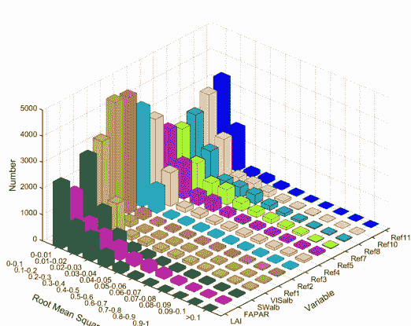

图 4. 训练数据与卫星产品之间的 `RMSE` 直方图。每个像素的 `RMSE` 是使用序列数据计算的。`X` 轴表示变量，`Y` 轴表示 `RMSE`，`Z` 轴表示像素数量。结果，约 20% 的像素值大于 0.02。`ISR`、`PAR` 和 `TOA` 的实例已用于对比，这三个变量的准确性见 4.3 节。

# 4 结果

### 4.1. 训练数据的准确性

已使用实地测量和卫星产品进行了广泛验证，以往研究表明通过优化方法和 `RTM` 的检索准确性良好（Ma et al., 2017a; Ma et al., 2017b; Shi et al., 2017）。这三个变量的准确性见 4.3 节。

### 4.2. 双输出 ML 模型的性能

深度学习改进了云像素的准确性，但降低了计算效率，使得难以应用 `PSTCR` 方法生成全球产品（Zhang et al., 2020）。我们使用全空 `TOFA` 参考数据估计全球尺下的地表。然后，使用 `VIIRS` 云模型确定检索。`LAI` 和 `PAR` 产品在 8 天周期内产生，所选值用于地表。可见光反照率也于 8 天周期内产生。与 `MODIS` 模型（基于 `BRDF` 参数反演）不同，中间图像中的清晰值被用于替换相同方法生成的中间图像中的缺失值。`ISR`、`PAR` 和 `TOA` 虽然未经过处理，但直接用于全球 `VIIRS` 大气产品。

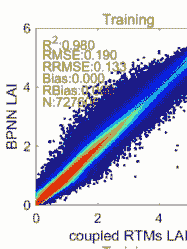

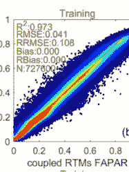

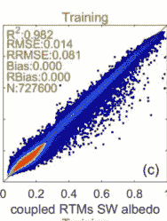

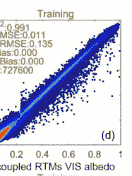

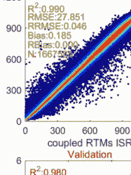

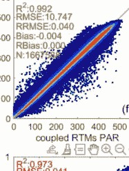

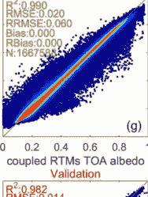

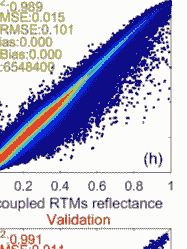

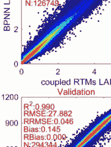

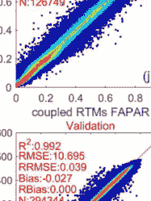

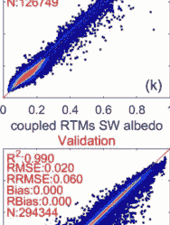

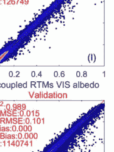

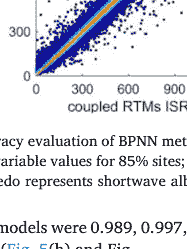

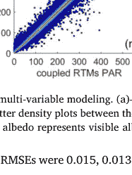

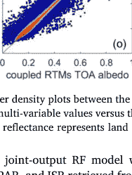

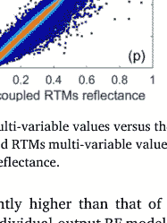

图 5. 多变量建模 `BPNM` 方法的准确性评估：(a)-(o) 15% 站点的 `BPNM` 多变量值与耦合 `RMSE` 多变量值之间的散点密度图。`SW` 代表准确性，`VIS` 代表地表反射率质量。

分阶段，输出联合模型在进行地表反演时表现也更好。耦合 `RMSE`、曲率和 `VIS` 的准确性（图 3 和图 4）不会更好。显然，对于准确性模型，输出联合模型更好。

虽然输出联合模型在从 `VIIRS` 反射率数据检索多个陆地和大气变量方面有效，但 `RF` 模型的性能通常用于预测单个输出；具有联合输出和单个输出的 `RF` 模型的精度需要进行比较。耦合 `RMSE` 的训练和验证准确性如表 4 所示。使用输出联合模型检索的所有变量的准确性显著高于使用单个输出模型检索的所有变量。然而，从输出联合模型检索的 `LAI`、`PAF` 和 `ISR` 的准确性显著高于 `LAI`、`PAF` 和 `ISR`，这些变量在估计其他变量方面的性能有限。输出联合 `RF` 的输出依赖于输入和彼此，本研究中的所有结果显示，除了输出联合 `RF` 外，大多数模型都是一致致的。交叉验证结果的值范围从 0.952 到 0.997。交叉验证结果的 `RMSE` 值范围从 0.118 到 0.185 (`LAI`)、0.040 到 0.049 (`PAF`)、0.007 到 0.014 (`ISR`)、0.015 到 0.025 (`m²`) 以及 0.010 到 0.018 (`VIS`)。输出联合模型的交叉验证结果与图 6 中的独立准确性接近。优异的结果表明我们的输出联合模型具有良好的时空性。

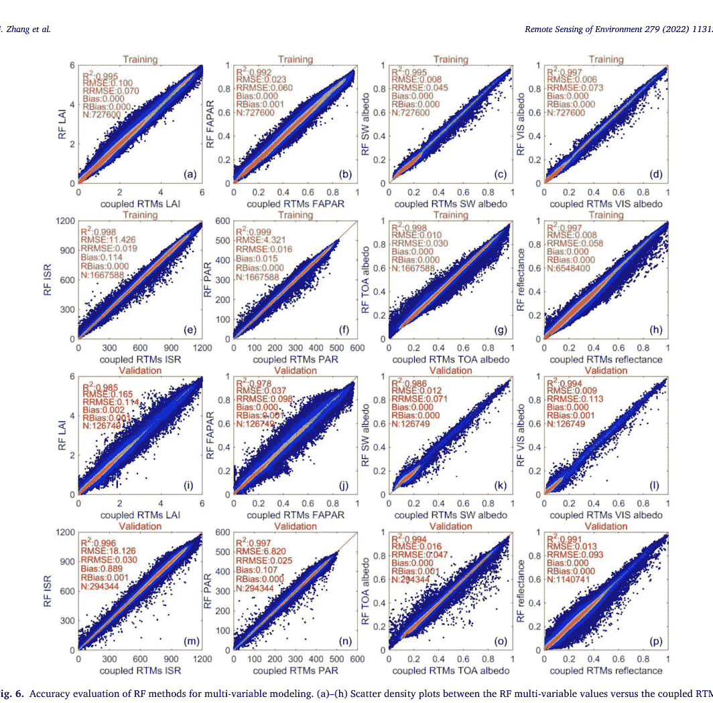

图 6. 多建模 `RF` 方法的准确性评估。(a)-(h) 多变量值与耦合 `RMSE` 的散点密度图，(i)-(o) 15 个站点的多变量值与耦合 `RMSE` 的散点密度图。

当模型被应用于大规模反演时，其效率至关重要。为了更好地反映 `TL` 方法的优势，两个模型和 `RF` 方法的运行时间如表 S1 所示。我们发现对于样本（40,000 个数据点），输出联合 `RF` 的估计时间约为 0.4 秒，比 `TL` 快。此外，`TL` 方法扩展测试数据需要 1 小时，而输出联合方法实现了 100% 的加速。`SW`：反射率，`VIS`：反照率。

### 4.3. 使用实地观测的变量检索

我们还分析了 4 个站点的实地推导变量，如表 S1 所示。`LAI` 和 `FAPAR`、`VIS` 反照率与 `RF` 模型衍出的值进行了比较，`RMSE` 分布如图 5 所示。观测到的关系是线性的，显示了 `RF` 反演的高准确性。此外，`RF` 推导变量的所有不确定性继承自训练数据，且在反演到 `RF` 推导结果的过程中没有增强。输出联合 `RF` 模型应用于 4 个站点的所有变量。检索的 `LAI`、`FAPAR`、照率和 `PAR` 与实地观测进行了验证。对于通过输出联合模型检索的变量和使用单个输出模型检索的变量，其准确性如下：

### 表 4

| | 训练 | | 验证 | | | |
|---|---|---|---|---|---|
| | 联合 | 单个 | 联合 | 单个 | 联合 |
| `LAI` | 0.995 | 0.983 | 0.985 | 0.981 | 0.100 | 0.164 | 0.185 | 0.208 |
| `FAPAR` | 0.992 | 0.984 | 0.977 | 0.974 | 0.033 | 0.034 | 0.039 | 0.043 |
| `SW` 反照率 | 0.995 | 0.985 | 0.986 | 0.975 | 0.008 | 0.012 | 0.017 | 0.017 |
| `VIS` 反照率 | 0.997 | 0.997 | 0.996 | 0.992 | 0.001 | 0.003 | 0.006 | 0.010 |
| `RF1` | 0.998 | 0.996 | 0.990 | 0.991 | 0.004 | 0.005 | 0.008 | 0.009 |
| `RF2` | 0.995 | 0.995 | 0.988 | 0.994 | 0.004 | 0.006 | 0.005 | 0.009 |
| `Ref3` | 0.998 | 0.998 | 0.988 | 0.989 | 0.004 | 0.006 | 0.009 | 0.009 |
| `Ref4` | 0.995 | 0.997 | 0.987 | 0.971 | 0.006 | 0.010 | 0.017 | 0.015 |
| `Ref5` | 0.997 | 0.992 | 0.979 | 0.931 | 0.006 | 0.019 | 0.015 | 0.015 |
| `Ref6` | 0.986 | 0.961 | 0.936 | 0.931 | 0.013 | 0.023 | 0.022 | 0.027 |
| `Ref7` | 0.986 | 0.960 | 0.956 | 0.938 | 0.013 | 0.021 | 0.021 | 0.021 |
| `Ref10` | 0.992 | 0.975 | 0.958 | 0.941 | 0.009 | 0.016 | 0.025 | 0.025 |
| `Ref11` | 0.992 | 0.977 | 0.958 | 0.958 | 0.006 | 0.011 | 0.016 | 0.016 |
| `ISR` | 0.998 | 0.997 | 0.996 | 0.994 | 0.143 | 0.216 | 0.126 | 0.2900 |
| `PAR` | 0.999 | 0.997 | 0.997 | 0.995 | 0.321 | 0.957 | 0.820 | 0.155 |
| `TOA` 反照率 | 0.998 | 0.995 | 0.994 | 0.910 | 0.010 | 0.017 | 0.016 | 0.022 |

`SW`：反射率，`VIS`：可见光地照率


图 7. 输出联合模型在反演中的时间准确性评估。

### 表 5

| 方法 | 训练 | | 验证 | | | |
|---|---|---|---|---|---|---|
| | 联合 | 单个 | 联合 | 单个 | 联合 | 单个 |
| 耦合 | 0.741 | 0.699 | 0.770 | 0.712 | 0.039 | 0.119 |

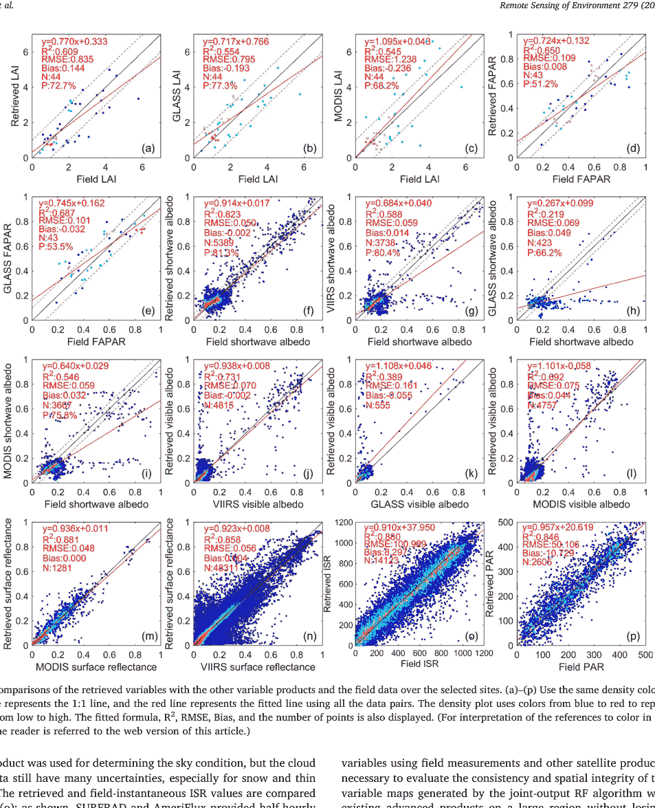

图 9. 选定数据集上反演反照率与其他变量及现场数据的比较（a–p）。使用相同的颜色密度。黑线代表单位值，红线代表所有配对的场线。密度图使用从蓝色到红色的颜色表示从低到高的密度。还显示了拟合公式、`RMSE`、`Bias` 和点数。（如需对图中颜色的解释，读者需参考本文的其他版本。）

用于确定天空云掩码的产品必须验证其能力，特别是针对雪地和薄云。图 (g) 显示了反演和实地实例的 `ISR` 值，分别使用了 `SIRAD` 和 `AMirFlux` 模型。将所有条件下的反演 `ISR` 与具有相同时间偏移的实地值进行比较。大气观测会引起显著的不确定性。我们的估计值，100–900 m 的反演 `ISR` 与实地值一致良好，`RMSE` 为 50.16，`Bias` 为 -0.86。反演的现场 `PAR` 值与相比的 `RMSE` 为 50.106，`Bias` 为 0.846（图 9p）。

## 4.4. 评估估计保留多个变量的输入输出 RF 模型性能

需要各种方法和卫星产品，以评估具有不同空间纹理细节的输入输出 `RF` 算法生成的变量模型的一致性和完整性。我们使用 `VIIRS` 数据的方法在亚区域尺度上显示了惊人的观测结果。考虑到原先为均匀地表的区域（如果需要森林、草原和城市地区），良好的空间分辨率的重要性是显而易见的（选定区域位于加拿大北部的萨斯喀彻省）。选定区域为 375 km × 375 km，纬度范围从 50.35 到 50.6640 N，经度范围从 -105.00 到 -104.920 W。

图 (10) 展示了时间序列 `VIIRS` 地图。反演的 `LA` 时间分辨率为 8 天，为了节省空间，我们仅以 16 天为间隔显示它们。作为比较，图 10(b) 显示了 8 天 `GLASS` `LA` 产品。输入输出 `RF` 模型从物候学角度捕捉到了 `LAI` 的季节性动态。生长季节外的 `LAI` 也被成功估计，并精确地跟踪了绿叶的出现和凋落。与 `GLASS` `LAI` 相比，反演的 `LAI` 值略高，特别是在生长季节。由于物理特性，时间序列反演 `FAPAR` 与反演 `LAI` 显示出相似的特征（图 11）。图 12 和 13 将短波和可见反照率与 `VNPMA33`、`GLASS` 和 `MODIS` 反照率产品进行了比较。反演的短波和可见反照率具有相对稳定的变化。

### (a) 反演的 LAI

| 49 | 65 | 81 | 97 | 113 | 129 | 145 | 161 |
| :--- | :--- | :--- | :--- | :--- | :--- | :--- | :--- |
| 177 | 193 | 209 | 225 | 241 | 257 | 273 | 289 |

### (b) GLASS LAI

| 49 | 65 | 81 | 97 | 113 | 129 | 145 | 161 |
| :--- | :--- | :--- | :--- | :--- | :--- | :--- | :--- |
| 177 | 193 | 209 | 225 | 241 | 257 | 273 | 289 |

图 10. (a) 反演 `LAI` 地图与 (b) `GLASS` `LAI` 地图的比较。反演 `LAI` 时间分辨率为 8 天；这里我们以 16 天为间隔显示它们。

### (a) 反演的 FAPAR

| 49 | 65 | 81 | 97 | 113 | 129 | 145 | 161 |
| :--- | :--- | :--- | :--- | :--- | :--- | :--- | :--- |
| 177 | 193 | 209 | 225 | 241 | 257 | 273 | 289 |

### (b) GLASS FAPAR

| 49 | 65 | 81 | 97 | 113 | 129 | 145 | 161 |
| :--- | :--- | :--- | :--- | :--- | :--- | :--- | :--- |
| 177 | 193 | 209 | 225 | 241 | 257 | 273 | 289 |

图 11. (a) 反演 `FAPAR` 地图与 (b) `GLASS` `FAPAR` 地图的比较。反演 `FAPAR` 时间分辨率为 8 天；这里我们以 16 天为间隔显示它们。

### (a) 反演的短波反照率

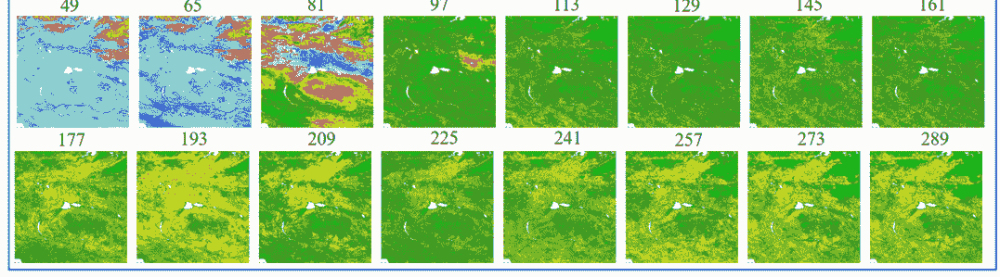

### (b) VNP43MA3 短波反照率

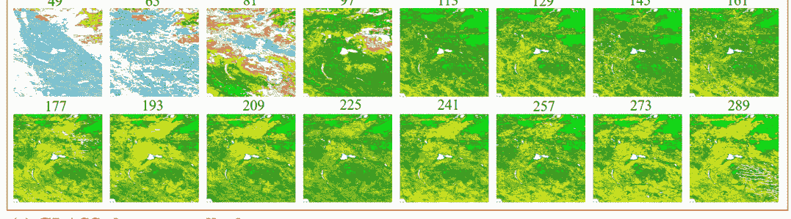

### (c) GLASS 短波反照率

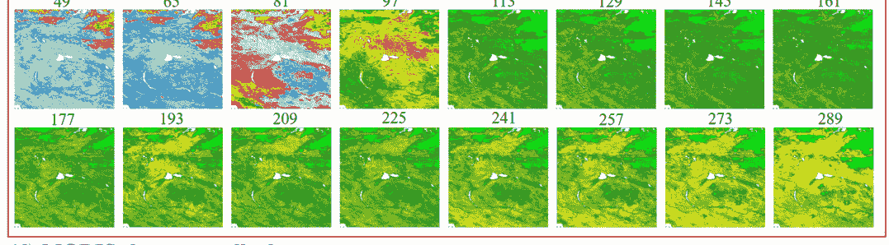

### (d) MODIS 短波反照率

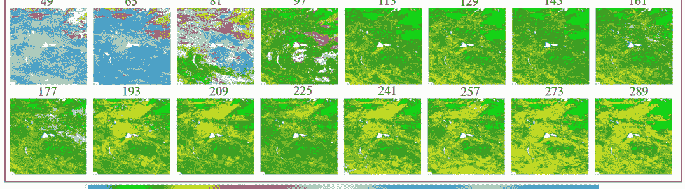

图 12. (a) 反演短波反照率地图、(b) `VNP43MA3` 短波反照率地图、(c) `GLASS` 短波反照率地图和 (d) `MODIS` 短波反照率产品的比较。反演的短波反照率时间分辨率为 8 天；这里我们以 16 天为间隔显示。

### (a) 反演的可见反照率

| 49 | 65 | 81 | 97 | 113 | 129 | 145 | 161 |
| :--- | :--- | :--- | :--- | :--- | :--- | :--- | :--- |
| 177 | 193 | 209 | 225 | 241 | 257 | 273 | 289 |

### (b) VNP43MA3 可见反照率

| 49 | 65 | 81 | 97 | 113 | 129 | 145 | 161 |
| :--- | :--- | :--- | :--- | :--- | :--- | :--- | :--- |
| 177 | 193 | 209 | 225 | 241 | 257 | 273 | 289 |

### (c) GLASS 可见反照率

| 49 | 65 | 81 | 97 | 113 | 129 | 145 | 161 |
| :--- | :--- | :--- | :--- | :--- | :--- | :--- | :--- |
| 177 | 193 | 209 | 225 | 241 | 257 | 273 | 289 |

### (d) MODIS 可见反照率

| 49 | 65 | 81 | 97 | 113 | 129 | 145 | 161 |
| :--- | :--- | :--- | :--- | :--- | :--- | :--- | :--- |
| 177 | 193 | 209 | 225 | 241 | 257 | 273 | 289 |


| :--- | :--- | :--- | :--- | :--- | :--- | :--- | :--- |
| 177 | 193 | 209 | 225 | 241 | 257 | 273 | 289 |

图 13. (a) 反演可见反照率地图、(b) `VNP43MA3` 可见反照率地图、(c) `GLASS` 可见反照率地图和 (d) `MODIS` 可见反照率产品的比较。反演的短波反照率时间分辨率为 8 天；这里我们以 16 天为间隔显示。

### (a) 反演出的 ISR

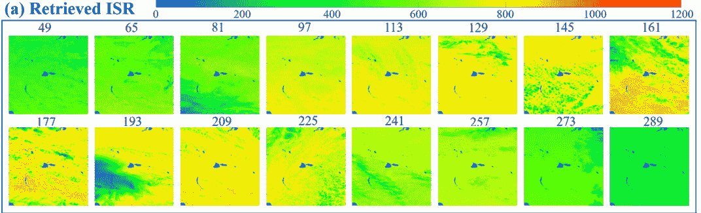

### (b) 反演出的 PAR

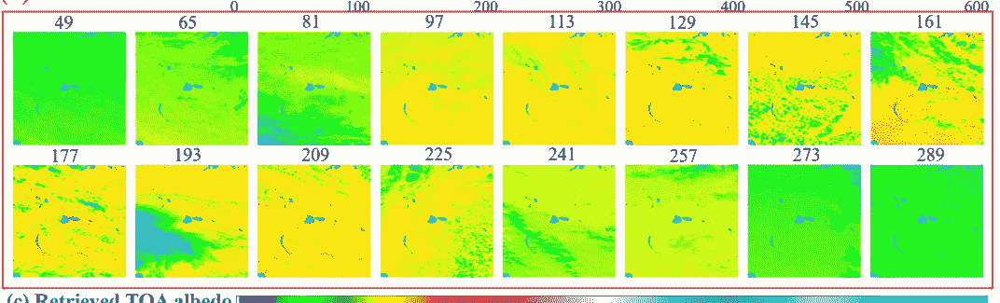

### (c) 反演出的 TOA 反射率

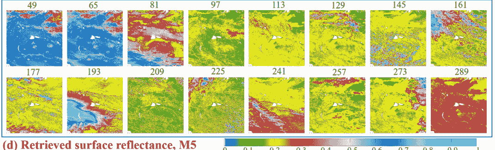

### (d) 反演出的地反射率, M5

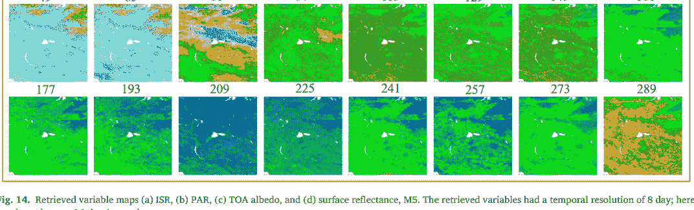

图 14. 反演变量图 (a) `ISR`、(b) `PAR`、(c) `TOA` 反射率和 (d) 地反射率，`M5`。反演变量的时间分辨率为 8 天；此处我们展示了 16 天间隔的图。

G. Zhang 等人。

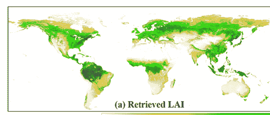

### (a) 反演出的 LAI

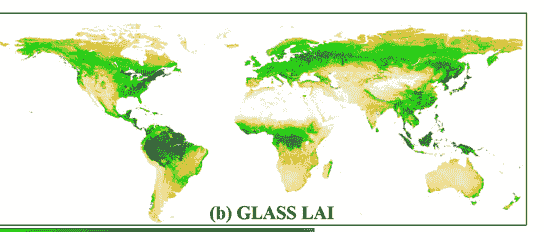

### (b) GLASS LAI

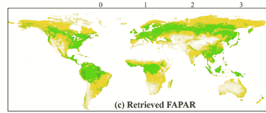

### (c) 反演出的 FAPAR

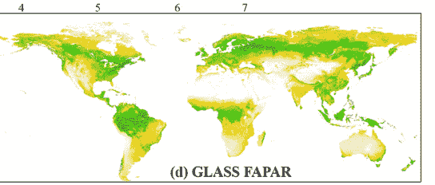

### (d) GLASS FAPAR

图 15. 2013 年 7 月 12 日反演的全球 `LAI` `FAPAR` 与 `GLASS` `LAI`、`FAPAR` 产品的对比。(a) 反演全球 `LAI` 图，(b) 全球 `GLASS` `LAI` 图，(c) 反演全球 `FAPAR` 图，和 (d) 全球 `GLASS` `FAPAR` 图。

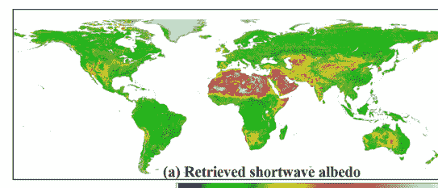

### (a) 反演的最短波反射率

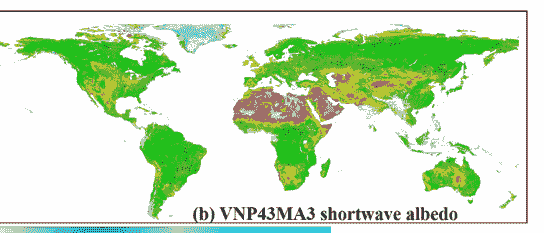

### (b) VNP43MA3 最短波反射率

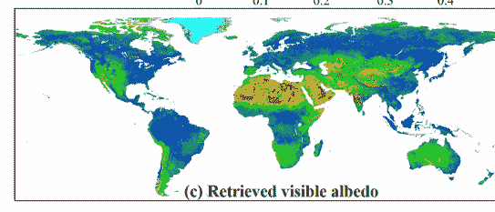

### (c) 反演出的可见光反射率

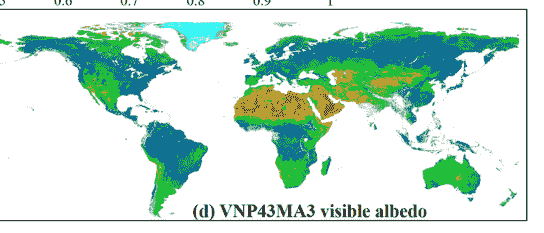

### (d) VNP43MA3 可见光反射率


图 16. 2013 年 7 月 12 日反演的全球最短波、可见光反射率及 `VNP43MA3` 反射率产品的对比。(a) 反演全球最短波反射率图，(b) 全球 `VNP43MA3` 最短波反射率图，(c) 反演可见光反射率图，以及 (d) 全球 `VNP43MA3` 可见光反射率图。

`MODIS` 反射率值在雪天缺失，而我们的值保持一致。图 21(e)–m) 显示地反射率随 `MODIS` 地反射率变化良好，所有反演的地反射率值在晴天和多云天气分布合理。此外，还描绘了从第 1 天到 12 天地反射率值的下降和反弹。图 21(n) 和 (o) 显示反演的反射率和 `PAR` 值与实测值一致。图 21(p) 显示反演的 `TOA` 反射率值在晴天和多云天气分布合理。Psheniche 和美国站点的时间序列验证见附录。

### 4.5.3. 不同覆盖类型和地形下的估计评估

在本节中，我们通过与 `GLASS` 和 `VIIRS` 产品对比，评估了在不同覆盖类型和地形下的估计。图 22 显示了评估结果。在不同的覆盖类型和地形下，我们的 `LAI`、`FAPAR` 产品与 `GLASS` `LAI` 产品之间的 `RMSE` 值范围为 0.201 到 0.463、0.041 到 0.109 以及 0.015 到 0.038。这些结果与 Zhuang 等人 (2021) 的结果相比，表明我们的 `LAI`/`FAPAR` 估计在大多数土地覆盖类型下与产品具有相似的精度。在永久雪冰区，我们的地反射率估计值与 `VIIRS` 产品之间的 `RMSE` 值。

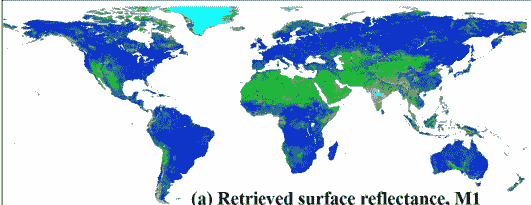

### (a) 反演出的地反射率, M1

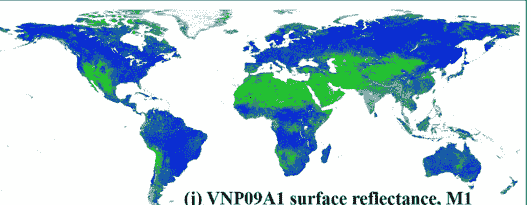

### (j) VNP09A1 地反射率, M1

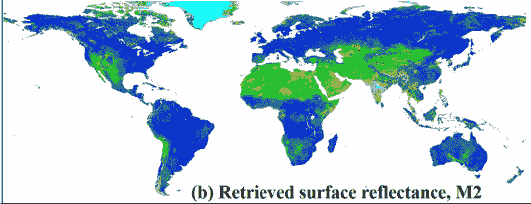

### (b) 反演出的地反射率, M2

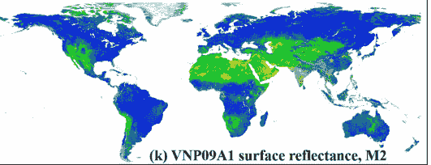

### (k) VNP09A1 地反射率

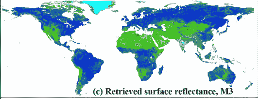

### (c) 反演出的地反射率

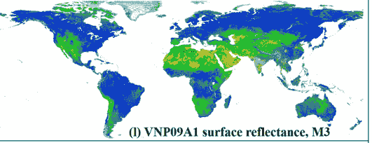

### (l) VNP09A1 地反射率

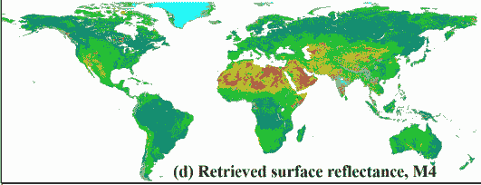

### (d) 反演出的地反射率

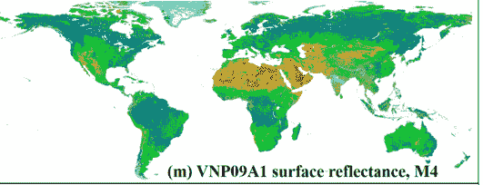

### (m) VNP09A1 地反射率

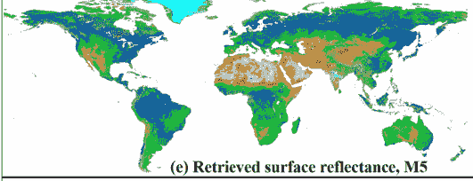

### (e) 反演出的地反射率

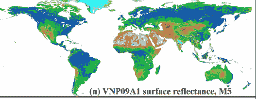

### (n) VNP09A1 地反射率

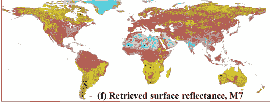

### (f) 反演出的地反射率

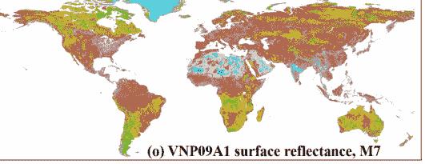

### (o) VNP09A1 地反射率

图 17. 2013 年 7 月 12 日反演全球地反射率与 `VIIRS` 地反射率产品的对比。(a-i) 波段 `M1`, `M2`, `M3`, `M4`, `M5`, `M7`, `M8`, `M10`, `M11` 的反演全球地反射率图，(j-r) 波段 `M1`, `M2`, `M3`, `M4`, `M5`, `M7`, `M8`, `M10`, `M11` 的 `VIIRS` 全球地反射率图。

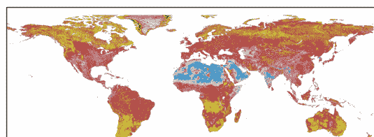

### (g) 反演出的地反射率


### (p) VNP09A1 地反射率


### (h) 反演出的地反射率


### (q) VNP09A1 地反射率


### (i) 反演出的地反射率


### (e) VNP09A1 地反射率


图 17. (续)。

| 百分比 (%) | (a) LAI | (b) FAPAR |
| :--- | :--- | :--- |
| 70 | | |
| 60 | | |
| 50 | | |
| 40 | | |
| 30 | | |
| 20 | | |
| 10 | | |

| 百分比 (%) | 短波反射率 | 可见光反射率 |
| :--- | :--- | :--- |
| 70 | | |
| 60 | | |
| 50 | | |
| 40 | | |
| 30 | | |
| 20 | | |
| 10 | | |

图 18. 2013 年 7 月 12 日起反演 `VIIRS`-`GLASS` (a) `LAI`、(b) `FAPAR`、(c) 地反射率和可见光反射率图，同时也显示了反演 `VIIRS`-`VNP43MA3`。负值表示其他方法的高估，正值意味着反演 `VIIRS` 估计值较高。荒地、混合林、城市和建筑地面的累积略优于永久雪冰，混合像素中树种比例的不一致性以及少量荒地样本导致了这些偏差。对于其他覆盖类型，混合区域反射率和地反射率值的我们的估计具有相似且稳定的精度。`LAI`、`FAPAR`、反射率和地反射率对比结果 `RMSE` 分分别为 0.317 到 0.491、0.048 到 0.095、0.069 以及 0.037 到 0.076。在 300 米以上，随着海拔增加，值的 `RMSE` 变化很大。


图 19. 2013 年 7 月 12 日反演 `VIIRS`-`VNP09A1` 按地表面积全球反射率差异。负值表示 `GLASS` 的反射率估计，正值标记反演 `VIIRS` 估计中较高的地反射率值。


图 20. 2013 年 7 月 12 日反演的全球反射率 (a) `ISR`、(b) `PAR` 和 (c) `TOA` 反射率。

在高海拔地区，降雪通常增加，雪天数少于平原地区。雪云对估计的影响（特别是在雪和云同时存在时）是由于云和雪反射率因其反射特性而相互干扰 (T Aoki 等人, 2006)。尽管海拔对不同海拔雪样本的精度没有显著影响，且海拔也是我们联合输出 `RF` 模型中的一个重要变量，但根据地形，我们的估计在高海拔地区具有良好的精度。

图 22 (c) 和 (d) 比较了西藏高原在不同坡度和坡向的 `RMSE` 值。尽管对于坡度大于 40° 的 `RMSE` 比平坦表面高出 0.018，但每个变量的评估精度随坡度和坡向的变化而并不显著变化，这表明我们在多变量方案中坡度和坡向的影响。

# 5 讨论

## 5.1. 算法的变异

与传统的单变量方法相比，我们的新型高效 `RF` 反演算法四个优势。它可以从 `TOA` 反射率数据同时估计七个物理一致的地空变量。其次，我们的算法不需要复杂的大气校正或数据融合链。`RF` 模型的高计算效率是相对于开发的深度学习方法的另一个优势。第四，同时估计所有变量比逐顺序估计单个变量更准确更高效。


图 21. Siolux 站点估算值与估计数据的对比：(a) 叶面积指数 (`LAI`)，(b) 光合作用有效辐射份额 (`FAPAR`)，c) 短波反照率，(d) 可光反射率，(e) 顶层 (`TO`) 反照率。

## 5.2. 训练样本的表示

在机器学习模型的应用中，模型应在新的独立数据上表现良好。为了模拟这一点，所有可用数据可分为两个部分，也称为训练分段（Hohburg 和 McCabe, 2018）。总共 5300 个样本用于训练 `GLASS` `LAI` (V6) 的训练位点（Mai 和 Liang, 2022），以及卫星观测和耦合辐射传输模型 (`RTM`) 模拟。所选训练样本在全球范围内分布，涵盖了几乎所有的地表类型，如图 1 所示。由训练样本代表性模型估算的值范围（Zhang 等，2023）涵盖了几乎所有的陆地覆盖类型，并分布在全球地球。最终模型在空间和时间交叉验证中也表现出外推性。对于地表反射率，无雪、降雪和融雪像素均被结合形成训练样本。由于云对它们的影响，晴天和多云条件下的所有样本均被用于 `ISR`、`PAR` 和顶层反照率模型的训练。

## 5.3. 云和云检测引起的误差

在优化方案中，一个关键步骤是确定顶层 (`TO`) 反射率（Mai 等，2020；Zhang 等，2021）。由于 `VIIRS` 提供云掩码，基于云指数提取多角度顶层数据集。然而，该数据集并未覆盖有效的云检测结果，特别是在图 2 所示的区域，那里的云影被晴天所遮挡，这些点的机器学习估算反照率和地表反射率值显著高于耦合 `RTM` 计算出的值。在多云区域可以观察到略高的均方根误差 (`RMSE`) 值，这是因为 `VNP43MA3` 反照率仍存在某些不确定性，例如云污染，导致反照率值不准确。此外，所检索到的反照率值被用于与实地测量（'90'）保持一致，尽管我们检索到的模型误差很大。这是由雪的权重因子引起的（Ma 等，2020）；雪与云之间相似的反射特性使得难以确定多云和雪天条件下雪的贡献。


图 22. 不同条件下 `GLASS` 和 `VIIRS` 产品估算值之间的对比（a) 水平，(b) 坡度）。


## 5. 待解决的问题

本文使用联合 `RF` 模型代替复杂的辐射传输 (`RT`) 模型来从 `VIIRS` 顶层观测检索地表估算值。仍有一些待解决的问题。第一个问题是 `RF` 模型未与 `RT` 模型耦合，模型无法考虑几何等因素。未来可以引入更先进的模型，例如允许耦合的 `LA2`（Benlof 和 Bach, 2016），`LA2` 是被覆盖的关键结构参数。相反，`VIIRS` 冠指数随季节变化，年度平均冠指数可能影响结果的准确性。第二个问题涉及叶角分布的敏感性。叶角分布在 `RF` 模型中未被考虑（Negato 等，2019；Verselt 等，2015）。第三个问题是 `RF` 模型被设定为固定值，这可能导致预测结果不准确（Saiti 等，2021）。叶角分布可能需要在 `RF` 模型中进行动态调整以获得更好的结果。第三个问题是 `RF` 模型中只有一个参数（`Ref3`）。因此，需要考虑更多变化的因素来改进 `RF` 模型（Happe, 1981；Lieber 等，2019；Townsend, 1996）。许多因素使得反演与冠层和大气耦合变得病态（Dicke 等，2022），未来将将其纳入反演方案。最后一个问题涉及地形。然而，本研究从卫星图像获取的信息可能影响结果的结果。

## 6. 结论

`VIIRS` 数据自 2011 年以来可用，产生了高频产品。本研究开发了一种混合方法，通过 `VIIRS` 观测估计季节性地表和大气变量。将不同的机器学习方法与模拟数据集进行比较，结果表明 `RF` 模型在 `LA`、`FAPAR`、反照率、`ISR`、`PAR` 和 `TOA` 方面达到了最高精度。大气校正的评估显示 `$R^2$` 值为 0.672、0.786、0.835、0.629、0.727 和 0.845，表明我们的方法有效地捕捉了跨陆地类型和季节的植被动态。产生了一系列全球地图，表明检索到的 `VIIRS` 估算与 `GLASS`、`FPAR`、`VNP43MA` 反照率和 `VNP9OA` 地表反射率具有高度一致性。`VIIRS` 数据的卓越使得多变量检索模型具有前景。未来的工作将进一步完善检索模型，并考虑全球尺度遥感变量以及生态系统尺度碳循环、水汽和水量的空间变化。

# 贡献者

张国东：数据质量、分析、方法论、资源、初稿撰写、编辑。马涵：正式分析、方法、可视化、初稿撰写与编辑。练诗林：资金获取、获取方法、监督、审阅与编辑。

Gao, X., Sun, J., Liu, Y., Shao, W., F.,2016. 利用 `MODIS` 和 `VIIRS` 数据评估红外辐射传感器的性能。环境遥感 197, 245-253.

Li, S., Sun, J., Li, Y., Shao, W., Wang, X., Chen, Y.,2023. `VIIRS` `NPP` 传感器数据产品、检索、验证和地球物理性能。地球大气物理 118, 11664-11686. doi:10.1029/2022JDXXXX.

Li, Y., Wang, J., Zhang, Y., Liu, J.,2021. 在光谱领域利用 `VIIRS` `NPP` 传感器数据描述森林冠层属性。环境遥感 269, 112843.

# 利益声明

本文通过随机森林反演训练的用于 `VIIRS` 顶层观测全球和大气产品的机器学习模型尚未全文发表，也未被任何期刊考虑。没有需要声明的利益冲突。

# 致谢

本研究受国家重点研发计划资助（编号：2017YFB001001）、中国国家自然科学基金资助（编号：321902577）。感谢国家地球科学数据中心、`NASA` 和 `Earthdata` 的支持。我们感谢 `ICOS` 网络、`AmeriFlux` 网络以及 `AmeriFlux` 提供验证数据。我们对匿名评审员提出的帮助且有效的建议表示深表谢意，这有助于提高手稿的质量。

## 附录。补充数据

本文的补充数据可以在在线查找 https://doi.org/10.1016/j.jsr.2022.113122。


Enríquez, J., Venti, J., Ribera-García, M., Vasallo, F., Martínez-Jerero, G., 2020. 使用卫星遥感评估全球碳生产力。环境遥感。

Li, S., Liu, S., Ma, H., Yang, T., 2021. 美国本土地区全空 1km 陆表面温度估计。Remote Sensing. Env., 256, 11760.

Li, S., Liang, S., 2008. 地表反照率比较：I 反照率算法。Remote Sensing. Env., 76, 213–238.

Liang, S., Townsend, J.R., 1998. 一种改进的陆表双向反射函数模型。Remote Sensing of Env., 84, 69–90.

Liang, S., Liu, S., Yuan, X., Wang, C., Cheng, X., Zhang, Q., Liang, J., 2020. 利用卫星数据对地表反射率进行定量评估。Int. J. Earth Sci. Observat., 5, 63–78.

Liang, S., Liu, S., Yuan, X., Yao, Y., Wang, X., Zhang, X., 2021. 基于卫星图像生成的全球陆表反照率数据集 (SATGL)。Remote Sens. Env. Modul., 172, E105237.

Liang, S., Liu, S., Liang, S., Hang, S., 2013. 全球 LCLASS 反照率数据集的性能评估。Int. J. Earth. 6, 69–95.

Li, M., Zhang, X., Liang, S., Hang, S., 2019. 利用 MODIS 产品（版本 6）生成 250–1000 m 区域反射率的验证。Remote Sens. Env., 234, 115–128.

Li, M., Huang, S., Zhang, Y., 2017. 基于光学和热红观测同步分析多个陆表反射率参数。J. Phot. Res., 37(5), 051105.

Li, M., Huang, S., Zhang, Y., 2020. 一种利用高分辨率卫星图像从大气变量估计多陆表反照率的方法。IEEE Trans. Remote Sens. Env., 58, 5999–6008.

Li, M., Huang, S., Zhou, Y., 2022. 利用多分辨率卫星数据开发陆表反照率连续变量估计器。Remote Sens. Env., 271, 106638.

Li, X., Zhang, X., Wang, C., Lu, J., 2022. 基于 MODIS 数据（2000–2020）衍生的分光光光函数 (FAP) 全球陆表反照率 (250–500 m)。Remote Sens. Env., 276, 113093.

Li, Y., Wang, J., 2021. 基于神经网络的多序列 MODIS 陆表反射率数据分析方法。

Liang, W., Elbacke, S.G., Tian, Y., 2002. 基于 MODIS 的陆表反照率模拟的早期和光谱特性及验证。Remote Sens. Env., 245, 451.

Privete, J., Melleau, J., Zhang, M., Chabel, C., 2004. 利用非洲大气条件对 MODIS 陆反照率 (MOD0403) 进行表征。Geophys. Remote Sens. Env., 108, 197–203.

Prasad, S., Rao, V., 2011. 印度地区卫星衍生日格网辐射辐射数据分析：裸地和活跃季风季节分析。Curr. Sci. 99, 1–10.

Roger, J., Vermeste, E., Davidija, A., J., 2016. SNIPP-NIRS 地表反射率用户指南。卷 II (NASA)。NASA JPL.

Sahu, M., Sun, Y., Xiao, J., Li, H., Zhang, Y., Brawell, B.H., Carter, P.S., Davis, K.J., Dragouti, G., Gouden, M., 2009. 全球 LCLASS 反照率数据集的评估。Remote Sens. Env. Modul., 172, E105237.

Liang, S., Liu, S., Liang, S., Hang, S., 2013. 全球 LCLASS 反照率数据集的性能评估。Int. J. Earth. 6, 69–95.

Li, M., Zhang, X., Liang, S., Hang, S., 2019. 利用 MODIS 产品（版本 6）生成 250–1000 m 区域反射率的验证。Remote Sens. Env., 234, 115–128.

Li, M., Huang, S., Zhang, Y., 2017. 基于光学和热红观测同步分析多个陆表反射率参数。J. Phot. Res., 37(5), 051105.

Li, M., Huang, S., Zhang, Y., 2020. 一种利用高分辨率卫星图像从大气变量估计多陆表反照率的方法。IEEE Trans. Remote Sens. Env., 58, 5999–6008.

Li, M., Huang, S., Zhou, Y., 2022. 利用多分辨率卫星数据开发陆表反照率连续变量估计器。Remote Sens. Env., 271, 106638.

Li, X., Zhang, X., Wang, C., Lu, J., 2022. 基于 MODIS 数据（2000–2020）衍生的分光光光函数 (FAP) 全球陆表反照率 (250–500 m)。Remote Sens. Env., 276, 113093.

Li, Y., Wang, J., 2021. 基于神经网络的多序列 MODIS 陆表反射率数据分析方法。

Liang, W., Elbacke, S.G., Tian, Y., 2002. 基于 MODIS 的陆表反照率模拟的早期和光谱特性及验证。Remote Sens. Env., 245, 451.

Privete, J., Melleau, J., Zhang, M., Chabel, C., 2004. 利用非洲大气条件对 MODIS 陆反照率 (MOD0403) 进行表征。Geophys. Remote Sens. Env., 108, 197–203.

Prasad, S., Rao, V., 2011. 印度地区卫星衍生日格网辐射辐射数据分析：裸地和活跃季风季节分析。Curr. Sci. 99, 1–10.

Roger, J., Vermeste, E., Davidija, A., J., 2016. SNIPP-NIRS 地表反射率用户指南。卷 II (NASA)。NASA JPL.

Sahu, M., Sun, Y., Xiao, J., Li, H., Zhang, Y., Brawell, B.H., Carter, P.S., Davis, K.J., Dragouti, G., Gouden, M., 2009. 全球 LCLASS 反照率数据集的评估。Remote Sens. Env. Modul., 172, E105237.

Sahu, M., Sun, Y., Xiao, J., Li, H., Zhang, Y., Brawell, B.H., Carter, P.S., Davis, K.J., Dragouti, G., Gouden, M., 2009. 全球 LCLASS 反照率数据集的评估。Remote Sens. Env. Modul., 172, E105237.

Liang, S., Liu, S., Yuan, X., Wang, C., Cheng, X., Zhang, Q., Liang, J., 2020. 利用卫星数据对地表反射率进行定量评估。Int. J. Earth Sci. Observat., 5, 63–78.

Liang, S., Liu, S., Yuan, X., Yao, Y., Wang, X., Zhang, X., 2021. 基于卫星图像生成的全球陆表反照率数据集 (SATGL)。Remote Sens. Env. Modul., 172, E105237.

Liang, S., Liu, S., Liang, S., Hang, S., 2013. 全球 LCLASS 反照率数据集的性能评估。Int. J. Earth. 6, 69–95.

Li, M., Zhang, X., Liang, S., Hang, S., 2019. 利用 MODIS 产品（版本 6）生成 250–1000 m 区域反射率的验证。Remote Sens. Env., 234, 115–128.

Li, M., Huang, S., Zhang, Y., 2017. 基于光学和热红观测同步分析多个陆表反射率参数。J. Phot. Res., 37(5), 051105.

Li, M., Huang, S., Zhang, Y., 2020. 一种利用高分辨率卫星图像从大气变量估计多陆表反照率的方法。IEEE Trans. Remote Sens. Env., 58, 5999–6008.

Li, M., Huang, S., Zhou, Y., 2022. 利用多分辨率卫星数据开发陆表反照率连续变量估计器。Remote Sens. Env., 271, 106638.

Li, X., Zhang, X., Wang, C., Lu, J., 2022. 基于 MODIS 数据（2000–2020）衍生的分光光光函数 (FAP) 全球陆表反照率 (250–500 m)。Remote Sens. Env., 276, 113093.

Li, Y., Wang, J., 2021. 基于神经网络的多序列 MODIS 陆表反射率数据分析方法。

Liang, W., Elbacke, S.G., Tian, Y., 2002. 基于 MODIS 的陆表反照率模拟的早期和光谱特性及验证。Remote Sens. Env., 245, 451.

Privete, J., Melleau, J., Zhang, M., Chabel, C., 2004. 利用非洲大气条件对 MODIS 陆反照率 (MOD0403) 进行表征。Geophys. Remote Sens. Env., 108, 197–203.

Prasad, S., Rao, V., 2011. 印度地区卫星衍生日格网辐射辐射数据分析：裸地和活跃季风季节分析。Curr. Sci. 99, 1–10.

Roger, J., Vermeste, E., Davidija, A., J., 2016. SNIPP-NIRS 地表反射率用户指南。卷 II (NASA)。NASA JPL.
