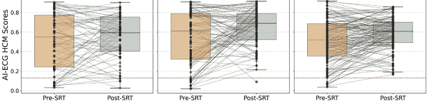
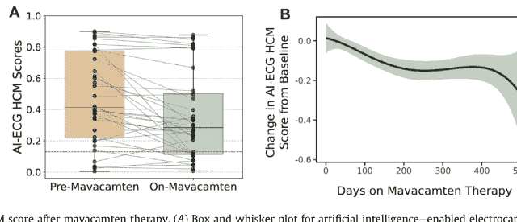

# 多中心评估治疗对深度学习的心电图肥厚心肌标志物的影响

Lovepeed S. Dhingra, MBBSᵃᵇ,¹¹, Veer Sangha, BSᵃᵇ,¹², Arya Aminoroyna, MD, MPHᶜ, Robyn Ryder, MD ᵈ, Andrew Galla, MD ⁵, Adel H Ali, MD ⁶, Nandini Mehta, MD⁷, Harman L Kranmul, MD, SM⁸, Soumonk Sen, MD ⁹, Christopher K. Kramer, MD¹⁰, Matthew W. Martinez, MD¹¹, Milind Y. Desai, MDᵃᵇ¹¹, Evangelos K. Okimono, MD, PhD¹², Rohan Khera, MD, MSᵃᵇ¹³

ᵃ 康耶鲁大学医学院医学科心脏病分科，康涅狄格州新哈文

ᵇ 牛津大学工程科学系

ᶜ 纽约州纽约市奥尔巴尼医学中心心脏病科

⁴ 新泽西州莫里斯特敦医学中心运动与肥厚心肌病中心

⁵ 俄亥俄州克利夫兰心脏血管与胸外科研究所

⁶ 康涅狄格州新哈文耶鲁港医院卓越中心

⁷ 弗吉尼亚州夏洛特斯堡大学医学系心血管分科

⁸ 康涅狄格州新哈文耶鲁大学医学院生物计量学与数据科学

⁹ 康涅狄格州新哈文耶鲁大学医学院生物统计系信息学分科

**关键词：** 肥厚心肌病，人工智能，隔膜减少疗法，马马替定

人工智能增强的心电图（`AI-ECG`）可以识别12 导联心电图上的肥厚心肌病（`HCM`），并为监测治疗反应提供了一种新方法。无论是手术或经皮隔膜减少术（`SRT`）还是 `HCM` 治疗，马马替定都提供了一种替代方案。我们旨在评估 `AI-ECG` 作为评估 `SRT` 和 `HCM` 生物学反应策略的实用性，涵盖了三个中心：耶鲁港健康系统（`YHHS`）、克利夫兰医学基金会（`CCF`）和大西洋健康系统（`AHS`），针对接受马马替定的患者，在 `SRT` 后 70 天、`YHHS` 后 100 天以及 `AHS` 后 145 天的 `AI` 心电图进行分析。`AI-ECG` 分数之间没有显著差异（均值 0.55 [四分位距 0.24 至 0.77] 对 `SRT` [均值 0.59 至 0.70]）。在中位随访期 237 天结束，`AI-ECG` 分数在 `SRT` 后未改善（均值从 0.61 [0.38 至 0.79] 变为 0.69 [0.52 至 0.93]），在使用马马替定后也没有改善（均值 0.41 [0.22 至 0.77]，根据 Wilcoxon 秩检验，从 0.28 显著下降至 0.11 和 0.08 [0.01 至 0.50]）。结论是，我们观察到 `SRT` 有提高 `AI-ECG` 分数的潜力，而马马替定则相反。我们的方法方法表明，使用心电图技术在 `HCM` 药物治疗期间对病理生理学进行现场监测具有益处。

人工智能增强的心电图（`AI-ECG`）解读可以识别12 导联心电图上的肥厚心肌病（`HCM`），代表了监测治疗反应的新方法。`HCM` 是一种遗传性疾病，影响全球每 200 人中的一人，是心性猝死的主要原因。在 `HCM` 患者中，马马替定是第一个显示出减轻心室肥大和改善功能的心肌球蛋白抑制剂。在马马替定出现之前，隔膜减少术（`SRT`，包括酒精隔膜消融和心室肌切术）是……患者的关键治疗方法。

研究部分获得美国国家健康研究院（马里兰州马里兰州）的支持，资助号为 `R01AG09881`、`R01HL117658` 和 `K2HL153775`（资助 Khera 博士），`R17HL07952-01`（资助 Smith 博士）。研究收集了来自 `YHHS`（康涅狄格州新哈文耶鲁港健康系统）的数据。部分数据曾在2023 年 AHA科学会议上发表。资助者对研究的设计、执行、准备、评审或提交发表没有参与。

*通讯作者：rokhera@yale.edu

¹Dhingra 和 Sangha 对本研究贡献相同。

尽管接受药物治疗，阻塞性 `HCM` (`HCM`) 仍有症状局限性。`YHHS` 是康涅狄格州南部的转诊中心，由 9 个大型医疗集团组成，服务超过 270 万患者。`CCF` 是美国最大的私人医疗集团，拥有 5 个医院地点，每年服务超过 100 万患者。`AHS` 是一个拥有 7 家医院的网络，每年服务超过 150 万患者。

通常，`HCM` 患者的监测涉及先进的心脏成像，包括心脏磁共振成像和超声心动图，这些可能受到获取和成本的限制。最近，`AI-HCM` 在追踪疾病的长期变化方面显示出潜力。在 `SRT` 的二期临床试验中，其在接受马马替定的患者中显示了疗效。目前基于深度学习的评估方法仅在 2013 年至 2023 年间高度筛选的患者中经过测试。我们纳入了每个中心 100 名成年人和 145 名接受 `SRT` 的患者，并由各中心医生（`MD` 和 `MM`）进行识别。患者 `SRT` 前后的心电图使用视觉检查进行分析，并利用深度学习策略来评估 `SRT`。为此，我们开发了一个从 12 导联心电图中检测 `HCM` 的模型，并评估了来自三个不同机构接受 `SRT` 的患者的心电图。

对于接受 `SRT` 的患者，我们识别了 `SRT` 前最后的心电图和 `HCM` 后最新的心电图。我们还确定了一个相应的对照组，包括接受过冠状动脉旁路（`CABG`）和手术主动瓣置换术（`SAVR`）但没有 `HCM` 的患者。耶鲁机构审查委员会批准了该研究并等待知情同意。在耶鲁港健康系统（`YHHS`）选择退出研究的患者未被纳入。

在此组中，我们纳入了手术前记录的心电图和手术后最新的心电图。此外，`YHHS` 识别了在 3 个地理不同的研究地点接受 `SRT` 的患者的所有心电图：(1) 康涅狄格州新哈文 `YHHS`；(2) 俄亥俄州克利夫兰克利夫兰医学基金会（`CCF`）；(3) 新泽西州莫里斯特敦大西洋健康系统（`AHS`）。该研究代表了此前开发的在心电图上检测 `HCM` 的 `AI` 模型的部署。简而言之，该模型是在 `YHHS` 使用心脏共振确认 `HCM` 的未接受马马替定或接受 `SRT` 的患者的心电图开发的。

## 方法

图 1。研究设计和人群。接受疗法和马马替定的肥厚心肌病病例的多中心评估。

### 人群的人口统计学特征

| 特征 | YHHS | CCF | AHS | 总计 |
| :--- | :--- | :--- | :--- | :--- |
| 人数 | 70 | 68 | 65 | 45* |
| 年龄， SRT，中位数 (年) | 70 (59-72) | 62 (48-86) | 65 (59-94) | 65 (52-70) |
| 女性，人数 (%) | 32 (46) | 62 (*) | 28 (43) | 48 (83) |
| 种族，白人，人数 (%) | 56 (80) | 13 (6) | 7 (11) | 90 (100) |
| 其他，人数 (%) | 14 (20) | 2 (3) | 8 (12) | |

*AHS：大西洋健康系统；克利夫兰医学基金会；YHFS：耶鲁港健康系统。人口统计学方法。该方法使用了受者工作特征曲线，0.95（95% 置信区间 0.93 至 0.97），具有 92% 的灵敏度和特异性。为此，我们开发了一个从 12 导联心电图中检测 `HCM` 的模型，并评估了来自三个不同机构患者的心电图。

## 结果

总共有 70 名患者在 `YHHS` 接受 `SRT`，其中 32 (46%) 为女性，56 (80%) 为白人，14 (20%) 为其他。`SRT` 的中位年龄为 70 (59-72)。`CCF` 有 68 名患者接受 `SRT`，48 (83%) 为女性，90 (100%) 为白人。`SRT` 的中位年龄为 62 (48-86)。`AHS` 有 65 名患者接受 `SRT`，28 (43%) 为女性，7 (11%) 为白人，8 (12%) 为其他。`SRT` 的中位年龄为 65 (59-94)。

在患者中，马马替定是第一个显示出减轻心室肥大和改善功能的心肌球蛋白抑制剂。在马马替定出现之前，隔膜减少术（`SRT`，包括酒精隔膜消融和心室肌切术）是……患者的关键治疗方法。

人工智能增强的心电图（`AI-ECG`）可以识别12 导联心电图上的肥厚心肌病（`HCM`），并为监测治疗反应提供了一种新方法。无论是手术或经皮隔膜减少术（`SRT`）还是 `HCM` 治疗，马马替定都提供了一种替代方案。我们旨在评估 `AI-ECG` 作为评估 `SRT` 和 `HCM` 生物学反应策略的实用性，涵盖了三个中心：耶鲁港健康系统（`YHHS`）、克利夫兰医学基金会（`CCF`）和大西洋健康系统（`AHS`），针对接受马马替定的患者，在 `SRT` 后 70 天、`YHHS` 后 100 天以及 `AHS` 后 145 天的 `AI` 心电图进行分析。`AI-ECG` 分数之间没有显著差异（均值 0.55 [四分位距 0.24 至 0.77] 对 `SRT` [均值 0.59 至 0.70]）。在中位随访期 237 天结束，`AI-ECG` 分数在 `SRT` 后未改善（均值从 0.61 [0.38 至 0.79] 变为 0.69 [0.52 至 0.93]），在使用马马替定后也没有改善（均值 0.41 [0.22 至 0.77]，根据 Wilcoxon 秩检验，从 0.28 显著下降至 0.11 和 0.08 [0.01 至 0.50]）。结论是，我们观察到 `SRT` 有提高 `AI-ECG` 分数的潜力，而马马替定则相反。我们的方法方法表明，使用心电图技术在 `HCM` 药物治疗期间对病理生理学进行现场监测具有益处。

### YNHMS

### CCF

### AHS

图 2 隔膜缩小术后的 `AI-ECG HCM` 评分。显示隔膜缩小术前后最接近的心声图中人工智能辅助的肥厚性心肌评分（`AI-ECG HCM` 评分）的箱线和须线。

#### 隔膜缩小术和马伐替米（mavacamen）治疗前后心声图中人工智能辅助的肥厚性心肌评分

| 干预措施 | 医疗系统 | 干预前 AI-ECG HCM 评分，中位数 (IQR) | 干预后 AI-ECG HCM 评分，中位数 (IQR) | Wilcoxon 秩检验 p 值 |
|---|---|---|---|---|
| 隔膜缩小治疗法 | YNHMS | 0.55 (0.24–0.77) | 0.59 (0.40–0.75) | 0.428 |
| | CCF | 0.61 (0.32–0.79) | 0.69 (0.52–0.79) | 0.003 |
| | AHS | 0.52 (0.35–0.69) | 0.41 (0.46–0.72) | -0.001 |
| 马伐替米 | | | 0.28 (0.11–0.50) | -0.001 |

*AHS: 大西洋健康系统；CCF: 克利夫兰医学中心基金会；YNHMS: 耶鲁新海港健康系统

调整线性回归模型：`$\beta = 0.01$ [0.04 至 0.06]`。开始使用马伐替米前的线 `AI-ECG HCM` 评分（马伐替米前 3 个月内记录的所有心声的平均值）为 0.46 [IQR 0.21 至 0.72]。马伐替米前最后一周的 `AI-ECG HCM` 评分中位数为 0.52 (IQR 0.27–0.77)，在 23 天的随访期（IQR 140 至 330）内显著下降了 0.28 (IQR 0.01 至 0.05) (p=0.001)；表 2。

`SRT` 和心脏特异性肌球抑制的作用可能反映了改变 `HCM` 应力变的不同机制$^{17,18}$。虽然隔膜缩小提供了梗阻性治疗，但它与马伐替米共同作用，因此在不改变病变心肌细胞病理的情况下消除了阻塞$^{16}$ 对于已知心肌重构和相关能量变化的仅接受马伐替米治疗患者，其 `AI-ECG` 评分显著下降$^{6}$。马伐替米治疗的 `HCM` 评分与隔膜缩小的谱也一致。

在 18 名 `AI-ECG HCM` 评分低于基线评分的患者中，基线和基线 ECG 评分的差异平均值为 -0.09 (IQR 0.01 至 0.05)，或等于平均值，马伐替米 `AI-ECG HCM` 评分的变化平均值为 -0.09 (IQR 0.23 至 0.03)；基于预处理的这两组之间变化之间的差异没有统计学意义（`$P_{value}$` = 0.117）$^{19}$

## 讨论

在三个大型医疗中心，通过 `AI-ECG` 测量的 `HCM` 心电图谱显示，接受 `SRT` 的患者图像没有改善。在接受马伐替米治疗的 `HCM` 真实世界患者中，`AI-ECG HCM` 评分显著改善，反映了该药物在 2 期临床试验后期分析中的效果$^{9,10}$。这项工作强调了 `SRT` 和肌球蛋白抑制在 `HCM` 心电图标记物方面的差异。

我们工作的一个优势是包含了多幅 `AI-ECG` 图像以显示改善。它证明了基于图像的 `AI-ECG` 在 `HCM` 及其他疾病监测中的潜在价值和可扩展性。全球医疗系统可以使用其基础数据，而可能只能访问 `ECG` 或便携式图像的临床医生可以使用 `HCM` 的 `ECG` 图像模型。

已提出使用深度学习用于检测 `HCM`$^{12}$，在旨在评估马伐替米治疗下心电图 `HCM` 表型的 2 期临床试验中，已应用于接受马伐替米的患者信号追踪 `AI` 模型$^{13,15}$，发现与我们在 `YNHMS` 真实世界患者队列的 `ECG` 图像评估结果一致。背景是

马伐替米治疗中的 `HCM` 评分，我们没有直接将这些变化与临床和症状进行比较。尽管如此，鉴于我们在 5 项临床试验中观察到的结果一致性，`ECG-HCM` 评分的变化可能反映了左心室流出道道梯度的变化。`HCM` 患者的 `AI` 表型可能会随着疾病进展或治疗反应而发生纵向变化。然而，我们包含了疾病各个阶段（包括初始） `SRT` 程序前的 `ECG` 记录。在 `AI` 表型后可能会出现急性炎症或水肿。然而，我们使用了每个受试者最新的 `ECG` 数据，`SRT` 到 `SRT-ECG` 评分之间间隔 50 天，以确保我们使用的 `AI-HCM` 评分准确。尽管如此，`AI-HCM` 评分的变化与其他非 `SRT` 心脏事件（`CABC`）和 `SAV` 后的变化没有区别。首先，我们的研究没有评估酒精隔膜消融术后左心室流出道阻塞当前近期节律的长期影响。其次，可能需要更大规模的酒精隔膜消融后 `AI-HCM` 评分研究来调查这些问题。

我们的研究证明了 `HCM` 心肌效应和 `ECG` 图像心脏抑制检测之间可衡量的差异。我们的方法为医疗治疗后 `HCM` 生理改善的监测提供了即时性。

Sangha 先生和 D Khera 是美国临时专利申请第 63/346,610 的作者（使用深度学习从心电图图像检测隐性心血管疾病的方法和格式）。Khera 博士获得了美国国立健康研究院 (`NIH`) 和美国血液基金会（资助号为 `R01AI202859`、`R01HL176858` 和 `K23H135375`）以及杜克慈善基金会（资助号 20220065）的支持。他受到了 Blavatnik 基金会的支持。Sangha 先生是美国健康研究院的研究员。Khera 先生是美国临时专利申请 63/346,610 的作者。

资源、管理、方法论、调查、资金获取、数据、概念化。

由于该数据集包含健康记录，因此无法公开。在未获得适当的情况下共享数据可能会损害患者隐私，并违反机构审查委员会对该研究的批准。代码根据要求向作者提供。

耶鲁大学机构审查委员会审查了该研究并批准了实验方案，由于学生代表了数据的敏感分析，因此使用了相关词汇。

## 参考文献

1. Sangha V, Dhingra EO, Olikonoym A, Skilanka N, Sen V, Sroukhan SK, Kemaa R. 利用深度学习方法的心电图识别肥厚性心肌病. 医学中的人工智能. https://doi.org/10.1016/j.aiicsm.2023.107344. 访问于2023年2月28日.
2. Ko Wij, Sitsient KC, Attia J, Carter KA, Shimmer SR, Dennis SJ, Ackerman M, Hernandez J, Ramirez RA, Freedman Novic PA. 利用卷积神经网络增强的心电图检测肥厚性心肌病. 美国心脏血管病杂志 2020;75:722–733.
3. Goto S, Johnson J, Ye R, Horikawa M, Michalis L, Katsuyama Y, Gihara H, Takagi H, Nishimura K, Uchida S, Umezawa T. 超声心图与心电图在肥厚性心肌病检测中的对比. 心衰循环 2023;10:e135–e140.
4. Tison GH, Sitsient KC, Abreau A, Attia J, Zargaval P, Subramaniyan A L, Seidler T A. 人工智能增强心电图评估肥厚性心肌病的疾病状态和治疗反应. 欧洲心脏杂志 2023;44:3142–3155.
5. Semancian C, Ingles J, Larson M, Burns BJ. 肥厚性心肌病发病率的新观点：系统综述. 心血管遗传学 2023;101.
6. Sabaterolina M, Pérez-Sánchez I, Hernández del Rincón JP, Gimeno JR. 肥厚性心肌病的遗传学：综述更新. 临床遗传学 2018;95:3–14.
7. Oliva L, Cuevares A, Barrios-Villas R, Abraham TP, Maas A, García-Pavia F, Saberi S, Lakalidis W, Weaver MW, Avesten K, Wojakowska M, Weng MR.
8. Jiménez-Gomez L, Alvarez K, Myers J, Hernandez M, Solmon SD, Seifert AJ, Zhang L W, Bhattacharyya M, Edeberg JM, Wallman C, Lester SJ, Wang A, Ho JC, De Courty Y. EXPLORER-HCM 研究：基于 mavacam 的超声心图治疗阻塞性肥厚性心肌病 (HCMRAM): 随机、多中心.
9. 基于 mavacam 的超声心图治疗阻塞性肥厚性心肌病 (HCMRAM): 随机、双盲、对照试验. 欧洲心脏杂志 2021;42:1436–1450.

### 参考文献

- 10. Elboordi P, Antonimus G, Reyes MY. 肥厚性心肌病的治疗评估及未来药物. 心衰中的药物 2022;17:185–196.

- 11. Argenzo A, Maritti A, Capelli F, Del Franco A, Mazzacur C, Cecchi O, Polini G, Leonardi F, Rossini L, Pinto R, De Winter T, Filbert M, Garcia-Pavia F, Garcia-A, Pinto L, Santas V. ESC 肥厚性心肌病管理指南. 欧洲心脏杂志 2023;44:2097–2212.

- 12. Da Y, Ma K, Sahi S. 肥厚性心肌病的治疗策略：酒精隔膜消融术. 美国心脏血管病杂志 2022;15:2014–2025.

- 13. Jan SS, Lu X, Lee J, Sutton MF, Lee ED, Jang J, Wei S, Vasquez PJ, Cohen J. 阻塞性肥厚性心肌病的临床与经济结局. 临床心脏杂志 2022;15:1015–1020.

- 14. To AC, Dahan Y, Myers M. 肥厚性心肌病的心磁共振. 欧洲心脏杂志 2023;44:3893–3905.

- 15. Simoneelli C, Sessa A, Attia J, Biorin JS, Prowthal D, Thomas A, Agwal P, Airth B, Lujan Y, Stevens J, Wang A, Seifert AJ, Edeberg JM, Wallman C, T, Tison GH. 人工智能增强心电图于肥厚性心肌病. 欧洲心脏杂志 2023;44:3142.

- 16. Pillow. Python 图像处理. 访问地址：`https://www.pillow.org/projects/pillow/`. 访问于2023年2月29日.

- 17. Hindes D D, Ramirez A, Arga Y, Capavella V, Carr-White G, Lucashik P, Seifert KR, Kramer SM, Deniz MW, Neubauer S, Washniak K, Taylor J.

- 18. De Devries JR, In A, Hiller GE. 欧洲药品管理局对 EXPLORER-HCM 中阻塞性肥厚性心肌病的评估. 欧洲心脏杂志 2023;44:e844–e848.

- 19. Abraham T, Seifert AJ, Anderson W, Lands LI W, Gura K, Olhovov I. EXPLORER-HCM 中阻塞性肥厚性心肌病治疗终点的事后机器学习分析. 医学中的人工智能 2023;107:107311.

- 20. Vodenický M, Mach M, Horvatová A, Palencik J, Zemanek D, Permisová T. 肥厚性心肌病左心室流出梯度导致的蓝色后果. 欧洲心脏杂志 2023;44:3142–3155.

- 21. Keskin IF. 酒精隔膜消融术的一种罕见并发症：左前回状动脉导致心包积血：病例报告与综述. 心脏报告 2021;38:101–105.
