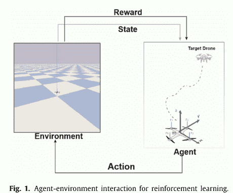
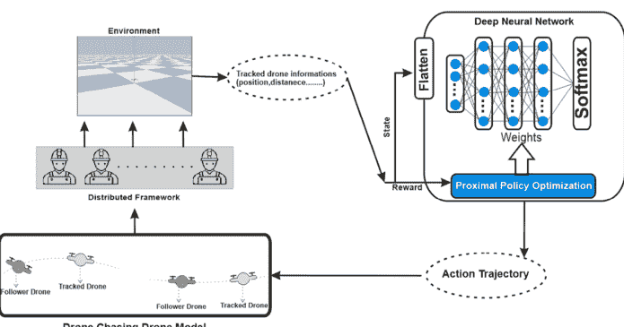
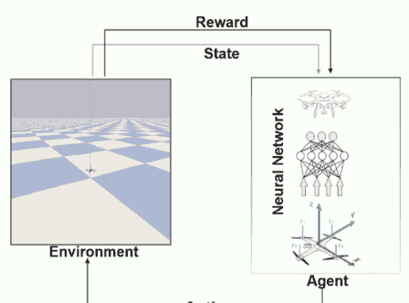
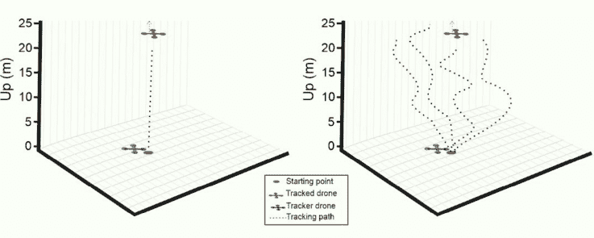
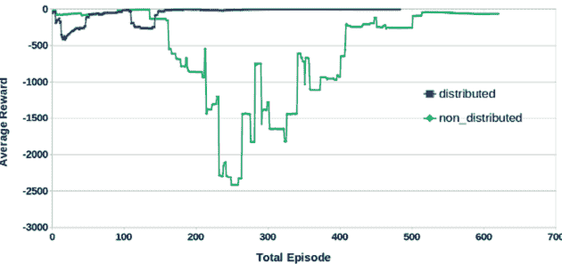
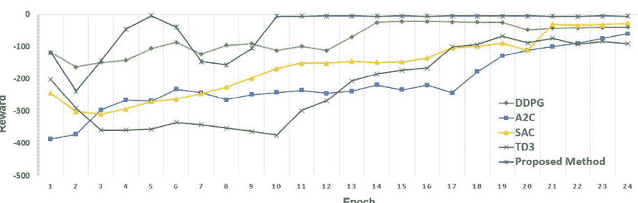

# 无人机追踪的新方法：基于近端策略优化的分布式深度强化学习


# 摘要

本文提出了一种基于近端策略优化（PPO）的分布式深度强化学习算法，用于无人机（UAV）自主追踪另一架无人机。因此，本文对文献做出了三个重要贡献。第一个是开发高效的无人机追踪算法，第二个是提出可适应该问题的深度强化学习方法，第三个是引入可用于无人机追踪、控制和任务协调等各类问题的通用分布式深度强化学习平台。为验证所提出的方法，以分布式和非分布式方式模拟了 PPO 算法与深度强化学习算法，在不同场景下训练了追踪无人机，并获得了使用 CPU 进行训练的分布式和非分布式性能；给出了使用通用和自适应学习算法的场景，最后，明确展示了本文所开发算法的性能。


# 1. 动机与重要性

强化学习（RL）[1] 发展于 20 世纪 80 年代初，是机器学习的重要领域之一。RL 是机器学习的一个子领域，其中与环境交互的智能体通过接收环境反馈来学习最优动作选择策略。RL 算法以迭代方式学习：在每次迭代中，智能体观察其状态并选择一个导致后续环境状态的动作。然后，智能体接收奖励或惩罚，并更新表示最大化目标的值函数。通过探索环境并收集这些信息，智能体学习如何最大化长期奖励。图 1 展示了强化学习方法中的智能体-环境交互。

通过 RLlib [2] 库，展示了分布式系统在强化学习中的优势。在解决此类复杂问题时使用分布式系统，将使更多参数在更短时间内得到训练。因此，学习环境会更加容易。特别是对于无人机，当需要同时训练多个算法时，分布式系统的重要性便凸显出来。这种方法使学习事件去中心化，在

* 通讯作者。
电子邮件地址：ziya.tan@gop.edu.tr (Ziya Tan)，mkarakose@firat.edu.tr (Mehmet Karaköse)。



换句话说，它使用多个工作节点而非单个工作节点来解决相同问题。因此，学习事件得到优化，信息共享更加迅速。

在 [3] 中，开展了一项深入的文献综述，以考察在繁忙道路上追踪多个物体所使用的技术、数据集和硬件。在论文 [4] 中，针对城市公共交通问题，使用了马尔可夫决策过程（MDP）来解决该问题。此外，采用了分布式强化学习方法来克服高计算成本。在 [5] 中，使用分布式深度强化学习来优化无线网络传感器，学习无线介质访问控制层以最大化网络节点的吞吐量。Aklofi 等人 [6] 使用深度强化学习算法来优化追踪过程中另一架无人机的动作，作为第二种方法，他们开发了一种搜索空间建议以确定被追踪无人机的位置。在 [7] 中，提出了一种使用毫米波雷达系统进行无人机追踪的方案，展示了使用安装在另一架无人机上的雷达追踪无人机的初步结果。在 [8] 中，提出了一种分布式强化学习方法来解决无人机的协作感知与传输问题。提出了一种分布式感知与传输协议来协调多架无人机。在 [9] 中，提出了一种面向自主空中载具的分布式深度强化学习方法，该建模方法旨在优化空中出租车的起飞和乘客接载，以便从最佳位置接载其客户。在研究 [10] 中，针对群体机器人提出了一种基于参数共享和行为的方法，在不同环境中测试了 PPO 算法并观察了结果。在研究 [11] 中，提出了一种用于无人机网络控制与优化的新型深度强化学习架构，并观察到使用分布式架构可使性能提升高达 3.7 倍。在 Venturini 的硕士论文 [12] 中，使用了分布式深度强化学习方法来应对群体无人机。在该论文中，遇到了强化学习框架的所有典型挑战。[13] 中 Seejong Park 等人的工作针对反无人机系统进行了全面的综述。使用的模拟器环境包括许多障碍物，例如树木、电缆、停放的汽车和房屋。在 [14] 中，对近期 DRL 研究进行了分析，分析了所使用的策略。在该研究中，所使用的策略被分为三组，并利用牛顿运动定律讨论了将智能体移动到共同目标的问题。在研究 [15] 中，使用策略梯度算法在有限区域内用 DRL 方法训练了三种不同的机器人，评估了机器人的性能并取得了成功结果。在文章 [16] 中，使用了分布式 PPO 算法的优化版本，该文章旨在帮助智能体在具有不同障碍物的环境中学习复杂行为。经过在各种障碍物和地形上测试的分布式 PPO 算法训练，智能体凭借简单的奖励函数提高了移动技能。智能体已成功学会跳跃、奔跑和蹲伏等任务，无需任何指导。

表 1 比较了一些相似研究的方法和结果。尽管在无人机追踪中使用了不同的方法，但可以看出，YOLO 深度学习算法通常用于实时无人机检测算法。

在本研究中，我们比较了 DDRL 与非分布式深度强化学习算法的性能，以成功克服四旋翼无人机面临的最大问题之一，即起飞和追踪。在 CPU 实验中，观察到使用分布式架构可提高训练性能并缩短训练时间。本文的主要贡献可总结如下。

- 展示 DRL 在无人机追踪和垂直起飞问题中的应用以及分布式系统的性能，
- 比较基于 PPO 的分布式与非分布式方法
- 作为未来类似问题研究的参考文献

# 2. 软件描述

在本节中，解释了文章中使用的软件的算法和基本概念。首先，介绍了 RL 的相关信息。其次，给出了关于深度强化学习的详细信息。最后，考察了本研究中使用的 DDRL 方法。本研究主要使用 Python 编程语言、torch 框架和 gym-pybullet 模拟环境。此外，使用 ray 框架对现有架构进行分布式部署。

## 2.1. 软件架构

本研究基本上考察了 3D 环境中的无人机导航。该导航过程基本上采用两种不同的方法进行了比较。分布式深度强化学习和深度强化学习方法训练一个智能体，使一架无人机跟随另一架无人机。训练结束后，跟随无人机旨在根据被跟随无人机的定位在一定高度上成功跟踪。为此，强化学习与 PPO 算法联合使用。RAY 框架被选作分布式架构。训练环境中的工作节点执行由深度神经网络评估的动作。作为动作结果从环境接收到的奖励和状态值由 PPO 架构进行评估。根据这些动作所获得的奖励和惩罚，智能体学习环境并据此行动。在本研究中，训练最多使用 4 个工作节点，具体取决于处理器。当使用 GPU 时，此数量还可以进一步增加。这些工作节点彼此独立地学习环境，并将结果传输到一个共同的学习者。因此，在单位时间内实现了更快、更成功的训练。在非分布式模型中，单个智能体在环境中执行动作。

图 2 展示了本研究中使用的无人机追踪的基本软件架构。在研究范围内，训练在虚拟环境中进行，跟随无人机根据被跟随无人机执行其动作。该


## 表 1 相似 DDRL 研究对比。

| 论文 | 问题 | 方法 | 结果 |
| :--- | :--- | :--- | :--- |
| [6] | 无人机追逃 | 深度强化学习与搜索区域提议 | 所提方法在复杂室外场景中跟踪移动目标方面有效 |
| [7] | 检测并跟随目标无人机 | 在实验中验证一种利用毫米波雷达系统的空载无人机检测系统 | 无法在远距离检测无人机 |
| [17] | 自动无人机检测与跟踪系统 | YOLO 深度学习算法用于无人机检测，新开发的目标候选跟踪（TCT）算法用于无人机跟踪。 | 该系统结合静态广角相机和旋转低角度相机，基于仿真和现场测试已被证明可提供合理的结果。 |
| [18] | 在 GPS 被拒环境中自主检测、猎取并击落其他小型无人机 | 用于训练 Tiny YOLO 检测算法。 | 当前系统的检测准确率为 77%。检测速度为 8.33 fps。 |
| [8] | 被视为蜂窝式无人机物联网，其中无人机通过协同感知和传输执行感知任务以最小化信息时效（AoI）。 | 制定了用于 AoI 最小化的轨迹设计问题，并提出了一种基于深度强化学习的复合动作分布式 actor-critic（CA2C）算法来求解。 | 研究表明，通过任务划分，协同无人机可实现比非协同无人机更低的 AoI。 |
| [19] | 设置并启用分布式训练以缩短实验时间。 | 分布式与非分布式强化学习算法的比较。 | 分布式架构比非分布式架构更成功。 |
| [20] | 交通灯控制 | 使用分布式深度强化学习方法 | 基于 CNN 的 Q 网络因与环境交互的训练用于交通灯的智能体而得到优化。在所提分布式架构与集中式学习算法进行对比的仿真中，得出结论：分布式学习算法表现更好。 |
| [21] | 提出了一种 4 阶段方法，作为现实条件下混合流水车间（HFS）调度问题的解决方案。 | 论文中提出的概念通过在类游戏环境中测试 DRL 智能体来开发。PPO 和 A3C 算法用于求解问题的复杂性。 | 实验结果显示，两种算法训练的智能体在求解不同性质的问题时均出现性能下降。然而，调整后的策略在一定时期后提升了性能。因此，得出结论：需要更多研究来提高 DRL 智能体的性能。 |
| [22] | 通过在多任务定义中用一组参数训练 RL 智能体来求解问题。 | 引入了一种具有高可扩展性的新分布式架构 IMPALA。我们还提出了非对策学习算法 V-trace。 | 实验表明，所引入的分布式算法（IMPALA）优于其他算法。它还在分布式任务之间表现出正迁移。 |
| [23] | 开发交通信号控制以提高效率，解决特大城市的交通问题。 | 提出了一种使用 Ape-X 和深度 Q 学习网络在小数据集上的 RL 模型。 | 在三个不同城市的数据集上进行的实验表明，该方法比现有基于 RL 的方法更成功。此外，这些城市的平均出行时间也达到了更好的水平。 |
| [24] | 比较文献中可用的无人机导航框架和仿真软件。 | 无人机导航与仿真器的比较以及 RL 算法的性能测量。 | 分析结果识别出一些挑战和优势。特别是，观察到由 RL 算法执行的复杂无人机任务由于仿真环境不足而导致性能下降。 |

人工神经网络作为动作决定因素，根据确定的参数确定动作，并使无人机在环境中移动。该动作将获得的奖励将对其下一步行动起决定性作用。

本文采用 OpenAI 开发的 Gym 工具包。它主要用于 RL 问题以及使用 Python 开发现有解决方案。PyBullet 用于建模在 Gym 中创建的无人机所受的力和力矩。“OpenAI 的”Gym 工具包



图 2. 无人机跟踪无人机模型架构。

该工具包被引入以标准化 Python 中 RL 问题和算法的开发。我们使用 PyBullet 来建模我们 Gym 中每个四旋翼机所受的力和力矩，并利用物理引擎计算和更新所有载具的运动学。在智能体训练期间，如同在 MDP 框架中的标准操作一样，从环境中采取一个动作，该动作会更新内部状态。结果返回与所采取动作相对应的奖励和状态。这在设定的循环中重复进行。每个步骤返回的奖励值由第 2.2.3 节描述的函数确定。领头无人机的向上移动将教导处于起始位置的跟随无人机需要遵循的路径。

## 2.2. 软件功能

本节解释了用于无人机跟踪研究中所用软件的功能。

### 2.2.1. 分布式深度强化学习

在 RL 理论中，与其他机器学习方法不同，不给出任何先验知识。目标是通过使用探索环境后获得的经验来最大化未来动作的奖励。RL 中有两个基本元素：智能体和环境。RL 的两个显著特征是：试错搜索和延迟奖励特性 [25]。

**智能体：**环境中的学习者和决策者。有时智能体可以是执行任务的无人机或学习站立的机器人。

**环境：**为智能体学习而创建的世界。这有时可以是智能体观察到的精确环境，例如街机游戏中。有时它可以是部分可观察环境，例如摄像头图像。

智能体与环境在每个 t 时段进行交互。在每个步骤 t，智能体接收环境的表示 st ∈ S，并从集合 A(S) 中选择一个动作。一步之后，智能体作为交互结果接收一个数值奖励（rt ∈ R），并设置一个新状态（st+1）[26]。在图 3 中，可视化了 DRL 的运行。

深度强化学习（DRL）基本上与 RL 相同。不过，主要区别在于它使用深度学习算法而非经验表来进行动作选择。此最佳示例是由 Google DeepMind 开发的 Atari 游戏。尤其是在近年来取得重大进展的计算机视觉、语音识别和机器人领域，需要训练大量数据集。通常，值函数的估计可以用表格形式表示。

然而，现实问题中出现的大规模连续状态空间会显著减慢训练速度。在这种情况下，问题通过神经网络求解 [27]。智能体的目标是通过最大化累积奖励，使神经网络更接近最优动作-值函数，如 Eq. (1) 所示。

```
Q' (s, a) = max_\pi E { R_t + \gamma R_{t+1} + \gamma^2 R_{t+2} + \cdots | s_t = s, a_t = a, \pi }
```

随着机器学习的发展，尤其是在机器人领域，DRL 不得不自我完善。分布式 RL 通过将学习分布到许多工作者中，成功提高了学习速度。此外，单位时间内学习的环境知识也增加了。Gorilla 是该领域的开创性架构之一。在 Gorilla 之后，目前的分布式架构（如 A3C、IMPALA、APE-X、D4PG）已被使用。在这种架构中，目标是使用多个 actor 来获取经验以更新权重 [8]。所有使用的 actor 可以同时访问一个训练好的系统。分布式深度强化学习架构在算法 1 和算法 2 中描述 [28]。

```
Algorithm 1 Worker K: ComputeGradient
state: Replay dataset D_k, game state s, target model theta, target model generation i
Fetch model theta and iteration number n from server.
if i >= c then
    theta^- = theta
    t = t(NC) + 1
    q = max { (N_{max-t}) / (N_{max}), 0 }
    epsilon = (1-q)*epsilon_{max} + q*epsilon_{min}
    Select action: a = { max_a Q(theta(s), a, w), p=1 - epsilon random action otherwise
Execute action a and observe reward r_t and frame x_{t+1}
Append (s_t, a_t, r_t, x_{t+1}) and preprocess phi_{t+1} = O(x_{t+1})
Store experience (phi_t, a_t, r_t, phi_{t+1}) in D_k
Uniformly sample minibatch of transitions X from D_k, where X_t=(phi_t, a_t, r_t, phi_{t+1})
Set y_j = { r_j if phi_{j+1}_terminal (r_j + gamma*max_{a'} Q(phi_{j+1}, a'; theta') otherwise
delta theta = nabla_theta F(theta; X) = 1/|B| sum_{t=1}^B V_a ( 1/2 (Q(theta, a_t) - y_t)^2 )
Send delta theta to parameter server
```




图 3. DRL 的奖励-动作循环。

| 参数 | 值 |
|---|---|
| 隐藏层 | 256 |
| 激活函数 | tanh |
| 中心评论家 | 25 个输入 |
| 动作模型 | 12 个输入 |

```
Function update($\Delta\theta$)
$r_1 \leftarrow 0.9r_1 + 0.1(\Delta\theta)^2$ for all $i$
Acquire write-lock
\(\theta_i \leftarrow \theta_i - \alpha(\Delta\theta)_i / \sqrt{r_i}\)
Release write-lock
Initialize server
\(\theta_i \sim \mathcal{N}(0, \zeta), r \leftarrow 0, n \leftarrow 0$
for all workers k do
  AsyncStart
    Populate $D_k$ by playing with random actions
    repeat
      ComputeGradient
    until server timeout
  AsyncEnd
While n < MaxIters do
  if latest model requested by worker k then
    Acquire write-lock
    Send ($\theta,n$) to worker k
    Release write-lock
  if gradient $\Delta\theta$ received from worker k then
    Update($\Delta\theta$)
    $n \leftarrow n+1$
  Shutdown server
```

### 2.2.2. 近端策略优化 (PPO)

PPO 是一种基于梯度的强化学习方法。该方法旨在使用随机梯度下降来优化目标函数。在训练阶段，PPO 代理估计每个可能发生动作的概率，并根据此值随机选择动作。类似于信任区域策略优化 (TRPO) 的目标函数，公式 (2) 定义了新策略与旧策略之间的几率比。

\(r(\theta) = \frac{\pi_\theta(a|s)}{\pi_{\theta_{old}}(a|s)}\) (2)

TRPO 的目标函数可以按公式 (3) 进行更新。

\(j(\theta)^{TRPO} = E \left[ r(\theta) \hat{A}_{old}(s, a) \right]\) (3)

在没有某些约束的情况下，该目标函数可能导致不稳定或收敛速度慢。PPO 使用策略比率 (\(r(\theta)\))，在没有复杂限制的情况下其值约为 1。该范围由 \(\varepsilon\) 超参数设置为从 1-\(\varepsilon\) 到 1+\(\varepsilon\)，默认值为 0.2。经过这些调整后，PPO 的目标函数可以写为公式 (4)。

\(f^{CLIP}(\theta)\)
\(= \mathbb{E} \left[ \min \left( r(\theta) \hat{A}_{old}(s, a), \text{clip} \left( r(\theta), 1 - \varepsilon, 1 + \varepsilon \right) \hat{A}_{old}(s, a) \right) \right]\) (4)

在公式 (4) 中，clip 函数确定策略比率，其值在 [1-\(\varepsilon\), 1+\(\varepsilon\)] 之间。由于 PPO 目标函数取原始值与裁剪值之间的较小值，因此它防止了对负动作的偏向。

### 2.2.3. 奖励函数

在跟踪过程中，仅调整接近目标的无人机的 x、y、z 位置和偏航角。飞行控制器自动调整滚转角和俯仰角以跟随目标，将战斗机移动到下一个设定点。除非无人机向前移动，否则滚转角和俯仰角保持为零，无人机维持其位置。在 LeaderFollower 环境中，奖励函数由追随者无人机通过跟踪被追踪无人机的高度所获得的奖励组成。奖励函数如公式 (5) 所示。

\(r_0 = -\|[0, 0, 0.6] - x_0\| \frac{2}{2}, \quad r_1 = -0.6 \left( z_1 - z_0 \right)^2\) (5)

### 2.2.4. 软件超参数

在训练期间，两个实验中 PPO 算法的架构按表 2 所示进行了安排。训练在搭载 Intel Core i7-5500 CPU 2.4GHz×4 处理器的计算机上进行。

第一个实验是为了测量无人机模拟中强化学习的效果而创建的。因此，介绍了一种基于四旋翼无人机的高级实验，使用强化学习算法来实现目标并完成任务。在此实验中，训练设计为非分布式且仅使用 CPU。用于训练 300000 步的 DDRL 算法的参数如表 3 所示。

第二个实验将 PPO 算法分布到多个工作器中。与第一个实验相比，使用的参数中唯一的区别是工作器的数量。在第二个实验中，工作器数量确定为 4。因此，我们可以比较两个实验的结果。

在此实验中，未使用 GPU。代理在分布式架构的帮助下由四个不同的工作器使用仅 CPU 进行训练。该实验训练了 300000 个时间步，代理从环境中接收到的奖励与第一个实验的数据进行了对比给出。

# 3. 示例

本研究中使用的软件解决了四旋翼无人机的运动控制、目标跟踪和垂直上升问题。使用基于梯度的深度 RL 方法来生成控制策略。本文介绍了两种不同的方法来训练 DRL 算法。第一种方法将学习算法与分布式架构一起训练。第二种方法以非分布式方式训练。训练使用 CPU 进行。为了提高此类复杂问题的训练成功率并降低计算成本，我们通过实验表明，单独使用 CPU 不能取得成功，而当与多个 CPU 工作器结合使用时可以更成功。

表 3 DDRL 使用的参数。

| 参数 | 值 | 说明 |
| :--- | :--- | :--- |
| env | LeaderFollower | |
| Env_type | OpenAI 环境 | |
| Executed algorithm | PPO | |
| Stop condition | Time-steps = 300000 | |
| lambda | 1.0 | GAE（广义优势估计）参数 |
| train_batch_size | 400 | 每个 SGD（随机梯度下降）时代的大小 |
| learning rate | 5e-5 | 训练学习率 |
| kl_coeff | 0.2 | KL 散度初始系数 |
| Num_sgd_iter | 30 | 每个外循环中的 sgd 迭代次数 |
| Num_gpu | 0 | |
| worker | 0 | |

表 4 现有关于无人机跟踪研究的论文比较。

| 论文 | 算法 | 性能值 |
| :--- | :--- | :--- |
| [29] | CNN-LSTM (分布式) | 准确率约为 98% |
| [30] | DDPG | 35% 的成功跟踪比例 |
| [31] | SAC | 平均奖励为 32 |
| [32] | UCT (分布式) | 75% 的成功跟踪比例 |
| [33] | DRL | 累计总奖励为 73.70 |
| [34] | CMDP | 搜索时间减少 28% |
| [35] | MDP | 控制精度 (m/s2) 为 0.2691 |
| 我们的研究 | 分布式 PPO | 平均奖励为 -54.78 |

以分布式方式训练。我们可以从三个不同的轴来跟踪实验。因此，追随者无人机在垂直平面上执行了 6 秒钟的跟踪功能。在此期间，第二个实验大约比第一个实验成功十倍。

追随者无人机在垂直平面上执行了 6 秒钟的跟踪功能。在图 4 中，模拟了无人机跟踪。

表 4 显示了文献中一些特殊研究的结果，这些研究与本文根据所使用的环境和 DRL 算法所进行的实验相似。分析表 4 时，可以看出，根据使用强化学习的环境不同，会获得平均奖励或任务成功率等不同的效果。分布式系统在无人机跟踪问题中尚未广泛使用，这使得结果难以比较。此外，由于本文提出的方法旨在证明分布式系统在无人机跟踪中优于非分布式系统，因此无法将其与类似问题进行比较。

该软件是一段代码，用户只需满足一些基本要求即可轻松使用和安装，无需其他东西。特别是，用户可以自定义人工神经网络并更改仿真环境。因此，它可以广泛用于学术和科学研究。该软件还使研究人员更容易将分布式架构与强化学习算法相结合。由于使用 Python 代码训练的算法是开源的，其他用户可以轻松更新和改进它。该软件完全使用 MIT 许可证开源发布，并附带一本包含所有所用库链接的说明性用户手册。

# 4. 影响

该研究解决了四旋翼无人机的运动控制、目标跟踪和垂直升降等问题。使用基于梯度的深度 RL 方法来建立控制策略。本文介绍了两种不同的训练 DRL 算法的方法。第一种方法使用分布式架构训练学习算法。第二种方法以非分布式方式训练。训练使用 CPU 进行。为了提高此类复杂问题的训练成功率并降低计算成本，我们通过实验表明，CPU 单独无法取得成功，而在分布式方式下与多个工作器结合时可以更成功。我们可以从三个不同的轴来跟踪实验。因此，

## 4.1. 实验结果

在两个实验中，在进行了 300000 个时间步训练的同时，代理从环境中接收到的奖励的基于划分的平均值如图 5 所示。在第一个实验的训练阶段，代理总共训练了 700 个回合，而在第二个实验中，该值约为 500 个回合。分布式训练的代理在相同的时间槽内完成了更多的回合。通过检查图 5，得出结论：训练期间分布式 PPO 算法的平均奖励值为 -54.78，而非分布式 PPO 算法为 -559.49。比较本实验的结果、训练时间、回合中接收到的奖励以及给定任务的求解，发现第二个实验的结果比第一个更成功。第二个实验的训练大约花费了 1 小时。




图 4. 无人机追踪仿真演示。



图 5. 两项实验中每个比较情节接收到的平均奖励。



图 6. 在 stable-baselines3 框架中使用五种 DRL 算法的 20 步奖励平均值。

我们还使用 stable-baselines3 [37] 框架（一种最先进的深度强化学习算法的开源实现）将所提方法与 A2C [8]、DDPG [30]、SAC [31] 和 TD3 [36] 进行比较。实验以相同的超参数训练 500 步。结果如图 6 所示。

表 5 使用 stable-baselines3 框架的算法在训练阶段的平均奖励值。

| 算法 | 平均奖励 |
|---|---|
| SAC | -163,24 |
| TD3 | -221,54 |
| DDPG | -75,62 |
| A2C | -216,36 |
| 所提方法 | -54,78 |

训练期间代理接收到的平均奖励如表 5 所示。

分析图 6 和表 5 时可以看出，所提方法比其他最先进的 DRL 算法更早最大化代理的奖励值，并且在训练期间平均奖励值更高。

# 5. 结论

本文开发了一款支持分布式架构的应用程序，使研究人员能够充分利用基于 CPU 的深度强化学习软件。在此背景下，解决了无人机追踪无人机的问题，并进行了两项不同的实验；观察到分布式深度强化学习软件比非分布式软件更成功。根据实验获得的数据，分布式训练中每次迭代执行的步骤数大约高出 67%。根据训练结果的奖励图，分布式算法更成功。在训练 300000 步的算法中，第二成功的实验在训练期间平均奖励为 –54.78。对于非分布式算法，该值为 –559.49。

根据第 4.1 节的测试结果，观察到训练阶段第一个实验的成功率在测试结果中没有变化。因此，得出结论：使用分布式 PPO 算法训练的无人机在追踪目标无人机方面更成功。本研究将有助于填补文献中关于在无人驾驶航空器中同步使用分布式系统的强化学习方面的空白。它还将有助于为无人驾驶航空器开发现实的 DDRL 应用程序。

我们未来的计划是开发一种用于无人机检测和追踪的新算法，以便追踪无人机可以无论环境如何都成功执行任务。

# 利益冲突声明

作者声明他们没有已知的可能影响本文所报告工作的竞争性财务利益或个人关系。

# 数据可用性

文章所述研究未使用任何数据。

# 致谢

本研究受到 Ziya TAN 博士论文《用于无人机追踪的分布式深度强化学习方法》的启发。

# 参考文献

- [1] Cao Z, Guo H, Song W, Gao K, Chen Z, Zhang L, 等. 使用强化学习最大限度地降低交通中延迟发生的概率. IEEE Trans Veh Technol 2020;69(3):2424–36.
- [2] Liang E, Liaw R, Moritz P, Nishihara R, Fox R, Goldberg K, 等. RLlib: 分布式强化学习的抽象. 2018, arXiv:1712.09381.
- [3] Jiménez-Bravo DM, Murciego ÁL, Mendes AS, Blás HS, Bajo J. 交通环境中的多目标跟踪：系统文献综述. Neurocomputing 2022;494:43–55.
- [4] Yan H, Cui Z, Chen X, Ma X. 用于多线动态公交时刻表优化的分布式多智能体深度强化学习. IEEE Trans Ind Inf 2022;19(1):469–79.
- [5] Dutta H, Biswas S. 用于 IoT 和传感器网络中可扩展无线介质接入的分布式强化学习. Computer Networks 2022;202:108662.
- [6] Akhloufi MA, Arola S, Bonnet A. 无人机追逐无人机：强化学习与深度搜索区域提议. Drones 2019;3(3):58.
- [7] Dogru S, Batista R, Marques L. 使用毫米波雷达用无人机追踪无人机. In: 第四届伊比利亚机器人会议, 2020, p. 392–402.
- [8] Hu J, Zhang H, Song L, Schober R, Poor HV. 合作无人机互联网：基于多智能体深度强化学习的分布式轨迹设计. IEEE Trans Communications 2020;68(11):6807–21.
- [9] Yuna WJ, Junga S, Kimna J, Kimb JH. 无人机出租车应用中自主空中 eVTOL 移动的分布式深度强化学习. ICT Express 2021;7(1):1–4.
- [10] Tan Z, Karaköse M. 面向群体机器人的基于近端策略的深度强化学习方法. In: 2021 消费者技术创新缩放会议, 2021. p. 166–70.
- [11] Jacopo P, Hehui Z, Sigi Z, James X, Amanda P, Angela PS. 学习飞行——带有 PyBullet 物理引擎的用于多智能体四旋翼机控制强化学习的 Gym 环境. In: 2021 IEEE/RSJ 智能机器人与系统国际会议. 2021, p. 7512–9.
- [12] Venturini F. 用于无人机群控制的分布式深度强化学习. 帕多瓦大学; 2021.
- [13] Park S, Kim HT, Lee S, Joo H, Kim H. 反无人机系统综述：组件、设计与挑战. IEEE Access 2021;9:42635–59.
- [14] Tan Z, Karaköse M. 基于策略的深度强化学习方法有效性分析的比较评估. Int J Comput Inf Technol 2021;10(3):1–15.
- [15] Tan Z, Karaköse M. 多智能体问题的基于策略的深度强化学习方法. In: 技术与管理的交叉研究, 2021, p. 369–76.
- [16] Heess N, TB D, Sriram S, Lemmon J, Merel J, Wayne G, 等. 丰富环境中运动行为的涌现. 2017, arXiv 预印本 arXiv:1707.02286.
- [17] Unlu E, Zenou E, Riviere N, Dupouy PE. 基于多摄像头的无人机检测和追踪深度学习策略. IPSJ Trans Comput Vis Appl 2019;11(1):1–13.
- [18] Wyder PM, Chen YS, Lasrado AJ, Pelles RJ, Kwiatkowski R. 在 GPS 拒绝环境中，通过深度学习和全载板计算实现自主无人机猎手操作. PLoS One 2019;14(11):1–18.
- [19] Kayid AM. 大规模机器人仿真的分布式深度强化学习. 慕尼黑：慕尼黑工业大学信息学部; 2019.
- [20] Liu B, Ding Z. 交通灯控制的分布式深度强化学习方法. Neurocomputing 2022;490:390–9.
- [21] Nahhas A, Kharitonov A, Turowski K. 求解混合流车间调度问题的深度强化学习技术：近端策略优化 (PPO) 和异步优势演员-评论家 (A3C). In: 第 55 届夏威夷系统科学国际会议论文集. 2022.
- [22] Espeholt L, Soyer H, Munos R, Simonyan K, Mnih V, Ward T, 等. IMPALA：基于重要性加权的参与者-学习者架构的可扩展分布式深度强化学习. In: 国际机器学习会议. 2018, p. 1407–16.
- [23] Wang M, Wu L, Li J, Wu D, Ma C. 基于示范数据的城市交通信号控制强化学习. In: 2022 国际神经网络联合会议, vol. 18, no. 23, 2022, p. 1–8.
- [24] AlMahamid F, Grolinger K. 使用强化学习的自主无人驾驶航空器导航：系统综述. Eng Appl Artif Intell 2022;115:105321.
- [25] Mnih V, Kavukcuoglu K, Silver D, Graves A, Antonoglou I, Wierstra D, 等. 使用深度强化学习玩 Atari 游戏, 2013, arXiv:1312.5602.
- [26] Sutton R, Barto A. 强化学习：导论. 伦敦：MIT 出版社; 2015.
- [27] Mnih V, Kavukcuoglu K, Silver D, Rusu A, Veness J, Bellemare M, 等. 通过深度强化学习实现人类水平控制. Nature 2015;518(7540):529–33.
- [28] Ong HY, Chavez K, Hong A. 分布式深度 Q 学习. 2015, arXiv 预印本 arXiv:1508.04186.
- [29] Alferaidi A, Yadav K, Alharbi Y, Razmjooy N, Viriyasitavat W, Gulati K, 等. 基于 IoT 的车辆入侵检测方法的分布式深度 CNN-LSTM 模型. Math Probl Eng 2022;1–8.
- [30] Xie J, Peng X, Wang H, Niu W, Zheng X. 基于深度强化学习策略的无人机自主追踪与着陆. Sensors 2020;20(19):5630.
- [31] Zhao J, Liu H, Sun J, Wu K, Cai Z, Ma Y, Wang Y. 用于无人机动态目标追踪的基于深度强化学习的端到端控制. Biometrics 2022;7(4):197.
- [32] Wang T, Qin R, Chen Y, Hichem S, Chang C. 无人机目标搜索与追踪的强化学习方法. Multimedia Tools Appl 2019;78:4347–64.
- [33] Moon J, Papaioannou S, Laoudias C, Kolios P, Kim S. 用于目标追踪的多无人机轨迹控制深度强化学习. IEEE Internet Things J 2021;8(20):15441–55.
- [34] Chen Y, Chang DK, Zhang C. 使用无人机群的自主追踪：一种受限多智能体强化学习方法. IEEE Trans Veh Technol 2020;69(11):13702–17.
- [35] Ma B, Liu Z, Dong Q, Zhao W, Wang J, Cheng Y, 等. 风扰环境下无人机追踪控制的深度强化学习. IEEE Trans Instrum Meas 2023;72:1–13.
- [36] Berton D, Gauffriau A, Grasset D, Gupta JS. 基于深度强化学习的自主无人机拦截. In: 第 12 届交通与运输代理国际研讨会 (ATT 2022) 与 IJCAI-ECAI 2022 联合举办, p. 3173.
- [37] Raffin A, Hill A, Gleave A, Kanervisto A, Ernestus M, Dormann N. Stable-baselines3：可靠的强化学习实现. J Mach Learn Res 2021;22(1):12348–55.

