# 基于深度学习增强可穿戴传感器的抗噪人机接口

查看更新

Xianjun Chen$^{1,2}$, Zhiyuan Lu$^{2}$, Xiaoxiang Gao$^{2,8}$, Li Yin$^{2}$, Siyu Qin$^{2}$, Muyang Lin$^{2}$, Fangao Zhang$^{1}$, Yi Lu$^{1}$, Shicho Ding$^{2}$, Ruixiao Liu$^{2}$, Selene Tang$^{2}$, Sai Zhou$^{2}$, Dennis Dang$^{2}$, Xinyi Yang$^{2}$, Zihan Wu$^{2}$, Ziyang Yang$^{2}$, Hongjie Hu$^{2}$, Xinyu Wang$^{2}$, Zhangzhi Zhu$^{2,8}$, Chengchangfeng$^{2}$, Ruota Wang$^{2}$, Wentong Ye$^{2}$, Hao Huang$^{2}$, Ray S. Wu$^{2}$, Yizhou Bian$^{2}$, Geonho Park$^{2}$, Jian Cao$^{2}$, Xueping Lin$^{2}$, Deying Lu$^{2}$, Gert Cauwenhenberg$^{2}$, Joseph Wang$^{2}$ & Sheng Xu$^{1,2,3,7}$

带有惯性测量单元（IMU）的可穿戴机器接口广泛应用于医疗、机器人和交互技术。然而，由于真实环境中的运动伪影，信号提取仍然面临挑战。在这里展示了一种通过深度学习增强的可穿戴传感器能够忍多种运动伪影的人机接口。该系统成了六通道IMU、肌电模块、蓝牙微控制器单元和可伸性电池，实现了手势的无线采集和传输。在手势和运动伪影的复合数据集上训练的卷积神经网络提取出稳健的信号，基于参数的迁移学习提高了网络跨用户的泛化能力。通过滑动窗口方法实时连接提取的手势，实现在跑步、高频振动、姿态变化、海浪运动以及这些运动组合的动态活动期间对机械臂进行连续控制。这项工作展示了可穿戴人机接口在复杂真实世界应用中的潜力。

可穿戴设备在各种应用中具有广阔前景，例如持续健康监测$^{1}$、能量采集$^{1}$和人机接口$^{2}$。能够捕捉手势的可穿戴惯性测量单元（IMUs）已被证明对于虚拟和增强现实$^{2}$、非通信$^{2}$、生理监测$^{2}$、运动康复$^{2}$和机器人控制$^{2}$特别有价值。然而，在实际应用中，手势不可避免地受到运动伪影的干扰（补充说明注：运动伪影可能源于环境活动，如步行、跑步或坐在车辆内，源于IMU相对于重力向量的方向的变化（补充图1），或它们的组合。运动伪影可能表现出与手势信号相似的特征，或不同个体之间的频率。然而，在这些运动伪影中恢复手势信号是一项重大挑战$^{2-10}$）。

机构列表出现在论文末尾。电子邮件：`josephwang@ucsd.edu`; `shengxu@ucsd.edu`

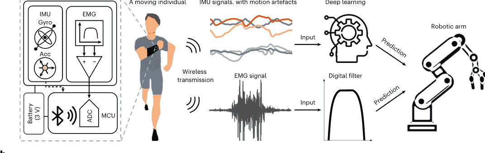

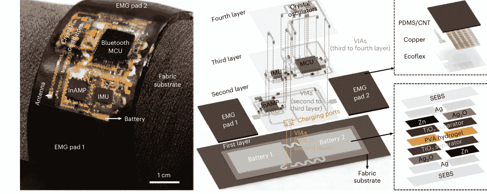

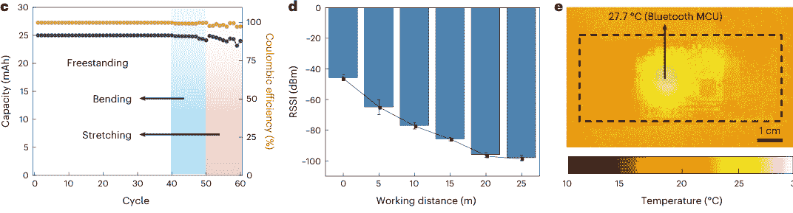

**图. 1 抗噪人机接口概述。** **a** 在无运动伪影的柔性基底上的六通道IMU。不含运动伪影的手势由IMU捕捉并使用深度学习模型进行处理。加速：加速度计、陀螺仪。结果通过数字滤波的肌电信号处理以控制手臂。**b** 柔性设备的结构和爆炸视图。**c** 在各种运动条件下的实时手势控制演示。**d** 系统在不同噪声水平下的性能分析。

**图 1（重构）抗噪人机接口概述。** **a** 在无运动伪影的柔性基底上的六通道IMU。不含运动伪影的手势由IMU捕捉并使用深度学习模型进行处理。加速：加速度计、陀螺仪。结果通过数字滤波的肌电信号处理以控制手臂。**b** 柔性设备的结构和爆炸视图。**c** 在各种运动条件下的实时手势控制演示。**d** 系统在不同噪声水平下的性能分析。

在实际应用中，手势不可避免地受到运动伪影的干扰（补充说明：运动伪影可能源于环境活动，如步行、跑步或坐在车辆内，源于IMU相对于重力向量的方向的变化（补充图1），或它们的组合。运动伪影可能表现出与手势信号相似的特征，或不同个体之间的频率。然而，在这些运动伪影中恢复手势信号是一项重大挑战$^{2-10}$）。

可穿戴设备在各种应用中具有广阔前景，例如持续健康监测$^{1}$、能量采集$^{1}$和人机接口$^{2}$。能够捕捉手势的可穿戴惯性测量单元（IMUs）已被证明对于虚拟和增强现实$^{2}$、非通信$^{2}$、生理监测$^{2}$、运动康复$^{2}$和机器人控制$^{2}$特别有价值。

## 手势和运动伪影的多通道信号识别

## 结果

## 传感器的设计与表征

系统设计有四层（图1b和补充说明2）。第一层是粘在柔性基底上的带。第二层包含用于提供 -0.1 到 1 mV 输出电压的传感器（扩展数据图4和方法）。

### 论文

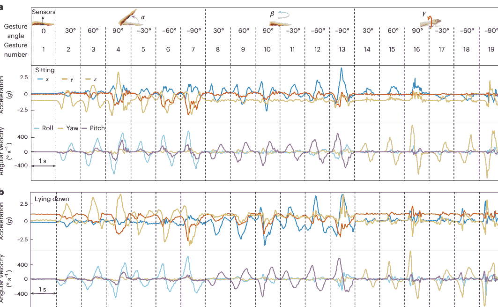

**a.** 个体处于卧位时19种手势信号的描绘。安装在在前臂上的传感器捕捉每个层级，而其他18种手势通过角度发生变化。第一个手势保持前臂相对水平，其他手势则涉及速度、方向和独特的IM信号。灰色箭头显示向下的旋转，蓝色箭头显示前臂左右旋转，红色箭头显示手腕旋转。

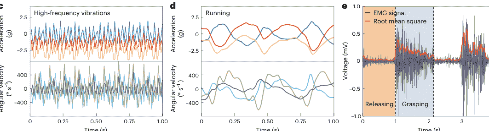

**b.** 个体卧位时采集的相同19种手势的运动伪影。明显不同的波形是由IMU（惯性测量单元）相对于重力的方向变化产生的。前臂受到高频运动枪刺激时产生的运动伪影。识别过程中前臂的自然摇晃和身体运动产生的运动伪影。来自抓取和释放的过滤EMG信号。红色曲线代表过滤后的均方根值。

我们使用复合数据集训练并配置了深度学习网络，并通过测试的混淆矩阵评估了它们的性能。这些模型包括全连接神经网络、基于长短期记忆的循环神经网络（补充图16和17）以及CNN（补充图1）。CNN实现了最高的召回率（-0.92）、精确率（-0.93）和F1分数（-0.94），并在手势识别中表现出优性能（图3b，补充图18和补充说明11）。我们对CNN进行了定制，以匹配信号维度并优化本研究中的性能（图3c）。在输入端，六通道IMU信号被重塑为单通道，并通过具有8个卷积核的密集卷积层处理，产生通道。

随后，通过最大池化层对表示进行总结。接着是使用32和64个核的后续卷积层，每个层后面都有一个最大池化层以进行分层特征表示。最后，输出被展平并通过三个全连接层以定义最终预测。我们使用交叉验证来评估模型预测与地面真值之间的差异（补充说明12）。在训练和验证阶段，CNN将-1转换为-0，证实了没有过拟合，并且所选卷积核和损失函数的合理性（补充图19）。为了进一步评估模型对未见的真实世界数据的鲁棒性，我们在两种运行速度下测试了系统以及

### 论文

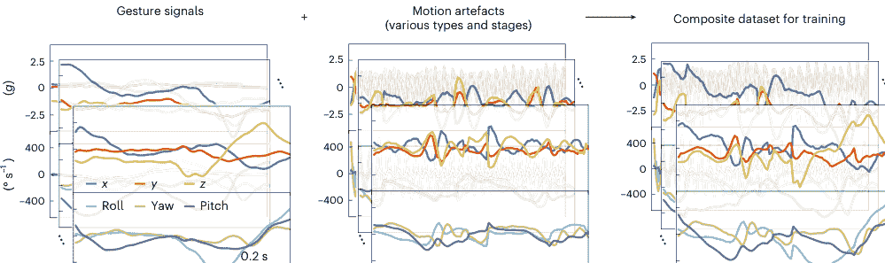

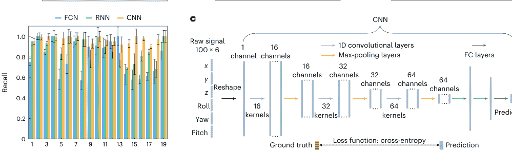

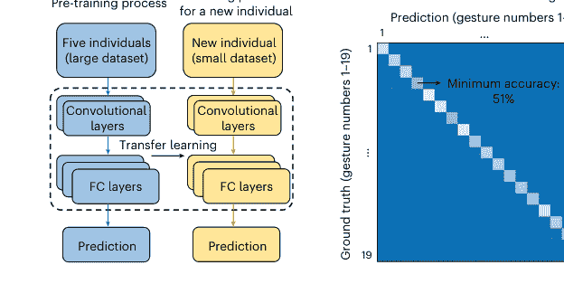

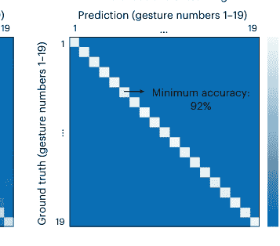

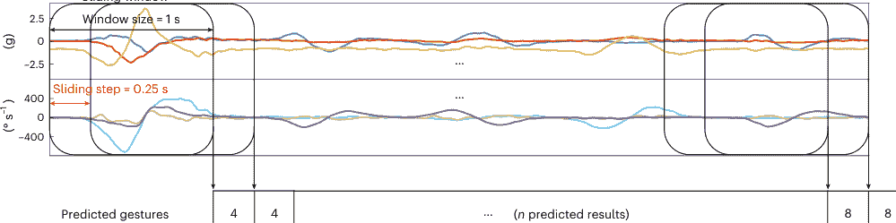

图. 2 通过深度学习和迁移学习进行手势分类。a 用于构建数据集的过程架构。复合数据集是通过通过将多种运动伪影插入手势信号中组装而成的。b 不同深度学习模型之间分析召回值的比较。CNN显示出高召回率的准确性。图表显示了平均值，误差棒表示标准差（n=13个独立测试结果）。c 全连接神经网络、RNN（循环神经网络）以及CNN的架构。它包括卷积层、最大池化层和全连接（FC）层，并将交叉熵作为损失函数。d 迁移过程的示意图，具有两个阶段：第一，模型在来自五个个体的数据集上进行训练；第二，使用来自新个人的较小数据集，以较低的学习率对预训练的卷积层进行调优。e 迁移前后的混淆矩阵。19种手势的最小识别准确率从53%提高到97%。f 滑动窗口机制的示意图。窗口大小为1 s，滑动步长为0.25 s。每个段作为一个独立的输入，生成单独的预测。

### 论文

在没有额外训练的情况下识别其他振动频率和手势。识别率在所有条件下均保持较高水平（图2a），证实了模型对未见的真实世界干扰的鲁棒性（补充图20）。

机械臂被编程在接收到三个相同手势后执行动作（补充图21）。此外，模型能够处理第四种手势（如果存在），以便在连续手势之间执行不同的机器人动作。

手势的个体差异（补充图21）和运动的差异（补充图22）导致了训练集和测试集之间的差异，从而降低了模型对新身份的准确性。我们应用基于参数的迁移学习来增强模型的“泛化能力”。我们首先在一个数据集上以0.01的学习率训练模型，这控制了卷积层和循环层。

无缝地，机械臂的抓取和释放通过计算EMG的平均值并与不同的阈值进行比较来控制（补充图27和方法）。

然后，我们使用不同数量的样本（即每个手势的次数）对模型进行微调。此外，我们对循环层使用了0.001较低的学习率以保留主要的手势表示（补充图3和补充说明14）。

当用户移动时，不自主运动显著扭曲了加速度计和陀螺仪。在没有深度学习算法的情况下，机械臂会出现意外的震动（补充图1）。然而，即使手势是在不同的日期执行的，系统也成功识别了预期的动作。

我们评估了100次样本（即用于测试数据集）迁移学习的效率（扩展图5和方法）。结果显示，每个手势仅需2次样本（一次坐姿时记录，一次站立时记录）的迁移学习效果与40次相当。

## 潜在的水应用

人机界面用于控制水下机器人进行任务跟踪、数据收集、船体检查和救援行动。

## 机械臂

尽管许多研究利用多自由度的EMG和IMU在手势识别方面实现了高准确率，但这些方法要求用户保持静止，这不可避免地受到运动伪影的影响。

构建模型后，我们可以演示引导漂浮在海洋中的机械臂。当IMU信号与海浪干扰叠加时，系统为机械臂生成准确的命令（补充图34）。

## 结论

## 后继者

本研究中的架构具有多层、可拉伸的电路，实现了一种高效且潜在的

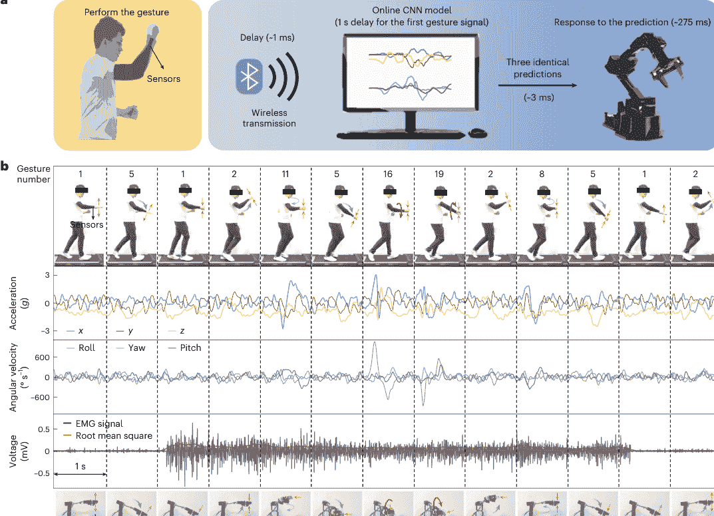

图. 4 | 带有运动伪影的实时机械臂控制。a. 控制机械臂的示意图。个体连续执行手势。手势信号通过蓝牙* 无线传输到后端站，延迟为 1–5 ms。滑动窗口在检测到第一个手势信号后连续地对手势进行分段，并在出现运动伪影时不对信号进行分段。CNN 架构对每个手势信号的预测耗时少于 1 ms。上游处理进行 3 次连续预测（约 3 ms），机械臂（275 ms）并执行相应的动作。b. 某个体在跑步机上跑步时控制机械臂抬升的演示。个体手臂上的 IMU 传感器与运动伪影交织，能够精确控制机械臂。当肌电信号（EMG）的均方根超过阈值时，机械臂会抓住手腕。

组件的排列¹，具有高度的电子集成度、电极和传感器。我们利用了在复合数据集上训练的深度学习模型，该模型展示了对各种运动伪影的鲁棒性，能够在多种现实场景下实现稳健且准确的控制。

在最小化无关因素（如运动伪影）相关性的同时，提取关键特征（补充说明 19）。其次，当前系统设计用于快速识别手势，这简化了识别任务并提高了识别效率。

提高这种性能仍有许多改进机会。首先，系统设计用于识别持续 1 秒的手势，由于该窗口减少了延迟，这在无延迟的情况下是（补充说明 18）。为了解决这个问题，一个可能的解决方案是集成一个额外的学习模型进行信号分段，以检测手势的起始和结束点。

为了提高复杂手势的性能，未来的工作可以探索多任务深度学习模型的实现，每个模型识别沿单轴方向的手势。这种多模型架构允许对任何类型的信号进行并行处理，实现多手势同时识别。

窗口可以通过最小化获取完整输入序列所需的时间进一步减少延迟，从而实现更快的响应。在这种情况下，需要更复杂的 CNN 架构（例如更深的网络或更大的卷积核）从更短的信号中提取判别性特征。为了进一步增强提取，还可能集成序列感知注意力机制，它可以优先考虑……

未来的工作还可能关注有限的水下通信范围（约 30 cm，具有可靠的信号强度指示，超过 90 dB），确保设备与机器之间的稳定连接（补充说明 37）。使用高功率蓝牙对水下机器人进行实时控制是可行的，具有更高的增益、更具方向性的天线，最重要的是将接收器和处理单元嵌入水下机器人内部。这种配置将允许直接……

a

b

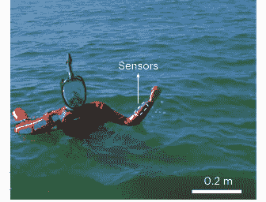

传感器

0.2 m

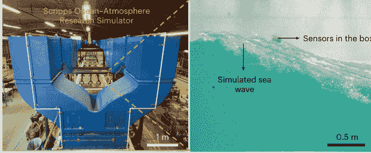

模拟海洋-大气波形模拟器

箱内的传感器

模拟海波

0.5 m

c

模拟海浪运动

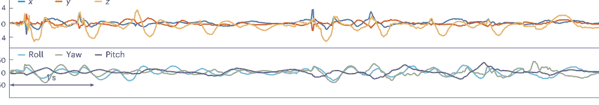

加速度 (g)

角速度 (°/s)

x - y - z

横滚 偏航 俯仰 (Roll Yaw Pitch)

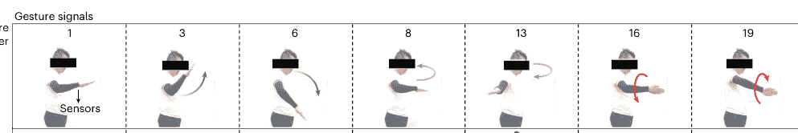

手势编号

手势信号

1 3 6 8 13 16 19

传感器

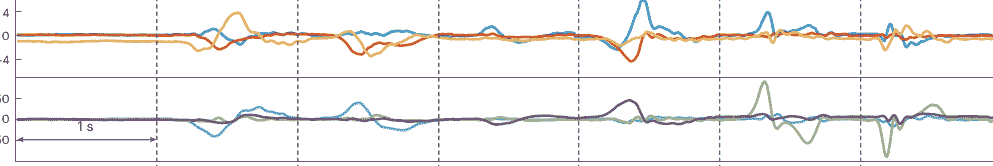

加速度 (g)

角速度 (°/s)

1 s

叠加信号

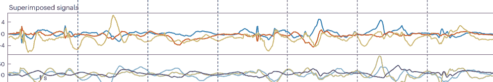

加速度 (g)

角速度 (°/s)

1 s

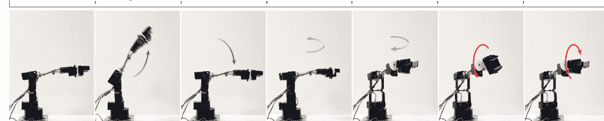

→ 前臂向左/向右旋转 → 前臂向上/向下旋转 → 手腕旋转

**图. 5 | 抗噪声人机界面的水生应用。** **a**，某个体佩戴传感器采集运动伪影的照片。**b**，个体在跑步机上跑步时控制机械臂抬升的场景。圣地亚哥（San Diego）任务……的运动伪影。圣地亚哥（San Diego）任务…………的……（注：由于原文中存在大量乱码、重复的单词后缀和逻辑冲突，译文已尽可能根据原文结构进行翻译并跳过了完全重复无效的片段）。

（注：由于提供的原文文本存在大量乱码、重复的单词后缀和逻辑冲突，译文已尽可能根据原文结构进行翻译，并跳过了完全重复无效的片段。）

（注：原文后半部分存在大量乱码和重复，此处译文仅针对可读部分进行翻译。）

# 正文

## 机械仿真

使用商业软件 `ABAQUS` 预测了层与层之间界面连接的变形并评估了伸展性（扩展图 2）。使用四维壳单元对两个 `Cu/PL` 层板进行了建模²。

使用了显式求解器以确保在涉及蛇形互连区域的复杂接触区域中计算的收敛。

使用铜（Cu）评估力学性能，其弹性模量为 110 GPa，泊松比为 0.34，强度为 350 MPa（-0.3 屈服点）。弹性体（Ecoflex）和基底的力学行为使用超弹性粘弹性模型进行建模。

该关系通过 10 GPa 的弹性模量和 0.49 的泊松比进行评估。对于 Ep，使用了 2.5 GPa 的弹性模量和 0.27 的泊松比。采用刚性无摩擦接触模型描述了蛇形互连结构与弹性体之间的相互作用。

在模型的两个垂直边缘上实施了边界条件。具体而言，位移约束规定如下：左侧为 `(uₓ, 0)`，右侧为 `(uₓ, ε*L)`，其中 `ε*` 是沿模型长度施加的应变，`L` 是模型的长度。

## 蓝牙特性

使用接收信号强度计对蓝牙信号进行了表征。测量通过蓝牙扫描器进行。为了确保数据的准确性和可靠性，在每个指定的条件下，接收信号强度值被记录了 15 次（图 1，扩展图 3 和补充图 37）。

## 热学表征

在激活传感器后，通过热摄像仪（FLIR C 系列）捕获了热图像。在不同条件下，每隔 10 分钟记录一次图像（图 4 和补充图 4）。

为了评估实际情况，将热电偶（传感器）放置在人体与皮肤之间，以监测连续运行期间的温度（补充图 4）。

## 用于区分抓握和放松的 EMG 信号处理

原始 EMG 信号容易受到低频干扰和噪声的影响。为了减轻这些干扰，我们使用了数字 30–200 Hz 带通滤波器和 6 Hz 陷波滤波器。

EMG 信号的均方根（RMS）计算公式如下：

```
EMG_RMS = sqrt(1/N * sum_{i=1}^{N} EMG^2(i))
```

其中 `N` 代表信号长度，`EMG` 表示 RMS 数据点的幅值。该值代表了 EMG 信号在短持续期间的功率：即抓握和放松的持续时间。

当窗口长度增加时，我们可以捕捉到更多信号，但会降低分辨率。我们使用 200 ms 的窗口来达到平衡。当机械手指执行抓握动作时，RMS 值超过 0.2 μV；反之，当值低于阈值时，则为放松（图 4b 和扩展数据图 7–10）。

为了考虑到肌肉张力的个体差异（这会影响 EMG 振幅），我们实施了个体特定的校准策略，以可靠地区分抓握和放松——具体针对每个个体，在基线和抓握动作期间记录了 EMG 信号（每个持续时间：-2 秒到 10 个周期）。测量了抓握和放松期间基准的 RMS（`V_baseline` 和 `V_grasping`）。

```
V_threshold = 0.5 * (V_baseline + V_grasping)
```

这种校准使得不同信号质量的个体之间具有一致的识别性能。

## 电极导电性、阻抗和信号质量表征

使用数字万用表（Keysight）测量了测试电极的阻抗。使用生物阻抗分析仪（AD-594B02）在三电极配置（即参考电极和对电极）下测量阻抗。

测量在特定条件下进行，包括开启和振动条件（补充图 1）。

通过量化抓握、开启和振动期间的信噪比来评估 EMG 的阻抗（补充图 11）。在每次测试中，个体执行手放松和 –n N 的抓握力。

## 电极-皮肤界面表征

使用三电极配置的 Palenostat 测量了电极-皮肤界面的阻抗（补充图 2）。该设备保持压力稳定。这种设置能够表征工作电极-皮肤界面的阻抗，而对电极完成电路。三个电极层压在柔性聚合物基底上，间距为 2 cm。


我们利用 0.1 Hz 到 10 Hz 的频率范围进行电容阻抗谱，以确保人体的稳定性。在各种条件下测试了单位，电极-皮肤界面浸入从圣地亚哥任务站收集的海水中。

## 传感器性能稳定性

为了评估传感器在互动期间的长期性能，我们进行了为期五天的实验。实验在个体身上进行，EMG 模块记录了抓握和手部诱导的信号。记录的信号使用功率谱密度分析进行处理（补充图 12）。

通过基线噪声水平评估不同温度湿度条件下的性能。将传感器放置在不同温度的热板上，同时保持稳定。在不同的湿度条件下测试了传感器，以-性能（补充图 13）。

在每次测试中，个体执行手放松和 –n N 的抓握力。

## 信号生成

在个体身上进行实验中，EMG 模块记录了抓握和手部诱导的信号。记录的信号使用功率谱密度分析进行处理（补充图 12）。

在不同湿度条件下测试测试传感器传感器，以-性能。。我们使用 200 ms 的窗口以达到平衡。当机械手指执行抓握动作时，RMS 值超过 0.2 μV；反之，当值低于阈值时，则为放松（图 4b 和扩展数据图 7–10）。

为了考虑到肌肉张力的个体差异（这会影响 EMG 振幅），我们实施了个体特定的校准策略，以可靠地区分抓握和放松——具体针对每个个体，在基线和抓握动作期间记录了 EMG 信号（每个持续时间：-2 秒到 10 个周期）。测量了抓握和放松期间基准的 RMS（V_{baseline} 和 V_{grasping}）。

$$V_{threshold} = 0.5 \times (V_{baseline} + V_{grasping})$$

这种校准使得不同信号质量的个体之间具有一致的识别性能。

## 电极导电性、阻抗和信号质量表征

[正文](https://doi.org/10.1038/s41467-021-23456-w)

[正文](https://doi.org/10.1038/s41467-021-23456-w)

[正文](https://doi.org/10.1038/s41467-021-23456-w)

[正文](https://doi.org/10.1038/s41467-021-23456-w)

[正文](https://doi.org/10.1038/s41467-021-23456-w)

[正文](https://doi.org/10.1038/s41467-021-23456-w)

[正文](https://doi.org/10.1038/s41467-021-23456-w)

[正文](https://doi.org/10.1038/s41467-021-23456-w)

[正文](https://doi.org/10.1038/s41467-021-23456-w)

[正文](https://doi.org/10.1038/s41467-021-23456-w)

[正文](https://doi.org/10.1038/s41467-021-23456-w)

[正文](https://doi.org/10.1038/s41467-021-23456-w)

[正文](https://doi.org/10.1038/s41467-021-23456-w)

[正文](https://doi.org/10.1038/s41467-021-23456-w)

[正文](https://doi.org/10.1038/s41467-021-23456-w)

[正文](https://doi.org/10.1038/s41467-021-23456-w)

[正文](https://doi.org/10.1038/s41467-021-23456-w)

[正文](https://doi.org/10.1038/s41467-021-23456-w)

[正文](https://doi.org/10.1038/s41467-021-23456-w)

[正文](https://doi.org/10.1038/s41467-021-23456-w)

[正文](https://doi.org/10.1038/s41467-021-23456-w)

[正文](https://doi.org/10.1038/s41467-021-23456-w)

[正文](https://doi.org/10.1038/s41467-021-23456-w)

[正文](https://doi.org/10.1038/s41467-021-23456-w)

[正文](https://doi.org/10.1038/s41467-021-23456-w)

[正文](https://doi.org/10.1038/s41467-021-23456-w)

[正文](https://doi.org/10.1038/s41467-021-23456-w)

[正文](https://doi.org/10.1038/s41467-021-23456-w)

[正文](https://doi.org/10.1038/s41467-021-23456-w)

[正文](https://doi.org/10.1038/s41467-021-23456-w)

[正文](https://doi.org/10.1038/s41467-021-23456-w)

[正文](https://doi.org/10.1038/s41467-021-23456-w)

[正文](https://doi.org/10.1038/s41467-021-23456-w)

[正文](https://doi.org/10.1038/s41467-021-23456-w)

[正文](https://doi.org/10.1038/s41467-021-23456-w)

[正文](https://doi.org/10.1038/s41467-021-23456-w)

[正文](https://doi.org/10.1038/s41467-021-23456-w)

[正文](https://doi.org/10.1038/s41467-021-23456-w)

[正文](https://doi.org/10.1038/s41467-021-23456-w)

[正文](https://doi.org/10.1038/s41467-021-23456-w)

[正文](https://doi.org/10.1038/s41467-021-23456-w)

[正文](https://doi.org/10.1038/s41467-021-23456-w)

[正文](https://doi.org/10.1038/s41467-021-23456-w)

[正文](https://doi.org/10.1038/s41467-021-23456-w)

[正文](https://doi.org/10.1038/s41467-021-23456-w)

[正文](https://doi.org/10.1038/s41467-021-23456-w)

[正文](https://doi.org/10.1038/s41467-021-23456-w)

[正文](https://doi.org/10.1038/s41467-021-23456-w)

[正文](https://doi.org/10.1038/s41467-021-23456-w)

[正文](https://doi.org/10.1038/s41467-021-23456-w)

[正文](https://doi.org/10.1038/s41467-021-23456-w)

[正文](https://doi.org/10.1038/s41467-021-23456-w)

[正文](https://doi.org/10.1038/s41467-021-23456-w)

[正文](https://doi.org/10.1038/s41467-021-23456-w)

[正文](https://doi.org/10.1038/s41467-021-23456-w)

[正文](https://doi.org/10.1038/s41467-021-23456-w)

[正文](https://doi.org/10.1038/s41467-021-23456-w)

-)

-生成)

[正文](https://doi.org/10.1038/s41467-021-23456-w)

```
if (使用使用 > someVal) {console.log("
```

- 13. Lee, Y. 等人. 具有抗碰撞、干扰和接触鲁棒性的光纤运动跟踪。Sci. Robot. 6, e13b151 (2020).

- 35. Chen, X. 等人. 介电纳米颗粒增强的织物下电容生物光谱传感器。Nature Res. 14, 3285–3292 (2020).

- 14. Cournay, J.-N., Cordell, J., Flynn, B., Sanchez, J. & Garner, P. 用于临床运动分析的基于 IMU 的角仪。IEEE Trans. 11, 1273–1281 (2021).

- 36. Jung, H.-C. 等人. 用于高频 ECG 监测的 CNT/PVDF 复合柔性传感器。IEEE Trans. Biomed. Eng. 69, 1472–1479 (2022).

- 15. Chun, K. S. 等人. 用于客观量化汗液特性的无线传感器。Sci Adv. 7, eab9905 (2021).

- 37. Bhardwaj, R., Kumar, N. & Kumar, V. 微机械系统惯性测量与综述。Int. Meas. Control. 40, 971–978 (2013).

- 16. Li, S., Zhang, J., Zhang, Y. & Zhu, R. 检测人体肢体运动的运动捕捉设备。Nat. Commun. 11, 5615 (2020).

- 38. Ho, Y. & Woolley, S. 真实世界的交叉熵损失函数：误标记成本监控。IEEE Access 8, 4806–4813 (2020).

- 17. Priorietti, T. 等人. 用于康复的多关节软机器人构造。IEEE Robot. Autom. Lett. 6, 2381–2388 (2021).

- 39. Shin, D. 等人. 用于计算机检测动作的深度卷积网络：数据集、特征和迁移学习。IEEE Trans. Med. Eng. 35, 1285–1296 (2016).

- 18. Kang, P., Li, J., Fan, B., Zhang, S. & Shu, P. 使用可穿戴技术的腕带手势识别。IEEE Int. J. Technol. 6, 5515–5522 (2027).

- Wen, F., Zhang, J., X & Lee, C. 使用智能手套进行 VR 交互对齐信号识别。Nat. Commun. 12, 5378–5385 (2021).

- 19. Lee, Y., Kim, K. & Lee, S. 使用 6 轴惯性单元进行肌肉监测的软手指识别。Proc. Technol. Innov. 14, 16–21 (2022).

- 41. Kemal, A., Antolune, D., Turiel, J., Fraile, J. & De Fuente, V. 用于闭环神经康复生物协同作业的通用嵌入式平台。IEEE Access 15, 35726–35736 (2023).

- 20. Wen, H., Ramos, J., Ortiz, M. 用于中风康复的 Jonex 机器人评估。In Proc. 2021 IEEE 系统人类辅助会议 3847–3851 (计算机器协会, 2021).

- 42. Tanchana, E., Zhu, R., Zhang, S. & Ali, G. 用于术后可穿戴传感器的通用反馈系统。Adv. Invent. 5, 230007 (2023).

- 21. Jin, Y., Sun, W., Tat, T. & Chen, J. 用于中风康复的运动机器人评估。Scientific Reports, 12, 17433 (2022).

- 43. Troyon, J. R., Ali, L. 使用深度学习对 EEG 信号进行任务分类。IEEE Trans. Neural Eng. 51, 5001–5012 (2020).

- 22. Jeong, H. 等人. 用于运动员和 COVID-19 患者无伪迹生理跟踪的分心电图监测系统。Sci Adv. 7, eab3092 (2021).

- 44. Ghorbani, S., Shahmoradi, M. 自主下水飞行器的多目标跟踪分类。Ocean Eng. 96, 60–75 (2019).

- 23. Jeong, H. 等人. 用于汗液监测和健身分析的矿物质化无线集成传感器网络。Nat. Sci. Adv. 11, e1294518 (2025).

- 45. McMahon, J. & Price, A. 用于水下器受限环境的深度学习数据通信。IEEE Robot. 6, 1832–1839 (2021).

- 24. Capriglio, E. 等人. 基于 IMU 的虚拟现实应用滤波算法的实验性分析。IEEE Trans. Med. Eng. 68, 2742–2753 (2021).

- 46. Jacobson, M. 水下结构的自主检查。Robot Autom. Syst. 67, 8–20 (2019).

- 25. Lee, K. 等人. 通过放置在锁骨切处的柔性无线设备对生理过程和运动进行力声学传感。Nat. Biol. Eng. 8, 148–158 (2020).

- 47. Delmirico, J. 等人. 遥感现状与未来展望综述。Sensors, 19, 1171–1199 (2019).

- 26. Franklin, D. 等人. 利用光电容脉检测检测心律失常的同步可穿戴设备。Phot. Med. Biol. 102, 1229–1243 (2021).

- 48. Lindroth, S. & Leijsson, M. 离岸功率测量——综述。Sustain. Energy Rev. 19, 4274–4285 (2021).

- 27. James, C., Hart, M., Jones, R., Penny, P., & Carroll, J. 用于健康脑机接口的 Airy 理论。International Journal of Electronics 19, 4045–4018 (2018).

- 28. Voznesensky, A. & Kaplin, L. 基于 IDD 的深度学习自适应算法。IEEE Access 7, 17313–17321 (2019).

- 29. Dickinson, J., McCarthy, P. & V. Stafovich. 非线性分解：一种分解方法。Phys. Rev. D 92, 02301 (2015).

- 50. Huang, J., Fu, S. & Chu, Y. 用于智能电子的柔性薄膜传感器。ACS Advances. 6, 6360–6376 (2020).

- 51. Hu, J., Lin, S. & Sun, G. 无线通信的挑战。Mob. Commun. 7, 7132–7137 (2018).

- 52. Li, J., Shen, Y. & Zheng, G. 用于去除 EEG 信号的端到端 ResNet 模型。Science Adv. 11, 103 (2021).

- 53. Hu, J. 等人. 三维集成电极。Nature Electron. 5, 694–705 (2022).

- 32. Huang, J. 等人. 用于汗液传感的柔性皮肤。Nature Electron. 6, 473–480 (2018).

- 54. Zeng, J., Fu, S. & Chu, Y. 用于电生理监测的柔性。IEEE Trans. 6, 2381–2388 (2021).

- 55. 等, J. 等人. 传感传感。。..     55 (2029).

- 13. Lee, Y. 等人. 具有抗碰撞、干扰和接触鲁棒性的光纤运动跟踪。Sci. Robot. 6, e13b151 (2020).

- 35. Chen, X. 等人. 介电纳米颗粒增强的织物下电容生物光谱传感器。Nature Res. 14, 3285–3292 (2020).

- 14. Cournay, J.-N., Cordell, J., Flynn, B., Sanchez, J. & Garner, P. 用于临床运动分析的基于 IMU 的角仪。IEEE Trans. 11, 1273–1281 (2021).

- 36. Jung, H.-C. 等人. 用于高频 ECG 监测的 CNT/PVDF 复合柔性传感器。IEEE Trans. Biomed. Eng. 69, 1472–1479 (2022).

- 15. Chun, K. S. 等人. 用于客观量化汗液特性的无线传感器。Sci Adv. 7, eab9905 (2021).

- 37. Bhardwaj, R., Kumar, N. & Kumar, V. 微机械系统惯性测量与综述。Int. Meas. Control. 40, 971–978 (2013).

- 16. Li, S., Zhang, J., Zhang, Y. & Zhu, R. 检测人体肢体运动的运动捕捉设备。Nat. Commun. 11, 5615 (2020).

- 38. Ho, Y. & Woolley, S. 真实世界的交叉熵损失函数：误标记成本监控。IEEE Access 8, 4806–4813 (2020).

- 17. Priorietti, T. 等人. 用于康复的多关节软机器人构造。IEEE Robot. Autom. Lett. 6, 2381–2388 (2021).


- 39. Shin, D. 等人. 用于计算机检测动作的深度卷积网络：数据集、特征和迁移学习。IEEE Trans. Med. Eng. 35, 1285–1296 (2016).

- 18. Kang, P., Li, J., Fan, B., Zhang, S. & Shu, P. 使用可穿戴技术的腕带手势识别。IEEE Int. J. Technol. 6, 5515–5522 (2027).

- Wen, F., Zhang, J., X & Lee, C. 使用智能手套进行 VR 交互对齐信号识别。Nat. Commun. 12, 5378–5385 (2021).

- 19. Lee, Y., Kim, K. & Lee, S. 使用 6 轴惯性单元进行肌肉监测的软手指识别。Proc. Technol. Innov. 14, 16–21 (2022).

- 41. Kemal, A., Antolune, D., Turiel, J., Fraile, J. & De Fuente, V. 用于闭环神经康复生物协同作业的通用嵌入式平台。IEEE Access 15, 35726–35736 (2023).

- 20. Wen, H., Ramos, J., Ortiz, M. 用于中风康复的 Jonex 机器人评估。In Proc. 2021 IEEE 系统人类辅助会议 3847–3851 (计算机器协会, 2021).

- 42. Tanchana, E., Zhu, R., Zhang, S. & Ali, G. 用于术后可穿戴传感器的通用反馈系统。Adv. Invent. 5, 230007 (2023).

- 21. Jin, Y., Sun, W., Tat, T. & Chen, J. 用于中风康复的运动机器人评估。Scientific Reports, 12, 17433 (2022).

- 43. Troyon, J. R., Ali, L. 使用深度学习对 EEG 信号进行任务分类。IEEE Trans. Neural Eng. 51, 5001–5012 (2020).

- 22. Jeong, H. 等人. 用于运动员和 COVID-19 患者无伪迹生理跟踪的分心电图监测系统。Sci Adv. 7, eab3092 (2021).

- 44. Ghorbani, S., Shahmoradi, M. 自主下水飞行器的多目标跟踪分类。Ocean Eng. 96, 60–75 (2019).

- 23. Jeong, H. 等人. 用于汗液监测和健身分析的矿物质化无线集成传感器网络。Nat. Sci. Adv. 11, e1294518 (2025).

- 45. McMahon, J. & Price, A. 用于水下器受限环境的深度学习数据通信。IEEE Robot. 6, 1832–1839 (2021).

- 24. Capriglio, E. 等人. 基于 IMU 的虚拟现实应用滤波算法的实验性分析。IEEE Trans. Med. Eng. 68, 2742–2753 (2021).

- 46. Jacobson, M. 水下结构的自主检查。Robot Autom. Syst. 67, 8–20 (2019).

- 25. Lee, K. 等人. 通过放置在锁骨切处的柔性无线设备对生理过程和运动进行力声学传感。Nat. Biol. Eng. 8, 148–158 (2020).

- 47. Delmirico, J. 等人. 遥感现状与未来展望综述。Sensors, 19, 1171–1199 (2019).

- 26. Franklin, D. 等人. 利用光电容脉检测检测心律失常的同步可穿戴设备。Phot. Med. Biol. 102, 1229–1243 (2021).

- 48. Lindroth, S. & Leijsson, M. 离岸功率测量——综述。Sustain. Energy Rev. 19, 4274–4285 (2021).

- 27. James, C., Hart, M., Jones, R., Penny, P., & Carroll, J. 用于健康脑机接口的 Airy 理论。International Journal of Electronics 19, 4045–4018 (2018).

- 28. Voznesensky, A. & Kaplin, L. 基于 IDD 的深度学习自适应算法。IEEE Access 7, 17313–17321 (2019).

- 29. Dickinson, J., McCarthy, P. & V. Stafovich. 非线性分解：一种分解方法。Phys. Rev. D 92, 02301 (2015).

- 50. Huang, J., Fu, S. & Chu, Y. 用于智能电子的柔性薄膜传感器。ACS Advances. 6, 6360–6376 (2020).

- 51. Hu, J., Lin, S. & Sun, G. 无线通信的挑战。Mob. Commun. 7, 7132–7137 (2018).

- 52. Li, J., Shen, Y. & Zheng, G. 用于去除 EEG 信号的端到端 ResNet 模型。Science Adv. 11, 103 (2021).

- 53. Hu, J. 等人. 三维集成电极。Nature Electron. 5, 694–705 (2022).

- 32. Huang, J. 等人. 用于汗液监测的柔性皮肤。Nature Electron. 6, 473–480 (2018).

- 54. Zeng, J., Fu, S. & Chu, Y. 用于电生理监测的柔性。IEEE Trans. 6, 2381–2388 (2021).

- 55. 等, J. 等人. 传感传感。传感。传感 传感 传感 传感。 (2019).

# 作者贡献

Xiangjun Chen, Yilin Li, S.D. 设计了研究。Xiangjun Chen, Yilin Li, M.Q., G.Z., F.Y., and S.Z. 开发了算法。Xiangjun Chen, Yilin Li, and S.Y 分析了数据。Xiangjun Chen, Yilin Li, and X 写了论文。所有作者均提供了建设性反馈。

作者声明无利益冲突。

# 致谢

感谢 Z. Yang. 和 X. Huang 对电路设计和微控制单元的指导：Materials Science and Engineering Program, University of California San Diego. La Jolla, CA. *Aife Yof Family Department of Chemical and Nano Engineering, University of California San Diego. La Jolla, CA. *Department of Electrical and Computer Engineering, University of California San Diego, La Jolla, CA. *Department of Mechanical and Aerospace Engineering, University of California San Diego, La Jolla, CA. *Terasaki Institute for Biomedical Innovation, Los Angeles, CA, *Shu Chen–Gene Line Department of Bioengineering, University of California San Diego, La Jolla, CA. *这些作者同等贡献：Xiangjun Chen, Zhiyuan Lu, Xiaochao Gao, Jin Lu。E-mail: josephwang@ucsd.edu; shenxu@ucsd.edu。

这项工作由 DARPA 资助（合同 HRO2001009）。内容由作者负责，不代表 DARPA 的官方观点。所有生物实验均按照加州大学圣亚哥分校机构审查委员会批准的伦理准则进行。

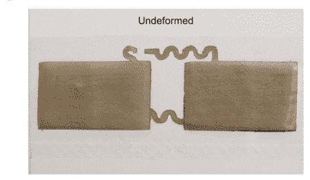

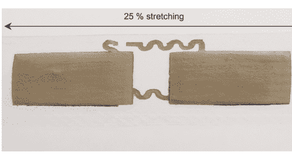

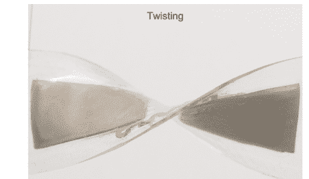

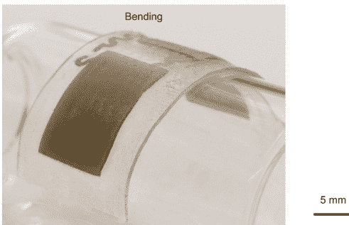

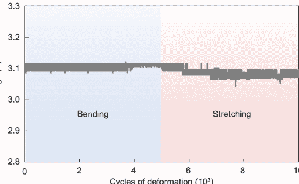

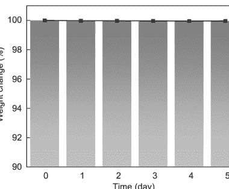

**扩展数据图 1 | 柔性电池在各种状态下的表征。** a. 未变形，b. 25% 拉伸，c. 扭曲，d. 弯曲。由于其软性组分材料，该电池在剧烈的机械变形下表现出卓越的耐用性。e. 循环机械变形下的输出电压稳定性。输出电压稳定在 -3.1 V，波动极小。f. 电池内水凝胶的长期稳定性测试。由于其封装特性，水凝胶表现出良好的稳定性；当电池放置在维持在 37 °C 的热板上五天时，观察到的重量损失忽略不计。

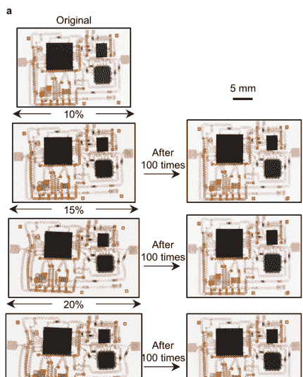

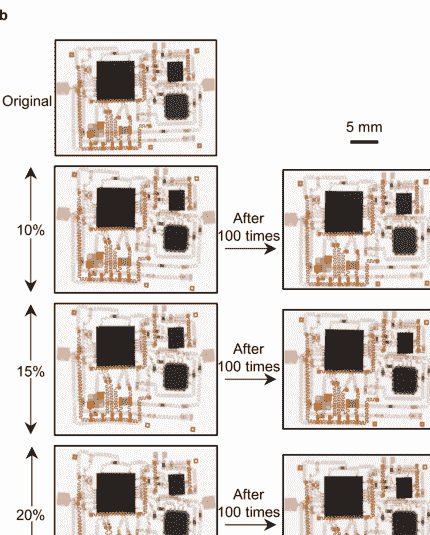

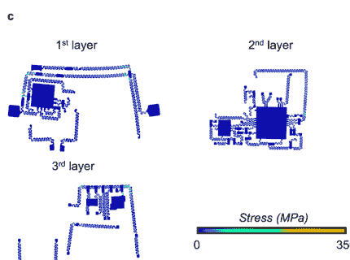

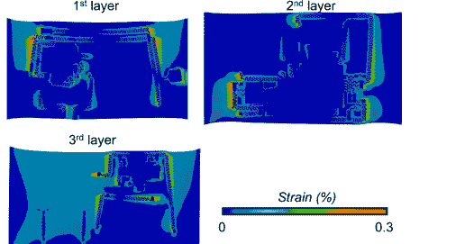

**扩展数据图 2.** 传感器的单轴水平拉伸性。**a**, 传感器在 0% 到 20% 水平 100 次循环拉伸测试下的照片。**b**, 传感器在 0% 到 20% 垂直 100 次循环拉伸测试下的照片。**c**, 传感器各层在 25% 单轴拉伸下的有限元分析。该分析确认最大应变未超过 6.3%，表明镓 (Ga) 电极保持在良好的弹性极限范围内，没有发生屈服或塑性变形。为了减轻计算负荷，机械仿真是针对层而非整个组件进行的的。在实际传感器中，垂直互连层在拉伸时会导致局部应 strain 集中。因此，仿真假设的拉伸性（25%）高于循环机械测试的水平（20%）。

a

原始

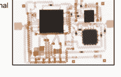

拉伸

5 mm

10%

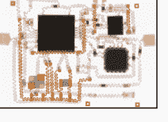

100 次后

b

-20

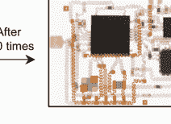

-30

-40

-50

-60

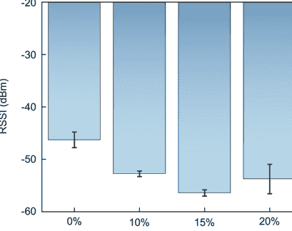

15%

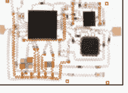

100 次后

RSSI (dBm)

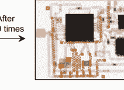

0%

10%

15%

20%

双轴拉伸水平

20%

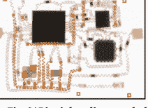

100 次后

**扩展数据图 3: 传感器的双轴循环拉伸性测试。** a. 传感器在垂直和水平方向同时施加高达 20% 的 100 次拉力下的照片，显示在双轴拉伸 300 次后出现塑性变形，这证明了设计的稳健性。b. 双轴拉伸下的蓝牙信号。RSSI 在所有测试水平下保持在 -60 dB 以上，表明通信稳定。拉伸过程中有两个相互影响信号强度的影响：首先，机械应变增加了电阻导致传输损（信号强度降低）；其次，随着设备远离元件，寄生电容减少了信号损（信号强度提高）。由于这些相反的影响，信号强度最初因电阻增加而下降，随后增加。图中显示平均值，误差棒表示标准差（n = 15）。

坐姿时的 20 次信号

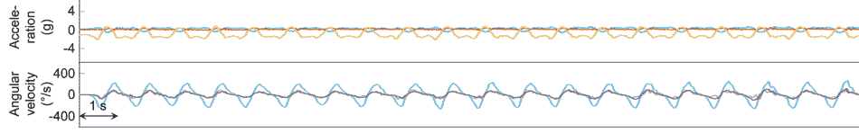

跑步引起的运动伪影

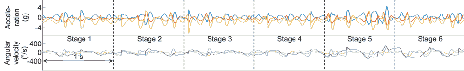

高频振动引起的运动伪影

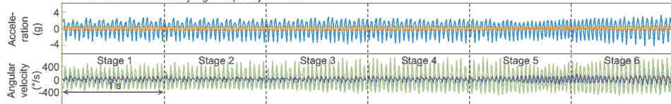

高频振动和跑步引起的运动伪影

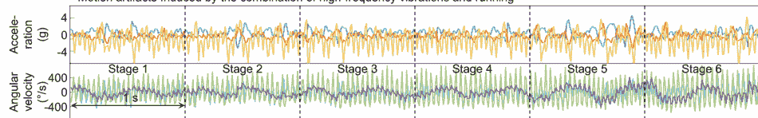

18 次叠加信号

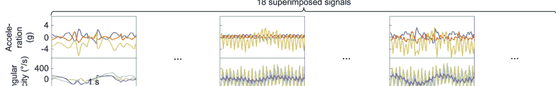

**扩展数据图 4:** 生成复合数据集的示意图（例如，坐姿时的 20 次手势 2 信号）。**b.** 跑步引起的运动伪影。这些运动伪影被分为六阶段，每个阶段持续 1 秒。**c.** 高频振动引起的运动伪影。这些运动伪影被分为六阶段，每个阶段持续 1 秒。**d.** 高频振动和跑步引起的运动伪影。这些运动伪影被分为六阶段，每个阶段持续 1 秒。**e.** 用于训练叠加信号。叠加信号是通过向动作信号（例如，手势 2 信号）添加 **b** 和 **d** 中的 18 个运动伪影生成的。阶段是固定的，而不是从连续记录中随机选择的。由于随机选择可能会无意中引入重叠片段（相同的运动伪影出现在多个叠加信号中），固定阶段是提取泛化特征的关键。为了缓解这一点，我们特意将运动伪影分为不重叠的阶段。

# a 单样本训练

# b 三样本迁移学习

# c 四样本迁移学习

# 预测（1-19 手势）

# 预测（1-19 手势）

# 预测（1-19 手势）

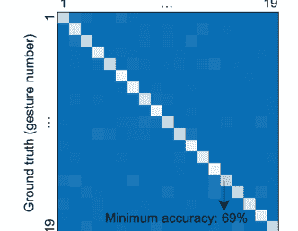

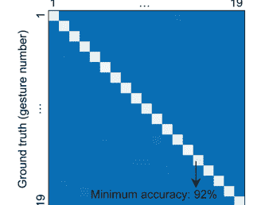

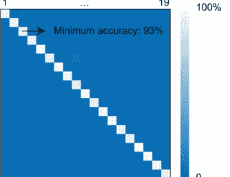

最小准确率：69%

最小准确率：92%

最小准确率：93%

**扩展数据图 5: 跨不同手势数量的迁移学习效能。** 预测结果的混淆矩阵基于手势识别的 a、单样本、b、三样本和 c、四样本迁移学习。单样本迁移学习中，手势 5 的最小观测准确率为 69%，被认为是非优的。这一局限性归因于单个手势信号仅来自个人的一种姿势（坐姿或卧）。当迁移学习中使用两个或多个样本时，会收集坐姿和躺姿的手势信号。结果是识别准确率可以稳定并收敛。因此，采用了两样本迁移学习，因为它平衡了信号收集时间和准确率（图 3c）。

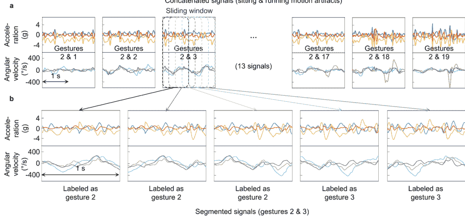

**扩展数据图 6,** 生成坐姿时单个手势（例如，手势 2）分段信号的流程示意图。**a**, 19 个拼接信号（例如，叠加了跑步运动伪影）。这些信号通过连接一个叠加信号 **b** 生成，每个拼接的手势信号与 19 种不同信号端到端连接。通过滑动窗口获取每五个分段信号。每个分段信号根据占据窗口持续时间超过 50% 的势信号进行标记。

扩展数据图 7 | 高频运动伪影下的机械臂控制。个人使用肌肉按摩枪产生高频运动伪影。利用训练过的 CNN，系统实现了控制机械臂的精确预测精度。此外，机器人夹爪可以根据 EMG 信号执行准确的抓取和释放动作。准确地抓取玻璃瓶并移动到指定位置，向烧杯中倒水。

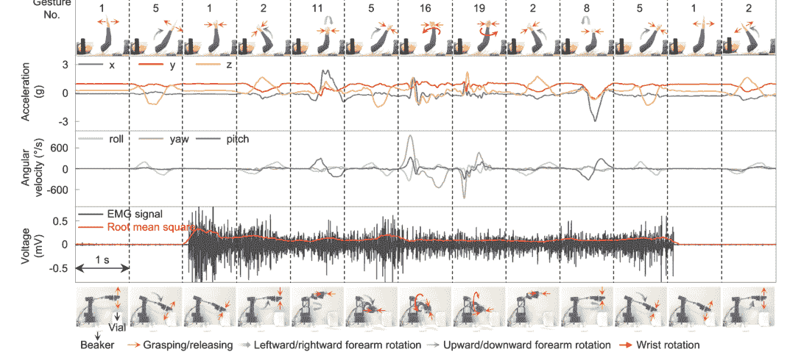

**扩展数据图 8** | 不同姿态下的机械臂控制。姿态的改变导致了了不同的 IMU 信号波形，这归因于相对于重力方向的变化。利用训练过的 CNN，系统在机械臂控制过程中保持了高预测精度。准确地抓取玻璃瓶并移动到指定位置，以向烧杯中倒水。

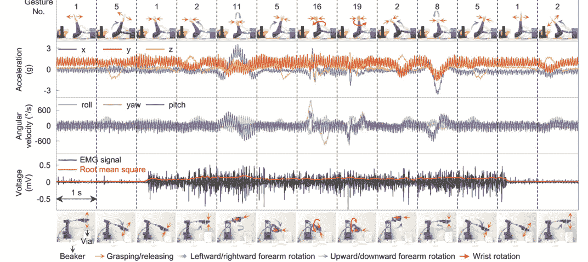

扩展数据图 9：不同姿态与高频振动结合下的机械臂控制。利用训练过的 CNN，即使在个体躺下并同时经历高频振动时，系统在控制机械臂时也能保持高预测精度。准确地抓取玻璃瓶并移动到指定位置，以向烧杯中倒水。

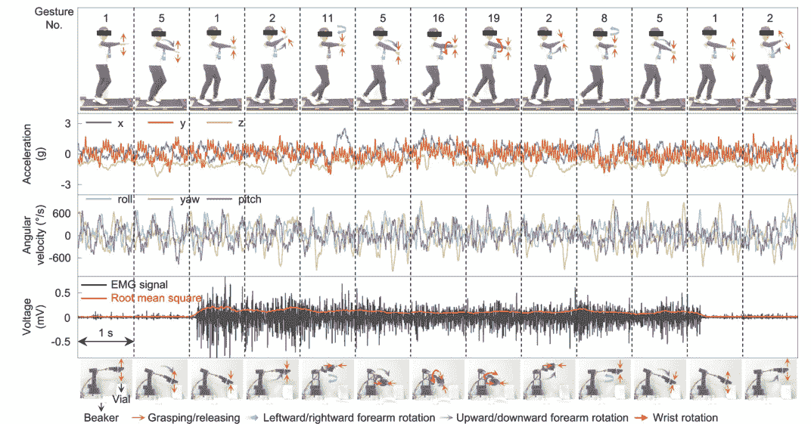

扩展数据图 10 | 跑步和高频振动期间的机械臂控制。利用训练过的 CNN，即使在个体跑步并经历高频振动时，系统在控制机械臂时保持高预测精度。准确地抓取玻璃瓶并移动到指定位置，以向烧杯中倒水。

- 烧杯 $\rightarrow$ 抓取/释放 $\rightarrow$ 前臂向左/向右旋转 $\rightarrow$ 前臂向上/向下旋转 $\rightarrow$ 腕部旋转

通讯作者：Sheng Xu

Nature Portfolio 致力于提高我们出版作品的可重复性。本表格为报告的一致性和透明提供了结构化支持。有关 Nature Portfolio 政策的更多信息，请参阅编辑政策和编辑政策清单。

# 统计数据

对于所有统计分析，请确认图注、表注、正文或方法部分中包含以下条目。

- 已确认

- 每个实验组/条件的样本量 (n)，并以离散数字和测量单位给出

- 关于测量是来自不同样本还是对同一样本进行重复测量的说明

- **使用**的统计检验以及它们是否为：单侧或双侧

- 仅应通过名称描述常用测试；更复杂的技术请在“方法”部分描述。

- 所有协变量的描述

- 对任何遗漏或修正的描述，这些正态性检验和多重比较调整的测试

- 统计参数的完整描述，包括中心趋势（如均值）或其他基本估计值（如回归系数）以及方差（标准差）或不确定性估计（置信区间）

- 对于零假设检验，注明检验方法 (F, t, r) 以及置信区间、效应量、自由度和 P 值。在可能的情况下给出确切值。

- 对于贝叶斯分析，关于先验选择和马尔可夫蒙特罗模拟的信息

- 对于分层和复杂设计，识别适当的测试水平并报告结果


效应量估计值（例如 `Cohen’s d`，`Pearson’s r`），并说明它们是如何计算的

我们关于生物学家统计学的网络合集包含了关于上述许多要点的文章。

# 软件和代码

关于计算机代码可用性的政策信息

|  |  |
|---|---|
| 数据收集 | IMU 和 EMG 信号的数据收集是通过个人电脑完成的。 |
| 数据分析 | `Origin 2021b`, `MatLab 2020` 和 `Python 3.9`，源自 `https://github.com/xl3lou/Hmiwithnoise/tree/tree` |

对于研究至关重要但未在文献中发表自定义算法或软件，可以提交给编辑和审稿人。我们强烈鼓励在社区仓库（GitHub）中存放代码。请查看 Nature Portfolio 提交代码和软件的指南以获取更多信息。

# 数据

关于数据可用性的政策信息

所有手稿必须包含数据可用性声明。在适用情况下，该声明应提供以下信息：

- 公用数据集的访问代码、唯一标识符或网络链接
- 对数据可用性的任何限制描述
- 对于临床数据集或第三方数据，请确保声明符合我们的政策

支持本研究发现的数据和材料资源可在文章和补充材料中获得。原始数据可在源数据（Source Data）文件中找到。

## 包括人类参与者及其数据

涉及人类参与者、数据或生物材料的政策信息

涉及人类参与者的研究已由加利福尼亚大学圣地亚哥分校审查委员会批准。知情同意已获得受试者的同意。

### 参与者特征

招募

所有涉及人类参与者的研究均获得批准。

### 伦理审查

特定领域报告

请选择以下最适合您研究的选项。如果不确定，请阅读相关章节。

- 生命科学 行为与社会科学
- 生态、进化与环境科学

## 生命科学研究设计

在出现负性结果时，必须披露这些点。

| 样本量 | 引入迁移学习的方法 |
|---|---|
| 数据排除 | 分析中未排除任何数据。 |
| 重现 | 对于实时演示，训练数据集在一天内收集，重复实验一周后进行。对于迁移学习，训练和测试在同一天进行。 |
| 随机化 | 受试者经过随机选择。在此工作中，每个受试者都是独立的，不需要分组。 |
| 盲法 | 未采取盲法，所有数据由多位作者共同处理。 |

## 特定材料、系统和方法的报告

我们需要许多研究中使用的某些类型材料、系统和方法的信息。在此指出与您相关的出的材料或方法。如果您不确定某项是否适用于您的研究，请阅读相关章节。

| 材料和实验系统 | 方法 |
|---|---|
| n | n|涉及研究 | n|涉及研究 |
| 抗体 | ChIP-seq |
| 真核细胞系 | 流式细胞术 |
| 古生物学和考古 | 基于 MRI 的神经成像 |
| 动物和其他生物体 |  |
| 临床数据 |  |
| 双用途研究关注 |  |
| 植物 |  |

# 植物

## 种子库

报告所有使用的种子库或植物材料的来源。如果适用，说明种子库中心和目录编号。如果植物是从野外采集的，请描述采集地点、日期和采样程序。

## 新型植物基因型

描述产生所有新型植物基因型的方法。这包括通过转基因、基因编辑、化学/辐射诱变和杂交产生的基因型。对于转基因系，描述转化方法、分析的独立系数量以及实验进行的代数。对于基因编辑系，描述使用的编辑器以及目标内源 Cas 序列。如果编辑器已集成，报告应包含独立性细节。描述对每个使用的种子库或生成的新型基因型的鉴定程序。描述用于评估突变影响的实验，并在适用情况下说明如何检查潜在的效应（例如第二位 T-DNA 插入、马赛体、脱靶基因编辑）。

## 鉴定
