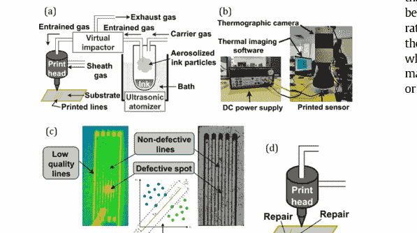
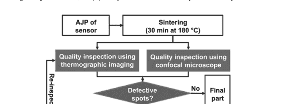
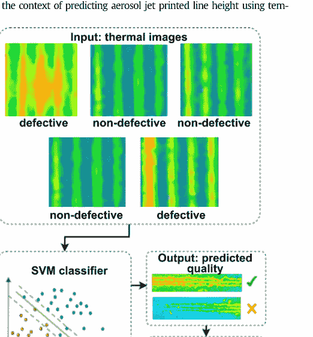
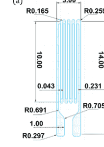
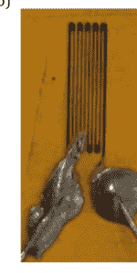
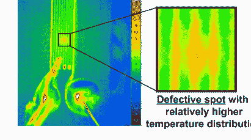
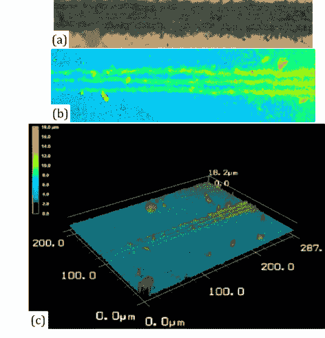
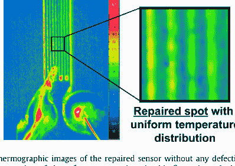
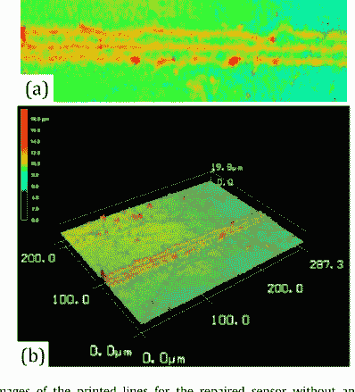

# 基于红外成像和机器学习的气溶胶喷射印刷传感器的新型质量检测方法


## 1. 引言

气溶胶喷射打印（AJP）工艺，也称为气溶胶喷射沉积工艺，是一种非接触式增材制造技术 [1]。AJP工艺利用气体中悬浮颗粒的细雾，即气溶胶，在基底上沉积精确均匀的材料层 [1]。该工艺可生产分辨率高、特征尺寸小至10 µm的三维（3D）结构 [2]。AJP具有广泛的应用，包括微机电系统（MEMS）、电路板、太阳能电池的生产，以及在多种材料中创建复杂图案和结构，包括有机半导体、陶瓷和碳纳米管 [3–7]。它还被用于PCB走线和平板显示器的修复 [8]。

尽管AJP具有优势，工艺漂移阻碍了该技术的采用。工艺漂移是指在工艺参数未改变的情况下，打印线形貌随时间变化的现象。在本例中，它是由打印过程操作条件逐渐变化引起的。这种条件变化可归因于多种因素。例如，在打印过程中，墨水颗粒在被载气携带时与壁面碰撞。这些颗粒粘附在壁面上且未沉积，影响沉积速率。此类颗粒的堆积可能导致喷嘴堵塞，进一步导致沉积速率偏差 [9]。工艺漂移影响气溶胶喷射打印工艺的可重复性。因此，尽管使用相同的材料和工艺参数，打印电子传感器的厚度仍可能沿其几何形状随机变化，影响其电性能。

机器学习（ML）方法目前正被用于评估不同AM工艺中的质量。例如，基于视觉的在线监测系统可用于检查表面质量和检测
选择性激光熔化（SLM）和定向能量沉积（DED）中的内部缺陷 [10–13]。由机器学习驱动的自动检测系统消除了耗时的人工检测需求，同时为闭环质量保证铺平了道路。然而，由于AJP系统中可捕获的工艺信息有限，在AJP中实施自动质量检测系统具有挑战性。然而，针对AJP工艺打印传感器的机器学习辅助自动质量检测系统的研究几乎尚未开展。

本研究利用热特性和电流研究打印传感器的质量。本研究的目的是提出一种新型质量检测方法，利用红外成像和机器学习方法识别AJP工艺打印传感器上的缺陷。在施加电流时，通过红外成像估计打印线路上具有高温分布的潜在缺陷区域。需要修复的区域由机器学习算法识别。最后，通过修复实验验证了所提方法的适用性。

## 2. 方法与材料

所提气溶胶喷射打印传感器质量检测与修复方法的整体流程如图1和图2所示。传感器由Optomec的AJ5X气溶胶喷射打印机打印，如图1(a)示意图所示。墨水由水浴和冷却器保持在25 °C。超声波换能器将墨水颗粒雾化成气溶胶云。载气流，即氮气，夹带气溶胶化墨水并将其输送至虚拟冲击器，其中多余的载气被分流，从而浓缩墨水颗粒。气溶胶流随后流向打印头。在那里，鞘气包裹墨水，形成墨水颗粒的准直流。聚焦的气溶胶墨水会撞击基底并沉积墨水颗粒。基底为聚酰亚胺薄膜，所用喷嘴的孔径为200 µm。AJP工艺的可调参数包括鞘气流量、载气流量、雾化器电流、打印速度（即平台移动速度，因为打印头是静止的）。打印线特征还受墨水粘度、基底特性、打印头配置等因素的影响。

传感器打印后，在实验室炉中烧结



图1. 利用热成像和机器学习的气溶胶喷射打印传感器质量检测与修复方法框架：（a）AJP的工作原理，（b）利用热图像进行质量检测的设置，（c）利用热图像分析和SVM识别缺陷点，（d）重新沉积材料修复缺陷点。



图2. 基于热成像的气溶胶喷射打印传感器所提质量检测与修复方法流程图。

30分钟，温度为180 °C。然后涂覆银导电环氧树脂将一些导线连接到传感器的接触焊盘。这些导线随后连接到直流电源，在该电源上向传感器施加0.1 A电流，如图1(b)所示。InfraTec的VarioCAM HD Head 600热成像相机用作热成像相机，用于捕获电流通过传感器引起的加热过程中的热数据。通过打印传感器的电流可产生热量，受以下方程支配：

```
P = I²R
```

其中P、I和R分别为打印传感器中产生的功率、通过打印传感器的电流和传感器的局部电阻。功率增加时，会产生额外的热能，温度升高。表现出电阻增加的缺陷区域会比正常线路更快地被加热。因此，它可以通过红外热成像观察到。图1(c)描绘了红外相机记录的所提热成像图，显示了潜在的缺陷点和线路。为了进一步评估打印传感器的质量，随后将其置于共聚焦显微镜下以检查打印线的形貌。可以从显微镜图像中获取关键质量指标，如线宽、高度和横截面积。然后利用机器学习（ML）将其与热成像图像中相关区域的温度值关联起来。

同时，共聚焦显微镜用于检查打印线的实际质量。热成像图像被发送到监督机器学习模型以预测缺陷点的位置，后续由显微镜质量检测结果确认。预测的缺陷位置将反馈给AJP机器进行缺陷校正，如图1(d)所示。整个过程持续进行，直至零件完成。

在本研究中，支持向量机（SVM）算法用于区分缺陷热图像和非缺陷图像，如图3所示。SVM算法是一种监督机器学习算法，可用于分类和回归任务。SVM背后的主要思想是在特征空间中找到最佳边界，即超平面，以分离不同类别。为实现此目的，SVM将输入数据映射到更高维空间，即核空间，在该空间中可找到线性边界。映射使用称为核的数学函数完成，核可以是线性、多项式或径向基函数（RBF）。

在利用温度值预测气溶胶喷射打印线高度的背景下，SVM用作分类器。该过程涉及在包含温度值和对应线高度的数据集上训练模型，然后使用训练好的模型根据新数据点的温度值预测其线高度。预测的准确性可使用精确率、召回率和F1分数等指标进行评估。使用SVM完成此任务的预期结果是高准确性以及对噪声和高维数据的鲁棒性。此外，SVM是处理非线性可分数据的强大工具，这在许多现实世界数据集中很常见。选择合适的核函数，如RBF，可通过捕捉特征之间复杂的非线性关系来改善模型结果。因此，SVM是利用温度值预测气溶胶喷射打印线质量的合适选择，因为它可以提供准确且鲁棒的预测。其处理非线性可分数据和对噪声的鲁棒性使其非常适合此任务。此外，使用合适的核函数可以提高模型性能。

应用SVM分类模型区分缺陷热成像与非缺陷热成像的整个工作流程如图3所示。训练数据由从整幅图像中提取的热图像的小段组成。SVM分类器预测质量结果。质量标签的真实值通过前面提到的共聚焦显微镜图像获得，其中打印线的高度指示电



图3. 应用SVM算法进行缺陷预测的工作流程。（有关本图图例中颜色引用的解释，请参阅文章的网络版。）


导电性。热成像图的微小片段将由 SVM 分类器分类为缺陷或非缺陷。预测结果将能够快速识别缺陷位置，从而减少传统耗时质量检测分析的额外时间。已识别的缺陷部件将被送回 AJP 机器进行修复过程。修复完成后，可实现理想质量，受损传感器可恢复与非缺陷传感器相同的功能，节省时间和制造成本。此外，采用所提出的机器学习辅助缺陷检测方法，整个过程以闭环方式进行，而非传统的开环设置。采用所提出的方法，可通过迭代检查、修复和改进来保证质量，效率大幅提高，浪费减少（例如，缺陷传感器无需丢弃）。预测缺陷的位置由显微镜图像确认。印刷线的异常高度指示缺陷点。传感器将被送回机器进行修复。AJP 将重新沉积材料以校正受损区域。

图 3 中，印刷传感器上观察到相对温度分布较高的热点，如图 5 所示。这归因于对应热点的印刷传感器电电阻局部增大。

图 6 显示了附近的印刷线形成

## 3. 实验方法

用于实验的 AJP 工艺印刷传感器为典型的应变计，如图 4 所示。图 4(a) 和 4(b) 分别显示了印刷传感器的设计和制造形状。

传感器使用 Optomec 的 AJ5X 气溶胶喷射打印机打印。





图 4. AJP 工艺印刷应变计：（a）传感器设计和（b）印刷传感器。

所用墨水为 NovaCentrix Metalon JS-B25P，即水性溶剂中银纳米颗粒的悬浮液。墨水由水浴和冷却器保持在 25 °C。超声波换能器将墨水颗粒雾化成气溶胶云。载气流为氮气，夹带气溶胶化墨水并将其带到虚拟冲击器，在那里多余的载气被分流，浓缩墨水颗粒。气溶胶流随后流向打印头。鞘气包裹墨水形成准直的墨水颗粒流。聚焦的墨水气溶胶会撞击基底并沉积墨水颗粒。基底为聚酰亚胺薄膜，所用喷嘴的孔径为 200 μm。传感器打印后，在实验室炉中于 180 °C 下烧结 30 分钟。然后涂覆银导电环氧树脂以将一些导线连接到传感器的接触焊盘。这些导线随后连接到直流电源，其中向传感器施加 0.1 A 电流。

InfraTec 的 VarioCAM HD Head 600 热成像相机用作热成像相机，用于在电流通过传感器引起的加热过程中捕获热数据。然后将传感器置于 Keyence 的共聚焦显微镜下以检查印刷线的形貌。

## 4. 结果与讨论

### 4.1. 缺陷区域预测

图 5 显示了电流流入传感器期间印刷传感器的热成像图。该图像由红外相机捕获。与非缺陷传感器的热图像不同



图 5. 具有缺陷区域的传感器的热成像图。

热点。图像由共聚焦显微镜获得。通过比较图 5 和图 6(a)，注意到三个不同的印刷线包含在热点中。图 6(b) 和 (c) 显示了包括热点在内的三个不同印刷线的高度分布。不同印刷线的高度在 8.0–10.0 μm 范围内。不同印刷线的高度小于其他区域的高度。从该结果推断，热点的横截面积低于其他区域。基于上述结果，认为由不同印刷线横截面积减小引起的电电阻增大，会增加热点附近的温度。

在本研究中，热点被假定为潜在的缺陷区域。具有缺陷区域的热图像可用于评估印刷传感器的质量，然后转移到 SVM 的训练数据以识别缺陷区域。



图 6. 使用共聚焦显微镜对缺陷区域的印刷线成像：（a）光学图像（50 倍），（b）激光扫描图像和（c）印刷线的高度分布。

### 4.2. 缺陷区域修复

为修复具有缺陷区域的印刷传感器，使用 AJP 工艺在传感器的缺陷区域沉积额外材料。在电流流入修复后的传感器期间，传感器的温度分布由热成像相机研究。图 7 显示了修复后传感器的热成像图。先前具有相对较高温度分布的缺陷区域已修复，显示出均匀的温度分布。缺乏热点表明没有来自材料低电阻的局部热生成，表明缺陷区域的横截面积已增大。均匀的温度分布表明印刷线具有均匀的横截面积和电电阻。从该结果可知，印刷传感器的缺陷区域已通过所提出的检查和修复方法得到适当修复。

修复后的传感器由共聚焦显微镜观察，如图 8 所示。通过比较图 6(c) 和图 8(b)，观察到印刷传感器的线平均高度通过印刷传感器的修复从 8.0 至 10.0 μm 增加到 14–16 μm。印刷线中缺陷区域高度的增加导致这些区域的横截面积增加，从而修复缺陷区域。从这些结果可以看出，通过修复传感器额外沉积的材料降低了印刷传感器的电电阻。

实验结果表明，所提出的方法具有识别缺陷区域以通过修复印刷传感器提高印刷传感器质量的能力。



图 7. 无任何缺陷区域的修复后传感器的热成像图。（为了解释本文中对该图图例中颜色的引用，请参阅本文的网络版。）



图 8. 使用共聚焦显微镜对无任何缺陷区域的修复后传感器的印刷线成像：（a）激光扫描图像和（b）印刷线的高度。（为了解释本文中对该图颜色的引用，请参阅本文的网络版。）

## 5. 结论

提出了一种使用红外成像和机器学习方法的新型质量检查方法，以识别 AJP 工艺印刷传感器中的缺陷区域。通过对共聚焦显微镜图像的分析，发现由缺陷区域横截面积减小引起的电电阻增大导致热点温度升高。热点被假定为潜在的缺陷区域。采用支持向量机算法区分缺陷和非缺陷区域。通过使用 AJP 工艺在缺陷区域沉积额外材料修复了缺陷印刷传感器。对修复后传感器的温度分布和形成进行了检查。从检查结果来看，具有相对较高温度分布的缺陷区域被消除。此外，还发现修复区域的高度和横截面积恢复到非缺陷印刷线的水平。基于上述结果，表明 ML 辅助质量检查和闭环质量增强框架可以提高 AJP 工艺印刷传感器的质量。

未来需要收集额外数据以改进所应用的机器学习算法，所收集的数据将被纳入 AJP 装置中的反馈控制系统，以便检测和自动修复缺陷。

## 竞争性利益声明

作者声明他们没有任何已知的竞争性财务利益或个人关系，这些利益或关系可能被认为影响了本文所述的工作。

## 致谢

本研究得到新加坡 3D 打印中心（SC3DP）、新加坡总理办公室国家研究基金会在其中等规模中心资助计划下的支持。

## 参考文献

- [1] Hoey JM, Lutfurakhanov A, Schulz DL, Akhatov IS (2013) A review on aerosol-based direct-write and its applications for microelectronics. Journal of Nanotechnology 2012:1–22.
- [2] Secor EB (2018) Principles of aerosol jet printing. Flexible and Printed Electronics 3/3:035002.
- [3] Christenson KK, Paulsen JA, Renn MJ, McDonald K, Bourassa J (2011) Digital printing of circuit boards using aerosol jet. International Conference on Digital Printing Technologies (Society for Imaging Science and Technology): 433.
- [4] Bag S, Deneault JR, Durstock MF (2017) Aerosol-jet-assisted thin-film growth of CH3NH3PbI3 perovskites—a means to achieve high quality, defect-free films for efficient solar cells. Advanced Energy Materials 7(20):1701151.
- [5] Eckstein R, Rödlmeier T, Glaser T, Valouch S, Mauer R, Lemmer U, Hernandez-Sosa G (2015) Aerosol-jet printed flexible organic photodiodes: semi-transparent, color neutral, and highly efficient. Advanced Electronic Materials 1/8:1500101.
- [6] Ouyang J, Cormier D, Williams SA, Borkholder DA (2016) Photonic sintering of aerosol jet printed lead zirconate titanate (PZT) thick films. Journal of the American Ceramic Society 99/8:2569–2577.
- [7] Wang K, Chang Y-H, Zhang C, Wang B (2016) Conductive-on-demand: tailorable polyimide/carbon nanotube nanocomposite thin film by dual-material aerosol jet printing. Carbon 98:397–403.
- [8] Hon KKB, Li L, Hutchings IM (2008) Direct writing technology—advances and developments. CIRP Annals 57/2:601–620.
- [9] Tafoya RR, Secor EB (2020) Understanding and mitigating process drift in aerosol jet printing. Flexible and Printed Electronics 5/1:015009.
- [10] Caggiano A, Zhang J, Alfieri V, Caiazzo F, Gao R, Teti R (2019) Machine learning-based image processing for on-line defect recognition in additive manufacturing. CIRP Annals 68/1:451–454.
- [11] Eschner E, Staudt T, Schmidt M (2022) Sensing approach for the in-situ determination of spatter motion within PBF-LB/M. CIRP Annals 71/1:149–152.
- [12] Chen L, Yao X, Xu P, Moon SK, Bi G (2020) Rapid surface defect identification for additive manufacturing with in-situ point cloud processing and machine learning. Virtual and Physical Prototyping 16/1:50–67.
- [13] Knüttel D, Baraldo S, Valente A, Bleicher F, Wegener K, Carpanzano E (2022) Machine learning based track height prediction for complex tool paths in direct metal deposition. CIRP Annals 71/1:193–196.

