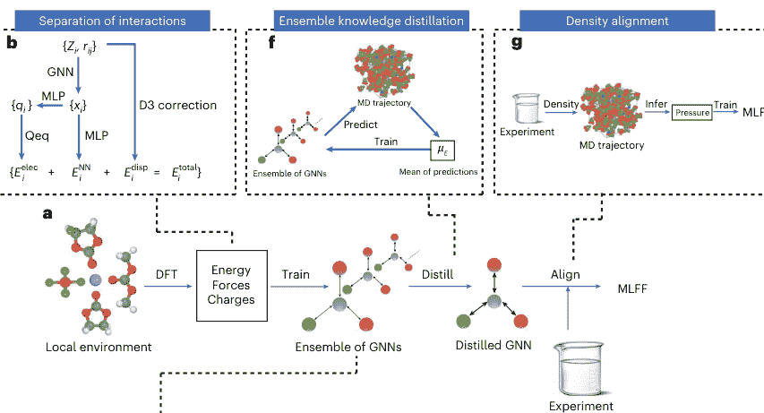
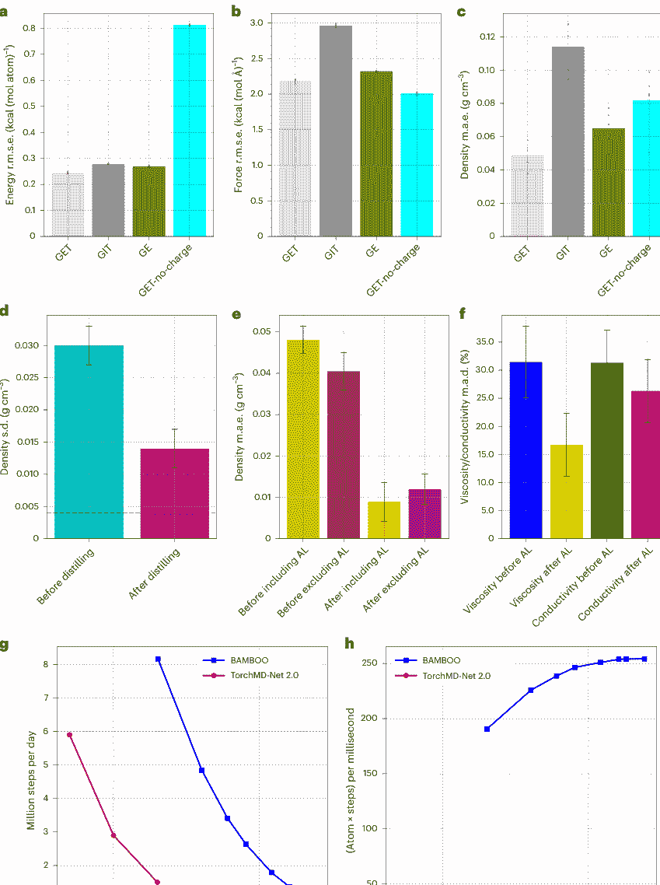
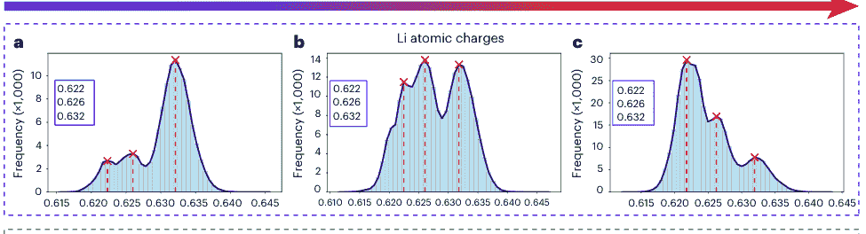
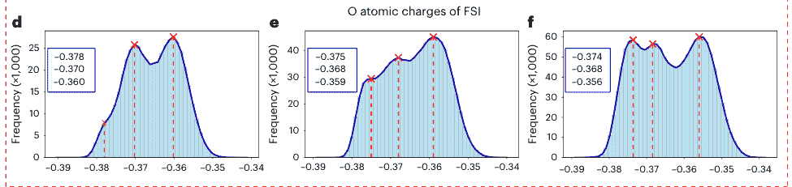

# 用于液体电解质开发的预测性机器学习力场框架

文章

Sheng Gong¹,³, Yumin Zhang¹,³, Zhenliang Mu²,³, Zhichen Pu²,
Hongyi Wang², Xu Han², Zhaiao Yu¹, Mengyi Chen², , Tianze Zheng²,, Zhi Wang¹,,
Lifei Chen¹,, Zhenze Yang¹,, Xiaojie Ji, Shaochen Shi², , Weihao Gao²,,⁵
Wen Wan¹⁵

尽管机器学习力场 `MLFFs` 在固体和小分子中得到了广泛应用，但在应用 `MLFFs` 模拟液体电解质方面存在明显空白——液体电解质是商业锂电池的关键组件。我们介绍了字节跳动人工智能分子模拟加速器 `BAMBOO`，这是一个用于分子动力学的预测性框架，并展示了其在锂电池液体电解质背景下的能力。我们设计了一个受物理启发的图等变变换器架构作为 `BAMBO` 的骨干，以从量子力学模拟中学习。此外，我们引入了集成知识蒸馏方法并将其应用于 `MLFFs`，以减少分子动力学模拟观测值的波动。最后，我们结合 `BAMBOO` 提出了一种密度对齐算法，该算法在预测各种溶剂和盐的密度、粘度和离子电率等关键电解质性质方面展现了先进的精度。当前模型在 15 多种化学物质上进行了训练，在各种体系中实现了 0.01 g cm⁻³ 的平均密度。

液体电解质是目前商业锂电池不可或缺的组件¹。现有的商业电解质大多基于碳酸盐，由五到十种不同的材料组成。通过实验探索分子相互作用以进行电解质理性设计既昂贵又耗时，并且严重依赖化学家的直觉和经验。局限性为从概念实验向产品市场的转化带来了挑战，特别是由于优化多种液体性质的复杂性日益增加。

原子级模拟是详尽实验的一种便捷且可行的替代方案。然而，为了达到可靠性要求，例如高精度以及足够的时间尺度和长度尺度。量子力学模拟在描述电子性质方面具有高精度，但其计算量巨大，对于像液体电解质这样的大规模复杂系统是不实行的。虽然经典方法是高效，但往往在捕捉电解质的分子结构和行为方面牺牲了精度，因此需要一种平衡且通用的方法，来调和建模电解质中的差异：多种溶剂和不同类型的离子。

¹字节跳动研究，美国华盛顿州贝尔维尤。字节跳动研究，中国北京。*这些作者同等贡献：Sheng Gong, Yumin Zhang, Zhenliang M. 邮箱：liverover001@gmail.com, wen@bydance.com

## 文章

本文的主要贡献总结如下：

1. 我们提出了一种集成图等变变换器 `GET` 架构的机器学习模型，以捕捉半局部和直接静电相互作用。
2. 我们证明了集成知识蒸馏算法的应用，以减少基于机器学习的 `MD` 模拟所得结果的波动。
3. 我们提出了一种物理感知数据算法，将 `MLFF-MD` 模拟与实验数据对齐，这确保了物理一致性，并证明了未包含在对齐过程中的液体具有显著的局限性。因此，`BAMBOO` 在预测各种液体的密度、粘度和离子电率方面表现出先进的精度。

近年来，利用机器学习力场 `MLFFs` 进行分子动力学 `MD` 模拟的情况日益增多。这一趋势主要归功于 `MLFF` 提供的结果比从头算量子力学模拟更快，且具有化学级精度。虽然经典方法高效，但在捕捉电解质分子结构和行为方面往往会牺牲精度，因此需要一种平衡且通用的方法，来调和建模电解质中的差异：多种溶剂和不同类型的离子。

## 结果

图 1 | `BAMBOO` 概览。`BAMBOO` 的训练过程。`BAMBOO` 中的相互作用分离。`MLP`、矢量平衡模型，(c)。`GNN` 的示意图 (d)。`GNN` 内部的 `GEL` 层以及 `GEL` 层内部的 transformer (e)。f)。集成知识示意图 (g) 和 `BAMBOO` 的密度对齐。

在微观尺度。原子力通过对对力求和来计算：$f_i = \sum_j f_{ij}$。相邻原子通过 transformer 交换信息，标量和矢量表示也相互交换信息。

### GEL 层架构

在图 2c 中，`BAMBOO` 中使用的 `GEL` 架构灵感主要来自 `Torch-NET`。从原子块 $[Z_i]$ 和原子之间的位置 $[\mathbf{r}_{ij}]$ 开始，我们初始化标量表示 `x_i^0` 和矢量表示 `v_i^0`，以及标量边块。我们将 `x_i^0` 和 `v_i^0` 输入 `GEL` 层进行迭代变换 (c)。如图 1d 所示，每个 `GEL` 层变换截止半径 `r=5 Å` 内的每个标量块。该图说明了节点和边之间的信息交换。在 transformer 块之后，在标量侧更新 `x_i^l`；矢量表示 `v_i^l` 被转换为标量 `u_i^l`。从矢量到标量的变换通过内积操作实现以保持旋转不变性。最后，我们将 `x_i^l` 和 `u_i^l` 组合下一层标量表示 `x_i^{l+1}`，并将 `v_i^l` 和 `u_i^l` 用于下一层矢量表示 `v_i^{l+1}`。在这个过程中，标量 `x_i^l` 与每个 `GEL` 层重叠，防止矢量表示。相邻原子。

**图 2, c–f** 集成知识和密度对齐。**a.** `BAMBOO` 中预测能量 (a) 的等变性、变换和形状，**b** 和密度 (c)。所有模型使用相同的 `DFT` 训练集。指标包括均方误差 `m.s.e.` 和平均绝对误差 `m.a.e.`。这里的柱状绘制了不同种子训练模型的平均值和标准差。**d.** 集成知识对随机训练 `MLFs` 生成的密度标准 `m.a.d.` 的影响。所示为 `s = 13` 个样本

在补充材料中，**e.** 密度对齐 `AI` 对 `MD` 密度、粘度和电导率预测的影响。平均绝对偏差 `m.a.d` 用作百分比数据的指标。所示为 `s = 11, 15, 27` 和 `45` 个样本，见补充图10和补充表12–15。**g.** `BAMBOO` 与 `Torch-MD 2.0` 的推理速度比较。我们将三层 `BAMBOO` 与 `Torch-MD 2.0` 中的两层 `Torch-Net` 模块 `ref. 48` 进行比较。我们描述了每天步数和毫秒步数的推理速度。速度在单个 `NVIDIA GPU` 上测试。

### 集成蒸馏与密度对齐

在图 6 中，我们展示密度对齐有效地将密度误差从 0.005 g/cm³ 降低到 0.001 g/cm³。重要的是，仅使用对齐中包含的 13 个实验数据点实现的误差减少，不仅转移到了测试的分子，还转移到了较高盐浓度的分子 `补充图 10a` 和 `12a`。例如，具有氢键的分子的密度显著提高。

为了解决这个问题，我们的目标是通过使用集成 `MLFF` 预测 `MD` 轨迹的能量和力，来减轻 `MD` 模拟之间的差异。我们聚合平均值并使用该平均值优化 `MLFF`。在图 2 和补充表 7 中，我们证明了五个模型的密度预测的标准差降低了超过 50%，从 0.030 g/cm³ 降低到 0.014 g/cm³。特别是，集成知识蒸馏不需要新的 `DFT` 身体。

`DMC:EC` 中的 `Li` 浓度 `5.49 wt%`

1.12 m 2.25 m 3.74 m

`Li` 原子电荷

近似结构函数

| | SSSP 0.751 | SSSP 0.484 | SSSP 0.182 |
|---|---|---|---|
| CIP | 0.171 | 0.260 | 0.276 |
| AGG | 0.078 | 0.246 | 0.542 |

图 1：`BAMEO` 中溶剂化 `Li` 的原子电荷分布和结构函数。左侧：5.49 wt% `DMC:EC` 环境中 1.12 m、2.25 m 和 3.74 m 的电荷分布。每个面板中的虚线从左到右表示高于 `O` 的分布。第二条和第三条虚线代表与 `CIP` 和 `AGG` 相关的未配对相互作用电值。左侧：基于纯溶剂和少组分电解质等系统的电荷分布和结构函数，`BAMEO` 在密度和粘度预测方面与简单系统具有相似的水平 `补充信息 1`。更重要的是，我们证明对于多组分系统，`BAMEO` 的预测精度高于目前用于模拟液体性质的先进方法，如液体优化电势 `OPAX` 框架。溶剂 `碳酸乙烯` 和电解质的 `MD` 模拟在 283-343 K 温度范围内保持稳定。对于密度预测，我们发现与基础分子相比，溶剂化配合物的 `BAMEO` 表现非常出色。

作为对 `DFT` 数据集中不存在的分子的迁移性，我们采用了 `BAMEO` 对化学物种的迁移性程度。对于 `BAMEO` 是否能模拟与 `DFT` 训练集包含类型类似的分子 `补充图 1`，我们发现对于具有不饱和键的系统，`BAMEO` 可以通过长时间 `MD` 模拟准确预测性质。对于 `BAMEO` 能够模拟的分子，其密度分别为 1.045 g/cm³、1.11 g/cm³ 和 1.7 wt%。为了让 `BAMEO` 能够样本外系统，我们需要足够的努力来提高迁移性。第一个方法是考虑机器学习电势，例如 `MACE-FF` `参考文献 24`，它在数百万种配置上进行了训练。使用大规模训练策略的限制也限制了断键事件的使用。最近的工作表明，基于 `GNN` 的模型比基于局部描述符的模型更健壮，这可以启发……

## 溶液结构和原子电荷

除了对宏观性质的准确预测外，`BAMEO` 显式预测原子电荷使其能够提供液体溶液结构的额外见解。这里我们展示了从 0.5 m、3.7 m 和每公斤盐浓度模拟的三种环境的 `Li-` 和 `O-` 电荷直方图。`Li` 与 `DMC` 的重量比 1:49 在所有环境中保持一致。所有三个 `FST` 的直方图在补充图 15 和 16 中。

## 讨论

在图 3a 中观察到三个不同的峰。每个峰 `Li+` 分别位于 0.622、0.626 和 0.632。随着浓度从 0.5 m 变为 3.7 m，峰发生了移动，尽管高度不同。具体而言，最高峰对应的最低 `Li` 浓度从 0.5 m 增加到 3.7 m。

总结，我们提出了用于液体 `MD` 模拟的 `BAMEO`框架。首先，我们使用 `GET` 架构分离局部 `原子` 静电和色散相互作用，利用 `DFT` 计算的知识。我们引入了来自 `BAMEO MD` 模拟的集成解码结果。此外，我们提出了一种基于物理的对齐方法，以建立宏观和微观尺度结果之间一致的关系。我们的结果证明了对齐过程在减少差异方面的有效性。

电荷分布的变化揭示了不同浓度下变化的溶液结构。我们解构了 3 ns `MD` 模拟帧，并检查了 `Li+` 离子的溶液结构。溶液结构的类型及其比例列表并在每个电荷直方图中所示。这些比例与观察到的第一溶剂壳轨迹一致，随后提取了由溶剂分子包围的第一溶剂壳的中心轨迹。

我们对 `BAMEO` 在溶剂和电解质上的性能进行了全面评估。我们的模拟结果表明，单个 `BAMEO` 模型可以高精度预测性质、结构和电荷。`BAMEO` 模型能够模拟各种成分中最多 15 种物种。这种健健性强调了 `BAMEO` 在促进实际分子系统设计和优化方面的价值。

通常，溶液结构分为 `SIP`、`CIP` 和 `AG`。`SIP` 表示由溶剂分子组成的结构；`CIP` 结构包含一个阴离子；`AG` 是由溶剂和阴离子组成的结构。我们对 0.5 m、2.2 m 和 3.7 m `Li` 环境的 `FST` 半径分析分别为 0.791、0.494 和 0.182。`CIP` 半径为 0.171、0.260 和 0.322，`AG` 半径为 0.076、0.142。`SIP`、`CIP` 和 `AG` 之间的差异显示为 `Li+` 浓度的函数。我们可视化了峰高效应。

# 方法

众所周知，`Li+` 与周围分子 `包括溶剂和阴离子` 之间的溶液相互作用与基于 `Li+` 的配环境正比。电解质可能会导致溶液环境中部分电荷的极化诱导变化。我们希望通过对齐 `FST` 内不同环境的 `Li+` 电荷分布来证明这一点。我们观察到三个重叠的分布 `图 3d–f`，而其他显示出所有浓度的单一分布 `补充图 17`。

## GET

如图 3 所示，识别出两个峰并用红色虚线标出。我们假设这些峰源于 `Li+` 环境中的两种氧原子。这与我们的模拟观察一致，即在 0.5 m 时，由于低浓度和 AG 相互作用，`Li+` 周围着溶剂和阴离子原子。这些单元可能没有通过溶剂分子的稳定。在锂离子电解质中，溶剂分子带电，DM 设计用于极化正离子，导致阴离子释放溶剂分子。-0.370 和 -0.360 的电荷分布表明自由 FST 潜在的四面体差异。

节点级和边缘。补充方程 (1)–(2) 中提供了更多关于 `GET` 模型的内容。

作为损失函数对随机选择的模型进行微调的标签（补充方程 (52)）。关于 `BAMBOO` 集合知识解构的更多细节请见补充方程 (47–53)、补充材料 3 和 4 以及补充。

## 相互作用的分离

一旦到达第一层，我们使用两个全连接网络利用基于神经网络的每个原子能量 `E_i` 和原子电荷 `q_i`。然后，我们根据电荷密度理论定义静电能。在这项工作中，我们使用机器学习力场（`MLFF`）改进了电荷密度以提高效率。我们对 `GNN` 使用了正则化策略来生成，并包含了通过 MD 步长生成的昂贵平衡求解器。此外，对于结构，我们可以通过密度 `D^{(i)}` 定义势能面。最后，我们将神经网络、静电和色散相互作用结合起来，计算每个原子的总能量和力。关于相互作用分离的更多细节请见补充方程 (22–45)、补充表 1 以及补充。

## 密度对齐

我们使用集合模型作为执行密度对齐的基准。为了对齐混合物，我们首先计算每种液体的概率 `P(ρ)`。通过训练 `BAMBOO` 模型来适应均匀压力（`ΔP`）。使用这些不同的 `MLFF`，我们使用 600 pN 步生成密度分布。然后，我们为每种液体建立 `Δρ` 与 `ΔP` 之间的线性相关性。利用这一点，我们可以确定每种液体的值 `V`。通过此，我们确定了应整合到每种液体 `MLFF` 中的特定 `ΔP` 值，以实现对齐。最后，我们使用补充方程 (58) 提供的结果——为每种液体确定的适当 `ΔP` 值——将基准模型与集合数据进行对齐。关于 `BAMBOO` 密度对齐的细节请见补充方程 (54–58) 和补充图 9–13。

## BAMBOO 的初始训练

我们使用 `GET` 架构和结构来生成不同的相互作用，使用结合能量、力、维里张和应力的损失函数来训练 `BAMBOO` 中的神经网络。具体而言，`BAMBOO` 对电荷的训练通过四个方面：首先是训练神经网络、力和电荷，以及其他来自电势电荷密度的静电势；第三点是训练密度，即通过 `DFT` `D` 来自电荷密度的宏观观测值；第四点是对齐平衡结构。

在这项工作中，我们使用 `PyTorch` 在 `BAMBOO` 中构建了神经网络，并使用学习率为 `10^{-2}` 的 `AdamMax` 优化器。在训练过程中，权重衰减设置为 0.0001，而学习率以 `10^{-4}` 的速率降低。批大小为 128。该模型由三层组成，嵌入维度为 64。它具有 16 个注意力头，每层消息传递层使用 0.5 Å 的截断，并包含了用于预测能量和力的双层全连接网络。

## MLFFs

我们使用 `LAMMPS` 进行 `BAMBOO` 的 MD 模拟。对于每个系统，初始步骤是能量最小化，限制为最大 10000 次迭代和 100000 次评估。之后，系统处于平衡状态，步长保持在至少 1 fs。密度值如表所示。然后，我们在 `DFT` 集合下运行 4-ns 的生产运行，以估计液体的密度和电导率。我们使用 Einstein-Nernst 方法以及之前工作“On-surface of Maxwell-Wagner”中描述的方法计算电导率。MD 模拟的细节请见补充方程 (64)。

## 数据可用性

数据集可在 https://huggingface.co/datasets/ml-bamboo 获取。完整数据集包含参数、`LAMMPS` 的原子结构以及最终结果，集合数据和结果也可在 Zenodo 获取：https://doi.org/10.5281/zenodo.6460320 (参考文献)。

## 代码可用性

源代码、`GET` 训练模型以及用于模拟的 `LAMMPS` 输入文件可在 https://github.com/bydentance/bamboo 获取，也可在 Zenodo 获取：https://doi.org/10.5281/record.6460320 (参考文献)。

## MLFF 的集合知识发现

在这项工作中，我们使用带有随机种子的 `DFT` 测试了四个模型。随后，我们为所有系统从600 ps 等向同性 (`NPT`) MD 和 400 ps 正则系 (`NVT`) MD 中选择了一个模型（补充图 7）。基于此目标，我们训练模型来预测每个系统轨迹中随机选择的 100 个样本的能量和力。最后，我们使用预测平均值

# 参考文献

- 1. Xu, K.. 锂离子电池的纳米级电解质。Chem. Rev. 104, 4303–4318 (2004).
- 2. Xu, K., et al.. Interfaces and Functions: Applications in Batteries (Royal Society of Chemistry, 2023).
- 3. Meng, Y., S., Viswan, V., & Xu, K.. Designing electrolytes. Science 378, e3750 (2022).
- 4. Unke, O. T., et al.. Machine learning for fields. Chem. Rev. 121, 10102–10133 (2021).
- 5. Frenkel, D. & Smith, B.. Understanding Molecular Simulation: From Atoms to Applications (Elsevier, 2023).
- 6. Behler, J., & Parrinello, M. 神经网络的泛化表示。
- 7. Zhang, L., Wang, H., Car, R., & E. 高维势能面。
- 8. Montes-Campos, H., Carrette, J., Bichemeier, S., Varela, L. & M. 机器学习的场。
- 9. Wang, J., & Wang, C. 深度学习的场。
- 10. Batner, S., et al. 可伸缩的等变力场。
- 11. Thölke, P. Ko, J., Goedicker, S. & Behler, J. 等变力场。
- 12. Yao, Y. & Smith, J. 等变变换器。
- 13. Ko, T., Finker, G., Goedicker, J. 具有局部原子表示的势能面。
- 14. Doj, S., et al. 密度值。
- 15. Jackson, L., et al. 局部原子表示。
- 16. Fu, X., et al. 预测的挑战。
- 17. Onke, U. & Muhovsky, M. 预测能量和力。
- 18. Onke, et al. 旋旋相关的深度学习。
- 19. Wang, Y. et al. 向量标量相互作用的等变表示。
- 20. Chen, C., & Wang, S. 化学结构的图神经网络的局限性。
- 21. Deng, D., et al. 边界不变性。
- 22. Zhang, J., et al. s1467-。
- 23. Batista, I., et al. 基于注意力机制的模型。
- 24. Kovacs, D., et al. 可迁移的 ACE-MP。
- 25. Wang, J., et al. 使用机器学习力场的分子动力学。
- 26. Schneider, H., Creon, A., & Schwaluber, T. (B96)/Becke-Johnson) 色散修正。
- 27. Vaswani, A. et al. 注意力即一切。
- 28. Gong, S., et al. 化学结构的图神经网络。
- 29. Thorne, D., et al. LAMMPS：一种用于跨尺度粒子基分子模型的灵活模拟工具。
- 30. Musaleik, A. et al. 使用局部原子表示的分子力学。
- 48. Pezeikh, P. R., 等。DeepMD-net: 用于分子模拟的快速神经网络势能。预印本于 https://arxiv.org/abs/2407.09666 (2024)。
- 70. Shao, Y., 等。Q-chem 软件包中用于分子量子化学的注意力机器学习。自然-化学 (*Nature chemistry*), 11, 184–195 (2023)。
- 49. Mathias, G. A., & Lang, C. H. 外推与学习方程。在：第 35 次国际机器学习会议 https://proceedings.mlr.org/v801.html (PMLR, 2018)。
- 71. Wang, L. J., Zhang, Z., & Srinivasan, V. 电解质输运中车辆设计与结构设计的相对重要性。电化学学会杂志 (*J. Electro. Soc.*), 170, 110536 (2023)。
- 50. Dove, A. R. 锂离子电池电解质的自动化设计与发现：硫电池 (Phethio Cell)，自然医学 (*Nature Medicine*) (2023)。
- 51. Higashiyama, K., 等。1,3-二氧烷-水混合物的物理性质。自然 (*Nature*), 7, 210–218 (2016)。
- 52. Sasaki, Y., & Furimoto, H. 用于能量转换与存储的材料。能量 (*Energy*) (Else)。
- 74. Simon, G., & Fischer, B. GraphNet: 基于 Transformer 的表示方法。神经网络与信息处理系统 (*Neural. Inf. Process.*), 36, 3733–3754 (2022)。
- 53. Janssen, A., Thorbersen, S., Jung, J., & Lu, E. 用于电容器的氟代电解质。电化学学会传输 (*ECS Trans.*), 35, 51 (2007)。
- 74. Goes, J., 等。电池技术手册 (*Handbook of Battery Technology*) 525–626 (Wiley)。
- 55. Dove, A. R. 优化准水电解质。自然通讯 (*Nature Commun.*), 13, 5542 (2022)。

# 致谢

感谢来自科罗拉多矿学院的 Misty A 教授。我们感谢卡内基梅隆大学的 Dove 提供的数据。

56. Logan, E., 等。碳酸盐基电解质的研究。电化学学会杂志 (*J. Electro. Soc.*), 165, A473 (1960)。

# 作者贡献

概念构思：Weihao Gao；方法：Jia Yu；撰写初稿：Weihao；审阅与编辑：Jia Yu；监督：Weihao。

# 利益冲突

所有作者均声明无利益冲突。研究项目获得 Nature Research 的资助。此外，此处描述的创新已提交专利申请（编号 202312246），正在审核中。

# 补充信息

在线版本包含补充材料 https://doi.org/10.1038/s41586-025-01009-7

Nature 感谢 Jia Yu 和其他评审员对本文工作的同行评审。

重印与许可请访问 https://www.nature.com/reprints

出版社说明 Nature Research 在司法管辖和机构隶关系方面保持中立。作者或其他持有者根据与 Springer Nature Limited 的协议拥有文章的独占权利。Nature Intelligence 2025

57. Zhu, S., 等。利用深度几何学习进行非水基电解质的可微建模与优化。自然-化学 (*Nature Chem.*), 15, 5884 (2023)。
58. Li, Y., Ko, J., & Wang, G. 从分子势能确定阳离子输运。预印本于 https://arxiv.org/abs/2111.06745 (2021)。
59. Beneman, C. M. & Wieberg, K. 从分子势能确定阳离子分子。物理化学杂志 (*J. Chem. Phys.*), 1, 01109 (2021)。
60. Paske, A., 等。PyTorch：一种直观、高性能的深度学习库。神经网络与信息处理系统 (*Neural Net. Inf. Process.*), 31, 80–98 (2019)。
61. Kingma, D. P., & Ba, J. A. Adam：一种随机优化方法。预印本于 https://arxiv.org/abs/1412.6980 (2014)。
62. Beck, A. D. 泛函理论 III：交换的作用。物理化学杂志 (*J. Chem. Phys.*), 88, 5568–5573 (1993)。
63. Helweg, A. R. & Scharfetter, D. 为 RI-MP2 和 RI-CC 计算开发新的 Kohn-Sham 函数辅助基（DZS, 2DZVP 和 def-2DZVP）。物理化学 (*Phys. Chem. Chem.*), 17, 1010–1017 (2015)。

Weigert, F. 从 H 到 Na 的 Hartree-Fock 交换拟集。计算化学杂志 (*J. Comput. Chem.*), 29, 167–178 (2008)。

64. Wu, X., 等。带有 GPU 加速的基于 PyTorch 的量子化学计算。预印本于 https://arxiv.org/abs/2404.09452v1 (2024)。
