# 42 种常用机器学习算法入门指南（带代码示例）

&
思考

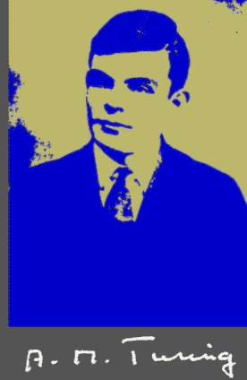

# 关于作者

Murat Durmus 是 AISOMA 的首席执行官兼创始人（一家位于德国法兰克福，专门从事基于 AI 的技术开发与咨询的公司），同时也是《正念 AI - 对人工智能的反思》和《42种常用机器学习算法入门（带代码示例）》等书籍的作者。

你可以通过以下方式与作者联系：

- LinkedIn：https://www.linkedin.com/in/ceosaisoma/
- 电子邮箱：murat.durmus@aisoma.de

> “如果一台机器被认为是无懈的，那么它就不可能是智能的。”

~ 艾伦·M·图灵

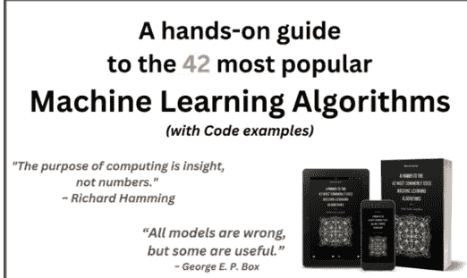

无论你是数据科学家、软件工程师，还是仅仅对学习机器学习感兴趣，“42种常用机器学习算法入门（带代码示例）”都是全面理解这一令人兴奋领域的绝佳资源。

本书以浅懂的方式向你介绍了 42 种最常用的机器学习算法。每种算法都通过一个简单的 Python 代码示例进行了演示。

可在亚马逊购买：
https://www.amazon.com/dp/B0BT911HDM
(ISBN-13: 979-8375226071)

探索 150 多种认知偏差（带示例），以做出更好的决策、进行批判性思考、有效解决问题并更准确地交流。

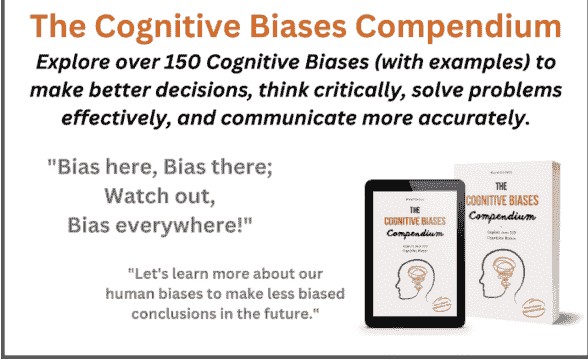

通过更加意识到人类的偏差，我们可以努力在生活的各个方面做出更少偏见的结论。这项技能是宝贵的，因为它能让我们理解思维的复杂性，并做出更明智、公平的决策。让我们利用对认知偏差的理解作为个人发展的手段，对周围的世界获得的理解。

可在亚马逊购买：
https://www.amazon.com/dp/B0CBK1WFNN
(ISBN-13: 978-8851721496)

# 前言

艾伦·马西森·图灵（Alan Mathison Turing）是一位英国数学家、计算机科学家、逻辑学专家、密码分析学家、哲学家和理论生物学家。图灵通过图灵机提供了算法和计算概念的形式化，对理论计算机科学的发展产生了重大影响，图灵机可以看作是通用计算机的模型。因此，图灵被广泛认为是理论计算机科学和人工智能之父。尽管取得了这些成就，他生前从未得到他祖国的完全认可，因为他的同性恋在当时的英国是犯罪，而且他的工作受《官方秘密法》的限制。

我在书中记录了他最有意义的语录和思想。它们一直是我灵感的来源，我希望这本小书也能给你启发。

祝你在阅读过程中获得许多见解，最重要的是获得启发。

Murat Durmus, 2021年10月21日
（德国法兰克福）

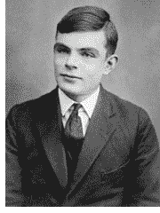

(img/046ba135cd994945038c4ec83cb4a06d_9_0.png) 1954年6月23日
(img/046ba135cd994945038c4ec83cb4a06d_9_0.png) 1954年6月23日
(img/046ba135cd994945038c4ec83cb4a06d_9_0.png) 1954年6月23日
(img/046ba135cd994945038c4ec83cb4a06d_9_0.png) 1954年6月23日
(img/046ba135cd994945038c4ec83cb4a06d_9_0.png) 1954年6月23日
(img/046ba135cd994945038c4ec83cb4a06d_9_0.png) 1954年6月23日
(img/046ba135cd994945038c4ec83cb4a06d_9_0.png) 1954年6月23日
(img/046ba135cd994945038c4ec83cb4a06d_9_0.png) 1954年6月23日
(img/046ba135cd994945038c4ec83cb4a06d_9_0.png) 1954年6月23日
(img/046ba135cd994945038c4ec83cb4a06d_9_0.png) 1954年6月23日
(img/046ba135cd994945038c4ec83cb4a06d_9_0.png) 1954年6月23日
(img/046ba135cd994945038c4ec83cb4a06d_9_0.png) 1954年6月23日
(img/046ba135cd994945038c4ec83cb4a06d_9_0.png) 1954年6月23日
(img/046ba135cd994945038c4ec83cb4a06d_9_0.png) 1954年6月23日
(img/046ba135cd994945038c4ec83cb4a06d_9_0.png) 1954年6月23日
(img/046ba135cd994945038c4ec83cb4a06d_9_0.png) 1954年6月23日
(img/046ba135cd994945038c4ec83cb4a06d_9_0.png) 1954年6月23日
(img/046ba135cd994945038c4ec83cb4a06d_9_0.png) 1954年6月23日
(img/046ba135cd994945038c4ec83cb4a06d_9_0.png) 1954年6月23日
(img/046ba135cd994945038c4ec83cb4a06d_9_0.png) 1954年6月23日
(img/046ba135cd994945038c4ec83cb4a06d_9_0.png) 1954年6月23日
(img/046ba135cd994945038c4ec83cb4a06d_9_0.png) 1954年6月23日
(img/046ba135cd994945038c4ec83cb4a06d_9_0.png) 1954年6月23日
(img/046ba135cd994945038c4ec83cb4a06d_9_0.png) 1954年6月23日
(img/046ba135cd994945038c4ec83cb4a06d_9_0.png) 1954年6月23日
(img/046ba135cd994945038c4ec83cb4a06d_9_0.png) 1954年6月23日
(img/046ba135cd994945038c4ec83cb4a06d_9_0.png) 1954年6月23日
(img/046ba135cd994945038c4ec83cb4a06d_9_0.png) 1954年6月23日
(img/046ba135cd994945038c4ec83cb4a06d_9_0.png) 1954年6月23日
(img/046ba135cd994945038c4ec83cb4a06d_9_0.png) 1954年6月23日
(img/046ba135cd994945038c4ec83cb4a06d_9_0.png) 1954年6月23日
(img/046ba135cd994945038c4ec83cb4a06d_9_0.png) 1954年6月23日
(img/046ba135cd994945038c4ec83cb4a06d_9_0.png) 1954年6月23日
(img/046ba135cd994945038c4ec83cb4a06d_9_0.png) 1954年6月23日

(A.M. 图灵选集)

为了获得可靠的结果，必须调查很大一部分时空。

似乎一旦机器思维方法开始运行，很快就会超过我们微弱的能力。它们能够相互交流以提高机敏。因此，在某个阶段，我们应该预期机器接管控制权。

基于任何未经证实的猜想是完全错误的。只要弄清楚哪些是已证明的事实，哪些是猜想，就不会产生任何危害。猜想具有重要意义，因为它们提供了有用的研究方向。

## 10011
如果一台计算机能够欺骗人类相信它就是人类，那么它就配得上被称为智能的。

## 10100
让我们暂时回到洛夫莱斯夫人（Lady Lovelace）的反对意见，她认为机器只能执行我们让它做的事情。可以说，人向机器中“注入”一个思想，它会在一定程度上做出反应，然后陷入静止，就像被锤子击中的钢琴弦一样。另一个类比是规模较小的原子堆：一个注入的思想对应于一个从外部进入原子堆的中子。每个中子都会引起某种扰动，这种扰动最终会逐渐消失。然而，如果原子堆的尺寸足够大，这种迁入中子引起的扰动很可能会持续并不断扩大，直到整个堆被摧毁。心灵是否存在相应的现象？机器是否存在是否也有？人类心灵似乎是存在的。大多数心灵似乎是“亚临界”的，即在这一类比中对应于亚临界尺寸的原子堆。呈现给这种心灵的思想平均产生的回复思想少于一个。只有一小部分是超临界的。呈现给这种心灵的思想可能会产生一个完整的“理论”，由次级、三级以及更更遥远的思想组成。动物的心灵似乎非常明确是亚临界的。遵循这一类比，我们问道：“可以制造出是超临界的机器吗？（计算机器与智能）”

## 10110
“机器能思考吗？”……这个问题的新形式可以用一种我们称之为“模仿游戏”（imitation game）的游戏来描述。游戏由三个人玩：一个男人（A）、一个女人（B）以及一个性别不限的询问者（C）。询问者待在一个与两人隔离开的房间里。询问者的游戏目标是确定另外两人中谁是男人谁是女人。他通过标签 X 和 Y 来识别他们，并在游戏结束时说“X 是 A，Y 是 B”或“X 是 B，Y 是 A”。询问者被允许向 A 和 B 提问……我们现在问：“当机器在游戏中扮演 A 的角色时会发生什么？它做出错误判断的频率，是否和男人与女人之间玩这种游戏时的频率一样？”这些问题取代了我们最初的问题：“机器能思考吗？（计算机器与智能）”

## 10111
有时候，正是那些无人寄予期待的人，做出了人们无法想象的事业。

## 11000
不可能产生一套规则，旨在描述人类在每种可能的设定的应该做些什么。（计算机器与智能）

## 11001
人类的作品和习俗似乎并不是非常适合应用科学归纳法的材料。（计算机器与智能）

## 11010
我们喜欢相信人类在某种微妙的方面优于创造的其他产物。如果能证明他是必然优的，那是最好的，因为这样就不存在失去统治地位的危险了。（计算机器与智能）

## 11011
我们对大脑的质地像冷稀粥这一事实并不感兴趣。

## 11100
有时候，正是那些无人寄予期待的人，做出了人们无法想象的事业。

## 11101
机器永远无法像人类那样思考，仅仅因为某物的思考方式与你不同，就意味着它没有在思考吗？

## 11110
一个配备纸、铅笔和橡皮，并受到严格纪律约束的人，实际上是一台通用机器。

## 11111
泡电子不相容原理纯粹是为了电子本身的利益，如果允许它们太自由地结合，它们可能会腐败（变成龙或魔）。

## 100000
我做过一个梦，相当清楚地表明我正走向异恋的路上，尽管我在清醒时或梦中都没有对此感到太热情。

## 100001
计算机背后的思想可以解释为：这些机器旨在执行任何人类可以完成的操作。

## 100010
指令表必须由具有计算经验的数学家来编制。

## 100011
想想看。数字计算机。电子大脑。

## 100100
我想要一段持久的关系，我可能倾向于拒绝任何此类性质的东西。

## 100101
在某种程度上，让小故障存在那里，比花费这么多时间去设计一个没有故障的设计要好。

## 100110
当我们想要击沉一支护队时，我们会先派出侦察。当然，观察并不是它的真实职责，我们已经知道护队在哪里。

## 100111
那么，德国人就不会怀疑了。

## 101000
除非在与其交流时准确地表达自己的意思，否则麻烦在所难免。

## 100101
我的工作压力大到我唯一能把它从脑子里赶出去的方法就是拼命跑步。

## 101010
我是上帝吗？不是。因为上帝没有赢得战争。是我们赢了。

## 101101
我喜欢解决问题，指挥官。恩尼玛密码是世界上最困难的问题。

## 101001
不，我不感兴趣于开发一个强大的大脑。我追求的只是平庸的大脑，就像美国电话电报公司的总裁那样。

## 10110
与其试图编写一个模拟成人大脑的程序，为什么不尝试编写一个模拟儿童的程序呢？如果对其接受适当的教育，就能获得成年人的大脑。

## 10111
有一天，女士们会带着它们的电脑在公园散步，并互相说：“我的小电脑今天早上说了一件真有趣的事。”

# 模仿游戏（图灵测试）
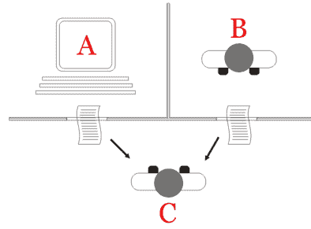

假设你进入一个房间，里面唯一的设备是一个椅子和一张桌子，桌子上坐着我们时代最常用的设备之一：一台带有屏幕和键盘的计算机。这时，一个看起来营养不良、带着略显羞涩凝视的男人出现了，并向你解释，桌上的终端连接着隔壁的一个类似终端，隔壁对面坐着一个性别不明、相平平的人，或者一个被程序设定回答你提出的任何问题的计算机；当然，计算机或人类都不被要求如实回答问题。提问被限制在二十个问题或大约三分钟内，以保持实验在合理范围内。实验结束后，电脑极客会回来，然后你得告诉他你认为那个

终端连接的是真实的、真人，或者是计算机。

让我们玩玩这个游戏来感受一下。

**你**：那么，我们聊点什么呢？

我可以聊任何话题。你想问我什么？

**你**：让我们从简单点开始吧，也许是一点点数学。如果我有一个两个边长为 3 和 4 的直角三角形，第三条边的长度是多少？

啊，老掉的毕股哥定理。当然，斜边的长度是 5。

**你**：有一件事我非常感兴趣。宇宙中还有其他智能生命体吗？

我不知道。但我倾向于选出卡尔·萨根，因为他曾说过：“宇宙是一个非常大的地方。如果只有我们，那看起来就像是对空间的极极度浪费。”

**你**：赞同。让我们试试别的。我们应该相信上帝吗？

我不喜欢聊宗教。但如果你想要一个答案，我会说：你应该拥有相信任何你想要相信的事物的自由。

> 模仿游戏（图灵测试）

**你：**好吧，我们不聊宗教了。你认为罗杰尔·费德勒今年能赢得大满贯吗？

罗杰尔·费德勒是谁？

**你：**我看来你也不是网球球迷。你告诉过我可以聊任何事情。

我可以像任何正常人一样交流，但我并不是全知。

**你：**我只是在尝试为我们的对话寻找共同点。你对电动汽车怎么看？你认为现在买一辆好吗？

在买之前我会再等一下：

**你：**你为什么会有这个观点？

电动汽车还没有完全发展，而且仍然太贵了。但总的来说，就空气污染而言，这是一件好事。

**你：**好吧，你的观点并不孤单。你对艺术了解多少？你不能为我写一小段乐曲吗？

对不起，我做不到。

**你：**好吧，我必须得离开了。我可以问你最后一个问题吗？你是计算机还是人类？

我是一个智能的、会思考的存在。再见，感谢你来这里和我聊天！

想象一下一次又一次地回来玩很多次这个游戏。那么，仅凭推测，你就相信你的假设是正确的：平均而言，你与人类和计算机接触的时间各占一半。进一步想象，在经过足够多次的游戏后，你区分人类和机器的成功率并没有显著优于仅凭推测的 50%。所以现在我问你：机器能思考吗？嗯吧，为什么不能呢？毕竟，我们只能通过与他们进行大致相同的交互（除了面部表情等，这与我们与终端对应的交互方式相同）来判断他人是否是思考生物。因此，如果在经历了一系列这样的交互后，我们仍然无法区分计算机和人类，那么声称机器具有思考能力或人类具有思考能力似乎完全合理的。但既然根据假设人类是思考的，我们必须接受，任何在模仿游戏中能欺骗我们的机器也能思考。

模仿游戏最早是由英国计算机先驱艾兰·图灵在近七十年前的一篇关于构建智能机器可能性的开创性论文中首次提出的。图灵在二世界大战期间破解德国恩尼玛密码方面起了关键作用，从各方面来看，他是一个兴趣相当古怪的人。例如，他发明了“回合制象棋”（玩家在走完一步后，站起来在房子里走动，如果他在对手移动之前回来，他就可以再走一步）和“孤独岛屿游戏”（一种生存实验，你必须学会如何使用由家用材料自制的装置制造化学品）。他还喜欢越野滑雪、自行车和拉小提琴等爱好。似乎图灵的

# 模仿游戏（图灵测试）

关于或多是任意刺激的设想。假设图灵测试具有任何参考价值。那么，在这种情况下，任何在普通对话中能够合理模仿人类的“黑箱”都被认为拥有了真正的智能，并且可以（应该）被视为“思考的存在”，正如我们在上面对话中的那位朋友一样。

目前已经提出了几种论点，认为图灵测试不适用于确定智能：

- 图灵测试测试的是功能性，而不是意图性或意识的存在。这一论点由约翰·塞尔尔等人在他的“中文房间”¹的思想实验中进行了详细阐述。当图灵制定他的测试方案时，他已经意识到了这个问题，但他认为这也可以是意识的证据。然而，塞尔尔拒绝了这一点。

> ¹ 关于“中文房间”的更多信息：维基百科：https://en.wikipedia.org/wiki/The_Chinese_Room

图灵假设，到 2000 年，可以通过编程让平均用户在与其“交谈”五分钟后，识别人类和机器的概率最高只有 70%。这一预测尚未实现的假设，被许多人视为低估了智能的复杂性。

“对他而言，破解恩尼玛密码比处理人类要容易得多。”

“尽管我不准备预测图灵测试将在 2029 年到来，但 Watson 等系统取得的进展应该给任何人足够的信心。如果创建一个针对图灵测试的 Watson 版本，可能会非常接近。”

“我确定了一种简单的、用于判断主张（包括丹尼特的的主张）的测试方法。图灵发明他的测试是希望在功能性被解释之前实现它。遗憾的是，解决方案很少在不解释原理的情况下被发现。”

> “像洛芙莱尔一样，图灵是一个程序员，他向内审视。他将心理过程提炼为最小部分，即信息的原子。”

> “这种单一盒子执行任何你所想象的过程被称为通用性，这是图灵在 1936 年提出的概念。通用性意味着我们不需要为算术、机器翻译、象棋、语音理解或动画准备机器：一台机器即可。”

“人工智能的悖论在于，任何简单到可以理解的系统都不复杂到能够智能。图灵建议，人工智能的路径是构建一个具有孩子好奇心的机器，并让智能进化。”

“随机搜索可以比非随机搜索更有效——这是古德和图灵在布莱切利公园发现的。随机网络，无论是神经元、计算机、单词还是思想，包含了等待发现的解决方案，解决那些不需要明确定义。”

“图灵以思想实验的形式提出了他的新观点，基于一种流行的客厅游戏。一个男人和一个女人躲起来，法官被要求根据往来的笔记文本来判断哪是哪个。”

图灵把女人替换成了计算机。法官能分辨出哪个是男人吗？如果不能，计算机有意识吗？有智能吗？它应该权利吗？

难怪他的想象力会思考那些奇异生物的权利。

*

“从直觉和非正式的角度定义，信息可能是某种‘不确定性的解毒剂’。事实证明，这也是它的正式定义——信息的量取决于事物减少不确定性的程度……[信息]熵越高，信息就越多。事实证明它是一个能够衡量一系列惊人事物的价值——从硬币投到电话通话，从乔伊斯的小说到初次约会，从临终遗言到图灵测试……熵表明，当我们向一个对其反应和回答最不确定的朋友、同事或导师提问时，我们对该问题获得最深刻的洞察。它反过来也表明，如果我们想对一个人获得最深刻的洞察，应该向那些我们最不确定其答案的人提问……寒暄是低熵的，偏见到至于它们不再是真诚的探究，而变成了一种仪式。当然，仪式有它的优点，我对此完全没有异议。但如果我们真的想开始洞察，我们需要让他们用我们无法完成的句子来交流。”

~ 布莱恩·克里斯汀（《最像人的：与计算机对话教会我们关于生命的意义》）

*

“任何聪明到通过图灵测试的 AI，都聪明到知道如何通过这项测试。”

~ 伊恩·麦克唐纳（《神之河（印度2047，#1））

“但图灵测试是一把双刃剑。你无法判断是一个机器变得更聪明了，还是你仅仅将自己的智能标准降低到了这种程度，以至于机器看起来很聪明。如果你能与 AI 程序呈现的虚拟人物对话，你就能看出为了让这种幻象为你服务，你让自己的人格感退化到了什么程度？

人们总是为了让机器看起来聪明而贬低自己。在崩溃之前，银行家们相信所谓的智能算法，这些算法可以在发放糟糕贷款之前计算信贷风险。我们要求老师教授标准化测试，以便让学生在算法面前表现良好。我们反复证明了人类物种拥有一种无底降低标准以让信息技术看起来很好的能力。机器中的每一种智能体现都是模糊的。过去驱动可疑学术 AI 项目的同样的模糊性，在今天被重新包装成大众文化。搜索引擎真的知道你想要什么，还是你为了顺应它而降低了自己的标准让它看起来很聪明？虽然人类视角因与深刻的新技术的接触而发生改变是意料之中的，但将机器智能视为真实的做法，要求人们减少他们与现实的锚定。”~ 杰伦·兰尼尔（《并非小道具》）

出生

艾伦·图灵于 1912 年 6 月 23 日出生在英国伦敦的梅达维尔（Maida Vale）。

教育

1922 年 1 月至 1926 年间，图灵在海塞尔尔赫斯特斯特预备学校（Hazelhurst Preparatory School）接受教育，这是萨塞克斯郡弗兰特村（现东萨塞克斯郡）的一所独立学校。1926 年，13 岁的他进入了谢尔伯恩学校（Sherborne School），这是位于多塞特郡谢尔伯恩市场镇的一所寄宿制独立学校。

图灵接触到爱因斯坦的作品

1928 年，16 岁的图灵接触了阿尔伯特·爱因斯坦的作品；他不仅理解了它，而且可能从某篇从未明确说明这一点的文本中，推导出了爱因斯坦对牛顿运动定律的质疑。

在谢尔伯恩，图灵与同学克里斯托弗·莫科（Christopher Morcom, 1911-1930）建立了深厚的友谊，莫科被描述为图灵的“初恋”。他们的关系为图灵未来的努力提供了灵感，但因莫科于 1930 年 2 月去世而中断，他死于几年前饮用受感染牛奶后引发的牛结核病并发症。

谢尔伯恩毕业后，图灵于 1931 年至 1934 年在剑桥大学国王学院攻读本科，并获得数学专业一等荣誉学位。

1935 年，22 岁的他凭借一篇证明了中心限限定理的论文被选为国王学院院士。委员会并不知道，该定理早已在 1922 年被雅尔·瓦尔德海马尔·林德德伯格（Jarl Waldemar Lindeberg）证明过。

1936 年 9 月至 1938 年 7 月，图灵的大部分时间在普斯顿大学跟随阿隆佐·丘奇学习，当时是第二年简·伊莉莎莎·普鲁特研究员。除了纯数学工作外，他还学习了密码学，并建造了四级阶段电机械二进制乘法器中的三级。

1936 年，图灵发表了论文《关于可计算数及其在判定问题中的应用》。该论文分两部分发表在《伦敦数学学会论文集》上，第一部分于 11 月 30 日，第二部分于 12 月 23 日。

1938 年 6 月，他在普斯顿大学数学系获得博士学位；他的论文《基于序数的逻辑系统》引入了序数逻辑的概念和相对计算的概念，其中图灵机被增强了所谓的“先知器”（oracles），允许研究图灵机无法解决的问题。

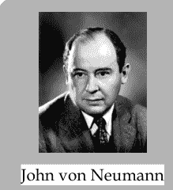

纽曼想聘请他担任博士后助理，但他回了英国。

从 1938 年 9 月起，图灵在政府密码译密局（GC&CS）兼职，这是英国的破译机构。他与迪利·诺专注于密码分析。

图灵回到剑桥后，参加了维特根斯坦在 1939 年做的关于数学基础的讲座。这些讲座是逐字记录的，包括图灵和其他学生的插话。图灵与维特根斯坦发生了争论并存了分歧，图灵辩护形式主义，而维特根斯坦主张数学并非发现绝对真理，而是发明它们。

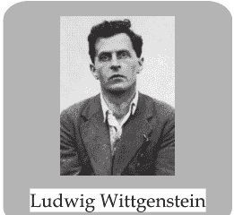

在1939 年 7 月的华沙会议之后，波兰密码局向英法提供了恩尼玛转子的细节及其破解恩尼玛密码的方法，图灵和诺克斯开始尝试另一种方法解决问题。他们的方法更通用，使用了基于已知明文（crib）的解密，他为此制定了炸机（bombe）的功能规范（对波兰密码译机的改进）。

1939 年 9 月 4 日，即英国对宣战第二天，图灵到达了布莱切利公园，即 GC&CS 的战时站点。

图灵决定解决特别棘手的德国海军恩尼玛问题，“因为没有其他人在处理这件事，我可以自己来”。 1939 年 12 月，图灵解决了海军指示系统的关键部分，该系统比其他部门使用的指示系统要复杂得多。同一晚，他还构思了班伯统计法（Banburismus）的想法，这是一种顺序统计技术，用于协助破解恩尼玛。

在到达布莱切利公园后的短短几周内，图灵就规定了一台名为“炸机”（bombe）的电机械机器，它可以比波兰密码译机更有效地破解恩尼玛。第一台炸机于 1940 年 3 月 18 日安装。

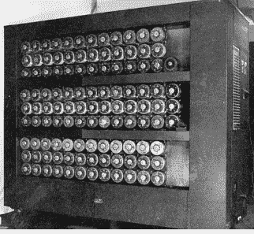

到1941年底，图灵和他的密码分析专家同事 Gordon Welchman、Hugh Alexander 以及 Stuart Milner-Barry 感到心力交瘁且深受挫败。在波兰人工作的基础上，他们建立了一套良好的恩尼玛信号解密系统，但由于人员手缺和破译机有限，他们无法翻译所有的信号。在夏天，他们取得了巨大的成功，船只损失已下降到每月10万吨以下；然而，他们急需更多资源来跟上德国人的调整。他们曾尝试通过正规渠道获取更多人员和破译机资金，但失败了。

1941年，图灵向其在 B 号小屋的同事乔恩·克拉克（Joan Clarke，一位女数学家和密码分析专家）求婚，但他们的婚约期限非常短暂。在向未婚妻承认自己的性恋倾向后（据报道未婚妻对此发现并“无动于”），图灵决定无法完成婚姻。

10月28日，他们直接写信给温斯顿·丘吉尔解释他们的困难，图灵的名字列在首位。他们强调了与军队投入的海量人力物力相比，他们的需求是多么微小，并与他们能为军队提供的援助水平进行了对比。

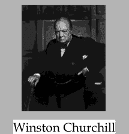

11月18日，情报局长报告说正在采取一切可能的措施。布莱切利公园的密码学家们并不知道首相的回应，但正如 Milner-Barry 回忆的：“我们唯一注意到，几乎从那天起，那些粗糙的工作开始奇迹般地变得顺畅了。”到战争结束时，已有两多台破译机在运行。

1942年7月，图灵发明了一种名为“图灵术”（Turingery，或戏称为 Turingismus）的技术，用于破译德国新型“密码机”（Geheimschreiber）产生的 Lorenz 密码信息。

图灵于1942年11月前往美国，在华盛顿与美国海军密码分析专家合作研究海军恩尼玛和破译机的构造；他还访问了位于俄亥州代尔顿的计算实验室。

1943年3月，图灵回到布莱切利公园。在他不在期间，Hugh Alexander 已经正式接任 8 号小屋负责人的职位，尽管 Alexander 此前已事实担任负责人一段时间（图灵对该部门的日常运行几乎不感兴趣）。图灵成为了布莱切利公园密码分析的总顾问。

1945年至1947年间，图灵住在伦敦的汉普普顿，期间他在国家物理实验室（NPL）致力于 ACE（自动计算引擎）的设计。

1946年，图灵被乔治六世国王因其战时贡献授予大英帝国勋勋官头衔（OBE），但他的工作在多年后一直保持保密。

图灵于1946年2月19日发表了一篇论文，这是存储程序计算机的首个详细设计。

1947年底，他回到剑桥进行为期一年的休假，期间他创作了一部关于《智能机器》的开创性著作，该著作在他生前并未出版。

# 图灵被任命数学系教授

1948年，图灵与他以前的本科同事 D.G. Champernowne 合作，开始为一台尚不存在的计算机编写国际象棋程序。

1949年，他成为计算实验室副主任，在那里他为最早的存储程序计算机之一——曼彻斯特 1 号开发软件。

到1950年，国际象棋程序完成，并命名为 Turbochamp。

当他在剑桥期间，原型 ACE 正在建设中。它于1950年5月10日执行了第一个程序，世界上许多后来的计算机都得益于此，包括英国的 English Electric DEUCE 和美国的 Bendix G-15。图灵 ACE 的完整版直到他去世后才被制造。

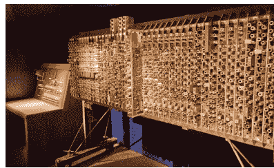

在科学博物馆展示的原型 ACE

1950年，图灵的论文《计算机器与智能》（发表于《心灵》杂志）提出了图灵测试，用以定义机器是否具有智能。

1952年1月23日，图灵的家中遭盗窃。当时英国的同性恋行为属于犯罪，两名男子均根据《1885年刑法修正案》第11条被指控为“严重猥秽”。

审判前的初级移交程序于2月27日举行，期间图灵预留了辩护权利，即未对指控进行辩解或提供证据。

图灵后来在哥哥和自己律师的建议下被说服，并认罪。该案（女王诉图灵与墨）于1952年3月31日进行审判。图灵被定罪，并在监和缓刑之间做出选择。他的缓刑条件是同意接受激素导致身体变化以降低性欲。他接受了注射当时被称为雌烯醇（现称为二乙基雌烯醇，或 DES）的药物；这种女性化过程持续了一年。

1954年6月8日，图灵的家政发现他去世，享年41岁；他于前一天去世。死因是氰化物中毒。

图灵的遗骸于1954年6月12日在沃金汉火化场被火化，他的骨灰被撒在火化场的花园里，正如他父亲当年那样一样。

女王于 2014 年 8 月正式宣布赦免图灵。

2 [时间线内容改编自：Historydraft: https://historydraft.com/story/alan-turing/timeline/401]

网站：

- 1. 图灵数字档案馆：http://www.turingarchive.org/
- 2. 遗失的图灵信件对其去世前的学术生活提供了独特的见解（曼彻斯特大学）：https://www.manchester.ac.uk/discover/news/lost-turing-letters-give-unique-insight-into-his-academic-life-prior-to-death/
- 3. 艾兰·图灵：谜团。传记作家安德鲁·霍奇斯维护的网站：https://www.turing.org.uk/

书籍：

- 1. 《艾兰·图灵：谜团：激发电影《模仿游戏》的著作》—— 安德鲁·霍奇斯更新版 https://press.princeton.edu/books/paperback/9780691164724/alan-turing-the-enigma
- 2. 《核心图灵：计算、逻辑、哲学、人工智能和人工生命的开创性著作》以及《谜团的秘密》—— 艾兰·M·图灵（著），B. 杰克·柯普兰（编）：https://www.amazon.de/Essential-Turing-Philosophy-Artificial-Intelligence/dp/0198250800

## G.W. 莱布尼——一位全才天才的悲剧结局（附文章）

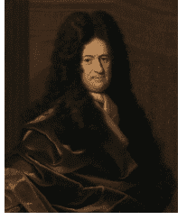

(1646年7月1日 – 1716年11月14日)

戈特弗里德·威廉·莱布尼在孤独和完全被遗弃中去世了。汉诺威那座宏大高耸的房子空冷而荒凉，这位时代伟大的思想家正受历史写作的折磨，只要他能说服他那饱受痛风折磨的身体再工作一个小时。一位恰好在城市的陌生人认出了他危急的状况，忙去药店买药。但在回来之前，莱布尼感到终点临近了。他想再写点什么，但再也写不动了。“他上上床，蒙上眼睛，去世了。那是1716年11月14日晚上十点。”

直到今天，我们仍然他的遗骸在何处。他的坟墓没有标记，几十年来，他的确切位置被遗忘了，这说明了很多问题。据报道，1775年一位哥廷根的学生曾寻找过这座坟墓，但连墓守人都无法指给他看。

“他像强贼一样被埋葬，而不是像他真实的身份——他土地的荣耀，”一位未名的外国人写道。

当莱布尼茨悲剧的人生结束时，牛顿的生活则更具王室气息。莱布尼茨的同代人。

当艾萨克·牛顿八十四岁并闭上眼睛时，整个王国都在哀悼。数千人向他表达最后的敬意。大法官、公爵和伯爵将棺材抬进墓穴，在国王、教会王子、政治领袖和国家诗人的身旁，这位巨人灵魂的凡躯在威斯敏斯特教堂得到了永恒的息。他的墓志铭以这句话结尾：“让凡人自己庆幸吧，人类历史上曾存在过如此伟大的装饰。”

两人都独立开发了微积分。牛顿变体（流数法）复杂且耗时。另一方面，莱布尼茨变体（在形式化方面是现在学校教授的）优雅而简单。出于骄傲和自大，英国人放弃了经典的莱布尼茨变体。在过去一百多年的时间里，他们被排除在微积分的进步之外，并受限于牛顿笨拙的方法，使得整个十八世纪几乎不值一提。

“醒来时，我有如此多的想法，一天的时间都不够写下它们。”

这就是莱布尼茨曾这样描述他自己。事实上，在他宏大的遗产中，有关于水泵、路灯，甚至是潜水艇的计划。例如，他开发了一种二进制系统，允许使用0和1表示所有数字（现代计算机技术的基础）。他的许多理论论文都清楚地表明，他精通他时代几乎所有的科学领域。

《神义论》是莱布尼本人出版的唯一大字体著作。否则，这位全才天才字面上真的“陷入了泥潭”。他留下了2万多封信件和超过10万份手写笔记。

他的著作甚至连半都没有被发现，更不用说编辑了。

我可以无尽地关于莱布尼茨写下去，但今天到此已经足够了。最后的话属于丹尼·狄德罗：

> “当你回归自我，并将你所拥有的才华与莱布尼茨相比时，你会忍不住想扔掉书，静静地死在世界上某个隐秘的角落。”

让我们都去往一个隐秘世界的角落吧。

注：
（这篇文章最初由我在 Medium 平台发表）

## 我知道我一无知（附文章）

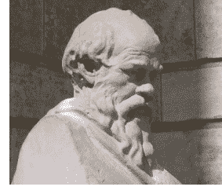

(约公元前470年–399年)

当柏拉图的老师苏格拉底去德尔斐询问神谕谁是最明智的人时，神谕说没有人。苏格拉底感到震惊，因为他认为自己一无所知。他随后去了那些有声望的人——诗人、政治家和匠人，看看神谕是否正确。他发现，虽然这些人认为自己是明智的，但并不是。他得出结论，他之所以明智是因为知道自己一无所知，而他们一无所知。

这就是苏格拉底式教学法：一种基于提问和回答的论证对话形式，旨在激发批判性思维并引出思想。

（注：此处OCR文本包含严重损坏，已进行重构以反映苏格拉底的历史叙述）。

-   [1929年获得三一学院奖学金时的上方肖像。Wikipedia：https://en.wikipedia.org/wiki/Ludwig_Wittgenstein#/media/File:35_Portrait_of_Wittgenstein.jpg]
-   [布莱切利园炸破机（Bombe）战时照片。WIKIMEDIA COMMENS：https://commons.wikimedia.org/wiki/File:Wartime_picture_of_a_Bletchley_Park_Bombe.jpg]
-   [67岁的丘吉，穿着西装，站立并扶着椅背。Wikipedia：https://en.wikipedia.org/wiki/Winston_Churchill#/media/File:Sir_Winston_Churchill_-19086236948.jpg]
-   [飞行员王牌（伦敦科学博物馆）。Wikipedia：https://commons.wikimedia.org/wiki/File:Pilot_ACE3.jpg]
