# 2D超声图像中胎儿头部分割的基于回归的编码器-解码器深度注意力模型


# 摘要

超声成像是妊娠期间最常用的成像方式，用于追踪胎儿生长并监测其他生物学参数。胎儿生长评估需要在每个孕期进行基于成像的分析。自动计算机软件和系统为放射学家提供了比人工估计更准确地评估胎儿头围的平台。此类计算机算法的改进始终是提高准确性和精确度的关键需求。本文提出了一种改进的编码器-解码器模型，用于2D超声图像中胎儿头部的分割。所提出的模型将回归与注意力相结合应用于编码器-解码器模型，以确定胎儿的头围。该模型进一步通过后处理椭圆拟合进行扩展，以将分割区域叠加到超声图像中，从而清晰可视化胎儿头部。此外，利用各种统计度量对分割区域和可用实地真值进行评估，以评价所提出模型的性能。实验结果显示相似度得分为94.56%。对比结果表明，与其他现有方法相比，所提出的模型在2D超声图像上提供了更准确的胎儿头部分割区域。

# 1. 引言

得益于人工智能的强大能力，计算机辅助系统可以在多个方面帮助放射学家。这些系统在医学影像中常被用于各种任务，如分割、定位、预测和分类。此类系统的支柱是使任务更简单、更自动化的精巧先进算法。这种自动化辅助放射学家准确预测异常并做出更好的诊断。

超声波放射学诊断被认为比CT、MRI和X射线等其他成像方式更复杂，因为人体器官的内部解剖结构可视化效果不如其他成像模态清晰。放射学家使用超声来评估大脑、脊柱和髋部。此外，它还有助于指导活检和心脏疾病状况。但是，超声最常用的应用是针对与腹部相关的问题。其中一种应用是在妊娠期间，女性需要接受妇科医生进行的超声评估。

对于孕妇，妇科医生最重要的建议诊断是使用超声成像对胎儿进行评估。在产前护理中，超声成像是一种广泛使用的机制，并且每个孕期都必须进行。妇科医生尤其关注在每个孕期监测胎儿发育并检查各种生物学参数[1]。在临床常规检查中，胎儿头围的评估是胎儿生长监测、妊娠期龄估计和预产期估计的关键测量指标[2]。此外，按孕期分层的超声成像可以帮助在胎儿本身中监测新生儿的器官。图1显示了随机患者的按孕期分层的样本超声图像。这种超声图像分析不仅需要最新的机器，还需要放射学家的专业知识来进行人工解释。

因此，计算机辅助自动化（CAD）系统可以帮助放射学家做出更好、更快的决策。胎儿头部的自动分割是此场景中的一个关键方面。最近，研究人员正在使用基于机器智能的算法[3–5]或

* 通讯作者。
电子邮件地址：somya.srivastava0509@gmail.com (S. Srivastava), dr.ankit.vidyarhi@gmail.com (A. Vidyarhi), shikha.jain@jiit.ac.in (S. Jain)。

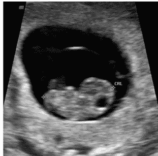

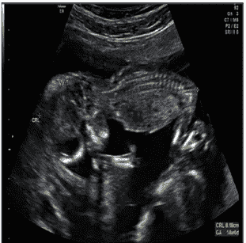

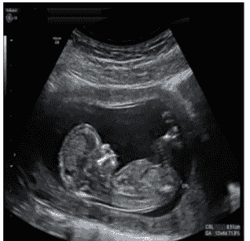

(a) 孕期-1
(b) 孕期-2
(c) 孕期-3

图 1. 按孕期分层的超声图像样本集。(a) 第一孕期图像采集于第9–12周。(b) 第二孕期图像采集于第18–20周。(c) 第三孕期图像采集于第30–32周。

基于深度网络的算法[6]用于胎儿头部分割。文献中提出了几种基于椭圆边界框的胎儿头部分割方法，考虑到胎儿形状呈椭圆形。然而，基于机器学习的算法会导致可视解剖结构的丢失，仅提供基于用户定义标准的分割。

本文引入了一种新颖的模型，用于利用深度学习方法进行胎儿头部分割，从而最大限度地减少对用户定义标准的依赖。所提出的模型与传统模型（如UNet）在许多方面有所不同，包括将回归层与注意力相结合的网络架构。两种模型之间的关键区别如下：

- 输出表示：UNet模型主要用于像素级语义分割，其目标是将输入图像中的每个像素分类为不同的预定义类别或标签。它生成一个分割掩码，其中每个像素被分配一个特定的类别标签。而带有回归层的基于编码器-解码器的深度注意力模型是为定位和实例分割任务设计的。该模型不为每个像素预测类别标签，而是旨在直接回归特定对象或感兴趣区域的边界框坐标或分割掩码。回归层输出定义对象范围或边界的坐标或像素级值。

- 任务侧重：UNet模型常用于医学图像中器官或结构的分割等任务，重点是识别和分类图像中的不同感兴趣区域。它适用于不同类别之间的边界清晰且明确的场景。另一方面，带有回归层的基于编码器-解码器的深度注意力模型更适合需要精确定位或实例分割的任务，例如检测和分割图像中的特定对象或区域。通过直接回归边界框坐标或分割掩码，该模型可以提供更准确的定位和细粒度分割结果，即使在对象可能具有复杂形状或重叠边界的场景中也是如此。

- 网络架构：UNet模型遵循具有跳跃连接的对称编码器-解码器架构，以捕捉局部和全局信息。它通常由卷积层、用于下采样的池化层和用于上采样的转置卷积层组成。相比之下，带有回归层的基于编码器-解码器的深度注意力模型也可能利用带有注意力机制的编码器-解码器架构来捕捉信息丰富的区域。但是，它在网络末端包含一个额外的回归层，该层直接预测定义感兴趣对象的坐标或像素级值。这个回归层使模型能够执行精确定位和基于回归的实例分割。

本稿的主要贡献描述如下：

- 1. 本文提出了一种新颖架构，将回归编码器-解码器网络与注意力机制相结合。该架构使模型能够学习超声图像的全局和局部特征，而注意力机制有助于关注信息丰富的区域，以实现更准确的分割。

- 2. 所提出的模型直接预测胎儿头部的边界框坐标。这种基于回归的方法允许对胎儿头部进行更精确的定位和分割。

- 3. 本文在模型中引入了深度注意力机制，使模型能够关注超声图像的相关区域，从而提高胎儿头部分割的准确性。注意力机制为不同的空间位置分配不同的权重，强调信息丰富的区域，同时抑制不相关区域。

- 4. 本文描述了所提出模型的训练过程，包括使用大量带注释的2D超声图像数据集。此外，还讨论了利用各种数据增强技术来增加训练数据的多样性。

本文的其余部分组织如下：第2节介绍了作为理论基础的胎儿分析现有工作描述。第3节深入介绍了基于回归注意力深度UNet模型的所提模型设计。第4节展示了所提模型在胎儿头部最先进的基准数据集上进行实验时的评估结果。第5节介绍了所提模型与现有文献和基准模型的比较分析。最后，第6节介绍了所提方法的总体结论以及指导近未来工作扩展的未来工作方向。

# 2. 相关工作

在超声图像中识别胎儿及其器官是即将到来的研究领域之一，需要高精度和熟练技能。如今，放射学家使用集成先进机器智能的CAD系统，自动预测


胎儿及其相关参数（如尺寸、大小和预计分娩日期）使用先进的计算机算法。这有助于放射科医生和妇科医生在胎儿发育早期做出更精确的决策。

一些研究工作集中在使用机器学习方法对超声图像进行胎儿分割[7–9]。这些研究文章使用变换和轮廓来查找腹部图像中的胎儿周径。除此之外，[10]中提出的工作展示了在超声图像中向临床预期应用机器学习的用途，尤其是胎儿分割。本文深入了解了放射科医生对自动系统可靠性的认识。此外，[11]中提出的工作详细概述了超声成像中基于机器学习的诊断系统。

尽管如此，研究人员也关注了对各种器官胎儿几何结构的评估。[12]中报道的最新研究之一使用机器学习工具对超声图像中的胎儿大脑进行分割。这项经过临床验证的工作使用第一孕期成像进行分割过程。除了2D成像，一些工作还使用3D体积，利用随机森林方法对超声图像中的胎儿大脑进行评估[13]。报道的工作展示了良好的分割结果，然而，数据集的样本图像数量较少。

此外，还有报道使用深度学习方法对胎儿头部进行自动分割的研究。[14]中报道的工作使用多任务深度模型，利用不同孕期的超声图像来估计胎儿头周。文献还探讨了使用基于编码器-解码器深度网络的注意力网络来对胎儿进行分割[15]。在许多地方，超声图像数据集的选择来自一些开源网站，尤其是在线挑战。一项关于使用大挑战数据集对方法进行评估和比较的研究在[16]中提出。

在过去，一些方法使用深度模型对超声胎儿图像中的大脑进行分割[17,18]。这些工作的动机是探索使用计算机辅助系统对胎儿大脑进行自动诊断。然而，这两项研究的目标不同，[17]中报道的工作介绍了用于分割的 UNet 模型，而[18]中提出的工作引入了分类方面来识别超声成像中正常和异常的胎儿平面。[19]中提出的工作使用深度模型，利用从 1792 名患者收集的 12,400 张图像的数据集，将胎儿平面分为 3 个类别，其目标几乎相似但方法论不同。

一些研究人员还设计了轻量级 CNN 深度模型，用于头周语义分割[20]。该研究的目标是在超声 2D 图像中定位胎儿头部。该方法使用传统的 LinkNet 架构[21]作为提议的轻量级模型设计的骨干网络。除此之外，一些作者还关注了先前用于其他应用领域的深度模型的利用。一项这样的工作在[22]中报道，其中名为多特征金字塔 UNet (MFP-UNet) 的模型用于语义分割。使用该模型的目的是克服传统 UNet 模型的局限性。

对胎儿头部分割的广泛文献研究表明，基于深度学习的模型，尤其是基于编码器-解码器的网络架构，是从超声图像中对胎儿头部进行语义分割最广泛使用的架构。然而，所声称的结果使用广泛的统计措施进行性能计算，获得了良好的分割结果。然而，仍有通过模型升级提高准确性的空间。本着这一目标，本文提出了一种新框架，将回归与注意力相结合应用于编码器-解码器网络架构，以增强胎儿分割及其头周的结果。

# 3. 提出的深度架构设计

在本工作中，提出了一种深度模型的新设计，以编码器-解码器为基础，并包含注意力门，用于超声图像中的胎儿头部分割。该工作进一步扩展，使用 2D 超声图像查找胎儿头部的尺寸。所提工作被视为一个自动化 CAD 系统，它采用了带有回归的基于注意力的编码器-解码器模型的高级机器学习算法，以最小化网络中的损失。

## 3.1. 提出的网络架构的框架设计

所提议的网络架构的设计框架如图 2 所示。有三个模块，即预处理、模型训练和后处理。这三个模块的集成构建将导致胎儿头部的分割以及对胎儿头周的直接评估。

最初，输入影像数据集经过预处理，然后进行数据增强以增加数据集大小。扩展后的数据集进一步用于模型训练。在此项提议的工作中，提出了一种用于胎儿头部分割的新深度学习模型。所提模型基于编码器-解码器方法，并包含注意力和回归层。这个模型训练是框架的第二个模块。后来，在第三个模块中，使用测试输入图像对模型进行评估，然后进行后处理操作以发现分割胎儿头部的尺寸。后处理操作包括椭圆拟合、尺寸图和区域周径评估。每个模块的详细信息将在随后的小节中讨论。

## 3.2. 图像预处理

如图 2 所示，所提框架的第一个模块是输入图像的预处理。该模块将包括输入图像归一化，然后进行数据增强。

### 3.2.1. 图像归一化

在基于 AI 的应用中，图像归一化是在将数据集馈送到模型进行训练之前使用的一种过程。在此，数据集样本使用大小和强度值的常见统计分布进行处理。通常，该过程既包括空间归一化，也包括强度归一化。

空间归一化意味着使用缩放、线性变换甚至变形，使整个数据集图像具有相同的空间关系。空间归一化的主要目标是使数据集在大小和强度值分布方面保持一致。而在归一化中，多个图像中的整体像素值将具有相同的统计分布。众所周知，伪影会在图像中造成不均匀性，可以通过归一化来纠正。因此，在处理超声图像之前，框架使用对输入数据集图像的预处理。

在本工作中，对输入图像（灰度或 RGB）进行 Min-Max 归一化，以保持强度分布的一致性。由于 8 位图像由 0 到 255 之间的像素强度表示，因此使用给定的 Eq. (1) 对数字图像进行线性归一化。

```
OutputChannel = 255 * (Input Channel - min) / (max - min) (1)
```

其中，max 和 min 是输入图像的最大和最小像素值表示。

在此，如果输入图像是灰度图，则只需归一化一个通道。但是，对于 3 通道输入图像（即 RGB），则需要使用相同的标准对每个通道进行归一化。

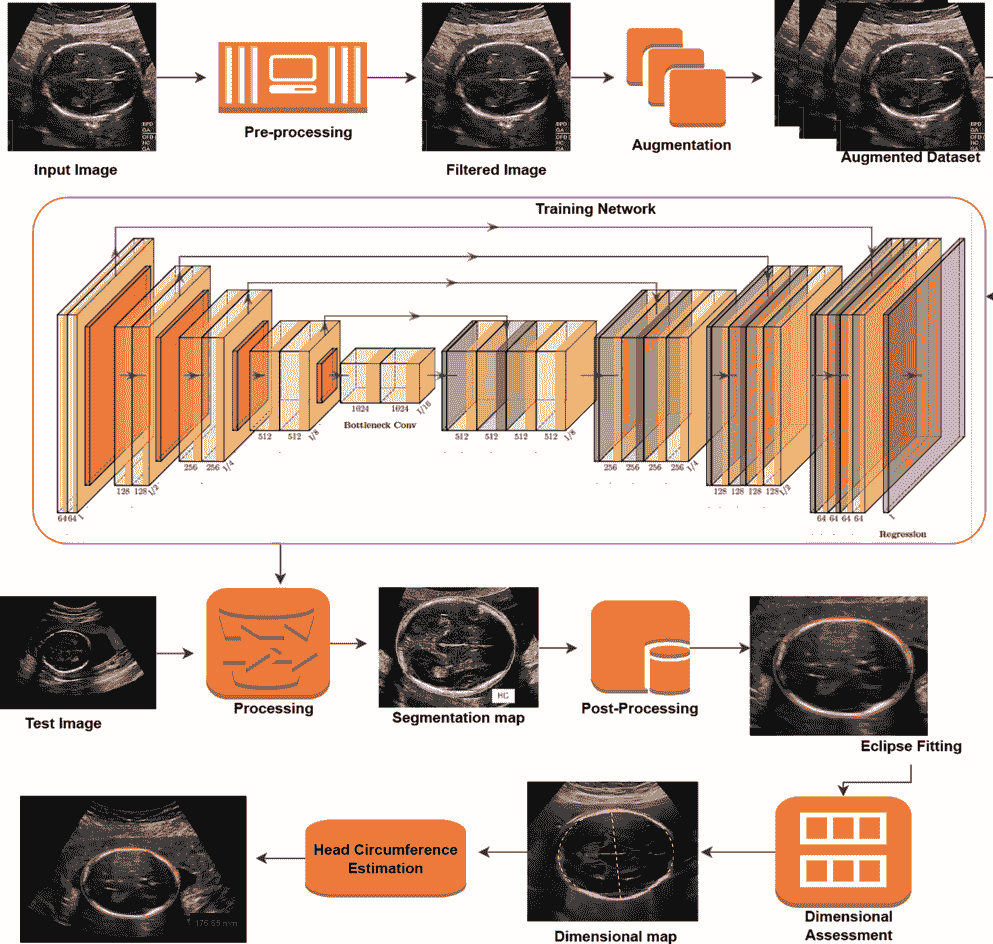

图 3 显示了示例图像归一化及其相应的输出。

## 3.3. 设计所提注意力编码器-解码器回归架构

本工作的主要目标是从超声图像中分割胎儿头部。为此，提出了一种由注意力和回归层驱动的新编码器-解码器模型，用于胎儿头部分割。所提模型受传统模型设计框架的启发，这些框架使用深度神经架构解决了各种生物分割问题[23]。带回归层的所提模型的基本架构如图 4 所示。

该模型使用卷积块和跳跃连接设计，该连接将高维特征向量与解码器部分的输出特征集体连接起来。这有助于使最终预测结果更加可靠和准确。模型设计及其相关组件的详细描述将在以下小节中讨论。

### 3.3.1. 编码器

经过仔细评估，发现所提模型架构分为两半，即编码器和解码器。模型的第一半称为编码器，是密集卷积块的集合，随后进行最大池化，将输入图像下采样为多个层级的特征表示。所提模型的扩展图如图 5 所示。

在编码阶段，选择密集块具有特殊目的。如图 5 所示，模型包含带有跳跃连接的软注意力门，如后续小节 3.3.3 所述，该门使用反向传播。反向传播通常会遇到梯度消失的问题，并在 the 中引入不规则性。


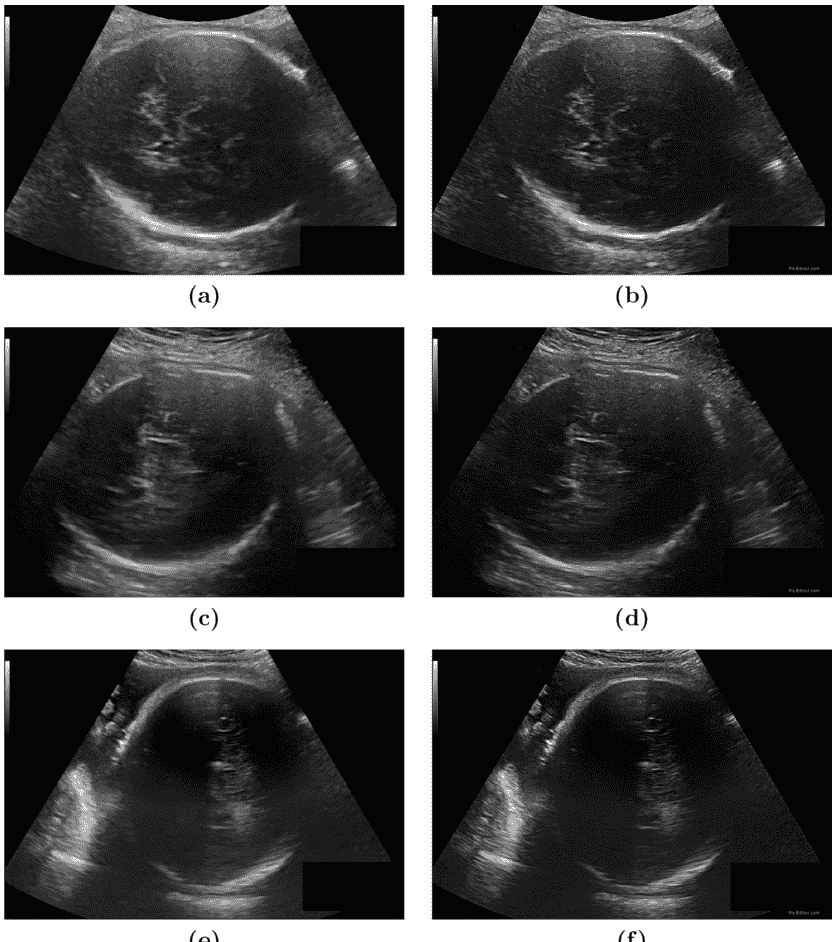

图 3. 示例输入图像及其对应的归一化。第一列表示示例输入图像，第二列表示其归一化形式。

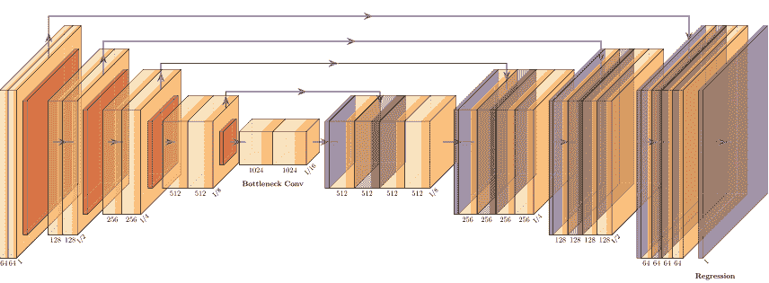

图 4. 提出的编码器-解码器模型的块架构。

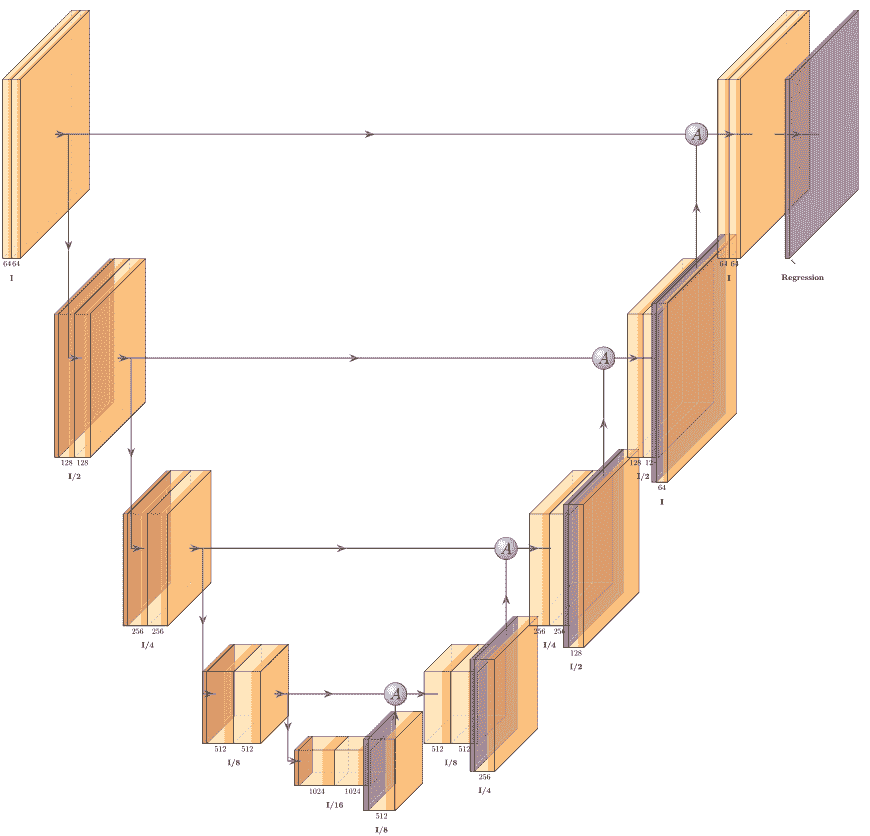

图 5. 带有注意门和回归层的提议编码器-解码器模型的扩展块架构。

分割输出。因此，在编码阶段使用了密集块。使用密集块的优势总结如下：

- 密集块减少了参数数量，并在参数使用上更高效。
- 密集块激励特征重用并增强特征传播。
- 密集连接具有正则化效果，可减少小型训练集上图像分割任务的过拟合。
- 与不区分模型网络深度的其他深度编码器架构相比，使用密集连接时参数数量会减少。

因此，编码器中的每个块都是密集块，它对早期特征向量进行迭代拼接。每个密集块包含一定数量的层，即 N 层。该密集块的直接连接总数为 (N*(N + 1))/2。

提议的架构在编码阶段使用了 4 个密集块，每个长度为 4，即每个密集块包含 4 层，每层包含批归一化、2D 卷积滤波器和 ReLU 激活，并与跳跃连接拼接，如图 6 所示。编码的架构描述在表 1 中说明。

网络的第一层是输入层，它使用大小为 7 x 7 的 96 个滤波器和等于 2 的步幅将图像作为输入。这产生了大小为 112 x 112 x 96 的特征描述符。然后将输出与大小为 3 x 3 和步幅等于 2 的滤波器进行最大池化，以得到大小为 56 x 56 的减小输出。

之后，编码器使用了四个密集块。这些层在密集块中重复多次，次数由表 1 中的计数指示。还应注意的是，对于前三个密集块，输出进一步使用 2D 卷积进行处理，以减少特征图的通道数，其中卷积的尺寸为 1 x 1，平均池化的尺寸为 3 x 3，步幅等于 2。在编码阶段结束时，产生大小为 7 x 7 的输出向量以生成分割输出。

### 3.3.2. 解码器

提议架构的下半部分是解码器，它只是编码器的转置。这一阶段的目标是将编码器提取的低维编码特征投影到更高的分辨率，以进行语义分割。它由以与编码阶段完全相反的方式进行的数据上采样组成。

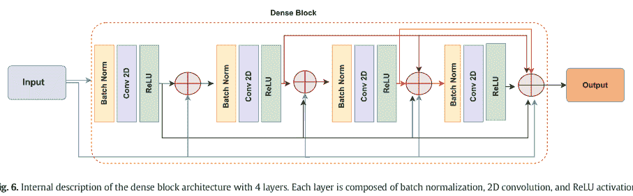

| 层 | 数量 | 尺寸 | 维度 |
| :--- | :--- | :--- | :--- |
| 输入 | 1 | - | 224 x 224 x 3 |
| 卷积 1 | 1 | 7 x 7, 96, 步幅 2 | 112 x 112 |
| 最大池化 | 1 | 3 x 3, 步幅 2 | 56 x 56 |
| 密集块 1 | 6 | 1 x 1, 3 x 3 | 56 x 56 |
| 卷积 + 平均池化 | 1 | 1 x 1, 3 x 3, 步幅 2 | 56 x 56, 28 x 28 |
| 密集块 2 | 12 | 1 x 1, 3 x 3 | 28 x 28 |
| 卷积 + 平均池化 | 1 | 1 x 1, 3 x 3, 步幅 2 | 28 x 28, 14 x 14 |
| 密集块 3 | 36 | 1 x 1, 3 x 3 | 14 x 14 |
| 卷积 + 平均池化 | 1 | 1 x 1, 3 x 3, 步幅 2 | 14 x 14, 7 x 7 |
| 密集块 4 | 24 | 1 x 1, 3 x 3 | 7 x 7 |

解码中唯一的区别是使用跳跃连接，其中相同的分层解码输出和编码输出通过注意门进行拼接，如小节 3.3.3 中详细描述。从技术上讲，特征图扩展路径的每个迭代步骤都包含一个 2 x 2 转置卷积，它将特征数量减半。上采样由两个层组成，即上采样层和一个丢弃层，其维度滤波器大小为 3 x 3（上采样），丢弃率等于 0.2。该模型使用注意门对扩展路径和收缩路径的输出特征进行拼接。这里，使用 3 x 3 卷积和 ReLU 进行处理。模型的最后一层是回归层，它有助于将输出映射到所需的分割区域。

### 3.3.3. 注意门

正如名称所示，注意是指对特定对象的关注。在提议的架构中，注意逻辑用于层之间，以便在模型训练期间仅对相关的激活图进行强调。这有助于将注意力放在特定的成像部分，而不是整个图像。基于学习，

注意力可分为软注意力和硬注意力。这些注意力类型的主要区别在于，硬注意力一次选择一个图像补丁进行关注，并需要使用蒙特卡洛采样的强化学习。另一方面，在软注意中，可以在图像的多个补丁上使用权重来确定相关性，并且可以使用反向传播方法进行模型训练。在本工作中，软注意力与编码器-解码器模型一起使用。

如图 5 所示，在解码过程中，需要重建的大部分空间信息都是不精确的。因此，模型使用跳跃连接来拼接下采样与上采样的信息。然而，这可能导致许多冗余的低级特征，因为在初始层中特征表示较差。因此，在跳跃连接处引入软注意力可以抑制感兴趣区域（ROI）外部的大部分激活，并最大限度地减少要传递的冗余特征数量。软注意力的基本流程机制如图 7 所示。

带有跳跃连接的注意门的详细逐步工作和执行在算法 1 中说明。

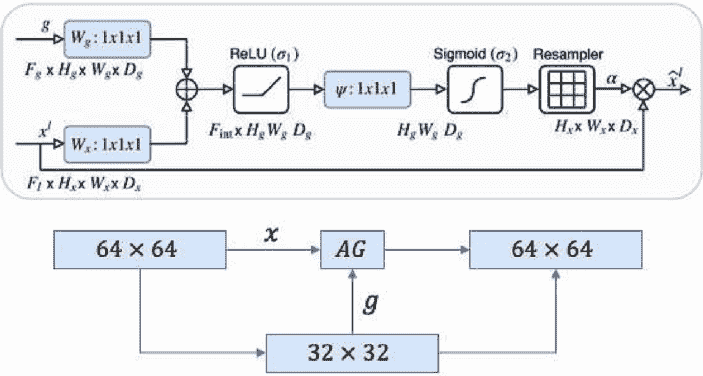

图 7. 每个跳跃连接的注意门描述。

#### 算法 1. 带有跳跃连接的注意门工作原理。

要求：向量 x 和 g  
确保：向量 g 应取自网络的下一较低层。  
尺寸（滤波器 x 高度 x 宽度）：x <- 64x64x64  
尺寸（滤波器 x 高度 x 宽度）：g <- 32x32x32  
卷积：向量 x 经过步幅卷积后，更新后的维度为 x <- 64x32x32  
卷积：向量 g 与 1x1 滤波器卷积后，维度为 x <- 64x32x32。  
元素求和：将两个向量按元素相加为 x + g。这产生了较大的对齐权重和相对较小的非对齐权重。  
维度降低：向量 x + g 的结果先经过 ReLU 激活处理，然后经过 1x1 卷积滤波器处理，以将维度减少到 (x + g) <- 1x32x32。  
特征缩放：向量通过 sigmoid 层处理，将向量缩放到 [0,1] 范围内。越接近 1 的系数值表示相关性更强的特征，称为注意力权重。  
上采样：注意力权重使用三线性插值进行上采样，维度为 x <- 64x64。  
归一化：注意力权重与原始 x 向量按元素相乘，然后按正常方式沿跳跃连接传递。

### 3.3.4. 回归

模型的最后一层是回归层，可用于最小化和处理模型损失。在回归层之前，模型使用编码器-解码器架构作为骨干网络来映射特征输出。CNN 模型的传统架构包括一个用于分类问题的 softmax 层。将最后的 softmax 层替换为带有线性激活函数的全连接回归层有助于在训练期间最小化损失。模型通过使用连续值预测损失函数进行训练。在此工作中，混合损失函数用于模型训练。加权二元交叉熵（WCE）和均方误差（MSE）用作训练成本函数。这些损失函数在公式 (2) 中定义：

```
Cross Entropy (Q, T) = \(\sum_{i=1} T_i * \log(Q_i) + (1 - T_i) * \log(1 - Q_i)\) (2)
```

其中 Q 是解码器最后一层的输出，T 是真实值或预期输出。

加权二元交叉熵，使用恒定权重因子 w = 5，如公式 (3) 给出：

```
WCE(Q, T) = \(\sum_{i=1} ((1 - T_i)(w - 1) + 1)(T_i * \log(Q_i) + (1 - T_i)* \log(1 - Q_i))\) (3)
```

平均绝对误差基于像素计算，如公式 (4) 定义：

```
Mean Absolute Error(MAE) = \(\frac{1}{N} \sum_{i=1} |Q_i - T_i|\) (4)
```

其中，Qi 是来自查询的像素概率，Ti 是来自目标的像素概率，N 是图像中的总像素数。  
均方误差（MSE）是 MAE 的平方，如公式 (5) 给出：


均方误差（MSE） = \(\frac{1}{N} \sum_{i=1}^{N} (Q_i - T_i)^2\) (5)

拟议模型的最终混合回归方程因此给定为交叉熵与 MSE 的加权求和，如公式 (6) 所示：

Segmented\(_{Loss}\) = W * (WCE + MSE) (6)

其中，W 在训练过程中放大胎儿头部边界上的损失，边缘强调由公式 (7) 给出：

W(x) = 1 + w0.exp \(\frac{D_x}{2 * \sigma^2}\) (7)

其中，Dx 表示像素 x 与地面真值（目标）之间的距离，\(\sigma\) 为高斯核方差，w0 为常数。

在训练带有回归层的编码器-解码器注意力模型时，需要设置多个超参数。通常，超参数的最优值可能因特定数据集和问题而异。然而，实验和调整通常是找到给定任务最佳超参数配置所必需的。在此基于模型的实验中使用的最佳组合如表 2 所示：

## 3.4. 椭圆拟合与尺寸评估

所提方法的最后阶段是对分割输出图进行后处理，称为椭圆拟合。由于胎儿的形状呈椭圆，且可用的地面真值也以椭圆形式存在，因此椭圆拟合是该方法的重要组成部分。在超声图像上拟合椭圆有助于轻松评估参数并预测胎儿的生长。

椭圆定义为二维平面上所有这些点的轨迹，即到平面上两个定点（亦称为焦点）的距离之和保持不变。这个常数比值称为椭圆的离心率，表明其伸长程度。椭圆的描述如图 8 所示：

需要注意的是，椭圆的形状呈椭圆形，其中沿 x 轴的最长平分线称为长轴，沿 y 轴的最短平分线称为短轴。中心（长轴和短轴的交点）到表面点的距离称为半长轴和半短轴。椭圆所围成的面积由公式 (8) 给出：

Area under ellipse = \(\pi * |\frac{M}{2}| * |\frac{m}{2}|\) (8)

| 超参数 | 值 |
|---|---|
| 层数 | 编码 - 4, 解码 - 4 |
| 时代数 | 300 |
| 卷积滤波器 (L1) | 20 |
| 卷积滤波器大小 | 3 x 3 |
| 最大池化滤波器 | 3 x 3 |
| 步长 | 2 |
| 优化器 | Adam |
| 学习率 | 0.001 |
| 损失函数 | 二元加权交叉熵 |
| | 均方误差 |
| 批量大小 | 32 |
| 丢弃率 | 0.4 |

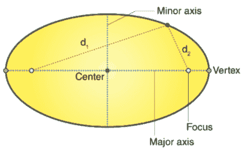

其中，L 表示长度，M 表示长轴，m 表示短轴。

在医学术语中，这些轴有不同的名称以便理解。长轴称为枕额直径（OFD），短轴称为双顶直径（BPD）。因此，胎儿头围可使用公式 (8) 计算，并可改写为公式 (9)：

Head Circumference = \(\pi * \frac{(OFD + BPD)}{2}\) (9)

# 4. 实验结果

## 4.1. 数据集描述

为评估所提模型的性能，实验在公开可用的胎儿超声图像数据集上进行。该数据集于 2018 年发布，是自动头围测量挑战的大挑战之一。

该数据集包含 1334 个用于测量头围的标准平面 2D 超声图像。整个数据集分为两个子集，即训练集和测试集。训练集包含 999 个 2D 超声图像样本，测试集包含 335 幅图像。所有图像尺寸相同，尺寸为 800 x 540 像素，像素大小范围从 0.052 到 0.326 mm。各个图像的像素大小详情列在文件 ‘training_set_pixel_size_and_HC.csv’ 和 ‘test_set_pixel_size.csv’ 中。此外，训练集还包含带有头围标注的地面真值。所有训练图像的标注头围详情也列在文件 ‘training_set_pixel_size_and_HC.csv’ 中。带标注的示例数据集描述如图 9 所示：

## 4.2. 数据集归一化

使用该数据集及其预处理后，发现数据样本具有非标量图像尺寸 800 x 540 像素。因此，最初将数据集归一化，使每个图像的尺寸为 224 x 224 像素。除此之外，还分析了数据集在模型学习可用训练样本数量较少方面的局限性。因此，为了尽量减少由于过拟合和欠拟合造成的伪影，需要增加数据集大小。这必须使用数据增强方法来完成。

此处使用了四种传统的机器学习数据增强方法，即翻转、旋转、平移和裁剪操作。使用这四种操作，数据集规模增加了原始数据集的 11 倍
<sup>1</sup> https://zenodo.org/record/1327317
<sup>2</sup> https://hc18.grand-challenge.org/
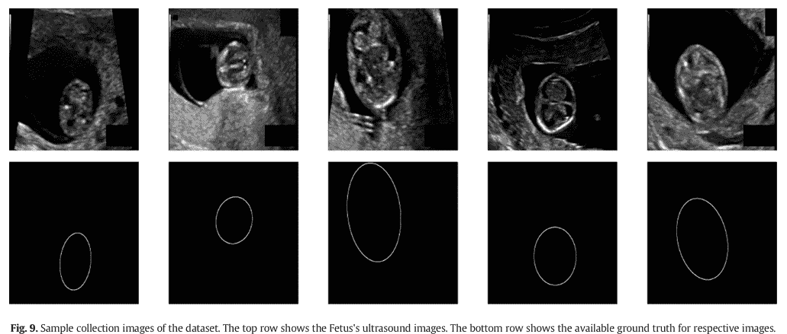
。这使得整个数据集共有 10,989 幅 2D 图像。此注释的一个重要方面是，对训练样本和标注样本按原始图像处理的相同顺序重复操作。这些增强及其对数据集的影响详情如下：

- 1. 角度翻转：它是一个骨架轴，输入样本沿方向轴以 \(\theta = 180\) 的角度翻转。这导致图像以 1:1 的比例进行转换，即对于单幅图像，我们会得到一幅方向不同的图像。
- 2. 方向旋转：它是将输入样本旋转到选定的方向取值范围内。此处，\(\theta\) 的选定范围在 \([-15, 15]\) 之间，滑动单位为 5 个单位。这产生了 7 个不同的 \(\theta\) 值，即 \(-15, -10, -5, 0, 5, 10, 15\)。其中，\(\theta = 0\) 被舍弃，因为它生成了与输入相同的图像。因此，使用此增强方法生成了输入图像的总共六幅不同图像。
- 3. 随机裁剪：它是一种增强技术，允许我们获取输入图像的随机子集，并进一步用于模型训练。大多数情况下，此方法可提供泛化结果，因为感兴趣区域并不总是在整个图像中可见。此处，我们在上、下、左、右四个方向上随机选择 \(45 \times 45\) 窗口区域。因此，对于单幅图像，可生成四个子区域。

总体而言，对于单幅图像，可通过增强获得 1 款角度翻转、6 款方向旋转和 4 款随机裁剪图像，即数据集的 11 倍。最后，增强后，整个数据集现有 10,989 幅图像可供模型训练。

## 4.3. 用于评估性能的指标

在所提工作中，使用 Dice 系数、头围差异、豪斯多夫距离和平均绝对百分误差作为性能评估指标。

这些指标的数学符号如公式 10-13 所示：

- 1. Dice 系数 (DC)：定义为使用分割输出和地面真值的像素数量进行比例评估，给定为：

\(\text{Dice Coefficient (DC)} = \frac{2 * (Seg_{Area} \cap Grt_{Area})}{|Seg_{Area}| + |Grt_{Area}|}\) (10)

其中，\(Grt_{Area}\) 是地面真值区域，\(Seg_{Area}\) 是从分割部分提取的区域。

- 2. 头围差异 (DHC)：定义为分割区域和地面真值的胎儿头周长评估之差，给定为：

头围差异 (DHC) = \(P_{Seg} - P_{Grt}\) (11)

其中，\(P_i\) 表示周长，\(i \in\)（分割区域，地面真值）

- 3. 平均绝对百分误差 (MAPE)：定义为相对于可用地面真值的绝对百分误差，给定为：

\(MAPE = \frac{MAE}{Grt} . 100\) (12)

其中 MAE 是平均绝对误差，由以下公式给出：

\(MAE = \frac{1}{N} \sum_{i=1}^{N} (S_i - G_i)\)

此处，\(S_i\) 是分割输出中的像素概率，\(G_i\) 是可用地面真值中的实际像素概率。

- 4. 豪斯多夫距离 (HD)：给定为两个轮廓点之间的距离，并在所有此类组合中找到最大值。给定为：

\(HD(Seg, Grt) = max (h(Seg, Grt), h(Grt, Seg))\) (13)

其中，
\(h(Seg, Grt) = max_{s \in Seg} min_{g \in Grt} \|p - g\|\)
\(h(Grt, Seg) = max_{g \in Grt} min_{s \in Seg} \|g - p\|\)

其中，Seg 表示分割空间中的像素 (\(s_1, s_2, ...., s_n\))，Grt 表示地面真值中的像素 (\(g_1, g_2, ...., g_n\))。

除了上述文献中用于分析胎儿头部分割结果的特定指标外，还有一些其他性能指标被视为分割任务的基准。这些指标如下：

- 1. 交并比 (IoU) 或 Jaccard 索引：IoU 测量预测分割掩码与地面真值掩码之间的重叠。它计算为交叉区域与


表 3 拟议模型在超声图像数据集上的实验结果。

| 输入 | 实地真值 | 分割 | 椭圆拟合 |
|---|---|---|---|
| [超声图像 1] | [椭圆掩码 1] | [黑色椭圆 1] | [蓝色掩码 1] |
| [超声图像 2] | [椭圆掩码 2] | [黑色椭圆 2] | [蓝色掩码 2] |
| [超声图像 3] | [椭圆掩码 3] | [黑色椭圆 3] | [蓝色掩码 3] |

两个掩码的并集面积。IoU 范围从 0 到 1，数值越接近 1 表示分割准确度越高。其数学表达式为：

\(IoU = \frac{TP}{TP + FP + FN}\) (14)

其中 TP 为真正像素数量，FP 为假正像素数量，FN 为假负像素数量。

- 2. 精确率、召回率和 F1 分数：这些指标常用于二值分割任务。精确率衡量所有预测为正例的实例中正确预测的正例（真正例）所占比例。召回率（又称灵敏度）衡量所有实际为正例的实例中被正确识别的真正例所占比例。F1 分数是精确率和召回率的调和平均数，用单一数值评估整体分割性能。数学表达式为：

\(Precision = \frac{TP}{TP + FP}\)
\(Recall = \frac{TP}{TP + FN}\)
\(F1-Score = \frac{2 * Precision * Recall}{Precision + Recall}\) (15)

### 4.4. 结果

拟议模型的实验结果列于表 3 中。表格的列分别表示从数据集中选取的输入样本图像、由经验丰富的超声技师标记的可用实地真值、拟议模型的分割输出，以及将椭圆与输入图像拟合后获得的最终结果。

拟议模型基于迭代次数的精度（基于分割区域和可用实地真值下的椭圆下区域）及其对应损失的性能如图 10 所示。

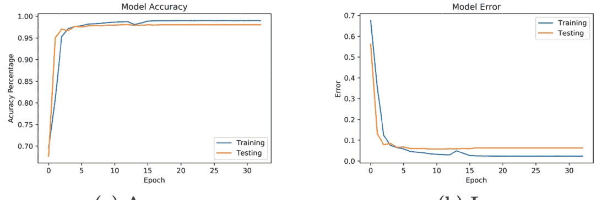

(a) 准确率 (b) 损失 图 10. 拟议模型的逐迭代准确率和损失分析。

表 4 拟议模型在划分为训练集、验证集和测试集的数据集上的性能指标。

| 训练集 | | | | 验证集 | | | | 测试集 | | | |
|---|---|---|---|---|---|---|---|---|---|---|---|
| DC | DHC | MAPE | HD | DC | DHC | MAPE | HD | DC | DHC | MAPE | HD |
| 97.31 | 0.304 | 0.65 | 1.09 | 96.45 | 0.354 | 0.71 | 1.12 | 96.30 | 0.387 | 0.71 | 1.11 |

表 5 拟议模型在不同迭代规模下的性能评估。所列结果为训练数据集上的平均结果。

| 迭代次数 | DC | DHC | MAPE | HC |
|---|---|---|---|---|
| E-50 | 92.68 | 0.495 | 0.88 | 1.87 |
| E-100 | 94.55 | 0.416 | 0.80 | 1.54 |
| E-150 | 95.89 | 0.372 | 0.74 | 1.20 |
| E-200 | 96.32 | 0.343 | 0.69 | 1.18 |
| E-250 | 97.31 | 0.304 | 0.65 | 1.09 |
| 平均值 | 95.35 | 0.386 | 0.752 | 1.376 |

拟议模型在测试数据集上基于公式 (10)–(13) 定义的各种统计性能指标的实验结果列于表 4 中。表 4 中列出的值是完整数据库实验的平均结果。该数据库由三部分组成，即训练集、验证集和测试集。表 4 显示了按样本分布的指标值。

还观察到，模型性能取决于模型训练和验证中使用的迭代次数。模型性能分析采用表 5 所示的各种迭代规模计算得出。经观察，发现随着迭代次数增加，模型准确率提升。在本工作中，对各种迭代规模进行了实验，发现直至迭代次数为 250 时，性能以可接受的速率提升，之后性能几乎趋于饱和。

然而，拟议模型在估计胎儿头围尺寸方面的性能列于表 6 中。头围计算性能通过分割输出与可用实地真值之间头围的绝对差值来估算。表 6 中的结果显示样本图像、其带有胎儿头围尺寸的可用实地真值以及带有估计胎儿头尺寸的分割区域。表 6 的最后一列显示分割结果与可用实地真值之间的绝对差值。结果如所示

表 6 拟议模型在胎儿头围（FHC）估计方面的实验结果。结果显示为训练集和验证集中随机选择的图像。

| 输入 | 实地真值 | 分割 | FHC_Grt (mm) | FHC_Seg (mm) | 绝对差值 (mm) |
|---|---|---|---|---|---|
| [图像] | [图像] | [图像] | 71.96 | 73.24 | 1.28 |
| [图像] | [图像] | [图像] | 87.32 | 87.98 | 0.66 |
| [图像] | [图像] | [图像] | 67.84 | 68.97 | 1.13 |
| [图像] | [图像] | [图像] | 78.08 | 78.14 | 0.06 |
| [图像] | [图像] | [图像] | 74.31 | 75.55 | 1.24 |
| 绝对差值平均值 | | | | | 0.874 |

表 7 拟议模型使用其他基准性能指标的实验结果。结果显示为训练集和验证集中随机选择的图像。

| 输入 | 实地真值 | 分割 | IoU | 精确率 | 召回率 | F1 分数 |
| :--- | :--- | :--- | :--- | :--- | :--- | :--- |
| [图像] | [图像] | [图像] | 0.96 | 0.95 | 0.94 | 0.94 |
| [图像] | [图像] | [图像] | 0.95 | 0.95 | 0.94 | 0.94 |
| [图像] | [图像] | [图像] | 0.95 | 0.94 | 0.94 | 0.95 |
| [图像] | [图像] | [图像] | 0.96 | 0.96 | 0.94 | 0.94 |
| [图像] | [图像] | [图像] | 0.95 | 0.95 | 0.95 | 0.94 |
| **平均值** | | | 0.95 | 0.94 | 0.94 | 0.95 |

表 6 中的内容为训练集和验证集中随机选择的五张图像。表格的最后一行给出所有图像的平均绝对差值。发现表 6 中所示样本的平均绝对差值为 0.874 mm。而对于整个训练集和验证集，平均绝对差值分别为 0.304 mm 和 0.354 mm。

拟议模型在若干最先进基准性能指标上的实验结果列于表 7 中。

# 5. 对比分析

与最先进的方法相比，拟议模型的性能令人满意，因为胎儿分割不同指标上的结果提升幅度较大。此处以两种形式展示了拟议方法的定量分析，即：与若干最先进的深度模型（具有迁移学习特性）的比较分析，以及与 HC18 数据集上部分现有工作的比较。

## 5.1. 与基准模型的定量比较

拟议方法与部分最初为其他应用设计的基准深度模型的比较分析用于对比视角。这些模型基于迁移学习使用，即模型权重被迁移至新应用。用于比较的一些模型包括 UNet、WNet、带增强的 3D-UNet、VNet 和 Cascaded Network。这些模型与拟议模型的比较分析如表 8 所示。

拟议模型与其他分割最先进模型的基准性能指标比较分析如表 9 所示。

## 5.2. 与现有文献的定量比较

拟议方法与 HC18 数据集上部分现有工作的比较分析如表 10 所示。

表 8 拟议模型与现有基准模型的对比分析。

| 模型 | DC | DHC | MAPE | HC |
| :--- | :--- | :--- | :--- | :--- |
| UNet | 78.4 | 0.872 | 0.815 | 1.39 |
| UNet++ | 96.54 | 0.297 | 0.68 | 1.15 |
| D-UNet+Augmentation | 84.62 | 0.657 | 0.724 | 1.2 |
| WNet | 80.34 | 0.773 | 0.797 | 1.27 |
| VNet | 85.48 | 0.587 | 0.701 | 1.18 |
| 级联网络 | 90.15 | 0.446 | 0.687 | 1.12 |
| 拟议模型 | 97.31 | 0.304 | 0.65 | 1.09 |


### Table 9
拟模型与最先进的分割模型在基准性能指标上的比较分析。

| 模型 | IoU | 精确率 | 召回率 | F1-得分 |
|---|---|---|---|---|
| UNet | 0.88 | 0.87 | 0.86 | 0.86 |
| UNet ++ | 0.96 | 0.94 | 0.95 | 0.94 |
| D-UNet + Augmentation | 0.91 | 0.90 | 0.91 | 0.90 |
| WNet | 0.89 | 0.89 | 0.87 | 0.88 |
| VNet | 0.92 | 0.90 | 0.88 | 0.89 |
| Cascaded Network | 0.94 | 0.92 | 0.94 | 0.93 |
| Proposed Model | 0.96 | 0.94 | 0.94 | 0.94 |

研究。此次实验的局限性之一是基准模型的开源代码不可用。由于新引入模型的开源代码有限，其中一些最新模型可以在此工作中进行实验和比较。

未来，该模型可以通过采用其他预训练模型作为编码器和解码器的骨干网络，并结合注意力层和回归层，进一步提升 Dice 指标并减少分割区域与真值之间的头围差异。

# 6. 结论与未来工作

本文提出了一种新的编码器-解码器模型，融合了带回归层的注意力门机制，用于从2D超声图像中分割胎儿头部。拟议模型在编码和解码阶段采用密集块，以最大限度地减少与梯度下降相关的问题。必须使用密集块，因为在拟议模型中，软注意力门与跳跃连接一起用于最小化误差损失。这种软注意力基础是使用梯度的反向传播。

拟议模型用于对2D超声图像中的胎儿头部进行语义分割。随后，在椭圆拟合的帮助下对分割结果进行后处理，因为胎儿呈椭圆形。因此，合适的椭圆拟合有助于将分割结果映射到超声图像上。最后，进行胎儿尺寸分析，以估计胎儿的适当大小来检查其生长情况。采用拟议方法的结果分析有助于以高精度识别胎儿，其平均绝对头围差异为0.354 mm。

拟议模型在10,989张图像（数据增强后）的数据集上训练，并在335张图像的数据集上测试。测试数据集的平均绝对头围差异为0.387 mm。实验结果令人满意，因为该模型在使用不同统计性能指标进行实验时仍能达到最佳性能。除了头围分析外，本工作中使用的其他指标还包括Dice系数、平均绝对百分误差和豪斯多夫距离。使用拟议模型对这些指标的实验结果在训练数据上得到：Dice-97.31%、MAPE-0.65%、HD-1.09%。Dice-96.30%、MAPE-0.71%、HD-1.11%的准确结果。

除上述指标外，该模型的性能还在一些用于分割的其他基准指标上进行了评估，例如IoU、精确率、召回率和F1-分数。使用这些指标的实验也证明了该模型的有效性，所取得的值为：IoU-0.96、精确率-0.94、召回率-0.94、F1-分数-0.94。该模型还与一些用于不同领域对象分割的其他基准深度模型进行了比较，用于

## Author statement

Somya Srivastava: 概念化、方法论、撰写 - 原始草稿。
Ankit Vidyarathi: 监督、可视化、调查。
Shikha Jain: 审阅、结果验证、语言校正。

## Data availability

本文所述研究未使用任何数据。

## Declaration of Competing Interest

作者声明，没有已知的竞争性财务利益或个人关系可能影响本文报道的工作。

# References

- [1] Luciano Marcondes Machado Nardozza, Ana Carolina Rabachini Caetano, Ana Cristina Perez Zamarian, Jaqueline Brandão Mazzola, Carolina Pacheco Silva, Vivian Macedo Gomes Marçal, Thalita Frutuoso Lobo, Alberto Borges Peixoto, Edward Araújo Júnior, 胎儿生长受限：当前知识, Arch. Gynecol. Obstet. 295 (5) (2017) 1061–1077.
- [2] Ulrike Schmidt, Dunja Temerincath, Katharina Bildstein, Benjamin Tschuy, Jade Mayer, Mark Sittlner, Jörn Siemer, Sven Kehl, 测量胎儿头围以进行胎儿体重估计的最准确方法, Eur. J. Obstet. Gynecol. Reprod. Biol. 178 (2014) 153–156.
- [3] Hyunsook Seo, Masoud Badii Khuzaai, Varun Vasudevan, Charles Huang, Hongyi Ren, Ruoxiao Xiao, Jiao Jia, Lei Xing, 生物医学图像分割的机器学习技术：技术方面概述及最先进应用介绍, Med. Phys. 47 (5) (2020) e2148–e167.
- [4] Ankit Vidyarathi, Ankita Kansal, 数字图像分割算法调查报告, Int. J. Comp. Eng. Technol. (IJCET) 3 (2) (2012) 85–91.
- [5] Ankit Vidyarathi, Namita Mittal, 脑肿瘤分割方法：综述、分析及机器学习中的预期解决方案, 2015 9th National Systems Conference (NSC), IEEE 2015, pp. 1–6.
- [6] Shirwin Minaee, Yuri Y. Boykov, Fatih Porikli, Antonio J. Plaza, Nasser Kehtarnavaz, Demetri Terzopoulos, 基于深度学习的图像分割：综述, IEEE Transactions on Pattern Analysis and Machine Intelligence, 2021.
- [7] Hariharan Ravishankar, Sahana M. Prabhu, Vivek Vaidya, Nitin Singhal, 基于深度学习的超声图像中胎儿腹部自动分割的混合方法, 2016 IEEE 13th International Symposium on Biomedical Imaging (ISBI), IEEE 2016, pp. 779–782.
- [8] Lu Wei, Jinglu Tan, Randall Floyd, 基于迭代随机霍夫变换的超声图像中胎儿头部自动检测与测量, Ultrasound Med. Biol. 31 (7) (2005) 929–936.
- [9] Sandra M.G.V.B. Jardim, Mário A.T. Figueiredo, 胎儿超声图像分割, Ultrasound Med. Biol. 31 (2) (2005) 243–250.

## Table 10
使用超声图像 HC18 数据集的拟议模型与最新技术的比较分析。

| 参考 | 方法 | DC | DHC | 平均差异 | HC |
|---|---|---|---|---|---|
| Sobhaninia et al. [14] | Multi class Link Net | 96.84 ± 2.89 | 1.13 ± 2.69 | 2.12 ± 1.87 | 1.72±1.39 |
| Zeng et al. [24] | Optimized Deep Model | 97.61 ± 1.72 | - | 1.97 ± 1.89 | - |
| Heuvel et al. [25] | Haar 特征 + 带随机森林的霍夫变换 | 97.0±2.8 | 0.6 ± 4.3 | 2.8 ± 3.3 | 2.0 ± 1.6 |
| Rong et al. [26] | GVF-Net | 95.53 ± 3.98 | -0.24 ± 3.23 | 2.42 ± 1.93 | 2.18 ± 2.40 |
| Al-Bander et al. [27] | Mask R-CNN | 97.73±1.32 | 1.49±2.85 | 2.33±2.21 | 1.39±0.82 |
| Proposed Model | 回归-注意力 UNet | 97.31±1.47 | 0.304±1.26 | 1.87±1.21 | 1.09±0.77 |

- [10] Patricia García-Canadilla, Sergio Sanchez-Martinez, Fatima Crispi, Bart Bijnens, 胎儿心脏病学中的机器学习：可以期待什么, Fetal Diagn. Ther. 47 (5) (2020) 363–372.
- [11] Qinghua Huang, Fan Zhang, Xuelong Li, 超声计算机辅助诊断系统中的机器学习：综述, Biomed. Res. Int. 2018 (2018).
- [12] Stav Gofer, Oren Haiik, Ron Bardin, Gilboa Yinnon, Sharon Perelman, 第一孕期胎儿脑部超声图像分类的机器学习算法, J. Ultrasound Med. 41 (7) (2021) 1773–1779.
- [13] Mohammad Yaqub, Rami Cujgent, Raffaele Napolitano, David Roundhill, Aris Papageorghiou, Roberto Ardon, J. Alison, Noble, 3D超声中关键胎儿脑结构的体积分割, International Workshop on Machine Learning in Medical Imaging, Springer 2013, pp. 25–32.
- [14] Zahra Sohrabinia, Shima Rafiei, Ali Emami, Nader Karimi, Kayvan Najarian, Shadrokh Samavi, S.M. Reza, Soroushmehr, 使用多任务深度学习测量生物测量参数的胎儿超声图像分割, 2019 41st Annual International Conference of the IEEE Engineering in Medicine and Biology Society (EMBC), IEEE 2019, pp. 6545–6548.
- [15] Xu Xin Yang, Yi Wang Wang, Haoran Dou, Shengli Lu, Huaxuan Wen, Yi Lin, Peng-Ann Heng, Dong Ni, 产前超声体积中整个胎儿头部自动分割的混合注意力机制, Comput. Methods Prog. Biomed. 194 (2020) 105519.
- [16] Sylvia L. Rueda, Sana Fathima, Caroline L. Knight, Mohammad Yaqub, Aris T. Papageorghiou, Babii Rahmatullah, Alessandro Foi, Matteo Maggioni, Antonietta Pepe, Jussi Tohka, et al., 用于生物测量的当前胎儿超声图像分割方法的评估与比较：一项大挑战, IEEE Trans. Med. Imaging 33 (4) (2013) 797–813.
- [17] Netanell Avidsris, Bossmat Yehuda, Ori Ben-Zvi, Daphne Link-Sourani, Liat Ben-Sira, Elka Miller, Elena Zharkov, Dafna Ben Bashat, Leo Joskowicz, 基于深度神经网络的胎儿脑部MRI自动线性测量, Int. J. Comput. Assist. Radiol. Surg. 16 (9) (2021) 1481–1492.
- [18] Baihong Xie, Ting Lei, Nan Wang, Hongmin Cai, Jianbo Xian, Miao He, Lihe Zhang, Honqing Xie, 使用深度卷积神经网络的胎儿脑部超声图像计算机辅助诊断, Int. J. Comput. Assist. Radiol. Surg. 15 (8) (2020) 1303–1312.
- [19] Xavier P. Burgos-Artizzu, David Coronado-Gutiérrez, Brenda Valenzuela-Alcazar, Elisenda Bonet-Carne, Elisenda Eixarch, Fatima Crispi, Eduard Gratacós, 常见母体胎儿超声平面自动分类的深度卷积神经网络评估, Sci. Rep. 10 (1) (2020) 1–12.
- [20] Zahra Sohrabinia, Ali Emami, Nader Karimi, Shadrokh Samavi, 基于多尺度视图和深度神经网络的超声图像中胎儿头部定位, 2020 5th International Computer Conference, Computer Society of Iran (CSICC), IEEE 2020, pp. 1–5.
- [21] Abhishek Chaurasia, Eugenio Culurciello, LinkNet：利用编码器表示实现高效语义分割, 2017 IEEE Visual Communications and Image Processing (VCIP), IEEE 2017, pp. 1–4.
- [22] Mostafa Ghelchi Oghli, Shakiba Moradi, Nasim Sirjani, Reza Gerami, Payam Ghaderi, Al Shabanzadeh, Hossein Arabi, Isaac Shiri, Habib Zaidi, 使用深度神经网络从超声图像自动测量胎儿头部生物测量, IEEE Nuclear Science Symposium and Medical Imaging Conference (NSS/MIC), IEEE 2020, pp. 1–3.
- [23] Olaf Ronneberger, Philipp Fischer, Thomas Brox, U-Net：用于生物医学图像分割的卷积网络, International Conference on Medical Image Computing and Computer-Assisted Intervention, Springer 2015, pp. 234–241.
- [24] Zeng Wen, Jie Liu, Jiaru Cheng, Lu Yiling, 使用轻量级深度卷积神经网络进行自动心脏周长测量的高效胎儿超声图像分割, Med. Phys. 49 (8) (2022) 5081–5092.
- [25] Thomas L.A. van den Heuvel, Dagmar de Bruijn, Chris L. de Korte, Bram van Ginneken, 使用2D超声图像的胎儿头围自动测量, PLoS One 13 (8) (2018), e0200412.
- [26] Yibiao Rong, Dehui Xiang, Weifang Zhu, Fei Shi, Enting Gao, Zhun Fan, Xinjian Chen, 通过卷积神经网络推导生物医学图像分割的外部力, Biomed. Opt. Exp. 10 (8) (2019) 3800–3814.
- [27] Baidaa Al-Bander, Theib Al-Zbairri, Saeed Alzhrani, Bryan M. Williams, Yalin Zheng, 通过深度学习的对象定位改进胎儿头部轮廓分割, Annual Conference on Medical Image Understanding and Analysis, Springer 2019, pp. 142–150.

