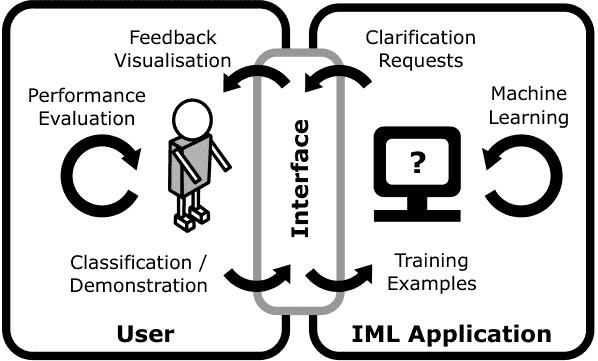
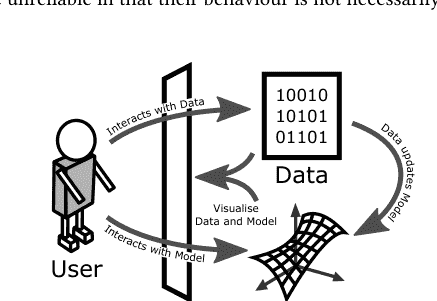
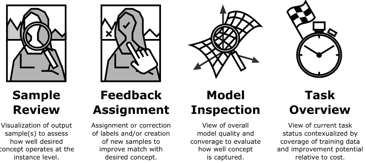

# 交互式机器学习的用户界面设计综述

交互式机器学习（IML）旨在将人类的感知和智能与计算机的计算能力和速度紧密结合，以补充人类的感知和智能。这一交互过程被设计为纳入用户的输入，但并不要求用户具备使用更传统机器学习技术所必需的背景知识或经验。在IML流程下，非专家人员可以将其领域知识和洞察力应用于原本难以处理的数据集，以发现感兴趣的模式或开发复杂的数据驱动应用。该过程本质上具有协同自适应性，并依赖于对人与机器之间交互的精心管理。用户界面设计是这种方法成功的根本，但目前仍然缺乏关于如何实现此类界面的统一原则。本文从交互系统的角度对交互式机器学习进行了详细的回顾和描述。我们提出并描述了一个通用IML系统的结构和行为模型，并确定了为IML构建有效界面的解决方案原则。在可能的情况下，这些涌现的解决方案原则通过参考更广泛的人机交互文献进行了情境化。最后，我们指出了对解锁更高效、更有生产力的非专家交互式机器学习应用至关重要的用户界面研究方向。

CCS 概念：• **以人为本的计算** → *HCI 理论、概念和模型*；

附加关键词和短语：交互式机器学习，界面设计

**ACM 引用格式：**  
John J. Dudley 和 Per Ola Kristensson。2018。交互式机器学习用户界面设计述评。*ACM Trans. Interact. Intell. Syst.* 1, 1, Article 1（2018年3月），37页。https://doi.org/10.1145/3185517

## 1 引言

机器学习（ML）支持构建能够描述和展示复杂行为而无需显式编程的数学模型。这些技术已经在诸如语音识别、图像分类和游戏等广泛任务中展现出先进功能。这种功能是通过一个与人类学习过程不无相似之处的训练过程建立的。一般来说，算法通过反复接触某个概念的样本来学习识别或表示该概念。一个能够准确表示某个概念以实现某种功能目的的数学模型，是机器学习算法的目标产物。

尽管这些技术取得了成功，但它们作为开发工具的使用在很大程度上仍然局限于专家从业者。然而，这些方法无需显式编程就能提供功能的能力，使其对广泛的潜在用户群体具有吸引力。近期机器学习领域广泛兴趣的爆发进一步加剧了直观系统的短缺，而这类系统能够让非专家应用这些技术。交互式机器学习（IML）因其在这种范式下建立有效人类交互的独特之处，引起了人机交互（HCI）研究人员的兴趣。

IML（在第2节中详细定义）通过将训练过程仔细地构架为一个HCI任务，使机器学习技术更加易于使用。在最简单的层面上，IML过程通过在示例选择、创建和标注过程中使用人工输入，将用户纳入训练过程。机器学习从业者可能需要部署底层算法以供IML系统使用，但这对训练过程并非必需。在理想实现中，对机器学习不熟悉的最终用户可以根据自己的需求创建或收集训练数据，从而构建自己的学习概念。在实践中，构建这样的系统对机器学习从业者和用户界面设计师都是一项重大挑战。本文主要关注界面设计挑战，但也着重指出了与机器学习从业者所面临的技术挑战的交叉点。

Ware等人 [2001] 以及Fails和Olsen [2003] 的早期工作表明，典型的机器学习任务可以被构建为利用人类输入，并且在过去的十五年中，IML过程在HCI社区中受到了越来越多的关注。为IML系统提供输入的用户无需对所交互的模型有任何深入理解。当考虑到允许领域专家训练模型的潜力时，这种方法的价值或许最为明显。研究人员已经展示了在一系列具体应用中利用领域专业知识的IML系统，包括动物行为标注 [Kabra等人 2013]、保险索赔审计 [Ghani和Kumar 2011] 以及对已发表医学证据进行系统性评价 [Wallace等人 2012]。在这些应用中，随着模型对正在训练的概念理解能力的提高，用户所需付出的努力显著减少。Wallace等人 [2012] 通过利用训练模型的预测来将特定研究论文标记为不相关，实现了用户工作量约40%的减少。通过这种方式，IML寻求应用人类和计算机的互补优势。

IML工作流程本质上是协同自适应的，因为用户和目标模型直接影响彼此的行为。重要的是要认识到，实际上是交互作为界面的一种涌现属性，必须适应用户响应模型而不断变化的行为。界面的适当设计对此类系统的成功是*关键*的，这提出了一个独特的用户界面设计挑战。该方法依赖于将数据检查和纠正任务转化为人与机器之间直观且富有成效的对话。实现这一点并非易事。

为交互式机器学习应用设计界面暴露了四个关键挑战。首先，用户可能不精确和不一致。用户可能在训练过程中不严格遵守某个概念，或者将自己的错误和偏见引入学习过程。不良的训练会导致不良的模型，但除非用户意识到自身的缺陷，否则这种失败会被归咎于系统。

其次，在关联用户输入和用户意图时存在一定程度的不确定性。用户可能会基于他们在示例中感知到的、系统没有或无法建模的特征来分配训练数据。此外，用户没有将某个示例分配到某个概念并不一定意味着它就是反例。

第三，与模型交互不同于通过用户界面与常规信息结构交互。机器学习模型会响应用户输入而演化，但不一定以用户认为直观或可预测的方式演化。

第四，训练是开放式的。例如，如果用户在计算机辅助设计（CAD）系统中设计一个零件，完成状态或多或少是二元的：当零件被完全指定时，任务即完成。相比之下，训练一个模型达到100%的准确率可能既不可取也不可能。此外，IML在探索性和创造性应用中被广泛使用，在这些应用中，实际模型相对于过程本身可能只是次要的。

这四个关键挑战加在一起，使得以人为中心的机器学习，特别是IML过程，成为一个远比简单集成相关组件复杂得多的设计挑战。

### 1.1 给设计者的指导

本文整合了与IML界面设计相关的研究发现，旨在为设计者提供指导。它试图为构建有效的交互式机器学习系统这一挑战带来一个双重视角：同时考虑智能算法的应用和用户界面的设计。基于对文献的综合分析，我们提出了IML系统的结构和行为分解。结构分解将系统划分为其组成部分（用户、界面、数据和模型），目的是帮助设计者思考如何构建这样的系统。IML界面被进一步分解为四个不同的界面元素，它们在更广泛的流程中服务于不同的功能。认识到这些不同的界面元素可以帮助设计者思考如何向用户呈现信息以及他们促进何种交互。

行为分解将交互式构建模型的过程划分为子任务。然而，需要注意的是，这些任务可能重叠和/或迭代执行。结构和行为分解并非旨在作为蓝图，而是支持使用明确定义的术语对设计考虑进行丰富讨论。这种对设计空间的正式化将有助于为该新兴领域中的概念交流奠定更好的基础。

本文的另一个贡献是识别了能够更普遍地指导IML界面设计者的涌现式解决方案原则。第6节中详细描述的六个解决方案原则是：
- （1）明确任务目标和约束
- （2）支持用户理解模型的不确定性和置信度
- （3）捕获意图而非输入
- （4）提供有效的数据表示
- （5）利用交互性并促进丰富的交互
- （6）让用户参与

### 1.2 文章结构

本文其余部分的组织如下。第2节提供了交互式机器学习的详细定义，并试图强调其与相关技术的相似性和区别。第3节概述了为使非专家更容易使用机器学习技术和高级分析所做的重要工作，并按底层数据类型进行分类。第4节对通用IML系统的关键界面元素进行了结构性描述。第5节给出了典型IML过程的抽象描述。第6节通过识别若干常见的解决方案原则，试图整合近期的努力。我们强调，解决用户界面设计挑战和推进最先进技术水平需要在几个关键领域进行进一步研究。因此，我们提出了四个不同的研究方向。

在第 7 节中，我们从用户交互的角度探讨了提升交互式机器学习应用性能的方法。最后，我们在第 8 节中总结了本文的关键发现。

## 2 上下文与定义

本文从用户界面设计的角度审视交互式机器学习。开发有效的 IML 系统是一项跨学科工作，融合了机器学习和人机交互领域。为实现本文目标，我们主要集中于呈现用户评估并提供交互组件设计建议的 IML 研究。除其对用户交互的影响外，系统机器学习组件的底层技术需求仅得到有限关注。在本节中，我们首先旨在为全文使用的术语建立明确的定义。

### 2.1 交互式机器学习定义

*Interactive Machine Learning* 是一种交互范式，其中用户或用户群体通过输入和审查的迭代循环，迭代地构建和完善数学模型以描述一个概念。模型完善由用户输入驱动，用户输入可能以多种形式出现，例如提供指示性样本、描述指示性特征或以其他方式选择高层模型参数。交互式机器学习与经典机器学习的区别在于，人类智能通过迭代教学和模型完善在相对紧密的“set-and-check”循环中应用。换句话说，用户向系统提供额外信息以更新模型，并且模型的变化会对照用户的设计目标进行审查。在此工作流程下，每次迭代中模型的变化可能相对较小。这与更传统的机器学习方法形成对比，后者需要预先整体选择训练数据，并且每次执行步骤中模型会发生显著变化。Amershi 等 [2014] 详细讨论了 IML 与经典机器学习之间的区别，并提供了一系列案例研究来突出该技术的价值。IML 过程的特点是用户是驱动交互以实现系统期望行为的主要驱动者。这并不意味着计算机对过程没有影响或不做出独立决策。事实上，应用程序例如可以智能地选择一批数据供审查。用户是主要驱动者的概念更多地体现在 IML 应用程序旨在为用户提供对系统高层行为的控制上。这种控制可能在每次离散交互中行使，也可能不行使。

Fails 和 Olsen [2003] 在交互式图像处理工具 Crayons 中引入了 IML 的概念，其主要侧重于分类器错误的审查和纠正。Crayons 允许用户直接在图像上绘制以指导图像分类器的训练。用户根据图像区域的分类审查当前分类器性能，并在必要时通过在图像上绘制提供更多反馈。ReGroup [Amershi et al. 2012] 是一种利用交互式机器学习范式帮助用户在社交网络环境中创建自定义联系人组的工具。系统训练模型以根据其成为所创建联系人组的成员的可能性对联系人进行分类。系统将对联系人的选择作为正样本，将在有序列表中跳过联系人作为隐含负样本。用户在每次选择后会以建议联系人的有序列表形式收到反馈。就像 Crayons 一样，用户通过迭代应用的用户输入产生的增量改进来完善模型的行为。

上面描述的 Crayons 和 ReGroup 系统中的完成时模型行为当然可以用标准机器学习方法复制，该方法将用户输入的集合作为标记数据的批量处理。然而，在所讨论的应用中，正是完善模型的过程有助于引出用户输入。这两个例子有助于突出交互式机器学习的益处在用户精确设计目标不明确和/或数据标签无法*a priori*获得的情况下是可观察的。

最近的工作将交互组件的应用扩展到不仅仅是分类器错误的审查和纠正，还扩展到模型构建练习的其他阶段，即特征选择、模型选择、调试和性能评估。在本文的上下文中，我们将*comprehensive* IML 过程定义为系统提供所有必要功能以允许用户在其数据上配置然后训练模型并将其部署到目标应用程序中的过程（该完整通用工作流程在第 5 节中详细描述）。

在迭代完善阶段，用户在人类与机器紧密耦合的安排中驱动 IML 过程。在此方法下，关键元素和信息流在图 1 中示出。用户的交互可以被视为一种伪编程形式，因为用户通过演示和标记样本而不是直接编写代码来构建功能 [Gillies et al. 2016]。作为一种交互范式，交互式机器学习存在于 Beaudouin-Lafon [2004] 所描述的计算机即工具和计算机即伙伴的重叠处。IML 应用程序当然提供了一种工具，因为它支持用户构建适合其目的的模型。与此同时，用户和计算机参与的交互是一种伙伴关系，双方都必须对输入做出响应，并在一定程度上推断期望的操作。将具有高和/或可变惯性的物体沿期望轨迹移动的隐喻为 IML 提供了一个非常高层的交互模型。该交互模型捕捉到输入可能在物体上产生边际或无响应的事实，并且需要一系列输入来驱动变化。

交互式机器学习方法可能在用户-数据交互任务的两个极端首先得到采用：在较低复杂性端，用户选择他们喜欢和不喜欢的事物示例；在较高复杂性端，用户（甚至开发者）应用其领域专业知识来完善分类器或构建其他智能功能 [Grose et al. 2014]。

从结构角度来看，我们将 IML 系统分为四个关键组件：1) 用户；2) 模型；3) 数据；以及 4) 界面。这些组件在图 2 中进行了总结。

图 1. 用户在交互式机器学习中发挥核心作用，通过迭代方式主动训练模型。用户界面是这种交互的关键组成部分。

用户通过提供反馈并引导模型训练来驱动过程。模型是正在训练的组件。数据是模型所训练的预先存在和新创建点的集合。界面是用户与模型和数据之间的桥梁，并为交互提供基础。界面组件是本文的主要关注点，将在第 4 节中进一步剖析。我们将在下面简要定义这些组件在 IML 过程中的作用。

#### 2.1.1 用户

正如前面多次重申的那样，用户是 IML 过程的主要驱动者。假设用户对机器学习技术没有深入的理解。此外，要求典型的终端用户理解概率推理的细微差别是不合理的。用户可能拥有与数据解释和模型输出评估相关的显著领域专业知识。还值得强调的是，“用户”实际上可能是多个用户串行或并行与系统交互。

用户是动态且可能不可靠的过程组件。单个用户的概念可能随时间漂移 [Kulesza et al. 2014]，而主观标注的跨用户变异性可能很高 [Curran et al. 2012]。如果不加以解决，这些缺陷可能会对训练模型的质量产生负面影响。幸运的是，界面的精心设计，无论是在呈现的信息方面还是在提供的指导方面，都可以帮助提高用户的一致性。

#### 2.1.2 模型

模型是系统组件，它接收输入并根据其对用户试图捕捉的概念/过程的当前理解确定适当的输出。机器学习中的高层目标通常是构建一个模型，该模型能够基于指示该概念的数据准确描述给定概念的输入与输出之间的关系。在机器学习中，该模型可以使用各种不同的算法和架构实现。在交互式机器学习中，用户最终寻求通过其交互来完善的正是该模型。用户可以直接操纵模型，即通过调整参数，或间接地，即通过重新标记或添加新数据。机器学习社区提供了广泛的建模技术，每种技术都有其相应的优缺点。还需要注意的是，某些模型就像某些用户一样可能不可靠，因为它们的行为不一定是确定性的。

图 2. 通用 IML 系统的结构分解。用户通过分配或创建训练数据将模型引导至期望的概念。界面还可以通过暴露参数、可编辑结构以及替代技术的选择来支持与模型的直接交互。图中未单独表示但包含在界面组件中的是系统的概念模型，它通常在用户与被操作对象之间提供抽象层。

模型/算法不可知论是IML系统的一个设计目标，但并非轻易就能实现。一个IML系统若能允许用户在保持相同或相似界面与交互的同时，在不同模型结构和算法之间切换，就能在无需付出大量重新熟悉成本的前提下提供更大的灵活性。某些机器学习技术比其他技术更适合直接交互和部分检查。机器学习界正在努力开发新的、更强大的技术。人们对能够更好捕获和表示不确定性的概率机器学习方法兴趣日益增长 [Ghahramani 2015]。然而，诸如深度神经网络（近年来已取得重大进展）之类的技术，在提供功能的同时，却没有任何清晰的方式来支持检查或交互。

IML过程也可能利用多个模型，要么是为了提供集成功能，要么是为了进行对比评估。一个理想的IML系统架构应能以最小的调整引入最先进的技术。

#### 2.1.3 数据

IML系统中的数据组件类似于传统程序中的源代码。用户选择、描述或生成数据，以指示模型应当如何响应特定输入。将此类带标签的数据点视为训练样本是很有用的。未标注的数据也可以通过推断其与其他数据点的关联来帮助构建模型。数据类型不可知论也是IML系统的一个设计目标，但同样难以实现。用户很可能重视将熟悉的IML系统应用于问题领域所要求的任何数据类型的能力。目前已开发出针对多种数据类型的IML系统，包括图像、文本和动作数据。第3节提供了跨不同数据类型的IML应用综述。与每种数据类型相关的特征可能差异很大。早期的IML研究通常避免在特征层面让用户参与，但最近已转向更高的透明度，甚至让用户参与特征选择。的确，在某些情况下，只要存在有效的界面和交互方法，在特征选择层面应用领域专业知识似乎是可取的。

#### 2.1.4 界面

用户界面及其与用户的交互是本文的核心焦点。第4节将对界面进一步分解为其潜在子元素。尽管本节展示了IML系统的结构分解，但仍需强调界面组件与其所支持的实际交互之间的区别。用户可用的交互由界面决定，但作为设计者，在构建界面时以交互的角度思考当然是有用的。因此，我们对IML用户界面设计的讨论涵盖了相应交互技术的设计，并在可能的情况下对这两个方面加以区分。

界面组件负责用户与模型/数据之间的双向反馈。它必须支持提供此功能所必需的输入和输出机制。对标注或演示过程丰富性施加的限制，相当于对用户意图的一种传出过滤器，可能对用户满意度和模型质量产生负面影响。用于审查的样本点可视化表示的局限性，相当于对用户感知和理解的一种传入过滤器，也可能降低性能和满意度。

本文的一个核心论点是，界面设计对IML过程的成功至关重要。对用户工作流程和交互的审慎管理可以应对第1节中提出的四个关键挑战：i) 用户可能不精确且不一致；ii) 用户输入与用户意图之间的关系通常存在一定程度的不确定性；iii) 与模型交互不像通过界面与常规信息结构交互；iv) 训练是开放式的。

### 2.2 相关领域

机器学习界一直在努力使其技术更易被最终用户使用。越来越多的打包工具包（如WEKA [Hall et al. 2009]和Scikit-learn [Pedregosa et al. 2011]）以及自动化功能（如The Automatic Statistician [Lloyd et al. 2014]）不断涌现。Fiebrink的论文介绍了Wekinator [Fiebrink 2011]，这是一个将监督式机器学习应用于实时数据流、特别适合音乐创作和表演的独立应用程序。

“机器学习即服务”（MLaaS）的概念也最近应运而生，以响应行业内对高级分析和数据驱动应用的需求 [Ribeiro et al. 2015]。现在存在许多面向服务的机器学习平台，包括谷歌、微软、亚马逊和IBM等大公司提供的平台。虽然这些服务确实提供了机器学习功能并配以强大的计算后端，但有效使用它们仍然需要熟悉相关技术。

机器学习技术向非专家的普及只是最近才通过电子邮件过滤器和推荐系统等应用实现。推荐系统是交互式机器学习的一种形式，因为用户偏好模型是通过解读其行为（如喜欢、不喜欢、购买和评论）而迭代构建的。然而，在许多此类应用中，用户可能并未意识到他们正在与一个根据输入进行学习的算法交互。一些推荐系统确实明确告知用户，他们可以影响其偏好模型的行为，并/或提供相应的界面，但即使在这些情况下，交互通常也更侧重于数据捕获，而不是闭环模型细化的双向过程。在本文中，我们特别从界面设计角度聚焦于交互式机器学习。虽然推荐系统的算法后端及其对隐式和显式用户输入的考虑方式确实与更普遍地理解交互式机器学习相关，但由于其对过程缺乏关注，这些系统在第3节的更广泛讨论中被排除在外。

明确指出交互式机器学习与相关概念主动学习之间的区别是有益的。主动学习是一种机器学习技术，专注于选择新的点供用户标注。其与IML的主要区别在于，点的选择由学习器驱动，而非用户。IML也可以利用学习器驱动的点选择策略，但不能排除用户驱动的输入。关于主动学习的综述，参见 [Settles 2010]。强化学习是一种机器学习技术，基于简单的奖励反馈引导学习器朝向期望行为。已有研究探讨了将人类置于该循环之内以引导强化学习算法的可能性。Knox和Stone [2015] 详细概述了基于人类衍生奖励反馈的强化学习系列实验。

除了人机交互之外，IML相关概念也在人机交互研究中得到了探索（[Losing et al. 2015]、[Javdani et al. 2016]、[Gopinath et al. 2016]）。Gopinath等人 [2016] 的研究动机是需要调整机器人辅助水平以适应使用者需求。运动损伤或疾病即使在单个用户中也可能导致能力的动态变化，这取决于其处于康复或退化的哪个阶段。支持用户驱动的辅助水平自定义是IML的一个主要应用。IML与数据库知识发现（KDD）的某些方面（参见 [Holzinger 2013]）和交互式优化（参见 [Meignan et al. 2015]）也存在一定重叠。IML与这些领域的区别在于，它更强调用户和过程的作用，而非最终目标。

## 3 IML 应用综述

交互式机器学习已被应用于各种数据类型，服务于多种最终用途。在本节中，我们综述了交互式机器学习中现有的方法和应用。本文不旨在提供交互式机器学习及其应用的详尽综述。本文所讨论的文献满足以下条件：i) 有助于阐明 IML 范式的不同维度，和/或 ii) 特别强调 IML 系统的界面设计考量。我们通过对带引号的短语‘Interactive Machine Learning’进行 Scopus 检索，获得了一份适当的文献列表。我们对全部搜索结果进行了审查，并根据其是否对上述 i) 和/或 ii) 有所贡献进行了筛选。结果集中文献所引用的参考文献也一并纳入（如相关）。

这里采用的分类基于应用中研究的基础数据类型。但需要注意的是，许多界面特征和算法方法在不同数据类型之间是通用的。我们努力强调为每种数据类型开发 IML 系统的独特要求，同时提取可推广至不同应用领域的共同特征。

### 3.1 文本

机器学习技术非常适合应用于文本数据。特定领域的文本通常可以大量获取，并且往往已经带有一定程度的人工标注。现代垃圾邮件过滤器就是基于文本数据的机器学习有效改善用户体验的一个例子。

交互式机器学习系统的开发目标是满足需要更受限或定制化分类的场景。这类分类及其特征可能难以从领域专家那里提取，并且/或者可能难以用编程方式表达。Wallace 等人 [2012] 提出了 abstrackr，这是一个在线工具，用于支持对已发表医学证据进行系统评价的筛选。当用户从最高相关性的文献开始手动评估并处理临时列表时，系统可以迭代改进其对相关引文的分类。在试点评估中，该系统通过成功将临时列表中的文献重新分类为不相关，将工作量减少了约 40%。

同样繁琐的法规分析任务也是 Šavelka 等人 [2015] 的研究对象。Šavelka 等人部署了一个 IML 系统，以促进审查监管框架、识别与给定主题相关条款的过程（在该研究中即公共卫生应急准备与响应）。用户会看到条款的分类结果，并可以修改分配的标签。他们还可以建议对该分类重要的术语。用户可以随时请求根据最近一次反馈迭代重新训练模型。有趣的是，Šavelka 等人证明，在一个司法管辖区（即堪萨斯州）训练的模型，可以有利地复用于另一个司法管辖区（即阿拉斯加州）的同一主题分析。该系统是 IML 潜力的典型例子：它能帮助用户完成高度特定于问题的任务，同时允许将已投入的工作应用于相关数据集。

Kim 等人 [2015a] 展示了一个用于构建和编辑学生代码提交分类的交互式界面。该方法通过允许教师选择类别范例来生成不同学生答案类型的分类，已成功应用于编程任务的评分。Yimam 等人 [2015] 将交互式学习过程应用于医学摘要标注任务。Huang 等人 [2013] 展示了 IML 在辅助餐馆评论撰写和阅读方面的潜力。通过交互式过程，系统可以学习在食物、服务和价格三个类别中突出显示并建议总结性的情感倾向。研究发现，在撰写过程中提供这些建议可以激励用户纠正错误的预测。

Endert 等人 [2012] 在文本分析中引入了语义交互的概念。他们利用嵌入在交互中的信息，例如词搜索、高亮、注释和文档固定位置的调整，来迭代改进文档关联模型。该信息用于更新文档关联的空间可视化。

将 IML 过程应用于文本数据所面临的挑战在于，难以提供简洁的文档表示以促进用户快速审查。Kim 等人 [2015b] 比较了多种机器学习技术在文档特征压缩任务中的表现。其目标是找出能够提高用户分类评估速度的表示方法。所讨论的几项研究利用了术语高亮来指示与分类结果相关的特征。据推测，突出显示指示性关键词可以加快评估过程。在特征标注方面，Raghavan 等人 [2006] 观察到，用户标注一篇文档（即将文档分配到某个主题）所需的时间，最多是标注一个特征（即将一个词指定为某个主题的重要术语）的五倍。

### 3.2 图像

图像分类是机器学习社区中一个非常流行的应用领域。由于已有合适的图像分类技术，人们开始研究通过 IML 将用户输入与之结合的可能性。至于 IML 在文本数据上的应用，当需要更细致的概念辨别能力时，该技术的实用性便会体现。

在图像间层面，现有应用试图让用户训练模型来理解他们自己的、有时较为模糊的概念。Fogarty 等人 [2008] 推出了 CueFlik，这是一个允许用户创建自己的概念并将其融入图像搜索的交互式应用。用户可以通过分配一组图像来描述期望的概念（例如风景）来定义新的搜索规则。然后用户可将此规则应用于其搜索，从而只提供与该概念一致的结果。Fogarty 等人 [2008] 发现，与提供完整图像排名相比，同时显示置信度最高的正样本和置信度最高的负样本的可视化能够带来更高质量、更快速的概念学习。Amershi 等人 [2011a] 通过向界面添加新功能，使用户能够更好地对变化进行建模并可视化当前模型状态，从而扩展了 CueFlik。Amershi 等人还引入了历史模型质量的可视化（以模型可靠性和排序图像的时序快照表示），以及回退到先前模型状态的能力。Guo 等人 [2016] 提出了一个基于潜在病理状况对医学图像进行聚类的 IML 系统，并尝试具体整合专家约束。用户可以将图像彼此拖开，以表示它们在模型中应断开连接。

其他 IML 应用则试图训练系统在图像内层面识别特定对象。Crayons [Fails and Olsen 2003] 是 IML 领域经常被引用的奠基性论文，它展示了一种界面，用户可以直接在图像上绘制来逐步训练分类器。Tsutsumi 和 Tateda [2009] 也采用了这种方法来帮助测量河流中漂浮的落叶碎屑量，以及分析卫星、医学和材料科学图像（[Porter et al. 2011]、[Porter et al. 2013]、[Harvey and Porter 2016]、[Kreshuk et al. 2011]）。

IML 非常适合与图像结合使用，因为已有丰富的特征库可供使用，而且用户可以快速查看大量图像。通过直接在图像上涂画来提供像素级或区域级反馈的能力，是多个应用中成功利用的一种交互技术。

### 3.3 时间序列数据：语音、音频、视频和运动

将语音转录为文本，手动完成时可能是一项费力的任务，但越来越多的系统能够以极低的错误率自主完成此任务。Sanchez-Cortina 等人 [2012] 将自动语音识别系统与便于错误纠正的 IML 界面配对使用。用户可以调整可接受的词错误率，以改变向用户显示的不确定案例数量。

Kabra 等人 [2013] 采用交互式机器学习方法，使非专业用户能够构建识别不同动物行为的分类器。用户查看动物的视频片段，并为视频片段分配行为标签。当添加标签时，用户可以启动模型重新训练，分类器将应用于整个视频。遇到被错误分类的行为时，用户可以纠正样本，以逐步提高模型质量。通过此过程构建的分类器随后能够快速、准确地对记录数据集中的动物行为进行标注：如果手动执行，这项任务非常缓慢；若使用较不先进的方法自主执行，则极易出错。Versino 和 Lombardi [2011] 将 IML 流程应用于监控流过滤，以保障核处理设施的安全。用户为与安全相关的事件分配正样本和负样本，训练后的模型便可以帮助识别潜在危险。

Bryan 等人 [2014] 探索了从录制音轨中分离单个声源这一具有挑战性的任务。Bryan 等人使用一种“涂抹”方法（类似于 Fails 和 Olsen [2003] 在图像上采用的方法）来训练分类器，以识别音频文件中所需的声音源。用户在音频录音的时频可视化区域上进行“涂抹”，以分离出声源。

BeatBox [Hipke 等人 2014] 允许用户训练系统识别不同的打击乐发声。建立自定义的发声词汇后，用户可以创建一条轨道，用于识别和标注所采用的发声。该界面将不同的发声类别分离到不同的虚拟打击垫上，并根据识别的类别对打击垫上录制的发声进行颜色编码。这种颜色编码提供了一种易于理解的特定发声类别质量指示。包含未准确分类的录制样本的打击垫会迅速吸引用户的注意。然后，他们可以瞄准一个区分力更强的新类别。

为了减轻残疾人在演奏传统乐器时所面临的巨大困难，Katan 等人 [2015] 将交互式机器学习应用于手势控制乐器的创建。Katan 等人 [2015] 使用户能够构建手势词汇，并自定义手势与声音之间的关系。Sarasua 等人 [2016] 展示了定制手势识别在控制音乐演奏法方面的潜力，如同指挥家用指挥棒控制管弦乐队一样。类似的方法已经证明 IML 在支持独特音乐创作形式（[Fiebrink 等人 2011]、[Tsandilas 等人 2009]）和互动体验（[Klein-smith 和 Gillies 2013]、[Brenton 等人 2014]、[Gillies 等人 2015b]）方面的潜力。这些研究强调，IML 的目标不一定只是让任务更高效或更具生产力，而可能是拓展人类的创造力。

其他人则寻求针对数据流产生智能功能，例如用于癫痫检测（[Chua 等人 2011]）和办公任务自动化（Dey 等人 [2004]）。IML 也已应用于脑机接口的训练（[Kosmyna 等人 2015]）。

Gesture Script [Lü 等人 2014] 是一个用于创建二维手势识别器的交互式工具。该应用程序允许用户生成特征级描述，并将其组合以补充训练数据。Hartmann 等人 [2007] 提出了一种基于识别通用传感器数据中模式的交互编写工具。

与文本数据一样，将 IML 应用于时间序列数据在提供样本点的概括性表示方面也具有挑战性：可能难以简洁地表示图像流的动态内容，或表示手势的时间与位置之间的时序关系。对样本进行串行审查的要求可能导致高度串行化的流程，难以扩展。为此目的设计的界面必须设法让用户快速检查和审查样本。

### 3.4 结构化信息的辅助处理

本节讨论的 IML 系统利用结构化数据来训练模型，以增强用户能力。这些例子特别强调了领域或用户特定专业知识在训练过程中的应用。Amershi 等人 [2012] 提出了一种基于交互式机器学习范式的社交网络辅助工具。该系统基于一个朴素贝叶斯分类器构建概率模型，该分类器用于识别可能与特定群组相关的联系人，并提供建议和新过滤器以识别新成员。

Ghani 和 Kumar [2011] 应用 IML 流程极大地辅助了审计员处理健康保险索赔的工作。除了学习高亮那些可能引起审计员兴趣的字段以提供支持外，分类方法还可以通过在处理队列中分组相似索赔来减少上下文切换的低效性。据估计，后一种策略将每次索赔所花费的时间减少了 27%。

CueT（[Amershi 等人 2011c]、[Amershi 等人 2011b]）是一个支持网络告警分流的 IML 系统。该系统可以从操作员的行动中学习，以建议告警分组。Kose 等人 [2015] 应用 IML 来促进电子索赔数据中的欺诈检测过程。底层数据的动态性以及必须识别的潜在微妙关系，促使采用人在回路方法。AppGrouper [Chang 等人 2016] 协助在线应用商店中交付主题一致的应用集群。用户可以直接编辑集群，并促使生成更多或更少的集群。评估表明，该方法相比算法生成的集群提高了聚类结果的质量。AppGrouper 强调了通过精心设计的界面将人类判断与计算智能配对使用的潜在价值。人类输入只在最有用的阶段应用。

这里讨论的辅助处理应用突出表明，某些领域将需要高度专业化的界面设计。然而，在许多情况下，系统级架构可能不需要修改。类似地，我们假设有效的交互和任务级策略可能会保持一致。

### 3.5 原始数值数据

为了证明完全的数据类型无关性，几项研究将 IML 流程应用于从任何特定应用中抽象出来的数值数据。交互式机器学习与电子表格应用普及之间存在相似之处，电子表格将基本的统计和数据表示工具交到了非专业用户手中。实际上，Sarkar 等人 [2015] 甚至展示了 BrainCel 的功能，它为典型的电子表格类型界面增加了机器学习功能。用户可以选择行作为训练数据，然后点击“猜测”按钮，根据这些行进行模型预测。

Holzinger 等人 [2016] 将人类反馈与蚁群优化（ACO）框架相结合，以解决旅行商问题。用户可以选择连接两个城市的路径，并使用滑块调整分配的信息素水平。Ware 等人 [2001] 提出了一种交互式

图 3. IML 过程中的不同界面元素。

面向非专家的基于树的分类应用。用户创建决策分支来构建自己的分类器。Brown 等人 [2012] 提出了一种迭代方法，用于在多维缩放投影可视化界面中学习用户偏好的距离函数。用户可以在散点图可视化窗口中拖出一个或多个点，然后启动学习步骤，以识别一个新的距离函数，从而更好地反映用户期望的数据排列。该过程可以迭代执行，同时保留用户的交互历史，以逐步找到最合适的距离函数。

这些研究表明，独立于数据的 IML 系统可以被开发并有效使用。这并不是说将数据抽象为简化表示是更可取的策略，在许多情况下这种方法可能不可取，因为它会限制领域专业知识的应用。然而，这些方法在领域相关性方面有所损失，但在灵活性方面有所收获。

## 4 IML 界面的组成

在本节中，我们描述广义交互式机器学习界面的结构组成。当然，IML 系统的设计可能会因数据性质、模型的预期应用、期望的用户体验以及许多其他因素而有很大差异。然而，理解其共性有助于指导设计原则的建立。

所呈现的界面元素基于对广泛回顾的 IML 系统之间共性的识别。我们也受到其他人提出的要求和期望属性的指导。Amershi 等人 [2012] 强调了 IML 过程的三个重要方面，可视为界面的期望属性：1) 展示学习概念的当前状态；2) 指导用户提供改进概念质量的输入；3) 提供允许用户探索模型空间的修订机制。Stumpf 等人 [2009] 确定了与人类用户和机器学习技术有效集成相关的三项活动：1) 将系统推理传达给用户；2) 将用户推理传达给系统；3) 确保系统和用户都从这一反馈循环中获益。我们将 Stumpf 等人确定的第三项活动分为检查模型和审查任务进度。因此，四个关键界面元素是：样本审查、反馈分配、模型检查和任务概览。这四个界面元素总结于图 3。我们并不认为这些元素在视觉上一定是截然不同的，或者确实在所有 IML 应用中都是必需的。因为

### 4.2 反馈分配

反馈分配界面是用户用来分配标签、选择特征和/或生成新样本的渠道。这个界面在界面元素和所提供的交互技术方面可能需要最精心的设计。用户在描述分类或执行演示时的交互可以采取多种形式。Porter 等人 [2013] 对训练词汇和训练对话做出了有用的区分。Porter 等人提出，IML 中的训练词汇已从仅包含标签扩展到包含约束和结构。类似地，训练对话不再仅仅是批处理过程，而是可以高度交互和动态的。通常，从用户的角度来看，更倾向于更完整、更具体的反馈分配方法。然而，正如 Hartmann 等人 [2007] 所指出的，在用户对行为的控制愿望与以机器为中心的‘旋钮’使用户不堪重负之间，存在不可避免的权衡。

BrainCell [Sarkar 等人 2015] 通过标准电子表格范式获取用户输入，而其他研究则捕获了原始手势输入 [Katan 等人 2015]、[Sarasua 等人 2016]。Kim 等人 [2015a] 发现用户希望描述难以编码为特征的高级属性（如代码结构）。约束标注或演示过程可能会对用户意图产生过滤效应，最终可能损害用户满意度和模型质量。同样，让用户面对实现不佳或令人困惑的交互技术，可能会降低整体性能。

从用户收集输入时面临的一个困难是，他们试图训练的概念可能会随时间漂移 [Kulesza 等人 2014]。这激发了人们在如何要求用户提供输入以及如何提供输入方面改进结构和指导的努力。Rosenthal 和 Dey [2010] 研究了可以提供哪些信息来提高标签质量（上下文数量、上下文级别、不确定性、预测以及用户反馈请求）。某些构造还可以让用户更有参与感，并促进更高质量的输入。例如，Huang 等人 [2013] 通过提供用户评论涉及的类别的当前预测，激励用户修复餐厅评论情感分析中的错误。

Shilman 等人 [2006] 介绍了校正界面的五个设计原则：1) 通过选择适当的操作符来最小化决策点；2) 设计模式之间的无缝转换；3) 提供所有状态的可达性；4) 适当限定级联更改的范围；5) 促进清晰的用户模型。Shilman 等人 [2006] 还总结了可能的校正策略：n-best 选择、转换、用户驱动提示和用户驱动约束。

Amershi 等人 [2012] 指出，对概念建模的能力取决于数据的质量。多项研究已经探索了将显式和隐式用户输入转换为可供学习器消费的数据的新方法。在 [Amershi 等人 2012] 中描述的系统利用用户跳过实例（社交网络中的联系人）作为标记负样本的指标。Javdani 等人 [2016] 试图利用用户在共享自主权下对机器人行动的抵制，作为识别不良行动的手段。在 IML 研究中，特征标记（而不仅仅是实例标记）的潜力也正在被利用（例如 [Wong 等人 2011]），但这确实要求学习算法能够利用这些识别出的特征差异。然而，在某些应用中，特征本身可能过于抽象，用户难以有效解释或利用 [Gillies 等人 2015a]。

### 4.3 模型检查

除了审查单个样本实例外，全面的 IML 过程通常还支持模型级别的某种形式的检查。这种对模型质量的总结性视图在这里称为模型检查界面。模型质量的评估不一定仅限于预测准确性，还可能包含其他指标，如覆盖率和置信度。多项研究表明，用户与参数（例如 [Kapoor 等人 2010]）和/或涌现结构（例如 [Chang 等人 2016]）进行交互的潜力，可作为模型检查界面的一部分。GaussBox [Françoise 等人 2016] 提供了一种有形的、可交互的工具，用于检查为手势识别训练的 HMM。

预测的质量最终取决于所构建模型的质量。各种错误来源可能影响模型质量。Amershi 等人 [2015] 确定了模型错误的三个主要原因：1) 错误标记的数据；2) 特征缺陷；3) 数据不足。错误标记的数据是指用户错误地分配了某些值的数据。当模型没有足够的给定特征样本来进行区分时，会导致特征缺陷错误。当与模型预测相关的数据区域存在空白时，会导致数据不足错误。因此，全面的模型检查界面应支持用户识别此类错误，以促进调试并提高模型质量。

受试者工作特征（ROC）曲线和成本曲线通常用于机器学习社区中，以支持模型性能评估，并已被纳入 IML 系统。或者，可以通过有针对性的测试以更复杂的方式评估模型性能。Groce 等人 [2014] 提出了测试方法的三个要求：算法无关性、在交互环境中运行速度足够快，以及能够使用相对较小的测试套件有效检测故障。然而，构建测试以获得模型质量的综合指标并非易事，尤其是对于最终用户而言。Fleishman 等人 [2011] 强调，基于训练集划分的评估可能没有意义，而且 IML 中的最终用户可能特别不适合选择能够代表预期未来数据的测试集。

近年来，交互式机器学习中的质量评估和调试任务受到了更多关注。虽然在某些应用中（如图像数据）可能可以快速直观地检查模型性能，但对于其他数据格式（例如文档）这样做则更为复杂。这种难度随着数据集规模的增大而增加。Amershi 等人 [2015] 提出了 ModelTracker，这是一种用于调试练习的模型性能的简明可视化表示。该表示允许快速评估标记样本被正确或错误预测的位置以及该预测的相对置信度。

模型检查界面为用户提供全局任务的可视性，即通常最小化预测误差。该界面允许用户应用迭代地朝着期望模型质量水平努力的策略。然而，我们稍后将论证，仅根据模型质量来定义任务完成标准是不可取的。仅让最终用户关注模型预测准确性可能助长过拟合。因此，我们区分*模型检查*界面和*任务概览*界面。

### 4.4 任务概览

一个独立的 IML 系统可能还需要向用户提供有关任务状态和终止条件的信息。在大多数实验性 IML 系统中，该界面并未包含在内，因为交互是通过其他方式（如定时练习或受限数据集）进行管理的。然而，在现实中，存在一些重要的任务相关决策，用户需要指导，这些决策可能与即时模型质量无关。

Yimam 等人 [2015] 强调，文本分类系统很可能会达到用户标注收益递减的程度。Ghani 和 Kumar [2011] 也主张区分系统性能和分类准确性。任务概览界面应提供全局目标的可视性，同时还应结合与任务相关的其他信息（如模型的目标应用和训练数据的可用性）来提供情境信息。

Fig. 4. IML 工作流程作为行为分解为不同的用户活动。*模型引导* 活动是与纯 IML 过程最常关联的迭代反馈和审查循环。用户可以通过参与 *模型选择* 和 *特征选择* 来初始化或重新配置流程。*质量评估* 和 *终止评估* 被描绘在主循环之外而不是在其中。此处的意图是强调 *模型引导* 是主要活动，但该循环可在任何时候暂时中止，以进行质量评估和终止评估。在成功训练模型以表示其期望的概念后，用户会参与 *迁移* 将开发的模型部署到目标应用中。

### 5.1 特征选择

Fails 和 Olsen [2003] 认为，通过纳入大量特征并允许分类器间接执行过滤，IML 流程可以消除对显式特征选择的需要。虽然在存在适当特征库的许多应用中，特征选择活动可能确实是不必要的，但更通用的 IML 工作流程模型从中受益。

允许用户选择特征已被证明可带来效率 [Raghavan et al. 2006] 和质量 [Brooks et al. 2015] 的提升。Patel et al. [2008] 认为将数据收集和特征创建工具集成具有价值。Kim et al. [2015a] 观察到用户希望引入更高层次的特征（例如代码结构）。人工筛选的特征本质上更具可解释性 [Brooks et al. 2015]，这也可能有助于提高用户在流程其他活动中的理解。

出于其他原因，特征本身可能比它们产生的分类更相关于用户 [Calderon et al. 2015]。例如，与其识别对政府的情绪如何聚类，更重要的是探索这种情绪发生在哪里以及出于什么原因。

近期研究更关注人类参与特征选择和构建的潜力。Cheng 和 Bernstein [2015] 在 Flock 中展示了众包促进新颖特征生成的潜力。聚合众包特征的表现优于仅向人群请求预测或使用标准机器学习特征集。Flock 界面通过展示对比样本促使用户思考判别性特征。FeatureInsight [Brooks et al. 2015] 是一种可在网站分类中实现特征选择的工具。用户通过展示被误分类的文档被提示考虑新的词典特征。

上述研究表明，最终用户有能力并且确实喜欢识别可用于训练过程的有用特征。因此，设计 IML 系统和界面以适应特征选择活动可能是可取的，尽管并不总是可行。某些数据类型和应用更适合最终用户进行特征选择。

### 5.2 模型选择

IML 研究通常使用作者为其适用性于目标数据而专门选择的机器学习技术来演示该程序。对于数据和特征结构已知 *a priori* 或可确定的应用领域，这种方法完全合理。然而，在寻求 IML 流程但理想的机器学习技术未确定的情况下，允许用户进行此选择或执行比较评估可能是有用的。此外，如果认可理想 IML 系统应与底层模型和算法无关的观点，那么将模型选择视为用户可能执行的活动就具有价值。

通过集成方法组合多个模型也被证明是机器学习社区的有效策略。EnsembleMatrix [Talbot et al. 2009] 展示了一个界面，允许用户创建在不同特征上训练的分类器的组合。只要这些模型可以针对给定领域简洁地表达，就要求用户权衡不同模型的潜在利弊是合理的。

最合适的模型（或其参数）的选择也可能受目标应用的影响。例如，Fiebrink et al. [2011] 在基于手势的音乐生成背景下评论说，决策边界的形状和平滑度可能比其具体位置对用户更重要。

设想底层学习技术完全模块化且易于更改的 IML 架构或许过于乐观。然而，通过允许用户（即使在有限程度上）配置模型来支持模型选择活动，可以帮助减轻机器学习从业者的负担。如果用户可以在同一 IML 应用中尝试多种不同的机器学习技术，那么用户就可以在没有从业者参与的情况下培养自己对相对优缺点（尽管可能天真）的认识。

### 5.3 模型引导

*模型引导* 活动是工作流程中用户投入最多努力的阶段，也是 IML 概念最传统关联的阶段。IML 中以用户为重点的研究大部分都考察这一特定活动。在执行引导任务时，用户试图通过迭代优化训练数据来训练模型理解给定概念。这种交互通常涉及纠正现有错误样本、为新样本分配标签或生成完全新样本的某种组合。然而，重点通常在于每次迭代提供足够多的反馈以将模型推向正确方向。Fails 和 Olsen [2003] 假设“拥有非常快的训练算法比强归纳更重要”。这基于用户将采用迭代策略最终提供必要预测能力的假设。

Fogarty et al. [2008] 观察到用户首先专注于使分类器工作，然后通过向训练中引入更多边界情况来寻求提高鲁棒性。这与教师的做法相似，即首先介绍基本概念，然后再探索该概念的扩展。Porter et al. [2013] 将模型引导活动期间模型与用户之间发生的交流称为训练对话。这种对话的丰富性和灵活性直接受界面设计和可用交互方法的影响。Gesture Script 应用 [Lü et al. 2014] 提供了引人入胜且吸引人的对话的绝佳示例，展示了用户智能如何应用于不仅仅是分配或纠正标签。在通过提供新样本提高手势识别性能的同时，Gesture Script 允许用户创建描述手势底层结构的渲染脚本。例如，用户可以指定箭头由一条线和一个三角形形状的头部组成。这种方法支持新手势样本的合成，有助于引入更多变化，从而获得更大的判别力。因此，Gesture Script 中的模型引导活动包含用户可以参与并在预期获益最大的地方提供输入的多个子任务。

尽管模型引导活动通常被认为具有迭代性，Kleinsmith 和 Gillies [2013] 发现用户不一定会遵循迭代策略。Kleinsmith 和 Gillies 研究中的一部分参与者在训练其角色行为模型时仅执行了一到两次迭代，并更愿意将精力花费在仔细标记样本上。这一观察突出了用户可能需要在模型引导任务中应用的策略（例如遵循迭代方法）方面获得高层指导的事实，事实上，不能期望非专家用户知道哪种策略最合适。正如 Kleinsmith 和 Gillies 所建议的，界面应通过可用的交互技术和呈现的视觉反馈来促进这种策略。

不幸的是，用户也受不一致性和厌倦的影响，这可能导致其任务行为随时间发生变化。不可避免地，用户对概念的感知可能在任务持续时间内发生漂移。例如，用户可能认为的‘风景’图像或‘地方新闻’文章会随着他们接触到更多样本而演变。同样，用户在手势的第一次表达中投入的表现力程度可能与其第一百次表达大不相同。Structured Labeling [Kulesza et al. 2014] 是试图解决训练过程中概念漂移的一种尝试。Kulesza et al. 发现，人们在相隔四周的两个不同会话中标记同一网站时仅有 81% 的一致性。对标记任务提供更多结构产生了更一致的标记。Cakmak 和 Thomaz [2014] 证明，基于自动或启发式的教学指导也可以提高用户反馈的效率和质量。在 Cakmak 和 Thomaz 的研究中，文本指令被呈现出来以帮助指导用户在训练模型时选择正样本和负样本。在可以描述最佳训练策略的应用中，这些指令可以算法生成并响应模型状态。然而，即使是基于启发式的教学指导也被证明可以提高用户性能。例如，在教授面部表情识别器的实验应用中，教授愤怒面部的启发式方法可能是，“当你展示愤怒面部的例子时，尽可能多地变化它们” [Cakmak and Thomaz 2014]。这一发现表明，对任务的适当框架以及界面中相对简单的指导可以积极影响用户性能和模型质量。

Tsandilas et al. [2009] 提出了手势的‘半结构化延迟解释’概念。这种方法鼓励手势注释而无需指定其含义。这在手势表达时保留了表达自由，但仍允许稍后附加语义含义。这种方法在用户经历概念漂移的情况下可能非常有用

仅在概念在用户脑海中已固化后才要求对其含义进行正式规范。

主观或解释性概念中的歧义也可能存在问题。Curran 等 [2012] 观察到，当标注者为图像关联主观属性时，用户间差异可能很高。Sarkar 等 [2016] 通过将反馈任务构建为集合式比较，实现了更一致的标注。

模型引导活动是 IML 过程中用户最可能花费大量努力和时间的阶段。因此，提高每次迭代步骤的速度和概念增长很可能对流程的整体效率和可用性产生最大影响。

### 5.4 质量评估

交互式机器学习过程可被另行视为围绕模型放置的用户驱动误差最小化循环。用户希望将模型训练到可接受的准确率水平。质量评估任务代表评估已训练系统性能的活动。流程早期，用户可能不会执行此活动，基于概念不太可能已被充分捕获的假设。事实上，样本审查界面中提供的反馈在这一早期阶段提供了系统准确性的代理。在充分训练后，用户可能会定期检查模型质量并将其与期望或预先设定的阈值进行比较。Amershi 等 [2011a] 展示了当前模型准确度的可视化，作为标准模型引导任务期间存在的界面元素。Amershi 等建议，这种可视化结合撤销操作的能力，使用户能够尝试不同策略并评估其对准确性的影响。质量评估任务可能是交互式的，例如 Kapoor 等 [2010] 提出的方法。ManiMatrix [Kapoor et al. 2010] 提供了可视化和控制分类行为的方法。用户可以直接与混淆矩阵交互并表达偏好的分类行为。Kapoor 等建议，这种方法在速度和质量方面均优于手动调优数值参数。然而，用户可能过于关注质量评估活动存在风险。Fiebrink 等 [2011] 观察到，用户会无意中陷入以优化交叉验证准确率为目的本身的工作流程，而非仅将其用作反馈以帮助完善其更广泛的策略。支持用户选择适当策略并避免模型过拟合需要对质量评估活动进行谨慎的框架设定。

### 5.5 终止评估

确定何时终止 IML 流程的任务尚未得到充分关注。虽然系统可能提供终止条件的建议，但似乎最合适的是由用户最终决定何时结束流程。这表明在通用工作流程中纳入终止评估活动。终止和质量评估活动之间可能存在一定重叠。确实，在某些情况下，终止标准可能完全基于准确率目标。然而，Amershi 等 [2011a] 观察到，在达到峰值性能和用户选择停止之间通常存在一定程度的模型衰减。支持识别这一拐点可能会在全面的 IML 流程中带来改进的性能。然而，结束流程可能存在替代条件，例如：进一步标注将带来可忽略的收益，对有价值的特定分类已具有足够信心，以及过拟合风险正在增加。Sanchez-Cortina 等 [2012] 描述了一种独特的方法，通过改变语音转文本转录中的可接受词错误率来实现用户工作量的动态调整。这种方法使用户能够在监督努力与识别错误之间找到可接受
的平衡。虽然允许用户配置可接受的词错误率本身并不设定终止条件，但它确实提供了一种交互式工具，用于探索进一步努力是否会带来值得的收益。

在 IML 流程下确定何时停止训练需要相当大的判断力。然而，用户决策可以由对给定应用相关的各种目标和约束的改进情境化来提供信息。

### 5.6 迁移

将训练好的模型部署到目标域的活动在此描述为 *迁移*。在某些应用中，此任务可能简单到指向测试数据集。在其他应用中，模型功能转移到实际使用可能要复杂得多。虽然 IML 工作流程应从一开始就努力实现良好的泛化，但该活动认识到工具通常以设计时无法预测的方式应用。对模型进行打包以供最终使用并确保其泛化对于真正交付有用的应用至关重要。

重要的是，一些应用例如 abstrackr [Wallace et al. 2012] 和 [Ghani and Kumar 2011] 的辅助索赔处理系统在训练和部署之间几乎没有真正区别。模型随着预测能力的提高而学习并变得更有帮助。尽管如此，考虑随后如何将此类开发的模型转移到下一个上下文是有用的。这正是 Selvaraj 等 [2015] 在其在另一个司法辖区重用在某一司法辖区训练的法规分类器中所探索的。Talbot 等 [2009] 观察到，由参与者训练的在训练集上达到最高准确率的模型由于过拟合而无法很好地泛化到测试集。可以说，迁移活动应由有助于识别和纠正此类情况的工具支持。

Ghani 和 Kumar [2011] 展示的 IML 系统突出了部署考虑因素可能对流程效率产生重大影响这一事实。例如，在索赔处理系统中，审计员基于相似性而非置信度被呈现下一个案例。这一决策通过减少上下文切换造成的時間损失带来了性能改进。

迁移活动在 IML 文献中受到的关注有限，但应被视为全面 IML 流程中必要的阶段。同时，重要的是要注意，并非所有应用都需要迁移活动。第 3 节中审查的几个应用不涉及终点或目标数据集，而是专注于流程本身本身。尽管如此，在适当的情况下考虑训练模型的最终用途及其对界面设计可能产生的影响是有用的。

## 6 新兴解决方案原则

将机器学习功能放在非专家手中价值的认识正在增强，并且新兴应用正在提升用户能力，但对此类系统的通用用户界面设计原则的关注仍然有限。本节旨在整合 IML 用户研究中的观察结果，并将其与相关公认的人机交互理论综合，以建立 IML 界面设计的某些基本解决方案原则。解决方案原则旨在为受委托构建 IML 系统有效界面的界面设计师提供指导。

解决方案原则的具体解释和相对重要性可能因预期用户的参与程度以及所需功能的复杂性而异。例如，比较一个寻求指示内容推荐服务以获得更好推荐的用户，与一个寻求训练机器人执行某些功能的

对给定输入的响应。这种跨应用的差异性阻碍了获得简洁且可泛化的解决方案原则的努力。尽管如此，将此类交互视为一种伪编程任务或许是有用的。这种抽象层级为识别共性提供了一个有用的框架。

我们提出六项关键的解决方案原则，用于 IML 接口的设计：

- (1) 使任务目标和约束明确
- (2) 支持用户理解模型的不确定性和置信度
- (3) 捕捉意图而非输入
- (4) 提供有效的数据表示
- (5) 利用交互性并促进丰富的交互
- (6) 吸引用户

这些原则涵盖了 IML 工作流程中执行的各种活动中的多个方面。它们对第 4 节中描述的界面组件也有具体的含义。本文节的其余部分将详细讨论每一条。

### 6.1 使任务目标和约束明确

建立明确的任务目标对于非专家的交互式机器学习而言是一个重要部分，因为该过程在很大程度上由用户驱动。同样重要的是理解什么是不可能的，即过程中的约束。迭代模型精炼范式意味着用户在追求某个期望的目标状态。用户要构建有效策略以实现该目标状态，就必须理解其任务及其约束。

该解决方案原则在很大程度上是对第 1 节中提出的 IML 的两个关键挑战的回应：用户可能不精确且不一致，以及训练是开放式的。针对第一个挑战，构建明确的任务目标和约束可以帮助集中用户努力并提高一致性。许多推荐系统利用用户输入实现双重目的，即点赞既向社交群体提供兴趣信号，也可能为预测的推荐提供信息。虽然目标不明确的双重用途输入可能适用于推荐系统，但我们假设在请求用户输入时，无论是单一用途还是多用途，保持明确都是更可取的。显而易见的是，当要求用户作为闭环反馈中的一个组件时，理解所呈现的信息和所需操作至关重要。然而，过多的信息也可能令人困惑并对性能产生不利影响。

如果将用户努力和注意力视为供应有限的资源，那么确保所有花费的努力都用于追求目标状态是合理的。然而，该目标状态必须明确定义。例如，Amershi 等人 [2011a] 观察到，当在 CueFlik 界面中引入模型可靠性指标图以提供质量反馈时，用户开始将最大化该指标作为其主要目标。需要仔细界定任务目标，并意识到可能促进或阻碍这种理解的界面特征。文献已探讨和讨论了模型和预测解释对用户理解和心理模型可能发挥的作用（[Kulesza et al. 2013]、[Sarkar 2015]），但对任务先前框架对用户可能产生的影响关注较少。假设支持用户对全局任务和约束的感知可能会提高他们选择模型精炼操作的能力，这并非不合理，尽管这应得到研究。

上述重新讨论的第二个挑战（即训练是开放式的）也可以通过提高用户对目标和约束的理解在一定程度上得到缓解。与机器学习模型的交互与更传统的计算机交互不同之处在于，用户对表现出的行为可能只有有限的直接控制。机器学习的一个关键限制是产生的假阳性/假阴性通常难以根除。例如，用户可能会将推荐的电影识别为完全超出其兴趣类别，尽管它具有与其他偏好内容一致的许多属性。Amershi 等人 [2012] 指出，“当假设语言不足以表达真实概念时，这一问题会出现在所有机器学习系统中”。在其他情况下，可能需要大量用户操作后，学习模型才会反映期望的变化 [Wong et al. 2011]。不能及时响应用户输入的应用程序违反了直接操作原则，并可能导致严重挫败感。用户理解其在解决此类模型失败方面的局限性的程度可能会对其对界面的满意度以及其进行的精炼操作产生重大影响。

如果用户不了解机器学习技术的局限性，该过程还会暴露出过拟合的潜在风险。过拟合是指构建一个模型，虽然它与可用数据匹配，但并不能真正代表现象。在支持持续模型精炼的同时避免过拟合，对支持非专家交互提出了独特的挑战。专家机器学习从业者意识到这种风险，但 naive 用户可能容易过度指定。[Ware et al. 2001] 中演示的交互式树形分类器以非常清晰且直观的形式框定了任务目标，但导致一些用户花费大量精力来最大化分类准确性，而实际收益甚微。

在许多情况下，用户可能不需要理解他们正在努力的全局目标，只要他们理解自己在即时交互任务中的角色即可。理解全局任务对用户性能的影响尚不明确，然而，我们认为这对于终止评估和迁移活动中的有效性能至关重要。

### 6.2 支持用户理解模型不确定性和置信度

*不确定性* 是大多数现实世界应用中数据驱动模型不可避免的特征。相应地，不确定性和置信度的概念无法从 IML 过程中移除。该解决方案原则旨在解决与模型交互不像与传统信息结构交互这一事实（第 1 节中强调的关键挑战之一）。引导模型以及将模型最终应用于目标数据集这两个任务都涉及不确定性。用户了解这种不确定性很重要，原因有二：1) 管理交互期间的期望；2) 管理对最终系统性能的期望。

概率模型及其局限性的概念可能难以向非专家传达，因此许多 IML 应用可能依赖于简化的解释。没有机器学习经验的用户不太可能理解使用概率模型的含义。用户研究发现，即使分类器中出现单个异常值也可能导致用户产生显著困惑 [Kim et al. 2015a]。用户会通过单个预测以及模型的整体性能来校准他们对模型的信任 [Ribeiro et al. 2016]。此外，IML 是一个协同适应过程，因为用户和模型都会对彼此的行为做出反应 [Gillies et al. 2016]。在用户中建立合适的理解水平并适当框定任务至关重要且非平凡。

非专家如果不熟悉计算机程序的内部行为，会构建自己的心理模型以帮助制定交互策略。该模型部分源于他们过去的经验和知识。虽然构建的心理模型不必准确，但糟糕的模型可能会对用户性能产生高度不利的影响，从而影响他们对程序有效性的感知 [Norman 2014]。也许区分功能模型是有用的，功能模型允许使用系统，而结构模型则允许理解其如何以及为何工作。Gillies et al. [2015a] 认为，应帮助用户构建概念模型以增强其调试能力。如

Fogarty 等 [2008] 观察到，预测模型的演化可能导致从用户角度来看似乎不可预测的行为。Kulesza 等 [2013] 研究了不同解释对终端用户构建的心理模型保真度的影响。研究结果表明，如果用户能够利用增加的理解来改善结果，那么关于智能体的更详细解释是有用的。Sarkar [2015] 提出利用元模型来增强机器学习模型，用于置信度（输出是否正确？）、命令（理解是否完整？）和复杂性（得出输出有多简单？）。这种元模型将捕捉更直观且与向终端用户沟通相关的信息，以支持他们的理解。

已探索了多种策略作为简化模型行为解释的手段。ManiMatrix [Kapoor 等 2010] 允许用户直接与分类器的混淆矩阵交互，从而引导分类行为。Ribeiro 等 [2016] 提出了对相当复杂的模型进行局部忠实表示的解释。这种方法在隐藏下面可能令人困惑的复杂性的同时支持解释。Violin 等 [2014] 引用建构主义学习理论，提出限制决策树的构建，使其仅表示用户认为可信的关系。使用示例来支持对类别的理解似乎是一种令人信服的有前景的解决方案 [Kim 等 2015a]。作为模型质量的总结性观点，与对 n 个最佳样本进行排名相比，展示最佳和最差匹配样本已被证明能支持更高效的模型评估 [Fogarty 等 2008]。ReGroup，即 [Amershi 等 2012] 中介绍的社交网络群组创建工具，展示了基于模型中特征生成的过滤器。参与者指出，这些过滤器提供了对模型所利用的模式的洞察，因此既解释了模型，也发挥了其作为交互元素的预期功能，具有双重目的。

不确定性在用户界面中难以简洁地表示。Sarkar 等 [2015] 在其 BrainCell 应用中展示了使用着色表示置信度的潜力，然而，在语音识别应用 [Vertanen 和 Kristensson 2008] 中通过着色表示置信度并未提高用户性能。在信息可视化领域，不确定性的表示是一个关键的研究领域。总体而言，不确定性可视化的目标是提供有助于数据分析和决策的表示 [Pang 等 1997]。区分不确定性的不同形式是有用的。Pang 等 [1997] 描述了三种不确定性类型：统计（数据的分布）、误差（与数据点的偏差）和范围（可能值的区间）。

在机器学习社区中，也有人对以支持人类理解的方式表示模型质量感兴趣。称为 t-分布随机邻域嵌入（t-SNE）的技术能够实现聚类模型的视觉表示 [Van der Maaten 和 Hinton 2008]。这种表示易于查询，并支持非专家对底层模型置信度的推理。Micallef 等 [2012] 提出了对支持贝叶斯推理的解释方法的调查。该研究的观察结果揭示了设计问题的困难之处，即与视觉辅助搭配的 *不含数字* 的文本比 *含数字* 的文本和视觉效果取得了更高的性能。

文献表明，用户对错误的容忍度与系统不确定性的清晰程度之间可能存在密切关系 [Sacha 等 2016]。用户在应用中愿意容忍的错误程度是任务特定的（例如，将在 ATM 取款时遇到的错误与导航系统给出的错误转弯指令进行比较 [Fogg 和 Tseng 1999]）。如果用户理解他们对错误输出负有部分责任，那么他们在感知系统时可能会更宽容。用户会根据对系统属性的理解来校准他们对系统的信任。Muir 和 Moray [1996] 认为行为必须可观察，信任才能增长。

进行知情预测是交互式机器学习的关键挑战。这与更传统的编程任务形成对比，后者在本质上系统是可预测且可重复的。模型中的不确定性对机器学习专家从业者具有根本性的兴趣。然而，有效地解释模型准确性可能非常困难，并且本身就是一种需要学习的技能。

### 6.3 捕获意图而非输入
界面的精心设计可能有助于从潜在嘈杂的输入操作中提取用户意图。这一解决方案原则是对第 1 节提出的挑战的回应，即用户意图与用户输入之间存在不确定性。减少这种不确定性显然是人机交互的更广泛目标，但 IML 的具体情况意味着对用户输入的混淆对模型训练过程尤其有害。

Fogarty 等 [2008] 指出，算法无法区分用户认为高度相关的样本与可能只是轻微不一致的内容。CueFlik [Fogarty 等 2008] 通过仅显示最佳和最差匹配来缓解此问题，从而使不太确定的训练样本通常处于视野之外。因此，用户被引导专注于肯定是“好”或肯定是“坏”的样本。

Amershi 等 [2012] 进行的研究提供了关于显式和隐式用户输入的交互性的若干潜在有用见解。用于构建自定义社交网络的交互式机器学习应用利用了显式和隐式用户操作。例如，用户跳过联系人被用作这些联系人应标记为负样本的指标。Ritter 和 Basu [2009] 在文件选择 IML 应用中应用了类似的假设，从光标悬停行为中提取隐含的用户意图。Self 等 [2016] 提出了一项信息丰富的研究，探讨了如何通过谨慎的交互设计帮助从用户操作中对用户意图做出更好的推断。例如，Self 等 演示了在拖动数据点时添加圆形选择工具如何促使用户思考并选择该点应与之聚类的其他点。

正如 Porter 等 [2013] 所观察到的，“用户在利用少量（不足的）工具以达到目标方面非常擅长创造性使用，因此计算机必须学会利用更不结构化的对话”。换句话说，在用户无法明确表达其意图的情况下，他们仍可能通过利用一系列操作来实现目标。一个例子是 Gesture Script [Lü 等 2014]，它允许用户通过绘制子段然后以编程方式描述它们如何组合形成完整手势来合成手势样本。为了适应用户可能采用的“创造性”引导过程方式，界面设计师因此应考虑避免过度受限的功能或工作流程。

### 6.4 提供高效的数据表示
有效的 IML 界面将增强用户感知或至少充分利用人类感知能力。在 IML 过程中模型引导活动中的审查样本输出的子任务在很大程度上是理解任务。鉴于模型引导活动的迭代性质，改进此操作的 speed 和质量具有高影响。自适应交互框架 [Payne 和 Howes 2013] 进一步表明，用户采用的策略将由其经验、任务级目标以及处理与任务相关信息的能力决定。从用户交互的角度来看，这一第三因素表明了一种潜在的杠杆，即放大用户的认知能力，从而可能激活以提高性能并进而提高模型质量。

从小型或简单的数据集中提取信息通常可以通过标准分析技术实现。当目标数据的复杂性和规模会使更成熟的方法感到挫败时，机器学习才真正发挥作用。因此，机器学习与终端用户的交互也必须提供查看和交互庞大、多维和多模态数据的方式。一些界面支持对模型输出的快速理解，例如可视化与不同分类预测相关的图像区域 [Ribeiro et al. 2016]。文本分类应用可能会突出显示单词或 n-gram，以帮助用户感知模型正在利用哪些特征 [Wallace et al. 2012]。总体设计目标似乎是最大化用户对与理解模型功能及其任何缺陷相关的特征的感知，以便随后可以选择适当的改进措施。

旨在支持复杂数据交互的界面通常旨在呈现数据的简化形式（例如聚类、层次化组织、子集等）和/或增强用户的认知能力（例如突出相关区域、支持交互、提供有用工具等）。以合理的方式可视化多维数据可能极其困难，且首选的表示形式可能高度依赖于数据。这使得在终端用户应用中推广表示技术设计原则的努力变得复杂。平行坐标是一种将高维数据转换为低维表示的技术。然而，折叠维度通常会降低可用的视觉信息并阻止感知更微妙的模式。多维数据的呈现也可能引入新的用户认知障碍，例如迷失方向和遮挡。信息可视化研究人员寻求通过使模式、趋势、关系、异常值和其他相关性更易于立即观察来增强用户认知 [Card et al. 1999]。交互式机器学习界面也必须利用这些技术。Stolper 等 [2014] 提出了渐进分析中动态可视化的四项设计准则：

-   避免因视图变化过度而产生的干扰；
-   突出显示新结果出现的位置；
-   提供刷新功能以添加新结果；
-   允许用户指定感兴趣的区域以及要忽略的问题空间部分。

### 6.5 利用交互性并促进丰富的交互

IML 过程中的用户交互推动了模型开发。因此，通过使用户能够充分表达其意图并应用其洞察，可以使模型开发过程更高效。这一解决方案原则表明，IML 界面应具有最大程度的交互性，并在可能的情况下利用丰富的交互形式，例如在图像上直接绘制草图、构建解释以及编辑样本。

#### 6.5.1 用于理解的交互

支持用户与机器学习算法和复杂数据集的交互为典型的用户界面设计任务引入了新的维度。与不同对象的交互相比，与模型的交互使得难以应用许多已知有效的用户界面设计原则。Shneiderman [1982] 提出的直接操作原则在界面设计师中广为人知。然而，构建和与机器学习模型交互的任务性质可能禁止应用此类启发式方法，尤其对于非专家用户而言。作为回应，有必要培养用户构建适当的心理模型，以帮助框定这种非传统的交互体验。Shneiderman [1996] 提出了一种按任务分类的类型（TTT），描述了用户在七种数据类型上执行的七项基本任务。该框架为在不同形式的数据上执行不同任务时哪些特征有帮助或有阻碍提供了指导。例如，将过滤器应用于从视图中移除不感兴趣的数据必须在显示中迅速反映出来。然而，正如 IML 中的研究所示，可能需要许多用户操作后模型中的效果才可观察 [Wong et al. 2011]。Horvitz [1999] 试图通过他所称的混合主动性界面来弥合直接操作原则和增强的计算机自主性。Horvitz 识别了确保与智能服务有效协作的十二个关键因素。重要的是，Horvitz 警告不要通过过度使用机器智能来修补糟糕的界面设计，并强调需要结合考虑两个组件的设计。

交互性在理解 IML 过程中涉及的样本数据或检查整个数据集时也可能很重要。普遍观察到交互支持理解（[Card et al. 1999]、[Chi and Riedl 1998]），因此交互式数据探索工具可能很有价值。对于难以在一张视图中可视化的多维或非常大的数据集尤其如此。Carpendale [2008] 提供了与信息可视化相关的不同任务的总结，并区分了低级、注重细节的任务（如关联、排序、聚类）与高级、认知任务（如识别趋势、因果关系和理解不确定性）。各种数据特征可能会使可视化的简单方法失效，例如数据的非线性、全息层级结构和内部因果性。

不可避免地，数据类型与最合适的表示和交互方法之间存在耦合。模型训练任务的一个独特方面是样本审查和反馈分配界面之间潜在的重叠。创建同时满足这两个功能的意义且富有成效的界面需要仔细设计。

#### 6.5.2 最大化利用用户

能够撤销操作似乎是 IML 中备受重视的交互功能。这一观察与 Nielsen [1995] 提出的‘用户控制和自由’可用性启发式一致。在构建和完善模型时，用户需要在最近的操作导致不期望的结果时能够回溯步骤（[Talbot et al. 2009]、[Kapoor et al. 2010]、[Amershi et al. 2010]）。与‘撤销’能力相关的是提供模型质量历史的可视化。Amershi 等 [2010] 证明了模型改进或退化的可视化对于指导非专家用户完善模型的工作是有用的。

终端用户与机器学习交互的另一个有趣方面是对相关性的感知。用户希望感到自己在贡献价值并且他们的输入被利用。一些 IML 界面试图通过允许用户标记特征而非实例来解决这个问题，例如允许用户选择被认为代表文档类别的词语，而不是仅仅将文档分配到类别。这种方法更好地利用了人类洞察力，似乎促进了用户参与。Sun 和 DeJong [2005] 提出了一种支持向量机（SVM）的增强方法，可以纳入领域知识以改进 SVM 学习。该研究并未直接应用从领域专家提取的领域知识，但提供了一个合适的框架。困难在于阐明该领域知识并将其转化为对学习者有用的格式。

用户不喜欢被反复问‘是或否’的问题，因此挫败感和可中断性需要谨慎管理。Cakmak 等 [2010] 强调，无知学习者提出许多问题可能会被视为烦人。为了减少用户烦恼，有多种潜在策略可以最小化交互请求的频率或最小化单个中断的影响。例如，可以通过确保只向用户提出高度相关的问题来降低交互请求的频率。

Wallace 等 [2012] 提出的一种新颖方法，在寻求利用领域专家的知识和经验时，是根据学习者的置信度将分类标记分配给不同的用户。为特定实例生成的概率度量

在决定是将该实例提交给经验丰富的用户还是经验较少的用户审查时，这可能是有用的。

IML中交互性的重要性进一步体现在以下事实上：IML中的许多应用可能只有最终用户自己才能进行可行评估[Groce et al. 2014]。训练一个学习器用于特定任务的用户，必须获得理解其表现如何的工具。没有任何外部方法或测试可用于评估他们在特定数据集上的特定用例。

学习算法的执行速度也可能影响交互性。Fails和Olsen [2003] 认为快速算法比归纳能力更重要。Versino和Lombardi [2011] 以另一种方式表达了这一属性，即需要确保每次迭代的计算时间保持在人类可接受的水平内。这些观察与直接操纵的概念一致：“快速、增量、可逆的操作，其对感兴趣对象的影响立即可见” [Shneiderman 1982]。然而，某些应用于大量数据的机器学习技术不可避免地会有非常长的执行时间。在这种情况下，仔细设计界面有助于减轻对交互性的影响。

### 6.6 吸引用户参与

一个有效的系统会让用户参与到正在执行的任务中，使他们有动力实现IML应用的目标结果。然而，这种参与不应以过度的脑力负担为代价。Early等人 [2016] 提出，呈现部分预测可以通过鼓励用户主动提高预测质量来保持用户的参与度。这种反馈即使不完整，也有助于提醒用户：他们是流程中的关键组成部分，他们的活动正在产生影响。

Porter等人 [2013] 提出要区分两类IML用户：一类是在必须被诱导提供反馈的领域中操作的用户，另一类是应用于科学、工程、健康和国防等领域，这些领域中的用户会内在地有动力去训练高质量模型。在后一种情况下，用户可能寻求采用高度复杂的策略；而在前一种情况下，目标可能是尽量减少对用户的打扰。尽管这取决于具体应用，用户通常不喜欢执行琐碎的标注任务或回答重复的是/否类型问题[Cakmak et al. 2010]，并且在存在可提供见解之处确实会寻求提供见解 [Kim et al. 2015a]。然而，用户表现出有限理性，并会根据感知到的收益与努力进行满意化决策 [Piroli 和 Card 1995]。促进参与可能会增加用户愿意投入到优化过程中的时间，从而对训练模型的质量带来相应好处。

减少解读输出（见第6.4节）和表达反馈（见第6.5节）所需的工作量可以增强用户参与度。以图像为中心的IML系统中典型的总结视图，可能比文本数据IML系统中的类似视图更具吸引力。同样，任务中支持的交互水平也可能有助于提升用户参与度。诸如 [Katan et al. 2015] 和 [Sarasua et al. 2016] 中引入的界面，允许用户通过身体活动生成和展示样本。

提供训练分类器进展的直观表示，例如 ModelTracker [Amershi et al. 2015]，是让用户参与任务的另一种潜在方式。Huang等人 [2013] 发现，能够可视化与其餐厅评论相关的当前预测的用户，会有动力去修复任何问题。

## 7 开放研究问题

交互式机器学习中正在涌现许多有望带来新的强大应用的研究领域。从用户交互的角度来看，许多其他有价值的研究途径也需要关注。基于文献中发现的空白，以及在撰写本文时通过整合和综合过程发现的空白，提出了以下研究方向。

### 7.1 启动和引导用户

用户心智模型在IML过程中的作用最近受到了一些关注（[Kulesza et al. 2013]，[Sarkar et al. 2015]），在训练期间改进任务引导的潜力也是如此（[Cakmak and Thomaz 2014]，[Kulesza et al. 2014]）。这些研究表明，应用相对简单的策略可以提高用户的一致性和理解力。除了扩展这项关于在执行中指导任务级策略的工作之外，进一步的研究还应审查给用户的初始说明和框架设定。与执行相关的指导相比，对适当用户启动的更好理解也许更有可能在IML应用中具有普适性。这反过来可能有助于突出与IML中用户心智模型形成相关的更具体的解决方案原则。

随着涵盖第5节所述全部活动的更全面IML流程的出现，研究所需用户指导以支持在全局任务活动之间切换的决策具有价值。用户必须能够建立有效的策略，以某种方式将模型引导活动与更广泛的任务目标以及模型配置和部署等相关活动联系起来。

### 7.2 捕获、表示和推理不确定性

如前所述，使用模型进行预测的一个关键方面是不确定性。数据和预测不确定性的概念并不总是被最终用户很好地理解，因为他们传统上将计算机与精确性和可重复性联系在一起。此外，不确定性可能难以简洁地视觉化表示。Micallef等人 [2012] 表明，即使提供了简洁的视觉和文本指导，非专家在概率推理任务中仍然很吃力。虽然最合适的方法可能因数据和应用而异，但贝叶斯机器学习方法在融入不确定性概念方面提供了明显优势 [Ghahramani 2015]。

研究这些方法与直观不确定性可视化技术相结合的应用具有价值。Horvitz早期关于混合主动界面的工作应用了用户意图的概率模型来支持不同界面模式的选择。类似的方法可能适用于捕获用户输入中的不确定性。贝叶斯框架的具体优势在于从一开始并在整个模型组件中嵌入不确定性的估计。允许用户查看模型不确定性及其演变可能有助于提高理解和性能，但必须注意确保这种反馈提供真正的见解，而不会产生不利的副作用，例如分散注意力或将注意力从界面的其他关键方面引开。

### 7.3 通过沉浸式环境增强感知、交互和参与

Holzinger和Jurisica [2014] 主张使用交互式工具和支持高维、多模态的表示。增强现实和虚拟现实头戴式显示器的最新进展，为用户与复杂的多维数据集交互和探索提供了新的机会。可以合理认为，更自然的交互可能因此有助于提高理解并降低模型优化的感知成本。

将用户置于沉浸式环境中还可以促进更自然的发现和学习机制。Gillies等人 [2015b] 展示了全身交互作为IML过程一部分的潜力。将用户置于沉浸式环境中，很可能与应用于手势和动作识别应用的IML过程特别相关。与传统二维显示器相比，沉浸式三维界面还提供了额外的数据表示机会。另一个附加好处是，愉快的沉浸式体验也可能提高用户参与度。然而，正如信息可视化领域的大量研究成果所示，构建直观且信息丰富的多维数据表示并非易事。

### 7.4 评估IML中的界面和用户表现

评估交互式机器学习用户界面的任务需要仔细考虑，因为它们具有与传统用户界面不同的各种特征。对于用户训练模型来捕获他们自己个人概念的情况，Groce等人 [2014] 强调，可能只有该特定用户才能正确评估其模型的质量。

此外，由于分析和学习的纵向性，为认知密集型任务设计的界面可能难以评估。评估旨在提供增强认知的信息可视化面临的一个关键挑战是，洞察力是“在时间上难以捉摸的”，因为刺激可能在暴露很久之后才触发反应 [Carpendale 2008]。

Gillies等人 [2016] 指出了HCI和机器学习社区在评估开发方法方面的不同传统（即用户研究对比基准测试）。遗憾的是，与传统的机器学习研究（其中替代技术可以在单一数据集上反复评估）不同，人类用户一旦在IML评估中接触过某个问题，就无法忘记自己的经验并被重新测试。HCI社区不妨建立与交互式机器学习引入的具体挑战相关的代表性数据集，甚至可能建立代表性结构化任务。这可能促进更广泛的机器学习社区更好地参与，同时支持识别可泛化的需求，并实现界面的比较评估。

## 8 结论

机器学习技术正慢慢渗透到非专业用户的生活中。让用户能够有效地与这类算法交互，很可能是未来十年的关键设计挑战。交互式机器学习为协助用户完成数据密集型处理任务、提高分析任务的结果，以及支持无需显式编程即可开发相对复杂的功能提供了新的机会。IML是一个共同适应的过程，由用户驱动，但随着模型和用户在训练过程中共同演变，其本质上是动态的。用户可能会根据模型中观察到的行为调整其策略，而模型也会相应变化，但变化方式并非完全可预测。

训练模型这一任务在某些方面使得其交互需求不同于更传统的人机界面。新的、令人兴奋的机器智能的应用，必须伴随为这类应用精心设计的用户界面，这一点很重要。研究开始更多地关注那些使此类应用有效且使用愉悦的界面特性。研究表明，即使是非专业用户也想要更多地了解他们正在交互的模型，以及如何提高其准确性。

本文综述了在一系列应用中应用IML过程的重要努力。该综述表明，IML方法在一系列基础数据类型上具有实用性。此外，各种实现之间存在一定程度的共性。对文献的综合构成了所提出的结构性和行为性IML模型的基础。第4节中确定的界面要素提供了关于界面设计的通用视角。

- Nicholas J. Bryan, Gautham J. Mysore, and Ge Wang. 2014. ISSE：一个交互式源分离编辑器。In *《人因计算系统 SIGCHI 会议论文集（CHI ’14）》*。ACM, 纽约, NY, 美国, 257–266. https://doi.org/10.1145/2556288.2557253

- Maya Cakmak, Crystal Chao, and Andrea L. Thomaz. 2010. 为机器人主动学习者设计交互。*《IEEE 自主心理发展汇刊》* 2, 2 (2010 年 6 月), 108–118. https://doi.org/10.1109/TAMD.2010.2051030

- Maya Cakmak and Andrea L. Thomaz. 2014. 从人类中激发机器学习者的良好教学。*《人工智能》* 217 (2014 年 12 月), 198–215. https://doi.org/10.1016/j.artint.2014.08.005

- Nadya A. Calderon, Brian Fisher, Jeff Hemsley, Billy Cevacki, Greg Jensen, Richard Marciano, and Victoria L. Lemieux. 2015. 世界银行的混合主动社交媒体分析：通过 Twitter 数据观察公民情绪以探索政治行为者与国家机构的“信任”及其与社会抗议的关系。In *《2015 年 IEEE 国际大数据会议（Big Data）》*。1678–1687. https://doi.org/10.1109/BigData.2015.7363939

- Stuart K. Card, Jock D. Mackinlay, and Ben Shneiderman. 1999. *《信息可视化读本：用视觉思考》*。Morgan Kaufmann 出版社,旧金山, CA.

- Sheelagh Carpendale. 2008. 评估信息可视化。In *《信息可视化：以人为中心的问题与视角》*, Andreas Kerren, John T. Stasko, Jean-Daniel Fekete, and Chris North (编)。Springer Berlin Heidelberg, Berlin, Heidelberg, 19–45. https://doi.org/10.1007/978-3-540-70956-5_2

- Shuo Chang, Peng Dai, Lichan Hong, Cheng Sheng, Tianjiao Zhang, and Ed H. Chi. 2016. AppGrouper：基于知识的应用程序搜索结果交互式聚类工具。In *《第 21 届智能用户界面国际会议论文集（IUI ’16）》*。ACM, 纽约, NY, 美国, 348–358. https://doi.org/10.1145/2856767.2856783

- Justin Cheng and Michael S. Bernstein. 2015. Flock：混合众包-机器学习分类器。In *《第 18 届 ACM 计算机支持的协同工作与社会计算会议论文集（CSCW ’15）》*。ACM, 纽约, NY, 美国, 600–611. https://doi.org/10.1145/2675133.2675214

- E. H. Chi and John Riedl. 1998. 可视化系统的操作员交互框架。In *《1998 年 IEEE 信息可视化研讨会论文集（INFOVIS ’98）》*。IEEE Computer Society, 华盛顿, DC, 美国, 63–70. http://dl.acm.org/citation.cfm?id=647341.721078

- Eric C.-P. Chua, Kunjan Patel, Mary Fitzsimons, and Chris J. Bleakley. 2011. 术前评估期间改进的患者特异性癫痫检测。*《临床神经生理学》* 122, 4 (2011), 672–679. https://doi.org/10.1016/j.clinph.2010.10.002

- William Curran, Travis Moore, Todd Kulesza, Weng-Keen Wong, Sinisa Todorovic, Simone Stumpf, Rachel White, and Margaret Burnett. 2012. 迈向“酷”的识别：终端用户能否帮助计算机视觉识别图像中物体的主观属性？In *《第 17 届智能用户界面国际会议论文集（IUI ’12）》*。ACM, 纽约, NY, 美国, 285–288. https://doi.org/10.1145/2166966.2167019

- Anind K. Dey, Raffay Hamid, Chris Beckmann, Ian Li, and Daniel Hsu. 2004. A CAPpella：基于演示的上下文感知应用程序编程。In *《人因计算系统 SIGCHI 会议论文集（CHI ’04）》*。ACM, 纽约, NY, 美国, 33–40. https://doi.org/10.1145/985692.985697

- Kirstin Early, Stephen E. Fienberg, and Jennifer Mankoff. 2016. 使用 FOCUS 进行测试时特征排序：用户负担最小的交互式预测。In *《2016 年 ACM 普适与泛在计算国际联合会议论文集（UbiComp ’16）》*。ACM, 纽约, NY, 美国, 992–1003. https://doi.org/10.1145/2971648.2971748

- Alex Endert, Patrick Fiaux, and Chris North. 2012. 用于视觉文本分析的语义交互。In *《人因计算系统 SIGCHI 会议论文集（CHI ’12）》*。ACM, 纽约, NY, 美国, 473–482. https://doi.org/10.1145/2207676.2207741

- Jerry Alan Fails and Dan R. Olsen, Jr. 2003. 交互式机器学习。In *《第 8 届智能用户界面国际会议论文集（IUI ’03）》*。ACM, 纽约, NY, 美国, 39–45. https://doi.org/10.1145/604045.604056

- Rebecca Fiebrink, Perry R. Cook, and Dan Trueman. 2011. 交互式监督学习中的人类模型评估。In *《人因计算系统 SIGCHI 会议论文集（CHI ’11）》*。ACM, 纽约, NY, 美国, 147–156. https://doi.org/10.1145/1978942.1978965

- Rebecca Anne Fiebrink. 2011. *《实时人类与音乐作曲和演奏监督学习算法的交互》*。博士论文。Princeton University, Princeton, NJ, 美国。指导教师 Cook, Perry R. AAI345567.

- James Fogarty, Desney Tan, Ashish Kapoor, and Simon Winder. 2008. CueFlik：图像搜索中的交互式概念学习。In *《人因计算系统 SIGCHI 会议论文集（CHI ’08）》*。ACM, 纽约, NY, 美国, 29–38. https://doi.org/10.1145/1357054.1357061

- B. J. Fogg and Hsiang Tseng. 1999. 计算机可信度的要素。In *《人因计算系统 SIGCHI 会议论文集（CHI ’99）》*。ACM, 纽约, NY, 美国, 80–87. https://doi.org/10.1145/302979.303001

- Jules Françoise, Frédéric Bevilacqua, and Thecla Schiphorst. 2016. GaussBox：利用机器学习交互式可视化原型制作运动交互。In *《2016 年 CHI 人因计算系统会议扩展摘要论文集（CHI EA ’16）》*。ACM, 纽约, NY, 美国, 3667–3670. https://doi.org/10.1145/2851581.2890257

- Zoubin Ghahramani. 2015. 概率机器学习与人工智能。*《自然》* 521 (2015), 452–459. https://doi.org/10.1038/nature14541

- Rayid Ghani and Mohit Kumar. 2011. 用于高效检测保险索赔错误中的交互式学习。In *《第 17 届 ACM SIGKDD 知识发现与数据挖掘国际会议论文集（KDD ’11）》*。ACM, 纽约, NY, 美国, 325–333. https://doi.org/10.1145/2020408.2020463

- Marco Gillies, Harry Brenton, and Andrea Kleinsmith. 2015a. 与虚拟人物的全身交互的具身设计。In *《第 2 届运动与计算国际研讨会论文集（MOCO ’15）》*。ACM, 纽约, NY, 美国, 1–8. https://doi.org/10.1145/2790994.2790996

- Marco Gillies, Rebecca Fiebrink, Atau Tanaka, Jérémie Garcia, Frédéric Bevilacqua, Alexis Heloir, Fabrizio Nunnari, Wendy Mackay, Saleema Amershi, Bongshin Lee, Nicolas d’Alessandro, Joëlle Tilmanne, Todd Kulesza, and Baptiste Caramiaux. 2016. 以人为中心的机器学习。In *《2016 年 CHI 人因计算系统会议扩展摘要论文集（CHI EA ’16）》*。ACM, 纽约, NY, 美国, 3558–3565. https://doi.org/10.1145/2851581.2856492

- Marco Gillies, Andrea Kleinsmith, and Harry Brenton. 2015b. 将 CASSM 框架应用于改进交互式机器学习的终端用户调试。In *《第 20 届智能用户界面国际会议论文集（IUI ’15）》*。ACM, 纽约, NY, 美国, 181–185. https://doi.org/10.1145/2678025.2701373

- Dominic Girardi, Josef Kueng, and Andreas Holzinger. 2015. 医学研究中知识发现的领域专家中心流程模型：将专家纳入循环。In *《国际脑信息学与健康会议》*。Springer, 389–398. https://doi.org/10.1007/978-3-319-23344-4_38

- D. Edakkattil Gopinath, S. Jain, and B. D. Argall. 2016. 辅助机器人中共享自主性的带人环优化。*《IEEE 机器人与自动化快报》* PP, 99 (2016), 1–1. https://doi.org/10.1109/LRA.2016.2593928

- A. Groce, T. Kulesza, C. Zhang, S. Shamasunder, M. Burnett, W. K. Wong, S. Stumpf, S. Das, A. Shinsel, F. Bice, and K. McIntosh. 2014. 你是唯一可能的 Oracle：交互式机器学习系统终端用户的有效测试选择。*《IEEE 软件工程汇刊》* 40, 3 (2014 年 3 月), 307–323. https://doi.org/10.1109/TSE.2013.59

- Xuan Guo, Qi Yu, Rui Li, Cecilia Ovesdotter Alm, Cara Calvelli, Pengcheng Shi, and Anne Haake. 2016. 用于学习医学图像分组的专家在环范式。In *《亚太知识发现与数据挖掘会议》*。Springer, 477–488. https://doi.org/10.1007/978-3-319-31753-3_38

- Mark Hall, Eibe Frank, Geoffrey Holmes, Bernhard Pfahringer, Peter Reutemann, and Ian H. Witten. 2009. WEKA 数据挖掘软件：更新。*《ACM SIGKDD 探索通讯》* 11, 1 (2009 年 11 月), 10–18. https://doi.org/10.1145/1656274.1656278

- Björn Hartmann, Leith Abdulla, Manas Mittal, and Scott R. Klemmer. 2007. 通过直接操作和模式识别演示进行传感器交互的创作。In *《人因计算系统 SIGCHI 会议论文集（CHI ’07）》*。ACM, 纽约, NY, 美国, 145–154. https://doi.org/10.1145/1240624.1240646

- Neal Harvey and Reid Porter. 2016. 图像利用中的用户驱动采样策略。*《信息可视化》* 15, 1 (2016), 64–74. https://doi.org/10.1177/1473871614557659

- Kyle Hipke, Michael Toomim, Rebecca Fiebrink, and James Fogarty. 2014. BeatBox：打击性发声识别器的终端用户交互式定义与训练。In *《2014 年高级视觉界面国际工作会议论文集（AVI ’14）》*。ACM, 纽约, NY, 美国, 121–124. https://doi.org/10.1145/2598153.2598189

- Andreas Holzinger. 2013. 人机交互与知识发现（HCI-KDD）：将这两个领域结合工作的好处是什么？In *《信息系统与人机交互中的可用性、可靠性与安全性》*, Alfredo Cuzzocrea, Christian Kittl, Dimitris E. Simos, Edgar Weippl, and Lida Xu (编)。Springer Berlin Heidelberg, 319–328. https://doi.org/10.1007/978-3-642-40511-2_22

- Andreas Holzinger and Igor Jurisica. 2014. 未来在于整合的、交互式的机器学习解决方案。In *《生物医学信息学中的知识发现与数据挖掘》*, Andreas Holzinger and Igor Jurisica (编)。Springer, Berlin, Heidelberg, 第 1 章, 1–18. https://doi.org/10.1007/978-3-662-43968-5_1

- Andreas Holzinger, Markus Plass, Katharina Holzinger, Gloria Cerasela Crişan, Camelia-M. Pintea, and Vasile Palade. 2016. 迈向交互式机器学习（iML）：应用蚁群算法在带人环方法下解决旅行商问题。In *《信息系统中的可用性、可靠性与安全性》*, Francesco Buccafurri, Andreas Holzinger, Peter Kieseberg, A Min Tjoa, and Edgar Weippl (编)。Springer International Publishing, Cham, 81–95. https://doi.org/10.1007/978-3-319-45507-5_6

- Eric Horvitz. 1999. 混合主动用户界面的原则。In *《人因计算系统 SIGCHI 会议论文集（CHI ’99）》*。ACM, 纽约, NY, 美国, 159–166. https://doi.org/10.1145/302979.303030

- Shih-Wen Huang, Pei-Fen Tu, Wai-Tat Fu, and Mohammad Amanzadeh. 2013. 利用众包改进用户评论的特征-情感分析。In *《第 18 届智能用户界面国际会议论文集（IUI ’13）》*。ACM, 纽约, NY, 美国, 3–14. https://doi.org/10.1145/2449396.2449400

- Shervin Javdani, James Andrew Bagnell, and Siddhartha S. Srinivasa. 2016. 最小化共享自主性的用户成本。In *《第 11 届 ACM/IEEE 国际人机交互会议（HRI ’16）》*。IEEE Press, Piscataway, NJ, 美国, 621–622. http://dl.acm.org/citation.cfm?id=2960831.2907011

- Mayank Kabra, Alice A. Robie, Marta Rivera-Alba, Steven Branson, and Kristin Branson. 2013. JAABA：用于动物行为自动标注的交互式机器学习。*《自然方法》* 10 (2013), 64–67. https://doi.org/10.1038/

mnet.2281

Ashish Kapoor, Bongshin Lee, Disney Tan, and Eric Horvitz. 2010. 用于引导机器分类的交互式优化. 在 *《人因计算系统 SIGCHI 会议论文集 (CHI ’10)》*. ACM, 美国纽约, 1343–1352. https://doi.org/10.1145/1753326.1753529

Simon Kattan, Mick Greerson, and Rebecca Finkerin. 2015. 使用交互式机器学习通过与残障人士的工作坊支持界面开发. 在 *《第33届 ACM 人因计算系统年度会议论文集 (CHI ’15)》*. ACM, 美国纽约, 251–254. https://doi.org/10.1145/2702123.2702474

Been Kim, Elena Glassman, Brittney Johnson, and Julie Shah. 2015a. *iBCM：通过直观交互赋能人类的交互式贝叶斯案例模型*. 技术报告. 麻省理工学院计算机科学与人工智能实验室.

Been Kim, Kaur Patel, Afshin Rostamizadeh, and Julie Shah. 2015b. 高维复杂数据的可扩展且可解释的数据表示. 在 *《第二十九届人工智能 AAAI 会议论文集 (AAAI’15)》*. AAAI Press, 1763–1769. http://dl.acm.org/citation.cfm?id=2886521.2886565

Andrea Kleinsmith and Marco Gillies. 2013. 通过实践定制响应式视频游戏角色. *《国际人机研究期刊》* 71, 7–8 (2013), 775 – 784. https://doi.org/10.1016/j.ijhcs.2013.03.005

W. Bradley Knox and Peter Stone. 2015. 从人类奖励框架强化学习：奖励积极性、时间贴现、阶段性和性能. *《人工智能》* 225 (2015), 24 – 50. https://doi.org/10.1016/j.artint.2015.03.009

Ilker Kose, Mehmet Gokturk, and Kemal Kilic. 2015. 基于交互式机器学习的医疗保健保险电子欺诈和滥用检测系统. *《应用软计算》* 36 (Nov. 2015), 283–299. https://doi.org/10.1016/j.asoc.2015.07.018

Nataliya Kosmyna, Franck Tarpin-Bernard, and Bertrand Rivet. 2015. 在脑机接口中加入人类学习：迈向实用的控制模式. *《ACM 人机交互汇刊》* 22, 3, 第12篇 (May 2015), 37页. https://doi.org/10.1145/2723162

Anna Kreshuk, Christoph N. Straehle, Christoph Sommer, Ullrich Koethe, Marco Cantoni, Graham Knott, and Fred A. Hamprecht. 2011. 近各向同性序列电子显微镜图像中突触接触的自动检测与分割. *PLOS ONE* 6, 10 (10 2011), 1–8. https://doi.org/10.1371/journal.pone.0024899

Todd Kulesza, Sameer Amershi, Rich Caruana, Danyel Fisher, and Denis Charles. 2014. 用于促进机器学习中概念演化的结构化标注. 在 *《人因计算系统 SIGCHI 会议论文集 (CHI ’14)》*. ACM, 美国纽约, 3075–3084. https://doi.org/10.1145/2556288.2557238

Todd Kulesza, Margaret Burnett, Weng-Keen Wong, and Simone Stumpf. 2015. 用于个性化交互式机器学习的解释性调试原则. 在 *《第20届国际智能用户界面会议论文集 (IUI ’15)》*. ACM, 美国纽约, 126–137. https://doi.org/10.1145/2678025.2701399

Todd Kulesza, Simone Stumpf, Margaret Burnett, Sherry Yang, Irwin Kwan, and Weng-Keen Wong. 2013. 太多、太少还是刚刚好？解释如何影响终端用户的心理模型. 在 *《可视化语言与以人为中心计算 (VL/HCC), 2013 IEEE 研讨会》*. 3–10. https://doi.org/10.1109/VLHCC.2013.6645235

James Robert Lloyd, David Duvenaud, Roger Grosse, Joshua B. Tenenbaum, and Zoubin Ghahramani. 2014. 非参数回归模型的自动构建与自然语言描述. 在 *《第二十八届人工智能 AAAI 会议论文集 (AAAI ’14)》*. AAAI Press, 1242–1250.

V. Losing, B. Hammer, and H. Wersing. 2015. 移动机器人障碍分类的交互式在线学习. 在 *《2015 国际神经网络联合会议 (IJCNN)》*. 1–8. https://doi.org/10.1109/IJCNN.2015.7280610

Hao Lü, James A. Fogarty, and Yang Li. 2014. 手势脚本：使用渲染脚本和交互式训练部件识别手势及其结构. 在 *《人因计算系统 SIGCHI 会议论文集 (CHI ’14)》*. ACM, 美国纽约, 1685–1694. https://doi.org/10.1145/2556288.2557263

David Meignan, Sigrid Nübst, Jean-Marc Fayret, Gilles Pesant, and Nicolas Gaud. 2015. 运筹学中交互式优化方法综述与分类. *《ACM 交互式智能系统汇刊》* 5, 3, 第17篇 (Sept. 2015), 43页. https://doi.org/10.1145/2808234

Luana Micallef, Pierre Dragicevic, and Jean-Daniel Fekete. 2012. 通过众包评估可视化对贝叶斯推理的影响. *《IEEE 可视化与计算机图形学汇刊》* 18, 12 (2012), 2536–2545. https://doi.org/10.1109/TVCG.2012.199

Bonnie M. Muir and Neville Moray. 1996. 对自动化的信任. 第二部分. 过程控制模拟中信任与人类干预的实验研究. *《人体工效学》* 39, 3 (1996), 429–460. https://doi.org/10.1080/00140139608964474

Jakob Nielsen. 1995. 启发式评估. 在 *《可用性检查方法》*, J. Nielsen and R. L. Mack (编). Wiley & Sons, 第2章, 25–62.

Donald A. Norman. 2014. 关于心理模型的若干观察. 在 *《心理模型》*, Dedre Gentner and Albert L. Stevens (编). Psychology Press, New York, 第1章, 7–14.

Alex T. Pang, Craig M. Wittenbrink, and Suresh K. Lodha. 1997. 不确定性可视化方法. *《可视计算机》* 13, 8 (1997), 370–390.

Kayur Patel, James Fogarty, James A. Landay, and Beverly Harrison. 2008. 研究统计机器学习作为软件开发工具. 在 Proceedings of the SIGCHI Conference on Human Factors in Computing Systems (CHI '08). ACM, 美国纽约, 667–676. https://doi.org/10.1145/1357054.1357160

Stephen J. Payne and Andrew Howes. 2013. 自适应交互：理解人类与技术交互的效用最大化方法. Synthesis Lectures on Human-Centered Informatics 6, 1 (2013), 1–111. https://doi.org/10.2200/S00479ED1V01Y201302HCI016

Fabian Pedregosa, Gaël Varoquaux, Alexandre Gramfort, Vincent Michel, Bertrand Thirion, Olivier Grisel, Mathieu Blondel, Peter Prettenhofer, Ron Weiss, Vincent Dubourg, Jake Vanderplas, Alexandre Passos, David Cournapeau, Matthieu Brucher, Matthieu Perrot, and Édouard Duchesnay. 2011. Scikit-learn：Python 中的机器学习. The Journal of Machine Learning Research 12 (Nov. 2011), 2825–2830.

Peter Pirolli and Stuart Card. 1995. 信息获取环境中的信息觅食. 在 Proceedings of the SIGCHI Conference on Human Factors in Computing Systems (CHI '95). ACM Press/Addison-Wesley Publishing Co., 美国纽约, 51–58. https://doi.org/10.1145/223904.223911

Reid Porter, Christy Ruggiero, Don Hush, Neal Harvey, Patrick Kelly, Wayne Scoggins, and Lav Tandon. 2011. 核材料取证中的交互式图像量化工具. Proceedings of the Society of Photo-Optical Instrumentation Engineers 7877, 787708–1 – 787708–9. https://doi.org/10.1117/12.877319

Reid Porter, James Theiler, and Don Hush. 2013. 数据利用中的交互式机器学习. Computing in Science Engineering 15, 5 (Sept 2013), 12–20. https://doi.org/10.1109/MCSE.2013.74

Hema Raghavan, Omid Madani, and Rosie Jones. 2006. 基于特征和实例反馈的主动学习. The Journal of Machine Learning Research 7 (2006), 1655–1686.

M. Ribeiro, K. Grolinger, and M. A. M. Capretz. 2015. MLaaS：机器学习即服务. 在 *《2015 IEEE 第14届机器学习与应用国际会议 (ICMLA)》*. 896–902. https://doi.org/10.1109/ICMLA.2015.152

Marco Tulio Ribeiro, Sameer Singh, and Carlos Guestrin. 2016. "为什么我应该信任你？"：解释任意分类器的预测. 在 *《第22届 ACM SIGKDD 知识发现与数据挖掘国际会议论文集 (KDD '16)》*. ACM, 美国纽约, 1135–1144. https://doi.org/10.1145/2939672.2939778

Alan Ritter and Sumit Basu. 2009. 学习复杂选择任务的泛化. 在 *《第14届国际智能用户界面会议论文集 (IUI '09)》*. ACM, 美国纽约, 167–176. https://doi.org/10.1145/1502650.1502676

Stephanie L. Rosenthal and Anind K. Dey. 2010. 提高人类标注传感器数据准确性的研究. 在 *《第15届国际智能用户界面会议论文集 (IUI '10)》*. ACM, 美国纽约, 259–268. https://doi.org/10.1145/1719970.1720006

Dominik Sacha, Hansi Senaratne, Bum Chul Kwon, Geoffrey Ellis, and Daniel A Keim. 2016. 不确定性、意识和信任在视觉分析中的作用. IEEE Transactions on Visualization and Computer Graphics 22, 1 (2016), 240–249. https://doi.org/10.1109/TVCG.2015.2467579

Isaias Sanchez-Cortina, Nicolás Serrano, Alberto Sanchis, and Alfons Juan. 2012. 一种平衡错误与监督努力的交互式语音转录原型. 在 *《第17届国际智能用户界面会议论文集 (IUI '12)》*. ACM, 美国纽约, 325–326. https://doi.org/10.1145/2166966.2167035

Alvaro Sarasua, Baptiste Caramiaux, and Atau Tanaka. 2016. 音乐指挥中个人手势变异的机器学习. 在 *《2016 人因计算系统 CHI 会议论文集 (CHI '16)》*. ACM, 美国纽约, 3428–3432. https://doi.org/10.1145/2858036.2858328

Advait Sarkar. 2015. 置信度、命令、复杂性：与机器智能结构化交互的元模型. 在 *《第26届编程心理学兴趣小组年会论文集 (PPIG 2015)》*. 23–36.

Advait Sarkar, Mateja Jamnik, Alan F. Blackwell, and Martin Spott. 2015. 电子表格中的交互式视觉机器学习. 在 *《IEEE 可视化语言与以人为中心计算研讨会 (VL/HCC)》*. 159–163. https://doi.org/10.1109/VLHCC.2015.7357211

Advait Sarkar, Cecily Morrison, Jonas F. Dorn, Rishi Bedi, Saskia Steinheimer, Jacques Boisvert, Jessica Burggraaff, Marcus D'Souza, Peter Kontschieder, Samuel Rota Bulò, Lorcan Walsh, Christian P. Kamm, Yordan Zaykov, Abigail Sellen, and Siân Lindley. 2016. 集合式比较：计算机视觉的一致、可扩展、连续标签. 在 *《2016 人因计算系统 CHI 会议论文集 (CHI '16)》*. ACM, 美国纽约, 261–271. https://doi.org/10.1145/2858036.2858199

Jaromír Šavelka, Gaurav Trivedi, and Kevin D Ashley. 2015. 将交互式机器学习方法应用于法规分析. 在 *《第28届法律知识与信息系统年会 (JURIX 2015)》*. IOS Press, 101–110. https://doi.org/10.3233/978-1-61499-609-5-101

Jessica Zeitz Self, Radha Krishnan Vinayagam, J. T. Fry, and Chris North. 2016. 弥合人类在环数据分析中用户意图与模型参数之间的差距. 在 *《人类在环数据分析研讨会论文集 (HILDA '16)》*. ACM, 美国纽约, 第3篇, 6页. https://doi.org/10.1145/2939502.2939505

Burr Settles. 2010. 主动学习文献综述. 技术报告 1648. 威斯康星大学麦迪逊分校.

- Michael Shilman, Desney S. Tan 和 Patrice Simard. 2006. CueTIP：用于纠正手写错误的混合主动式界面. 收录于第 19 届 ACM 用户界面软件与技术年会论文集 (UIST ’06). ACM, 纽约, NY, 美国, 323–332. https://doi.org/10.1145/1166253.1166304
- Ben Shneiderman. 1982. 交互系统的未来与直接操纵的兴起. Behaviour & Information Technology 1, 3 (1982), 237–256. https://doi.org/10.1080/01449298208914450
- Ben Shneiderman. 1996. 眼睛看得见：信息可视化的按任务与数据类型分类法. 收录于 IEEE 可视化语言研讨会论文集. IEEE, 336–343. https://doi.org/10.1109/VL.1996.545307
- Charles D. Stolper, Adam Perer 和 David Gotz. 2014. 渐进式视觉分析：进行中分析的用户驱动可视化探索. IEEE Transactions on Visualization and Computer Graphics 20, 12 (2014 年 12 月), 1653–1662. https://doi.org/10.1109/TVCG.2014.2346574
- Simone Stumpf, Vidya Rajaram, Lida Li, Weng-Keen Wong, Margaret Burnett, Thomas Dietterich, Erin Sullivan 和 Jonathan Herlocker. 2009. 有意义地与机器学习系统交互：三个实验. International Journal of Human-Computer Studies 67, 8 (2009), 639–662. https://doi.org/10.1016/j.ijhcs.2009.03.004
- Qiang Sun 和 Gerald DeJong. 2005. 解释增强型 SVM：一种将领域知识融入 SVM 学习的方法. 收录于第 22 届国际机器学习会议论文集 (ICML ’05). ACM, 纽约, NY, 美国, 864–871. https://doi.org/10.1145/1102351.1102460
- Justin Talbot, Bongshin Lee, Ashish Kapoor 和 Desney S. Tan. 2009. EnsembleMatrix：支持多分类器机器学习的交互式可视化. 收录于 SIGCHI 人机交互系统会议论文集 (CHI ’09). ACM, 纽约, NY, 美国, 1283–1292. https://doi.org/10.1145/1518701.1518895
- Theophanis Tsandilas, Catherine Letondal 和 Wendy E. Mackay. 2009. Musink：通过增强绘图作曲. 收录于 SIGCHI 人机交互系统会议论文集 (CHI ’09). ACM, 纽约, NY, 美国, 819–828. https://doi.org/10.1145/1518701.1518827
- Fujio Tsutsumi 和 Yutaka Tateda. 2009. 一种利用用户对树叶颜色的知识识别并计数河面树叶的方法. 收录于《应用数据挖掘新前沿》，Sanjay Chawla, Takashi Washio, Shin-ichi Minato, Shusaku Tsumoto, Takashi Onoda, Seiji Yamada 和 Akihiro Inokuchi（编）. Springer Berlin Heidelberg, 柏林, 海德堡, 203–212. https://doi.org/10.1007/978-3-642-00399-8_18
- Laurens Van der Maaten 和 Geoffrey Hinton. 2008. 使用 t-SNE 可视化数据. Journal of Machine Learning Research 9 (2008), 2579–2605.
- Cristina Versino 和 Paolo Lombardi. 2011. 通过交互式机器学习过滤监控图像流. 收录于《Interactive Machine Learning》. Springer Berlin Heidelberg, 柏林, 海德堡, 289–325. https://doi.org/10.1007/978-3-642-19551-8_10
- Keith Vertanen 和 Per Ola Kristensson. 2008. 置信度可视化在语音识别中的益处. 收录于 SIGCHI 人机交互系统会议论文集 (CHI ’08). ACM, 纽约, NY, 美国, 1497–1500. https://doi.org/10.1145/1357054.1357288
- Vedrana Vidulin, Marko Bohanec 和 Matjaž Gams. 2014. 结合人类分析和机器数据挖掘以获得可信的数据关系. Information Sciences 288 (2014), 254–278. https://doi.org/10.1016/j.ins.2014.08.014
- Byron C. Wallace, Kevin Small, Carla E. Brodley, Joseph Lau 和 Thomas A. Trikalinos. 2012. 在循证实践中心部署交互式机器学习系统：abstrackr. 收录于第 2 届 ACM SIGHIT 国际卫生信息学研讨会论文集 (IHI ’12). ACM, 纽约, NY, 美国, 819–824. https://doi.org/10.1145/2110363.2110464
- Malcolm Ware, Eibe Frank, Geoffrey Holmes, Mark Hall 和 Ian H. Witten. 2001. 交互式机器学习：让用户构建分类器. International Journal of Human-Computer Studies 55, 3 (2001), 281–292. https://doi.org/10.1006/ijhc.2001.0499
- Weng-Keen Wong, Ian Oberst, Shubhomoy Das, Travis Moore, Simone Stumpf, Kevin McIntosh 和 Margaret Burnett. 2011. 终端用户特征标注：一种局部加权回归方法. 收录于第 16 届国际智能用户界面会议论文集 (IUI ’11). ACM, 纽约, NY, 美国, 115–124. https://doi.org/10.1145/1943403.1943423
- Seid Muhie Yimam, Chris Biemann, Ljiljana Majnaric, Sefket Sabanovic 和 Andreas Holzinger. 2015. 用于生物医学实体识别的交互式迭代标注. 收录于《Brain Informatics and Health》，Yike Guo, Karl Friston, Faisal Aldo, Sean Hill 和 Hanchuan Peng（编）. Springer International Publishing, Cham, 347–357. https://doi.org/10.1007/978-3-319-23344-4_34

