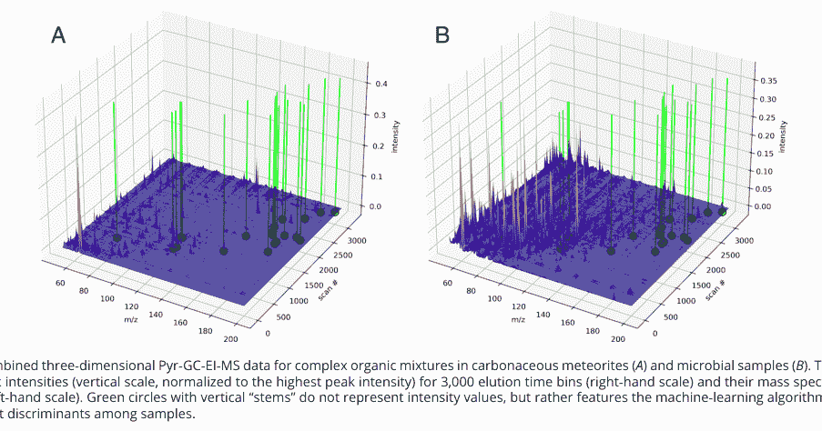
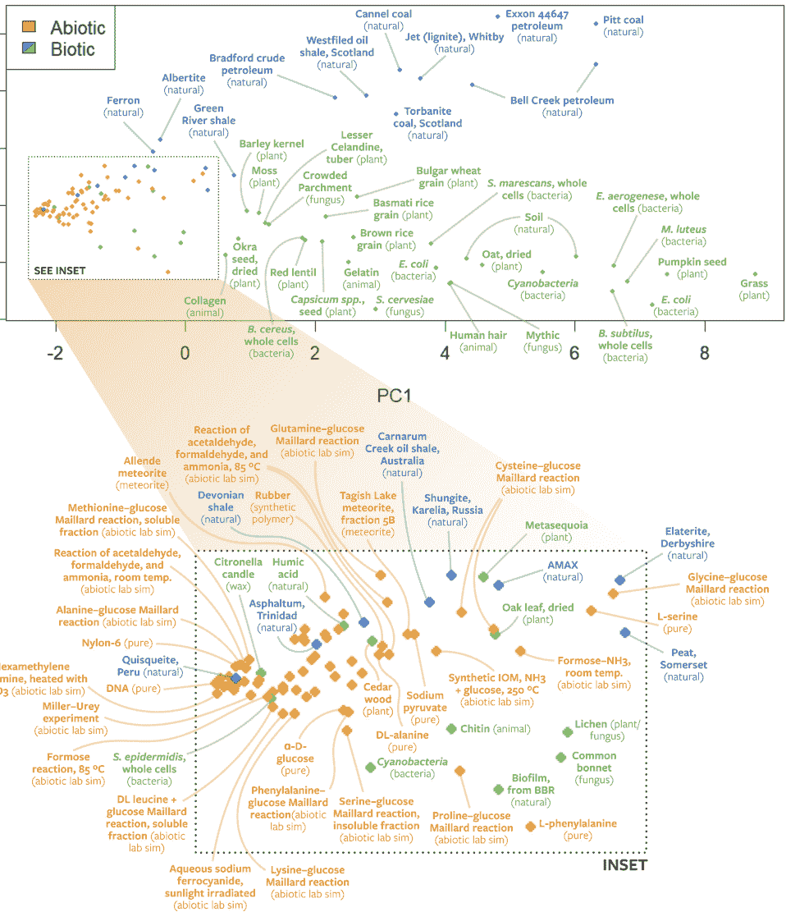

# 基于机器学习的稳健中立分子生物标志物

寻找确定性生物标志物（即过去或现在生命的明确标志）是古生物学和天体生物学的核心目标。我们使用热解-气相色谱-质谱联用法分析化学性质迥异的样本，包括活细胞、经地质过程处理的化石有机物、富碳陨石以及实验室合成的有机化合物和混合物。每个样本的数据被用作机器学习方法的训练和测试子集，从而得到一个能够以约 90% 的准确率鉴定当代及经地质过程处理的古代样本生物源性的模型。这些机器学习方法不依赖于精确的化合物鉴定：相反，色谱峰和质谱峰的关系特征提供了所需信息，这凸显了该方法在检测外星生物学方面的实用性。

生物标志物 | 有机化学 | 机器学习 | 塔富学 | 富碳陨石

生命的化学与无生命世界的化学之间是否存在根本性的差异？是否存在影响生物分子多样性和分布的“生命化学规律”？我们能否推导出这些规则，并利用它们来指导我们对生命起源的建模或在其他世界检测微妙生命迹象的工作？在这里，我们报告的研究基于这样一个假设：生物化学中根深蒂固的方面与非生物化学在根本上有所不同。与非生物系统中的分子不同，生命的有机分子构建块已被选择用于其功能，包括存储和复制信息的能力、从环境中高效采集能量和物质的能力、构建和维护自身结构的能力、控制其环境的能力以及更多（1, 2）。合成此类生物分子需要能量和信息——在竞争激烈的达尔文世界中，这些是宝贵的商品。预计生物系统中有机分子的多样性和分布与非生物过程产生的有机分子组合会有所不同（尽管差异可能很微妙）。功能的进化选择应导致生物分子频率分布与纯粹非生物过程中出现的分布不同，在这些过程中，此类随附过程不会发生或运行。

这一现象已经显而易见：富碳陨石、前生物模拟实验、有机地质聚合物（例如煤、石油、角蠕石）以及生物体本身中发现的分子集合，都可以通过多种方式加以区分，例如，通过氨基酸等成分的类型、碳同位素组成和/或手性（3）。从热力学角度来看，将物理过程与功的执行和能量耗散高效耦合（这也导致构建能够自发自组装以执行相同功能的化合物）可能需要一定的结构凝聚力，例如，形成一个集流管（如蒸汽机或内燃机）或细胞，以协同地聚焦所讨论的功（4）。这些耦合过程将行星能量流与其产生的有机分子联系起来。因此，所产生的分子保留了关于制造它们的过程的信息。

哪些分子组合能够实现开放式进化？地球生物学已经进化出多种方式来耦合功和系统产生的结构，从而产生可识别的核心细胞基序，例如与 ATP 产生耦合的化学渗透（5），这进一步与胞质内能量产生耦合。因此，此类细胞反应网络可能是普遍生命的指示器，因为细胞是使功能得以以可遗传方式执行的物质的基本组织方面。其他世界上的生物系统可能不会产生与现代地球生物学中发现的相同或甚至大致相似的有机分子组合。相反，我们认为，即使是可能与地球生物化学有显著差异的外星生物化学系统，也会显示出与背景非生物合成过程不同的分子频率分布（6）。例如，任何世界上的生命都可能表现出相对于非生物合成，向生产少量高功能化合物的系统性偏倚，这可能代表由系统性反馈催化产生的生物系统的一种潜在普遍特征。我们建议，利用我们的技术可以检测和量化生物和非生物分子组合之间的这类差异。

# 意义

我们在天体生物学最重要的问题之一方面取得了重大进展——开发了一种简单、可靠且实用的方法，用于确定行星样本（包括其他世界以及地球上最早生命痕迹）中有机材料的生物源性。我们开发了一种强健的方法，将广泛的地球和外地球富碳材料的热解 GC-MS 测量与基于机器学习的分类相结合，以实现非生物起源样本与生物标本（包括高度降解的、源于生物的古代样本）之间约 90% 的准确率区分。这种区分指向了反映生物分子功能选择达尔文式命令的底层“生物化学规律”。

作者贡献：H.J.C. 和 R.M.H. 设计了研究；H.J.C.、G.D.C. 和 S.E. 执行了研究；G.D.C. 和 R.M.H. 提供了新试剂/分析工具；H.J.C.、G.H.、A.P.、M.L.W.、S.E. 和 R.M.H. 分析了数据；H.J.C.、G.H.、A.P.、M.L.W.、G.D.C.、S.E. 和 R.M.H. 撰写了论文。作者声明无竞争利益。本文为 PNAS 直接投稿。版权 © 2023 作者。由 PNAS 出版。本文根据 Creative Commons Attribution-NonCommercial-NoDerivatives License 4.0 (CC BY-NC-ND) 许可分发。*通信作者请联系。电子邮件：rhazen@carnegiescience.edu。本文包含在线补充信息，网址为 https://www.pnas.org/lookup/suppl/doi:10.1073/pnas.2307149120/-/DCSupplemental。于 2023 年 9 月 25 日出版。

我们使用了一种强健的、适用于太空飞行的分析方法——热解气相色谱与电子击打电离质谱耦合（Pyr-GC-EI-MS）——来对多种复杂有机混合物进行分子分析（复杂性指混合物中的组分数量，而不一定是单个分子的结构复杂性）。我们将这些测量与数学建模和机器学习相结合，以表征来自其他世界或早期地球的有机分子混合物的分布，包括来自富碳陨石、古生代化石有机残留物或地球古元古代含碳黑燧石的分子。该方法揭示了源自生物系统与非生物系统的有机分子分布中强健、可重复且明确的差异。在更深层次上，我们推测，生物机制制造功能分子的进化可能与非生物系统中的无定向合成有根本不同——这是开发可能揭示生物化学底层规则的生物标志物的动力。

# 生物标志物的本质

在天体生物学背景下，生物标志物是任何能提供过去或现在生命诊断证据的物质或现象（7–12）。生物标志物可以跨越时间和空间参考框架，并可能采取个别（生物）标志物或多种可测量现象之间关系特征的形式。在寻找其他世界生命的背景下，“非特异性生物标志物”的概念尤为重要，它是指系统指向生物圈的属性，但并非源自熟悉地球生物体生物化学的独特属性（8, 13）。

已提出各种生物标志物（11）。易于识别的生物标志物包括体化石以及从微米到千米尺度的其他生物沉积物，如贝壳、牙齿和骨骼，还包括微生物垫、足迹和痕迹、如层状礁石和珊瑚礁等群体结构、结核以及保存在细粒岩石中的细胞（14, 15）。化学和同位素生物标志物已被用于众多地球样品，碳、氮、硫和/或铁同位素的独特分布受到特别关注（例如，参考文献 16 和 17）。在这一背景下，分子生物标志物具有特殊的前景。

在某些情况下，先前的研究人员提出特定分子或分子组作为合理的生物标志物（18）；例如，特定的遗传聚合物，如 DNA（19）、脂质（20）或某些手性同型分子集合（21）。同样，据称主要由代谢过程产生的各种大气分子也被引用为可能的生物标志物（22, 23）。

识别非特异性生物标志物的互补策略是检查多个样本成分（包括矿物和分子）的集体属性。例如，地球上的矿物分布，如网络分析（24）和矿物多样性及分布的统计分析（25）所表示，已被认为反映了生物圈的影响。同样，Wong 及其同事（26）将网络分析应用于大气反应网络，以识别区分生物世界和非生物世界的模式。最近识别集体分子生物标志物的努力还关注单体丰度分布（27）、有机分子反应网络的拓扑结构（28）以及复杂质谱中未分配特征的相对分布和丰度（29）。Cronin 及其同事还最近探索了样本成分的分子复杂性作为潜在生物标志物（30, 31）。我们在这里提出了一种基于机器学习分析 Pyr-GC-EI-MS 所分析的分子组中更高维度关系的互补策略，Pyr-GC-EI-MS 目前已作为各种太阳系探索任务中的分析技术部署（32–38）。

# 非生物/生物鉴别

我们的分子生物标志物检测方法包括三个步骤：

- (1) 收集 134 种多样化的含碳样本（SI 附录，表 S1）。非生物样本包括来自富碳陨石的天然分子组，以及实验室合成实验和若干纯合成化学品，这些作为分子复杂性的重要基线。现代生物样本从各种生物体中获得，还包括一系列塔富学样本，如化石树叶和木材、化石燃料（煤、石油、沥青和油页岩）以及更古老的含碳沉积物。

- (2) 将每个样本送入 Pyr-GC-EI-MS 分析（SI 附录和分析方法）。Pyr-GC-EI-MS 已被改编用于太空飞行任务（32–38），能够将有机样本直接从矿物基质快速引入 GC 仪器，几乎不需要样本前处理。因为热解产物会迅速结合生成原始样本中不存在的化合物，因此生成的数据集高度复杂，不能与样本的原始成分 1:1 对应。Pyr-GC-EI-MS 分析的这一特点激励了我们下面采用的机器学习方法。

- (3) 使用每个样本分析的三维色谱保留时间/荷质比/强度数据训练随机森林机器学习模型（SI 附录和机器学习方法）。在本工作中，色谱保留时间也称为扫描编号，因为我们测量特定特征在分析中出现的时间。在这个 Pyr-GC-EI-MS 工作流程中，热解产生的挥发性化合物由 GC 分离，然后进一步接受 EI-MS 分析，这基于碎片化模式提供重要的结构信息（39），尤其是当这些数据可以与 EI-MS 库进行比较时（40）。

在对所有 134 个样本中的 Pyr-GC-EI-MS 特征进行评估后，随机森林模型以约 90% 的准确率正确预测了样本的生物源性。因此，使用嵌套交叉验证（CV）的泛化测试误差为 10.4%，受试者工作特征曲线下面积为 91.2%。

基于主成分分析（PCA）图的基尼分割指数，选出了 20 个最重要的特征——该指数提供了方差的度量，突出显示决策树中随机选择的元素被错误分类的频率（41）。基尼分割指数得分最高的特征是预测区分最相关的变量。虽然所选属性集的影响尚未完全阐明，但来自样本子集的数据的求和三维表示（例如，富碳陨石样本与微生物群落（分别为图 1 A 和 B））明显表明非生物样本和生物样本中分子分布存在显著差异。图 2 显示

训练数据的 PCA 图，其中测试数据的得分被投影到与训练数据相同的 PCA 空间中。测试数据的尺度从训练数据的均值和标准差中获取。前两个主成分解释了训练数据中约 54.9% 的变异（图 2）。

# 讨论

我们分析了来自不同非生物、生物及埋藏改变的生物有机分子混合物的集体分子分布，以证明生命合成的有机分子组与非生物产生的有机分子组之间存在明显差异。重要的是，我们发现，尽管有机质经过广泛成熟（在某些情况下长达数亿年），生物性标志仍然保存。

哪些分子特征可能对非生物、现代生物和埋藏改变样品之间观察到的差异有所贡献？我们探索了多种非生物反应的产物，这些反应结合了糖降解（例如，福马糖反应）产生多样性的特性，与胺与碳水化合物结合产生多样性的倾向，例如各种氨基酸与葡萄糖的美拉德反应（42）。碳质陨石来源的有机分子组被认为源自类似福马糖的化学反应（43）。已知福马糖反应和美拉德反应会产生大量含多种杂原子的极性产物，如吡嗪、呋喃和二酮哌嗪（44）——这些化合物在地质记录中通常保存较差（45）。因此，它们的检测可以被视为近期糖类和胺类丰富的标志物，这些物质可能源自类似福马糖的化学反应或生物过程。

生物化学还涵盖了现代生物体中多种多样的不相关化学过程（46）。无论可能使生命成为可能的化学过程多么多样，水溶性和不溶性有机物种的丰富共存似乎都是生命的标志之一。大多数陆地生物干重的很大一部分由糖衍生化合物组成，包括纤维素、糖原、几丁质以及核酸中的核糖和去氧核糖（47）。这些物种产生特征性热解产物（包括呋喃和吡喃），加上一种肽组分，它产生其他独特的热解产物（包括吡嗪和与糖源热解产物池的类似美拉德交叉产物）。因此，我们提出，可检测量中极性多样的分子共存指向近期生命的存在，或者更广泛地，指向细胞的功能结构组织。

大多数保存下来的生物地球碳由细胞膜和细胞壁材料的降解产物组成，例如石油和煤的形式（48）。石油普遍被认为源自类型 I 凯罗jen的热降解，后者源自藻类生物聚合物。煤主要源自植物维管组织的木质-纤维素生物聚合物；高挥发性沥青煤在成岩作用过程中已经转化，以至于不再保留木质素或纤维素的分子签名。这些降解的分子组倾向于源自水溶性较低的材料——指向细胞起源的分子。

非生物来源与生物来源材料之间的系统性差异，暗示了我们使用 Pyr-GC-EI-MS 数据发现的稳健鉴别因素背后可能的原因。在任何给定的固相 GC 支持柱上，色谱保留时间可通过 Kovats 指数相关联，该指数有助于将化合物挥发性和极性与保留时间进行归一化（49）。因此，源自细胞的材料将具有一个源自细胞膜/细胞壁材料的非极性成分，该成分在色谱中晚洗脱，还有一个源自胞质的极性成分，该成分早洗脱（取决于色谱基质）。同时表现出这两种色谱行为材料的样品通常源自细胞，因为细胞以协调的方式产生极性和非极性化合物。相比之下，非生物多样性生成反应产生极性和非极性化合物时方式不协调，从而导致两类材料之间的比例失衡。极性和非极性化合物不太可能以可比比例同时出现，因为没有已知的非生物过程在缺乏极性有机物的情况下产生平衡量的非极性产物。例如，虽然非极性、少杂原子材料是陨石中陈旧有机质的常见聚合点，但此类材料很容易与陈旧的生物沉积物（如煤和石油）区分开来，因为这类材料保留了可观察的极性分子不规则性，例如脂肪酸及其他烃类中的偶-奇差异。烷烃和脂肪酸中的偶-奇差异随着石油通过成岩“平滑”作用成熟而倾向于消失。因此，偶-奇特征提供了衡量石油样品年龄的指标。

## 使用前 20 个重要变量的训练和测试样品 PCA 图

图 2. 根据本研究中探索的机器学习方法对样品进行分组。生物来源样品（绿色/蓝色）与非生物样品（橙色）相区分。埋藏改变的生物样品（蓝色）沿着与当代生物样品（绿色）不同的趋势分布。

## 意义

分析不确定生物性样品的前景。我们的方法可能可用于确定手头数据的生物性。一个重要例子是西澳大利亚 Pilbara 克拉通中的 3.5 Ga Apex 燧石，其所谓的生物性引发了重大争议（50, 51）。此外，火星 Viking 着陆器和 Curiosity 漫游者上的 Pyr-GC-MS 仪器测量的样品（34, 43, 52）值得重新评估。虽然我们的方法必须首先针对这些仪器的特定热升温和最大温度条件进行校准，但这些及其他机器学习方法有望在地球外来源样品返回地球之前评估其生物性（53）。在这方面特别感兴趣的是环境化学品（例如火星上的高氯酸盐（54））以及辐射改变的分子组（55）的可能作用，它们可能显著影响所得分子混合物的性质。

### 生物化学规则

非生物和生物样品中分子分布所识别的系统性差异表明，生物化学与非生物有机化学本质上不同。我们的工作假设是，与非生物分子组（例如碳质陨石中的分子）不同，生物分子是为功能而被选择的。这种差异导致生物分子的数量更有限，并且在某些情况下结构可能更复杂（30, 31），比非生物组中的有机分子更甚。对本研究中识别的特定属性星座进行更深入的检验，是检验这一假设的下一步。尽管观察到埋藏过程不可避免地导致信息丢失（56–58），但我们的方法能够区分古老的、经地质过程处理的生物样品与非生物有机物，同时可能为埋藏降解程度提供定量指标。在此方面，重要的是要注意，非生物分子系统本身并不简单。例如，从 Murchison 碳质球粒陨石中提取的分子组在其结构多样性和数量上都显得非常复杂（59）。很可能存在区分生物与非生物系统的分子复杂性方面，如 Cronin 及其同事所探讨的（30, 31）。然而，我们在此记录的非生物与生物分子分布之间的诊断高维差异，不在于单个分析物的复杂性或多样性，而在于它们的关系性质。

### 我们提出的生物标志物具有不可知性

本研究的一个重要发现是，非生物、活体和埋藏的有机分子组在其高维空间中表现出明确定义的簇，如图 2 所示。与此同时，该属性空间的大体积“空域”既未被非生物组也未被陆地生命所占据。这种拓扑结构暗示，外星生物化学可能通过在图 2 的不同区域形成其自身的属性簇而被识别——该簇反映了生物系统中为功能选择的基本作用，尽管功能分子组可能截然不同。非生物系统倾向于在此相空间的非常狭窄区域内聚集，从原则上讲，这可能允许轻松识别与非生物地球化学系统或已知陆地生命不相似的异常信号。

# 方法

## 样品表征

我们从各种非生物和生物（有时含糊）的来源中收集了 134 个含碳样品。这些样品及其属性列表载于 SI 附录，表 S1。

## 分析方法

Pyr-GC-EI-MS 分析使用 CDS 1000 热解仪（CDS Analytical, Inc., Oxford, PA）进行，该热解仪与 Hewlett-Packard 6890 系列气相色谱仪相连，并进一步与 Agilent 5972 四极杆质谱仪相连。使用 Agilent 30 m 5% 苯基聚甲基硅氧烷柱进行色谱分离。GC 柱箱温度程序设定为在 50 °C 处保持 1 min，然后以 5 °C min−1 的速率升温至 300 °C，并在 300 °C 处保持 15 min。氦气（UHP 5.5 级）用作载气，恒定流量模式运行。约 1 mg 样品被加载到预灰化石英管中（在空气中于 550 °C 下预燃 3 h），然后插入热解仪的铂丝线圈中。随后，将热解仪插入充满氦气的接口，并进行闪速热解（升温速率 500 °C s−1）至 610 °C 并保持 10 s。热解产物立即被 He 气体扫入 GC 柱并进行分析。离子源在电子电离（EI）模式下运行，电离能为 70 eV，温度为 250 °C。质谱选择性探测器扫描速率为 0.80 s/decade，范围为 m/z 50 至 700，扫描间延迟为 0.20 s。

在许多 Pyr-GC-EI-MS 应用中，数据输出会与 EI-MS 库进行比较，以鉴定特定分子化合物。可用的 EI-MS 库可能全面覆盖普通陆地样品中存在的化合物，以寻找“感兴趣的分析物”（例如，药物、类固醇和农药）。然而，预测大多数可能稳定低分子量有机物的有机异构性估计认为，这些化合物是“尚未知晓或未合成的化合物”（60, 61）。使用我们的方法，精确的化合物鉴定有用但不是必要的：相反，色谱和质谱峰的关系性质是感兴趣的。这种方法强调了该方法在检测外星生物方面的实用性，这也与早期的关系生物学概念相一致（32, 62）。

注射后前 2 min 未采集 MS 数据，以避免因 CO2 和 H2O 等小分子挥发物过载探测器。此外，由于许多样品是独立整理的，并且显示出来自 C16（棕榈酸）和 C18（硬脂酸，这些是指纹中常见的成分，也被添加到塑料样品袋中的“滑动剂”以防止袋子粘在一起）的信号，因此我们排除了色谱图中这些常见污染物洗脱区域之后的区域。然而请注意，此类化合物的衍生物（例如，直链和支链长链烷烃、烯烃，以及这些物质的重排醛和酮衍生物）仍会对所检查的色谱复杂性做出贡献，这些衍生物有助于截止前区域的分子复杂性。我们发现 m/z 200 之后几乎没有信号；因此，计算方法中考虑的区域限制为 2 至 35 min 和 m/z 50 至 200。每个样品被归约为一个包含 489,240 个元素的二维矩阵，表示作为质量和保留时间函数的信号强度，尽管许多强度值为零（图 1）。

## 机器学习分析

我们使用每个样品的三维色谱保留时间/质量电荷比/强度数据训练了机器学习模型。本手稿中生成和分析的数据可在 Open Science Framework 仓库中找到，标题为“基于机器学习的稳健分子生物标志物”（https://doi.org/10.17605/OSF.IO/EMBH8）。论文的代码可在 https://github.com/ghystad/Machine-learning_and_preprocessing_Pyr_GSMS_data/tree/master 找到。分析中使用的所有数据、代码和材料均可供任何研究人员用于复制或扩展分析。数据和代码使用的许可证及相关归属信息将在各自的仓库中更新。

在此，峰强度在 0 到 1 的范围内归一化，而时间和质量/电荷比分别按采集的 3,240 个扫描时间步长（每个扫描代表 3 s）和 1 m/z 的增量进行分析，范围为 m/z 50 至 200。我们的机器学习策略允许鉴定保留时间和 m/z 值的诊断属性集，以突出非生物和生物样品之间的差异。我们的嵌套 CV 方法克服了对训练数据过拟合的问题。我们还计划在未来工作中通过聚焦蒙特卡洛模拟、向训练集和测试集添加更多样品以及监测测试和训练误差的变化，来改进模型的泛化能力。

### 预处理

分析的 134 个样品包括 59 个生物来源样品和 75 个非生物来源样品。每个样品表示为一个二维矩阵，其中行和列分别表示扫描编号和 m/z 比值，条目为相应的强度。对于每个样品和 m/z 值，我们在色谱方向上执行预处理步骤，通过取平方根来稳定强度值的方差，通过取当前值及其两侧最近五个观测值的移动平均来平滑这些值，并减去基线，基线估计基于对统计敏感的非线性迭代峰削算法（63），使用 R 库 MALDiquant（64）。

强度值通过 min-max 归一化（65）进行归一化，然后对每个 m/z 比值在色谱方向上进行峰检测。峰被检测为高于 4× 信噪比的局部极大值，噪声通过使用 R 库 MALDiquant（64）计算中位数绝对偏差来估计。在使用 R 库 caret（66）消除近零方差和强相关特征后，数据被归约为 8,149 个特征，即检测到的扫描编号和 m/z 值的组合。这 134 个 Pyr-GC-MS 数据文件可在 https://osf.io/emb8/?view_only=89695d388b484af28dae80ce4de3b33c (DOI: 10.17605/OSF.IO/EMBH8) 上找到。

### 模型选择

在我们探索的各种分类方法中，随机森林方法在准确区分生物样本和非生物样本方面迅速取得了最佳效果，因此被用于训练最终模型。随机森林方法是一种集成分类方法，它构建一组去相关的决策树（67）。可能存在更好的方法，我们正在探索其他方法的相对优势，以供未来的出版物参考。我们使用了R库mlr3中的随机森林模型（68）。

Machine_learning_and_preprocessing_pyr_GSMS_data/tree/master (71). 用于分析的所有数据、代码和材料均可供任何研究人员用于复制或扩展分析。数据和代码使用的许可证以及相关的归属信息可在各自的仓库中获得。

### 模型验证

我们为训练好的机器学习模型采用了两种验证策略。首先，数据使用分层随机采样分为95个样本的训练集和39个样本的测试集，模型在训练集上使用10倍交叉验证进行参数调优后进行了测试。最终训练好的随机森林模型随后被应用于预测测试数据的生物或非生物来源。其次，我们对所有134个样本使用了嵌套交叉验证（69），以获得机器学习方法预测性能的无偏估计。嵌套交叉验证在内层循环中使用10倍交叉验证，在外层循环中使用五倍交叉验证。算法在使用随机搜索进行20次评估后终止。

# 致谢

我们感谢Stuart Bartlett、Carol Cleland以及两位匿名审稿人对本文早期版本进行的宝贵讨论和详细评审。我们还感谢编辑Roger Summons对手稿的细心耐心处理。我们特别感谢John Saul捐赠了本研究中使用的80个样本。分子生物标志物的研究得到了John Templeton Foundation Grant 61783的支持。NASA Astrobiology Institute ENIGMA团队（grant 80NSSC18M0093）还提供了额外支持。此处表达的任何意见、发现或建议均为作者本人观点，不一定反映NASA的观点。

# 数据、材料和软件可用性

本手稿中生成和分析的数据[Pyr-GC-MS数据文件（134个文件）]可在Open Science Framework仓库中找到，标题为“基于机器学习的强健分子生物标志物”（70）。本论文的代码可在 https://github.com/ghystad/ 上找到。

## 作者单位

卡内基科学研究所地球与行星实验室，华盛顿特区20015；东京工业大学地球生命科学研究所，日本东京152-8550；蓝色大理石空间科学研究所，西雅图，WA 98104；普渡大学西北分校数学与统计学系，哈蒙德，IN 46323；萨根学者，NASA哈伯奖学金计划，空间望远镜科学研究所，巴尔的摩，MD 21218；以及约翰霍普金斯大学地球与行星科学系，巴尔的摩，MD 21218

- 1. C. M. Dobson，化学空间与生物学。*自然* **432**, 824–828 (2004).
- 2. M. L. Wong, A. Prabhu，细胞作为首批数据科学家。*界面* **20**, 20220810 (2023).
- 3. K. Kvenvolden等人，默奇森陨石中外源氨基酸和烃类的证据。*自然* **228**, 923–926 (1970).
- 4. S. Kauffman，对于非绝热系统以构建其扩展相空间而做功，是否存在第四定律？*熵* **24**, 1383 (2022).
- 5. P. Mitchell，通过化学渗透型机制将磷酸化与电子和氢转移耦合。*自然* **191**, 144–148 (1961).
- 6. C. P. McKay，什么是生命——我们如何在其他世界中寻找它？*PLOS生物学* **2**, e302 (2004).
- 7. J. D. Farmer, J. D. Des Marais，探寻古代火星生命的记录。*地球物理学研究杂志：行星* **104**, 26977–26995 (1999).
- 8. E. S. Johnson等人，非地球生物标志物指纹。*天体生物学* **18**, 915–922 (2018).
- 9. E. W. Schwieterman等人，系外行星生物标志物：可远程检测的生命迹象综述。*天体生物学* **18**, 663–708 (2018).
- 10. S. I. Walker等人，系外行星生物标志物：未来方向。*天体生物学* **18**, 779–824 (2018).
- 11. M. A. Chan等人，行星背景中的生物标志物解读。*天体生物学* **19**, 1075–1101 (2019).
- 12. S. Bartlett等人，使用电纺机器评估行星复杂性和潜在不可知生物标志物。*自然天文学* **6**, 387–392 (2022).
- 13. C. E. Cleland，*生命的本质：寻找生命统一理论的探索：寻找生命*（剑桥大学出版社，2019）.
- 14. J. P. Grotzinger, A. H. Knoll，前寒武纪碳酸盐中的层状碳酸盐岩：进化里程碑还是环境尺度？*地球与行星科学年度评论* **27**, 313–358 (1999).
- 15. N. Noffke，碎屑沉积物中的微生物诱导沉积构造：关于火星化石生命命题的启示。*天体生物学* **21**, 866–892 (2021).
- 16. J. Farquhar, H. Bao, M. Thiemens，地球最早硫循环的大气影响。*科学* **289**, 756–758 (2000).
- 17. Y. Shen, R. Buick, D. E. Canfield，早期太古代微生物硫酸盐还原的同位素证据。*自然* **410**, 77–81 (2001).
- 18. R. E. Summons等人，分子生物标志物。*空间科学评论* **135**, 133–159 (2016).
- 19. M. Dannemann等人，迈向从土卫二和欧罗巴喷出的冰粒中的细菌检测DNA、脂质和代谢中间体的生物标志物。*天体生物学* **23**, 60–75 (2023).
- 20. C. D. Georgiou, D. W. Deamer，脂质作为外星生命的普遍生物标志物。*天体生物学* **14**, 541–549 (2014).
- 21. D. Arvin，外星生命手性指标的批判性综述。*新天文学评论* **92**, 101596 (2021).
- 22. C. R. Webster等人，盖尔陨石坑的火星甲烷检测与变异。*科学* **347**, 415–417 (2015).
- 23. V. S. Meadows等人，关于系外行星大气中O2作为生物标志物的反思。*天体生物学* **18**, 630–662 (2018).
- 24. S. M. Morrison等人，矿物系统的网络分析。*美国矿物学家* **102**, 1588–1596 (2017).
- 25. G. Hystad等人，使用非信息先验进行地球未发现矿物多样性的贝叶斯估计。*数学地球科学* **51**, 401–417 (2019).
- 26. M. Wong等人，迈向基于网络的行星生物标志物：重新审视大气化学作为二部图、无权、无向网络。*地球物理学研究杂志：行星* **128**, e2022JE007658 (2023).
- 27. E. D. Dorn等人，单体丰度分布模式作为普遍生物标志物：来自陆地生命和数字生命的例子。*分子进化杂志* **72**, 283–295 (2011).
- 28. C. Jolly, T. Douglas，拓扑生物标志物：来自生物学和天体化学的化学网络的大规模结构。*天体生物学* **12**, 29–39 (2012).
- 29. N. Gutteridge等人，用于检测外星生命的复杂有机混合物生物复杂性分类。*生命* **11**, 234 (2021).
- 30. S. M. Marshall, A. R. Lyra, L. Cronin，使用路径复杂性识别生物标志物的概率框架。*皇家学会学报A辑* **375**, 20160342 (2017).
- 31. S. M. Marshall等人，使用组装理论和质谱将分子作为生物标志物进行识别。*自然通讯* **12**, 3033 (2021).
- 32. J. E. Lovelock，生命检测实验的物理基础。*自然* **207**, 568–570 (1965).
- 33. P. G. Simmons，通过热解-气相色谱-质谱联用研究整个微生物：对外星生命检测实验的意义。*应用微生物学* **20**, 567–572 (1970).
- 34. K. Biemann，关于维京号气相色谱-质谱仪检测有机物的能力。*美国国家科学院院刊* **104**, 10310–10313 (2007).
- 35. P. R. Mahaffy等人，火星样本分析调查及仪器套件。*空间科学评论* **170**, 401–478 (2012).
- 36. R. A. Mathies等人，使用土卫二有机分析仪检测土卫二羽流中生物有机化合物的可行性。*天体生物学* **17**, 902–912 (2017).
- 37. L. Chou等人，用于太阳系中不可知生命检测的行星质谱。*天文学与空间科学前沿* **8**, 755100 (2021).
- 38. T. L. Salter等人，用于冰卫星生命检测的细菌和古细菌质谱指纹。*天体生物学* **22**, 143–157 (2022).
- 39. E. Pretsch等人，*有机化合物结构测定*（Springer-Verlag，2000）.
- 40. E. L. Schymanski等人，结合GC/EI-MS、结构生成和计算性质的共识结构推定。*分析化学* **84**, 3287–3295 (2012).
- 41. H. Han等人，基于随机森林的变量选择，使用平均精度下降和平均基尼下降。*IEEE国际软件工程与服务科学会议* **7**, 219–224 (2016).
- 42. G. P. Ellis，迈雅反应。*糖化学进展* **14**, 63–134 (1959).
- 43. Y. Kebukawa, A. D. Kolykine, G. D. Cody，通过星际甲醛聚合探索陨石和彗星中有机固体的潜在形成。*天体物理学期刊* **771**, 17 (2013).
- 44. E. L. Wick, I. Horvath, R. Teranishi，*风味化学*（第3版 Plenum Press，1999）.
- 45. G. Dungworth等人，安大略湖沉积岩芯中氨基酸、氨基糖、嘌呤和吡啶的分布。*化学地质学* **19**, 295–308 (1977).
- 46. P. Mazzarello，一个统一概念：细胞理论的历史。*自然细胞生物学* **1**, E13–E15 (1999).
- 47. R. Milo, R. Phillips，*按数字读懂细胞生物学*（CRC Press，博卡拉顿，FL，2015）.
- 48. V. J. Killops, S. D. Killops，*有机地球化学导论*（Wiley，2013）.
- 49. V. E. Kovacs，有机化合物的气相色谱表征。第1部分：脂族卤代烃、醇、醛和酮的保留指数。*瑞士化学杂志* **41**, 1915–1932 (1958).
- 50. C. P. Marshall等人，西澳大利亚皮尔巴拉克拉通34亿年前太古代燧石中有机质的结构表征。*前寒武纪研究* **155**, 1–23 (2007).
- 51. M. Bournis, S. Derenne, F. Robert，从太古代燧石中分离的有机质热解-气相色谱-质谱分析的局限性。*有机地球化学* **32**, 32–34 (2012).
- 52. NASA，“面向科学家的SAM”。https://mars.nasa.gov/msl/spacecraft/instruments/sam/for-scientists/。访问日期：2021年4月15日.
- 53. V. Da Poian等人，科学自主性与ExoMars任务：使用机器学习帮助在火星上寻找生命。*计算机* **54**, 69–77 (2021).
- 54. D. P. Glavin等人，SAM在盖尔陨石坑Rocknest风积沉积物中检测到的高氯酸盐和氯代烃的起源证据。*地球物理学研究杂志：行星* **118**, 1955–1973 (2013).
- 55. A. A. Pavlov等人，火星浅表地下氨基酸的快速放射降解：对寻找灭绝生命的启示。*天体生物学* **22**, 1009–1115 (2022).
- 56. D. R. Lawrence，化石群落中的塔福诺米与信息损失。*美国地质学会公报* **79**, 1315–1330 (1968).
- 57. A. K. Behrensmeyer, S. M. Kidwell, R. A. Gastaldo，《深时：古生物学的视角》中的“塔福诺米与古生物学”，D. H. Erwin和S. L. Wing编（古生物学学会，2000），第103–147页.
- 58. S. L. Potter-McIntyre等人，泉水沉积物中微生物生物标志物的塔福诺米：现代、第四纪和侏罗纪实例的比较。*天体生物学* **17**, 216–230 (2017).
- 59. P. Schmitt-Kopplin等人，默奇森陨石坠落40年后揭示的外源有机物高分子多样性。*美国国家科学院院刊* **107**, 2763–2768 (2010).
- 60. A. M. Riya等人，用于发现非生物反应中自催化网络的开源计算工作流。*化学科学* **13**, 4838–4853 (2022).

- 61. S. Devata et al., 电子电离质谱预测方法的比较评价. J. Am. Soc. Mass Spectrom. 34, 1584–1592 (2023).

- 62. N. Rashevsky, 统一物理、生物和社会学方法的纲要. Bull. Math. Biophys. 31, 159–198 (1969).

- 63. C. G. Ryan et al., SNIP，一种用于地球化学应用中 X 射线光谱定量分析的统计敏感背景处理方法. Nucl. Instr. Methods Phys. Res. B 34, 396–402 (1988).

- 64. S. Gibb, K. Strimmer, MALDIquant：用于质谱数据分析的多功能 R 包. Bioinformatics 28, 2270–2271 (2012).

- 65. S. G. Patro, K. K. Sahu, 归一化：一种预处理阶段. arXiv [预印本] (2015). https://doi.org/10.48550/ARXIV.1503.06462 (2023 年 8 月 23 日访问).

- 66. M. Kuhn, 分类和回归训练，包，caret. https://github.com/topepo/caret/ (2022).

- 67. T. K. Ho, 随机决策森林. Proc. Int. Conf. Document Anal. Recogn. 3, 278–282 (1995), 10.1109/ICDAR.1995.598994.

- 68. M. Lang et al., mlr3：R 中的现代面向对象机器学习框架. J. Open Source Softw. 4, 1903 (2019), https://joss.theoj.org/papers/10.21105/joss.01903.

- 69. T. Hastie, R. Tibshirani, J. Friedman, "模型评估与选择"，载于《统计学习要素》(Springer 统计学系列，Springer, 2009).

- 70. H. Cleaves, 基于机器学习的稳健分子生物标志物. 开放科学框架. https://doi.org/10.17605/OSF.IO/EMBH8. 2023 年 6 月 7 日存入.

- 71. G. Hstad, A. Prabhu, 应用于三维热解 GC-MS 数据的基于机器学习的稳健分子生物标志物 (版本 1.0，计算机软件，Github，美国加利福尼亚州旧金山 2023). https://github.com/ghstad/Machine_Learning_and_preprocessing_pyr_GSMS_data/tree/master. 2023 年 8 月 22 日访问.
