# 深度学习的统计机器学习视角：算法、理论与可扩展计算


## 人工智能/机器学习要素


任务

模型

- 图模型
- 非参数贝叶斯模型
- 大间隔
- 正则化贝叶斯方法
- 深度学习
- 谱/矩阵方法
- 稀疏编码
- 稀疏结构化输入/输出回归

算法

- 随机梯度下降 / 反向传播
- 坐标下降
- L-BFGS
- 吉布斯采样
- Metropolis-Hastings

实现

- Mahout (MapReduce)
- MLlib (BSP)
- CNTK
- MxNet
- Tensorflow (Async)
- …

系统

Hadoop　　Spark　　MPI　　RPC　　GraphLab　　…

平台与硬件

- 网络交换机
- Infiniband
- 网络附加存储
- 闪存存储
- 服务器机器
- 桌面电脑/笔记本电脑
- NUMA 机器
- 移动设备
- GPU、CPU、FPGA、TPU
- ARM 驱动设备
- RAM
- Flash
- SSD
- 云计算（例如 Amazon EC2）
- 物联网网络
- 数据中心
- 虚拟机

## ML 与 DL

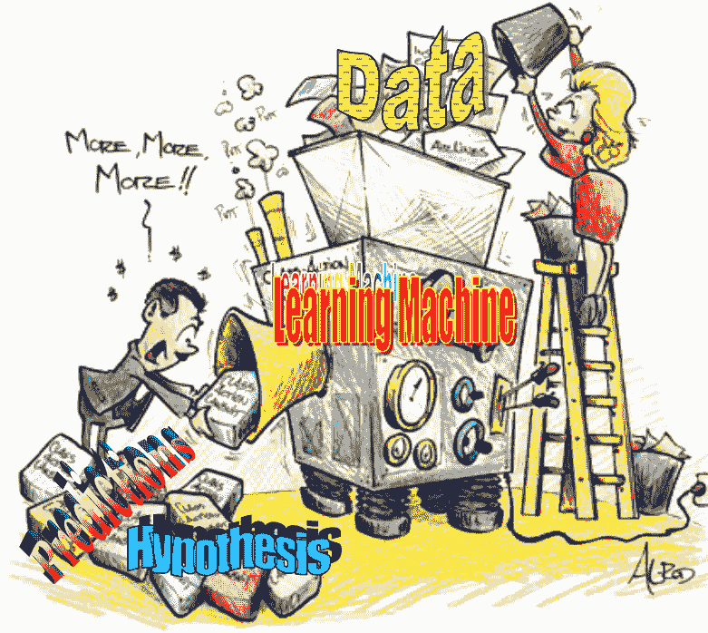

更多，更多，更多！！

数据

学习机器

预测

假设

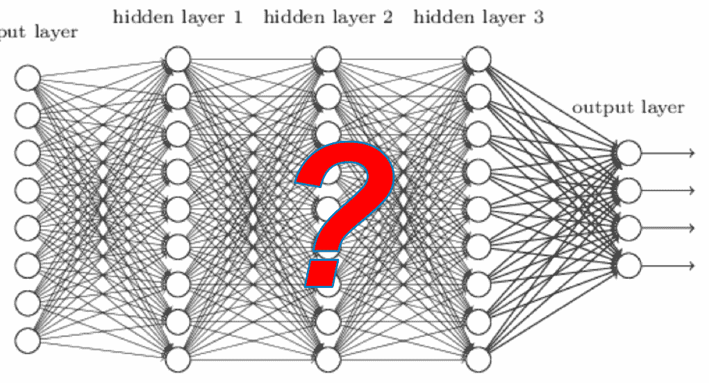

输入层

隐藏层 1

隐藏层 2

隐藏层 3

输出层

## 计划

- 深度学习的统计与算法基础及洞见
- 关于深度生成模型的统一框架
- 计算机制：编程平台与分布式深度学习架构

## 大纲

- 概率图模型：基础
- DL 组件概述
  - 历史回顾：神经网络的早期阶段
  - 现代构建模块：单元、层、激活函数、损失函数等
  - 反向模式自动微分（即反向传播）
- GMs 与 NNs 之间的相似性与差异
  - 图模型 vs 计算图
  - 作为图模型的 Sigmoid 信念网络
  - 深度信念网络与玻尔兹曼机
- 结合 DL 方法与 GMs
  - 使用神经网络的输出作为图模型的输入
  - 势函数由神经网络表示的图模型
  - 具有结构化输出的神经网络
- 神经网络的贝叶斯学习
  - 神经网络参数的贝叶斯学习
  - 深度核学习

## 概率建模的基本问题

- **表示：** 多个变量上的联合概率分布是什么？

  $P(X_1, X_2, X_3, ..., X_d)$

  - 有多少种状态配置？
  - 是否都需要表示？
  - 能否将领域特定洞见纳入表示中？
- **学习：** 我们从哪里获得概率？
  - 最大似然估计？需要多少数据？
  - 是否还有其他既定原则？
- **推断：** 如果并非所有变量都可观测，如何计算给定证据下隐变量的条件分布？
  - 计算 $P(H|A)$ 需要对未观测变量的 $2^6$ 种配置求和

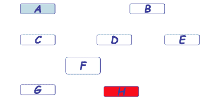

### GMs 的两种类型

P(H|V)  
θ = argmax_θ P_θ(V)

- **有向边** 为关系赋予因果含义（贝叶斯网络或有向图模型）

  P(X₁,X₂,X₃,X₄,X₅,X₆,X₇,X₈) =  
  P(X₁)P(X₂)P(X₃|X₁)P(X₄|X₂)P(X₅|X₂)  
  P(X₆|X₃,X₄)P(X₇|X₆)P(X₈|X₅,X₆)
- **无向边** 表示变量之间的相关性（马尔可夫随机场或无向图模型）

  P(X₁,X₂,X₃,X₄,X₅,X₆,X₇,X₈) =  
  1/Z exp{E(X₁)+E(X₂)+E(X₁,X₃)+E(X₂,X₄)+E(X₅,X₂)+  
  E(X₃,X₄,X₆)+E(X₆,X₇)+E(X₅,X₆,X₈)}

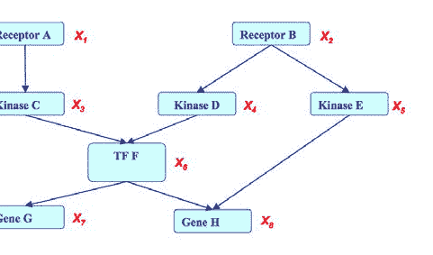

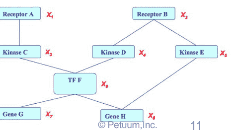

## 云计算概述

云计算（Cloud Computing）是一种基于互联网的计算方式，通过这种方式，共享的软硬件资源和信息可以按需提供给计算机各种终端和其他设备。

云计算是分布式计算、并行计算、效用计算、网络存储、虚拟化、负载均衡、热备份冗余等传统计算机和网络技术发展融合的产物。

- 按需自助服务（On-demand Self-service）
- 广泛网络访问（Broad Network Access）
- 资源池化（Resource Pooling）
- 快速弹性（Rapid Elasticity）
- 可计量服务（Measured Service）

云计算的五大基本特征构成了其核心价值，使得用户能够以更低成本、更高效率地获取计算资源。

### 三种服务模式

| 服务模式 | 英文名称 | 说明 |
| --- | --- | --- |
| 基础设施即服务 | IaaS | 提供虚拟化的计算资源、存储和网络 |
| 平台即服务 | PaaS | 提供开发平台和工具，如操作系统、数据库 |
| 软件即服务 | SaaS | 提供完整的软件应用程序服务 |

> 云计算的核心思想是将大量用网络连接的计算资源统一管理和调度，构成一个计算资源池向用户按需服务。

服务等级协议（SLA）是云计算服务商与用户之间达成的服务标准约定，确保服务质量和可用性达到承诺的水平。

- 1. 公有云（Public Cloud）
- 2. 私有云（Private Cloud）
- 3. 混合云（Hybrid Cloud）

企业根据成本和安全性需求选择合适的部署模型，其中混合云因兼具灵活性和安全性而越来越受到大型企业的青睐。

## 感知器与神经网络

- 从生物神经元到人工神经元（感知器）
- 从生物神经网络到人工神经网络

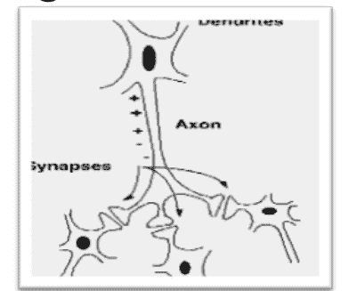

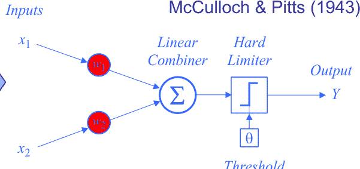

McCulloch & Pitts (1943)

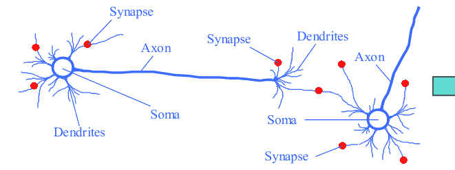

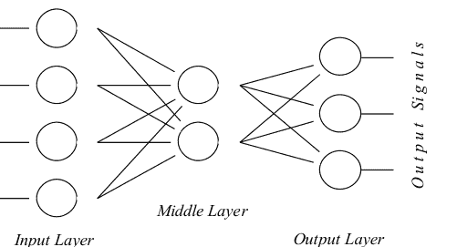

### 神经网络模型

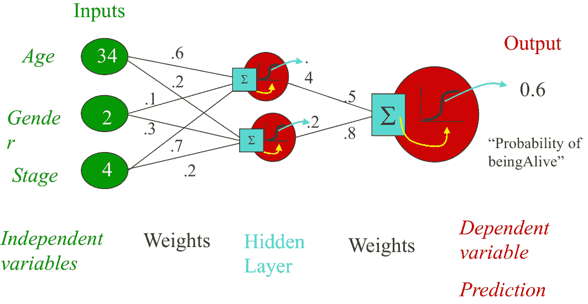

输入

年龄 — 34

性别 — 2

阶段 — 4

权重：.6, .2, .1, .3, .7, .2

隐藏层

权重：.5, .8

输出

0.6

> “存活概率”

自变量

权重

权重

因变量

预测

### 反向传播
反向模式微分

- 人工神经网络不过是复杂的函数组合，可以用 **计算图** 表示：

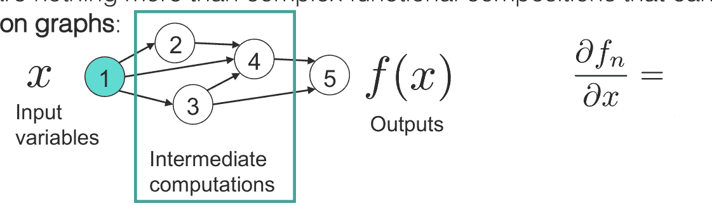

### 反向传播
反向模式微分

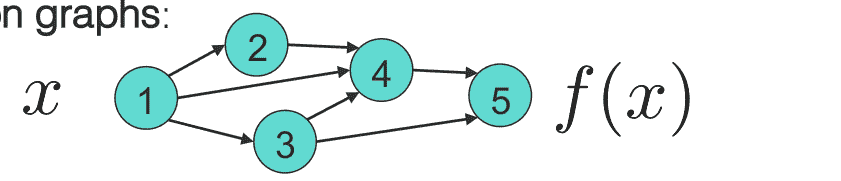

- 人工神经网络不过是复杂的函数组合，可以用计算图表示：
- 通过应用链式法则并使用反向累积，我们得到

  $$\frac{\partial f_n}{\partial x} = \sum_{i_1 \in \pi(n)} \frac{\partial f_n}{\partial f_{i_1}} \frac{\partial f_{i_1}}{\partial x} = \sum_{i_1 \in \pi(n)} \frac{\partial f_n}{\partial f_{i_1}} \sum_{i_2 \in \pi(i_1)} \frac{\partial f_{i_1}}{\partial f_{i_2}} \frac{\partial f_{i_1}}{\partial x} = \dots$$
- 该算法通常被称为反向传播
- 如果某些函数是随机的怎么办？
- 那么使用随机反向传播！  
  （将在下一部分介绍）
- 现代软件包可以自动完成此操作（稍后详细介绍）

### 深度网络的现代构建模块

- 激活函数
  - 线性和 ReLU
  - Sigmoid 和 tanh
  - 等等
- 层
  - 全连接
  - 卷积与池化
  - 循环
  - ResNets
  - 等等

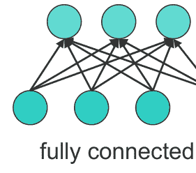

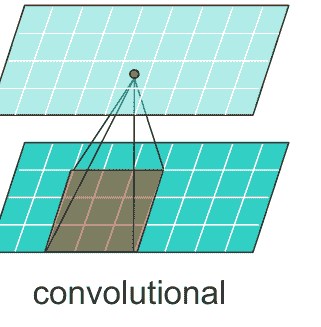

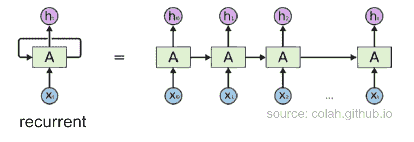

来源: colah.github.io

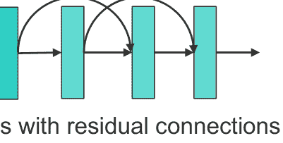

### 深度网络的现代构建模块

- 激活函数
  - 线性和 ReLU
  - Sigmoid 和 tanh
  - 等等
- 层
  - 全连接
  - 卷积与池化
  - 循环
  - ResNets
  - 等等
- 损失函数
  - 交叉熵损失
  - 均方误差
  - 等等

综合起来：

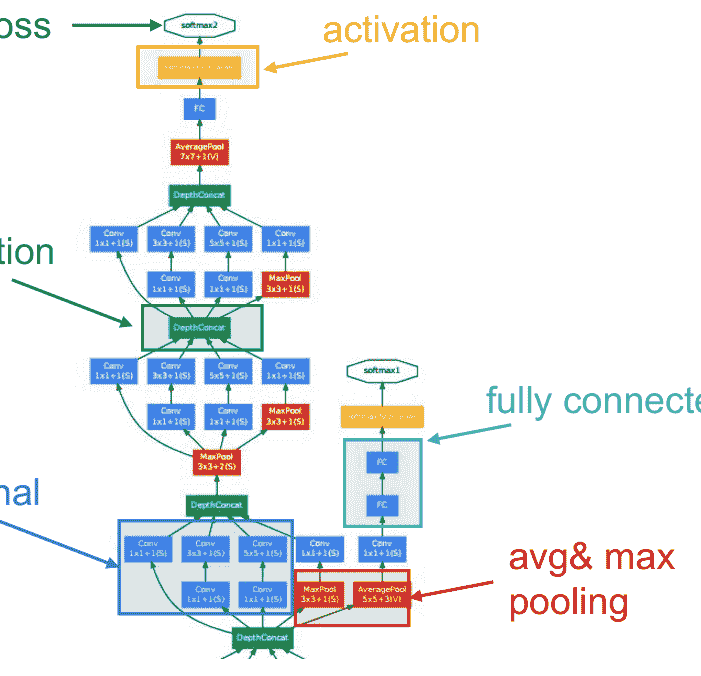

（GoogleNet 的一部分）

## 大纲

- 概率图模型：基础
- DL 组件概述
  - 历史回顾：神经网络的早期阶段
  - 现代构建模块：单元、层、激活函数、损失函数等
  - 反向模式自动微分（即反向传播）
- GMs 与 NNs 之间的相似性与差异
  - 图模型 vs 计算图
  - 作为图模型的 Sigmoid 信念网络
  - 深度信念网络与玻尔兹曼机
- 结合 DL 方法与 GMs
  - 使用神经网络的输出作为图模型的输入
  - 势函数由神经网络表示的图模型
  - 具有结构化输出的神经网络
- 神经网络的贝叶斯学习
  - 神经网络参数的贝叶斯学习
  - 深度核学习


## 图模型 vs. 深度网络
### 图模型
### 深度神经网络
- 以图形形式编码有意义的知识及相关不确定性的表示
- 学习有助于计算并在最终指标上提升性能的表示（中间表示不保证有意义）

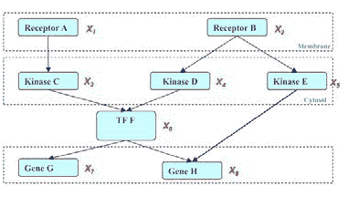
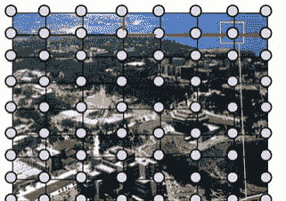
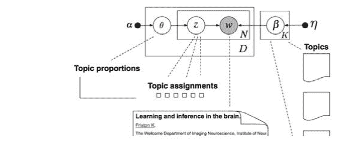
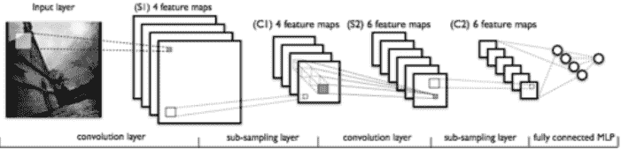
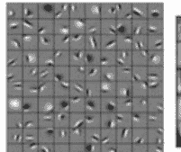
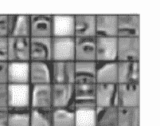
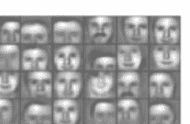


## 图模型 vs. 深度网络
### 图模型
### 深度神经网络
- 以图形形式编码有意义的知识及相关不确定性的表示
- 学习和推理基于经过充分研究的（依赖结构的）丰富工具箱技术（如 EM、消息传递、VI、MCMC 等）
- 图表示模型
- 学习有助于计算并在最终指标上提升性能的表示（中间表示不保证有意义）
- 学习主要基于梯度下降法（又称反向传播）；推理通常很简单，通过一次“前向传播”即可完成
- 图表示计算

## 图模型 vs. 深度网络
### 图模型
#### 图的用途
- 从局部结构综合出全局损失函数的载体
  - 势函数、特征函数等
- 设计可靠且高效推理算法的载体
  - 和积算法、平均场等
- 启发近似和惩罚项的载体
  - 结构化平均场、树近似等
- 监控推理的理论与经验行为及准确性的载体
#### 损失函数的用途
- 衡量学习算法和模型质量的主要指标

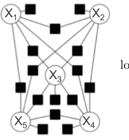
log P(X) = Σ_i log φ(x_i) + Σ_{i,j} log ψ(x_i, x_j)
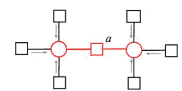
m_{i→a}(x_i) = ∏_{c∈N(i)\a} m_{c→i}(x_i)
b_a(X_a) ∝ f_a(X_a) ∏_{i∈N(a)} m_{i→a}(x_i)
m_{a→i}(x_i) = Σ_{X_a\x_i} f_a(X_a) ∏_{j∈N(a)\i} m_{j→a}(x_j)
Q(H) ~ P(H|V)
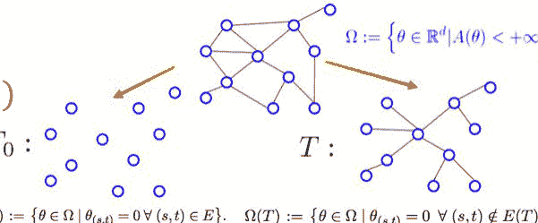
θ = argmax_θ P_θ(V)

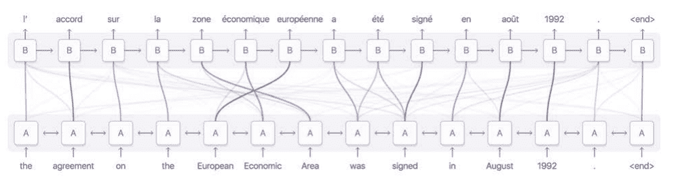
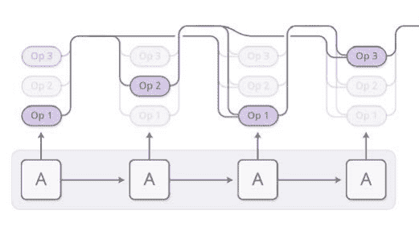
## 图模型 vs. 深度网络
### 深度神经网络
#### 网络的用途
- 概念上综合复杂决策假设的载体
  - 逐阶段投影与聚合
- 组织计算操作的载体
  - 隐状态的逐阶段更新
- 设计处理步骤和计算模块的载体
  - 逐层并行化
- 在评估深度学习推理算法方面无明显用途
#### 损失函数的用途
- 全局损失？嗯，它既复杂又非凸……

图片来自 Distill.pub

## 图模型 vs. 深度网络
### 图模型
#### 图的用途
- 从局部结构综合出全局损失函数的载体
  - 势函数、特征函数等
- 设计可靠且高效推理算法的载体
  - 和积算法、平均场等
- 启发近似和惩罚项的载体
  - 结构化平均场、树近似等
- 监控推理的理论与经验行为及准确性的载体
#### 损失函数的用途
- 衡量学习算法和模型质量的主要指标
### 深度神经网络
#### 网络的用途
- 概念上综合复杂决策假设的载体
  - 逐阶段投影与聚合
- 组织计算操作的载体
  - 隐状态的逐阶段更新
- 设计处理步骤和计算模块的载体
  - 逐层并行化
- 在评估深度学习推理算法方面无明显用途
#### 损失函数的用途
- 全局损失？嗯，它既复杂又非凸……

|  | 深度学习 | 机器学习（如图模型） |
|---|---|---|
| 经验目标： | 如分类、特征学习 | 如隐变量推断、迁移学习 |
| 结构： | 图结构 | 图结构 |
| 目标函数： | 由局部函数聚合而成 | 由局部函数聚合而成 |
| 词汇： | 神经元、激活函数…… | 变量、势函数…… |
| 算法： | 单一且无可争议的推理算法——反向传播（BP） | 开放研究的主要焦点，算法众多，且还将不断涌现 |
| 评估： | 基于黑盒得分——最终性能 | 基于几乎每一个中间量 |
| 实现： | 技巧众多 | 或多或少已标准化 |
| 实验： | 海量真实数据（真值未知） | 规模适中，常为模拟数据（真值已知） |

## 图模型 vs. 深度网络
- 到目前为止：
  - 图模型是概率分布的表示
  - 神经网络是函数逼近器（不具有概率意义）
- 有些神经网络实际上就是恰当的图模型（即单元/神经元表示随机变量）：
  - 玻尔兹曼机（Hinton & Sejnowsky, 1983）
  - 受限玻尔兹曼机（Smolensky, 1986）
  - Sigmoid信念网络中的学习与推理（Neal, 1992）
  - 深度信念网络中的快速学习（Hinton, Osindero, Teh, 2006）
  - 深度玻尔兹曼机（Salakhutdinov and Hinton, 2009）
- 让我们逐一审视这些模型

## I：受限玻尔兹曼机
- 受限玻尔兹曼机是一种用二分图表示的马尔可夫随机场
- 图中某一层/部分的节点与另一部分的所有节点相连；层内无连接

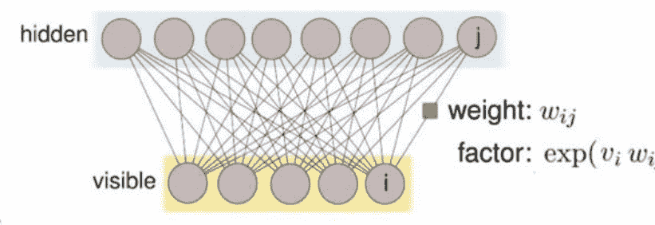
联合分布
P(v, h) = 1/Z exp{ Σ_{i,j} w_{ij} v_i h_i + Σ_i b_i v_i + Σ_j c_j h_j }

## I：受限玻尔兹曼机
对数似然关于参数的梯度（另一种形式）：
$\frac{\partial}{\partial w_{ij}} \log L(v) = \mathbb{E}_{P(h|v)} \left[ \frac{\partial}{\partial w_{ij}} P(v,h) \right] - \mathbb{E}_{P(v,h)} \left[ \frac{\partial}{\partial w_{ij}} P(v,h) \right]$
- 两个期望都可以通过采样来近似
- 从后验分布中采样是精确的（受限玻尔兹曼机在给定 v 时对 h 可分解）
- 从联合分布中采样通过 MCMC（如吉布斯采样）完成
- 在神经网络文献中：
  - 计算第一项称为钳制 / 清醒 / 正相位阶段（网络在“可见变量”条件下运行，因此是“清醒”的）
  - 计算第二项称为非钳制 / 睡眠 / 自由 / 负相位阶段（网络从联合分布中采样可见变量，因此是“沉睡”的；隐喻地说，它是在“梦”到可见输入）

## II：Sigmoid信念网络
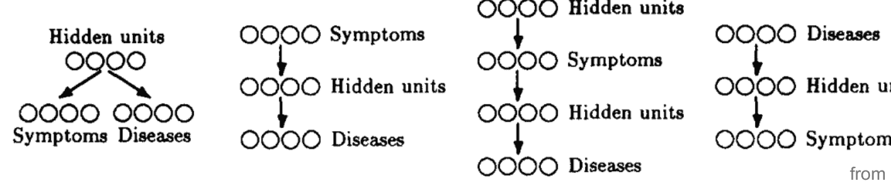
来自 Neal, 1992
- Sigmoid信念网络本质上是关于二值变量的贝叶斯网络，其条件概率由 Sigmoid 函数表示：
$$P(x_i|\pi(x_i)) = \sigma\left(x_i \sum_{x_j \in \pi(x_i)} w_{ij}x_j\right)$$
- 贝叶斯网络表现出一种称为“解释消除效应”的现象
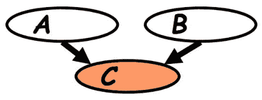
如果 A 与 C 相关，那么 B 与 C 相关的可能性就会降低。⇒ 在给定 C 的情况下，A 和 B 变得相关。

## II：Sigmoid信念网络
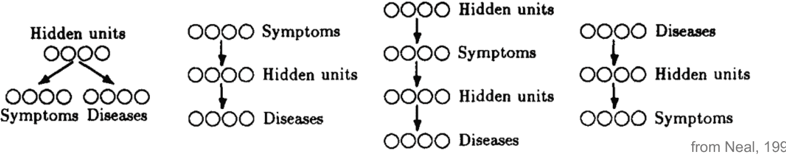
- Sigmoid信念网络本质上是关于二值变量的贝叶斯网络，其条件概率由 Sigmoid 函数表示：
$$P(x_i \mid \pi(x_i)) = \sigma\left(x_i \sum_{x_j \in \pi(x_i)} w_{ij}x_j\right)$$
- 贝叶斯网络表现出一种称为“解释消除效应”的现象
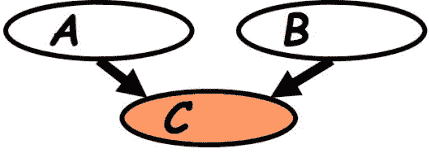
> **注意：**
>
> 由于“解释消除效应”，在信念网络中，当我们以可见层为条件时，所有隐变量都会变得相互依赖。


### Sigmoid Belief Networks:
学习与推理


- Neal 提出了用于学习和推理的蒙特卡洛方法 (Neal, 1992):
- 用吉布斯采样近似
- 条件分布：
  $P(S_i = x \mid S_j = s_j : j \neq i)$
  $\propto \sigma\left(x^* \sum_{j<i} s_j w_{ij}\right) \prod_{j>i} \sigma\left(s_j^*\left(x w_{ji} + \sum_{k<j, k\neq i} s_k w_{jk}\right)\right)$
- 与 RBM 不同，没有负相！
- 收敛非常缓慢，尤其对于大型信念网络，由于错综复杂的“解释-消除”效应...

Neal, 1992 的方程

$\frac{\partial L}{\partial w_{ij}} = \sum_{\tilde{v}\in T} \frac{1}{P(\tilde{V}=\tilde{v})} \frac{\partial P(\tilde{V}=\tilde{v})}{\partial w_{ij}}$ 
$= \sum_{\tilde{v}\in T} \frac{1}{P(\tilde{V}=\tilde{v})} \sum_{\tilde{h}} \frac{\partial P(\tilde{S}=\langle\tilde{h},\tilde{v}\rangle)}{\partial w_{ij}}$ 
$= \sum_{\tilde{v}\in T} \sum_{\tilde{h}} P(\tilde{S}=\langle\tilde{h},\tilde{v}\rangle \mid \tilde{V}=\tilde{v}) \cdot \frac{1}{P(\tilde{S}=\langle\tilde{h},\tilde{v}\rangle)} \frac{\partial P(\tilde{S}=\langle\tilde{h},\tilde{v}\rangle)}{\partial w_{ij}}$ 
$= \sum_{\tilde{v}\in T} \sum_{\tilde{s}} P(\tilde{S}=\tilde{s} \mid \tilde{V}=\tilde{v}) \frac{1}{P(\tilde{S}=\tilde{s})} \frac{\partial P(\tilde{S}=\tilde{s})}{\partial w_{ij}}$ 
$= \sum_{\tilde{v}\in T} \sum_{\tilde{s}} P(\tilde{S}=\tilde{s} \mid \tilde{V}=\tilde{v}) \frac{1}{\sigma\left(s_i^* \sum_{k<i} s_k w_{ik}\right)} \frac{\partial \sigma\left(s_i^* \sum_{k<i} s_k w_{ik}\right)}{\partial w_{ij}}$ 
$= \sum_{\tilde{v}\in T} \sum_{\tilde{s}} P(\tilde{S}=\tilde{s} \mid \tilde{V}=\tilde{v}) s_i^* s_j \sigma\left(-s_i^* \sum_{k<i} s_k w_{ik}\right).$

对数导数

通过边缘化得到可见变量的概率

Bayes 规则 + 重新排列求和

代入条件概率的实际 sigmoid 形式

### RBMs are infinite belief networks
RBMs 是无限信念网络

- 吉布斯采样：在隐变量和可见变量之间交替采样

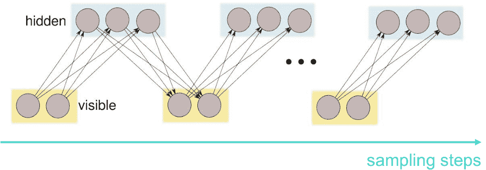

- 条件分布 $P(v|h)$ 和 $P(h|v)$ 由 sigmoid 表示
- 因此，我们可以将从 RBM 表示的联合分布中进行吉布斯采样视为在无限深的 sigmoid 信念网络中的自顶向下传播！

### RBMs are infinite belief networks
RBMs 是无限信念网络

- RBMs 等价于无限深的信念网络
- 从中采样等同于从右侧网络采样

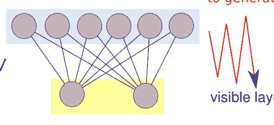

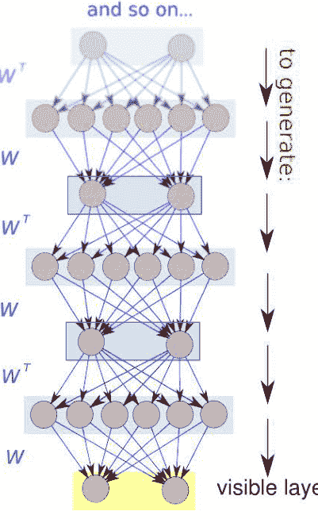

### RBMs are infinite belief networks
RBMs 是无限信念网络

- RBMs 等价于无限深的信念网络

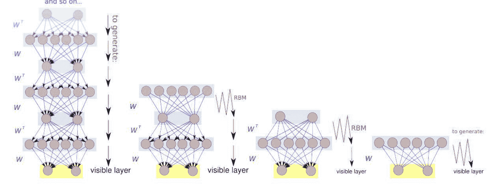

来自 Marcus Frean, MLSS Tutorial 2010 的图像

## III: Deep Belief Nets
III: 深度信念网络
### Deep Belief Network
深度信念网络

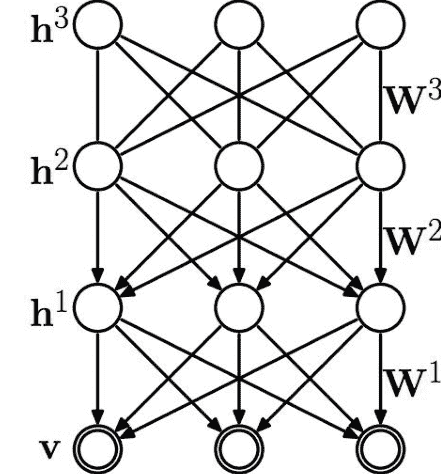

现在权重是解绑的！

- DBNs 是混合图模型（链图）：
  - 由于解释-消除效应，DBNs 中的精确推理存在问题
  - 训练：贪婪预训练 + 特设微调；没有适当的联合训练
  - 近似推理是前馈的

### DBN: Layer-wise pre-training
DBN：逐层预训练

- 预训练并冻结第 1 个 RBM
- 在其上堆叠另一个 RBM 并训练它

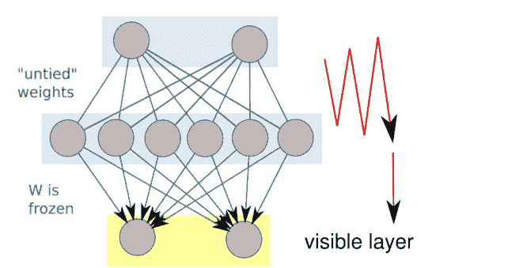

- 2+ 层的权重保持绑定
- 我们重复此过程：逐层预训练并解绑权重...

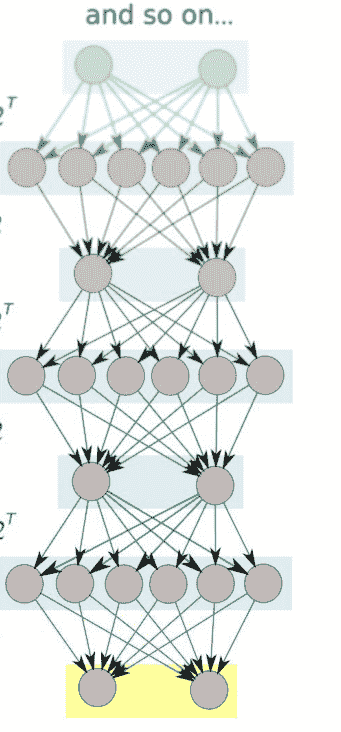

### DBN: Layer-wise pre-training
DBN：逐层预训练

- 我们重复此过程：逐层预训练并解绑权重：
- 3+ 层的权重保持绑定
- 以此类推
- *从优化的角度来看，该过程大致对应于对数似然上的近似块坐标上升*

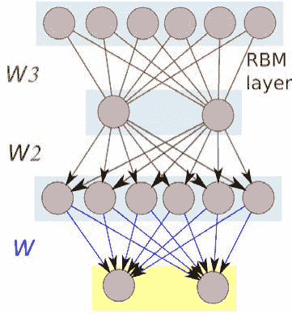

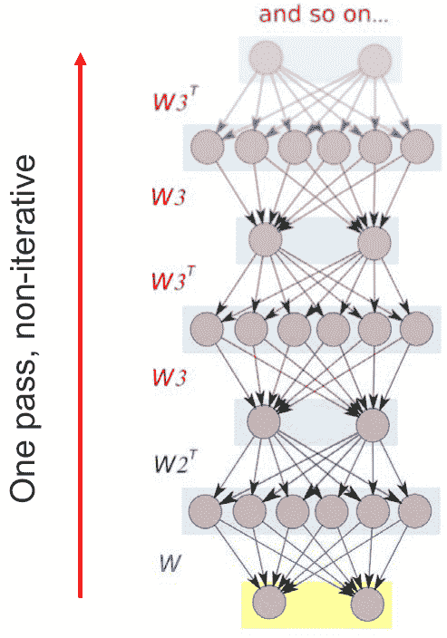

来自 Marcus Frean, MLSS Tutorial 2010 的图像

### DBN: Fine-tuning
DBN：微调

- 预训练相当特设，很不可能本身导致一个良好的概率模型 *per se*
- 然而，表示的层可能对某些下游任务有用！
- 我们可以进一步对预训练的 DBN 进行“微调”以用于其他任务

设置 A：无监督学习 (DBN → 自编码器)

1. 以贪婪逐层的方式预训练 RBM 堆栈
2. “展开” RBMs 以创建自编码器
3. 通过优化重构误差来微调参数

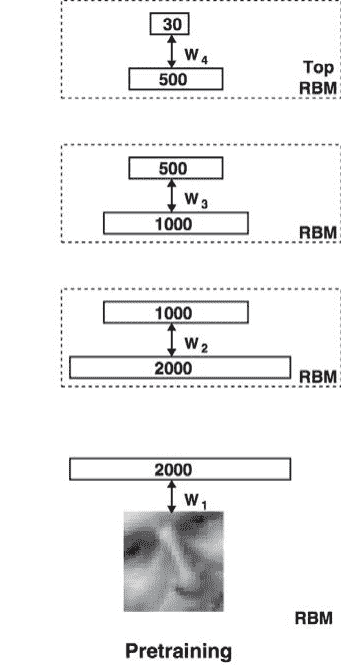

### DBN: Fine-tuning
DBN：微调

- 预训练相当特设，很不可能本身导致一个良好的概率模型 *per se*
- 然而，表示的层可能对某些下游任务有用！
- 我们可以进一步对预训练的 DBN 进行“微调”以用于其他任务

设置 A：无监督学习 (DBN → 自编码器)

1. 以贪婪逐层的方式预训练 RBM 堆栈
2. “展开” RBMs 以创建自编码器
3. 通过优化重构误差来微调参数

来自 Hinton & Salakhutdinov, 2006 的图像

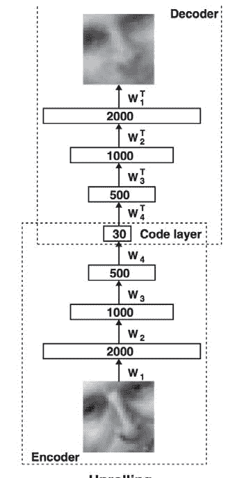

### DBN: Fine-tuning
DBN：微调

- 预训练相当特设，很不可能本身导致一个良好的概率模型 *per se*
- 然而，表示的层可能对某些下游任务有用！
- 我们可以进一步对预训练的 DBN 进行“微调”以用于其他任务

设置 B：监督学习 (DBN → 分类器)

1. 以贪婪逐层的方式预训练 RBM 堆栈
2. “展开” RBMs 以创建前馈分类器
3. 通过优化重构误差来微调参数

关于预训练如何工作的一些直觉：
Erhan 等：无监督预训练为何有助于深度学习？JMLR, 2010

## Deep Belief Nets and Boltzmann Machines
深度信念网络与玻尔兹曼机
### Deep Belief Network
深度信念网络

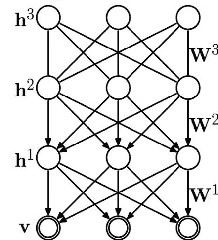

- DBNs 是混合图模型（链图）：
  - DBNs 中的推理由于解释-消除效应存在问题
  - 训练：贪婪预训练 + 特设微调；没有适当的联合训练
  - 近似推理是前馈的

## Deep Belief Nets and Boltzmann Machines
深度信念网络与玻尔兹曼机

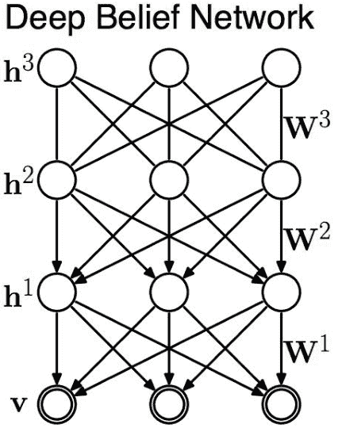

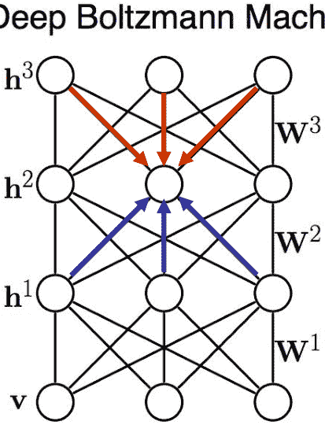

- DBMs 是完全无向模型（马尔可夫随机场）。
  - 可以像 RBMs 一样通过 MCMC 训练 (Hinton & Sejnowski, 1983)
  - 使用数据分布的变分近似以加快训练 (Salakhutdinov & Hinton, 2009)
  - 同样，可以用于初始化其他网络以用于下游任务

## Graphical models vs. Deep networks
图模型 vs. 深度网络

- 关于所有这些模型，有几点关键需要注意：
  - 深度生成模型的主要目标是表示可观测变量的分布。添加隐藏变量层可以表示越来越复杂的分布。
  - 隐藏变量是次要（辅助）元素，用于促进可观测变量之间复杂依赖关系的学习。
  - 模型的训练是特设的，但重要的是学习到的隐藏表示的质量。
  - 表示的价值由其在下游任务上的有用性来评判（模型的概率意义通常在最后被丢弃）。
- 相反，经典图模型通常关注所有变量的学习和推理的正确性


## Dealing with structured prediction
处理结构化预测

- 结构化输出的基于能量的建模 (CRF)

  $$\mathbf{y}^*(\mathbf{x}; \mathbf{w}) := \arg\min_{\mathbf{y}} E(\mathbf{y}, \mathbf{x}; \mathbf{w})$$

- 对固定步数的优化算法进行展开 (Domke, 2012)

  $$\mathbf{y}^*(\mathbf{x}; \mathbf{w}) = \text{opt-alg}_{\mathbf{y}} E(\mathbf{y}, \mathbf{x}; \mathbf{w})$$

- 我们可以将 y* 视为输入和权重的某种非线性可微函数 → 施加一些损失并使用反向传播像任何其他标准计算图一样优化它！

- 同样，基于消息传递的推理算法可以被截断并转换为计算图 (Domke, 2011; Stoyanov et al., 2011)


## 大纲

- 概率图模型：基础
- 深度学习组件概述
  - 历史回顾：神经网络的早期阶段
  - 现代构建模块：单元、层、激活函数、损失函数等。
  - 反向模式自动微分（即反向传播）
- GMs 与 NNs 的相似性和差异
  - 图模型 vs 计算图
  - 作为图模型的 Sigmoid 信念网络
  - 深度信念网络和玻尔兹曼机
- 结合深度学习方法与 GMs
  - 使用神经网络的输出作为图模型的输入
  - 势函数由神经网络表示的图模型
  - 具有结构化输出的神经网络
- 神经网络的贝叶斯学习
  - 神经网络参数的贝叶斯学习
  - 深度核学习

## 结合序列神经网络和图模型

### 混合：RNN + HMM

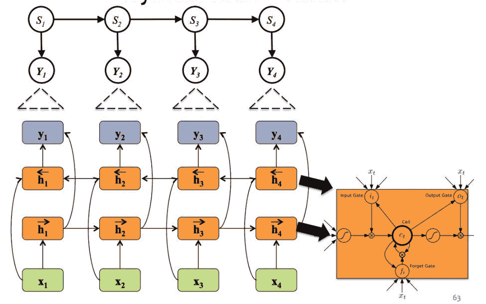

模型、推理和学习可以类比于我们的 NN + HMM 混合模型

- **目标：** 对数似然
- **模型：** HMM/高斯发射
- **推理：** 前向-后向算法
- **学习：** 通过反向传播的梯度 SGD

(Graves et al., 2013)

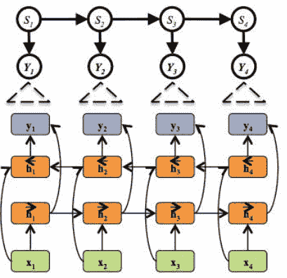

## 混合神经网络 + 条件图模型

### 混合：神经网络 + CRF

*前向计算*


### 混合：CNN + CRF

- **"NN + SLL"**
- 模型：卷积神经网络 (CNN)  with **线性链 CRF**
- 训练目标：最大化 **句子级似然 (SLL)**


图源自 (Collobert & Weston, 2011)

## 使用图模型作为预测解释

### 卫星图像


### 有意义的属性

- 01 夜光强度
- 02 是否为城市
- 03 有电力
- 04 有发电机
- 05 平均温度
- 06 平均降水量
- 07 植被
- 08 平均植被增加
- 09 平均植被减少
- 10 到市场的平均距离
- 11 到道路的平均距离
- 12 房间数量
- 13 到水源的距离
- 14 每日用水量
- 15 是否付费用水
- 16 家庭类型：BQ

### 区域属性


我们如何构建一个强大的预测模型，其预测可以用语义上有意义的特征来解释？

| 属性 | 属性 |
|---|---|
| 01 夜光强度 | 09 平均植被减少 |
| 02 是否为城市 | 10 到市场的平均距离 |
| 03 有电力 | 11 到道路的平均距离 |
| 04 有发电机 | 12 房间数量 |
| 05 平均温度 | 13 到水源的距离 |
| 06 平均降水量 | 14 每日用水量 |
| 07 植被 | 15 是否付费用水 |
| 08 平均植被增加 | 16 家庭类型：BQ |

## 上下文解释网络 (CENs)

**上下文**  
**解释**  
**预测**  

实例 1  
实例 2  


编码器  
属性  

| | 不可靠的水源 | 水源：公共水龙头 | 墙壁：未烧砖 | 屋顶：茅草、稻草 | 有电力 |
|---|---|---|---|---|---|
| 实例 1 | 0 | 1 | 1 | 0 | 1 |
| 实例 2 | 0 | 0 | 0 | 1 | 0 |

0.9 -0.6 0.3 0.5 -0.2  
-0.4 -1.2 -0.2 0.2 -0.8  

不贫困  
贫困  

作为图模型的参量化

- 注释：
  - 最终预测由线性图模型做出。
  - 每个系数为一个有意义的属性分配权重。
  - 允许我们根据上下文编码器产生的图模型来判断预测。


- **总体思路：** 使用深度神经网络为给定上下文（例如，给定患者）适用的图模型**生成参数**。
- 生成的图模型用于做出最终预测 ⇒ 100% 保真度和一致性。
- 图模型建立在语义上有意义的变量之上（不是深度嵌入！）并且可以作为每次预测的**解释**。

### CEN：实现细节


**工作流程：**

- 维护一个（稀疏的）图模型参数字典。
- 使用深度网络处理复杂输入（图像、文本、时间序列等）；使用软注意力来选择或组合字典中的模型。
- 使用构建的图模型（例如 CRF）进行预测。
- 检查图模型参数以理解预测背后的推理。

Al-Shedivat, Dubey, Xing, arXiv, 2017

### 结果：图像作为上下文

**乌干达：上下文模型**


基于图像，CEN 学会为城市和农村地区选择不同的模型

### 结果：经典图像和文本数据集

| 方法 | 错误 |
|---|---:|
| Paragraph Vector (Le and Mikolov, 2014) | 7.42% |
| SA-LSTM with joint training (Dai and Le, 2015) | 14.70% |
| LSTM with tuning and dropout (Dai and Le, 2015) | 13.50% |
| LSTM initialized with word2vec embeddings (Dai and Le, 2015) | 10.00% |
| SA-LSTM with linear gain (Dai and Le, 2015) | 9.17% |
| LM-TM (Dai and Le, 2015) | 7.64% |
| SA-LSTM (Dai and Le, 2015) | 7.24% |
| Virtual Adversarial (Miyato et al., 2016) | 5.94 ± 0.12% |
| TopicRNN (Dieng et al., 2017) | 6.28% |
| **CEN-bow** | **5.92 ± 0.05%** |
| **CEN-topic** | **6.25 ± 0.09%** |

半监督训练

仅监督训练 (!!)

### CEN 用于生存分析的架构

编码患者的观测序列（例如 ICU 中测量的生命体征/检查）。

生成一个 CRF，用于预测未来时间间隔上的生存指标序列。


### 结果：生存分析

**SUPPORT2**

| 模型 | Acc@25 | Acc@50 | Acc@75 | RAE |
|---|---:|---:|---:|---:|
| Cox | 84.1 | 73.7 | 47.6 | 0.90 |
| Aalen | 87.1 | 66.2 | 45.8 | 0.98 |
| CRF | 84.4 | 89.3 | 79.2 | 0.59 |
| MLP-CRF | 87.7 | 89.6 | 80.1 | 0.62 |
| MLP-CEN | 85.5 | 90.8 | 81.9 | 0.56 |

**PhysioNet Challenge 2012**

| 模型 | Acc@25 | Acc@50 | Acc@75 | RAE |
|---|---:|---:|---:|---:|
| Cox | 93.0 | 69.6 | 49.1 | 0.24 |
| Aalen | 93.3 | 78.7 | 57.1 | 0.31 |
| CRF | 93.2 | 85.1 | 65.6 | 0.14 |
| LSTM-CRF | 93.9 | 86.3 | 68.1 | 0.11 |
| LSTM-CEN | 94.8 | 87.5 | 70.1 | 0.09 |


## 大纲


- 深度学习组件概述
  - 历史回顾：神经网络的早期阶段
  - 现代构建模块：单元、层、激活函数、损失函数等。
  - 反向模式自动微分（即反向传播）
- GMs 与 NNs 的相似性和差异
  - 图模型 vs 计算图
  - 作为图模型的 Sigmoid 信念网络
  - 深度信念网络和玻尔兹曼机
- 结合深度学习方法与 GMs
  - 使用神经网络的输出作为图模型的输入
  - 势函数由神经网络表示的图模型
  - 具有结构化输出的神经网络
- 神经网络的贝叶斯学习
  - 神经网络参数的贝叶斯学习
  - 深度核学习

## 神经网络的贝叶斯学习

- 神经网络作为概率模型：
  - 似然：$p(y|x,\theta)$
    - 分类用的分类分布 $\Rightarrow$ 交叉熵损失
    - 回归用的高斯分布 $\Rightarrow$ 平方损失
  - 参数先验：$p(\theta)$
- 最大后验 (MAP) 解：
  - $\theta^{MAP}=\arg\max_{\theta}\log p(y|x,\theta)p(\theta)$
  - 高斯先验 $\Rightarrow$ L2 正则化
  - 拉普拉斯先验 $\Rightarrow$ L1 正则化


图鸣谢：Blundell et al, 2016

- 贝叶斯学习 [MacKay 1992, Neal 1996, de Freitas 2003]
  - 后验：$p(\theta|x,y)$
  - 使用近似后验 $q(\theta)$ 的变分推断


## 神经网络的贝叶斯学习

- 变分推断（简而言之）：
  $$\min_q F(D, \boldsymbol{\theta}) = \mathrm{KL}(q(\boldsymbol{\theta}) \| p(\boldsymbol{\theta}|D)) - \mathbb{E}_{q(\boldsymbol{\theta})}[\log p(D|\boldsymbol{\theta})]$$
  $$\min_q F(D, \boldsymbol{\theta}) = \mathrm{KL}(q(\boldsymbol{\theta}) \| p(\boldsymbol{\theta}|D)) - \sum_i \log p(D|\boldsymbol{\theta}_i)$$
  其中 $\boldsymbol{\theta}_i \sim q(\boldsymbol{\theta})$；KL 项也可以用类似方式近似
- 我们可以将 $q(\boldsymbol{\theta})$ 定义为对角高斯分布或全协方差高斯分布
- 或者，$q(\boldsymbol{\theta})$ 可以隐式定义，例如通过 dropout [Gal & Ghahramani, 2016]
  $$\boldsymbol{\theta} = \boldsymbol{M} \cdot \mathrm{diag}(\boldsymbol{z}),$$
  $$\boldsymbol{z} \sim \mathrm{Bernoulli}(p)$$
- 丢弃神经元等价于将参数矩阵（即权重）的对应列置零
- $z_i = 0$ 对应于 $\boldsymbol{M}$ 的第 $i$ 列被丢弃
  $\Rightarrow$ 该过程等价于对单元 $i$ 进行 dropout [Hinton et al., 2012]
- 变分参数为 $\{\boldsymbol{M}, \boldsymbol{p}\}$


### “无限宽”深度模型

- 我们已经看到，一个“无限深”的网络可以用合适的图模型来解释。那么“无限宽”的网络呢？
- 考虑一个权重上具有高斯先验且中间层有无限多个隐藏神经元的神经网络。
- 事实证明，如果我们在这种无限网络的权重上施加某种高斯先验，它将等价于一个高斯过程 [Neal 1996]。
- 高斯过程（GP）是函数上的分布：
  $$m(\mathbf{x}) = \mathbb{E}[f(\mathbf{x})],$$
  $$k(\mathbf{x}, \mathbf{x}') = \mathbb{E}[(f(\mathbf{x}) - m(\mathbf{x}))(f(\mathbf{x}') - m(\mathbf{x}'))],$$
  $$f(\mathbf{x}) \sim \mathcal{GP}(m(\mathbf{x}), k(\mathbf{x}, \mathbf{x}')).$$
- 当用于预测时，高斯过程会考虑数据点之间的相关性，并能输出校准良好的预测不确定性估计。


无限多个隐藏单元

### 高斯过程与深度核学习

- 考虑一个权重上具有高斯先验且中间层有无限多个隐藏神经元的神经网络。
- 某些类别的高斯先验条件下，具有无限多个隐藏单元的神经网络会收敛到高斯过程 [Neal 1996]
- 深度核 [Wilson et al., 2016]
  - 将深度模型架构的归纳偏置与高斯过程的非参数灵活性相结合
    $k(x_i, x_j | \phi) \rightarrow k(g(x_i, \theta), g(x_j, \theta) | \phi, \theta)$，其中 $K_{ij} = k(x_i, x_j)$
  - 从基础核 $k(x_i, x_j | \phi)$ 出发，对输入 $x$ 进行变换
    $p(f | \phi) = \mathcal{N}(f | m(x), K)$
    $p(y | f) = \mathcal{N}(y | f, \beta^{-1})$
  - 通过优化边际对数似然（或其变分下界），联合学习核参数和神经网络参数 $\{\phi, \theta\}$。
  - 通过局部核插值、结构化诱导点和蒙特卡洛近似实现快速学习与推断


### 高斯过程与深度核学习

- 将高斯过程作为一层添加到深度神经网络中，我们可以将其视为添加了一个具有特定权重先验的无限隐藏层
- 深度核学习 [Wilson et al., 2016]
  - 将深度模型的归纳偏置与高斯过程的非参数灵活性相结合
  - 高斯过程为网络增加了强大的正则化
  - 此外，它们还提供了预测不确定性估计


### 序列数据上的深度核学习

答案是肯定的！

通过将高斯过程层添加到循环网络中，我们可以有效地关联不同时间点的样本，并获得带有良好校准的不确定性估计的预测。

然而，要使用随机技术训练这样的模型需要额外的注意（参见我们的论文）。


### 序列数据上的深度核学习

前车预测：LSTM 与 GP-LSTM 对比


## 结论

- 深度学习与图模型：这两个领域在初期很相似（结构、能量等），随后分化到各自特有的流程中
- 深度学习：大部分精力用于比较不同架构及其组件（模型通过在下游任务上的经验性能来驱动评估）
  - 深度学习模型擅长从数据中学习稳健的层次化表示，并适用于简单推理（可称为“低层认知”）
- 图模型：精力集中于提高推断精度和收敛速度
  - 图模型最适合可证明正确的推断，并适用于高层复杂推理任务（可称为“高层认知”）
- 两个领域的融合前景广阔！
  - 下一部分：以图模型解释统一视角看待深度生成模型

## 第二部分

深度生成模型的统一框架


## 计划

- 深度学习的统计与算法基础及洞见
- 深度生成模型的统一框架
- 计算机制：编程平台与分布式深度学习架构

## 大纲

- 深度生成模型进展概述
- 深度生成模型的理论基础
  - 清醒-睡眠算法
  - 变分自编码器
  - 生成对抗网络
- 深度生成模型的统一视角
  - 深度生成模型的新表述
  - 隐变量与可见变量的对称建模


## 大纲


- 深度生成模型进展概述
- 深度生成模型的理论基础
  - 清醒-睡眠算法
  - 变分自编码器
  - 生成对抗网络
- 深度生成模型的统一视角
  - 深度生成模型的新表述
  - 隐变量与可见变量的对称建模

## 深度生成模型

- 对一组变量定义概率分布
- “深度”意味着多层隐藏变量！


### 早期形式的深度生成模型

- 层次贝叶斯模型
  - Sigmoid 信念网络 [Neal 1992]
- 神经网络模型
  - Helmholtz 机 [Dayan et al.,1995]


### 深度生成模型的复兴

- 受限玻尔兹曼机（RBM）[Smolensky, 1986]
  - 深度概率模型的基本构建块


### 深度生成模型的复兴

- 受限玻尔兹曼机（RBM）[Smolensky, 1986]
  - 深度概率模型的基本构建块
- 深度信念网络（DBN）[Hinton et al., 2006]
  - 混合图模型
  - 由于解释消除效应，DBN 中的推断存在困难
- 深度玻尔兹曼机（DBM）[Salakhutdinov & Hinton, 2009]
  - 无向模型


### 深度生成模型的复兴

- 变分自编码器（VAE）[Kingma & Welling, 2014] / 神经变分推断与学习（NVIL）[Mnih & Gregor, 2014]
- 生成对抗网络（GAN）[Goodfellow et al., 2014]


$G_\theta$：生成模型
$D_\phi$：判别器


### 深度生成模型的复兴

- 变分自编码器（VAEs）[Kingma & Welling, 2014] / 神经变分推断与学习（NVIL）[Mnih & Gregor, 2014]
- 生成对抗网络（GANs）[Goodfellow et al., 2014]
- 生成矩匹配网络（GMMNs）[Li et al., 2015; Dziugaite et al., 2015]
- 自回归神经网络


## 大纲

- 深度生成模型研究进展概述
- 深度生成模型的理论基础
  - 唤醒-睡眠算法
  - 变分自编码器
  - 生成对抗网络
- 深度生成模型的统一视角
  - 深度生成模型的新公式化表述
  - 隐变量与可见变量的对称建模

## 回顾：变分推断

- 考虑生成模型 \(p_\theta(\boldsymbol{x}|\boldsymbol{z})\) 和先验 \(p(\boldsymbol{z})\)
  - 联合分布：\(p_\theta(\boldsymbol{x},\boldsymbol{z}) = p_\theta(\boldsymbol{x}|\boldsymbol{z})p(\boldsymbol{z})\)
- 假设变分分布 \(q_\phi(\boldsymbol{z}|\boldsymbol{x})\)
- 目标：最大化对数似然的变分下界

\[
\begin{aligned}
\log p(\boldsymbol{x})
&= \mathrm{KL}\left(q_\phi(\boldsymbol{z}|\boldsymbol{x}) \| p_\theta(\boldsymbol{z}|\boldsymbol{x})\right)
 + \int_{\boldsymbol{z}} q_\phi(\boldsymbol{z}|\boldsymbol{x}) \log\frac{p_\theta(\boldsymbol{x},\boldsymbol{z})}{q_\phi(\boldsymbol{z}|\boldsymbol{x})} \\
&\ge \int_{\boldsymbol{z}} q_\phi(\boldsymbol{z}|\boldsymbol{x}) \log\frac{p_\theta(\boldsymbol{x},\boldsymbol{z})}{q_\phi(\boldsymbol{z}|\boldsymbol{x})}
 := \mathcal{L}(\boldsymbol{\theta},\boldsymbol{\phi};\boldsymbol{x})
\end{aligned}
\]

- 等价地，最小化自由能

\[
F(\boldsymbol{\theta},\boldsymbol{\phi};\boldsymbol{x}) = -\log p(\boldsymbol{x}) + \mathrm{KL}\left(q_\phi(\boldsymbol{z}|\boldsymbol{x}) \| p_\theta(\boldsymbol{z}|\boldsymbol{x})\right)
\]


## 基于摊销推断的深度生成模型

- 亥姆霍兹机
- 变分自编码器（VAEs）/ 神经变分推断与学习（NVIL）
- 我们稍后将看到，*对抗方法*也包含在这个列表中
  - 可预测性最小化（PM）
  - 生成对抗网络（GANs）


## 唤醒-睡眠算法

- [Hinton et al., Science 1995]
- 与生成模型一起训练一个独立的推断模型
  - 通常适用于多种生成模型，例如亥姆霍兹机
- 考虑生成模型 \(p_\theta(x|z)\) 和先验 \(p(z)\)
  - 联合分布 \(p_\theta(x,z) = p_\theta(x|z)p(z)\)
  - 例如，多层信念网络
- 推断模型 \(q_\phi(z|x)\)
- 通过两步损失松弛最大化数据的对数似然：
  - 最大化对数似然的变分下界，或等价地，最小化自由能

    \[
    F(\theta, \phi; x) = -\log p(x) + \mathrm{KL}\left(q_\phi(z|x) \| p_\theta(z|x)\right)
    \]

  - 关于 \(\phi\) 最小化一个不同的目标（反向 KLD），以简化优化
    - 与原始的变分下界损失无关

      \[
      F'(\theta, \phi; x) = -\log p(x) + \mathrm{KL}\left(p_\theta(z|x) \| q_\phi(z|x)\right)
      \]

- 自由能：

  \[
  F(\boldsymbol{\theta}, \boldsymbol{\phi}; \boldsymbol{x}) = -\log p(\boldsymbol{x}) + \mathrm{KL}\left(q_{\phi}(\boldsymbol{z}|\boldsymbol{x}) \| p_{\theta}(\boldsymbol{z}|\boldsymbol{x})\right)
  \]

- 关于 \(p_{\theta}\) 的参数 \(\boldsymbol{\theta}\) 最小化自由能 \(\rightarrow\) *唤醒阶段*

  \[
  \max_{\boldsymbol{\theta}} \mathbb{E}_{q_{\phi}(\boldsymbol{z}|\boldsymbol{x})} \left[\log p_{\boldsymbol{\theta}}(\boldsymbol{x}, \boldsymbol{z})\right]
  \]

  - 通过对隐变量进行推断，从 \(q_\phi(z|x)\) 中获取样本
  - 使用这些样本作为更新生成模型 \(p_\theta(z|x)\) 的目标
  - 对应于变分 M 步


- WS 绕过了睡眠阶段近似带来的困难
- 最小化以下目标 \(\rightarrow\) 睡眠阶段

  \[
  F'(\theta, \phi; x) = -\log p(x) + \mathrm{KL}\left(p_\theta(z|x) \| q_\phi(z|x)\right)
  \]

  \[
  \max_{\phi} \mathbb{E}_{p_\theta(z,x)} \left[\log q_\phi(z|x)\right]
  \]

  - 通过自顶向下的过程从 \(p_\theta(x|z)\) “想象”出样本
  - 使用这些样本作为更新推断模型的目标
- （除了睡眠阶段之外，近期方法的发展旨在减少梯度估计的方差：见后续幻灯片）


[图片来源：Maei 的幻灯片]

### 唤醒-睡眠

- 参数化的推断模型 \(q_\phi(\mathbf{z}|\mathbf{x})\)
  - 唤醒阶段：
    - 关于 \(\theta\) 最小化 \(\mathrm{KL}\left(q_\phi(\mathbf{z}|\mathbf{x}) \| p_\theta(\mathbf{z}|\mathbf{x})\right)\)
    - \(\mathbb{E}_{q_\phi(\mathbf{z}|\mathbf{x})}\left[\nabla_\theta \log p_\theta(\mathbf{x}|\mathbf{z})\right]\)
  - 睡眠阶段：
    - 关于 \(\phi\) 最小化 \(\mathrm{KL}\left(p_\theta(\mathbf{z}|\mathbf{x}) \| q_\phi(\mathbf{z}|\mathbf{x})\right)\)
    - \(\mathbb{E}_{p_\theta(\mathbf{z},\mathbf{x})}\left[\nabla_\phi \log q_\phi(\mathbf{z}|\mathbf{x})\right]\)
    - 低方差
    - 使用生成的 \(\mathbf{x}\) 样本进行学习
- 两个目标，不保证收敛

### 变分 EM

- 变分分布 \(q_\phi(\mathbf{z}|\mathbf{x})\)
  - 变分 M 步：
    - 关于 \(\theta\) 最小化 \(\mathrm{KL}\left(q_\phi(\mathbf{z}|\mathbf{x}) \| p_\theta(\mathbf{z}|\mathbf{x})\right)\)
    - \(\mathbb{E}_{q_\phi(\mathbf{z}|\mathbf{x})}\left[\nabla_\theta \log p_\theta(\mathbf{x}|\mathbf{z})\right]\)
  - 变分 E 步：
    - 关于 \(\phi\) 最小化 \(\mathrm{KL}\left(q_\phi(\mathbf{z}|\mathbf{x}) \| p_\theta(\mathbf{z}|\mathbf{x})\right)\)
    - 若存在闭式解，则 \(q_\phi^* \propto \exp[\log p_\theta]\)
    - \(\nabla_\phi \mathbb{E}_{q_\phi}\left[\log p_\theta(\mathbf{z},\mathbf{x})\right]\)
      - 在实践中需要降低方差
    - 使用真实数据 \(\mathbf{x}\) 进行学习
- 单一目标，保证收敛

## 变分自编码器（VAEs）

- [Kingma & Welling, 2014]
- 使用带推断模型的变分推断
  - 具有与唤醒-睡眠算法类似的广泛适用性
- 生成模型 \(p_\theta(\mathbf{x}|\mathbf{z})\) 和先验 \(p(\mathbf{z})\)
  - 联合分布 \(p_\theta(\mathbf{x},\mathbf{z}) = p_\theta(\mathbf{x}|\mathbf{z})p(\mathbf{z})\)
- 推断模型 \(q_\phi(\mathbf{z}|\mathbf{x})\)


图片来源：Kingma & Welling, 2014


## 重参数化梯度

- 关于 \(q_{\boldsymbol{\phi}}(z\mid x)\) 的参数 \(\boldsymbol{\phi}\) 优化 \(\mathcal{L}(\boldsymbol{\theta}, \boldsymbol{\phi}; x)\)
  - 回顾：使用对数导数技巧的梯度估计：

    \[
    \nabla_{\boldsymbol{\phi}}\mathbb{E}_{q_{\boldsymbol{\phi}}}\left[\log p_{\boldsymbol{\theta}}(x,z)\right]
    = \mathbb{E}_{q_{\boldsymbol{\phi}}}\left[\log p_{\boldsymbol{\theta}}(x,z)\,\nabla_{\boldsymbol{\phi}}\log q_{\boldsymbol{\phi}}(z\mid x)\right]
    \]

- 高方差：

  \[
  \nabla_{\boldsymbol{\phi}}\mathbb{E}_{q_{\boldsymbol{\phi}}}\left[\log p_{\boldsymbol{\theta}}(x,z)\right]
  \approx \mathbb{E}_{z_i\sim q_{\boldsymbol{\phi}}}\left[\log p_{\boldsymbol{\theta}}(x,z_i)\,\nabla_{\boldsymbol{\phi}}\log q_{\boldsymbol{\phi}}(z_i\mid x)\right]
  \]

  - 缩放因子 \(\log p_{\boldsymbol{\theta}}(x,z_i)\) 可能具有任意大的量级

- 使用*重参数化技巧*的梯度估计

  \[
  z \sim q_{\boldsymbol{\phi}}(z\mid x) \quad\Longleftrightarrow\quad z = g_{\boldsymbol{\phi}}(\epsilon,x), \qquad \epsilon \sim p(\epsilon)
  \]

  \[
  \nabla_{\boldsymbol{\phi}}\mathbb{E}_{q_{\boldsymbol{\phi}}(z\mid x)}\left[\log p_{\boldsymbol{\theta}}(x,z)\right]
  = \mathbb{E}_{\epsilon\sim p(\epsilon)}\left[\nabla_{\boldsymbol{\phi}}\log p_{\boldsymbol{\theta}}\left(x,z_{\boldsymbol{\phi}}(\epsilon)\right)\right]
  \]

- （经验上）梯度估计的方差更低
- 例如，\(z\sim\mathcal{N}(\boldsymbol{\mu}(x), L(x)L(x)^T) \quad\Longleftrightarrow\quad \epsilon\sim\mathcal{N}(0,1),\; z=\boldsymbol{\mu}(x)+L(x)\epsilon\)


## 生成对抗网络 (GANs)
- [Goodfellow et al., 2014]
- 生成模型 $x = G_\theta(z),\ z \sim p(z)$
  - 将噪声变量 $z$ 映射到数据空间 $x$
  - 定义 $x$ 上的 *隐式分布*：$p_{g_\theta}(x)$
    - 一个模拟数据 $x$ 的随机过程
    - 难以评估似然
- 判别器 $D_\phi(x)$
  - 输出 $x$ 来自数据而非生成器的概率
- 没有显式的推理模型
- 与像 VAE 这样具有推理网络的先前模型没有明显联系
  - 我们稍后将建立 GANs 与 VAEs 之间的形式化联系

## 生成对抗网络 (GANs)
- 学习
  - 训练 $G$ 以欺骗判别器
  - 当 $D$ 过强时，原始损失会遭受梯度消失
  - 实践中改用以下公式
    $\max_G \mathcal{L}_G = \mathbb{E}_{\boldsymbol{x}\sim G(\boldsymbol{z}),\boldsymbol{z}\sim p(\boldsymbol{z})} [\log D(\boldsymbol{x})]$


[图源自：Kim 的幻灯片]


## 深度生成模型动物园
- 变分自编码器 (VAEs) [Kingma & Welling, 2014]
  - 对抗自编码器 [Makhzani et al., 2015]
  - 重要性加权自编码器 [Burda et al., 2015]
  - 隐式变分自编码器 [Mescheder et al., 2017]
- 生成对抗网络 (GANs) [Goodfellow et al., 2014]
  - InfoGAN [Chen et al., 2016]
  - CycleGAN [Zhu et al., 2017]
  - Wasserstein GAN [Arjovsky et al., 2017]
- 自回归神经网络
  - PixelRNN / PixelCNN [Oord et al., 2016]
  - RNN（例如，用于语言建模）
- 生成矩匹配网络 (GMMNs) [Li et al., 2015; Dziugaite et al., 2015]
- 受限玻尔兹曼机 (RBMs) [Smolensky, 1986]

## 炼金术 vs 现代化学


© Mind Juice Media Inc. 版权所有

## 大纲
- 深度生成模型进展概述
- 深度生成模型的理论背景
  - Wake sleep 算法
  - 变分自编码器
  - 生成对抗网络
- 深度生成模型的统一视角
  - 深度生成模型的新表述
  - 潜变量和显变量的对称建模

Z Hu, Z Yang, R Salakhutdinov, E Xing,
“On Unifying Deep Generative Models”, arxiv 1706.00550

## 对抗域适应 (ADA)
- 让我们从 ADA 开始
  - 对抗方法在域适应上的应用
  - 我们随后展示 GANs 可以被视为 ADA 的特例
  - 元素对应关系：

| 元素 | GANs | ADA |
|---|---|---|
| *x* | 数据/生成 | 特征 |
| *z* | 代码向量 | 源/目标域数据 |
| *y* | 真/假指示器 | 源/目标域指示器 |


## ADA：传统表述
- 训练 $D_\phi$ 以区分域

$\max_\phi \mathcal{L}_\phi = \mathbb{E}_{\boldsymbol{x}=G_\theta(\boldsymbol{z}),\boldsymbol{z}\sim p(\boldsymbol{z}|y=1)}[\log D_\phi(\boldsymbol{x})] + \mathbb{E}_{\boldsymbol{x}=G_\theta(\boldsymbol{z}),\boldsymbol{z}\sim p(\boldsymbol{z}|y=0)}[\log(1 - D_\phi(\boldsymbol{x}))]$

- 训练 $G_\theta$ 以欺骗 $D_\phi$

$\max_\theta \mathcal{L}_\theta = \mathbb{E}_{\boldsymbol{x}=G_\theta(\boldsymbol{z}),\boldsymbol{z}\sim p(\boldsymbol{z}|y=1)}[\log(1 - D_\phi(\boldsymbol{x}))] + \mathbb{E}_{\boldsymbol{x}=G_\theta(\boldsymbol{z}),\boldsymbol{z}\sim p(\boldsymbol{z}|y=0)}[\log D_\phi(\boldsymbol{x})]$

## ADA：新表述
- 为了揭示与传统变分方法的联系，让我们以类似变分 EM 的格式重写目标
- $\boldsymbol{x}$ 上的隐式分布 $\boldsymbol{x} \sim p_\theta(\boldsymbol{x}|y)$
  $\boldsymbol{x} = G_\theta(\boldsymbol{z}), \ \boldsymbol{z} \sim p(\boldsymbol{z}|y)$
- 判别器分布 $q_\phi(y|\boldsymbol{x})$
  $q_\phi^r(y|\boldsymbol{x}) = q_\phi(1 - y|\boldsymbol{x})$
- 以新形式重写目标（在常数尺度因子范围内）
  $\max_\phi \mathcal{L}_\phi = \mathbb{E}_{p_\theta(\boldsymbol{x}|y)p(y)}[\log q_\phi(y|\boldsymbol{x})]$
  $\max_\theta \mathcal{L}_\theta = \mathbb{E}_{p_\theta(\boldsymbol{x}|y)p(y)}[\log q_\phi^r(y|\boldsymbol{x})]$
  - $\boldsymbol{z}$ 被封装在隐式分布 $p_\theta(\boldsymbol{x}|y)$ 中
    $\max_\phi \mathcal{L}_\phi = \mathbb{E}_{p_\theta(\boldsymbol{x}|y=0)p(y=0)}[\log q_\phi(y=0|\boldsymbol{x})] + \mathbb{E}_{p_\theta(\boldsymbol{x}|y=1)p(y=1)}[\log q_\phi(y=1|\boldsymbol{x})]$
    $= \frac{1}{2}\mathbb{E}_{\boldsymbol{x}=G_\theta(\boldsymbol{z}),\boldsymbol{z}\sim p(\boldsymbol{z}|y=0)}[\log(1 - D_\phi(\boldsymbol{x}))] + \frac{1}{2}\mathbb{E}_{\boldsymbol{x}=G_\theta(\boldsymbol{z}),\boldsymbol{z}\sim p(\boldsymbol{z}|y=1)}[\log D_\phi(\boldsymbol{x})]$
  - （忽略常数尺度因子 1/2）


## ADA：新表述
- 新表述

$$\max_{\phi}\mathcal{L}_{\phi}=\mathbb{E}_{p_{\theta}(x\mid y)p(y)}\left[\log q_{\phi}(y\mid x)\right]$$

$$\max_{\theta}\mathcal{L}_{\theta}=\mathbb{E}_{p_{\theta}(x\mid y)p(y)}\left[\log q_{\phi}^{r}(y\mid x)\right]$$

- 优化 $\theta$ 和 $\phi$ 之间唯一的 **区别**：$q$ 与 $q^{r}$

- 这就是 **对抗** 机制产生的所在

## ADA 与变分 EM
### 变分 EM
- **目标**
  - $$\max_{\phi}\mathcal{L}_{\phi,\theta}=\mathbb{E}_{q_{\phi}(z|x)}[\log p_{\theta}(x|z)]+KL\left(q_{\phi}(z|x)\|p(z)\right)$$
  - $$\max_{\theta}\mathcal{L}_{\phi,\theta}=\mathbb{E}_{q_{\phi}(z|x)}[\log p_{\theta}(x|z)]+KL\left(q_{\phi}(z|x)\|p(z)\right)$$
- θ 和 φ 共享单一目标
- 通过 $p(z)$ 的额外先验正则化

### ADA
- **目标**
  - $$\max_{\phi}\mathcal{L}_{\phi}=\mathbb{E}_{p_{\theta}(x|y)p(y)}\left[\log q_{\phi}(y|x)\right]$$
  - $$\max_{\theta}\mathcal{L}_{\theta}=\mathbb{E}_{p_{\theta}(x|y)p(y)}\left[\log q_{\phi}^{r}(y|x)\right]$$
- 两个目标
- 在博弈论视角下具有全局最优状态

## ADA 与变分 EM
### 变分 EM
- 目标
  max_φ L_{φ,θ} = E_{q_φ(z|x)}[log p_θ(x|z)] + KL(q_φ(z|x)||p(z))
  max_θ L_{φ,θ} = E_{q_φ(z|x)}[log p_θ(x|z)] + KL(q_φ(z|x)||p(z))
- θ 和 φ 共享单一目标
- 通过 p(z) 的额外先验正则化
- 重构项：最大化 x 的条件对数似然，使用生成分布 p_θ(x|z)，条件于由 q_φ(z|x) 推断的潜代码 z
- p_θ(x|z) 是生成模型
- q_φ(z|x) 是推理模型

### ADA
- 目标
  max_φ L_φ = E_{p_θ(x|y)p(y)}[log q_φ(y|x)]
  max_θ L_θ = E_{p_θ(x|y)p(y)}[log q_φ^r(y|x)]
- 两个目标
- 在博弈论视角下具有全局最优状态
- 目标：最大化 y（或 1 − y）的条件对数似然，使用分布 q_φ(y|x)，条件于由 p_θ(x|y) 推断的潜特征 x
- 将 q_φ(y|x) 解释为生成模型
- 将 p_θ(x|y) 解释为推理模型

## ADA：图形模型
定义：
- 实线箭头 ($x \to y$)：
  - 生成过程
- 虚线箭头 (y, z -> $x$)：
  - 推理
- 空心箭头 (z -> $x$)：
  - 确定性变换
  - 导致隐式分布
- 蓝色箭头 ($x \to y$)：
  - 对抗机制
  - 涉及 $q_\phi(y|\boldsymbol{x})$ 和 $q_\phi^r(y|\boldsymbol{x})$


max$_\phi$ $\mathcal{L}_\phi$ = $\mathbb{E}_{p_\theta(\boldsymbol{x}|y)p(y)}$ [$\log q_\phi(y|\boldsymbol{x})$]
max$_\theta$ $\mathcal{L}_\theta$ = $\mathbb{E}_{p_\theta(\boldsymbol{x}|y)p(y)}$ [$\log q_\phi^r(y|\boldsymbol{x})$]


## GANs：ADA 的一种变体
- 将源域的特性迁移到目标域
- 源域：例如真实图像，$y = 1$
- 目标域：例如生成图像，$y = 0$


## GANs：ADA 的一种变体
- 在 $x \sim p_\theta(x\mid y)$ 上的隐式分布

$$p_\theta(x\mid y)=\begin{cases}p_{g_\theta}(x) & y=0 \quad \text{（生成图像的分布）}\\p_{data}(x) & y=1. \quad \text{（真实图像的分布）}\end{cases}$$

- $x \sim p_{g_\theta}(x) \Longleftrightarrow x=G_\theta(z),\ z\sim p(z\mid y=0)$
- $x \sim p_{data}(x)$
  - $z$ 的编码空间是退化的
  - 直接从数据中采样

## GANs：新的表述
- 再次将 GAN 目标改写为“变分-EM”形式
- 回顾：传统表述：
  $$\max_{\phi} \mathcal{L}_{\phi} = \mathbb{E}_{\boldsymbol{x}=G_{\theta}(\boldsymbol{z}),\boldsymbol{z}\sim p(\boldsymbol{z}|y=0)}[\log(1 - D_{\phi}(\boldsymbol{x}))] + \mathbb{E}_{\boldsymbol{x}\sim p_{data}(\boldsymbol{x})}[\log D_{\phi}(\boldsymbol{x})]$$
  $$\max_{\theta} \mathcal{L}_{\theta} = \mathbb{E}_{\boldsymbol{x}=G_{\theta}(\boldsymbol{z}),\boldsymbol{z}\sim p(\boldsymbol{z}|y=0)}[\log D_{\phi}(\boldsymbol{x})] + \mathbb{E}_{\boldsymbol{x}\sim p_{data}(\boldsymbol{x})}[\log(1 - D_{\phi}(\boldsymbol{x}))]$$
  $$= \mathbb{E}_{\boldsymbol{x}=G_{\theta}(\boldsymbol{z}),\boldsymbol{z}\sim p(\boldsymbol{z}|y=0)}[\log D_{\phi}(\boldsymbol{x})]$$
- 用新形式重写：
  $$\max_{\phi} \mathcal{L}_{\phi} = \mathbb{E}_{p_{\theta}(\boldsymbol{x}|y)p(y)}[\log q_{\phi}(y|\boldsymbol{x})]$$
  $$\max_{\theta} \mathcal{L}_{\theta} = \mathbb{E}_{p_{\theta}(\boldsymbol{x}|y)p(y)}[\log q_{\phi}^{r}(y|\boldsymbol{x})]$$
- 与 ADA 完全相同！
- 与变分 EM 的对应关系也相同！


## GANs：最小化 KLD
- 与变分 EM 中一样，我们可以进一步将其改写为 **最小化 KLD** 的形式，以更深入地理解优化问题。

- 对于 $p_{\theta}(x|y)$ 在点 $(\theta=\theta_0,\phi=\phi_0)$ 的每一步优化，令
  - $p(y)$：均匀分布
  - $p_{\theta=\theta_0}(x)=\mathbb{E}_{p(y)}[p_{\theta=\theta_0}(x|y)]$：$x$ 的先验分布
  - $q^r(x|y)\propto q^r_{\phi=\phi_0}(y|x)p_{\theta=\theta_0}(x)$：$x$ 的后验分布

- **引理 1：** 在 $\theta_0$ 处 $\theta$ 的更新满足

$$
\left.\nabla_{\theta}\left[-\mathbb{E}_{p_{\theta}(x|y)p(y)}\left[\log q^r_{\phi=\phi_0}(y|x)\right]\right]\right|_{\theta=\theta_0}
=
\left.\nabla_{\theta}\left[\mathbb{E}_{p(y)}\left[KL\left(p_{\theta}(x|y)\|q^r(x|y)\right)-JSD\left(p_{\theta}(x|y=0)\|p_{\theta}(x|y=1)\right)\right]\right]\right|_{\theta=\theta_0}
$$

- KL：KL 散度
- JSD：詹森-香农散度

## GANs：最小化 KLD


- *引理 1*：在 θ₀ 处 θ 的更新满足
  ∇_θ[ - 𝔼_{p_θ(x|y)p(y)}[log q^r_{φ=φ₀}(y|x)] ]|_{θ=θ₀} =
  ∇_θ[ 𝔼_{p(y)}[KL(p_θ(x|y)||q^r(x|y))] - JSD(p_θ(x|y=0)||p_θ(x|y=1)) ]|_{θ=θ₀}
- 与变分推断的联系
  - 将 x 视为潜变量，y 视为可见变量
  - p_{θ=θ₀}(x)：先验分布
  - q^r(x|y) ∝ q^r_{φ=φ₀}(y|x)p_{θ=θ₀}(x) ：后验分布
  - p_θ(x|y)：变分分布
    - 摊销推断：更新模型参数 θ
- 暗示了与 VAE 的关系，我们稍后会探讨

## GANs：最小化 KLD
$p_{\theta=\theta_0}(\mathbf{x}|y=1)=p_{data}(\mathbf{x})$  $p_{\theta=\theta_0}(\mathbf{x}|y=0)=p_{g\,\theta=\theta_0}(\mathbf{x})$  $q^r(\mathbf{x}|y=0)$  $p_{\theta=\theta^{new}}(\mathbf{x}|y=0)=p_{g\,\theta=\theta^{new}}(\mathbf{x})$


- 最小化 KLD 推动 $p_{g_\theta}(\mathbf{x})$ 趋向 $p_{data}(\mathbf{x})$  
  - 根据定义：$p_{\theta=\theta_0}(\mathbf{x}) = E_{p(y)}[p_{\theta=\theta_0}(\mathbf{x}|y)] = (p_{g\,\theta=\theta_0}(\mathbf{x}) + p_{data}(\mathbf{x}))/2$  
  - KL$(p_\theta(x|y=1)||q^r(x|y=1)) = KL(p_{data}(x)||q^r(x|y=1))$：常数，没有自由参数  
  - KL$(p_\theta(x|y=0)||q^r(x|y=0)) = KL(p_{g_\theta}(x)||q^r(x|y=0))$：参数 $\theta$ 需要优化  
    - $q^r(\mathbf{x}|y=0) \propto q^r_{\phi=\phi_0}(y=0|\mathbf{x})p_{\theta=\theta_0}(\mathbf{x})$  
      - 被视为 $p_{g\,\theta=\theta_0}(\mathbf{x})$ 和 $p_{data}(\mathbf{x})$ 的混合  
      - 混合权重由 $q^r_{\phi=\phi_0}(y=0|\mathbf{x})$ 导出  
  - 推动 $p_{g_\theta}(\mathbf{x}|y)$ 趋向 $p_{g\,\theta=\theta_0}(\mathbf{x})$ 和 $p_{data}(\mathbf{x})$ 的混合  
    - $\Rightarrow$ 推动 $p_{g_\theta}(\mathbf{x})$ 趋向 $p_{data}(\mathbf{x})$


## GANs：最小化 KLD


p_{θ=θ₀}(x|y = 1) = p_{data}(x)

p_{θ=θ₀}(x|y = 0) = p_{gθ=θ₀}(x)

q^r(x|y = 0)

缺失的模式

p_{θ=θ^{new}}(x|y = 0) = p_{gθ=θ^{new}}(x)

- GAN 的模式缺失现象
  - KLD 的不对称性
    - 将 $p_\theta(x|y = 0)$ 集中于 $q^r(x|y)$ 的大模式上
      $\Rightarrow p_{g\theta}(x)$ 会缺失 $p_{data}(x)$ 的某些模式
  - JSD 的对称性
  - 不影响模式缺失的行为

KL($p_{g\theta}(x)||q^r(x|y = 0)$)
= $\int p_{g\theta}(x) \log \frac{p_{g\theta}(x)}{q^r(x|y = 0)} dx$

- 在 $q^r(x|y = 0)$ 较小的 $x$ 空间区域中，除非 $p_{g\theta}(x)$ 也很小，否则 KLD 会产生较大的正贡献
- $\Rightarrow p_{g\theta}(x)$ 倾向于避开 $q^r(x|y = 0)$ 较小的区域


变分 EM

作为生成的推断

GANs

两个域中的
有效 z 空间

ADA

## GAN 的变体：InfoGAN
- GAN 不提供根据数据推断编码 **z** 的功能
- InfoGAN [Chen et al., 2016]
- 引入带参数 $\boldsymbol{\eta}$ 的推断模型 $Q_{\eta}(\mathbf{z}|\mathbf{x})$
- 通过额外推断 **z** 来增强 GAN 的目标

$\max_D \mathcal{L}_D = \mathbb{E}_{\mathbf{x}\sim p_{data}(\mathbf{x})}[\log D(\mathbf{x})] + \mathbb{E}_{\mathbf{x}\sim G(\mathbf{z}),\mathbf{z}\sim p(\mathbf{z})}[\log(1 - D(\mathbf{x}))],$
$\max_{G,Q} \mathcal{L}_{G,Q} = \mathbb{E}_{\mathbf{x}\sim G(\mathbf{z}),\mathbf{z}\sim p(\mathbf{z})}[\log D(\mathbf{x}) + \log Q(\mathbf{z}|\mathbf{x})].$


## InfoGAN：新的表述
- 定义条件分布 $q_\eta(z|x,y)$

  - $q_\eta(z|x,y=1)$ 是固定的，没有需要学习的自由参数

    - 因为 GAN 假设真实数据的编码空间是退化的

  - 参数 $\eta$ 仅与 $q_\eta(z|x,y=0)$ 相关

- 用新形式重写：

$$\max_\phi \mathcal{L}_\phi = \mathbb{E}_{p_\theta(x|y)p(y)}\left[\log q_\eta(z|x,y)q_\phi(y|x)\right]$$

$$\max_{\theta,\eta} \mathcal{L}_{\theta,\eta} = \mathbb{E}_{p_\theta(x|y)p(y)}\left[\log q_\eta(z|x,y)q_\phi^{(r)}(y|x)\right]$$


## GANs 与 InfoGAN


编码 数据/生成


max_φ L_φ = 𝔼_{p_θ(x|y)p(y)} [log q_φ(y|x)]
max_θ L_θ = 𝔼_{p_θ(x|y)p(y)} [log q_φ^r(y|x)]


编码 数据/生成


max_φ L_φ = 𝔼_{p_θ(x|y)p(y)} [log q_η(z|x,y) q_φ(y|x)]
max_{θ,η} L_{θ,η} = 𝔼_{p_θ(x|y)p(y)} [log q_η(z|x,y) q_φ^r(y|x)]


## InfoGAN：新公式

- 与 GAN 中类似的结论成立：
  - 令
    $$
    q^r(\boldsymbol{x}|\boldsymbol{z},y) \propto q_{\eta=\eta_0}(\boldsymbol{z}|\boldsymbol{x},y) q_{\phi=\phi_0}^r(y|\boldsymbol{x}) p_{\theta=\theta_0}(\boldsymbol{x})
    $$
  - 我们有：
    $$
    \nabla_\theta\big[ - \mathbb{E}_{p_\theta(\boldsymbol{x}|y)p(y)} [\log q_{\eta_0}(\boldsymbol{z}|\boldsymbol{x},y) q_{\phi_0}^r(y|\boldsymbol{x})] \big]\big|_{\boldsymbol{\theta}=\boldsymbol{\theta}_0}
    = \nabla_\theta\big[ \mathbb{E}_{p(y)} [\mathrm{KL}(p_\theta(\boldsymbol{x}|y) \parallel q^r(\boldsymbol{x}|\boldsymbol{z},y))] - \mathrm{JSD}(p_\theta(\boldsymbol{x}|y=0) \parallel p_\theta(\boldsymbol{x}|y=1)) \big]\big|_{\boldsymbol{\theta}=\boldsymbol{\theta}_0}
    $$
- 接下来我们展示 GAN/InfoGAN 与 VAE 之间的对应关系


变分 EM
*推断即生成*
GAN
*+ 生成 z*
InfoGAN
*两个域中的有效 z 空间*
ADA


## 将 VAE 与 GAN 联系起来

- GAN 生成器学习与变分推断的相似性
- 表明 VAE 与 GAN 之间存在紧密联系
- 事实上，VAE 基本上是在最小化方向相反的 KLD，并且使用了一个退化的对抗判别器


交换 InfoGAN 的生成（实线）和推断（虚线）过程

退化的判别器


## 回顾：VAE 的传统公式

- 目标：
  $$
  \max_{\theta,\eta} \mathcal{L}^{\text{vae}}_{\theta,\eta} = \mathbb{E}_{p_{data}(x)} \big[ \mathbb{E}_{\tilde{q}_\eta(z|x)} [\log \tilde{p}_\theta(x|z)] - \mathrm{KL}(\tilde{q}_\eta(z|x) \parallel \tilde{p}(z)) \big]
  $$
  - \(\tilde{p}(z)\)：\(z\) 的先验
  - \(\tilde{p}_\theta(x|z)\)：生成模型
  - \(\tilde{q}_\eta(z|x)\)：推断模型
  - 仅使用来自 \(p_{data}(x)\) 的真实样本，缺少对抗机制
- 为了与 GAN 对齐，我们引入真实/虚假指示变量 \(y\) 和对抗判别器

## GAN 与 VAE 并排对比

|  | GAN（InfoGAN） | VAE |
|---|---|---|
| 生成分布 | \(p_\theta(x\mid y)=\begin{cases}p_{g_\theta}(x)&y=0\\p_{data}(x)&y=1.\end{cases}\) | \(p_\theta(x\mid z,y)=\begin{cases}p_\theta(x\mid z)&y=0\\p_{data}(x)&y=1.\end{cases}\) |
| 判别器分布 | \(q_\phi(y\mid x)\) | \(q_*(y\mid x)\)，完美、退化的 |
| \(z\)-推断模型 | InfoGAN 的 \(q_\eta(z\mid x,y)\) | \(q_\eta(z\mid x,y)\) |
| 要最小化的 KLD | \(\min_\theta \mathrm{KL}\left(p_\theta(x\mid y)\parallel q^r(x\mid z,y)\right)\)<br>\(\sim \min_\theta \mathrm{KL}(P_\theta\parallel Q)\) | \(\min_\theta \mathrm{KL}\left(q_\eta(z\mid x,y)q_*(y\mid x)\parallel p_\theta(z,y\mid x)\right)\)<br>\(\sim \min_\theta \mathrm{KL}(Q\parallel P_\theta)\) |


## VAE 与 Wake-sleep

- Wake-sleep 算法
  - Wake：\(\max_{\theta} \mathbb{E}_{q_{\lambda}(h|x)p_{data}(x)} [\log p_{\theta}(x|h)]\)
  - Sleep：\(\max_{\lambda} \mathbb{E}_{p_{\theta}(x|h)p(h)} [\log q_{\lambda}(h|x)]\)
- 令 \(h\) 为 \(z\)，\(\lambda\) 为 \(\eta\)
  - \(\Rightarrow \max_{\theta} \mathbb{E}_{q_{\eta}(z|x)p_{data}(x)} [\log p_{\theta}(x|z)]\)，这恢复了 VAE 目标中优化 \(\theta\) 的部分
- VAE 通过同时学习推断模型（\(\eta\)）扩展了 wake 阶段
  $$
  \max_{\theta,\eta} \mathcal{L}^{vae}_{\theta,\eta} = \mathbb{E}_{q_{\eta}(z|x)p_{data}(x)} [\log p_{\theta}(x|z)] - \mathbb{E}_{p_{data}(x)} [\mathrm{KL}(q_{\eta}(z|x)\parallel p(z))]
  $$
  - 相对于 \(\eta\) 最小化原始变分自由能中的 KLD
  - 坚持相对于 \(\theta\) 和 \(\eta\) 同时最小化 wake 阶段的 KLD
  - 不涉及 sleep 阶段的目标
  - 回忆：sleep 阶段最小化的是变分自由能中的*反向* KLD

## GAN 与 Wake-sleep

- Wake-sleep 算法
  - Wake：\(\max_\theta \mathbb{E}_{q_\lambda(h|x)p_{data}(x)} [\log p_\theta(x|h)]\)
  - Sleep：\(\max_\lambda \mathbb{E}_{p_\theta(x|h)p(h)} [\log q_\lambda(h|x)]\)
- 令 \(h\) 为 \(y\)，\(\lambda\) 为 \(\phi\)
  - \(\Rightarrow \max_\phi \mathbb{E}_{p_\theta(x|y)p(y)} [\log q_\phi(y|x)]\)，这恢复了 GAN 目标中优化 \(\phi\) 的部分
- GAN 通过同时学习生成模型（\(\theta\)）扩展了 sleep 阶段
  - 直接扩展 sleep 阶段：\(\max_\phi \mathcal{L}_\phi = \mathbb{E}_{p_\theta(x|y)p(y)} [\log q_\phi(y|x)]\)
  - GAN：\(\max_\theta \mathcal{L}_\theta = \mathbb{E}_{p_\theta(x|y)p(y)} [\log q_\phi^r(y|x)]\)
  - 唯一区别是用 \(q_\phi^r\) 替换了 \(q_\phi\)
  - 这正是对抗机制产生的地方！
  - GAN 坚持最小化 sleep 阶段的 KLD
  - 不涉及 wake 阶段的目标

## 思想互鉴：增强损失函数

|  | GAN（InfoGAN） | VAE |
|---|---|---|
| 要最小化的 KLD | \(\min_{\theta} \mathrm{KL}\left(p_{\theta}(\boldsymbol{x}|y) \parallel q^{r}(\boldsymbol{x}|\mathbf{z},y)\right)\)<br>\(\sim \min_{\theta}\mathrm{KL}(P_{\theta} \parallel Q)\) | \(\min_{\theta}\mathrm{KL}\left(q_{\eta}(\mathbf{z}|\boldsymbol{x},y)q_{*}^{r}(y|\boldsymbol{x}) \parallel p_{\theta}(\mathbf{z},y|\boldsymbol{x})\right)\)<br>\(\sim \min_{\theta}\mathrm{KL}(Q \parallel P_{\theta})\) |

- KLD 的不对称性启发了 GAN 与 VAE 的结合
  - GAN：\(\min_{\theta}\mathrm{KL}(P_{\theta}\parallel Q)\) 倾向于缺失模式（mode missing）
  - VAE：\(\min_{\theta}\mathrm{KL}(Q\parallel P_{\theta})\) 倾向于覆盖 \(p_{data}\) 取值较小的区域


模式覆盖
模式缺失

[图片致谢：PRML]

## AAVAE：自适应数据选择


$$
\max_{\theta,\eta} \mathcal{L}^{aavae}_{\theta,\eta} = \mathbb{E}_{p_{\theta_0}(x)} \left[ \mathbb{E}_{q_\eta(z|x,y) q_\phi^r(y|x)} [\log p_\theta(x|z,y)] - \mathrm{KL}(q_\eta(z|x,y) q_\phi^r(y|x) \parallel p(z|y) p(y)) \right]
$$

- 一种有效的数据选择机制：
  - 生成的样本和真实样本都按 \(q_\phi^r(y=0|x) = q_\phi(y=1|x)\) 加权
  - 只有那些看起来像真实数据并能欺骗判别器的样本才会被用于训练
  - 一个真实样本获得较大的权重 \(q_\phi^r(y|x)\)
    - \(\Rightarrow\) 容易被判别器识别为真实
    - \(\Rightarrow\) 难以从生成器中模拟出来
    - \(\Rightarrow\) 困难样本获得更大的权重

## 思想互鉴

- AAVAE 用 GAN 的思想增强了 VAE
- 我们也可以用 VAE 的思想增强 GAN
- VAE 最大化对数似然的变分下界
- 重要性加权 VAE（IWAE）[Burda et al., 2016]
  - 通过重要性采样最大化一个更紧的下界
- GAN 的变分推断解释使得重要性加权方法可以直接应用于 GAN
  - 只需将 IWAE 的推导过程逐行复制，稍作调整即可！


## 回顾：变分推断

最大化变分下界 \(\mathcal{L}(\boldsymbol{\theta}, \boldsymbol{\phi}; \boldsymbol{x})\)，或者等价地，最小化自由能

$$
F(\boldsymbol{\theta}, \boldsymbol{\phi}; \boldsymbol{x}) = -\log p(\boldsymbol{x}) + \mathrm{KL}(q_{\phi}(\boldsymbol{z}|\boldsymbol{x}) \parallel p_{\theta}(\boldsymbol{z}|\boldsymbol{x}))
$$

- E 步：固定 \(\boldsymbol{\theta}\)，相对于 \(\phi\) 最大化 \(\mathcal{L}\)
  $$
  \max_{\phi}\mathcal{L}(\boldsymbol{\theta}, \boldsymbol{\phi}; \boldsymbol{x}) = \mathbb{E}_{q_{\phi}(\boldsymbol{z}|\boldsymbol{x})}[\log p_{\theta}(x|\boldsymbol{z})] - \mathrm{KL}(q_{\phi}(\boldsymbol{z}|x)\parallel p(z))
  $$
  - 如果存在闭式解：
    $$
    q_{\phi}^*(z|x) \propto \exp[\log p_{\theta}(x,z)]
    $$
- M 步：固定 \(\phi\)，相对于 \(\boldsymbol{\theta}\) 最大化 \(\mathcal{L}\)
  $$
  \max_{\theta}\mathcal{L}(\boldsymbol{\theta}, \boldsymbol{\phi}; \boldsymbol{x}) = \mathbb{E}_{q_{\phi}(\boldsymbol{z}|\boldsymbol{x})}[\log p_{\theta}(x|\boldsymbol{z})] - \mathrm{KL}(q_{\phi}(\boldsymbol{z}|x)\parallel p(z))
  $$


## 讨论：潜变量与可见变量的建模

- 潜变量和可见变量传统上被明确区分，并以非常不同的方式建模
- 新公式中的一个关键思想：
  - 不必在潜变量与可见变量之间划出明确界限
  - 也不必区分推理和生成
  - 而是将它们视为对称的一对


## 潜变量与可见变量的对称建模

- 有助于建模和理解：
  - 将GAN中的生成空间x视为潜变量
  - 揭示了GAN与ADA之间的联系
  - 为生成提供了变分推断的解释
- 唤醒睡眠算法
  - 唤醒阶段基于潜变量重建可见变量
  - 睡眠阶段基于可见变量重建潜变量
  - 潜变量和可见变量以完全对称的方式处理

唤醒： max_θ E_{q_φ(z|x)} [log p_θ(x, z)]

睡眠： max_φ E_{p_θ(z,x)} [log q_φ(z|x)]

## 潜变量与可见变量的对称建模

新的建模方法缩小了差距

## 可见变量上的经验分布

- 不可能是显式分布
  - 我们拥有的唯一信息是观察到的数据样本
  - 不知道数据分布的真实参数形式
- 天然是一种隐式分布
  - 容易采样，难以评估似然

## 潜变量上的先验分布

- 传统上定义为显式分布，例如高斯先验分布
  - 便于似然评估
  - 我们可以根据先验知识假设参数形式
- 允许隐式先验和模型的新工具
  - GANs、密度比估计、近似贝叶斯计算
  - 例如，对抗自编码器 [Makhzani et al., 2015] 用隐式先验替代了普通VAE的高斯先验

## 潜变量与可见变量的对称建模

- 在公式表述上没有差异
  - 使用隐式分布和黑盒神经网络模型
  - 只需交换符号 $x$ 和 $z$

$z \sim p_{prior}(z)$
$x \sim f_{black-box}(z)$

$x \sim p_{data}(x)$
$z \sim f'_{black-box}(x)$


## 潜变量与可见变量的对称建模

- 在公式表述上没有差异
  - 使用隐式分布和黑盒神经网络模型
- 在空间复杂度上有差异
  - 取决于具体问题
  - 选择合适的工具：
    - 隐式/显式分布、对抗/最大似然优化等


## 生成空间中的损失

- 生成逼真的句子/图像
  - => **生成分布**与**真实数据分布**保持“接近”
  - 用于文本的Control-gen：在*x*空间上的最大似然损失
  - 用于图像的SGAN：在联合(*x*, *z*)和(*x*, *c*)空间上的对抗损失


## 潜空间中的损失

- 控制用户指定的属性
  - => **推理分布**与**真实后验分布**保持接近
    & **推理分布** $p_φ(c|x)$ 与**数据标签分布**保持接近
  - 用于文本的Control-gen：在$z$和$c$空间上的最大似然损失
  - 用于图像的SGAN：在联合$(x,z)$和$(x,c)$空间上的对抗损失
  - 两者：在$c$空间上的最大似然损失

### 文本生成


### 图像生成


## 第二部分：结论

Z Hu, Z YANG, R Salakhutdinov, E Xing,
“On Unifying Deep Generative Models”, arxiv 1706.00550

- 深度生成模型研究历史悠久
  - 深度置信网络 / Helmholtz机 / 预测编码 / ...
- 深度生成模型的统一
  - GAN和VAE本质上是在相反方向上最小化KLD
    - 分别扩展了经典唤醒睡眠算法的两个阶段
  - 一个通用的公式框架，适用于：
    - 分析广泛类别的现有DGM及其变体：ADA/InfoGAN/联合模型/...
    - 通过跨领域借鉴思想来启发新模型和新算法
- 潜/可见变量的对称视角
  - 在隐式先验分布和黑盒神经网络变换下，公式上没有差异
  - 空间复杂度上的差异：选择合适的工具
- 潜空间的结构化建模

## 计划

- 深度学习的统计与算法基础和洞见
- 深度生成模型的统一框架
- 计算机制：分布式深度学习架构

## 大纲

- 深度学习作为数据流图
- 自动微分库
- 静态和动态神经网络
- DyNet
- Cavs

## 大纲

- 深度学习作为数据流图
- 自动微分库
- 静态和动态神经网络
- DyNet
- Cavs

## 从层到网络

- 神经网络因此是由多个堆叠的层 $l = 1, ..., L$ 组成，其中每一层表示一个函数变换 $f_l$
- 前向计算通过依次执行 $f_1, f_2, f_3, ..., f_L$ 进行


- 训练神经网络涉及通过反向传播（下一张幻灯片）计算其参数的梯度

## 深度学习中的计算层

- 将层 $l$ 的反向传播记为 $b_l$
- $b_l$ 根据 $z$ 的梯度 d$z$ 推导输入 $x$ 的梯度 d$x$，以及参数 W、b 的梯度
- d$x$ 将作为其前一层 $l-1$ 的反向输入
- 反向传播可以看作是一种反向数据流，梯度流过该层


## 通过神经网络的反向传播

- 反向计算通过依次执行 \(b_L, b_{L-1}, b_{L-2}, \ldots, b_1\) 进行


## 层作为数据流图

- 给定前向计算流，可以通过自动微分计算梯度
- 从正向数据流图自动推导反向梯度流图


图片来源：TensorFlow网站


## 网络作为数据流图

- 可以通过自动微分计算梯度
- 从正向数据流图自动推导梯度流图


图片来源：TensorFlow网站

## 通过反向传播的梯度下降

- 深度学习的计算工作流
  - 前向，通常也称为推理：正向数据流
  - 反向，推导梯度：反向梯度流
  - 应用/更新梯度并重复
- 数学上，

```
$\theta^{(t)} = \theta^{(t-1)} + \varepsilon \cdot \nabla_{\mathcal{L}}(\theta^{(t-1)}, D^{(t)})$
```

反向

模型参数

前向

数据


## 自动微分库

- 自动微分库根据反向传播规则自动推导梯度。
- 已经开发了许多自动微分库：
- 即所谓的深度学习工具包


## 深度学习工具包

- 它们在不同领域的应用方式不同
- 例如


视觉

自然语言处理

## 国家社会科学基金项目资金预算表

项目名称：基于大数据的宏观经济分析模型研究

| 序号 | 开支内容 | 金额（元） | 备注 |
| --- | --- | --- | --- |
| 1 | 资料费 | 30000 | 图书、文献购置 |
| 2 | 数据采集费 | 20000 | 问卷设计与发放 |
| 3 | 差旅费 | 15000 | 实地调研交通住宿 |
| 4 | 会议费 | 10000 | 学术研讨会议 |
| 5 | 专家咨询费 | 10000 | 咨询专家劳务 |
| 6 | 劳务费 | 25000 | 科研助理及学生劳动 |
| 7 | 印刷出版费 | 5000 | 成果打印与出版 |
| 8 | 其他支出 | 5000 | 办公耗材等 |
| 合计 |  | 105000 |  |

## 深度学习工具包：符号式与命令式

- 符号式 vs. 命令式编程
  - 符号式：先编写符号组装网络，后续再求值
  - 命令式：立即求值

```
A = Variable('A')
B = Variable('B')
C = B * A
D = C + Constant(1)
### compiles the function
f = compile(D)
d = f(A=np.ones(10), B=np.ones(10)*2)
```

符号式

```
import numpy as np
a = np.ones(10)
b = np.ones(10) * 2
c = b * a
d = c + 1
```

命令式


## 深度学习工具包

- 符号式
  - 优点
    - 易于开发者优化（例如批处理、并行化、核融合）
    - 更高效
  - 缺点
    - 编程方式可能违反直觉
    - 用户程序更难调试
    - 灵活性较差：需要在实际执行任何操作之前先编写符号
- 命令式：
  - 优点
    - 更灵活：写一行，执行一行
    - 易于编程且易于调试：因为它符合我们在大多数编程语言中的使用方式
  - 缺点
    - 效率较低
    - 更难优化

## 大纲

- 深度学习作为数据流图
- 自动微分库
- **静态和动态神经网络**
- 动态声明与 DyNet
- Cavs

## 编程一个神经网络 = 组装一个数据流图？

- 定义神经网络
  - 定义操作和层：全连接？卷积？循环？
  - 定义数据输入输出：读取什么数据？从哪里读取？
  - 定义损失函数/优化目标：L2 损失？Softmax？排序损失？
  - 定义优化算子：SGD、Momentum、Adam 等。
  - 将操作、数据输入输出、损失函数和优化器连接成完整的数据流图，即神经网络的表示

自动微分库随后接管

- 自动构建前向数据流图和反向梯度流图
- 执行训练并应用更新

## 总结：静态声明

- 用户构建数据流图
- 框架分析并优化图
  - 自动推导反向图
  - 如需则加入某些优化
- 通过迭代方式进行训练（通过 SGD）

在 D 上执行图级优化（可选）

/* (a) static declaration */
// all samples must share one graph
declare a static data flow graph 𝒟.
for t = 1 → T:
  read the tth data batch {x_i^t}_{i=1}^K.
  batched computation: 𝒟({x_i^t}_{i=1}^K).

## 总结：静态声明

- 静态声明*似乎是*编程深度学习模型的主导选择
  - 适用于**静态**工作流：定义一次，可运行任意批次/数据
  - 对固定图易于并行化/批处理
  - 易于优化：图有很多现成的优化技术

## 动态神经网络简介

- 深度学习已应用于更结构化的数据
- 神经网络计算遵循数据依赖的结构，以便编码结构信息
  - 序列、树、图
- 例如循环神经网络及其变体
  - 机器翻译、视频理解中的序列 RNN
  - 句子解析和情感分析中的树 RNN
  - 社交网络/图像分割中的 GraphRNN


## 动态神经网络

- 神经网络的动态性来自多个维度
  - 可变大小的输入
  - 可变大小的输出
    - 例如在机器翻译中，不同样本的输入/输出句子的长度不同
  - 可变结构的输入/输出
    - 例如在图像分割/社交网络中，输入和输出是结构不同的图。
  - 非平凡的推理算法
    - 例如在图神经网络中，推理路径取决于输入数据的结构
- 用于处理结构化数据的神经网络架构会随着输入样本而变化
  - 即*动态神经网络*

## 动态数据流图的静态声明

- 它们被广泛采用，但它们好吗？
  - 无法表达序列之外的结构
  - 通常会产生不必要的（额外）计算，浪费计算资源
- 更多问题
  - 表达复杂流程控制逻辑困难
  - 计算图实现的复杂性
  - 调试困难

## 大纲

- 深度学习作为数据流图
- 自动微分库
- 静态声明和动态神经网络
- **动态声明和 DyNet**
- Cavs


## 动态声明

- 静态声明 vs. 动态声明
  - 将图的声明和构建（以及优化）从循环外部移至循环内部
  - 执行单实例训练，因为难以批处理

```
/* (a) static declaration */
// all samples must share one graph
declare a static data flow graph 𝒟.
for t = 1 → T:
    read the tth data batch {xᵢᵗ}ᵢ₌₁ᴷ.
    batched computation: 𝒟({xᵢᵗ}ᵢ₌₁ᴷ).
```

```
/* (b) dynamic declaration */
for t = 1 → T:
    read the tth data batch {xᵢᵗ}ᵢ₌₁ᴷ.
    for k = 1 → K:
        declare a data flow graph 𝒟ᵗᵢ for xᵢᵗ.
        single instance computation: 𝒟ᵢᵗ(xᵢᵗ)
```

### 动态声明：现有框架

- 动态声明
  - 命令式（实例求值）
    - Chainer (Preferred Networks Inc.)、PyTorch (Facebook)
  - 符号式（延迟求值）：**DyNet (Petuum Inc.)**


### 介绍 DyNet

- 专为动态深度学习工作流设计，例如

#### 单词


#### 句子


#### 短语


#### 文档

这部电影完全不可信。
角色呆板，情节荒谬。
话虽如此，我还是喜欢它。


### DyNet 针对动态声明进行了优化

- 关键要素
  - 分离参数声明和图构建
  - 先声明可训练参数并构建模型
  - 构建计算图
  - 结论：参数定义一次，但图根据输入动态定义 → 因此使图构建更轻量

```
model = dy.Model()

pW = model.add_parameters((20,4))
pb = model.add_parameters(20)

dy.renew_cg()
x = dy.inputVector([1,2,3,4])
W = dy.parameter(pW) # convert params to expression
b = dy.parameter(pb) # and add to the graph

y = W * x + b
```


## 大纲

- 深度学习作为数据流图
- 自动微分库
- 静态声明和动态神经网络
- 动态声明与 DyNet
- **Cavs**


## 动态声明：优势

- 动态声明有一个主要优势
  - 灵活性：它可以通过声明与训练数据数量一样多的数据流图来表达*任意动态结构化*的网络

```
/* (b) dynamic declaration */
for t = 1 → T:
    read the tth data batch {xᵢᵗ}ᵢ₌₁ᴷ.
    for k = 1 → K:
        declare a data flow graph Dᵢᵗ for xᵢᵗ.
        single-instance computation: Dᵢᵗ(xᵢᵗ).
```

## 动态声明：问题

- 动态声明以灵活性为代价牺牲了效率
- 图构建开销随样本数量线性增长
- 只能执行单实例计算——无法批处理！
- 难以融入图级优化

```
/* (b) dynamic declaration */
for t = 1 → T:
  read the tth data batch {x_i^t}_{i=1}^K.
  for k = 1 → K:
    declare a data flow graph 𝒟_i^t for x_i^t.
    single-instance computation: 𝒟_i^t(x_i^t).
```

### 问题 #1：图构建与优化

```
/* (a) static declaration */
// all samples must share one graph
declare a static data flow graph 𝒟.
for t = 1 → T:
  read the tth data batch {x_i^t}_{i=1}^K.
  batched computation: 𝒟({x_i^t}_{i=1}^K).
```

```
/* (b) dynamic declaration */
for t = 1 → T:
  read the tth data batch {x_i^t}_{i=1}^K.
  for k = 1 → K:
    declare a data flow graph 𝒟_i^t for x_i^t.
    single-instance computation: 𝒟_i^t(x_i^t).
```

- 图构建在 TensorFlow Fold 中实际占用了 80% 的时间
- 曲线（左轴）：绝对时间；条形（右轴）：时间百分比


### 问题 #2：批处理将非常困难

```
/* (a) static declaration */
// all samples must share one graph
declare a static data flow graph 𝒟.
for t = 1 → T:
  read the tth data batch {x_i^t}_{i=1}^K.
  batched computation: 𝒟({x_i^t}_{i=1}^K).
```

在静态声明中：批处理是自然的

```
/* (b) dynamic declaration */
for t = 1 → T:
  read the tth data batch {x_i^t}_{i=1}^K.
  for k = 1 → K:
    declare a data flow graph 𝒟_i^t for x_i^t.
    single-instance computation: 𝒟_i^t(x_i^t).
```

在动态声明中：批处理很困难

- 手动批处理动态图？
- 用户必须自行编写代码进行批处理
  - 事实上，直到 2017 年，著名的 tree-LSTM（一种典型的动态神经网络）模型都是以 batchsize=1 进行训练的
- 而且并非总是可用！


### 问题 #3：无法进行图优化

- 图优化本身具有开销（随图大小增长）
- 在静态声明中，我们只需优化一次图，并将其应用于所有输入数据点——图优化开销是恒定的，且收益大多为正
- 在动态声明中，如果我们想融入这些优化，就需要为每个声明的图进行优化
- 因此，图优化开销呈线性增长
- 结果：优化开销可能超过所获得的收益

```
/* (b) dynamic declaration */
for t = 1 → T:
  read the tth data batch {x_i^t}_{i=1}^K.
  for k = 1 → K:
    declare a data flow graph 𝒟_i^t for x_i^t.
    single-instance computation: 𝒟_i^t(x_i^t).
```

图优化发生在：循环内部！

## 介绍 Cavs：设计目标

- 简单接口，丰富表达力
  - 保持符号编程和动态声明的灵活性
- 同时解决上述三个问题：
  - 最小化图构建开销
  - 允许高效计算和批处理
  - （重新）开放图优化技术的机会

## Cavs：动机

- 观察：大多数动态神经网络具有 *循环/递归* 结构
  - 动态性来自于依赖样本的结构
  - 而不是“神经网络”本身


## 像顶点一样思考

- “像顶点一样思考”
  - 最初来自图计算社区
- 关键思想：*通过“局部”表达“全局”*
  - 用户实现一个顶点函数，指定节点如何与其邻居节点交互
  - 系统将编译局部顶点函数并推导出整个图上的整体计算模式

## Cavs：顶点中心表示

- 关键思想：将静态机器学习模型声明与输入样本的数据相关动态分离

动态性来自此处

计算在此处指定


## Cavs：四个 API

- *Gather & Scatter* 用于内部数据路径
- *Pull & Push* 用于外部数据路径


- 一个示例：使用四个 API 表达 Tree-LSTM

```
def F():
    S = gather()               # gather states of child vertices
    for k in range(N):
        c_k, h_k = split(S[k], 2)  # get hidden states c and h
    x = pull({0})              # pull the first external input x

    # specify the computation
    h = ∑_{k=0}^{N-1} h_k
    i = sigmoid(W^{(i)} × x + U^{(i)} × h + b^{(i)})
    for k in range(N):
        f_k = sigmoid(W^{(f)} × x + U^{(f)} × h_k + b^{(f)})
    o = sigmoid(W^{(o)} × x + U^{(o)} × h + b^{(o)})
    u = tanh(W^{(u)} × x + U^{(u)} × h + b^{(u)})
    c = i ⊗ u + ∑_{k=0}^{N-1} f_k ⊗ c_k
    h = o ⊗ tanh(c)

    scatter(concat([c, h], 1))  # scatter c, h to parent vertices
    push(h)                     # push to external connectors
```

## 表达反向传播


- 它将一批数据流图的正向-反向计算转换为
  - 正向：调度顶点函数 F 在一批输入图上的执行
  - 反向：以相反顺序调度 ∂F 在同一批输入图上的执行

```
/* (c) our proposed vertex-centric model */
declare a symbolic vertex function ℱ.
for t = 1 → T:
  read the tth data batch {x_i^t}_{i=1}^K.
  read their associated graphs {𝒢_i^t}_{i=1}^K.
  compute ℱ over {𝒢_i^t}_{i=1}^K with inputs {x_i^t}_{i=1}^K.
```

## Cavs 绕过图构建开销


- 无重复图构建开销！
- 图构建开销是恒定的——我们只需要构建 F，而 F 通常是一个小规模的数据流图
- 绕过重复的数据流图构建
- 而是读取输入图 G，这可以通过 I/O 函数实现

```
/* (c) our proposed vertex-centric model */
declare a symbolic vertex function ℱ.
for t = 1 → T:
  read the tth data batch {x_i^t}_{i=1}^K.
  read their associated graphs {𝒢_i^t}_{i=1}^K.
  compute ℱ over {𝒢_i^t}_{i=1}^K with inputs {x_i^t}_{i=1}^K.
```

仅声明一次 → 恒定的图构建成本

通过 I/O 读取，不再涉及图构建。

## 实验结果：图构建成本

- Cavs 具有恒定的图构建时间
- 曲线（左轴）：绝对时间；条形（右轴）：时间百分比
- Cavs 在很大程度上优于 TensorFlow-Fold


## Cavs 启用批处理计算


- 批处理计算是深度学习的关键
- 回顾动态声明问题 #2
- 动态图上的批处理计算很困难：
  - 难以找到批处理机会
    - 需要分析图
    - 需要手动编写代码进行额外处理
  - 即使有批处理机会，重排内存内容也很困难
    - 为了使批处理计算高效，其输入/输出需要在内存上合并
    - 如何高效地重新排列内存布局以保证连续性？


- 在 Cavs 中，批处理计算是自然且自动的
  - Cavs 将反向传播转换为 **在输入图批次的节点上评估 F**，见下图。
- 然后，批处理计算可以通过以下方式实现
  - 确定一组准备对其评估 F 的顶点
  - 对这组顶点上的 F 评估进行批处理
  - 将 F 的输出传递给它们的父顶点


## 动态批处理：内存管理挑战
- CPU 上的批处理计算内核要求，批量计算内核的输入必须在内存中连续存放。
  - 在动态声明中，由于输入结构会动态变化，通常无法满足这一要求。
  - 为了实现内存连续，必须频繁重新排列各批处理操作输入的内存布局（memcpy）。
- Cavs 提出了一种新的数据结构 DynamicTensor，既能**确保内存连续**，又能**尽量减少内存移动开销**。

## Cavs：高级内存管理——动态张量
- 借助动态张量，Cavs 设计了一种内存管理机制，保证批处理操作的输入内容在内存中合并连续存放。


## Cavs：计算性能提升
- 单看计算性能，Cavs 在 Tree-FC 和 Tree-LSTM 上，相较于 Fold/DyNet 的最高加速比分别为 5.4 倍/9.7 倍和 7.2 倍/2.4 倍。

| 叶节点数 | 时间（秒） | 加速比 | bs | 时间（秒） | 加速比 |
|---:|:---|:---|---:|:---|:---|
| 32 | 0.6 / 3.1 / 4.1 | 5.4 / 7.1 | 1 | 76 / 550 / 62 | 7.2 / 0.8 |
| 64 | 1.1 / 3.9 / 8.0 | 3.7 / 7.5 | 16 | 9.8 / 69 / 12 | 7.0 / 1.2 |
| 128 | 2 / 6.2 / 16 | 3.0 / 7.9 | 32 | 6.2 / 43 / 9.9 | 7.0 / 1.6 |
| 256 | 4 / 10.6 / 33.7 | 2.7 / 8.7 | 64 | 4.1 / 29 / 7.4 | 7.2 / 1.8 |
| 512 | 8 / 18.5 / 70.6 | 2.3 / 8.9 | 128 | 2.9 / 20.5 / 5.9 | 7.1 / 2.0 |
| 1024 | 16 / 32 / 153 | 2.1 / 9.7 | 256 | 2.3 / 15.8 / 5.4 | 7.0 / 2.4 |

## Cavs：内存管理性能提升
- 与 DyNet 相比，在较大的批次规模下，性能提升显著（2 到 3 倍）。

| bs | 内存操作（秒）（Cavs / DyNet）训练 | 内存操作（秒）（Cavs / DyNet）推理 | 计算（秒）（Cavs / DyNet）训练 | 计算（秒）（Cavs / DyNet）推理 |
|---|---|---|---|---|
| 16 | 1.14 / 1.33 | 0.6 / 1.33 | 9.8 / 12 | 2.9 / 8.53 |
| 32 | 0.67 / 0.87 | 0.35 / 0.87 | 6.1 / 9.8 | 1.9 / 5.35 |
| 64 | 0.39 / 0.6 | 0.21 / 0.6 | 4.0 / 7.4 | 1.3 / 3.48 |
| 128 | 0.25 / 0.44 | 0.13 / 0.44 | 2.9 / 5.9 | 0.97 / 2.52 |
| 256 | 0.17 / 0.44 | 0.09 / 0.44 | 2.3 / 5.4 | 0.77 / 2.58 |

## Cavs 为图优化创造机会
- Cavs 提出了三种图级优化策略：
  - 延迟批处理
  - 流式处理
  - 自动内核融合


## 总结：动态神经网络软件框架比较

| 模型 | 框架 | 表达能力 | 批处理 | 图构建开销 | 图执行优化 |
|---|---|---|---|---|---|
| 静态声明 | Caffe、Theano、TensorFlow、MxNet | × | × | 低 | 有益 |
| 动态声明（即时求值） | PyTorch、Chainer | ✓ | × | 不适用 | 不可用 |
| 动态声明（延迟求值） | DyNet | ✓ | ✓ | 高 | 无益 |
| Fold | TensorFlow-Fold | ✓ | ✓ | 高 | 未知 |
| 以顶点为中心 | Cavs | ✓ | ✓ | 低 | 有益 |

## Cavs 即将发布
- 关于 Cavs 的更多介绍：

Cavs：面向动态神经网络的以顶点为中心的编程接口。Hao Zhang、Shizhen Xu、Graham Neubig、Wei Dai、Qirong Ho、Guangwen Yang、Eric P. Xing。ATC 2018。

- 代码即将发布，敬请关注：https://github.com/petuum-inc


## 第三部分（2）：分布式深度学习

## 大纲
- 概述：GPU 上的分布式深度学习
- 挑战 1：解决通信瓶颈
- 挑战 2：应对 GPU 内存有限的问题

## 回顾——单机深度学习工具包
- 使用 GPU 是必需的。
  - 少量配备 GPU 的机器，就能比拥有数千个核心的 CPU 集群实现令人满意的加速效果。


- 由 8 台配备 GPU 的机器组成的集群
- 由 2000 个 CPU 核心组成的集群

研究人员更容易获得

## 回顾——单机深度学习工具包
- 然而，单个 GPU 远远不够。
  - 面对数百 GB 到数 TB 的数据，即使是中等规模的深度网络，在单个 GPU 上训练也可能需要数天。
- 需要在不断增大的数据集上更快地训练神经网络。


- 然而，当前的分布式深度学习实现（例如 TensorFlow 中的实现）可能扩展性较差，原因是网络上的参数同步开销很大（稍后将展示）。


## 挑战
- 通信方面的挑战
  - GPU 的速度至少比 CPU 快一个数量级。


- 在商用以太网带宽有限的情况下，较高的通信负载会使网络通信成为主要瓶颈。
- 在分布式 GPU 集群中管理计算和通信，往往会使算法设计变得复杂。


## 来看看问题的成因
- 单节点上的深度学习——迭代收敛形式

θ^(t) = θ^(t-1) + ε · ∇_L(θ^(t-1), D^(t))

反向传播 → ∇_L  
前向传播 → ∇_L  
模型参数 → θ^(t-1)  
应用梯度 → ε  
数据 → D^(t)

## 来看看问题的成因
- 单节点上的深度学习——迭代收敛形式

$\theta^{(t)} = \theta^{(t-1)} + \varepsilon \cdot \nabla_{\mathcal{L}}(\theta^{(t-1)}, D^{(t)})$

前向传播和反向传播是深度学习程序的主要计算工作负载（占 99%）。

## 分布式深度学习
- 分布式深度学习：使用多台机器并行执行深度学习训练。
- 也就是说，我们希望将最繁重的工作负载（方框中的部分）分散到多台机器上，加速执行。

$\theta^{(t)} = \theta^{(t-1)} + \varepsilon \cdot \nabla_{\theta} \mathcal{L}(\theta^{(t-1)}, D^{(t)})$


前向传播和反向传播是深度学习程序的主要计算工作负载（占 99%）。

## 使用随机梯度下降实现数据并行
- 我们通常采用一种基于 SGD 的并行策略，称为数据并行：
  - 将数据划分为不同部分。
  - 让不同机器分别在不同的数据分区上计算梯度更新。
  - 然后进行聚合/同步。


## 如何进行通信
- 参数服务器，例如 Bosen、SSP
  - 参数服务器（PS）是一种共享内存系统，为全局模型参数 θ 提供共享访问。
- 借助 PS，可以通过以下三个步骤轻松实现深度学习的数据并行：
  - 每个工作节点在自己的数据分区（$D_p$）上计算梯度（∇L），并将其发送到远程服务器；
  - 服务器接收更新，并将其（+）应用于全局共享参数；
  - 每个工作节点拉取更新后的参数（$\theta_t$）。

## PS 的工作原理


## 参数服务器
- 参数服务器已成功应用于基于 CPU 的深度学习。
  - Google Distbelief，Dean 等人，2012 年
    - 可扩展至数千台 CPU 机器和 16000 个 CPU 核心
  - SSPTable，Ho 等人，2013 年
    - 陈旧同步并行一致性模型
  - Microsoft Adam，Chilimbi 等人，2014 年
    - 63 台机器，在 ImageNet 22K 上取得了当时最先进的结果
  - Bosen，Wei 等人，2015 年
    - 管理通信

## GPU 上的参数服务器
- 直接将参数服务器应用于基于 GPU 的分布式深度学习，性能会较差（稍后将展示）。
  - GPU 速度过快。
  - 以太网带宽有限，且存在延迟。
- 例如：
  - AlexNet：拥有 6150 万个浮点参数，在 Geforce Titan X 上每次迭代耗时 0.25 秒（batchsize = 256）。
    - 梯度生成速率：240M 浮点数/（秒·GPU）
  - 使用 PS 将其并行化到 8 台机器上，每台机器配备 1 块 GPU。
  - 为确保 GPU 计算不会被阻塞（即增加节点时实现线性加速）：
    - 作为工作节点：每秒至少发送 240M 个浮点数，并拉取 240M 个浮点数。
    - 作为服务器：每秒至少接收 240M × 8 个浮点数，并发送 240M × 8 个浮点数。


## GPU 上的参数服务器

问题比上述描述的更严重

- 我们仅使用 8 个节点（这很小）。那 32、128 甚至 256 呢？
- 我们尚未考虑其他问题（这些也可能很麻烦），例如
  - DRAM 与 GPU 之间的内存拷贝将产生不可忽略的开销
  - 以太网可能与其他任务共享，即可用带宽更少。
  - 在 GPU 上突发通信经常发生（稍后会解释）。

## 缓解通信瓶颈

- 一个简单的事实：
  - 通信时间可以减少，但无法消除（当然）
- 因此，解决通信瓶颈的**可能**思路
  - 通过将其与计算时间重叠来隐藏通信时间
  - 减少需要通信的消息大小

## WFBP：无等待反向传播

- 思路：利用并发重叠计算和通信
- 通信开销被隐藏在计算之下
- 结果：单位时间内完成更多计算


## WFBP：分布式无等待反向传播

- 观察：为什么 DWBP 会有效
  - 现代 CNN 的更多统计数据

### 现代 CNN 的参数/FLOP 分布

| 参数 | CONV 层（#/％） | FC 层（#/％） |
|---|---|---|
| AlexNet | 2.3M / 3.75 | 59M / 96.25 |
| VGG-16 | 7.15M / 5.58 | 121.1M / 94.42 |
| FLOPs | CONV 层（#/％） | FC 层（#/％） |
| AlexNet | 1,352M / 92.0 | 117M / 8.0 |
| VGG-16 | 10,937M / 91.3 | 121.1M / 8.7 |

- 90% 的计算发生在底层
- 90% 的通信发生在顶层
- WFBP 重叠 90% 和 90%

## 引入充分因子广播

- 矩阵参数化模型

### 多类逻辑回归

特征维。


类别数

### 距离度量学习

特征维。


潜在维。

### 稀疏编码

特征维。


字典大小

### 神经网络

第 l-1 层中的神经元数


第 l 层中的神经元数

## 充分因子广播：P2P 拓扑 + SF 更新


## 收敛保证

- 假设
  - 桥接模型
    - 具有陈旧参数 s 的陈旧同步并行（SSP）
    - 当 s = 0 时，批量同步并行是 SSP 的特例
  - 通信方法
    - 部分广播（PB）：向 Q 台（Q < P − 1）机器的子集发送消息
    - 当 Q = P − 1 时，全广播是 PB 的特例
  - 假设 1. (1) 对所有 j，f_j 是连续可微的且 F 有下界；(2) ∇F, ∇F_p 分别以常数 L_F 和 L_p 为 Lipschitz 连续，且令 L = Σ_{p=1}^P L_p；(3) 存在 G, σ² 使得对所有 p 和 c，我们有（几乎必然）||U_p(W_p^c, I_p^c)|| ≤ Gη 且 𝔼|| |S_p| Σ_{j∈I_p} ∇f_j(W) − ∇F_p(W) ||_2² ≤ σ²。

## 收敛保证

### 结果

定理 1. 设假设 1 成立，且 {W_p^c}, p = 1, ..., P, {W^c} 分别为局部序列和辅助序列。

在全广播（即 Q = P - 1）下并设学习率 η := η_c = O(√(1/(Lσ² P s_c)))，我们有

- lim inf_{c→∞} E‖∇F(W^c)‖ = 0，因此存在 ∇F(W^c) 的子序列几乎必然消失；
- lim_{c→∞} max_p ‖W^c - W_p^c‖ = 0，即所有局部序列与辅助序列之间的最大不一致收敛到 0（几乎必然）；
- 存在 {W_p^c} 和 {W^c} 的公共子序列几乎必然收敛到 F 的平稳点，收敛速率为 min_{c≤C} E‖∑_{p=1}^P ∇F_p(W_p^c)‖₂² ≤ O(√(Lσ² P s / C))

在部分广播（即 Q < P - 1）下并设常数学习率 η = 1/(C L G(P - Q))，其中 C 为总迭代次数。则我们有

min_{c≤C} E[‖∑_{p=1}^P ∇F_p(W_p^c)‖₂²] ≤ O( L G(P - Q) + P(s G + σ²)/(C G(P - Q)) ).

因此，当 C → ∞ 时，算法收敛到 O(L G(P - Q)) 邻域。

## 收敛保证

- 核心要点：
  - 在全广播下，给定适当选择的学习率，所有局部工作参数 $W_p^c$ 最终会收敛到目标函数的平稳点（即局部极小值），尽管 SV 传输可能延迟多达 $s$ 次迭代。
  - 在部分广播下，若 $C \to \infty$，算法收敛到 $O(LG(P - Q))$ 邻域。

## 参数存储和通信范式

### 集中式存储

### 分布式存储


- **集中式：** 从服务器向工作节点发送参数 $W$ 本身
  - 优点：允许紧凑的通信拓扑，例如二分图
- **分布式：** 总是在工作节点之间发送变化 $\Delta W$
  - 优点：更健壮、代码同质、通信量低（？）

## 拓扑：主从 vs P2P？


### 主从

- 与 **集中式存储** 范式一起使用
- **缺点：** 需要分别编码/管理客户端和服务器
- **优点：** 二分拓扑通信高效
- 参数服务器的流行实现：Yahoo LDA, Google DistBelief, Petuum PS, Project Adam, Li&Smola PS, ...

### P2P

- 与 **分布式存储** 一起使用
- **缺点（？）：** 工作节点数量大时通信量高
- **优点：** 所有工作节点使用相同代码；无单点故障，对资源调整具有高弹性
- 由于对高通信开销的认知而研究较少？

## 混合更新：PS + SFB

- 混合通信：
  参数服务器 +
  充分因子
  广播
  - 参数服务器：主从拓扑
  - 充分因子广播：P2P 拓扑
- 对于包含大矩阵和小矩阵混合的问题，
  - 通过 PS 发送小矩阵
  - 通过 SFB 发送大矩阵


## 混合通信

- 思路
  - 使用 SFB 同步 FC 层
  - 使用 PS 同步 Conv 层
- 有效性
  - 它在许多情况下直接减少了消息的大小
- SFB 总是最优的吗？
  - 不，它的通信负载呈二次增长
  - 正确策略：只要 PS 导致通信更少就选择 PS


## 混合通信

- 如何选择？阈值在哪里？
- 根据以下因素确定最佳策略
  - 层类型：CONV 或 FC？
  - 层大小
  - 批大小
  - 集群节点数

| 方法 | 服务器 | 工作节点 | 服务器与工作节点 |
|---|---|---|---|
| PS | $2P_1 MN / P_2$ | $2MN$ | $2MN(P_1 + P_2 - 2)/P_2$ |
| SFB | N/A | $2K(P_1 - 1)(M + N)$ | N/A |
| Adam (max) | $P_1 MN + P_1 K(M + N)$ | $K(M + N) + MN$ | $(P_1 - 1)(MN + KM + KN)$ |

表 1：估计在具有 P₁ 个工作节点和 P₂ 个服务器的集群上同步 M × N FC 层参数时，PS、SFB 和 Adam 的通信开销，其中批大小为 K。


## 混合通信

- 讨论：利用 SFs 并非新想法，实际上
- Microsoft Adam 使用第三种策略 (c)


## 混合通信

- Adam 的策略导致通信瓶颈
  - 将 SFs 推送到服务器是可以的
  - 将完整矩阵拉回会造成服务器节点的瓶颈。


图 10：使用 TF-WFBP、Adam 和 Poseidon（TensorFlow 引擎）训练 VGG19 时的平均通信负载。每个条形代表节点上的网络流量。

- 混合通信实现通信负载均衡
  - 这对于解决突发通信问题很重要。

## 介绍 Poseidon

- Poseidon：一种高效的通信架构
- 一个用于放大现有深度学习工具包的分布式平台

工具包

平台


## 使用 Poseidon

- Poseidon：一种高效的通信架构
- 保留任何高级工具包的编程接口
- 即 分发深度学习程序 **不更改任何一行应用程序代码**


## 概要

- 概述：GPU 上的分布式深度学习
- 挑战 1：解决通信瓶颈
- 挑战 2：处理有限的 GPU 内存

## 无 GPU 的机器

CPU 核心

网络

NIC

本地存储

DRAM
(CPU 内存)


## 带 GPU 的机器

CPU 核心

网络

NIC

本地
存储

DRAM
(CPU 内存)

小 GPU 内存
在 GPU/CPU 内存之间复制成本高

GPU 设备

GPU 核心

GPU
内存
(几个 GB)

## 数据

最大可用 GPU 内存：12G

训练批次

参数

GPU 内存

中间状态


| 网络 | 批大小 | 输入大小 | 参数 + 梯度 | 中间状态 |
|---|---|---|---|---|
| AlexNet | 256 | 150MB | <500M | 4.5G |
| GoogLeNet | 64 | 19MB | <40M | 10G |
| VGG19 | 16 | 10MB | <1.2G | 10.8G |

## 为什么内存是个问题？

- 中间状态占用 90% 的 GPU 内存
- 中间状态与输入批大小成正比

- 然而，
  - 如果你想要高吞吐量，必须有大的批大小（因为 GPU 的 SIMD 性质）
  - 如果批大小很大，你的 GPU 将被中间状态占用，从而限制你的模型大小/深度

## 节省内存：一个简单技巧


- 基本思想
  - 事实：中间状态与批大小 K 成正比
  - 思路：通过累积在 GPU 内存中可负担的小批大小产生的梯度来实现大批大小
- 解决方案：
  - 将 K 分成 M 部分，每部分有 K/M 个样本
  - 对于 iter = 1:M
    - 使用迷你批大小 K/M 训练
    - 在 GPU 上累积梯度而不更新模型参数
  - 当所有 M 部分完成后一起更新模型参数
- 缺点
  - 如果 GPU 即使在 K=1 时仍无法承受中间状态怎么办？
  - 小批大小通常会导致 GPU 计算能力利用不足

## 使用 CPU 内存进行内存管理

- 核心思想
  - 如果内存有限，用其他东西换取内存
    - 用额外计算换取内存
    - 用其他成本（如内存交换）换取更多可用内存
  - 如果内存有限，那就获取更多
    - 模型并行
    - CPU 内存

## 使用 CPU 内存进行内存管理

类别概率


训练图像

- 对于每次迭代（迷你批）
- 一次前向传播
- 然后一次反向传播
- 每次仅使用两层的数据

## 使用 CPU 内存进行内存管理

类别概率


训练图像

- 对于每次迭代（迷你批）
  - 一次前向传播
  - 然后一次反向传播

- 每次仅使用两层的数据

## 使用 CPU 内存进行内存管理

类别概率


训练图像

- 对于每次迭代（迷你批）
  - 一次前向传播
  - 然后一次反向传播
- 每次仅使用两层的数据

思路

- 将 GPU 内存用作缓存以保留活动使用的数据
- 将剩余部分存储在 CPU 内存中

## 使用 CPU 内存进行内存管理


## 使用 CPU 内存进行内存管理


Cui et al., 2016


## 使用 CPU 内存进行内存管理

- 控制器
  - 事实：内存访问顺序是确定性的，可以通过一次前向和反向传播精确得知
  - 思路：
    - 通过虚拟迭代获得内存访问顺序
    - 预取内存块从 CPU 到 GPU
    - 将内存交换开销与计算重叠

## 吞吐量 vs. 内存预算


所有数据在 GPU 内存中

仅缓冲池在 GPU 内存中
双缓冲的峰值大小的两倍

- 仅 35% 内存时吞吐量减少 27%
- 可以以很少的开销处理 3 倍更大的问题

## 更大的模型


- 模型高达 20 GB

## 总结

- 将深度学习视为数据流图
- 已开发了大量自动微分库来训练神经网络
  - 不同的采用方式、优点、缺点
  - DyNet 是下一代动态神经网络的新框架
- 使用分布式 GPU 扩展深度学习时会出现困难
  - 通信瓶颈
  - 内存限制
- Poseidon 作为支持和放大不同类型深度学习工具箱的平台

## 系统-算法协同设计！

数据

任务

我们的 “VML”
软件层

模型

算法

实现

系统

平台
和硬件


## 更佳性能

- **快速且实时**
  - 比 Spark 和 TensorFlow 快数个数量级
  - 与手工打造的系统一样快

- **任意规模**
  - 随着计算设备增多实现完美的线性加速
  - Spark、TensorFlow 在设备增多时可能会变慢

- **低资源**
  - **将普通集群转变为超级计算机：**
    - 使用更少的计算设备实现更多数据的 AI 结果
    - Google Brain 使用约 1000 台机器，而 Petuum 对同一任务仅使用约 10 台


## Petuum 愿景

数据

任务

模型

算法

实现

系统

平台
和硬件


- 全源（任意数据）
- 全语言（任意编程语言）
- 全挂载（任意硬件）

- 网络交换机
- Infiniband

- 网络附加存储
- 闪存存储

- 服务器机器
- 桌面/笔记本电脑
- ARM 驱动设备
- 移动设备

- RAM
- Flash
- SSD

- 物联网设备网络（如 Amazon EC2）

- 虚拟机

