# 深度学习的统计视角 第2部分


## 从三个视角看神经网络

**神经网络：** 允许计算机从数据中学习的算法

**深度学习：** 多层神经网络

## 从多个视角介绍神经网络

### 神经网络

- 作为黑箱
- 作为统计模型
- 在深度学习中

## 作为黑箱算法的神经网络

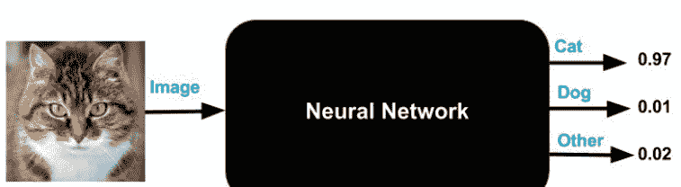

图片来源：www.learnopencv.com

## 作为统计模型的神经网络

目标：提取输入的线性组合作为派生特征，然后将目标建模为这些特征的非线性函数

### 翻译为统计学：

- 对响应变量和预测变量拟合非线性模型
- 预测变量使用多变量技术进行转换

### 神经网络是一个非线性模型

## 作为统计模型的神经网络

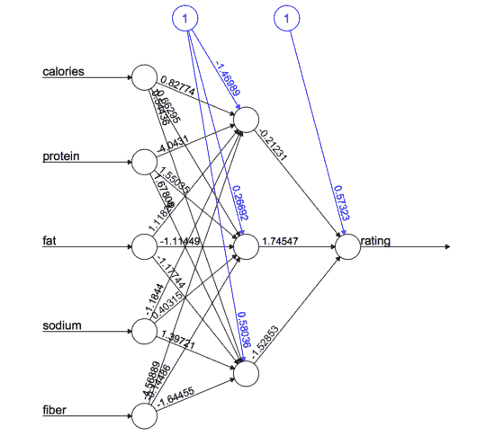

错误：0.089235，步骤：146

## 统计术语与神经网络术语对比

| 统计学 | 神经网络 |
|---|---|
| 模型 | 网络，图 |
| 拟合 | 学习，训练 |
| 系数，参数 | 权重 |
| 预测变量，变量 | 输入，特征 |
| 预测响应 | 输出 |
| 观测值 | 样例 |
| 参数估计 | 训练或学习 |
| 最陡下降 | 反向传播 |
| 截距 | 偏置项 |
| 派生预测变量 | 隐藏节点 |
| 惩罚函数 | 权重衰减 |

## 深度学习中的神经网络

### 简单神经网络

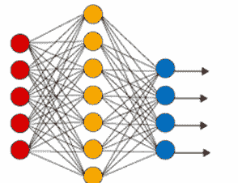

### 深度学习神经网络

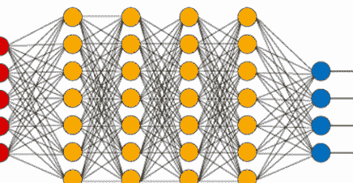

🔴 输入层

🟡 隐藏层

🔵 输出层

## 神经网络的一些数学

## 揭开深度学习黑箱的面纱


### 概述

核心思想：神经网络只是带有转换预测变量的回归模型

考虑以下模型的演进：

- 回归模型
- 非参数回归模型
- 神经网络模型
- 深度学习模型

## 回归模型

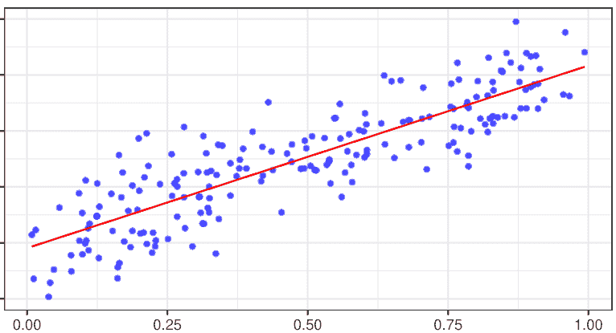

## 回归模型

### 模型

$$y = \beta_0 + \beta_1 x + \epsilon \text{ where } \epsilon \sim N(0, \sigma^2)$$
$$= f(x)$$

### 拟合模型

$$\hat{y} = \hat{\beta}_0 + \hat{\beta}_1 x$$
$$= \hat{f}(x)$$

### 损失函数

$$\sum_{i=1}^n (y_i - \hat{y}_i)^2$$

## 回归模型

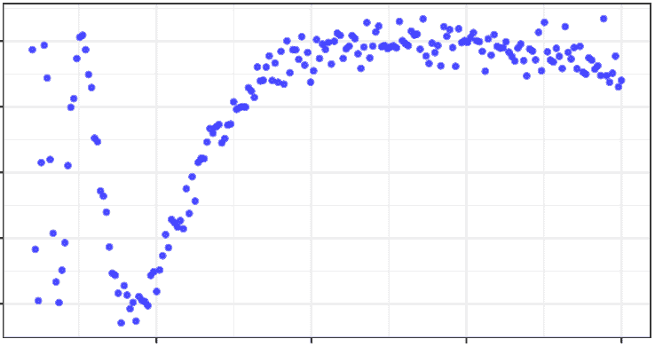

## 非参数回归

\(\widehat{y} = \widehat{f}(x) = \widehat{\beta}_0 + \sum_{k=1}^K \widehat{\beta}_k \overbrace{\sigma_k(x)}^{\text{function of } x}\)

### 示例

- 1. 多项式回归

\(\sigma_k(x) = x^k \text{ so } \widehat{f}(x) = \widehat{\beta}_0 + \widehat{\beta}_1 x + \widehat{\beta}_2 x^2 + \cdots + \widehat{\beta}_K x^K\)

- 2. 回归样条

> 样条是由多项式函数分段构建的函数。

> 对 \(x, \sigma_1(x), \sigma_2(x), \dots, \sigma_K(x)\) 应用一组转换

## 非参数回归

次数为 $K$ 的样条是通过连接次数为 $K$ 的多项式片段形成的函数，使得：

- 该函数是连续的，
- 该函数有 $K - 1$ 个连续导数，并且
- $K$ 阶导数在节点之间是常数。

## 非参数回归

### 简单样条回归

移动窗口：\(\hat{y}\) 是附近 \(x\) 值的 \(y\) 的平均值或加权平均值（核平滑）

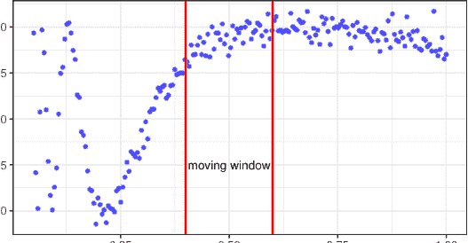

## 非参数回归

基函数：每个连续函数都可以表示为基函数的线性组合。

更高级的样条函数：基样条

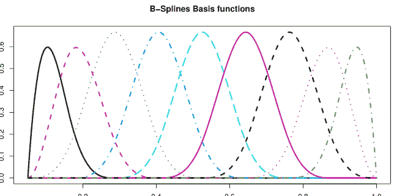

## 非参数回归

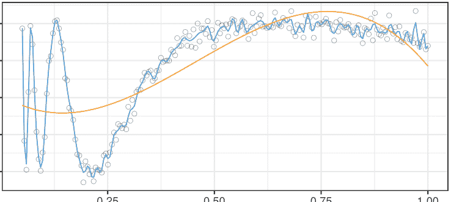

关键   df = 100   df = 3

## 非参数回归

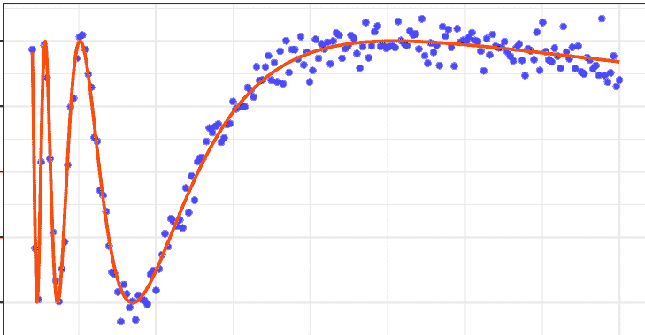

## 非参数回归

这种方法的弱点在于：

- 基函数是固定的，与数据无关
- 如果预测变量很多，这种方法效果不好
- 如果基函数与真实 f 不“匹配”，那么 K 必须足够大才能捕捉结构
- 如果 f 的部分具有显著不同的结构怎么办？

替代方法：数据 **告诉** 我们该使用什么样的基函数

## 神经网络模型

核心思想：将神经网络视为带有转换预测变量的多元回归模型

示例：带有 \( K \) 个隐藏节点 \( \sigma_1(x), \sigma_2(x), \dots, \sigma_K(x) \) 和 3 个预测变量 \( (x_1, x_2, x_3) \) 的单层神经网络模型

```
y = \beta_0 + \beta_1 \sigma_1(\alpha_{10} + \alpha_{11}x_1 + \alpha_{12}x_2 + \alpha_{13}x_3)
+ \beta_2 \sigma_2(\alpha_{20} + \alpha_{21}x_1 + \alpha_{22}x_2 + \alpha_{23}x_3)
+ \quad \dots
+ \beta_K \sigma_K(\alpha_{K0} + \alpha_{K1}x_1 + \alpha_{K2}x_2 + \alpha_{K3}x_3) \quad \text{function of } x
```

## 深度学习模型

### 神经网络模型

\( y = \beta_0 + \sum_{k=1}^K \beta_k \sigma_k(\alpha_{k0} + \alpha_{k1}x_1 + \alpha_{k2}x_2 + \alpha_{k3}x_3) \)

### 两层“深度”学习模型

\(\hat{y} = \hat{f}(x) = \hat{\beta}_0 + \sum_{k=1}^K \hat{\beta}_k \sigma_k(\alpha_{k0}+\alpha_{k1}x_1 + \alpha_{k2}x_2 + \alpha_{k3}x_3))\)

将每个预测变量替换为另一个神经网络模型

## 深度学习模型示意图

图片：深度学习，图 1.2


汽车

人

动物

输出（对象身份）

第三隐藏层（对象部分）

第二隐藏层（角点和轮廓）

第一隐藏层（边缘）

可见层（输入像素）

## 生态学中的深度学习统计视角

### 第 1 部分：简介

- 机器学习简介
- 深度学习简介

### 第 2 部分：深入探讨

- 从三个视角看神经网络
- 深度学习的数学
- 模型拟合
- 深度学习模型的类型

### 第 3 部分：深度学习实践

- 深度学习中的伦理
- 生态学中的深度学习

## 深度学习：模型拟合

## 深度学习软件

- Python
  - 深度学习最流行的语言
  - 面向对象的高级编程语言
  - 主要包：TensorFlow, PyTorch, Keras，...
  - 你需要学习 Python 吗？也许

- Keras
  - 用 Python 编写的开源神经网络库。
  - Keras 包是一个 API。
  - API（应用程序编程接口）允许多个软件包进行交互。
  - Keras 可以与以下软件交互：
    TensorFlow, Microsoft Cognitive Toolkit, R, Theano, PlaidML

## Caret 包中的神经网络模型

- 1. 神经网络模型：nnet, mxnet, mxnetAdam, neuralnet 等

- 2. 堆叠自动编码器深度神经网络

- 3. 许多其他选项

### R 包：keras 和 kerasR

- Python 深度学习包 Keras 的接口

- Rstudio 的 keras 页面

- 当它访问的任何包更新时，可能会出现 bug

## 深度学习：模型拟合

- 模型拟合的步骤
- 1. 定义网络结构
- 2. 选择损失函数
- 3. 选择优化器

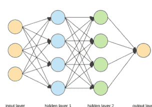

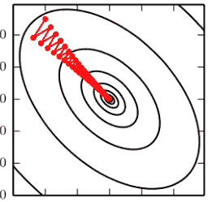


## 网络结构

- 一个层由一组节点组成
- 在全连接模型中，一层中的每个节点都连接到下一层的所有节点

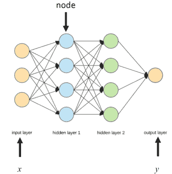

图片来源：towardsdatascience

### 在 Keras 的 R 接口中定义网络模型

```
model <- keras_model_sequential()
model %>%
  layer_dense(units = 256, activation = 'relu') %>%
  layer_dense(units = 128, activation = 'relu') %>%
  layer_dense(units = 10, activation = 'softmax')
```

keras.rstudio.com

## 网络结构

回顾基本神经网络模型（一层，p 个预测变量）

y = \beta_0 + \sum_{k=1}^K \beta_k \sigma_k(\alpha_{0k} + \alpha_{1k}x_1 + \alpha_{2k}x_2 + \cdots + \alpha_{3p}x_p)

激活函数

激活函数

- 计算开销低
- 深度学习成功的关键之一

## 激活函数

- **Sigmoid**

  \(\sigma(x) = \frac{1}{1+e^{-x}}\)

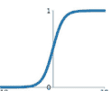

- **Leaky ReLU**

  \(max(0.1x, x)\)

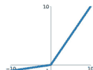

- **tanh**

  \(\tanh(x)\)

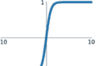

- **Maxout**

  \(max(w_1^T x + b_1, w_2^T x + b_2)\)

- **ReLU**

  \(max(0, x)\)

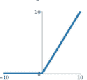

- **ELU**

  \(\begin{cases} x & x \ge 0 \\ \alpha(e^x - 1) & x < 0 \end{cases}\)

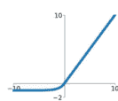

图片来源：medium.com

## 网络结构

### ReLU（修正线性单元）激活函数

\(\sigma(x) = \max(0, x) = \left\{ \begin{array}{ll} 0 & \text{for } x < 0 \\ x & \text{for } x \ge 0 \end{array} \right.\)

### Softmax 激活函数

- 用于输出层的分类问题
- 输入：\( x \in \Re \)，输出：\( 0 \le \sigma(x_i) \le 1 \)

\(\sigma(x_i) = \frac{\exp(x_i)}{\sum_{j=1}^J \exp(x_j)} \quad \text{for } i = 1, \dots, J\)

## 网络结构

### 在 Keras 的 R 接口中定义网络模型

```
model <- keras_model_sequential()
model %>%
  layer_dense(units = 256, activation = 'relu') %>%
  layer_dense(units = 128, activation = 'relu') %>%
  layer_dense(units = 10, activation = 'softmax')
```

- 序列模型：神经网络层的线性堆叠
- layer_dense：全连接层
- units：层中的节点数
- 激活函数

keras.rstudio.com

## 深度学习：模型拟合

### 回顾极大似然估计

- 模型拟合的步骤
  1. 定义网络结构
  2. 选择损失函数
  3. 选择优化器

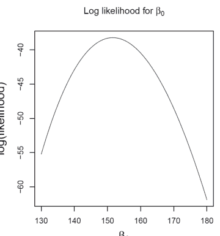

## 损失函数

损失函数

- 衡量网络的预测性能
- 衡量最后一层的输出与观测值的接近程度
- 必须是一个数值摘要

模型拟合的目标：

找到使损失最小化的参数值（权重）

## 损失函数

均方误差：用于连续响应数据

\(\frac{1}{n} \sum_{i=1}^n(y_i - \hat{y}_i)^2\)

交叉熵（偏差）：用于分类响应数据

\(- \sum_{i=1}^n \sum_{g=1}^G y_{ig} \log(\widehat{\pi}_{ig})\)

对于具有以下特征的问题：

- g = 1, ..., G 个类别
- \(\widehat{\pi}_{ig} = \) 观测值 i 属于第 g 个类别的预测概率

## 损失函数

选择与最终层（输出层）激活函数兼容的损失函数

| 任务 | 损失函数 | 最后一层激活函数 |
| :--- | :--- | :--- |
| 二分类 | 二元交叉熵 | Sigmoid |
| 多类，单标签分类 | 类别交叉熵 | Softmax |
| 多类，多标签分类 | 二元交叉熵 | Sigmoid |
| 回归到任意值 | 均方误差 (MSE) | 无 |
| 回归到 0 到 1 之间的值 | MSE 或二元交叉熵 | Sigmoid |

## 损失函数

在 R Keras 中，

1. 设置模型（参见上文）。
2. 使用合适的损失函数、优化器和指标编译模型。

```
model %>%
  compile(
    loss = 'categorical_crossentropy',
    optimizer = optimizer_rmsprop(),
    metrics = c('accuracy')
  )
```

R keras 中的损失函数

## 模型拟合

### 模型拟合的步骤

1. 定义网络结构
2. 选择损失函数
3. 选择优化器

## 模型拟合

### 目标：

- 找到使损失最小化的参数值（权重）
- 估计参数值 $\beta, \alpha, ...$

### 模型拟合也称为训练

- 计算机科学：训练模型
- 统计学：估计参数
- 数学：优化损失函数

## 模型拟合

神经网络有**许多**未知参数（权重）。

### 参数计数

- 一个节点中有 p + 1 个参数
  - p 个协变量加上截距（偏置）
  - 参数：$(\alpha_{k0}, \alpha_{k1}, ..., \alpha_{kp})$
- 每层 k = 1, ..., K 个节点加上截距：$(\beta_{g0}, ..., \beta_{gK})$
- g = 1, ..., G 层

总计 $K(p + 1) + G(K + 1)$ 个参数

## 模型拟合

示例：

- p = 100 个协变量
- K = 128 个节点/层
- G = 5 层
- 128(100 + 1) + 5(128 + 1) = 13,573 个参数

含义：

- 参数众多，且
- 所有参数高度相关。
- 因此，你需要大量数据和一种特殊的方法来估计参数。

## 优化

- 最小化损失的一般方法是使用随机梯度下降
  - 为权重分配初始值
  - 计算损失函数对每个权重的偏导数
  - 沿下降方向（梯度的反方向）迈出一步
  - 重复直到权重收敛

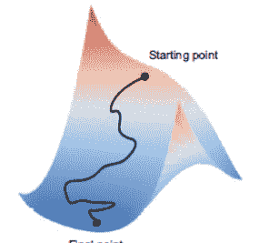

## 优化

### 深度学习优化

- 这是对优化的简要概述。
- Goodfellow 等人编写的《Deep Learning》一书中有很好的概述
- Keras 中的优化器：SGD, RMSprop, Adagrad, Adadelta, Adam, Adamax, Nadam
- 优化器概述

## 优化：综合所有内容（2 层网络）

- 输入 X
- 权重
- 层数据变换
- 权重
- 层数据变换
- 权重更新
- 预测值 Y'
- 真实目标 Y
- 优化器
- 损失函数
- 损失分数

## 深度学习：实践中的模型拟合

## 实践中的模型拟合

训练深度学习模型需要做出许多决策

你选择：

- 模型架构
- 损失函数
- 优化方法
- 所有这些工作原理的细节

## 实践中的模型拟合

### 需要调整的一些深度学习参数

- 隐藏层数量和单元数
- 正则化
- 迭代次数和批量大小
- 一般实践建议

## 隐藏层数量和单元数

宽度

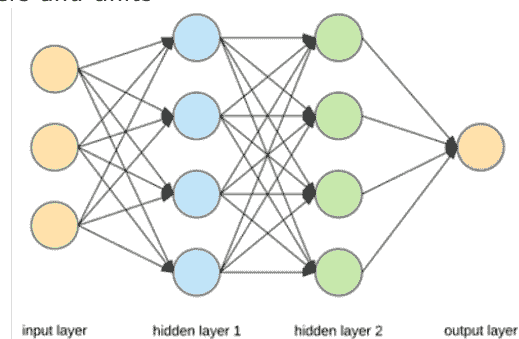

深度

## 隐藏层数量和单元数

### 多少层？

- 旧策略：一层足够
  - 通用逼近定理：一个隐藏层足以以任意精度表示任何函数的近似
  - 理论与实践！
- 当前建议
  - 从具有一个或两个隐藏层且包含大量单元的网络开始
  - 如果性能不佳且已调试，请尝试深度学习

## 欠拟合和过拟合

### 简单示例

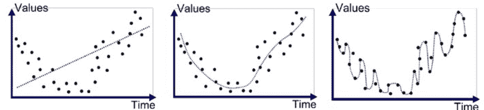

欠拟合

良好拟合/鲁棒

过拟合

图片来源：medium.com

## 欠拟合和过拟合

### 过拟合：

- 结果无法推广到训练集之外
- 解决方案：获取更多训练数据或使用正则化

### 欠拟合：

- 结果无用
- 解决方案：调整模型结构或模型拟合设置

## 正则化

<- 欠拟合

过拟合 ->

最佳拟合

测试误差

训练误差

误差

模型"复杂度"

图片来源：www.analyticsvidhya.com


## 正则化与 Dropout

### Dropout

- 将模型中比例的权重随机设置为 0
- 通过更稀疏的网络防止过拟合
- Dropout rate = 设置为 0 的权重比例

## 正则化与 Dropout

```
model <- keras_model_sequential()
model %>%
layer_dense(units = 256, activation = 'relu', input_shape
layer_dropout(rate = 0.4) %>%
layer_dense(units = 128, activation = 'relu') %>%
layer_dropout(rate = 0.3) %>%
layer_dense(units = 10, activation = 'softmax')
```

Rstudio 的 keras 页面

## 正则化与 Dropout

来源：Srivastava 等人. 放弃法：防止神经网络过拟合的简单方法

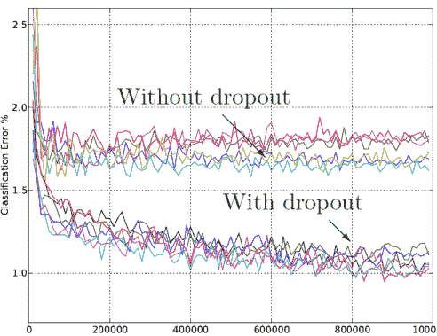

图 4：不同架构的测试误差

## 正则化

你也可以通过在损失函数中添加类似 LASSO 的惩罚来实现正则化（Tibshirani, 1996）

### 正则化

损失 + 正则化惩罚

### L1 正则化

$Loss + \lambda \sum_{i=1}^{M} |w_i|$

其中

- $w_1, \dots, w_M$ 表示所有模型权重（参数）
- $\lambda$ 是调参参数

## Epochs and Batch Size

面对大型数据集时，深度学习优化算法将数据分成子集。

### 模型拟合选项：

- 批量大小：在更新模型前处理的训练样本数量
- 时代：完整遍历数据集的次数
- 验证分割：用作每个时代验证数据的训练数据比例。

## Epochs and Batch Size

小示例：使用 `fit()` 函数训练模型 30 个时代，每批 128 张图片：

```
history <- model %>% fit(
x_train, y_train,
epochs = 30, batch_size = 128,
validation_split = 0.2
)
```

有用参考：machinelearningmastery.com

## Epoch 图

准确率
时代
训练准确率
验证准确率：轻微过拟合
验证准确率：严重过拟合

图片来源：towardsdatascience.com

## 这是你的机器学习系统？

是啊！你把数据倒进这个巨大的线性代数堆里，然后在另一边收集答案。

如果答案错了呢？

搅动这个堆，直到它们看起来正确为止。


## 架构

网络架构：网络的整体结构

### 一般建议

- 使用你能负担得起的最大网络
- 保持每层节点数相同
- 尝试不同的层大小
- 隐藏层使用 ReLU 单元
- 为你的数据选择合适的损失函数
- 确保输出层的激活函数与损失函数匹配

## 深度学习模型类型

## 深度学习模型类型

### 架构家族：

- 1. 深度前馈网络：我们迄今所涵盖的内容
- 2. 卷积网络
- 3. 循环和递归网络
- 4. 生成对抗网络
- 5. 贝叶斯网络
- 6. 总有新方法涌现

## 深度学习模型类型

### 卷积网络

- 用于图像等网格状数据
- 数据需要以某种方式相关（我认为）
- 每一层使用内核而不是整个图像来检测边缘等小型、有意义的特征
- 稀疏连接

## 深度学习模型类型

### 卷积边缘检测


输入

| 1 | -1 |
|---|---|

内核

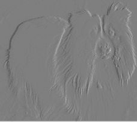

输出

## 卷积网络

图像：Deep Learning，图 1.2


输出（对象身份）

汽车

人

动物

第 3 个隐藏层（对象部分）

第 2 个隐藏层（角和轮廓）

第 1 个隐藏层（边缘）

可见层（输入像素）

## 深度学习模型类型

### 循环和递归网络

- 用于处理序列数据
- 示例：时间序列、金融数据、文本、语音

### 生成对抗网络

- 两个神经网络竞争生成与旧数据相似的新数据
- 用于图像生成、视频生成和语音生成

## 深度学习模型类型

### 贝叶斯网络

- 可以是上述任何一种（例如，贝叶斯卷积网络）
- 优点：估计不确定性
- 缺点：计算速度慢
- 变分贝叶斯是当前的推断方法
- 当前方法相当粗糙

## 生态学中深度学习的统计视角

### 第 1 部分：简介

- 机器学习简介
- 深度学习简介

### 第 2 部分：深入探讨

- 从 3 个视角看神经网络
- 深度学习的数学
- 模型拟合
- 深度学习模型类型

### 第 3 部分：深度学习实践

- 深度学习伦理
- 生态学中的深度学习

## 深度学习的一些有用参考

- I. Goodfellow, Y. Bengio 和 A. Courville 著《深度学习》（2016）MIT Press
- F. Chollet 和 J.J. Allaire 著《使用 R 进行深度学习》（2018）Manning Publications
- 第 1-3 章可在线阅读
- 重点是 Keras

## 用于开发此演示文稿的其他参考资料

### 书籍：

- *计算统计学*
  Givens 和 Hoeting 著（第 2 版，Wiley）
- *统计学习方法*
  Hastie, Tibshirani, 和 Friedman 著
- *统计学习导论*
  James, Witten, Hastie, Tibshirani 著

课程材料由：
Ian Goodfellow, Darren Homrighausen, Ander Wilson, Asa Ben-Hur 提供

## 感谢

- ISEC2020 组织者，尤其是 David Warton 和 Gordana Popovic
- 课程助教：Tess Hamzeh, Winston Hilton, Rachael Krawczyk
- Alison Ketz 和 Dan Walsh

## 资助支持致谢

本材料基于国家科学基金会（NSF）在拨款编号 AGS-1419558 下、美国地质调查局（USGS）（G17AC00409）以及科罗拉多州立大学（CSU）支持的工作而编写。本材料中表达的任何意见、发现、结论或建议均为作者的观点，不一定反映 NSF、USGS 或 CSU 的观点。

