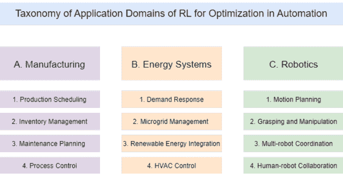

# 自动化优化的强化学习综述

摘要— 强化学习（RL）已成为自动化领域优化挑战的关键工具，在多个领域带来了显著进展。本综述文章考察了自动化中 RL 的现状，特别关注其在制造、能源系统和机器人领域的作用。它讨论了各个领域的最先进方法、主要挑战和未来研究方向，强调了 RL 解决复杂优化挑战的能力。本文回顾了自动化中 RL 驱动优化方法的优势和局限性。它指出了 RL 优化中普遍遇到的挑战，包括与样本效率和可扩展性；安全性和鲁棒性；可解释性和可信度；迁移学习和元学习；以及现实世界部署和集成相关的问题。它进一步探讨了应对这些挑战的潜在策略和未来研究路径。此外，该调查还包含一份相关研究论文的综合列表，使其成为有意探索该领域的学者和从业者不可或缺的指南。

索引术语：强化学习，自动化，制造，能源系统，机器人

# I. 引言

## A. 动机

强化学习（RL）已成为序贯决策问题的有效框架，使智能体能够通过与环境交互来学习最优策略 [1]，[2] 近年来，RL 在包括制造 [3]、能源系统 [4] 和机器人 [5] 在内的各个领域取得了显著成功。RL 的关键优势在于其能够从试错经验中学习，而无需明确监督或预定义模型。

同时，优化问题在自动化中无处不在，涵盖生产调度 [6]、过程控制 [7] 和库存管理 [8] 等多个领域。这些问题通常涉及不确定性下的复杂决策、大规模组合搜索空间和动态环境。传统的优化方法，如数学规划和元启发式算法，已被广泛研究并应用于自动化问题 [9]。然而，它们在可扩展性、适应性以及对领域特定知识的需求方面常常面临困难。

RL 与自动化中优化的交叉为应对这些挑战提供了一条有前途的途径。通过利用 RL 从经验中学习并适应变化条件的能力，我们可以为自动化任务开发更高效、灵活和鲁棒的优化算法 [10]，[11]。这促使了各个自动化领域中基于 RL 的优化研究不断增多，这也是本调查的重点。

## B. 范围与贡献

本调查论文旨在全面概述自动化优化中的 RL 技术。我们关注三个关键应用领域：制造、能源系统和机器人。在每个领域，我们回顾了展示 RL 在解决优化问题方面有效性的代表性工作，并讨论了独特的挑战和机遇。

本调查的主要贡献如下：

- 我们对自动化中基于 RL 的优化方法进行了系统分类，突出了其优势和局限性。
- 我们讨论了每个应用领域中用于优化的最先进 RL 算法。
- 我们确定了自动化中基于 RL 的优化所面临的常见挑战，包括样本效率和可扩展性；安全性和鲁棒性；可解释性和可信度；迁移学习和元学习；以及现实世界部署和集成，并讨论了潜在解决方案和未来研究方向。
- 我们提供了一份相关研究论文的综合参考书目，为有兴趣的研究人员和从业者提供宝贵资源。

据我们所知，这是第一篇专门针对自动化优化中 RL 的调查论文，涵盖了广泛的应用领域，并为这一快速发展的领域的现状和未来前景提供了见解。

## C. 论文组织

本调查的其余部分组织如下：第二部分重点介绍了三个主要领域中基于 RL 的优化应用：制造、能源系统和机器人。对于每个领域，我们对所选论文进行比较分析，突出其关键发现、方法和贡献。我们还讨论了特定领域的挑战和机遇。第三部分讨论了自动化中基于 RL 的优化所面临的常见挑战。我们概述了应对这些挑战的潜在解决方案和未来研究方向。最后，第四部分总结了本调查，概括了主要要点。

# II. 应用领域

强化学习（RL）彻底改变了制造、能源系统和机器人领域的自动化。图 1 展示了我们将在本节中讨论的这些主要领域及其子领域。

图 1：自动化优化中 RL 应用领域的分类法

## A. 制造

RL 通过在生产调度、库存管理、维护计划和过程控制方面的进步，正在彻底改变制造业，展示了其在该领域解决复杂优化挑战的潜力。在生产调度中，RL 方法通过熟练处理不确定性而超越传统模型，从而提高盈利能力和客户服务 [6]，[12]–[15]。在库存管理中，RL 技术（特别是深度强化学习（DRL）和多智能体强化学习（MARL））为管理随机需求和复杂供应链提供了创新解决方案，从而改善销售并减少浪费 [8]，[16]–[19]。维护计划受益于 RL 的动态优化能力，利用实时数据制定维护计划，从而提高系统可靠性并减少停机时间 [20]–[24]。在过程控制中，RL 的适应性确保了产品质量和运营效率，可解释 RL 和 DRL 等方法论增强了过程理解和控制策略 [7]，[25]–[28]。未来方向指向开发风险敏感公式、利用现实世界数据以及集成智能系统，以进一步提高制造效率。表 I 通过概述关键目标、所解决的挑战、RL 方法、结果和未来方向，以及凸显 RL 对制造业变革性影响的代表性研究，概括了这些见解。

## B. 能源系统

RL 和 DRL 正在改变能源系统，在需求响应、微电网管理、可再生能源集成以及供暖、通风和空调（HVAC）控制等方面提供创新解决方案，以优化和增强电网稳定性、可持续性和能源效率。需求响应策略受益于 DRL 和 MARL，以响应公用事业信号动态调整能源使用，实现高达 22% 的节能和更高效的电力管理 [29]–[34]。在微电网管理中，DRL 和 MARL 方法通过优化能源分配和使用来增强电网韧性，从而提高成本效率并增加系统可靠性 [35]–[40]。对于可再生能源集成，RL 处理可再生能源变异性的能力带来了更有效的能源调度策略，确保电网稳定性并最大限度地利用可再生资源 [4]，[31]，[41]–[44]。作为主要能源消费者，HVAC 系统通过 DRL 和批量 RL 方法实现优化，在保持居住者舒适度的同时显著降低能源消耗 [29]，[45]–[49]。展望未来，需求响应的自适应策略和弥合仿真-实验差距、微电网管理的学习效率提升、可再生能源集成的可扩展性和适应性改进，以及 HVAC 控制中预训练模型的更广泛适用性等方面都有望取得进展。这一叙述在表 II 中得到概括，该表概述了每个子领域的关键目标、所解决的挑战、RL 方法论和结果，以及未来研究方向和说明 RL 在推动能源系统发展方面发挥重要作用的代表性研究。

## C. 机器人

RL 正在彻底改变机器人领域，在运动规划、抓取与操作、多机器人协调以及人机协作等方面取得重大进展，从而解决该领域固有的复杂挑战。在运动规划中，RL（特别是 DRL 和课程学习等创新方法论）使机器人能够在动态环境中熟练导航和执行任务，增强适应性和任务性能 [50]–[52]，[63]。抓取与操作受益于 DRL 处理复杂传感器输入的能力，使机器人能够以前所未有的灵活性和效率与各种对象和环境进行交互 [53]，[54]，[64]–[66]。多机器人协调利用 DRL 和 MARL 来促进机器人之间的复杂协作策略，优化集体行动以在复杂和

### TABLE I: Comparison of RL Approaches for Optimization in Manufacturing

| Feature/Criteria | Production Scheduling | Inventory Management | Maintenance Planning | Process Control |
|---|---|---|---|---|
| **Key Objectives** | Optimize allocation of tasks to resources over time | Balance supply with demand, minimize costs, and ensure timely product availability | Minimize downtime, extend asset life, ensure safety | Ensure product quality, operational efficiency, and safety |
| **Challenges Addressed** | Handling complexities and uncertainties in scheduling tasks | Stochastic demand, perishable goods, multi-echelon supply chains | Dynamic maintenance planning under system degradation | Controlling complex manufacturing processes |
| **RL Approaches** | DQN [6], Distributional RL [15], DRL [13], A2C [12] | DQN [17], PPO [19], A2C [16], DRL [8], Cooperative MARL [18] | Multi-Agent Actor Critic [24], Deep Q-learning [22], [23], Q-learning [21] | TRPO [26], DDPG [7], Dynamic Q-table [25] |
| **Methodology Highlights** | Superiority over traditional mixed integer linear programming models, competitive performance against heuristic methods | Comprehensive roadmap for DRL deployment, novel frameworks for multi-agent hierarchical inventory management | Analysis of RL/DRL applications, dynamic maintenance policies using Q-learning | Adaptation of RL for Statistical Process Control (SPC), integration of domain expertise, apprenticeship learning |
| **Outcomes** | Increased profitability, reduced inventory levels, improved customer service | Maximized sales, minimized perishable product wastage, optimized supply chain needs | Reduced maintenance activities, enhanced fleet availability, adapted maintenance policies | Enhanced SPC adaptability, improved control policies, handling nonlinearities in manufacturing |
| **Future Directions** | Development of risk-sensitive formulations, leveraging real-world data | Advanced cooperative strategies among agents, leveraging custom GPU-parallelized environments | Integration with smart factory systems, leveraging condition monitoring data | Utilization of real-world data for training, improving RL training efficiency |
| **Representative Studies** | Hubbs et al. [12], Shi et al. [13], Guo et al. [14], Esteo et al. [6], Mowbray et al. [15] | Boute et al. [8], Sultana et al. [16], De Moor et al. [17], Kirwar et al. [18], Leluc et al. [19] | Ogunfowora and Najjaran [20], Yousefi et al. [21], Yousefi et al. [22], Andrade et al. [23], Thomas et al. [24] | Vihoras and Jakab [25], Nian, Liu, and Huang [7], Kuhnle et al. [26], Mowbray et al. [27], and Li, Du, Jiang [28] |

### TABLE II: Comparison of RL Approaches for Optimization in Energy Systems

| Feature/Criteria | Demand Response | Microgrid Management | Renewable Energy Integration | HVAC Control |
|---|---|---|---|---|
| **Key Objectives** | Optimize energy usage and cost in response to utility signals, enhancing grid stability | Enhance grid resilience and efficiency, optimizing energy distribution and usage | Seamlessly integrate renewable energy into power systems, maximizing utilization while ensuring grid stability | Optimize HVAC systems for energy efficiency without compromising occupant comfort |
| **Challenges Addressed** | Adapting to dynamic pricing and demand, improving energy consumption efficiency | Managing diverse energy sources, ensuring reliable and efficient operation | Addressing variability and unpredictability of renewable sources | Balancing energy savings with thermal comfort requirements |
| **RL Approaches** | PPO [29], [30], MARL [31], [34], DDQN [32], MADDPG [33] | DQN [39], PPO [37], A3C [35], | MA-DRL [42], Q-learning [31] | PPO [29], Batch Constrained Munchenhaus Deep Q-learning [47], Q-learning [48], A3C [45] |
| **Methodology Highlights** | Meta-learning for simulation-experiment gap, multi-agent systems for residential energy management | Expert knowledge integration, operational flexibility with proximal policy optimization | Analysis on RL's role, multi-task learning for system-wide optimization | Architecture optimization for demand response, safe control strategies, and energy consumption reduction |
| **Outcomes** | Up to 22% energy savings, efficient electricity usage management | Improved energy distribution and cost efficiency, increased resilience | Enhanced management of complex energy flows, significant performance improvements | Reduction in HVAC energy consumption, improved operational efficiency |
| **Future Directions** | Advanced cooperative strategies, bridging the simulation-experiment gap | Enhanced learning efficiency, integration with smart grid technologies | Scalability and adaptability of RL methods, robustness against environmental changes | Adaptability to diverse buildings, pre-training models, transfer learning applications |
| **Representative Studies** | Azuatatam et al. [29], Jang et al. [30], Ahrarinouri et al. [31], Lu et al. [32], Lu et al. [33], Zhang et al. [34] | Nakabi and Toivanen [35], Hu and Kwasiinski [36], Zhang et al. [37], Zhang et al. [38], Shojaeighadikolaei et al. [39], Du and Li [40] | Yang et al. [41], Cao et al. [42], Chen et al. [43], Sivamayil et al. [44], Perera and Kamalaruban [4], Ahrarinouri et al. [31] | Azuatatam et al. [29], Zhong et al. [45], Sierla et al. [46], Liu et al. [47], Yuan et al. [48], Biemann et al. [49] |

### TABLE III: Comparison of RL Approaches for Optimization in Robotics

| Feature/Criteria | Motion Planning | Manipulation | Multi-robot Coordination | Human-robot Collab |
|---|---|---|---|---|
| **Key Objectives** | Enable robots to navigate and perform tasks in dynamic environments | Enhance robotic interaction with objects and environments | Optimize collaborative actions of multiple robots for a common goal | Facilitate effective interaction and cooperation between humans and robots |
| **Challenges Addressed** | Navigating complex and dynamic environments, learning from interaction | Adapting to diverse objects, leveraging complex sensor inputs | Resource competition, obstacle avoidance in cooperative tasks | Adaptation to human behaviors, ensuring safety and making intelligent decisions |
| **RL Approaches** | PPO [50], Q-learning [51], Soft Actor-Critic (SAC) [52] | DDPG [53], Double DQN [54] | Multi-Robot Coordination with Deep Reinforcement Learning (MRCDRL) [55], Multi Agent Deep Reinforcement Learning [56] | DQN [57], [58], SAC [59], [60], DDPG [61], Double DQN [62] |
| **Methodology Highlights** | EfficientLPT [52] for space robots, curriculum learning for robotic arms | Visuo-motor feedback, dexterous grasping in sparse environments | MRCDRL [55] for cooperative action, MARL for pick-and-place optimization | Human-centered DRL, explainable RL for interaction quality enhancement |
| **Outcomes** | Improved planning accuracy, learning from human demonstrations | Significant outperformance in grasping tasks, adaptability to grippers | Effective resource allocation and dynamic obstacle avoidance, applicability in smart manufacturing | Enhanced coordination in packaging tasks, adaptability to user habits during collaboration |
| **Future Directions** | Integration with sensory feedback, real-time adaptation | Incorporation of more complex sensory modalities, tactile feedback | Scalable coordination strategies for larger teams, integration with smart environments | Personalized adaptation to human habits, enhancing safety and interpretability |
| **Representative Studies** | Wang et al. [63], Cao et al. [52], Zhou et al. [50], Yu and Chang [51] | Joshi et al. [54], Schuck et al. [53], Han et al. [64], Rivera et al. [65], Beigomi and Zhu [66] | Wang and Deng [55], Lan et al. [56], Yang [67], Lan et al. [68], Sadhu and Konar [69], Khamassi [70] | Ghadirzadeh et al. [57], Iucci et al. [58], Shafti et al. [59], Cai et al. [62], Thumm et al. [60], El-Shamouty et al. [61] |

dynamic tasks [55], [56], [67]-[70]. Human-robot collaboration (HRC) sees advancements through DRL's capacity for learning from interactions and adapting to human behaviors, significantly improving cooperation in tasks ranging from manufacturing to daily assistance [57]-[62]. Future research directions emphasize the integration of sensory feedback for real-time adaptation in motion planning, enhancing grasping tasks with complex sensory and tactile feedback, developing scalable coordination strategies for larger robot teams, and personalizing HRC to adapt to human habits while enhancing safety and interpretability. Table III succinctly encapsulates these domains by detailing key objectives, challenges addressed, RL approaches, methodology highlights, outcomes, and future directions, alongside representative studies demonstrating RL's transformative impact on robotics.

# III. CHALLENGES, STATE OF THE ART, AND FUTURE DIRECTIONS

There has been a significant progress in the field of RL for optimization in automation; however, there are still challenges to be addressed. Table IV gives a comparison of these challenges, along with the state of the art in the field and future directions that we will discuss in this section.

## A. Sample Efficiency and Scalability

Sample efficiency and scalability are vital in RL to minimize training data and ensure solutions scale with task complexity. These challenges are particularly important in real-world applications where data collection is expensive or time-consuming [71], [72].
Current efforts to enhance sample efficiency and scalability include making past samples more reflective of the current model [71], [72], using evolution strategies and efficient memory in experience replay [73], [74], incorporating offline data for online learning [75], [76], and leveraging adaptive learning techniques [77], [78].
Future research should aim at algorithms with adaptive learning rates, domain-specific knowledge integration, efficient computational resource use, and cross-domain transfer learning to further improve sample efficiency and scalability in RL applications.

## B. Safety and Robustness

Ensuring safety and robustness in RL is crucial, especially for applications in critical domains like autonomous driving and healthcare. Safe RL algorithms aim to learn policies that satisfy safety constraints during both training and deployment [107].
Current strategies for ensuring safety include developing concepts of safety robustness [79], frameworks for robust policies [80], tackling observational adversarial attacks [81], integrating robust-control-barrier-function layers [82], managing safety requirements with robust action governor [83], enforcing safety via robust Model Predictive Control (MPC) [84], offering robustness guarantees [85], [86], improving policy robustness through falsification-based adversarial learning [87], and inducing a safety curriculum [108].

| 挑战 | 描述 | RL 方法 | 现有技术 | 未来方向 | 相关研究 |
| :--- | :--- | :--- | :--- | :--- | :--- |
| 样本效率与可扩展性 | 减少学习所需数据并确保可扩展性 | PPO, SAC, Model-based Policy Optimization (MBPO), Dreamer, IMPALA, Acme | 结合规划算法的基于模型的强化学习、带优先经验回放的非策略学习以及大规模分布式强化学习系统 | 关注具有自适应学习率和跨域迁移学习的算法 | Tianye Cao [71], Florian E. Dorner [72], Suri et al. [73], Yang et al. [74], Ball et al. [75], Li et al. [76], Ly et al. [77], Wang et al. [78] |
| 安全性与鲁棒性 | 确保RL策略在不确定条件下安全运行 | Constrained Policy Optimization (CPO), Lyapunov-based approaches, State-wise Safe RL, Probabilistic constraint methods | 用于策略验证的形式方法、鲁棒对抗训练以及安全探索技术 | 集成形式验证方法并增强人机交互 | Hao Xiong and Xiumin Diao [79], Li et al. [80], Liu et al. [81], Emam et al. [82], Li et al. [83], [84], Queeny et al. [85], Md Asifur Rahman and Sarra M. Alqahtani [86], Wang et al. [87] |
| 可解释性与可信度 | 开发动作透明且可理解的RL模型 | MARL, Q-learning, Deep RL, DQN, PPO, TD3, SAC | 特征归因、策略蒸馏以及决策树和注意力机制等可解释模型 | 改进可解释模型的基础并应用自监督学习进行可解释表征 | Glanois et al. [88], Duo Xu and Faramarz Fekri [89], Mansour et al. [90], Eckstein et al. [91], Alharin et al. [92], Shi et al. [93], Dao et al. [94] |
| 迁移学习与元学习 | 使RL系统能够利用过去经验的知识快速适应新任务 | A3C, Meta-RL, Meta-RL with Context-conditioned Action Translator (MCAT), TD3 | 基于上下文的元学习框架、多任务学习技术以及预训练模型的微调 | 开发能够在更广泛任务范围内泛化并增强迁移学习能力的算法 | Hospedales et al. [95], Guo et al. [96], Narvekar et al. [97], Varma et al. [98], Sasso et al. [99], Ren et al. [100] |
| 现实世界部署与集成 | 弥合RL部署中理论进步与实用性之间的差距 | Behavior-Regularized Model-Ensemble (BREMEN), Distributional Maximum a Posteriori Policy Optimization (DMPO), Distributed Deterministic Policy Gradient (D4PG) | 可扩展的RL架构、鲁棒策略部署策略以及开源基准和工具包 | 优先考虑部署效率、增强人机交互并促进产学研合作 | Dulac-Arnold et al. [101], Matsushima et al. [102], Yahmed et al. [103], Li et al. [104], Garau-Liu et al. [105], Kanso and Patra [106] |

### 表 IV：自动化中RL优化的当前挑战、最新进展与未来方向

未来研究方向应着重于为高维连续控制任务开发可扩展的安全RL算法，将形式验证方法与RL相结合，并提高安全RL算法在动态环境中的适应性。

## C. 可解释性与可信度

确保RL模型具有可解释性和可信度对于医疗保健、自主系统和金融等应用至关重要，需要透明、可理解且可靠的决策过程。

改进可解释性的当前研究包括区分可解释性与可说明性 [88]、将符号逻辑与深度RL相结合以实现透明度 [89]、在结构化环境中实现策略可解释性 [90]、在认知科学中解释RL建模 [91]、在基于视觉的RL中发现可解释特征 [93]、以及引入稀疏证据收集以供人类解释 [94]。

进步将着重于通过基础性改进使模型本质上可理解，纳入人类反馈，推进特征发现技术，并应用自监督学习实现自然可解释性，旨在更深入地理解RL行为。

## D. 迁移学习与元学习

迁移学习与元学习满足了RL系统利用过去经验的知识高效适应新任务的需求，旨在提高各种环境下的学习效率和泛化能力。

Hospedales et al. [95] 强调了元学习在跨任务适应性中的作用。Guo et al. [96] 为元RL开发了一个动作转换器以增强探索和效率。Narvekar et al. [97] 提出了一个课程学习框架，利用任务排序来改善复杂场景下的学习。Varma et al. [98] 展示了使用ResNet50等预训练模型来提升RL性能的好处。Sasso et al. [99] 和 Ren et al. [100] 调查了基于人类偏好的快速适应的多源迁移学习和元RL。

未来努力将着重于在多样化任务中更好地泛化的算法，并推动无监督和自监督学习以推进迁移学习能力。同时，也越来越关注能够自主利用过去知识的模型。

## E. 现实世界部署与集成

现实世界RL模型部署涉及克服理论研究与实际应用之间的差距，确保模型鲁棒性，并使模拟训练环境与现实世界条件保持一致。

Dulac-Arnold et al. [101] 指出了现实世界RL部署的挑战，并引入了用于复杂度的基准。Matsushima et al. [102] 专注于最小数据的高效部署。Yahmed et al. [103] 概述了部署挑战并强调了解决方案的必要性。Li et al. [104] 主张在部署过程中纳入人类反馈以确保安全。Garau-Luis et al. [105] 讨论了DRL部署的进展，而 Kanso and Patra [106] 讨论了RL可扩展性的工程解决方案。

未来努力将集中在增强部署效率和现实世界相关性的算法和框架、从模拟到现实的泛化、改善人机交互以及强大且可扩展的部署平台上。领域特定挑战和产学研合作对于RL在现实世界中的成功至关重要。

# IV. 结论

强化学习（RL）在制造、能源系统和机器人等领域展示了其巨大的能力，这得益于解决复杂挑战的深度学习创新。尽管取得了这些进步，但现实世界部署引入了需要大量研究才能实现实际RL实施的挑战。本综述强调了改进样本效率、模型安全性、可解释性和现实世界集成策略的必要性。为了满足这些要求，需要一种综合方法，整合算法进步、领域特定见解、强大的基准以及对理论与实践之间平衡的理解。此外，整合人类反馈和伦理考虑对于RL的负责任部署至关重要。最终，RL从理论向关键AI组件的转变标志着重大进展，预计持续的努力将克服当前障碍，充分发挥RL在智能决策和系统优化方面的全部潜力。

# 参考文献

- [1] R. S. Sutton and A. G. Barto, 强化学习：导论. MIT press, 2018.
- [2] V. Mnih, K. Kavukcuoglu, D. Silver, A. A. Rusu, J. Veness, M. G. Bellemare, A. Graves, M. Riedmiller, A. K. Fidjeland, G. Ostrovski 等人, “通过深度强化学习实现的人类水平控制,” nature, vol. 518, no. 7540, pp. 529–533, 2015.
- [3] C. Li, P. Zheng, Y. Yin, B. Wang, and L. Wang, “智能制造中的深度强化学习：综述与前景,” CIRP Journal of Manufacturing Science and Technology, vol. 40, pp. 75–101, 2023.
- [4] A. Perera and P. Kamalaruban, “能源系统中强化学习的应用,” Renewable and Sustainable Energy Reviews, vol. 137, p. 110618, 2021.
- [5] J. Kober, J. A. Bagnell, and J. Peters, “机器人学中的强化学习：综述,” The International Journal of Robotics Research, vol. 32, no. 11, pp. 1238–1274, 2013.
- [6] A. Esteso, D. Peidro, J. Mula, and M. Díaz-Madroñero, “应用于生产计划与控制的强化学习,” International Journal of Production Research, vol. 61, no. 16, pp. 5772–5789, 2023.
- [7] R. Nian, J. Liu, and B. Huang, “强化学习综述：介绍及其在工业过程控制中的应用,” Computers & Chemical Engineering, vol. 139, p. 106886, 2020.
- [8] R. N. Boute, J. Gijsbrechts, W. Van Jaarsveld, and N. Vanvuchelen, “库存控制的深度强化学习：路线图,” European Journal of Operational Research, vol. 298, no. 2, pp. 401–412, 2022.
- [9] C. Blum and A. Roli, “组合优化中的元启发式算法：概述与概念比较,” ACM computing surveys (CSUR), vol. 35, no. 3, pp. 268–308, 2003.
- [10] Y. Li, “深度强化学习：概述,” arXiv preprint arXiv:1701.07274, 2017.
- [11] K. Arulkumaran, M. P. Deisenroth, M. Brundage, and A. A. Bharath, “深度强化学习：简要综述,” IEEE Signal Processing Magazine, vol. 34, no. 6, pp. 26–38, 2017.
- [12] C. D. Hubbs, C. Li, N. V. Sahinidis, I. E. Grossmann, and J. M. Wassick, “化学生产调度的深度强化学习方法,” Computers & Chemical Engineering, vol. 141, p. 106982, 2020.
- [13] D. Shi, W. Fan, Y. Xiao, T. Lin, and C. Xing, “通过深度强化学习实现离散自动化生产线的智能调度,” International journal of production research, vol. 58, no. 11, pp. 3362–3380, 2020.
- [14] F. Guo, Y. Li, A. Liu, and Z. Liu, “钢铁生产过程调度问题的一种强化学习方法,” in Journal of Physics: Conference Series, vol. 1486, no. 7. IOP Publishing, 2020, p. 072035.
- [15] M. Mowbray, D. Zhang, and E. A. D. R. Chanona, “化学生产过程调度的分布式强化学习,” arXiv preprint arXiv:2203.00636, 2022.
- [16] N. N. Sultana, H. Meisheri, V. Banival, S. Nath, B. Ravindran, and H. Khadilkar, “供应链中多产品多节点库存管理的强化学习,” arXiv preprint arXiv:2006.04037, 2020.
- [17] B. J. De Moor, J. Gijsbrechts, and R. N. Boute, “用于改善易腐库存管理中深度强化学习性能的奖励塑造,” European Journal of Operational Research, vol. 301, no. 2, pp. 535–545, 2022.
- [18] M. Khirwar, K. S. Gurumoorthy, A. A. Jain, and S. Manchenahally, “库存管理的协作多智能体强化学习,” in Joint European Conference on Machine Learning and Knowledge Discovery in Databases. Springer, 2023, pp. 619–634.
- [19] R. Leluc, E. Kadoche, A. Bertoncello, and S. Gourvénec, “Marlim：库存管理的多智能体强化学习,” arXiv preprint arXiv:2308.01649, 2023.
- [20] O. Ogunfowora and H. Najjaran, “基于强化学习和深度强化学习的机器维护规划、调度策略及优化解决方案,” Journal of Manufacturing Systems, vol. 70, pp. 244–263, 2023.
- [21] N. Yousefi, S. Tsianikas, and D. W. Coit, “具有单独可修复组件的系统动态状态维护的强化学习,” Quality Engineering, vol. 32, no. 3, pp. 388–408, 2020.
- [22] ——, “使用深度强化学习的可修复多组件系统动态维护模型,” Quality Engineering, vol. 34, no. 1, pp. 16–35, 2022.
- [23] P. Andrade, C. Silva, B. Ribeiro, and B. F. Santos, “使用强化学习的飞机维护检查调度,” Aerospace, vol. 8, no. 4, p. 113, 2021.
- [24] J. Thomas, M. P. Hernández, A. K. Parlikad, and R. Piechocki, “通过多智能体强化学习进行网络维护规划,” in 2021 IEEE International Conference on Systems, Man, and Cybernetics (SMC). IEEE, 2021, pp. 2289–2295.
- [25] Z. J. Viharos and R. Jakab, “制造业统计过程控制的强化学习,” Measurement, vol. 182, p. 109616, 2021.
- [26] A. Kuhnle, M. C. May, L. Schäfer, and G. Lanza, “作业车间制造系统生产控制中的可解释强化学习,” International Journal of Production Research, vol. 60, no. 19, pp. 5812–5834, 2022.
- [27] M. Mowbray, R. Smith, E. A. Del Rio-Chanona, and D. Zhang, “通过学徒学习利用过程数据生成最优控制策略,

- 和强化学习," AIChE 期刊, vol. 67, no. 9, p. e17306, 2021.

- [28] Y. Li, J. Du, 和 W. Jiang, "面向半导体制造的过程控制强化学习," IISE 事务, pp. 1–15, 2023.

- [29] D. Azatualam, W.-L. Lee, F. de Nijs, 和 A. Liebman, "面向整体建筑 HVAC 控制和需求响应的强化学习," 能源与人工智能, vol. 2, p. 100020, 2020.

- [30] D. Jang, L. Spangher, M. Khattar, U. Agwan, 和 C. Spanos, "利用元强化学习弥补能源需求响应中仿真与实验之间的差距," 在 第12届 ACM 国际未来能源系统会议论文集中, 2021, pp. 483–487.

- [31] M. Ahrarinouri, M. Rastegar, 和 A. R. Seifi, "住宅建筑能源管理的多智能体强化学习," IEEE 工业信息学交易, vol. 17, no. 1, pp. 659–666, 2020.

- [32] R. Lu, R. Bai, Z. Luo, J. Jiang, M. Sun, 和 H.-T. Zhang, "基于深度强化学习的智能设施能源管理需求响应," IEEE 工业电子学交易, vol. 69, no. 8, pp. 8554–8565, 2021.

- [33] R. Lu, Y.-C. Li, Y. Li, J. Jiang, 和 Y. Ding, "面向离散制造系统能源管理的多智能体深度强化学习需求响应," 应用能源, vol. 276, p. 115473, 2020.

- [34] X. Zhang, R. Lu, J. Jiang, S. H. Hong, 和 W. S. Song, "基于强化学习的需求响应能源管理系统的测试平台实现," 应用能源, vol. 297, p. 117131, 2021.

- [35] T. A. Nakabi 和 P. Toivanen, "面向灵活需求微电网能源管理的深度强化学习," 可持续能源、电网与网络, vol. 25, p. 100413, 2021.

- [36] R. Hu 和 A. Kwasinski, "使用强化学习算法的微电网能源管理," 在 2021 IEEE 绿色能源与智能系统会议 (IGESSC) 中. IEEE, 2021, pp. 1–6.

- [37] B. Zhang, Z. Chen, 和 A. M. Ghias, "面向灵活负载微电网的基于深度强化学习的能源管理策略," 在 2023 国际电力能源系统与应用会议 (ICoPESA) 中. IEEE, 2023, pp. 187–191.

- [38] W. Zhang, H. Qiao, X. Xu, J. Chen, J. Xiao, K. Zhang, Y. Long, 和 Y. Zuo, "基于专家知识的深度强化学习微电网能源管理," 在 自动化、控制与通信工程国际研讨会 (IWACCE 2022) 中, vol. 12492. SPIE, 2022, pp. 275–284.

- [39] A. Shojaeighadikolaei, A. Ghasemi, A. G. Bardas, R. Ahmadi, 和 M. Hashemi, "利用深度强化学习的天气感知数据驱动微电网能源管理," 在 2021 北美电力研讨会 (NAPS) 中. IEEE, 2021, pp. 1–6.

- [40] Y. Du 和 F. Li, "基于深度神经网络和无模型强化学习的智能多微电网能源管理," IEEE 智能电网交易, vol. 11, no. 2, pp. 1066–1076, 2019.

- [41] T. Yang, L. Zhao, W. Li, 和 A. Y. Zomaya, "可持续能源和电力系统中的强化学习：一项综述," 控制年度评论, vol. 49, pp. 145–163, 2020.

- [42] D. Cao, W. Hu, J. Zhao, G. Zhang, B. Zhang, Z. Liu, Z. Chen, 和 F. Blaabjerg, "现代电力和能源系统中的强化学习及其应用：一项综述," 现代电力系统与清洁能源期刊, vol. 8, no. 6, pp. 1029–1042, 2020.

- [43] X. Chen, G. Qu, Y. Tang, S. Low, 和 N. Li, "电力系统中选择性关键应用的强化学习：最新进展与未来挑战," IEEE 智能电网交易, vol. 13, no. 4, pp. 2935–2958, 2022.

- [44] K. Sivamayil, E. Rajasekar, B. Aljafari, S. Nikolovski, S. Vairavasundaram, 和 I. Vairasundaram, "基于强化学习的应用系统研究," 能源, vol. 16, no. 3, p. 1512, 2023.

- [45] X. Zhong, Z. Zhang, R. Zhang, 和 C. Zhang, "办公楼 HVAC 系统的端到端深度强化学习控制," 设计, vol. 6, no. 3, p. 52, 2022.

- [46] S. Sierla, I. Hasalo, 和 V. Vyatkin, "供暖、通风和空调系统控制中强化学习应用综述," 能源, vol. 15, no. 10, p. 3526, 2022.

- [47] H.-Y. Liu, B. Balaji, S. Gao, R. Gupta, 和 D. Hong, "通过批量强化学习实现安全 HVAC 控制," 在 2022 ACM/IEEE 第13届国际 cyber-物理系统会议 (ICCPS) 中. IEEE, 2022, pp. 181–192.

- [48] X. Yuan, Y. Pan, J. Yang, W. Wang, 和 Z. Huang, "HVAC 系统运行优化中强化学习应用研究," 在 建筑仿真, vol. 14. Springer, 2021, pp. 75–87.

- [49] M. Biemann, F. Scheller, X. Liu, 和 L. Huang, "连续 HVAC 控制无模型强化学习算法的实验评估," 应用能源, vol. 298, p. 117164, 2021.

- [50] D. Zhou, R. Jia, 和 H. Yao, "基于课程强化学习的机械臂运动规划," 在 2021 第6届国际控制与机器人工程会议 (ICCRE) 中. IEEE, 2021, pp. 44–49.

- [51] T. Yu 和 Q. Chang, "基于强化学习的用户引导人机协作运动规划," arXiv 预印本 arXiv:2207.00492, 2022.

- [52] Y. Cao, S. Wang, X. Zheng, W. Ma, X. Xie, 和 L. Liu, "带有先验策略指导的双臂自由浮动空间机器人运动规划强化学习," 航空航天科学与技术, vol. 136, p. 108098, 2023.

- [53] M. Schuck, J. Bridgman, A. Capone, S. Sosnowski, 和 S. Hirche, "Dext-gen：具有完整方向控制的稀疏奖励环境中的灵巧抓取," arXiv 预印本 arXiv:2206.13966, 2022.

- [54] S. Joshi, S. Kumra, 和 F. Sahin, "使用深度强化学习的机器人抓取," 在 2020 IEEE 第16届国际自动化科学与工程会议 (CASE) 中. IEEE, 2020, pp. 1461–1466.

- [55] D. Wang, H. Deng, 和 Z. Pan, "Mrcdrl：基于深度强化学习的多机器人协调," 神经计算, vol. 406, pp. 68–76, 2020.

- [56] X. Lan, Y. Qiao, 和 B. Lee, "面向使用多智能体深度强化学习的多机器人拾取与放置协调," 在 2021 第7届国际自动化、机器人与应用会议 (ICARA) 中. IEEE, 2021, pp. 85–89.

- [57] A. Ghadirzadeh, X. Chen, W. Yin, Z. Yi, M. Björkman, 和 D. Kragic, "基于深度强化学习的人本协作机器人," IEEE 机器人与自动化快报, vol. 6, no. 2, pp. 566–571, 2020.

- [58] A. Iucci, A. Hata, A. Terra, R. Inam, 和 I. Leite, "人机协作的可解释强化学习," 在 2021 第20届国际先进机器人会议 (ICAR) 中. IEEE, 2021, pp. 927–934.

- [59] A. Shafti, J. Tjømsland, W. Dudley, 和 A. A. Faisal, "现实世界中的人机协作强化学习," 在 2020 IEEE/RSJ 国际智能机器人与系统会议 (IROS) 中. IEEE, 2020, pp. 11161–11166.

- [60] J. Thumm, F. Trost, 和 M. Althoff, "人机协作健身房：人机协作中强化学习的基准测试," arXiv 预印本 arXiv:2310.06208, 2023.

- [61] M. El-Shamouty, X. Wu, S. Yang, M. Albus, 和 M. F. Huber, "面向使用深度强化学习的安全人机协作," 在 2020 IEEE 国际机器人与自动化会议 (ICRA) 中. IEEE, 2020, pp. 4899–4905.

- [62] Z. Cai, Z. Feng, L. Zhou, C. Ai, H. Shao, X. Yang 等, "基于多模态强化学习的人机协作框架与算法," 计算智能与神经科学, vol. 2022, 2022.

- [63] J. Wang, T. Zhang, N. Ma, Z. Li, H. Ma, F. Meng, 和 M. Q.-H. Meng, "基于学习的机器人运动规划综述," IET cyber-系统与机器人, vol. 3, no. 4, pp. 302–314, 2021.

- [64] D. Han, B. Mulyana, V. Stankovic, 和 S. Cheng, "机器人操作深度强化学习算法综述," 传感器, vol. 23, no. 7, p. 3762, 2023.

- [65] P. Rivera, J. Oh, E. Valarezo, G. Ryu, H. Jung, J. H. Lee, J. G. Jeong, 和 T.-S. Kim, "通过在线策略强化学习利用拟人机械手和手部姿态先验实现自然物体操作的奖励塑造," 在 2021 信息与通信技术融合国际会议 (ICTC) 中. IEEE, 2021, pp. 167–171.

- [66] B. Beigomi 和 Z. H. Zhu, "使用软演员-评论算法和触觉传感器增强自由浮动目标的机器人抓取：关注预抓取阶段," 在 AIAA SCITECH 2024 论坛中, 2024, p. 2419.

- [67] X. Yang, "多机器人系统的强化学习：一项综述," 在 2021 第2届国际计算与数据科学会议 (CDS) 中. IEEE, 2021, pp. 203–213.

- [68] X. Lan, Y. Qiao, 和 B. Lee, "使用强化学习的多机器人系统拾取与放置协调," 在 2022 第2

- 计算机与自动化国际会议 (CompAuto). IEEE, 2022, pp. 87–92.

- [69] A. K. Sadhu 和 A. Konar, 多智能体协调：一种强化学习方法. John Wiley & Sons, 2020.

- [70] M. Khamassi, “大脑与机器人中多种学习策略的自适应协调,” 载于 自然计算理论与实践：第 9 届国际会议, TPNC 2020, 桃园, 台湾, 2020 年 12 月 7–9 日, 论文集 9. Springer, 2020, pp. 3–22.

- [71] T. Cao, “强化学习算法样本效率改进研究,” 载于 2020 IEEE 综合 STEM 教育会议 (ISEC). IEEE, 2020, pp. 1–1.

- [72] F. E. Dorner, “深度强化学习样本效率进展测量,” arXiv 预印本 arXiv:2102.04881, 2021.

- [73] K. Suri, X. Q. Shi, K. N. Plataniotis, 和 Y. A. Lawryshyn, “用于可扩展控制的最大突变强化学习,” arXiv 预印本 arXiv:2007.13690, 2020.

- [74] D. Yang, X. Qin, X. Xu, C. Li, 和 G. Wei, “基于高效情节记忆的样本高效强化学习方法,” IEEE Access, vol. 8, pp. 129274–129284, 2020.

- [75] P. J. Ball, L. Smith, I. Kostrikov, 和 S. Levine, “利用离线数据进行高效在线强化学习,” 载于 机器学习国际会议. PMLR, 2023, pp. 1577–1594.

- [76] G. Li, Y. Wei, Y. Chi, Y. Gu, 和 Y. Chen, “基于生成模型的模型基础强化学习中突破样本量障碍,” 神经信息处理系统进展, vol. 33, pp. 12861–12872, 2020.

- [77] A. Ly, R. Dazeley, P. Vamplew, F. Cruz, 和 S. Aryal, “弹性步 DDPG：用于改进样本效率的多步强化学习,” 载于 2023 国际神经网络联合会议 (IJCNN). IEEE, 2023, pp. 01–06.

- [78] Z. Wang, J. Wang, Q. Zhou, B. Li, 和 H. Li, “通过保守模型基础演员-评论家进行样本高效强化学习,” 载于 AAAI 人工智能会议论文集, vol. 36, no. 8, 2022, pp. 8612–8620.

- [79] H. Xiong 和 X. Diao, “强化学习策略的安全鲁棒性：来自鲁棒控制的视角,” 神经计算, vol. 422, pp. 12–21, 2021.

- [80] Z. Li, C. Hu, Y. Wang, Y. Yang, 和 S. E. Li, “具有双重鲁棒性的安全强化学习,” arXiv 预印本 arXiv:2309.06835, 2023.

- [81] Z. Liu, Z. Guo, Z. Cen, H. Zhang, J. Tan, B. Li, 和 D. Zhao, “观测扰动下安全强化学习的鲁棒性,” arXiv 预印本 arXiv:2205.14691, 2022.

- [82] Y. Emam, G. Notomista, P. Glotfelter, Z. Kira, 和 M. Egerstedt, “使用鲁棒控制屏障函数的安全强化学习,” IEEE 机器人与自动化期刊, 2022.

- [83] Y. Li, N. Li, H. E. Tseng, A. Girard, D. Filev, 和 I. Kolmanovsky, “使用鲁棒动作调节器的安全强化学习,” 载于 动力学与控制学习. PMLR, 2021, pp. 1093–1104.

- [84] M. Zanon 和 S. Gros, “使用鲁棒 MPC 的安全强化学习,” IEEE 自动控制汇刊, vol. 66, no. 8, pp. 3638–3652, 2020.

- [85] J. Queeney, E. C. Ozcan, I. C. Paschalidis, 和 C. G. Cassandras, “具有鲁棒性保证的安全强化学习最优传输扰动,” arXiv 预印本 arXiv:2301.13375, 2023.

- [86] M. A. Rahman 和 S. Alqahtani, “面向强化学习的任务无关安全,” 载于 第 16 届 ACM 人工智能与安全研讨会论文集, 2023, pp. 139–148.

- [87] X. Wang, S. Nair, 和 M. Althoff, “基于反证的鲁棒对抗强化学习,” 载于 2020 第 19 届 IEEE 机器学习与应用国际会议 (ICMLA). IEEE, 2020, pp. 205–212.

- [88] C. Glanois, P. Weng, M. Zimmer, D. Li, T. Yang, J. Hao, 和 W. Liu, “可解释强化学习综述,” arXiv 预印本 arXiv:2112.13112, 2021.

- [89] D. Xu 和 F. Fekri, “使用归纳逻辑编程的可解释模型基础分层强化学习,” arXiv 预印本 arXiv:2106.11417, 2021.

- [90] Y. Mansour, M. Moshkovitz, 和 C. Rudin, “迷宫强化学习中不存在准确性-可解释性权衡,” arXiv 预印本 arXiv:2206.04266, 2022.

- [91] M. K. Eckstein, L. Wilbrecht, 和 A. G. Collins, “强化学习模型测量什么？认知与神经科学中模型参数的解释,” 行为科学展望, vol. 41, pp. 128–137, 2021.

- [92] A. Alharin, T.-N. Doan, 和 M. Sartipi, “强化学习解释方法：综述,” IEEE Access, vol. 8, pp. 171058–171077, 2020.

- [93] W. Shi, G. Huang, S. Song, Z. Wang, T. Lin, 和 C. Wu, “强化学习可解释特征的自监督发现,” IEEE 模式分析与机器智能汇刊, vol. 44, no. 5, pp. 2712–2724, 2020.

- [94] G. Dao, W. H. Huff, 和 M. Lee, “学习稀疏证据驱动的解释以理解深度强化学习代理,” 载于 2021 IEEE 计算智能研讨会系列 (SSCI). IEEE, 2021, pp. 1–7.

- [95] T. Hospedales, A. Antoniou, P. Micaelli, 和 A. Storkey, “神经网络中的元学习：综述,” IEEE 模式分析与机器智能汇刊, vol. 44, no. 9, pp. 5149–5169, 2021.

- [96] Y. Guo, Q. Wu, 和 H. Lee, “稀疏奖励任务元强化学习动作转换器学习,” 载于 AAAI 人工智能会议论文集, vol. 36, no. 6, 2022, pp. 6792–6800.

- [97] S. Narvekar, B. Peng, M. Leonetti, J. Sinapov, M. E. Taylor, 和 P. Stone, “强化学习领域的课程学习：一个框架与综述,” 机器学习研究杂志, vol. 21, no. 181, pp. 1–50, 2020.

- [98] N. S. Varma, V. Sinha 等, “使用迁移学习的有效强化学习,” 载于 2022 IEEE 数据科学与信息系统国际会议 (ICDSIS). IEEE, 2022, pp. 1–6.

- [99] R. Sasso, “深度模型基础强化学习的多源迁移学习,” 博士论文, 2021.

- [100] Z. Ren, A. Liu, Y. Liang, J. Peng, 和 J. Ma, “基于偏好的快速适应高效元强化学习,” 神经信息处理系统进展, vol. 35, pp. 15502–15515, 2022.

- [101] G. Dulac-Arnold, N. Levine, D. J. Mankowitz, J. Li, C. Paduraru, S. Gowal, 和 T. Hester, “现实世界强化学习挑战的实证研究,” arXiv 预印本 arXiv:2003.11881, 2020.

- [102] T. Matsushima, H. Furuta, Y. Matsuo, O. Nachum, 和 S. Gu, “通过基于模型的离线优化实现部署高效强化学习,” arXiv 预印本 arXiv:2006.03647, 2020.

- [103] A. H. Yahmed, A. A. Abbassi, A. Nikanjah, H. Li, 和 F. Khomh, “部署深度强化学习系统：挑战分类法,” 载于 2023 IEEE 软件维护与演进国际会议 (ICSME). IEEE, 2023, pp. 26–38.

- [104] Z. Li, K. Xu, L. Liu, L. D. Y. e, 和 P. Zhao, “带有人类反馈的离线强化学习部署,” arXiv 预印本 arXiv:2303.07046, 2023.

- [105] J. J. Garau-Luis, E. Crawley, 和 B. Cameron, “评估现实世界中深度强化学习的进展：对齐领域无关和领域特定研究,” arXiv 预印本 arXiv:2107.03015, 2021.

- [106] A. Kanso 和 K. Patra, “强化学习工作负载平台工程,” 载于 第 1 届 AI 工程国际会议：AI 的软件工程论文集, 2022, pp. 88–89.

- [107] J. Garcia 和 F. Fernández, “安全强化学习全面综述,” 机器学习研究杂志, vol. 16, no. 1, pp. 1437–1480, 2015.

- [108] M. Turchetta, A. Kolobov, S. Shah, A. Krause, 和 A. Agarwal, “通过课程诱导的安全强化学习,” 神经信息处理系统进展, vol. 33, pp. 12151–12162, 2020.

