# 面向快速多组分的 N-磺酰亚胺加速反应机制与可解释机器学习模型

## N-磺酰亚胺快速多组分反应的加速活性与可解释机器学习

Krupal P. Jethava, Jonathan Fife, Yingqi Chen, Ahmad Hossain, and Gaurav Chopra®

在线阅读

访问 | 统计 | 关于我 | 文章信息 | 补充信息

**摘要：** 我们开发了化学反应性流程图，以帮助化学家利用在少量反应上训练的具有统计稳健性的机器学习模型来预测结果。我们通过预测反应活性和生成密度泛函理论（DFT）计算开发了 N-磺酰亚胺多组分反应。模型学习到的直观化学特征预测了 N-磺酰亚胺与多种羧酸的非均相反应活性。预测的验证表明，结果解释对人类化学家有用。

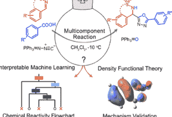

计算机辅助有机化学在预测化学反应条件和自动化合成方面具有潜力¹¹¹ 近年来，基于机器学习（ML）的方法已成功应用于药物发现、先导化合物优化、定量结构-活性关系（QSAR）¹² 以及逆合成规划¹³。传统上，活性预测是一项难题，需要特定的数据集来训练机器学习模型¹⁴¹⁵。实验数据库需要大量的手动示例来检查原料的可行性，以确定其是否发生反应。需要注意的是，大多数使用数据库的机器学习模型仅报告文献中成功的反应，因为失败的反应很罕见。因此，对于通过成功和失败反应数据研究的特定案例，可以对此类数据集进行训练。最近，一些数据集被用于测试（在没有实验验证的情况下）狄尔斯-阿尔尔德反应中的区域异构体、立体异构体、对映异构体¹⁶ 以及对映选择性¹⁷。在该化学中学习到的化学特征在探索某些反应条件下筛选活性是繁琐的。因此，关于使用机器学习方法对预测活性进行前瞻性验证的文献有限¹⁷¹⁸ 据我们所知，我们提供了首次快速且一ポット的多组分反应，通过训练多组分反应来探索非均相活性，并通过训练人类可解释的机器学习模型来识别活性的化学模式，分别预测并测试多组分反应中新底物的活性。

选择 N-磺酰胺是因为 N-磺酰胺是有机化学中重要的物种之一，用于各种转化。N-磺酰亚胺是反应⁹和亲核加成¹⁰亲电碳的良好来源。我们报道了分离的碳-氮键硫活性的几种反应¹¹¹ 今天，磺酰胺用于解释杂环。磺酰胺利用磺酰胺的多功能性，用于迈克尔加成¹²、环加²³、芳基烷化²⁴ 或烷基化²⁵策略（方案 1）。

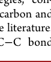

## 方案 1 探索 N-磺酰-磺酰亚胺对于多组分反应活性的策略

来自胺和醛。值得注意的是，由于几个原因，原位形成并不总是理想的：
(i) 反应在某些反应条件下可能是不稳定的²
(ii) 离子的形成高度取决于其原料（醛或胺），并且可能取决于我们想要使用的试剂。此外，氯丙烯可以作为催化剂代替碳酸。为了解决这些问题，我们首次报道了使用 N-磺酰亚胺作为合成 1,3-二噁唑的快速且单步策略。

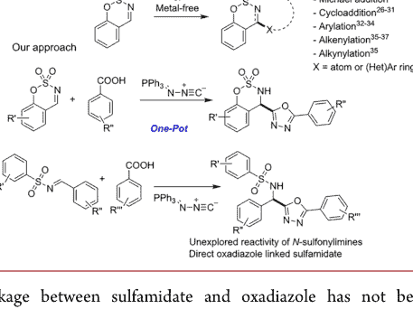

TM催化剂
无金属
甲基脂硫代甲酰盐¹¹
脂亚胺
乙酰脂亚胺
和
(乙酰三嗪水合物)

我们的方法

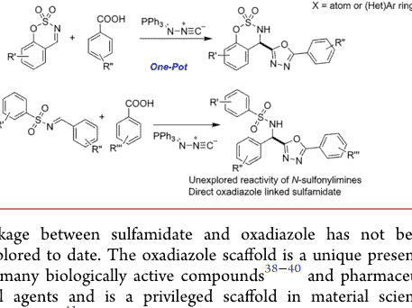

未需要的二噁唑
磺酰胺与二噁唑之间的直接连接尚未探索。二噁唑骨架在许多活性化合物和药物制剂中是独特的特有骨架（图 S1）。因此，磺酰胺连接的 1,3-二噁唑可用于新骨架的设计。

我们从以下想法开始：环 N-磺酰亚胺、酰基 N-磺酰亚胺和芳胺是已知的。为了确定羧酸的活性模式，我们使用密度泛函理论（DFT）优化了参数并利用碳原子的性质识别了最合适的异构体（图 S1）。两种环 N-磺酰亚胺对亲核攻击非常敏感，因为第二个反应伙伴更具亲核性，并且有助于使用各种范围的羧酸。然后，衍生物的合成作为一种用于快速多组分反应 N-磺酰胺的前瞻性策略。

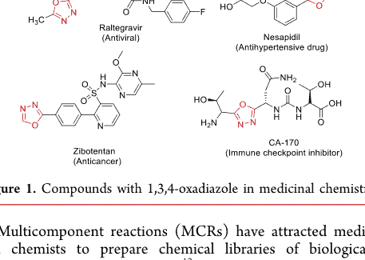

图 1. 以 1,3-二噁唑为核心的化合物。

多组分反应（MCRs）吸引了化学家在没有构建块的情况下快速创建分子库。这些 MCR 高度取决于原料、溶剂、催化剂和当量。理解特定 MCR 的原料活性对于识别多样化的结果至关重要。机器学习模型可以建议磺酰胺类型以避免浪费时间和精力。在这工作中，我们开发了环或非环 N-磺酰亚胺 MCR 来生成化学骨架。Ramazani 等¹⁴ 和 Yudin 等¹¹ 分别报道了使用 1,3-二噁唑骨架与芳香原料的四组分反应，使用异氰基苯磷（PINC）作为反应伙伴。在之前的研究中，原位生成了目标产物 3a（表 2）和羧酸（2b）。最初，我们进行了优化以获得当二氯甲烷（DCM）在 -10 °C 下添加时的优化反应条件（见补充信息）。

### 表 1 1,3-二噁唑合成的优化

| 溶剂 | T (°C) | 时间 (h) | 产率 (%) |
| :--- | :--- | :--- | :--- |
| 1 | DCM | 50 | 12 | 50 |
| 2 | DCE | 25 | 12 | 微量 |
| 3 | DCM | 25 | 12 | <5 |
| 4 | DCM | 30 | 25–30 | <5 |
| 5 | 冰浴 | - | 5 | 30 |
| 6 | - | - | 10 | 10 |
| 7 | - | - | 10 | 6 |

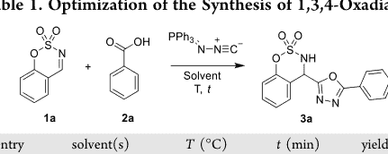

> ¹ 0.1 M 规模下的反应，DCE；MeCN。反应条件按照文献¹⁰。
> ² 羧酸在最后添加.³ 所有固体化合物一起使用，溶剂在最后添加。¹⁴ 分离 8481

## 方案 2 在优化条件下使用环亚胺与苯酸合成 1,3-二噁唑

实际上，它有效地生成了产率低的 1,3-二噁唑 3e。然而，值得注意的是，1e 与苯酸（2a）的衍生物确实产了目标产物（3f）。尽管如此，当磺酰胺 1c 与吡啶酸（2c）反应时，它导致了带有不想要异构体的低产产物。此外，4-苄基吡啶没有与磺酰胺 1c 反应形成目标产物 3b。接下来，我们还寻求研究其他羧酸与磺酰胺的活性。从方案 3 显示的产物中，我们还尝试了其他反应

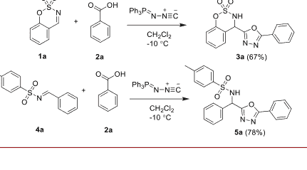

接下来，我们使用 DFT 计算将优化的反应条件应用于环 N-磺酰亚胺（图 S1）。此外，我们开发了用于合成 1,3-二噁唑连接的环或非环 N-磺酰亚胺 MCR。Ramazani 等¹⁴ 和 Yudin 等¹¹分别报道了使用 1,3-二噁唑骨架与芳香原料的四组分反应，使用异氰基苯磷（PINC）作为反应伙伴。在之前的研究中，原位生成了目标产物 3a（表 2）和羧酸（2b）。

为了获得反应的机理见解，我们在 -10 °C 下的二氯甲烷溶剂中进行 DFT 来识别过渡态和中间体（图 S2）以及 N-磺酰亚胺（图 S3）。在提出的机理中，磺酰胺对环 N-磺酰亚胺活性团的亲核攻击生成了中间体 2b。中间体 2c 环化形成二氮嗪，然后用三苯膦处理生成目标 1,3-二噁唑（见图 S2 和 S3）。机理中的能量图也表明磺酰胺的活性比环 N-磺酰亚胺快。在两种情况下，限速步骤都是 PNC 基团对 N-磺酰亚胺的攻击，自由能（ΔG‡）分别为 16.3 kcal/mol 和 18 kcal/mol。这表明两种反应将快速发生，预计环 N-磺酰亚胺会更快，这在实验中也得到了观察。

接下来，使用优化条件，我们研究了各种羧酸衍生物。二乙胺端磺酰胺（1b）与苯酸的反应提供了产物 3b，产率为40%。磺酰胺 1b 与对甲酸（2b）的反应也形成了产物 3c，产率为17%。此外，甲基取代磺酰胺 1c 与苯酸（2a）的反应形成了预期的产物 3d，产率中等。然而，萘酰胺（1d）没有发生反应

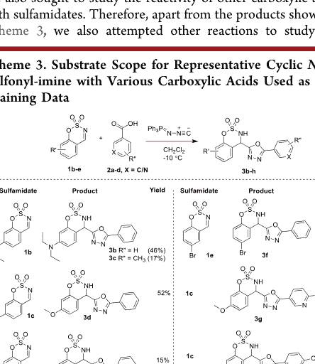

## 方案 3 用于训练的各种羧酸活性环 N-亚底物范围

磺酰胺的活性是为了研究环 N-磺酰亚胺与方案 2 中成功反应模型的活性。在方案 4 中，环 N-磺酰亚胺与苯酸反应。与磺酰胺不同，卤代环 N-磺酰亚胺 4b 与苯酸（2a）和2-溴甲基苯酸（2a）反应，生成了目标产物 5b 和

## 方案 4 用于训练的环 N-磺酰亚胺亚底物范围

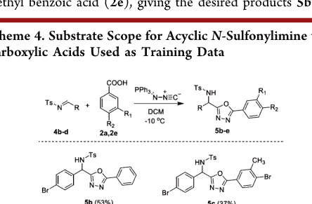

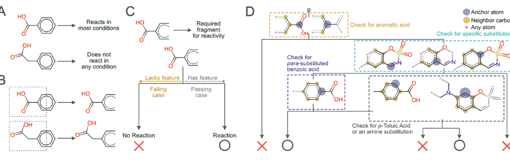

**图 2.** 化学反应流程图。胺与酸之间反应底物的决策树。(A–C) 模型如何分配预测反应活性的规则的图化说明。(D) 在所有数据上生成的最终自助抽样（bootstrapped）流程图，彩色框中列出了每个规则的细节。(E–H) 使用训练数据这些规则的示例。方框代表图 D 中的特征，流程图中的黄色线根据化学特征显示反应结果。

5c 的产率分别为 53% 和 37%。此外，分别使用三甲氧基取代的N-磺酰胺（N-磺酰胺）和 4-氰基取代的N-磺酰胺（N-磺酰胺）实现了 5d 和 5e 的合成，并获得了目标化合物 5d 和 5e。

链状和环状 N-磺酰胺的异质性促使开发了一个用于成功和意外反应的预测模型。我们分别使用分子指纹（ECFP）5 对羧酸和 N-磺酰胺训练了两个模型。对于 0–3 的指纹半径，未观察到碰撞。我们在表 S3 中列并报告了 N-磺酰胺与羧酸之间是否发生反应。决策树的目标是利用有限反应数据生成的指纹来预测“成功（Worked）”。为了解决这个问题，对这两个决策树进行了 1000 次验证，以采样为每个反应创建的不同可能模型（见表 S2 和 S3）。通过决策树的自助抽样评估来确定我们模型预测实验结果的稳健性（参见支持信息中的自助抽样结果表格），详情请参考本工作中所用学习方法的介绍。最终模型在 ECFP 半径为 3 时获得了 0.076 的化学统计值，表明在有限训练数据（20 次运行）上的可靠性有所提高。这种方法产生了图 2A–D 所示的具有特征的化学反应图，用于研究反应以确保模型具有预测性，同时保持可解释性。图 2D 中的模型化学反应流程图用于在给定训练反应次数的情况下评估反应底物。模型的第一个决策是针对连接在芳香环上的羧酸基，其中最后一种酸导致无反应的预测（图 2E 显示了一个缺乏失败案例的示例）。接下来，模型检查环己烷 6 位的取代情况，该预测为无反应（图 2F 所示的特征案例示例）。接着，模型检查羧酸对位的取代情况，由于缺乏这些特征导致了失败。失败案例如图 2G 所示。请注意，如果存在碳以外的杂原子，则预测磺酰胺的 7 位或芳香环上发生二乙胺取代。随后，ML 模型给出最终决策（见图 2H，其中仅显示了唯一通过条件的的反应）。该决策得到了胺取代导致成功结果的支持。在这一步中，我们测试了 1（不含胺的 N-磺酰胺）与 2b（对甲苯甲酸）之间的反应，并注意到反应发生了。相反，反应 1b（带有氨基取代的 N-磺酰亚胺）和 2d（4-羟基苯甲酸）未发生。这些结果表明最终决策可以显示对甲苯甲酸和氨基取代。最后，我们测试了 2d 与链状 N-磺酰亚胺 4a，以查看该规则是否适用于链状 N-磺酰亚胺，反应确实发生了。这些反应如方案 S 所示，展示了我们的 ML

## 方案 5 为测试 ML 模型而形成的反应

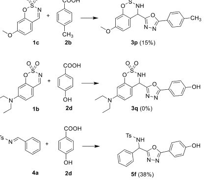

## 相关内容 (ASSOCIATED CONTENT)

## 支持信息 (Supporting Information)

## 作者信息 (AUTHOR INFORMATION)

### 通讯作者 (Corresponding Author)

Gauhar Chopra - 普渡大学药物发现研究所、普渡大学神经科学研究所、炎症、免疫学和传染病研究所、癌症研究中心以及普渡大学数据科学，普渡大学，印第安纳州西拉法特 47907，美国；orcid.org/0003-0942-7988；邮箱：choopra@purdue.edu

### 作者 (Authors)

Kripal P. Jevaria - 普渡大学化学系，印第安纳州西拉法特 47907，美国；orcid.org/0002-4440-3333

Jonathan Finn - 普渡大学化学系，印第安纳州西拉法特 47907，美国；Yin Chen - 普渡大学化学系，印第安纳州西拉法特 47907，美国；Ahad Hossain - 普渡大学化学系，印第安纳州西拉法特 47907，美国

## 作者贡献 (Author Contributions)

K.P.J. 和 J.F. 对本工作贡献相同。

## 注释 (Notes)

作者声明无财务利益。

## 致谢 (ACKNOWLEDGMENTS)

本工作得到了普渡大学化学系提供的普渡大学资金包的支持；Ralph W. 和 Grace M. Scholar 研究奖金、整合数据科学奖以及 Team and Robbins 癌症资助；来自 NSF I/URC 生物分析方法中心 (191699)、来自化学和转化科学学院 ACS 奖金 (ILR007259) 以及普渡大学研究中心 (NIH R30568)。感谢 ChemAx 软件的支持。

