# 可迁移机器学习力场加速金属有机框架CO₂直接空气捕集筛选


## 图文摘要

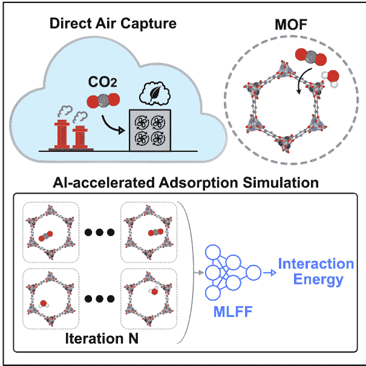

## 作者

Yunsung Lim, Hyunsoo Park, Aron Walsh, Jihan Kim

## 通信作者

a.walsh@imperial.ac.uk (A.W.), jihankim@kaist.ac.kr (J.K.)

## 简介

使用多孔材料进行 CO₂ 直接空气捕集 (DAC) 有望实现净零排放，但受到缓慢、不准确模拟的阻碍。我们将机器学习模型集成到模拟工作流中，以实现快速且准确的模拟，从而对成千上万种材料进行快速筛选。该框架集成到用户友好的 Python 软件包中，为碳捕集及相关能源和环境应用中的数据驱动材料发现提供了一种可扩展的方法。

## 主要亮点

- MLFF 改善了 MOFs 中 CO₂ 和 H₂O 相互作用的建模
- 可以实现计算成本显著降低的增强预测
- 策划的数据集和持续学习策略改进了微调过程
- 发现了常规方法遗漏的 100 多个适合 DAC 的 MOFs

## 正文

## 利用可迁移机器学习力场加速金属有机框架的 CO₂ 直接空气捕集筛选


> **进展与潜力** 从环境空气中直接捕集 CO₂，即直接空气捕集 (DAC)，对于实现净零排放至关重要。金属有机框架 (MOFs) 是 DAC 的有前途多孔固体，但现有计算方法要么耗时很长，要么缺乏在 MOFs 内建模 CO₂ 和 H₂O 吸附所需的精度。因此，基于计算机模拟的高通量筛选难以确定最适合 DAC 的材料。为克服这一挑战，我们开发了一个基于机器学习力场 (MLFF) 的人工智能加速吸附模拟框架，该力场能够快速且准确地捕捉 MOF-CO₂ 和 MOF-H₂O 相互作用。它实现了对 8,000 多个 MOFs 的筛选，发现了常规模拟遗漏的 100 多个高潜力候选材料。该计算平台可轻松被研究人员和工业界采用，以加速 DAC 及其他气体分离需求的多孔材料发现。我们的方法可以实现更高效、更具成本效益的碳捕集技术，并支持全球减排目标。

## 摘要

直接空气捕集 (DAC) CO₂ 对气候变化缓解是必要的，但面临低 CO₂ 浓度和水蒸气竞争带来的挑战。金属有机框架 (MOFs) 因其高表面积和基于吸附的捕集过程而对 DAC 具有重大前景。然而，识别最优 MOFs 受到结构复杂性和巨大化学多样性的阻碍。在此，我们通过微调基础模型，引入了一种专门用于 MOFs 中 CO₂ 和 H₂O 相互作用的机器学习力场 (MLFF)。为解决平滑问题和灾难性遗忘，我们策划了 GoldDAC 数据集，并引入了持续学习方案。我们进一步开发了 DAC-SIM，这是一个与 MLFF 集成的分子模拟软件包，包括 Widom 插入法。随后，我们对一个广泛的 MOF 数据库进行了筛选，发现了高性能 MOFs 并确定了 DAC 应用的化学特征。该方法克服了在描述 MOF-CO₂ 和 MOF-H₂O 相互作用方面的先前局限性，为多孔材料的 DAC 研究提供了一个可扩展且准确的框架。

## 引言

自 19 世纪末以来，平均全球温度稳步上升，2023 年比工业化前平均水平高出约 1.2°C。1 这一变暖主要由温室气体排放驱动，CO₂ 占影响的 60% 以上。2 在管理 CO₂ 排放水平的各种策略中，直接空气捕集 (DAC) 通过直接从环境空气中捕集 CO₂ 提供了一种解决方案。3,4

该过程面临挑战，因为 CO₂ 浓度为痕量（约 400 ppm），且对 CO₂ 相对于大气水蒸气的选择性捕集较低。
迄今，DAC 技术主要依赖使用胺和固体碱金属氢氧化物对 CO₂ 进行化学吸附，因为它们对 CO₂ 具有很强的亲和力。5,6 然而，吸附剂的再生是总运营成本的主要来源。7,8 为缓解这些问题，已探索具有较弱 CO₂ 相互作用的物理吸附基材料，以减少

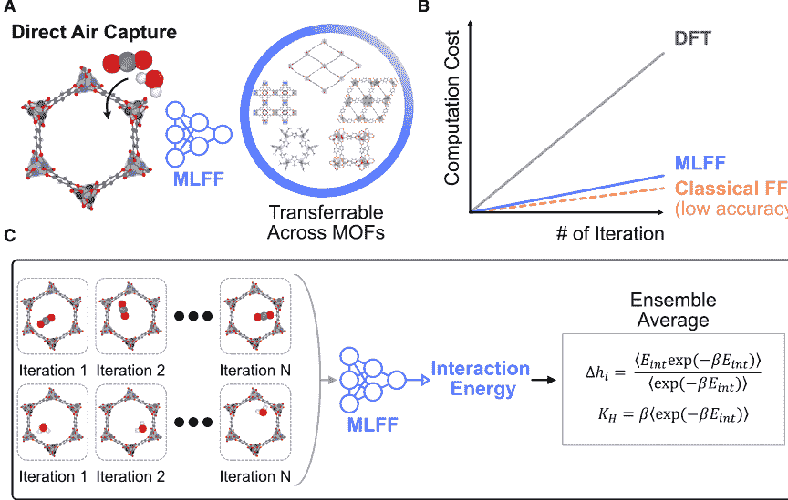

Figure 1. 我们在 DAC-SIM 中实现的 CO₂ 捕集计算方法概览 (A) DAC 应用中跨 MOFs 的可迁移 MLFF 示意图。 (B) DFT、MLFF 和经典力场在 MC 模拟中所需迭代次数方面的计算成本比较。 (C) 利用与 MLFF 集成的 Widom 插入法，通过 MC 模拟计算 Qst 和 KH 的工作流。

反复使用中的再生成本。9 在这些材料中，金属有机框架 (MOFs) 因其高表面积和显著可调性能而脱颖而出。10,11 然而，由于可能的化学构建块和拓扑结构数量庞大，形成 MOFs 的化学空间广阔。为加速 CO₂ 捕集有前途 MOFs 的识别和设计，大规模筛选已被广泛应用。12-17 这些通常基于带有力场的经典分子模拟，例如万能力场 (UFFs)18，带有点电荷（如 Qeq.19、EEq.20 和密度导出静电和化学 (DDEC)[21]）。对于 CO₂ 捕集，Boyd 等人15 通过引入来自筛选结果的 CO₂ 响应口袋，设计了适合烟气 CO₂ 捕集的新 MOFs。Findley 和 Sholl16 筛选了 CoRE MOF 数据库，以评估 MOFs 是否适合 DAC 应用。虽然这些方法耗时较短，但由于化学环境的多样性和短程势能面的复杂性，它们难以准确描述 MOF 框架与气体分子（如 CO₂ 和 H₂O）之间的相互作用。22,23 尽管从头计算通过显式考虑电子密度分布提供了更准确的替代方案，并在许多情况下显示与实验吸附行为紧密吻合，22,24 但计算成本大幅增加，对于多孔固体的大规模筛选或广泛数据积累来说不切实际。机器学习力场 (MLFFs) 已成为应对这一挑战的前沿方法（图 1A 和 1B），结合了

经典力场的低计算成本与从头方法的高精度。25-27 虽然合金、金属氧化物和钙钛矿等各种材料已得到广泛研究，28-30 但 MLFF 对 MOFs 的应用仍然有限，特别是对于包含 MOF 材料本身和客体分子的非均质系统。尽管少数研究已经探索了针对 MOF 与 CO₂ 或 H₂ 等气体分子组合系统开发 MLFFs，31-34 但不同 MOF 系统之间的可迁移性仍显著受限。这种限制主要是由于缺乏包含涉及 MOFs 与气体分子组合系统的密度泛函理论 (DFT) 模拟数据的综合数据库。在这项工作中，我们引入了一种对 DAC 应用既准确且在广泛 MOF 范围内可迁移的 MLFF，如图 1A 所示。我们使用“可迁移”一词来强调，这项工作中的 MLFF 模型适用于各种 MOFs 进行吸附建模，特别是 CO₂ 和 H₂O。通过包括我们策划的 GoldDAC 数据集中包含的与 CO₂ 和 H₂O 气体分子相互作用的 MOF 构型，我们微调了一个在多样晶体化合物上预训练的基础模型 [35]。为部署此模型，我们开发了 DAC-SIM 软件包，它将我们的 MLFF 与统计 Widom 插入法 [36]、分子动力学和结构优化相结合。我们使用 DAC-SIM 对 CoRE MOF 数据库 [37] 中的 8,131 个实验 MOFs 进行了高通量筛选。比较


CO$_2$吸附与选择性分布凸显了传统筛选方法的几个局限性，我们还确定了几种新的候选材料和设计原则。

## 结果

### 直接空气捕获（DAC）应用的蒙特卡洛模拟

直接空气捕获（DAC）面临的一个关键挑战在于识别具有强CO$_2$亲和力和对H$_2$O高选择性的材料。为应对这一挑战，在刚性框架假设下，采用Widom插入法和大正则蒙特卡洛（GCMC）等蒙特卡洛（MC）模拟，通过计算吸附焓（Q$_{st}$）和亨利定律系数（K$_H$）来确定材料的气体吸附性能。$^{38}$ 这些集成平均性能相比仅依赖单构型性质（例如最可能稳定结合位点的吸附能），能够实现更全面的评估。

Widom插入法（如图1C所示）非常适用于低CO$_2$浓度条件下的直接空气捕获（DAC），$^{16,39,40}$ 此时稀释系统建模是适用的。该模拟涉及大量单独计算以构建集成，其中单个气体分子被随机插入MOF框架以计算集成平均相互作用能。相互作用能$E_{int}$由以下公式确定：

```
$E_{int} = E(\text{system}) - E(\text{MOF}) - E(\text{gas}),$
```

其中$E(\text{system})$代表吸附了气体的MOF的势能，$E(\text{MOF})$和$E(\text{gas})$分别对应MOF框架和气体分子（例如CO$_2$或H$_2$O）的势能。这种方法允许从统计力学中计算Q$_{st}$和K$_H$：

```
\(\Delta H_{ads} = -Q_{st} = \frac{\langle E_{int} \exp(-\beta E_{int}) \rangle}{\langle \exp(-\beta E_{int}) \rangle} - k_b T\)
```

```
$K_H = \beta \langle \exp(-\beta E_{int}) \rangle,$
```

其中$\Delta H_{ads}$为吸附焓，$\beta$代表热能的倒数，定义为$\beta = \frac{1}{k_b T}$，其中$k_b$为玻尔兹曼常数，$T$为温度。若不考虑$Q_{st}$中的热项$k_b T$贡献，该值代表集成平均相互作用能，记作$\Delta h_i$。

### 基础模型微调

已开发出多种先进的MLFF（机器学习势场，例如MACE，$^{41}$ CHGNet，$^{42}$ M3GNet，$^{43}$ 和SevenNet$^{44}$），能够准确复现多种晶体材料的DFT结果。这些模型在包含DFT总能（$E$）和原子力（$F$）的数据集上进行了大量预训练，主要采样自几何优化轨迹（如MPTraj）。$^{42}$ 其中，MACE-MP-0模型（下文为简洁起见统称为MACE-MP）$^{35}$ 凭借其将用于结构表示的原子团簇展开与用于回归的等变高阶消息传递图神经网络相结合而脱颖而出。这些模型的预训练数据集主要由无机组成物主导，有机和有机-无机固体较少；然而，MACE-MP模型在MOF（金属有机框架）系统上已显示出合理的初步结果。$^{35}$ 因此，在此基础上，我们微调了一个可迁移的MLFF，命名为MACE-DAC，专门针对MOF及其与相关气体的相互作用。

### GoldDAC数据集

微调模型时的主要挑战之一是有限微调数据集导致严重过拟合的风险。在对用于MLFF的预训练基础模型进行微调时，Deng等人$^{45}$指出了一个被称为平滑（或软化）的关键问题，即模型准确预测势能面（PES）非平衡区域的能力下降，如图2A所示。这源于MLFF开发所用的训练数据主要集中于0 K平衡构型（下文统称为平衡构型）附近，这些构型对应于PES上的局部极小值。与预训练阶段相比，平滑在微调过程中更为明显，因为该过程通常涉及使用有限数据集更新预训练模型。

通过Widom插入法计算气体吸附性能时，准确预测整个PES尤为关键。Q$_{st}$和K$_H$值等性质对PES中的微小误差非常敏感，尤其是在相互作用能小于零的区域。这些误差源于能量项的指数加权，可能导致预测吸附性能出现显著偏差。例如，尽管PES的平衡区域通常建模良好，但排斥区域的不准确会改变PES的斜率，从而导出的热力学性质会出现显著误差。

为克服这一挑战，我们创建了GoldDAC数据集，包含CO$_2$ + MOF、H$_2$O + MOF、MOF及气体分子计算的DFT结果。该数据集可用于微调，以提升模型在整个PES上的性能，涵盖不仅包括平衡区域，还包括排斥区和弱吸引区。训练集和验证集由60个结构构建，ODAC23数据集中出现频率最高的20种金属各随机采样三个结构。$^{39}$ ODAC23数据库是一个综合性数据库，包含DFT水平下MOF系统用于直接空气捕获（DAC）应用的吸附计算。

由于相互作用能不仅取决于组合体系（带有气体分子的MOF）的能量，还取决于框架和气体分子（例如CO$_2$和H$_2$O）的各自能量，因此两种构型均纳入了训练集和验证集。为实现稳健训练，这些结构中两个结构的PES数据被随机分配到训练集，而其余结构的数据用于验证。由于该数据集是为直接空气捕获（DAC）应用开发的，测试集包括文献中被确定为CO$_2$捕获有前景的26个MOF。总体而言，如表S1所示，共进行了784次DFT计算（MOF +气体720次，MOF 60次，气体4次）以构建训练集和验证集，并额外进行了312次DFT计算以构建测试集。GoldDAC数据集的数据构建细节在方法部分中提供。

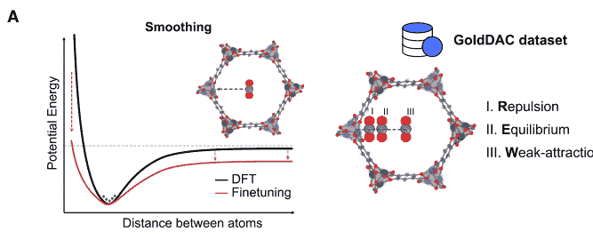

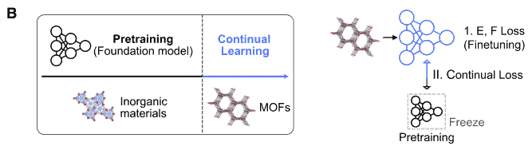

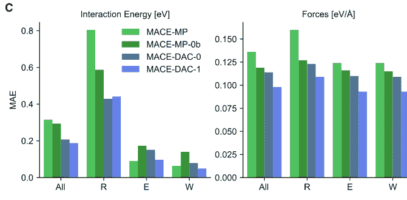

Figure 2. MACE-DAC力场的微调策略

(A) 微调阶段的平滑问题，突出显示了GoldDAC数据集，该数据集采样了PES的排斥（R）、平衡（E）和孔隙中心附近的弱吸引（W）区域。
(B) 从无机材料预训练过渡到MOF的持续学习框架，同时保留预训练模型的知识。
(C) GoldDAC数据集测试集的MAE值，比较了MACE-MP、MACE-MP-0b、MACE-DAC-0（微调）和MACE-DAC-1（持续学习）模型在相互作用能和力预测方面的性能。

微调过程可能会破坏最初建立的、偏向微调数据集所代表数据的微妙平衡。这一问题与“灾难性遗忘”现象相一致，即预训练期间获得的知识在随后的微调过程中被破坏或覆盖。

### 持续学习

图2C展示了使用GoldDAC数据集对微调模型进行的性能评估。该分析既包括基础MACE-MP模型，也包括其变体MACE-MP-0b，后者引入了分析Ziegler-Biersack-Littmark排斥势以消除短程PES上的病理问题。与原始基础模型相比，所有PES数据平均值的平均绝对误差（MAE）（在图2C和表1中标记为“All”）在相互作用能和力预测方面表现出显著降低。这种改善主要归因于微调模型在排斥区域的预测精度得到提升，且得到GoldDAC数据集采样的构型支持。

为解决这一问题，我们实施了一种带有持续学习损失的精细微调策略。这一额外损失项旨在保留微调过程中的预训练模型知识。具体而言，持续学习损失通过冻结预训练模型的权重，并在微调过程中最小化预训练模型与微调模型在能量和力预测方面的差异来实现，如图2B所示。这种方法确保微调过程不会相对于预训练模型引入显著偏差，从而保持相互作用能计算中各组分之间的原始能量平衡。

与预训练的MACE-MP模型相比，微调模型在平衡区域和弱吸引区域的性能确实下降。这种退化可归因于相互作用能的复杂性，它不仅由组合体系的总能量决定，还由其相对于孤立框架和气体分子的能量决定。

通过引入该正则化损失，微调过程被引导更逐渐地适应新的MOF数据，同时保留从无机材料预训练中学到的知识。如图2C所示，该方法防止了在不带持续学习损失的微调模型（即MACE-DAC-0）中观察到的平衡区域和弱吸引区域性能退化，同时保持了在排斥区域显著降低损失的趋势。因此，持续学习模型（即MACE-DAC-1）在所有PES数据上实现了最低的MAE。此外，持续学习有助于力预测损失的稳定降低，从而使模型在力预测方面也实现了最高性能。在MACE-DAC-1中，某些具有3D过渡金属、开放金属位点和排斥区域的构型显示出高力误差，表明在捕捉不寻常的化学环境方面仍存在微小挑战。然而，我们的MLFF优于MACE-MP


| 模型 | 属性 | 全部 | 排斥 | 平衡 | 弱吸引 |
| :--- | :--- | :--- | :--- | :--- | :--- |
| MACE-MP | 相互作用能 | 0.315 | 0.805 | **0.090** | *0.063* |
| | 力 | 0.136 | 0.160 | 0.124 | 0.124 |
| MACE-MP-0b | 相互作用能 | 0.294 | 0.587 | 0.173 | 0.140 |
| | 力 | 0.119 | 0.127 | 0.116 | 0.115 |
| MACE-DAC-0 (微调) | 相互作用能 | *0.208* | **0.429** | 0.151 | 0.079 |
| | 力 | *0.114* | *0.123* | *0.110* | *0.109* |
| MACE-DAC-1 (持续学习) | 相互作用能 | **0.188** | *0.441* | *0.096* | **0.049** |
| | 力 | **0.098** | **0.109** | **0.093** | **0.093** |

MACE-MP、MACE-MP-0b、MACE-DAC-0（微调）和 MACE-DAC-1（持续学习）模型的 MAE 值是使用 GoldDAC 测试集计算的，按相互作用能和力进行评估。MAE 的单位为 eV 和 eV/Å。最佳性能值以粗体表示，次佳（亚军）值以斜体表示。

模型，展示其实际优势（图 S3 和 S4）。所有四种模型的对应奇偶图和 MAE 值分别载于图 S2–S5 和表 S2。

如图 S5 所示，MACE-DAC-0 模型在系统总能量方面显示出较低的 MAE。不过，与 MACE-DAC-1 模型相比，MACE-DAC-0 模型在相互作用能方面表现不佳。持续学习正则化在微调阶段有效维持了不同能量成分之间的平衡。

### 高通量 MOF 筛选

为便于在 DAC 应用中部署 MLFF，我们开发了一个 Python 软件包 DAC-SIM，以计算高效的方式执行必要的分子模拟。使用该软件包，进行了 Widom 插入模拟，以计算 CoRE MOF 数据库中结构在零负载下的 Q_st 和 K_H。模拟过程中，骨架原子固定不动。

最初，选取了 8,131 个 MOF 进行 Widom 插入模拟，在大规模筛选中为了计算效率，排除了单元格中包含超过 250 个原子的 MOF。随后，使用 MACE-DAC-1 进行了几何优化，几何优化的详细内容载于方法部分。在这些优化之后，对 6,461 个 MOF 通过 Widom 插入模拟计算了 Q_st 和 K_H 值，排除了出现收敛问题和一致性问题的 MOF（其中，两次重复折叠的平均相互作用能计算的标准差超过 0.05 eV，统计噪声的详细分析载于附注 S2 和图 S30）。

图 3A 显示了 CO_2 和 H_2O 的计算 Q_st 值，这些值主要位于 20 至 40 kJ/mol 之间。以前的研究表明，CO_2 Q_st 超过 50 kJ/mol 的 MOF 在物理吸附机制下被视为 DAC 应用的有希望材料。^{16,39} 符合这一标准，观察到 364 个 MOF（5.63%）的 CO_2 Q_st 值超过 50 kJ/mol，其中 167 个甚至超过了 H_2O 的值。图 3B 展示了 CO_2 的 Q_st 与基于 CO_2 与 H_2O 的 K_H 比值导出的选择性之间的关系。尽管 K_H 通常遵循如图所示的 Q_st 趋势，

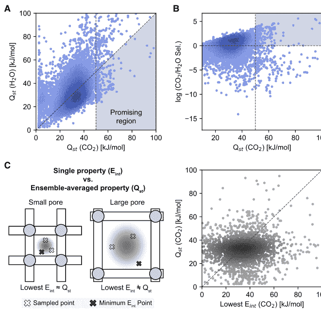

图 3. 使用 DAC-SIM 的总体筛选结果
（A 和 B）散点图，展示了（A）CO_2 Q_st 与 H_2O Q_st 之间的关系，以及（B）CO_2 Q_st 与选择性之间的关系，为方便起见，选择性以对数坐标表示。（A）和（B）中的阴影区域指示了 CO_2 DAC 的有希望区域（[A] 中 CO_2 Q_st > 50 kJ/mol 且 CO_2 Q_st > H_2O Q_st；[B] 中 CO_2 Q_st > 50 kJ/mol 且选择性 > 1）。（C）一张示意图和一个散点图，说明最低相互作用能与 Q_st 之间的差异。Q_st 使用 MACE-DAC-1 和 DAC-SIM 软件包计算，相互作用能直接从 ODAC23 数据库获得。可能的插入区域以孔内灰色阴影区域示意性地描绘。

DAC-SIM 的值与 UFF + DDEC 获得的值非常相似；然而，一个显著的差异是在接近 0 kJ/mol 的较低范围处有一个小峰。如图 S10 所示，与进行几何优化前的结构相比，CO_2 Q_st 值低于 2.5 kJ/mol 的这些 MOF 的 LCD 分布转移到较低范围。也就是说，在 Widom 插入模拟之前的先前几何优化阶段发生了孔径收缩，从而阻止它们容纳 CO_2 分子。这凸显了 DAC-SIM 的优势，通过改进微调阶段的力预测，在 Widom 插入模拟前实现计算高效且精度接近 DFT 的几何优化。

以及表面积，这些在单构型方法中未被考虑。图 S8 表明，基于 K_H 的 Q_st 和选择性值与这些几何特征具有强相关性。例如，当 LCD 接近 CO_2 的动力学直径（约 3.3 Å）时，CO_2 Q_st 和 CO_2 选择性都倾向于较高。因此，尤其是在孔隙较大的 MOF 中，使用集合平均属性来评估气体吸附性能更为有效。

### 与经典力场模拟的比较

使用 DAC-SIM 从我们开发的 MLFF（MACE-DAC-1）得到的 Widom 插入模拟结果，与经典力场方法获得的结果进行了系统比较。在经典方法中，使用了结合了 DDEC 电荷 21（以下简称 UFF + DDEC）的 UFF 来模拟 MOFs 中的 CO_2 和 H_2O 吸附性能。16,17,51 UFF 是由经验参数组成的原子间势，而 DDEC 电荷源自 DFT 计算。UFF + DDEC 仅用于骨架原子，而为 CO_2 和 H_2O 分子提供的定制力场用于对它们进行建模。共有 2,654 个 MOF（拥有 Kancharalappali 等人提供的计算 DDEC 电荷）被用于此分析。52

图 4A、4B 和 S9 分别展示了使用 DAC-SIM 软件包和开发的 MLFF 以及与 UFF + DDEC 方法一起使用的 RASPA 软件 53 计算得到的 CO_2 和 H_2O 的 Q_st 分布。CO_2 Q_st 的总体分布

值得注意的是，H_2O Q_st 的分布显示出显著差异，尤其是在高 Q_st 范围内。虽然在 DAC-SIM 计算中，大多数 MOF 的 H_2O Q_st 值小于 100 kJ/mol，但使用 UFF + DDEC 时，超过 17.8% 的 MOF 超过 100 kJ/mol。UFF + DDEC 计算中的这些较高 Q_st 值主要与含镧系金属的 MOF 相关。图 S11 显示了在 UFF + DDEC 计算中 H_2O Q_st 值超过 100 kJ/mol 的 MOF 中最常观察到的金属类型，主要包括镧系元素，如 Gd、Nd、Tb、La、Er、Pr、Dy、Ce、Sm、Ho 和 Tm。

图 S12 进一步表明，在基于 DFT 计算的 ODAC23 数据库的最低相互作用能方面，总体 MOF 与镧系 MOF 之间的分布没有显著偏差，而在 UFF + DDEC 计算中，镧系 MOF 的 Q_st 值出现明显增加。这表明，应用于骨架原子的 UFF + DDEC 方法倾向于高估镧系 MOF 中 H_2O 的 Q_st 值。图 S13 说明，对于含镧系金属的 MOF，UFF + DDEC 计算产生的 H_2O Q_st 值显著高于 CO_2。相比之下，DAC-SIM 结果类似于 ODAC23 数据库中的 DFT 相互作用结果，并未表现出


图 4. DAC-SIM 与经典力场计算的对比 (A) 和 (B) 使用 RASPA [59]（UFF + DDEC）和 DAC-SIM（MACE-DAC-1）计算的 (A) CO2 Qst 和 (B) H2O Qst 的分布。(C) 使用经典力场计算了有前景 MOF 的 Qst 值。三个实心方块表示 (D) 中所示的三个有代表性的 MOF。(D) 三个有代表性 MOF 的示意图，突出了可能的活性位点（用于 CO2 和 H2O 吸附）的点电荷或 UFF 参数。原子颜色：C（灰色）、H（白色）、O（红色）、N（浅蓝色）、S（黄色）、Mn（紫色）、Sr（深绿色）和 Zn（深灰色）。

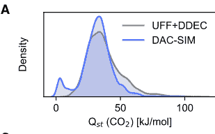

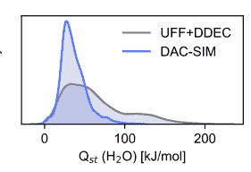

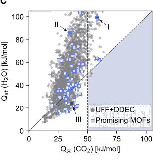

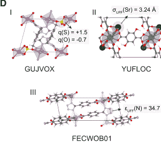

与 CO2 分子相比，可感应出更强的静电势。由于高估了 H2O Qst，在使用经典力场对 CoRE MOF 数据库进行筛选时，很少有候选材料被确定为适合 DAC 应用。同样，DAC-SIM 中识别出的有前景 MOF 在含镧系元素的 MOF 与其他金属 MOF 之间表现出如此显著的差异。经典力场与 DFT 计算之间的这种不一致源于 MOF 在化学上复杂的无机-有机杂化组成。在这些杂化环境中模拟涉及金属及其相邻有机原子（例如与金属键合的氧或氮原子）的相互作用，需要针对每个特定化学背景进行仔细的参数拟合。然而，UFF 采用固定参数，这限制了其准确表示不同化学环境的能力。虽然点电荷为模拟相互作用提供了额外的自由度，但 UFF 最初的开发并未融入点电荷。因此，点电荷是有效补偿还是加剧模拟错误，目前仍不确定。鉴于 MOF 独特的化学环境主要归因于金属的存在，因此开展了对金属作用的研究。图 S14 显示了各种金属上点电荷的分布，揭示了点电荷较高的金属倾向于在图 S13C 中表现出 UFF + DDEC 与 DAC-SIM 结果之间更大的差异。点电荷升高的金属可充当硬路易斯酸，并极化金属附近的邻近原子（通常是 MOF 中的氧或氮原子）。这种极化效应降低了相邻原子相对于不同环境中类似原子的极化率，而金属的极化率基本保持不变 [22]。然而，由于 UFF 使用固定参数，它无法准确解释极化率的这种变化。虽然 DDEC 等点电荷通常通过提供额外静电势来增强相互作用建模，但在特定情况下它们只能部分有效，并且往往加剧差异。因此，UFF + DDEC 计算中 Qst 的高估对于 H2O 分子尤其明显，这意味着使用模拟同样无法在图 4C 中体现高性能。我们使用三个 MOF 对这一差异的起源进行了深入调查，它们的 REFCODEs 分别为 GUJVOX (Mn2(tmb)2(SO4)2)、YUFLOC (AEMOF-5) 和 FECWOB01 (Zn-TBC)，如图所示（图 4C 中的实心方块点）。首先，以 GUJVOX 为例，尽管 CO2 Qst 保持在 50 kJ/mol 以上，但在 UFF + DDEC 计算中，H2O Qst 出现了显著增加。框架内存在电负性官能团 (SO42-)，其作为 H2O 的强结合位点，似乎是这一差异的主要因素。SO42- 中 S 的点电荷为 +1.5，而 O 的点电荷为 -0.7，表明该部分内存在显著极化（见图 4D）。如图 4B 所讨论，UFF + DDEC 在准确模拟高度极化的部分方面面临挑战，导致与 CO2 相比，与 H2O 的相互作用普遍被高估。在 YUFLOC 情况下，CO2 Qst 被低估，它含有一个开放金属位点 (OMS)，使用 UFF + DDEC 通常难以准确模拟。MOF 与客体分子之间的最佳分子间距离主要由 UFF 参数中的 sigma 值控制。然而，某些金属原子的 sigma 值往往被高估，阻止客体分子足够靠近 OMS。因此，MOF 与客体分子之间的相互作用被低估了。与 H2O 不同，CO2 无法产生足够的静电势来抵消相互作用能中的这种低估。对于 FECWOB01，CO2 和 H2O 的 Qst 值均被低估，尽管 CO2 Qst 高于 H2O Qst 的趋势保持一致。FECWOB01 含有一个唑类连接体，由于唑类的电负性随氮含量而变化，因此氮的力场参数需要仔细考虑。例如，一项关于 ZIF-8 [54] 的研究（该材料以咪唑作为有机连接体）采用了来自广义琥珀力场 [55] 的氮参数，推导了一个定制力场。在这种情况下，epsilon 值设定为 85.5 K，是 UFF 中的 2.5 倍，而 sigma 值几乎保持不变。同样，在唑类中为氮应用更大的 epsilon 值可能会增加 CO2 和 H2O 的相互作用强度。

为进行系统分析，通过检查 PES 比较了 MOF 与气体分子之间的相互作用能，针对 GoldDAC 测试集（如图 S25–29 和表 S4 所示）中使用 UFF + DDEC 和 MACE-DAC-1。总体而言，MLFF 模型更准确地捕捉了 MOF 与 CO2 或 H2O 分子之间的相互作用，与 DFT 计算一致。此外，图 S15 和表 S3 显示，MACE-DAC-1 得到的 CO2 Qst 更接近实验数据，尤其是在高 Qst 区域。虽然经典力场中的广泛参数拟合可以获得高精度，但此类方法通常仅限于有限的一组相似 MOF，缺乏广泛的可迁移性。因此，提供我们的 DAC-SIM 流程来筛选吸附性能，为基于经典力场的传统计算提供了一种更精确、更节省时间的替代方案。

## 讨论

使用 MACE-DAC-1 与 DAC-SIM 获得的筛选结果使我们能够对有前景 MOF 中的化学特征进行系统分析。对 CoRE MOF 数据库中所有 161 个有前景候选者进行了进一步调查。我们排除了 43 个化学不正确的 MOF（例如，由于对称性问题缺少氢原子或原子重叠，见图 S16）。

在对剩余 MOF 进行分析之前，我们通过将 MACE-DAC-1 与 MACE-MP 进行比较，评估了微调的必要性。如图 S3、S4 和 S17 所示，MACE-MP 倾向于高估相互作用能，导致与 MACE-DAC-1 相比高估 H2O Qst。在此背景下，类似于并非所有有前景 MOF 在 UFF + DDEC 计算中都表现出理想性能的观察结果，使用 MACE-MP 而非 MACE-DAC-1 时，118 个 MOF 中有 46 个（约 40%）未被识别为有前景。

如图 5A 所示，在有前景的 MOF 中识别出了七种化学特征，包括 OMS、平行苯环（PAR）、金属-电负性原子-金属（M-X-M）、非配位氮、唑类连接体、甲基官能团（-CH3）和电负性官能团（-EN）。其中四种（OMS、PAR、M-X-M 和非配位氮）在以前的筛选工作 [15,39] 中被提出，而其他几种（唑类连接体、-CH3 和 -EN）在实验工作 [56–59] 中偶尔被描述。在这些特征中，OMS 和唑类连接体出现在近一半或更多的 MOF 候选材料中。OMS 是一种众所周知的化学部分，有助于带正电的金属原子与气体分子中带负电的氧原子之间产生强相互作用。然而，H2O 中带负电的 O 原子比 CO2 中的 O 原子带负电更强，这导致 H2O 通常比 CO2 与 OMS 相互作用更强。这表明 OMS 的使用应谨慎。

此外，唑类连接体由于与过渡金属具有强大的结合力 [60]，常被用于 MOF 合成，它含有氮和其他非碳原子（例如氮、硫或氧），这些原子与 CO2 分子积极相互作用。鉴于氮富集 MOF 和多孔材料在 DAC 应用中的频繁应用，唑类连接体可能在 MOF 中起到类似作用，以促进潮湿条件下的 CO2 捕获。

除了两种经常观察到的特征外，图 5B 显示了含有其余五种化学特征之一的有前景 MOF 的性能，以考察这些特征在 DAC 应用中的作用。其中，PAR 通过使用经典力场的筛选研究被确定为潮湿条件下 CO2 捕获的有效特征之一 [15]，在 DAC-SIM 结果中频繁出现。PAR 之间产生的强色散力形成有利于捕获 CO2 的选择性口袋。由于其较大的分子尺寸以及 C 和 O 原子之间独特的 π 键，CO2 对由色散力主导的化学环境更敏感，而 H2O 则不然。此外，与 CO2 相比，PAR 受 H2O 诱导的更强静电相互作用的影响较小。因此，11 个含 PAR 的有前景 MOF 中有 9 个表现出高选择性，CO2 与 H2O 的 KH 比值超过 100。

M-X-M 是金属-氧-金属（M-O-M）桥的一种广义形式，它被经典力场方法筛选研究 [15] 提出为一种强 CO2 吸附特征。然而，该特征不被认为是专门构建用于选择性 CO2 捕获 MOF 的必要特征，因为许多具有 M-O-M 桥的 MOF 对 H2O 和 CO2 都有强相互作用。然而，考虑到本研究中纠正了使用 UFF 和点电荷计算时观察到的 H2O 相互作用高估问题，M-X-M 仍然出现在 20% 以上的有前景 MOF 中，通常与高 CO2 对 H2O 选择性相关联。

本研究中定义的非配位氮，是指不属于金属配位络合物或唑类连接体（例如胺基或偶氮烷中的氮）的氮原子。它们已被实验确认为 DAC 应用的有前景官能团 [61–64]。氮原子上的孤电子对在框架内形成局部口袋，作为亲核位点，促进与亲电 CO2 分子的强相互作用。因此，87.5% 含非配位氮的 MOF 的 CO2 Qst 值超过 58.9 kJ/mol（候选材料中 CO2 Qst 值的前 25%），且选择性大于 100。值得注意的是，与胺基相关的选择性 CO2 捕获通常通过化学反应发生，这突显了需要进一步研究以充分理解这种选择性行为。

关于 -CH3 基团，因其疏水性而闻名，通常用于 MOF 中以赋予疏水特性 [57,59]。作为最小的碳氢单元，-CH3 随碳链长度增加而变得更加疏水。先前的研究表明，具有延伸碳氢链的有机配体在集成到 MOF 时特别适合 DAC 应用 [40]。同样，官能化了 -CH3 基团的有前景 MOF 表现出


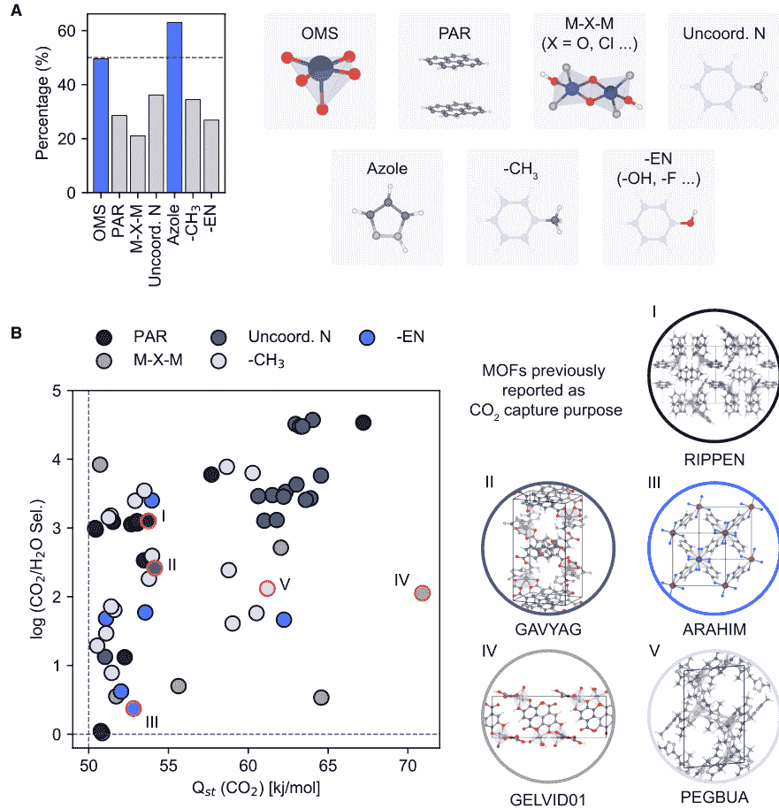

Figure 5. 有前景MOFs的化学特征分析
(A) 候选MOFs中发现的七种化学特征介绍。包含每种特征的MOF数量在左侧以柱状图表示，而七种化学特征的插图显示在右侧。
(B) 一个散点图，展示了含单一特征（排除OMS和唑类）的候选MOFs中CO2 Qst与选择性（为方便起见采用对数尺度）之间的关系。每种特征的五个代表性MOFs用红色边框突出显示，相应的插图在右侧提供。原子颜色：C（灰色），H（白色），N（浅蓝色），O（红色），Ni（浅灰色），Zn（卡其色），Nb（绿色），F（道奇蓝）。

选择性数值始终高于7.5，其中59%超过100。
最后，-EN基团易于积累电子，可作为亲核位点，选择性地与CO2分子中的亲电C原子相互作用。由于氟的高电负性，氟官能团常被用于在MOFs中设计用于选择性CO2捕获的最佳口袋。56,65,66 少量掺入氟官能团的MOFs已在实验中得到验证，可在潮湿条件下保持其CO2捕获效率。56,66,67

此外，五种代表性MOFs（RIPPEN,78 GAVYAG,68 ARAHIM,56 GELVID01,59 和 PEGBUA70）在我们的筛选过程中被发现，并已为CO2捕获目的进行了计算或实验研究，如图5B所示。在这些MOFs中，ARAHIM（又称NbOFFIVE-1-Ni或KAUST-7,71）甚至被证明能在潮湿条件下保持痕量CO2捕获性能。56 此外，为了提高可访问性，审查了有前景MOFs的通用名称。如表2所示，12种MOFs列出了相应的通用名称。

| REFCODE | 通用名称 | 金属 | 特征 | Qst (CO2) [kJ/mol] | Qst (H2O) [kJ/mol] | K_H (CO2) [mol/kg/Pa] | K_H (H2O) [mol/kg/Pa] |
|---|---|---|---|---|---|---|---|
| ARAHIM71 | KAUST-7 | Nb, Ni | -EN | 52.8 | 46.8 | 2.97 x 10^-2 | 1.25 x 10^-2 |
| CISMEY72 | JUC-115 | Cd | OMS, PAR, M-X-M, azole | 53.9 | 52.8 | 5.86 x 10^-2 | 5.43 x 10^-2 |
| COXCUP73 | MAF-42 | Cu | OMS, azole, -CH3 | 53.8 | 37.0 | 1.37 x 10^-1 | 7.51 x 10^-4 |
| FECWOB0174 | Zn-BTC | Zn | OMS, PAR, azole | 57.7 | 31.5 | 2.44 | 4.06 x 10^-4 |
| HOJJUN75 | ZJNU-40 | Cu | azole, -EN | 51.1 | 41.1 | 1.82 x 10^-1 | 3.76 x 10^-3 |
| NOFQIK76 | TCul | Cu | OMS, M-X-M azole, -CH3 | 51.9 | 29.9 | 8.77 x 10^-1 | 3.08 x 10^-4 |
| PEGBUA70 | MAF-23 | Zn | OMS, azole, -CH3 | 61.2 | 50.4 | 9.49 | 7.21 x 10^-2 |
| RIPNOV77 | D-ZIF-7 | Zn | PAR, azole | 52.7 | 31.9 | 3.96 x 10^-1 | 3.49 x 10^-4 |
| VEJZEQ78 | ZIF-9 | Co | PAR, azole | 50.4 | 28.5 | 1.60 x 10^-1 | 1.60 x 10^-4 |
| YIZJEY79 | IFMC-3 | Zn | azole, -CH3 | 51.4 | 48.5 | 5.20 x 10^-1 | 7.21 x 10^-3 |
| YUFLOC80 | AEMOF-5 | Sr | OMS, PAR, M-X-M, -EN | 82.5 | 78.0 | 2.51 x 10^4 | 9.57 x 10^3 |
| YUZCED81 | MAF-49 | Zn | uncoordinated nitrogen, azole | 63.4 | 35.5 | 7.48 x 10 | 2.50 x 10^-3 |

共介绍了12种有前景的MOFs及其相应的通用名称。列出了REFCODE、对应的通用名称、金属类型、关联的化学特征、Qst和K_H。Qst和K_H值使用DAC-SIM软件包中的MACE-DAC-1模型计算得出。

鉴于MOFs广泛的可调性，可实现广泛的化学环境，除ARAHIM外的所有结构都表现出多种化学特征。因此，这些MOFs多样的化学属性预计将协同促进DAC。

同样，结合这些特征为设计MOFs提供了一种有效策略。例如，SIFSIX-18-Ni,57 在潮湿条件下表现出卓越的痕量CO2捕获能力，包含三个关键特征：唑类连接器、–CH3和–EN。如图S18所示，SIFSIX-18-Ni由四甲基联吡唑有机连接器（一种甲基官能化的唑类连接器）和SiF62–支柱（一种电负性官能团）组成。有机连接器上的甲基起到疏水阻水基团的作用，而SiF62–支柱上的F原子则作为亲核位点与CO2分子中的亲电C原子相互作用。甲基的疏水性在靠近电负性基团的位置形成了限制水分子进入的口袋，使该口袋适用于DAC应用。通过结合特征，可以设计一系列MOFs以满足特定的DAC需求，并且从七种不同特征中可以形成多种组合。

由于我们的工作侧重于大规模筛选，并以热力学描述符（Qst和KH）作为初步步骤来评估性能，因此应对我们的候选材料进行进一步分析，以验证其实际在现实世界DAC应用中的适用性。例如，鉴于DAC过程通常在潮湿条件下进行，必须考虑同时存在CO2和H2O时的吸附性能，以进行更现实的模拟，而本研究并未涉及此方面。在实际中，H2O的吸附可为CO2捕获引入新的吸附位点。同时，在高相对湿度下，由于强H2O-H2O相互作用，H2O分子可能会聚集，从而可能阻塞MOFs内的孔隙。此外，本研究假设MOFs为刚性，因此无法模拟多孔材料在DAC应用中常用的化学反应（例如，CO2转化为氨基甲酸）。因此，进一步研究应聚焦于那些能够更准确反映实际DAC场景的模拟（例如，GCMC模拟和考虑柔性的模拟），以克服上述局限性。除了在原子尺度上研究平衡相位外，还应考虑动力学因素（例如，热稳定性和机械稳定性、长期稳定性以及吸附动力学）和工艺水平指标（例如，再生能耗），以筛选出适用于DAC应用的实际可行候选材料。

## 结论

在本工作中，我们提出了一种可扩展的计算方法，用于研究材料的气体吸附性能。我们开发了一种可迁移的机器学习力场MACE-DAC，用于CO2与MOFs的相互作用，并将其与模拟工作流集成，以高精度和高效率计算Qst和KH。该工作流作为Python软件包DAC-SIM提供，以便于各种用户使用。我们筛选了8000多种实验合成框架的CO2和H2O吸附性能，并发现了161个被基于经典力场的传统分子模拟方法忽略的有前景候选材料。此外，我们对可用于设计DAC应用多孔框架的特征进行了分类。我们的工作流解决了经典力场相关的先前局限性以及直接从头算方法的计算需求，从而为精确快速的虚拟材料筛选提供了坚实基础。

## 方法

### GoldDAC数据库构建

为涵盖框架与气体分子（CO2和H2O）之间相互作用能的完整势能曲面（PES），通过调整结构内分子的位置来测量相互作用能。从被认为是最稳定构型的平衡状态开始，通过将气体分子移近结构来收集两个排斥构型，同时通过将客体分子移向孔隙中心来收集三个弱吸引构型（构型构建的详细信息见附注S1和图S19）。在不考虑几何优化的情况下计算相互作用能。使用DFT计算来计算每个体系的能量，并将气体分子隔离在10 Å立方盒中以计算其能量。因此，对每个体系进行了一次单自洽场计算。

平衡状态作为构型构建的起点，从两个不同的数据源收集：ODAC23数据库和从26种被确定为用于CO2捕获或DAC应用的有前景MOFs中人工计算的吸附结果。39,82 基于从ODAC23数据库收集的优化构型（训练集和验证集）训练了MLFF模型。首先，使用ODAC23数据库中的IS2RE数据库为MOFs收集了最低CO2和H2O相互作用能（在此情况下，相互作用能是在MOF + 气体体系几何优化后计算的）。考虑满足以下两个条件的MOFs：(1) 最低CO2和H2O结合能小于-0.1 eV，且(2) 原子数少于250个。最后，鉴于原始论文中提供了ODAC23数据库中出现频率最高的前20种金属原子（见图S1），从包含每种金属类型的MOFs中随机选择了3种。因此，共考虑了60种MOFs，从ODAC23数据库收集了120个平衡构型，同时考虑了CO2和H2O分子。为评估训练好的MLFF模型，从人工选择的26种MOFs获得的平衡状态构建了额外的数据库。将单个客体分子引入框架中，允许其弛豫，而框架保持固定。考虑客体分子的活性吸附位点，采样了三到五个不同的初始点，并选择能量最低的构型作为平衡状态。总共为CO2和H2O分子收集了52个平衡构型。这些26种MOFs的更多详细信息和插图见图S20–S24。

### 训练详情

基础模型MACE-MP,35 用于与GoldDAC数据集进行微调，训练集、验证集和测试集的详细数据分布见表S1。微调在100个epochs中进行，批量大小为4。采用Adam优化器进行参数更新，83 学习率为1e–4，权重衰减为零。微调的损失函数（$L_{E+F}$）在总能量和力预测之间均衡平衡，比例设定为1:1。

对于持续学习，引入了额外的正则化损失（$L_{continual}$），计算为冻结预训练模型与相应微调模型之间能量和力预测的均方根误差。因此，持续学习的总损失函数可定义为：

$L = L_{E+F} + \lambda L_{continual}$，

其中$\lambda$表示持续损失的加权系数，经验设定为1.0，以在保留预训练知识和适应新任务特定特征之间取得平衡。

### 基于MLFF的分子模拟

DAC-SIM软件包是一个Python软件包，通过ASE计算器接口与开发的MLFF集成，用于包括Widom插入、分子动力学和几何优化在内的分子模拟。84 Widom插入模拟在CoRE MOF 2019数据集37上进行，以确定KH和Qst。在进行模拟之前，对每个MOF结构实现了几何优化。优化过程总共包括30个步骤，每个步骤包括50次晶胞弛豫迭代，随后在固定晶胞的情况下进行50次内部弛豫迭代。最大力的收敛标准设定为0.05 eV/Å，以平衡计算效率。

对于随后的Widom插入模拟，生成了一个间距为0.15 Å的网格，以定义单元胞中潜在的插入点。排除了位于气体分子中心位置（如CO2中的C原子和H2O中的O原子）1.5 Å以内的网格点，以避免将分子插入阻塞区域。在每次迭代中，随机旋转一个气体分子并将其放置在网格点，使用MLFF计算框架与气体分子之间的相互作用能。为增强统计可靠性，进行了两次独立的Widom插入模拟，每次包含10,000次插入。如图S31和32中对Qst和KH值进行三次独立迭代的收敛性测试所示，我们将10,000次插入设定为模拟标准，因为它在计算效率和收敛可靠性之间取得了良好的平衡。对这些模拟结果求平均值以计算最终的KH和Qst。温度设定为300 K。

### 分子模拟详情

DFT计算使用Vienna Ab initio Simulation Package (VASP)进行。85–87 交换-相关项使用广义梯度近似和Perdew-Burke-Ernzerhof泛函计算。88 除了Eu原子（遵循QMOF数据库89的伪势选择，使用Eu_3而非Eu_2），采用VASP手册中推荐的伪势来描述离子-电子相互作用。能量截止选为600 eV，电子弛豫迭代直至能量变化低于10–5 eV。计算过程中仅使用了Γ点以确保计算效率，并结合高斯展宽方法（sigma = 0.05 Å）。然而，为了提高精度，对于具有小晶格常数或显著电子和色散相互作用的MOFs，可能需要更密的k点采样。在制备测试集平衡状态构型期间，应用了D3（Becke-Johnson）方案90,91的色散校正，并迭代离子弛豫


直到力小于 0.03 eV/Å。在构建 GoldDAC 数据集期间，进行了不包含色散校正的额外计算。若标记为“+D3”，则采用 D3 (Becke-Johnson) 方案进行了包含色散校正的单独计算。自旋极化计算仅针对具有开放壳层金属原子的骨架进行考虑，并对 Cu、Mn、Ni、Fe、Co、V、Nb 和 Ti 的 d 轨道应用了 U 校正。由于微调数据库的这些 DFT 设置与用于 MACE-MP 模型预训练数据库的设置并不完全匹配，这种差异可能导致 MACE-MP 模型在评估期间出现的初始误差（更多详情请参见附录 S3）。然而，由于相互作用能量来源于三个不同的系统（MOF + 气体、MOF 和气体），它们对 DFT 设置的微小变化相对不敏感。

使用 RASPA2 软件计算了基于经典力场的 Q_st 和 K_H。53 两种属性均通过 Widom 插入 MC 方法计算，该方法我们在本工作中尝试实现。截断距离设置为 12.8 Å，并采用 Ewald 求和法来考虑静电势。未考虑孔隙阻塞算法。对 CO2 和 H2O 分子均迭代了 10,000 个 MC 循环，温度设置为 300 K 以与 DAC-SIM 计算保持一致。

使用 Large-scale Atomic/Molecular Massively Parallel Simulator 软件计算了测试集中 MOF 的相互作用能量（基于经典力场）。92 与吸附属性计算所采用的方法一致，使用了 12.8 Å 的截断距离，并采用 Ewald 求和法来处理长程库仑相互作用，精度阈值为 1 × 10⁻⁵。

对于经典力场计算，骨架原子使用 UFF 建模，18 点电荷基于 DDEC21 方案分配。如果结构的 .cif 文件包含预定义电荷，则保留这些值而不做进一步修改。对于客体分子，即 CO2 和 H2O，分别使用了 TraPPE93 和 SPC/E94 力场。

使用 Zeo++ 软件计算了 LCD、表面积 (SA) 和体积分数 (VF) 等几何属性。95 计算 SA 和 VF 时选择的探测半径为 1.4 Å，即氦的范德华半径。我们分别进行了 2k 和 50k 次 MC 采样来计算 SA 和 VF。

## 资源可用性

### 主联系人

有关进一步信息和资源及材料请求，应联系并由主联系人 Jihan Kim (jihankim@kaist.ac.kr) 处理。

### 材料可用性

本研究未产生新的独特试剂。

#### 数据和代码可用性

DAC-sim 库可在 https://github.com/hspark1212/DAC-SIM 获取。该库的文档可在 https://hspark1212.github.io/DAC-SIM 获取。基于 MACE 的持续学习实现可在 https://github.com/hspark1212/mace/tree/develop 获取。筛选结果和 GoldDAC 数据集的关联文件可通过 Figshare (https://doi.org/10.6084/m9.figshare.27978474.v3) 获取。

## 致谢

我们感谢 Jisu Jung 和 Honghui Kim 的深入讨论。Y.L. 和 J.K. 承认获得 Saudi Aramco-KAIST CO2 Management Center（项目：G01230260 和 N11230051）以及韩国国家研究基金会（拨款编号 RS-2025-02218827）的资助。H.P. 和 A.W. 承认该工作得到 EPSRC 项目 EP/X037754/1 的资助，并感谢英国材料与分子建模中心提供的计算资源，该中心部分由 EPSRC（EP/T022213/1、EP/W032260/1 和 EP/P020194/1）资助。

## 作者贡献

概念化，Y.L. 和 H.P.；方法论，Y.L. 和 H.P.；调查，Y.L. 和 H.P.；撰写 – 原始草稿，Y.L.、H.P.、A.W. 和 J.K.；撰写 – 审阅与编辑，Y.L.、H.P.、A.W. 和 J.K.；资金获取，A.W. 和 J.K.；监督，A.W. 和 J.K.。

## 利益冲突声明

作者声明无竞争性利益。

## 写作过程中生成式 AI 及 AI 辅助技术声明

在准备本工作期间，作者使用 ChatGPT 编辑了手稿的最终草稿。使用此工具后，作者根据需要审阅和编辑了内容，并对出版物的内容承担全部责任。

## 补充信息

补充信息可在线查阅 https://doi.org/10.1016/j.matt.2025.102203。


## 参考文献

- 1. NASA's Goddard Institute for Space Studies (GISS). 全球温度. https://climate.nasa.gov/vital-signs/global-temperature/?intent=121%60.
- 2. Olivier, J.G., Schure, K., and Peters, J. (2017). 全球 CO2 和总温室气体排放趋势. PBL Netherlands Environmental Assessment Agency 5, 1–11.
- 3. Lackner, K.S., Brennan, S., Matter, J.M., Park, A.-H.A., Wright, A., and Van Der Zwaan, B. (2012). 发展环境空气 CO2 捕获的紧迫性. Proc. Natl. Acad. Sci. USA 109, 13156–13162.
- 4. Sabatino, F., Grimm, A., Gallucci, F., van Sint Annaland, M., Kramer, G.J., and Gazzani, M. (2021). 直接空气捕获技术的比较能量与成本评估及优化. Joule 5, 2047–2076.
- 5. Didas, S.A., Choi, S., Chakitisilp, W., and Jones, C.W. (2015). 用于环境空气 CO2 捕获的胺-氧化物杂化材料. Acc. Chem. Res. 48, 2680–2687.
- 6. Stolaroff, J.K., Keith, D.W., and Lowry, G.V. (2008). 使用氢氧化钠喷雾从大气中捕获二氧化碳. Environ. Sci. Technol. 42, 2728–2735.
- 7. Zhang, W., Liu, H., Sun, Y., Cakstins, J., Sun, C., and Snape, C.E. (2016). 基于胺的固体吸附剂后燃烧碳捕获过程中再生热需求的参数研究. Applied Energy 168, 394–405.
- 8. Keith, D.W., Holmes, G., St Angelo, D., and Heidel, K. (2018). 从大气中捕获 CO2 的工艺. Joule 2, 1573–1594.
- 9. Khraisheh, M., Mukherjee, S., Kumar, A., Al Momani, F., Walker, G., and Zavorotko, M.J. (2020). 基于先进物理吸附材料的痕量 CO2 去除概述. J. Environ. Manage. 255, 109874.
- 10. Zhou, H.-C., Long, J.R., and Yaghi, O.M. (2012). 金属有机框架简介. Chem. Rev. 112, 673–674.
- 11. Furukawa, H., Cordova, K.E., O’Keeffe, M., and Yaghi, O.M. (2013). 金属有机框架的化学与应用. Science 341, 1230444.
- 12. Lin, L.-C., Berger, A.H., Martin, R.L., Kim, J., Swisher, J.A., Jariwala, K., Rycroft, C.H., Bloch, A.S., Deem, M.W., Haranczyk, M., and Smit, B. (2012). 碳捕获材料的体外筛选. Nat. Mater. 11, 633–641.
- 13. Fernandez, M., Boyd, P.G., Daff, T.D., Aghajani, M.Z., and Woo, T.K. (2014). 用于 CO2 捕获的高性能金属有机框架的快速准确机器学习识别. J. Phys. Chem. Lett. 5, 3056–3060.
- 14. Li, S., Chung, Y.G., and Snurr, R.Q. (2016). 水存在下用于 CO2 捕获的金属有机框架高通量筛选. Langmuir 32, 10368–10376.
- 15. Boyd, P.G., Chidambaram, A., García-Díez, E., Ireland, C.P., Daff, T.D., Bounds, R., Gladysiak, A., Schouwink, P., Moosavi, S.M., Maroto-Valer, M.M., et al. (2019). 用于湿烟气 CO2 捕获的数据驱动金属有机框架设计. Nature 576, 253–256.
- 16. Findley, J.M., and Sholl, D.S. (2021). 湿度条件下用于直接空气捕获二氧化碳的 MOF 和沸石计算筛选. J. Phys. Chem. C 125, 24630–24639.
- 17. Kancharalapalli, S., and Snurr, R.Q. (2023). 用于湿烟气 CO2 捕获的 CoRE-MOF-2019 数据库高通量筛选：一种多尺度建模策略. ACS Appl. Mater. Interfaces 15, 28084–28092.
- 18. Rappé, A.K., Casewit, C.J., Colwell, K., Goddard III, W.A., and Skiff, W.M. (1992). UFF：用于分子力学和分子动力学模拟的全周期表力场. J. Am. Chem. Soc. 114, 10024–10035.
- 19. Rappé, A.K., and Goddard, W.A., III. (1991). 分子动力学模拟的电荷平衡. J. Phys. Chem. 95, 3358–3363.
- 20. Wilmer, C.E., Kim, K.C., and Snurr, R.Q. (2012). 一种扩展的电荷平衡方法. J. Phys. Chem. Lett. 3, 2506–2511.
- 21. Manz, T.A., and Sholl, D.S. (2010). 可复现周期性和非周期性材料中静电势的化学有意义的原子电荷. J. Chem. Theory Comput. 6, 2455–2468.
- 22. Li, Y., Jin, X., Moubarak, E., and Smit, B. (2024). 金属有机框架中某些金属节点的通用力场参数精炼集. J. Chem. Theory Comput. 20, 10540–10552.
- 23. Dzubak, A.L., Lin, L.-C., Kim, J., Swisher, J.A., Poloni, R., Maximoff, S.N., Smit, B., and Gagliardi, L. (2012). 开放位点金属有机框架中的从头算碳捕获. Nat. Chem. 4, 810–816.
- 24. Lee, K., Howe, J.D., Lin, L.-C., Smit, B., and Neaton, J.B. (2015). 开放位点金属有机框架中的小分子吸附：用于合理设计的系统密度函数理论研究. Chem. Mater. 27, 668–678.
- 25. von Lilienfeld, O.A., Müller, K.-R., and Tkatchenko, A. (2020). 基于量子机器学习探索化学化合物空间. Nat. Rev. Chem. 4, 347–358.
- 26. Unke, O.T., Chmiela, S., Sauceda, H.E., Gastegger, M., Poltavsky, I., Schütt, K.T., Tkatchenko, A., and Müller, K.R. (2021). 机器学习力场. Chem. Rev. 121, 10142–10186.
- 27. Keith, J.A., Vassiliou-Galindo, V., Cheng, B., Chmiela, S., Gastegger, M., Müller, K.R., and Tkatchenko, A. (2021). 结合机器学习与计算化学以获取化学系统的预测性洞察. Chem. Rev. 121, 9816–9872.
- 28. Hart, G.L.W., Mueller, T., Toher, C., and Curtarolo, S. (2021). 合金的机器学习. Nat. Rev. Mater. 6, 730–755.
- 29. Hwang, S., Jung, J., Hong, C., Jeong, W., Kang, S., and Han, S. (2023). 基于机器学习势函数探索未知三元金属氧化物的稳定性与平衡结构. J. Am. Chem. Soc. 145, 19378–19386.
- 30. Mosquera-Lois, I., Kavanagh, S.R., Ganose, A.M., and Walsh, A. (2024). 用于加速点缺陷计算的机器学习结构重建. npj Comput. Mater. 10, 121.
- 31. Goeminne, R., Vanduyfhuys, L., Van Speybroeck, V., and Verstraelen, T. (2023). 机器学习势能使金属有机框架中实现 DFT 质量的吸附模拟. J. Chem. Theory Comput. 19, 6313–6325.
- 32. Zheng, B., Oliveira, F.L., Neumann Barros Ferreira, R., Steiner, M., Hamann, H., Gu, G.X., and Luan, B. (2023). 量子信息机器学习势能用于 Mg-MOF-74 中 CO2 化学吸附和扩散的分子动力学模拟. ACS Nano 17, 5579–5587.
- 33. Shaidiu, Y., Smith, A., Taw, E., and Neaton, J.B. (2023). 基于神经网络势能的金属有机框架中碳捕获现象. PRX Energy 2, 023005.
- 34. Liu, S., Dupuis, R., Fan, D., Benzaria, S., Bonneau, M., Bhatt, P., Eddaoudi, M., and Maurin, G. (2024). 用于建模具有开放金属位点的 MOF 中 H2 吸附/扩散的机器学习势能. Chem. Sci. 15, 5294–5302.
- 35. Batatia, I., Benner, P., Chiang, Y., Elena, A.M., Kovács, D.P., Riebeseell, J., Advincula, X.R., Asta, M., and Avaylon, M. (2023). 原子尺度材料化学的基础模型. arXiv 预印本. https://arxiv.org/abs/2401.00096.
- 36. Widom, B. (1963). 流体理论中的一些主题. J. Chem. Phys. 39, 2808–2812.
- 37. Chung, Y.G., Haldoupis, E., Bucior, B.J., Haranczyk, M., Lee, S., Zhang, H., Vogiatzis, K.D., Milisavljevic, M., Ling, S., Camp, J.S., et al. (2019). 计算就绪实验金属有机框架数据库：CoRE MOF 2019 的进展、更新与分析. J. Chem. Eng. Data 64, 5985–5998.
- 38. Frenkel, D., and Smit, B. (2023). 理解分子模拟：从算法到应用 (Elsevier).
- 39. Sriram, A., Choi, S., Yu, X., Brabson, L.M., Das, A., Ulissi, Z., Uyttendaele, M., Medford, A.J., and Sholl, D.S. (2024). Open DAC 2023 数据集及直接空气捕获吸附剂发现的挑战. ACS Cent. Sci. 10, 923–941.
- 40. Park, H., Majumdar, S., Zhang, X., Kim, J., and Smit, B. (2024). 基于深度强化学习的直接空气捕获 CO2 金属有机框架逆向设计. Digital Discovery 3, 728–741.
- 41. Batatia, I., Kovacs, D.P., Simm, G., Ortner, C., and Csanyi, G. (2022). MACE：用于快速准确力场的高阶等变消息传递神经网络. Adv. Neural Inf. Process. Syst. 35, 11423–11436.
- 42. Deng, B., Zhong, P., Jun, K., Riebeseell, J., Han, K., Bartel, C.J., and Ceder, G. (2023). CHGNet 作为电荷信息原子建模的预训练通用神经网络势能. Nat. Mach. Intell. 5, 1031–1041.
- 43. Chen, C., and Ong, S.P. (2022). 面向周期表的通用图深度学习原子间势能. Nat. Comput. Sci. 2, 718–728.
- 44. Park, Y., Kim, J., Hwang, S., and Han, S. (2024). 分子动力学模拟中图神经网络原子间势能的可扩展并行算法. J. Chem. Theory Comput. 20, 4857–4868.
- 45. Deng, B., Choi, Y., Zhong, P., Riebeseell, J., Anand, S., Li, Z., Jun, K., Persson, K.A., and Ceder, G. (2024). 通过微调克服通用机器学习原子间势能中的系统性软化. arXiv 预印本. https://arxiv.org/abs/2405.07105.
- 46. Witt, W.C., van der Oord, C., Gelinytė, E., Järvinen, T., Ross, A., Darby, J. P., Ho, C.H., Baldwin, W.J., and Sachs, M. (2023). ACEpotentials.jl：原子团簇展开的 Julia 实现. J. Chem. Phys. 159, 16.


47. McCloskey, M., and Cohen, N.J. (1989). 连接主义网络中的灾难性干扰：序列学习问题. Psychol. Learn. Motiv. 24, 109–165.

48. Luo, Y., Yang, Z., Meng, F., Li, Y., Zhou, J., and Zhang, Y. (2023). 持续微调过程中大型语言模型中灾难性遗忘的实证研究. arXiv上的预印本。https://arxiv.org/abs/2308.08747.

49. Kudithipudi, D., Aguilar-Simon, M., Babb, J., Bazhenov, M., Blackiston, D., Bongard, J., Brna, A.P., Chakraborty Raja, S., Cheney, N., Clune, J., et al. (2022). 终身学习机器的生物学基础. Nat. Mach. Intell. 4, 196–210.

50. Chen, Z., and Liu, B. (2018). 终身机器学习 (Morgan & Claypool Publishers).

51. Li, W., Rao, Z., Chung, Y.G., and Li, S. (2017). 部分原子电荷赋值方法在湿度条件下金属-有机框架二氧化碳捕获计算筛选中的作用. ChemistrySelect 2, 9458–9465.

52. Kancharapalli, S., Gopalan, A., Haranczyk, M., and Snurr, R.Q. (2021). 金属-有机框架中计算部分原子电荷的快速准确机器学习策略. J. Chem. Theory Comput. 17, 3052–3064.

53. Dubbeldam, D., Calero, S., Ellis, D.E., and Snurr, R.Q. (2016). RASPA：柔性纳米多孔材料中吸附与扩散的分子模拟软件. Mol. Simul. 42, 81–101.

54. Zheng, B., Sant, M., Demontis, P., and Suffritti, G.B. (2012). 柔性ZIF-8框架中分子动力学计算的力场. J. Phys. Chem. C 116, 933–938.

55. Wang, J., Wolf, R.M., Caldwell, J.W., Kollman, P.A., and Case, D.A. (2004). 通用amber力场的开发与测试. J. Comput. Chem. 25, 1157–1174.

56. Bhatt, P.M., Belmabkhout, Y., Cadiou, A., Adil, K., Shekhah, O., Shkurenenko, A., Barbour, L.J., and Eddaoudi, M. (2016). 一种精调的含氟MOF利用物理吸附满足痕量二氧化碳去除和空气捕集的需求. J. Am. Chem. Soc. 138, 9301–9307.

57. Mukherjee, S., Siddar, N., O’Nolan, D., Franz, D.M., Gascón, V., Kumar, A., Kumar, N., Scott, H.S., Madden, D.G., Kruger, P.E., et al. (2019). 利用低水亲和力超微孔物理吸附剂捕集痕量二氧化碳. Sci. Adv. 5, eaax9171.

58. Lin, J.-B., Nguyen, T.T.T., Vaidhyanathan, R., Burner, J., Taylor, J.M., Durekova, H., Akhtar, F., Mah, R.K., Ghaffari-Nik, O., Marx, S., et al. (2021). 一种可规模化的金属-有机框架作为耐用的二氧化碳捕集物理吸附剂. Science 374, 1464–1469.

59. Wang, X., Alazayer, M., Shih, A.J., Bose, S., Xie, H., Vornholt, S.M., Malliakas, C.D., Alhashem, H., Joodaki, F., Marzouk, S., et al. (2024). 高湿度下改善二氧化碳捕集的物理吸附剂疏水性和孔隙环境定制. J. Am. Chem. Soc. 146, 3943–3954.

60. Lu, W., Wei, Z., Gu, Z.-Y., Liu, T.-F., Park, J., Park, J., Tian, J., Zhang, M., Zhang, Q., Gentile, T., 3rd., et al. (2014). 通过连接子设计调节金属-有机框架的结构与功能. Chem. Soc. Rev. 43, 5561–5593.

61. Demessence, A., D’Alessandro, D.M., Foo, M.L., and Long, J.R. (2009). 乙二胺官能化的水稳定三唑桥联金属-有机框架中强二氧化碳结合. J. Am. Chem. Soc. 131, 8784–8786.

62. McDonald, T.M., Lee, W.R., Mason, J.A., Wiers, B.M., Hong, C.S., and Long, J.R. (2012). 烷基胺接枝金属-有机框架mmen-Mg2(dobpdc)中从空气和烟气中捕集二氧化碳. J. Am. Chem. Soc. 134, 7056–7065.

63. McDonald, T.M., Mason, J.A., Kong, X., Bloch, E.D., Gygi, D., Dani, A., Crocella, V., Giordano, F., Odoh, S.O., Drisdell, W.S., et al. (2015). 二胺接枝金属-有机框架中二氧化碳的协同插入. Nature 519, 303–308.

64. Zhou, Z., Ma, T., Zhang, H., Chheda, S., Li, H., Wang, K., Ehrling, S., Giovane, R., and Li, C. (2024). 使用共价有机框架从开放空气中捕集二氧化碳. Nature 635, 96–101.

65. Shekhah, O., Belmabkhout, Y., Chen, Z., Guillem, V., Cairns, A., Adil, K., and Eddaoudi, M. (2014). 用于痕量二氧化碳去除和空气捕集的定制金属-有机框架. Nat. Commun. 5, 4228.

66. Ullah, S., Tan, K., Sensharma, D., Kumar, N., Mukherjee, S., Bezrukov, A., Li, J., Zaworotko, M.J., and Thonhauser, T. (2022). 使用非平衡循环在湿度条件下通过混合超微孔TIFSIX-3-Ni捕集二氧化碳. Angew. Chem. 61, e202206613.

67. Low, M.-Y.A., Danaci, D., Azzan, H., Jiayi, A.L., Yong, G.W.S., Itsikou, I., and Petit, C. (2024). TIFSIX-3-Ni用于直接空气捕集二氧化碳的理化性质、平衡吸附性能、可制造性和稳定性. Energy & Fuels 38, 11947–11965.

68. Liu, X.-J., Wang, X., Ju, J.-L., Tian, D., Chen, R.-Y., Xu, J., and Bu, X.-H. (2017). 通过混合配体策略构建的Zn(II)金属-有机框架的选择性气体吸附与荧光传感响应. Dalton Trans. 46, 4893–4897.

69. Heymans, N., Bourrelly, S., Normand, P., Bloch, E., Mkhadder, H., Cooper, L., Gorman, M., Bouzidi, I., Guillou, N., De Weireld, G., and Devic, T. (2020). 用于环境应用的小孔没食子酸盐MOFs：吸附行为及其对二氧化碳高亲和力的结构阐明. J. Phys. Chem. C 124, 3188–3195.

70. Liao, P.-Q., Zhou, D.-D., Zhu, A.-X., Jiang, L., Lin, R.-B., Zhang, J.-P., and Chen, X.-M. (2012). 具有客体螯合爪的柔性多孔框架中强而动态的二氧化碳吸附. J. Am. Chem. Soc. 134, 17380–17383.

71. Cadiou, A., Adil, K., Bhatt, P.M., Belmabkhout, Y., and Eddaoudi, M. (2016). 用于丙烯与丙烷分离的基于金属-有机框架的分割器. Science 353, 137–140.

72. He, H., Sun, F., Su, H., Jia, J., Li, Q., and Zhu, G. (2014). 基于5-(4-(2H-四唑-5-基)苯氧基)邻苯二甲酸的三种金属-有机框架的合成、结构和发光性质. CrystEngComm (Camb.) 16, 339–343.

73. Liao, P.-Q., Zhu, A.-X., Zhang, W.-X., Zhang, J.-P., and Chen, X.-M. (2015). 多孔晶体中有机连接子的自催化好氧氧化以实现吸附行为的按需调节. Nat. Commun. 6, 6350.

74. Wei, Q., Yang, D., Larson, T.E., Kinnibrugh, T.L., Zou, R., Henson, N.J., Timofeeva, T., Xu, H., Zhao, Y., and Mattes, B.R. (2012). 由之字形通道结构产生的刚性MOF气体吸附行为中的动力学滞后. J. Mater. Chem. 22, 10166–10171.

75. Song, C., He, Y., Li, B., Ling, Y., Wang, H., Feng, Y., Krishna, R., and Chen, B. (2014). 通过极性苯并噻二唑基团官能化NbO型金属-有机框架以增强二氧化碳吸附和选择性. Chem. Commun. 50, 12105–12108.

76. He, J., Duan, J., Shi, H., Huang, J., Huang, J., Yu, L., Zeller, M., Hunter, A. D., and Xu, Z. (2014). 挥发性和腐蚀性一氧化碘（ICI）和I2试剂在稳定金属-有机框架中的固定化. Inorg. Chem. 53, 6837–6843.

77. Zhao, P., Lampronti, G.I., Lloyd, G.O., Suard, E., and Redfern, S.A.T. (2014). 门控开启沸石咪唑酸盐框架ZIF-7中二氧化碳吸附的直接可视化. J. Mater. Chem. A 2, 620–623.

78. Park, K.S., Ni, Z., Côté, A.P., Choi, J.Y., Huang, R., Uribe-Romo, F.J., Chae, H.K., O’Keeffe, M., and Yaghi, O.M. (2006). 沸石咪唑酸盐框架的优异化学和热稳定性. Proc. Natl. Acad. Sci. USA 103, 10186–10191.

79. Qin, J.S., Bao, S.J., Li, P., Xie, W., Du, D.Y., Zhao, L., Lan, Y.Q., and Su, Z. (2014). 用于Ln3+离子发光感应和硝基苯检测的稳定多孔阴离子型金属-有机框架. Chem. Asian J. 9, 749–753.

80. Douvli, A., Papaefstathiou, G.S., Gullo, M.P., Barbieri, A., Tsiapis, A.C., Malliakas, C.D., Kanatzidis, M.G., Papadas, I., Armatas, G.S., Hadjimitsirou, A.G., et al. (2015). 碱土金属离子/二羟基对苯二甲酸盐MOFs：结构多样性和不寻常的发光性质. Inorg. Chem. 54, 5813–5826.

81. Liao, P.-Q., Zhang, W.-X., Zhang, J.-P., and Chen, X.-M. (2015). 通过乙烷捕获金属-有机框架高效纯化乙烷. Nat. Commun. 6, 8897.

82. Bose, S., Sengupta, D., Rayder, T.M., Wang, X., Kirilkovai, K.O., Sekizkardes, A.K., Islamoglu, T., and Farha, O.K. (2024). 挑战与机遇：用于直接空气捕集的金属-有机框架. Adv. Funct. Mater. 34, 2307478.

83. Kingma, D.P. (2014). Adam：一种随机优化方法. arXiv上的预印本。https://arxiv.org/abs/1412.6980.

84. Hjort Larsen, A., Jørgen Mortensen, J., Blomqvist, J., Castelli, I.E., Christensen, R., Dułak, M., Friis, J., Groves, M.N., Hammer, B., Hargus, C., et al. (2017). 原子模拟环境——用于处理原子的Python库. J. Phys. Condens. Matter 29, 273002.

85. Kresse, G., and Hafner, J. (1993). 液态金属的从头算分子动力学. Physical review B 47, 558–561.

86. Kresse, G., and Furthmüller, J. (1996). 使用平面波基组计算金属和半导体从头算总能量的效率. Comput. Mater. Sci. 6, 15–50.

87. Kresse, G., and Furthmüller, J. (1996). 使用平面波基组进行从头算总能量计算的高效迭代方案. Phys. Rev. B 54, 11169–11186.

88. Perdew, J.P., Burke, K., and Ernzerhof, M. (1996). 广义梯度近似简化法. Phys. Rev. Lett. 77, 3865–3868.

89. Rosen, A.S., Iyer, S.M., Ray, D., Yao, Z., Aspuru-Guzik, A., Gagliardi, L., Notestein, J.M., and Snurr, R.Q. (2021). 利用机器学习加速材料发现的金属-有机框架量子化学性质. Matter 4, 1578–1597.

90. Grimme, S., Antony, J., Ehrlich, S., and Krieg, H. (2010). 94种元素（H-Pu）密度泛函色散修正（DFT-D）的一致且准确的从头算参数化. J. Chem. Phys. 132, 154104.

91. Grimme, S., Ehrlich, S., and Goerigk, L. (2011). 色散校正密度泛函理论中阻尼函数的效应. J. Comput. Chem. 32, 1456–1465.

92. Plimpton, S. (1995). 短程分子动力学的快速并行算法. J. Comput. Phys. 117, 1–19.

93. Eggimann, B.L., Sunnarborg, A.J., Stern, H.D., Bliss, A.P., and Siepmann, J.I. (2014). TraPPE力场的在线参数和属性数据库. Mol. Simul. 40, 101–105.

94. Berendsen, H.J.C., Grigera, J.-R., and Straatsma, T.P. (1987). 有效对势中的缺失项. J. Phys. Chem. 91, 6269–6271.

95. Willems, T.F., Rycroft, C.H., Kazi, M., Meza, J.C., and Haranczyk, M. (2012). 基于几何的晶体多孔材料高通量分析的算法和工具. Microporous Mesoporous Mater. 149, 134–141.

