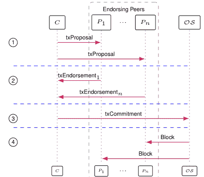
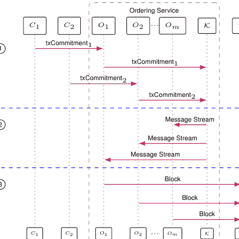
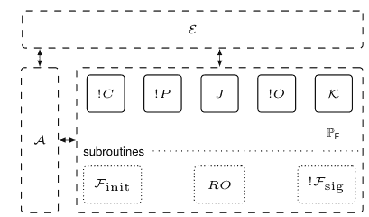

# 许可区块链中的问责制：Hyperledger Fabric 形式分析

摘要——虽然问责制在分布式系统和密码学中是一个众所周知的概念，但在区块链（以及更广泛的分布式账本）文献中，对问责制的形式化处理一直是个盲点：至今尚未存在任何区块链的问责制形式化，更不用说形式化证明了。因此，在这项工作中，我们提出并建议在此领域对问责制进行形式化处理。我们的目标是正式陈述并证明，如果在区块链的一次运行中，某个核心安全属性（如一致性）未得到满足，那么行为不当的各方可以被识别并追究责任。问责制对于许可型区块链特别有用，因为在该类区块链中所有各方相互认识，因此问责制激励所有各方诚实行为。我们以最突出的许可型区块链之一——Hyperledger Fabric 的最常见实例化为例，阐述了我们的方法。

索引术语——问责制、区块链、分布式账本、分布式系统、安全性、Hyperledger Fabric

## 1. 引言

自2008年区块链发明以来[51]，人们对这一概念以及分布式账本技术的兴趣迅速增长。区块链和分布式账本最初被提出作为无中央机构支付系统的解决方案，现已发展为具有强大安全承诺的多用途分布式系统。

尽管针对区块链存在广泛的既定安全概念和形式化安全分析[8]、[9]、[11]、[19]、[24]、[35]、[36]、[53]，但在区块链和分布式账本的形式化安全分析中，仍有一个重要的盲点：问责制[43]。从高层次来看，问责制要求，如果协议的某些安全目标被违反，那么行为不当的各方可以通过不可否认的密码学证据被识别并为其不当行为承担责任，从而激励诚实行为。

问责制本身是分布式系统和密码学中一个众所周知的概念，已经应用于多种场景（参见，例如，[6]、[10]、[28]、[39]、[40]、[42]-[45]、[48]、[49]、[61]）。

在区块链的背景下，问责制常被提及为一种理想属性[12]、[18]、[22]、[33]、[54]，一些关于区块链的研究论文在非正式层面上使用了问责制概念[14]、[34]。然而，至今尚不存在任何区块链或分布式账本的问责制形式化，更不用说形式化证明了（另见第7节）。

因此，在这项工作中，我们提出并建议针对区块链的问责制进行形式化处理，并以一个非常突出的许可型区块链为例进行阐述（见下文）。由此，我们为设计和分析区块链提供了一种新的形式化方法。

这种方法实际上与区块链的既定安全概念（如一致性）正交：这些安全概念[24]、[53]要求在某些假设下始终满足安全目标。例如，区块链应始终收敛到一致状态，通常基于基于轮的网络模型、最终消息传递和参与者诚实多数的假设。从这个意义上说，只要某些假设得到满足，安全性（例如一致性）就不会被破坏。在下文中，我们将此类安全概念称为严格安全概念。相比之下，基于问责的方法接受安全目标可能被违反。但是，在这种情况下，可以保证识别行为不当的各方，并正确地为其不当行为指责。我们的方法可以以两种方式使用：

#### 问责作为独立属性。

一方面，问责制是一个有趣的独立属性，可以用来代替严格安全概念以获得（不同的）安全保证。特别是对于许可型区块链，各方相互认识，并且通常基于合同协作，拥有这样的保证：如果某个核心安全目标失效，那么行为不当的各方可以被识别并追究责任，在许多情况下将被视为足够强的属性。如本文所示，并如下文详细说明，将问责制作为独立属性使用，允许构建新的安全区块链，这些区块链可以利用以下一个或多个特性：_(i)_ 与实现严格目标所需的组件相比，问责制可能已经可以使用更弱但更高效的组件来实现。例如，如我们的案例研究所示，可问责的区块链可以基于高效的崩溃容错共识协议构建，而不是更复杂的拜占庭容错共识协议，以提供关于一致性的问责制。也就是说，虽然行为不当的一方可以破坏一致性，但该方随后可以被识别并追究责任。(ii) 为了满足问责属性，可能需要更少的假设。例如，为了在我们的案例研究中展示关于一致性的问责制，我们不需要诚实多数或具有最终消息传递的网络；在这种环境下，尚未对任何区块链证明过严格安全概念。(iii) 在某些方面，问责属性可能比严格安全概念更强：如我们的案例研究所解释，对于我们关于一致性的问责概念，我们要求（并对所考虑的协议证明）不仅诚实各方的区块链满足一致性，不诚实各方的区块链也满足一致性。

### 问责作为额外的正交防御层。

另一方面，问责制可以作为额外的安全要求和严格安全概念之上的另一层安全：即使在严格环境下，安全性仍可能被破坏，因为底层假设（如诚实多数）可能不满足。在这种情况下，只要具备问责属性，仍然可以识别并指责行为不当的各方。（如独立情况中所述，为了使问责成立，可能只需要更弱的假设，例如，可以容忍不诚实多数。）随后可以将此类各方排除在未来执行之外。此外，面对被追究责任的前景，各方可能从一开始就避免不当行为，从而使某些假设（如诚实多数）更有可能成立。

### 问责级别。

我们注意到，区块链可以提供不同级别的问责制（因此也是不同级别的安全性）。例如，对于某些安全目标的违反，如果只能识别出一组可能来自同一链上不同公司的各方发生了不当行为，但只能确定该组内至少一方必须发生了不当行为，那么这属于不足的问责级别：无法确定追究任何单个方的责任，因此也无法对其指责和惩罚。为了满足实际目的，应该能够至少追究某个个别方的不当行为责任，这一属性称为*个体问责*。

### 分析区块链的问责制。

我们分析区块链问责制的方法基于Küsters等人[43]的通用问责框架，我们对其进行了微调。将此框架实例化以分析区块链的关键任务是形式化适当的安全目标，如果这些目标被违反，各方可以被追究责任。以一种适用于所有类型区块链和分布式账本的方式制定此类目标似乎很困难，甚至不可能。原因是，即使是既定的安全目标，例如一致性，在不同系统中也有不同的含义：对某些系统来说，一致性可能意味着不同各方的完整链互为前缀；对其他系统来说，这可能只要求链的某些部分满足，例如，可能对最后 $T$ 个区块和/或某些元数据取模（这些部分的定义再次取决于具体协议）；而对于其他系统，例如Corda [13]，一致性可能更多地要求不同各方的部分状态组合产生一个一致状态。

因此，我们选择通过对最重要的许可型区块链之一——Hyperledger Fabric [2]、[31]——的案例研究，来阐述我们对区块链问责制的方法。在上述框架内分析Fabric涉及通过执行以下主要任务来实例化该框架：(i) 构建适当的系统模型，包括腐败模型；(ii) 形式化要实现的安全目标，包括一致性等；(iii) 指定如果安全目标被违反，谁应受指责，包括识别行为不当各方的程序；(iv) 使用问责框架的结果实例化，对Fabric相对于指定安全目标的问责制进行形式化分析。

虽然上述步骤的细节特定于具体协议，但案例研究仍然阐明了一般技术，并作为其他区块链以及分布式账本问责制形式化分析的蓝图。

### Hyperledger Fabric。

Hyperledger Fabric [2]、[31]（简称Fabric）是Linux基金会[58]在区块链领域的一个成功案例。这种许可型商业区块链被业界广泛使用和接受。福布斯将20多家使用Fabric的重要公司列入福布斯区块链50强榜单[20]——这是一个领先公司实施分布式账本技术用于生产环境的榜单。

Fabric日益被采纳的驱动因素是几项针对工业环境量身定制的独特功能，例如*执行-排序-验证*架构，该架构允许事务并行执行，从而提高了Fabric相对于其他区块链的吞吐量[21]、[27]（参见第2节）。此外，Fabric为区块链架构引入了模块化，包括可插拔共识机制，即共识算法通过“插件”定义。可以根据具体需求选择此插件，以创建Fabric的定制实例。开箱即用，Hyperledger提供Apache Kafka [3]、[30]（简称 Kafka）和最近的Raft [30]、[52]作为Fabric唯一的生产就绪共识机制，两者都仅具备崩溃容错能力。

我们对区块链问责制的方法原则上可以应用于Fabric的所有可能实例化。特别是，问责制可以为基于拜占庭容错共识机制的Fabric实例化（例如，基于PBFT SMaRT的共识机制原型[16]、[56]）增加第二层安全性，这些机制在某些假设下已经提供严格安全保证。然而，对本工作更感兴趣的是使用Apache Kafka的Fabric实例化：这不仅是生产环境中最广泛使用的实例化，而且如前所述，它也基于仅具备崩溃容错能力的共识机制，因此在存在主动攻击者的情况下不满足严格安全概念。因此，调查作为独立属性的问责制在多大程度上有助于评估并可能改进这种广泛使用的Fabric实例的安全性是很有趣的，其设计者故意选择了崩溃容错共识机制。

在我们的分析中，我们观察到使用Kafka的Fabric提供了一定的弱问责级别，与 re-


对区块链最关键的安全目标——一致性（consistency）而言。也就是说，如果不同参与方的区块链不一致，可以指责一组参与方，并保证其中至少一方行为不端。然而，如前文所述，这种问责程度在实践中是不够的。因此，我们对使用 Kafka 的 Fabric 提出了小幅修改，并表明这个略作修改的版本（我们称之为 Fabric*）确实实现了关于一致性的个体问责（individual accountability）。我们还证明，Fabric* 实现了关于文献 [2], [8], [9], [11], [19], [24], [35], [36], [53] 中进一步安全目标的问责（参见第 3 节和附录 C）。鑒于 Fabric 在实践中的重要性，除了阐释问责的正式处理方法外，我们认为这一结果具有独立价值。

我们的案例研究完美地说明了问责作为独立概念时的上述特性：(i) 我们为基于崩溃容错共识算法的区块链获得了合理的安全保证。更一般地说，问责概念使得新型区块链构造成为可能，这些构造提供不同但合理的安全保证形式。(ii) 在不假设诚实多数派且在完全异步网络（包括消息丢失）中，不假设基于轮次的模型或全局时钟，我们获得了安全结果：对于任何区块链，既定的严格安全概念在此环境下均未得到证明：证明通常依赖于大多数参与方诚实且消息最终会被送达的假设；这些假设在现实中并不总是成立。(iii) 我们表明，即使对于由恶意参与方持有的链，也存在关于一致性的问责。相比之下，现有的一致性严格安全概念只能针对诚实参与方的链来证明，因为恶意参与方可以轻易地将自己的链更改为不一致。这表明，问责允许强制执行现有安全概念未涵盖的新安全目标。

我们强调，我们并不主张用问责取代严格的安全概念。相反，如前所述，拥有同时满足严格安全概念 *和* 问责的区块链是非常可取的，因为两者正交且互补。但在某些情况下，例如许可区块链的典型部署，问责作为独立的安全属性可以提供一种替代严格安全概念的方法，具有多种优势。

### 我们的贡献总结。

- 我们为区块链的问责提出了正式处理方法。
- 我们通过 Hyperledger Fabric（实践中最突出且广泛使用的（许可）区块链之一）说明了问责作为独立属性的用途和特性。
- 我们正式定义了关于一致性及其他核心安全目标的 Fabric with Kafka 的问责。
- 我们将个体问责确定为 Fabric 所需的问责程度。
- 我们论证 Fabric 的此实例不提供个体问责（关于一致性），然后正式证明 Fabric*（一个略作修改的版本）满足个体问责（关于一致性及其他核心安全目标）。
- 我们的案例研究，鉴于 Fabric 的重要性，本身就很有趣，还可以作为正式分析其他区块链问责的蓝图。

**论文结构。** 我们在第 2 节中介绍 Fabric 协议，包括基于 Kafka 的共识机制。在第 3 节中，我们解释了在存在主动对手时，使用 Kafka 的 Fabric 为何无法实现一致性。我们还对关于一致性的个体问责给出了初步直觉，并解释了 Fabric 为何无法实现这一安全概念。然后，我们提出 Fabric*，它是通过对 Fabric 进行小幅修改得到的，Fabric* 的正式模型在第 4 节中描述。在第 5 节中，我们介绍所使用的问责框架。然后，在第 6 节中，我们正式定义关于一致性的问责并证明 Fabric* 满足该属性。我们还在附录 C 中讨论了一致性以外的其他安全概念，附录中提供了更多细节。我们在第 7 节中讨论相关工作。在第 8 节中，我们总结全文。完整细节可在论文的完整版本 [41] 中找到。

## 2. Hyperledger Fabric

Fabric 设计为 *分布式操作系统* [2]。类似于以太坊 [60]，Fabric 区块链允许分布式代码执行：Fabric 中的所有交易都是对存储在区块链中的代码的调用。Fabric 不只有一个全局实例，而是有多个独立实例并行运行。每个实例都有自己的参与者集、链、代码、账本状态（由链派生）和参数，从而允许不同（组）公司运行各自独立的 Fabric 区块链。此类实例称为 *通道*。Fabric 是一个可以使用不同共识算法实例化的框架。如前文在引言中所述，我们专注于使用 Kafka 的 Fabric。

在本节中，我们首先独立于特定共识算法描述 Fabric 的一般和抽象协议。然后，我们解释基于 Apache Kafka 的共识机制作为共识算法的一个可能实例。在我们对 Fabric 的描述中，我们遵循 Androulaki 等人 [2] 对 Fabric 的术语和表述，这与 Fabric 的 read-the-docs [32] 略有不同。

### 2.1. Fabric 中的角色

在 Fabric 中，所有参与者都有一个 *角色* 并被分配给一个 *组织*。可以将组织视为参与 Fabric 区块链的公司。核心角色如下：

**成员服务提供者（MSP）** 提供对 Fabric 区块链的访问。更具体地说，MSP 向参与者颁发证书，其中包括参与者的角色、组织和公钥。

**客户端** 发起交易。它们通常从最终用户处获取交易输入。类似于其他区块链，客户端不保存链的副本。

**背书节点或节点** 本质上是 Fabric 的“矿工”和“全节点”。它们执行来自客户端的交易。它们还验证和复制链，即，它们保存完整 Fabric 链的副本并允许客户端从链中查询数据。

排序服务是 Fabric 中提供“共识服务”的抽象概念。排序服务通常通过分布式协议实例化，可能使用多个不同的子角色，但也可以通过单个集中式机器实现（参见 Solo 排序服务 [30]）。与其他区块链相比，这是主要区别之一。借助此服务，共识与交易执行被分离，并建立了 _执行-排序-验证架构_。来自客户端的交易首先由（部分或全部）节点执行；之后，交易和执行结果由客户端转发给排序服务。排序服务从传入的交易中形成区块，而不重新执行交易或检查有效性。然后，该服务将区块分发给所有节点。

除了这四个核心角色（MSP、客户端、节点、排序服务）之外，Fabric 中还有一些额外的（子）角色，即管理员、主节点、锚节点和提交节点。管理员被允许，例如，更新智能合约和添加组织。各种节点类型描述了具有特定任务的不同节点。例如，主节点直接从排序服务接收区块，然后将这些区块分发给其他节点。虽然，为了表述的简洁性，我们将所有节点子角色归纳为单个节点角色并省略管理员，但当考虑这些（子）角色时，我们的所有结果也成立。

### 2.2. Fabric 协议

我们现在详细描述 Fabric 协议，包括上述角色之间的精确交互。

一组组织通过首先在外部就创世区块达成一致来创建新的 Fabric 通道。创世区块包含 Fabric 通道的初始设置，包括通道 ID、组织以及因此被允许访问该通道的参与者。为了表述的简洁性，我们还在创世区块中包含通道的初始状态、通道中可用的智能合约（即在 Fabric 中称为 _链码_ 的确定性程序）以及每个链码的所谓背书策略；正式地说，所有这些信息也在外部达成一致，但将与创世区块分开安装。我们将在下面的协议描述中解释背书策略。

接下来，我们通过跟踪交易从初始创建直到成为区块链一部分的路径，来说明 Fabric 协议的执行。图 1 描绘了相应的消息流。

- 1. 交易提案。要与链交互，例如，从链中读取或更改存储在链中的状态，客户端通过发起交易提案来调用链码。提案包含客户端的身份、客户端想要调用的链码、链码调用的输入数据、序列号以及客户端对此数据的签名。对所有这些数据（不包括签名）的哈希值用作交易 ID。客户端请求一部分节点执行其交易提案（参见图 1 中的 1）。链码的背书策略规定，除其他事项外，哪些节点和/或多少个节点必须执行提案。在分发提案后，客户端等待来自节点的执行结果，即所谓的背书。



图 1. 带有客户端 C、（背书）节点 P1、...、Pn 和排序服务 OS 的 Fabric 示例消息流。

- 2. 交易背书。

收到新的交易提案后，节点首先检查客户端是否实际上可以调用提案中的链码。这种访问控制机制也在背书策略中指定。如果提案符合策略，则节点执行提案，即，它们使用提案中提供的输入运行链码。提案的执行受阈值计算时间限制，以确保执行终止。在成功执行结束时，节点生成一个 _背书_，即节点确认该交易及其结果应成为区块链一部分。背书包含节点的身份、原始交易提案、执行交易提案期间从账本状态（由节点持有的区块链定义）中读取的数据（称为 _读集_），以及执行交易导致的状态更改（称为 _写集_）。然后，背书被发送给发起提案的客户端（参见图 1 中的 2）。请注意，节点尚未将写集应用于其链/账本状态，即，在此阶段，提案的执行不会更改节点的本地状态。还请注意，由于不同节点的账本状态可能不同（例如，因为节点尚未收到最新的区块），不同节点对同一提案计算的写集也可能不同。

- 3. 交易提交。

客户端接收背书。更具体地说，她继续为其交易提案收集背书，直到她拥有一个集

1. 根据 Fabric 规范 [32]，背书必须包含提案的交易 ID。背书应包含交易提案，这是我们在模型中所假设的。但是，即使交易提案本身不是背书的一部分，我们的所有结果也成立。


背书集，使得所有背书都包含相同的读集和写集，且背书集满足背书策略（即，该集合包含来自预期对等节点集合的足够多背书）。然后，客户端将初始交易提案和背书集作为所谓的交易提交广播到排序服务（参见图 1 中的 (3)）。如果交易提交的背书集不满足上述要求，则被视为无效。虽然发送到排序服务的无效交易提交也可以被包含在链中（参见下一步），但其有效性将在块验证期间稍后检查。此类无效交易提交随后在从链中推导账本状态时被忽略。因此，客户端通常不会提交此类提交。

## 4. 块生成与分发。

排序服务应根据其接收到的交易提交创建块。如前所述，目前我们将排序服务视为一个黑盒，其中最常用的具体实现基于 Apache Kafka，将在 2.4 节中描述。

当排序服务接收到交易提交时，它会将提交存储起来，以便包含在即将生成的块中。Fabric 中的块由块编号（块的 ID）、块体（即交易提交的有序序列，包含所有背书）、前一个块的哈希、形成该块的排序服务参与者的身份（请回顾，排序服务通常是由不同实体组成的分布式系统），以及该参与者对完整块（不包括签名字段）的签名组成。前一个块的哈希是通过前一个块计算得出的，不包括块创建者的身份和签名。块使用从 1 开始的连续块编号创建。当创建新块时，排序服务会从其存储中移除一些交易提交，对其进行排序，然后将其添加到新块的块体中。生成的块随后会发送到通道中的对等节点（参见图 1 中的 (4)）。

重要的是，为了提高吞吐量，排序服务通常不验证交易。因此，无效和格式错误的交易可以成为 Fabric 中块的一部分；这些交易将在下一步中被过滤掉。

## 5. 块验证与账本状态更新。

接收到新块后，对等节点会验证是否接受该块，即块是否具有预期格式、是否包含来自排序者身份的有效签名，以及块编号是否符合预期（即，它将先前接受的块编号加 1）。如果对等节点接受块，则会根据新块更新其本地账本状态副本。更具体地说，对等节点会顺序处理新块中的交易。对于每笔交易，它们首先检查交易的有效性，即是否具有预期格式且交易提交满足背书策略。然后，有效交易会被应用到本地账本状态。与以太坊等系统不同，这并非通过重新执行交易来完成，而是使用交易背书中预先计算的读集和写集。对等节点首先检查读集是否与其当前账本状态匹配（如果不匹配，交易将被标记为无效且不会应用到状态），然后应用写集中的更改。

我们强调 Fabric 与其他经典区块链之间的以下根本区别：

首先，(i) 交易执行（步骤 2）、(ii) 交易排序和块生成（步骤 4）以及 (iii) 交易验证（步骤 5）的分离是执行-排序-验证范式的核心。相比之下，典型的区块链使用排序-执行范式，其中 (i) 矿工将交易排序到块中并将块传播到所有全节点，(ii) 全节点在接受新块时验证并执行交易。与其他区块链相比，执行-排序-验证范式使 Fabric 能够实现高吞吐量 [2], [21], [27]。

请注意，吞吐量提高的原因之一是，Fabric 中的对等节点只是简单地信任有效交易提交中包含的写集，而不是自行重新计算正确输出。因此，背书策略应以这样的方式指定：可以合理地假设，背书交易提案的对等节点集合中至少包含一个诚实节点。在这种情况下，恶意对等节点无法操纵交易结果。

其次，与比特币或以太坊等系统不同，不存在最长链规则或允许更改当前链的类似结构。相反，对等节点的链是最终的，因为它们只扩展链，而从不删除/更改先前接受的块。

至此，基本 Fabric 框架的描述完毕。接下来，我们将首先简要描述 Apache Kafka，然后说明 Kafka 在 Fabric 中的使用方式。

### 2.3. Apache Kafka

Apache Kafka [3] 是一种所谓的流媒体平台。它是一种崩溃容错的分布式系统，针对持久性、高吞吐量和可靠的消息分发进行了优化。本质上，Kafka 提供了一个（原子）广播通道：Kafka 客户端可以向通道发送消息，这些消息随后会被排列成全序。生成的消息流可以被客户端访问，从而使所有客户端都能获得相同的消息序列。我们仅对 Kafka 提供一个高层次的概述，足以跟随本论文。

Kafka 由两个主要组件组成：Kafka 客户端和 Kafka 集群。客户端可以通过将消息发送到 Kafka 集群来在 Kafka 消息流中发布消息，客户端也可以从 Kafka 集群检索完整的有序消息流。Kafka 集群由几台称为 Kafka broker 的机器组成。其中一个 broker 是所谓的 Kafka leader。leader 处理来自客户端的所有请求。也就是说，在接收到来自客户端的消息后，leader 会向消息添加一个增量消息 ID（一个计数器），称为 offset，并将消息追加到消息流中。客户端可以向 leader 发送请求以获取完整的消息流。所有非主 broker 通过复制 leader 的状态来提供冗余。如果 leader 崩溃，则剩余的 broker 将选举一个新的 leader（通过 Apache ZooKeeper [4], [29]），新 leader 将接管前任 leader 的职责。在实践中，整个



图 2. 带有客户端 C1、C2，排序者 O1、...、Om，Apache Kafka 集群 K，以及（背书）对等节点 P 的排序和块生成

Kafka 集群（包括所有 broker 机器）通常作为由单个实体运营的数据中心中的服务运行 [55], [59]。

### 2.4. 基于 Kafka 的排序服务的 Fabric

在 Fabric 中，基于 Kafka 的排序服务由两个组件组成：多个排序者（充当 Kafka 客户端）和一个 Kafka 集群。排序者通常由参与 Fabric 通道的各个组织运行，而如前所述，Kafka 集群由单个组织在数据中心运行。排序者为 Fabric 通道的客户端和对等节点提供排序服务的外部接口。它们接收交易提交，使用 Kafka 集群对传入的提交建立全序，从该有序序列中切分块，最后将块传递给对等节点。我们将在下文详细描述每个步骤；两个客户端提交提交的示例消息流如图 2 所示。

- 1. 将交易提交转发到 Kafka 集群。在接收到来自客户端的交易提交后（参见图 2 中的 ①），排序者将消息转发到 Kafka 集群。请注意，排序者不会执行任何检查，例如检查提交是否满足背书策略。

- 2. 分发有序的交易序列。Kafka 集群对传入的交易提交进行排序，并为每笔交易附加消息 ID（参见图 2 中的 ②）。然后，所有排序者都会从 Kafka 集群接收到有序的交易提交序列。

- 3. 块生成或切分。所有排序者通过确定性块切分算法 CUTBLOCK 将交易提交序列“切分”成块。该算法根据以下因素创建新块：(i) 块中交易的最大数量、(ii) 生成块的最大大小，以及 (iii) 自上一个块以来经过的时间。在技术层面，为了确保在 (ii) 和 (iii) 情况下所有排序者的一致块切分，遇到这些情况之一的排序者首先通过 Kafka 集群广播一条特殊的切分消息。该消息包含排序者希望通过切分创建的块的 ID。Kafka 集群将此消息放入消息流中，就像其他消息一样（在 Fabric 的上下文中，这些通常是交易提交）。然后，这条切分消息告诉排序者，如果切分消息中的 ID 与其下一个块 ID 匹配，则切分一个新块直到该切分消息（否则切分消息将被忽略）。新块包含自上一个块以来 Kafka 排序的所有交易提交。切分消息本身不是块的一部分。在第 3 节中介绍的改进版 Fabric 中，情况有所不同：块将包含更多信息。

排序者随后将其名称添加到新块中并对整个块进行签名。因此，来自不同排序者的块在内容上应当相等，但在某些元数据（即块创建者和签名）上有所不同。所有排序者将生成的块推送到对等节点（不一定是所有对等节点，请参见下文）。

在使用基于 Kafka 的共识算法的典型 Fabric 设置中，(i) 每个组织运行自己的对等节点以保存链的副本，(ii) 所有组织都参与分布式排序服务，即所有组织作为该服务的一部分运行至少一个排序者，(iii) 排序者通常将块推送到其自身组织中的所有对等节点，以及 (iv) 如果客户端需要从链中检索数据，它们通常会查询其自身组织中的对等节点；如所述，状态更改（通过交易）可能涉及向自身组织外的多个对等节点发送交易提案，具体取决于背书策略。

## 3. 基于 Kafka 的 Fabric 的问责性

要分析基于 Kafka 的 Fabric 的问责性，我们首先需要说明希望通过问责性来确保的安全目标。为此，我们首先回顾文献中（公共）区块链的安全目标，包括一致性，即最重要的目标。很明显，从构造上讲，使用 Kafka 的 Fabric 不能将一致性作为严格的安全目标（在引言的意义上）。但是，正如我们将在 3.2 节中观察到的，Fabric 也不能保证关于一致性的个人问责性，即，虽然一致性可能被破坏，但可能无法归咎于特定方的不当行为（只能归咎于一组方，这是不够的）。因此，我们对基于 Kafka 的 Fabric 提出了一些微小的修改以改进问责性；我们将此修改版本表示为 Fabric*。在第 6 节中，我们将展示 Fabric* 确实提供了关于一致性以及关于区块链的其他几个常见安全目标的个人问责性，包括接下来讨论的目标。

### 3.1. 区块链的安全目标

Garay 等人 [24] 和 Pass 等人 [53] 为公共区块链确立了以下安全概念：一致性、链质量、链增长和活性。在


接下来，我们简要回顾所有安全目标，并讨论它们对 Fabric 的适用性。

一致性（也称为共同前缀）指出，诚实参与者的链共享一个共同前缀。一致性是区块链最基本的安全目标，因为它是获得共享全局（账本）状态的必要条件。

链质量指出，链中由恶意矿工创建的区块百分比有上限。这一概念假设链中的每个块都有唯一的“创建者”，因此可以被视为诚实创建或恶意创建。然而，这对于 Fabric 来说通常不成立，例如在使用 Kafka 时：所有排序节点都会为每个块 ID 创建并签署一个块。因此，链质量的目标不直接适用于 Fabric 的场景。从概念上讲，链质量主要用于公有区块链，以论证不存在交易审查，从而证明活性安全目标（见下文）。

链增长指出，随着时间的推移，区块链将继续增长。这是使用最长链规则的区块链的必要目标。如果区块链停止增长，将允许例如 51% 攻击或长程攻击 [25]，攻击者试图通过创建比当前链更长的恶意分叉来覆盖链的某些历史。然而，由于在 Fabric 中，对等节点仅扩展其链而不更改先前的块（这意味着所谓的最终性），Fabric 不易受到此类攻击的影响。

活性指出，诚实客户端发送的交易最终将被包含在区块链中。活性显然是区块链的一个理想目标。

其他安全目标。除了上述标准安全目标外，Fabric 的设计者还希望实现以下目标 [2]：（i）哈希链完整性大致指出，所有诚实对等节点共享相同的哈希链（根据 Fabric 的块定义），（ii）无跳过指出诚实对等节点的链中没有间隙（即，对等节点链中的所有块都有顺序 ID），以及（iii）无创建指出诚实对等节点的链始终由 Fabric 客户端发送（并签署）的交易组成。

由于一致性是区块链最重要和最基本的安全目标，在我们的介绍中，我们专注于此目标。除了不直接适用于使用 Kafka 的 Fabric 的链质量外，我们的工作还涵盖了所有其他提到的目标（见附录 C）。

### 3.2. Fabric 的安全目标

如前所述，在存在行为不端的参与者的情况下，使用 Kafka 的 Fabric 平凡地无法提供一致性。例如，损坏的 Kafka 集群可以以不同的顺序向不同的排序节点分发消息。因此，排序节点从这些交易构建的块也会不同，并特别定义不同的账本状态。即使假设 Kafka 诚实运行，仍然会有其他问题。例如，损坏的排序节点可以向不同的对等节点交付不同的块，再次违反一致性。

虽然后果对任何匿名公有区块链来说都是毁灭性的，但 Fabric 是一个许可区块链，参与者的真实身份是已知的。因此，虽然无法从严格意义上保证一致性，但我们提出了（个体）问责的概念，迄今为止区块链尚未考虑这一点。也就是说，如果违反一致性，应该能够对（个体）各方的不当行为进行追责。更具体地说，应该有密码学证据，正当地说服所有各方——包括通道中的各方，以及外部观察员或审计员——一个或多个特定各方行为不端。这些各方将面临惩罚和声誉受损，这应当从一开始就阻止他们行为不端。

因此，我们的目标是展示 Fabric 对一致性的（个体）问责。这将从形式上保证，一致性要么成立，要么我们可以指责至少一个违反一致性的个体参与者。不幸的是，我们发现使用 Kafka 的 Fabric 也无法实现这一目标：存在一致性被破坏但无法唯一识别行为不端方的情况。例如，如果有两个对等节点拥有不同的链，每条链单独来看都是有效的（签名验证等），但两条链不一致，比如两者都包含相同块编号的块，但块包含不同的交易，那么就不清楚是谁行为不端。如上所述，可能是 Kafka 集群恶意地向不同的排序节点发送了不同的交易序列，也可能是恶意的排序节点未能根据从 Kafka 集群接收到的交易序列正确形成块。不清楚该责怪谁，是运行 Kafka 集群的数据中心还是某些排序节点。排序节点和数据中心通常都属于不同的组织和公司，因此可能会并且会互相推卸责任。所以，没有任何个体各方可以被追究责任，这在实践中是不够的。

### 3.3. 一个具有个体问责的 Fabric 协议

为了获得使用 Kafka 的 Fabric 的个体问责，我们必须修改协议。原则上，可以在使用 Kafka 的 Fabric 之上添加 PeerReview [28] 系统：PeerReview 是一种通用协议，可以添加到任意（确定性）协议中，使该协议（个体）可问责。虽然这将使使用 Kafka 的 Fabric 的问责达到所需水平，但这种方法有几个缺点：（i）PeerReview 假设最终消息传递和时钟松散同步，（ii）PeerReview 在实际协议之上运行一个额外层，需要所有各方的完整消息日志，并通过要求各方广播其当前状态信息来产生通信开销，以及（iii）为了识别行为不端方，PeerReview 要求“审计员”重新计算嫌疑人的完整内部状态。因此，更倾向于一种专门针对使用 Kafka 的 Fabric 且开销更小的简单解决方案。特别是，应该能够仅根据区块链数据来识别行为不端方，而不是要求单独的消息日志。

因此，我们没有使用通用的 PeerReview 系统，而是提出对使用 Kafka 的 Fabric 进行一些小修改；我们将这个修改版本表示为 Fabric*。

先说结论，我们首先指出 Fabric* 确实基于区块链数据且开销很小地实现了对一致性的个体问责。这一结果对完全异步网络中动态可腐化的参与者成立。特别是，我们不需要诚实多数或具有最终消息传递的网络等额外假设，这些是其他区块链分析中常见的假设。

#### 对 Fabric 的修改

我们通过两个小修改从使用 Kafka 的 Fabric 获得 Fabric*。

首先，我们基本上让 Kafka 集群对其（有序）消息流中包含的每条消息进行签名。请回顾，该流主要包含交易承诺，但也包含其他消息，例如来自排序节点的切割消息。我们使用 Merkle 树 [50] 来使签名过程更高效。更具体地说，Kafka 分发的生成消息采用以下形式：(id, pid, msg, mr, mp, s)，其中 id 是消息 ID（即枚举的计数器），pid 是签署此消息的 Kafka 领导者的身份，msg 是消息负载（通常是交易承诺），mr 是 Merkle 树的根，mp 是 Merkle 证明，证明 (id, pid, msg) 是根为 mr 的 Merkle 树的叶子，s = SIGN_sk(pid)(mr) 是来自 pid 对根 mr 的签名。重要的是，消息上的签名也覆盖消息的 ID，这是一个连续数字，唯一定义所有消息的顺序。在附录 A 中，我们提供了此更改的详细规范。

其次，我们要求排序节点通过包含 Kafka 消息流的完整连续部分来切割块，包括所有消息 ID 和有效签名，而不丢弃任何消息。特别是，在一个块内部以及连续块之间，不得有间隙（根据必须是连续的消息 ID）。请注意，这意味着也包括无法解析为交易的消息，例如切割消息，都包含在块中。这消除了不同排序节点之间可能存在的任何歧义，例如由于网络上丢失的消息，并有效地将块的计算更改为所有排序节点上相同内容的确定性函数。因此，所有诚实的排序节点生成相同的（前缀的）“正确”链，使我们能够通过将其输出与此“正确”链进行比较来识别行为不端的排序节点。对等节点也相应更改，即它们现在也检查新块是否符合上述标准，并拒绝未通过检查的块。

## 4. Fabric* 的安全模型

我们现在描述用于分析和展示 Fabric* 问责的形式模型（我们模型中使用的所有机器的正式定义可在全文版本 [41] 中找到）。我们的基本模型在精神上与 Garay 等人 [24]、Pass 等人 [53] 以及 Ouroboros 家族的最新工作 [8]、[19]、[35]、[36] 相似并受其启发。然而，如前所述并在下文进一步解释，它在重要方面有所不同。

我们首先解释我们建模的几个高级要点：我们在 IITM 模型 [37]、[47] 中对 Fabric* 进行建模，



图 3. Fabric* 的 IITM 模型：P_F 中上层机器通过磁带与环境 E 连接，并通过磁带与下层/子程序 F_init、RO 和 F_sig 连接。此外，P_F 中的所有机器都通过磁带与 A 连接。

这是一种类似于 UC 模型 [15] 的普遍可组合性模型。我们模拟一个完全异步的环境，即存在消息丢失且不假设轮次或全局时钟。这与大多数其他区块链的分析（包括上述作品）形成对比，后者需要具有有限消息延迟的网络来展示其安全结果，并使用轮次和/或时钟来模拟，例如，对计算资源的有限访问。我们还模拟各方的完全动态腐化，而不假设对例如腐化参与者数量的任何限制。这同样与大多数其他区块链的分析形成对比，后者通常需要对诚实方数量的假设，例如诚实多数。此外，我们为对手提供了广泛的选项，例如，对手可以任意选择/更改 Kafka 领导者，并在运行的任何点启动消息的块切割。为了简化介绍，我们模拟一个静态但任意大的参与者数量，该数量在系统运行过程中不变。

### Fabric* 协议的建模

在下文中，我们详细描述我们的模型。我们首先简要介绍 IITM 模型，这足以理解我们的 Fabric* 模型和分析。

IITM 是概率图灵机，可以通过连接的输入和输出磁带进行通信。一组 IITM 称为一个系统；在这样的系统中，IITM 可以通过一种特殊的所谓感叹号操作符 "!" 进行标记。例如，M1 | !M2 是由两个 IITM M1 和 M2 组成的系统。在系统 Q 的运行中，写作 Q^(\eta)，其中 \eta in N 是安全参数，可以有多个由 "!" 标记的机器实例，但其他每台机器只有一个实例。一次只有一个实例处于活动状态，它可以通过连接的磁带向其他实例发送消息；该实例随后变为活动状态。一台机器的不同实例可以通过唯一 ID 寻址。在我们的 Fabric* 模型中，这些 ID 是参与者的方 ID。

我们通过以下 IITM 系统来模拟我们的 Fabric* 协议

```
P_F := !C | !P | !O | K | J | F_init | !F_sig | RO
```

（参见图 3）。这里机器 C 是客户端，P 是（背书）对等节点，O 是排序节点。这些机器/角色可以有多个实例（由 "!" 指示），每个实例模拟一个参与者，具有


在该角色中运行的唯一参与者 ID（PID）。机器 $\mathcal{K}$ 模拟 Kafka 集群，即，单个实例涵盖所有 Kafka broker（见下文）。最后，$J$ 是一个称为 judge 的 IITM，用于问责，即，它必须对行为不当的参与者做出裁决（cf. 第 5 节和第 6.2 节）。所有这些机器都有三个它们直接连接的子例程，即理想签名功能 $\mathcal{F}_{\text{sig}}$（其中每个实例模拟一个参与者的一对密钥）、随机预言机 $RO$ 和理想初始化功能 $\mathcal{F}_{\text{init}}$（它模拟包括创世块在内的系统参数）。协议 $\mathbb{P}_{\text{F}}$ 与网络攻击者 $\mathcal{A}$ 运行，模拟（完全异步）网络通信，以及环境 $\mathcal{E}$ 协调运行。通常，不同实体的运行时间定义方式使得组合系统 $\mathcal{E} \mid \mathcal{A} \mid \mathbb{P}_{\text{F}}$ 在安全参数方面以多项式时间运行（cf. [47]）。

初始化机器 $\mathcal{F}_{\text{init}}$ 由链代码、背书策略以及 Fabric* 通道中每个角色的参与者 PID 集合参数化。² 运行开始时，$\mathcal{E}$ 触发 $\mathcal{F}_{\text{init}}$，然后从 $\mathcal{F}_{\text{sig}}$ 检索所有参与者的公共签名密钥；这些密钥提供给其他参与者，模拟（基于证书的）公钥基础设施。我们注意到，虽然 $\mathcal{E}$ 是一个任意环境，从技术上讲也可以先触发其他机器，但 $\mathbb{P}_{\text{F}}$ 的定义方式使得之后不会发生太多事情。之后，角色根据我们的 Fabric* 协议（cf. 第 2.2 节和第 3.3 节）遵循其规范，同时使用子例程 $\mathcal{F}_{\text{init}}$ 获取参数、参与者列表和公钥，使用 $\mathcal{F}_{\text{sig}}$ 对消息进行签名和验证，并使用 $RO$ 计算哈希值。更具体地说，来自客户端的交易提案由 $\mathcal{E}$ 发起，其提供交易中使用的外部输入。我们没有显式模拟（全局）时钟，它在现实中用于决定排序节点何时应发送区块切割消息；相反，我们允许对手 $\mathcal{A}$ 在任意时间点（通过任意排序节点）发出此类消息。角色之间的所有通信都通过不受保护的网络进行，即，消息发送给网络攻击者 $\mathcal{A}$，然后他可以随意修改、转发或丢弃消息。请注意，我们不包括安全通道；虽然它们可以用于保护区块链中数据的隐私，但对于我们的结果来说并不需要。

2. 因此，$\mathcal{F}_{\text{init}}$ 不仅模拟外部商定的参数，还模拟 Fabric* 的成员服务提供商。

Kafka 集群需要一些额外说明。我们通过 IITM $\mathcal{K}$ 模拟 Kafka，它在内部模拟所有 Kafka broker。特别是，$\mathcal{K}$ 使用当前 Kafka leader 的密钥对传入消息进行签名，然后输出一个全局唯一的消息流。我们允许对手 $\mathcal{A}$ 在运行的任何时间点任意选择和更改 Kafka 集群的当前 leader（即签名新传入消息的那个）。这安全地过度近似了现实行为，其中 leader 可能会因崩溃等原因而更改。

除了常规协议任务外，对等节点还通过直接连接的磁带将所有接受的区块转发给 judge $J$。这些区块被 judge $J$ 用作证据，以检测并指责行为不当的参与者。在现实中，这模拟了具有不一致链的对等节点等会将这些链提供给其他方（例如，其他对等节点或外部观察者），然后由这些方找出是哪个参与者导致了问题（有关更详细的解释，请参见第 6.2 节）。

### 模拟腐败

对手 $\mathcal{A}$ 可以在协议执行期间动态腐败 $C$、$P$、$O$ 和 $\mathcal{K}$ 的任何实例。腐败后，对手完全控制被腐败的实例，即，该实例充当对手的消息转发器。例如，这允许以被腐败实例的名义通过 $\mathcal{F}_{\text{sig}}$ 对消息进行签名，或以被腐败对等节点的名义向 judge 报告任意数据。

对于角色 $C$、$P$ 和 $O$，被腐败的实例模拟单个被腐败/恶意参与者。对于 $\mathcal{K}$，腐败模拟运行 Kafka 集群的实体被腐败，因此不再确保正确操作。如前所述，整个集群通常由单个实体运行。该实体应对 Kafka 集群产生的任何错误负责。

对手还可以动态腐败 $\mathcal{F}_{\text{sig}}$ 的任意实例。如果 $\mathcal{F}_{\text{sig}}$ 的实例被腐败，这允许对手以被腐败实例的名义伪造签名，模拟对手获得了签名密钥的访问权限。由于这允许对手冒充拥有该密钥的参与者，如果用于签名的 $\mathcal{F}_{\text{sig}}$ 实例被腐败，我们也将 $C$、$P$ 或 $O$ 的实例视为（隐式）腐败。同样，如果这些实例/签名密钥中至少一个被腐败，我们将使用多个 $\mathcal{F}_{\text{sig}}$ 实例为多个 broker 服务的 $\mathcal{K}$ 视为腐败，再次遵循这种直觉：在这种情况下，运行 Kafka 集群的实体不再能确保正确操作。

我们不允许腐败 $\mathcal{F}_{\text{init}}$、$RO$ 或 judge $J$。$\mathcal{F}_{\text{init}}$ 模拟所有参与者已外部商定的可信系统参数，以及可信成员服务提供商；因此，$\mathcal{F}_{\text{init}}$ 是系统的可信组件。同样，$RO$ 模拟安全哈希函数。judge $J$ 是一种抽象判断算法，用于识别行为不当的参与者。此类算法必须诚实运行才能获得有意义的结果。

## 5. 问责

我们关于一致性（以及第 3.1 节中提到的其他安全目标）的问责正式定义，在第 6 节中提出，基于 Küsters 等人 [43] 的通用问责框架。我们现在回顾并略微调整此框架，从一些直觉开始。

### 5.1. 直觉

一般来说，没有必要（甚至不可能）惩罚各方的每一种不当行为。例如，被腐败的各方可能运行不同的内部计算，但其产出与诚实各方计算的产出“一样好”。相反，人们希望捕捉的是：如果在协议运行中违反了某些（关键的）安全目标，那么可以对某些各方的违规行为进行追责。此类目标可以是，例如，MPC 协议运行 [10] 中输出的正确性或选举结果 [43] 的正确性。在这项工作中，其中一个主要目标是区块链的一致性，如前所述，我们在第 6 节中对其进行形式化。对各方进行追责是通过所谓的 judge 形式化的，如前一节中已提到。judge，也称为判断程序，是一种特殊算法，在整个协议运行过程中，从一些或所有参与者那里收集数据（证据），并在检测到不当行为时对一组参与者做出裁决。直觉上，要求 judge 在目标被违反时做出裁决，并且永远不要指责所有参与者都诚实遵循协议的组（这两个属性称为完备性和公平性）。在现实中，此类判断算法可以由协议参与者、外部审计员或真正的法官用来确定行为不当的（各方组）。

在问责的一般版本中，judge 可以指责一个各方组，而不清楚该组中哪个具体各方/各方行为不当（judge 的公平性仅保证该组中至少有一个人行为不当）。如前言中已讨论，这在实践中太弱，因此我们追求个体问责，如前所述。

### 5.2. 问责的正式定义

我们现在形式化前一节给出的直觉。虽然我们遵循来自 [43] 的问责框架，但我们略微调整和扩展了该框架，以（i）允许 judge 在运行的任何时间点做出裁决（而不仅仅是在运行结束时），以及（ii）适用于动态腐败（而不仅仅是静态腐败）。

令 Q 为包含 judge IITM J 的 IITM 系统，令 A 为参与者集合（有时称为代理）。通常，参与者 p ∈ A 被解释为 PID，并且 p 通常对应 Q 运行中机器的恰好一个实例。

J 的裁决是由形式为 dis(p) 的命题构建的布尔公式 ψ，其中 p ∈ A。judge 的命题 dis(p) 表示 p（据称）违反了与目标相关的协议。为了说明裁决，考虑 p1, p2 ∈ A 的以下示例：如果 judge 做出裁决 dis(p1) ∨ dis(p2)，那么他声称各方 p1、p2 中至少一方行为不当；类似地，裁决 dis(p1) ∧ dis(p2) 表示声称 p1 和 p2 都行为不当。我们用 V 表示所有裁决的集合。

在运行的某个时间点，裁决的正确性定义如下：令 ω 为 Q 的运行，令 [ω] 为运行 w 中的某个时间点。如果参与者 p 存在且在时间点 [ω] 被腐败，则我们将 dis(p) 设置为 true。这以显而易见的方式扩展到裁决（布尔公式）。我们写 [ω] |= ψ 表示裁决在 [ω] 为真；否则写 [ω] ⊭ ψ。

协议的“目标违反”通过运行的属性来形式化。形式上，协议 Q 的属性 α 是 Q 的所有运行的子集。直觉上，α 包含 Q 中期望属性被违反的所有运行；例如，我们稍后考虑一个属性 α，它包含 Fabric* 一致性被违反的所有运行。每个属性 α 都伴随着一个所谓的问责约束，该约束形式化了 judge 对于 α 中的运行所期望的最小裁决。此类约束可用于指定，例如，judge 应该对协议中至少一个特定各方做出裁决。形式上，Q 的问责约束 C 形式为 C := (α ⇒ ψ1 | ⋯ | ψk)，其中 α 是 Q 的属性，ψ1, ..., ψk ∈ V 是一个或多个裁决。此类约束表示，J 在来自 α 的运行中，应输出一个裁决 ψ，该裁决（逻辑上）蕴含 ψ1, ..., ψk 中至少一个裁决。请注意，judge 可以做出更强的裁决或蕴含多个裁决的裁决。

我们说 J 在 Q 的运行 w 中确保 C，如果 w ⊭ α，或者在运行 w 的某个时间点，judge J 陈述了一个裁决 ψ，该裁决蕴含 ψ1, ..., ψk 中的一个。

例如，对于 Fabric*，我们稍后考虑形式为 C := (α ⇒ dis(p1) | ... | dis(pm)) | dis(pm) | ... | dis(o1) | ... | dis(or)) 的问责约束，适用于对等节点 pi、排序节点 oi 和 Kafka 集群 K，其中 α 本质上包含一致性被违反的所有运行。因此，C 要求如果在运行中违反了一致性，judge 必须在该运行中单独指责提到的各方中的至少一方；根据问责的公平性属性（见下文），可以保证该方确实行为不当。更具体地说，例如，来自 judge 的裁决 dis(o1) ∧ dis(K) 满足 C 的要求，因为它既蕴含 dis(o1) 也蕴含 dis(K)，即，有两个被单独指责的各方。相比之下，裁决 dis(o1) ∨ dis(K) 将不足够。

如果对于每个 i ∈ {1, ..., k} 都存在一个身份 p，使得 ψi 蕴含 dis(p)，则称问责约束 C = (α ⇒ ψ1 | ⋯ | ψk) 实现个体问责。换句话说，每个 ψi，i ∈ {1, ..., k} 至少确定一个行为不当的各方。显然，上述示例约束实现了个体问责。

系统 Q 的一组问责约束 Φ 称为 Q 的问责属性。我们写 Pr[Q(1^η) ⊨ ¬(J : Φ)] 表示 judge J 在 Q(1^η) 的运行中未能确保某个 C ∈ Φ 的概率，其中概率取决于运行的随机币，1^η 是给定 IITM 的安全参数。也就是说，直觉上，我们希望确保 Φ 中的所有问责约束。此外，我们用 Pr[Q(1^η) ⊨ {(J : ψ) | ψ ⊭}] 表示 judge J 在 Q(1^η) 的运行的某个时间点 [ω] 陈述了一个裁决 ψ，使得 [ω] ⊭ ψ，即，judge 做出了错误裁决的概率。

**定义 1**（问责）。_令_ Q _为包含 judge J 的 IITM 系统，令_ A _为代理集合。令_ Φ _为 Q 的问责属性。
我们说 J 为 Q 确保_ Φ_-问责（或 Q 是相对于 J 的_ Φ_-可问责）_当且仅当_
- （公平性）Pr[Q(1^η) ⊨ {(J : ψ) | ψ ⊭}] 作为 η 的函数是可忽略的，并且
- （完备性）Pr[Q(1^η) ⊨ ¬(J : Φ)] 作为 η 的函数是可忽略的。_

## 6. Fabric* 的安全性和问责

在本节中，我们使用问责概念分析 Fabric* 的安全目标。我们首先正式定义一致性。然后我们提出关于一致性的（个体）问责的新概念，并表明 Fabric* 满足此概念。剩余的安全目标


来自第 3.1 节的内容在附录 C 中进行分析。我们相信，我们的所有定义和概念都应该易于适应其他（许可型）区块链。

### 6.1. 关于一致性的问责定义

区块链的一致性/共同前缀的标准定义已在 [24]、[53] 中介绍。这些定义本质上指出，持有区块链的两个诚实参与者始终共享相同的链，除了可能的最后 $T$ 个块。我们将展示 Fabric* 相对于更强的一致性定义是可问责的：直观地，我们定义一致性成立当且仅当，对于每两个参与者，一个参与者的链是另一个参与者链的前缀。该定义在两个方面更强：首先，我们不必允许最后 $T$ 个块中的分叉分歧。其次，我们的定义还包括不诚实参与者。

以下，我们将所谓的已报告块用于表示对等体发送给法官 $J$ 的块 $\mathcal{B} = (j, prevHash, B, pid, s)$，其中 $j$ 是块编号，$B$ 是块体，$pid$ 是生成该块的排序节点的 ID，$prevHash$ 是其前驱块的哈希值，$s$ 是排序节点对该块的签名。

为了定义一致性，要求链至少遵循区块链协议的基本解析和验证规则是方便的。我们将这一目标称为基本正确性（另见定义 3 前的说明），这与 [9] 引入的链级有效性有些相似。有了这一点，我们现在可以定义 Fabric* 的一致性。我们稍后将通过问责来强制执行一致性和基本正确性。

#### 定义 2（Fabric* 的一致性）

考虑系统 $\mathcal{E}[\mathcal{A}|\mathbb{P}_F]$ 的一个运行 $\omega$，其中环境 $\mathcal{E}$ 和对手 $\mathcal{A}$ 满足基本正确性。令 $P$ 为对等体身份集合（作为 $\mathcal{F}_{\text{init}}$ 的参数指定）。令 $[\omega]$ 表示运行 $\omega$ 中的某一点。令 $p_1, p_2 \in P$，并令 $\mathcal{B}_1^i = (1, prevHash_1^i, B_1^i, pid_1^i, s_1^i), \dots, \mathcal{B}_{id_i}^i = (id_i, prevHash_{id_i}^i, B_{id_i}^i, pid_{id_i}^i, s_{id_i}^i)$ 为 $p_i$ 在点 $[\omega]$ 之前报告的所有块，其中 $i \in \{1, 2\}$ 且 $id_1, id_2 \in \mathbb{N}$。我们说 $p_1$ 和 $p_2$ 在点 $[\omega]$ 共享前缀，如果对于所有 $j = 1, \dots, \min(id_1, id_2)$ 都有 $B_1^j = B_2^j$。IITM 系统 $\mathcal{E}[\mathcal{A}|\mathbb{P}_F]$ 在 $\omega$ 中满足一致性，当且仅当所有对等体对 $p_1, p_2 \in P$ 在运行 $\omega$ 的每一点都共享前缀。

与典型的一致性定义相反，我们的一致性定义仅要求对等体就块体的顺序和内容达成一致。这种差异有三个原因：首先，就块体达成一致已经足够让所有对等体获得相同的账本状态，因此没有理由要求对其他部分达成一致。其次，Fabric（或 Fabric*）的构造允许相同的块（ID）由不同的排序节点创建和签名，因此不可能展示对完整块的一致性。第三，哈希的一致性（不包含排序节点 ID 和签名，因此对不同对等体仍应相同）已由安全目标哈希链完整性单独覆盖；如果需要，可以将哈希一致性加入一致性定义的一部分——这不会改变我们的结果。

对于 Fabric*，我们希望展示每个运行要么同时提供基本正确性和一致性，要么我们可以对某人因不当行为进行问责。这一概念通过关于一致性的（个体）问责来捕捉，我们通过 $\Phi$-问责来定义。请注意，在以下定义中，我们指定了三个属性 $\alpha_1, \alpha_2$ 和 $\alpha_3$，它们分别覆盖基本正确性要求的一个违反，以及第四个属性 $\alpha_4$，它捕捉一致性的违反。事实上，从形式上讲，我们定义如果一个运行不属于 $\alpha_1 \cup \alpha_2 \cup \alpha_3$，则该运行满足基本正确性。此外，$\alpha_4$ 定义了恰好那些满足基本正确性但违反一致性的运行（参见 Lemma 1）。我们指出，所有属性 $\alpha_1, \alpha_2, \alpha_3$ 和 $\alpha_4$ 都被定义为不相交的运行集合。这简化了安全证明。

#### 定义 3（关于一致性的问责）

我们考虑 IITM 系统 $\mathcal{E}[\mathcal{A}|\mathbb{P}_F]$ 的运行，其中环境 $\mathcal{E}$ 和对手 $\mathcal{A}$。令 $P = \{p_1, \dots, p_m\}$ 为对等体集合，令 $\mathcal{O} = \{o_1, \dots, o_l\}$ 为排序节点集合，并令 $\mathbb{K}$ 为 $\mathcal{F}_{\text{init}}$ 参数中指定的 Kafka 代理集合。令 $\mathbf{A} = \mathbf{P} \cup \mathbf{O} \cup \{\mathfrak{K}\}$ 为应被问责的身份集合，其中 $\mathfrak{K}$ 是表示整个 Kafka 集群的特殊符号。以下，令 $msg_{\mathfrak{K}} := (id_{\mathfrak{K}}, pid_{\mathfrak{K}}, msg, mr, mp, sr_{\mathfrak{K}})$ 为 Kafka 消息，$\mathcal{B} = (id_{\mathcal{B}}, prevHash, B, pid_{\mathcal{B}}, s_{\mathcal{B}})$ 为块。我们现在定义以下四个属性（运行上的谓词）：$\alpha_1$（格式正确的数据）：$\alpha_1$ 包含所有对等体向法官报告违反以下任意四项要求的运行：(i) 报告的数据可以解析为块 $\mathcal{B}$ 且块体 $\mathcal{B}$ 的组件具有正确的数据类型。(ii) 报告块 $\mathcal{B}$ 的块体 $B$ 可以解析为 Kafka 消息 $msg_{\mathfrak{K}}$ 的序列。(iii) 单个对等体报告的块序列是连续的且没有间隙（即，如果报告了 ID 为 $id_{\mathcal{B}}$ 的块，则下一个报告的块具有 ID $id_{\mathcal{B}} + 1$，且第一个块具有 ID 1）。(iv) 单个对等体报告的块序列在块体中包含一个连续的 Kafka 消息 $msg_{\mathfrak{K}}$ 序列且没有间隙，使得第一条消息具有 ID 1。$\alpha_2$（角色合规性）：$\alpha_2$ 包含所有不在 $\alpha_1$ 中且其中对等体报告块 $\mathcal{B}$ 使得 (i) $pid_{\mathcal{B}} \notin \mathbf{O}$ 或 (ii) 块体 $B$ 包含 Kafka 消息 $msg_{\mathfrak{K}}$ 其中 $pid_{\mathfrak{K}} \notin \mathbf{K}$ 的运行。$\alpha_3$（签名有效性）：$\alpha_3$ 包含所有不在 $\alpha_1 \cup \alpha_2$ 中且其中对等体报告块 $\mathcal{B}$ 使得 (i) $\text{VerifySig}_{pk(pid_{\mathcal{B}})}((id_{\mathcal{B}}, prevHash, B), s_{\mathcal{B}}) = false$ 或 (ii) 块体 $B$ 包含 Kafka 消息 $msg_{\mathfrak{K}}$ 使得 $\text{VerifyMerkleProof}^+((id_{\mathfrak{K}}, pid_{\mathfrak{K}}, msg, mr, mp) = false$ 或 $\text{VerifySig}_{pk(pid_{\mathfrak{K}})}(mr, s_{\mathfrak{K}}) = false$ 的运行。$\alpha_4$（一致性）：$\alpha_4$ 包含所有不在 $\bigcup_{i=1}^3 \alpha_i$ 中且其中两个对等体报告块 $\mathcal{B} = (id_{\mathcal{B}}, prevHash, B, pid_{\mathcal{B}}, s_{\mathcal{B}})$ 和 $\overline{\mathcal{B}} = (id_{\overline{\mathcal{B}}}, prevHash, \overline{B}, pid_{\overline{\mathcal{B}}}, s_{\overline{\mathcal{B}}})$ 使得 $B \neq \overline{B}$ 的运行。

- 3. 我们指出，格式正确的数据包括 Androulaki 等人 [2] 定义的不跳过安全目标。

总体而言，我们设置 \(\alpha := \bigcup_{i=1}^4 \alpha_i$。我们为 $\alpha$ 定义问责约束 $\mathcal{C}$ 如下：$\mathcal{C} := (\alpha \Rightarrow \text{dis}(p_1)|\dots|\text{dis}(p_m)|\text{dis}(\alpha_1)|\dots|\text{dis}(\alpha_l)|\text{dis}(\mathfrak{K}))$。也就是说，如果基本正确性或一致性被违反，则法官必须从参与者集合 $A$ 中至少责备一个个体。我们定义问责属性 $\Phi := \{\mathcal{C}\}$。

如果对于所有环境 $\mathcal{E}$ 和对手 $\mathcal{A}$，我们有 $\mathcal{E}[\mathcal{A}\|\mathbb{P}_F]$ 实现了 $\Phi$-问责，则我们称 $\mathbb{P}_F$ 关于一致性是（个体）可问责的。

在第 6.3 节中，我们证明 $\mathbb{P}_F$ 提供关于一致性的（个体）问责。

显然，上述关于一致性的问责定义确实涵盖了基本正确性和一致性的预期安全目标，即违反其中一属性的运行属于 $\alpha$。

#### 引理 1

令 $\mathcal{E}$ 为环境，$\mathcal{A}$ 为对手。令 $\Omega$ 为 $\mathcal{E}[\mathcal{A}\|\mathbb{P}_F]$ 满足基本正确性和一致性的运行集合。令 $\alpha$ 如上定义。那么成立 $\alpha$ 是 $\Omega$ 的补集。

### 6.2. 评判程序

#### 法官在现实中建模的内容

请回顾，在我们的模型中，（诚实）对等体将其接受的块报告给法官，法官随后可以利用这些信息作出裁决。在现实中，这对应于发现一个或多个对等体的链中存在错误，随后将这些链提供给其他方（例如，其他对等体或独立的第三方）以确定谁导致了该错误。

例如，如果客户怀疑一致性被违反，比如说，因为来自一个对等体的请求数据与来自另一个对等体的数据可疑地不一致，客户将通知参与 Fabric* 通道的组织有关不一致的情况。这些组织将按照评判程序检查两个对等体的链，以确定某一方是否行为不当。如果其中一个对等体拒绝提供请求的数据，他显然有罪，即干扰协议。请注意，这个过程确实需要基本正确性：对等体不应能够通过提供格式错误的证据来逃避裁决。除了客户怀疑问题之外，对等体可能（被要求）不时交换数据，以查看是否存在不一致。

一旦发现错误并且法官已识别出行为不当的参与者，组织随后会带外就“正确”链达成一致（例如，通过丢弃不一致之后的所有块），并从那里继续。请注意，个体问责起到了强大的威慑作用，因此不一致链等错误在实践中通常不应发生。

#### 评判程序规范

在运行开始时，法官 $J$ 从 $\mathcal{F}_{\text{init}}$ 获取 Fabric* 通道的基本信息，包括对等体、排序节点和 Kafka 代理的身份集合。在运行期间，（诚实）对等体立即将其接受的所有块报告给 $J$。法官 $J$ 首先将这些已报告块作为裁决证据存储。如果至今尚未发布裁决，法官随后继续检查他是否因新接收的块而需要发布裁决：

- **1. 基本正确性。** 法官首先检查基本正确性是否被违反，即当前运行是否在 $\bigcup_{i=1}^3 \alpha_i$ 中。请注意，这确实是可能的，因为所有这些属性都定义在提交给法官的证据/块之上。进一步请注意，根据其规范，诚实对等体也相应地检查块的这些属性，既不会接受也不会报告违反基本正确性的块（针对其自身链）。因此，如果一个块导致违反，则法官责备报告该块的对等体。

- **2. 一致性。** 如果基本正确性在当前运行中仍然成立，则法官检查一致性是否被违反，即当前运行是否在 $\alpha_4$ 中。根据定义，当且仅当存在两个 ID 相同但块体不同的已报告块 $\mathcal{B}_1, \mathcal{B}_2$（由两个不一定不同的排序节点生成）时，这种情况成立。裁决计算如下：法官首先检查 $\mathcal{B}_1$ 和 $\mathcal{B}_2$ 中是否存在两个 ID 相同（且具有有效签名）的不同 Kafka 消息。如果是，则此不一致是由 Kafka 集群引起的，Kafka 集群本应为每个 ID 生成唯一消息，因此责备 Kafka 集群。否则，（至少）一个排序节点在错误的点切断了链，即块结束得太早或太晚。为了找到罪魁祸首，法官检查 $\mathcal{B}_1$ 是否遵循 CUTBLOCK 算法的规则：即，$\mathcal{B}_1$ 必须（i）包含最大数量的 Kafka 消息，使得这些消息中没有一个是有效的切断消息，或（ii）包含不超过最大数量的 Kafka 消息以及一个单一的有效切断消息，该切断消息是 Kafka 消息中的最后一个。如果此检查失败，则生成 $\mathcal{B}_1$ 的排序节点被责备。否则，对 $\mathcal{B}_2$ 执行相同的检查，可能导致对生成 $\mathcal{B}_2$ 的排序节点的裁决。

### 6.3. 证明问责

在本节中，我们提出主要定理：Fabric* 关于一致性实现（个体）问责，即 $\Phi$-问责。连同引理 1，该定理表明在法官 $J$ 未发布裁决的情况下，Fabric* 实现基本正确性和一致性。如果在某个时刻违反基本正确性或一致性，法官将正确且个体地至少责备一方。

由于篇幅限制，我们在附录 C 中提供了 Fabric* 其余安全目标（来自第 3.1 节）的正式分析，即链增长、活性、哈希链完整性和无创建。

#### 定理 2（Fabric* 关于一致性实现问责）

令 $\mathbb{P}_F$ 为具有 $\mathcal{F}_{\text{init}}$ 任意参数和如第 6.2 节所定义的法官 $J$ 的 Fabric* 协议。那么，成立 $\mathbb{P}_F$ 关于一致性实现个体问责。

我们简要讨论证明的核心思想，完整证明见附录 B。


证明思路。我们需要证明两个属性：公平性和完备性。

#### 公平性。

首先，我们证明法官 $J$ 在 $\mathcal{E} | \mathcal{A} | \mathbb{P}_\text{Fr}$ 的一次运行中不会做出错误裁决，即裁决必须评估为 $\text{true}$（可忽略的运行集除外）。这主要源自第 6.2 节给出的推理，以及根据 $\mathcal{F}_\text{sig}$ 的定义，对手无法为诚实方伪造签名的事实。请注意，这里我们受益于块切割算法 CUTBLOCK 的构造，它允许从包含在该块中的 Kafka 消息流中确定性地重新计算块。因此，来自诚实排序节点的所有块都将与法官的重新计算相同。因此，诚实的对等节点和排序节点不会被意外指责。

然而，有一种特殊情况需要进一步关注：Kafka 集群不会直接对消息签名，而是构建一个 Merkle 树并对其根签名。因此，如果对手找到具有相同 Merkle 根的不同消息体和 Merkle 证明，或者能够为相同消息体和 Merkle 根创建不同的 Merkle 证明，他可以重用诚实 Kafka 集群的签名来创建不一致的 Kafka 流消息，从而导致错误裁决。然而，可以将这两种情况归约为随机预言机中的碰撞（参见，例如，[17]）。由于对于多项式时间系统，碰撞的概率只有可忽略的概率，法官做出错误裁决的概率最多为可忽略的概率。

#### 完备性。

我们需要证明，如果 $\mathcal{E} | \mathcal{A} | \mathbb{P}_\text{F}$ 的一次运行属于 $\alpha = \bigcup_{i=1}^4 \alpha_i$，那么法官 $J$ 做出的裁决至少会指责对等节点、排序节点或 Kafka 集群中的某一个。请注意，根据评判程序，法官的所有裁决都直接指责某个单一方或 Kafka 集群。

如第 6.2 节所述，如果运行在 $\bigcup_{i=1}^3 \alpha_i$ 中，则法官会注意到这一点并指责导致违规的对等节点。如果运行在 $\alpha_4$ 中，即在基本正确性成立的前提下违反了一致性，那么要么法官指责 Kafka 集群分发了不同的消息，要么我们知道一个冲突块中的 Kafka 消息流是另一个块的 Kafka 消息流的（真）前缀。这基本上源自基本正确性（特别是，我们需要链中包含的 Kafka 消息流没有间隙）以及这是第一个不一致块 ID 的事实。因此，块不一致仅仅是因为它们在 Kafka 消息流的不同点结束。根据 CUTBLOCK 的定义，两个排序节点都应该在相同的端点处切断流（因为它们同意相同的 Kafka 消息流前缀）。这意味着法官的最终检查至少对一个排序节点失败，该排序节点随后被指责。

我们所有的安全结果均针对理想签名功能 $\mathcal{F}_\text{sig}$ 进行展示。在附录 D 中，我们表明如果将 $\mathcal{F}_\text{sig}$ 替换为其实现 $\mathcal{P}_\text{sig}$（参见 [46]），所有结果均可迁移，其中签名使用 EUF-CMA 安全签名方案（_选择消息攻击下的存在性不可伪造性_）进行。虽然此结果使用了 $\mathcal{P}_\text{sig}$ 按通常 UC 意义实现 $\mathcal{F}_\text{sig}$（参见，例如，[46]），但该结果并不直接从 UC 组合定理中得出。

## 7. 相关工作

大多数关于区块链安全的既有文献（参见，例如，[8]、[9]、[11]、[19]、[24]、[35]、[36]、[53]）不使用问责制或密切相关的隐蔽对手概念 [5]、[7]。虽然有几篇作品将问责制作为区块链的一个概念予以提及 [12]、[14]、[18]、[22]、[23]、[33]、[34]、[54]，但它们都没有形式化，更不用说证明问责制了。或许最接近我们工作的是 Karame 等人 [34] 的工作，他们通过识别行为不当的各方来建议针对比特币双重支出的对策。虽然这项工作利用了问责制的基本直觉——即识别行为不当的参与者——来展示关于双重支出的正式陈述，但他们并未以正式方式使用问责制本身的概念。

如第 3.3 节详细讨论的那样，Haeberlen 等人 [28] 引入了 PeerReview，以在任意（确定性）协议之上添加问责制。PeerReview 有几个缺点，通常使得针对特定协议定制的解决方案更可取（参见第 3.3 节）。此外，Haeberlen 等人未为其系统提供正式的安全证明。

## 8. 结论

本文提出了对（许可型）区块链和分布式账本问责制的正式处理。作为与严格安全概念正交的属性，一方面，问责制可以作为区块链和分布式账本的额外安全层。另一方面，作为一种独立的属性，问责制为分析和构建安全区块链和分布式账本开辟了替代且有趣的途径，这些途径基于其他（部分较弱）假设（例如，无最终消息传递和无诚实多数派）以及在某些方面更强的安全目标。

我们通过对 Hyperledger Fabric（一个改进的实例）的严格分析，成功地说明了这种方法，Hyperledger Fabric 是工业界非常成功且广泛使用的区块链。除了对问责制的正式处理之外，鉴于该区块链的广泛应用，我们案例研究中获得的结果具有独立的意义。我们期望这种方法也能证明对分析广泛现有（许可型）区块链和分布式账本有用，例如基于 Tendermint 的区块链 [1] 和 Corda [13]。

总的来说，问责制的正式处理是一种强大的工具，为区块链（安全）研究开辟了新的选择。我们的方法还为形式化和证明许多区块链规范中常见的非正式问责主张提供了正式基础。

## 致谢

本研究部分由德国巴登-符腾堡州科学部资助，用于“服务计算”博士项目。5

5. http://www.services-computing.de/

## 参考文献

- [1] All In Bits, Inc., “区块链共识 - Tendermint,” https://tendermint.com/, 2019, (访问于 06/05/2019).
- [2] E. Androulaki, A. Barger, V. Bortnikov, C. Cachin, K. Christidis, A. D. Caro, D. Enyeart, C. Ferris, G. Laventman, Y. Manevich, S. Muralidharan, C. Murthy, B. Nguyen, M. Sethi, G. Singh, K. Smith, A. Sorniotti, C. Stathakopoulou, M. Vukolic, S. W. Cocco, and J. Yellick, “Hyperledger Fabric：面向许可型区块链的分布式操作系统,” in 第十三届 EuroSys 会议论文集，EuroSys 2018，葡萄牙，波尔图，2018 年 4 月 23-26 日。ACM，2018，pp. 30:1-30:15.
- [3] Apache 软件基金会, “Apache Kafka,” https://kafka.apache.org/, 2017, (访问于 04/01/2019).
- [4] —, “Apache ZooKeeper,” https://zookeeper.apache.org/, 2018, (访问于 04/01/2019).
- [5] G. Asharov and C. Orlandi, “揪出作弊者：带公开可验证性的隐蔽安全,” in 密码学进展 - ASIACRYPT 2012 - 第 18 届密码学与信息安全理论与应用国际会议论文集，北京，中国，2012 年 12 月 2-6 日。计算机科学讲义，第 7658 卷。Springer，2012，pp. 681-698.
- [6] N. Asokan, V. Shoup, and M. Waidner, “用于乐观公平交换的异步协议,” in IEEE 安全与隐私研究研讨会论文集。IEEE 计算机学会，1998，pp. 86-99.
- [7] Y. Aumann and Y. Lindell, “针对隐蔽对手的安全：面向现实对手的高效协议,” in 第 4 届密码学理论会议（TCC 2007）论文集，计算机科学讲义，S. P. Vadhan 编，第 4392 卷。Springer，2007，pp. 137-156.
- [8] C. Badertscher, P. Gazi, A. Kiayias, A. Russell, and V. Zikas, “Ouroboros Genesis：具有动态可用性的可组合权益证明区块链,” in 2018 年 ACM SIGSAC 计算机与通信安全会议论文集，CCS 2018，加拿大，安大略省，多伦多，2018 年 10 月 15-19 日。ACM，2018，pp. 913-930.
- [9] C. Badertscher, U. Maurer, D. Tschudi, and V. Zikas, “比特币作为交易账本：一种可组合处理,” in 密码学进展 - CRYPTO 2017 - 第 37 届年度国际密码学会议论文集，第一部分，计算机科学讲义，第 10401 卷。美国，加利福尼亚州，圣巴巴拉，2017 年 8 月 20-24 日。Springer，2017，pp. 324-356.
- [10] C. Baum, I. Damgård, and C. Orlandi, “公开可审计的安全多方计算,” in 网络安全与密码学 - 第 9 届国际会议，SCN 2014，意大利，阿马尔菲，2014 年 9 月 3-5 日。计算机科学讲义，第 8642 卷。Springer，2014，pp. 175-196.
- [11] I. Bentov, R. Pass, and E. Shi, “Snow White：可证明安全的权益证明,” IACR 密码学 ePrint 档案，第 2016 卷，p. 919，2016。
- [12] A. Boudguiga, N. Bouzerra, L. Granboulan, A. Olivereau, F. Quesnel, A. Roger, and R. Sirdey, “通过区块链实现 IoT 更新的更高可用性和问责制,” in 2017 年 IEEE 欧洲安全与隐私研讨会，EuroS&P Workshops 2017，法国，巴黎，2017 年 4 月 26-28 日。IEEE，2017，pp. 50-58.
- [13] M. Brown and R. G. Brown, “Corda：一种分布式账本,” https://www.r3.com/reports/corda-technical-whitepaper/, 2019, (访问于 11/11/2019).
- [14] V. Buterin and V. Griffith, “Casper 友好最终性小工具,” CoRR, vol. abs/1710.09437, 2017.
- [15] R. Canetti, “普遍可组合安全：密码学协议的新范式,” in 第 42 届计算机科学基础年度研讨会论文集（FOCS 2001）。IEEE 计算机学会，2001，pp. 136-145.
- [16] M. Castro and B. Liskov, “实用拜占庭容错与主动恢复,” ACM Trans. Comput. Syst., vol. 20, no. 4, pp. 398-461, 2002.
- [17] C. Coronado, “关于 Merkle 签名方案的安全性和效率,” IACR Cryptology ePrint Archive, vol. 2005, p. 192, 2005.
- [18] G. D’Angelo, S. Ferretti, and M. Marzolla, “基于区块链的云问责制飞行数据记录器,” in 分布式系统加密货币和区块链第 1 届研讨会论文集，CRYBLOCK@MobiSys 2018，德国，慕尼黑，2018 年 6 月 15 日。ACM，2018，pp. 93-98.
- [19] B. David, P. Gazi, A. Kiayias, and A. Russell, “Ouroboros Praos：一种自适应安全的半同步权益证明区块链,” in 密码学进展 - EUROCRYPT 2018 - 第 37 届年度国际密码技术理论与应用会议论文集，第二部分，计算机科学讲义，第 10821 卷。以色列，特拉维夫，2018 年 4 月 29 日 - 5 月 3 日。Springer，2018，pp. 66-98.
- [20] M. del Castillo, “区块链 50：十亿美元的宝贝,” https://www.forbes.com/sites/michaeldelcastillo/2019/04/16/blockchain-50-billion-dollar-babies/, 2019, (访问于 05/01/2019).
- [21] T. T. A. Dinh, J. Wang, G. Chen, R. Liu, B. C. Ooi, and K. Tan, “BLOCKBENCH：分析私有区块链的框架,” in 2017 年 ACM 数据管理国际会议论文集，SIGMOD 2017 会议，美国，伊利诺伊州，芝加哥，2017 年 5 月 14-19 日。ACM，2017，pp. 1085-1100.
- [22] 以太坊基金会, “以太坊企业版,” https://www.ethereum.org/enterprise/, 2019, (访问于 11/13/2019).
- [23] E. Funk, J. Riddell, F. Ankel, and D. Cabrera, “区块链技术：一种改善卫生专业教育中信息交换的有效性、信任和问责制的数据框架,” Academic Medicine, vol. 93, no. 12, pp. 1791-1794, 2018.
- [24] J. A. Garay, A. Kiayias, and N. Leonardos, “比特币骨干协议：分析与应用,” in 密码学进展 - EUROCRYPT 2015 - 第 34 届年度国际密码技术理论与应用会议论文集，第二部分，计算机科学讲义，第 9057 卷。保加利亚，索菲亚，2015 年 4 月 26-30 日。Springer，2015，pp. 281-310.
- [25] P. Gazi, A. Kiayias, and A. Russell, “权益证明区块链上的质押流血攻击,” IACR Cryptology ePrint Archive, vol. 2018, p. 248, 2018.
- [26] S. Goldwasser, S. Micali, and R. Rivest, “一种针对自适应选择消息攻击安全的数字签名方案,” SIAM Journal on Computing, vol. 17, no. 2, pp. 281-308, 1988.
- [27] C. Gorenflo, S. Lee, L. Golab, and S. Keshav, “FastFabric：将 Hyperledger Fabric 扩展到每秒 20,000 笔交易,” in IEEE 区块链和加密货币国际会议，ICBC 2019，韩国（南部），首尔，2019 年 5 月 14-17 日。IEEE，2019，pp. 455-463.
- [28] A. Haeberlen, P. Kouznetsov, and P. Druschel, “PeerReview：分布式系统的实用问责制,” in 第 21 届 ACM 操作系统原理研讨会 2007 论文集，SOSP 2007，T. C. Bressoud 和 M. F. Kaashoek 编。ACM，2007，pp. 175-188.
- [29] P. Hunt, M. Konar, F. P. Junqueira, and B. Reed, “ZooKeeper：面向互联网规模系统的无等待协调,” in 2010 年 USENIX 年度技术会议，美国，马萨诸塞州，波士顿，2010 年 6 月 23-25 日。USENIX 协会，2010。
- [30] Hyperledger 项目, “fabricdocs：排序服务,” https://hyperledger-fabric.readthedocs.io/en/latest/orderer/ordering_service.html, 2018, (访问于 07/24/2019).
- [31] —, “Hyperledger Fabric,” https://www.hyperledger.org/projects/fabric, 2018, (访问于 03/02/2019).
- [32] —, “fabricdocs：架构起源,” https://hyperledger-fabric.readthedocs.io/en/latest/arch-deep-dive.html, 2019, (访问于 01/29/2019).
- [33] IBM, “Hyperledger Fabric：关于为 IBM 区块链提供支持的框架需要知道的事项,” https://www.ibm.com/blogs/blockchain/2018/08/hyperledger-fabric-what-you-need-to-know-about-the-framework-that-powers-ibm-blockchain/, 8, 2018, (访问于 11/11/2019).


- [34] G. O. Karame, E. Androulaki, M. Roeschlin, A. Gervais, and S. Capkun, "比特币中的不当行为：双重支付与问责制研究," ACM Trans. Inf. Syst. Secur., vol. 18, no. 1, pp. 2:1–2:32, 2015.

- [35] T. Kerber, M. Kohlweiss, A. Kiayias, and V. Zikas, "Ouroboros Crypsinous：保护隐私的权益证明," IACR Cryptology ePrint Archive, vol. 2018, p. 1132, 2018.

- [36] A. Kiayias, A. Russell, B. David, and R. Oliynykov, "Ouroboros：一种可证明安全的权益证明区块链协议," in Advances in Cryptology - CRYPTO 2017 - 第37届年度国际密码学会议, Santa Barbara, CA, USA, 2017年8月20-24日, 论文集, 第I部分, ser. Lecture Notes in Computer Science, vol. 10401. Springer, 2017, pp. 357–388.

- [37] R. Küsters, "基于模拟的安全与取之不尽的交互式图灵机," in Proceedings of the 19th IEEE Computer Security Foundations Workshop (CSFW-19 2006). IEEE Computer Society, 2006, pp. 309–320, 完整修订版见 http://eprint.iacr.org/2013/025/.

- [38] R. Küsters and M. Tuengerthal, "带有本地计算的公钥加密和数字签名功能的联合状态定理," Cryptology ePrint Archive, Tech. Rep. 2008/006, 2008, 可在 http://eprint.iacr.org/2008/006 获取，附有2013年的更新版本.

- [39] R. Küsters and J. Müller, "电子投票系统的密码学安全分析：成就、误解与局限," in Electronic Voting - 第二届国际联合会议, E-Vote-ID 2017, Bregenz, Austria, 2017年10月24-27日, 论文集, ser. Lecture Notes in Computer Science, vol. 10615. Springer, 2017, pp. 21–41.

- [40] R. Küsters, J. Müller, E. Scapin, and T. Truderung, "sElect：一种轻量级可验证远程投票系统," in IEEE 29th Computer Security Foundations Symposium (CSF 2016). IEEE Computer Society, 2016, pp. 341–354.

- [41] R. Küsters, D. Rausch, and M. Simon, "许可区块链中的问责制：Hyperledger Fabric的形式分析," Cryptology ePrint Archive, Tech. Rep. 386, 2020.

- [42] R. Küsters and T. Truderung, "重加密RPC混合网络的安全性分析," in IEEE 1st European Symposium on Security and Privacy (EuroS&P 2016). IEEE Computer Society, 2016, pp. 227–242.

- [43] R. Küsters, T. Truderung, and A. Vogt, "问责制：定义及其与可验证性的关系," in Proceedings of the 17th ACM Conference on Computer and Communications Security (CCS 2010). ACM, 2010, pp. 526–535, 完整版本可在 http://eprint.iacr.org/2010/326 获取.

- [44] R. Küsters, T. Truderung, and A. Vogt, "电子投票系统可验证性的冲突攻击," in 33rd IEEE Symposium on Security and Privacy (S&P 2012). IEEE Computer Society, 2012, pp. 395–409.

- [45] ——, "带有随机部分检查的Chaumian混合网络的形式分析," in 35th IEEE Symposium on Security and Privacy (S&P 2014). IEEE Computer Society, 2014, pp. 343–358.

- [46] R. Küsters and M. Tuengerthal, "带有本地计算的公钥加密和数字签名功能的联合状态定理," in Proceedings of the 21st IEEE Computer Security Foundations Symposium (CSF 2008). IEEE Computer Society, 2008, pp. 270–284, 完整版本可在 https://eprint.iacr.org/2008/006 获取.

- [47] R. Küsters, M. Tuengerthal, and D. Rausch, "IITM模型：一种用于普遍可组合性的简单且表达力强的模型," Cryptology ePrint Archive, Tech. Rep. 2013/025, 2013, 可在 http://eprint.iacr.org/2013/025 获取.

- [48] B. W. Lampson, "现实世界中的计算机安全," IEEE Computer, vol. 37, no. 6, pp. 37–46, 2004.

- [49] J. Liedtke, R. Küsters, J. Müller, D. Rausch, and A. Vogt, "Oridinos：一种可验证的隐藏计票电子投票协议," in IEEE 5th European Symposium on Security and Privacy (EuroS&P 2020). IEEE Computer Society, 2020, 待发表.

- [50] R. C. Merkle, "认证数字签名," in Advances in Cryptology - CRYPTO '89, 第9届年度国际密码学会议, Santa Barbara, California, USA, 1989年8月20-24日, 论文集, ser. Lecture Notes in Computer Science, vol. 435. Springer, 1989, pp. 218–238.

- [51] S. Nakamoto, "比特币：一种点对点电子现金系统," 2008, Jan. 18, 2019 https://bitcoin.org/bitcoin.pdf.

- [52] D. Ongaro and J. K. Ousterhout, "寻找可理解的共识算法," in 2014 USENIX Annual Technical Conference, USENIX ATC '14, Philadelphia, PA, USA, June 19-20, 2014. USENIX Association, 2014, pp. 305–319.

- [53] R. Pass, L. Seeman, and A. Shelat, "异步网络中区块链协议的分析," in Advances in Cryptology - EUROCRYPT 2017 - 第36届年度国际密码学技术理论与应用会议, Paris, France, April 30 - May 4, 2017, Proceedings, Part II, ser. Lecture Notes in Computer Science, vol. 10211, 2017, pp. 643–673.

- [54] R3, "R3 Corda主文档," https://docs.corda.net/head/corda-network/governance-structure.html, 2019, (访问日期：11/13/2019).

- [55] J. Rao, "Apache Kafka中的集群内复制 — LinkedIn工程," https://engineering.linkedin.com/kafka/intra-cluster-replication-apache-kafka, 2 2013, (访问日期：11/28/2019).

- [56] H. Sukhwani, J. M. Martínez, X. Chang, K. S. Trivedi, and A. Rindos, "许可区块链网络（Hyperledger Fabric）中PBFT共识进程的性能建模," in 36th IEEE Symposium on Reliable Distributed Systems. SRDS 2017, Hong Kong, Hong Kong, September 26-29, 2017. IEEE Computer Society, 2017, pp. 253–255.

- [57] M. Szydlo, "对数空间和时间中的Merkle树遍历," in Advances in Cryptology - EUROCRYPT 2004, 国际密码学技术理论与应用会议, Interlaken, Switzerland, May 2-6, 2004, Proceedings, ser. Lecture Notes in Computer Science, vol. 3027. Springer, 2004, pp. 541–554.

- [58] The Linux Foundation, "Linux基金会," https://www.linuxfoundation.org/, 2019, (访问日期：04/01/2019).

- [59] G. Wang, J. Kosky, S. Subramanian, K. Paramasivam, M. Zadeh, N. Narkhede, J. Rao, J. Kreps, and J. Stein, "使用Apache Kafka构建复制日志系统," PVLDB, vol. 8, no. 12, pp. 1654–1655, 2015.

- [60] G. Wood, "Ethereum：一种安全的去中心化通用交易账本," https://gavwood.com/paper.pdf, 2014, (访问日期：01/18/2019).

- [61] J. Zhou and D. Gollmann, "公平不可否认协议," in Proceedings of the IEEE Symposium on Research in Security and Privacy. IEEE Computer Society, 1996, pp. 55–61.

## 附录A. 向Kafka添加签名

本节详细介绍了我们对Fabric*的Kafka所做的第一个更改，该更改在第3.3节中简要讨论过。

请记住，在输入方面，Kafka领导者接收向流中添加消息的请求。在输出方面，排序节点和其他Kafka代理从Kafka领导者拉取新消息。现在，出于效率原因，我们不再让Kafka领导者对其放入消息流中的每条消息进行签名，而是使用Merkle树 [50]，具体如下。Kafka领导者收集传入消息，直到第一个传递新消息的请求到达。对于所有新收集的消息，Kafka领导者随后对消息进行排序和编号，使用这些消息构建一棵Merkle树，并对树根进行签名。更具体地说，生成的消息形式如下：(id, pid, msg, mr, mp, s)，其中 id 是消息ID（即编号的计数器），msg 是消息有效载荷（通常是交易承诺），pid 是Kafka领导者的身份，mr 是Merkle树的根，mp 是一份Merkle证明，用于证明 (id,pid,msg) 是根为 mr 的Merkle树的一个叶子，而 s = Sign_{sk(pid)}(mr) 是来自 pid 对根 mr 的签名。这样一来，一棵Merkle树中的所有消息只需要一个签名。这些消息按适当顺序放入消息流，并提供给请求新消息的实体。对于已经排序并交付过一次的消息（因此，已经形成过Merkle树），领导者只需重用之前发送的消息（包括其Merkle根、Merkle证明和签名）。

我们注意到，我们在每条消息中都包含Merkle证明，因为来自同一棵Merkle树的消息可能属于多个不同的块。

## 附录B. 相对于法官的Fabric*问责制 - 证明

本节介绍了相对于一致性的Fabric*（参见定理2）的完整问责证明。证明。设 PF 为定理要求的Fabric*协议，设 E 为任意环境，A 为任意对手。6 我们需要证明 E | A | PF 提供 Phi-问责性，其中 Phi 来自定义3。

让我们先从一些一般性观察开始。我们知道，根据 Fsig 的定义，诚实参与者的签名无法被伪造。此外，如果我们观察运行中常见的情况：首先由一个（诚实的）对等节点检查块中的签名，然后报告该块，最后由法官再次检查该块中的签名，那么我们会发现，在三个时间点上签名检查的输出相同。这是因为 Fsig 的有效性检查是输入（即相同的消息）和 Fsig 内部状态（在这三个时间点之间不变；特别是，对手在此期间未被激活，无法更改损坏状态）上的确定性函数。

我们现在通过证明公平性和完整性，来表明 E | A | PF 提供 Phi-问责性。

**公平性。** 我们需要证明 Pr[Q(1^eta) |-> (J : Phi)] 是 eta 的可忽略函数，即法官的裁决在发布时，评估为 false 的情况最多只在可忽略的数量中出现。

请注意，根据 J 的定义，所有裁决都为协议参与者 p 的 dis(p) 形式。因此，只需论证：对于每个角色 r，J 对某个角色 r 的诚实方 p 作出 dis(p) 裁决的概率是可忽略的（我们在下文用 (*) 表示此属性）；这立即蕴含了公平性。

**客户端。** 永远不会有包含客户端的裁决。因此，(*) 对客户端来说平凡地成立。

6. 如第4节所述，运行时的定义方式使得 E | A | PF 在多项式时间内运行（参见[47]）。

**对等节点：** 设 p 为某个运行中的诚实对等节点。如果 p 发送的块 B1 违反了基本正确性属性 alpha_1, ..., alpha_3 之一，则法官 J 将 dis(p) 作为裁决输出。请注意，对等节点与法官之间有直接（经过身份验证）的连接，这保证了没有其他方可以以 p 的名义报告数据。因此，如果法官因 p 提交的违反基本正确性的块 B1 而指责 p，那么该块是由 p 本身提交的。由于 p 是诚实的，他只会提交通过以下所有检查的块：(i) 块格式正确（alpha_1），(ii) 包括Kafka消息在内的块满足规则合规性（alpha_2），(iii) 并且包含有效的排序节点签名、Kafka代理签名和Merkle证明（alpha_3）。由此可知，p 永远不会报告违反 alpha_1, ..., alpha_3 中任何属性的块，因此 dis(p) 永远不会成为裁决的一部分。这对对等节点意味着 (*)。

**排序节点：** 设 o 为某个运行中的诚实排序节点。这意味着 o 的签名是不可伪造的。法官可能仅针对属性 alpha_4 发布裁决 dis(o)。也就是说，只有当对等节点报告了两个不一致的块 B1、B2，并且其中至少一个块带有 o 的有效签名时，dis(o) 才可能成为裁决的一部分。如果存在这样的两个冲突块，那么其中恰好一个是由 o 创建的（因为签名不可伪造，且诚实的排序节点为每个块ID创建唯一的块）。不失一般性，设 B1 为由 o 创建的块。现在，J 仅在 B1 不是通过 CUTBLOCK 创建的情况下才输出裁决 dis(o)，即 B1 应该包含每个块允许的最大数量的Kafka消息，并且在结束前没有有效的切断消息，或者它应当以该块中包含的第一个（有效）切断消息结束且不超过最大消息数量。由于 o 是诚实的，块 B1 严格遵循这些规则，因此 o 不会被指责。这对排序节点意味着 (*)。

**Kafka集群：** 设 K 为某个运行中的诚实Kafka集群。特别是，这意味着 Fsig 中所有Kafka代理的签名密钥仍未被损坏，因此任何代理/整个集群的名义签名都无法伪造。

只有当法官发现两个具有相同ID、不同消息体、有效Merkle证明和有效Merkle根签名的Kafka消息时，才会在裁决中包含 dis(K)。由于签名不可伪造且诚实的Kafka集群永远不会输出具有相同ID的不同消息，这种情况发生的唯一方式是对手设法重新使用（正确签名的）Merkle根（用于不同的消息，或用于同一消息的不同证明）。例如，Coronado [17] 表明，这种成功的Merkle证明伪造可以归约为随机神谕中碰撞的概率。由于我们使用的随机神谕输出长度为 eta 的哈希值（其中 eta 是安全参数），且整个系统在多项式时间内运行，因此碰撞的概率是可忽略的。因此，dis(K) 仅在可忽略数量的案例中成为裁决的一部分，这给出了 (*)。

**完整性。** 关于完整性，再次注意法官的所有裁决都是 dis(p) 的形式（其中 p 是对等节点、排序节点或Kafka集群）。请注意，这些裁决平凡地蕴含问责约束 C 的一个裁决（该约束基本上指出


（至少存在一个有过错的个体参与者/集群）。因此，要证明 Pr [Q(1^n) -> -(J : Phi)] 可忽略，我们只需证明法官确实会对 U_{i in {1...4}} alpha_i 中的所有运行输出某个裁决（除了可能可忽略的概率外）。我们通过证明：对于所有 i in {1, ..., 4}，运行在 alpha_i 中但法官不输出裁决的概率（以下记作 Pr [Q(1^n) -> -(J : alpha_i)]）是可忽略的，从而做到这一点。完备性随即成立。

在 alpha_i（i=1,...,3）中：每个属性都是以法官获得的证据为基础，以确定性方式定义的。特别是，如上文所述，签名的有效性在报告区块的运行点和法官检查区块的点上是相同的。根据其定义，法官精确地检查这三个属性，如果其中任何一个满足，他总是会输出一个指责提交有故障区块的对等方的裁决。因此，Pr [Q(1^n) -> -(J : alpha_i)] = 0，i in {1, ..., 3}。

在 alpha_4 中：在 alpha_4 的一次运行中，有些对等方报告了两个冲突的区块 B1 和 B2，它们具有相同的 ID 但不同的区块主体（以及任意的哈希值、排序节点 ID 和签名）。与其他属性一样，法官确实可以（并且确实会）检查这个属性，因为它是基于报告给法官的证据以确定性方式定义的。然而，与其他属性不同，在这种情况下没有“默认”输出总是指责某一方。相反，法官执行一系列检查，并可能指责 Kafka 集群或某个排序节点。因此，我们需要在下文中证明，至少有一项检查会得出裁决。设 o1 和 o2 分别为对等方 p1 和 p2 报告的区块 B1 和 B2 的签名排序节点。法官首先检查 B1 和 B2 的区块主体中是否存在两个 ID 相同的不同 Kafka 消息；如果是，则指责 Kafka 集群。否则，我们可以得出结论：一个区块中包含的 Kafka 消息流是另一个区块中 Kafka 消息流的前缀：由于 alpha_4 与 alpha_1、...、alpha_3 不相交，我们知道 p1 和 p2 的不一致链包含一个从 ID 1 开始的顺序（即无间隙）消息流。由于链在区块 B1 和 B2 之前一直保持一致，因此我们知道两个区块都以相同的 Kafka 消息 ID 开头。由于区块 B1 和 B2 也不包含间隙，并且对所有 ID 相同的 Kafka 消息的内容达成一致，因此它们的不一致性只能是由于长度不同造成的。也就是说，不失一般性地，B1 在 Kafka 消息流中比 B2 更早结束。法官现在检查 B1 是否从包含的消息流中被正确截断。如果不是，则指责 o1。否则，o1 的截断是正确的，我们需要论证 o2 将因截断不正确而被指责。有两种情况：

- 1. o1 的区块 B1 是正确的，因为该区块以第一个（有效的）截断消息结束，并且未超过最大消息数量。由于区块 B2 也包含 B1 中的所有 Kafka 消息，但在更晚的点结束，因此 B2 中间有一个被忽略的截断消息。因此，区块 B2 被错误截断，因而指责 o2。

- 2. o1 的区块 B1 是正确的，因为它不包含（有效的）截断消息，并且包含最大数量的交易。由于区块 B2 比 B1 长，它包含的交易数量超过了最大数量。因此，区块 B2 被错误截断，因而指责 o2。我们得出结论：法官对 alpha_4 中的运行总是输出裁决，即 Pr [Q(1^n) -> -(J : alpha_4)] = 0。证明结束。

## 附录 C. Fabric* 的进一步目标定义与分析

我们已在第 6 节中正式证明，Fabric* 在一致性方面具有问责性（一致性包括基本正确性，特别是不跳过）。在本节中，我们首先总结并简要讨论 Fabric* 协议在第 3.1 节中其余安全目标的结果，即：链增长、活性、哈希链完整性和不创建。然后，我们对这些目标的分析提供完整细节。

- 1. 链增长和活性。一般来说，对于任何区块链，都无法在存在消息丢失的网络中证明链增长和活性。因此，我们调整了 Fabric* 的模型，以包含一个基于轮次且消息延迟有限的网络模型，这也是其他区块链常用的模型。然而，即使假设这样的网络模型，由于 Fabric* 的集中式结构，这两个目标仍然可能被破坏：恶意排序节点，尤其是恶意 Kafka 集群，可以简单地丢弃消息而不是转发它们。此外，基于区块链中的数据，也无法对破坏这些目标的责任人进行个体问责。因此，从形式上讲，只有在以下情况下才能证明这两个目标成立：(i) 所有对等方、(ii) 所有排序节点和 (iii) Kafka 集群都是诚实的。

我们注意到，这种链增长和活性的形式缺失在实践中并不像许多其他常见区块链那样具有毁灭性：首先，关于链增长，这已在第 3.1 节中讨论过。其次，如上文所示，活性和链增长都不是保证一致性所必需的，这与依赖最长链规则的区块链不同。第三，Fabric 和 Fabric* 的所有参与者互相认识。因此，在 Fabric* 的实际执行中，如果对等方、排序节点或 Kafka 集群未收到来自通道的更新，操作员会将此问题报告给通道的组织。然后，组织可以监控单个连接，以确定消息在哪里被丢弃，以及这是否是由参与者之一或不可靠的网络引起的。

- 2. 哈希链完整性。直观地说，哈希链完整性指出，对于所有对等方对 p1 和 p2，如果 p1 接受 ID 为 id 的区块 B'，并且 p1 已接受 ID 为 id - 1 的区块 B'，那么 B 中包含的前驱哈希就是 B' 的哈希。类似于一致性（这是哈希链完整性成立的必要条件），我们可以通过问责来对所有对等方（包括不诚实的对等方）强制执行哈希链完整性。

- 3. 不创建。Fabric* 提供了一种不创建的微小变体，我们称之为链可靠性。该目标对所有诚实对等方成立，并可通过问责对恶意对等方进行强制执行。

### C.1. 链增长和活性

如前所述，众所周知，在存在消息丢失的完全异步网络中，无法获得链增长或活性（例如，如 Garay 等人 [24] 所定义）。与一致性不同，也无法使用问责来强制执行这两个目标，因为即使所有参与者都是诚实的，网络仍然可以丢弃消息。

通常，通过假设一个消息延迟有限且消息不会被丢弃的网络，来证明区块链的链增长和活性。然而，即使使用这个假设，从形式上讲，Fabric* 一般来说并不提供这两个目标中的任何一个：一个损坏的 Kafka 集群可以简单地丢弃传入消息，从而阻止链增长并违反活性。此外，从形式上讲，仍然无法使用（个体）问责来解决这个问题：如果一笔交易未包含在 Kafka 消息流中，这可能是由于恶意 Kafka 集群丢弃了消息，也可能是由于恶意排序节点一开始就没有将消息转发到集群。如前文简要讨论过，但在现实中，如果消息不断被丢弃，当然可以调查问题，因为 Fabric* 的所有参与者互相认识。

只有在排序节点、对等方和 Kafka 集群都是诚实的情况下，才能从形式上证明 Fabric* 在具有有限消息延迟的网络中提供链增长和活性。在技术层面，为了证明这一结果，需要通过将所有网络通信路由到具有 \(\Delta\)-延迟 \(\mathcal{F}_\Delta\) 的基于轮次的理想广播或扩散通道来调整第 4 节中的模型（参见 [24]）。在 \(\mathcal{F}_\Delta\) 中，对手被允许将消息延迟最多 \(\Delta \in \mathbb{N}\) 轮，但他不能丢弃或更改任何消息。

**提议 3**（Fabric* 的链增长和活性 - 非正式）。设 \(\mathbb{P}_F\) 为通过 \(\mathcal{F}_\Delta\) 发送和接收网络流量的 Fabric* 协议。设 \(\mathcal{E}\) 和 \(\mathcal{A}\) 为 \(\mathbb{P}_F\) 的任意环境和任意对手，使得它们不损坏任何对等方、排序节点或 Kafka 集群，以及它们在 \(\mathcal{F}_{\text{sig}}\) 中的实例。那么 \(\mathcal{Q}\) 实现了链增长和活性。

证明。这两个目标的证明相当容易地从 \(\mathcal{F}_\Delta\) 和 \(\mathbb{P}_F\) 的构造中得出，因为消息最终会在 \(\Delta\) 轮后被送达。

### C.2. 哈希链完整性

从形式上讲，我们定义哈希链完整性如下：

**定义 4**（哈希链完整性）。考虑系统 \(\mathcal{E}|\mathcal{A}|\mathbb{P}_F\) 的一次运行 \(\omega\)，其中环境 \(\mathcal{E}\) 和对手 \(\mathcal{A}\) 满足基本正确性。
设 \(\mathcal{B}_1 = \langle id_1, prevHash_1, B_1, pid_1, s_1 \rangle\) 为 \(\omega\) 中的一个报告区块。我们说 \(B_1\) 违反哈希链完整性，如果存在 \(\omega\) 中的一个报告区块 \(\mathcal{B}_2 = \langle id_2, prevHash_2, B_2, pid_2, s_2 \rangle，使得 \(id_1 = id_2 + 1\) 且 \(prevHash_1 \neq H(id_2, prevHash_2, B_2)\)，其中 \(H\) 是哈希函数。此外，我们还说，如果 \(prevHash \neq H(\mathcal{S}_{init})\)（其中 \(\mathcal{S}_{init}\) 是模拟创世区块的初始状态），则区块 \(\langle 1, prevHash, B, pid, s \rangle\) 违反哈希链完整性。

IITM 系统 \(\mathcal{E}|\mathcal{A}|\mathbb{P}_F\) 在 \(\omega\) 中满足哈希链完整性，当且仅当没有报告区块违反哈希完整性。

我们可以证明 Fabric* 在哈希链完整性方面提供个体问责。从形式上讲，这一概念是通过扩展一致性方面的问责定义来定义的，因为一致性是哈希链完整性的必要条件。也就是说，我们向定义 3 添加了以下属性：

**\(\alpha_5\)（哈希链完整性）：** \(\alpha_5\) 包含所有不在 \(\alpha_i, i = 1, \dots, 4\) 中且其中一个对等方报告违反哈希链完整性的区块的运行。

此外，定义 3 中的组合属性 \(\alpha\) 扩展为 \(\alpha := \bigcup_{i \in \{1, \dots, 4\}} \alpha_i\)。\(\alpha\) 的问责约束保持不变。这些更改给出了（个体）问责在哈希链完整性方面的正式定义。

为了证明哈希链完整性方面的问责，必须修改法官，使其在运行在 \(\alpha_5\) 中时也能作出裁决。请注意，法官很容易检查这一点。如果属性被违反，我们指责报告违反区块的对等方。这个法官既公平又完备：直观地说，诚实对等方的所有新区块都包含其各自前一个区块的正确哈希。由于前一个区块对所有对等方都是相同的（因为一致性），诚实对等方永远不会违反完整性，因此也永远不会被指责。相比之下，一旦检测到违规，就指责单个对等方。因此，我们得到以下结果：

**提议 4**（Fabric* 在哈希链完整性方面实现问责）。设 \(\mathbb{P}_F\) 为具有任意参数且法官 \(J\) 如上所述的 Fabric* 协议。那么 \(\mathbb{P}_F\) 在哈希链完整性方面实现个体问责。

证明。类似于定理 2 的证明，使用上述关于 \(\alpha_5\) 情况下完备性和公平性的直觉。

### C.3. Fabric* 的链可靠性

Fabric 的作者希望实现不创建的目标。这本质上是一种访问控制形式，它指出，如果对等方接受一个区块，那么该区块中的所有交易之前都由客户端发送过。由于 Fabric* 中的排序节点必须在其区块中包含 Kafka 流中的所有消息，包括可能带有无效签名的交易，因此不创建的目标在技术上对 Fabric* 不成立。然而，我们可以证明 Fabric* 在链可靠性方面提供问责，链可靠性是本工作中提出的一个类似目标，对于访问控制目的来说“同样好”：如果对等方认为区块中的一笔交易有效，即将交易应用到其账本状态，那么该交易之前由客户端发送过（或客户端的签名密钥已损坏）。

链可靠性要求向法官报告额外的证明，即对等方认为当前报告区块有效的交易列表 txValidity。然后，该属性从形式上定义如下：


**定义 5** (链可靠性). 考虑系统 \(\mathcal{E}[\mathcal{A}]\mathbb{P}_F\) 的一次运行 \(\omega\)，其中 \(\mathcal{E}\) 为环境，\(\mathcal{A}\) 为对手，且满足基本正确性。\(^7\) 设 \((\mathcal{B}, \text{txValidity}_{\mathcal{B}})\) 为一个块，以及指示该块中每笔交易有效性的对应列表，它们在运行 \(\omega\) 的点 \(\lfloor \omega \rfloor\) 被报告。设 tx 为客户端 \(c\) 在 \(\mathcal{B}\) 中的交易承诺，且根据 \(\text{txValidity}_{\mathcal{B}}\) 被视为有效。若在点 \(\lfloor \omega \rfloor\) 时，客户端 \(c\) 是诚实的但此前未发送过 tx 中包含的交易提案，则称 tx 违反链可靠性。若在运行 \(\omega\) 中不存在违反链可靠性的交易承诺 tx，则称 \(\mathcal{Q}\) 在运行 \(\omega\) 中实现了链可靠性。

关于链可靠性的个体问责，通过以下方式修改关于一致性的问责定义（参见定义 3）来定义。首先，我们修改 \(\alpha_1\)，使其还检查报告的证据是否包含一个格式良好的 txValidity，且仅将格式良好的交易标记为有效。其次，我们修改 \(\alpha_2\)，使其还检查正确的客户端身份。第三，我们添加一个新的运行属性：

\(\alpha_6\) (**链可靠性**): \(\alpha_6\) 包含所有不在 \((\alpha_i, i = 1, \dots, 3)\) 中的运行，且其中一个对等方报告了 \((\mathcal{B}, \text{txValidity}_{\mathcal{B}})\)，使得 \(\text{txValidity}_{\mathcal{B}}\) 将诚实客户端 \(c\) 的交易承诺 tx 标记为有效，而 \(c\) 此前未发送过 tx 中包含的交易提案。

第四，运行属性 \(\alpha\) 被更改为 \(\alpha := \bigcup_{i \in \{1, \dots, 3, 6\}} \alpha_i\)，即，它包含基本正确性属性和涵盖链可靠性的新属性。\(\alpha\) 的问责约束保持不变。这些变化给出了关于链可靠性的（个体）问责的正式定义。

为了展示关于链可靠性的问责，法官 \(J\) 的工作方式如下：它以类似于第 6.2 节中给出的法官的方式检查属性 \(\alpha_1, \dots, \alpha_3\)。此外，对于 \(\alpha_1\) 和 \(\alpha_2\)，它还检查上述的额外更改。通过与定理 2 证明中类似的论证，可以证明公平性和完整性仍然成立。最后，注意 \(\alpha_6\) 无法直接由法官检查，因为他没有客户端过去交易的列表。相反，法官检查每个报告的块中，是否存在一个被标记为有效但包含具有无效签名的交易提案的交易承诺。如果法官找到这样的交易承诺，则报告该块的对等方被指责。此情况下的公平性源于以下事实：诚实对等方会将具有无效签名的交易标记为无效。完整性源于以下事实：如果客户端是诚实的，那么他的签名是不可伪造的。因此，违反链可靠性的交易始终包含一个无效签名，该签名会被法官检测到。使用这个法官，我们得到以下结果：

**提议 5** (Fabric* 实现关于链可靠性的问责). 设 \(\mathbb{P}_F\) 为具有任意可靠性的 Fabric* 协议。

7. 基本正确性被扩展为要求报告的块 \(\mathcal{B}\) 附带当前报告块的有效交易列表 \(\text{txValidity}_{\mathcal{B}}\)，以及所有格式良好的交易，包括签名字段和客户端 \(c \in \mathbb{C}\) 的身份，其中 \(\mathbb{C}\) 是 \(\mathcal{F}_{\text{init}}\) 的参数之一。

参数，其中法官 \(J\) 如上所述。那么成立 \(\mathbb{P}_F\) 关于链可靠性实现个体问责。

证明. 类似于定理 2 的证明，使用上述关于完整性和公平性的直觉。

## 附录 D. 将理想结果转移到实现

我们所有的安全结果都是针对理想签名功能 \(\mathcal{F}_{\text{sig}}\) 证明的。这里我们表明，如果 \(\mathcal{F}_{\text{sig}}\) 被其实现 \(\mathcal{P}_{\text{sig}}\)（参见 [46]）替换，其中签名使用 EUF-CMA 安全签名方案 \(\mathcal{P}_{\text{sig}}\)（选择消息攻击下的存在性不可伪造性）来完成，那么所有结果仍然成立。EUF-CMA 是签名方案的标准安全概念（参见，例如，[26]），并且众所周知，此类方案是（必要且）充分的，用于实现理想签名功能（参见，例如，[38]、[46]）。

设 \(\mathbb{P}_F\) 为 Fabric* 协议，并设 \(\mathbb{P}_F^r\) 为通过将 \(\mathcal{F}_{\text{sig}}\) 替换为 \(\mathcal{P}_{\text{sig}}\) 从 \(\mathbb{P}_F\) 获得的系统。非正式地说，下面的提议表明，我们所有的结果确实都适用于 \(\mathbb{P}_F^r\)。我们为该提议提供一个证明草图，给出一般直觉，然后正式证明关于属性“关于一致性的问责”的结果；所有其他属性都类似地成立。我们强调，虽然此结果使用了 \(\mathcal{P}_{\text{sig}}\) 以通常的 UC 意义实现 \(\mathcal{F}_{\text{sig}}\)（参见，例如，[46]），但该结果并不源自 UC 组合定理。

**提议 6** (安全属性的可转移性 - 非正式). 设 \(\mathfrak{P}\) 为先前对 \(\mathbb{P}_F\) 成立的安全属性之一。如果 \(\mathcal{P}_{\text{sig}}\) 使用的签名方案是 EUF-CMA 安全的，那么 \(\mathfrak{P}\) 也对 \(\mathbb{P}_F^r\) 成立。

证明草图. 证明使用以下事实：\(\mathcal{P}_{\text{sig}}\) 配合 EUF-CMA 安全签名方案，以及 \(\mathcal{F}_{\text{sig}}\) 配合适当的模拟器 \(\mathcal{S}\)，对于任何多项式时间环境都是不可区分的（参见 [46]）。假设安全属性 \(\mathfrak{P}\) 在 \(\mathcal{E}[\mathcal{A}]\mathbb{P}_F^r\) 中以非可忽略概率被违反（对于某些环境 \(\mathcal{E}\) 和对手 \(\mathcal{A}\)）。那么，我们可以通过内部模拟 \(\mathcal{E}[\mathcal{A}]\mathbb{P}_F^r\)（签名请求除外，这些请求使用外部 \(\mathcal{P}_{\text{sig}}/\mathcal{F}_{\text{sig}}\) 处理）来为 \(\mathcal{P}_{\text{sig}}/\mathcal{F}_{\text{sig}}\) 构建一个区分环境 \(\mathcal{E}'\)。由于所有安全属性都可以在 \(\mathcal{E}[\mathcal{A}]\mathbb{P}_F^r\) 的这个（几乎）完整模拟中被 \(\mathcal{E}'\) 观察和检查，\(\mathcal{E}'\) 在运行 \(\mathcal{P}_{\text{sig}}\) 与运行 \(\mathcal{S}\) 和 \(\mathcal{F}_{\text{sig}}\) 之间具有非可忽略的区分优势，这与 \(\mathcal{P}_{\text{sig}}\) 使用 \(\mathcal{S}\) 实现 \(\mathcal{F}_{\text{sig}}\) 的假设相矛盾。

我们现在正式证明上述提议关于关于一致性的问责：

**定理 7.** 设 \(\mathcal{E}\) 和 \(\mathcal{A}\) 为环境和对手，使得 \(\mathcal{E}[\mathcal{A}]\mathbb{P}_F^r\) 是 ppt，且 \(\mathbb{P}_F^r\) 为使用前面定义的真实签名方案的 Fabric 协议。

如果 \(\mathcal{P}_{\text{sig}}\) 中使用的签名方案是 EUF-CMA 安全的，那么 \(\mathcal{E}[\mathcal{A}]\mathbb{P}_F^r\) 也关于一致性具有问责性。

证明. 设 \(\mathcal{P}_{\text{sig}}\) 使用的签名方案是 EUF-CMA 安全的。那么，根据 [38]、[46] 的结果，我们知道存在一个模拟器 \(\mathcal{S}\)，使得 \(\mathcal{P}_{\text{sig}}\) 运行与哑对手 \(\mathcal{A}_D\) 对于每个（ppt）环境 \(\mathcal{E}\) 与 \(\mathcal{F}_{\text{sig}}\) 运行与模拟器 \(\mathcal{S}\) 不可区分。即，对于所有环境 \(\mathcal{E}\)，我们有 \(\mathcal{E} | \mathcal{A}_D | \mathcal{P}_{\text{sig}} \equiv \mathcal{E} | \mathcal{S} | \mathcal{F}_{\text{sig}}\)。

并且，由于 \(\mathcal{A}_D | \mathcal{P}_{\text{sig}}\) 和 \(\mathcal{S} | \mathcal{F}_{\text{sig}}\) 的不可区分性，我们也有系统 \(\tilde{\mathcal{E}} | \mathcal{S} | \mathcal{F}_{\text{sig}}\) 以非可忽略概率输出 1。

假设 \(\mathbb{P}_{\text{F}}^p\) 不提供关于一致性的问责，以矛盾假设。那么，存在 \(\tilde{\mathcal{E}}\) 和 \(\mathcal{A}\)，使得 \(\mathcal{E} | \mathcal{A} | \mathbb{P}_{\text{F}}^p\) 在多项式时间内运行，并且法官在非可忽略的运行集合中违反了公平性或完整性（关于一致性的问责属性）。我们定义一个新环境 \(\tilde{\mathcal{E}}\)，它连接到 \(\mathcal{A}_D | \mathcal{P}_{\text{sig}}\) 并内部模拟 \(\mathcal{E} | \mathcal{A} | \mathbb{P}_{\text{F}}^p\)，除了使用外部机器 \(\mathcal{P}_{\text{sig}}\) 处理签名请求。模拟最多持续到 \(\mathcal{E} | \mathcal{A} | \mathbb{P}_{\text{F}}^p\) 的多项式运行时限被达到。在模拟结束时，\(\tilde{\mathcal{E}}\) 检查法官是否违反了公平性或完整性。注意，\(\tilde{\mathcal{E}}\) 确实可以观察到违反，因为该决定仅取决于内部模拟中可用的信息以及签名的正确性，后者可以通过使用 \(\mathcal{P}_{\text{sig}}\) 来检查。如果检测到违反，则 \(\tilde{\mathcal{E}}\) 输出 1。否则，环境输出 0。注意，\(\tilde{\mathcal{E}}\) 是一个 ppt 环境，因为它最多执行多项式数量的步骤，无论它连接到哪个系统。

注意，系统 \(\tilde{\mathcal{E}} | \mathcal{S} | \mathcal{F}_{\text{sig}}\) 的行为就像 \(\mathcal{E} | (\mathcal{A} | \mathcal{S}) | \mathbb{P}_{\text{F}}\)（其中 \(\mathcal{A} | \mathcal{S}\) 是内部同时运行 \(\mathcal{A}\) 和 \(\mathcal{S}\) 的攻击者）一样，除了输出，除非 \(\tilde{\mathcal{E}}\) 中模拟的内部运行时限被超出。根据 [47] 的引理 8，运行时限被超出的概率最多为可忽略（否则，人们可以区分 \(\mathcal{A}_D | \mathcal{P}_{\text{sig}}\) 和 \(\mathcal{S} | \mathcal{F}_{\text{sig}}\)）。由于 \(\tilde{\mathcal{E}} | \mathcal{S} | \mathcal{F}_{\text{sig}}\) 以非可忽略概率输出 1，这意味着系统 \(\mathcal{E} | (\mathcal{A} | \mathcal{S}) | \mathbb{P}_{\text{F}}\) 以非可忽略概率违反了公平性或完整性。我们将在下文中使用 (*) 来指代这一观察。

注意，\(\mathcal{E} | \mathcal{A} | \mathbb{P}_{\text{F}}^p\) 和 \(\mathcal{E} | \mathcal{A}_D | \mathcal{P}_{\text{sig}}\) 的行为相同，除了运行的整体输出的计算。特别是，\(\tilde{\mathcal{E}}\) 中内部模拟的运行时限从未被超出，即，模拟从不会提前中止。由于 \(\mathcal{E} | \mathcal{A} | \mathbb{P}_{\text{F}}^p\) 中违反公平性/完整性的概率是非可忽略的，我们得到系统 \(\tilde{\mathcal{E}} | \mathcal{A}_D | \mathcal{P}_{\text{sig}}\) 以非可忽略概率输出 1。此外，由于 \(\tilde{\mathcal{E}}\) 是一个 ppt 环境，系统 \(\mathcal{E}^p | (\mathcal{A} | \mathcal{S}) | p\) 在多项式时间内运行（特别是，根据定义，\(\mathbb{P}_{\text{F}}^p\) 在其从环境和对手接收到的输入上以多项式时间运行）。因此，根据定理 2，系统

系统 \(\mathcal{E} | (\mathcal{A} | \mathcal{S}) | \mathbb{P}_{\text{F}}^p\) 的运行时间是多项式的，除了可忽略的运行集合。这也源自 [47] 的引理 8 以及 \(\mathcal{S} | \mathcal{F}_{\text{sig}}\) 的构造，后者在接收到总长度最多为多项式的输入时以多项式时间运行。设 \(p\) 为限制该系统运行时间的多项式。我们定义 \(\mathcal{E}^p\) 和 \((\mathcal{A} | \mathcal{S})^p\) 为环境和对手，它们分别模拟 \(\mathcal{E}\) 和 \(\mathcal{A} | \mathcal{S}\) 最多 \(p(1^\eta)\) 步，其中 \(\eta\) 是安全参数。根据构造，系统 \(\mathcal{E} | (\mathcal{A} | \mathcal{S}) | \mathbb{P}_{\text{F}}^p\) 和 \(\mathcal{E}^p | (\mathcal{A} | \mathcal{S})^p | \mathbb{P}_{\text{F}}^p\) 的行为相同，除了运行时限 \(p\) 被达到的可忽略运行集合。因此，(*) 意味着 \(\mathcal{E}^p | (\mathcal{A} | \mathcal{S}) | \mathbb{P}_{\text{F}}^p\) 也以非可忽略概率违反了公平性/完整性。我们在下文中使用 (**) 来指代这一结果。提供关于一致性的问责，即，公平性和完整性在最多可忽略的运行集合中被违反。这与 (**) 矛盾，从而证明了该提议。

