# 面向未来的会计：理解财务报告中的加密货币与区块链


## 第 1 章：加密货币简介

在快速演变的金融世界中，加密货币已成为一股强大的颠覆性力量。延续数百年的传统金融体系，正受到在去中心化点对点网络上运行的数字货币的挑战。理解加密货币会计的第一步，是弄清什么是加密货币、它如何运作，以及为何它会成为全球经济中如此关键的**游戏规则改变者**。本章将探讨这些概念，并为理解涉及加密货币的独特会计实务奠定基础。

---

### 什么是加密货币？

加密货币是一种由密码学保护的数字或虚拟货币，这使其极其安全且能抵抗欺诈。与由政府发行和控制的传统货币（如美元、欧元或日元）不同，加密货币是去中心化的，存在于一个验证交易并维护货币完整性的计算机网络（称为节点）上。

加密货币的关键区别特征是**去中心化**。传统银行系统依赖中心化权威（如银行和政府）来验证和授权交易。而加密货币则基于区块链技术运行，这是一种去中心化账本，以一种透明、不可篡改且任何拥有互联网连接的人都可访问的方式记录每一笔交易。

#### 示例：比特币

比特币（BTC）是第一种加密货币，由一个名为中本聪的匿名实体于 2009 年推出。它仍然是最知名、价值最高的加密货币。每一笔比特币交易都记录在比特币区块链上，确保同一枚比特币无法被花费两次（即“双重支付”问题）。

以 Alex 为例，他花费 20,000 美元购买了 1 枚比特币。该比特币被转入 Alex 的钱包，交易被记录在区块链上。Alex 现在可以用这枚比特币进行购物，或将其作为投资持有。每当 Alex 将比特币转给他人，该交易都会被添加到区块链中，使其可追溯且安全。

---

### 加密货币的历史

虽然比特币是第一种也是最知名的加密货币，但数字货币的概念早于它数十年。早期创建数字货币的尝试，如 DigiCash 和 e-Gold，最终都以失败告终，因为它们依赖中心化权威。然而，比特币的去中心化模式解决了这些问题，实现了安全且分布式的账本系统。

自比特币诞生以来，数千种替代性加密货币（称为山寨币）相继推出，每种都有其独特的功能和用例。例如，以太坊（ETH）引入了智能合约，这是一种将协议条款直接写入代码的自我执行合约。这些智能合约允许在无需律师或经纪人等中介的情况下，进行自动化且无需信任的交易。

如今，加密货币市场已演变为一个数万亿美元级别的产业，许多企业和个人出于各种目的采用加密货币，包括支付、投资，甚至通过首次代币发行（ICO）进行融资。

---

### 区块链技术

每种加密货币的核心都是区块链，一种分布式账本技术（DLT）。区块链由一串区块组成，每个区块包含一份交易清单。这些区块相互链接，并通过加密哈希进行保护，确保一旦交易被记录，就无法被篡改或删除。

#### 理解区块链与加密货币

为了更好地理解区块链，请想象一份在计算机网络中复制分发的数字电子表格。每当发生一笔新交易，电子表格上就会添加一条新记录，且该信息会同步更新至网络中的所有计算机。这确保了透明度并防止篡改，因为任何试图在一处修改数据的行为都会被网络中的其他计算机立即检测到。

#### 示例：区块链的实际运作

假设 Sarah 想要向 Bob 发送 0.5 个比特币。一旦 Sarah 发起交易，该交易会被广播到比特币网络，矿工（验证交易的参与者）会核实 Sarah 是否拥有足够的比特币来完成交易。随后，该交易会与其他交易打包成一个区块，并添加到区块链上。这一过程确保了交易的有效性与安全性。

---

### 加密货币的类型

如今存在数千种加密货币，但它们通常可归纳为三大主要类别：

1.  **比特币及类比特币加密货币**：比特币常被称为“数字黄金”，因其作为价值存储的角色。其他加密货币（如 `Litecoin (LTC)`）具有相似属性，但可能提供更快的交易速度或更低的手续费。

2.  **智能合约平台**：如 `Ethereum (ETH)` 和 `Cardano (ADA)` 等加密货币旨在支持智能合约和去中心化应用（`dApps`）。这些平台超越了简单的转账功能，实现了可编程货币，使得复杂的金融协议无需中介即可自动执行。

3.  **稳定币**：这类加密货币通过锚定法币或大宗商品等储备资产来维持价值稳定。例如，`Tether (USDT)` 锚定美元，使其波动性低于其他加密货币。稳定币常用于支付，以及在市场波动时期作为避风港。

#### 示例：以太坊与智能合约

按市值计算的第二大加密货币 `Ethereum`，通过引入智能合约改变了区块链领域。例如，如果 John 和 Emily 同意交换一项数字资产（如非同质化代币，即 `NFT`），他们可以使用智能合约来自动化交易。智能合约确保一旦 John 发送 `NFT`，款项将自动释放给他。这消除了对中间人的需求，并确保双方之间的信任。

---

### 加密货币的优势

与传统金融体系相比，加密货币提供了多项优势，这也是它们获得广泛采用的原因。

*   **去中心化**：加密货币运行在去中心化网络上，意味着没有单一实体控制它们。这消除了对银行等中介机构的需求，降低了交易成本和延迟。

*   **安全性**：加密货币使用密码学保障交易安全，使其具有极强的抗欺诈能力。区块链的不可篡改性确保一旦交易被记录，便无法被更改或篡改。

*   **透明度**：区块链是任何人都可查看的公共账本。这种透明度使交易具有更强的可追责性和可追溯性，有助于防止欺诈和腐败。

*   **全球可及性**：只要有互联网连接，任何人都可以使用加密货币，不受地理位置限制。这使其在传统银行基础设施薄弱或无法触达的地区尤为实用。

#### 示例：使用加密货币进行跨境汇款

加密货币最重要的用例之一是跨境汇款。例如，在加拿大工作的 Maria 想汇款给菲律宾的家人。传统汇款服务（如 `Western Union`）收取高额手续费且需数天处理时间。通过使用 `Ripple (XRP)` 或 `Bitcoin`，Maria 可直接将钱汇至家人的加密钱包，手续费极低，且交易可在几分钟内完成。

---

### 加密货币面临的挑战

尽管加密货币优势众多，但也伴随亟待解决的挑战。

*   **波动性**：加密货币波动剧烈，价格可能在短时间内大幅波动。这种波动性使其成为高风险投资，且难以作为稳定的价值存储手段。

*   **监管不确定性**：许多政府仍在摸索如何监管加密货币。这种不确定性给使用或投资加密货币的个人和企业带来了法律和税务挑战。

*   **安全风险**：虽然区块链本身是安全的，但用户必须警惕保护私钥和钱包。一旦私钥丢失或被盗，相关加密货币将无法找回。

*   **采用率**：尽管加密货币日益流行，但仍未被广泛接受用于日常交易。在更多商家和企业接受加密货币之前，将其作为主要支付手段可能仍有困难。

#### 示例：特斯拉购买比特币

2021 年初，埃隆·马斯克领导的电动汽车公司 `Tesla` 购买了价值 15 亿美元的 `Bitcoin`。此举推动 `Bitcoin` 价格飙升。然而几个月后，`Tesla` 宣布因担心 `Bitcoin` 挖矿对环境的影响，将不再接受 `Bitcoin` 支付。这一决定导致 `Bitcoin` 价值大幅下跌，展示了加密货币市场的波动性与敏感性。

---

### 结语

加密货币代表了我们对货币与金融认知的根本性转变。通过提供去中心化、安全且透明的交易，它们有潜力彻底改变从银行业到供应链管理等众多行业。然而，必须审慎考量与加密货币相关的波动性、监管不确定性及安全风险。理解这些加密货币的基本面，将为后续章节探讨的会计实务奠定基础。

加密货币是一个复杂而迷人的领域，随着我们深入，将探索如何应对管理和核算数字资产所带来的挑战与机遇。

## 第 2 章：什么是加密货币会计？

随着加密货币作为一类资产的兴起，准确追踪、报告和管理这些数字资产的需求日益增长。加密货币会计虽植根于传统会计原则，但因加密货币的去中心化、假名性和无国界特性，引入了新的复杂性。本章将深入探讨何为加密货币会计、其重要性，以及它与传统会计实务的区别。

---

### 定义加密货币会计

加密货币会计是指记录、管理和报告涉及加密货币的财务交易的过程。正如其他资产一样，持有加密货币的企业和个人必须确保其加密货币交易得到妥善核算，尤其是在税务合规和财务报告方面。

然而，加密货币会计在几个关键方面有别于传统会计：

1.  **缺乏中央权威**：与依赖中心化银行和金融机构的传统金融体系不同，加密货币运行在去中心化网络上。这意味着没有中央权威提供交易记录，追踪和记录交易的责任落在个人或企业身上。

2.  **波动性**：加密货币以波动著称。以 10,000 美元购入的 `Bitcoin` 六个月后可能价值 40,000 美元，这给准确估值和报告带来了挑战。

3.  **加密货币间交易**：在传统会计中，交易通常发生在货币与商品/服务或资产之间。而在加密货币领域，加密货币间交易（例如用比特币兑换以太坊）很常见，这通常属于应税事件，必须准确记录。

#### 示例：自由职业者的加密货币会计

以自由职业平面设计师 Alice 为例，她接受以太坊 (ETH) 作为服务报酬。当 Alice 因工作收到 1 ETH 时，必须将其记录为收入。然而，以太坊的价值每天都在波动，因此她需要按交易发生时 1 ETH 的公允市场价值进行记录。如果她收到报酬时以太坊价格为 2,500 美元，则收入记录为 2,500 美元。如果她后来出售或将该 ETH 兑换为其他加密货币，则需根据出售时的新价格追踪资本利得或损失。

***

### 为什么加密货币会计很重要？

加密货币会计不仅是合规的必要条件，对准确的财务管理也至关重要，特别是对于持有大量加密资产的企业和个人。以下是加密货币会计必不可少的几个关键原因：

*   **税务合规**：包括美国和加拿大在内的许多国家，要求加密货币持有者申报来自加密货币的资本利得和收入。未能申报可能导致罚款、罚金和审计。适当的加密货币会计确保为税务目的准确申报收入和利得/损失。

*   **准确的财务报告**：无论是个人理财、企业会计还是投资，正确记录加密货币交易都能编制准确的财务报表。涉及加密货币业务的企业需在资产负债表中列示这些持仓，并在利润表中正确报告交易。

*   **投资组合管理**：加密货币通常属于波动性较大的资产类别。准确的会计核算有助于投资者和企业追踪投资组合、评估盈亏，并就何时买入、持有或卖出加密资产做出明智决策。

#### 示例：接受加密货币支付的企业

软件开发初创公司 Tech Innovators Inc. 开始接受比特币 (BTC) 作为服务付款。当客户为某项目支付 0.5 BTC 时，公司必须按收款当天比特币的公允市场价值确认收入。如果交易时比特币价值为 60,000 美元，则收入记录为 30,000 美元 (0.5 BTC \* 60,000 美元)。随着比特币价值波动，Tech Innovators Inc. 还需追踪其资产负债表上比特币价值的变动。

***

### 加密货币会计与传统会计的区别

虽然加密货币会计与传统会计有许多相似之处，但也存在显著差异。理解这些差异对于正确管理和记录加密货币交易至关重要。

1.  **去中心化**：在传统会计中，银行和金融机构提供官方交易记录和对账单，便于追踪财务活动。在加密货币领域，交易记录在区块链——一种去中心化账本——上。用户必须依赖钱包地址和区块浏览器来追踪和验证交易。

2.  **匿名与假名交易**：虽然加密货币交易记录在公共账本上，但参与方身份通常隐藏在加密钱包地址之后。这使得证明所有权和追踪交易变得困难，特别是在审计方面。

3.  **加密货币间交易**：在传统会计中，用一种资产交换另一种资产通常不触发应税事件，除非实现了资本利得。但在加密货币会计中，将一种加密货币兑换为另一种（如比特币换以太坊）被视为两项独立资产的出售和购买。这意味着每笔交易都可能产生需记录和申报的资本利得或损失。

4.  **估值挑战**：加密货币波动性极高，难以确定其在任何特定时间的公允市场价值。在财务报表中记录加密货币或确定资本利得/损失时，必须应用适当的估值方法。

#### 示例：加密货币间交易

个人投资者 James 决定用 1 枚比特币 (BTC) 兑换 30 枚以太坊 (ETH)。交易时，1 BTC 价值 50,000 美元，1 ETH 价值 1,666 美元。James 必须将该交易记录为出售 1 BTC 和购买 30 ETH。如果 James 最初以 10,000 美元购买该比特币，他实现了 40,000 美元的资本利得 (50,000 美元售价 - 10,000 美元购买价)，并须在报税时申报此利得。同时，他按总价值 50,000 美元记录购买 30 ETH。

***

### 加密货币会计师的核心职责

加密货币会计师负责准确记录和报告所有与加密货币相关的交易。这涉及在数字资产背景下理解和应用会计原则。以下是加密货币会计师必须执行的一些关键任务：

1.  **追踪钱包活动**：加密货币会计师必须追踪与其管理的个人或企业相关的钱包地址的所有交易。这涉及使用区块浏览器或加密货币会计软件来监控进出账交易。

2.  **加密资产估值**：由于加密货币波动性极大，其价值必须持续监控。加密货币会计师需应用 `FIFO`（先进先出）或 `LIFO`（后进先出）等估值方法，以确定资产的成本基础和公允市场价值。

3.  **记录交易**：每一笔交易——无论是购买、出售、兑换还是转账——都必须连同日期、时间及交易时的公允市场价值一并记录。这确保了资本利得和所得税的准确计算。

4.  **确保遵守税务法规**：加密货币会计师必须了解其司法管辖区关于加密货币的税法法规。这包括理解何时将加密货币作为收入申报（如挖矿、质押等），何时视为资本利得。

#### 示例：加密货币会计师在企业中的角色

接受比特币支付的公司 Crypto Ventures LLC 聘请了一名加密货币会计师来管理其数字资产。该会计师结合使用加密钱包和区块浏览器追踪公司的加密货币交易，包括客户付款、服务采购和钱包间转账。对于每笔交易，会计师都记录交易时刻加密货币的公允市场价值，以确保财务报表和纳税申报的准确性。

***

### 加密货币会计的工具与软件

随着加密货币会计日益普及，专业工具和软件应运而生，帮助企业和个人管理加密货币交易。这些工具旨在与主流加密货币交易所和钱包集成，简化交易追踪和盈亏计算。

1.  **加密货币会计软件**：`CoinTracking`、`Koinly` 和 `TokenTax` 等工具允许用户从交易所和钱包导入交易数据，自动计算资本利得和收入，并生成税务报告。这些工具对交易量大的个人尤为有用。

2.  **区块浏览器**：`Etherscan` 和 `Blockchain.info` 等工具允许用户查看交易历史并直接在区块链上验证细节。这些浏览器通过显示给定钱包地址关联的每一笔交易，提供了透明度。

## 第 3 章：法律与监管框架

随着加密货币获得主流采用，世界各国政府和监管机构正争相建立法律框架，以管理这一不断演变的资产类别。加密货币的去中心化、假名性质给监管者带来了机遇与挑战并存的局面。在本章中，我们将探讨加密货币的法律格局，重点关注税务义务、监管监督，以及全球不同加密监管方法的影响。

---

### 为什么加密货币需要监管？

监管对于确保加密货币以合法且透明的方式被使用至关重要。如果没有适当的监管，加密货币可能被用于洗钱、恐怖融资和逃税等非法活动。适当的监管不仅保护消费者和投资者，还通过减少欺诈和防范系统性风险，有助于稳定加密货币市场。

然而，鉴于加密货币的去中心化本质，对其进行监管并非易事。各国政府正试图在鼓励区块链技术创新与确保其对金融系统保持控制之间寻找平衡。

#### 示例：洗钱担忧

监管机构热衷于实施加密货币监管的原因之一，是加密货币被用于非法活动的风险。例如，Chainalysis 2019 年的一项研究显示，价值 28 亿美元的比特币通过缺乏适当“了解你的客户”（KYC）程序的加密货币交易所被洗白。这促使许多政府为加密货币交易所实施了更严格的 KYC 和反洗钱（AML）法律。

---

### 全球加密货币监管概览

各国对加密货币的监管待遇差异巨大。一些国家拥抱加密货币并创造了有利的监管环境，而另一些国家则实施了全面禁止。对于从事加密货币交易的个人和企业而言，了解全球监管格局至关重要。

#### 1. 美国

在美国，加密货币监管较为复杂，因为不同的政府机构对如何对加密资产进行分类和监管持有不同立场。监管加密货币的主要监管机构包括：

*   **美国国税局（IRS）**：IRS 将加密货币视为**财产**，这意味着出售或交易时需缴纳资本利得税。以加密货币形式获得的收入（如挖矿或质押奖励）按收入征税。

*   **证券交易委员会（SEC）**：SEC 监管被视为证券的加密货币。如果加密资产被归类为证券，则必须遵守 SEC 法规，包括注册和披露要求。

*   **商品期货交易委员会（CFTC）**：CFTC 将某些加密货币（如比特币和以太坊）视为商品，并监管其期货和衍生品市场。

##### 示例：IRS 对比特币的处理

如果美国居民 Tom 以 30,000 美元购买 1 枚比特币（BTC），随后以 50,000 美元卖出，IRS 将此视为一次应税事件。Tom 必须申报 20,000 美元的利润作为资本利得并相应纳税。如果 Tom 持有比特币不足一年便卖出，则视为短期资本利得，按普通收入税率征税。如果持有超过一年，则符合长期资本利得税率，通常较低。

#### 2. 加拿大

在加拿大，加拿大税务局（CRA）出于所得税目的将加密货币视为**商品**。加密货币交易，包括买卖或交易数字资产，均需缴纳资本利得税。如果加密货币用于支付商品和服务，这被视为易货交易，也必须申报。

CRA 要求个人和企业保存准确的加密货币交易记录，包括日期、金额及所涉加密货币的公平市场价值。加拿大还为加密货币交易所引入了 KYC 和 AML 法规，以确保遵守反洗钱法律。

##### 示例：加拿大的易货交易

加拿大自由摄影师 Sophie 接受客户支付的 1 枚以太坊（ETH）作为拍摄报酬。交易时 1 ETH 价值 2,000 美元。即使 Sophie 是以以太坊形式收到付款，她仍必须将 2,000 美元作为商业收入申报。如果她后来以 3,000 美元卖出该 ETH，则必须在纳税申报表中申报 1,000 美元的资本利得。

#### 3. 欧盟


欧洲联盟（EU）通过其《加密资产市场法规》（MiCA）采取措施，建立统一的加密货币监管框架。MiCA 旨在为加密资产的发行和交易提供清晰规则，同时确保消费者保护并防止市场操纵。

欧盟将加密货币视为数字资产，若用于购买商品或服务，则征收增值税（VAT）。然而，欧盟并未对加密货币本身的销售征收增值税。

MiCA 还为稳定币引入了监管框架，要求稳定币发行人满足特定资本要求并提供定期审计，以确保币值稳定。

### 示例：欧盟的稳定币

如果欧洲金融科技公司“区块链银行”发行一种锚定欧元的稳定币，MiCA 法规将要求其持有等同于流通中稳定币价值的欧元储备。这些储备需定期接受审计，以确保稳定币拥有充足准备金，在发生金融崩溃时保护消费者。

### 4. 亚洲（中国、日本、新加坡）

*   **中国：** 中国对加密货币采取强硬立场，禁止所有加密货币交易和挖矿活动。然而，中国政府拥抱区块链技术，并正在推出自己的央行数字货币（CBDC）——数字人民币。

*   **日本：** 日本是亚洲最友好加密货币的国家之一。加密货币被归类为合法财产，该国为加密货币交易所实施了严格的 KYC 和 AML 法规。日本还将加密货币利润作为资本利得征税。

*   **新加坡：** 新加坡是一个加密货币中心，拥有有利的监管环境。新加坡金融管理局（MAS）根据《支付服务法》监管加密货币，该法要求交易所满足 KYC（了解你的客户）和 AML（反洗钱）要求。加密货币交易利润通常不征税，因为新加坡没有资本利得税。

#### 示例：中国的数字人民币

2021 年，中国禁止了所有加密货币交易和挖矿，但继续开发其数字人民币，这是一种由中国人民银行发行的国家支持的加密货币。这种央行数字货币（CBDC）旨在取代现金，并为政府提供对金融系统更大的控制权。与比特币不同，数字人民币是中心化的，这意味着中国政府可以追踪每一笔交易。

---

### 合规面临的主要挑战

加密货币给合规带来了诸多挑战，尤其是在全球法规持续演变的背景下。一些主要挑战包括：

1.  **缺乏监管统一性**：各国的加密货币法规差异巨大，给从事跨境加密货币交易的个人和企业带来了困惑。例如，美国和加拿大将加密货币视为财产征税，而像萨尔瓦多这样的国家则已采用比特币作为法定货币。

2.  **复杂的税务申报**：加密货币持有者必须申报资本利得和损失，当在不同交易所进行多笔交易时，这可能非常困难。妥善保存记录对于确保遵守税收法规至关重要。币币交易、质押奖励、挖矿收入和空投都可能触发应税事件，增加了复杂性。

3.  **估值与记录保存**：加密货币波动性极高，其价值可能在短时间内发生显著变化。准确确定交易时点的公允市场价值对于税务目的至关重要。此外，加密货币用户必须详细记录其交易历史，包括日期、金额以及交易时点的加密货币价值。

#### 示例：税务申报挑战

大卫是一位活跃的加密货币交易员，每年在多个交易所进行数百笔交易。他将比特币兑换为以太坊，参与去中心化金融（DeFi）平台上的收益耕作，并接收质押奖励。为了准确申报税务，大卫需要追踪每笔交易的成本基础（原始购买价格）和公允市场价值。由于价格波动，这一过程变得复杂，大卫使用专业的加密货币税务软件来确保准确申报和合规。

---

### 监管机构及其在加密货币会计中的作用

监管机构在确保加密货币交易合法、透明地进行方面发挥着至关重要的作用。参与加密货币监管的一些关键监管机构包括：

1.  **金融行动特别工作组（FATF）**：FATF 是一个国际组织，制定打击洗钱和恐怖融资的标准。它发布了监管加密货币的指南，包括对交易所和钱包提供商的 KYC 和 AML 要求。

2.  **美国国税局（IRS）**：IRS 负责确保个人和企业为税务目的申报其加密货币持仓和交易。它发布了关于如何处理加密货币税务问题的指南，包括资本利得税和所得税。

3.  **欧洲证券和市场管理局（ESMA）**：ESMA 监督欧盟金融市场的监管，包括加密货币交易所和首次代币发行（ICO）。它在确保加密资产得到公平透明对待方面发挥着关键作用。

4.  **美国金融犯罪执法网络（FinCEN）**：FinCEN 负责在美国执行反洗钱法律。它要求加密货币交易所和钱包提供商实施 KYC 程序，以防止加密货币被用于非法活动。

---

### 加密货币监管的未来

随着加密货币的持续演变，监管格局也将随之变化。有几个趋势可能会塑造加密货币监管的未来：

*   **央行数字货币（CBDC）**：许多政府正在探索推出自己的数字货币，这可能为去中心化加密货币提供一种更受控、监管更严的替代方案。

*   **DeFi 监管**：去中心化金融（DeFi）平台的兴起给监管机构带来了新挑战，因为这些平台在没有中介或中央权威的情况下运行。监管机构将需要找到方法确保 DeFi 平台遵守反洗钱和消费者保护法律。

*   **全球监管合作**：随着加密货币变得更加普及，国际监管机构可能会共同努力，制定统一的标准来监管和征税数字资产。

---

### 结论

围绕加密货币的法律和监管框架在不断演变，因为政府和监管机构寻求在创新与控制之间取得平衡。加密货币会计师必须随时了解这些变化，以确保遵守税法和财务报告要求。无论您是接受加密货币支付的企业还是个人投资者，了解监管格局对于负责任地管理您的数字资产至关重要。

在下一章中，我们将深入探讨加密货币交易核算，并探索如何准确记录数字资产的购买、销售和转移。

## 第 4 章：加密货币交易核算

加密货币虽具变革性，但在会计领域引入了独特的挑战。加密货币交易的去中心化和假名性质，加上高波动性，使得准确的记录保存对于遵守税法、财务报告和投资组合管理至关重要。在本章中，我们将探讨如何正确核算各种加密货币交易，包括购买、销售、币币交易以及钱包间转账。我们还将通过真实案例深入探讨追踪和报告这些交易的最佳实践。

---

### 理解加密货币交易的性质

加密货币交易涉及双方之间的数字资产交换，但与传统货币不同，这些交易发生在一个称为区块链的去中心化账本上。区块链是所有加密货币交易的公开且不可篡改的记录。每笔交易都在此账本上记录详细信息，如日期、时间、金额和涉及的地址。由于加密货币缺乏中心化报告（如银行），因此为会计目的保存所有交易的详细个人记录至关重要。

加密货币交易有不同形式，例如：

1.  **买入/卖出**：用法币（如美元、加元）购买加密货币，或用法币出售加密货币。

2.  **币币交易**：将一种加密货币兑换为另一种（如比特币兑以太坊）。

3.  **转账**：在个人钱包或交易所之间移动加密货币，不改变所有权或市场价值。

4.  **加密货币收入**：以加密货币形式接收商品、服务、质押或挖矿奖励的报酬。

5.  **赠与与捐赠**：赠送或接收加密货币作为礼物或捐赠，根据司法管辖区不同可能有不同的税务影响。

---

### 记录加密货币的购买与销售

#### 1. 购买加密货币

当个人或企业购买加密货币时，必须按收购当日的公允市场价值（FMV）记录该购买。这将作为未来交易的成本基础。成本基础包括购买价格和任何相关交易费用。

##### 示例：用美元购买比特币

Evan 以 20,000 美元购买了 0.5 枚比特币 (BTC)，交易手续费为 100 美元。总成本基础为 20,100 美元（20,000 美元购买价 + 100 美元交易手续费）。当 Evan 最终出售或交易该比特币时，该成本基础将用于计算资本利得或损失。

在会计术语中，这将记录为：

*   借方：20,100 美元（加密货币资产 – 比特币）
*   贷方：20,100 美元（现金/银行账户）

#### 2. 加密货币出售

当加密货币以法币出售或兑换为另一种加密货币时，必须将所得收益与成本基础进行比较，以确定是否发生了资本利得或损失。

*   **资本利得**：当售价高于购买价时。
*   **资本损失**：当售价低于购买价时。

利得或损失的计算公式为：

```
资本利得/损失 = 所得收益 - 成本基础
```

##### 示例：以美元出售以太坊

Sophia 以 10,000 美元购买了 5 枚以太坊 (ETH)（每枚 2,000 美元）。两年后，她以 15,000 美元（每枚 3,000 美元）的价格卖出了这 5 枚 ETH。她的资本利得计算如下：

```
资本利得 = 15,000 美元 - 10,000 美元 = 5,000 美元
```

这 5,000 美元的资本利得必须为税务目的进行申报。

在会计术语中，该出售将记录为：

*   借方：15,000 美元（现金/银行账户）
*   贷方：10,000 美元（加密货币资产 – 以太坊）
*   贷方：5,000 美元（资本利得）

---

### 加密货币兑换加密货币交易的会计处理

加密货币与传统会计最显著的区别之一在于加密货币兑换加密货币交易的处理方式。与将一种法币兑换为另一种法币（例如美元兑欧元）不同，加密货币兑换加密货币交易通常被视为应税事件。每笔交易都被视为一种资产的出售和另一种资产的购买。

##### 示例：用比特币兑换以太坊

Michael 用 1 枚比特币 (BTC) 兑换 30 枚以太坊 (ETH)。交易时，1 BTC 价值 50,000 美元，1 ETH 价值 1,666.67 美元。Michael 最初以 10,000 美元购买了这 1 枚 BTC，因此他需要计算比特币的资本利得，并记录以太坊的购买。

```
BTC 资本利得 = 50,000 美元 (FMV) - 10,000 美元 (成本基础) = 40,000 美元
```

随后，Michael 以 50,000 美元的成本基础记录 30 枚 ETH 的收购。

在会计术语中，这将记录为：

*   借方：50,000 美元（加密货币资产 – 以太坊）
*   贷方：10,000 美元（加密货币资产 – 比特币）
*   贷方：40,000 美元（资本利得）

---

#### 钱包与交易所之间的转账

与买卖加密货币不同，在个人钱包之间或交易所之间转移加密货币通常不会导致应税事件，因为所有权并未发生变化。然而，保留准确的转账记录至关重要，以确保交易历史清晰且成本基础得到正确维护。

##### 示例：在钱包之间转移比特币

Anna 将 0.2 枚比特币从她在交易所 A 的钱包转移到她的硬件钱包。转账的交易手续费为 0.001 BTC。由于 Anna 已经拥有该比特币，这不构成应税事件，但她必须将交易所 A 上的比特币余额减少 0.201 BTC，以核算转账和交易手续费。

在会计术语中，这将记录为：

*   借方：0.2 BTC（硬件钱包）
*   贷方：0.201 BTC（交易所 A 钱包）
*   借方：0.001 BTC（交易手续费）

---

### 记录加密货币收入

加密货币也可以作为收入收到，无论是通过工作、质押还是挖矿。在这些情况下，收到时加密货币的价值必须记录为收入，任何后续的出售或交易都需要核算资本利得或损失。

#### 1. 以加密货币形式收取服务报酬

当加密货币作为商品或服务的报酬收到时，接收方必须根据收到时的公允市场价值，将加密货币的价值记录为收入。

##### 示例：以比特币收取服务报酬

Julia 是一名网页开发人员，同意为客户建立一个网站，作为交换获得 0.1 枚比特币 (BTC)。付款时，0.1 BTC 价值 5,000 美元。Julia 记录 5,000 美元为业务收入。

在会计术语中，这将记录为：

*   借方：5,000 美元（加密货币资产 – 比特币）
*   贷方：5,000 美元（收入 – 网页开发服务）

#### 2. 挖矿/质押收入

加密货币挖矿和质押是赚取加密货币收入的常见方式。挖矿是指解决复杂的计算问题以验证区块链上的交易，而质押则涉及通过锁定代币参与权益证明网络以帮助验证交易。

挖矿和质押奖励在收到时均被视为应税收入，其价值必须按收到日期的 FMV 记录。

##### 示例：质押以太坊

Carlos 在权益证明平台上质押其以太坊，一个月后获得 0.05 ETH 奖励。收到质押奖励时，0.05 ETH 价值 200 美元。Carlos 必须申报 200 美元作为质押收入。

在会计术语中，这将记录为：

*   借方：200 美元（加密货币资产 – 以太坊）
*   贷方：200 美元（收入 – 质押奖励）

---

### 申报加密货币利得与损失

准确追踪加密货币交易产生的利得和损失对于税务合规和财务报告至关重要。由于加密货币市场波动性极大，资产价值可能迅速变化，因此在每笔交易发生时记录资产的公允市场价值显得尤为关键。

#### 成本基础与估值方法

加密货币的成本基础是指原始购买价格加上任何费用。为税务目的，在出售或交易加密货币时，个人必须选择一种估值方法来计算其利得或损失。

常见的估值方法包括：

1.  **先进先出法 (FIFO)**：最先收购的加密货币最先被出售。这通常是许多国家的默认方法。

2.  **后进先出法 (LIFO)**：最后收购的加密货币最先被出售。与 FIFO 相比，这种方法可能导致不同的税务结果，尤其是在牛市中。

3.  **特定识别法**：该方法允许纳税人选择出售或交易的具体加密货币单位，从而在管理利得和损失方面提供更大的灵活性。

##### 示例：使用 FIFO 进行比特币销售

David 在以下时间段购买了 1 枚比特币 (BTC)：

*   0.4 BTC，花费 8,000 美元
*   0.3 BTC，花费 12,000 美元
*   0.3 BTC，花费 15,000 美元

后来，当比特币估值为每枚 20,000 美元时，他卖出了 0.6 BTC。使用 FIFO 方法，David 的资本利得计算如下：

*   先卖出的 0.4 BTC 成本基础为 8,000 美元。
*   接下来卖出的 0.2 BTC 成本基础为 `0.2 BTC * 12,000 美元 = 2,400 美元`。

总成本基础 = 8,000 美元 + 2,400 美元 = 10,400 美元。

David 的销售所得为 `0.6 BTC * 20,000 美元 = 12,000 美元`。

```
资本利得 = 12,000 美元 - 10,400 美元 = 1,600 美元
```

David 必须在纳税申报中申报 1,600 美元的资本利得。

---

### 结论

妥善核算加密货币交易对于确保遵守税法和维护准确的财务记录至关重要。从购买、出售到加密货币兑换加密货币交易和转账，每种交易类型都有其特定的追踪和申报要求。通过保存详细记录并使用适当的估值方法，个人和企业可以准确申报其加密货币交易，避免昂贵的错误。

在下一章中，我们将详细讨论加密货币估值方法，探讨如何为会计目的对加密货币进行估值，以及如何应对这一资产类别特有的波动性。

## 第 5 章：加密货币估值方法

### 加密货币估值

由于加密货币具有高度波动性，对其进行估值是加密货币会计中最关键的方面之一。加密货币价格可能在几分钟内剧烈波动，这给会计师在税务申报、财务报表和投资管理方面确定准确估值带来了挑战。在本章中，我们将探讨用于会计目的的加密资产的不同估值方法、市场波动带来的复杂性，以及如何通过实际案例应对这些挑战。

---

### 为何准确估值在加密货币会计中至关重要

在传统会计中，股票或房地产等资产的估值方法已确立完善，并受通用会计准则（GAAP）或国际财务报告准则（IFRS）等会计准则管辖。然而，加密货币缺乏一个清晰、普遍接受的估值框架。这主要归因于其去中心化的性质、缺乏内在价值，以及易受价格剧烈波动的影响。

准确估值加密资产至关重要，主要原因如下：

1.  **税务合规**：由于资本利得或损失是基于售价与成本基础之间的差额计算的，因此在取得和处置时的准确估值对于确定应税收入至关重要。

2.  **财务报告**：资产负债表上持有加密货币的公司需要向利益相关者准确报告其持仓。这要求在报告日进行适当估值，以确保财务报表真实、公允地反映公司的财务状况。

3.  **投资管理**：准确估值有助于投资者就是否买入、持有或卖出加密货币做出明智决策。资产估值错误可能导致决策失误，从而造成财务损失。

---

### 加密货币常见估值方法

有多种加密货币估值方法，每种方法都有其优缺点。所选方法可能对报告的收益、损失和税务负债产生重大影响。最常见的估值方法包括：

1.  先进先出法（FIFO）
2.  后进先出法（LIFO）
3.  特定识别法
4.  加权平均成本法（WAC）

每种方法提供了一种不同的方式来确定加密货币的成本基础，这直接影响资本利得和损失。

---

#### 1. 先进先出法（FIFO）

先进先出法（FIFO）是用于加密货币估值最广泛使用的方法之一。在 FIFO 下，假设最先取得的加密货币单位是最先被出售或交易的单位。该方法简单易行，且与许多国家的税务法规相符。

##### 示例：FIFO 方法实战

Emily 分三次购买比特币：

*   0.5 BTC，花费 $10,000
*   0.3 BTC，花费 $15,000
*   0.2 BTC，花费 $18,000

六个月后，她以 $20,000 卖出 0.6 BTC。使用 FIFO，最先卖出的 0.5 BTC 估值为 $10,000，接下来卖出的 0.1 BTC 估值为 $3,000（来自第二次购买的 0.3 BTC）。资本利得计算如下：

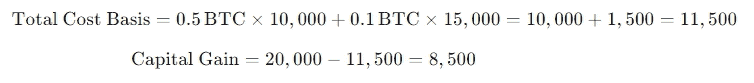

Emily 报告资本利得为 $8,500。

**优点**：FIFO 易于应用，且被税务机关广泛接受。

**缺点**：在上涨市场中，FIFO 通常导致较高的资本利得，从而导致较高的税收。

---

#### 2. 后进先出法（LIFO）

后进先出法（LIFO）假设最近取得的加密货币是最先被出售或交易的。在上涨市场中，该方法可能具有优势，因为它导致较高的成本基础和较低的资本利得，从而可能减少税务负担。

##### 示例：LIFO 方法实战

让我们重温 Emily 的比特币交易：

*   0.5 BTC，花费 $10,000
*   0.3 BTC，花费 $15,000
*   0.2 BTC，花费 $18,000

如果 Emily 卖出 0.6 BTC，LIFO 将假设她卖出了最后购买的 0.2 BTC（花费 $18,000），随后是第二次购买的 0.3 BTC 中的 0.4 BTC（花费 $15,000）。资本利得计算如下：

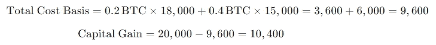


Emily 在 LIFO 下报告资本利得为 $10,400。

**优点**：LIFO 可通过最小化资本利得，在上涨市场中减少税务负担。

**缺点**：LIFO 在某些司法管辖区不被接受，且在下跌市场中可能导致税务负担增加。

---

### 3. 特定识别法

特定识别法允许加密货币持有者选择出售或交易哪些特定的加密货币单位。该方法提供了灵活性，因为纳税人可以选择能最小化资本利得或最大化资本损失的单位。

要使用特定识别法，纳税人必须保存详细的加密货币交易记录，包括取得日期和成本。该方法对于持有大量加密资产的大型投资者或企业特别有用。

#### 示例：特定识别法实战

David 分三次购买 1 枚比特币：

*   0.3 BTC，花费 $9,000
*   0.4 BTC，花费 $16,000
*   0.3 BTC，花费 $15,000

David 想以 $25,000 卖出 0.5 BTC 并降低税务负担。他可以选择卖出第一笔购买的 0.3 BTC（$9,000）和第二笔购买的 0.2 BTC（$16,000），从而产生较低的成本基础。

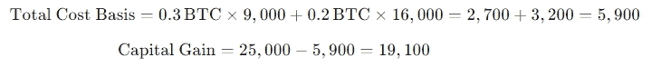

David 使用特定识别法报告资本利得为 $19,100。

**优点**：该方法提供灵活性，并允许进行战略性税务筹划。

**缺点**：它需要详细的记录，且对于高频交易者可能难以实施。

---

### 4. 加权平均成本法（WAC）

加权平均成本法（WAC）将所有加密货币持仓的成本平均化，并将此平均值用作任何出售或交易的成本基础。该方法常被加密货币交易量大的企业使用，因为它简化了收益和损失的跟踪过程。

#### 示例：WAC 方法实战

Sarah 购买了以下数量的以太坊（ETH）：

*   2 ETH，花费 $4,000
*   3 ETH，花费 $9,000
*   5 ETH，花费 $15,000

为了计算她以太坊的加权平均成本，我们将总成本相加并除以总数量：

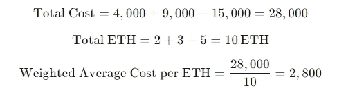

现在，如果 Sarah 以 $12,000 卖出 4 ETH，她的资本利得将计算为：

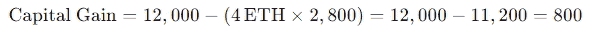

Sarah 使用 WAC 方法报告资本利得为 $800。

**优点**：WAC 简化了大量加密货币交易企业的会计核算。

**缺点**：在某些情况下，它可能无法最大化税务优惠。

---

### 财务报告中的加密货币估值

对于持有大量加密货币资产的公司和个人，在报告日确定公允市场价值（FMV）对于编制准确的财务报表至关重要。与股票或大宗商品不同，加密货币没有单一的全球交易所，因此不同交易所的价格可能有所不同。为了解决这个问题，公司通常使用平均价格或特定时间点可靠交易所的价格。

#### 财务报表中加密货币估值的挑战

1.  **价格波动**：加密货币价值可能剧烈波动，甚至在一天之内。这使得在报告时确定正确的 FMV 变得具有挑战性。
2.  **交易所差异**：不同交易所对同一加密货币的报价往往不同。会计师必须选择一致且可靠的交易所，或使用跨多个交易所的加权平均价格。
3.  **减值测试**：如果公司加密货币持仓的价值跌至购买价格以下，公司可能需要进行减值测试，并在资产负债表上减记该资产价值。

##### 示例：加密货币持仓的财务报告

Blockchain Corp. 持有 100 枚比特币（BTC），平均购买价为每枚 $40,000。在报告期末，比特币价格跌至每枚 $30,000。Blockchain Corp. 必须减记其持仓价值以反映价格下跌。

比特币的原始成本基础为：

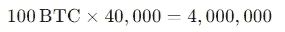

当前市场价值为：

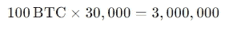

Blockchain Corp. 将在财务报表中记录 $1,000,000 的减值损失。

***

##### 应对加密货币估值中的价格波动

加密货币市场以波动性著称。价格可在短期内大幅上涨或下跌，给投资者和会计师带来挑战。为减轻波动性对估值的影响，可采用以下策略：

1.  **使用每日平均价格**：会计师可使用每日平均价格而非某一特定时点的价格，以平滑日内波动。
2.  **选择可靠交易所**：使用单一、流动性高的可靠交易所（如 `Coinbase`、`Binance` 或 `Kraken`）可提供一致的定价数据。或者，会计师可使用跨多个交易所的加权平均价格。
3.  **稳定币**：企业可使用稳定币（与法币挂钩的加密货币，如 `USDT` 或 `USDC`）来规避波动性。稳定币提供区块链交易的优势，同时避免了比特币或以太坊的价格波动。

###### 示例：使用每日平均价格

Lisa 于 4 月 1 日购买 1 枚以太坊（ETH）。当天以太坊价格在 $2,000 至 $2,300 之间波动。为核算该笔采购，Lisa 可使用每日平均价格，计算如下：

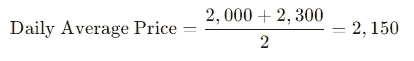

Lisa 按 $2,150 的成本基础记录 1 ETH 的采购。

***

### 加密货币税务申报估值

准确对加密货币进行税务估值对于确保遵守税法至关重要。许多司法管辖区要求加密货币持有者根据获取和处置时的公允市场价值申报资本利得和收入。

加密货币税务申报估值的关键考量点：

1.  **获取时估值**：税务申报的成本基础为获取时加密货币的公允市场价值，含交易费用。
2.  **处置时估值**：处置价值为出售、交易或用于购买商品/服务时加密货币的公允市场价值。
3.  **收入估值**：以加密货币形式收到收入（如挖矿、质押或服务报酬）时，须按收到当日的公允市场价值申报为收入。

##### 示例：挖矿奖励的税务申报

Mark 通过挖矿获得 0.1 枚比特币。收到当日，比特币公允市场价值为 $5,000。Mark 需在纳税申报表中申报 $5,000 为收入。若他后来以 $6,000 卖出该比特币，须申报的资本利得为：

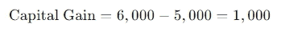

Mark 申报 $5,000 为挖矿收入，卖出时申报 $1,000 为资本利得。

***

##### 应对加密货币估值中的复杂场景

以下情况会增加加密货币估值的复杂性：

1.  **空投**：向特定资产持有者免费分发加密货币。空投所得加密货币的价值须申报为收入。
2.  **硬分叉**：区块链分裂为两条，产生新加密货币。收到的新币价值须申报为收入或资本利得。
3.  **DeFi**：去中心化金融平台常涉及流动性池、收益耕作等复杂交易，可能同时产生收入和资本利得事件。

###### 示例：空投估值

Zoe 持有 100 单位 Coin A，收到 10 单位 Coin B 空投。空投时 Coin B 价值 $50/单位。Zoe 需申报 $500（$50 × 10）为收入。若她后来以 $70/单位卖出 Coin B，须申报的资本利得为：

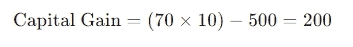

***

### 结论

因加密货币市场波动大、缺乏中心化定价、估值方法多样，为会计和税务目的对其估值面临独特挑战。通过了解 FIFO、LIFO、特定识别法、加权平均法等不同方法，会计师和投资者可选择最适合其需求的方法。此外，妥善处理波动性及空投、DeFi 交易等复杂场景，可确保财务报告准确合规。

下一章我们将详细探讨加密货币税务，包括资本利得税、所得税及各国加密货币税务处理的差异。

## 第 6 章：加密货币税务

加密货币税务是加密会计的关键环节，因加密交易常触发应税事件。尽管加密货币去中心化，全球各国政府已制定税法规范，要求个人和企业申报加密货币收益、收入及持仓。本章将探讨加密货币如何征税、应税事件类型、如何计算资本利得、收入及亏损，并通过示例说明常见税务场景。

***

### 理解加密货币作为应税财产

在许多司法管辖区，加密货币按财产分类纳税，类似股票、债券、房地产。这意味着任何出售、交易或兑换加密货币均可能触发应税事件，征收资本利得税或所得税。税务处理取决于交易性质，即加密货币是作为个人投资、商业用途还是收入形式持有。

#### 加密货币交易中的应税事件

常见加密货币应税事件类型：

1.  **以法币出售加密货币**：以法币（如 USD、EUR、CAD）出售加密货币，触发资本利得或亏损。
2.  **加密货币互换**：以一种加密货币兑换另一种（如用比特币换以太坊）视为出售，触发应税事件。
3.  **用加密货币购买商品/服务**：以加密货币支付属应税事件。交易时刻的加密货币价值与其成本基础对比，计算资本利得或亏损。
4.  **以加密货币形式收到收入**：作为商品、服务、质押奖励或挖矿报酬收到加密货币，视为收入，按收到当日公允市场价值（FMV）按普通收入征税。

***

### 加密货币资本利得税

大多数司法管辖区在出售、交易或处置加密货币时征收资本利得税。资本利得或亏损 = 售价（或处置时 FMV）− 原始成本基础（购买价 + 交易费）。

#### 资本利得类型

*   **短期资本利得**：持有不足一年出售，按普通收入税率征税。
*   **长期资本利得**：持有超一年出售，通常适用较低税率。

##### 示例：以法币出售比特币

John 于 1 月以 $20,000 购买 1 枚比特币（BTC）。同年 11 月以 $40,000 卖出。因持有不足一年，产生短期资本利得。计算如下：

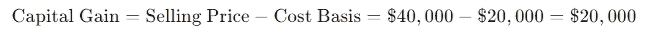

John 需申报 $20,000 为短期资本利得，按其普通收入税率征税。

##### 示例：以太坊的长期资本利得

Sarah 于 2020 年 3 月以 2,500 美元购买了 5 个以太坊 (ETH)。2022 年 4 月，她以 20,000 美元卖出了全部 5 个 ETH。由于她持有以太坊超过一年，其收益被归类为长期资本利得。资本利得计算如下：

```
资本利得 = 售价 - 成本基础
资本利得 = $20,000 - $2,500 = $17,500
```

Sarah 申报 17,500 美元为长期资本利得，其税率低于其普通收入税率。

---

### 加密货币兑换加密货币交易的税收

加密货币税收中最容易被误解的方面之一是：加密货币兑换加密货币的交易被视为应税事件。当你用一种加密货币兑换另一种时，这相当于你卖出了第一种加密货币，并用所得收益购买了第二种。你必须计算你所卖出加密货币的资本利得或损失，以你收到的加密货币的公允市场价值 (FMV) 为准。

##### 示例：用比特币兑换以太坊

当 1 个比特币 (BTC) 价格为 50,000 美元、1 个以太坊 (ETH) 价格为 5,000 美元时，Alex 用 1 个比特币 (BTC) 兑换了 10 个以太坊 (ETH)。他最初以 30,000 美元购买该比特币。此交易被视为比特币的出售，Alex 需要计算其资本利得：

```
资本利得 = 收到的加密货币 FMV - 卖出的加密货币成本基础
资本利得 = $50,000 - $30,000 = $20,000
```

Alex 申报由此交易产生的 20,000 美元资本利得。他收到的 10 个 ETH 的成本基础为交易时的 FMV，即 50,000 美元（每 ETH 5,000 美元）。

---

### 加密货币所得税

作为收入收到的加密货币，按收到时该资产的 FMV 征税。这适用于来自各种来源的收入，例如：

1.  **商品或服务报酬**：如果你因提供商品或服务而收到加密货币作为报酬，你必须将该加密货币的 FMV 作为普通收入申报。
2.  **挖矿和质押奖励**：通过挖矿或质押获得的加密货币被视为收入，并在收到时根据当时的 FMV 征税。

##### 示例：收到比特币作为报酬

平面设计师 Olivia 同意为客户设计一个网站，报酬为 0.5 个比特币 (BTC)。付款时，比特币价格为 40,000 美元。Olivia 必须将 0.5 个 BTC 的 FMV（20,000 美元）作为普通收入申报。

在她的会计记录中，Olivia 记录：

*   借方：$20,000（加密货币资产 – 比特币）
*   贷方：$20,000（收入 – 网页设计服务）

当 Olivia 稍后出售比特币时，她将需要根据当时比特币的价值计算其资本利得或损失。

##### 示例：质押奖励的税收

Mark 参与一个权益证明网络，并获得 2 个以太坊 (ETH) 作为质押奖励。收到奖励时，1 个 ETH 价值 3,000 美元。Mark 必须在纳税申报表中申报 6,000 美元收入。

在他的会计记录中，Mark 记录：

*   借方：$6,000（加密货币资产 – 以太坊）
*   贷方：$6,000（收入 – 质押奖励）

---

### 利用加密货币进行税务亏损收割

税务亏损收割是一种策略，允许投资者通过以亏损出售表现不佳的资产来减少应税收入。这些出售产生的资本损失可用于抵消其他交易的资本利得，从而可能降低纳税义务。

##### 示例：利用比特币进行税务亏损收割

David 以 50,000 美元购买 1 个比特币。随后比特币价格跌至 30,000 美元，David 决定卖出比特币以锁定资本损失。其资本损失计算如下：

```
资本损失 = 成本基础 - 售价
资本损失 = $50,000 - $30,000 = $20,000
```

David 可以用这 20,000 美元资本损失抵消其他资本利得或减少其应税收入。

> **注意**：一些国家有“洗售规则”，禁止投资者在卖出资产后 30 天内回购同一资产时申报资本损失。然而，该规则目前在大多数司法管辖区不适用于加密货币。

---

### 在纳税申报表中申报加密货币

在许多国家，纳税人必须申报所有加密货币交易，即使无税款可缴。保留所有加密货币活动的准确记录至关重要，包括：

1.  **交易日期**：购买、出售或兑换加密货币的日期。
2.  **公允市场价值**：交易时加密货币的 FMV，以当地货币计价（如 USD、CAD）。
3.  **成本基础**：加密货币的原始购买价格，含交易费用。
4.  **交易类型**：交易是出售、兑换还是收入。

##### 示例：在纳税申报表中申报加密货币交易

Anna 于 1 月以 10,000 美元购买 1 个比特币。她随后于 10 月以 30,000 美元卖出该比特币，实现 20,000 美元资本利得。Anna 必须使用适当的表格（如美国用于申报资本资产出售的 `Form 8949`）在纳税申报表中申报此利得。

她填写完毕的表格将显示：

*   取得日期：1 月 1 日
*   出售日期：10 月 15 日
*   成本基础：$10,000
*   售价：$30,000
*   资本利得：$20,000

---

### 加密货币赠与和捐赠的税收

赠与或捐赠加密货币也可能引发税务后果。规则因接收方是个人还是慈善机构而异。

1.  **加密货币赠与**：在许多国家，加密货币赠与对赠与人不征税。然而，接收人在出售或兑换赠与的加密货币时可能需要纳税。赠与的成本基础与赠与人的原始成本基础相同。
2.  **慈善捐赠**：在大多数国家，向注册慈善机构捐赠加密货币对捐赠人不是应税事件。捐赠人还可能有资格根据捐赠时加密货币的 FMV 申请税务抵扣。

##### 示例：向家庭成员赠与比特币

Brian 以 5,000 美元购买 1 个比特币，在比特币价值 50,000 美元时将其赠与其兄弟。Brian 无需为赠与缴纳任何税款。当其兄弟出售比特币时，他将需要根据 Brian 的原始成本基础 5,000 美元计算资本利得。如果其兄弟以 55,000 美元卖出比特币，资本利得为：

```
资本利得 = 售价 - 成本基础（结转基础）
资本利得 = $55,000 - $5,000 = $50,000
```

##### 示例：向慈善机构捐赠以太坊

当以太坊价格为每 ETH 3,500 美元时，Linda 向注册慈善机构捐赠 2 个以太坊 (ETH)。因这是慈善捐赠，Linda 无需缴纳任何资本利得税。她还有资格获得 7,000 美元（捐赠的 FMV）税务抵扣。

---

### 加密货币税收的国际差异

各国对加密货币的税务处理各异。虽然美国和许多西方国家将加密货币视为财产，但一些国家采取了独特的方法：

*   **德国**：在德国，持有超过一年的加密货币免征资本利得税。
*   **葡萄牙**：葡萄牙对加密货币投资者实行优惠税制，个人无需为加密货币资本利得缴税，除非这是其主要收入来源。
*   **印度**：印度将加密货币视为应税资产，收益按个人适用税率征收所得税。

> **注意**：必须了解你所在国家的具体税收规则，并在必要时寻求税务专业人士的建议。

---

### 结论

加密货币税收可能很复杂，但理解资本利得、所得税和申报要求的基本原则对于遵守税法至关重要。无论你是将加密货币兑换为法币、兑换为另一种数字资产，还是将其作为收入接收，每笔交易都有需要仔细管理的税务影响。

准确的记录保存至关重要，因为加密货币持有者必须追踪其交易的日期、金额和公允市场价值。通过这样做，个人和企业可以确保缴纳正确的税款，并避免因不合规而受到处罚。

在下一章中，我们将更详细地讨论加密钱包和交易所，重点关注使用这些平台的会计影响，以及跨多个钱包追踪交易的最佳实践。

## 第 7 章：加密钱包与交易所：会计影响

随着加密货币日益普及，跨多个钱包和交易所管理交易已成为企业和个人的常态。虽然加密钱包充当数字资产的安全存储工具，但交易所则提供了买卖和交易加密货币的平台。了解这些平台的运作方式及其会计影响，对于妥善的记账、税务合规和财务报告至关重要。在本章中，我们将探讨不同类型的钱包和交易所、它们的会计影响，以及追踪加密交易的最佳实践。

---

### 加密钱包：类型与功能

加密钱包是一种允许用户存储、发送和接收加密货币的工具。与持有现金的传统钱包不同，加密钱包存储的是访问用户区块链上加密货币持仓所需的私钥。这些钱包形式多样，各具独特的安全特性和会计影响。

#### 加密钱包的类型

1.  **热钱包**：这类钱包连接互联网，因此访问更便捷，但安全性较低。热钱包常用于频繁交易，如交易或支付。

    示例：`MetaMask`、`Trust Wallet`、`Exodus`。


## 冷钱包

冷钱包是离线存储方案，不连接互联网，因此安全性更高，但不便于频繁使用。冷钱包通常用于加密资产的长期存储。

示例：`Ledger Nano S`、`Trezor`、`Paper Wallets`（纸钱包）。

## 托管钱包

在托管钱包中，第三方（如加密货币交易所）代表用户持有私钥。虽然这简化了资金访问，但用户需依赖第三方保障安全。

示例：`Coinbase`、`Binance`、`Kraken`。

## 非托管钱包

在非托管钱包中，用户完全控制自己的私钥，从而拥有加密资产的完全所有权。然而，这也意味着用户独自负责保管资金安全。

示例：`Electrum`、`Mycelium`、`MetaMask`。

### 示例：使用热钱包进行日常交易

加密货币交易员 Tom 使用 `MetaMask` 热钱包存储以太坊（`ETH`）以进行日常交易。由于 `MetaMask` 连接互联网，Tom 可以快速发送和接收 `ETH`，方便其频繁交易。不过，他也必须考虑安全风险，因为热钱包更容易遭受黑客攻击。

---

## 加密交易所：类型与会计影响

加密交易所是允许用户买卖和交易加密货币的平台。这些交易所作为买卖双方的中介，提供流动性并促进数字资产转移。交易所在加密会计中发挥着关键作用，因为它们生成的交易记录对于计算收益、损失和税务负债至关重要。

### 加密交易所的类型

#### 1. 中心化交易所（CEX）

中心化交易所由第三方实体运营，负责管理交易、订单簿和用户资金托管。它们通常提供用户友好的界面和高流动性，但要求用户信任交易所来保管其资产安全。

示例：`Coinbase`、`Binance`、`Kraken`。

#### 2. 去中心化交易所（DEX）

去中心化交易所无需中介运营，允许用户通过智能合约直接相互交易。DEX 提供更多隐私和控制权，但流动性通常较低，且可能需要更多技术知识才能使用。

示例：`Uniswap`、`PancakeSwap`、`SushiSwap`。

#### 3. 点对点（P2P）交易所

P2P 交易所直接连接买卖双方，无需中介。用户可协商交易条款（包括支付方式），并在无需通过中心化平台的情况下完成交易。

示例：`LocalBitcoins`、`Paxful`。

### 示例：使用中心化交易所进行加密交易

Alice 使用中心化交易所 `Coinbase` 买卖比特币。`Coinbase` 记录每一笔交易，包括买入价、卖出价和交易费用。为会计核算目的，Alice 必须从 `Coinbase` 下载交易历史，以在年末计算资本利得或损失。由于 `Coinbase` 是托管交易所，Alice 也依赖该平台来保障其加密资产安全。

---

## 使用钱包和交易所的会计影响

加密钱包和交易所带来了独特的会计挑战，主要源于加密货币的去中心化性质。以下是几项关键的会计影响：

### 1. 交易追踪

使用加密钱包和交易所的主要会计挑战之一，是准确追踪跨多个平台的交易。每一笔交易，无论是买入、卖出、兑换还是转账，都必须记录以下详情：

*   交易日期
*   交易类型（买入、卖出、兑换、转账）
*   涉及的加密货币
*   加密货币数量
*   交易时点的公允市场价值（FMV）
*   交易费用

由于交易所和钱包通常独立运行，用户必须整合来自不同来源的记录，以确保会计核算准确。许多加密税务和会计软件工具（如 `CoinTracking` 或 `Koinly`）允许用户从多个交易所和钱包导入数据，从而简化追踪流程。

#### 示例：跨多个交易所追踪加密交易

David 同时使用 `Binance` 和 `Uniswap` 交易加密货币。年末时，David 从 `Binance` 下载交易记录，并从 `Uniswap` 导出交易历史。随后，他将这些数据导入会计软件，以计算资本利得和损失用于税务申报。通过整合两个交易所的数据，David 确保拥有准确的交易活动记录。

---

### 2. 交易费用处理

交易费用是加密交易的常见组成部分，无论是支付给矿工（比特币或以太坊的情况）还是支付给权益证明网络上的验证者。进行多笔交易或在钱包间转移加密货币时，这些费用可能相当可观。

交易费用必须作为交易成本的一部分记录，或从销售收益中扣除。妥善核算交易费用，可确保净收益或损失计算准确。

#### 示例：交易费用核算

Sophia 在 `Kraken` 上以 4,000 美元卖出 1 个以太坊（`ETH`）。交易所向她收取 0.01 `ETH` 的交易费用，按售出时价值 40 美元。为计算资本利得，Sophia 从销售收益中扣除交易费用：

```
收益 = 4,000 - 40 = 3,960
```

Sophia 必须将其净收益记录为 3,960 美元，并将交易费用作为销售成本的一部分记录在案。

---

### 3. 钱包与交易所间的转账

在钱包之间转移加密货币，或从一个交易所转至另一个交易所，不会触发应税事件，因为资产所有权未发生变更。不过，仍可能产生交易费用，且为未来会计核算，追踪这些转账非常重要。

在钱包或交易所间转移加密货币时，加密货币的成本基础保持不变。挑战在于准确追踪资产流动，以确保在最终出售或兑换加密货币时，应用的是原始成本基础。

#### 示例：在钱包间转移比特币

Michael 将 0.5 枚比特币 (BTC) 从其 Coinbase 钱包转移至其 Ledger Nano S 冷钱包。他最初以 10,000 美元购买该比特币，转移时价值 25,000 美元。由于该转移不构成出售，因此未实现资本利得，但 Michael 产生了 0.0005 BTC 的交易手续费。

Michael 必须将交易手续费记录为费用，并确保 0.5 BTC 的成本基础保持在 10,000 美元。当他最终出售比特币时，将使用此成本基础来计算其资本利得。

---

### 4. 托管钱包与非托管钱包：会计影响

在托管钱包与非托管钱包之间的选择具有会计影响，特别是在交易可见性和控制权方面。托管钱包由 Coinbase 或 Kraken 等交易所提供，代表用户处理交易记录。非托管钱包（如 Ledger 或 MetaMask）要求用户自行管理其交易记录。

在托管钱包中，用户通常可以直接从平台下载交易历史，从而简化了跟踪流程。然而，对于非托管钱包，用户必须手动跟踪每一笔交易，包括钱包与交易所之间的转账，这可能会使会计流程复杂化。

#### 示例：在非托管钱包中管理交易

Emma 将其以太坊存储在 Ledger Nano S 冷钱包中。当她将以太坊转移至 Uniswap 进行交易时，她会手动记录日期、交易金额和交易手续费。由于 Ledger 是非托管钱包，Emma 必须保存所有进出其钱包转账的准确记录，以确保对其加密资产进行正确核算。

---

### 5. 加密货币质押与钱包收益

许多加密货币钱包（尤其是非托管钱包）允许用户参与质押计划或通过收益耕作赚取奖励。在这些情况下，收到的奖励必须按收到之日的公允市场价值 (FMV) 记录为收入。这些质押奖励可能需要纳税，具体取决于司法管辖区。

#### 示例：接收质押奖励

Jason 在非托管钱包中质押其 Cardano (ADA) 并获得 10 ADA 作为质押奖励。在他收到奖励时，1 ADA 的公允市场价值为 2 美元。Jason 必须将 20 美元记录为质押奖励收入，并在纳税申报表中报告。

---

### 加密货币钱包与交易所会计的最佳实践

为确保在使用钱包和交易所时进行准确且合规的核算，请考虑以下最佳实践：

1.  **整合交易数据**：使用加密货币会计软件（如 Koinly、CoinTracking 或 TokenTax）从多个交易所和钱包导入交易历史。这有助于整合数据并提供所有交易的准确记录。
2.  **跟踪转账和手续费**：始终记录钱包或交易所之间的转账，以及所产生的任何交易手续费。虽然转账不是应税事件，但手续费可能会影响加密货币的成本基础。
3.  **使用一致的估值方法**：在出售或交易加密货币时，使用一致的方法（例如先进先出法 FIFO、后进先出法 LIFO 或特定识别法）来跟踪加密货币的成本基础。这可确保准确计算资本利得和损失。
4.  **记录质押和挖矿收入**：如果您通过质押、挖矿或收益耕作赚取加密货币，请在收到奖励当天按其公允市场价值将其记录为收入。
5.  **对账钱包余额**：定期对账您钱包和交易所中的余额，以确保您的交易记录准确且完整。

---

## 结论

加密货币钱包和交易所是管理数字资产的重要工具，但它们也带来了独特的会计挑战。准确跨多个平台跟踪交易、手续费和转账对于确保税务合规和财务透明度至关重要。通过遵循加密货币会计的最佳实践，个人和企业可以有效管理其加密货币投资组合，并有信心地报告其财务活动。

在下一章中，我们将讨论如何在财务报表上报告加密货币持仓和交易，包括如何根据 GAAP 和 IFRS 等会计准则对加密资产进行分类和披露。

# 第 8 章：在财务报表上报告加密货币

随着加密货币在商业和投资组合中变得越来越普遍，在财务报表上准确报告它们变得日益重要。然而，加密货币的去中心化和波动性给会计师带来了独特的挑战。在本章中，我们将探讨如何在财务报表中报告加密货币持仓和交易，包括如何根据 GAAP 和 IFRS 等通用会计框架对这些资产进行分类、计量和披露。

---

## 在财务报表上对加密货币进行分类

在财务报表上报告加密货币的第一步是确定如何对该资产进行分类。由于加密货币具有波动性且缺乏法定货币地位，它们无法完全归入现金或现金等价物等传统资产类别。相反，加密货币通常被分类为：

1.  **无形资产**：许多会计准则（包括 IFRS）将加密货币分类为无形资产，因为它们没有实物形态，且缺乏转换为现金的法律索赔权。
2.  **存货**：对于将买卖加密货币作为其正常业务一部分的企业（例如加密货币交易所），加密货币可被分类为存货。
3.  **投资**：在某些情况下，作为长期投资持有的加密货币可被分类为投资资产。
4.  **金融资产**：有人主张加密货币可被分类为金融资产，但由于其去中心化性质且缺乏发行人，大多数现行会计准则不将其确认为此类资产。

### 示例：在公司资产负债表上对比特币进行分类

Tech Innovators Inc. 作为其投资组合一部分持有 100 枚比特币 (BTC)，根据 IFRS 将该比特币分类为无形资产，因为比特币没有实物形态，且该公司不将其作为法定货币使用。该比特币在资产负债表上列报为非流动资产，因为其为长期投资目的而持有。

---

## 在财务报表上计量加密货币

一旦确定了加密货币的分类，下一步就是决定如何在财务报表上计量其价值。加密货币波动性极大，这使计量过程复杂化。在财务报表上计量加密货币的常用方法包括：

1.  **成本模式**：根据成本模式，加密货币按其原始购买价格（成本基础）记录，除非发生减值，否则不重新计量。该方法通常用于 IFRS 和某些 GAAP 准则下的无形资产。
2.  **公允价值模式**：根据公允价值模式，加密货币在每个报告期末按其当前市场价格重新计量。该方法常用于积极交易加密货币的公司的投资和存货。
3.  **减值测试**：如果加密货币的价值跌至其购买价格以下，公司可能需要执行减值测试，并在资产负债表上减记该资产的价值。

### 示例：对以太坊持仓使用成本模式

Blockchain Enterprises Ltd. 持有 500 枚以太坊 (ETH) 代币，购买价格为每枚 2,000 美元。在资产负债表报告时，以太坊价格已跌至每枚 1,800 美元。根据成本模式，以太坊按其原始成本基础 1,000,000 美元 (500 ETH × 2,000 美元) 记录。

由于以太坊的价值已下跌，公司必须评估是否发生减值。如果认为有必要进行减值，公司将把以太坊的价值减记至其可收回金额，从而在利润表中产生减值损失。

---

### 加密货币减值

加密货币资产，尤其是被分类为无形资产时，通常需要进行减值测试。当加密货币的价值低于其成本基础，且资产的可收回价值低于其账面价值时，即发生减值。随后，该资产将被减记至其可收回价值，减值损失计入利润表。

当存在表明加密货币价值已下跌的迹象时，如大幅价格下跌或不利的监管事态发展，即要求进行减值测试。

#### 示例：比特币持仓减值

FinTech Ventures 持有 10 枚比特币 (BTC)，每枚购买价为 50,000 美元（总成本基础 500,000 美元）。在报告期末，比特币价格已跌至 40,000 美元。由于价值大幅下跌，公司必须进行减值测试。

如果公司确定比特币的可收回价值为每枚 40,000 美元，则会确认如下减值损失：

```
减值损失 = (50,000 - 40,000) × 10 = 100,000 美元
```

100,000 美元的减值损失计入利润表，资产负债表上比特币的账面价值减记至 400,000 美元。

---

### 加密货币的公允价值计量与重估

在特定情况下，加密货币按公允价值而非成本计量。公允价值模型允许企业在每个报告期末根据当前市场价格重估其加密货币持仓。该模型常用于活跃交易加密货币或将其作为投资持有的企业。

公允价值计量源自报告日的市场价格。如果加密货币市场价格上涨，企业可确认未实现收益；若市场价格下跌，则产生未实现损失。

#### 示例：加密货币交易公司的公允价值计量

Crypto Traders Ltd. 从事加密货币买卖业务。在报告期末，公司持有 100 枚比特币 (BTC)，购买价为每枚 45,000 美元（成本基础 4,500,000 美元）。在报告日，比特币市场价格已涨至 50,000 美元。

根据公允价值模型，公司重估其比特币持仓以反映当前市场价格。100 枚比特币的公允价值现为 5,000,000 美元（100 BTC × 50,000 美元），产生如下未实现收益：

```
未实现收益 = 5,000,000 - 4,500,000 = 500,000 美元
```

该未实现收益计入利润表，资产负债表上比特币的账面价值调整为 5,000,000 美元。

---

## 利润表中的加密货币交易报告

加密货币交易通常产生资本利得或损失，必须在利润表中报告。资本利得或损失基于加密货币的售价与成本基础之间的差额计算。

对于接受加密货币作为付款的企业，必须按交易日加密货币的公允市场价值 (FMV) 确认收入。持有加密货币后产生的任何后续利得或损失，作为公司资本利得或损失的一部分报告。

### 示例：加密货币销售报告

StartUp Ltd. 以每枚 2,000 美元的价格购买了 10 枚以太坊 (ETH)，总计 20,000 美元。随后，公司以每枚 3,000 美元的价格出售该以太坊，总收益 30,000 美元。公司必须按如下方式报告资本利得：

```
资本利得 = 30,000 - 20,000 = 10,000 美元
```

10,000 美元的资本利得作为收入在利润表中报告。

---

### 加密货币作为收入：确认加密货币付款

当企业接受加密货币作为商品或服务的付款时，该交易按交易时加密货币的 FMV 确认为收入。加密货币的处理方式类似于现金或信用等任何其他付款形式。

然而，由于加密货币价值在交易后可能波动，如果企业在销售后继续持有加密货币，必须注意潜在的资本利得或损失。

#### 示例：接受比特币付款

可再生能源公司 GreenTech Solutions 接受 2 枚比特币 (BTC) 作为太阳能安装项目的付款。在交易日，比特币估值为每枚 30,000 美元，意味着公司收到价值 60,000 美元的比特币。

收入记录如下：

*   借方：60,000 美元（加密货币资产——比特币）
*   贷方：60,000 美元（收入——太阳能安装）

如果 GreenTech Solutions 继续持有比特币，且其价值上涨至每枚 35,000 美元，公司将在下一期间确认 10,000 美元的未实现收益（每枚 5,000 美元 × 2 BTC）。

---

### 加密货币披露

包括 GAAP 和 IFRS 在内的会计准则要求公司在财务报表中披露与其加密货币持仓和交易相关的相关信息。这些披露提供透明度，帮助利益相关者了解与公司数字资产相关的风险和估值方法。

常见披露包括：

1.  **加密货币持仓的性质**：所持加密货币的描述，包括其是否被分类为无形资产、存货或投资。
2.  **估值方法**：对加密货币进行估值所用的方法（如成本模型或公允价值模型），以及报告期间确认的任何减值损失或未实现收益。
3.  **风险管理**：公司如何管理持有加密货币相关风险的讨论，如市场波动性、流动性和监管风险。
4.  **重大交易**：报告期间发生的任何重大加密货币交易详情，如大额购买、出售或交易。

#### 示例：比特币持仓披露

在其年报中，FinTech Enterprises 披露其比特币持仓如下：

> "在报告期末，公司持有 150 枚比特币，根据 IFRS 分类为无形资产。比特币按成本计量，总成本基础为 6,000,000 美元。报告期间，公司未就比特币确认任何减值损失。报告日比特币市场价格为每枚 45,000 美元，产生 1,500,000 美元的未实现收益，因采用成本模型，该收益未在财务报表中反映。"

---

### 加密货币报告面临的挑战

在财务报表中报告加密货币面临若干挑战，包括：

1.  **价格波动性**：加密货币波动性极高，其价值可能在短期内大幅波动。这使得在财务报告时难以准确计量和报告数字资产的价值。
2.  **缺乏明确准则**：虽然 GAAP 和 IFRS 等会计框架为加密货币报告提供了一些指引，但仍缺乏全面且普遍接受的准则。因此，不同公司可能以不同方式报告加密资产，导致不一致性。
3.  **监管不确定性**：加密货币的监管环境仍在演变中，不同司法管辖区对税务报告、财务披露和审计采取不同规则。这给在多个司法管辖区运营的公司带来了挑战。

---

## 结论

在财务报表中报告加密货币需要仔细考虑如何对这些数字资产进行分类、计量和披露。公司必须在成本模式和公允价值模式之间做出选择，评估减值风险，并追踪交易产生的资本利得或损失。鉴于加密货币的波动性，准确透明的报告对于向利益相关者清晰展示公司的财务状况至关重要。

通过遵循分类和计量加密资产的最佳实践，公司可以确保其财务报表反映其加密货币持仓的真实价值。在下一章中，我们将探讨如何审计加密货币交易，并确保财务记录准确且符合会计准则。

# 第九章：审计加密货币交易


由于区块链技术的去中心化性质、许多交易的匿名性以及加密资产的波动性，审计加密货币交易面临独特的挑战。尽管存在这些障碍，审计师必须确保财务记录准确反映公司或个人的加密货币活动，内部控制充分有效，以及与持有和交易加密货币相关的风险得到妥善管理。在本章中，我们将探讨如何审计加密货币交易、验证加密资产所有权，并确保符合监管和会计准则。现实案例将阐释关键要点。

## 审计加密货币交易的基础

从根本上说，审计加密货币交易旨在确保财务报表中呈现的加密货币记录准确无误，且已建立适当的控制措施来管理风险。加密货币交易记录在区块链上，区块链提供了所有活动透明且不可篡改的记录。然而，审计师面临的挑战在于将区块链交易与被审计的公司或个人联系起来，并确保报告价值的准确性。

加密货币审计的关键目标包括：

1.  **验证所有权**：审计师必须核实被审计实体是否真正拥有资产负债表上报告的加密资产。
2.  **评估估值**：审计师必须确保加密资产估值正确，无论是按成本、公允价值，还是进行适当的减值调整。
3.  **确认完整性**：审计师需要核实所有加密货币交易均已准确记录和报告。
4.  **评估内部控制**：审计师必须评估实体的内部控制，以确保其管理加密货币相关风险，包括安全风险（如私钥保管）和监管风险。

## 验证加密资产所有权

审计加密货币的第一步是验证实体是否真正拥有其声称持有的加密资产。由于区块链交易具有假名性（交易与钱包地址而非姓名关联），审计师不能仅依赖区块链记录来验证所有权。

### 验证所有权的方法

1.  **钱包地址**：审计师可要求被审计实体提供钱包地址和交易记录。可能会要求实体从该钱包签署一笔交易，以证明其对私钥的控制权。
2.  **公共区块链浏览器**：可使用 `Etherscan`（用于以太坊）或 `Blockchain.info`（用于比特币）等工具，验证特定钱包地址是否持有实体声称数量的加密货币。审计师可将这些记录与实体的内部记录进行交叉核对。
3.  **第三方确认函**：对于托管在交易所的加密资产，审计师可向交易所或托管人请求第三方确认函，这类似于传统审计中请求银行对账单。

#### 示例：验证比特币所有权

`ABC Tech` 声称其公司钱包持有 50 枚比特币（`BTC`）。审计师要求 `ABC Tech` 提供钱包地址，并签署一笔交易（将少量 `BTC` 发送至公司控制的另一钱包），以确认其控制私钥。审计师还使用 `Blockchain.info` 验证该钱包确实持有 50 枚 `BTC`。

## 评估加密资产估值

加密货币的波动性给在财务报表上对加密资产进行估值带来了重大挑战。审计师必须确保实体采用了适当的估值方法，无论是成本法、公允价值法还是减值价值法，具体取决于所用的会计准则（如 `GAAP` 或 `IFRS`）。

### 估值方法

1.  **成本法**：加密货币按其原始购买价格（成本基础）估值。审计师必须确保成本基础记录准确，包括交易费用。
2.  **公允价值法**：加密货币按报告期末的市场价格估值。审计师需核实所用市场价格准确且来源可靠（如知名交易所）。
3.  **减值**：如果加密货币价值跌破其成本基础，实体可能需要对该资产计提减值。审计师必须核实减值损失的计算和记录是否正确。

#### 示例：审计以太坊估值

`XYZ Corp` 资产负债表上持有 100 枚以太坊（`ETH`），按每枚 `ETH` 2,000 美元（原始购买价）估值。在报告期末，以太坊市场价格跌至每枚 1,500 美元。审计师在 `CoinMarketCap` 核对当前市场价格，认定 `XYZ Corp` 应对其以太坊持仓计提减值。审计师记录审计调整，将以太坊价值冲减。

## 确认交易完整性

确保所有加密货币交易均已妥善记录是任何审计的关键。由于加密货币交易记录在公共账本上，审计师可使用区块链浏览器核实财务报表中列示的交易与实际区块链活动是否匹配。

### 确认完整性的常规步骤

1.  **交易历史**：审计师应向实体索取钱包和交易所的交易历史。这些记录应包含所有收支交易、金额及交易日期。
2.  **区块链验证**：审计师可使用区块链浏览器，独立核实实体记录中列示的交易与区块链上记录的交易是否一致。
3.  **交易所与钱包对账**：如果实体使用多个交易所或钱包，审计师应执行对账程序，确保所有交易均已入账，且钱包间的转账未被遗漏。

#### 示例：审计交易完整性

`CryptoCorp` 是一家活跃交易比特币、以太坊及其他加密货币的公司。审计师索取该公司钱包和交易所的交易历史。使用 `Etherscan`（用于以太坊）和 `Blockchain.info`（用于比特币）等区块链浏览器，审计师核实 `CryptoCorp` 记录中列示的每笔交易均准确完整。审计师还对 `CryptoCorp` 钱包间的转账进行对账，确保所有交易均已记录。

## 审计加密货币内部控制

内部控制对于管理持有和交易加密货币相关的风险至关重要。这些风险包括安全风险（如私钥丢失或被盗）和合规风险（如未能遵守监管要求）。审计师必须评估实体是否已实施充分的内部控制以缓解这些风险。

### 加密货币的关键内部控制

#### 私钥管理

实体应建立健全的私钥管理控制措施，包括多重签名钱包、硬件钱包或安全的托管服务。

#### 交易授权

实体应建立一套授权和批准加密货币交易的系统，确保只有授权人员才能发起交易。

#### 职责分离

与加密货币管理相关的职责应分配给不同的个人，以降低欺诈或错误的风险。

#### 监控与报告

实体应定期监控其加密货币持仓，并报告任何异常或可疑活动。

#### 示例：私钥控制审计

`FinTech Ltd.` 在其公司钱包中持有大量加密货币。审计师通过审查多重签名钱包的使用情况，评估公司对私钥管理的控制，多重签名钱包要求多个授权方批准才能进行任何交易。审计师核实私钥是否安全地存储在 `Ledger Nano S` 硬件钱包中，并且只有授权人员才能访问密钥。

---

## 监管与合规审计

随着世界各国政府出台加密货币法规，遵守这些规则正成为加密货币审计的关键组成部分。审计师必须确保实体遵守税收法规、反洗钱（`AML`）要求及其他监管义务。

### 审计关键监管领域

#### 1. 税务合规

加密货币通常需缴纳资本利得税、所得税（针对挖矿和质押奖励）及其他税种。审计师必须确保实体正确申报了所有应税交易，并缴纳了相应税款。

#### 2. 反洗钱（AML）合规

许多国家出台了 `AML` 法规，要求从事加密货币业务的企业实施了解你的客户（`KYC`）程序并报告可疑交易。审计师必须评估实体是否实施了足够的控制措施以防止洗钱。

#### 3. 监管报告

在某些司法管辖区，持有或交易加密货币的企业须向监管机构提交特定报告。审计师必须核实实体是否遵守了这些报告要求。

#### 示例：挖矿公司税务合规审计

`CryptoMiners Inc.` 是一家挖掘比特币的公司。审计师审查公司记录，确保所有挖矿获得的比特币均作为收入申报并相应纳税。审计师还核实任何出售的比特币是否为资本利得税目的而正确申报。此外，审计师审查公司对当地关于加密货币挖矿税收法规的遵守情况。

---

## 去中心化环境中的审计挑战

尽管区块链技术通过其公共账本提供了透明度，但加密货币审计面临着其运行的去中心化环境特有的挑战。主要挑战包括：

### 1. 匿名性

区块链交易是伪匿名的，意味着它们与钱包地址而非个人身份相关联。这使得审计师难以核实交易参与方的身份。

### 2. 缺乏中心化记录

与传统银行业由中心化机构提供交易记录不同，加密货币交易可能发生在多个交易所和钱包中，要求审计师从各种来源收集数据。

### 3. 波动性

加密货币价格的快速波动使得在任何特定时间评估加密资产持仓价值变得困难。审计师必须确保估值方法得当，并反映资产的真实价值。

### 4. 监管不确定性

加密货币的监管环境不断演变，各司法管辖区不断出台新规则和要求。审计师必须及时了解最新法规以确保合规。

#### 示例：多钱包、多交易所设置的审计

`GlobalCrypto LLC` 使用多个钱包和交易所管理其加密货币持仓。审计师面临从每个钱包和交易所收集数据、核对交易记录以及确保所有交易准确记录的挑战。此外，审计师必须核实 `GlobalCrypto` 是否遵守其运营所在各司法管辖区的当地税收和监管要求。

---

## 利用区块链进行审计：加密货币审计的未来

尽管存在挑战，区块链技术为审计师提供了独特的机遇。区块链交易的不可篡改性和透明度提供了可独立验证的可靠记录。未来，审计师可利用区块链技术自动化审计流程的许多方面，使用智能合约和区块链浏览器实时验证交易。

#### 示例：区块链赋能审计

`AuditCo` 的审计师正在探索利用区块链技术简化加密货币公司的审计流程。通过智能合约，`AuditCo` 可自动化交易验证，确保交易与实体记录相符。此外，区块链浏览器允许 `AuditCo` 实时独立验证加密货币持仓的所有权和价值。

---

## 结语

审计加密货币交易要求深入理解区块链技术、会计准则和监管要求。通过验证所有权、评估估值、确认完整性和评价内部控制，审计师可确保加密货币持仓在财务报表中准确报告。尽管加密货币审计面临独特挑战，但区块链的透明性和不可篡改性为审计流程的创新提供了机遇。

在下一章中，我们将探讨加密货币的风险管理策略，重点关注公司和个人如何降低与波动市场、监管不确定性和网络安全威胁相关的风险。

# 第 10 章：加密货币会计中的风险管理

加密货币市场波动剧烈，持有、交易或投资数字资产的企业或个人面临各种风险。这些风险不仅限于价格波动，还包括监管、网络安全、流动性和运营风险。加密货币会计中的有效风险管理确保这些风险得到缓解，从而实现更好的决策、合规和财务稳定。在本章中，我们将探讨如何识别、评估和管理与加密货币相关的风险，并提供实际案例和最佳实践。

---

## 识别加密货币会计中的关键风险

风险管理始于识别与加密货币相关的主要风险。虽然所有金融资产都有风险，但加密货币因其去中心化性质、许多地区缺乏监管以及易受黑客攻击，面临独特挑战。

### 1. 价格波动风险

加密货币会计中最重大的风险之一是价格波动。比特币和以太坊等加密货币可能在几小时内经历剧烈的价格波动。这种波动性影响加密货币持仓的价值，并可能给企业和个人带来意外的收益或损失。

#### 对财务报表的影响

对于资产负债表上持有加密货币的公司，价格波动可能导致报告期间资产报告价值的大幅变化。对这些价值的错误估计可能误导利益相关者并导致财务不稳定。

#### 对税务申报的影响

加密货币价格的突然变化也会影响资本利得或损失，使税务申报变得更加复杂和不确定。

#### 示例：电商企业的价格波动风险

在线零售商 `TechGoods Inc.` 接受比特币支付。在客户付款时，1 BTC 价值 40,000 美元，但两天后当 `TechGoods` 将比特币兑换为美元时，BTC 价值已跌至 35,000 美元。这种价格波动导致该笔交易产生 5,000 美元的意外损失。如果这种情况频繁发生，可能会给企业带来严重的财务不稳定。

---

### 2. 监管风险

监管的不确定性是加密货币领域企业和个人面临的另一重大风险。许多政府尚未建立针对加密货币税收和监管的明确指南，而已出台政策的政府也经常更新其规定。这种缺乏清晰度的情况增加了违反税法、证券法规和反洗钱（`AML`）要求的风险。

*   **对合规的影响**：未能及时跟进监管变化的企业可能面临罚款、处罚或法律诉讼。这对于在多个司法管辖区运营、可能适用不同规则的公司尤为令人担忧。
*   **对审计的影响**：监管的不确定性也会使审计过程复杂化，因为审计师必须核实对当地和国际加密货币法律的遵守情况。

#### 示例：全球加密货币交易所的监管风险

`CryptoExchange LLC` 在多个国家开展业务。虽然它在美国和欧盟持有牌照，但在印度和中国等加密货币监管更为严格的国家面临越来越严格的审查。全球监管的不一致性增加了 `CryptoExchange LLC` 在某些司法管辖区无意中违反法律的风险，可能导致巨额罚款或其业务受到限制。

---

### 3. 网络安全风险

由于区块链交易的不可逆性，网络安全是加密货币领域的主要担忧。一旦加密货币从一个钱包转移到另一个钱包，若无接收方配合便无法追回。这使得加密货币极具吸引力，众多高调黑客攻击事件已导致个人和企业遭受重大财务损失。

*   **私钥安全**：私钥的安全性对于保护加密资产至关重要。如果私钥丢失或被盗，与之关联的加密货币将无法找回。
*   **交易所安全**：中心化交易所是许多人和企业存储加密货币的场所，也是网络攻击的主要目标。交易所薄弱的安全措施可能使用户面临重大风险。

#### 示例：加密基金的网络安全风险

`SecureWealth Capital` 是一家管理资产超过 5,000 万美元的加密货币投资基金。该公司使用冷钱包进行长期存储，使用热钱包进行日常交易。最近一次网络钓鱼攻击攻破了其一个热钱包，导致损失 200 枚比特币（价值 1,000 万美元）。`SecureWealth` 现在必须采取措施加强其网络安全协议，并从黑客攻击造成的财务和声誉损失中恢复。

---

### 4. 流动性风险

流动性风险是指在不显著影响市场价格的情况下，将加密货币兑换为法币或其他资产的困难程度。不同加密货币和交易所的流动性差异巨大。虽然比特币和以太坊流动性极高，但其他山寨币可能买卖双方不足，导致在兑换资产时出现滑点和意外损失。

*   **对财务稳定的影响**：依赖加密货币进行交易或投资的企业，在流动性低迷或市场崩盘期间，可能面临将加密货币持仓兑换为现金的困难。
*   **对运营的影响**：为运营目的接受加密货币支付的公司，在将加密货币兑换为法币以支付费用、工资或供应商款项时，可能会经历延迟或损失。

#### 示例：小企业的流动性风险

`EcoGoods Store` 是一家接受多种山寨币作为环保产品支付方式的小企业。该店发现，虽然比特币支付易于兑换为现金，但鲜为人知的山寨币（如 `XYZ Coin`）支付面临流动性挑战。当 `EcoGoods` 尝试按当前市场价格将价值 10,000 美元的 `XYZ Coin` 兑换为美元时，只能兑换 2,000 美元而不引起显著价格滑点。这给 `EcoGoods` 造成了流动性问题和运营挑战。

---

### 5. 运营风险

运营风险源于不充分或失效的内部流程、人员和系统。在加密货币背景下，这包括私钥管理不善、交易记录错误以及加密货币持仓对账失败。公司必须建立适当的内部控制和风险管理策略以降低这些风险。

*   **内部控制**：缺乏充分内部控制会使企业面临因人为错误、欺诈或管理不善而损失加密资产的风险。实行职责分离、实施多重签名钱包，并确保所有加密货币交易经过适当授权和记录至关重要。
*   **报告与对账**：管理多个钱包和交易所的复杂性使得加密货币持仓难以对账。公司必须确保其会计系统能准确追踪加密货币交易，并跨平台核对差异。

#### 示例：加密投资基金的运营风险

`SmartInvest Fund` 在多个交易所和冷钱包中持有加密货币。然而，由于缺乏适当的内部控制，基金管理团队在钱包间转移资产时管理不善，导致无法访问价值 500,000 美元的加密货币。为防止进一步损失，`SmartInvest` 建立了新程序，包括多重签名钱包和定期对账，以保障其加密资产安全。

---

## 加密货币风险管理策略

管理加密货币风险需要一种多层面的方法，包括内部控制、保险、多元化以及使用第三方托管人。下文我们将探讨企业和个人可实施的关键风险管理策略，以减轻与加密货币会计和交易相关的风险。

---

### 1. 管理价格波动风险

可通过实施对冲策略、设置止损单以及使用稳定币进行交易和支付来管理价格波动风险。稳定币（如泰达币 `USDT` 或美元币 `USDC`）与法币挂钩，波动性小于其他加密货币，使其成为管理日常交易中波动风险的理想选择。

#### 对冲策略

对冲涉及建立抵消头寸以减轻价格波动风险。企业和投资者可利用期货合约、期权或其他衍生品对冲其加密货币持仓。这些工具允许加密货币持有者锁定加密货币价格，降低因市场波动导致损失的风险。

##### 示例：对冲比特币持仓

`Global Payments LLC` 在其企业金库中持有大量比特币。为对冲价格波动，该公司签订了一份比特币期货合约，锁定每 BTC 45,000 美元的价格。若比特币价格跌破 45,000 美元，比特币持仓的贬值损失将被期货合约的收益抵消。

#### 止损单

企业或交易者还可以使用止损单来防范加密货币价格的急剧下跌。当加密资产价格跌破特定阈值时，止损单会自动卖出该资产，从而在市场下行时将损失降至最低。

##### 示例：使用以太坊止损单

`CryptoTrader Ltd.` 为以太坊（`ETH`）设置了 2,500 美元的止损单。如果以太坊价格跌破 2,500 美元，系统将自动卖出 `ETH`，从而限制损失。该策略使 `CryptoTrader` 能够管理其面临的突发市场下行风险。

---

### 2. 管理监管风险

为降低监管风险，企业和个人必须及时了解其运营所在司法管辖区的最新监管动态。这包括税法、反洗钱（`AML`）法规和证券法。与法律和税务专家合作可确保遵守当地及国际加密货币法规。

#### 建立合规规程

在加密领域运营的企业应建立健全的合规规程，包括了解你的客户（`KYC`）和反洗钱（`AML`）程序。这些规程不仅有助于企业规避法律风险，还能防范欺诈和金融犯罪。

##### 示例：加密货币交易所的 KYC 与 AML 合规

加密货币交易所 `ExchangePro` 建立了全面的 `KYC` 和 `AML` 计划以满足监管要求。所有用户在交易前必须验证身份，可疑交易将向主管部门报告。该合规计划帮助 `ExchangePro` 避免处罚，并确保平台在法律框架内运营。

---

### 3. 管理网络安全风险

通过实施强有力的安全措施来存储和交易加密货币，可以降低网络安全风险。这些措施包括使用多重签名钱包、冷存储、硬件钱包和双因素认证（`2FA`）。

#### 冷钱包存储

冷钱包处于离线状态且与互联网断开连接，是存储大量加密货币的安全方式。冷钱包将黑客攻击风险降至最低，非常适合长期存储无需频繁访问的资产。

##### 示例：使用冷钱包进行资产保护


CryptoWealth Fund 持有 1 亿美元的比特币和以太坊。为防范黑客攻击风险，该基金将 95% 的加密资产存储在冷钱包中，剩余 5% 置于热钱包以保持运营流动性。通过使用冷存储，CryptoWealth 大幅降低了网络攻击风险。

#### 多重签名钱包

多重签名（多签）钱包需要多个私钥来授权交易。这降低了未经授权交易的风险，因为没有任何单个个人能完全控制钱包。

##### 示例：企业金库的多重签名钱包

TechSolutions Corp. 为其企业加密货币持仓实施了多重签名钱包。该钱包需要三位不同高管的签名才能批准任何交易，确保无单人可在未经他人批准的情况下转移资金。

---

#### 4. 管理流动性风险

为管理流动性风险，企业应将加密货币持仓分散配置于多种加密货币和交易所。此外，还应与流动性提供商建立关系，以确保在需要时能迅速将加密货币兑换为法币。

##### 使用稳定币管理流动性

稳定币可作为一种易于兑换为法币的稳定价值存储手段，用于管理流动性。以波动性加密货币收款的企业可迅速将其兑换为稳定币，以减轻价格波动的影响。

###### 示例：将比特币兑换为稳定币以管理流动性

RetailCrypto 为其电商平台接受比特币支付。为管理流动性风险，RetailCrypto 在收到比特币支付后立即将其兑换为 USD Coin (USDC)。这降低了价格波动风险，并确保公司能以稳定货币支付供应商和费用。

---

#### 5. 管理运营风险

完善的内部控制对于加密货币会计中的运营风险管理至关重要。企业应实施职责分离，准确记录所有加密货币交易，并定期进行审计，以确保遵守内部政策和监管要求。

##### 职责分离

为防止欺诈和错误，与加密货币管理相关的职责应分配给不同个人。例如，一人负责发起交易，另一人负责审批交易。

###### 示例：加密投资公司的职责分离

CoinVest Capital 通过为每位团队成员分配不同角色来实现组织内部的职责分离。投资团队发起加密交易，合规团队审批交易，会计团队在公司财务记录中记录交易。该制度将欺诈和错误风险降至最低。

---

#### 加密货币会计风险管理框架

为有效管理加密货币风险，企业和个人应采用包含以下要素的综合风险管理框架：

1.  **风险识别**：识别持有、交易或投资加密货币相关的风险，包括价格波动、监管风险和网络安全威胁。

2.  **风险评估**：评估每项已识别风险发生的可能性及其对企业或个人的潜在影响。

3.  **风险缓解**：实施策略和控制措施以缓解各项风险。这包括使用对冲工具、实施网络安全规程和建立内部控制。

4.  **风险监控**：持续监控风险并审查缓解策略的有效性。随着新风险出现或现有风险变化，调整风险管理实践。

5.  **风险报告**：定期向关键利益相关者（包括高管、审计师和监管机构）报告风险状况及缓解策略的有效性。

##### 示例：在加密货币交易所实施风险管理框架

DigitalAssets Exchange 实施风险管理框架，以防范价格波动、网络安全威胁和监管变化。该交易所利用期货合约对冲价格波动，将 90% 的资产存储在冷钱包中，并定期更新其 KYC 和 AML 程序以满足合规要求。DigitalAssets Exchange 还定期进行审计，并向董事会报告风险管理活动。

---

### 结语

加密货币带来了独特的风险，必须加以有效管理，以确保财务稳定、合规经营和资产安全。从价格波动到网络安全威胁，企业和个人必须采取稳健的风险管理策略，以应对加密领域的复杂性。通过实施控制措施、对冲策略，并及时了解监管动态，加密货币持有者可以降低风险，抓住数字资产带来的机遇。

在下一章中，我们将探讨加密货币会计的未来，审视新兴趋势、不断演变的法规以及正在重塑企业和个人管理及核算数字资产方式的新技术。

### 第 11 章：加密货币会计的未来

加密货币会计的未来充满活力且正在快速演变。随着区块链技术和数字资产持续融入主流金融，会计准则、法规和最佳实践必须跟上这些发展的步伐。在本章中，我们将探讨新兴趋势、不断演变的法规的影响、塑造加密货币格局的新技术，以及企业和个人如何为加密货币会计的未来做好准备。

#### 加密货币会计的新兴趋势

几个关键趋势正在塑造加密货币会计的未来，其驱动力来自加密货币采用率的提高、去中心化金融的兴起以及央行数字货币的发展。这些趋势将深刻影响企业和个人管理、核算和报告其加密资产的方式。

##### a. 加密货币采用率的提高

加密货币不再是小众资产类别。它们越来越多地被用于各种目的，从投资和跨境支付到融资和去中心化应用。随着更多企业接受加密货币、更多个人在投资组合中持有它们，会计专业人士必须适应这一资产类别带来的独特挑战。

*   **对会计的影响：** 随着更多公司将加密货币整合到其财务运营中，会计系统将需要适应加密货币交易，包括实时定价、波动性管理和税务处理。传统会计软件可能会演进以提供无缝的加密货币集成。

###### 示例：上市公司对比特币的主流采用

2021 年，特斯拉和 MicroStrategy 因将比特币纳入其企业金库而登上头条。特斯拉投资了 15 亿美元购买比特币，而 MicroStrategy 进行了多次大额购买，累积了数十亿美元的 BTC。这些举措促使其他公司探索将加密货币作为其投资策略的一部分，现在这些公司的会计专业人士面临的任务是准确报告和管理这些持仓的波动性及税务影响。

##### b. 去中心化金融

DeFi 是指建立在区块链网络上的金融服务，它消除了银行等中介机构，为借贷、交易和赚取利息提供了去中心化的替代方案。DeFi 的增长因交易的复杂性、智能合约的使用以及缺乏中央管理机构而带来了独特的会计挑战。

*   **对会计的影响：** DeFi 协议通过质押、收益耕作和流动性提供产生收入，创造了多条应税收入和资本利得流。会计专业人士必须开发工具和方法来追踪这些复杂的活动，包括确保适当的估值、税务报告和风险管理。

###### 示例：收益耕作中的 DeFi 投资

收益耕作允许投资者通过在 DeFi 平台上借出或质押其加密资产来赚取回报。投资者 Staker Inc. 在 Aave 上质押以太坊 (ETH)，以额外 ETH 的形式赚取利息。对此的会计处理涉及将质押奖励确认为收入，计算收到时的公允市场价值，并在稍后提取或出售质押的 ETH 时确定资本利得或损失。

由于其复杂性和高交易量，会计师将需要采用新工具来追踪和报告与 DeFi 相关的活动。

##### c. 央行数字货币

央行数字货币 (CBDC) 是国家货币的数字版本，由中央银行发行和监管。包括中国（数字人民币）和欧盟（拟议的数字欧元）在内的多个国家已经在试点或计划推出 CBDC。这些发展将进一步模糊传统法币与数字资产之间的界限，带来新的会计挑战。

*   **对会计的影响：** 出于会计目的，CBDC 很可能会被视同法币处理，但这些货币的数字化性质可能需要新的方法来追踪交易、管理数字钱包，并确保遵守中央银行法规。随着 CBDC 变得突出，将其集成到现有会计系统中将成为必要。

###### 示例：数字人民币的实施

在中国运营的 Digital Corp. 公司开始接受数字人民币作为其支付选项之一。由于数字人民币是国家发行的货币，其会计处理类似于普通法币。然而，Digital Corp. 必须调整其会计系统以处理数字人民币基于区块链的性质，确保交易被准确追踪并符合中国人民银行制定的新数字货币法规。

#### 不断演变的法规及其影响

随着加密货币被更广泛地采用，全球监管机构正日益制定框架来管辖其使用。这些不断演变的法规将显著影响加密货币的征税、报告和审计方式。税务机关、金融监管机构和会计机构的汇聚将塑造加密货币会计的未来。

##### a. 全球会计实务的标准化

目前，尚无全球公认的加密货币会计准则。美国等国家使用 GAAP，其他国家遵循 IFRS，每个司法管辖区都应用自己的规则进行税务处理、估值和报告。然而，随着加密货币采用率的增加，将会推动全球加密货币会计实务的标准化。

*   **对会计的影响：** 标准化将有助于减少企业在处理跨境加密货币交易时面临的困惑。关于估值、税务处理和披露的统一指南将简化合规和报告。

###### 示例：IFRS 对加密资产的处理方法

根据 IFRS，加密货币通常被视为无形资产，但也有人主张将其分类为金融资产。针对数字资产日益突出的地位，会计准则委员会（如国际会计准则理事会 IASB）可能会修订这些准则以提供更清晰的指导。如果加密货币被重新分类，会计师将需要调整其在财务报表上报告、计量和减值加密资产的方式。

##### b. 加密货币税务法规

全球税务机关正在完善其对加密货币征税的方法。在许多司法管辖区，加密货币被视为财产并需缴纳资本利得税，而挖矿、质押或收到加密货币支付的收入则按普通收入征税。未来的税务法规预计将继续演变，特别是在跨境交易、DeFi 和隐私币的使用方面。

*   **对会计的影响：** 会计师需要确保其客户遵守与加密货币相关的当地和国际税法。这可能包括监控资本利得计算方式的变化、追踪 DeFi 中的应税事件，以及准确报告加密货币收入。

###### 示例：质押奖励的征税

Staker Ltd. 参与 Tezos 网络的质押，以 XTZ 形式获得质押奖励。Staker 所在司法管辖区的税务机关将质押奖励视为收到时的应税收入。Staker 的会计师必须确定每次获得奖励时 XTZ 的公允市场价值，并在纳税年度结束时报告总收入。稍后，如果 Staker 出售 XTZ，还必须报告任何资本利得或损失，这使得税务报告过程更加复杂。

##### c. 反洗钱 (AML) 和了解你的客户 (KYC) 法规

###### 监管机构日益关注加密货币被用于非法活动的可能性

监管机构日益关注加密货币被用于洗钱、恐怖主义融资和逃税等非法活动的可能性。为应对这些担忧，反洗钱（AML）和了解你的客户（KYC）法规正在全球范围内推出。加密货币企业、交易所和 DeFi 平台现在必须实施强有力的 KYC 协议并报告可疑交易。

###### 对会计的影响

从事加密货币业务的企业必须确保其 KYC 和 AML 程序已集成到财务系统中。它们需要保存客户身份记录、交易历史和合规工作记录，以满足监管审计和报告要求。

###### 示例：加密货币交易所的 AML 合规

去中心化金融交易所 DeFiEx 实施 KYC 协议以遵守最新的 AML 法规。用户必须在参与任何交易或流动性提供之前验证其身份。作为审计的一部分，DeFiEx 的会计团队必须确保 KYC 数据得到妥善记录，且交易所已遵守 AML 报告要求。未能合规可能导致巨额罚款和法律问题。

---

#### 塑造加密货币会计未来的新技术

加密货币领域快速的创新步伐正在推动新技术的发展，这些技术将彻底改变企业和个人管理及核算数字资产的方式。从区块链浏览器到智能合约和人工智能（AI），这些技术有望简化加密货币会计，使其更加透明、高效和安全。

##### a. 用于审计和验证的区块链浏览器

区块链浏览器允许用户查看和验证区块链网络上的所有交易。这些工具通过让任何人都能访问交易、钱包余额和历史活动的实时数据来提供透明度。对于审计师而言，区块链浏览器简化了验证加密货币交易和确认数字资产所有权的过程。

###### 对会计的影响

区块链浏览器将成为审计和验证加密货币持仓的必备工具。审计师可以独立确认交易，并确保公司准确记录了其加密货币活动。

###### 示例：使用 Etherscan 进行审计

CryptoCorp 的审计师使用 Etherscan 验证公司的以太坊持仓。通过输入公司的钱包地址，审计师可以查看所有进出交易，确认 CryptoCorp 提供的记录准确无误。区块链浏览器使审计师能够更轻松地交叉核对财务记录，而无需完全依赖内部文档。

---

##### b. 用于自动化会计的智能合约

智能合约是将协议条款直接写入代码的自我执行合约。它们自动执行交易，消除了对中介的需求，并降低了人为错误的风险。智能合约越来越多地用于 DeFi、支付和其他基于区块链的应用中，并具有自动化会计某些方面的巨大潜力。

###### 对会计的影响

智能合约可以自动跟踪收入、支出和资本利得，从而简化会计流程。随着智能合约使用的增长，会计师将需要调整其工作流程以适应这项技术。

###### 示例：使用智能合约处理租金支付

RealEstateChain 是一个基于区块链的平台，允许房产所有者以加密货币接收租金支付。该平台使用智能合约在每月末自动将租金从租户转账给房东。每笔支付都记录在区块链上，使 RealEstateChain 的会计团队能够轻松跟踪收入并确保支付按时处理。

---

##### c. 用于加密货币会计的人工智能和机器学习

AI 和机器学习（ML）已在改变传统会计流程，它们在加密货币会计中的潜力巨大。这些技术可用于自动跟踪和分类加密货币交易、识别趋势，并在大型数据集中检测异常。AI 和 ML 在管理高频交易和 DeFi 活动的复杂税务影响方面特别有用。

###### 对会计的影响

AI 和 ML 将使会计师能够自动跨多个钱包和交易所对账、识别节税机会，并降低人为错误的风险。这些技术还有助于检测可疑活动并防止欺诈。

###### 示例：AI 驱动的加密货币税务报告

CoinTrade Ltd. 使用一款名为 TaxBot 的 AI 驱动会计工具来管理高频加密货币交易的税务影响。TaxBot 自动从多个交易所导入交易、对其进行分类，并根据用户的居住国计算相应的资本利得税。通过使用 AI，CoinTrade 的会计团队可以节省数小时的手工工作，并确保税务报告准确且符合当地法规。

---

#### 为未来做准备：加密货币会计的最佳实践

随着加密货币的持续演变，企业和个人必须采用最佳实践以保持领先地位。以下策略将有助于确保加密货币会计流程保持高效、准确，并符合监管要求。

##### a. 实施加密货币专用会计工具

为管理加密货币交易的复杂性，企业应实施专为加密货币设计的会计工具。CoinTracking、Koinly 和 TokenTax 等平台为跟踪交易、计算税款和生成财务报表提供自动化解决方案。

###### 示例

DeFi Investments Ltd. 使用 Koinly 自动从多个钱包和交易所导入其交易，确保所有加密货币活动都被准确跟踪和报告。通过将 Koinly 集成到其会计流程中，DeFi Investments 可以轻松生成税务报告和财务报表，而无需手动跟踪。

---

##### b. 定期更新会计政策

随着围绕加密货币的监管环境不断演变，企业必须定期更新其会计政策，以反映最新的规则和标准。这包括随时了解税法、会计准则（如 GAAP 和 IFRS）以及报告要求的变化。

###### 示例

TechSolutions Ltd. 每年更新其加密货币会计政策，纳入税务机关和会计准则委员会的最新指导。通过定期审查和更新其政策，TechSolutions 确保其遵守不断演变的法规和行业最佳实践。

---

##### c. 加强内部控制和网络安全

为降低与加密货币相关的风险，企业必须加强内部控制和网络安全措施。这包括实施多重签名钱包、对长期持仓使用冷存储，以及定期审计加密资产。

###### 示例

Blockchain Ventures 为其所有加密货币持仓实施多重签名钱包，要求三位高管批准后方可移动资金。此外，该公司将 90% 的加密资产存储在冷钱包中，并进行季度审计以确保其内部控制有效。

---

#### 结论

加密货币会计的未来将由新兴趋势、不断演变的法规和创新技术所塑造。随着加密货币更多地融入主流金融，会计专业人士必须保持信息灵通，并能适应这一快速发展领域的变化。通过实施最佳实践、利用新技术并遵守监管发展，企业和个人可以有效管理其加密资产，并为数字金融的未来做好准备。

在下一章中，我们将探讨成功的加密货币会计实施案例研究，展示公司和个人如何有效管理其加密货币交易，并在现实场景中应对加密货币会计的复杂性。

### 第 12 章：成功的加密货币会计实施案例研究

随着加密货币采用率的提高，企业和个人必须调整其会计实务以处理数字资产的复杂性。成功实施加密货币会计需要理解区块链技术的细微差别、监管合规性以及所涉及的独特风险。在本章中，我们将探讨真实世界的案例研究，重点介绍公司和个人如何有效管理其加密货币会计、保持监管合规并降低风险。每个案例研究都将提供最佳实践和其他人可采用的实用解决方案的见解。

#### 案例研究 1：MicroStrategy 的战略性比特币投资

##### 概述

MicroStrategy 是一家专注于商业智能软件的上市公司，2020 年因将比特币投资作为其企业资金策略的一部分而登上头条新闻。MicroStrategy 决定将其资产负债表的很大一部分分配给比特币，从而改变了其财务报告、会计和监管合规的方法。

##### 挑战

*   **波动性：** 比特币的极端价格波动给 MicroStrategy 的财务报告带来了挑战，特别是在资产负债表上计量比特币以及向投资者披露资产公允价值方面。

*   **减值损失：** 根据美国通用会计准则（GAAP），比特币被视为无形资产，这意味着如果比特币价格跌破购买价格，该资产必须进行减值，并将损失计入利润表。

*   **监管审查：** 作为首批进行如此大规模比特币投资的上市公司之一，MicroStrategy 面临来自监管机构和投资者的审查，他们需要确信公司的加密货币策略具有可持续性且符合现有法规。

##### 解决方案

*   **成本与减值会计：** MicroStrategy 对其比特币持仓采用成本模式，即资产按原始购买价格记录，任何后续减值均在利润表中确认。如果价格上涨，公司不对其比特币持仓重新估值，这导致比特币价格下跌时产生大量减值费用。

*   **披露：** 为保持透明度，MicroStrategy 向投资者提供了关于其比特币持仓成本基础、持有比特币数量以及减值损失影响的详细披露。此外，它还披露了每个报告期末其比特币持仓的公允价值，尽管 GAAP 并不要求提供该信息。

##### 结果

尽管面临比特币价格波动的挑战，MicroStrategy 通过遵循针对无形资产的 GAAP 标准，成功应对了会计复杂性。公司清晰且频繁的披露让投资者放心，其长期持有比特币的策略在比特币价格上涨时获得了回报。MicroStrategy 的方法为其他考虑在资产负债表上增加加密资产的公司树立了榜样。

#### 案例研究 2：特斯拉的比特币实验

##### 概述


# 案例研究 2：特斯拉的比特币投资与支付整合

## 概述

2021 年初，电动汽车制造商特斯拉宣布已购买价值 15 亿美元的比特币，并将开始接受比特币作为其产品的支付方式。这标志着全球大型企业采用加密货币的一个重要里程碑，但也给特斯拉带来了若干会计和监管挑战。

## 挑战

*   **比特币支付：** 接受比特币支付给特斯拉的收入流带来了波动性，因为比特币的价值可能在销售时间和转换为法币的时间之间发生显著变化。
*   **资产分类：** 特斯拉必须确定如何在其资产负债表上对比特币进行分类——是作为现金、投资还是无形资产。
*   **收入确认：** 特斯拉需要实施一项策略，用于确认以比特币进行的销售收入，并处理如果加密货币在转换前持有一段时间而产生的后续资本利得或损失。

## 解决方案

*   **将比特币分类为无形资产：** 特斯拉根据美国 GAAP 将其比特币持仓分类为无形资产，按成本记录，并在比特币价值下跌时确认减值损失。如果价格上涨，公司不对资产进行向上重估。
*   **收入确认：** 对于比特币支付，特斯拉根据交易时比特币的公允市场价值（FMV）确认收入。如果比特币被持有并在稍后以较高或较低价格出售，特斯拉在其利润表中将差额记录为资本利得或损失。
*   **风险管理：** 为降低比特币波动性的风险，特斯拉迅速将大部分比特币支付转换为法币，减少了其面临的价格波动风险。

## 结果

特斯拉最初的比特币投资既产生了收益也产生了减值。公司在 2021 年出售部分比特币持仓时确认了资本利得，但也因比特币价值波动面临减值损失。特斯拉对比特币支付的审慎会计处理方法及其通过将比特币转换为法币来管理波动性的策略，有助于限制价格波动对其财务业绩的影响。

# 案例研究 3：DeFi 投资公司管理复杂的收益耕作活动

## 概述

YieldMax Capital 是一家去中心化金融（DeFi）投资公司，专注于跨各种 DeFi 协议的收益耕作、流动性提供和质押。YieldMax 面临的挑战是在确保遵守税收法规并最大化投资者回报的同时，准确跟踪和核算跨多个区块链网络的高频、复杂交易。

## 挑战

*   **复杂交易：** 收益耕作和流动性提供涉及大量交易，以各种加密货币形式赚取奖励和费用。每笔交易都必须被准确跟踪和核算。
*   **税务申报：** 每笔收益耕作奖励和质押收入均代表应税收入，这创造了在收到奖励时详细跟踪其公允市场价值（FMV）的需求。此外，任何后续的代币出售或兑换都必须作为资本利得或损失申报。
*   **跨链活动：** YieldMax 在包括以太坊、币安智能链和 Solana 在内的多个区块链网络上运营。这给跟踪和对账交易增加了复杂性。

## 解决方案

*   **DeFi 会计软件：** YieldMax 实施了一个专业的 DeFi 会计平台 `ZenLedger`，以自动跟踪和报告其收益耕作和质押活动。`ZenLedger` 与多个区块链网络和 DeFi 协议集成，允许 YieldMax 自动导入交易数据、计算质押奖励的 FMV 并生成税务报告。
*   **实时估值：** 该平台为所有代币提供实时定价，确保奖励在收到时得到适当估值。YieldMax 的会计团队利用这些信息在财务报表中记录质押和收益耕作收入。
*   **跨链对账：** YieldMax 还建立了一套系统，以对跨不同区块链网络的活动进行对账，确保在以太坊、币安智能链和 Solana 上的交易被准确记录和对账。

## 结果

通过利用专为 DeFi 设计的会计软件，YieldMax 能够简化其复杂的收益耕作和质押活动的跟踪与报告。该公司准确的会计实务确保了遵守税务法规，并为其投资者提供了详细的财务报告。YieldMax 的方法展示了在 DeFi 领域运营的公司如何管理高频交易和跨链活动的复杂性。

# 案例研究 4：管理全球支付的加密货币初创公司

## 概述

GlobalChain Payments 是一家基于区块链的初创公司，提供一个利用比特币、以太坊和稳定币等加密货币进行跨境支付的平台。该公司每天处理数千笔交易，使企业和个人能够在全球范围内发送和接收加密货币支付。由于在多个司法管辖区开展业务，GlobalChain 面临着与加密货币支付核算、管理监管合规以及缓解价格波动相关的挑战。

## 挑战

*   **多司法管辖区合规：** GlobalChain 在多个国家开展业务，每个国家对加密货币交易、税收和报告都有不同的法规。
*   **收入确认：** 作为支付处理商，GlobalChain 需要准确确认来自交易费用的收入，这些费用以法币和加密货币两种形式支付。
*   **管理波动性：** 由于加密货币波动性极大，GlobalChain 需要管理突发价格波动影响其现金流和财务报表的风险。

## 解决方案

*   **加密货币支付的收入确认：** GlobalChain 采用公允价值法确认收入，根据每笔交易发生时的 FMV（公允市场价值）计算以加密货币计价的交易费用。这确保了以加密货币支付的费用被准确估值并记录在公司的财务报表中。
*   **合规自动化：** 为了管理不同司法管辖区的合规问题，GlobalChain 实施了 `ComplyAdvantage`，这是一个监管合规平台，可自动执行 KYC（了解你的客户）和 AML（反洗钱）流程。该平台有助于确保遵守当地关于洗钱和报告要求的法律法规。
*   **波动性管理：** 为了减少对加密货币价格波动的敞口，GlobalChain 立即将大部分加密货币支付转换为稳定币（如 USDC）或法币。这一策略帮助公司维持稳定的现金流，并降低持有波动性加密货币的风险。

## 结果

GlobalChain 管理加密货币支付和遵守全球法规的方法，使公司能够在将监管和财务风险降至最低的同时扩大业务规模。通过使用自动化工具进行合规和收入确认，GlobalChain 简化了其会计流程，并确保其在多个司法管辖区遵守当地法律。

# 案例研究 5：个人投资者利用加密货币交易应对税务复杂性

## 概述

Alice 是一位散户投资者，于 2019 年开始交易加密货币。她迅速将投资组合扩展至比特币、以太坊和各种山寨币，并在多个交易所进行频繁交易。随着交易活动的增加，Alice 面临着与税务报告、跨交易所跟踪成本基础以及管理资本利得和损失相关的挑战。

## 挑战

*   **高频交易：** Alice 每天进行多笔交易，导致大量交易需要被准确跟踪以用于税务报告。
*   **多交易所：** Alice 在 Coinbase、Binance 和 Kraken 等多个交易所交易，这使得整合其交易历史和计算资本利得与损失变得困难。
*   **税务合规：** 由于频繁交易，Alice 需要确保遵守税务法规，申报短期和长期资本利得。

## 解决方案

*   **加密货币税务软件：** Alice 使用了 `CoinTracking`，一款专为加密货币投资者设计的税务报告工具。`CoinTracking` 与她所有的交易所集成，自动导入交易历史并计算每笔交易的成本基础。
*   **资本利得计算：** 该软件根据每种加密货币的持有期限，计算 Alice 的资本利得和损失，并区分短期和长期利得。
*   **自动化税务报告：** 在纳税年度结束时，`CoinTracking` 生成税务报告，Alice 可轻松提交给税务机关。报告详细记录了她的交易活动，包括出售时资产的 FMV（公允市场价值）以及相关的资本利得或损失。

## 结果

通过使用加密货币税务软件，Alice 能够高效管理其高频交易活动，并确保遵守税务法规。自动化系统为她节省了时间，并降低了计算资本利得时出错的风险，使报税流程更加顺畅。

# 结语

这些案例研究展示了企业和个人如何通过采用正确的工具、策略和实务，成功应对加密货币会计的复杂性。从管理比特币持仓的波动性到确保遵守全球法规，这些例子证明了适当的会计系统如何降低风险、简化运营并确保透明度。随着加密货币世界的不断演变，适应新挑战并利用技术将成为成功的关键。

在下一章中，我们将深入探讨构建稳健的加密货币会计系统的最佳实践，包括自动化加密货币会计的策略、处理多钱包和多交易所账户，以及为审计做准备。

# 结语

随着加密货币持续重塑全球金融格局，核算数字资产不再是一种选择，而是企业和个人的必然要求。《面向未来的会计：理解财务报告中的加密货币与区块链》提供了一份全面的路线图，帮助读者驾驭这一不断发展领域中的挑战与机遇，涵盖从区块链基础到加密货币税务、审计和财务报告的复杂性。

## 加密货币会计日益重要的地位

企业、政府和个人对加密货币日益增长的采用，凸显了对可靠且透明的会计实务的需求。与传统资产不同，加密货币带来了独特的挑战，如极端的价格波动、不断演变的监管框架以及去中心化的交易方式。

企业和个人必须迅速适应这些新的金融现实，以避免管理不善和违规。从 MicroStrategy 的数十亿美元比特币战略到去中心化金融（DeFi）平台的兴起，这些例子表明加密货币将长期存在。无论作为投资、支付手段还是价值存储，加密货币都要求与传统金融资产同等严谨的会计标准。

## 加密货币会计的关键要点

全书中，我们探讨了加密货币会计的复杂性，以及专业人士如何在快速变化的环境中保持领先。让我们总结一些关键要点：

### 1. 理解基础：加密货币会计

加密货币会计始于对区块链技术的深入理解。区块链的去中心化和不可篡改特性，既创造了透明度，也带来了会计挑战。正确记录加密货币交易、理解其在区块链上如何被验证，以及识别其财务影响，是至关重要的第一步。

### 2. 应对法律与监管挑战

加密货币在许多政府的监管中处于灰色地带。鉴于全球监管环境各异，企业和个人必须时刻关注税务影响、反洗钱（`AML`）要求，以及加密资产不断演变的法律定义。与法律和税务专业人士紧密合作，可确保合规，并降低面临处罚和罚款的风险。

### 3. 准确报告与估值

无论企业将其加密货币分类为存货、无形资产还是金融工具，所选的报告方法都会显著影响其财务报表。关于采用成本模式还是公允价值模式的争论，凸显了报告波动性资产的复杂性。一致且透明的披露对于维持利益相关者和监管机构的信心至关重要。

### 4. 加密货币会计中的风险管理

价格波动、网络安全威胁和流动性问题，仅是持有或交易加密货币所面临风险的冰山一角。全书讨论了风险管理策略，例如利用稳定币缓解波动性、采用多重签名钱包保护私钥，以及通过期货或期权对冲头寸以限制价格波动风险敞口。

### 5. 税务与审计最佳实践

税务合规仍是加密货币会计的一大挑战。短期与长期资本利得的区分、质押奖励作为收入的处理方式，以及加密货币兑换加密货币交易中应税事件的确认，增加了层层复杂性。由于区块链交易具有假名性，审计加密货币交易也极具挑战性，但区块链浏览器等工具为审计师提供了透明度和验证手段。

### 6. 数字资产会计的未来

去中心化金融（`DeFi`）、央行数字货币（`CBDC`）和智能合约的兴起，正在推动会计准则的演进。采用人工智能（`AI`）等技术实现交易追踪和审计自动化，将使加密货币会计更加高效。随着全球会计界迈向标准化，企业和个人必须保持适应性，以应对法规和技术的变革。

## 为未来做准备

加密货币会计的未来，处于金融创新与监管框架的交汇点。随着更多政府开始监管和征税数字资产，会计行业将需要进化以满足这些新需求。以下是企业和专业人士为加密货币会计的未来做准备的几种方式：

### 1. 投资专业工具

数字资产会计需要能够处理基于区块链交易复杂性的软件。`CoinTracking`、`ZenLedger` 等加密货币税务软件平台，简化了跨多个钱包和交易所追踪交易的流程，同时提供准确的估值和税务报告。

### 2. 关注监管变化

加密货币周围的法律环境在不断演变。企业和个人必须定期咨询法律和税务专家，以确保遵守最新法规。跟进加密货币税制、报告要求和全球标准的变化，将有助于防止高昂的罚款，并保持业务顺畅运行。

### 3. 强化网络安全实践

网络安全仍是加密货币领域的头号关注点。实施最佳实践，如多重签名钱包、长期持仓的冷存储，以及定期审计私钥和加密货币交易，将保障资产安全，防范黑客攻击。

### 4. 与专家协作

随着加密货币的持续演进，会计师、税务专业人士和审计师必须与区块链和加密货币专家紧密协作。理解区块链、智能合约和去中心化金融的技术层面，将使财务专业人士能够为客户提供准确的指导。

## 拥抱新数字经济

数字经济正在快速演变，加密货币处于其最前沿。企业不再纠结于是否应涉足加密货币，而是思考如何涉足。本书表明，凭借正确的工具、知识和准备，企业和个人可以信心满满地驾驭这一令人振奋的新疆域。

总之，加密货币和区块链技术代表了金融的未来，但随之而来的是正确管理这些资产的责任。无论您是确保合规的会计师、拓展数字支付的企业主，还是交易山寨币的个人投资者，加密货币会计的未来掌握在您手中。通过应用本书概述的原则和最佳实践，您可以确保走在时代前沿，在数字金融时代做出明智决策，保护资产并优化财务报告。

行动的时机就是现在。随着越来越多的企业和个人拥抱加密货币和区块链，这些资产将在金融世界中变得更加深度融合。本书向会计师、财务专业人士和加密货币爱好者发出号召：武装自己，掌握在瞬息万变、变革不断的环境中脱颖而出所需的知识。为未来做会计核算，就是为成功做会计核算。

## 后续步骤

保持参与，持续学习，时刻适应。加密货币和区块链只会愈发重要，随之而来的，将是对懂得如何有效管理和报告这些资产的专业人才的需求。

## 核心要点

1.  加密货币将长期存在，其会计核算需要专业知识。
2.  准确估值、风险管理和监管合规，是成功开展加密货币会计的关键。
3.  与加密货币、法律和税务专家协作，将增强您管理数字资产的能力。
4.  适应未来的技术和法规，将是新数字经济中保持竞争力的关键。

展望未来，《为未来做会计核算》将作为您驾驭加密货币和区块链会计动态世界的指南。

# 关键加密货币会计术语词汇表

本词汇表提供了全书讨论的关键加密货币会计术语的定义。它将作为快速参考，帮助您理解加密货币会计世界中使用的核心概念和术语。

## 1. 区块链

一种去中心化的分布式账本技术，跨多台计算机记录加密货币交易。区块链中的每个区块包含一份交易清单，一旦记录，数据即不可更改。这种不可篡改且透明的结构支撑了大多数加密货币。

## 2. 加密货币

一种使用密码学保障安全的数字或虚拟货币。加密货币运行在去中心化网络上，通常基于区块链技术，不受任何中央机构控制。例如比特币、以太坊和莱特币。

## 3. 加密货币兑换交易

一种将一种加密货币兑换为另一种加密货币的交易（例如，用比特币兑换以太坊）。在许多司法管辖区，加密货币兑换交易被视为应税事件，且必须根据交易时双方资产的公允市场价值计算价值。

## 4. 托管钱包

一种加密货币钱包，由第三方（通常是交易所）代表用户持有并管理私钥。虽然更方便，但托管钱包将资金的控制权交到了托管人手中。

## 5. 非托管钱包

一种由用户控制私钥的钱包，使其完全掌控自己的加密货币。非托管钱包提供更高的安全性，但要求用户仔细管理自己的私钥。

## 6. DeFi（去中心化金融）

建立在区块链技术上的金融生态系统，无需银行等中介机构即可运行。DeFi 平台通过智能合约提供借贷、交易等金融服务，通常运行在以太坊上。

## 7. 公允市场价值（FMV）

在任何给定时间，加密货币在自由市场上可被买卖的价格。FMV 用于确定加密货币交易的价值，特别是用于税务和会计目的。

## 8. 先进先出法（FIFO）

一种会计估值方法，即最先购买的加密货币最先被出售或兑换。FIFO 常用于计算税务目的的资本利得或损失。

## 9. 后进先出法（LIFO）

一种估值方法，即最近购买的加密货币最先被出售或兑换。与 FIFO 相比，LIFO 可能产生不同的税务结果，具体取决于资产的价格波动。

## 10. 资本利得

当加密货币以高于购买价格的价格出售或兑换时实现的利润。持有期在一年或一年以内产生短期资本利得，而持有期超过一年的资产适用长期资本利得。

## 11. 质押

参与权益证明（PoS）区块链上交易验证的过程。作为质押加密货币的回报，用户以额外加密货币的形式获得奖励。这些奖励通常被视为应税收入。

## 12. 挖矿

验证并将加密货币交易添加到区块链的过程，通常在比特币等工作量证明（PoW）网络上进行。矿工因工作获得新创建的加密货币作为奖励，这属于应税收入。

## 13. 稳定币

一种与法币（如美元）或商品（如黄金）价值挂钩的加密货币。稳定币旨在降低与其他加密货币相关的价格波动，常用于交易和支付。

## 14. 智能合约

将协议条款直接写入区块链代码中的自我执行合约。智能合约无需中介即可自动强制执行条款和条件，常用于 DeFi 应用程序。

## 15. 无形资产

在会计学中，无形资产是指没有实物形态但具有价值的资产，如知识产权或加密货币。根据 GAAP 和 IFRS，加密货币通常在财务报表中被归类为无形资产。

## 16. 成本基础

加密货币用于税务目的的原始价值，通常为购买价格加上任何相关交易费用。成本基础用于计算资产出售或兑换时的资本利得或损失。

## 17. 减值

一个会计术语，指当市场价值低于成本基础时资产价值的减少。如果加密货币价值大幅下跌，必须在财务报表上确认减值损失。

## 18. 应税事件

触发纳税义务的事件。在加密货币背景下，应税事件包括将加密货币出售换取法币、将一种加密货币兑换为另一种，或使用加密货币购买商品和服务。

## 19. 反洗钱（AML）

旨在防止金融系统（包括加密货币）被用于洗钱和恐怖主义融资等非法活动的法律法规。处理加密货币的企业必须实施 AML 协议以合规经营。

## 20. 了解你的客户（KYC）

金融机构和加密货币交易所验证用户身份的监管要求。KYC 流程通过确保用户身份真实，有助于防止欺诈、洗钱和其他非法活动。

## 21. 热钱包

一种连接互联网的加密货币钱包，允许快速便捷地访问资金。热钱包便于日常交易，但比冷钱包更容易受到黑客攻击。

## 22. 冷钱包

一种离线且未连接互联网的加密货币钱包，使其更适合长期存储。冷钱包（如硬件钱包）常用于存储大量加密货币。

## 23. 收益耕作

一种在 DeFi 协议中通过提供流动性或质押资产来赚取奖励的策略。收益耕作通常涉及跨多个协议移动资产以最大化收益，产生复杂的税务和会计影响。


## 核心概念

一种 DeFi 策略，用户向平台借出资金或提供流动性以换取奖励，通常以加密货币形式发放。收益耕作可产生可观回报，但伴随更高的风险和复杂性。

### 中心化交易所（CEX）

由第三方管理的加密货币交易所，促进数字资产的买卖和交易。`CEX` 通常托管用户资金，因此比去中心化交易所更容易遭受安全漏洞。

### 去中心化交易所（DEX）

一种点对点市场，用户可直接利用智能合约相互交易加密货币，无需依赖中介。`DEX` 提供更高的隐私性和控制权，但可能缺乏中心化交易所提供的流量和易用性。

### 去中心化自治组织（DAO）

由区块链上的智能合约运行的组织，决策去中心化并由代币持有者治理。`DAO` 用于管理 DeFi 平台和其他去中心化项目。

### 央行数字货币（CBDC）

一个国家法币的数字版本，由中央银行发行和监管。`CBDC` 旨在为日常交易提供稳定、政府背书的数字货币。

### 多重签名钱包

一种需要多个私钥授权交易的加密货币钱包。多重签名钱包常用于增强安全性，确保无单方可在未经他人批准的情况下移动资金。

### 加权平均成本

一种估值方法，将所有购买的加密货币成本平均化，并用该结果值计算出售加密货币时的资本利得或损失。此方法对高频交易的企业特别有用。

### ProveSource

一种提供购买或活动实时通知的工具，常用于电商平台。在加密货币会计中，此类工具对于跟踪活动和确保准确报告具有相关性。

## 参考资料与延伸阅读

以下是必备资源和参考资料列表，旨在进一步增强您对加密货币、区块链技术以及不断发展的加密货币会计实务的理解。这些读物和工具将为本书涵盖的主题提供更深入的见解，为管理数字资产提供高级知识和实用解决方案。

### 书籍

1.  **《精通比特币：编程开放区块链》** 作者：Andreas M. Antonopoulos

    一本关于比特币和区块链技术的综合指南，涵盖技术细节、密码学和去中心化共识。对于理解加密货币的底层机制至关重要。

2.  **《精通以太坊：构建智能合约和 DApps》** 作者：Andreas M. Antonopoulos 和 Gavin Wood

    这本书简化了区块链和加密货币的复杂性，提供了通俗易懂的解释，说明这些技术如何运作、其应用及影响。

3.  **《区块链基础：25 步非技术入门》** 作者：Daniel Drescher

    适合区块链技术新手的绝佳入门读物。本书以清晰、结构化的方式解释了区块链的核心概念及其在加密货币中的应用。

4.  **《加密资产：创新投资者的比特币及其他指南》** 作者：Chris Burniske 和 Jack Tatar

    深入探讨加密货币的投资层面，重点关注如何评估和管理加密资产。本书还涉及数字资产正确会计处理和风险管理的重要性。

5.  **《比特币与加密货币技术：综合介绍》** 作者：Arvind Narayanan, Joseph Bonneau, Edward Felten, Andrew Miller, Steven Goldfeder

    对比特币及其他加密货币进行详尽的学术阐述，深入详细地解释了底层技术和理论框架。

### 文章与研究论文

1.  **《加密货币会计处理：实务方法》** 作者：德勤

    本文详细解释了根据各种财务报告框架（如 `GAAP` 和 `IFRS`）应如何对加密货币进行会计处理。获取地址：[Deloitte Insights](https://www2.deloitte.com)

2.  **《加密货币与区块链：技术概览及对会计的潜在影响》** 作者：《会计杂志》

    该出版物概述了区块链技术，并探讨会计师如何适应加密资产带来的变化。获取地址：[Journal of Accountancy](https://www.journalofaccountancy.com)

3.  **《加密货币监管：当前发展与未来展望》** 作者：国际货币基金组织 (`IMF`)

    该论文探讨了全球加密货币监管，提供了不同国家如何应对数字货币崛起的见解。获取地址：[IMF Reports](https://www.imf.org)

4.  **《区块链技术及其对审计与鉴证职业的潜在影响》** 作者：普华永道

    一份专业报告，探讨区块链如何重塑审计和会计实务，并提供关于风险管理和验证流程的见解。获取地址：[PwC Blockchain Insights](https://www.pwc.com)

### 税务与监管资源

1.  **美国国税局 (`IRS`) 虚拟货币税务常见问题解答**

    美国国税局 (`IRS`) 发布的加密货币税务指导官方资源，涵盖加密货币作为财产的处理方式，并概述不同类型加密货币交易的税务影响。获取地址：[IRS Virtual Currency FAQs](https://www.irs.gov)

2.  **英国税务海关总署 (`HMRC`) 加密资产：个人税务**

    英国税务海关总署 (`HMRC`) 关于个人加密货币税收的指南，包括资本利得税和所得税影响。获取地址：[HMRC Cryptoasset Tax Guide](https://www.gov.uk)

3.  **经合组织 (`OECD`) 关于加密资产征税的报告**

    经济合作与发展组织 (`OECD`) 提供了关于加密资产征税的国际视角，概述了税收政策的最佳实践。获取地址：[OECD Reports](https://www.oecd.org)

4.  **金融犯罪执法网络 (`FinCEN`) 关于虚拟货币的指导**

    美国金融犯罪执法网络 (`FinCEN`) 关于加密货币的法规，重点关注反洗钱 (`AML`) 和了解你的客户 (`KYC`) 合规。获取地址：[FinCEN Guidance](https://www.fincen.gov)

### 软件与工具

1.  **CoinTracking**

    一个综合性的加密货币税务报告和投资组合管理平台。`CoinTracking` 允许用户追踪加密货币交易、计算资本利得并生成税务报告。获取地址：[CoinTracking.info](https://www.cointracking.info)

2.  **ZenLedger**

    一个专为加密货币用户设计的税务软件平台，`ZenLedger` 可与多个交易所集成，帮助用户计算税款、生成报告并遵守当地税法。获取地址：[ZenLedger.io](https://www.zenledger.io)

3.  **Koinly**

    `Koinly` 通过从钱包和交易所导入交易并生成准确的税务报告，简化了加密货币税务申报。它支持包括美国、英国和加拿大在内的多个国家的税务法规。获取地址：[Koinly.io](https://www.koinly.io)

4.  **TokenTax**

    一款专为大额交易者和投资者设计的加密货币税务解决方案，`TokenTax` 帮助用户整合交易、计算税款并确保监管合规。获取地址：[TokenTax.co](https://www.tokentax.co)

5.  **Etherscan**

    以太坊网络的区块链浏览器，`Etherscan` 允许用户追踪和验证以太坊交易及智能合约。该工具对于审计和验证加密货币交易至关重要。获取地址：[Etherscan.io](https://www.etherscan.io)

### 区块链浏览器与审计工具

1.  **Blockchain.info**

    一个流行的比特币区块链浏览器，允许用户追踪比特币交易、钱包余额及比特币网络上的历史活动。获取地址：[Blockchain Explorer](https://www.blockchain.com/explorer)

2.  **Binance Explorer**

    币安智能链 (`BSC`) 的区块链浏览器，提供对 `BSC` 交易、代币转账和智能合约活动的透明查看。获取地址：[Binance Explorer](https://www.bscscan.com)

3.  **CryptoCompare**

    一个用于追踪最新加密货币价格、交易所和市场数据的数据聚合器。对于准确的加密货币估值和会计用途非常有用。获取地址：[CryptoCompare](https://www.cryptocompare.com)

### 行业出版物与博客

1.  **CoinDesk**

    一个涵盖所有加密货币和区块链事务的领先出版物，`CoinDesk` 提供每日新闻、市场分析和监管发展报告。获取地址：[CoinDesk](https://www.coindesk.com)

2.  **The Block**

    `The Block` 是一个专注于区块链技术、加密货币和数字经济的研究与新闻平台。它提供深度分析和行业趋势。获取地址：[The Block](https://www.theblockcrypto.com)

3.  **CryptoSlate**

    一个新闻和数据聚合器，提供关于加密货币市场、区块链项目和行业发展的见解。它是紧跟加密货币趋势的宝贵资源。获取地址：[CryptoSlate](https://cryptoslate.com)

4.  **Ledger Insights**

    一个专注于企业级区块链的资源，`Ledger Insights` 提供关于主要企业和金融机构如何采用区块链技术的更新和报告。获取地址：[Ledger Insights](https://www.ledgerinsights.com)
