# 
php 梦想着 CS5 训练


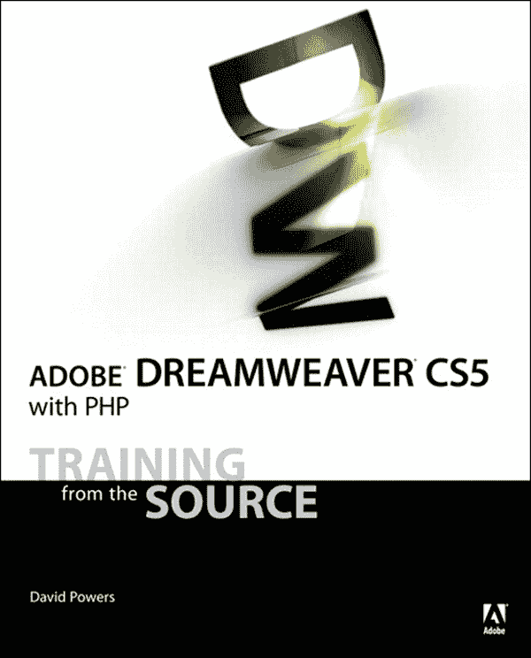


David Powers


David Powers

Adobe Press books are published by:  

**Peachpit**  

1249 Eighth Street  

Berkeley, CA 94710  

510/524-2178  

800/283-9444

For the latest on Adobe Press books, go to [`www.adobepress.com`](http://www.adobepress.com)  

To report errors, please send a note to `errata@peachpit.com`  

Peachpit is a division of Pearson Education.  

Acquisitions Editor: Victor Gavenda  

Project Editor: Rebecca Freed  

Development Editor and Copyeditor: Anne Marie Walker  

Production Editor: Becky Winter  

Technical Editor: Tom Muck  

Compositor: Danielle Foster  

Indexer: Rebecca Plunkett  

Cover Design: Charlene Charles-Will

***Notice of Rights***

All rights reserved. No part of this book may be reproduced or transmitted in any form by any means, electronic, mechanical, photocopying, recording, or otherwise, without the prior written permission of the publisher. For information on getting permission for reprints and excerpts, contact `permissions@peachpit.com`.

***Notice of Liability***

The information in this book is distributed on an “As Is” basis, without warranty. While every precaution has been taken in the preparation of the book, neither the author nor Peachpit shall have any liability to any person or entity with respect to any loss or damage caused or alleged to be caused directly or indirectly by the instructions contained in this book or by the computer software and hardware products described in it.

***Trademarks***

Adobe, the Adobe logo, and Dreamweaver are registered trademarks of Adobe Systems in the United States and/or other countries.

Many of the designations used by manufacturers and sellers to distinguish their products are claimed as trademarks. Where those designations appear in this book, and Peachpit was aware of the trademark claim, the designations appear as requested by the owner of the trademark. All other product names and services identified throughout the book are used in an editorial fashion only and for the benefit of such companies with no intention of infringement of the trademark. No such use, or the use of any trade name, is intended to convey endorsement or other affiliation with this book.

ISBN-13: 978-0-321-71984-3  

ISBN-10:          0-321-71984-0  

9 8 7 6 5 4 3 2 1  

Printed and bound in the United States of America


David Powers has been writing about Dreamweaver, PHP, CSS, and web development since 2003. This is his twelfth book on the subject. David started developing websites in 1994, shortly after assuming the role of Editor, BBC Japanese TV. He needed a way of advertising the fledgling channel in Japan but had no budget. So, he begged the IT department for a corner of server space and singlehandedly developed an 80-page bilingual website, which he regularly maintained for the next five years.

After a career spanning three decades in radio and TV news, David left the BBC in 1999 to work independently. He’s an Adobe Community Professional and Adobe Certified Instructor for Dreamweaver. You’ll often find him giving help and advice in the Dreamweaver forums and Adobe Developer Center—to which he has contributed many popular tutorials and training videos. He greatly enjoys traveling and taking photos—all the photos used in this book were taken by him.

David has also translated a number of musical plays from Japanese into English, and he likes nothing better than sushi with a glass or two of cold sake.
For several years I’ve bent the ears of the long-suffering Dreamweaver engineering team to improve support for PHP. Wow! They certainly came up trumps. My thanks to Devin Fernandez, Scott Fegette, Don Booth, Randy Edmunds, Chris Bank, Virgil Palanciuc, Jon Michael Varese, and the many others who have helped me dig deeper into Dreamweaver over the past few versions to understand the program’s strengths and weaknesses (yes, there are some—and I’m sure the team is already working on eliminating them).

I’m particularly grateful to Scott, one of the Dreamweaver product managers, whose idea it was to get me to write this book. I hope it’s not too far removed from what he was hoping for. Scott passed my name to Victor Gavenda, the Executive Editor at Adobe Press, while attending Adobe MAX at Los Angeles in 2009. For those of you who don’t know, MAX is an annual geekfest that’s a mixture of presentations by leading web professionals, sneak peeks into Adobe’s future technology, and wild parties (Scott plays a mean guitar).

Victor welcomed me into the Adobe Press/Peachpit family with grace and courtesy. My thanks go to him and to the two editors who worked directly with me on the book, Rebecca Freed and Anne Marie Walker. Thanks also to the production team for going the extra mile to make the code easier to read.

Finally, I mustn’t forget Tom Muck, a true Dreamweaver and PHP expert who checked the text and code for technical accuracy. This is the third book we’ve worked on together. Tom always manages to keep me on the straight and narrow, spotting important details I’ve missed and suggesting ways to improve the text. Any mistakes that remain are my responsibility alone.

PHP 让与数据库通信变得轻松，内容可以存储在数据库中，从而实现搜索。无需为每篇文章创建新页面，只需动态加载所需项目即可。您还可以密码保护站点的管理区或会员专区。PHP 还能发送邮件、上传文件，并将文件附加到邮件中——这些功能在本书中将一一讲解。PHP 也是三大最流行内容管理系统（Drupal、Joomla!、WordPress）的驱动力。

那么 Dreamweaver 在其中扮演什么角色呢？Dreamweaver 自 2002 年起对 PHP 的支持力度逐渐增强，主要通过服务器行为（server behaviors）自动生成用于基本任务的 PHP 代码。但其支持水平在 Dreamweaver CS5 中出现了质的飞跃。服务器行为仍然存在（参见 第 6 课），但已让位于更高级的功能。

主要变化体现在代码提示、内嵌 PHP 文档（含示例）、变量自动补全、动态相关文件的自动发现，以及——或许最出色的——在不离开文档窗口的情况下查看和浏览 PHP 页面的能力。因此，现在可以在 Dreamweaver CS5 中直接为 WordPress、Joomla! 和 Drupal 设计样式，而无需生成静态页面。这些改进详见 第 1 课，概括而言，它们既吸引设计师也吸引开发者。

PHP 的流行源于其易学性，能够快速取得实际成果。当然，像任何技能一样，成为专家需要时间和实践。Dreamweaver CS5 的新增 PHP 功能不仅帮助学习，而且在您逐步成长时会显得更加有用。Dreamweaver 是我首选的网站外观设计和文件组织工具，但我之前也会使用专门的 PHP 开发工具处理动态开发部分。Dreamweaver CS5 改变了一切，让我能在同一个程序中拥有两者的最好之处。

## 本书适用对象

本书属于“超越基础”的教材，您应已具备网站构建的基本理解，也应熟悉 HTML，因为 PHP 代码需要嵌入页面的结构中以显示动态输出。您不必记忆每个标签和属性，但如果分不清 `<ul>` 与 `<li>` 标签，就会感到困惑。所有示例文件和练习均采用 CSS 样式，但本书不以设计为重点。您不必懂 CSS 也能完成练习，但具备相关技能会让您的 web 开发能力更上一层楼。您还会发现，在阅读 第 4 课 时创建新 WordPress 主题会更轻松。您无需事先了解 PHP。本书不以正式方式教授 PHP，但 第 3 课 提供快速入门，帮助您编写 PHP 代码，而 第 5 课 则讲解使用 MySQL（最流行的开源数据库）进行数据库设计的基本概念。

如果您已经掌握一些 PHP，那更好不过。本书进度较快， 第 7–12 课 大量使用 Zend 框架，这是一个强大的 PHP 组件库，能大幅减少创建动态站点的工作量。 第 12 课 也使用了 jQuery JavaScript 框架。您无需事先了解 jQuery 或 JavaScript，但了解它们会让学习更轻松。

## 如何使用本书

时间宝贵，您可能想直接跳到解决当前问题的方案。如果您拥有丰富的 PHP 经验，这种做法或许可行。但大多数读者应从 第 1 课 开始，按顺序逐课完成，因为每课都在前一课的基础上继续深入。若跳过某一课，可能会错过关键说明，导致需要回头补读。

每课开头的“大约时间”仅为完成练习的估算，请不要将其视为挑战，也不要因耗时过长而沮丧。每课内容丰富，请耐心吸收，并根据自己的节奏将课程分成更小的块来进行。

大多数课程包含参考章节，随后是实践练习。每一步骤既说明要做什么，也解释原因，旨在帮助您思考如何将相同技术应用于自己的项目。本书不是点按即得的操作手册，而是旨在激发您解决问题的能力。思考得越多，收获越大。

## 附带文件

随书光盘中包含完成练习所需的全部文件，唯一例外是 第 2 课 中描述的 PHP/MySQL 开发环境以及 第 12 课 中的 LightBox Gallery 小部件。PHP 与 MySQL 更新频繁，建议从官方渠道获取最新版本。对于 LightBox Gallery 小部件，练习的一个目标是向您展示如何安装 Adobe Widget Browser 并从 Adobe Exchange 下载小部件。

第 2 课 说明如何在 Dreamweaver 中设置站点，以便完成本书的练习。每课的文件存放在名为 lesson01、lesson02 等的文件夹中。第 13 课没有对应的文件。包含练习的课程通常有三个子文件夹：completed（已完成）、start（起始）和 workfiles（工作文件）。workfiles 文件夹有意留空，供您在此处创建并保存练习文件。遵循此结构，练习文件将使用存放在 styles 文件夹中的公共样式表。 


为了节省时间，许多练习的页面已部分完成，您应从本课程的起始文件夹复制到工作文件夹。已完成的文件夹包含在不同阶段完成的练习文件的复制。

在 第 10 课 和 第 11 课 中，您应在站点根目录下创建一个名为 cms 的文件夹。cms_complete 文件夹包含已完成项目的完整工作副本。

**NOTE:**

文件在 Windows 计算机上创建，但与 Mac OS X 完全兼容。但是，library.php 中的路径需要调整以匹配 Zend Framework 文件的位置。请参见 第 7 课 获取详细信息。

## Windows/Mac 差异

书中已在相关位置指出了 Dreamweaver CS5 与 Windows 与 Mac OS X 之间的少数差异。

键盘快捷键的顺序为 Windows/Mac，但在极少数没有 Mac 等效键的情况下已作说明。在某些 Mac 键盘中，Opt(ion) 键标记为 Alt。在 UK Mac 键盘上，使用 Alt+3 可输入井号 (#)。

使用多按钮鼠标的 Mac 已非常常见，因此说明仅指右键点击。如果您更喜欢单按钮鼠标，请使用 Ctrl+点击。

## 代码可移植性

使用 PHP 的乐趣之一是其平台中立性。本书中的所有 PHP 代码在 Windows、Mac OS X 和 Linux 上均能正常工作。但是，需要注意不同版本的 PHP 和 MySQL 具有不同的功能。此外，服务器管理员可以关闭某些功能。使用本教材前，您的 Web 服务器 *必须* 运行 PHP 5.2 及 MySQL 4.1 或更高版本。本教材中的代码不支持更早的版本。

## 获取帮助

当您遇到问题时，首先应查看自己。您是否跳过了步骤，或错误地输入了变量或函数的名称？快速定位错误的方法是使用 Dreamweaver 的文件比较功能（选择帮助 > 使用 Dreamweaver CS5 > 创建和管理文件 > 比较文件以查找差异）比较您的文件与已完成文件夹中的版本。

文件比较需要第三方文件比较实用程序。如果您未安装，WinMerge（适用于 Windows，网址为 [`winmerge.org`](http://winmerge.org)）和 TextWrangler（适用于 Mac OS X，网址为 [www.barebones.com/products/textwrangler/](http://www.barebones.com/products/textwrangler/））均为免费。

如果您无法自行解决问题，且快速的 Internet 搜索未能提供答案，请在 Adobe 论坛发帖求助。PHP 问题的最佳选择是 Dreamweaver 应用程序开发论坛，网址为 [`forums.adobe.com/community/dreamweaver/dreamweaver_development`](http://forums.adobe.com/community/dreamweaver/dreamweaver_development)。我常在此提供帮助，您甚至可能从我这里获得答案。

我也在我的网站 [`foundationphp.com/`](http://foundationphp.com/) 上发布更新和教程，您可以在 Twitter 上关注我 @foundationphp。

我们已经尽最大努力消除错误，但如果您发现任何错误，请通过 errata@peachpit.com 邮件告知详情。

## 布局约定

本书使用以下文本约定：

• **粗体文本。** 粗体文本指示您在字段中输入的内容，或您需要创建的文件名。

• **粗体代码。** 表示已添加或修改的代码以粗体显示。

if ($_POST) {  

  **if (empty($_POST['username']) || empty($_POST['password'])) {  

    $failed = TRUE;  

  } else {**  

    require_once('library.php');

• **长代码。** 有时代码无法在单行打印页面上显示。出现这种情况时，箭头指示行的延续，例如：

$result = $recaptcha->verify($_POST['recaptcha_challenge_field'], $_POST['recaptcha_response_field']);

• *斜体。* 斜体文本用于强调或引入重要概念。

## 让旅程开始

最重要的是，请享受前方的旅程。即使您一开始觉得使用代码不适，PHP 也不难。欢迎来到不断壮大的 PHP 社区。

## 第 1 课 为什么选择 PHP 和 Dreamweaver CS5？

### **您将学习**

***在本课程中，您将：***

• 了解 PHP 如何动态生成网页并与数据库通信

• 探索 Dreamweaver CS5 中大幅改进的 PHP 功能

• 学习如何更改 Dreamweaver 的默认设置

• 了解 Live View 如何显示来自 WordPress 等内容管理系统的 PHP 内容

• 理解如何访问和筛选动态相关页面

### **大约时间**

本课程大约需要 1 小时完成。

### **课程文件**

***媒体文件：***

无

***起始文件：***

无

***已完成文件：***

lesson01/time.php

“如果您在一周中多出一天来学习新技术，您会选择什么？”这是 Adobe Dreamweaver 产品团队在开发 Dreamweaver CS5 之前向用户提出的一个问题。绝大多数用户回答：“PHP 或 PHP 框架”。该团队采纳了这一信息， resulting in 一 个将 Dreamweaver 转变为强大的 PHP 开发环境的版本，同时保留其视觉开发功能。Dreamweaver CS5 是一个让程序员和设计师都能笑容满面的程序。对于设计师来说，最受欢迎的变化可能是能够在 Live View 中直接查看 WordPress、Drupal 或 Joomla! 等网站。

*Dreamweaver CS5 现在可以在 Live View 中直接显示 WordPress 和其他流行的内容管理系统 (CMS)。*

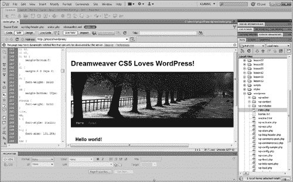

### **丰富的 PHP 功能**

对程序员而言，许多新功能可列为首要： vastly improved PHP 代码提示、自动检测动态相关文件、变量自动补全等。但最能吸引新手和经验丰富的程序员的功能是自动语法检查。Dreamweaver CS5 会持续监控您的 PHP 代码，并在出现错误的任何行上高亮显示。

一个未改变的点——这可能会让一些现有用户感到失望——是 PHP 服务器行为的范围或功能。所谓 *服务器行为*，是 Dreamweaver 工具，可自动生成 PHP 代码用于诸如在数据库中插入、更新和删除记录等操作。许多人喜欢服务器行为，因为可以通过对话框完成所有操作，无需手动编写代码。服务器行为非常适合快速原型设计或初学者学习 PHP，但它们只能带您到一定程度。您很快会发现需要对它们进行定制才能完成超出最基础任务的操作，而这需要您理解代码。本书介绍了主要的服务器行为，并进一步指导您充分利用 Dreamweaver CS5 中的新 PHP 功能。不过，这并不意味着您会需要不断编写大量的 PHP 代码。

Dreamweaver CS5 让您能够利用由业内经验丰富人员编写的更广泛资源。您将学习如何使用其中最流行的 PHP 驱动内容管理系统 (CMS)——WordPress。您还将学习如何上传文件、发送带附件的电子邮件，以及使用 Zend Framework 的一系列组件与数据库进行交互。该框架的设计使您可以“ cherry pick”（选择性使用），从而在不事先成为专家程序员的情况下，轻松为网站添加高级功能。


你不需要有 PHP 经验就能使用这本书——虽然如果你已经掌握 PHP，可以更快进步，或直接跳转到感兴趣的课程。书中会在全程解释清楚，并提供获取更多信息的链接。唯一的前提是你需要熟悉使用 HTML 和 CSS 建站。

**NOTE:**

我用 HTML 同时指代 HTML（超文本标记语言）和 XHTML（可扩展超文本标记语言）。本书中的所有 HTML 代码均符合 XHTML 1.0 Transitional 标准，这是 Dreamweaver CS5 的默认设置。

在开始前的旅程之前，让我们快速浏览 PHP 及其用途，然后简要浏览 Dreamweaver CS5 的特性，这些特性使其成为 PHP 驱动网站的优秀开发环境。

### **What Is PHP? What Does It Do?**

PHP 是一种服务器端技术，用于动态生成网页。假设你有一个产品目录。与其每次添加或删除产品时都要更新网页，你可以将详细信息存储在数据库中，使用 PHP 查询数据库并自动生成页面。你无需为每个产品创建单独的页面，只需构建一页，PHP 自动填充细节。PHP 还可用于创建登录系统、上传文件和发送邮件。几乎所有在线商店、新闻网站、博客或社交网络平台都使用 PHP 或类似的服务器端技术。

根据使用方式的不同，PHP 代码可以嵌入网页中，也可以存放在外部文件中。与 CSS 或 JavaScript 不同，PHP 代码始终位于 Web 服务器上，访问者看不到它，只能看到输出结果。例如，`lesson01/time.php` 包含以下代码：

<p>The time in London is **<?php**  

**$now = new DateTime();**  

**$now->setTimezone(new DateTimeZone('Europe/London'));**  

**echo $now->format('g.i a');**  

**?>**</p>  

<p>In Los Angeles, it's **<?php**  

**$now->setTimezone(new DateTimeZone('America/Los\_Angeles'));**  

**echo $now->format('g.i a');**  

**?>**</p>

PHP 代码被嵌在 HTML 段落之间，`<?php` 与 `?>` 标签内。即使你不明白其工作原理，也能推测这段代码与日期和时区相关。实际上，它会显示伦敦和洛杉矶的当前时间。无论你身在何处、何时加载页面，只要服务器时钟设置正确，就会始终显示这两个城市的准确时间。在浏览器中右键查看源代码，你只会看到 HTML 输出。所有处理均在服务器端完成。

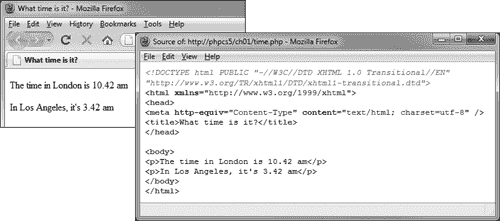

### **NOTE:**

在创建 PHP 测试环境（Lesson 2 中将介绍）之前，你无法在本地查看该文件。细心的读者可能注意到截图显示的时差为七小时，而伦敦与洛杉矶通常相差八小时。截图拍摄于美国实行夏令时、英国未实行的三月中旬。PHP 代码能够自动适配夏令时调整。

在本例中，PHP 代码自行完成所有工作。但在许多情况下，PHP 充当数据库的中间件。下面的示意图概述了基本流程。

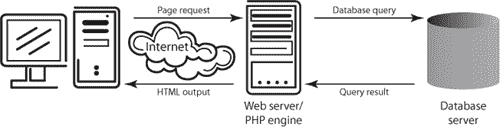

当浏览器请求一段使用 PHP 的网页时，过程如下：

• 服务器将页面发送到位于服务器上的 PHP 引擎进行处理。

• 若 PHP 脚本无需与数据库交互，PHP 引擎生成 HTML 输出，服务器再将其返回浏览器。

• 若脚本需与数据库交互（如获取查询结果、插入或更新数据），PHP 引擎与数据库服务器通信。结果返回后，PHP 引擎将所有内容组合，服务器再将生成的网页发送回浏览器。

虽然过程繁复，但大多数请求仅需几微秒，用户几乎感觉不到延迟。

PHP 的作用在输出发送到浏览器后即结束。`time.php` 显示的时间是固定的，不会自动更新。若要实现实时更新，需要刷新页面或使用 JavaScript 在用户浏览器中动态修改时间。若想让 PHP 响应用户在页面上的操作，则需要再次向服务器发送请求。过去这意味着重新加载页面，但本书后续将展示，可以通过 Ajax 在后台发送请求并无缝刷新内容。

### **What Is Ajax?**

通常，向服务器的请求与响应是同步处理的，等待页面重载会 disrupt user experience。为规避此问题，可使用 JavaScript 直接向服务器发送请求，并在结果返回后仅更新页面内容。多个请求可依次发送，按需更新页面。技术上讲，这是异步处理。换言之，用户无需等待服务器响应即可继续使用页面，更新在响应到达时无缝发生。

最初，数据以 XML（可扩展标记语言）格式返回，这是 Ajax 名称的来源——Asynchronous JavaScript and XML。但数据也可以以纯文本等多种格式返回，XML 并非必然组成部分。

#### **Why choose PHP?**

PHP 并非唯一的服务器端技术，Dreamweaver 对七种技术均提供不同程度的支持。大多数功能相似，选择最合适的技术并非易事。但 PHP 具备以下优势：

• PHP 运行于 Windows、Mac OS X 和 Linux，几乎在所有平台上（除少数例外）编写的代码都能在其他系统上运行。

• 它是开源且免费的。

• 使用广泛。

• 学习曲线相对平缓。

• 拥有庞大的活跃用户社区，帮助随时可得。

• 既能用于小型网站，也能驱动全球访问量巨大的站点（如 Facebook、Wikipedia 和 Yahoo!）。

• 根据数字营销机构（SoDA）2010 年调查，近 50% 的受访者认为 PHP 对其公司是重要工具，而 ASP.NET 的比例为 32%，Ruby on Rails 不足 10%。

• 同一调查显示，超过 50% 的受访者计划招聘具 PHP 技能的人员。仅次于 Flash 和 ActionScript 的需求。

### **What Does PHP Stand For?**


-   PHP 表示 PHP: Hypertext Preprocessor。为什么要起一个这么拗口的名字？当 PHP 的原始创建者 Rasmus Lerdorf 在 1995 年发布第一个版本时，他称它为 Personal Home Page Tools（PHP 工具）。它是一套易用的工具，用于密码保护页面、创建表单以及处理表单数据。几年后，Andi Gutmans 和 Zeev Suraski——后来创立了 Zend（PHP 公司）的两位——决定与 Rasmus 合作，使 PHP 成为一个更强大的语言。"个人主页" 的形象不再适用，但决定保留最初的字母 PHP。因此，这个略显笨拙的名字就此产生。虽然 Zend 是一家商业企业，但 PHP 仍然是开源且免费的。

-   许多 PHP 开发者提供另一种解释：PHP = Pretty Happy Programmers。

#### **Which database should I choose?**

-   更多时候，PHP 会与 MySQL 一起使用，MySQL 是最流行的开源数据库，它快速、强大，非常适合用于网站。它是 WordPress、Drupal 和 Joomla! 的运行数据库，也是 Flickr、Facebook 和 YouTube 等高流量网站使用的数据库。

-   目前 MySQL 由 Oracle Corporation 拥有，Oracle 是领先的数据库软件公司，但 MySQL Community Edition 是免费的。Community Edition 的功能与付费 Enterprise 版完全相同，唯一的区别在于免费版不提供支持。不过，由于活跃的社区随时可以在线提供帮助，这很少是个问题。

-   与 PHP 类似，MySQL 也在所有主要操作系统上运行，因此你可以在一个系统上开发，然后将数据库转移到另一个系统。此外，几乎所有主机公司都提供 PHP 与 MySQL 的组合。基于这些原因，本书使用 PHP 与 MySQL 的组合。

-   PHP 与 MySQL 如此紧密结合，以至于很多人认为两者缺一不可。与 1950 年代弗兰克·西纳特的经典歌曲“爱与婚姻”不同，你 *可以* 在不使用 MySQL 的情况下使用 PHP。PHP 兼容所有主要数据库系统，包括 Microsoft SQL Server、Oracle 和 PostgreSQL。你可以轻松将后续课程中的代码适配到你选择的数据库上。

### ![Image**NOTE:**-   Dreamweaver 内置的 PHP 服务行为（在第 6 课 Lesson 6 中介绍）仅与 MySQL 关联。第 7–12 课 Lessons 7–12 使用 Zend Framework，除了 MySQL 外，还支持多种数据库，包括 Microsoft SQL Server、SQLite 和 PostgreSQL。### **A Tour of the Main PHP Features in Dreamweaver CS5**-   让我们更仔细地看一下为什么 Dreamweaver CS5 已成为初学者和经验丰富的 PHP 开发者的优秀开发环境。如果你对 PHP 完全陌生，可能需要浏览本节其余内容，快速了解本课的内容。等你对 PHP 有初步了解后，再回头逐段详细阅读，了解各项特性。#### **PHP features also in previous versions**-   为了帮助 Dreamweaver 的新手，我先简要说明之前版本中继承的基本功能，然后再介绍 Dreamweaver CS5 中新增的高级 PHP 功能。同时，我会说明如何设置各种选项，现有用户也能从中受益。-   讨论的功能包括：  • 行号  • 语法高亮  • 花括号匹配  • 代码折叠  • 分割代码视图  • 应用和移除注释标签  • 实时代码##### *Line numbering*-   在使用 PHP 脚本时，能够定位到具体行至关重要，因为 PHP 错误信息总是指向出错的那一行。默认情况下，Dreamweaver 在代码视图左侧显示行号列。-   如果行号不可见或想关闭它们，可以点击编码工具栏中的行号图标 ，或选择 **View > Code View Options > Line Numbers** 来开关。

##### *Syntax coloring*

-   Dreamweaver 会自动为 PHP 代码的不同元素上色，以便更易辨识。PHP 标签和引号内的文本呈红色，保留关键字为绿色，函数为深蓝色，变量为浅蓝色。如果代码某部分颜色不对，几乎可以肯定存在错误，最常见的原因是缺少或不匹配引号。

##### *Balancing braces*


-   [平衡大括号](https://example.org)是一个不可或缺的视觉指南，尽管可能在打开和关闭大括号之间有数十或数百行代码。与其他一些编辑程序不同，Dreamweaver 在你输入打开大括号时不会自动插入关闭大括号，但平衡大括号功能是一个必不可少的视觉指南。

-   当光标位于两个大括号之间时，点击编码工具栏中的平衡大括号图标，即可高亮大括号内的代码。

-   或者，选择编辑 > 平衡大括号，或按下 Ctrl+’/Cmd+’（单引号）键。

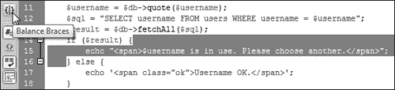

##### *代码折叠*

在编辑长脚本时，隐藏一个或多个代码部分会很有用，这样你就可以查看离当前工作区域较远的代码。要折叠代码部分，请选中它，然后点击选择区域顶部或底部的减号框。在 Mac 版本中，减号框被顶部的下三角形和底部的上三角形所取代。点击任意三角形即可折叠选中的代码。

折叠的代码部分仅在深灰色框中显示第一行的几个字符。将光标悬停在灰色框上方，Dreamweaver 会显示前十行作为提示，提醒你折叠的部分包含的内容。

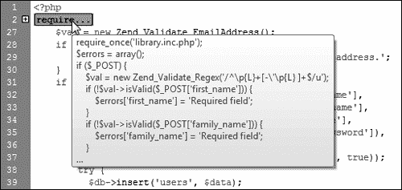

Dreamweaver 会记住哪些代码部分已折叠，即使你关闭文件。重新打开文件时，已折叠的部分仍然保持折叠状态。

要展开折叠的代码部分，请点击灰色框旁边的加号框（或在 Mac 上右侧的三角形）。如果加号框或三角形不可见，请点击灰色框以使其重新获得焦点。

你也可以通过点击编码工具栏中的“展开全部”图标  一次性展开所有折叠的代码部分。或者，按下 Ctrl+Alt+E/Opt+Cmd+E。

### **TIP:**

"Expand All" 的缺点是只有最后一个代码部分会被选中。如果你想再次折叠代码，使用鼠标单独展开和折叠各个部分。

##### *分割代码视图*

另一种查看同一脚本不同部分的有用方式是使用分割代码视图。这会在垂直或水平方向上将当前文档分割为代码视图。文档窗口的两侧会独立滚动，从而让你能够访问同一页面的完全不同部分。要访问分割代码视图，请选择 "视图" > "分割代码"。

**NOTE:**

你不能在分割代码视图的两侧之间拖放内容。使用复制或剪切并粘贴。

##### *应用和移除注释标签*

注释不仅用于记录你的脚本，还用于在调试时禁用代码部分。

当你点击“应用注释”图标  时，会出现以下五种注释样式供选择。

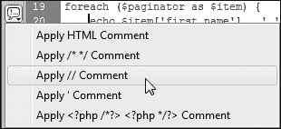

在 PHP 脚本中，有价值的只有 `/* */` 和 `//` 两种注释方式。

最终选项 `<?php /*?> <?php */?>` 用处有限，因为你不能在 PHP 代码块内嵌套 PHP 标签。它的唯一用途是对 PHP 页面中的 HTML 部分进行注释，防止受影响的部分被发送到浏览器。相比之下，HTML 注释仍然会在浏览器的源代码视图中可见。

- 要应用多行注释，请选中想要注释的代码，点击“应用注释”图标，然后从菜单中选择“应用 /\* \*/ 注释”。

- 要应用单行注释，请将光标放置在想要注释的位置，点击“应用注释”图标，然后选择“应用 // 注释”。

默认情况下，已注释出的代码显示为橙色，便于与应由 PHP 引擎处理的代码区分。

“移除注释”图标  实际上应该叫“移除注释标签”。它会移除注释字符，但保留其他内容。工作方式如下：

- 要移除多行注释的标签，请选中整个注释，包括开头的 `/*` 和结尾的 `*/`。如果只选中一部分，则不会发生任何操作。

- 要一次移除多个多行注释的标签，请至少从第一个 `/*` 到最后一个 `*/` 进行选中，然后点击“移除注释”图标。

- 嵌入在多行注释中的单行注释不会在移除多行注释标签时受到影响。

- 要移除单行注释标签，请在注释内的任何位置设置光标，然后点击“移除注释”。

单行注释标签仅在同一行中除去注释标签外没有其他内容（除了空白字符）时才会被移除。例如，下面的行会移除 `//`，即使行首有空格：

// echo 'Hello, world!';

然而，下面的行不会移除注释，因为注释不影响整行：

echo 'Hello, world!'; // this is a comment

##### *实时代码*

只要为你的站点定义了测试服务器（定义站点和测试服务器在 第 2 课 中已说明），点击文档工具栏中的“实时代码”按钮就会在代码视图中显示动态代码（包括 PHP 和 JavaScript）的 HTML 输出。

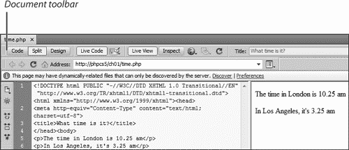

这与在浏览器中使用“查看源代码”功能而不实际在浏览器中打开页面的效果相同。所有操作都在 Dreamweaver 文档窗口内完成。

如果看不到文档工具栏，请选择 "视图" > "工具栏" > "文档"。也可以选择 "视图" > "实时代码"。

#### **Dreamweaver CS5 中的新增和改进的 PHP 功能**

到目前为止列出的功能虽然有用且必不可少，但单独来看并不足以推荐使用 Dreamweaver CS5 作为正式的 PHP 开发环境。真正让 Dreamweaver CS5 脱颖而出的是以下改进：

- 扩展的 PHP 核心函数、类和常量代码提示

- 自定义函数和类的代码提示

- 站点特定的代码提示

- 自动识别类和对象

- 定义变量的自动补全

- 实时语法检查

- 关联文件

- 实时视图导航

- CSS  inspection

##### *PHP 核心函数、类和常量的代码提示*

Dreamweaver CS5 的代码提示现在涵盖 PHP 5.2 的所有核心元素：

- 约 1,900 个核心函数

- 约 170 个类和接口，包括 800 多个相关方法以及 200 多个类属性

- 约 2,000 个常量

如果你在想为什么 PHP 5.3 不被支持，那是因为集成文档到 Dreamweaver 所需的工程时间。是的，没错——文档。Dreamweaver 会自动显示 PHP 手册中内置函数或类的相关帮助页面。

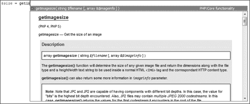

大多数帮助页面包含函数或类的描述、它接受的参数、返回值以及所需的最低 PHP 版本。此外，还有频繁的代码示例。如果这仍不足够，点击文档左上角的链接会跳转到 PHP 在线手册的对应页面，该页面包含最新信息，并有其他用户添加的评论和技巧。

代码提示的选择方式也在三个重要方面得到改进：

- 代码提示不区分大小写。你可以输入小写，Dreamweaver 会自动将选中的值转换为常量和超全局变量的大写。

- 下划线会自动插入。当你输入 `$p` 时，Dreamweaver 会自动建议 `$_POST` 作为选项之一。


• 你不需要从头开始。Dreamweaver 会在代码提示中不断搜索子字符串。例如，输入 **sep** 会自动选中所有包含该字母序列的函数和常量，包括 `DIRECTORY_SEPARATOR` 和 `PATH_SEPARATOR` 常量。

通过一些实验，你可以为经常使用的代码创建自己的快捷方式。只需发现能够快速弹出你想要的那条记录的字符序列即可。例如，输入 **gesi** 会立即跳转到 `getima`**gesi**`ze()`。Dreamweaver 将“ge”视为“image”的一部分，“si”视为“size”的一部分，从而形成一个唯一的序列。

要激活代码提示，在 PHP 代码块中按 `Ctrl+spacebar`。即使你在开始输入之前忘记这样做，也可以直接按相同的组合键（不先按空格），Dreamweaver 会利用之前输入的字符序列来筛选可用的选项。

### **TIP:**

Mac 用户请注意，激活代码提示的快捷键在两个操作系统上是相同的。使用 Control+spacebar，而不是 Cmd+spacebar。

当 Dreamweaver 缩小可用候选项后，你可以使用上下箭头键或鼠标选择想要的那一项。按 Enter/Return 或双击即可将函数或常量插入脚本。

##### *自定义函数和类的代码提示*

Dreamweaver CS5 不仅限于内置函数。它现在具备 *代码 introspection*（代码反射）功能，这意味着 Dreamweaver 会自动检查任何自定义函数或类，并据此生成代码提示。提示适用于在同一页面中声明的函数或类，或通过 PHP `include` 或 `require` 语句直接引入的函数或类。下面的截图展示了自定义代码提示的示例。

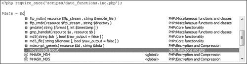

在此示例中，文件 `date_functions.inc.php` 包含一个自定义函数 `mdy2mysql()`。由于它通过 `require_once` 在当前页面中被引入，Dreamweaver 会在你输入字母 **md** 时自动将其加入代码提示列表。提示列表还会指示该函数的定义位置，表明它是自定义函数。

当你从代码提示列表中选择自定义函数后，Dreamweaver 会显示该函数所期望的参数名称。

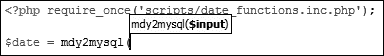

### **TIP:**

Dreamweaver 不会为自定义函数和类生成文档。设计自己的函数和类时，建议使它们“自我文档化”，即为函数、方法以及它们的参数选择有意义的名称。

##### *站点特定代码提示*

如果你认真使用 PHP，可能会想使用框架。框架是一组预先定义的函数和/或类，用于执行常见任务。使用框架的优势在于代码通常已经由经验丰富的人开发并测试。与其重新发明轮子，你可以通过编写极少的代码来构建复杂应用。所有复杂的代码都包含在框架文件中。

我在后续课程中使用的框架是 Zend Framework（ZF）。ZF 1.10 的“最小”版本包含超过 2,700 个文件，分布在近 500 个文件夹中。幸运的是，ZF 拥有一个自动加载器，仅在需要时加载相应文件。遗憾的是，ZF 的命名规范会导致类名（如 `Zend_File_Transfer_Adapter_Http`）难以输入和记忆。这时，站点特定代码提示就派上用场。

站点特定代码提示用于为第三方框架（包括目前最流行的三个内容管理系统——WordPress、Drupal 和 Joomla!）生成代码提示。生成方式与自定义函数和类相同，都是通过代码反射。不同之处在于，你无需直接在当前页面中 `include` 或 `require` 外部文件。设置站点特定代码提示后，Dreamweaver 会自动扫描所需文件并即时生成提示。即使定义文件并未直接关联到你的页面，提示仍然可用。

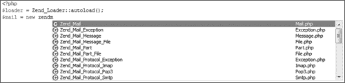

如果你想为 WordPress、Drupal 或 Joomla! 设置站点特定代码提示，请参阅 Lesson 4。其他框架（包括 ZF）的设置在 Lesson 7 中说明。

##### *自动识别类和对象*

大多数情况下，无需按 `Ctrl+spacebar` 即可为类和对象获取代码提示。只要在关键字 `new` 后输入空格，Dreamweaver 就会立即为所有已识别的类提供代码提示。

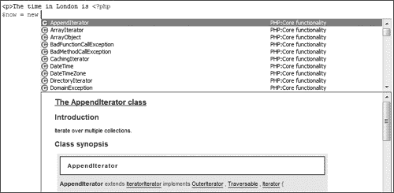

在对象后输入 `->` 时，Dreamweaver 会自动列出该对象类的所有公共方法和属性。

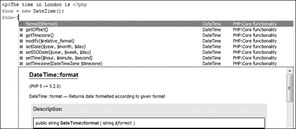

同样，在类名后输入双冒号（`::`）也会显示该类的所有静态方法和属性。

##### *控制 PHP 代码提示*

拥有如此丰富的代码提示当然是好事，但如果不需要或不想要它们全部，Dreamweaver CS5 也提供了关闭全部或部分提示的选项。

要控制哪些代码提示处于启用状态，请在 **Preferences** 面板中选择 **Code Hints** 类别。通过在 **Menus** 部分取消相应复选框，即可关闭不需要的选项。 **Table 1.1** 列出了每个选项所覆盖的 PHP 模块。

**Table 1.1 PHP Modules Covered by Code Hints**

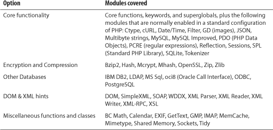

如果不确定选择哪项，建议先取消全部选项，只保留 “Core functionality” 和（如有需要）“DOM & XML hints”。其余选项主要面向专业用户。相反，除非发现全部打开会对你造成不便，否则可以直接保持全部选中。代码提示旨在帮助你，数量多并不会导致 Dreamweaver 变慢，但这可能因你的电脑配置以及同时运行的其他程序而有所不同。

##### *自动完成已定义变量*

PHP 变量以 `$` 开头，因此在输入 **$** 后，Dreamweaver CS5 会立即弹出已定义变量的列表。旧版仅支持 PHP 超全局变量（如 `$_POST` 和 `$_GET`）。在 Dreamweaver CS5 中，你的自定义变量也会被列出。继续输入，列表会自动缩小候选范围——这大幅节省时间。而且，PHP 变量区分大小写，这有助于避免例如在一个地方使用 `$name`、在另一处使用 `$Name` 的错误。

经验丰富的开发者会高兴地知道，自动完成会考虑 **变量作用域**。变量在函数内部声明后，在函数外部不可见；反之亦然，除非其值显式传递并返回，否则外部变量的值不会受到函数内部变化的影响。实际表现为：如果在函数外部声明了 `$total`，则在函数内部的自动完成中不会出现 `$total`；同样，如果在函数内部声明了 `$output`，它只会在函数作用域内出现在候选列表中。

需要注意的是，代码提示对数组键有局限性。Dreamweaver 不会为数组键提供提示。例如，假设你有如下数组：

$colors = array('black' => '#000', 'white' => '#FFF');


Dreamweaver 会为 `$colors` 提供代码提示，但随后你需要自行完成。你需要手动输入 `‘black’` 或 `‘white’` 并加上闭合方括号。

### `Real-time syntax checking`

当你在 Dreamweaver CS5 中开始输入 PHP 脚本时，你会立刻注意到程序会立即提示语法错误。即使只输入 PHP 开头标签的前几个字符，文档窗口顶部的信息栏也会显示错误信息，并在行号旁边标记红色图标。

（位于代码工具栏）会切换错误消息的显示开关。或者，选择 **View > Code View Options > Syntax Error Alerts in Info Bar**。

关闭红色错误标记的唯一方法是在 **Preferences** 面板中设置——但这样也会失去其他有用功能。选择 **Code Hints** 类别，在 **Menus** 部分取消勾选 “Object methods and variables” 复选框。这会禁用 Dreamweaver 的 PHP 和 JavaScript 知识引擎，同时也会关闭对象和变量的代码提示。在我看来，这是一个糟糕的权衡。

虽然实时语法检查足够智能，能发现脚本中存在问题，但它不会告诉你具体是什么问题。这需要你自己判断。不过，知道在哪里查找问题能让故障排除变得轻松得多。

### `` **TIP:**

在编写长脚本时，语法检查器可能不会立即清除错误标记。按 `Ctrl+./Cmd+.`（句点）刷新语法检查。切换到代码视图时，如果页面最初在设计视图中打开，也可能需要这样做。

### `Dynamically related files`

打开 Dreamweaver CS5 中的 PHP 文件时，文档窗口顶部会出现一个窄条（信息栏）。如果尚未定义测试服务器，信息栏会提供一个链接，用于打开 **Site Setup** 对话框（定义站点和测试服务器在下一课中说明）。否则，它会提示页面可能存在只能由服务器发现的动态相关文件。

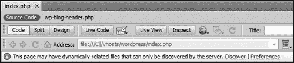

默认情况下，Dreamweaver 仅在 **Related Files** 工具栏中显示直接关联的文件。要显示动态相关文件，请点击信息栏中的 **Discover** 链接。第一次操作时，你会看到一个警告：Dreamweaver 会执行页面中包含的任何脚本。这只是 Adobe 的谨慎态度。也就是说，Dreamweaver 会以与在浏览器中加载页面相同的方式解析 PHP。除非你想每次使用动态相关文件时都看到此警告，请勾选不再提示此警告的复选框，然后点击 **OK**。

Dreamweaver 会连接到你的测试服务器（需保持运行），并编译动态相关文件列表。具体时间取决于页面复杂度和站点规模，可能需要几秒钟。动态相关文件会按发现顺序添加到 **Related Files** 工具栏中。如果文件过多而无法全部显示，点击右侧的双箭头即可展开所有文件列表。

**过滤动态相关文件：** 一个基本的 WordPress 站点至少使用 65 个动态相关文件，因此需要进行过滤以保持理智。为此，点击 **Related Files** 工具栏右端的漏斗形图标（如下图所示）。

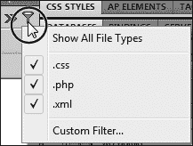

你可以开关 .css、.php 和 .xml 文件的显示。但 WordPress 站点拥有大量 .php 文件，你需要将列表缩小到感兴趣的文件，方法如下：

1. 点击 **Related Files** 工具栏右端的漏斗形图标，选择 **Custom Filter** 打开自定义过滤器对话框。

2. 在文本框中输入用分号分隔的文件名或扩展名列表，**不要在分号两侧加空格**。

自定义过滤器会禁用其他过滤选项，因此必须包含所有需要的文件。例如，基本 WordPress 站点的结构通常包括 `index.php`、`header.php`、`sidebar.php`、`footer.php` 以及任意样式表。

使用以下自定义过滤器：

```
index.php;header.php;sidebar.php;footer.php;.css
```

也可以使用星号作为通配符。例如，`wp*` 会选择所有以 `wp` 开头的文件。

### `` **TIP:**

遗憾的是，无法保存自定义过滤器设置。每次使用时都需要手动输入。如果你经常使用相同的过滤器，可以将其保存在文本文件中，以便复制粘贴到 **Custom Filter** 对话框中。

### `Setting Preferences for Related Files`

默认情况下，Dreamweaver 仅在你明确告知时才会搜索动态相关文件。如果希望它自动搜索，或希望完全禁用此功能，可以在 **Preferences** 面板中进行设置。

1. 通过点击信息栏中的 **Preferences** 链接打开 **Preferences**（仅在尚未发现动态相关文件的页面上可见）。或者，在 Windows 上选择 **Edit** 菜单，或在 Mac 上选择 **Dreamweaver** 菜单，然后选择 **Preferences**，并在左侧列表中选择 **General** 类别。

2. **Enable Related Files** 复选框控制所有相关文件。如果取消勾选此选项，将完全禁用该功能，并从文档窗口顶部移除 **Related Files** 工具栏。

3. 在 **Discover Dynamically-Related Files** 菜单中选择以下三项之一：**Automatically**（自动）、**Manually**（手动，默认）或 **Disabled**（禁用）。如果希望禁用动态相关文件但保留直接相关文件，请将菜单设为 **Disabled**，同时保持 **Enable Related Files** 复选框已选。

### `Live View navigation`

**Live View** 是文档窗口内的内置浏览器，使用 **WebKit** 浏览器引擎（同样驱动 Safari 和 Google Chrome）。虽然在 Live View 中无法编辑页面，但你可以使用 **Split view** 和相关文件进行代码和样式编辑，并在文档窗口中即时看到效果。

Live View 在 Dreamweaver CS4 中推出时，极大地简化了查看滚动、飞出菜单和 CSS 等动态效果的过程。但缺点是只能查看当前页面，链接不可点击，也不支持依赖于动态相关文件的流行内容管理系统（如 WordPress、Drupal、Joomla!）。

这在 Dreamweaver CS5 中已改变。**Live View** 现在像普通浏览器一样工作——几乎如此。唯一的区别是需要按住 **Ctrl/Cmd** 才能跟随链接。Live View 选项菜单中有一个选项可以“始终跟随链接”，但这仅适用于当前页面，切换到新页面时需要再次选择。

### `` **TIP:**

**Live View Options** 菜单也可以通过 **View** 菜单访问。如果看不到 **Browser Navigation Bar**（浏览器导航栏），请选择 **View > Toolbars > Browser Navigation**，或 **View > Live View Options > Show Browser Navigation Bar**。

Dreamweaver CS5 中 Live View 的强大之处在于它会跟随所有链接，即使链接指向互联网上的真实站点（前提是你已连接）。代码视图还会显示外部站点相关文件的源代码，尽管它们是只读的。


此外，你可以登录受密码保护的页面。下面的截图展示了一个 WordPress 站点的仪表盘，该站点仅通过提交用户名和密码即可访问。

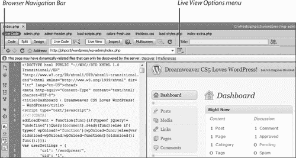

浏览器导航栏上的图标的作用与普通浏览器相同，包括后退和前进箭头、刷新以及主页——主页会将你带回到文档窗口中最初加载的页面。地址栏文本框会记住当前会话中加载的页面的 URL（但不包括你跳转到的页面）。这使得你只需点击地址栏右端的下拉箭头并选择 URL，即可在不离开 Live View 的情况下切换到另一页。你也可以在地址栏中输入远程站点的 URL，以便在 Live View 中对其进行检查。

##### *Live inspection of CSS layout*

Live View 另一个重要的新功能是 CSS Inspect 模式。在浏览器导航栏上点击 Inspect 按钮，然后将鼠标悬停在页面上。Dreamweaver 会在你经过时高亮每个页面元素，显示为蓝色的元素、紫色的内边距以及黄色的边距。

点击 Live View 中的元素以冻结显示。结合 CSS 样式面板或从相关文件工具栏中选择的样式表，CSS Inspect 模式提供了强大的方式来检查和编辑 CSS，尤其是在 PHP 站点中。

### **What You Have Learned**

***In this lesson, you have:***

• Seen how PHP builds web pages dynamically and communicates with a database (pages 5–8)

• Explored Dreamweaver’s tools that aid PHP development (pages 9–15)

• Examined the improved support for PHP code hints in Dreamweaver CS5 (pages 15–20)

• Seen the benefits of variable autocompletion and real-time syntax checking (pages 20–21)

• Learned how to access and filter dynamically related pages (pages 22–23)

• Seen how to navigate to other pages, including password-protected pages, in Live View (pages 24–25)

**Table 2.1 Recommended Testing Server Settings for PHP Core**

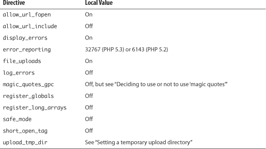


-   请注意任何与[Table 2.1 推荐的设置不同的设置。在解释如何更改它们之前，我将描述一些设置的目的，帮助您决定使用哪个设置。]

### `Security Should Be Your Top Priority`

在 PHP 的早期，重点是让开发者容易上手，这也是 PHP 成为如此流行的原因。不幸的是，让开发者容易上手也让恶意攻击者更容易利用安全漏洞。近年来，PHP 在安全方面显著加强，同时保持了开发便捷性的重点。

您可能会在旧书或在线教程中看到建议开启 `register_globals`，因为它让处理表单用户输入更方便。绝对不要这么做。这是 PHP 最大的安全漏洞之一。该设置在 2002 年默认关闭，但许多托管公司因其导致脚本故障而重新开启。幸运的是，这一趋势已逆转，`register_globals` 将在 PHP 下一个主要版本中移除。因此，即使您在本地开启该指令，您的脚本在线上也可能无法运行。

为了安全起见，您需要消除脚本中的所有错误。因此，在本地测试环境中应将 `display_errors` 打开，并将 `error_reporting` 设置为最高级别。PHP 5.3 引入了新的错误类别，导致其值与 PHP 5.2 不同。我建议关闭 `log_errors` 以避免磁盘因大日志文件而填满。如果错误直接显示在屏幕上，处理错误会更容易。

在生产环境网站上，显示错误信息会为攻击者提供有价值的信息，因此 `display_errors` 应关闭。目前大多数托管公司已这样做，但仍有例外，这也是为何本地测试至关重要。如果 `display_errors` 关闭，脚本中的错误常常会导致空白屏幕，让您不知所措。如果您的托管公司提供对 `php.ini` 的控制，则生产环境网站的设置应为 `display_errors = Off`，`log_errors = On`。

如果安全如此重要，为何要关闭 `safe_mode`？与 `register_globals` 类似，它是早期为了简化操作的尝试。初衷良好但实际效果不佳。它将在 PHP 下一个主要版本中移除。

##### *Deciding to use or not to use “magic quotes”*

`magic_quotes_gpc` 指令控制了另一个早期为了简化初学者操作的误导性尝试。当该指令开启时，PHP 会自动在通过 URL 或在线表单提交的单引号或双引号前插入反斜杠。插入反斜杠的初衷是防止文本插入数据库时出现问题。

后来人们意识到这带来的问题多于解决的问题。因此，`magic_quotes_gpc` 在新 PHP 安装中默认关闭，且该指令已被计划移除。然而，许多脚本假设 PHP 会在引号前插入反斜杠，因此许多托管公司会将该设置重新开启。请参考以下场景：

• 如果您的远程服务器上 `magic_quotes_gpc` 已关闭，请确保本地也关闭。

• 如果您的远程服务器上 `magic_quotes_gpc` 已启用，且您的托管公司允许您自行修改设置，请在本地和远程服务器上均关闭它。

• 如果您的托管公司允许通过 `.htaccess` 文件控制设置，请在本地关闭 `magic_quotes_gpc`，并在远程服务器网站根目录的 `.htaccess` 文件中添加以下行：

php_flag magic_quotes_gpc Off

• 如果 `magic_quotes_gpc` 已启用，且您无法关闭它，请将本地值设置为“on”。

##### *Setting a temporary upload directory*

上传文件时，PHP 会在将其移动到最终目的地之前，先将其存储在临时目录（文件夹）中。全能包安装包会自动创建必要的文件夹。但是，您应检查 `upload_tmp_dir` 的显示值，并确保指定位置实际存在一个文件夹。如果不存在，请创建一个，并确保网页服务器有写入权限。

NOTE:

如果您使用 IIS，请右键单击文件夹，选择“属性”。转到“安全”选项卡，点击“编辑”。在“组或用户名称”部分添加 IUSR 账户。在 IIS7 中，该账户名称为 IIS_IUSRS。为该账户授予以下权限：读取与执行、读取和写入。

文件夹的位置无关紧要。顾名思义，它仅用于临时存储。文件移动到其最终位置后，PHP 会删除临时文件。

##### *Checking other configuration settings*

为了使用本书，请确保以下部分在 PHP 配置页面中列出：

• **date.** 此设置控制日期和时间函数，自动调整时区和夏令时。

• **filter.** 验证电子邮件地址和其他用户输入的过滤函数。它们在 PHP 5.2 中被引入。

• **gd.** 此设置启用 PHP 生成和修改图像及字体。

• **mysql.** PHP 5 提供多种 MySQL 支持方式。这是最原始的一种，由 Dreamweaver 的 PHP 服务器行为使用。

• **mysqli.** 这是连接 MySQL 的更近期方法。“i”代表改进。它要求 PHP 5.0 及以上和 MySQL 4.1 以上。

• **PDO.** PHP 数据对象提供一种与数据库无关的连接方式。与 mysql 和 mysqli 仅限 MySQL 外，PDO 可用于广泛数据库。

• **pdo_mysql.** 这是 PDO 的 MySQL 驱动。

• **session.** 会话用于维护与用户相关的信息，例如登录系统或购物车。

在“date”部分，请确保“默认时区”适合您的位置。如果不正确，您需要将其替换为 [`docs.php.net/manual/en/timezones.php`](http://docs.php.net/manual/en/timezones.php) 中列出的值之一。

此外，请检查“sessions”部分的 `session.save_path` 值。它必须指向一个存在且可写的文件夹。如果该值为空或指向不存在的文件夹，您需要修改设置。文件夹的位置无关紧要，PHP 将使用它存储类似 Cookie 的临时文件。

您现在应已拥有一份需要更改的配置设置清单。如果清单为空，您已准备就绪，但了解如何更改 PHP 配置仍然有用，下一节将解释此内容。

### 更改配置设置

大多数配置更改只需编辑 `php.ini` 文件。每次 Web 服务器启动时，它都会读取该文件。因此，只需在编辑 `php.ini` 后重启 Web 服务器，您的更改即可立即生效。编辑 `php.ini` 很简单，因为它是纯文本文件，可以使用任何文本编辑器（如记事本或 TextEdit）进行编辑。但请注意，需以纯文本格式保存文件，并保留文件名和 `.ini` 扩展名。

### 编辑 php.ini

在 Windows 7 或 Vista 中，如果您的 `php.ini` 位于 Program Files 的子文件夹中，直接在记事本中打开它可能无法保存更改。在 Windows 开始菜单中，右键记事本，选择“以管理员身份运行”。在记事本中，选择“文件” > “打开”，并将“文件类型”设置为“所有（*.*）”，然后导航到 `php.ini` 并打开它。


TextEdit in Mac OS X has a nasty habit of saving files in Rich Text Format (`.rtf` files) or adds a `.txt` filename extension if you’re not careful. It’s better to use a dedicated script editor, such as BBEdit. If you don’t have a dedicated script editor, you can download TextWrangler, a free, cut-down version of BBEdit, from [www.barebones.com/products/TextWrangler/](http://www.barebones.com/products/TextWrangler/).

Newcomers to PHP often take fright the first time they open php.ini. It’s an extremely long document: Depending on which version of PHP you have installed, it might be more than 1,800 lines. The reason it’s so long is not only because it covers numerous settings, but also because it contains detailed explanations of what the settings are for.

The best way to deal with php.ini is to make a list of the settings you want to change, and then use the Find option in your script editor to move quickly to the appropriate section of the file. Everything should go smoothly as long as you remember the following:

• Make a copy of php.ini as a backup in case anything goes wrong.

• Lines that begin with a semicolon (`;`) are comments. They are ignored by PHP.

• The lines you need to edit do not begin with a semicolon.

• A few directives are disabled by default. In these cases, you need to delete the semicolon at the beginning of a line to enable the directive.

• The comments in php.ini show several example settings. Before deleting the semicolon at the beginning of a line, always make sure there isn’t another line farther down that contains the actual directive. If the same directive is repeated in php.ini, the lower one takes precedence.

• For those directives that use On or Off, all you need to do is to change the value to the recommended one. For example, if `display_errors` is turned off, locate the following line:

display\_errors = Off

Change it to this:

display\_errors = **On**

##### *Setting the level of error reporting*

PHP gives you a high degree of control over the types of errors it reports. Older versions of PHP used to turn off the reporting of “notices,” which are warnings about noncritical errors that don’t prevent your script from working. It’s now recognized that this was a bad idea, because failure to fix such errors can leave you exposed to security risks. You should set error reporting to the highest level, and make sure you eliminate all errors before deploying a PHP script on a live website.

The error reporting section of php.ini contains a lot of examples. Locate the line that begins like this:

error\_reporting =

If you are running PHP 5.3 or later, use the following setting:

error\_reporting = **E\_ALL | E\_STRICT**

If you are running PHP 5.2, use this:

error\_reporting = **E\_ALL**

### **CAUTION!**

PHP is case sensitive. `E_ALL` and `E_STRICT` must be all uppercase. The character between `E_ALL` and `E_STRICT` in the setting for PHP 5.3 and later is a vertical pipe (`|`). On most keyboards, you type it by holding down the Shift key and pressing backslash (`\`).

##### *Enabling other PHP extensions*

The section “Checking other configuration settings” lists several PHP extensions needed for working with this book. All of them should be enabled by default if you used one of the all-in-one installation packages or used the Microsoft WPI to integrate PHP into IIS.

### **NOTE:**

PHP extensions are optional features written in the C programming language that normally need to be compiled into PHP. They are not related to Dreamweaver extensions.

If you used a different installation or want to use other PHP features later, it’s useful to know how to enable extra extensions. Unfortunately, *this works on Windows only*. On a Mac, extra extensions need to be compiled from source, a subject that is beyond the scope of this book.

Let’s say, for example, that you want to work with the PostgreSQL database. If it’s not already enabled, locate the Dynamic Extensions section in php.ini, and then find the following lines:

;extension=php\_pdo\_pgsql.dll  

;extension=php\_pgsql.dll

Remove the semicolon from the beginning of each of those lines to enable them. You must also check that the appropriate `.dll` files are in your PHP extensions folder. The location of the folder is listed as the value of `extension_dir` in the Core or PHP Core section of the PHP configuration page.

If you don’t have the right `.dll` files, you can extract them from the Zip version of the PHP Windows binaries at [`windows.php.net/download/`](http://windows.php.net/download/).

##### *Activating configuration changes*

After you have edited and saved php.ini, restart your local web server (Apache or IIS). Reload the PHP configuration page to check that it reflects your changes.

If your web server refuses to start, check the error log:

• In XAMPP, it’s located at C:\\xampp\\apache\\logs\\error.log.

• In WampServer, click the WampServer icon, and access the Apache log from the menu.

• In Easyphp, right-click the icon in the task tray, and choose Log Files from the menu.

• If you installed Apache independently in Windows, the log is located at C:\\Program Files\\Apache Software Foundation\\Apache2.2\\logs\\error.log. For 64-bit Windows, replace Program Files with Program Files (x86).

• In MAMP, the log is located at Macintosh HD:Applications:MAMP:logs:apache\_error\_log.

• If you are using the preinstalled version of Apache on a Mac, choose Applications > Utilities > Console. Any error message should be displayed at the bottom of Console Messages.

• For help with IIS errors, see [`msdn.microsoft.com/en-us/library/ms524984.aspx`](http://msdn.microsoft.com/en-us/library/ms524984.aspx).

### Using Virtual Hosts

After you have installed your local PHP testing environment and confirmed that it’s working, you’re ready to start developing dynamic websites with PHP. However, the default setup for a web server allows you to create only one website. Since most people usually develop or maintain more than one site, there are two ways you can handle this:

• **Create each new site in a subfolder of the server’s document root.** This is the simplest approach because it involves no further setup. However, it prevents you from using links relative to the site root. See the sidebar “Using Links Relative to the Site Root” for an explanation of the implications of this.

• **Create a virtual host for each site.** This is how hosting companies manage shared hosting. It takes a little extra time to set up but has the advantage of providing a unique local domain for each site.

### **Using Links Relative to the Site Root**

Internal links in a website can be created in two ways:

• **Relative to the document.** You can recognize this type of link in Code view by the fact that the `href` attribute contains only the name of the file if it’s in the same folder. If the file is in a folder at a different level, the path to the file often begins with `../`, which indicates that the path begins one level up from the current folder.

• **Relative to the site root.** This type of link always begins with a forward slash, which represents the root folder, and is followed by the full path to the file.

By default, Dreamweaver creates links relative to the document, and it generates the correct link format. You can change this default either for an entire site or on an individual basis for each link.

In most cases, it doesn’t matter which type of link you use. The exception is when you break your pages into modules and use PHP includes (SSI), for example, if you put your navigation menu into a separate file and include it in every page. Because the menu is likely to be included by files at different levels of the site hierarchy, links must be relative to the site root.


如果你在服务器文档根目录的子文件夹中开发网站，你无法在本地测试菜单。如果为每个站点创建虚拟主机，这个问题就不存在。

尽管为每个站点创建虚拟主机有其优势，但它并非绝对必要。我在本地测试环境中同时使用这两种方法。

下面的章节描述如何创建虚拟主机。如果你现在不想使用虚拟主机，请跳到“在 Dreamweaver CS5 中设置 PHP 站点”。

**NOTE:**

IIS 在 Windows XP 上仅支持虚拟目录，这些目录被视为服务器根目录的子文件夹。如果你在 Windows XP 上运行，想要创建虚拟主机，必须使用 Apache。

### 创建虚拟主机

创建虚拟主机包括两个阶段：

• 编辑你电脑的 hosts 文件

• 在 Web 服务器中注册虚拟主机

hosts 文件告诉你的电脑在本地系统上查找特定域名。在测试环境中为虚拟主机选择名称时，必须避免使用真实域名的名称。否则，浏览器始终会显示本地版本的站点，而不是 Internet 上的真实站点。

我使用的命名约定去掉了顶级域名。我的主站点是 [foundationphp.com](http://foundationphp.com)。因此，本地测试的域名仅为 foundationphp。使用这种技术的优势是，你可以轻松在浏览器地址栏中编辑 URL，添加或去除 .com，在真实站点和本地测试版本之间切换。

下面的章节描述在 Windows 和 Mac OS X 上创建虚拟主机的过程。

### **CAUTION!**

编辑设置虚拟主机所需的各种文件非常容易，但需要注意拼写。Apache 指令对大小写敏感，并使用混合词，如 `ServerRoot`。拼写错误或空格会导致 Apache 无法运行。请仔细注意细节，不要着急。一旦你学会了这项工作，添加新的本地测试虚拟主机只需几分钟。

### 在 Windows 上设置虚拟主机

hosts 文件位于 Windows 系统文件中，因此需要管理员权限才能编辑它。这些说明适用于 Apache 和 IIS7：

**1.** 从 Windows 开始菜单中，选择“所有程序” > “附件”，右键单击记事本，选择“以管理员身份运行”。

**2.** 选择“文件” > “打开”，导航到 C:\\Windows\\System32\\drivers\\etc。

**3.** 选择显示所有文件（\\*.\\*），选中“hosts”，然后点击“打开”。

**4.** hosts 文件包含简要说明其用途以及一些示例。以 `#` 或数字 `#` 开头的行被视为注释。

在文件底部，为每个虚拟主机列出 IP 地址和名称，每行一个。你本地计算机的回环 IP 地址是 `127.0.0.1`。

第一条应该是 `localhost`。因此，如果你想为本书创建名为 “phpcs5” 的虚拟主机，文件底部的列表应如下所示：

127.0.0.1    localhost

127.0.0.1    phpcs5

**5.** 检查你的 hosts 文件是否包含以下条目：

::1    localhost

此行可能导致虚拟主机无法正确工作。通过在前面加 `#` 对该行进行注释：

**#** ::1    localhost

**6.** 保存并关闭 hosts 文件。

##### *在 Windows 上的 Apache 中注册虚拟主机*

在 Apache 中注册虚拟主机之前，需要决定存储虚拟主机文件的位置。我通常在 C 驱动器的根目录下创建一个名为 “vhosts” 的文件夹，并在该文件夹下为每个虚拟主机创建子文件夹。下面的说明假设你的虚拟主机名为 phpcs5：

**1.** 在 C:\\vhosts\\phpcs5 创建虚拟主机的文件夹。

**2.** 在记事本中打开主 Apache 配置文件 [httpd.conf](http://httpd.conf)。

在 XAMPP 中，它位于 C:\\xampp\\apache\\conf\\httpd.conf。

**3** 向文件底部滚动，找到以下指令：

Include "conf/extra/httpd-vhosts.conf"

以 `#` 开头的行是已注释的行。如果该行开头有 `#` 号，请删除 `#` 以启用该指令。

**4.** 保存 httpd.conf 并关闭文件。

**5.** 在记事本中打开 httpd-vhosts.conf。

在 XAMPP 中，它位于 C:\\xampp\\apache\\conf\\extra\\httpd-vhosts.conf。

**6.** 该文件包含虚拟主机定义的示例。如果示例未被注释，请删除它们或在每行开头添加 `#` 号以禁用它们。

**7.** 在文件底部添加以下代码：

<Directory C:/vhosts>  

  Order Deny, Allow  

   Allow from all  

</Directory>

这为包含你想将作为虚拟主机的站点的文件夹设置正确的权限。如果你选择的顶级文件夹不是 C:\\vhosts，请相应修改第一行的值。注意路径使用正斜杠而不是 Windows 惯用的反斜杠。如果路径包含空格，请用引号将路径括起来。

**8.** 找到以下指令：

NameVirtualHost \*:80

通过删除行首的 `#` 号来启用该指令。

**9.** 由于虚拟主机替换了现有设置，你需要为 localhost 创建一个虚拟主机。在文件底部添加以下代码：

<VirtualHost \*:80>  

   DocumentRoot c:/xampp/htdocs  

   ServerName localhost  

</VirtualHost>

`DocumentRoot` 的值应指向你现有的服务器根目录，并根据需要进行修改。

**10** 对你的虚拟主机做同样的操作，使用适当的 `DocumentRoot` 和 `ServerName` 值。为 phpcs5 在 C:\\vhosts\\phpcs5 设置虚拟主机，使用以下代码：

<VirtualHost \*:80>  

   DocumentRoot c:/vhosts/phpcs5  

   ServerName phpcs5  

</VirtualHost>

**11** 保存 httpd-vhosts.conf，并重启 Apache。你仍应能访问 [`localhost`](http://localhost)。存储在 C:\\vhosts\\phpcs5 中的任何文件将通过 http://phpcs5 可访问。

##### *在 IIS7 中注册虚拟主机*

在 Internet Information Services (IIS) Manager 中创建新网站相当于创建虚拟主机。

**1.** 从 Windows 开始菜单中，选择“控制面板” > “管理工具” > “Internet Information Services (IIS) Manager”。

**2.** 如果在左侧“连接”面板中需要展开树形菜单，请选择“站点”。

**3.** 右键单击并选择“添加网站”以打开“添加网站”对话框。

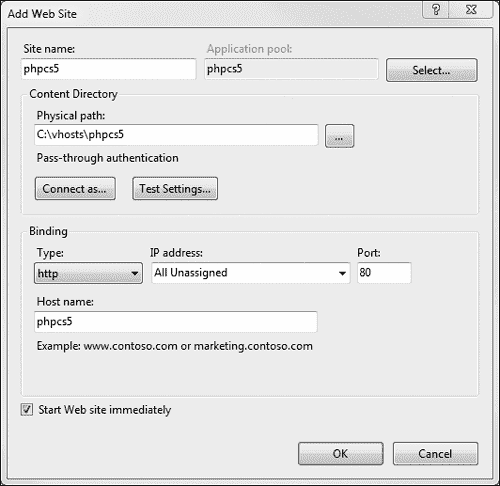

**4.** 在“站点名称”文本框中输入站点名称。

**5.** 单击“物理路径”文本框旁边的按钮，选择存储虚拟主机文件的文件夹。

**6** 在“主机名”文本框中输入虚拟主机的名称。

**7.** 点击“确定”。你的虚拟主机已准备就绪。

### 在 Mac OS X 上创建虚拟主机

在 Mac OS X 上创建虚拟主机的最简单方法是使用 MAMP PRO，MAMP 的商业版本，它会自动化该过程。你也可以手动完成。

##### *使用 MAMP PRO*

所有操作都通过 MAMP PRO 控制台完成。

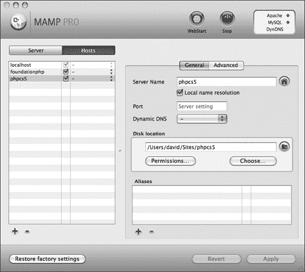

**1.** 点击控制台左上角的“Hosts”按钮，然后点击左下角的加号 (+) 按钮。

**2.** 在“服务器名称”文本框中输入虚拟主机的名称。

**3.** 点击“磁盘位置”文本框下的“选择”按钮，导航到你想存储虚拟主机文件的位置，如有需要可新建文件夹。

**4.** 点击“应用”按钮。

**5.** 当提示重新启动服务器时，点击“确定”。


如果不想购买 MAMP 的商业版本，你可以手动编辑 hosts 文件和 Apache 配置文件。 hosts 文件是隐藏文件，但可以在 BBEdit 或 TextWrangler 中轻松编辑（参考本课前文“编辑 php.ini”侧边栏）。

`TIP:`

Mac OS X 预装的 Apache 使用不同的设置。如果你使用的是预装版本，请按照 [`foundationphp.com/tutorials/vhosts_leopard.php`](http://foundationphp.com/tutorials/vhosts_leopard.php) 的说明进行操作。该指南最初针对 Mac OS X 10.5，但同样适用于 10.6。

**1.** 在 BBEdit 或 TextWrangler 中，选择 **File > Open Hidden**。

**2.** 在打开对话框中，将 **Enable** 设置为 **Everything** 或 **All Files**。如果有显示隐藏文件的选项，请确保已选中。

**3.** 选择 **Macintosh HD:private:etc:hosts**，点击 **Open** 打开 hosts 文件。

**4.** 在文件底部的新行上，列出每个虚拟主机的 IP 地址和对应的名称。

`127.0.0.1  phpcs5`

输入 `127.0.0.1`（循环回退 IP，表示本机）后跟一个或多个空格，再输入虚拟主机名称。输入时会出现提示文件拥有者为 “root”，点击 **Unlock** 确认编辑。

**5.** 保存并关闭 hosts 文件。由于它是系统文件，系统会要求输入 Mac 管理员密码以确认更改。

**6.** 接下来需要编辑的文件是 Apache 配置文件 **httpd.conf**。该文件不隐藏，直接选择 **File > Open**，然后定位到 `Applications:MAMP:conf:apache:httpd.conf`。

**7.** 向文件底部滚动，找到以下行：

`# NameVirtualHost \*`

删除行首的 `#` 号。

**8.** 由于虚拟主机替换了原有配置，需要为 **localhost** 和每个要添加的虚拟主机创建一个虚拟主机块。在文件底部添加以下代码：

`<VirtualHost \*>`

  `DocumentRoot /Applications/MAMP/htdocs`

   `ServerName localhost`

`</VirtualHost>`

`<VirtualHost \*>`

   `DocumentRoot /Users/your_name/Sites/phpcs5`

  `ServerName phpcs5`

`</VirtualHost>`

对于每个虚拟主机，`DocumentRoot` 的值是站点所在文件夹的路径，`ServerName` 是虚拟主机的名称。示例假设虚拟主机名称为 “phpcs5”，文件夹位于个人 **Sites** 目录下的 “phpcs5” 文件夹中（将 `your_name` 替换为你的 Mac 用户名）。若文件夹名称包含空格，请用双引号包裹路径。

**9.** 保存并关闭 **httpd.conf**。重启 Apache 后，仍可访问 [`localhost`](http://localhost)。存放在 **phpcs5** 文件夹中的文件可通过 [`phpcs5`](http://phpcs5) 访问。

### Setting Up a PHP Site in Dreamweaver CS5

Dreamweaver 基于在本地计算机上创建网站的精确副本。因此，在进行其他操作之前，需要先向程序提供一些基本的站点信息。Dreamweaver CS5 已简化了此过程。只需为站点命名并指定本地存储文件的位置即可开始。其余设置可在需要时再处理。但对于 PHP 站点，建议同步定义测试服务器。

理论上，你可以将 PHP 文件存放在计算机的任何位置，Dreamweaver 在使用 **Live View** 或 **Preview in Browser** 时会将文件复制到测试服务器。这样会产生两份相同的文件副本，建议将项目文件存放在测试服务器的文档根目录中。同时，还需告诉 Dreamweaver 测试服务器的 URL。

上述信息取决于是否为本书练习创建了虚拟主机。

#### 使用虚拟主机

如果已创建虚拟主机，请将文件存放在为 **phpcs5** 虚拟主机选择的服务器根目录文件夹中。

URL 为 **[`phpcs5/`](http://phpcs5/)**。

#### 使用服务器根目录的子文件夹

如果未创建虚拟主机，则本地站点文件夹和测试服务器文件夹为服务器根目录的子文件夹：

- **XAMPP**: `C:\\xampp\\htdocs\\phpcs5`
- **WampServer**: `C:\\wamp\\www\\phpcs5`
- **Easyphp**: `C:\\EasyPHP\\www\\phpcs5`
- **独立的 Windows Apache 安装**: `C:\\Program Files\\Apache Software Foundation\\Apache2.2\\htdocs\\phpcs5`（64 位 Windows 需在 Program Files 后加 (x86)）
- **IIS**: `C:\\inetpub\\wwwroot\\phpcs5`
- **MAMP**: `Macintosh HD:Applications:MAMP:htdocs:phpcs5`
- **Mac OS X 预装 Apache**: `Macintosh HD:Library:WebServer:Documents:phpcs5`

URL 为 **[`localhost/phpcs5/`](http://localhost/phpcs5/)**。

#### 创建站点定义

使用以下步骤为本书的 PHP 站点设置站点定义：

**1.** 在 Dreamweaver CS5 中，选择 **Site > New Site** 打开 **Site Setup** 对话框。

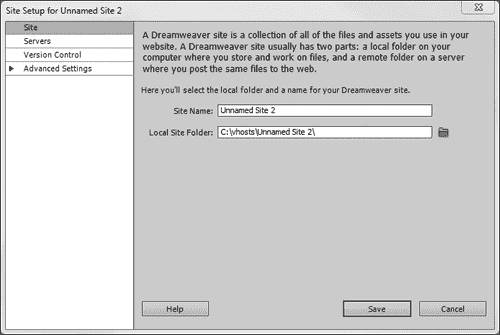

如果之前使用过旧版 Dreamweaver，会发现 **Basic** 与 **Advanced** 标签页已被移除（Mac 系统中为按钮）。

**2.** 在 **Site Name** 文本框中输入站点名称，例如 **PHP CS5**。此名称在 Dreamweaver 内部用于识别 **Files** 面板中的站点，建议具描述性并可包含空格。

**3.** 点击 **Browse for folder** 图标，在弹出的文件夹选择对话框中选定用于存放站点文件的本地文件夹。

此时可以直接点击 **OK**，但最好同步设置测试服务器。

**4.** 在左侧列表中点击 **Servers**，打开服务器面板，用于定义站点连接的服务器。

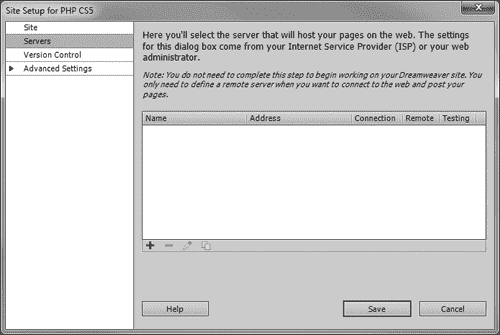

**5.** 点击面板底部的 **plus (+)** 按钮，打开另一个对话框以定义测试服务器的设置。

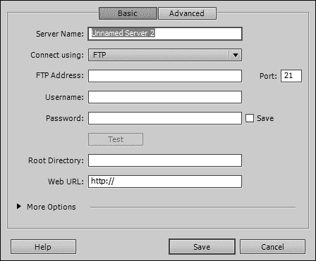

**6.** 在 **Server Name** 文本框中输入描述性的服务器名称，例如 **Testing Server**。

**7.** 点击 **Connect using** 下拉菜单，选择 **Local/Network** 以便于本地测试服务器，仅保留 **Server Folder** 与 **Web URL** 两个字段。

**8.** 在 **Server Folder** 文本框中，选择步骤 3 中使用的相同文件夹。

**9.** 在 **Web URL** 文本框中输入本地测试服务器的 URL，确保以斜杠结尾。

下图展示了为名为 “phpcs5” 的虚拟主机（位于 `C:\\vhosts\\phpcs5`）配置的设置示例。根据所使用的环境使用相应的值。

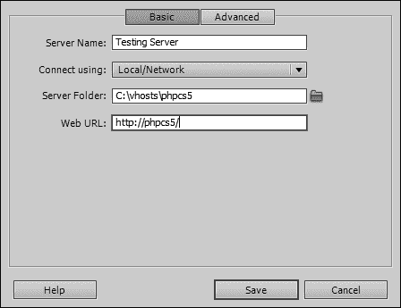

**10.** 点击对话框顶部的 **Advanced** 按钮，展开远程服务器与测试服务器的独立设置区域。

**11.** 在 **Testing Server** 部分底部的 **Server Model** 菜单中，选择 **PHP MySQL**。

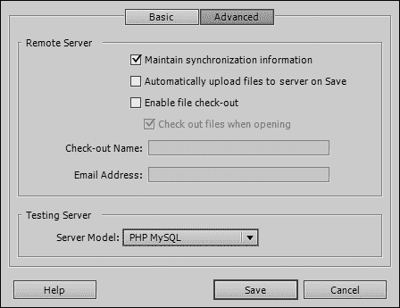

点击 **Save**。

**12.** 测试服务器应出现在 **Servers** 面板中。确保 **Remote** 框未被选中，而 **Testing** 框已选中。此时底部的按钮会变为活动状态，可用于添加、删除、编辑或复制服务器。

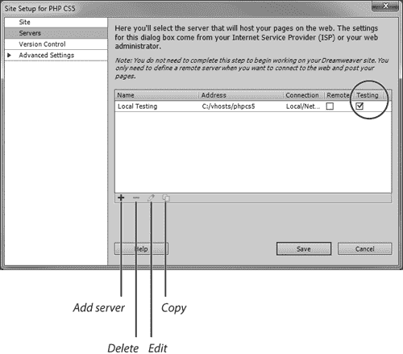

**13.** 点击 **Save** 关闭 **Site Setup** 对话框。

#### 设置多个服务器


如果您使用过 Dreamweaver 的早期版本，您会发现 CS5 的一个主要区别在于不再有用于定义远程服务器和测试服务器的独立面板。Site Setup 对话框中的 Servers 面板允许您添加任意数量的服务器。这主要是为了团队协作开发人员的便利，因为单个开发人员可能需要访问多个测试服务器——例如，一个用于初步测试和实验，另一个供团队共享用于在上线前测试整个网站。

服务器的角色由以下两项决定：

• 服务器定义的高级视图中的设置  
• Servers 面板中选中的复选框  

选择“Remote”或“Testing”复选框的主要区别在于，Dreamweaver 通常会自动将文件传输到测试服务器，但要求您手动上传到远程服务器。设置和通信远程服务器的方法在 Lesson 13 中说明。

### **NOTE:**

虽然您可以定义多个远程和测试服务器，但在任何时刻只能使用其中的一个远程服务器和一个测试服务器。您不能，例如，选中两个服务器的 Remote 复选框并期望 Dreamweaver CS5 同时向这两个服务器上传文件。当前版本的 Dreamweaver 同一时间只能访问一个服务器。

### 测试您的测试服务器

准备本地测试环境的最后一步是确保测试服务器正常工作：

**1.** 将本书的示例文件复制到您指定的本地站点根目录中。

**2.** 在 Dreamweaver 文件面板中展开 lesson02 文件夹，双击 site_check.php 打开它。

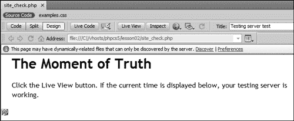

**3.** 点击 Live View 按钮。如果一切正常，您会看到一条简短的消息，随后是当前时间。

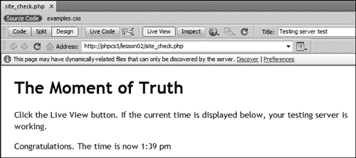

如果出现轻微延迟，请不要担心。启动程序后首次使用 Live View 时，Dreamweaver 通常需要几秒钟与测试服务器建立连接。之后的使用一般会立即显示测试服务器的输出。

**4.** 再次点击 Live View 按钮将其关闭。

如果一切正常，您即可开始使用 PHP 在 Dreamweaver CS5 中进行开发。

如果出现空白页面或错误信息，请检查下一节的故障排除提示。

##### *Troubleshooting the testing server*

如果 Live View 中测试页面未正确显示，请尝试以下操作：

• 检查本地 Web 服务器是否正在运行。

• 按 **F12** / **Opt+F12** 预览页面。如果页面在浏览器中正常显示但 Live View 中不正常，关闭任何安全软件后再尝试 Live View。安全软件可能阻止 Web 服务器与 Dreamweaver 之间的通信。

• 检查 Site Setup 对话框中的 **Server Folder** 与 **Web URL** 设置（参见下一节“编辑站点定义”）。这是设置测试服务器时最常见的错误。

**Server Folder** 是实际的物理路径，**Web URL** 是浏览器用来访问该路径的地址。两者必须指向同一个文件夹。

### 编辑站点定义

如果您发现错误或需要修改站点定义的任何细节，可以通过 **Site > Manage Sites** 打开 Site Setup 对话框。在打开的对话框中，选择要修改的站点名称，然后点击 **Edit** 按钮。

• 要编辑远程或测试服务器的定义，请在 Site Setup 对话框左侧的列表中选择 **Servers**，然后选中想要编辑的服务器并点击编辑图标（看起来像铅笔）。

• 选择 **Version Control** 以设置 Subversion 仓库。使用 Subversion 在本书中未涉及。

• 在左侧列表旁的右侧三角形展开 **Advanced Settings**，其下的 **Local Info** 部分是大多数用户关心的唯一区域。

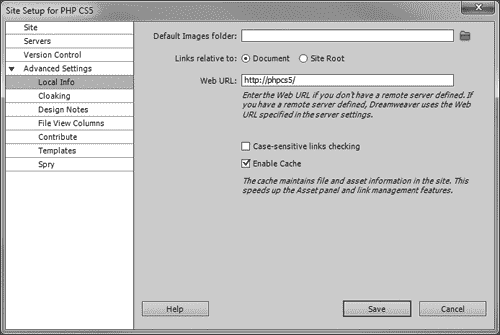

• 使用 “Default Images folder” 文本框定义站点图片的默认存放位置。Dreamweaver 会在您选择站点根目录之外的图片时自动将其复制到该文件夹。

• 使用 “Links relative to” 单选按钮设置站点链接的默认类型（参见本课程早前的“使用相对站点根的链接”侧边栏）。

### **CAUTION!**

如果选择使用相对站点根的链接选项，Dreamweaver 将使用非标准的 PHP 包含函数 `virtual()`。该函数仅在 Apache 环境下工作，并且可能导致某些服务器行为出现问题。若计划大量使用 Dreamweaver 的服务器行为，建议使用默认的链接相对文档设置，仅在个别需要相对站点根的链接时进行覆盖。

• 默认情况下，“区分大小写的链接检查”复选框是未勾选的。由于大多数 PHP 站点托管在区分大小写的 Linux 服务器上，勾选此选项似乎很合理，但实际上它仅在从 **Site** 菜单中运行 **Check Links Sitewide** 命令时检查内部链接的字母大小写。

• “Enable Cache” 默认已勾选。正如复选框下方的说明所述，它能加速 Dreamweaver 内部某些功能。只有在站点包含非常大量文件时才考虑取消勾选，因为一旦站点文件数超过电脑可用内存的一定限制，缓存会反而减慢 Dreamweaver 的响应速度。

点击 **Help** 按钮可获取 Site Setup 对话框中其他选项的详细说明。

编辑完站点定义后，点击 **Save**，然后点击 **Done** 关闭 **Manage Sites** 对话框。

### 备份和恢复站点定义

计算机和软件偶尔会出现故障，甚至出现灾难性故障。如果您拥有多个站点，在 Dreamweaver 崩溃后重新设置它们会非常麻烦，除非您事先做好了备份。Dreamweaver 可以将站点定义导出为 `.ste` 文件，建议将其存放在安全的位置。如果发生崩溃，或想将定义迁移到另一台机器，您可以从 `.ste` 文件恢复站点定义。

操作步骤如下：

**1.** 选择 **Site > Manage Sites** 打开 **Manage Sites** 对话框。

**2.** 使用 **Shift-click** 或 **Ctrl/Cmd-click** 选择需要备份的站点。

**3.** 点击 **Export** 按钮。

如果站点定义中包含登录信息，Dreamweaver 会询问是否导出用户名和密码。所选选项适用于所有正在导出的站点定义。

**4.** 选择存储备份文件的位置，接受 Dreamweaver 建议的文件名，然后点击 **Save**。

Dreamweaver 为每个站点定义创建一个独立的 `.ste` 文件。该文件是 XML 格式，包含 **Site Setup** 对话框中保存的所有详细信息。

如果以后需要恢复站点定义或将其移到其他机器，请选择 **Site > Manage Sites**，点击 **Import** 按钮，然后选择要恢复的 `.ste` 文件。

### **CAUTION!**


The Manage Sites dialog box handles only the site settings, such as server details and the location of files. It does not create a backup of the files within a site. You need to do that separately. Similarly, selecting a site and clicking the Remove button removes only the site definition. It does not delete the site files from your computer. Back up your site definitions regularly. On Windows, they’re stored in the Windows Registry, so restoring them is impossible without a backup. On Mac OS X, you can recover them from a copy of Macintosh HD:<username>:Library:Application Support:Adobe:Common:11:Sites:Site Prefs.

### What You Have Learned

***In this lesson, you have:***

• Installed and tested a local PHP development environment consisting of a web server, PHP, MySQL, and phpMyAdmin (pages 28–32)

• Checked and changed the configuration settings, if necessary (pages 32–39)

• Learned the difference between links relative to the document and links relative to the site root (page 40)

• Seen how to create virtual hosts (pages 40–47)

• Defined and tested a PHP site in Dreamweaver CS5 (pages 47–54)

• Seen how to edit, back up, and restore site definitions (pages 54–56)

Where you go from here depends on your experience and interests. The next lesson provides an introduction to the most important features of PHP for the benefit of readers who are new to the subject or those who need a refresher. If you’re familiar with PHP, you can jump ahead to Lesson 4 to experiment with WordPress.

## Lesson 3. A Quick Crash Course in PHP

### **What You Will Learn**

***In this lesson, you will:***

• See how to embed PHP code in a page and store values in variables and arrays

• Discover how PHP gathers information from an online form

• Explore the use of conditional statements to make decisions

• Learn about functions, objects, and resources

• See how PHP handles arithmetical calculations

• Explore the use of loops for repetitive tasks

• Include external files into a web page

• Decode the mysteries of PHP error messages

### **Approximate Time**

The time required for this lesson depends on your previous experience. Don’t attempt to memorize everything on a first read through; instead, refer back to this lesson when you need to refresh your understanding of PHP.

### **Lesson Files**

***Media Files:***

images/birds_of_a_feather.jpg

styles/examples.css

styles/include_examples.css

***Starting Files:***

lesson03/start/includes_start.php

lesson03/test_includes/year_01.inc.php

***Completed Files:***

lesson03/completed/function_01.php

lesson03/completed/function_02.php

lesson03/completed/function_03.php

lesson03/completed/function_04.php

lesson03/completed/function_05.php

lesson03/completed/function_06.php

lesson03/completed/function_07.php

lesson03/completed/get_01.php

lesson03/completed/get_02.php

lesson03/completed/includes_01.php

lesson03/completed/includes_02.php

lesson03/completed/includes_03.php

lesson03/completed/includes_04.php

lesson03/completed/includes_05.php

lesson03/completed/includes_06.php

lesson03/completed/includes_07.php

lesson03/completed/loops_01.php

lesson03/completed/loops_02.php

lesson03/completed/loops_03.php

lesson03/completed/loops_04.php

lesson03/completed/loops_05.php

lesson03/completed/loops_06.php

lesson03/completed/loops_07.php

lesson03/completed/post_01.php

lesson03/completed/post_02.php

lesson03/completed/post_03.php

lesson03/completed/post_04.php

lesson03/completed/quotes_01.php

lesson03/completed/quotes_02.php

lesson03/completed/quotes_03.php

lesson03/completed/quotes_04.php

lesson03/completed/quotes_05.php

lesson03/completed/strings_01.php

lesson03/completed/strings_02.php

lesson03/completed/strings_03.php

lesson03/completed/time.php

lesson03/test_includes/header_01.html

lesson03/test_includes/header_02.html

lesson03/test_includes/year_02.inc.php

lesson03/test_includes/year_03.inc.php

PHP makes a website dynamic through the ability to organize and manipulate information drawn from various sources, such as an online form, database, or even another website.

This lesson is aimed principally at readers who have no PHP experience, but it should also be a useful refresher if your knowledge is a little rusty or uncertain. It provides you with the basic knowledge that you need to start working with PHP. Skim each section, and work through the various exercises to get a basic feel for how different features work. Then move on to the rest of the book. Come back to this lesson when you need reminders of the language details.

*PHP captures and processes the input of online forms.*

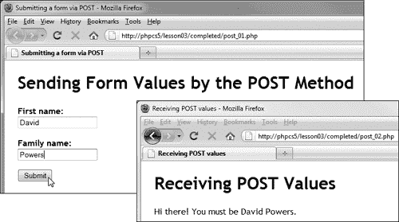

### **How PHP Makes Pages Dynamic**

PHP uses a number of techniques common to most programming languages:

• *Variables* store information that isn’t fixed or known in advance.

• *Arrays* store multiple values, usually of related information.

• *Conditional statements* make decisions, based on such things as the size of a number, the date, or whether something is true.

• *Functions* perform tasks, such as transforming and sorting information, or querying a database.

• *Operators* add, subtract, multiply, divide, and so on.

• *Loops* perform repetitive actions.

#### **Embedding PHP code in a page**

The web server needs to recognize PHP code so that it can process it and send the output to the browser. In addition to giving your pages a `.php` filename extension, you signal the start of any PHP code within a page by using the opening PHP tag, which looks like this:

```php
<?php
```

### **CAUTION!**

There must be no space between any of the characters in the opening tag.

You also have the option of using short opening tags, which consist of the first two characters `<?`. Not all servers support short opening tags. To ensure that your scripts will work everywhere, stick to the full version `<?php`.

You signal the end of a PHP code block with a closing tag, which looks like this:

```php
?>
```

You can have as many PHP code blocks as you like within a page, but you cannot nest them inside each other. In other words, this will work:

**<?php**  

// some PHP code  

**?>**  

<p>A bit of HTML.</p>  

**<?php**  

// some more PHP code  

**?>**

However, the following *won’t* work:

<?php  

// some PHP code  

**<?php**  

**// you cannot do this**  

**?>**  

?>

### **NOTE:**

To save space, most code examples in this book omit the opening and closing PHP tags except where they are needed to show the transition from HTML to PHP and back.

#### **Using comments in PHP scripts**

The examples in the preceding section contain lines beginning with two forward slashes. This is one of the ways of creating a comment in PHP. Comments are ignored by the PHP engine. They’re simply for your benefit.

It’s easy to forget what code is for, so it’s a good idea to add brief comments to your scripts. There are three ways to do so in PHP:

• Everything following two forward slashes is ignored until the end of the line.

• Everything following a hash or number sign (`#`) is ignored until the end of the line.

• Everything between `/*` and `*/` is treated as a comment. This type of comment can stretch across multiple lines.

For example:

// This is a comment  

$name = 'David'; // This comment is alongside code  

\# This is another style of writing a comment  

$name = 'David'; # This type of comment can also go alongside code  

/\* This is a comment that stretches  

   across two lines. \*/

You can also create multiline comments by beginning each line with two forward slashes or the number sign.


在提醒你——以及其他人——代码的功能之外，注释还可以用于禁用脚本的部分。这在调试或测试时经常是必要的。

### 以分号结尾的语句

PHP 脚本通常是一系列 *语句* 或命令。每条语句 *必须* 以分号结尾，例如：

`$name = 'David';`  

`echo $name;`

遗漏分号是新手最常犯的错误之一。

分号很重要，因为与 JavaScript 和 ActionScript 相比，PHP 允许你在多行上分散语句。总体而言，PHP 忽略脚本中的空白字符，这意味着你可以通过缩进和换行来提高可读性。

### 用变量驯服未知数

编程语言之所以强大，是因为它们能处理未知值。每当我访问 Amazon.com 时，它总会在每页顶部用 “Hello, David Powers” 问候我。它通过使用 *变量* 来实现对我的访问的个性化。一个 *变量* 是一个占位符，用于表示你不需要提前知道的值。变量的 *名称* 始终保持不变，但它的 *值* 可以改变。

我们在日常生活中经常使用变量：

• 你的 *名字* 是什么？

• 今天是 *哪天*？

• 我的银行账户 *余额* 是多少？

在 PHP 中，变量很容易识别，因为它们总是以美元符号 (`$`) 开头。你几乎可以为变量起任何名字，只要遵循以下规则：

• 必须以美元符号开头。

• 美元符号后的第一个字符不能是数字，必须是字母或下划线 (`_`)。西方欧洲语言中使用的带重音字符也算作可接受字母（见侧边栏“在变量和函数名称中使用带重音字符”）。

• 后续字符可以包括数字 0–9。

• 空格、连字符和其他标点符号不允许。

• `$this` 是 PHP 面向对象特性预留的特殊变量，不能为它赋值。

### 在变量和函数名称中使用带重音字符

PHP 5 允许在变量和函数名称中使用 ASCII 0x7F 到 ASCII 0xFF 之间的字符。该范围包括 ©、£、¢ 等符号，以及西班牙语中使用的倒置问号和感叹号。虽然可以合法使用这些字符来命名变量和函数，但主要目的是让西方欧洲语言中常用的带重音字符得以使用。例如，西班牙开发者可以使用 `$mañana` 作为变量来存储明天的日期。

下面是用于表示上述日常生活例子的 PHP 变量：

`$name`  

`$day`  

`$balance`

命名变量时，使用有意义的名字很有好处，因为它能让代码更易阅读和理解，尤其是在六个月后回到代码时。不要使用短而晦涩的变量名。Dreamweaver CS5 的代码提示功能可以帮你省去额外的敲击工作。

如果需要在变量名中组合多个单词，可以用下划线分隔，或采用“camel case”（后续单词首字母大写）的写法。例如：

`$first_name`  

`$firstName`

### **CAUTION!**

PHP 变量是区分大小写的。`$firstname` 与 `$firstName` 被视为完全不同的值。

### 给变量赋值

使用等号 (`=`) 给变量赋值。变量放在等号左侧，值放在右侧。但变量可以存储哪些类型的值呢？

PHP 以 *弱类型* 语言闻名。这并不意味着它会被“踢在脸”。相反，这是 PHP 易学的原因之一。在许多编程语言中，你必须明确指定变量将用于何种数据类型，并且之后不能随意更改。而 PHP 不要求如此，变量可以存储表 3.1 中列出的八种数据类型中的任意一种。

**表 3.1 PHP 数据类型**

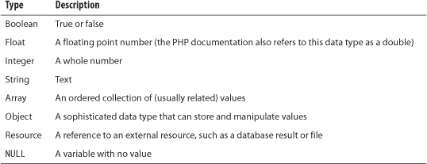

弱类型使得处理表单输入变得容易。HTML 表单会将所有输入值作为文本传递，而 PHP 会智能地判断表单值应作为整数或浮点数使用，而无需你显式更换数据类型。

当你将表 3.1 中的前三种数据类型赋值给变量时，值不需要用引号括起来。例如：

`$love = TRUE;`  

`$lie = FALSE;`  

`$pi = 3.14159;`  

`$answer = 42;`

`TRUE` 和 `FALSE` 是不区分大小写的关键字，因此以下写法也正确：

`$love = true;`  

`$lie = false;`

### **TIP:**

即使在使用不区分大小写的关键字时，也可以混用大小写。例如，`TruE` 和 `FaLsE` 也在技术上是合法的。不过，最好选定一种风格并保持一致。代码的一致性使其更易维护和调试。

`NULL` 也是不区分大小写的关键字。直接向变量赋值 `NULL` 值并不常见，但如果你想在不破坏变量本身的情况下“销毁”变量的值，可以这样做：

`$novalue = NULL;`  

`$novalue = null;`

对其他数据类型的赋值需要更详细的说明。

### 给文本变量赋值

PHP 将一段文本称为 *字符串*，即文本通常由一串字符组成。字符串必须用引号括起来，可以使用单引号或双引号，但必须成对出现。例如：

`$title = 'Adobe Dreamweaver CS5 with PHP';`  

`$author = "David Powers";`

由于整个字符串必须用引号括起来，单引号字符串中若包含撇号会导致错误：

`$movie = 'Wayne's World';`

PHP 会把撇号视为匹配的引号起始位置，导致后面的内容被视为垃圾，进而阻止脚本运行。

一种规避方法是对撇号前加反斜杠（即转义）：

`$movie = 'Wayne\\'s World';`

但这看起来很丑，且在字符串较长且包含多个撇号或单引号时难以阅读。更优雅、更易读的做法是使用双引号：

`$movie = "Wayne's World";`

同样，如果想在字符串内部使用双引号，最好用单引号包裹整个字符串：

`$theater = 'I saw "Hamlet" last night.';`

有时不得不使用反斜杠转义引号：

`$theater = 'We saw "A Midsummer Night\\'s Dream".';`

但上述写法比下面更易读：

`$theater = "We saw **\\** "A Midsummer Night's Dream**\\**".";`

单双引号的使用并不局限于此。在普通文本中，使用哪种引号并不重要。但双引号在变量和转义字符方面具有特殊作用。

### 使用引号的变量

变量充当占位符，用于存储提前未知的值。下面的例子在同一页面中使用了硬编码变量，但请想象这些值来自在线表单或数据库。

`quotes_01.php`、`quotes_02.php` 和 `quotes_03.php`（位于 lesson03/completed 目录）都包含如下变量定义：

`$name = 'David';`

`echo` 命令用于在屏幕上显示字符串或包含字符串的变量值。`quotes_01.php` 使用 `echo $name;` 且不加引号，如下：

<p><?php echo $name; ?></p>


它输出 `$name` 的值，如下面的屏幕截图所示。

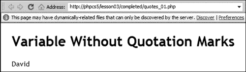

在 quotes_02.php 中，`$name` 被嵌入到一对单引号括起来的字符串中，如下所示：

<p><?php echo 'Hello, $name.'; ?></p>

PHP 将任何被单引号括起来的内容视为纯文本。因此，`$name` 被视为普通文本，而不是变量，直接显示。

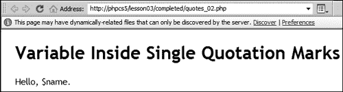

如果使用双引号呢？在 quotes_03.php 中，`$name` 被嵌入到字符串中，如下所示：

<p><?php echo "Hello, $name."; ?></p>

这次变量的值会被显示。

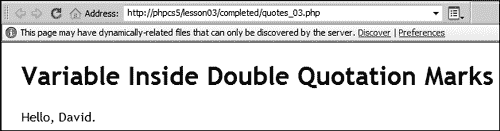

### **TIP:**

关于在字符串中嵌入变量的基本规则是：使用双引号括起来字符串。

#### **使用引号的数组变量**

遗憾的是，规则总存在例外。数组变量（后文会解释）常用引号来标识其元素。在 quotes_04.php 和 quotes_05.php 中，有一个名为 `$book` 的数组，包含作者姓名和书名。在 quotes_04.php 中，数组变量的使用方式如下：

<p><?php echo "$book\['title'\] by $book\['author'\]"; ?></p>

虽然这符合现有规则，但会导致 PHP 报错，令许多程序员头痛。

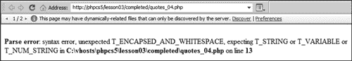

### **NOTE:**

PHP 错误信息及其解释在本课时末尾的“理解错误信息”部分有所介绍。

要在字符串中正确嵌入数组变量，需要用大括号将每个变量括起来（示例代码位于 quotes_05.php）：

<p><?php echo "**{**$book\['title'\]**}** by **{**$book\['author'\]**}**"; ?></p>

这样变量即可被正确解释。

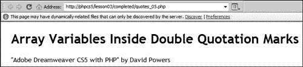

### **TIP:**

如果你想知道双引号为什么出现在标题周围，那是数组变量的定义所决定的。

#### **在字符串中使用转义字符**

转义字符是一种特殊字符，用于让字符被不同方式处理。例如，你已经看到如何在字符串中用反斜杠转义撇号或双引号。在单引号括起来的字符串中，只有撇号或单引号需要使用转义字符。其他转义字符仅在双引号中使用。最常用的转义字符列表见 **Table 3.2**。

**Table 3.2 双引号字符串中使用的转义字符**

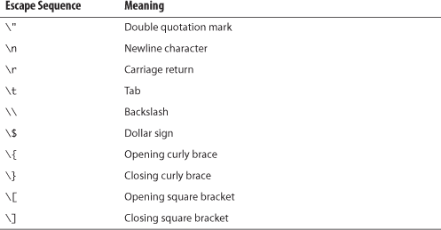

由于换行符、回车符和制表符在浏览器渲染网页时会被忽略，你可能会想到何时使用它们。PHP 不仅限于生成网页，还可用于其他任务。例如，在发送电子邮件的 PHP 脚本中，`"\r\n"` 经常被使用。邮件消息的头部需要包含回车符和换行符。

### **数组中 grouping 相关值**

*数组* 是一种特殊变量类型，可存储多个值。数组通常用于将相关项目分组。

#### **创建基本数组**

使用 `array()` 构造函数创建数组。在括号内列出值，并用逗号分隔。例如：

$friends = array('Tom', 'Dick', 'Harriet');

**TIP:**

美国读者注意：逗号位于引号外部。逗号分隔值，引号是字符串的组成部分。

变量 `$friends`  collectively 指代 Tom、Dick 和 Harriet，但若要单独引用每个值（即数组元素），需要使用其位置（即 *key* 或 *index*）。

通过在变量名后加方括号并指定索引来引用单个数组元素。和大多数编程语言一样，PHP 从 0 开始计数数组元素。因此，Tom 是 `$friends[0]`，Dick 是 `$friends[1]`，Harriet 是 `$friends[2]`。

要向数组中添加元素，使用空方括号 `[]`：

$friends[] = 'Amanda';

Amanda 现在是 `$friends[3]`。

如果重新排序数组，索引会变化。例如，如果对 `$friends` 按字母顺序排序，Amanda 变为 `$friends[0]`，Tom 变为 `$friends[3]`。虽然这可能让人困惑，但这与重新排序 HTML 有序列表中的 `<li>` 元素类似。只有在需要定位数组中特定位置的元素时，这些数字才常用。

使用数字索引的数组有时称为 *索引数组*。在许多情况下，数字索引足够。但 PHP 也允许自定义数组键。

#### **创建关联数组**

键为用户自定义的字符串的数组称为 *关联数组*。你为每个元素指定字符串键，并使用 `=>`（等号后紧跟大于号）赋值。例如，下面是“使用引号的数组变量”示例文件中的 `$book` 数组：

$book = array('author' => 'David Powers',  

              'title'  => '"Adobe Dreamweaver CS5 with PHP"');

每个数组元素可以通过在变量名后用引号括起来的键来引用，例如：

$book\['author'\] // 值为 'David Powers'  

$book\['title'\]  // 值为 '"Adobe Dreamweaver CS5 with PHP"'

你也可以通过创建新键来添加新值：

$book\['publisher'\] = 'Adobe Press';

在这些例子中，数组中的值都是字符串，但数组可以存储任意合法值。你可以在同一个数组中混合不同类型的值，甚至创建多维数组（数组的数组）。例如，你可以创建名为 `$books` 的数组，其中每个元素是一个包含作者、标题和出版社的关联数组。要获取第二本书的作者，你需要同时使用两个键：`$books[1][‘author’]`。

数组在 PHP 中扮演重要角色。当处理数据库查询结果时，数组使用非常频繁。PHP 提供了大量数组函数，不仅可以排序、合并数组，还能提取一个数组中独有的值。此外，如前面所述，PHP 使用循环遍历数组，执行重复任务。如果你需要对大量项目执行相同操作，使用数组可以让你只需指定遍历即可自动对每个元素进行操作。

一些最有用的数组——*超级全局数组*—是 PHP 自动创建的。

#### **从超级全局数组获取有用信息**

超级全局数组会自动由 PHP 创建。你最常用的是 `$_POST` 和 `$_GET`。顾名思义，`$_POST` 和 `$_GET` 会自动捕获通过 `POST` 和 `GET` 方法提交的表单值。例如，如果你有一个名为“phone”的文本输入框，其值可以通过 `$_POST[‘phone’]` 或 `$_GET[‘phone’]` 获取，具体取决于表单的提交方式。

下面的快速练习演示了 `$_POST` 和 `$_GET` 的工作原理：

**1.** 在文件面板中，双击 lesson03/completed 目录下的 post_01.php 打开它。该页面包含一个包含两个文本输入框的表单。

**2.** 查看代码视图中的表单。两个输入框的 `name` 属性分别为 `first_name` 和 `family_name`。


3. 通过按 `F12`/`Opt+F12` 来在浏览器中打开页面。

4. 在相关字段中输入你的名和姓，然后点击 `Submit`。

你在字段中输入的值应该会在 `post_02.php` 中显示，如本课第一页的截图所示。

如果你查看 `post_02.php` 中的 PHP 代码，你会看到如何使用 `$_POST` 超全局数组捕获并显示这些值：

```php
<?php echo "{**$\_POST\['first_name'\]**} {**$\_POST\['family_name'\]'}"; ?>
```

文件 `get_01.php` 和 `get_02.php` 的工作方式完全相同，只是表单使用了 `GET` 方法，值是通过 `$_GET` 超全局数组捕获并显示的：

```php
<?php echo "{**$\_GET\['first_name'\]**} {**$\_GET\['family_name'\]'}"; ?>
```

另外，使用 `GET` 方法时，表单输入数据会以名/值对的形式附加在 URL 之后的问号（?）后面，这称为 `query string`。

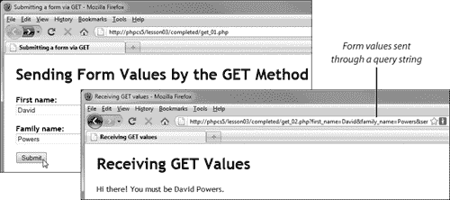

### **决定是否使用 GET 或 POST**

`GET` 方法会将输入数据作为附加在 URL 后的查询字符串（query string）显示，因此绝对不要用它提交敏感数据，例如密码或信用卡号。此外，Internet Explorer 大约只能传输约 2,000 个字符的数据。相反，`POST` 方法在后台发送数据，能够处理更大的数据量。实际上，PHP 服务器的默认上限是 8 MB，单个数据项不超过 2 MB，但这两个限制都可以由服务器管理员修改。

`GET` 的优势在于可以将包含查询字符串的 URL 书签，使其非常适合用于搜索表单。你也可以在普通链接中添加查询字符串，这在后续数据库操作中很有用。然而，在大多数其他情况下，应该使用 `POST` 方法。

**Table 3.3** 列出了所有超全局数组并说明了它们的用途。除了 `$_GET` 和 `$_POST` 之外，最有用的还有 `$_FILES`、`$_SESSION` 和 `$_SERVER`。你将在后续课程中分别使用这些超全局。

**Table 3.3 The PHP Superglobal Arrays**

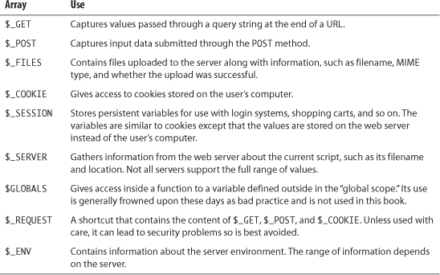

### **使用条件语句进行决策**

前一节的练习在提交 `post_01.php` 中的表单后，会在浏览器中加载 `post_02.php`。假设你填写了两个字段，第二页会显示你的名字。但在网站上，不能假设访客总会按预期操作。有些人可能会忘记填写所有字段，也有人可能有意填入垃圾信息，甚至尝试入侵系统。你需要为每种情况做好准备，并使用条件语句决定后续操作。

条件语句基于“是/否”或“true/false”的逻辑。基本结构非常简单：

```
if (TRUE) {  
  // do something  
}
```

条件是跟在关键字 `if` 后面的括号内的表达式。

决定条件为真的方式有：

• 某个值是否大于、小于或等于另一个值？

• 变量是否存在或是否有值？

• 变量是否被显式设置为 `TRUE` 或 `FALSE`。

• PHP 隐式视为 `TRUE` 或 `FALSE` 的值。

如果条件为 `TRUE`，则花括号内的代码被执行；如果为 `FALSE`，则花括号内的代码被跳过。

如果你想在条件不成立时执行其他操作，使用 `else` 关键字并跟随另一对花括号：

```
if (TRUE) {  
  // do something  

} else {  
  // do something else  

}
```

你不止可以有两个选项。可以设置一系列条件，每个条件依次被评估。使用 `elseif` 为每个额外的条件提供条件：

```
if (condition1) {  
  // do something  

} elseif (condition2) {  
  // do something else  

} else {  
  // default action  

}
```

### **NOTE:**

关键字 `elseif` 通常写作一个词，但也可以在 `else` 与 `if` 之间加入空格。

#### **使用比较运算进行决策**

基于比较值的条件使用 **Table 3.4** 中列出的比较运算符。最后四个运算符与普通数学中的相同。

**Table 3.4 Comparison Operators Used in PHP**

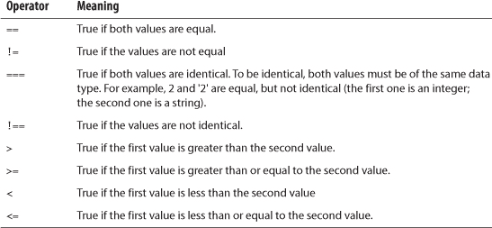

作为简单的例子，下面的条件语句会向名为 “David” 的人显示特定内容，向其他人显示通用内容：

```
if ($name == 'David') {  
  // show David's stuff  

} else {  
  // show generic content  

}
```

当然，世界上有很多 “David”，在实际应用中需要更健壮的判断。关键是比较值时要使用 **两个** 等号，而不是一个。

### **TIP:**

即使经验丰富的开发者也会忘记使用单个等号，这会导致条件总是为 `TRUE`，因为赋值成功即为真。如果你的条件语句产生意外结果，很可能是使用了单个等号而不是双等号。

许多决策基于数值比较。电子商务应用的典型场景如下：

```
if ($total < 100) {  
  $delivery = 5;  

} else {  
  $delivery = 0;  

}
```

#### **测试多个条件**

你也可以测试多个条件。例如，在电子商务应用中，你可能想为总金额在特定范围内设置不同的运费。要判断一个值是否在指定范围内，需要同时检查它大于下限 **且** 小于上限。 **Table 3.5** 中的逻辑运算符允许你在同一条件中组合测试。

**Table 3.5 Logical Operators in PHP**

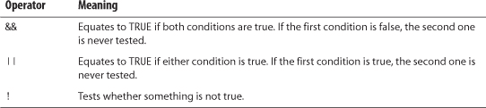

### **NOTE:**

你可以用 `and` 替代 `&&`，用 `or` 替代 `||`。但为避免与条件评估顺序相关的潜在问题，建议使用 `&&` 和 `||`。

因此，若要为总金额在 50 到 100 之间设置不同的运费，可修改条件语句如下：

```
if ($total < 50) {  
  $delivery = 5;  

} elseif ($total >=50 && $total < 100) {  
  $delivery = 3;  

} else {  
  $delivery = 0;  

}
```

编写一系列条件语句时，确保它们遵循逻辑顺序。PHP 会按顺序评估每个条件，一旦发现某个条件为 `TRUE`，就会跳过其余的条件。条件语句的顺序可以提升脚本的执行效率；如果可能，先测试最可能出现的情况。

下面的练习展示了使用条件语句在表单提交时决定显示内容的方式：

**1.** 在浏览器中打开 `post_01.php`，然后提交表单而不填写任何字段。第二页会显示，但问候语看起来很奇怪，因为文本框为空，后面没有内容。

**2.** 点击浏览器地址栏，按回车键加载 `post_02.php` 而不重新提交表单。此时会出现以下丑陋的错误信息。

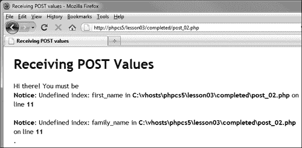

这些信息提示 `$_POST[‘first_name’]` 与 `$_POST[‘family_name’]` 不存在。

### **NOTE:**


如果不看到任何错误信息，这意味着 `display_errors` 在您的 PHP 配置中已关闭，或者 `error_reporting` 已设置为低于前一课中 表 2.1 所推荐的级别。

`3` 在浏览器中加载 `post_03.php`。页面包含相同的表单，但数据提交到另一个页面。

`4.` 点击“提交”按钮，而不在任一文本框中输入任何内容。与丑陋的错误信息不同，您应看到一个自定义错误信息以及一条链接，用于返回表单。

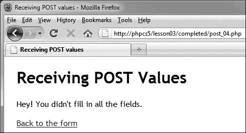

`5.` 点击链接返回 `post_03.php`，并在两个框中填写内容。

`6.` 点击“提交”按钮。此次您应看到与上一练习相同的姓名问候。返回表单的链接不再显示。

控制页面显示内容的 PHP 代码如下：

`<?php`

`if (empty($_POST['first_name']) || empty($_POST['family_name'])) {`

`?>`  

`<p>Hey! You didn't fill in all the fields.</p>`

`<p><a href="post_03.php">Back to the form</a></p>`

`<?php } else { ?>`

`<p>Hi there! You must be <?php echo "{$_POST['first_name']} {$_POST['family_name']}"; ?>.</p>`

`<?php } ?>`

第一段 PHP 代码使用名为 `empty()` 的函数检查变量是否有值（函数在后文说明）。条件语句使用 `||`，因此只要任一文本框为空，结果即为 `TRUE`。要仅在两个字段均为空时显示错误信息和链接，请将 `||` 替换为 `&&`。

### 使用逻辑非运算符

逻辑非运算符是感叹号（`!`），直接放在值或条件前面。它将 `TRUE` 变为 `FALSE`，反之亦然。

前一练习使用 `empty($_POST[‘first_name’])` 检查 `$_POST[‘first_name’]` 是否为空。在该表达式前加上感叹号，则会检查其相反情况。下面的条件语句判断 `$_POST[‘first_name’]` 是否**不为空**——即它包含值：

if (`!`empty($_POST['first_name'])) {  

    echo $_POST['first_name'];  

}

如果 `$_POST[‘first_name’]` 不为空，则大括号内的代码会输出该值；如果为空，条件为 `FALSE`，什么都不会发生。

### PHP 视为假的值

PHP 将以下值视为假或隐式假：

• 关键字 `FALSE` 和 `NULL`（不区分大小写）

• 数字 0（作为整数、浮点数或字符串 `‘0’`）

• 空字符串（`‘’` 或 `“”`，中间无空格）

• 空数组（没有元素的数组）

• 由空标签创建的 SimpleXML 对象

其余所有值均视为真。

### `CAUTION!`

与 JavaScript 相比，PHP 将 `-1`（负一）视为 `TRUE`。还需注意，`FALSE` 与 `NULL` 是关键字，不能加引号。给它们加引号会把它们转换为非空字符串，从而被视为 `TRUE`。

### **使用函数执行任务**

*函数*会执行预定义任务。典型的 PHP 安装包含 1,500 多个内置函数，为您提供强大的工具箱。有些函数执行相对简单的任务，例如将字符串转换为大写；有些则能轻松处理复杂操作，如生成缩略图。大多数开发者只使用其中的一小部分函数，但了解它们的存在在需要时非常有用。

函数总以一对括号结尾。有时括号为空，例如显示 PHP 配置信息的 `phpinfo()` 函数。

然而，您经常需要通过在括号内传入值来调用函数。前一练习使用 `empty()` 检查 `$_POST[‘first_name’]` 与 `$_POST[‘family_name’]` 是否有值，方法是将每个变量单独传递给函数：

empty($_POST['first_name'])

这称为向函数 **传递参数**。

`empty()` 函数仅接受一个参数。其他函数可能接受多个参数，部分参数可选。当函数需要多个参数时，参数必须用逗号分隔，并**遵循函数期望的顺序**。记住要使用哪些参数以及顺序可能很困难，即使是经验丰富的程序员也会遇到这种困扰。好在 Dreamweaver 的代码提示功能可以免除您记忆所有细节的负担。

### `NOTE:`

在脚本中向函数传递值时，这称为“参数”。而在函数定义中，它叫“形参”。两者区别极其细微，大多数开发者会 interchangeable 使用这两个词。本书中，我通常使用“参数”一词。

某些函数会修改传递给它们的变量值。例如，`sort()` 函数会改变数组的顺序。

$letters = array('c', 'a', 'b');  

sort($letters);  

// array is now 'a', 'b', 'c'

然而，在大多数情况下，您需要捕获函数对变量所做的任何更改，方法是将函数的返回值重新赋给同一个变量或赋给新变量。这样可以在需要时保留原始值。

课程 03 的练习文件示例：

**1.** 在文档窗口中打开 `function_01.php`。

**2.** 切换到代码视图。页面包含 HTML 与 PHP 的混合内容。HTML 仅用于说明目的。若专注于 PHP，代码如下：

$name = 'David';  

echo $name;  

echo strtoupper($name);  

echo $name;

第三行使用名为 `strtoupper()` 的函数，尽管其名字听起来怪异，一旦了解它是将 *str*ing *to upper*case（字符串转大写），便易于理解。

**3** 切换到设计视图，点击“Live View”按钮。您应看到 `$name` 的值已被 `strtoupper()` 转换为大写，而原始值保持不变。

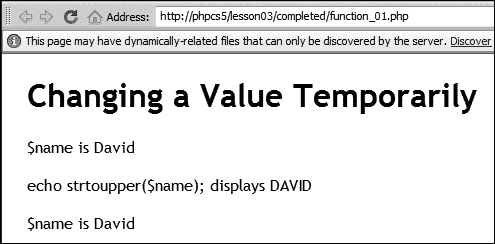

这种行为在需要不区分大小写比较两个字符串时很有用。如果您暂时将两个值都转换为大写，即可在不丢失原始拼写的前提下进行比较。

**4.** 打开 `function_02.php` 并在 Live View 中测试。该文件同样混合了 HTML 与 PHP，PHP 代码如下：

$name = 'David';  

**$name_upper = strtoupper($name);**  

echo $name_upper;  

echo $name;  

**$name = strtoupper($name);**  

echo $name_upper;  

echo $name;

在此例中，`strtoupper($name)` 的结果被赋给新变量 `$name_upper`。第一次显示 `$name_upper` 与 `$name` 时，`$name_upper` 为全大写，而 `$name` 保持不变。但在第五行，`strtoupper($name)` 被重新赋值给 `$name`，因此随后再次显示时，`$name_upper` 与 `$name` 均为大写。

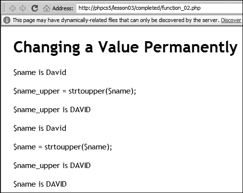

### 读取 PHP 函数文档

那么，如何知道函数期望的参数以及是否需要将结果存入变量？RTFM。 depending on whom you ask and what mood they’re in, this stands for “read the fine manual,” “read the friendly manual,” or something not quite so polite.


The PHP manual is both fine and friendly. Dreamweaver CS5 makes it even more so by putting most of it at your fingertips. By pressing `Ctrl+spacebar` in a PHP code block, you activate code hints. As you start typing, Dreamweaver narrows down the candidates. By the time you have typed **strtou**, you are presented with the code hint for `strtoupper()` and its page from the PHP documentation.

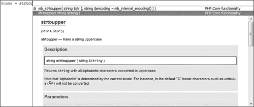

Immediately beneath the name of the function are the versions that support it with a brief explanation of what the function does. The function name at the top left is also a direct link to the same page in the online documentation. The rest of the page is divided into the following sections:

• **Description.** This not only describes the function in more detail, but also shows you the function signature.

The *function signature* is a formal way of describing how to use a function, and learning how to read it will make your life a lot easier. You read it in conjunction with the next two sections in the documentation.

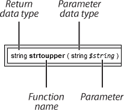

• **Parameters.** This section describes the parameters (arguments) that the function expects, if any (some functions don’t take arguments). In the function signature, each parameter is displayed in italics and prefixed with a dollar sign. Most parameters have names that act as a clue. For example, `strtoupper()` expects a string, so the parameter is called `$string`. Functions that search for something usually have parameters called `$needle` and `$haystack`.

In the case of `strtoupper()`, it’s obvious that the data type of `$string` should be a string, but that’s not always the case. So, the name of each parameter is preceded by the data type that it should be. The data type is always one of those listed in Table 3.1. The documentation abbreviates Boolean and integer as “bool” and “int” respectively. When more than one data type is acceptable, it’s shown as “mixed.”

Some functions take optional arguments, which are shown in the signature in square brackets. Optional arguments always come at the end of the signature.

If the function permanently changes the value of a variable passed to it—as in the case of `sort()`—the parameter name in the signature is prefixed by an ampersand like this: `&$array`.

• **Return Values.** Functions normally *return* a value. In the case of `strtoupper()`, the return value is an uppercase string. On the other hand, `sort()` returns a Boolean telling you whether the sort was successful. The return value is shown in the function signature as a data type to the left of the function name. Some functions don’t return a value. In this case, the return data type is shown as “void.”

• **Examples.** This provides one or more concrete examples of how to use the function and the type of output to expect. This is the really useful section of the documentation.

The online version of the documentation is organized according to categories. Two of the most useful are string functions and array functions. To access the documentation quickly from Dreamweaver, click the link at the top of the page that is displayed with the code hints to go to the same page in the online documentation. Click the link for related functions in the navigation menu on the left of the page to view a useful page with a one-line description of each function.

Visiting the PHP online manual like this is a good way to learn more about PHP.

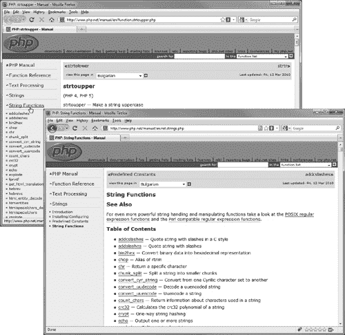

#### **Creating your own functions**

With so many functions in core PHP, the idea of creating your own might sound odd. But this is what makes languages like PHP so powerful. Building your own functions is a way of combining existing functions to fit your needs. If you have a routine that needs to be repeated several times, a custom function saves time and effort. It also helps reduce mistakes. Once you have created and tested a function, you can use it repeatedly and be confident that it will always work the same way—and if there’s an error, you need to correct it in only one place.

You define a function with the `function` keyword, followed by the name of the function, and a pair of parentheses. Any arguments go between the parentheses as a comma-separated list, and the code that you want the function to execute goes between a pair of curly braces.

You can name a function anything you like, following the same rules as a variable. It should contain only alphanumeric characters and the underscore, and shouldn’t begin with a number. You also must avoid using the name of an existing function.

### **TIP:**

If you choose a name that is already in use, PHP generates an error message telling you that you cannot redeclare the function of that name.

You saw how `strtoupper()` converts a string to uppercase. Another function called `strrev()` reverses the order of a string. Let’s say that for some mad reason you need to reverse text and display it in uppercase. The PHP code in function_03.php passes a variable containing the title of this book first to `strrev()` and then to `strtoupper()` like this:

$title = 'Adobe Dreamweaver CS5 with PHP';  

echo $title;  

$title = strrev($title);  

echo $title;  

$title = strtoupper($title);  

echo $title;

This does the job as expected.

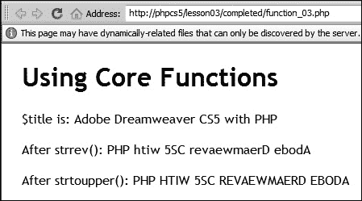

If you need to do this repeatedly, you can modularize your script as a function like this:

function upBack($text) {  

  $text = strrev($text);  

  echo strtoupper($text);  

}

Then all that’s necessary is to pass the value to `upBack()` as an argument like this:

upBack($title);

### **NOTE:**

This example is for illustrative purposes only. Using `echo` in a function is generally considered bad practice. You should normally return a value from a function as described next.

You can find the code in function\_04.php. If you examine the page in Code view, you’ll see that the function definition is at the bottom of the page, way after the function has already been used. As long as the function definition is in the same page, it doesn’t matter where you define it, so it’s often convenient to keep all function definitions together rather than mix them in with the rest of the script.

This function automatically displays the converted string, so the original value is preserved. However, to assign the result to a variable, you need to use the `return` keyword like this:

function upBack2($text) {  

  $text = strrev($text);  

  **return** strtoupper($text);  

}

The code in function\_05.php reassigns the value of `upBack2($title)` to the `$title` variable like this:

$title = upBack2($title);

As a result, `$title` now contains the value returned from `upBack2()`, permanently changing the string.


### **Understanding Variable Scope**

Functions act rather like a black box. What happens inside the box is invisible to everything outside. Normally, when you pass a variable as an argument to a function, only the value is passed to the function. In the case of `upBack2()`, the value is passed as an argument to `$text`. Once the function completes its task, `$text` ceases to exist, and it is created again only if the function is reused.

The *scope* of a variable—in other words, where it can be used—depends entirely on where the variable is defined. A variable defined in a function or as one of its parameters is limited in scope to that function. It cannot be seen outside the function. Equally, a function has no knowledge of or influence over variables outside. In the example in function\_06.php, there’s no cause for confusion, because the external and internal variables have different names.


However, what happens if both variables have the same name? In function_07.php, `$title` has been changed to `$text`, and it’s passed as an argument to `upBack2()`. If you test the page, you’ll see the value of `$text` that was declared outside the function remains unchanged.


In a small script, it’s easy to keep track of variable names. But as your project grows, you could easily end up reusing the same name for a variable that’s used inside a function. By keeping the internal working of functions separate from everything else, variable scope reduces the need to worry about names clashing.

This change in the value of `$title` comes about only through capturing the return value. Forgetting to capture the return value of a function is a common beginner’s mistake. The code in function_06.php shows what happens when the return value of `upBack2($title)` is not assigned to a variable.


As soon as a function encounters the `return` keyword, it processes the rest of the line and returns the value. Any other code inside the function is ignored.

### **Using Objects and Resources**

The name “object” comes from *object-oriented programming* (OOP), a practice common in most modern programming languages. As projects get bigger, code becomes more complex. Mistakes become not only more likely, but also more difficult to detect. OOP tackles this problem by breaking down complex tasks into simple units—the idea being that small units of code are easy to maintain. Once a unit has been tested, you know it will produce reliable results.

OOP also promotes the reuse of code, so you’re not constantly reinventing the wheel. The code that defines an object’s features is called a *class*, which can be regarded as a blueprint for making objects. Some classes are built into core PHP, but you can also create your own, or use a third-party class library, such as the Zend Framework. What makes OOP attractive and powerful is that most classes can be extended, and the new class inherits all the features of its parent. As a result, objects are becoming an increasingly important part of PHP.

PHP is not an object-oriented language, but it does have strong support for OOP. Since the release of PHP 5 in 2004, many classes have been built into the language, and the Zend Framework that you will use later in this book is written entirely in OOP. At this stage, all you really need to know about objects is what they are and how to use them.

In practical terms, an object is a variable capable of storing multiple values—called *properties*—in the same way as an associative array. An object also has access to functions—called *methods*—that are directly associated with it.

#### **Creating an object**

You create—or *instantiate*—an object in a similar way to assigning the return value of a function to a variable. The function that creates an object is known as a class *constructor*. Like a function, the constructor may take a number of arguments. The difference is that the constructor is preceded by the keyword `new`.

A copy of the example from Lesson 1, time.php, is in lesson03/completed. It uses two core PHP classes, `DateTime` and `DateTimeZone`. The code begins like this:

$now = **new** DateTime();

This creates a `DateTime` object called `$now`. As the class name suggests, the object represents the current date and time. Closely related to the `DateTime` class is another one called `DateTimeZone`. To create a `DateTimeZone` object, you pass the constructor a string identifying the time zone like this:

$ldn = new DateTimeZone('Europe/London');

That creates a `DateTimeZone` object for the part of the world where I live. To create another one for the West coast of the United States, you can use this:

$westCoast = new DateTimeZone('America/Los\_Angeles');

### **NOTE:**

The PHP documentation lists all the valid time zones at [`docs.php.net/manual/en/timezones.php`](http://docs.php.net/manual/en/timezones.php).

What’s great about these two classes is that they are fully aware of daylight saving time, and they automatically adjust the time regardless of where your server is located. To set the time zone for a `DateTime` object, you use the `DateTime` class’s `setTimezone()` method, and pass it a `DateTimeZone` object as its argument. The `->` operator (a hyphen followed by a greater-than sign) gives you access to the methods and properties of an object.

So, you access the `setTimezone()` method like this:

$now->setTimezone($ldn);

The `$now` object is now set to UK time.

Another method of the `DateTime` class is `format()`. As its name suggests, it formats the date and/or time. Unfortunately, it takes as an argument an arcane set of modifiers, which even experienced users find impossible to remember (thank goodness the PHP documentation is built into Dreamweaver CS5).

You display the time using the 12-hour clock like this:

echo $now->format('g.i a');

To change the time zone to the West coast of the United States, you can pass an object to the `setTimezone()` method like this:

$now->setTimezone($westCoast);

Alternatively, you can create the `DateTimeZone` object directly as the argument to the `setTimezone()` method like this:

$now->setTimezone(new DateTimeZone('America/Los\_Angeles'));

You can see how the time zone is changed by testing time.php in Live View or a browser.


### **NOTE:**

The preceding screen shot, like the one in Lesson 1, was taken when the United States had already switched to daylight saving time but the UK had not, which explains why the time difference is seven hours rather than the normal eight.

The `DateTime` class doesn’t have properties, but you access an object’s properties in exactly the same way with the `->` operator:

$someObject->someProperty

#### **Using resources**

A resource is a reference to something outside PHP, for example, a database connection or a file that you want to read or write to. In some cases, the result of a database query is also a resource.

You create a resource by assigning the result of a function to a variable. Once created, the resource is required as an argument to other functions that access the resource. For example, the `fopen()` function opens a file for writing like this:

$file = fopen('somefile.txt', 'w');

Assuming that the text you want to write to the file is contained in `$contents`, you pass both the resource and the text to the `fwrite()` function as arguments:

fwrite($file, $contents);

Finally, close the file by passing the resource to the `fclose()` function like this:

fclose($file);

You can’t do anything directly with a resource on its own. But it provides an essential link to the file, database, or other resource that you’re dealing with.

### **Using Operators for Calculations and Joining Strings**

PHP is often used for e-commerce and other applications, such as mortgage calculators. A lot of the hard number crunching can be done with mathematical functions. There are nearly 50 of them in the core distribution of PHP, and you might have access to even more, depending on your configuration (for details, see [`docs.php.net/manual/en/refs.math.php`](http://docs.php.net/manual/en/refs.math.php)).

Basic calculations use the arithmetic operators listed in **Table 3.6**.

**Table 3.6 PHP Arithmetic Operators**


Modulo division finds the remainder of the division of one number by another. This can be very useful for working out whether a number is odd or even, because dividing by 2 always produces 1 or 0.

The operators that increase and decrease a value by 1 are used mainly in loops (see “Automating Repetitive Tasks” later in this lesson). They work in different ways, depending on where you put the two plus or minus signs.


When the operator comes after the variable, 1 is added or subtracted from the value *after* any other calculation has been performed. For example:

`$i = 1;`

`$x = $i++ * 2; // $x is 2`

`$y = $i++ * 2; // $y is 4`

In the first line, `$i` is assigned the value 1.

In the second line, `$i` is multiplied by 2, producing 2. After the calculation, `$i` is incremented by 1. Consequently, in the third line, `$i` is 2 when it is multiplied by 2, producing 4. Again, `$i` is incremented by 1 after the calculation, so if it’s used later in the script, its value will be 3.

The opposite happens if the operator is placed before the variable like this:

`$i = 1;`

`$x = ++$i * 2; // $x is 4`

`$y = ++$i * 2; // $y is 6`

In this case, the value of `$i` is incremented by 1 *before* the calculation. So, in the second line, `$i` becomes 2 before being multiplied by 2, and in the third line, it’s 3 before being multiplied.

Calculations involving more than two values are performed using the normal rules of arithmetical precedence. Multiplication and division are performed first, followed by addition and subtraction. For example:

`$x = 10 + 2 * 5;`

This results in `$x` being 20, not 60, because 2 is multiplied by 5 before being added to 10. If you want the addition to be performed first, you need to enclose that part of the calculation in parentheses like this:

`$x = **(**10 + 2**)** \* 5;`

This results in `$x` being 60.

### **NOTE:**

I have used numbers in most of these examples to make them easier to read. In a PHP script, they would often be replaced by variables. Yes, all those years of algebra in school are about to come flooding back!

It goes without saying that the arithmetic operators work with integers and floats. What might come as a surprise is that they also work with strings.

#### **Using strings in calculations**

As mentioned earlier, PHP is a weakly typed language, so it doesn’t insist—like some other languages—on you specifying the type of data a variable contains. So, if your script uses a string in an arithmetical calculation, PHP obligingly converts it to a number, and you usually get the result you expected.

This flexible approach makes a lot of sense, because online forms submit all data as text—that is, even numbers submitted from a form are treated as strings. So, the following calculations work without problem:

`$x = '2' * '2';      // $x is 4`

`$y = '3.4' * '2.6';  // $y is 8.84`

Even though the values in these calculations are strings, the results are numbers: `$x` is an integer, and `$y` is a float. Within a PHP script, you don’t really need to worry about the data type, but it might be important if you are transferring the PHP output to another application that requires a particular data type.

### **TIP:**

For details of how to convert from one data type to another, see [`docs.php.net/manual/en/language.types.type-juggling.php`](http://docs.php.net/manual/en/language.types.type-juggling.php).

If you have experience with JavaScript, the result of the following calculation might come as a surprise:

`$addition = '2' + '2';`

• In JavaScript, this produces 22, because the plus sign (`+`) is used not only for addition, but also to join two strings together.

• In PHP, the result is 4, because the plus sign is used only for addition.

You can see the different results in strings_01.php, where both results are calculated dynamically.


I’ll explain in a moment how you join strings together in PHP, but there’s one more detail you need to know about using strings in calculations. The file strings_02.php contains the following calculation:

`$mayhem_or_harmony = '2 dogs' + '2 cats';`

Again, PHP does its best to perform the calculation. If you test strings_02.php, you’ll see the result is 4, and the `gettype()` function reveals that it’s treated as an integer.


If you’re familiar with JavaScript, what’s happening here is similar to using `parseInt()` or `parseFloat()` to extract a number at the beginning of a string. Unlike JavaScript, PHP does the conversion automatically.

However, the number must be at the beginning of the string. If anything else precedes the number, PHP cannot extract it and silently converts the value to 0. And just in case you were wondering, `‘two’ + ‘two’` is also 0.

#### **Joining strings**

As you have just discovered, PHP does not use the plus sign to join strings. Instead, it uses a period (`.`) or dot. Because of its size, it can be easy to miss in code, so it’s a good idea to put a space on either side to make it easier to see. However, adding space around the period—or *concatenation operator*, to use its correct name—doesn’t add any space to the resulting string.

### **NOTE:**

Concatenation, a term frequently used in computer contexts, means linking together in a chain or series.

The code in strings_03.php looks like this:

`$first_name = 'David';`

`$family_name = 'Powers';`

`$full_name = $first_name . $family_name;`

`echo $full_name;`

Because the two strings are simply joined together, `$full_name` contains no space between my first and family names.


If you want space between concatenated strings, you need to add it. One way is to insert a space as a string like this:

`$full_name = $first_name . **' ' .** $family_name;`

The alternative—and more convenient—solution is to enclose the variables in a pair of double quotation marks, and leave a space between them like this:

`$full_name = **"**$first_name $family_name**"**;`

However, be careful when using array elements inside double quotation marks. As explained earlier in this lesson, you need to wrap array variables in a pair of curly braces (see “Using array variables with quotation marks”).

#### **Reassigning a result to the same variable**

Very often, you need to perform a calculation and assign the result to the original variable, or you want to add more text at the end of a string. For example, if you want to double the number stored in a variable, you can do it like this:

`$number = $number * 2;`

This is a perfectly correct way of doing it. However, because reassigning the result of a calculation to the same variable is such a frequent requirement, you can use a shortcut by combining the two operators like this:

`$number *= 2;`

This does exactly the same as the preceding code: it multiplies `$number` by 2 and assigns the result back to `$number`.

**Table 3.7** lists the combined operators and provides their meaning.

**Table 3.7 Combined Assignment Operators**


### **Automating Repetitive Tasks**

Most of us hate doing tedious, repetitive work. Fortunately, computers don’t get bored—with the exception, perhaps, of Marvin, the paranoid android. That’s a good thing, because dynamic websites need to do a lot of recurring tasks, such as searching through arrays to find the right element and displaying multiple results of a database search.

Loops are the answer to repetitive tasks. PHP uses four different loop structures:

• `while`

• `do… while`

• `for`

• `foreach`

They all repeat the same task until a particular condition is met. The reason for the different structures lies in how you want to use the loop.

#### **Using a while loop**

The `while` loop is the simplest. It looks like this:

while (condition is TRUE) {  

  // do something  

}

Any PHP code between the curly braces is repeated until the condition equates to `FALSE`. The code in loops_01.php demonstrates a simple `while` loop that displays the numbers 1–10 by using the increment operator like this:

`$i = 1;`  

while (`$i <= 10`) {  

  echo `$i++` . '<br />';  

}


进入`/path/to/xxx`目录，找到`xxx.json`。

在表达式`cvar = avar + bvar`中，加法运算符（`+`）将`avar`与`bvar`相加，得到它们的和`cvar`

在`List.of(arg0, arg1, arg2)`中，`List`接口的工厂方法`of()`接受一系列的元素，返回包含它们的只读列表。

之后我们这样调用`cmd`命令：`cmd arg0 arg1 arg2`。

```
if (condVar > someVal) {console.log("xxx")}
```

#### `Using a do… while loop`

在`do… while`循环中，条件的条件放在循环末尾，如下：

do {  

  // do something  

} while (condition is TRUE);

该结构确保循环体内的代码至少执行一次。`loops_02.php`中的示例如下：

$i = 1000;  

do {  

  echo $i++ . '<br />';  

} while ($i <= 10);

由于`$i`为 1000，循环体内的条件永远不会为`TRUE`，因此只显示 1000，随即结束。

Dreamweaver 服务器行为使用此类循环来显示数据库结果，因为 Dreamweaver 会自动获取结果集的第一行，准备显示。后续行的获取作为条件，循环在无更多行时终止。若改用`while`循环，则第一行不会被显示。

#### `Using a for loop`

`for`循环虽然语法稍复杂，但几乎不可能无限循环，因为可以在循环头部同时设置计数器、条件和递增操作。

`loops_03.php`中的示例展示了如何输出 1 到 10 的数字：

for ($i = 1; $i <= 10; $i++) {  

  echo $i . '<br />';  

}

循环头部的三个用分号分隔的语句控制循环行为：

- 第一个语句在循环开始前执行，这里用于初始化计数器变量。
- 第二个语句设置循环继续的条件。
- 第三个语句在每次迭代结束后执行，这里递增计数器。

在此示例中，计数器从 1 开始，但更常见的做法是从 0 开始，因为数组下标从 0 开始，可使用数组大小作为条件。虽然`for`循环通常以 1 递增，但也可以使用其他增量，如`$i += 10`，或倒序递减，先设置较大的计数器值，每次递减。

可以构造更复杂的`for`循环，但这里展示的是最常见的实现。

### **TIP:**

所有示例均使用`$i`作为计数器变量。`$i`本身并无魔力，它是源自早期内存受限时代的惯例。如果`$i`已被占用，开发者通常会使用`$j`和`$k`作为后续计数器。

#### `Using a foreach loop`

`foreach`循环专用于数组和对象。使用方式是通过`as`关键字为每个元素分配临时变量。

`loops_04.php`中的示例演示了其用法。


临时变量仅在`foreach`循环内部存在，每次循环代表当前元素。

在处理关联数组时，`foreach`使用`=>`运算符分别为键和值创建临时变量，如下：

foreach ($array_name as $key => $value) {  

  // do something  

}

下面的示例位于`loops_05.php`。


### **CAUTION!**

在`foreach`中，切记不要在`for`和`each`之间插入空格，必须写成一个单词。

#### `Breaking out of a loop`

有时需要在满足特定条件时提前结束循环，例如查找特定值时。为此使用`break`关键字。

`loops_06.php`是对前文`while`循环的改写：

$i = 1;  

while ($i <= 10) {  

  echo $i++ . '<br />';  

  if ($i == 5) {  

    **break;**  

  **}**  

}

循环仅显示 1 到 4，因为当`$i`等于 5 时循环被中断。

TIP：之所以没有显示 5，是因为后置递增运算符先执行当前操作后再递增变量。脚本先显示 4，随后将`$i`递增至 5，`break`立即终止循环，导致 5 未被显示。

若仅想跳过当前迭代而非终止循环，则使用`continue`关键字。

`loops_07.php`示例如下：

$i = 1;  

while ($i <= 10) {  

  **if ($i == 5) {**  

    **$i++;**  

    **continue;**  

  **}**  

  echo $i++ . '<br />';  

}

输出为 1-4 和 6-10。`continue`会让循环直接回到顶部，跳过剩余代码。`continue`必须放在需要跳过的代码之前，且在条件中递增计数器，否则会导致无限循环。

### `Including External Files`

在 PHP 中，将一个文件的内容包含到另一个文件是极大的时间节省。可以将多个页面共用的 HTML 或 PHP 片段存放在外部文件中，修改外部文件会自动反映到所有引用它的页面。这些合并操作在服务器端被称为*server-side includes* (SSI)，但在 PHP 中通常称为`includes`或`include files`。

可使用以下命令在另一个文件中包含文件：

- `include`
- `include_once`
- `require`
- `require_once`

为什么需要四种相同功能的命令？

使用`include`时，若外部文件缺失，脚本仍会继续执行；而`require`在找不到文件时会立即停止脚本，因此`require`表示“必须”。`include_once`和`require_once`则确保文件仅被包含一次，防止在大型项目中因多次包含导致的函数或类重复定义错误。

包含外部文件时，命令后跟一个包含相对路径的字符串，该字符串可以选择加括号。下面两种写法均合法：

include('../test_includes/header_02.html');  

include '../test_includes/header_02.html';

包含功能如此重要，必须掌握正确用法。下面的练习将展示如何避免常见错误。

#### `Including HTML files`

本练习演示如何以及错误地在 PHP 中包含外部 HTML 文件。外部文件通常包含页面顶部的横幅图片等内容。

1. 打开`lesson03/start/includes_start.php`。该页面包含占位文本并应用基本 CSS 样式，目前无 PHP 代码，但通过本练习，你将包含 HTML 头部`<div>`，并编写 PHP 代码更新页面底部的版权信息。

2. 切换到分栏视图，找到下面代码（大约在第 9-11 行）：

<body>  

<div id="wrapper">  

  <h1>Including HTML into a Page</h1>


**3.** 在 `<div>` 标签和打开 `<h1>` 标签之间插入一个空行，并输入 **<?php include('**，后跟一个左圆括号和引号：

<div id="wrapper">  

**<?php include('**  

  <h1>Including HTML into a Page</h1>

Don’t worry about any warnings about syntax errors. They will disappear once you have finished the next steps.

**4.** 将光标放在引号右侧，右键单击，选择 **Code Hint Tools > URL Browser**。这会弹出一个小图标。


**5.** 点击图标打开 **Select File** 对话框，浏览到 **lesson03/test_includes/header_01.html**。

**6.** 默认情况下，Dreamweaver 使用相对于文档的链接。如果使用默认设置，选中文件后点击 **OK**（在 Mac 上选择 **Choose**）。

如果站点使用相对于站点根的链接，则在 **Select File** 对话框的 **“Relative to”** 菜单中选择 **Document**，然后点击 **OK**（在 Mac 上选择 **Choose**）。

**7.** Dreamweaver 应该在引号旁边插入指向 **header_01.html** 的正确路径。完成 include 命令时，在引号后输入闭合引号和右圆括号，然后加上分号和闭合的 PHP 标签。此时页面代码应如下所示：

<div id="wrapper">  

**<?php include('../test_includes/header_01.html'); ?>**  

  <h1>Including HTML into a Page</h1>

如果需要，请与 **lesson03/completed/includes_01.php** 中的代码进行对比。

**8** 保存页面，并在 Design view 中点击。虽然已插入横幅图像，但页面背景颜色已改变，顶部有一些多余的文字，并且黄色高亮显示了一个 `</head>` 结束标签。所有原始文本也已消失，如下面的截图所示。


### **NOTE:**

如果横幅图像未出现，请选择 **Edit > Preferences**（在 Mac 上为 **Dreamweaver > Preferences**），然后在左侧类别列表中点击 **Invisible Elements**。确保 **“Show contents of included file”** 复选框已选中。

**9.** 按 **F12** 或 **Opt+F12** 预览页面。大概率页面会显示完美，顶部有横幅图像，且占位文字在预期位置。


### **NOTE:**

浏览器不断进化，若页面显示不完美请不要担心。header_01.html 的包含方式存在错误。浏览器对错误容忍度高，但未来的浏览器可能更严格。

**10** 返回 Dreamweaver，点击 **Related Files** 工具栏中的 **header_01.html** 以查看导致问题的文件。如下图所示，被包含的文件是一个完整的 HTML 文档，包含自己的 `DOCTYPE` 声明、 `<html>`、 `<head>` 和 `<body>` 标签。


这可能是使用 includes 时最常见的错误。包含文件应只包含需要添加到其他文件的代码，**不应** 含有额外的 `DOCTYPE` 声明以及重复的 `<html>`、 `<head>`、 `<body>` 标签。

由于浏览器通常能正确显示页面，许多人未注意此问题。事实上，旧版 Dreamweaver 会忽略它，但当前的 Design view 会提示出错。

除了让 Design view 无法正确预览页面外，使用完整 HTML 文档作为 include 文件还会导致 JavaScript 失效。因此，确保 HTML includes 不包含重复的 `DOCTYPE` 声明以及多余的 `<html>`、 `<head>`、 `<body>` 标签至关重要。

**11** 将 include 命令中的路径改为指向 **header_02.html**（该文件位于 **completed/includes_02.php**）：

<?php include('../test_includes/header_0**2**.html'); ?>

**12** 保存页面，并在 Design view 中点击以刷新内容。页面应与之前在浏览器中看到的外观相似。

**13** 点击 **header_02.html** 在 **Related Files** 工具栏中查看其内容。应看到它仅包含用于页眉的 `<div>` 代码。

**14** 将 include 命令的路径改为相对站点根的链接形式（该版本位于 **completed/includes_03.php**）：

<?php include('**/**test_includes/header_02.html'); ?>

保存页面并刷新 Design view，外观应保持不变。

**15** 点击 **Live View** 按钮或在浏览器中预览页面。横幅图像不再显示，取而代之的是几条 “no such file or directory” 错误信息。


尽管 Design view 能识别相对站点根的路径，但 PHP 引擎期望相对于当前文档的路径。还有其他指定 include 路径的方式，但相对文档路径是最便捷的。

**16** 将路径改回步骤 11 时的相对文档路径，以便在下一个练习中使用。

#### **Including PHP scripts**

尽管将 HTML 片段包含到页面中很有用，使用 includes 来引用 PHP 脚本可以避免每次使用函数或类时重复书写相同代码。本练习展示如何规避常见错误。继续使用上一练习的文件，或使用 **lesson03/completed/includes_03.php**。

**1.** 在 Split view 中滚动到底部的版权信息，显示如下：

<p>© 2009 Birds of a Feather</p>

问题在于年份已过时。与其手动更新年份，不如使用 PHP 来实现。

**2.** 使用 **lesson03/test_includes/year_01.inc.php** 中的以下代码：

if (date('Y') > 2009) {  

  echo '–' . date('y');  

}

此代码利用 PHP `date()` 函数获取当前年份（四位数字），并判断是否大于 2009。若是，则输出一个破折号并跟上当前年份的两位数字。

### **NOTE:**

此示例凸显了 PHP 脚本中大小写敏感性的重要性。第一行传递给 `date()` 的参数是大写 **Y**，会返回四位年份；第二行使用小写 **y**，返回仅两位年份。

**3.** 如上一练习的步骤 3–7，在版权信息的 “2009” 之后立即包含 **year_01.inc.php**，使用相同的方法。

代码应如下（同样在 includes_04.php 中）：

<p>©; 2009 **<?php include('../test_includes/year_01.inc.php'); ?>**  

Birds of a Feather</p>

**4.** 保存页面，并在 Design view 中点击刷新。

如有需要，向下滚动 Design view 以查看版权信息。代码已正确包含，但显示为原始 PHP 代码！


**5.** 点击 **year_01.inc.php** 在 **Related Files** 工具栏中查看其内容。内容同步骤 2 所示，但并未包含在 PHP 标签内。

这显然是故意的错误。然而，包含命令已被 PHP 标签包围，直观上会认为 include 文件也会被视为 PHP。实际上并非如此。PHP 引擎在遇到 include 命令时会自动切换到 HTML 模式，直到遇到打开的 PHP 标签或返回原始页面才恢复 PHP 模式。

**6.** 在 **year_01.inc.php** 中为代码添加 PHP 标签，如下所示：

**<?php**  

if (date('Y') > 2009) {  

  echo '–;' . date('y');  

}  

**?>**

此代码也出现在 **test_includes/year_02.inc.php**，该文件被 **completed/includes_05.php** 包含。

**7.** 保存 include 文件，并在 Design view 中刷新。此时 PHP 代码会被金色盾牌替代，提示在此处有 PHP 脚本。

### **NOTE:**


If you can’t see the gold shield, choose Edit > Preferences (Dreamweaver > Preferences on a Mac), select the Invisible Elements category, and check that the Scripts checkbox is selected. Also, choose View > Visual Aids, and make sure Invisible Elements is selected.

`8` Click Live View. The gold shield should be replaced by an en dash and the last two digits of the current year.


`9.` Turn off Live View, and open completed/includes_06.php in the Document window. For the last few steps of this exercise, I suggest you just look at the code rather than typing it out yourself.

At the bottom of the page, I have converted the code that displays the current year into a function like this:

`<p>©; 2009<?php addYear(); ?> Birds of a Feather</p>`

</div>

</body>

</html>

`<?php`

**function** `addYear() {`

  `if (date('Y') > 2009) {`

    `echo '–;' . date('y');`

  `}`

`}`

`?>`  

**10** Test the page in Live View. It should display the current year as before.

**11** Open completed/includes_07.php. This is the same as the previous page, but the function definition has been put in an include file:

`<p>©; 2009<?php addYear(); ?> Birds of a Feather</p>`

</div>

</body>

</html>

`<?php include('../test_includes/year_03.inc.php');`  

**12** Test the page in Live View. PHP throws a fatal error, reporting that `addYear()` is an undefined function.


The function has been defined, but it’s in an external file. When a function is defined in the same page, it doesn’t matter where you put it. But when the definition is in an external file, it must be included *before* the function is used.

**13** Test completed/includes_08.php. The definition of `addYear()` is included above the `DOCTYPE` declaration. This time everything should work perfectly.

### **NOTE:**

In a static web page, nothing should come before the `DOCTYPE` declaration, because it switches browsers into quirks mode, preventing CSS styles from being rendered correctly. However, there is no problem putting a PHP code block above the `DOCTYPE` declaration—as long as it doesn’t send any output to the browser. Although the `addYear()` function uses `echo`, nothing is sent to the browser until the function is used in the copyright notice.

### **Understanding Error Messages**

In the early stages of working with PHP, you will become depressingly familiar with error messages. Understanding what the messages mean will speed up your learning process and make life a little less stressful.

PHP error messages consist of three parts:

• The type of error

• What went wrong

• Where it went wrong

Straightforward though that sounds, PHP error messages can be rather cryptic. The type of error and where it occurred are often the most useful.

The main types of errors are

• **Parse error.** This is a mistake in your code—usually a missing semicolon, a missing curly brace at the end of a loop or conditional statement, or mismatched quotation marks. Nothing will be displayed onscreen (apart from the error message) until you sort it out.

• **Fatal error.** This is usually caused by attempting to use a function or class that hasn’t been defined. Everything up to that point is displayed, but the script stops dead when it reaches a fatal error.

• **Warning.** This is a serious error but not enough to prevent PHP from trying to display the page. One of the most common causes is a missing include file.

• **Deprecated.** This is a friendly warning from PHP that the code you are using will not work in the next major release of PHP. It might work now, but you had better start thinking about replacing it.

• **Notice.** This usually warns you that you’re accessing a variable that hasn’t been defined. It won’t stop your application from working, but could be an important signal alerting you to a potential security risk.

Parse error messages are generally the most difficult to understand because they report something “unexpected” on a particular line. Most beginners search frantically for the problem on that line—usually in vain. When PHP tells you something was unexpected, it means something is missing *before* that point. Imagine you’re driving on a road and the safety barrier is missing. You drive over the edge and end up in a ditch. That’s unexpected, but the error isn’t in the ditch. It’s in the missing safety barrier.

So, when you get a parse error message, start at the line it reports, and *work backward*, looking for missing semicolons, braces, and quotation marks. If the error is reported on the last line of the page, it means that a closing brace is missing from a loop or conditional statement. Fortunately, the syntax error checking in Dreamweaver CS5 should help you spot such errors before you even test a page.

### **What You Have Learned**

***In this lesson, you have:***

• Seen how to embed PHP code in a page (pages 61-63)

• Seen how to store values in variables (pages 63-66)

• Examined the difference between single and double quotation marks (pages 67-69)

• Explored the use of arrays to store multiple values (pages 70-73)

• Sent data to another page from an online form (pages 71-72)

• Discovered how conditions are used to make decisions (pages 74–79)

• Explored functions and objects (pages 79-91)

• Seen how PHP performs calculations and joins strings (pages 91-96)

• Discovered how loops perform repetitive tasks (pages 96-100)

• Included external HTML and PHP files in a web page (pages 101-108)

• Probed the mysteries of PHP error messages (pages 108-109)

There’s a lot to absorb in this lesson, but hopefully it has fired up your enthusiasm (not dampened it) to get started with PHP. If you come from a design background, dealing with raw code can seem intimidating at first. I find that a good approach to PHP is to break down what you want to do into a series of small tasks, and then build a skeleton of comments outlining the logic. Then you can start fleshing it out with code. Make sure that each section works as expected, and before you know it, you’ll have created a dynamic web page that does what you want.

## Lesson 4. Restyling a WordPress Site

### **What You Will Learn**

***In this lesson, you will:***

• Examine the basic structure of Drupal, Joomla!, and WordPress

• Install WordPress 3.0 in your local testing environment

• Create a child theme based on the default WordPress Twenty Ten theme

• Use Live View, the CSS Styles panel, and Code Navigator to style WordPress

• Enable site-specific code hints for WordPress

• Edit a WordPress template

### **Approximate Time**

This lesson takes approximately 2 hours 30 minutes to complete.

### **Lesson Files**

***Media Files:***

lesson04/start/images/birds_bg_gradient.jpg

lesson04/start/images/cormorants.jpg

lesson04/start/images/cormorants-thumbnail.jpg

lesson04/start/images/screenshot.png

lesson04/start/images/seagulls.jpg

lesson04/start/images/seagulls-thumbnail.jpg

***Starting Files:***

lesson04/start/auth_keys.txt

lesson04/start/wordpress-3.0.zip

***Completed Files:***

lesson04/completed/functions.php

lesson04/completed/header.php

lesson04/completed/style.css


Instead of constantly reloading the site in a browser to see the effect of your changes, you can now redesign your CMS entirely in the Document window. In this lesson, you’ll adapt the default theme for a WordPress 3.0 site. The same basic principles apply to styling Drupal and Joomla!

*The redesigned WordPress site.*


### **Understanding the Structure of a CMS**

Before embarking on restyling a WordPress site, it’s worth spending a few moments examining how a CMS like WordPress, Drupal, or Joomla! is structured. A bare-bones Drupal installation consists of more than 460 files in 58 folders; WordPress has nearly 800 files in 79 folders; and Joomla! weighs in at a whopping 3,913 files in 711 folders. Unlike a website built with HTML, these files don’t contain any of the site’s content. In fact, the only page that most users ever see is index.php.

With the exception of images and other media files, all the content is stored in a database. The job of the army of files is to insert, update, and delete content in the database, and to serve visitors to the site with the information they want to see. If you open index.php in any of the CMSs, you see just a handful of PHP commands. There’s nothing recognizable as a web page. Each part of the final web page is generated separately. Different scripts handle the page header, menus, main content, and footer.

This mass of files can be intimidating, even if you have a good understanding of PHP. As a result, many designers opt for using third-party themes (or templates, as Joomla! calls them) to improve the look of their CMS. There are plenty of good themes and templates available, and the default Twenty Ten theme in WordPress 3.0 is very attractive. But with the help of Dreamweaver CS5, it’s not difficult to do your own customization—providing you have a strong grasp of CSS.

With a CMS, it’s important to apply security fixes as soon as they’re released, so you need to install your custom files in a place where they won’t be overwritten. The location depends on the CMS you’re using:

• **Drupal.** Create two subfolders called **modules** and **themes** in sites/all. The themes folder is where you install third-party themes or create your own.

• **Joomla!** Create a subfolder in the templates folder.

• **WordPress.** Create a subfolder in wp-content/themes.

Although the instructions in this lesson concentrate on creating a WordPress theme, the same principles of editing the CSS apply to Drupal and Joomla!

### **TIP:**

There’s a tutorial by David Karlins on modifying Drupal themes with Dreamweaver CS5 at [www.peachpit.com/articles/article.aspx?p=1590589](http://www.peachpit.com/articles/article.aspx?p=1590589).

### **Installing WordPress**

The following instructions assume you have created a PHP local testing environment as described in Lesson 2, and that your web server and MySQL are running.

#### **Setting up a MySQL database and user account**

Before you can install WordPress, you need to create a MySQL database and user account. Both subjects are covered in greater detail in Lesson 5, but the following steps guide you through the process of setting up a WordPress database.

**1.** Load phpMyAdmin in your browser, and log in as the root user if necessary.

**2.** In the “MySQL localhost” section in the center of the screen type **wordpress** in the “Create new database” text field. Leave all other settings at their default, and click Create.


You should see a message that the database has been created. You don’t need to create any tables. WordPress does it for you.

**3.** Click the Home icon at the top left of the phpMyAdmin screen to return to the previous page. Then click the Privileges tab at the top of the screen.

### **CAUTION!**

Don’t be tempted to click the Privileges tab on the previous screen. You must return to the phpMyAdmin welcome page to access the correct screen.

**4.** Click the “Add a new User” link halfway down the screen.

**5.** In the “Add a new User” section, type **wpuser** in the “User name” field.

**6.** Select Local from the Host menu to insert localhost in the Host field.

**7.** Type **P3@chp!T** in the Password field, and again in the Re-type field.


**8** Scroll to the bottom of the page, and click Go.

phpMyAdmin reports that it has created the user and displays a page where you can edit the user’s privileges. The first section, “Global privileges,” gives the user the same privileges on all databases, which is insecure.

**9.** Scroll down to “Database-specific privileges” and select **wordpress** from the menu labeled “Add privileges on the following database.”


This loads a new screen where you define the database-specific privileges.

**10** You need to select all checkboxes except the three in the Administration box. The quickest way is to click “Check all,” and then deselect the three Administration checkboxes.

**11** Click the Go button in the “Database-specific privileges” section.


### **CAUTION!**

There are two Go buttons on this page. Make sure you click the top one.

You should see a message saying you have updated the privileges for ‘wpuser’@’localhost’. You’re now ready to install WordPress.

#### **Adding WordPress to the phpcs5 site**

Installing WordPress involves unzipping the files into the folder where you want to locate the CMS. This can be the site root or a subfolder. For this lesson, use a subfolder of the phpcs5 site you set up in Lesson 2. After extracting the files, you need to edit a configuration file filling in the details of the MySQL database. The rest of the installation process is automated.

**1.** Use lesson04/start/wordpress-3.0.zip or download the most recent version of WordPress from [`wordpress.org/`](http://wordpress.org/).

**2.** Extract the files to the phpcs5 site root. This should create a folder called wordpress inside the phpcs5 site. The folder contains about 25 files and three subfolders: wp-admin, wp-content, and wp-includes.

**3.** Click the Refresh icon in the Dreamweaver Files panel to see the newly added folders and files.


**4.** Double-click wp-config-sample.php in the wordpress folder to open it in the Document window, and switch to Code view.

The first part of the script (around lines 18–34) defines the MySQL settings for the CMS. Replace the placeholder text in the first three lines with the name of the database, the user name, and password that you created in the previous section like this:

/\*\* The name of the database for WordPress \*/  

define('DB\_NAME', '**wordpress**');  

/\*\* MySQL database username \*/  

define('DB\_USER', '**wpuser**');  

/\*\* MySQL database password \*/  

define('DB\_PASSWORD', '**P3@chp!T**');


这是一系列设计，使得在您的站点安全被破坏后，任何人都很难或几乎不可能重用 Cookies。当您创建自己的 WordPress 站点时，您可以用自己的想象力创建独特的字符序列，或者使用自动密钥生成器（[`api.wordpress.org/secret-key/1.1/salt/`](https://api.wordpress.org/secret-key/1.1/salt/)）。

在这节课中，使用 lesson04/start/auth_keys.txt 中的值替换下面的八行。

### **NOTE:**

如果您的实时 WordPress 站点的安全被破坏，您应该立即替换这八个值并更新远程服务器上的文件。

**6.** 将 wp-config-sample.php 保存为 **wp-config.php**，关闭这两个文件。

**7.** 打开浏览器，访问 wordpress/wp-admin/install.php（在您的 phpcs5 站点中）。URL 取决于您的测试环境设置：

• **虚拟主机。** [`http://phpcs5/wordpress/wp-admin/install.php`](http://phpcs5/wordpress/wp-admin/install.php)

• **本地主机。** [`http://localhost/phpcs5/wordpress/wp-admin/install.php`](http://localhost/phpcs5/wordpress/wp-admin/install.php)

### **NOTE:**

如果您在 Mac 上使用 MAMP 默认端口，请为虚拟主机在 phpcs5 后添加 :8888，或在 localhost 后添加。

**8.** 安装页面会询问一些基本信息以设置站点。在 Site Title 字段中输入 **Birds of a Feather**。

**9.** 保持用户名为默认的 admin。

**10** 在两个密码字段中输入 **C0rm0R@nT**。

**11** 对于正式站点，您应该在 Your E‑mail 中使用真实的电子邮件地址，因为它用于发送待批准帖子的提醒。如果您忘记密码，它也会被使用。测试时使用占位地址即可。

**12** 取消勾选允许您的站点在 Google、Technorati 等搜索引擎中出现的复选框。您不会将此练习部署到 Internet。

**13** 点击 **Install WordPress**。几秒钟后，您会看到一条消息，说明 WordPress 已安装，并邀请您以 admin 登录。

**14** 点击 **Log In** 打开登录界面。在用户名字段输入 **admin**，在密码字段输入 **C0rm0R@nT**。建议勾选 **Remember Me** 复选框，以免每次都需要输入这些信息。

**15** 点击 **Log In** 进入 WordPress Dashboard，即 WordPress 站点的管理中心。


**16** 点击页面顶部 WordPress 标志旁边的站点名称（Birds of a Feather）以查看前页。


### **为什么看不到 Multiscreen 按钮？**

下一页的截图显示在 Dreamweaver 的文档工具栏中有一个 Multiscreen 按钮，这不是 Dreamweaver CS5 默认安装的一部分。它来源于 2010 年 5 月发布的 HTML5 Pack（Dreamweaver CS5 在发布一个月后才上市）。虽然本书中不使用 Multiscreen 按钮，但 HTML5 Pack 在 Live View 中支持 CSS3 属性的 WebKit 浏览器引擎版本已得到升级。

如果看不到 Multiscreen 按钮，请检查 HTML5 Pack 的状态：[`labs.adobe.com/technologies/html5pack/`](http://labs.adobe.com/technologies/html5pack/)。在本书出版期间，该包的功能可能会通过 Adobe Updater 纳入 Dreamweaver。您可以根据可用方式下载并安装 HTML5 Pack。

**17** 在 Dreamweaver 中双击 wordpress 文件夹中的 index.php 打开它。在代码视图中，只有两行 PHP 代码，加上大约十行注释。

切换到设计视图，点击 **Live View** 按钮。几秒后，您应该在 Dreamweaver 文档窗口中看到 Birds of a Feather 站点。WordPress 站点中有多个名为 index.php 的文件。如果在 Live View 中看不到前页，请确保您打开了顶层 wordpress 文件夹中的 index.php。


WordPress 3.0 的默认 Twenty Ten 主题设计好即用。但借助 Dreamweaver CS5 的新特性，您将学习如何开发自己的主题来美化 WordPress。

#### **创建 WordPress 主题**

从零开始开发 WordPress 主题需要相当深入的 CSS、HTML、PHP 以及 WordPress API 知识。好消息是，您可以站在别人的肩膀上，将现有主题作为 *child theme* 进行改造。

child theme 按照与 CSS 类似的原理工作：它会自动继承父主题的所有特性，但您可以决定哪些元素进行覆盖。优势在于原始文件保持完整，因此如果您改变主意或出错，可以随时回退到默认版本。而且，如果父主题更新，您可以在 child theme 中替换文件，而无需担心丢失自定义内容，因为所有自定义都存放在 child theme 中。

大多数主题都可以改造为 child theme。在此之前，请检查许可证。一些商业主题对使用有限制。下面的练习中使用的 Twenty Ten 主题采用 GNU 通用公共许可证（[www.gnu.org/licenses/gpl.html](http://www.gnu.org/licenses/gpl.html)），这意味着您可以自由修改和分发它。

##### **为 child theme 预备文件**

主题至少包含一份样式表和若干 WordPress 模板。WordPress 模板并不控制完整页面，更像是 Dreamweaver Library 项，代表页面的一个片段。每个模板都以它控制的页面部分命名。例如，Twenty Ten 主题包含 comments.php、footer.php、header.php、sidebar.php 等文件。打开这些文件，您会看到 HTML 与 PHP 的混合。如果没有 PHP 经验，代码可能看起来很混乱，但大部分是基于条件语句的。您在后续课程中将大量使用条件语句，到那时代码会变得容易辨认。

然而，您不必担心模板中的 PHP 代码。child theme 只需要一个文件——名为 style.css 且位于 child theme 顶层文件夹的样式表。child theme 会自动使用父主题的模板和自定义函数。换言之，在最简化的层面上，创建 child theme 就是将自己的样式表附加到现有主题的 WordPress 方式。如果您更有抱负，也可以自行编写模板和函数。当活动主题是 child theme 时，WordPress 会先在 child theme 文件夹中查找相应的模板或函数，如果找到则使用，否则使用父主题文件夹中的版本。例如，如果您自行创建 header.php，WordPress 会使用它；如果没有自行创建 footer.php，则使用父主题的那个文件。这为您提供了尝试的机会：您可以复制父主题中的模板文件，进行修改。如果满意，您就开始了主题开发；如果不满意，只需删除 child theme 文件夹中的模板文件，恢复到父主题即可。

本节的练习只涉及皮毛，但它们展示了如何在 Dreamweaver CS5 中快速为 WordPress 站点添加样式。


1. 在 Dreamweaver 文件面板中，展开 wordpress 和 wp-content 文件夹，选择 themes 文件夹，右键单击并选择“新建文件夹”。新建的文件夹名称为 `birds_phpcs5`，该文件夹应位于 themes 文件夹内部且与 twentyten 同级。


2. 展开 twentyten 文件夹，双击 style.css 打开它，在文档窗口中编辑。

3. style.css 的前八行内容如下：

```
/*  

Theme Name: Twenty Ten  

Theme URI: http://wordpress.org/  

Description: The 2010 default theme for WordPress.  

Author: the WordPress team  

Version: 1.0  

Tags: black, blue, white, two-columns, fixed-width, custom-header, custom-background, theme-options, threaded-comments, sticky-post, translation-ready, microformats, rtl-language-support, editor-style  

*/
```

这段代码告诉 WordPress 主题的名称以及一些基本信息。

4. 选择 **File > Save As** 或按 **Ctrl+Shift+S/Shift+Cmd+S**。在“保存为”对话框中，导航到 `birds_phpcs5` 文件夹，并以相同的文件名（style.css）保存。当系统询问是否更新链接时，点击 **No**。

5. 关闭原始 style.css，确保正在编辑的文件位于 `birds_phpcs5` 文件夹中。文件路径应在浏览器导航栏中可见。


或者，点击 **Coding** 工作栏顶部的 **Open Documents** 图标  来显示文件路径。

6. 主题名称注释必须包含唯一名称，且不能仅由数字组成（因此是 “Twenty Ten”，而不是 “2010”）。在创建子主题时，需要指定父主题作为子主题的模板。缺少这两项更改，WordPress 将无法识别子主题。顶部注释的其余部分是可选的，按以下方式修改 style.css 顶部的注释：

```
/*  

Theme Name: **Birds of a Feather**  

**Template: twentyten**  

Theme URI: **http://foundationphp.com/phpcs5/**  

Description: **Adaptation of** the 2010 default theme for WordPress.  

Author: **David Powers, but mainly** the WordPress team  

Version: 1.0  

Tags: **purple, pink,** blue, white, two-columns, fixed-width, custom-header, custom-background, theme-options, threaded-comments, sticky-post, translation-ready, microformats, rtl-language-support, editor-style  

*/
```

父主题通过 `Template` 后跟冒号及其文件夹名称来标识。

7. 保存 style.css 并关闭它。

8. 这已足够让 WordPress 识别新主题，但建议为其添加一张图片以便在仪表盘中与其他主题区分。图片宽度约为 300 像素，文件名必须为 `screenshot.png`。将 `lesson04/start/images` 中的 `screenshot.png` 复制到 `birds_phpcs5` 文件夹。子主题文件夹中现在包含两个文件。


稍后会添加更多文件，但目前已足够。

### **TIP:**

如果你在 Fireworks、Photoshop 等图形编辑程序中制作最终设计的 mockup，可以通过缩放 mockup 并导出为 `.png` 文件来生成 `screenshot.png`。如果找不到 `screenshot.png`，WordPress 会显示主题的文字描述。

#### **激活子主题**

在激活子主题之前，需要先在 WordPress 仪表盘中激活它。

**1.** 在浏览器中登录 WordPress 仪表盘。根据测试环境的设置，URL 可能是以下任一：

• **虚拟主机。** [`phpcs5/wordpress/wp-admin/`](http://phpcs5/wordpress/wp-admin/)

• **本地主机。** [`localhost/phpcs5/wordpress/wp-admin/`](http://localhost/phpcs5/wordpress/wp-admin/)

**2** 在左侧栏的 **Appearance** 部分展开，选择 **Themes**。新主题 “Birds of a Feather” 应出现在 **Available Themes** 区域。


**3.** 点击 “Birds of a Feather” 主题的 **Activate** 链接。几秒后，该主题成为 **Current Theme**，而 Twenty Ten 移至 **Available Themes** 区域。

**4.** 在 **Appearance** 菜单中点击 **Widgets** 打开小部件设置页面。子主题会继承 Twenty Ten 主题的默认设置。现阶段，只需将 **Recent Comments** 和 **Meta** 小部件从 **Primary Widget Area**（主侧边栏）拖回 **Available Widgets** 区域即可。

**5.** 将 **Categories** 小部件拖动到 **Search** 小部件下方。此时 **Primary Widget Area** 应呈现如下：


**6** 点击 **Appearance** 菜单中的 **Background** 链接。该功能用于设置背景图片和颜色，但它会在页面头部生成 `<style>` 块。更好的做法是使用 `style.css` 处理背景，因此保持该页面不变。

**7.** 点击 **Appearance** 菜单中的 **Header** 链接。Twenty Ten 主题提供了八种默认表头图片供选择，也支持上传自定义图片。若图片尺寸不是 Twenty Ten 要求的 940 × 198 像素，会提示进行裁剪。WordPress 不会裁剪原图，而是复制一份。若图片高度低于 198 像素，则会被拉伸，效果往往不理想。

表头图片的宽高由 Twenty Ten 主题中的自定义函数控制。要修改默认值，需要覆盖该函数。保持浏览器打开当前页面，返回 Dreamweaver。

**8.** WordPress 主题的自定义函数存放在 `functions.php` 文件中。若尝试重定义已存在的函数，PHP 会报 fatal error，但 WordPress 通过条件语句规避此问题。父主题的 `functions.php` 中的所有函数都包含在检查函数是否已定义的条件语句内：若未定义同名函数，则父主题定义该函数；否则使用子主题定义的函数。

选择 **File > New**，设置 **Page Type** 为 **PHP**，**Layout** 为 **<none>**，然后点击 **Create**。切换到 **Code** 视图，删除 Dreamweaver 自动插入的所有 HTML 代码。此时应得到一张完全空白的页面。

**9.** 在新建页面的顶部添加打开的 PHP 标签，并将其保存为 **functions.php**，放在 `birds_phpcs5` 文件夹中。

**10** 双击 `twentyten` 文件夹中的 `functions.php` 打开它。文件包含大量注释，帮助你理解每个函数的作用及如何对其进行覆盖。

**11** 向下滚动至大约第 47 行，找到以下代码：

```
if ( ! isset( $content_width ) )  
    $content_width = 640;
```

这段代码在 Twenty Ten 主题中定义主内容 `<div>` 的宽度，仅在 `$content_width` 未定义时才设为 640（像素）。因此，要修改宽度，需要在子主题的 `functions.php` 中添加 `$content_width`；否则将使用默认值。

**12** “Birds of a Feather” 的表头图片比 Twenty Ten 宽 20 像素，可相应扩展内容宽度 20 像素。在为子主题创建的空 `functions.php` 文件中，于打开的 PHP 标签后添加以下代码：

<?php  

**$content_width = 660;**

**13** 切换回 Twenty Ten 版本的 `functions.php`，向下滚动至大约第 53 行，找到以下代码：

```
if ( ! function_exists( 'twentyten_setup' )):
```

该条件语句检查 `twentyten_setup()` 函数是否已定义。若未定义，则创建该函数，用于设定 Twenty Ten 主题的默认设置。


-   NOTE:
    这个条件语句以冒号结尾而不是左大括号。这是控制结构的替代语法。请参阅 [`docs.php.net/manual/en/control-structures.alternative-syntax.php`](http://docs.php.net/manual/en/control-structures.alternative-syntax.php)。

    `14` 要为子主题创建自己的默认设置，您需要将函数定义复制到 birds_phpcs5 版本的 functions.php 中。函数定义的开头如下（约在第 75 行）：

    function twentyten_setup() {  

        // 此主题使用 editor-style.css 对视觉编辑器进行样式设置，以匹配主题样式。  

        add_editor_style();

        函数定义的最后部分如下（约在第 171–178 行）：

        'sunset' => array(  

            'url' => '%s/images/headers/sunset.jpg',  

            'thumbnail_url' => '%s/images/headers/sunset-thumbnail.jpg',  

            /\* translators: header image description \*/  

            'description' => \_\_( 'Sunset', 'twentyten' )  

        )  

    );  

    }

    选择整个函数描述，并将其复制到剪贴板。

    `15` 将函数定义粘贴到 birds_phpcs5 文件夹中的 functions.php 中。如果您正确复制并粘贴了代码，Dreamweaver 在文档窗口顶部的信息栏中应显示“无语法错误”。

    `16` 向下滚动，找到下面的代码（约在第 35 行）：

    define( 'HEADER_IMAGE', '%s/images/headers/path.jpg' );

    这定义了 Twenty Ten 主题的默认表头图像（树荫小路）。要显示不同的图像，请修改文件名，例如：

    define( 'HEADER_IMAGE', '%s/images/headers/**cormorants.jpg**' );

    您稍后会在相应的文件夹中添加这些图像。

    `17` 约 20 行后的长代码段开头如下：

    register_default_headers( array(  

        'berries' => array(  

            'url' => '%s/images/headers/berries.jpg',  

            'thumbnail_url' => '%s/images/headers/berries-thumbnail.jpg',  

            /\* translators: header image description \*/  

            'description' => \_\_( 'Berries', 'twentyten' )  

        ),

    这段代码将多维数组传递给 `register_default_headers()`，这是 WordPress 3.0 引入的函数，用于定义主题提供的表头图像选项。默认 Twenty Ten 图像均为 940 像素宽、198 像素高，因此在子主题中无法适配。

    本课件的媒体文件包含两张表头图像（cormorants.jpg 和 seagulls.jpg），以及两张较小的版本（cormorants-thumbnail.jpg 和 seagulls-thumbnail.jpg）。请将数组中的所有 "berries" 实例改为 **cormorants**，并将 "cherryblossom(s)" 改为 **seagulls**。由于只有两张表头图像，需要删除其他六个子数组。完成后，functions.php 的最终部分应如下所示：

        register_default_headers( array(  

            '**cormorants**' => array(  

                'url' => '%s/images/headers/**cormorants**.jpg',  

                'thumbnail_url' => '%s/images/headers/**cormorants**-thumbnail.jpg',  

                /\* translators: header image description \*/  

                'description' => \_\_( '**Cormorants**', 'twentyten' )  

            ),  

            '**seagulls**' => array(  

                'url' => '%s/images/headers/**seagulls**.jpg',  

                'thumbnail_url' => '%s/images/headers/**seagulls**-thumbnail.jpg',  

                /\* translators: header image description \*/  

                'description' => \_\_( '**Seagulls**', 'twentyten' )  

            )  

        ) );  

    )

`19` 保存 functions.php 并将 cormorants.jpg、cormorants-thumbnail.jpg、seagulls.jpg 和 seagulls-thumbnail.jpg 从 lesson04/start/images 拷贝到 twentyten/images/headers。这些图像必须放在父主题文件夹中，因为 `register_default_headers()` 期望在此找到它们。

`20` 返回 WordPress 管理面板的“表头”页面。在“外观”菜单中点击“背景”，然后点击“表头”以反映您所做的更改。Custom Header 部分应现在显示两张 Birds of a Feather 表头图像，且“上传图像”部分应显示新的默认尺寸 960 × 150 像素。


如有需要，可与 lesson04/completed/functions.php 中的代码进行比较。

#### **为子主题添加样式**

当前的任务是调整样式，使主题拥有独特的外观。大部分剩余任务在 Live View 和 CSS 样式面板中完成。

**1.** 如果 functions.php 仍然打开，请关闭它，并在 birds_phpcs5 文件夹中新建一个名为 **images** 的文件夹。将 birds_bg_gradient.jpg 从 lesson04/start/images 拷贝到新文件夹。稍后您将使用它作为新主题的背景图像。

**2.** 双击主 wordpress 文件夹中的 index.php，在文档窗口中打开它。如果需要，切换到设计视图，然后点击 Live View。Birds of a Feather 站点应显示新的默认表头和编辑后的侧边栏。


**3.** 表头图像现在比菜单栏宽。要修复此问题，请在文档工具栏中点击“检查”按钮。在 Live View 中移动光标时，您会看到不同的区域被高亮显示。内容区域呈浅蓝色或青色，内边距为紫红色，外边距为黄色。

当您在元素之间移动光标时，当前高亮的元素也会在文档窗口底部的标签选择器中被选中。当光标位于页脚下方的黑色菜单栏上时，标签选择器应高亮显示 `<div#access>`。点击菜单栏以选中它。

**4** 选择元素会使“检查”按钮失效，从而允许您在不高亮其他元素的情况下移动光标。通过点击其标签页或选择 Window > CSS Styles 来打开 CSS 样式面板。在 Windows 上，您也可以使用快捷键 Shift+F11（Mac 不支持该快捷键）。

确保“当前”按钮处于 CSS 样式面板顶部，且中间部分的“规则”面板可见。如果中间部分标题为“关于”，请点击左侧的级联图标（如下图所示）。您可能需要关闭其他面板并拖动面板至 CSS 样式面板内部，以便查看列出的规则和属性。


“规则”面板显示所有影响当前选中元素的样式规则。有时需要查看多个规则才能找到正确的一个，但在此情况下，应选中 Dreamweaver 先前显示的 `#access` 规则。

在“规则”面板中选择 `#access`。这表明 `width` 属性被设置为 `940px`。点击该数值进行编辑，并将数字改为 **960**。单位 `px` 由单独的菜单控制，无需修改。


确认编辑后按 Enter/Return，Live View 中的菜单栏会扩展以匹配表头图像的宽度。

**5.** 虽然表头图像和菜单栏现在长度相同，但两侧各有约 20 像素的白色空白间隙。要找出间隙的原因，需要逐步排查；但在页面更下方，水平线两侧的相同间隙也可见。

再次点击“检查”按钮，将光标移至页脚，使水平线下方的完整宽度被高亮显示，然后点击选择该区域。


6. 在 CSS 样式面板的“规则”选项卡中，选中 `#colophon`。查看“属性”面板后发现没有任何帮助消除左侧和右侧间隙的属性，因此在“规则”选项卡中向上移动规则层级。下一个属性以 `#access.menu-header` 开头，并拥有 `width` 属性值为 `940px`。将数值改为 `960`（如第 4 步所示）。

按下回车键后，白色背景会扩展，在页眉图片、菜单栏以及页脚上方的横线两侧产生相同的间隙。这已是进步，但最终设计要求消除这些间隙。

7. 在文档窗口底部的“标签选择器”中点击 `<div.hfeed#wrapper>`，在 CSS 样式面板中显示其属性。可以看到 `padding` 属性被设置为 `0 20px`，这为包装 `<div>` 的两侧各添加了 20 像素的间距。

在 CSS 样式面板的“属性”区域选中该属性，然后点击右下角的垃圾桶图标将其删除。

现在，页眉图片、菜单栏以及页脚上方的横线两侧已与包装 `<div>` 的白色背景对齐。

8. 页面顶部与白色背景之间存在较大间隙，原因是 `margin-top` 属性被设置为 `20px`。在“属性”面板中选中 `#wrapper` 的 `margin-top`，点击右下角的垃圾桶图标将其删除。

整个页面内容向上移动，间隙消失，白色背景与文档窗口顶部对齐。

9. 仍然在“规则”选项卡中选中 `#wrapper`，将 `background` 属性从 `#fff`（白色）改为 `#FAF2EF`（淡粉色）。

 TIP：

十六进制颜色值不区分大小写。Twenty Ten 样式表中大小写混用，说明很可能是多位作者共同编写。颜色值也可以缩写为三位，前提是每个偶数字符与前一位字符相同。例如，`#ffffff` 可以缩写为 `#fff`，但 `#FAF2EF` 不能缩写。

10. 接下来要修改整个页面的背景。在“标签选择器”中选中 `<body.home blog>`。此时“规则”面板会选中 `body, input, textarea` 样式规则，覆盖范围过大，需向上移动规则列表。下一个规则 `body` 定义了 `background` 属性，正是需要修改的那一项。

`background` 简写属性在 CSS 样式面板的“属性”区域难以直接定义，因此选中该属性并点击右下角的“编辑规则”图标，打开“CSS 规则定义”对话框。


11. “CSS 规则定义”对话框会自动选中“背景”类别。

将背景颜色的值从 `#f1f1f1` 改为 `#E1DFE0`。

点击“浏览”按钮（位于“背景图像”文本框旁），进入 `birds_phpcs5/images` 文件夹，并选择 `birds_bg_gradient.jpg`。

在“背景重复”下拉菜单中选择 `repeat-x`。

点击“确定”后，页面背景会从浅米色改为从浅紫渐变至浅灰的垂直渐变。

12. 接下来进行一些 CSS3 魔法——将侧边栏从右侧移至左侧。默认样式规则会将侧边栏浮动到右侧，并通过主内容的 margin 创建间距。可以通过将侧边栏浮动到左侧并给出足够的负左 margin，使其位于主内容的对侧。在此之前，需要调整主内容的 margin。

点击“检查”按钮，移动光标直至选中页面左侧的主内容。其 margin 由包装 `<div>` 控制，点击文档窗口底部的“标签选择器”中的 `<div#container>`。属性面板显示其 `margin` 属性为 `0 -240px 0 0`，即右侧已为侧边栏预留了 240 像素的空间。需要将这部分空间移到对侧。将 margin 属性改为 `0 0 0 240px`，这会把主内容移至页面右侧，同时把侧边栏推至下方。

 TIP：

Twenty Ten 样式表中对包装 `<div>` 使用负右 margin 非常不寻常，原因是其 `width` 属性被设为 `100%`。负值会缩小宽度，从而为侧边栏腾出空间。如果想复习 CSS 知识，可以参考我的书籍 *Getting StartED with CSS*（friends of ED，2009，ISBN: 978-1-4302-2543-0）。

13. 再次点击“检查”按钮，移动光标直至整个侧边栏被高亮。选择它，Tag 选择器会选中 `<ul.xoxo>`。想要编辑的规则是它在层级结构中的下一条规则。点击“标签选择器”中的 `<div.widget-area#primary>`。

属性面板显示没有样式，需向上移动层级。下一条规则 `#primary, #secondary` 正是需要修改的规则。


14. 将 `float` 的值从 `right` 改为 `left`。侧边栏会移动到页面左侧，但仍位于主内容下方。

15. 点击“添加属性”，输入 `margin-left`，并将值设为 `-1180px`（即负 1180 像素）。侧边栏在底层 HTML 结构中位于主内容之后，但结合左浮动和大负左 margin，它可以跨越主内容，正确地位于左侧边距区域。

16. 为主内容添加一些 CSS3 的炫酷效果。点击“检查”按钮，移动光标直至主内容被高亮并选择它。Tag 选择器显示已选中 `<div.post-1 post type-post hentry category-uncategorized#post-1>`。虽然这是一个复杂的 CSS 选择器，但“规则”面板会选中层级结构最底部的 `hentry` 类规则，该规则目前仅设置了 `margin` 属性。

虽然可以通过 CSS 样式面板添加更多属性，但直接在样式表中编辑更为便捷。样式表超过 1,000 行，快速定位正确规则的办法是使用“代码导航”。

在 Windows 上按住 Alt 键，在 Mac 上按住 Cmd+Opt，然后点击“欢迎使用 WordPress”默认帖子的任意位置，即可启动代码导航——一种针对所点区域的上下文感知工具。虽然有许多规则影响该区域，但应在面板底部找到 `.hentry`，如下图所示。


在代码导航中点击 `.hentry` 链接，打开样式表的分屏视图。此技巧能直接将光标定位到 `.hentry` 样式规则内部。

17. 按照以下方式修改样式规则：

.hentry {  

  margin: 0 0 48px 0;  

  padding:5px 5px 5px 15px;  

  background-color: #FFF;  

  -moz-border-radius: 20px;  

  -webkit-border-radius: 20px;  

  border-radius: 20px;  

  -moz-box-shadow: 10px 10px 5px #888;  

  -webkit-box-shadow:10px 10px 5px #888;  

  box-shadow: 10px 10px 5px #888;  

  border: 1px solid #eee;  

}

以 `-moz` 和 `-webkit` 开头的属性是 CSS3 `border-radius` 与 `box-shadow` 的浏览器专用实现。按此顺序排列可确保在官方属性被浏览器支持时，效果仍能保持。 


If you refresh Live View by pressing F5 or clicking anywhere in Live View, you’ll see the post now has a white background with rounded corners. In the Mac version of Dreamweaver, you’ll also see a drop shadow as shown in the following screen shot.


### **NOTE:**

The Windows version of Live View fails to render the drop shadow correctly. However, if you view the finished WordPress site in a recent version of Safari, Google Chrome, or Firefox, the drop shadow is rendered correctly on both Windows and Mac OS X. Internet Explorer 8 and earlier ignores the CSS3 properties and just displays a rectangular white background.

**18** Save style.css.

Hopefully, by now you’ve got the picture. You use the Inspect button or Code Navigator in Live View to identify elements on the page and inspect the style rules that govern their display. The Tag selector at the bottom of the Document window shows you where the element resides in the document hierarchy. Most CSS properties are inherited, so you often need to go back up the hierarchy to find the element where a specific rule has been applied. The CSS Styles panel in Current mode also allows you to work back up the cascade of rules affecting the selected element.

Styling a web page requires patience and skill. If you have a good command of CSS, you’ll find working in Live View with these tools make styling WordPress, Joomla!, or Drupal very similar to working with a static HTML page. This lesson has concentrated on styling the front page of a WordPress site, but Live View is navigable in Dreamweaver CS5. Just hold down Ctrl/Cmd while clicking a link, and you can inspect and style all pages and views within a CMS.

To round out this lesson, let’s take a look at a WordPress template and make a slight change so that the text heading can be hidden from visual browsers. When editing CMS templates it’s a good idea to set up site-specific code hints.

#### **Enabling site-specific code hints for WordPress, Drupal, and Joomla!**

WordPress, Drupal, and Joomla! use many custom functions to generate the content for each page. For example, WordPress provides the `bloginfo()` function ([`codex.wordpress.org/Template_Tags/bloginfo`](http://codex.wordpress.org/Template_Tags/bloginfo)) to display information about your site. Dreamweaver uses code introspection to generate hints for your chosen CMS, speeding up editing page templates or functions.

The following instructions show how to enable site-specific code hints for WordPress in the phpcs5 site. The procedure is identical for Drupal and Joomla!

**1.** Make sure that the phpcs5 site is selected in the Files panel, and that the active document is from the same site or that all documents are closed.

**2.** Choose Site > Site-Specific Code Hints. As long as you haven’t previously set up site-specific code hints for the same site, the Site-Specific Code Hints dialog box automatically recognizes not only which CMS is installed, but also the correct folder.


**3.** All that’s necessary is to check that the Sub-root text field points to the folder that contains the top level of the CMS. If it doesn’t, click the folder icon next to the Sub-root text field, and select the correct folder.

**4.** After checking the Sub-root text field, just click OK. That’s all there is to it.

**5.** Dreamweaver inserts a file called dw_php_codehinting.config into the site root and automatically cloaks it to prevent it from being uploaded to your remote server when you use site synchronization to update your files. This file is used only in your local development environment.

#### **Editing a WordPress page template**

The first time you dive into a WordPress template can be a baffling experience, but the Twenty Ten theme is well commented. If you understand the HTML structure of the template you’re working with, it’s not too difficult to work out where to add custom features, such as a static paragraph, or remove elements that you don’t want. As long as you make the changes to a template in a child theme, you can always delete the template and use the parent theme’s default version if you make a mistake.

**1.** Open index.php in the top-level wordpress folder and click Live View to display the front page of the Birds of a Feather site.

**2.** Click Live Code to display in Split view the underlying HTML output generated by WordPress. Adjust Split view so you can see the code and “Just another WordPress site” at the top right of the page (you might need to scroll horizontally in Live View).

**3.** Click between the words “Just” and “another” in Live View. Depending on the size of your monitor, this should scroll Code view so that the equivalent HTML output is in the center with the insertion point between the two words, as shown on line 24 in the following screen shot:


You can’t edit the output in Live Code, because it’s dynamically generated by WordPress, but inspecting the output here gives you a good idea of what to look for when you open the WordPress template.

The text you clicked is in a `<div>` that has the ID `site-description`. You can also see on line 19 that the main heading has the ID `site-title`, and that the text is wrapped in a link that returns to the front page of the WordPress section of the site.

The final point to notice is that the `alt` attribute of the header image on line 26 is empty. The HTML specification requires all images to have alternative text (in the `alt` attribute), but it’s recommended to use an empty string when the image is purely decorative. This redesign incorporates text into the image, so the same text should be inserted into the `alt` attribute in case the image is not displayed for any reason.

**4** In the Files panel, double-click twentyten/header.php to open it in the Document window. Save the file as **header.php** in the birds_phpcs5 folder, and click No when asked if you want to update the links. Close the original version of header.php. You want to edit the copy in the child theme.

**5.** Scroll down to locate the following (it should be around line 54):

<div id="site-description"><?php bloginfo( 'description' ); ?></div>

This uses the WordPress `bloginfo()` function to display the site description (“Just another WordPress site”).

**6.** Delete the entire line, and save header.php.

**7.** Switch back to index.php, and press F5 or click the Refresh icon in the Document toolbar (not the Files panel) to update Live View. After a few moments, the text disappears from the top right of the page, and the corresponding code is removed from Live Code.

**8.** Switch back to header.php, and examine the code immediately above the line that you removed in step 6. It looks like this:

<?php $heading_tag = ( is_home() || is_front_page() ) ? 'h1' : 'div'; ?>  

  <<?php echo $heading_tag; ?> id="site-title">  

    <span>  

      <a href="<?php echo home_url( '/' ); ?>" title="<?php echo esc_attr(get_bloginfo( 'name', 'display' ) ); ?>" rel="home"><?php bloginfo( 'name' ); ?></a>  

    </span>  

</<?php echo $heading_tag; ?>>

This code checks whether the current page is the site root or the front page of the WordPress section. If it is one of these, `$heading_tag` creates a pair of `<h1>` tags. Otherwise, it creates a `<div>`. It then creates a link to the front page of the WordPress site, which is wrapped around the site name.

**9.** The site name is already in the header image, so you don’t want it displayed twice. However, you should leave it in the underlying code for search engines and screen readers for the blind. Edit the code like this to remove the link and `<span>` tags:

<?php $heading_tag = ( is_home() || is_front_page() ) ? ‘h1’ : ‘div’; ?>  

  <<?php echo $heading_tag; ?> id=”site-title”>  

    <?php bloginfo( ‘name’ ); ?>  


`10` 保存 header.php 并刷新 index.php 中的 Live View。标题文本仍然存在，但不再是链接。

`11` 点击 Inspect 按钮，在 Live View 中选择 “Birds of a Feather” 文本，并在 CSS Styles 面板中切换到 Current 模式。在 Rules 面板中，`#site-title` 会自动被选中。因为你刚刚在 header.php 中编辑的元素的 ID 选择器就是它，所以这就是你想要修改的样式规则。


`12` 依次选择每个属性，然后点击 CSS Styles 面板右下角的垃圾桶图标将其删除。接着点击 “Add Property” 添加 `position` 属性，并将其设置为 `absolute`。

再次点击 “Add Property” 添加 `top` 属性，并将其设置为 `-1000px`（即减 1000）。标题在视觉浏览器中消失，但对搜索引擎和屏幕阅读器仍然可访问。

`13` 页面顶部仍然有较大的间隙，因此再次点击 Inspect 按钮，选择标题图片上方的区域。

`#header` 规则在 CSS Styles 面板中被选中。删除 `padding` 属性以移除顶部间隙。

`14` 点击 Live View 中的标题图片，选中 `#branding img` 样式规则，然后删除 `border-top` 属性，以去除页面顶部的粗黑色边框。

保存 style.css 以保留更改。

`15` 回到 header.php，找到下面的代码（约第 63 行），它用于插入标题图片：

`" width="<?php echo HEADER_IMAGE_WIDTH; ?>" height="<?php echo HEADER_IMAGE_HEIGHT; ?>" alt="" />`

你可以硬编码 `alt` 属性的值，但这会导致在使用同一主题的不同站点时需要修改模板。更合理的做法是使用 WordPress API。

在 `alt` 属性的引号之间放置光标，输入一个 PHP 开头的标签并空格，然后按 **Ctrl+空格** 键打开代码提示。输入 `bl`，Dreamweaver 会自动选择 `bloginfo()`。

按 **Enter** 键完成函数名的自动补全，Dreamweaver 会自动插入左括号。随后输入 `'name'`，再加上右括号、分号以及闭合的 PHP 标签。`alt` 属性应呈现为：

alt="`<?php bloginfo('name'); ?>`"

`16` 保存 header.php，刷新 index.php 中的 Live View。刷新后 Live Code 重新加载，你应该在 `alt` 属性中看到 “Birds of a Feather”。

你可以将你的代码与 lesson04/completed 中的 style.css 与 header.php 进行对比检查。

### **What You Have Learned**

***In this lesson, you have:***

• Examined the basic structure of Drupal, Joomla!, and WordPress (page 112)

• Installed WordPress 3.0 in your local testing environment (pages 113–119)

• Created a child theme based on the default WordPress Twenty Ten theme (pages 119–127)

• Used Live View, the CSS Styles panel, and Code Navigator to style WordPress (pages 128–134)

• Enabled site-specific code hints for WordPress (page 135)

• Edited a WordPress template (pages 136–139)

## Lesson 5. Designing and Building Your Own Database

### **What You Will Learn**

***In this lesson, you will:***

• See how a database stores information

• Understand the principles behind efficient database structure

• Explore the different data types stored in MySQL

• Define the database table for a user registration system

• Understand the effect of collation on how database records are sorted

• Pick the appropriate database engine

• Create MySQL user accounts and assign privileges

• Import existing data from an external file

### **Approximate Time**

This lesson takes approximately 2 hours to complete.

### **Lesson Files**

***Media Files:***

None

***Starting Files:***

None

***Completed Files:***

lesson05/states.sql

Having a content management system like WordPress build a database for you automatically is brilliant, but you’re forced to use the structure your chosen CMS dictates. Often, the best solution is to create a database that suits your needs. Doing so in MySQL is remarkably easy.

What’s not quite so easy is designing the database. Seemingly simple decisions can cause major headaches that are difficult to undo once the database has more than a few records. This lesson helps you avoid such mistakes and shows you how to build a database table for a user registration system, as well as how to import data from an external file.

*phpMyAdmin provides a convenient web-based interface to MySQL.*


#### **Working with MySQL**

For many people, their first encounter with MySQL comes as something of a shock. It doesn’t have a glossy user interface (UI). Because of its open source background, it’s a command line program. Direct access to MySQL is through a Windows Command Prompt window or Terminal in Mac OS X. To make life easier, most people access MySQL through a third-party UI.

#### **Choosing a UI for MySQL**

You have a choice of UIs for MySQL, including:

• **phpMyAdmin** ([`phpmyadmin.net/`](http://phpmyadmin.net/))

• **MySQL Workbench** ([`dev.mysql.com/downloads/workbench`](http://dev.mysql.com/downloads/workbench))

• **Navicat** ([`navicat.com/`](http://navicat.com/))

• **SQLyog** ([`www.webyog.com/en/`](http://www.webyog.com/en/))

If you were to make your choice on looks alone, phpMyAdmin would almost certainly come last. It doesn’t have the polished look of the others, but it’s a solid workhorse maintained by dedicated volunteers who update it regularly. It might not look pretty, but it does everything you need for this book. It has several other advantages, namely:

• It’s free.

• It’s automatically installed by all-in-one packages like XAMPP and MAMP.

• It’s a web-based application, so it works identically on all platforms.

• Most web hosts provide phpMyAdmin as the standard MySQL interface.

For these reasons, I have chosen to use it for the exercises in this book. Once you feel more comfortable working with MySQL, you might want to try one of the other UIs to see if the other features appeal to you.

MySQL Workbench and Navicat are available for Windows and Mac OS X, but SQLyog is Windows only. The following screen shot shows the Windows version of Navicat.


All three are available in free and commercial versions, although the commercial version of MySQL Workbench is unusual in that it’s sold on an annual subscription.


#### **How a database stores information**

Databases store information in rows and columns in a similar way to a spreadsheet. The problem with a spreadsheet is that all the data needs to be stored in a single table like this:


This often leads to the same information being recorded several times, which is not only repetitive, but can also lead to inconsistency. Each record in this spreadsheet lists the name of a state. But California has been entered in three different ways, and Utah appears fully spelled out and abbreviated as UT. These inconsistencies make searching more difficult.

What distinguishes data storage in MySQL from a spreadsheet is that MySQL is a *relational database.* You avoid inconsistency in a relational database by storing repetitive data in a separate table and building a relationship between the two tables. The following diagram shows the same data stored in two MySQL tables called `places` and `states`.


This is how the data is organized:

• Each record in the `places` table is identified by a unique number stored in the `place_id` column.


• 州名的名称已移至一个单独的表中，该表存储每个州的美国邮政服务（USPS）缩写，作为 `state_id`，以及州的全名。

• 两个表之间的关系是通过在两个表中存储 `state_id` 来创建的。

乍一看，这可能看起来是一种笨拙的数据组织方式，但其立即的好处是可以避免在 `places` 表中错误输入“Missisipi”或“Massachusets”。拼写错误和数据不一致是数据库查询失败的主要原因。

将州分到单独的表中还有一个附加优势：更容易存储与州相关的其他信息，例如时区和州税率。如果在 `places` 表中存储税率，则需要遍历每一条记录进行更新。通过将州详情放在单独的表中，只需在一个位置进行更改。

表之间的关系使用主键和外键来管理。

#### **使用主键和外键管理关系**

每个数据库表中的每条记录都应有一个唯一标识符，称为 *primary key*。通常，这由数据库在插入记录时自动分配的数字，并且每条新记录的编号递增 1。`places` 表使用这种主键，并将其存储在 `place_id` 列中。不过，你可以使用字母和数字的任何组合作为主键，只要每个主键都是唯一的。USPS 州缩写是唯一的，因此它们在 `states` 表中充当主键。

通过使用一张表的主键作为另一张表中的引用来链接记录。当主键以这种方式使用时，它在另一张表中被称为 *foreign key*。虽然主键只能在其自身表中使用一次，但它可以在另一张表中作为外键被多次使用。

`state_id` 的作用可以总结为：

• `state_id` 列是 `states` 表的主键。每个值都是唯一的。

• 在 `places` 表中，`state_id` 是外键。一些值，如 CA 和 UT，在表中会重复出现多次。

这种关系类型——主键来自一张表并指向另一张表中的多个项目——称为 *one-to-many relationship*。可以如下图形化表示：


`places` 表中 `place_id` 前的钥匙符号和 `states` 表中 `state_id` 前的钥匙符号表明它们分别是各自表的主键。1 表示 `states` 表中的每个 `state_id` 都是唯一的。无限大符号（∞）表示 `state_id` 在 `places` 表中可以重复多次。

### **NOTE:**

数据库关系没有统一的表示标准。但你可能会遇到另一种称为鸟足印（Crow’s Foot）符号的表示方法，详见侧边栏“使用鸟足印符号表示关系”。

### **使用鸟足印符号表示关系**

数据库关系的图形化表示方式多种多样，你不需要全部学习，但能够辨认它们是有用的。下面的图展示了 `places` 表和 `states` 表之间的关系，使用鸟足印符号。该符号得名于其三叉形的链接指向 `places` 表。


在一对多关系中，“一”的一侧用垂直线表示，而“多”的一侧用三叉形的乌鸦脚表示。进一步通过在“一”的一侧加上第二条垂直线，在“多”的一侧加上空心圆，表示在“多”一侧必须存在记录才能作为外键使用。

在一对多关系中，通常会有“一”侧的记录没有对应的“多”侧记录。例如，`states` 表列出了 50 个州加上哥伦比亚特区，而 `places` 表只有少量州的记录。随着 `places` 表中记录的增加，`state_id` 在“多”一侧的使用次数会变化，但“一”侧的 `state_id` 始终只对应一条记录。这种关系在每个表旁边的括号内的数字中体现。

`states` 表旁的 (1,1) 表示 `places` 表中的 `state_id` 必须指向 `states` 表中的至少一条且仅一条记录。`places` 表旁的 (0,N) 表示 `states` 表中的 `state_id` 可以指向 `places` 表中的无限多条记录，或一个也指不向。

有时，鸟足印符号单独使用，数字括号也单独使用。

虽然一对多关系在数据库设计中非常常见，但数据库设计师的任务并不总是如此简单。下面是一张包含多本书籍详情的表格。


每本书只有一个出版社，因此可以将出版社信息拆分到单独的表中。但作者呢？有些作者撰写了多本书，而有些书又有多个作者。这被称为 *many-to-many relationship*。

处理 many-to-many 关系的常规方法是使用中间表，该表交叉引用其他表的主键。下面的图展示了信息分布在四个表中。


### **NOTE:**

常规做法是将主键和外键列放在每个表的开头。前面的图改变了顺序，以便更易于跟随关系的连续性。

作者、书名和出版社信息分别存储在 `authors`、`books` 和 `publishers` 三个独立表中。每个表都有自己的主键：`author_id`、`book_id` 和 `pub_id`。

要找出谁写了哪本书，需要使用名为 `author2book` 的交叉引用表，其中以 `author_id` 和 `book_id` 为外键的配对出现。因此，`author_id` 1 同时关联 `book_id` 1 和 `book_id` 6。`author2book` 表中的每一对配对都是唯一的，因而充当组合主键。

`books` 表和 `publishers` 表之间的关系与前面的例子相同，属于一对多关系。`pub_id` 是 `publishers` 表的主键，并在 `books` 表中作为外键使用。

下面的图展示了交叉引用表如何将 many-to-many 关系转换为独立的一对多关系。


此外，你还可以有 *one-to-one relationship*，但这相对少见。通常，逻辑上相关的数据存储在同一表中。不过，你可能会出于安全原因将数据存储在单独表中。例如，在人力资源数据库中，员工的薪资详情可能会放在只供薪酬人员访问的单独表中。

### **TIP:**

如果你没有数据库经验，请花些时间确保理解一对多和多对多关系的原理。它们是成功数据库设计的关键。此阶段无需担心主键和外键的生成方式，部分过程是自动完成的，其余则通过简单的查询实现。

#### **决定如何组织数据**

如前所述，关系型数据库不会将所有数据存储在一个巨大的表中。因此，你的首要任务之一是决定表结构。没有唯一的“正确”做法，每个数据库都不同，但以下指南可帮助你：


• 创建一个包含所有需要存储在数据库中的信息的列表。

• 将信息分类为逻辑组，并以此作为表的基础。理想的表应表示单一主题。

• 如果值是重复的，考虑将其移到单独的表中。

• 使用表列仅为每条记录存储一条信息。

• 为每条记录提供唯一标识符（主键）。

• 通过在相关表中存储主键作为外键来进行交叉引用。

• 使用交叉引用表简化许多对多的关系。

• 数据库设计的主要目标之一是避免重复或冗余。但如果你正在构建一个包含大量地址的数据库，你应该如何处理城市、区区和街道名称？如果不小心，你可能会得到一个高度碎片化的结构，难以维护。将街道名称存储在专门用于城市或区区的表中可能更合理，而不是为每一个街道单独建表。

• 经验丰富的数据库设计师的最大错误之一是将多于一条信息存储在同一个字段中。字段是列与行的交叉点，用于存储特定值，如主键或州的名称。个人姓名通常应分为至少两个字段：姓氏和名字。如果你想存储人们的称谓（Mr.、Ms.、Dr. 等），它们应放在单独的列中。同样，也很常见在列中存储后缀（如 John Doe Jr. 或 John Doe III）。你甚至可以考虑为中间名或缩写创建单独的列。

**TIP:**

如果有疑问，为存储多于一条信息的字段创建单独的列。在显示数据库查询结果时，很容易将字段合并。任何将作为搜索项或用于排序结果的项目都应放在单独的字段中。

之前在“数据库如何存储信息”中展示的 `places` 表包含一个 `photo` 列，这可能会带来问题，因为你可能想为每条记录关联多张照片。更好的解决方案可能是删除 `photo` 列，并将所有照片的详细信息存储在单独的表中，使用交叉引用表将照片与各个地点关联。

数据库能够执行计算，因此无需存储计算结果。例如，你不需要为商品的含税价格建立一个列。数据库可以为你进行计算。事实上，这样更高效，因为不需要在税率变化时重新计算所有值，也避免了忘记在值变化时重新计算而导致的数据损坏风险。

### **命名数据库、表和列**

你使用 Structured Query Language (SQL) 插入、更新、删除和查询记录，SQL 基于自然语言，因此在决定表结构时使用有意义的名称是个好主意。以下是一些有用的命名实践：

• 使用复数名词作为表名，如 places、products 或 members。

• 使用单数名词作为列名。

• 不要在名称中使用连字符或空格。使用下划线创建混合名称，如 `first_name`。

• 仅使用小写字母。Windows 版本的 MySQL 会将所有名称转换为小写，这在将数据传输到 Linux 服务器时可能会带来问题。

• 不要使用 [MySQL 保留字](http://dev.mysql.com/doc/refman/5.1/en/reserved-words.html) 中的任何词汇。

### **TIP:**

一些托管公司在数据库名称中插入连字符，尽管这是无效的。Dreamweaver 的服务器行为和 phpMyAdmin 会自动通过在数据库名、列名和表名周围加上反引号（` `` `）来补偿这一问题。当你自己编写 SQL 时，需要手动添加反引号。在某些键盘上，反引号位于 Tab 键上方；在其他键盘上，它位于 Z 键左侧。

### **如何发音 SQL 和 MySQL？**

计算机领域充斥着大量缩写和缩略词，有时会让人感觉像是沉浸在字母汤中。关于 SQL 的发音，有两种观点：有人拼写为 “Ess-Que-Ell”，但大多数人称之为 “sequel”。

因此，很多人把 MySQL 称为 “my-sequel”，但这是错误的。官方发音是 “My-Ess-Que-Ell”。MySQL 中的 “My” 以数据库原始创建者之一 Monty Widenius 的女儿命名。现在你已经知道了。

#### **选择数据类类型**

在确定表结构后，你面临的最后一个挑战是为每个列选择合适的数据类型。MySQL 提供了不少于 36 种数据类型供选择！

不要灰心。这种选择的丰富性主要是面向企业级数据库管理员的。在大多数情况下，只需要几种数据类型就足够了。

基本数据类型分为四类：

• 数值型

• 字符串型

• 日期型

• 地理空间数据型

地理空间数据型是一种高度专业化的类型，超出本书的范围。我们来看看其他类别中最常用的数据类型。

##### *存储数值*

**表 5.1** 列出了用于存储数值的三种主要数据类型。如果列的数据类型被声明为 `UNSIGNED`，则不允许负数。

**表 5.1 MySQL 中最常用的数值数据类型**


`FLOAT` 与 `DECIMAL` 的区别在于精度。`FLOAT` 被视为近似值，而 `DECIMAL` 是定点数，不受四舍五入错误影响。因此，`DECIMAL` 特别适合用于存储货币数值。在指定 `DECIMAL` 作为数据类型时，需要设置小数点前后的最大位数。如果未指定，则被视为整数。

### **CAUTION!**

在 MySQL 5.0.3 之前，`DECIMAL` 以字符串形式存储，这意味着它不能用于计算。如果你使用的是较旧的 MySQL 版本，请将货币值以分、分钱或最小货币单位存储，并通过除以 100 或相应的数值将其转换为实际金额。

##### *存储字符串*

字符串通常指文本，但在数据库术语中，字符串也可以是二进制对象，如图片。**表 5.2** 列出了 MySQL 支持的主要字符串数据类型。

大多数文本应存储为 `CHAR`、`VARCHAR` 或 `TEXT`。

使用 `CHAR` 和 `VARCHAR` 时，需要指定列的宽度。超过列宽的文本会被截断。`CHAR` 与 `VARCHAR` 的主要区别在于：`CHAR` 列始终占用完整宽度的空间，而 `VARCHAR` 列仅使用存储内容所需的空间。这意味着如果存储的值长度差异较大，`CHAR` 列会占用不必要的磁盘空间。但 `CHAR` 列的读取速度通常更快。

**表 5.2 MySQL 中最常用的字符串数据类型**


自 MySQL 5.0.3 起，`VARCHAR` 和 `TEXT` 都能存储相同数量的字符，你可能会想知道二者有何优势。`VARCHAR` 的优势在于它强制你设置列的最大宽度，从而限制存储的材料数量。以下是使用每种数据类型的规则：

• 当你知道所有值长度相同或长度差异很小（如电话号码）时，使用 `CHAR`。

• 当处理相对短且长度差异较大的文本（如产品名称、书名等）时，使用 `VARCHAR`。


-   使用 `TEXT` 进行更长文本的存储，例如文章和产品描述。最大长度（65,535 个字符）比本课时的长度约 40% 更长。
-   虽然 `BLOB` 在技术上是字符串数据类型，但我不建议使用它。请参阅侧边栏“Can I Store Images in a Database？”以获取说明。## 以下是需要翻译的文本


-   [排序规则](https://wiki.example.org/feynmans_learning_method)在处理非英文语言时非常重要。如果你只使用英文，可以完全忽略它——几乎可以。当 phpMyAdmin 显示数据库或表结构时，你会看到“排序规则”列被设置为 `latin1_swedish_ci`。为什么是瑞典语设置？MySQL 最初是在瑞典开发的，因此其默认排序规则是瑞典语，同时也使用与英文完全相同的排序顺序。

然而，在某些语言中，传统的排序顺序与字母顺序不同。例如，在西班牙语中，*LL* 被视为独立字符，且在排序时位于字母 *L* 之后。下面的截图展示了差异。


在传统西班牙语排序顺序中，*llamar* 排在 *loco* 之后。但按字母顺序排列时，*llamar* 却排在 *loco* 之前。左侧截图的排序规则为 `utf8_spanish2_ci`，右侧截图的排序规则为默认的 `latin1_swedish_ci`。

排序规则可在整个数据库、表级或单个字段上设置。如果在数据库或表级别设置，该设置将成为整个数据库或表的默认值，但可以为单个表或字段覆盖默认值。

可用的排序规则取决于 MySQL 的配置，但命名规则易于理解。每个名称由以下三个用下划线分隔的元素组成：

-   编码  
-   语言  
-   区分大小写：`bin` 表示二进制（区分大小写），`ci` 表示不区分大小写，`cs` 表示区分大小写  

### **NOTE:**

排序规则不影响 MySQL 中存储数据的字符编码。它仅关注排序顺序。

#### **定义 users 表**

用于用户注册系统的 `users` 表至少需要五个字段：

-   `user_id`  
-   `first_name`  
-   `family_name`  
-   `username`  
-   `password`  

你可以稍后添加其他字段（例如存储用户的电子邮件地址），但当前只需这些。

**1.** 如果你在确认创建 `phpcs5` 数据库的页面上仍保持 phpMyAdmin 打开，直接跳到下一步。

如果需要重新启动 phpMyAdmin，在左侧数据库列表中选择 `phpcs5`，这将打开该数据库的 Structure 标签页，并显示创建新表的文本框。

**2.** 在“在数据库 phpcs5 中创建新表”部分，于“名称”文本框中输入 **users**，在“字段数量”处输入 **5**，然后点击 **Go**。


**3.** 一个巨大的矩阵出现，用于定义表的每个字段。由于矩阵宽度较大，需要水平滚动才能在屏幕上完整查看，但填写内容相对简单。


### **TIP:**

当你创建只有三个字段的表时，phpMyAdmin 会以垂直布局呈现矩阵，便于查看所有选项。

**4.** 在第一行，于“字段”文本框中输入 **user_id**。

**5.** 将“类型”菜单设置为 `INT`。前两个字段应如下所示：


**6.** 主键不能为负数，因此将“属性”设置为 `UNSIGNED`。

**7.** `user_id` 将作为主键，从“索引”菜单中选择 `PRIMARY`。

**8.** 为确保主键自动递增，勾选 `A_I` 复选框。

步骤 6–8 设置后，值应如下所示：


**9.** 其余列相对简单。使用以下截图中显示的值：


由于你不清楚 `first_name`、`family_name` 或 `username` 的值可能有多长，因此数据类型应为 `VARCHAR`。使用该类型时，需要在“长度/值”文本框中指定列宽。建议适当留出更大的空间，以免数据在数据库中被截断。

为什么使用固定长度字符类型 `CHAR` 为 `password` 并设置宽度为 40？毕竟没有人会有这么长的密码！

密码不应以明文存储，因此会被加密为 40 位十六进制数字。

**10** 在矩阵下方中间的菜单栏中，确保“存储引擎”设置为 MyISAM（在 XAMPP 和 MAMP 中为默认）。


更多信息请参见侧边栏“选择正确的存储引擎”。

**11** 将其余字段保持空白或使用默认值，然后点击右下角的 **Save** 按钮。


### **CAUTION!**

确保点击 **Save** 按钮。若误点 **Go** 按钮，会在矩阵中额外添加一列。若此类错误发生，请在“字段”文本框中输入占位名称，将“类型”菜单设为 `INT`，随后点击 **Save**。这将添加一个占位列，稍后删除即可。

**12** 保存表结构后，phpMyAdmin 会显示新表的设置页面。请核对以下截图中的值。


#### **选择正确的存储引擎**

在 MySQL 中选择存储引擎决定了数据的存储与检索方式。MySQL 支持多种存储引擎，但最常用的是 MyISAM 和 InnoDB。自 MySQL 3.23 起，MyISAM 成为默认引擎，但 2010 年 4 月宣布新版 InnoDB 将在 MySQL 5.5 中成为默认。MySQL 5.5 当时仍为 beta 版，且许多托管公司不支持 InnoDB。因此，本书的所有练习均使用 MyISAM 表。好在选择存储引擎的决定并非不可逆。你可以在 phpMyAdmin 的 **Operations** 标签页中选择新引擎，位于“表选项”区域。

存储引擎的主要区别在于 InnoDB 增加了事务和外键约束的支持。

-   **事务**：事务是一系列数据库命令，必须作为一个整体执行。若执行过程中任何部分失败，事务会自动撤销已完成的改动。这在金融数据库中至关重要——若从一个账户转账到另一个账户失败，资金会自动退回原账户。

-   **外键约束**：用于跟踪表之间的关系，防止删除记录时其主键仍被其他表的外键引用。

如果你安装了 MySQL 的 Windows Essentials 版并选择“多功能数据库”选项，则默认使用 InnoDB。可以通过编辑 `C:\\Program Files\\MySQL\\MySQL Server 5.x\\my.ini`（以管理员身份运行记事本）并将以下行：

```
default-storage-engine=INNODB
```

改为：

```
default-storage<unk><unk><unk><unk><unk><unk><unk><unk><unk><unk><unk><unk><unk><unk><unk><unk><unk><unk><unk><unk><unk><unk><unk><unk><unk><unk><unk><unk><unk><unk><unk><unk><unk><unk><unk><unk><unk><unk><unk><unk><unk><unk><unk><unk><unk><unk><unk><unk><unk><unk><unk><unk><unk><unk><unk><unk><unk><unk><unk><unk><unk><unk><unk><unk><unk><unk><unk><unk><unk><unk><unk><unk><unk><unk><unk><unk><unk><unk><unk><unk><unk><unk><unk><unk><unk><unk><unk><unk><unk><unk><unk><unk><unk><unk><unk><unk><unk><unk><unk><unk><unk><unk><unk><unk><unk><unk><unk><unk><unk><unk><unk><unk><unk><unk><unk><unk><unk><unk><unk><unk><unk><unk><unk><unk><unk><unk><unk><unk><unk><unk><unk><unk><unk><unk><unk><unk><unk><unk><unk><unk><unk><unk><unk><unk><unk><unk><unk><unk><unk><unk><unk><unk><unk><unk><unk><unk><unk><unk><unk><unk><unk><unk><unk><unk><unk><unk><unk><unk><unk><unk><unk><unk><unk><unk><unk><unk><unk><unk><unk><unk><unk><unk><unk><unk><unk><unk><unk><unk><unk><unk><unk><unk><unk><unk><unk><unk><unk><unk><unk><unk><unk><unk><unk><unk><unk><unk><unk><unk><unk><unk><unk><unk><unk><unk><unk><unk><unk><unk><unk><unk><unk><unk><unk><unk><unk><unk><unk><unk><unk><unk><unk><unk><unk><unk><unk><unk><unk><unk><unk><unk><unk><unk><unk><unk><unk><unk><unk><unk><unk><unk><unk><unk><unk><unk><unk><unk><unk><unk><unk><unk><unk><unk><unk><unk><unk><unk><unk><unk><unk><unk><unk><unk><unk><unk><unk><unk><unk><unk><unk><unk><unk><unk><unk><unk><unk><unk><unk><unk><unk><unk><unk><unk><unk><unk><unk><unk><unk><unk><unk><unk><unk><unk><unk><unk><unk><unk><unk><unk><unk><unk><unk><unk><unk><unk><unk><unk><unk><unk><unk><unk><unk><unk><unk><unk><unk><unk><unk><unk><unk><unk><unk><unk><unk><unk><unk><unk><unk><unk><unk><unk><unk><unk><unk><unk><unk><unk><unk><unk><unk><unk><unk><unk><unk><unk><unk><unk><unk><unk><unk><unk><unk><unk><unk><unk><unk><unk><unk><unk><unk><unk><unk><unk><unk><unk><unk><unk><unk><unk><unk><unk><unk><unk><unk><unk><unk><unk><unk><unk><unk><unk><unk><unk><unk><unk><unk><unk><unk><unk><unk><unk><unk><unk><unk><unk><unk><unk><unk><unk><unk><unk><unk><unk><unk><unk><unk><unk><unk><unk><unk><unk><unk><unk><unk><unk><unk><unk><unk><unk><unk><unk><unk><unk><unk><unk><unk><unk><unk><unk><unk><unk><unk><unk><unk><unk><unk><unk><unk><unk><unk><unk><unk><unk><unk><unk><unk><unk><unk><unk><unk><unk><unk><unk><unk><unk><unk><unk><unk><unk><unk><unk><unk><unk><unk><unk><unk><unk><unk><unk><unk><unk><unk><unk><unk><unk><unk><unk><unk><unk><unk><unk><unk><unk><unk><unk><unk><unk><unk><unk><unk><unk><unk><unk><unk><unk><unk><unk><unk><unk><unk><unk><unk><unk><unk><unk><unk><unk><unk><unk><unk><unk><unk><unk><unk><unk><unk><unk><unk><unk><unk><unk><unk><unk><unk><unk><unk><unk><unk><unk><unk><unk><unk><unk><unk><unk><unk><unk><unk><unk><unk><unk><unk><unk><unk><unk><unk><unk><unk><unk><unk><unk><unk><unk><unk><unk><unk><unk><unk><unk><unk><unk><unk><unk><unk><unk><unk><unk><unk><unk><unk><unk><unk><unk><unk><unk><unk><unk><unk><unk><unk><unk><unk><unk><unk><unk><unk><unk><unk><unk><unk><unk><unk><unk><unk><unk><unk><unk><unk><unk><unk><unk><unk><unk><unk><unk><unk><unk><unk><unk><unk><unk><unk><unk><unk><unk><unk><unk><unk><unk><unk><unk><unk><unk><unk><unk><unk><unk><unk><unk><unk><unk><unk><unk><unk><unk><unk><unk><unk><unk><unk><unk><unk><unk><unk><unk><unk><unk><unk><unk><unk><unk><unk><unk><unk><unk><unk><unk><unk><unk><unk><unk><unk><unk><unk><unk><unk><unk><unk><unk><unk><unk><unk><unk><unk><unk><unk><unk><unk><unk><unk><unk><unk><unk><unk><unk><unk><unk><unk><unk><unk><unk><unk><unk><unk><unk><unk><unk><unk><unk><unk><unk><unk><unk><unk><unk><unk><unk><unk><unk><unk><unk><unk><unk><unk><unk><unk><unk><unk><unk><unk><unk><unk><unk><unk><unk><unk><unk><unk><unk><unk><unk><unk><unk><unk><unk><unk><unk><unk><unk><unk><unk><unk><unk><unk><unk><unk><unk><unk><unk><unk><unk><unk><unk><unk><unk><unk><unk><unk><unk><unk><unk><unk><unk><unk><unk><unk><unk><unk><unk><unk><unk><unk><unk><unk><unk><unk><unk><unk><unk><unk><unk><unk><unk><unk><unk><unk><unk><unk><unk><unk><unk><unk><unk><unk><unk><unk><unk><unk><unk><unk><unk><unk><unk><unk><unk><unk><unk><unk><unk><unk><unk><unk><unk><unk><unk><unk><unk><unk><unk><unk><unk><unk><unk><unk><unk><unk><unk><unk><unk><unk><unk><unk><unk><unk><unk><unk><unk><unk><unk><unk><unk><unk><unk><unk><unk><unk><unk><unk><unk><unk><unk><unk><unk><unk><unk><unk><unk><unk><unk><unk><unk><unk><unk><unk><unk><unk><unk><unk><unk><unk><unk><unk><unk><unk><unk><unk><unk><unk><unk><unk><unk><unk><unk><unk><unk><unk><unk><unk><unk><unk><unk><unk><unk><unk><unk><unk><unk><unk><unk><unk><unk><unk><unk><unk><unk><unk><unk><unk><unk><unk><unk><unk><unk><unk><unk><unk><unk><unk><unk><unk><unk><unk><unk><unk><unk><unk><unk><unk><unk><unk><unk><unk><unk><unk><unk><unk><unk><unk><unk><unk><unk><unk><unk><unk><unk><unk><unk><unk><unk><unk><unk><unk><unk><unk><unk><unk><unk><unk><unk><unk><unk><unk><unk><unk><unk><unk><unk><unk><unk><unk><unk><unk><unk><unk><unk><unk><unk><unk><unk><unk><unk><unk><unk><unk><unk><unk><unk><unk><unk><unk><unk><unk><unk><unk><unk><unk><unk><unk><unk><unk><unk><unk><unk><unk><unk><unk><unk><unk><unk><unk><unk><unk><unk><unk><unk><unk><unk><unk><unk><unk><unk><unk><unk><unk><unk><unk><unk><unk><unk><unk><unk><unk><unk><unk><unk><unk><unk><unk><unk><unk><unk><unk><unk><unk><unk><unk><unk><unk><unk><unk><unk><unk><unk><unk><unk><unk><unk><unk><unk><unk><unk><unk><unk><unk><unk><unk><unk><unk><unk><unk><unk><unk><unk><unk><unk><unk><unk><unk><unk><unk><unk><unk><unk><unk><unk><unk><unk><unk><unk><unk><unk><unk><unk><unk><unk><unk><unk><unk><unk><unk><unk><unk><unk><unk><unk><unk><unk><unk><unk><unk><unk><unk><unk><unk><unk><unk><unk><unk><unk><unk><unk><unk><unk><unk><unk><unk><unk><unk><unk><unk><unk><unk><unk><unk><unk><unk><unk><unk><unk><unk><unk><unk><unk><unk><unk><unk><unk><unk><unk><unk><unk><unk><unk><unk><unk><unk><unk><unk>


By default, phpMyAdmin sets Null to No, which means that a value must be entered in each field when adding a record to the table. This is exactly what you want for a user registration table. To make a column optional, select the Null checkbox in the definition matrix.

Collation for the text columns is set to `latin1_swedish_ci`. As explained in the previous section, this is the default for English. You don’t need to change it unless you’re working with a language that uses a special sorting order.

**13** If any values are incorrect, you can edit the settings for individual columns by clicking the Edit icon in the appropriate row. This opens a similar screen to the matrix with the values for the selected column ready for you to edit.

If you need to delete a column—for example, if you created a dummy column after clicking Go by mistake—click the Delete icon in the appropriate row.

To edit or delete more than one column at the same time, select the checkbox next to each column name, and click the appropriate icon at the bottom of the structure table.

You’ll start to populate this table with data in the next lesson. Before you do so, you should create dedicated user accounts for MySQL.

### **Creating MySQL User Accounts**

When you connect to MySQL through phpMyAdmin in a local testing environment, you are logged in as the root superuser. The *root* user account has complete control over everything, including creating databases as well as deleting them. MySQL has no equivalent for the Windows Recycle Bin or Trash on a Mac. When something is deleted, it’s gone forever.

The Web is a dangerous place, so you should never let a web page connect to MySQL as root. If you do, you run the risk of a malicious user finding a gap in your security and using it to destroy all your data. So, it’s essential to create at least one user account with limited privileges.

For the exercises in this book, you should create two user accounts: one that can only retrieve information from the database and another with read/write privileges.

### **TIP:**

When developing a database application for deployment on your live website, create one or more user accounts with the same username(s) and password(s) as assigned by your hosting company or server administrator. This will make it easy to test locally and deploy rapidly on your remote server.

#### **Creating a user account with read/write privileges**

The following instructions walk you through how to create a user account with the privileges to insert, update, and delete records, as well as to select them:

**1.** If necessary, launch phpMyAdmin in your browser, and log in as root.

If phpMyAdmin is already open, click the Home icon at the top left of the screen to return to the welcome page.

### **CAUTION!**

To create a new user account, you must start on the phpMyAdmin welcome page. If you start from another page, you will be presented with different options.

**2.** Click the Privileges tab at the top of the page.


The “User overview” screen opens, which controls all user accounts.

If you have a new installation of MAMP on Mac OS X, continue with step 3. Otherwise, skip to step 4.

**3.** By default, MAMP allows anonymous access to MySQL. This is insecure, so you should remove the two anonymous accounts by selecting the checkboxes next to Any in the User column and then clicking Go.


### **CAUTION!**

Do not select “root.” If you delete the root account, you will need to uninstall MAMP and start all over again.

**4.** The “User overview” screen should list the root superuser account, plus any other users already registered. (XAMPP creates a user called “pma” to support advanced features of phpMyAdmin beyond the scope of this book.)

Click the “Add a new User” link halfway down the page to open a new screen where you define the user.

**5** In the Login Information section, type **cs5write** in the “User name” text field.

**6.** In the menu next to Host, select Local to insert “localhost” in the text field.

**7.** Type **Bow!e#CS5** in the Password and Re-type text fields.

For a database that will be deployed on a live website, you should choose a different password. “Bow!e#CS5” is only for the example files in this book. A strong password should contain a mixture of uppercase and lowercase letters, numbers, and special characters.

The Login Information section should now look like this:


**8.** The remaining options on this page give the user privileges on all databases, which is potentially insecure. Leave the remaining options as they are, scroll down to the bottom of the page, and click Go.

You should see confirmation that you have added a new user.

**9.** Scroll down to the “Database-specific privileges” section, and select `phpcs5` from the menu.

This loads the page where you specify the privileges for the `cs5write` user on the `phpcs5` database.


**10** In the “Database-specific privileges” section, select the checkboxes for SELECT, INSERT, UPDATE, and DELETE. The meanings of these privileges are self-explanatory, but phpMyAdmin displays a tooltip as you hover over each one.

**11** Click the Go button in the “Database-specific privileges” section to save the changes.


### **CAUTION!**

Often, several options are listed on a page in phpMyAdmin, each with their own Go button. Make sure you click the correct one.

This redisplays the same page with confirmation that you have updated the privileges for `cs5write`.

If you made any mistakes, you can correct them here, and then click Go to update the user account.

**12** If everything is OK, click the Privileges tab at the top of the page.

This brings you back to the “User overview” page, where the `cs5write` user should now be listed.


If you ever need to edit a user account’s privileges, return to this page, and click the Edit Privileges icon next to the appropriate user account.

#### **Creating a view-only user account**

Good security practice dictates that database users should have the fewest possible privileges to do what they need. Most web pages need only the ability to display records. So, using an account with read/write privileges for such pages opens a potential security gap. Close that gap by creating a second user account that has only the SELECT privilege on the `phpcs5` database.

Repeat steps 4–12 in the previous section to create a user account called **cs5read** with the password **5T@rmaN**. In step 10, select only the SELECT checkbox.

### **TIP:**

Some hosting companies allow only one user account on a MySQL database. In such circumstances, you are forced to use an account with read/write privileges for all your web pages. This means you must pay extra attention to security issues. Being alert to security is always a good thing, but a better alternative might be to move to a hosting plan that gives you greater control over setting MySQL user account privileges.

### **Importing Existing Data**

Importing existing data into a MySQL database is very easy. The most common way is to use a `.sql` file. This is a text file that contains all the SQL instructions to build the database structure and then populate it with data.

Of course, someone needs to build the `.sql` file initially. You’ll learn how to do so in Lesson 13.

#### **Importing data from a .sql file**


# 1. 在 Dreamweaver 文件面板中，双击 lesson05/states.sql。它会自动在文档窗口中打开。

如果 Dreamweaver 无法识别 `.sql` 文件类型，请右键单击文件名，然后选择“打开方式 > Dreamweaver”。

您在第一行会看到该文件被描述为 SQL 导出文件。`dump` 是一类包含构建和填充一个或多个数据库表的所有 SQL 命令的文本文件。

以双破折号（`--`）开头的行被视为注释，同样，被包含在 `/*` 和 `*/` 之间的文本段也被视为注释。

# 2. 向下滚动到第 25 行，这里会有关于 `states` 表结构的注释。第 28 行随后是一个 SQL 命令，用于删除已存在的表（`DROP` 是用于删除整个列、表或数据库的 SQL 命令）。第 29–33 行构建表并定义其结构。即使没有任何 SQL 知识，你也应该能够理解这些命令的作用。SQL 与人类语言密切相关。


第 39–90 行的 SQL 命令用于向 `states` 表中插入数值。

### 
**TIP:**

不要担心需要手动编写这种文件。MySQL 有一个名为 `mysqldump` 的实用程序，它由 phpMyAdmin 调用并为你完成所有操作。即使有成千上万条记录，生成 `.sql` 文件也只需几秒钟。

# 3. 现在你已经了解了 `.sql` 文件的内容，需要转到 phpMyAdmin 并导入数据。

在 phpMyAdmin 中，确保在左侧列表中已选择 `phpcs5` 数据库。然后点击页面顶部的“导入”选项卡。


# 4. 在打开的页面中，点击“文件导入”区域中的“浏览”按钮，使用操作系统的对话框定位并选择 lesson05/states.sql。即使该文件仍在 Dreamweaver 中打开，也无关紧要。

# 5 点击“确定”。几秒钟后，你应该看到导入成功的确认信息。左侧页面还会列出 `states` 表以及 `users` 表。


# 6. 点击页面左侧的 `states` 链接，即可显示新导入表的前 30 条记录。

完成从 `.sql` 文件导入数据的全部步骤。如果文件包含多个表，它们会在一次操作中全部导入。

### 
**TIP:**

如果导入失败，很可能是服务器无法理解 `.sql` 文件中的某些注释行。尝试删除所有以双破折号（`--`）开头的行，以及所有被 `/*` 和 `*/` 包围的命令。

### 你学到了什么

***在这节课中，你学到了：***

• 快速浏览最流行的 MySQL 用户界面（第 142–143 页）

• 了解关系型数据库如何存储信息（第 143–144 页）

• 探讨主键和外键如何构建一对多、多对多和一对一之间的表关系（第 145–149 页）

• 学习数据库、表和列命名的最佳实践（第 149–150 页）

• 研究 MySQL 中使用的主要数据类型（第 150–155 页）

• 创建数据库（第 155–156 页）

• 了解字符集对记录排序的影响（第 156–157 页）

• 为用户注册系统定义一张表（第 157–161 页）

• 了解 MyISAM 和 InnoDB 存储引擎的区别（第 160 页）

• 创建 MySQL 用户账户并分配权限（第 161–165 页）

• 使用 `.sql` 文件导入现有数据（第 165–167 页）

## Lesson 6. 使用服务器行为自动生成 PHP

### 你将学习

***在这节课中，你将：***

• 为 MySQL 用户账户创建连接文件

• 使用在线表单插入数据库表记录

• 构建登录系统并保护页面

• 加密密码

• 显示数据库查询结果

• 使用重复区域显示多条结果

• 更新和删除数据库记录

• 在无结果时隐藏页面部分并显示消息

### 预计完成时间

本节课约需 2 小时 30 分钟完成。

### 课程文件

***媒体文件：***

styles/users.css

***起始文件：***

lesson06/start/add_user.php

lesson06/start/delete_user.php

lesson06/start/login.php

lesson06/start/members_only.php

lesson06/start/restricted.php

lesson06/start/update_user.php

lesson06/start/user_list.php

lesson06/start/users.sql

***完成文件：***

lesson06/completed/add_user.php

lesson06/completed/add_user_encrypt.php

lesson06/completed/delete_user.php

lesson06/completed/login.php

lesson06/completed/login_encrypt.php

lesson06/completed/members_only.php

lesson06/completed/members_only_encrypt.php

lesson06/completed/restricted.php

lesson06/completed/update_user.php

lesson06/completed/update_user01.php

lesson06/completed/user_list.php

lesson06/completed/user_list01.php

lesson06/completed/user_list02.php

lesson06/completed/user_list03.php

lesson06/completed/user_list_showif.php

lesson06/completed/Connections/cs5write.php

lesson06/completed/Connections/cs5read.php

数据库没有数据就像酒吧里没有啤酒。即使没有 PHP 经验，Dreamweaver 内置的服务器行为也能在极短时间内帮助你解决问题。服务器行为会生成基本数据库操作所需的所有代码——这些操作有时被那些钟爱缩写的高手称为 CRUD（创建、读取、更新、删除）。

到本节课结束时，你将使用所有主要的服务器行为，创建一个简单的用户注册和登录系统。你还将学习如何显示、更新和删除现有记录。几乎所有工作都通过对话框完成，只需极少量编写代码。

*Dreamweaver 服务器行为让你轻松从自定义表单中插入记录。*


### 服务器行为的作用

Dreamweaver 最初于 1990 年代末推出时， Netscape 与 Internet Explorer 之间的浏览器之争正处于高潮。浏览器兼容性问题阻碍了普通网页设计师使用 JavaScript 在页面中添加动态功能。因此，Dreamweaver 通过提供现成脚本，简化了常见问题的解决。一个名为 Dreamweaver UltraDev 的独立程序也提供了类似的服务器端现成方案，于 2002 年 Dreamweaver MX 版发布时合并到核心程序中。所有操作均通过对话框完成，Dreamweaver 处理其余工作。

这对想要快速创建数据库驱动站点的人来说是巨大的福利，但你也应了解服务器行为的局限性。它们仅提供基础功能。除安全增强外，自推出以来基本保持不变。Adobe 将其视为学习工具而非生产级功能。

如果你从未处理过数据库驱动站点，本节课将为你提供有价值的准备，为后续课程做好准备。然而，本书其余部分利用 Dreamweaver CS5 中增强的 PHP 支持，配合 Zend Framework，后者提供的功能远比服务器行为更为丰富。

### 连接到数据库


在使用服务器行为之前，您需要使用在上一课中创建的任意 MySQL 用户帐户连接到数据库。

每次网页与数据库交互时，MySQL 会通过检查帐户的用户名和密码来验证凭据。与其在每页中添加这些信息不同，Dreamweaver 会创建一个包含连接详细信息的 PHP 文件，服务器行为会自动将其包含在网页中。

#### **创建 MySQL 连接文件**

您需要为 `cs5write` 和 `cs5read` 两个用户帐户分别创建独立的连接文件，操作过程相同：

**1.** 在 Dreamweaver 中，确保您正在使用本书练习所需的 PHP CS5 站点，并在文档窗口中打开一个 PHP 页面。任何页面都可以，即使是一个未保存的空白 PHP 页面。

**2** 通过点击其标签或选择 Window > Databases（Ctrl+Shift+F10/Shift+Cmd+F10）打开“数据库”面板。

如果您的站点和测试服务器按照 Lesson 2 的说明进行设置，您应该看到四个带有勾选标记的步骤，前三个已打勾。


### **TIP:**

如果任意步骤缺少勾选标记，请点击第一个未勾选步骤中的链接。这将打开相应的对话框，让您设置缺失的详细信息。如果在启动 Dreamweaver 时测试服务器未运行，步骤 3 可能未勾选。点击“测试服务器”链接。这将打开“站点设置”对话框。点击“保存”关闭它。通常这能解决问题。

**3.** 在“数据库”面板左上角的加号（+）按钮旁，点击以打开仅包含一种选项的菜单：MySQL Connection。


**4.** 点击 MySQL Connection 打开 MySQL 连接对话框。对话框中的选项大致是自解释的：

- “Connection name” 不仅标识连接，还用于创建 PHP 变量和连接文件的名称，因此不应包含空格或特殊字符，也不应以数字开头。

- “MySQL server” 是数据库服务器的位置。对于本地测试环境，输入 `localhost`。如果您使用默认 MAMP 端口的 MAMP，则输入 `localhost:8889`。

- “User name” 和 “Password” 是 MySQL 用户帐户的用户名和密码。示例文件中 `cs5write` 的密码为 `Bow!e#CS5`。

- “Database” 是您希望连接的数据库名称。


**5.** 完成所有字段后，点击 “Test”。

**6.** 如果一切正常，您会看到连接已成功建立的提示。点击确认对话框的 “OK” 关闭提示，然后在 MySQL 连接对话框中点击 “OK” 以创建连接文件。如果出现错误信息，请参阅 “Troubleshooting a MySQL connection” 章节。

**7.** 打开“文件”面板。您应该看到 Dreamweaver 为您创建了一个名为 “Connections” 的新文件夹，并在其中放置了一个与您刚创建的连接同名的 PHP 文件。


如果您在正式网站上使用 Dreamweaver 服务器行为，需要将 “Connections” 文件夹上传到远程服务器，否则服务器行为将无法工作。上传所需文件的详细步骤请参阅 Lesson 13。

**8.** 重复前面的步骤，为 `cs5read` 用户帐户创建另一个连接文件。示例文件中 `cs5read` 的密码为 `5T@rmaN`。

### **CAUTION!**

对于正式网站，只要与使用服务器行为的文件中的链接已更新，`Connections` 文件夹的位置并不重要。但在使用 Dreamweaver 开发站点时，`Connections` 文件夹必须保持在站点根目录下，以便服务器行为对话框正常工作。为避免与连接文件冲突，本课完成文件的 `Connections` 文件夹已被移动到 `lesson06/completed` 目录内。

#### **Troubleshooting a MySQL connection**

如果您在 Lesson 2 中正确设置了测试服务器，则一切应正常工作。但错误仍会发生，下面的检查表可帮助解决大多数问题：

- 检查您的网页服务器和 MySQL 是否都在运行。如果已运行，请暂时关闭任何安全软件，然后再尝试。

- 如果这样解决了问题，请在安全软件中允许本地通信的端口 80（网页服务器）和端口 3306（MySQL）。

- 有时会出现类似下面的提示：

  

  如果您的网页服务器正在运行，请仔细阅读第二项中的 URL。Dreamweaver 使用名为 `_mmServerScripts` 的隐藏文件夹与 MySQL 通信。您通常看不到该文件夹，但在 Windows 的资源管理器或 Mac 的 Finder 中可以检查其是否存在。如果该文件夹位于站点根目录，请检查测试服务器定义中的 “Web URL” 值（见 “Creating the site definition” 在 Lesson 2）。仔细观察前面的截图，可以看到 URL 使用的是 “phpc5” 而不是 “phpcs5”。

- MySQL 错误 2003 表示 MySQL 服务器未运行或无法到达（可能因防火墙限制）。

- 下面的错误信息非常常见：

  

  错误信息会告诉您用户名、MySQL 服务器以及是否使用了密码。请检查它们：用户名是否正确？服务器是否正确？密码是否正确？密码区分大小写，请确认 Caps Lock 键未意外开启。

- 如果您使用 MAMP，请确认是否更改了 Apache 和 MySQL 的端口，或是否使用默认端口。若使用默认端口，请将 “MySQL server” 设置为 `localhost:8889`。

- 有时 `localhost` 在某些系统上无法工作。可以尝试使用 `127.0.0.1`（或在使用 MAMP 端口时使用 `127.0.0.1:8889`）。

#### **在 Dreamweaver 中检查数据库**

创建连接文件成功后，连接会在 “数据库” 面板中列出。若要查看表结构，请点击连接名称旁的小加号（Mac 版为三角形）展开该连接，然后展开 “Tables”，即可看到每个表及其列的定义。


Dreamweaver 按字母顺序列出列，而不是按照它们在数据库中出现的顺序。每个表的主键会在列名左侧显示一个小键盘图标。

### **NOTE:**

虽然 “数据库” 面板显示 “Stored procedures” 和 “Views”，但 PHP 服务器行为不支持它们。

#### **编辑连接文件**

要编辑连接文件，双击 “数据库” 面板中的连接名称以重新打开 MySQL 连接对话框。

也可以右键单击面板中连接名称，选择 “Edit Connection”。上下文菜单还提供测试和删除连接的选项。

通过对话框创建连接文件很便利，但了解 Dreamweaver 在您代劳的工作也是有益的。我们来快速查看连接文件的内容：

**1.** 在 “文件” 面板的 “Connections” 文件夹中双击 `cs5read.php` 打开该文件。

**2.** 切换到代码视图以检查文件内容。除 PHP 开闭标签和一些注释外，文件包含以下代码：

``` 
$hostname_cs5read = "localhost";  
$database_cs5read = "phpcs5";  
$username_cs5read = "cs5read";  
$password_cs5read = "5T@rmaN";  
$cs5read = mysql_pconnect($hostname_cs5read, $username_cs5read, $password_cs5read) or trigger_error(mysql_error(),E_USER_ERROR);
``` 


前四行分别为变量赋值：MySQL 服务器地址、数据库名称以及 MySQL 用户名和密码。

最后一条命令使用 `mysql_pconnect()` 函数创建数据库连接，并将其存储为 `$cs5read` 资源，同时包含一些错误处理代码。

### `TIP:`

在共享主机环境中，`mysql_pconnect()` 有时会出现问题。如果您的主机提供商指示您使用 `mysql_connect()`，请打开连接文件并将最终命令中的 `mysql_pconnect()` 改为 `mysql_connect()`。保存文件并上传到远程服务器。

**3.** 不必担心 MySQL 用户名和密码以明文形式存储。要查看如果有人访问该文件会发生什么，请按 F12/Opt+F12 将其加载到浏览器中。

您只会看到一张空白页面。

**4.** 右键单击，选择查看页面源代码。同样，页面应完全为空。

所有 PHP 代码均在 Web 服务器上运行。连接文件不会向浏览器发送任何输出，因此您的凭证是安全的。

### `NOTE:`

以这种方式访问已存储的 MySQL 凭证的唯一途径是入侵站点的文件系统。不过，许多开发者更倾向于将连接信息放在文档根目录之外以增加安全性。Dreamweaver 的服务器行为并不提供简便的实现方式。

#### **向表中插入记录**

Dreamweaver 提供两种向数据库表中插入记录的方法。一种是使用记录插入向导，它会完成所有操作，包括构建插入表单；另一种是使用“插入记录”服务器行为，它基于您自行构建的表单。

向导需要新的魔法棒或咒语书。它能完成工作，但如果需要修改表单，表单外观不佳，您必须全部丢弃并重新开始。更高效的做法是使用自定义表单的“插入记录”服务器行为。为节省时间，我已经为您预先构建了一个练习用的表单。


##### **使用“插入记录”服务器行为**

使用 Dreamweaver 服务器行为插入和更新记录的最简便方式是为表单中的输入字段命名与数据库表列相同。不过，部分开发者主张使用不同的命名，因为这能让攻击者更难猜测数据库结构。为展示两种使用方式，下面的练习表单包含一个文本输入字段，其名称与对应列不同。


`id` 是 `<label>` 标签的 `for` 属性所必需，用于正确识别表单元素。此外，`id` 在页面内必须唯一。无线单选框和复选框组使用相同的 `name` 属性对多个元素，Dreamweaver 会为每个共享同一 `name` 的元素追加递增的数字到其 `id` 中。

**4.** 通过点击 Server Behaviors 面板左上角的加号 (+) 按钮，然后在弹出菜单中选择 Insert Record 来打开 Insert Record 对话框。

### `NOTE:`

您也可以通过选择 Insert > Data Objects 或在 Insert 面板/工具栏的 Data 类别中选择来插入服务器行为。为避免重复，这些说明仅指 Server Behaviors 面板中的菜单。

**6.** 页面中只有一个表单 `form1`，因此 Dreamweaver 会自动在 “Submit values from” 菜单中选择它。

**7.** 要向数据库插入记录，您需要 `cs5write` 连接。

在 Connection 菜单中选择 `cs5write`。

**8.** Dreamweaver 可能需要几秒钟才能连接到 MySQL 并加载表结构信息。准备就绪后，它会在 “Insert table” 中自动选中字母顺序靠前的第一个表。

`phpcs5` 数据库中有两个表：`states` 和 `users`。请选择 `users`。

“插入记录”对话框现在应如下所示：


**9** 仔细观察 Columns 部分。第一项显示 `user_id` 为 “未使用的主键”。虽然这可能看似错误，但并非如此。在上一课中定义 `users` 表时，您将 `user_id` 列设为 `auto_increment`，这会自动为每条记录生成递增的主键值，无需手动填写。

其余大部分条目会自动匹配表单元素的 `name` 与表中对应的列名。Dreamweaver 会自动识别这些列为字符串类型，因此提交的值会作为文本（即会被包含在引号中）。

唯一例外是 `family_name` 列缺少对应的表单 `name`，因此显示为不接收任何值。您需要修正这一点。

**10** 在 Columns 部分选择 `family_name`。点击 Columns 部分下方的 Value 菜单，然后选择 `FORM.surname`。


Dreamweaver 会自动检测 `family_name` 为字符串类型，并将 “Submit as” 设置为 Text。如果您决定在表单和数据库表中使用不同的列名，这已足够完成全部设置。

**11** 完成 “插入记录” 对话框时，需要指定插入记录后要显示的页面。

通常，您希望在插入后重新显示插入表单。此时只需保持 “After inserting, go to” 字段为空即可。

但在此例中，您希望直接将用户导向登录页面。在 “After inserting, go to” 字段中输入 **login.php**，或者点击浏览按钮并选择 lesson06/workfiles/login.php。

**12** 确认 Insert Record 对话框中的值与下图一致，然后点击 OK。


### `NOTE:`

Value 与 “Submit as” 菜单显示的值取决于 Columns 部分当前选中的列。


13 服务器行为面板现在列出了“插入记录”服务器行为，其中包含表单名称、MySQL 连接和表的详细信息。


在设计视图中，表单以青色高亮显示，表明它已动态化。

**TIP:**

当您希望专注于页面设计时，这种高亮可能会分散注意力。您可以通过选择“视图”>“视觉辅助”>“不可见元素”来开关高亮显示。

14 保存页面，然后切换到代码视图。Dreamweaver 在 `DOCTYPE` 声明上方添加了 50 多行 PHP 代码。它还在打开 `<form>` 标记的 `action` 属性中添加了一些 PHP 代码，并在表单底部添加了一个隐藏字段。

即使您不理解这些代码，也要意识到这三部分对于该服务器行为至关重要。一旦向页面添加服务器行为，就必须小心编辑内容，否则可能会导致 PHP 代码无法正常工作或行为异常。

课程 6 的 `completed/add_user.php` 页面是一个可工作的副本。

### 清理地删除服务器行为

服务器行为的一个常见错误是不顾及底层代码就直接在设计视图中删除页面元素。如果您犯错或决定不再需要某个服务器行为，请不要尝试通过编辑设计视图来将其删除。在服务器行为面板中选择该服务器行为的条目，然后点击面板左上角的减号按钮。这样可以完整地删除服务器行为及其相关代码。

在代码视图中对服务器行为进行编辑通常会导致 Dreamweaver 不再在服务器行为面板中列出该服务器行为，因为 Dreamweaver 已不再识别它。服务器行为不在服务器行为面板中列出，并不保证您没有留下可能导致不可预测结果的代码。

### 测试注册表单

现在是时候验证所有操作了。在 Dreamweaver 的早期版本中，您需要在浏览器中打开表单以将记录插入数据库，但现在您可以直接在文档窗口中进行测试：

**1.** 确保 `add_user.php` 已在设计视图中打开，点击“实时视图”按钮，并在每个字段中输入一些文本。

**2.** 在实时视图中，需要按住修饰键才能使链接和表单按钮正常工作。按住 Ctrl/Cmd 键，然后点击“登录”按钮。


**NOTE:**

无需检查密码字段和确认字段中的值是否相同。您可以使用 Spry 密码小部件，但验证也必须在服务器端完成。第 7 课 处理服务器端验证。

**3.** 如果一切正常，实时视图中应显示登录页面。如果登录页面未加载，请参阅下一页的侧边栏“下一页不总是加载”以获取帮助。


**4.** 点击“实时视图”按钮以关闭实时视图。您应返回到 `add_user.php`。

**5.** 打开 phpMyAdmin，并在左侧页面的 `phpcs5` 数据库中选择 `users` 表。您应看到在表单中输入的值已插入数据库。


请注意，密码以明文形式存储。仅使用表单中的密码文本输入字段可以隐藏用户输入的值，但不会对文本进行加密。您稍后将修复此问题。

现在，既然您在 `users` 表中拥有用户名和密码，就可以创建登录系统并保护页面。

### 创建登录系统

Dreamweaver 提供四种用户身份验证服务器行为：

• **Log In User**（登录用户）

• **Restrict Access To Page**（限制访问页面）

• **Log Out User**（退出用户）

• **Check New Username**（检查新用户名）

### 为什么下一页不总是加载

如果您已按照说明操作，插入记录到数据库后，登录页面应能正常显示。但有时会因 Dreamweaver 使用 PHP `header()` 函数进行重定向而加载失败。该函数向浏览器发送 HTTP 头部，指示其加载不同的页面。

HTTP 头部必须在向浏览器发送任何输出之前发送，如果您的测试服务器显示错误信息（如建议在第 2 课中启用)，则可能会看到“headers already sent”警告。许多用户困惑的是，浏览器中的输出可能包括任何空白字符——如空格、制表符或空行——而不仅仅是主脚本，甚至包括在调用 `header()` 之前的任何包含文件、HTML 注释或 Unicode 字节顺序标记。

如果服务器行为无法加载下一页，请检查以下内容：

• 删除任何空白字符——确保没有额外的空格、制表符或空行位于 PHP 标签之外，或在 `header()` 调用之前。

• 检查是否有 HTML 注释或 Unicode 字节顺序标记（BOM）在 `header()` 调用前被输出。

• 确认没有其他代码在 `header()` 之前输出数据。


下一节是用于指定用户在成功或失败后应被重定向的位置。

`#` 将“登录成功后转到”字段设置为 `members_only.php`，并将“登录失败后转到”字段设置为 `login.php`。这将在用户名和密码不匹配数据库中的记录时重新显示登录表单。

`#` “返回先前 URL（如果存在）”复选框决定用户在未先登录的情况下尝试访问受密码保护页面时的行为。受限制访问页面的服务器行为会记住用户想要查看的页面。如果选中此复选框，用户会被转到该页面，而不是默认的成功页面。

要查看此功能的运作方式，请选择“返回先前 URL（如果存在）”。

`#` “登录用户”对话框的最后部分提供了基于用户名和密码或基于用户名、密码以及访问级别来限制访问的选择。如果选择后者，需要指定包含访问级别的数据库列，例如管理员或会员。

先前课时中创建的 `users` 表没有存储此类信息的列，因此保持默认设置“用户名和密码”。

`#` 单击“确定”以插入服务器行为，并保存 `login.php`。

`#` 在密码保护页面之前，最好先测试服务器行为。虽然可以在 Live View 中进行测试，但 Dreamweaver 在用户名和密码无效时难以重定向回登录表单。

按 F12/Opt+F12 打开 `login.php` 在浏览器中。输入不存在的用户名和密码，点击“登录”按钮。表单应重新加载并清空两个字段。最好显示错误信息，但服务器行为未为此提供支持。

`#` 输入数据库中存储的用户名和密码，点击“登录”。应跳转到会员专属页面。

`login.php` 的工作副本位于 `lesson06/completed/` 目录。

### 保护页面的密码

Dreamweaver 的“受限制访问页面”服务器行为需要单独应用到每个需要保护的页面，不能同时应用到多个文件或整个文件夹。操作步骤如下：

`#` 将 `lesson06/start/restricted.php` 复制到 `lesson06/workfiles` 目录，并在文档窗口中打开。

`#` 在“服务器行为”面板中，点击加号按钮，选择“用户验证 > 受限制访问页面”。相关对话框将打开。


默认是仅基于用户名和密码进行限制。如果需基于访问级别进行限制，需点击“定义”按钮，指定数据库列中存储的值（例如管理员或会员）。定义值后，在“选择级别”文本框中选中它们。

由于 `users` 表没有访问级别列，无需定义或选择任何值，保持默认“用户名和密码”。

`#` 当有人尝试访问受保护页面时，希望将其重定向至登录表单，因此在“访问被拒绝后转到”字段中输入 `login.php`。

`#` 单击“确定”以插入服务器行为，并保存页面。

`#` 重复步骤 2–4，对 `members_only.php` 进行相同操作。

`#` 在 `members_only.php` 的第二段落中选择文本，创建指向 `restricted.php` 的链接。保存页面。

`#` 在浏览器中打开 `login.php`，使用数据库中存储的用户名和密码登录。应跳转至 `members_only.php`。

`#` 点击指向 `restricted.php` 的链接。服务器识别您已登录，因此会授予访问权限。

### 服务器如何知道您已登录

Web 是无状态环境。虽然您可以在网站中浏览页面，但服务器会将每个请求视为独立的。信息可以在页面之间传递，但随后会从服务器内存中清除。为了跟踪用户，服务器可以向浏览器发送一段小代码（即 Cookie），但 Cookie 仅能存储有限信息，且存储在浏览器中会使其面临风险。

与其他编程语言一样，PHP 使用会话（sessions）来跟踪用户相关信息。会话开始时，服务器会向用户浏览器发送包含随机字符串的 Cookie。这使得服务器能在每次新请求时识别用户。所有用户信息均存储为会话变量在服务器端。在服务器端存储信息更安全，且能处理更大量信息。

用户成功登录后，“登录用户”服务器行为会将用户名存储在名为 `$_SESSION['MM_Username']` 的变量中。受限制访问页面的服务器行为利用此变量判断用户是否可以查看受保护页面。PHP 会话要正常工作，用户浏览器必须启用 Cookie。

### 退出用户登录

理论上，PHP 会话应在 24 分钟后或关闭浏览器时（以较早者为准）过期。关闭浏览器是有效的，但 24 分钟的时间限制不够可靠。虽然无法保证访客会主动退出，但“退出用户”服务器行为使添加退出链接变得简单，步骤如下：

`#` 如有需要，在设计视图中打开 `workfiles/members_only.php`。

`#` 将插入点置于第二段落末尾，按回车键插入新段落。

`#` 在“服务器行为”面板中点击加号按钮，选择“用户验证 > 退出用户”。相关对话框将打开。


单选框允许您选择在点击链接时或页面加载时退出。随后指定用户应被重定向的位置。

`#` 保持默认单选框设置，创建新链接，并将“完成后转到”目的地设置为 `login.php`。

`#` 单击“确定”以插入服务器行为和退出链接。

`#` 保存页面，按 F12/Opt+F12 在浏览器中加载页面。服务器应仍能识别您已登录。

如果被重定向至登录表单，请重新登录以访问 `members_only.php`。

`#` 点击“退出”链接。


应跳转至登录表单。

`#` 编辑浏览器地址栏，尝试再次访问 `members_only.php`。应直接返回登录表单。


**NOTE：**

尝试使用浏览器后退按钮也应显示登录表单。但某些旧浏览器会重新显示上一页。这不构成安全风险，因为访问任何受保护页面后，均会被重定向至登录表单，用户需重新登录。

`#` 未登录时尝试访问 `restricted.php`，应被重定向至登录表单。

`#` 重新登录。此次点击“登录”按钮后，应直接跳转至 `restricted.php`，而非默认成功页面。


这是选择“返回先前 URL（如果存在）”的结果。

`members_only.php` 和 `restricted.php` 的工作副本位于 `lesson06/completed/` 目录。

### 加密密码

将明文密码存储在数据库中被认为是不安全的。如果数据库被入侵，所有人的密码将被暴露。虽然“登录用户”服务器行为不支持加密，但只需进行几处代码修改即可实现：

`#` 在代码视图中打开 `add_user.php`。代码的前几行如下：


-   [登录代码在第 1 行，服务器行为代码从第 2 行开始。为了以后能够修改服务器行为的设置，建议在不影响 Dreamweaver 识别服务器行为的前提下添加自定义 PHP 代码。  

`2` 将光标放在第 2 行末尾（第二个打开的 PHP 标签之后），按回车键插入新行。  

`3.` 在新建的行首添加以下代码：

```
if (isset($_POST['password'])) {  
    $_POST['password'] = sha1($_POST['password']);  
}
```

许多服务器行为（如“插入记录”）使用自处理表单。与其将表单提交到另一页面，服务器行为会重新加载当前页面，并通过 PHP 条件语句仅在表单提交时执行代码。当表单首次加载到浏览器时，条件语句为假，插入数据库的代码被忽略；当表单提交时，条件语句为 `TRUE`，插入操作继续。

你刚刚插入的代码工作方式相同，它使用 PHP `isset()` 函数判断 `$_POST['password']` 是否存在。如果存在，则将该值传递给 `sha1()` 进行加密，并重新赋值给 `$_POST['password']`。

如在 第 3 课 说明，`$_POST` 数组会被 PHP 自动创建，但 `$_POST['password']` 仅在使用 `POST` 方法提交包含名为 `password` 的输入框表单时才存在。因此，当页面首次加载时，`$_POST['password']` 不存在，这段代码被跳过；当表单提交时，`$_POST['password']` 通过 `sha1()` 函数加密，得到 40 位十六进制字符串。

`4.` 选中刚刚插入的代码，复制到剪贴板。

`5.` 打开 `login.php`，将代码粘贴到与 `add_user.php` 相同的位置（即服务器行为代码上方）。页面的前六行应如下所示：

<?php require_once('../../Connections/cs5read.php'); ?>  

<?php  

**if (isset($_POST['password']) {**  

  **$_POST['password'] = sha1($_POST['password']);  

}**  

if (!function_exists("GetSQLValueString")) {

`6.` 保存 `add_user.php` 和 `login.php`，并在浏览器中打开 `add_user.php`。

`7.` 使用不同的用户名和密码创建新用户，点击“Sign me up!” 按钮。

`8.` 当登录表单出现时，使用新用户名和密码登录。功能应与在对 `add_user.php` 和 `login.php` 进行修改之前的行为相同。

`9.` 点击“Log out”链接，再使用第一个用户名和密码尝试登录。此次应失败，因为第一个用户的密码在存储时未加密。

`10.` 打开 phpMyAdmin，浏览到 `users` 表。应能看到第二个用户的密码已以加密形式存储。


已修改的文件副本位于 lesson06/completed/add_user_encrypt.php 和 lesson06/completed/login_encrypt.php。代码还已调整，使页面之间以及到 members_only_encrypt.php 的跳转得到改进。

### **显示、更新和删除记录**

要从数据库中更新或删除记录，首先需要定位记录。Dreamweaver 用于查找数据库记录的服务器行为称为 Recordset，它会生成一个 `SELECT` 查询来查找所有匹配的记录，并将数据库结果作为资源保存，以便后续使用。该资源可用于显示结果集中每行每列的信息，随后可通过主键识别需要更新或删除的记录。

#### **使用 Recordset 服务器行为检索记录**

下面的步骤演示如何使用 Recordset 对话框的“Simple”模式，检索 `users` 表的全部记录：

`1.` 在工作文件夹中复制 lesson06/start/user_list.php，并在设计视图中打开它。页面包含一个 HTML 标题和一个包含两行四列的骨架表格，如下图所示：


`2` 在“服务器行为”面板中点击加号按钮，选择 Recordset 打开 Recordset 对话框。


### **NOTE:**

如果 Recordset 对话框的选项与这里所示不同，请点击右侧的 “Simple” 按钮（位置与前一张截图中的 “Advanced” 按钮相同），切换到简化模式。

`3.` Dreamweaver 会自动在 “Name” 字段中填充 Recordset1。该值用于生成多个 PHP 变量，建议将其替换为更具意义的名称。由于它将作为变量使用，名称中不能包含空格或特殊字符，也不能以数字开头。

将 Name 字段中的 Recordset1 替换为 **getUsers**。

`4.` Recordset 服务器行为不修改记录，请在 Connection 菜单中选择 cs5read。

`5.` 当 Dreamweaver 填充完 Table 列表后，选择 `users`。此时 Columns 部分会显示表的列名。默认选中 “All”，因此列名呈灰色。

`6.` 点击 “Selected” 单选按钮激活 Columns 部分，然后按住 Shift 并点击选择除 `password` 之外的所有列。

`7.` 为了检索表中所有记录，保持 Filter 的默认值为 None。

`8.` 为按家族姓氏排序，从 Sort 菜单中选择 `family_name`。系统会自动将右侧设为 Ascending（升序）。如果选择 Descending（降序），则返回的结果顺序相反。

Recordset 对话框的设置应如下图所示：


`9.` 点击 Test 按钮，查看 Dreamweaver 在后台生成的 SQL 查询结果。只要表中有记录，你应能看到类似下面的内容：


如果出现错误信息，请检查 Recordset 对话框中的设置。

`10` 点击 OK 关闭 Test SQL Statement 面板，然后在 Recordset 对话框中再次点击 OK。

`11` 保存 user_list.php。若在 Live View 或浏览器中测试该页面，将不会出现明显变化。Recordset 服务器行为从数据库获取结果，使用方式由你自行决定。

保持 user_list.php 打开，为下一部分做准备——在那里你将在表格的第二行显示第一条记录。

#### **使用 Bindings 面板显示数据库结果**

Recordset 服务器行为生成的代码会从数据库中提取第一行结果，以便直接显示。只需从 Bindings 面板中拖动这些值即可：

`1.` 保持 user_list.php 打开，打开 Bindings 面板（点击其标签页，或选择 Window > Bindings (Ctrl+F10/Cmd+F10)）。

`2` 你应在面板中看到 getUsers 记录集。如果需要，点击记录集名称旁的加号或三角形以展开所选 `users` 表的列名。


`3.` 在 Bindings 面板中选择 `first_name`，并在设计视图的表格第二行第一列拖动它。这样会插入一个动态文本对象，如下图所示：


动态文本对象会标识记录集和列名，便于辨认。

### **TIP:**

如果拖放操作困难，可在设计视图中定位光标，然后在 Bindings 面板中选中列名，点击面板右下角的 Insert 按钮。


4. 单击动态文本对象右侧，然后按空格键一次，在其旁边插入一个空格。

5. 从绑定面板中拖动 `family_name`，并将其放在 `first_name` 动态文本对象旁边。或者，只需在绑定面板中选择 `family_name`，然后点击插入按钮。

6. 使用任一方法在第二个单元格中插入 `username` 的动态文本对象。页面应如下所示：


不要担心 `first_name` 和 `family_name` 动态文本对象叠在一起。动态文本对象是占位符，在 Live View 或浏览器中查看页面时不会指示它们的显示效果。在此情况下，每个动态文本对象代表一个单词，但在博客或产品目录中，动态文本对象可能代表多段文字。

7. 保存页面，然后点击 Live View。您应在 Live View 中看到数据库查询的第一条结果，它将取代动态文本对象的位置。


关闭 Live View，保持 user_list.php 打开并准备好在下一部分进行编辑，届时您将修改页面以显示数据库的所有结果。

如果您想检查当前代码，请与 lesson06/completed/user_list01.php 进行比较。

### 使用重复区服务器行为显示多条记录

重复区服务器行为会创建一个 `do… while` 循环（见 第 3 课），用于遍历数据库查询的多条结果。该服务器行为提供了显示所有结果或限制最大记录数的选项：

1. 在第二个表格行的任何位置点击，然后在文档窗口底部的标签选择器中点击 `<tr>` 以选中整行。


###  **TIP:**

使用标签选择器是最准确选择 HTML 元素的方法。如果您拖动选择表格单元格，可能无法选中底层代码中的 `<tr>` 标签。未能正确选择完整的行会导致在应用重复区服务器行为时页面崩溃。

2. 在服务器行为面板中点击加号按钮，选择 **Repeat Region** 以打开以下对话框。


页面上只有一组数据集，Dreamweaver 会自动选择正确的记录集值。

单选按钮让您选择显示的记录数量。默认值为 10，但您可以自行修改。也可以选择显示所有记录。

3. 目前 `users` 表中只有少量记录，因此保持默认设置并点击 **OK**。

4. 在设计视图中，您应看到第二个表格行的灰色边框，左上角有一个标签指示这是重复区。

5. 保存页面，然后点击 Live View。您应能看到两条记录均显示。


如果操作不慎，表格可能会出现如下情况：


这正是未能正确选择整行就应用重复区服务器行为时的结果。

您可以将您的代码与 lesson06/completed/user_list02.php 进行对比。

### 创建链接以选择特定记录

要更新或删除记录，需要过滤结果以定位目标记录。正如 第 5 课 所述，数据库中的每条记录都应有一个主键作为唯一标识符。您使用主键来定位特定记录：

1. 将 lesson06/start/update_user.php 和 lesson06/start/delete_user.php 复制到工作文件夹。

2. 继续使用 user_list.php（前一练习）。在设计视图中，选中第二个表格行中的文本 **EDIT**。这将成为指向 update_user.php 的链接。

3. 点击属性检查器中的“浏览文件夹”图标，在“选择文件”对话框中选择 update_user.php。不要点击 **OK**，因为您需要在 URL 末尾添加查询字符串。

4. 点击 URL 字段旁的 **Parameters** 按钮，打开 **Parameters** 对话框。


5. 在对话框左侧的 **Name** 字段中输入 **user_id**。

6. 点击 **Value** 字段旁的灯泡图标（如下图所示），点击该图标打开 **Dynamic Data** 对话框。


###  **CAUTION!**

这是很多人出错的地方。灯泡图标会在每个字段被选中时出现。务必点击 **Value** 字段右侧的灯泡图标，而不是 **Name** 字段。

7. 如有必要，展开 `getUsers` 记录集，并选择 `user_id`。


8. 点击 **OK** 关闭 **Dynamic Data** 对话框，然后点击 **OK** 关闭 **Parameters** 和 **Select File** 对话框。

9. 切换到代码视图，检查生成的链接，应类似于以下内容（约在第 76 行）：

<a href="update_user.php**?user_id=<?php echo $row_getUsers['user_id']; ?>**">EDIT</a>

查询字符串和 PHP 代码已被高亮显示。这表示在文件名后添加 `?user_id=`，随后的 PHP 代码插入当前记录的 `user_id`。

如果代码不符合此格式，请删除链接并重复步骤 2–8 进行修正。如果此部分错误，后续所有操作均无效。

10. 回到设计视图，选中第二行第四个单元格中的文本 **DELETE**，并按照相同方式为其创建指向 delete_user.php 的链接，并添加查询字符串。链接代码应如下所示：

<a href="delete_user.php**?user_id=<?php echo $row_getUsers['user_id']; ?>**">DELETE</a>

11. 保存 user_list.php，点击 **Live Code** 按钮进行测试。这将同时打开 Live View 和 Split 视图，显示 PHP 代码的输出。您应看到类似以下内容：


查询字符串显示 `user_id=` 后跟每条记录的主键值，该值将用于标识要更新或删除的记录。

12. 点击 Live View 以关闭 Live Code 和 Live View。

您可以将代码与 lesson06/complete/user_list03.php 进行对比。

### 将记录加载到更新表单中

更新记录的过程包括以下步骤：

1. 使用 Recordset 服务器行为检索记录，并用其填充更新表单的输入字段。

2. 在表单中进行必要的修改。

3. 提交表单以更新数据库。

因此，您需要先使用 Recordset 服务器行为。本次使用查询字符串传递的值作为过滤条件。

1. 打开 update_user.php，在服务器行为面板中点击加号按钮，选择 **Recordset**。

2. 在 **Recordset** 对话框中使用以下设置。


Recordset 服务器行为仅需要 `SELECT` 权限，但稍后将添加 **Update Record** 服务器行为，因此使用 `cs5write` 连接。

前面课时使用的 `sha1()` 函数对密码进行单向加密，也就是说无法解密，因此无需在更新表单中显示密码。

通过查询字符串传递的 `user_id` 用于选择正确的记录，因此 **Filter** 设置应将 SQL 查询的 `user_id` 列与 URL 参数 `user_id` 匹配。

由于只会选择一条记录，因此 **Sort** 设置为 **None**。

3. 点击 **OK** 关闭 **Recordset** 对话框。接下来需要将记录集的结果填充到表单字段中。


4. 在设计视图中选择“First name”文本字段。打开绑定面板，并在 `getUser` 记录集中选择 `first_name`。确保绑定面板底部的“Bind to”设置为 `input.value`（这应该会自动完成），然后点击绑定。


这会在 `first_name` 的文本输入框中插入一个动态文本对象。

**TIP:**

如果你擅长拖放操作，可以在设计视图中从绑定面板拖动值并放在文本输入框上。Dreamweaver 会自动将动态文本对象绑定到 `<input>` 标签的 `value` 属性。

5. 重复步骤 4，对“Family name”（姓氏）和“Username”（用户名）文本字段进行操作，分别在绑定面板中选择 `family_name` 和 `username`。此时前三个文本字段中应已出现动态文本对象。


6. 保存 `update_user.php`，然后切换到 `user_list.php`。

7. 启动 Live View，按住 Ctrl/Cmd 键，点击任意 EDIT 链接。应该看到更新表单，前三个字段的内容已从数据库中填充。


注意：浏览器地址栏中的 Address 字段显示的查询字符串末尾包含 `user_id`。

8. 关闭 Live View。如果目前为止一切正常，即可在下一节中应用“更新记录”服务器行为。

你可以将你的代码与 `lesson06/completed/update_user01.php` 中的代码进行对比。

### 使用“更新记录”服务器行为

使用“更新记录”服务器行为与“插入记录”服务器行为非常相似。但需要手动处理密码。如果密码文本框为空，则使用已有的值；否则，对新密码进行加密后使用。

1. 需要在表单中保存主键的值，以便“更新记录”服务器行为知道要更新哪条记录。

在 `update_user.php` 设计视图中，将插入点置于表单内部任意位置，选择 **Insert > Form > Hidden field**（插入 > 表单 > 隐藏字段）。

2. 在属性检查器中，将隐藏字段的名称改为 `user_id`，然后点击值旁边的闪电图标打开“动态数据”对话框。

3. 从 `getUser` 记录集中选择 `user_id`，点击 **OK**。此过程与之前为 EDIT 和 DELETE 链接创建查询字符串时相同。

4. 在“服务器行为”面板中点击 **plus** 按钮，选择 **Update Record** 打开“更新记录”对话框。

需要使用 `cs5write` 连接，并选择 `users` 表。与“插入记录”服务器行为一样，需要将 `family_name` 列的值设置为 `FORM.surname`。

关键区别在于“更新记录”服务器行为会从隐藏字段获取主键。在“列”部分选择 `user_id`，并确认它使用 `FORM.user_id` 来定位记录。

将“更新后转到”设置为 `user_list.php`。

检查值是否与下面的截图一致，然后点击 **OK**。


在此阶段保存页面很有必要，以防后续操作出错。

5. 切换到代码视图，剪切下面的代码行到剪贴板。仅用截图中的行号作参考；代码位置可能略有不同。


这是记录集服务器行为生成的代码。它必须位于“更新记录”服务器行为代码之前，因为在将密码重新插入数据库时需要 `password` 列的值。

6. 向上滚动到下面的位置，在闭合大括号 `}` 与 `$editFormAction` 所在行之间的空白行上粘贴代码。


7. 在粘贴代码后另起一行，添加以下内容：

```php
if (isset($_POST['password']) && empty($_POST['password'])) {  
    $_POST['password'] = $row_getUser['password'];  
} else {  
    $_POST['password'] = sha1($_POST['password']);  
}
```

这段条件语句先检查 `$_POST['password']` 是否已设置。若已设置，说明表单已提交。若字段为空，则使用数据库中已有的密码值重新赋值；否则，对密码进行 `sha1` 加密后再赋值，确保传递给“更新记录”服务器行为的值是正确的。

8. 保存 `update_user.php`，然后启动 `user_list.php` 进行测试。

点击之前创建（加密密码之前）的用户的 EDIT 链接，更新该用户的密码。

9. 若在 phpMyAdmin 中检查，会发现密码已被加密。在 `login.php` 中测试用户名和密码，应该能够登录 `members_only.php`。

可在 `lesson06/completed/update_user.php` 中找到一个完整的工作更新表单。

### 使用“删除记录”服务器行为

默认情况下，“删除记录”服务器行为会在不弹出确认的情况下直接删除选定记录，这显然不安全，因为删除后无法恢复。幸运的是，可以通过以下步骤轻松修改默认行为：

1. 打开 `delete_user.php`，在“服务器行为”面板中点击 **plus** 按钮，选择 **Recordset**。使用与“加载记录到更新表单”步骤 2 中相同的设置创建记录集。

2. 在绑定面板中使用动态文本对象在 Name 和 Username 旁边标识即将删除的记录。


3. 在表单红色轮廓内部插入一个隐藏字段。

**NOTE:**

在 Windows 版 Dreamweaver 中，可视化辅助功能会在设计视图中以虚线框显示表单；在 Mac 版中则使用实线框。

将字段命名为 `user_id`，并将其值设置为 `user_id`（同一 `getUser` 记录集），方法与更新表单相同。

4. 在“服务器行为”面板中点击 **plus** 按钮，选择 **Delete Record**。在“删除记录”对话框中使用以下设置。


默认情况下，“主键值”设置为 URL 参数，这意味着页面加载时即删除记录。务必将其改为 **Form Variable**。

5. 点击 **OK** 以应用“删除记录”服务器行为。

6. 最后一步是为取消按钮进行配置。

在代码视图中，在当前代码（应在第 3 行）之前插入一新行：

```php
if (!function_exists("GetSQLValueString")) {
```

7. 在新创建的空行中添加以下代码：

```php
if (isset($_POST['cancel'])) {  
    header('Location: user_list.php');  
    exit;  
}
```

取消按钮的 `name` 属性已设为 `cancel`。`isset()` 函数检查 `$_POST` 数组是否包含 `cancel`，只有在点击取消按钮时才会为真。若为真，`header()` 会将页面重定向到 `user_list.php`，`exit` 防止脚本继续执行。

**CAUTION!**

此重定向必须位于“删除记录”服务器行为之前，否则记录仍会被删除。

8. 在浏览器或 Live View 中测试页面，启动 `user_list.php` 并点击任意 DELETE 链接（Live View 需要按住 Ctrl/Cmd）。应能在 `delete_user.php` 中看到记录详情。

9. 点击取消按钮。重定向回 `user_list.php` 后，记录仍然列在列表中。


### 10 单击 DELETE 链接再次，然后单击确认。当你被重定向到 user_list.php 时，记录不再列出。如果你在 phpMyAdmin 中检查，你会发现它已不再在数据库中。

你可以将你的代码与 lesson06/completed/delete_user.php 进行比较。

## 使用 Show Region 服务器行为

此时，你应该在 `users` 表中只剩下一条记录。但如果你删除最后一条记录会发生什么？尝试一下。你会得到一个空表。


这看起来很奇怪。如果你能显示一条“无记录”消息会更好。Show Region 服务器行为可以帮助你实现。

1. 在 user_list.php 设计视图中打开，在表格右侧点击，按 Enter/Return 插入一个新段落，然后输入 No records found。

2. 在文档窗口底部的 Tag 选择器中点击 `<p>` 以选中整个段落。

3. 段落仍然选中状态下，在 Server Behaviors 面板中点击加号按钮，选择 Show Region > Show If Recordset Is Empty。

4. 这会弹出一个对话框，要求你选择记录集。页面上只有一个记录集，所以直接点击 OK。段落会被灰色边框包围，并在左上角出现一个 Show If 选项卡。

5. 点击表格内部，然后在 Tag 选择器中点击 `<table>` 以选中整个表格。

6. 表格选中后，在 Server Behaviors 面板中点击加号按钮，选择 Show Region > Show If Recordset Is Not Empty。

7. 再次弹出对话框，要求选择记录集。页面上只有一个，所以直接点击 OK。表格会被灰色边框包围，并在左上角出现一个 Show If 选项卡。

8. 测试页面。如果 `users` 表中没有记录，你应该看到：


9. 如果你在 users 表中添加另一条记录，则“无记录”消息会隐藏，并显示新用户。

你可以将你的代码与 lesson06/completed/user_list_showif.php 进行比较。

## 评估服务器行为

如果你没有 PHP 经验且使用数据库，服务器行为会让你印象深刻。它们让你用最小的努力构建数据库驱动站点。本节课覆盖了主要的服务器行为。唯一被遗漏的重要行为是 Recordset Navigation Bar，它在单个操作中插入八个独立的服务器行为。它允许你将长系列的数据库结果分布在多个页面上，并在它们之间来回导航。

NOTE:

Recordset Navigation Bar 不在 Server Behaviors 面板的菜单中。要插入它，请选择 Insert > Data Objects > Recordset Paging > Recordset Navigation Bar。对话框只有两个选项：要使用的记录集和用于导航链接的文本或图像的选择。插入导航条后，需要用 CSS 对其进行样式设置。

使用服务器行为和本节课所教授的技术，你可以实现很多事情。例如，EDIT 和 DELETE 链接使用的技术与产品列表相同。通过在链接中加入产品的主键，你可以加载页面来显示产品详情。与将详情加载到更新表单不同，你可以将它们加载到普通页面并使用动态文本对象显示。事实上，delete_user.php 正是这样做的。要显示图片，将文件名存储在数据库中，并将动态文本对象绑定到 `` 标签的 `src` 属性上。

虽然服务器行为很强大，但它们也有相当大的缺点，使用时间越长，这些缺点就越明显。以下是主要问题：

- 只有一个验证服务器行为，即 Check New Username，且它不够用户友好。

- 用户身份验证服务器行为不支持密码加密。

- 每次加载页面时，即使不需要也会与数据库建立连接。

- 记录集经常在不需要时被创建。

- 代码与 HTML 在同一页面中，这使得设计师和程序员难以同时在站点的不同方面工作。

- 每页都包含大量相同的代码，使用外部文件会更高效。

- 大量代码僵硬，缺乏灵活性。一旦想要做不同的事情，就需要自定化代码或编写新代码。

- 服务器行为与 MySQL 绑定，无法适配其他数据库。

也许服务器行为的最大问题是它们会产生不切实际的期望。能够在不修改底层代码的情况下创建基本数据库驱动站点让初学者期望服务器行为能做所有事情。他们随后尝试弄清楚如何完成某项操作，却碰到墙。这导致对改进服务器行为的需求，以执行更高级的操作，如服务器端验证、文件上传和发送电子邮件。事实上，Adobe Dreamweaver Developer Toolbox (ADDT) 套件（直至 2009 年 4 月下架）曾提供许多高级服务器行为，深受热情粉丝欢迎，但其生成的代码僵硬且难以编辑。

服务器行为的难点在于它们必须预测用户会想要哪些选项。选项范围越广，代码越复杂。为保持代码可管理，服务器行为只提供基本功能。鉴于取消 ADDT 并未在 Dreamweaver CS5 中添加新服务器行为的决定，服务器行为的作用可能会逐渐下降。它们适合快速制作数据库驱动站点的原型或非常简单的站点。除此之外，你需要更强大的解决方案。剩余的课程将使用 Zend Framework 展示如何构建更高级的解决方案，而无需编写大量代码。

TIP:

如果想了解如何自定义 Dreamweaver 的 PHP 服务器行为，我的书 *The Essential Guide to Dreamweaver CS4 with CSS, Ajax, and PHP*（friends of ED, 2008, ISBN: 978-1-4302-1610-0）提供了深入的覆盖。虽然它是针对 Dreamweaver 之前的版本编写的，但服务器行为在 Dreamweaver CS5 中的工作方式相同。

### 你学到了什么

***在本节中，你学到了：***

- 创建 MySQL 连接文件（第 171–177 页）

- 使用 Insert Record 服务器行为在 `users` 表中插入记录（第 177–183 页）

- 使用 Log In User 服务器行为创建登录系统（第 183–187 页）

- 使用 Restrict Access To Page 服务器行为保护页面（第 187–188 页）

- 创建站点受保护部分的退出链接（第 188–190 页）

- 加密密码（第 190–192 页）

- 使用 Recordset 服务器行为选择记录（第 192–194 页）

- 使用 Bindings 面板显示记录集的结果（第 194–196 页）

- 在重复区域中显示多个结果（第 196–197 页）

- 创建链接以选择特定记录（第 198–200 页）

- 更新和删除记录（第 200–206 页）

- 隐藏页面部分，并在记录集为空时显示消息（第 206–207 页）

### 本节课你将学习

***在本节中，你将学习：***

- 安装 Zend Framework 并设置站点特定的代码提示

- 为 `users` 表添加唯一索引和额外列，修改数据库表结构

- 使用 Zend\_Validate 在服务器端验证用户输入

- 在验证失败时保留用户输入并显示错误信息


• 使用 Dreamweaver 的服务器行为构建器创建可重用代码

• 检查重复的用户名

• 使用 Zend\Db 将用户输入插入数据库

• 使用 Zend\Auth 创建登录系统

### 大约所需时间

本课程大约需要 3 小时完成。

### 课程文件

***媒体文件：***

styles/users.css

styles/users_wider.css

***起始文件：***

lesson07/start/add_user.php

lesson07/start/login.php

lesson07/start/members_only.php

***已完成文件：***

lesson07/completed/add_user.php

lesson07/completed/add_user01.php

lesson07/completed/add_user02.php

lesson07/completed/add_user03.php

lesson07/completed/login.php

lesson07/completed/members_only.php

lesson07/completed/scripts/library.php

lesson07/completed/scripts/library_magic_quotes.php

lesson07/completed/scripts/restrict_access.php

lesson07/completed/scripts/user_authentication.php

lesson07/completed/scripts/user_authentication01.php

lesson07/completed/scripts/user_registration.php

lesson07/completed/scripts/user_registration01.php

lesson07/completed/scripts/user_registration02.php

lesson07/completed/scripts/user_registration03.php

仅使用 JavaScript 进行验证是不够的，因为只需几秒钟即可在浏览器中关闭 JavaScript，从而使验证脚本失效。在将用户输入插入数据库之前，必须使用服务器端语言（如 PHP）对其进行验证。

在本课程中，借助强大的第三方脚本库——Zend Framework，你将创建一个强大的用户注册系统，该系统在服务器上验证输入。这需要编写自己的 PHP 代码，而不是依赖 Dreamweaver 自动生成。任何不便都被更大的功能所补偿，并且通过站点特定的代码提示简化了流程。

你还将使用 Dreamweaver 的服务器行为构建器加速常用 PHP 代码的插入。

*注册表单在将详细信息插入数据库之前会提示用户出现错误。*


### 介绍 Zend Framework

Zend Framework（ZF）是一个庞大的开源 PHP 脚本库。ZF 1.10 的“最小”版本包含超过 2,700 个文件，分布在近 500 个文件夹中，体积超过 22 MB。当然，体积并非一切。你可能会疑惑，为什么需要如此多的文件来执行几项基本任务，如在数据库中插入和更新记录、上传文件和发送邮件。

框架提供了大量选项，其中很多可能你永远不会用到。例如，ZF 有 14 个组件，用于访问不同的电子商务服务（如 [Amazon.com](http://Amazon.com)）。大多数开发者从不使用它们，但在拥有 Amazon 附属账户时，它们是必不可少的。与其编写复杂而乏味的脚本，你可以用几行代码就查询 Amazon 数据库。

大多数教程假设你希望使用 MVC（模型-视图-控制器）设计模式来构建 Web 应用，该模式将数据处理（模型）、输出（视图）和条件逻辑（控制器）分别交给独立脚本处理。除非你已经具备相当的 PHP 经验，否则 MVC 设计模式可能会让人困惑，因此本书采用不同的方法，提供更温和的入门。 

ZF 是一个 *松耦合* 框架，这意味着每个部分都设计为与其他部分的依赖最小化。你可以只使用其中几个组件而无需学习整个框架。如果以后决定采用 MVC，你对关键 ZF 组件的了解将加速向 MVC 的过渡。

在剩余课程中，你将使用的主要组件包括：

• `Zend_Auth` 用于检查用户凭证

• `Zend_Db` 用于与数据库通信

• `Zend_File` 用于上传文件

• `Zend_Loader` 用于自动加载 ZF 类

• `Zend_Mail` 用于发送邮件和附件

• `Zend_Paginator` 用于分页长系列的数据库结果

• `Zend_Service_ReCaptcha` 用于防止垃圾输入

• `Zend_Validate` 用于验证用户输入

练习仍然使用 MySQL，但 `Zend_Db` 使代码更具灵活性。只需修改一两行即可切换到 Microsoft SQL Server、PostgreSQL 或其他数据库系统。

ZF 的其他优势包括：

• 其主要赞助商是 Zend Technologies，由 PHP 核心贡献者创立并运营。

• 诸如 Adobe、Google 和 Microsoft 等领先软件公司已为其贡献组件或重要功能。Adobe 贡献了 `Zend_Amf`，它充当 PHP 与 Flash Player 之间的桥梁，使用二进制的 Action Message Format（AMF）。

• ZF 从一开始就设计用于 PHP 5 的面向对象编程。许多框架最初是为兼容 PHP 4 而设计的，而 PHP 4 的效率较低。

• ZF 的下一个主要版本正在设计，以增强与其他框架（如 Symfony）的互操作性。

### **TIP:**

ZF 是面向对象的框架。如果你不熟悉 PHP 的面向对象编程，现在是回顾“使用对象和资源”（Lesson 3）的好时机。

#### **安装 Zend Framework**

本书随附的光盘包含 ZendFramework-1.10.6-minimal.zip。也可以从 [`framework.zend.com/download/latest`](http://framework.zend.com/download/latest) 下载最新版本。选择最小化版本，它包含你所需的所有文件。部分下载链接需要你建立 Zend 账户，这是免费的，且不附带任何义务。

安装 ZF 非常简单，只需解压文件到硬盘合适的位置。为提高效率，建议将其放在 `phpcs5` 站点根目录之外，以便所有站点在 Dreamweaver 中都能访问。在 Windows 上，在 C 盘的根目录下创建名为 php_library 的文件夹；在 Mac 上，在用户主目录下创建同名文件夹，然后解压 ZF 到该文件夹。

压缩包内包含两个文件夹：`bin` 和 `library`。框架位于 `library` 的子文件夹 `Zend` 中，每个组件都有一个对应的 `.php` 文件以及专门的文件夹。

无需打开这些文件，但如果你打开它们，会发现每个文件都经过大量注释，这也解释了框架的庞大体积。随着经验的增长，你会在注释中发现大量有用信息，有时能够解释文档中未完全说明的功能。


### **TIP:**

ZF 的文档在 [`framework.zend.com/manual/en/`](http://framework.zend.com/manual/en/)，内容丰富且包含许多示例。遗憾的是，大部分文档假设你使用 MVC 设计模式，并且已经具备扎实的 PHP 基础。不过，文档已作出 considerable 努力以改进可读性。

#### **为 ZF 设置站点特定的代码提示**

在第 4 课（Lesson 4）中，你学习如何为 WordPress、Drupal 和 Joomla! 创建站点特定的代码提示。Dreamweaver 自动识别这些 CMS 的结构。对于其他框架（包括 ZF），你需要告诉 Dreamweaver 在哪里找到文件以及哪些文件需要被扫描以生成代码提示。本节将展示如何为 ZF 单独设置结构，替换现有的 `dw_php_codehinting.config`（在 `phpcs5` 站点中），但你可以通过在“站点特定代码提示”对话框的“结构”菜单中选择不同的配置来在不同项目之间切换。

**TIP:**


你也可以在我的 Adobe TV 视频的最后部分中遵循这些步骤，该视频讲解了 PHP 代码提示在 Dreamweaver CS5 中的使用（[`tv.adobe.com/watch/learn-dreamweaver-cs5/using-php-code-hinting-in-dreamweaver-cs5`](http://tv.adobe.com/watch/learn-dreamweaver-cs5/using-php-code-hinting-in-dreamweaver-cs5)）。

# 1. 在 Dreamweaver 文件面板中，选择 PHP CS5 站点。

# 2. 确保文档窗口中激活的文件属于当前站点，或者关闭所有文件。

# 3 选择“站点 > 针对站点的代码提示”。

# 4. 确保“结构”菜单设置为 `<New from Blank>`。

# 5. 点击“子根文件夹”文本框旁边的图标，导航到位于 Zend 文件夹上一级的库文件夹。

NOTE:

子根文件夹必须高于你希望扫描的所有文件或文件夹至少一级。


点击“确定”。

# 7. 点击“文件”区域上方的加号 (+) 按钮，打开“添加文件/文件夹”对话框。


# 8. 点击“选择文件夹”图标，并在“文件/文件夹”文本框旁边的图标中选择 Zend 文件夹。

# 9. “递归”复选框指示 Dreamweaver 是否扫描所有子文件夹。如果选中 Zend 文件夹的复选框，则会为整个框架启用代码提示。由于 ZF 包含大量文件和文件夹，扫描全部并不合适，因此请保持复选框未选中。

# 10. 为了提高扫描效率，点击“扩展名”区域上方的加号按钮，并在高亮部分输入 **.php**。这告诉 Dreamweaver 仅扫描 `.php` 文件。


# 11. 点击“添加”，然后重复步骤 7–10，添加以下子文件夹（均为 Zend 的子文件夹）：Auth、Captcha、Db、File、Loader、Mail、Paginator、Validate。为每个文件夹选择“递归”复选框，并在扩展名列表中添加 `.php`。

你还需要添加 Service 文件夹及其子文件夹 ReCaptcha。Service 文件夹包含许多子文件夹，因此仅为 ReCaptcha 子文件夹选中“递归”复选框。


如果忘记选中“递归”复选框或添加 `.php` 文件扩展名，可以在“针对站点的代码提示”对话框底部的复选框和按钮中进行修改。

# 12. 点击对话框右上角的“保存结构”图标  来保存配置。

# 13. 在“名称”文本框中输入 **Zend**（除 Custom、Drupal、Joomla 或 WordPress 外的任何名称均可），然后点击“保存”。

# 14. 点击“确定”关闭“针对站点的代码提示”对话框。此操作会在站点根目录中插入一个名为 `dw_php_codehinting.config` 的文件。Dreamweaver 使用此文件扫描 ZF 文件夹并为选定组件创建代码提示。

### TIP:

每次启动 Dreamweaver 时，文件夹会按倒序字母顺序扫描。此过程通常不会拖慢程序，但如果选择整个框架，可能需要几分钟才能准备好所有代码提示供使用。

### 改进注册表单

在 第 6 课 中创建的注册表单存在严重缺陷。没有对每个输入字段的值进行控制。如果你在未填写任何字段的情况下提交表单，MySQL 会阻止提交，但服务器端代码会给出这个无用的提示，并且没有提供返回表单的方法。


这是 MySQL 表示 `first_name` 是必填字段的方式，但你需要更好的方式向用户传达该信息。

此外，一系列空格也被视为有效输入，因此可能会出现完全空白的记录。还有用户名重复的问题，更别提为密码设置最小长度了。注册表单需要在尝试将数据插入数据库之前检查所有用户输入，并在验证失败时重新显示表单并显示错误信息，如下图所示。


此外，还需考虑忘记密码的情况。在 第 8 课 中，你将学习如何向用户发送电子邮件来重置密码，因此需要在 `users` 表中添加额外列——一个用于存储电子邮件地址，另一个用于安全令牌。

此事项众多。让我们先从更新 `users` 表开始。

### 为 `users` 表添加唯一索引

唯一索引防止在数据库列中插入重复值。在 phpMyAdmin 中为列添加索引既快速又简单。

# 1. 打开 phpMyAdmin，并选择 `phpcs5` 数据库中的 `users` 表。

# 2. 如果存在重复用户名的记录，点击相应记录旁的删除图标  删除你想删除的记录。请保留至少一条记录，因为后续需要用于测试。

# 3. 点击左上角的“结构”标签以显示 `users` 表的定义。

# 4. 在 `username` 行的“操作”部分点击唯一索引图标 。页面刷新后，应看到已为 `username` 添加索引的确认信息。SQL 命令会立即显示在下方，确保其包含 `ADD UNIQUE`。


如果误点其他图标创建了不同类型的索引或在错误列上创建了唯一索引，请点击页面底部的“Details”链接，展开“索引”部分，删除刚创建的索引，然后重复步骤 4 为 `username` 添加唯一索引。

保持 phpMyAdmin 打开并保持“结构”标签选中，以便继续后续步骤。

### 为 `users` 表添加额外列

在 phpMyAdmin 中为表添加列只需几分钟。虽然更改数据库结构很简单，但通常只应在开发阶段进行。一旦开始填充数据库记录，就有丢失数据或出现不完整记录的风险。

# 1. 在 phpMyAdmin 的 `users` 表“结构”标签页中，向下滚动至底部的“添加字段”区域。在文本框中输入 **2**，保持“表尾”单选按钮选中，然后点击“确定”。


NOTE:

其他单选按钮允许你指定新列的插入位置。如果选择“之后”单选按钮，phpMyAdmin 会在选定列之后插入新列。

这将呈现一个矩阵，用于定义两个新列。由于只有两列，选项垂直排列，更易观察。

# 2. 对于 `email` 列，在“字段”列中输入 **email**，将类型设为 `VARCHAR`，长度/值设为 **100**。

令牌将是一个随机生成的固定长度字符串。对于另一列，在“字段”列中输入 **token**，将类型设为 `CHAR`，长度/值设为 **32**，并勾选“可为空”复选框使该列可选。


# 3. 点击“保存”。修改后的表结构应如下所示：


### CAUTION!

如果点击“确定”而非“保存”，phpMyAdmin 会为另一列添加选项。为该列输入占位名称，并将类型设为 `INT`。保存后，通过点击删除图标  删除不需要的列。

无需更新 `users` 表中的现有记录。删除记录可在后续测试脚本时进行。

### 加载 ZF 类文件


在使用 `ZF` 类和对象之前，需要在每个页面中包含定义文件。由于框架非常大，单独在每个页面中包含每个文件会很繁琐，因此 `ZF` 提供了自动加载器。该加载器只加载当前脚本所需的类定义。为了使其工作，你需要将库文件夹添加到你的 `include_path`，PHP 在此路径中查找要包含的文件。

1. 创建一个新的 PHP 文件，并将其保存为 `lesson07/workfiles/scripts` 中的 `library.php`。

2. 切换到代码视图，删除所有的 HTML 代码。文件应完全为空白。

3. 在文件顶部添加一个打开的 PHP 标签，**不要**添加对应的关闭 PHP 标签。

4. 在下一行，为 `$library` 赋值为库文件夹的绝对路径。该路径取决于你的操作系统以及你保存 `ZF` 的位置。

- 在 Windows 上，路径类似于：

  `$library = ‘C:/php_library/ZendFramework/library’;`

  你可以使用正斜杠或反斜杠，但更常用正斜杠。

- 在 Mac OS X 上，路径类似于：

  `$library = ‘/Users/username/php_library/ZendFramework/library’;`

  路径以正斜杠开头，请将 **username** 替换为你自己的 Mac 用户名。

> **NOTE:**  
> 上传站点到远程服务器时需要修改此路径，但只涉及一个文件，所以不是大问题。

5. `include_path` 的值在 `php.ini` 中指定，但在共享主机上可能无法直接访问 `php.ini`，因此可以使用 `set_include_path()` 函数在运行时动态修改它。在下一行添加以下代码：

  set_include_path(get_include_path() . PATH_SEPARATOR . $library);

  与直接覆盖 `include_path` 的值不同，这里是向已有值追加 `$library`。使用 `get_include_path()` 获取当前值。每个路径之间需要使用分号（Windows）或冒号（Mac/Linux）分隔。为了实现跨平台的便利，常量 `PATH_SEPARATOR` 会自动插入合适的分隔符，所有路径通过连接符（点号）拼接。

> **TIP:**  
> 按 **Ctrl+space** 调用代码提示，可加快该行代码的编写并确保准确性。

6. 要使用自动加载器，需要显式加载 `Zend_Loader_Autoloader` 类文件：

  require_once('Zend/Loader/Autoloader.php');

  这是唯一需要显式加载的 `ZF` 文件。由于前一步已经把库文件夹加入 `include_path`，因此无需使用完整的 Zend 文件夹路径。

7. 通过以下方式实例化自动加载器：

  $loader = Zend\_Loader\_Autoloader::getInstance();

  从技术上讲，不必将结果赋值给变量，但这样做有助于验证加载是否成功。

8. 为验证当前脚本的运行情况，添加以下代码：

  if ($loader) {  
      echo 'OK';  
  } else {  
      echo 'We have a problem';  
  }

9. 保存 `library.php`，然后切换到 Live View 测试页面。若一切正常，页面应显示 **OK**。若出现 “We have a problem”，请查看错误信息。最常见的原因是库文件夹的路径错误，同时检查所有函数的拼写，并确保 `PATH_SEPARATOR` 全部大写。

10. 当一切正常后，删除步骤 8 中添加的条件语句。你也可以删除步骤 7 中的 `$loader` 变量。此时页面代码应如下（`$library` 的值取决于你的环境）：

  ```php
  <?php
  
  $library = 'C:/php\\library/ZendFramework/library';
  set_include_path(get_include_path() . PATH_SEPARATOR . $library);
  require_once('Zend/Loader/Autoloader.php');
  Zend\\Loader\\Autoloader::getInstance();
  ?>
  ```

  **注意**：**不要**在页面末尾添加关闭的 PHP 标签。关于省略闭合标签的说明请参见侧边栏 “Omitting the Closing PHP Tag”。

### **使用 Zend_Db 连接数据库**

在 `ZF` 中，所有与数据库的通信均通过 `Zend_Db` 对象完成。这类似于 Dreamweaver 服务器行为中设置 MySQL 连接，但有两个显著优势：

- `Zend_Db` 对象在真正需要时才建立数据库连接，这比 Dreamweaver 的 MySQL 连接更节省资源，因为后者在脚本不需要时也会始终保持连接。

### **省略闭合 PHP 标签**

当脚本以 PHP 代码结束时，闭合标签 `?>` 是可选的。事实上，`ZF` 编码规范禁止在仅包含 PHP 代码的页面中使用闭合标签。去掉闭合标签可以避免 “headers already sent” 错误（参见侧边栏 “Why the Next Page Doesn’t Always Load”），并防止产生大量不必要的空格。

Dreamweaver CS5 支持省略闭合标签，但如果在包含文件的同一页面中留下闭合标签后跟空白或换行，可能会导致 Design 视图切换到 CSS 奇偶模式。若此现象影响你的工作，可添加闭合标签，但确保其后没有任何空格或换行字符。

- 当 HTML 紧跟在 PHP 脚本的同一页面中时，必须使用闭合标签。若 HTML 位于父页面中，则不必在当前页面加入闭合标签；PHP 引擎会在包含文件结束时自动切回 HTML 模式。

- `Zend_Db` 包含多个适配器子类，用于连接不同的数据库系统。要连接其他数据库，只需使用相应的子类创建 `Zend_Db` 对象。通常只需一行代码，除非你的 SQL 使用了数据库特定的函数。

大多数页面都需要数据库连接，因此将 `Zend_Db` 对象实例化放在加载 `ZF` 类的同一文件中是合理的。

**1.** 要建立数据库连接，需要提供数据库服务器地址、用户名、密码以及数据库名称。将这些信息以关联数组形式（见 “Creating an associative array” 在 Lesson 3）传递给 `Zend_Db` 构造函数，使用键 `‘host’`、`‘username’`、`‘password’` 和 `‘dbname’`。

在 `library.php` 的底部，为 `cs5write` 账户创建数组如下：

  $write = array('host' => 'localhost',  
                 'username' => 'cs5write',  
                 'password' => 'Bow!e#CS5',  
                 'dbname' => 'phpcs5');

> **TIP:**  
> 对关联数组进行缩进并对齐 `=>` 运算符虽非必需，但能提升代码可读性和调试便利性。

**2.** 在 `cs5read` 数组的下方，再创建一个数组：

  $read = array('host' => 'localhost',  
                'username' => 'cs5read',  
                'password' => '5T@rmaN',  
                'dbname' => 'phpcs5');

**3.** 根据你使用的数据库以及远程服务器的 PHP 配置，选择相应的 `Zend_Db` 适配器：

- 如果远程服务器支持 `pdo_mysql`，使用：

  $dbWrite = new Zend\_Db\_Adapter\_Pdo\_Mysql($write);

- 如果远程服务器仅支持 `mysqli`，使用：

  $dbWrite = new Zend\_Db\_Adapter\_Mysqli($write);

> **TIP:**  
> 不必完整输入类名。正如 Lesson 1 所述，Dreamweaver 的代码提示会忽略下划线，并在名称中匹配子串。输入 **pdomy** 即可跳转到 `Zend_Db_Adapter_Pdo_Mysql`，随后按回车确认。使用 `$write` 作为构造函数参数时，Dreamweaver 会自动插入左方括号，需要自行删除。

**4.** 为 `cs5read` 账户创建另一个对象，使用合适的适配器：

  $dbRead = new Zend\_Db\_Adapter\_Pdo\_Mysql($read);


$dbRead = new Zend\_Db\_Adapter\_Mysqli($read);

**5.** 由于 `Zend_Db` 对象在需要时才建立数据库连接，建议在代码末尾添加条件语句以测试连接是否正常。在 library.php 的末尾添加以下条件语句：

if ($dbWrite->getConnection()) {  
  echo 'Write OK<br />';  
}  

if ($dbRead->getConnection()) {  
  echo 'Read OK';  
}

在对象后面输入 `->` 时，IDE 会提示该对象可用的方法。`getConnection()` 方法名很直观。如果每个连接都正常，条件语句会显示确认信息；如果有问题，会出现类似下面的致命错误：


不要慌张。第二行的信息指出 `cs5write` 的访问被拒绝，并且使用了密码。这通常意味着密码错误。

另一个可能的原因是选择了错误的适配器类。很容易把 `Zend_Db_Adapter_Pdo_Mssql` 与 `Zend_Db_Adapter_Pdo_Mysql` 混淆。前者用于 Microsoft SQL Server。如果犯此错误，错误信息可能会提示 `mssql` 驱动程序未安装。即使已安装，也可能是连接到错误的数据库服务器。

请仔细检查代码，尤其是拼写和大小写。

**6.** 确认连接正常后，删除步骤 5 中添加的代码。已不再需要。

保持 library.php 打开，以便在下一节继续使用。

### **NOTE:**

关于其他数据库的 `Zend_Db` 适配器类的详细信息，请参阅 [`framework.zend.com/manual/en/zend.db.adapter.html`](http://framework.zend.com/manual/en/zend.db.adapter.html)。

#### **使用 try 和 catch 捕获异常**

ZF 是面向对象的框架。如果脚本的任何部分出现错误，它会 *抛出异常*。与普通 PHP 错误不同，普通错误会在出现的位置直接显示消息，而异常可以在脚本的其他部分进行处理。仔细观察前面截图中第一行的恐怖错误信息，你会看到它指的是 “uncaught exception”。抛出异常时必须捕获它。

为了避免这种丑陋的错误信息，应该始终把面向对象的代码包裹在 `try` 与 `catch` 块中：

try {  
  // 主脚本  
} catch (Exception $e) {  
  echo $e->getMessage();  
}

`try` 块中的大括号内的代码是主脚本，PHP 会尝试执行这些代码。如果一切正常，代码按预期运行，`catch` 块被忽略；如果在 `try` 块内部抛出异常，`try` 块内的代码会被中止，`catch` 块随即执行。

对象可以定义多种异常类型，因此可以为每种异常编写独立的 `catch` 块。`catch` 括号里的 `Exception` 表示这是一个通用的捕获块，用于处理所有异常。异常被赋值给变量 `$e`，以便你可以访问其中的任何信息。当前的 `catch` 块仅使用 `echo` 和 `getMessage()` 方法来显示错误信息。在正式部署到真实站点时，你可以把 `catch` 块中的代码替换为更优雅的处理方式，例如显示专门的错误页面。

你需要在 library.php 的大部分代码上包裹 `try` 块，并在页面底部添加 `catch` 块。

**1.** 将光标放在下面这行的末尾，按回车键插入一行空行：

require_once('Zend/Loader/Autoloader.php');

**2.** 在新行上输入 **try**，然后输入左大括号 `{`。

**3.** 选中下面那行到页面底部的所有代码，点击编辑器工具栏中的 **Indent Code** 图标  以缩进，使其位于 `try` 块内。

**4.** 在页面底部新增一行，插入 `try` 块的闭合大括号 `}` 以及对应的 `catch` 块：

} catch (Exception $e) {  
  echo $e->getMessage();  
}

**5.** 保存 library.php。你可以将你的代码与 lesson07/completed/library.php 进行对比。

#### **使用 Zend\_Validate 检查用户输入**

服务器端验证用户输入的标准做法是编写一系列条件语句来检查值是否满足特定条件。例如，若要检查密码长度是否在 8 到 15 个字符之间，可以使用 PHP 函数 `strlen()`，它返回字符串长度，如下所示：

if (strlen($_POST['password']) >= 8 && strlen($_POST['password']) <= 15) {  
  // 合法  
}

这段代码能工作，但并未检查密码中使用了哪些字符。输入 8 个空格仍能通过此检查。因此，需要额外的条件语句来确保所有条件都满足。

`Zend_Validate` 的工作方式类似，但提供了一组常用的验证器。每个子类具有易记的名称，使你的验证脚本更易阅读，且无需成为 PHP 函数专家即可确保用户输入符合要求。 **表 7.1** 列出了最常用的子类。每个子类名前缀为 `Zend_Validate_`，因此 `Alnum` 变为 `Zend_Validate_Alnum`。

例如，要检查字符串长度是否在 8–15 个字符之间，使用 `Zend_Validate_StringLength` 如下：

$val = new Zend\_Validate\_StringLength(8,15);

这创建了一个 `Zend_Validate_StringLength` 对象，将最小值和最大值分别设为 8 和 15，并赋值给 `$val`。

要检查 `$_POST['password']` 是否在 8–15 个字符之间，将其作为参数传递给 `isValid()` 方法：

$val->isValid($_POST['password'])

如果 `$_POST['password']` 包含 8–15 个字符，则返回 `TRUE`；否则返回 `FALSE`。

通常在验证失败时会生成错误信息。可以使用逻辑非运算符（见“使用逻辑非运算符”在 第 3 课）如下实现：

$val = new Zend\_Validate\_StringLength(8,15);  

if (**!**$val->isValid($_POST['password'])) {  
  $errors['password'] = 'Password should be 8-15 characters';  
}

逻辑非运算符查找不合法的值，因此只有当 `$_POST['password']` 不是 8–15 个字符时，错误信息才会被赋值给 `$errors['password']`。

该验证虽然能满足基本需求，但同样只检查字符数量。输入 8–15 个空格仍会通过验证。要同时满足多个条件，需要组合使用多个验证器。一种方法是编写一系列条件语句，但 Zend Framework 提供了另一种更简洁的方案——**链式验证**。

**表 7.1 常用验证类**（图片略）


#### **链式验证以设置多重条件**

要检查多于一个条件时，创建一个通用的 `Zend_Validate` 对象，并使用其 `addValidator()` 方法添加每个新测试。你可以分别实例化每个验证器，然后将其作为 `addValidator()` 的参数，如下所示：

$val = new Zend\_Validate();  

$val1 = new Zend\_Validate\_StringLength(8, 15);  

$val2 = new Zend\_Validate\_Alnum();  

$val->addValidator($val1);  

$val->addValidator($val2);

不过，更简洁的写法是直接在 `addValidator()` 参数中实例化验证器：

$val = new Zend\_Validate();  

$val->addValidator(new Zend\_Validate\_StringLength(8, 15));  

$val->addValidator(new Zend\_Validate\_Alnum());

甚至可以将 `addValidator()` 调用串联起来：

$val = new Zend\_Validate();  

$val->addValidator(new Zend\_Validate\_StringLength(8, 15))  


-   addValidator);

Notice that there is no semicolon at the end of the second line, and the second `->` operator isn’t prefixed by the `$val` object. Indenting it like this makes the code easier to read, but you could place it immediately after the closing parenthesis at the end of the first `addValidator()` method.

### `NOTE`:

Chaining methods like this will be familiar to readers with jQuery experience. Unfortunately, Dreamweaver CS5’s code hints don’t support chaining methods, so the code in this book always uses separate statements to apply methods to ZF objects.

All three sets of code perform the same task: `$val` tests for a string 8–15 characters long that contains only letters and numbers, with no spaces.

Armed with this knowledge, you can validate the input of the registration form.

#### **Building the validation script (1)**

The user registration form from Lesson 6 has been modified to add a text input field for the email address and some hints for the user. The style sheet has also been changed to make room for error messages.

**1.** Copy `add_user.php` from lesson07/start to lesson07/workfiles.

**2** It’s more efficient to use an external file for the validation code so you can reuse the code for other projects. Choose File > New, and create a new PHP page. Save it as **user\_registration.php** in lesson07/workfiles/scripts.

**3.** In the file you just created, switch to Code view, delete the HTML code inserted by Dreamweaver, and add an opening PHP tag at the top of the page. This page will contain only PHP, so it shouldn’t have a closing PHP tag.

**4.** After the opening PHP tag, initialize an array to store error messages:

$errors = array();

**5.** When the form is first loaded, there’s nothing to process, so the `$_POST` array is empty. An empty array is treated as `FALSE` (see “What PHP regards as false” in Lesson 3), so you can use this to ensure that the validation script is run only when the form is submitted. Add a conditional statement like this:

if ($_POST) {  

  // run the validation script  

}

**6.** The validation script needs access to the ZF files. Include library.php by adding it between the curly braces of the conditional statement:

require_once('library.php');

**7.** Add `try` and `catch` blocks inside the conditional statement created in the previous step:

if ($_POST) {  

  // run the validation script  

  require_once('library.php');  

  **try {**  

**    // main script goes here**  

**  } catch (Exception $e) {**  

    **echo $e->getMessage();**  

  **}**  

}

**8.** The first input field you need to validate is `first_name`. Personal names are alphabetic, so `Zend_Validate_Alpha` seems like a good choice. Add the following code inside the `try` block:

try {  

  // main script goes here  

  **$val = new Zend\_Validate\_Alpha(TRUE);**  

  **if (!$val->isValid($_POST['first_name'])) {**  

    **$errors['first_name'] = 'Required field, no numbers';**  

  **}**  

} catch (Exception $e) {

**9** Before going any further, it’s a good idea to test the script so far. Save user\_registration.php, and switch to add\_user.php.

Include user\_registration.php by inserting space above the `DOCTYPE` declaration and adding the following code:

<?php  

require_once('scripts/user\_registration.php');  

?>

**10.** To display error messages next to each input field, you need to add a pair of `<span>` tags with a PHP conditional statement in between.

Locate the following line in Code view:

<input type="text" name="first_name" id="first_name" />

### `TIP`:

It’s a good idea to work in Vertical Split view (choose View > Split Vertically and click Split in the Document toolbar). Select the input field in Design view to highlight the `<input>` tag in Code view.

**11.** Add the following code after the `<input>` tag:

  <input type="text" name="first_name" id="first_name" />  

  **<span>**  

  **<?php**  

  **if ($_POST && isset($errors['first_name'])) {**  

    **echo $errors['first_name'];**  

  **}**  

  **?>**  

  **</span>**  

</p>

The conditional statement begins by checking `$_POST`. If the form has been submitted, it equates to `TRUE`, so the next test is applied. The `isset()` function checks the existence of a variable. `$errors['first_name']` is created only if the validation test fails, so `$errors['first_name']` is displayed if the form has been submitted and the `first_name` field failed validation.

The `<span>` tags remain empty if there isn’t an error, so it might seem more logical to include them inside the conditional statement. They have been left outside to act as a hook for a custom server behavior that you’ll create later in this lesson to insert error messages for the other fields.

**12.** Save add\_user.php, and click Live View or press F12/Opt+F12 to test it. Start by leaving the “First name” field blank. Submit the form, and remember to hold down the Ctrl/Cmd key if you’re in Live View. If all your code is OK, you should see an error message next to the “First name” field.


**13.** Now try typing your own name and resubmitting the form. The error message disappears.

**14.** Type some numbers and resubmit. The error message reappears.

**15.** Click inside the field, and press the spacebar several times before resubmitting the form. The error message disappears. You still have the problem of an empty field.

Unfortunately, the `NotEmpty` validation class doesn’t have an option to handle this. Also, personal names sometimes include a hyphen or apostrophe. The best solution is to use a *regular expression*—a pattern for matching text.

**16.** Turn off Live View, if necessary, and switch back to user\_registration.php. Change the validator from `Alpha` to `Regex` like this:

$val = new Zend\_Validate\_**Regex('/^\[a-z\]+\[-\\'a-z \]+$/i')**;

This regular expression—or regex, for short—makes sure the value begins with at least one letter and is followed by at least one more letter, hyphen, apostrophe, or space.

This is fine for English. If you need to accept accented letters or names written in a different script, such as Japanese or Chinese, use the following:

$val = new Zend\_Validate\_**Regex('/^\\p{L}+\[-\\'\\p{L} \]+$/u')**;

This line performs the same task, but also accepts Unicode letter characters.

### `TIP`:

Regular expressions are used widely for matching text in PHP and other programming languages. Learn how to build your own regexes by following my tutorial series in the Adobe Developer Connection at [www.adobe.com/devnet/dreamweaver/articles/regular\_expressions\_pt1.html](http://www.adobe.com/devnet/dreamweaver/articles/regular_expressions_pt1.html).

**17.** Save user\_registration.php, and test the “First name” field again. It now accepts names with spaces, hyphens, and apostrophes but rejects numbers and values that don’t begin with a letter.

The second regex accepts names like Françoise, , and .

You can compare your code with lesson07/completed/add_user01.php and lesson07/completed/scripts/user\_registration01.php.

#### **Building the validation script (2)**

The rest of the script follows a similar pattern: You need a validator for each input field and need to add a message to the `$errors` array if the value fails the test. Sometimes a validator can be reused, but if it’s no longer appropriate, you can overwrite it by assigning a new one to the same variable.

**1.** The `surname` input field canoded to [content]... Wait need to output exactly "[content]...[/content]". The content inside should be the translation. Let's ensure no extra spaces outside brackets. The translation should be exactly the content inside [content]...[/content] with no extra characters. Let's construct final translation:

[content]
-   addValidator);

Notice that there is no semicolon at the end of the second line, and the second -> operator isn’t prefixed by the $val object. Indenting it like this makes the code easier to read, but you could place it immediately after the closing parenthesis at the end of the first addValidator() method.

### NOTE:

Chaining methods like this will be familiar to readers with jQuery experience. Unfortunately, Dreamweaver CS5’s code hints don’t support chaining methods, so the code in this book always uses separate statements to apply methods to ZF objects.

All three sets of code perform the same task: $val tests for a string 8–15 characters long that contains only letters and numbers, with no spaces.

Armed with this knowledge, you can validate the input of the registration form.

### Building the validation script (1)

The user registration form from Lesson 6 has been modified to add a text input field for the email address and some hints for the user. The style sheet has also been changed to make room for error messages.

1. Copy add_user.php from lesson07/start to lesson07/workfiles.

2 It’s more efficient to use an external file for the validation code so you can reuse the code for other projects. Choose File > New, and create a new PHP page. Save it as user_registration.php in lesson07/workfiles/scripts.

3. In the file you just created, switch to Code view, delete the HTML code inserted by Dreamweaver, and add an opening PHP tag at the top of the page. This page will contain only PHP, so it shouldn’t have a closing PHP tag.

4. After the opening PHP tag, initialize an array to store error messages:

$errors = array();

5. When the form is first loaded, there’s nothing to process, so the $_POST array is empty. An empty array is treated as FALSE (see “What PHP regards as false” in Lesson 3), so you can use this to ensure that the validation script is run only when the form is submitted. Add a conditional statement like this:

if ($_POST) {  

  // run the validation script  

}

6. The validation script needs access to the ZF files. Include library.php by adding it between the curly braces of the conditional statement:

require_once('library.php');

7. Add try and catch blocks inside the conditional statement created in the previous step:

if ($_POST) {  

  // run the validation script  

  require_once('library.php');  

  **try {**  

  // main script goes here  

  } catch (Exception $e) {  

    echo $e->getMessage();  

  }  

}

8. The first input field you need to validate is first_name. Personal names are alphabetic, so Zend_Validate_Alpha seems like a good choice. Add the following code inside the try block:

try {  

  // main script goes here  

  $val = new Zend\_Validate\_Alpha(TRUE);  

  if (!$val->isValid($_POST['first_name'])) {  

    $errors['first_name'] = 'Required field, no numbers';  

  }  

} catch (Exception $e) {

9. Before going any further, it’s a good idea to test the script so far. Save user_registration.php, and switch to add_user.php.

Include user_registration.php by inserting space above the DOCTYPE declaration and adding the following code:

<?php  

require_once('scripts/user_registration.php');  

?>

10. To display error messages next to each input field, you need to add a pair of <span> tags with a PHP conditional statement in between.

Locate the following line in Code view:

<input type="text" name="first_name" id="first_name" />

### TIP:

It’s a good idea to work in Vertical Split view (choose View > Split Vertically and click Split in the Document toolbar). Select the input field in Design view to highlight the <input> tag in Code view.

11. Add the following code after the <input> tag:

  <input type="text" name="first_name" id="first_name" />  

  < span>  

  <?php  

  if ($_POST && isset($errors['first_name'])) {  

    echo $errors['first_name'];  

  }  

  ?>  

</span>  

</p>

The conditional statement begins by checking $_POST. If the form has been submitted, it equates to TRUE, so the next test is applied. The isset() function checks the existence of a variable. $errors['first_name'] is created only if the validation test fails, so $errors['first_name'] is displayed if the form has been submitted and the first_name field failed validation.

The <span> tags remain empty if there isn’t an error, so it might seem more logical to include them inside the conditional statement. They have been left outside to act as a hook for a custom server behavior that you’ll create later in this lesson to insert error messages for the other fields.

12. Save add_user.php, and click Live View or press F12/Opt+F12 to test it. Start by leaving the “First name” field blank. Submit the form, and remember to hold down the Ctrl/Cmd key if you’re in Live View. If all your code is OK, you should see an error message next to the “First name” field.


13. Now try typing your own name and resubmitting the form. The error message disappears.

14. Type some numbers and resubmit. The error message reappears.

15. Click inside the field, and press the spacebar several times before resubmitting the form. The error message disappears. You still have the problem of an empty field.

Unfortunately, the NotEmpty validation class doesn’t have an option to handle this. Also, personal names sometimes include a hyphen or apostrophe. The best solution is to use a regular expression—a pattern for matching text.

16. Turn off Live View, if necessary, and switch back to user_registration.php. Change the validator from Alpha to Regex like this:

$val = new Zend\_Validate\_**Regex('/^[a-z]+[-'’a-z ]+$/i')**;

This regular expression—or regex, for short—makes sure the value begins with at least one letter and is followed by at least one more letter, hyphen, apostrophe, or space.

This is fine for English. If you need to accept accented letters or names written in a different script, such as Japanese or Chinese, use the following:

$val = new Zend\_Validate\_**Regex('/^\\p{L}+[-'’\\p{L} ]+$/u')**;

This line performs the same task, but also accepts Unicode letter characters.

### TIP:

Regular expressions are used widely for matching text in PHP and other programming languages. Learn how to build your own regexes by following my tutorial series in the Adobe Developer Connection at [www.adobe.com/devnet/dreamweaver/articles/regular_expressions_pt1.html](http://www.adobe.com/devnet/dreamweaver/articles/regular_expressions_pt1.html).

17. Save user_registration.php, and test the “First name” field again. It now accepts names with spaces, hyphens, and apostrophes but rejects numbers and values that don’t begin with a letter.

The second regex accepts names like Françoise, , and .

You can compare your code with lesson07/completed/add_user01.php and lesson07/completed/scripts/user_registration01.php.

### Building the validation script (2)

The rest of the script follows a similar pattern: You need a validator for each input field and need to add a message to the $errors array if the value fails the test. Sometimes a validator can be reused, but if it’s no longer appropriate, you can overwrite it by assigning a new one to the same variable.

1. The surname input field can use the same validator as first_name, so add the following code immediately after the first_name test in user_registration.php:

  if (!$val->isValid($_POST['first_name'])) {  


$errors\['first_name'\] = 'Required field, no numbers';  
}  
if (!$val->isValid($_POST\['surname''])) {  
$errors\['surname'\] = 'Required field, no numbers';  
}  
} catch (Exception $e) {  
}  
2. The next input field to validate is `username`. A username should consist of letters and numbers only, and should be 6–15 characters long. This requires two tests, so you need to create a `Zend_Validate` object, and chain the validators. You don’t need the existing validator, so you can overwrite it.  
Add the following code immediately after the code you entered in the previous step (and still inside the `try` block):  
$val = new Zend\_Validate();  
$length = new Zend\_Validate\_StringLength(6,15);  
$val->addValidator($length);  
$val->addValidator(new Zend\_Validate\_Alnum());  
if (!$val->isValid($_POST\['username''])) {  
$errors\['username'\] = 'Use 6-15 letters or numbers only';  
}  
This starts by creating a generic `Zend_Validate` object ready for chaining. Next, a `StringLength` validator—with a minimum of 6 characters and a maximum of 15—is created and assigned to `$length`.  
In the third line, the `addValidator()` method chains `$length` to `$val`.  
Then the `Alnum` validator is chained to it. By not passing an argument to `Alnum`, no whitespaces are allowed.  
Why use different ways of chaining the validators? Surely the `StringLength` validator could have been passed directly as an argument to `addValidator()` in the same way as `Alnum,` right? It could, but the password field needs to be a minimum of 8 characters. Assigning the `StringLength` validator to its own variable lets you change the minimum value ready for reuse.  
**3.** On the line immediately after the code you just inserted, type **$length->**. As soon as you type the `->` operator, Dreamweaver code hints display the methods available to a `StringLength` validator. Type **s**. The code hints display a number of methods that begin with “set.”  
  
**4.** Use your arrow keys to scroll down to `setMin($min)` and press Enter/Return or double-click. Set the value to **8**, and type a closing parenthesis and semicolon. The finished line should look like this:  
$length->setMin(8);  
This resets the minimum number of characters required by the `StringLength` validator to 8. The maximum remains unchanged at 15.  
### **TIP:**  
Many ZF classes have methods that begin with “get” and “set” to find out or change the values of an object’s properties.  
**5.** Now that you have changed the minimum required by the `StringLength` validator, you can create the validation test for the `password` input field. It’s almost exactly the same as for `username`. Add this immediately after the line you just entered:  
$val = new Zend\_Validate();  
$val->addValidator($length);  
$val->addValidator(new Zend\_Validate\_Alnum());  
if (!$val->isValid($_POST\['password''])) {  
$errors\['username'\] = 'Use 8-15 letters or numbers only';  
}  
This allows any combination of letters and numbers. For a more robust password, use the `Regex` validator. There’s a regex for a strong password that requires a mixture of uppercase and lowercase characters and numbers at [`imar.spaanjaars.com/QuickDocId.aspx?quickdoc=297`](http://imar.spaanjaars.com/QuickDocId.aspx?quickdoc=297). In the comments on the same page, there’s an even stronger one that requires at least one special character.  
**6** To check that both password values are identical, use the `Identical` validator. This code goes immediately after the code in the preceding step:  
$val = new Zend\_Validate\_Identical($_POST\['password']);  
if (!$val->isValid($_POST\['conf_password''])) {  
$errors\['conf_password'\] = "Passwords don't match";  
}  
You want to check that `$_POST[‘conf_password’]` is identical to `$_POST[‘password’]`, so `$_POST[‘password’]` is passed as the argument to the `Identical` validator.  
### **CAUTION!**  
The error message contains an apostrophe, so the string needs to be enclosed in double quotation marks.  
**7.** The final test is for the email. Add this after code in the previous step:  
$val = new Zend\_Validate\_EmailAddress();  
if (!$val->isValid($_POST\['email''])) {  
$errors\['email'\] = 'Use a valid email address';  
}  
**8.** Save user_registration.php. You’ll come back to it later to add the code that inserts the user’s details in the database. If you want to check your code so far, compare it with lesson07/completed/scripts/user_registration02.php.  
#### **Preserving input when validation fails**  
Ever submitted an online form only to be told there’s an error, and all your input has been wiped out? Not much fun is it? Good validation and form design preserves the user’s input if there’s an error. It’s quite simple to do. The input is stored in the `$_POST` or `$_GET` array, depending on the method used to submit the form (most of the time, it’s `POST`). All that’s necessary is to assign the appropriate element of the `$_POST` or `$_GET` array to the `value` attribute of the input field.  
**1.** In add_user.php, locate the first `<input>` tag in Code view. It looks like this:  
<input type=”text” name=”first_name” id=”first_name” />  
**2.** The `<input>` tag doesn’t have a `value` attribute, so you need to add one, and use PHP to assign its content like this:  
<input type=”text” name=”first_name” id=”first_name”  
**value=”<?php if ($\_POST && $errors) {**  
  **echo htmlentities($\_POST\['first_name'\], ENT\_COMPAT, 'UTF-8');**  
**}?>”** />  
The PHP code block inside the quotation marks of the `value` attribute is controlled by a conditional statement that checks the `$_POST` and `$errors` arrays. The `$_POST` array is empty unless a form has been submitted, so the code inside the curly braces is ignored when the page first loads.  
The `$errors` array is declared at the top of user_registration.php, so it always exists, but elements get added to it only if the validation script finds any problems with the user input. Consequently, `$errors` will equate to `TRUE` only if the form has been submitted and at least one error has been found.  
If both tests equate to `TRUE`, the code passes `$_POST[‘first_name’]` to a function called `htmlentities()` and uses `echo` to display the result. You could use `echo` on its own, but displaying raw user input in a web page is a security risk. The `htmlentities()` function sanitizes the input by converting characters that have a special meaning in HTML into HTML entities. For example, the angle brackets in `<script>` are converted to `&lt;` and `&gt;`, which prevent an unauthorized script from running in your web page.  
Often, `htmlentities()` takes just one argument—the string you want to convert. The second and third arguments have been added because `htmlentities()` uses Latin1 (iso-8859-1) as its default encoding. `ENT_COMPAT` is a constant that specifies preserving single quotation marks and converting only double ones. The third argument specifies UTF-8 (Unicode) as the encoding. This preserves accented or nonalphabetic characters.  
**3.** Save add_user.php, type anything in the “First name” field, and submit the form. The validation script detects errors in the other fields, so `$_POST` and `$errors` are no longer empty arrays. The value you entered is redisplayed.  
You can compare your code with lesson07/completed/add_user02.php.  
#### **Dealing with unwanted backslashes**  
In add_user.php, test the “First name” field with a name that contains an apostrophe, such as **O’Toole**. If magic quotes (see Lesson 2) are turned on, the apostrophe is preceded by a backslash like this when it’s redisplayed:  


If you see a backslash in front of the apostrophe, add the following code after the `catch` block at the bottom of scripts/library.php (you can copy and paste it from lesson07/completed/scripts/library_magic_quotes.php):

```php
if (get_magic_quotes_gpc()) {  
    $process = array(&$_GET, &$_POST, &$_COOKIE);  
    while (list($key, $val) = each($process)) {  
        foreach ($val as $k => $v) {  
            unset($process[$key][$k]);  
            if (is_array($v)) {  
                $process[$key][stripslashes($k)] = $v;  
                $process[] = &$process[$key][stripslashes($k)];  
            } else {  
                $process[$key][stripslashes($k)] = stripslashes($v);  
            }  
        }  
    }  
    unset($process);  
}
```

When you test the page again, the backslash should have been removed.

### **NOTE:**

This script comes from the PHP manual at [`docs.php.net/manual/en/security.magicquotes.disabling.php`](http://docs.php.net/manual/en/security.magicquotes.disabling.php) and is the least efficient way of dealing with magic quotes. You need to add the script to library.php only if there is a backslash in front of the apostrophe and you cannot use any other method of disabling magic quotes (see “Deciding to use or not to use ‘magic quotes’” in Lesson 2).

#### **Creating your own server behaviors**

Now you need to fix the redisplay of user input and error messages for the remaining input fields. Doing it all by hand is tedious. But take a look at what’s happened in add_user.php. In Design view, Dreamweaver has added what looks like a dynamic text object in the “First name” input field. The Server Behaviors panel also lists a Dynamic Attribute.


Does this mean Dreamweaver has a server behavior that you can you use here? No, but it does have the Server Behavior Builder, which lets you create your own.

**1** With add_user.php open in the Document window, open the Server Behaviors panel by clicking its tab or choosing Window > Server Behaviors (Ctrl+F9/Cmd+F9). Click the plus button at the top left of the panel, and choose New Server Behavior.

**2.** In the New Server Behavior dialog box, make sure “Document type” is set to PHP MySQL, and type **Redisplay on Error** in the Name field. Leave the checkbox deselected, and click OK.


### **NOTE:**

Selecting the “Copy existing server behavior” checkbox lets you choose a server behavior on which to base a new one. However, you can do this only with server behaviors you have created yourself. You cannot use one of Dreamweaver’s built-in server behaviors.

This opens a large dialog box where you define the new server behavior.

**3.** Click the plus button labeled “Code blocks to insert” to open the Create a New Code Block dialog box. Accept the name suggested by Dreamweaver, and click OK. This lists the code block in the top pane and inserts some placeholder text in the “Code block” section.


**4.** Replace the placeholder text with the PHP code that you added to the `<input>` tag’s `value` attribute in step 2 of “Preserving input when validation fails.” Here it is again:

<?php if ($_POST && $errors) {  
    echo htmlentities($_POST['first_name'], ENT_COMPAT, 'UTF-8');  
}?>

**5.** If you leave the code like this, the server behavior would always use `$_POST['first_name']`. To make it editable, you need to replace `first_name` with a parameter.

Delete `first_name` but not the surrounding quotation marks. Make sure your insertion point is between the quotation marks of `$_POST['']`, and click the Insert Parameter in Code Block button.

**6.** In the “Parameter name” field, type **Field Name**, and click OK. The code in the “Code block” section should now look like this:

<?php if ($_POST && $errors) {  
    echo htmlentities($_POST['**@@Field Name@@**'], ENT_COMPAT, 'UTF-8');  
}?>

The @@ surrounding the parameter name tell Dreamweaver to replace the value when you use the server behavior.

**7.** You now need to tell the server behavior where to insert the code when you use it. You want to use it in the `value` attribute of an `<input>` tag.

Set “Insert code” to Relative to a Specific Tag. An option called Tag appears.

**8.** Select “input” from the Tag menu.

**9.** Set “Relative position” to “As the Value of an Attribute.” This opens up yet another option labeled Attribute.

**10.** Select “value” from the Attribute menu. The settings in the Server Behavior Builder dialog box should now look like this:


**11** Click Next at the top right of the dialog box to open the dialog box that defines the options that will appear in the new server behavior’s dialog box.


**12.** The values suggested by Dreamweaver are fine. Just click OK to complete the creation of the Redisplay on Error server behavior.

**13.** Create another custom server behavior to display the error messages. The process is the same, so the following instructions provide only the main points.

Click the plus button in the Server Behaviors panel, and choose New Server Behavior. Call it **Display Error Message**.

**14.** Create a new code block, and accept the default name. Replace the placeholder text with the following code:

<?php if ($_POST && isset($errors['@@Field@@'])) {  
    echo $errors['@@Field@@'];  
} ?>

This is the same as the code used to display the error message next to the “First name” field except both instances of `first_name` have been replaced by the parameter `@@Field@@`.

**15.** The error message is displayed inside a `<span>` tag, so use the following settings at the bottom of the panel:


**16.** Click Next, accept the default settings in the next dialog box, and click OK.

#### **Finishing the registration form**

The custom server behaviors make it easy to preserve user input and display error messages. As long as you use an array called `$errors` to store error messages, they can be used in any page, not just this one.

### **TIP:**

You could make the server behaviors more flexible by using a parameter for the `$errors` array. However, consistency in coding is a virtue, and using a fixed variable keeps the code simple.

**1.** With add_user.php open in Design view, select the “Family name” field in the registration form.

**2.** Click the plus button in the Server Behaviors panel, and choose “Redisplay on Error” to open the dialog box for your new server behavior.

**3.** Type **surname** in the Field Name field. The correct value should already be selected for “input tag.”


**4.** Click OK. Dreamweaver inserts a dynamic text object in the field. It also lists “Redisplay on Error” in the Server Behaviors panel. Dreamweaver should also recognize the code in the “First name” field and list that as a “Redisplay on Error” server behavior.

### **NOTE:**

Don’t worry if the hand-coded version isn’t recognized as a “Redisplay on Error” server behavior. Differences in spacing and new lines could affect Dreamweaver’s ability to recognize it as the same.

**5.** Repeat steps 1–4 with the Username and “Email address” fields, typing **username** and **email** respectively in Field Name.

**6.** You can’t apply the server behavior to the password fields. There’s no point in doing so anyway, because password fields don’t display user input.

**7.** Save add_user.php, and test the new server behavior by typing values in all fields except the password fields and submitting the form. The lack of passwords causes validation to fail and redisplays the values you entered.

### **NOTE:**


If your page doesn’t work as expected, compare your code with `add_user03.php` in `lesson07/completed`. The most likely problem is a mistake in the “Code block” section of the Server Behavior Builder or in the parameter. You can edit a custom server behavior by clicking the plus button in the Server Behaviors panel and choosing Edit Server Behavior. To rebuild a server behavior from scratch, select its name in the Edit Server Behavior dialog box, and click Remove.

**8.** The error messages are displayed in `<span>` tags. In Design view, position the insertion point immediately to the right of the “Family name” input field, right-click, and choose Insert HTML.

This displays a small window for you to add an HTML tag. Type **sp** to highlight `span`, and press Enter/Return to insert an empty pair of `<span>` tags.


**9.** Open Split view to make sure the insertion point is between the opening and closing `<span>` tags. If it isn’t, move it there by clicking between them.

**10.** Click the plus button in the Server Behaviors panel, and choose Display Error Message to open the dialog box for the other new server behavior.

**11.** Type **surname** in Field. The value of “span tag” should be “span \[1\].” The span doesn’t have an `id` attribute, so Dreamweaver uses an array to identify it, counting from zero. So, this is the second `<span>` in the page.


**12.** Repeat steps 8–11 for the remaining input fields. As long as the insertion point is between the opening and closing `<span>` tags, the Display Error Message dialog box selects the correct value for “span tag.” The value you type in Field should match the `name` attribute of each input field, namely: **username**, **password**, **conf_password**, and **email**.


This completes `add_user.php`. Compare your code with `lesson07/completed/add_user.php` if the page doesn’t work as expected.

#### **Using a variable in a SELECT query**

The final part of the form input that needs to be validated before you can register the user in the database is the username. At the beginning of this lesson, you added a unique index to the `username` column, so the database rejects any attempt to insert the same value more than once. To avoid this, you need to check the database and display an error message if the username already exists.

`Zend_Db` offers several different ways of querying a database. In this case, the simplest way is to write your own SQL query. All you’re interested in is whether the username exists in the database, so selecting `user_id` is sufficient. To find the `user_id` for the username “hitchhiker,” the basic SQL query looks like this:

SELECT user_id FROM users WHERE username = 'hitchhiker'

SQL is designed to emulate human language, so the meaning should be obvious. By convention, the SQL commands are written in uppercase. The names of columns and tables are not enclosed in quotation marks, but string values are. So, this selects the values in the `user_id` column from the `users` table, where the value in the `username` column equals “hitchhiker.”

For this validation script, you want to match the value that comes from `$_POST['username']`, but you have no idea what this contains. It could be an attempt to hack into your database. So, you need to sanitize the value that’s inserted into the SQL. One way of doing this with `Zend_Db` is to use the `quoteInto()` method, which takes two arguments:

• The first argument is the SQL statement with a question mark used as a placeholder for the variable containing the user input.

• The second argument is the variable you want to use.

This sanitizes the value and wraps it in the necessary quotation marks.

To execute a `SELECT` query, you pass the SQL query to the `fetchAll()` method, which returns an array containing all the results.

#### **Checking for duplicate usernames**

Now that you know the basics of querying the database, you can fix the validation script so that it checks for a duplicate username.

**1.** The section in `user_registration.php` that validates the length and characters in the username ends with the following conditional statement (it should be around lines 19–21):

if (!$val->isValid($_POST['username'])) {  

  $errors['username'] = 'Use 6-15 letters or numbers only';  

} **else {**  

  **// check the database for duplicate username**  

**}**

All the code in the following steps goes inside the `else` block.

**2.** Use the `quoteInto()` method to build the SQL statement with a question mark placeholder, and pass the variable to it as the second argument:

$sql = $dbRead->quoteInto('SELECT user_id FROM users WHERE username = ?', $_POST['username']);

`$dbRead` is one of the `Zend_Db` objects you created in `library.php` earlier in this lesson to connect to the database.

**3** Execute the query by passing `$sql` to `fetchAll()`, and capture the result like this:

$result = $dbRead->fetchAll($sql);

**4.** The `fetchAll()` method returns an array of results. PHP treats an array that contains any elements as `TRUE`. If a match is found, the username is a duplicate, so you can create an error message like this:

if ($result) {  

  $errors['username'] = $_POST['username'] . ' is already in use';  

}

If no match is found, `$result` is empty, which PHP treats as `FALSE`, so the code inside the braces is ignored.

**5.** Save `user_registration.php`, and test `add_user.php` by entering a username that already exists in the database. If your database table is empty, you can add a record by selecting the `users` table in phpMyAdmin and clicking the Insert tab at the top of the page. When you submit the form with a duplicate username, you’ll see the error message.

You can compare your code with `lesson07/completed/scripts/user_registration03.php`.

#### **Inserting the user details with Zend_Db**

Inserting a record in a database with `Zend_Db` is very easy. You don’t need any SQL. Just create an associative array using the column names as the keys, and pass the table name and array as arguments to the `insert()` method.

You can now finish the user registration process:

**1.** If the user input passes all the validation tests, the `$errors` array is empty. You can use this to control whether to insert the data in the `users` table. Add this conditional statement at the end of the validation sequence, just above the `catch` block:

  if (!$val->isValid($_POST['email'])) {  

    $errors['email'] = 'Use a valid email address';  

  }  

  **if (!$errors) {**  

    **// insert the details in the database**  

  **}**  

} catch (Exception $e) {

PHP implicitly treats an empty array as `FALSE`. The logical Not operator (an exclamation point) reverses a Boolean value, so this effectively means “if there are *no* errors.” If the `$errors` array is empty, the condition equates to `TRUE`, and the details will be inserted into the database.

All the remaining code goes inside this conditional statement.

**2** Create an associative array of the column names and values. You don’t need an array element for `user_id`, because MySQL automatically inserts the next available number for the primary key. The array should look like this:

$data = array('first_name'  => $_POST['first_name'],  

              'family_name' => $_POST['surname'],  

              'username' => $_POST['username'],  

              'email' => $_POST['email'],  

              'password' => $_POST['password']  

);


'username' => $_POST['username'],  
'password' => sha1($_POST['password']);  

Zend_Db 会在将值插入数据库之前自动对其进行清理。密码是唯一需要特殊处理的值，它会传递给 sha1() 函数进行加密。

**3.** 要插入数据，需要使用具有读写权限的 `Zend_Db` 对象。在创建的数组后添加以下代码：

$dbWrite->insert('users', $data);

`insert()` 方法的第一个参数是要使用的表名字符串，第二个参数是数据数组。

**4.** 插入数据就完成了。使用 `header()` 函数将用户重定向到登录页：

header('Location: login.php');

### **NOTE:**

严格来说，重定向时应该使用完整 URL，但所有当前浏览器都接受相对 URL。此快捷方式适用于本地调试，但在正式发布时应改为完整合格 URL。详见 [`docs.php.net/manual/en/function.header.php`](http://docs.php.net/manual/en/function.header.php)。

**5.** 保存 user_registration.php，并把 lesson07/start/login.php 复制到 lesson07/workfiles 文件夹。

**6.** 测试 add_user.php 以向数据库添加新用户。若无错误，则会跳转到 login.php。可将您的代码与 lesson07/completed/scripts/user_registration.php 对比。

### **Authenticating User Credentials with Zend_Auth**

改进后的注册表单的最终结果与 Dreamweaver 内置的“插入记录”服务器行为相同——它会将用户信息写入数据库。Dreamweaver 的用户身份验证服务器行为仍可用于控制页面访问。但 ZF 使创建用于验证用户凭据的脚本变得非常简便。使用外部文件存放控制访问和退出用户的脚本，可简化在任何页面中包含它们的过程。

#### **使用 Zend_Auth 控制用户访问**

`Zend_Auth` 类创建一个 *singleton* 对象，这意味着同一时间只能存在一个实例。实际影响是，你使用 `getInstance()` 而不是 `new` 关键字：

$auth = Zend_Auth::getInstance();

`Zend_Auth` 支持多种验证方式。当用户凭据存储在数据库中时，验证由名为 `Zend_Auth_Adapter_DbTable` 的适配器完成，它接受以下五个参数：

• 一个 `Zend_Db` 对象，用于连接数据库  
• 包含用户凭据的表名  
• 存放用户名的列名  
• 存放密码的列名  
• 对密码应用的加密方式  

第五个参数使用问号 “?” 作为密码的占位符。`users` 表使用 `sha1()` 加密，因此适配器的创建方式如下：

$adapter = new Zend_Auth_Adapter_DbTable($dbRead, 'users', 'username', 'password', 'sha1(?)');

当用户登录时，需要将用户名和密码传递给适配器：

$adapter->setIdentity($_POST['username']);  
$adapter->setCredential($_POST['password']);

要检查用户凭据是否有效，将适配器传递给 `Zend_Auth` 对象的 `authenticate()` 方法：

$result = $auth->authenticate($adapter);

如果登录成功，则存储用户信息：

if ($result->isValid()) {  
  $storage = $auth->getStorage();  
  $storage->write($adapter->getResultRowObject(  
    array('username', 'first_name', 'family_name')));  
  header('Location: members_only.php');  
  exit;  
} else {  
  $failed = TRUE;  
}

### **NOTE:**

`getStorage()` 与 `write()` 方法将用户信息存储为 `Zend_Auth_Storage_Session` 对象，这本质上只是另一种存储会话变量的方式。

通过 `hasIdentity()` 方法可以限制页面访问，该方法返回 `TRUE` 表示用户已登录。

要获取已登录用户的信息，使用 `getIdentity()` 方法：

$auth = Zend_Auth::getInstance();  
if ($auth->hasIdentity()) {  
  $identity = $auth->getIdentity();  
}  

可以通过 `$identity` 的属性访问详细信息，例如：

$identity->first_name

要退出访客，使用 `clearIdentity()` 方法。

#### **创建登录脚本**

在 Lesson 6 中使用的“登录用户”服务器行为在验证失败时会跳转到另一页或重新显示登录表单，本次改进将显示错误消息以让用户了解情况。

**1.** 新建一个 PHP 页面，保存为 **user_authentication.php** 在 lesson07/workfiles/scripts 目录。该页面仅包含 PHP 代码，删除 Dreamweaver 自动插入的 HTML，并添加 PHP 开头标签。

**2.** 为错误消息创建一个 `FALSE` 布尔变量：

$failed = FALSE;

如果登录失败，该变量会被设为 `TRUE` 并显示消息。

**3.** 登录脚本应仅在表单提交时运行。添加条件语句，在 `$_POST` 数组为 `TRUE` 时加载 library.php：

if ($_POST) {  
  require_once('library.php');  
  // 检查用户凭据  
}

**4.** 由于脚本使用面向对象的写法，需在条件语句内部加入 `try` 与 `catch` 块，并在 `try` 块中实例化 `Zend_Auth`：

try {  
  $auth = Zend_Auth::getInstance();  
} catch (Exception $e) {  
  echo $e->getMessage();  
}

### **TIP:**

快速选择 Zend_Auth 代码提示的方法是按下 Ctrl+spacebar 并输入 **dau**，这会立即选择 `Zend_Auth` 并插入。按回车确认后，输入两冒号可弹出 `getInstance()` 的代码提示。其余代码均放在 `try` 块内。

**5.** 创建 `Zend_Auth_Adapter_DbTable` 对象。在 `new` 关键字后输入 **hada** 可快速触发代码提示，该适配器需要五个参数，Dreamweaver 会在当前参数上高亮显示。


该行代码应如下：

$adapter = new Zend_Auth_Adapter_DbTable($dbRead, 'users', 'username', 'password', 'sha1(?)');

**6.** 设置适配器的身份和凭据值，它们来自 `$_POST` 数组中的 `username` 与 `password`：

$adapter->setIdentity($_POST['username']);  
$adapter->setCredential($_POST['password']);

**7.** 将适配器传递给 `Zend_Auth` 对象的 `authenticate()` 方法，并保存结果：

$result = $auth->authenticate($adapter);

**8.** 使用 `isValid()` 方法判断凭据是否正确。若正确，则存储信息并使用 `header()` 重定向到 members_only.php；若失败，则将 `$failed` 设为 `TRUE`。代码如下：

if ($result->isValid()) {  
  $storage = $auth->getStorage();  
  $storage->write($adapter->getResultRowObject(array(  
    'username', 'first_name', 'family_name')));  
  header('Location: members_only.php');  
  exit;  
} else {  
  $failed = TRUE;  
}


相对链接在 include 文件中被视为相对于被 include 的页面，而不是相对于 include 文件本身的位置。虽然本脚本位于 scripts 文件夹，但它将被包含在 login.php 中，而 login.php 与 members_only.php 位于同一文件夹。因此，成功后重定向用户的相对链接需要相对于 login.php，而不是 user_authentication.php。

### 测试登录脚本

要使用登录脚本，需要在登录页面的 `DOCTYPE` 声明上方 include 它，并在登录失败时添加一个条件语句来显示错误信息。

1. 将 lesson07/start 中的 login.php 和 members_only.php 复制到 lesson07/workfiles。

2. 在 login.php 的 `DOCTYPE` 声明上方添加以下代码以 include user_authentication.php：

```php
<?php
require_once('scripts/user_authentication.php');
?>
```

3. 在设计视图中，在 Members Only 标题后插入一个新段落，输入 “Login failed. Check username and password.”，然后在属性检查器的 Class 菜单中选择 warning。这样会使文本变为粗体红色。

4. 切换到代码视图，将刚才创建的段落用如下条件语句包裹：

```php
<?php if ($failed) { ?>
<p class="warning">Login failed. Please check username and password.</p>
<?php } ?>
```

脚本在 user_authentication.php 中将 `$failed` 设为 FALSE，仅在登录尝试失败时将其设为 TRUE，因此除非用户的凭据被拒绝，否则不会显示错误信息。

### NOTE:

一些开发者会本能地把条件语句中的 HTML 转换为字符串并使用 echo 来显示，这并不必要，而且会让代码更难书写。

5 保存 login.php，并在 Live View 或浏览器中测试。页面首次加载时错误信息不显示。使用无效的用户名或密码尝试登录，错误信息会出现。

6 在未填写任何字段的情况下点击 “Sign in”，会得到如下消息：“A value for the identity was not provided prior to authentication with Zend_Auth_Adapter_DbTable.” 这来自 catch 块。未在用户名字段输入任何内容导致 Zend_Auth 抛出异常。相较于没有 try 和 catch 时冗长的错误信息，这种方式更优雅，但不适合向访客显示。

7 返回 user_authentication.php，在脚本顶部已有的条件语句内部再添加一个条件：

```php
if ($_POST) {
    if (empty($_POST['username']) || empty($_POST['password'])) {
        $failed = TRUE;
    } else {
        require_once('library.php');
```

这里使用 empty() 检查 `$_POST['username']` 或 `$_POST['password']` 是否为空。如果任一为空，则把 `$failed` 设为 TRUE。验证脚本现在位于 else 块中，仅在两个字段都有值时执行。

8 脚本最后一行会出现红色标记，提示需要为 else 块的开头添加缺失的闭合大括号。技术上讲，缺失的大括号应位于脚本底部的最后两个大括号之间，但你可以把它放在最后一行，这样红色标记就会消失。

9 保存 user_authentication.php，再次在未填写字段的情况下测试登录表单。这次会出现你自定义的红色错误信息。

10 使用已注册的用户名和密码测试登录表单。点击 “Sign in” 后，你会被导向 members_only.php。

你可以将你的代码与 lesson07/completed/login.php 以及 lesson07/completed/scripts/user_authentication01.php 进行对比。

### 密码保护页面

构建登录脚本是复杂的部分。要限制对页面的访问，你可以使用 hasIdentity() 方法，它返回 TRUE 或 FALSE。如果用户已登录，使用 getIdentity() 获取其信息；否则，用 header('Location: login.php') 将用户重定向到登录页。

1. 创建一个 PHP 页面，保存为 lesson07/workfiles/scripts 中的 **restrict_access.php**，并删除 Dreamweaver 自动插入的 HTML。

```php
<?php
require_once('library.php');
try {
    $auth = Zend_Auth::getInstance();
    if ($auth->hasIdentity()) {
        $identity = $auth->getIdentity();
    } else {
        header('Location: login.php');
        exit;
    }
} catch (Exception $e) {
    echo $e->getMessage();
}
```

2. 要对 members_only.php 进行密码保护，只需在其 `DOCTYPE` 声明上方 include 该脚本：

```php
<?php
require_once('scripts/restrict_access.php');
?>
```

如果你已经登录，需要先注销才能测试。为此，你需要一个注销按钮和脚本，这将在下一部分介绍。

### 显示已登录用户的信息

restrict_access.php 中的代码调用 getIdentity() 并将用户名、名和姓作为 `$identity` 的属性保存，从而可以在登录后用名字问候用户。

1. 在代码视图中，修改 members_only.php 第一个段落的开头：

```html
<p>Hi, <?php echo "$identity->first_name $identity->family_name"; ?>. You're in!</p>
```

列标题被视为 `$identity` 的属性，使用 `->` 运算符即可访问包含用户信息的属性。

2. 保存 members_only.php，重新登录后即可看到名字问候。


### `What You Have Learned`

***In this lesson, you have:***

• Installed the Zend Framework (`pages 214–215`)

• Set up ZF site-specific code hints (`pages 215–218`)

• Altered a database table to add a unique index and extra columns (`pages 219–220`)

• Created a library file to load ZF classes and connect to the database (`pages 221–227`)

• Validated user input on the server with Zend\_Validate (`pages 227–236`)

• Redisplayed user input when errors are detected in server-side validation (`pages 236–237`)

• Removed unwanted backslashes inserted by “magic quotes” (`pages 237–238`)

• Used Dreamweaver’s Server Behavior Builder (`pages 238–241`)

• Displayed error messages when input fails validation (`pages 242–244`)

• Used a variable in a SELECT query to check for duplicate usernames (`pages 244–246`)

• Inserted user input into a database with Zend\_Db (`pages 246–247`)

• Created a login system with Zend\_Auth (`pages 247–252`)

• Password-protected pages with Zend\_Auth (`page 253`)

• Created a logout system (`pages 253–254`)

• Displayed a logged-in user’s details (`pages 254–255`)

## Lesson 8. Zending Email

### `What You Will Learn`

***In this lesson, you will:***

• Compare the features of `mail()` and `Zend_Mail`

• Set up a default transport for `Zend_Mail`

• Create a new server behavior based on an existing one

• Incorporate a reCAPTCHA widget in a form to prevent spam

• Send the contents of a feedback form to your mail inbox

• Examine how the `$_POST` array treats different form elements

• Build an email-based system to reset user passwords or unsubscribe

### `Approximate Time`

This lesson will take approximately 2 hours and 30 minutes to complete.

### `Lesson Files`

***Media Files:***

styles/users.css

styles/users_wider.css

***Starting Files:***

lesson08/start/comments.php

lesson08/start/forgotten.php

lesson08/start/inquiry.php

lesson08/start/reset.php

lesson08/start/scripts/library.php

lesson08/start/scripts/process_comments.php

lesson08/start/scripts/request_reset.php

lesson08/start/scripts/reset_password.php

***Completed Files:***

lesson08/completed/comments.php

lesson08/completed/confirm_unsub.php

lesson08/completed/forgotten.php

lesson08/completed/inquiry.php

lesson08/completed/mail_test.php

lesson08/completed/reset.php

lesson08/completed/unsubscribe.php

lesson08/completed/scripts/library.php

lesson08/completed/scripts/mail_connector.php

lesson08/completed/scripts/process_comments.php

lesson08/completed/scripts/request_reset.php

lesson08/completed/scripts/request_reset_unsub.php

lesson08/completed/scripts/reset_password.php

lesson08/completed/scripts/reset_password_unsub.php

Sending the contents of a feedback form by email is one of the most practical uses of PHP, so it’s often the first project newcomers tackle. It’s also full of traps for the unwary. The validation techniques you learned in the previous lesson should protect you from most problems, including a malicious exploit known as email header injection.

In this lesson, you’ll use `Zend_Mail` and other ZF components to process feedback forms, and to prevent robots from attempting to submit. You’ll also improve the user registration system from Lesson 7 by using email to allow users to change a forgotten password or unsubscribe.

*The Zend Framework makes it easy to process feedback forms and prevent spam.*


### `How PHP Handles Email`

PHP doesn’t have the capability to transmit email. It acts as an intermediary, handing the content of the message and email headers to the web server’s mail transport agent (MTA). PHP’s role ends as soon as the MTA accepts the mail, so you have no way of tracking it. If the mail fails to arrive, the problem could lie anywhere along the route, so it’s important to ensure that information passed to the MTA—such as the destination and return email addresses—is accurate.

#### Using the core mail() function

The basic method of sending email with PHP is to use the `mail()` function, which takes the following arguments, all of which must be strings:

• **Address(es) of the recipient(s).** Email addresses can be in either of the following formats:

`david@example.com`  

`David Powers <david@example.com>`

If you want to send the same email simultaneously to several addresses, they should be in a comma-separated string like this:

`David Powers <david@example.com>, Arthur Dent <hitchhiker@invalid.com>, another@example.com`

### `CAUTION!`

On Windows servers, avoid formatting the recipient’s address as ‘`David Powers<david@example.com`>’, because it might not be correctly processed when passed to the MTA. It’s safer to use the email address on its own.

• **Subject.** This is the subject line that appears in the recipient’s inbox.

• **Message body.** This must be a single string.

• **Additional email headers.** Headers can be used to specify the return address, the addresses of other recipients (Cc and Bcc), encoding, and so on. Each header must be separated by a carriage return and newline character. This argument is optional.

### `CAUTION!`

On Windows servers, blind copies (Bcc) are treated as normal recipients, so all other recipients can see the address.

• **Additional parameters.** Although this argument is optional, many hosting companies now require its use as an anti-spam measure. It normally consists of your email address prefixed by `-f`, for example: `‘-fdavid@example.com’`.  

The following code shows a simple example of using `mail()`:

$to = 'david@example.com';  

$subject = 'PHP mail test';  

$message = 'This is a test of the PHP mail() function.';  

$headers = "From: webmaster@example.com\\r\\n";  

$headers .= 'Cc: another@example.com';  

$success = mail($to, $subject, $message, $headers);  

if ($success) {  

    echo 'Mail sent';  

} else {  

    echo 'Problem sending mail';  

}

The message in this example is hard-coded, but it would normally come from user input when a feedback form is submitted.

This code is in lesson08/completed/mail_test.php. If you want to try it, replace the dummy email addresses with genuine ones. Upload the file to your remote server, and load it in a browser. If all goes well, you should see “Mail sent” and the test mail should arrive soon afterwards in your inbox.

If your hosting company requires the fifth argument to mail, add your email address preceded by `-f` like this:

$success = mail($to, $subject, $message, $headers, '-fyou@example.com');

### `CAUTION!`

This script is unlikely to work in a local testing environment unless you have a mail server installed and configured. In the past, it was common to edit php.ini to point the SMTP directive at your Internet service provider’s (ISP) mail server. However, most ISPs now reject mail unless you log in with a username and password. The `mail()` function doesn’t support authentication.

The `mail()` function offers limited functionality. By default, it sends email in plain text and cannot handle attachments. Also, `mail()` opens a connection to the MTA each time, making it inefficient to send large amounts of email in a loop.


也许最严重的问题来自于错误使用。一个流行的技巧是使用额外的标题参数插入用户的电子邮件地址到 `Reply-to` 头部。这很方便，因为你可以点击电子邮件程序中的“回复”按钮来回复发送消息的人。但如果你允许在该参数中未经过滤的用户输入，你将暴露于 `email header injection`，即攻击者在邮件中插入伪造的头部，从而把你的网站变成垃圾邮件中继器。

#### 使用 Zend\_Mail

`Zend_Mail` 组件为 `mail()` 函数提供了一个方便的包装，增加了额外的功能和安全性。它还可以在单个连接中发送多封邮件，提高效率。

##### *设置 `Zend_Mail` 的默认传输方式*

默认情况下，`Zend_Mail` 将消息和头部交给 Web 服务器的 MTA（邮件传输代理）。如果你不需要向 `mail()` 函数提供第五个参数，只需创建一个 `Zend_Mail` 对象并直接使用它即可。

如果你需要向 `mail()` 函数提供第五个参数，则需要先创建一个 `Zend_Mail_Transport_Sendmail` 对象，并将返回地址以 `-f` 前缀作为构造函数的参数传入。然后像下面这样设置默认传输方式：

`$transport = new Zend\_Mail\_Transport\_Sendmail('-fyou@example.com');`  

`Zend\_Mail::setDefaultTransport($transport);`

`Zend_Mail` 还支持通过简单的邮件传输协议（SMTP）连接到任何其他邮件服务器。为此，需要创建 `Zend_Mail_Transport_Smtp` 实例，它接受两个参数：SMTP 服务器的主机名以及包含身份验证信息的数组。

`Zend_Mail_Transport_Smtp` 支持三种身份验证方式：login、plain 和 CRAM-MD5，它们都要求配置数组中包含 ‘`username`’ 和 ‘`password`’ 两个值。设置默认传输方式如下：

`$mailhost = 'smtp.example.com';`  

`$mailconfig = array('auth' => 'login',  

                    'username' => 'me@example.com',  

                    'password' => 'topsecret');  

$transport = new Zend\_Mail\_Transport\_Smtp($mailhost, $mailconfig);  

`Zend\_Mail::setDefaultTransport($transport);`

### `CAUTION!`

虽然 CRAM-MD5 使用了连字符，但在配置数组中必须去掉连字符。认证类型不区分大小写，所以对于使用该方式的服务器，应使用 ‘`auth`’ => ‘crammd5’。

##### *准备发送邮件*

在发送邮件前，需要先实例化 `Zend_Mail` 类：

`$mail = new Zend\_Mail();`

默认情况下，邮件使用 Latin 1 编码（iso-8859-1），这对无重音的英文是可以接受的，但对于大多数其他语言不合适。若要指定其他编码（如 UTF-8），可在构造函数中以字符串形式传入编码名称：

`$mail = new Zend\_Mail ('UTF-8');`

随后使用 `Zend_Mail` 方法构建消息并添加必要的头部。 **Table 8.1** 列出了 `Zend_Mail` 最常用的方法。

**Table 8.1 The Most Useful `Zend_Mail` Methods**


按照 Table 8.1 中列出的方法编写和发送邮件的过程与使用核心 `mail()` 函数的示例类似：

`$mail->addTo('david@example.com', 'David Powers');`  

`$mail->setSubject('PHP mail test');`  

`$mail->setBodyText('This is a test of the PHP mail() function.');`  

`$mail->setFrom('webmaster@example.com', 'Zend\_Mail Test');`  

`$mail->addCc('another@example.com');`  

`$mail->send();`

也可以链式调用：

`$mail->addTo('david@example.com', 'David Powers')  

        ->setSubject('PHP mail test')  

        ->setBodyText('This is a test of the PHP mail() function.')  

        ->setFrom('webmaster@example.com', 'Zend\_Mail Test')  

        ->addCc('another@example.com')  

        ->send();

遗憾的是，Dreamweaver CS5 的代码提示不支持方法链式调用，因此本书采用更冗长的写法。

### 停止垃圾邮件——使用 CAPTCHA

如果不想让收件箱充斥垃圾邮件，建议使用一种防止自动化程序（Web 爬虫）提交在线表单的技术。虽然有多种方法可供选择，但广泛接受的一种是 CAPTCHA（Completely Automated Public Turing Test To Tell Computers and Humans Apart）。大多数 CAPTCHA 会向用户提供一个随机字符串，要求用户正确输入到文本框中。

#### 选择 CAPTCHA

`Zend_Captcha` 组件提供了三种主要选择：

• `Zend_Captcha_Figlet` 类生成 FIGlet 文本（见 [www.figlet.org](http://www.figlet.org)），以 ASCII 艺术形式显示字符，如下图所示：


• `Zend_Captcha_Image` 类依赖 PHP GD 扩展，使用 TrueType 或 Freetype 字体生成 `.png` 图像，如下图：


• `Zend_Captcha_ReCaptcha` 类使用 reCAPTCHA 在线服务（[`recaptcha.net/`](http://recaptcha.net/)）生成难以被 OCR 识别的两个单词图像，并以 stylized box 形式显示，如下图：


`Zend_Captcha_Figlet` 使用最简便，但 ASCII 艺术外观粗糙，可能不易与网站设计相匹配。`Zend_Captcha_Image` 效果更优雅，但字符对人眼也难以辨认，削弱了 CAPTCHA 的意义。reCAPTCHA 产生的图像同样有时会出现此问题，但它有优势——对于英语母语者而言，使用真实单词更易猜测。此外，reCAPTCHA 自动提供刷新图像或切换为音频挑战的选项。该服务免费，因此本课选用它。

#### 使用 reCAPTCHA

使用 reCAPTCHA 需要一对密钥——公钥和私钥。获取密钥非常简单：

**1.** 访问 [`recaptcha.net/whyrecaptcha.html`](http://recaptcha.net/whyrecaptcha.html)，点击 Sign up Now! 按钮。

**2.** 创建用户名和密码，并按照指示设置账户。只需提供电子邮件地址和计划使用 reCAPTCHA 的站点域名。

**3.** 在本地计算机上测试 reCAPTCHA 时，选择“在所有域启用密钥（全局密钥）”并点击创建密钥。

**4.** 公钥和私钥是随机字符串。将它们复制到文本文件中，并将文件保存在站点根目录之外。如需密钥，可随时返回 reCAPTCHA 站点检索。

#### 使用 `Zend_Service_ReCaptcha`

`Zend_Captcha_ReCaptcha` 依赖于另一个类 `Zend_Service_ReCaptcha`，后者完成所有繁重工作。显示并验证 reCAPTCHA 挑战的代码非常简洁。

显示挑战时，实例化 `Zend_Service_ReCaptcha` 并传入公钥和私钥，然后调用 `getHtml()` 方法显示：


\$recaptcha = new Zend\Service\_ReCaptcha(\$public\_key, \$private\_key);  
echo \$recaptcha->getHtml();

The challenge and response are automatically submitted in the `$_POST` array as $_POST[`recaptcha_challenge_field`] and $_POST[`recaptcha_response_field`].

To check whether the user answered the challenge correctly, pass these values to the object’s `verify()` method, and store the result. You can then use the result’s `isValid()` method to test the response like this:

$result = $recaptcha->verify($_POST[`recaptcha_challenge_field`], $_POST[`recaptcha_response_field`]);

if (!$result->isValid()) {  
  // response was incorrect  
}

### Processing User Feedback

In this section, you’ll use `Zend_Mail` to process a simple feedback form that contains two text input fields and a text area, as well as a reCAPTCHA. The validation and error message techniques are the same as in the previous lesson, so the instructions concentrate mainly on the new features.

#### Creating a mail connector script

To test email from a local testing environment, you need to instantiate a `Zend_Mail_Transport_Smtp` object to connect to your ISP. Because this is likely to be used in multiple pages, the script should be in an external file. No connection is made to the mail server until a message is actually sent, so you could put the code in library.php. However, the following instructions use a separate file:

**1.** Create a new PHP file, and save it as **mail_connector.php** in lesson08/workfiles/scripts. The file will contain only PHP code, so remove the default HTML code inserted by Dreamweaver.

**2.** At the top of the file, insert an opening PHP tag, and assign the SMTP address of your ISP account to a variable like this:

$mailhost = 'smtp.example.com';

Use the same address as for outgoing email in your regular email program.

**3.** Create an array with your email login details like this:

$mailconfig = array('auth' => 'login',  
                    'username' =>'me@example.com',  
                    'password' => 'topsecret');

Use the values for your own email account. In most cases, the value of ‘`auth`’ should be ‘`login`’, but use ‘`plain`’ or ‘`crammd5`’ as appropriate.

If your email account uses a secure connection, add ‘`ssl`’ => ‘`ssl`’ or ‘`ssl`’ => ‘`tls`’ to the array, depending on the protocol used by your ISP. If your ISP uses a nonstandard port, add a ‘`port`’ element to the array.

**4.** Create an instance of `Zend_Mail_Transport_Smtp` and set it as the default transport like this:

$transport = new Zend\Mail\_Transport\_Smtp($mailhost, $mailconfig);  
Zend\Mail::setDefaultTransport($transport);

**5.** Save mail_connector.php.

#### Basing a new server behavior on an existing one

The start files for this exercise include a form script that already contains most of the error checking code. The Redisplay on Error and Display Error Message server behaviors that you created in Lesson 7 have been applied to the Name and Email text input fields. The Display Error Message server behavior has also been applied to the Comments text area, but the content of a text area goes between the opening and closing <`textarea`> tags, so you need to create a new server behavior to deal with text areas. The PHP code is almost identical to the Redisplay on Error server behavior, so you can base the new one on it like this:

**1.** Open lesson08/start/comments.php, and save a copy in lesson08/workfiles. Close the original, and leave the copy open in the Document window.

**2.** Click the plus button in the Server Behaviors panel, and choose New Server Behavior. Type **Redisplay Text Area** in the Name field, and select the “Copy existing server behavior” checkbox. Choose Redisplay on Error from the list of server behaviors you created in the previous lesson.


**3.** Click OK to open the dialog box where you define the server behavior. Because you’re basing the new server behavior on an existing one, all fields are already filled in. You just need to make a few changes.

**4.** Edit the PHP code in the “Code block” section to remove all new lines, and change `Field Name` to **Text Area** like this:

<?php if ($\_POST && $errors) {echo htmlentities($\_POST \['@@ **Text Area** @@'\], ENT\_COMPAT, 'UTF-8');}?>

### **CAUTION!**

The code is spread over two lines here because of the limitations of the printed page, but it’s necessary to put all the code on a single line. Otherwise, Dreamweaver cannot distinguish it from the existing server behavior. Changing the parameter is not enough on its own.

**5.** Select “textarea” from the Tag menu at the bottom left of the dialog box.

**6** Set “Relative position” to “After the Opening Tag.” The Attribute menu disappears when you do this. The settings should now look like this:


**7.** Click Next. You should see the following alert:


The HTML file creates the dialog box for the server behavior. You need to overwrite it so the new server behavior has its own dialog box.

Click Yes, and skip to step 9.

Continue with step 8 if you see this warning instead:


**8** Removing the new lines from the PHP in step 4 should be sufficient to distinguish this server behavior from the original. However, Dreamweaver might still have difficulty, depending on how the original server behavior code was formatted. To get around this, change the PHP code in the “Code block” section like this:

<?php if (**!empty($\_POST)** && $errors) {echo htmlentities ($\_POST\['@@Text Area@@'\], ENT\_COMPAT, 'UTF-8');}?>

Replacing `$_POST` with `!empty($_POST)` is just another way of testing that the form has been submitted. It’s more verbose but achieves the same effect and should enable Dreamweaver to distinguish the different server behaviors.

Go back to step 7 before continuing with the next step.

**9.** Dreamweaver displays its suggested options for the server behavior dialog box. They’re fine, so just click OK.

**10** Select the Comments text area in Design view in comments.php, click the plus button in the Server Behaviors panel, and choose Redisplay Text Area. Type **comments** in the Text Area field, and click OK to insert the PHP code in the text area.


**11** Open Split view to check the code that has been inserted. It should be highlighted if the text area is still selected in Design view. Dreamweaver normally moves the closing `</textarea>` tag onto a new line, as shown on line 36 in the following screen shot.


**12** The new line creates unwanted space at the beginning of the text area, so you need to edit Code view to remove it and close the gap between the closing PHP and `</textarea>` tags like this:


**13** Save comments.php, and leave it open for the next section.

### Incorporating reCAPTCHA into the validation script

To save time and space, the validation script for the text fields and text area is in the start files for this lesson. It uses `Zend_Validate` in the same way as in Lesson 7. The only difference is that the conditional statement that checks whether the form has been submitted is inside the `try` block. This is because you need to instantiate a `Zend_Service_ReCaptcha` object every time the page loads.

This is how you add a reCAPTCHA widget to the validation script and form:

**1.** Copy library.php and process_comments.php from lesson08/start/scripts to lesson08/workfiles/scripts. Close the originals, and work with the copies.

**2.** Switch to comments.php, and include process_comments.php by adding the following code above the `DOCTYPE` declaration:

<?php  

require_once('scripts/process_comments.php');  

?>

### **NOTE:**


与以前的外部脚本不同，process_comments.php 有关闭的 PHP 标签。这是因为 try 和 catch 块没有包裹在条件语句中。如果没有关闭标签，Dreamweaver 会将 PHP 代码视为 DOCTYPE 声明之上的文本，导致设计视图出现问题。

**3.** 将 comments.php 保存后，在“相关文件”工具栏中添加 process_comments.php。点击工具栏中的 process_comments.php 即可在分屏视图中进行编辑。

### **TIP:**

在分屏视图中编辑相关文件可以让网页在设计视图中保持可见，加快实时预览的测试速度。如果你更喜欢在单独标签页中编辑文件，Dreamweaver 会保持两个版本同步。分屏视图中看到的相关文件与单独标签页中的文件完全相同，不会出现混淆。选择最适合你的工作流程。

**4.** `Zend_Service_ReCaptcha` 对象负责显示 reCAPTCHA 小部件并验证答案，因此必须在只在表单已提交时才运行的条件语句之前实例化它。在 try 块的开头使用你自己的公钥和私钥添加下面高亮的代码：

try {  

**  $public\_key = 'Your\_reCAPTCHA\_public\_key';**    

**  $private\_key = 'Your\_reCAPTCHA\_private\_key';**    

**  $recaptcha = new `Zend_Service_ReCaptcha`($public_key, $private_key);**  

  if (isset($_POST['send'])) {

显示小部件的代码稍后会在 comments.php 中添加。

**5** 验证答案属于验证脚本。在“验证用户输入”注释之后新增一行，并在此行中插入代码：

// validate the user input  

**$result = $recaptcha->verify($_POST['recaptcha_challenge_field'], $_POST['recaptcha_response_field']);**  

if (!$result->isValid()) {  

  $errors['recaptcha'] = 'Try again';**  

}  

$val = new `Zend_Validate_Alnum` (TRUE);

原始挑战和用户的输入都通过 `$_POST` 数组传输。`verify()` 方法检查这两个值是否相同。

**6.** 保存 process_comments.php，然后切换到 comments.php 的源代码视图。

`Zend_Service_ReCaptcha` 为 reCAPTCHA 小部件生成全部 HTML 和 CSS，因此需要直接插入表单内部，且不要添加任何格式。comments.php 中的表单元素位于段落中，所以 reCAPTCHA 小部件的显示代码必须放在包含评论文本框的段落和提交按钮之间，如下图第 44 行所示：


尽管 `$recaptcha` 在另一页面定义，但 Dreamweaver 会因为 process_comments.php 是关联文件而为它生成代码提示。

**7.** 保存 comments.php，确保已连接 Internet，然后点击实时预览。你应该在页面 258（本课第一页）的截图中看到已添加到反馈表单的 reCAPTCHA 挑战。

**8.** 点击实时代码视图，检查页面上新加入的大量 HTML 和 JavaScript。`Zend_Service_ReCaptcha` 对象会在页面 `<head>` 中添加自己的 `<style>` 块。

reCAPTCHA 小部件大约在第 144 行，位于带有 `recaptcha_widget_div` ID 的 `<div>` 中。使用该 ID 在 CSS 中进行调整，以修改 `<div>` 周围的边距。`users_wider.css` 中的样式将小部件的边距与段落相同：

form p, `#recaptcha_widget_div` {  

  margin:0 0 10px 205px;  

}

**9** 保持所有字段空白，在实时预览中按住 Ctrl/Cmd 并点击“发送评论”。文档窗口顶部会出现“缺少响应字段”的提示，但输入框旁不会出现错误信息。

这是因为 `Zend_Service_ReCaptcha` 抛出了异常。当这种情况发生时，try 块被放弃，仅执行 catch 块。提示“缺少响应字段”是异常生成的信息。

**10** 为了防止在 reCAPTCHA 挑战为空时抛出异常，需要在 process_comments.php 中修改代码如下：

**if (empty($_POST['recaptcha_response_field'])) {**  

  $errors['recaptcha'] = 'reCAPTCHA field is required';    

} else {**  

  $result = $recaptcha->verify($_POST['recaptcha_challenge_field'], $_POST['recaptcha_response_field']);  

  if (!$result->isValid()) {  

    $errors['recaptcha'] = 'Try again';  

  }  

}

这里使用 `empty()` 检查 reCAPTCHA 字段。如果未填写，则向 `$errors` 数组添加提示信息。验证代码被包装在 `else` 块中，仅在字段非空时执行。

**11** 保存 process_comments.php，再次在不填写字段的情况下测试表单。脚本不再抛出异常，错误信息会显示在每个表单字段旁边。

**12** 为了显示 `$errors['recaptcha']` 消息，需要修改显示 reCAPTCHA 小部件的代码：

<?php **if (isset($errors['recaptcha'])) {**  

  echo "<p><span>{$errors['recaptcha']}</span></p>";  

}**  

echo $recaptcha->getHtml(); ?>

从技术上讲，`<span>` 是多余的，但这里加入它是为了让错误信息的样式与其他信息保持一致。字符串使用双引号包裹，以便显示 `$errors['recaptcha']` 的值，而数组元素需要用大括号包裹（参见“使用数组变量的引号”，第 3 课）。

### 通过电子邮件发送反馈

只有在验证没有错误时才发送电子邮件。因此，构建消息并发送邮件的代码应位于验证脚本末尾的条件语句内部。

**1.** 在 process_comments.php 中找到下面的条件语句（大约在第 30–32 行）：

if (!$errors) {  

// create and send the email  

}

所有邮件处理代码应放在这段花括号之间。

**2.** 包含邮件连接脚本，并创建 `Zend_Mail` 对象：

require_once('mail_connector.php');  

$mail = new `Zend_Mail`('UTF-8');

将 UTF-8 传递给 `Zend_Mail` 构造函数，确保重音或非字母字符正确显示。

**3.** 使用前文“使用 `Zend_Mail`”以及 表 8.1 中描述的方法设置收件人地址、`From` 头部和主题。使用你自己的电子邮件地址在 `addTo()` 和 `setFrom()` 方法中：

$mail->addTo('me@example.com', 'David Powers');  

$mail->setFrom('another@example.com', 'Zend Mail Test');  

$mail->setSubject('Comments from feedback form');

### **CAUTION!**

如果可能，为 addTo() 和 setFrom() 使用不同的电子邮件地址。两者都应是真实的电子邮件地址。setFrom() 使用与邮件连接器脚本中用户名和密码关联的电子邮件地址。使用不同的地址可能导致服务器在转发时拒绝邮件。`Zend_Mail` 在将消息交给服务器后并不知道其后续情况，因此你无法得知邮件最终是否送达。

**4.** 由于用户的电子邮件地址已被验证，你可以安全地使用它设置 `Reply-To` 头部：

$mail->setReplyTo($_POST['email'], $_POST['name']);


5 由于用户的姓名和电子邮件已包含在 `Reply-To` 头部，你可以直接发送 `$_POST`['comments'] 的值作为正文。但是，这并没有展示如何构建更长的电子邮件消息。创建纯文本版本的正文如下：

```php
$text = "Name: {$_POST['name']}\\r\\n\\r\\n";  
$text .= "Email: {$_POST['email']}\\r\\n\\r\\n";  
$text .= "Comments: {$_POST['comments']}";
```

再次，由于使用了双引号括起来的字符串，变量的值会被嵌入。电子邮件规范要求每行末尾都要有回车符和换行符。第一行两行的 `\r\n\r\n` 使用转义序列插入相应字符（参见 Table 3.2 在 Lesson 3）。

### **CAUTION!**

前面代码块的第二、三行使用了组合连接运算符（一个点后跟一个等号）来在变量中追加更多文本。如果省略点，每次新增的内容会覆盖前一行。

**6.** 对于如此简单的反馈表单，你可能不想以 HTML 邮件的形式发送，但构建消息体的方式完全相同，只是在字符串中加入 HTML 标签，如下：

```php
$html = '<html><head><title>';  
$html .= $mail->getSubject();  
$html .= '</title></head><body>';  
$html .= "<p><strong>Name: </strong><a href='mailto: {$_POST['email']}'>{$_POST['name']}</a></p>";  
$html .= '<p><strong>Comments: </strong>' . nl2br($_POST['comments']) . '</p>';  
$html .= '</body></html>';
```

这段代码生成了邮件的 HTML。第二行使用 `Zend_Mail` 的 `getSubject()` 方法获取邮件的主题，放在 `<title>` 标签内部。

用户输入出现在两个段落中。第一个段落把用户的电子邮件转换为链接，用于显示姓名。第二个段落将 `$_POST['comments']` 的值传递给 PHP 的 `nl2br()` 函数，该函数会把换行符转换为 HTML `<br />` 标签。由于不能在字符串内部直接调用函数，字符串被分成三段，并通过连接运算符拼接起来。

### **CAUTION!**

如果在 `process_comments.php` 中省略闭合的 PHP 标签，Dreamweaver 会把这个字符串中的 HTML 标签视为页面标记，导致设计视图无法显示表单。

**7** 构建完消息体后，将纯文本和 HTML 版本加入邮件，如下：

```php
$mail->setBodyText($text, 'UTF-8');  
$mail->setBodyHtml($html, 'UTF-8');
```

在第二个参数中指定字符集是可选的，但为了确保输入被正确处理，建议始终提供。

### **TIP:**

并非所有人都喜欢 HTML 邮件，有些人会设置邮件程序拒收它。使用 `Zend_Mail` 时，应该始终使用 `setBodyText()` 创建纯文本版本，即使你希望大多数收件人查看 HTML 版本。若同时发送 HTML 和纯文本，收件人会看到他们偏好的格式。

**8.** 现在你已准备好发送邮件。`send()` 方法返回布尔值，指示发送是否成功。你可以捕获这个值，以便在邮件发送失败时保留用户的输入并重新填充表单。在处理邮件的脚本中添加以下代码：

```php
$success = $mail->send();  
if (!$success) {  
    $errors = TRUE;  
}
```

通常，表单提交后字段会被清空。你希望在邮件发送成功时进行清空，但把 `$errors` 设为 `TRUE` 会触发“出错时重新显示”的服务器端行为，保留用户的输入，让用户可以稍后再尝试而无需重新填写所有字段。

**9.** 保存 `process_comments.php`，然后切换到 `comments.php` 的源代码视图。在表单提交后显示结果的 HTML 与 PHP 代码如下：

```html
<form id="form1" name="form1" method="post" action="">  
    <?php if (isset($success) && !$errors) { ?>  
        <p>Thank you. Your comments have been sent.</p>  
    <?php } elseif (isset($success) && $errors) { ?>  
        <p>Sorry, there was a problem. Please try later.</p>  
    <?php } ?>  
    <p>All fields are required</p>
```

第一个条件语句使用 `isset()` 检查 `$success` 是否已定义。该变量仅在邮件发送时创建，而邮件发送只会在没有错误的情况下进行。因此，如果 `$success` 存在且 `$errors` 为 `FALSE`，说明邮件已成功发送。反之，若 `$success` 存在但 `$errors` 为 `TRUE`，则表示尝试发送邮件但失败了。

**10** 最后的时刻。保存 `comments.php` 并在浏览器中加载。填写所有字段后点击“发送评论”。如果代码全部正确，你将在短时间后收到邮件。下面的截图展示了将字符集设置为 UTF-8 后，支持除无重音英文之外的其他语言。


你可以将你的代码与 `lesson08/completed/comments.php` 以及 `lesson08/completed/scripts/process_comments.php` 中的完成版本进行对比。

处理邮件问题本身就很棘手。邮件通常在几秒钟内通过互联网传输，但有时会延迟数小时甚至根本不送达。这可能是以下原因导致的：

- 邮件服务器设置不正确  
- 被邮件服务器拒绝  
- 网络问题  
- 系统故障  
- 过于激进的垃圾邮件过滤  

如果问题出在你的处理脚本上，脚本会抛出异常。分析异常信息。最可能的原因是使用了错误的认证类型，或登录凭据不正确。

如果提交表单后没有抛出异常，尝试使用不同的电子邮件地址。

如果邮件仍然不送达，修改邮件连接脚本以使用 `Zend_Mail_Transport_Sendmail`，如“设置 `Zend_Mail` 默认传输方式”所述，并上传所有文件到远程服务器。在此环境下测试时应能正常工作。

### 处理其他表单元素

`comments.php` 中的简单反馈表单仅包含文本输入框和文本区域。其他表单元素需要稍微不同的处理方式。`lesson08/start/inquiry.php` 的表单包含了所有类型的输入元素，除了文本输入框和文本区域外，还包含复选框组、单选按钮组、单选 `<select>` 菜单以及多选 `<select>` 列表。


如前几课所示，表单元素的值会通过 `$_POST` 或 `$_GET` 数组传递，具体取决于提交表单的方法。如果没有表单提交或 URL 中没有查询字符串，`$_POST` 与 `$_GET` 数组仍然存在但为空。因为 PHP 将空数组视为 `FALSE`，可以使用 `if ($_POST)` 检查是否通过 `POST` 方法提交了表单。提交表单后，`$_POST` 数组会为提交按钮以及每个文本框或文本区域创建元素；即使字段为空，这些元素仍然存在，所以 `$_POST` 整体不再为空，从而被隐式视为 `TRUE`。

复选框、单选按钮组以及多选 `<select>` 列表的行为不同。下面的练习说明在表单中加入它们时会发生什么：

**1** 复制 `lesson08/start/inquiry.php` 到 `lesson08/workfiles`，并切换到代码视图。

**2.** 在表单的闭合 `</form>` 与 `</body>` 标签之间添加以下代码：

```php
<?php if ($_POST) {  
    print_r($_POST);  
} ?>
```

这段代码检查表单是否已提交；如果已提交，`print_r()` 会显示 `$_POST` 数组的内容。`<pre>` 标签使输出更易阅读。


3. 保存页面，点击 Live View，然后在不填写任何字段的情况下提交表单。`$_POST` 数组的内容如下：


只有两个元素有值：`howmany` 和 `send,` 分别是单选 `<select>` 菜单和提交按钮。虽然文本输入框和文本区域也被包含在数组中，但它们没有任何值。

复选框、单选框以及多选 `<select>` 列表未在表单中被选中，因此它们甚至不会出现在 `$_POST` 数组中。

4. 单选框组通常会有默认值，这很不寻常。关闭 Live View，在设计视图（Design view）中选择“否”（No）单选框。在属性检查器（Property inspector）中将“初始状态”（Initial state）设置为“已选中”（Checked）。这会在第一个单选框的 `<input>` 标签中插入 `checked=”checked”`。

5. 保存页面，然后再次提交表单，且不更动任何字段。此次会向数组中添加 `[dogs] => n`。

6. 仍然启用 Live View，选中所有复选框，并使用 Shift+单击选中“特殊兴趣”（Special interests）列表中的所有值。重新提交表单。结果如下：


所有复选框以及多选 `<select>` 列表的选项都被选中，但只有最后选中的项会出现在 `$_POST` 数组中。

问题在于 PHP 将表单元素的 `name` 属性视为字符串。如果同一个 `name` 对应多个元素，只有最后一个会被选中。幸运的是，解决办法很简单：在多选表单元素的 `name` 属性末尾加上空的方括号 `[]`，让 PHP 将其视为数组（参见“创建基本数组”在 Lesson 3）。

7. 在代码视图（Code view）中，为每个复选框和多选 `<select>` 列表的 `name` 属性末尾添加一对方括号。第一个复选框的写法如下：

<input name="destinations []" type="checkbox" id="destinations_coast" value="coast" />

这三个复选框都需要这样修改。多选 `<select>` 列表只有一个 `name` 属性，其开头标签应为：

<select name="interests []" size="4" multiple="multiple" id="interests">

### **CAUTION!**

**不要**在单选 `<select>` 菜单的 `name` 属性末尾添加方括号。方括号仅适用于允许多选的表单元素。

8. 保存 inquiry.php，然后再次测试表单，选中所有复选框以及多选 `<select>` 列表的选项。这次所有值都会出现在 `$_POST` 数组中。


`$_POST[‘destinations’]` 与 `$_POST [‘interests’]` 现在是子数组，需要与数组中其他元素区分对待。

### 小结：

- 当单选框组没有默认值时，若用户未选择任何选项，则该组的数据会从表单数据中被省略。
- 单选 `<select>` 菜单始终会出现在表单数据中。
- 多选 `<select>` 列表和复选框在用户未作选择时会被排除在表单数据之外。
- 为获得多选 `<select>` 列表和复选框组的所有值，需要在其 `name` 属性末尾添加空的方括号 `[]`。
- 当使用唯一 `name` 的单个复选框或复选框组时，不要添加方括号；方括号仅在多个复选框共享同一个 `name` 时才必需。
- 每个元素的 `id` 属性在页面内必须保持唯一，即使多个元素共享同一个 `name`。Dreamweaver 通常会自动在 `id` 上追加递增数字，但你仍应自行验证，以免出现 JavaScript 失效等严重问题。

为了不提供详细的逐步操作指南来完成 inquiry.php，下面的章节描述了如何处理每种表单元素的基本方法，并给出了为六种自定义服务器行为（server behaviors）创建的步骤，以加速表单提交错误时的用户输入重新显示。

复选框 `<input>` 的 `value` 属性是可选的。如果省略，选中复选框的默认值为 “on”。这在仅有一个复选框（如同意条款）时很有意义。当复选框组共享同一个 `name` 属性时，需要为每个复选框分配唯一的 `value` 属性，如 inquiry.php 所示。

在验证复选框时，必须检查相关元素是否出现在 `$_POST` 数组中。方括号并不是 `name` 属性的一部分，它们仅指示 PHP 将该组视为数组。应检查 `$_POST[‘destinations’]`，而不是 `$_POST[‘destinations[]’]`。因此，确保至少选中一个复选框的代码如下：

if (!isset($_POST['destinations'])) {  

    $errors['destinations'] = 'Please choose at least one';}

复选框组的值作为子数组处理，即使只选中一个复选框也如此。要将数组转换为字符串，可使用 PHP 的 `implode()` 函数，它接受两个参数：分隔符和数组。在下面的代码中，将 `$_POST['destinations']` 转换为以逗号分隔且前面加标签的字符串：

if (!isset($_POST['destinations'])) {  

    $errors['destinations'] = 'Please choose at least one';  

} **else {  

    $_POST['destinations'] = 'Destinations: ' . implode( ', ', $_POST['destinations']);}**

若要以更高级的方式格式化子数组，可在 `else` 块内使用 `foreach` 循环（参见“使用 foreach 循环”在 Lesson 3）：

下面的步骤描述如何创建自定义服务器行为，以在表单提交出错时重新选中复选框：

**1.** 在服务器行为面板（Server Behaviors panel）的菜单中选择“新建服务器行为”（New Server Behavior）。

**2.** 为该服务器行为命名 **Redisplay Checkbox**。

**3.** 创建代码块，并在“代码块”区域输入以下代码：

<?php if ($\_POST && $errors && isset($\_POST\['@@Group Name@@'\]) && in_array('@@Value@@', $\_POST\['@@Group Name@@'\])) {  

    echo 'checked="checked"';  

} ?>

`@@Group Name@@` 与 `@@Value@@` 代表复选框组的 `name` 属性和选中的值。

该 `if` 语句检查四个条件：表单已提交、存在错误、复选框组出现在 `$_POST` 数组中（使用 `isset()`）以及选中的值在子数组中（使用 `in_array()`）。

满足全部条件时，会插入 `checked=”checked”`。

### **TIP:**

如果对函数不熟悉，可使用 Dreamweaver 的代码提示查看文档，并参考其中的示例。

**4.** `checked=”checked”` 需要放在复选框 `<input>` 标签内部，因此在定义服务器行为时，使用下方选项：


**5.** 点击“下一步”（Next），接受默认的新对话框建议。

要使用 **Redisplay Checkbox** 服务器行为，在设计视图（Design view）中选中复选框，然后在服务器行为面板中选择 **Redisplay Checkbox**。


在“组名”（Group Name）字段中输入复选框组的 `name`，在“值”（Value）字段中输入对应的值。只要在设计视图中选中正确的复选框，下拉菜单“标签/标签”（input/checkbox tag）即会自动设置为正确的值。

### **CAUTION!**

“值”（Value）字段必须与复选框的 `value` 属性完全相同，包括大小写混合。


单选 `<select>` 菜单始终会在提交表单时传输一个值。`<option>` 标签的 `value` 属性不是必须的，但如果省略它，`<option>` 标签之间的文本会自动作为值使用。常见做法是让第一个选项显示为 “Select One”。如果想让选择成为必填项，可将第一个 `<option>` 标签的 `value` 设为 0，例如：

<select name="howmany" id="howmany">  

  <option value="0" >-- Select one --</option>

在验证脚本中这样处理：

if ($_POST['howmany'] == '0') { $errors['howmany'] = 'Please make a selection';}

要在表单提交错误后重新显示已选值，需要像单选按钮组一样创建两个服务器行为：一个用于设置默认值，另一个用于其余 `<option>` 标签。它们分别称为 **Set Default Option** 和 **Redisplay Select Option**。通常先创建后者，再基于它构建默认值的服务器行为。创建新服务器行为的基本步骤你已经熟悉，这里只给出要点：

Redisplay Select Option 的代码块如下：

```php
<?php if ($_POST && $errors && $_POST['@@Select Menu@@'] == '@@Value@@') {  
    echo 'selected="selected"';  
}?>
```

在对话框底部的选项中使用如下设置（参考图片）：


建议的服务器行为对话框设置即可。

将 Set Default Option 的代码块修改为：

```php
<?php if (!$_POST || ($_POST && !$errors) || ($_POST && $errors && $_POST['@@Select Menu@@'] == '@@Value@@')) {  
    echo 'selected="selected"';  
}?>
```

这里的条件逻辑与 Set Default Radio Button 的完全相同。其余选项保持不变，点击确认覆盖原 HTML 文件即可。

单选 `<select>` 菜单在提交时总会传输一个值，`<option>` 的 `value` 属性可省略，省略后会使用标签之间的文本。常规做法是第一个选项为 “Select One”。若需设置必填，可将第一个 `<option>` 的 `value` 设为 0：

<select name="howmany" id="howmany">  

  <option value="0" >-- Select one --</option>

验证脚本中：

if ($_POST['howmany'] == '0') { $errors['howmany'] = 'Please make a selection';}

要在表单提交错误后重新显示已选值，需像单选按钮组一样创建两个服务器行为：**Set Default Option** 与 **Redisplay Select Option**。通常先创建后者，再基于它构建默认值的行为。创建新服务器行为的步骤你已经熟悉，这里只给出要点：

Redisplay Select Option 的代码块如下：

```php
<?php if ($_POST && $errors && $_POST['@@Select Menu@@'] == '@@Value@@') {  
    echo 'selected="selected"';  
}?>
```

在对话框底部的选项中使用如下设置（参考图片）：


建议的服务器行为对话框设置即可。

将 Set Default Option 的代码块修改为：

```php
<?php if (!$_POST || ($_POST && !$errors) || ($_POST && $errors && $_POST['@@Select Menu@@'] == '@@Value@@')) {  
    echo 'selected="selected"';  
}?>
```

条件逻辑与 Set Default Radio Button 完全相同。其余选项保持不变，点击确认覆盖原 HTML 文件即可。

遗憾的是，你无法在设计视图（Design view）中直接选择 `<option>` 标签来应用这两个服务器行为。即使在代码视图（Code view）中选中特定标签，Dreamweaver 也会把页面上所有 `<option>` 标签视为索引数组，如图所示：


这对单选 `<select>` 菜单和多选列表都没有区分，使用时需格外小心。和单选按钮一样，保持属性检查器（Property inspector）中 “Initially selected” 未被选中，并使用服务器行为来设置默认值。

**TIP:**

保持代码视图或分栏视图（Split view）打开，可以检查代码是否被正确插入到对应的 `<option>` 标签中。如果仍感到困惑，可将 PHP 代码保存到 Snippets 面板（Window > Snippets），手动编辑参数。Windows 系统可按 Shift+F9 打开 Snippets 面板，Mac 版因与 Exposé 冲突没有对应快捷键。

多选 `<select>` 列表与复选框组类似，若未选中任何项则不会出现在 `$_POST` 数组中，选中至少一项后会以子数组形式提交。验证和处理它们的值的方法与复选框组完全相同。

要在表单提交错误后重新显示已选值，新建一个名为 **Redisplay Multi-Options** 的服务器行为，使用如下代码块：

```php
<?php if ($_POST && $errors && isset($_POST['@@Select List@@']) && in_array('@@Value@@', $_POST['@@Select List@@'])) {  
    echo 'selected="selected"';  
} ?>
```

由于多选 `<select>` 与复选框组的工作方式相同，这段代码的条件逻辑与 Redisplay Checkbox 相同，唯一区别是插入 `selected="selected"` 而非 `checked="checked"`。

使用与单选 `<select>` 菜单相同的服务器行为选项即可。

### 重置忘记密码


-   [密码重置问题](https://wiki.example.org/lessons_6) 是用户注册系统的常见问题，人们往往会忘记自己的密码。当你使用 `sha1()` 函数加密密码（如在 第 6 课 和 第 7 课）时，这是一个单向操作——无法解密。因此，你需要提供让用户重置密码的功能。仅仅在网上放置一个更新表单是不够的。你必须确保是正确的人在修改密码。一个简单而有效的方法是生成安全令牌，将其存储在数据库中，并通过电子邮件发送给用户。

-   此项目整合了你已学习的许多技术：表单验证、数据库交互以及电子邮件发送。为了节省时间，起始文件已包含基本结构，让你能够专注于新特性。

-   使用 `Zend_Db` 更新记录无需编写 SQL。`Zend_Db_Adapter` 对象的 `update()` 方法（在本教材中为 `$dbWrite`）会自动完成所有操作。该方法接受三个参数：

  - 表名  
  - 一个关联数组，键为列名，值为更新后的值  
  - 一个表达式，用于标识要更新的记录  

-   关联数组使用列名作为数组键。例如，下面的数组会将 `password` 和 `token` 列的值分别设置为 `$_POST['password']` 和 `NULL`：

  ```php
  $data = array('password' => $_POST['password'], 'token' => NULL);
  ```

-   如果你有 SQL 经验，第三个参数相当于 `WHERE` 子句，但不需要使用关键字 `WHERE`。例如，要更新 `users` 表中 `user_id` 为 2 的记录，调用 `update()` 时的三个参数如下：

  ```php
  $dbWrite->update('users', $data, 'user_id = 2');
  ```

-   直接在第三个参数中写入已知值是安全的，但如果值来源于用户输入，则必须使用 `quoteInto()` 防止 SQL 注入。例如，要将从用户输入的电子邮件地址用于第三个参数，需这样准备：

  ```php
  $where = $dbWrite->quoteInto('email = ?', $_POST['email']);
  $dbWrite->update('users', $data, $where);
  ```

-   也可以使用下面这种数组语法（改编自数组表示法）：

  ```php
  $where['email = ?'] = $_POST['email'];
  $dbWrite->update('users', $data, $where);
  ```

-   虽然数组元素的键通常应为数字或仅包含字母数字字符的字符串，但 `Zend_Db` 允许这种非常规语法，作为便利的快捷方式。

-   由于第三个参数可以是数组，你可以组合多个条件来定位要更新的记录，例如：

  ```php
  $where['email = ?'] = $_POST['email'];
  $where['username = ?'] = $_POST['username'];
  $dbWrite->update('users', $data, $where);
  ```

-   这会更新 `users` 表中满足 `email` 列等于 `$_POST['email']` **且** `username` 列等于 `$_POST['username']` 的记录。

-    **NOTE:**  
    将多值数组作为 `update()` 方法的第三个参数等价于在 SQL `WHERE` 子句中使用 `AND` 运算符。若要使用 `OR` 运算符指定备选条件，则需将第三个参数构造为字符串。

-   如果在 `update()` 方法中省略第三个参数，则会更新表中**所有**记录，且更新方式相同。

-   为安全起见，`Zend_Db` 会将数据数组中的值转换为字符串并转义特殊字符。因此，你不能直接在数据数组中包含 SQL 函数（如 `CURDATE()` 用于当前日期）。相反，需要使用 `Zend_Db_Expr` 将 SQL 函数包装，例如：

  ```php
  $data = array(
      'password' => $_POST['password'],
      'registered' => new Zend_Db_Expr('CURDATE()')
  );
  ```

  若要在 `update()` 方法的第三个参数中使用 SQL 函数，可这样操作：

  ```php
  $today = new Zend_Db_Expr('CURDATE()');
  $where = "start_date > $today";
  ```

-   在处理密码重置请求脚本之前，先了解其所需的决策链。下面的插图概述了整个流程。

  

-   重置请求表单只包含一个用于输入用户邮箱地址的字段。处理脚本需要检查该邮箱是否已注册。若未注册，则显示错误信息并终止后续处理。

-   若邮箱已存在，脚本会从数据库获取用户信息并生成一个 32 字符的安全令牌（难以猜测）。同时，用户记录会被更新，将该令牌存入数据库。随后，会向用户发送包含重置密码页面链接的电子邮件。链接的查询字符串中会附带用户的主键和安全令牌，以供后续验证身份。将链接直接发送至用户注册的邮箱，可确保只有该用户能够进行密码重置。

-   本部分完成后，会在屏幕上显示一条消息，提示用户查收包含重置说明的邮件。

-   虽然流程看似复杂，但所需的 PHP 代码不超过 40 行：

  **1.** 将 `request_reset.php` 从 `lesson08/start/scripts` 复制到 `lesson08/workfiles/scripts`。该文件已包含以下代码：

  ```php
  $errors = FALSE;  
  $result = FALSE;  
  if ($_POST) {  
      require_once('library.php');  
      require_once('mail_connector.php');  
      try {  
      } catch (Exception $e) {  
          echo $e->getMessage();  
      }  
  }
  ```

  只需要一个错误信息，因此 `$errors` 设为 `FALSE`。若邮箱验证失败或未注册，则将其设为 `TRUE`。

  另一个布尔变量 `$result` 用于决定是显示表单还是提示用户等待邮件。它最初为 `FALSE`，随后用于存储数据库查询的结果。若未在数据库中找到记录，则保持 `FALSE`；否则，它会是一个包含用户详细信息的数组（PHP 会将其视为 `TRUE`）。

  **2.** 在 `try` 块内部，先对用户输入进行验证。添加以下代码：

  ```php
  $val = new Zend_Validate_EmailAddress();  
  if (!$val->isValid($_POST['email'])) {  
      $errors = TRUE;  
  }
  ```

  **3.** 若邮箱通过验证，则使用它查询数据库。添加以下代码来构建 SQL 语句并执行查询：

  ```php
  if (!$errors) {  
      $sql = $dbRead->quoteInto('SELECT user_id, first_name, family_name, email FROM users WHERE email = ?', $_POST['email']);  
      $result = $dbRead->fetchRow($sql);  
  }
  ```

  这是一个 `SELECT` 查询，使用只读账户的 `quoteInto()` 方法安全地将用户输入嵌入 SQL。查询从 `users` 表中取出四列：`user_id`、`first_name`、`family_name`、`email`。

  在 第 7 课 中，你使用过 `fetchAll()`，但本例使用 `fetchRow()`。请参阅“Choosing Between fetchAll() and fetchRow()”侧边栏，了解两者的区别。

  **Choosing Between fetchAll() and fetchRow()**  
  主要区别在于：`fetchAll()` 返回所有匹配行，而 `fetchRow()` 仅返回第一行。在 第 7 课 中，只需判断是否存在匹配即可，因此使用哪种方法均不影响结果。但当需要访问具体值时，选择就很重要。`fetchRow()` 只取一行，结果以列名为键的关联数组形式存储，例如 `$result['user_id']`。


当你使用`fetchAll()`时，结果始终以多维数组形式存储，每一行都有一个子数组——即使只有一行。你通常使用`foreach`循环来访问`fetchAll()`的结果，例如：

foreach ($result as $row) {  
  // 处理每一行  
}

在循环内部，你通过 [oken 和`$row`数组通过列名（column name）来访问每个字段，例如：$row[‘user_id’]。

如果不使用循环，你需要指定子数组的下标（从 0 开始）来访问，例如：$result[0][‘user_id’]。

**4** 如果数据库中没有该电子邮件，`fetchRow()`方法会返回`FALSE`。因此，如果没有结果，需要将`$errors`设置为`TRUE`。否则，可以继续处理重置请求。在你上一步创建的条件语句中，加入以下代码（已高亮）：

  $result = $dbRead->fetchRow($sql);  

  **if (!$result) {**  

**    $errors = TRUE;**      

**  } else {**    

**    // 更新数据库并发送邮件**      

**  }**    

}

**5.** 如果电子邮件在数据库中存在，需要创建安全令牌并更新用户记录以将其存储在数据库中。在`else`块中插入以下代码：

$token = md5(uniqid(mt\_rand(), TRUE));  

$data = array('token' => $token);  

$dbWrite->update('users', $data, "user\_id = {$result\['user\_id'\]}");

第一行新代码使用了典型的 PHP 快捷写法，将函数作为参数传递给其他函数。`uniqid()`函数基于当前时间生成唯一 ID，并可接受两个可选参数以随机化值。第一个参数是`mt_rand()`，它生成随机数。最终，`uniqid()`被`md5()`包装，这是一个加密函数，生成 32 个字符的十六进制字符串。如果发现细节令人困惑，请放心，只需接受`$token`的值应该是任何人都无法猜测的。

第二行创建一个关联数组，将$token 分配给要存储的数据库列的`name`。

第三行使用$`dbWrite`数据库对象（具有读写权限）来更新用户记录。第三个参数使用数据库结果中的`user_id`主键来标识要更新的记录。由于`$result[‘user_id’]`是数组元素，需要用大括号将其包裹在双引号字符串中。`$result[‘user_id’]`的值是记录的主键，为自动递增的整数，直接用于第三个参数是安全的。由于它是数字，不需要加引号。

第二行创建的关联数组将$token 分配给要存储的数据库列的`name`。

第三行使用$`dbWrite`数据库对象（具有读写权限）来更新用户记录。第三个参数使用数据库结果中的`user_id`主键来标识要更新的记录。由于`$result[‘user_id’]`是数组元素，需要用大括号将其包裹在双引号字符串中。`$result[‘user_id’]`的值是记录的主键，为自动递增的整数，直接用于第三个参数是安全的。由于它是数字，不需要加引号。

**6** 现在，你需要向用户发送邮件，并附上重置密码页面的链接。在`else`块中插入以下脚本，使用你自己的电子邮件地址在`setFrom()`方法中：

$mail = new Zend\_Mail('UTF-8');  

$mail->addTo($result\['email'\], "{$result\['first\_name'\]} {$result\['family\_name'\]}");  

$mail->setSubject('Instructions for resetting your password');  

$mail->setFrom('webmaster@example.com', 'DW CS5 with PHP');  

$link = "http://phpcs5/lesson08/workfiles/reset.php?id={$result\['user\_id'\]}&token=$token";  

$message = "Use the following link to reset your password. This link can be used once only. $link";  

$mail->setBodyText($message, 'UTF-8');  

$mail->send();

创建并发送邮件在本课程早期已详细说明，因此这段代码应易于理解。

从数据库结果中提取的值用于通过`addTo()`的第一个参数设置收件人地址，并用双引号字符串将`first_name`和`family_name`的值包裹，以个性化收件人地址——无论是系统中登记的真实姓名，还是系统登记的姓名。

$`link`变量包含重置密码页面的 URL，查询字符串包含用户的主键和安全令牌。$`link`随后被包含在$`message`字符串中，并传递给`setBodyText()`，发送纯文本消息。

**7.** 保存`request_reset.php`，并将`lesson08/start`中的`forgotten.php`复制到`lesson08/workfiles`。`forgotten.php`中的代码包含两个条件语句，控制屏幕上显示的 HTML。

在`DOCTYPE`声明上方使用`require_once()`包含`scripts/request_reset.php`，并加载`forgotten.php`到浏览器。你应该看到重置请求表单。


**8** 通过在文本框中输入错误的电子邮件地址并点击提交来测试页面。你应该在表单下方看到错误消息。


**9.** 在字段中输入你自己的电子邮件地址，并提交表单。假设你的地址已注册在数据库中，表单应消失，并显示以下消息：


不同的消息由`forgotten.php`中的条件语句控制。`if… else`语句使用$`result`的值来决定显示表单还是前面截图中的消息。错误消息由$`errors`的值控制。

**10** 如果网络神明眷顾你，你应该收到类似下面的电子邮件：


你已准备好继续到重置密码脚本。你可以将你的代码与`lesson08/completed/scripts/request_reset.php`进行比较。

如果在步骤 9 中看到成功消息但未收到邮件，最可能的原因是网络问题或邮件被邮件服务器拒绝。在`setFrom()`方法中使用假地址是常见原因，因为该邮件被视为垃圾邮件。

### 构建重置密码脚本

重置用户密码的脚本在更新数据库记录之前需要进行几项检查。首先，它需要验证`user_id`和安全令牌是否匹配。如果不匹配，则无需继续。如果匹配，下一步是验证新密码，使用与 Lesson 7 相同的技术。如果密码可接受，脚本最终可以更新用户记录。以下插图概述了决策链。


尽管这里有很多内容，但最终脚本仅 45 行。

**1** 复制`lesson08/start/reset.php`到`lesson08/workfiles`，并在分屏视图中检查代码。在设计视图中，可以看到有三段 HTML：密码已重置的确认信息、错误消息以及包含两个密码字段的表单。`<span>`标签上应用了`Display Error Message`服务器行为。与`forgotten.php`一样，一系列条件语句控制显示内容。

**2.** 复制`lesson08/start/scripts/reset_password.php`到`lesson08/workfiles/scripts`。该文件包含以下基本代码：

session_start();  

$_SESSION['nomatch'] = TRUE;  

$errors = array();  

$success = FALSE;  

require_once('library.php');  

try {  

} catch (Exception $e) {  

  echo $e->getMessage();  

}

脚本需要跟踪用户身份以更新正确的数据库记录。你可以将详细信息存储在隐藏表单字段中，但更安全的做法是使用服务器端会话变量。因此，脚本通过`session_start()`启动会话，并创建会话变量`$_SESSION['nomatch']`，将其设置为`TRUE`。`$_SESSION['nomatch']`、`$errors`和`$success`控制`reset.php`中显示的内容。

脚本每次加载页面时都需要访问数据库，因此立即包含`library.php`。

**3.** 回到`reset.php`，并在`DOCTYPE`声明上方使用`require_once()`包含`scripts/reset_password.php`。

**4.** 在打开的`<form>`标签（约第 21 行）中，它当前的样子是：

```
<form id="form1" name="form1" method="post" action="">
```


The `action` attribute tells the browser the address of the script that processes the data when the form is submitted. If there’s no address, the form is assumed to be self-processing—in other words, it submits the data to the same page. This form is self-processing but with a subtle difference.

The user accesses this page from the email link, which appends a query string to the URL. If you leave the form’s `action` attribute blank, the query string remains in the URL when the form is submitted, creating a problem for the processing script. The query string must be removed.

PHP conveniently stores the base URL without the query string in a superglobal variable called `$_SERVER['PHP_SELF']`. Use `echo` to insert the page’s URL in the `action` attribute like this:

```html
<form id="form1" name="form1" method="post" action=" <?php echo $_SERVER['PHP_SELF']; ?>">
```

When the form is submitted, the query string will be stripped from the URL.

### **TIP:**

If you ever need the query string, it’s contained in another superglobal variable called, as you might expect, `$_SERVER['QUERY_STRING']`.

**5.** Save `reset.php`, and switch to `reset_password.php`, where the rest of the code needs to go.

**6.** When the user clicks the email link, you need to check that the values in the query string match a record in the database. Create a conditional statement to check if the `$_GET` array contains `id` and `token`. If it does, use them to build a `SELECT` query. Add the following code in the try block:

```php
if (isset($_GET['id']) && isset($_GET['token'])) {  
    $id = $dbRead->quote($_GET['id']);  
    $token = $dbRead->quote($_GET['token']);  
    $sql = "SELECT user_id FROM users WHERE user_id = $id AND token =  
    $token";  
    $result = $dbRead->fetchRow($sql);  
}
```

Variables from the `$_GET` array are insecure, so they need to be sanitized before they can be inserted into a SQL query. In previous files, you used the `quoteInto()` method to insert user input in a SQL query. Unfortunately, this can’t be used with multiple values. Instead, use the `quote()` method to sanitize `$_GET[‘id’]` and `$_GET[‘token’]`, and assign them to variables.

The sanitized variables can then be incorporated into the SQL query in a double-quoted string. Although the token `column` uses a string data type, there is no need to wrap `$token` in quotation marks. The `quote()` method takes care of that for you.

The query is passed to `fetchRow()` and the result stored as $result.

**7.** If the user’s ID and security token match a record in the `users` table, you need to reset `$_SESSION[‘nomatch’]` to `FALSE` and to store the ID and token in session variables. It’s also recommended to regenerate the session with `session_regenerate_id()` after a user’s status has changed, such as being correctly identified. Add this conditional statement immediately after the line that fetches the database result:

```php
$result = $dbRead->fetchRow($sql);  
    **if ($result) {  
        session_regenerate_id();  
        $_SESSION['user_id'] = $_GET['id'];  
        $_SESSION['token'] = $_GET['token'];  
        $_SESSION['nomatch'] = FALSE;  
   }  
}
```

**8.** Save `reset_password.php`, and load `reset.php` into a browser. Because you accessed the page directly, `$_SESSION[‘nomatch’]` is `TRUE`, so this is displayed:


**9.** Now, use the link in the email you received. This time you are shown the password reset form.


**10** The rest of the code in `reset_password.php` goes in a conditional statement that executes the code only if the form has been submitted. The conditional statement needs to be inside the `try` block immediately above the `catch` block:

```php
if (isset($_POST['reset']) {  
    // password reset code goes here  
}  
} catch (Exception $e) {
```

The `name` attribute of the submit button is `reset`, so this ensures the code is run only if the `$_POST` data comes from the password reset form.

**11** Before updating the user’s record, you need to validate the password. Add this code inside the conditional statement you created in the previous step:

```php
$val = new Zend_Validate();  
$val->addValidator(new Zend_Validate_StringLength(8,15));  
$val->addValidator(new Zend_Validate_Alnum());  
if (!$val->isValid($_POST['password'])) {  
    $errors['password'] = 'Use 8-15 letters or numbers only';  
}  
$val = new Zend_Validate_Identical($_POST['conf_password']);  
if (!$val->isValid($_POST['conf_password'])) {  
    $errors['conf_password'] = "Passwords don't match";  
}  
if (!$errors) {  
    // update the password  
}
```

This code was explained in “Building the validation script (2)” in Lesson 7.

**12** The final section of code goes after the “update the password” comment in the conditional statement at the end of the code in the previous step:

```php
$data = array('password' => sha1($_POST['password']),  
    'token' => NULL);  
$where['user_id = ?'] = $_SESSION['user_id'];  
$where['token = ?'] = $_SESSION['token'];  
$success = $dbWrite->update('users', $data, $where);  
unset($_SESSION['user_id']);  
unset($_SESSION['token']);  
unset($_SESSION['nomatch']);
```

This prepares the data array for the `update()` method, encrypting the new password with `sha1()` and setting the `token` column to `NULL`. To ensure that the correct record is updated, both `$_SESSION[‘user_id’]` and `$_SESSION[‘token’]` are matched against their respective columns in the `users` table.

The result of the update operation is stored in $success. If it fails, $success is `FALSE`. If it succeeds, the `update()` method returns the number of records affected. Since one record has been updated, PHP treats this as `TRUE. $success` is used to control the display of the success message in reset.php.

Regardless of the result, all session variables related with the script are unset.

**13** Save `reset_password.php`, and test the form in `reset.php`. If your password fails validation, error messages are displayed, but the reset form remains onscreen. If your password meets the validation criteria, you should see the following message onscreen:


Of course, in a real application, you should link to the login page, use `header()` to redirect the user, or include the login form on the current page.

You can compare your code with lesson08/completed/scripts/reset_password.php.

### Unsubscribing Registered Users

As well as providing a way for users to reset their passwords, you also need to give them the opportunity to unsubscribe. Fortunately, this doesn’t mean writing a huge amount of code. Most of it is already covered by the password reset scripts. All you need to do is to generate a slightly different email message that directs the user to a page that requests confirmation. The confirmation page should also give the user the opportunity to cancel the request to unsubscribe.

The different email message is generated by amending `request_reset.php` like this (the code is in lesson08/completed/scripts/request_reset_unsub.php):

```php
$mail = new Zend_Mail('UTF-8');  
$mail->addTo($result['email'], "{$result['first_name']} {$result['family_name']}");  
$mail->setFrom('webmaster@example.com', 'DW CS5 with PHP');  

if (isset($_POST['unsub'])) {  
    $mail->setSubject('Instructions for unsubscribing');  
    $link = "http://phpcs5/lesson08/completed/confirm_unsub.php?id=   {$result['user_id']}&token=$token";  
    $message = "Use the following link to unsubscribe. $link";  
} else {  
    $mail->setSubject('Instructions for resetting your password');  
    $link = "http://phpcs5/lesson08/workfiles/reset.php?id=   {$result['user_id']}&token=$token";  
    $message = "Use the following link to reset your password. This link can be used once only. $link";  
}
```


$mail->setBodyText($message, 'UTF-8');  

$mail->send();

这检查是否存在 `$_POST['unsub']`，它是 lesson08/completed/unsubscribe.php 中提交按钮的 `name`，如果存在此变量则生成不同的主题行和正文内容。否则，代码与 request_reset.php 完全相同。

要求确认取消订阅请求的页面包含两个提交按钮：`confirm` 和 `cancel`。处理这些按钮的代码位于 lesson08/completed/scripts/reset_password_unsub.php，它仅在 reset_password.php 中添加了两个额外的条件语句：

if (isset($_POST['confirm'])) {  

  $where['user_id = ?'] = $_SESSION['user_id'];  

  $where['token = ?'] = $_SESSION['token'];  

  $success = $dbWrite->delete('users', $where);  

}  

if (isset($_POST['cancel'])) {  

  $data = array('token' => NULL);  

  $where['user_id = ?'] = $_SESSION['user_id'];  

  $where['token = ?'] = $_SESSION['token'];  

  $dbWrite->update('users', $data, $where);  

}

第一个条件语句在点击 `confirm` 按钮时执行。它使用 `Zend_Db_Adapter` 对象的 `delete()` 方法，该方法接受两个参数：要删除的表名以及标识要删除的记录的参数。你可以像使用 `update()` 方法一样，通过同样的方式标识目标记录。

第二个条件语句在点击 `cancel` 按钮时执行。它使用 `update()` 方法将 `token` 列的值设置为 NULL。

取消订阅请求和确认页面分别是 lesson08/completed/unsubscribe.php 和 confirm_unsub.php。

### 你已学到的内容

***在这节课中，你已：***

• 比较了 `mail()` 与 `Zend_Mail` 的功能 (pages 259–263)

• 为 `Zend_Mail` 设置默认传输方式 (page 266)

• 编辑了错误时重新显示的服务器行为，以创建针对文本区域的新行为 (pages 267–269)

• 在反馈表单中嵌入 reCAPTCHA 小部件 (pages 270–272)

• 将反馈表单的内容发送到你的邮箱 (pages 273–276)

• 检查 `$_POST` 数组如何处理不同的表单元素 (pages 277–280)

• 创建了六个新的服务器行为，用于在复选框、单选按钮组和 `<select>` 元素中重新显示用户输入 (pages 280–286)

• 学习了如何使用 Zend_Db 更新记录 (pages 286–287)

• 学习了如何在 Zend_Db 中使用 SQL 函数 (page 288)

• 构建了基于电子邮件的密码重置或取消订阅系统 (pages 288–300)

## Lesson 9. Uploading Images and Other Files

### **What You Will Learn**

***In this lesson, you will:***

• Build a basic form for uploading files

• Create a local folder to test scripts for file uploads

• Use `Zend_File_Transfer` to copy files to a specified location

• Check the type and size of files before transferring them

• Remove spaces from filenames

• Give users the option to overwrite or rename files that have the same name

• Attach files to an email

### **Approximate Time**

This lesson takes approximately 2 hours and 30 minutes to complete.

### **Lesson Files**

***Media Files:***

images/bryce1.jpg

images/bryce2.jpg

images/lasvegas1.jpg

images/lasvegas2.jpg

styles/users_wider.css

***Starting Files:***

lesson09/start/send_attachments.php

lesson09/start/upload_test_multi.php

lesson09/start/scripts/library.php

lesson09/start/scripts/mail_connector.php

lesson09/start/scripts/process_attachments.php

***Completed Files:***

lesson09/completed/send_attachments.php

lesson09/completed/upload_test.php

lesson09/completed/upload_test_01.php

lesson09/completed/upload_test_02.php

lesson09/completed/upload_test_03.php

lesson09/completed/upload_test_multi.php

lesson09/completed/scripts/get_attachments.php

lesson09/completed/scripts/library.php

lesson09/completed/scripts/process_attachments.php

lesson09/completed/scripts/process_upload_01.php

lesson09/completed/scripts/process_upload_02.php

lesson09/completed/scripts/process_upload_03.php

lesson09/completed/scripts/process_upload_04.php

lesson09/completed/scripts/process_upload_05.php

lesson09/completed/scripts/process_upload_06.php

lesson09/completed/scripts/process_upload_07.php

In addition to communicating with a database and sending email, another important use of PHP is uploading files to your web server. Implementing file uploads is relatively simple, but you need to be careful about the size and types of files that you allow to be uploaded. The web server also needs permission to write to the file system.

In this lesson, you’ll learn how to upload files to your web server through an online form, as well as how to reject files that are too large or that don’t match a specified type. You’ll also learn how to attach files to an email.

`Zend_File_Transfer` *makes it easy to validate and upload files.*


### Understanding How PHP Uploads Files

Uploading files to a web server can refer to two different processes. The first is carried out by the web developer logging into the server using FTP (file transfer protocol) to upload the web pages and other assets that make up the site. The other process involves users uploading files, such as photos for a blog, from an online form. Although PHP can handle FTP, this lesson concentrates exclusively on uploading files from a form in a web page.

This type of file upload uses the `POST` method, which doesn’t require authentication. As a result, you must implement your own security measures. Although the upload process uses the `POST` method, the files are handled by a separate superglobal array called `$_FILES`.

The `$_FILES` array is actually a multidimensional array. The key for the top-level array is the `name` attribute of the form field. If you have a form field called `upload_file`, the uploaded file and all its details are stored in a subarray called `$_FILES['upload_file']`, which contains the following elements:

• **`$_FILES['upload_file']['name']`.** The file’s original name

• **`$_FILES['upload_file']['type']`.** The file’s declared MIME type

• **`$_FILES['upload_file']['tmp_name']`.** A temporary name assigned to the file until it’s moved to its final destination

• **`$_FILES['upload_file']['size']`.** The file’s size in bytes

• **`$_FILES['upload_file']['error']`.** A code indicating whether the upload succeeded or the reason for failure

When the file is uploaded from the form, PHP moves it to a temporary location before transferring it to its final destination. The user has no direct control over where the file is ultimately stored. Everything needs to be handled by your script, which must rename and store the file immediately. Otherwise, the temporary file is destroyed, leaving you with nothing.

There’s no point in saving an incomplete file, or if it has an unacceptable MIME type, or is too big. A file of the same name overwrites the existing one without warning, so your script needs to check if there’s already a file of the same name at the target destination. It’s also important to make sure that an attacker isn’t trying to trick the script to work on a file to which it should have no access, such as the web server’s password file.

To remain secure, you need to do quite a lot of checking. For this reason, you won’t work directly with the `$_FILES` array, but you’ll use the `Zend_File` component, which works in tandem with `Zend_Validate_File` subclasses to perform the necessary checks.

### Creating an Upload Form

An online form needs a separate file field for each file that will be uploaded. You also need to add `enctype="multipart/form-data"` to the opening `<form>` tag. Dreamweaver adds this automatically when you insert a file field in a form.


# 1. 在 Dreamweaver 中，新建一个 PHP 文件，并将其保存为 lesson09/workfiles 目录下的 `upload_test.php`。

# 2. 通过选择 Insert > Form > Form 或点击 Forms 类别下的 Form 图标  插入表单。

# 3. 按下 Enter/Return，在表单内部创建两个段落。

# 4. 再按一次上箭头，将光标移回表单内的第一个段落。

# 5. 通过选择 Insert > Form > Hidden field 或点击 Forms 类别下的 Hidden Field 图标  插入一个隐藏字段。

# 6. 选中隐藏字段后，在 Property inspector 左侧的文本框中输入 `MAX_FILE_SIZE`，并在右侧的 Value 框中输入 `51200`。


此操作将隐藏字段的 `name` 属性设为 `MAX_FILE_SIZE`，`51200` 表示最大文件大小（以字节为单位，1024 字节 = 1 KB），即 50 KB。隐藏字段的限制可以被绕过，因此仍需在服务器端验证大小。但在此预先设定可以提升大多数用户的使用体验。若所选文件超过设定大小，PHP 将不会尝试上传。

### **CAUTION!**

`MAX_FILE_SIZE` 必须全部大写。隐藏字段必须位于文件字段之前才能生效。

# 7. 通过选择 Insert > Form > File Field 或点击 Forms 类别下的 File Field 图标  插入文件字段，这会打开 “Insert Tag Accessibility Attributes” 对话框。

# 8. 在 ID 字段中输入 `upload_file`，在 Label 字段中输入 `File to upload:`，其余选项保持默认，点击 OK 插入文件字段。


# 9. 将光标移到表单内第二个段落，选择 Insert > Form > Button 或点击 Forms 类别下的 Button 图标  插入提交按钮。

# 10. 在 “Input Tag Accessibility Attributes” 对话框中，ID 字段输入 `upload`，其余保持默认，点击 OK，插入提交按钮。

# 11. 选中提交按钮后，在 Property inspector 的 Value 字段中输入 `Upload File`。此时 Design 视图中表单应如下所示：


“File to upload:” 标签左侧的盾牌图标指示隐藏字段的位置。

### **TIP:**

如果在 Design 视图中看不到表示隐藏字段的盾牌，请打开 **Edit > Preferences**（Windows）或 **Dreamweaver > Preferences**（Mac），选择 **Invisible Elements** 类别，确保 “Hidden form fields” 复选框已选中。随后选择 **View > Visual Aids**，并在旁边打勾 “Invisible Elements”。

# 12. 保存页面，按 **F12** 或 **Opt+F12** 预览表单在浏览器中的渲染效果。渲染结果取决于默认浏览器。

如果使用的是 Firefox 或 Internet Explorer，表单呈现如下：


而在基于 WebKit 的浏览器（如 Safari 或 Google Chrome）中，表单外观会有所不同：


**13** 根据所用浏览器选择 “Browse” 或 “Choose File”。在本地文件系统中定位任意文件即可。

- 在 Firefox 或 Internet Explorer 中，完整的文件路径会显示并在输入框中保持可编辑。
- 在 WebKit‑based 浏览器中，仅显示文件名，且不可编辑，如下图所示：


### **NOTE:**

这些显示差异不影响文件上传的实际过程，但在设计表单时需要考虑。

您可以对比 **lesson09/completed/upload_test_01.php** 中的代码进行检查。

## 使用 Zend_File 进行上传

要通过 `POST` 方法上传文件，需要实例化 `Zend_File_Transfer_Adapter_Http` 类。其冗长的类名是为了将来支持其他传输协议，如 FTP 和 WebDAV（Web‑based Distributed Authoring and Versioning）。

### 创建本地测试上传文件夹

最便捷的学习方式是本地测试。对 PHP 而言，文件上传本质上是把文件从一个位置移动到另一个位置。在本机上创建一个名为 `upload_test` 的文件夹。文件夹位置不限，但推荐放在 Windows 的 C 盘根目录或 Mac 用户的主目录中。

**NOTE:**

`upload_test` 文件夹与 “Setting a temporary upload directory”（第 2 课）中描述的目录不同，PHP 会在文件被移动到最终目的地后自动从临时目录删除文件。

Web 服务器必须对 `upload_test` 文件夹拥有写入权限。具体操作取决于你的环境：

- **Apache on Windows** – 无需额外操作。
- **IIS on Windows** – 右键文件夹，选择 “Properties”。进入 “Security” 标签页，点击 “Edit”。在 “Group or user names” 区域添加 `IUSR`（IIS7 为 `IIS_IUSRS`），并为其授予 “Read & execute”、 “Read” 与 “Write” 权限。
- **Mac OS X** – 在 Finder 中选中文件夹，选择 “File > Get Info” 或按 **Cmd+I**。展开 “Sharing & Permissions”，点击右下角的锁图标以解锁设置，输入管理员密码。将 “Everyone” 的特权从 “Read only” 改为 “Read & Write”，如下图所示，然后再次点击锁图标保存。


### 创建基本上传脚本

为验证 PHP 与 `upload_test` 文件夹的配置是否正确，创建以下最简脚本，它设定上传目标并执行文件转移：

**1.** 新建 PHP 文件，保存为 lesson09/workfiles/scripts 目录下的 `process_upload.php`，去除默认 HTML 代码，并加入开头的 PHP 标签。

**2.** 在条件语句中检查 `$_POST['upload']` 是否存在，确保脚本仅在点击 “Upload File” 按钮时运行。在条件语句内部，使用 `require_once()` 引入 `library.php`，并包裹 `try` 与 `catch` 块，代码如下：

```
if (isset($_POST['upload'])) {  
  require_once('library.php');  
  try {  
  } catch (Exception $e) {  
  echo $e->getMessage();  
  }  
}
```

**3.** 在 `try` 块内，创建变量保存 `upload_test` 文件夹的完整路径：

- **Windows**  
  $destination = 'C:/upload_test';
- **Mac OS X**  
  $destination = '/Users/**username**/upload_test';

将 `**username**` 替换为你的 Mac 用户名。路径以正斜杠开头。

将路径存入变量的目的在于避免后期复用时出现错误。若更改上传文件夹位置，只需修改这里一次，而无需在整个脚本中搜寻每处使用的路径。

**4.** 实例化 `Zend_File_Transfer_Adapter_Http` 类，并调用 `setDestination()` 方法指定上传目录：

$uploader = new Zend\_File\_Transfer\_Adapter\_Http();  

$uploader->setDestination($destination);

**5.** 调用 `receive()` 方法完成文件上传：


**6.** 保存 `process_upload.php`，然后切换到包含上传表单的页面 `upload_test.php`。

**7.** 在 `upload_test.php` 的 `DOCTYPE` 声明上方，使用 `require_once()` 包含上面的 `process_upload.php`。

**8** 保存 `upload_test.php`，然后点击 Live View 或在浏览器中打开该页面。

**9.** 使用 Browse 或 Choose File 按钮浏览本地计算机上的文件。确保选择的文件小于 50 KB，例如书中 images 文件夹中的文件之一。如果选择较大的文件，上传将不会成功，也不会显示任何错误信息。

**10** 如果在 Live View 中，请按住 Ctrl/Cmd 键后点击 Upload File。表单中的文件名应消失。

**11** 使用 Windows 的 Explorer 或 Mac 的 Finder 检查 `upload_test` 文件夹的内容。如果代码和配置正确，应该能在该文件夹中看到所选文件。

你可以将代码与 lesson09/completed/scripts 中的 `process_upload_01.php` 进行对比。


##### *What if the file isn’t transferred?*

下面的检查清单可以帮助排查文件未复制到 `upload_test` 文件夹的问题：

• 通过运行 `phpinfo()` 检查 PHP 配置（如 Lesson 2 中所述），确保 PHP 核心或核心部分的 `file_uploads` 设置为 On。

• 在同一部分更下方，检查 `upload_tmp_dir` 的值，确保它指向一个已存在的目录，并且该目录对 Web 服务器可写（使用“创建本地上传文件夹用于测试”的设置）。

• 如果需要修改任何设置，请参考 Lesson 2 中的“更改配置设置”。

• 如果 `upload_test` 文件夹的权限不正确，脚本会抛出异常并显示 “The given destination is not writeable.”。

• 如果路径拼写错误，脚本会显示 “The given destination is no directory or does not exist.”。

• 再次检查所选文件的大小。如果超过 50 KB，PHP 根本不会尝试上传文件。

• 检查表单中隐藏字段 `MAX_FILE_SIZE` 的值，确认没有误设为更小的值。

• 如果在 Live View 中测试表单，请确认在点击 Upload File 时已按住修饰键。尝试在浏览器中打开页面进行测试。

#### 验证上传文件

process_upload.php 中的基本脚本足以使用 `Zend_File` 上传文件，但它非常简陋且——最重要的是——不安全。虽然 `MAX_FILE_SIZE` 防止了过大文件的上传，但它可以被绕过。服务器端脚本必须检查文件大小或类型是否不被接受。

使用一组特殊的 `Zend_Validate` 子类来验证文件上传。 **Table 9.1** 列出了主要的类，它们全部以 `Zend_Validate_File_` 前缀命名。例如，`Count` 变为 `Zend_Validate_File_Count`。

要使用其中一个或多个验证器，需要在上传对象上调用 `addValidator()` 方法。该方法接受以下参数：

• **Validator.** 可以是验证类的实例，也可以是以字符串形式的类短名称，例如 `‘Count’`。

• **Break on failure.** Boolean 值，指定在验证失败时是否中断验证链。若设为 `FALSE`，则会执行所有验证；若设为 `TRUE`，则在第一次失败后停止后续验证。

• **Options.** 在 Table 9.1 中带星号的类接受多个值，可为逗号分隔的字符串或数组。例如，`ExcludeExtension` 的选项可以是 `‘exe,zip’` 或 `array(‘exe’, ‘zip’)`。此参数对 `IsCompressed` 和 `IsImage` 是可选的。

• **File(s).** 可选参数，指定要应用验证的文件。使用文件域 `name` 属性的数组来指定多个文件。若省略此参数，则默认对所有上传文件进行验证；但第一个验证失败的文件后，后续验证将不再进行。

**Table 9.1 Useful File Validation Classes**


通常无需手动检查文件是否通过验证；`receive()` 方法会自动完成。但你也可以通过向 `isValid()` 方法传递文件名来测试单个文件。

`getMessages()` 方法返回错误消息的数组，也可以使用 `getErrors()` 方法获取错误代码数组。

**CAUTION!**

尽管 `IsCompressed` 和 `IsImage` 验证类能够正确识别有效文件类型并拒绝无效类型，但它们在 ZF 1.10.4 版本中生成空白错误消息。

##### *Displaying validation messages for a single file*

让我们通过改进代码将前面部分的理论付诸实践。继续使用上一步骤中的文件，或者复制 lesson09/completed 中的 `upload_test_01.php` 和 lesson09/completed/scripts 中的 `process_upload_01.php` 到本课的工作文件夹并保存。保存时去掉文件名末尾的 `_01`，并根据需要调整指向 `upload_test` 文件夹的路径。

**1.** 在 `upload_test.php` 中激活 Live View 或在浏览器中打开页面。

**2.** 点击 Browse 或 Choose File 按钮，选择本地计算机上的一个大于 50 KB 的文件（`MAX_FILE_SIZE` 设定的最大值）。

**3.** 点击 Upload File，记得在 Live View 中按住 Ctrl/Cmd 键。文件名会从表单或表单域中消失，但界面上没有任何反馈说明上传结果。

如果检查 `upload_test` 文件夹，文件不存在。PHP 根本没有尝试传输文件，因为它超过了最大尺寸。这不够用户友好，需要提供反馈。

**4.** 如有必要，退出 Live View，然后转到 `process_upload.php`，修改执行文件传输的代码：

**$success** = $uploader->receive();  

**if (!$success) {  

  $messages = $uploader->getMessages();    

}**

这段代码将 `$uploader->receive()` 的返回值赋给 `$success`。如果文件传输失败，`$success` 为 `FALSE`，则执行条件语句中的代码并把错误消息存储在 `$messages` 中。

即使只有一条消息，`getMessages()` 也会返回一个数组，因此需要遍历该数组来向用户显示结果。

**5** 转到 `upload_test.php`，在表单上方添加以下代码：

<body>  

**<?php  

if (isset($messages)) {  

  echo '<ul>';    

  foreach ($messages as $item) {    

    echo "<li>$item</li>";    

  }    

  echo '</ul>';    

}  

?>**  

<form action="" method="post" enctype="multipart/form-data" name="form1"  

id="form1">

该条件语句检查 `$messages` 是否已设置。若设置，则使用 `echo` 输出 `<ul>` 开始标签，并通过 `foreach` 循环遍历数组中的每条消息，将其放在 `<li>` 标签之间。循环结束后插入 `</ul>`，以列表形式显示错误信息。

**6.** 保存两个页面，再次使用超过 50 KB 的文件测试上传表单。这次在表单上方应能看到错误消息。


遗憾的是，错误消息的表述仍不够清晰。


**7.** 选择一个小于 50 KB 的文件，然后点击“Upload File”。如果勾选了 upload_test 文件夹，应该已经完成传输，但表单没有任何反馈。你需要编写一个在传输成功时能够显示的消息。

**8.** 修改检查传输是否成功的条件语句，如下：

```php
if (!$success) {  
    $messages = $uploader->getMessages();  
} else {  
    $filename = $uploader->getFileName(NULL, FALSE);  
    $messages[] = "$filename uploaded successfully";  
}
```

`getFileName()` 方法可用于单文件和多文件上传。它接受两个可选参数：

- 第一个参数是对文件的引用。若省略或设为 `NULL`，方法会返回单个文件名（字符串）或多个文件名（数组）。
- 第二个参数决定是否包含完整路径。默认是 `TRUE`，设为 `FALSE` 则只返回文件名。

两个参数都是可选的，但不能只设置第二个参数而不设置第一个。`else` 块的第一行代码获取不含路径的文件名并赋值给 `$filename`，因为本次只上传一个文件，所以 `$filename` 为字符串。

`else` 块的第二行代码把 `$filename` 嵌入双引号字符串并追加到 `$messages[]`，空的方括号使其成为数组元素。需要将其设为数组，以便步骤 5 中创建的循环能够正确处理。

**9.** 保存 `process_upload.php`，再次测试表单，选择小于 50 KB 的文件。此次表单应显示文件名以及上传成功的信息。


**10** 为上传脚本添加一些验证。第一项要检查的就是文件是否超过最大尺寸，以防有人试图绕过表单中的 `MAX_FILE_SIZE` 设置。

因为表单只处理单个文件上传，使用 `FileSize` 或 `Size` 验证类并不重要。但养成使用正确的验证类是个好习惯：`FileSize` 控制一次操作中所有文件的总大小，而 `Size` 只针对单个文件的大小。在此情形下，需要使用 `Size`。

要把上传文件的最大尺寸限制在 50 KB，请在调用 `receive()` 方法之前加入下面的代码（已高亮显示）：

```php
$uploader->setDestination('C:/upload_test');  

**$uploader->addValidator('Size', FALSE, '50kB');**  

$success = $uploader->receive();
```

默认的 ZF 样式使用 `kB`（小写 k）且数字与单位之间不留空格。不过第三个参数是大小写不敏感的，接受数字与单位之间有空格的写法。

**11** 文件上传最常见的用途是上传图片。理想情况下应使用 `IsImage` 验证类来确认上传的文件确实是图片。但在此阶段，它在上传无效文件时会返回空的错误信息。解决办法是改用 `MimeType` 验证类。

添加如下验证器：

```php
$uploader->addValidator('Size', FALSE, '50kB');  

**$uploader->addValidator('MimeType', FALSE, 'image');**  

$success = $uploader->receive();
```

`'image'` 作为第三个参数单独使用时会接受任意类型的图片。

**12** 保存 `process_upload.php`，再次测试表单。如果选择的图片小于 50 KB，会看到上传成功的提示信息；如果选择了其他类型的文件，则会出现类似下面的错误信息：


对技术熟练的用户而言这已经足够，但对普通用户可能会产生困惑。后续会看到如何自定义错误信息。

**13** 再添加一个验证，用于检查图片的最小高度和宽度，方法如下：

```php
$uploader->addValidator('MimeType', FALSE, 'image');  

**$uploader->addValidator('ImageSize', FALSE, array('minheight' => 500, 'minwidth' => 1000));**  

$success = $uploader->receive();
```

最小高度和宽度的数值通过第三个参数的数组传递，使用区分大小写的键 `‘minheight’` 与 `‘minwidth’`。这里故意把数值设得很高，以确保会触发错误。

**14** 保存 `process_upload.php`，再次测试上传表单。如果选择本书 images 文件夹中的任意文件，应能看到类似下面的错误信息：


**15** 作为最后一系列测试，将最小高度和宽度改为 **50** 与 **100**，并加入验证器防止上传文件覆盖已存在同名文件。修改后的代码如下：

```php
$uploader->addValidator('ImageSize', FALSE, array('minheight' => **50**,'minwidth' => **100**));  

**$uploader->addValidator('NotExists', FALSE, $destination);**  

$success = $uploader->receive();
```

`NotExists` 验证器的第三个参数是上传文件夹的路径。

**16** 保存 `process_upload.php`，再次测试上传表单以上传图片。只要满足所有条件，就会看到成功消息。如果文件已经上传过，则会出现类似下面的错误信息：


对技术熟练的用户这已经足够，但对普通用户可能会产生困惑。更好的做法是为文件生成唯一名称并告知用户新名称。你很快将学到如何实现这一点。

你可以把代码与 lesson09/completed 中的 `upload_test_02.php` 以及 `process_upload_02.php` 进行对比。

##### *去除文件名中的空格*

Windows 与 Mac OS X 允许文件名中包含空格。虽然空格让文件名更易阅读，但在 Linux 服务器上会造成问题，因此有必要过滤上传文件名并把空格替换为下划线。即使你的站点托管在 Windows 服务器上，去除空格也是个好习惯，尤其是上传文件将被用于网站时。空格在 URL 中不能直接出现，需要转换为 `%20`，这看起来既丑陋又不够专业。

下面的练习通过在 `process_upload.php` 中去除文件名的空格来改进该脚本。你可以继续使用上一步的文件，或以 `lesson09/completed/process_upload_02.php` 的副本作为起点。

**1.** 在 `process_upload.php` 中找到下面这段代码（大约在第 12–18 行）：

```php
$success = $uploader->receive();  

if (!$success) {  
    $messages = $uploader->getMessages();  
} else {  
    **$filename = $uploader->getFileName(NULL, FALSE);**  
    $messages[] = "$filename uploaded successfully";  
}
```

这段代码负责实际上传并准备成功或失败的提示信息。

**2.** 为了去除文件名中的空格，需要在下面的第一个验证器之前先获取文件名并进行处理。把上一步高亮的那行代码剪下来，放在第一个验证器上方：

```php
$uploader->setDestination($destination);  

**$filename = $uploader->getFileName(NULL, FALSE);**  

$uploader->addValidator('Size', FALSE, '50kB');
```

**3.** 使用 `str_replace()` 可以在字符串中替换字符。该函数最多接受四个参数，前三个是必需的：

- 要替换的字符（或字符串）
- 替换为的字符（或字符串）
- 要操作的目标字符串
-（可选）用于记录替换次数的变量

虽然把去除空格的代码放在下一行（即 `$filename = …` 那行）看起来更直观，但后续还有其他修改要做，所以把它放在 `receive()` 调用之前更合适：


$uploader->addValidator('NotExists', FALSE, $destination);  

**$no_spaces = str_replace(' ', '\_', $filename, $renamed);**  

$success = $uploader->receive();  

The fourth argument, `$renamed`, stores the number of replacements. If no replacements are made, `$renamed` is 0, which PHP implicitly treats as `FALSE`. Anything else is treated as `TRUE`. You’ll use this value later to inform the user if the filename has been changed.  

**4.** The amended filename is now stored in `$no_spaces`. To rename the file being uploaded, use the `addFilter()` method like this:  

$no_spaces = str_replace(' ', '\_', $filename, $renamed);  

**$uploader->addFilter('Rename', array('target' => $no_spaces));**  

$success = $uploader->receive();  

The `addFilter()` method takes at least two arguments: the name of the filter (in this case `Rename`) and an array of options. The key `‘target’` assigns the new name. If it’s a filename, the uploaded file is stored with the new name. If it’s a folder or directory name, the uploaded file is stored with its original name in the indicated folder. In this case, `$no_spaces` is a filename, so the uploaded file will be stored in the upload_test folder, but with any spaces replaced by underscores.  

### **TIP:**

If your upload form is in a password-protected part of your site, you can use `addFilter()` to change the directory where the uploaded files are stored depending on the identity of the person who has logged in. Store the location of the user’s directory with the login details and use it as the value of `‘target’`.  

**5.** Alert the user to any name change by amending the `else` block that generates the messages like this:  

if (!$success) {  

  $messages = $uploader->getMessages();  

} else {  

  **$uploaded** = "$filename uploaded successfully";  

  **if ($renamed) {**  

**    $uploaded .= " and renamed $no_spaces";**      

**  }**    

**  $messages\[\] = $uploaded;**    

}  

Instead of assigning the success message to `$messages[]`, it’s stored in a new variable, `$uploaded`. If any spaces have been replaced, `$renamed` equates to `TRUE`, and the combined concatenation operator appends the file’s new name. Then the complete message is reassigned to `$messages[]`.  

**6.** Save process_upload.php, and use Explorer (Windows) or Finder (Mac OS X) to delete all the files in the upload_test folder.  

**7.** In the Dreamweaver Files panel, rename lasvegas1.jpg in the images folder to **las vegas1.jpg**, inserting a space in the filename.  

**8.** Test upload_test.php in Live View or in a browser by selecting the file you have just renamed and clicking Upload File. You should see confirmation that the file has been uploaded and renamed.  

  

**9** Select the same file and click Upload File. You get the same result.  

What’s happening here? The file has overwritten the version you transferred in the previous step. Because the file hasn’t changed, it doesn’t matter. But it would matter if the file were different.  

So, why doesn’t the `NotExists` validation class prevent the transfer? It’s because the file in the upload_test folder is called las_vegas1.jpg, not las vegas.jpg. You know it’s the same file, but PHP doesn’t know the file’s name has been changed. You need to prevent files from being overwritten.  

Before improving the renaming system, check that the script still works correctly with files that don’t have spaces in their names.  

**10** Click Browse or Choose File and select an image that doesn’t have any spaces in its name, for example, lasvegas2.jpg in the images folder. You should see confirmation of the transfer, but there’s no mention of renaming, because `$renamed` is 0 and treated as `FALSE`.  

  

**11** Try uploading the same file. This time, the `NotExists` validation class prevents the transfer. However, a solution that works only part of the time is no use. You’ll fix that in the next section.  

You can compare your code with process_upload_03.php in lesson09/completed/scripts.  

##### *Renaming files with duplicate names*  

Once the upload has been initiated, there’s no way to allow the user to decide what to do if the file has the same name as an existing one. Unless you move the uploaded file into your web server’s file system, PHP discards it.  

A simple solution is to rename the file automatically, appending a number between the name and the filename extension. You can do this by loading the names of existing files into an array with the `scandir()` function and then looping through the array until you find the first available number. You build the new filename by using string manipulation functions to break apart the existing name and then joining the parts together again with the concatenation operator. Don’t worry if it sounds like voodoo magic. The process should become clearer as you work through the following steps.  

Continue working with the files from the preceding section. Alternatively, use a copy of lesson09/completed/scripts/process_upload_03.php as your starting point.  

**1.** As you have seen, the `NotExists` validation class no longer works satisfactorily after the changes made in the preceding section. So, *delete* the following line of code (it should be around line 12):  

$uploader->addValidator('NotExists', FALSE, 'C:/upload_test');  

**2.** Although the `receive()` method automatically tests whether a file is valid, it makes more sense to use the `isValid()` method to test the file yourself before going to the trouble of checking for a duplicate name. If the file doesn’t pass validation, it’s going to be rejected anyway.  

Create a conditional statement to test the file’s validity, and wrap the processing script in the `else` block like this:  

$uploader->addValidator('ImageSize', FALSE, array('minheight' => 50, 'minwidth' => 100));  

**  if (!$uploader->isValid()) {**  

**    $messages = $uploader->getMessages();**  

**  } else {**  

    $no_spaces = str_replace(' ', '\_', $filename, $renamed);  

    $uploader->addFilter('Rename', array('target' => $no_spaces));  

    $success = $uploader->receive();  

    if (!$success) {  

      $messages = $uploader->getMessages();  

    } else {  

      $uploaded = "$filename uploaded successfully";  

      if ($renamed) {  

        $uploaded .= " and renamed $no_spaces";  

      }  

      $messages\[\] = $uploaded;  

    }  

  **}**  

} catch (Exception $e) {  

If the file fails validation, the error messages are stored in `$messages`, and the rest of the script is ignored.  

**3.** The code to rename duplicate files will insert a number between the name and the filename extension, but what if the filename extension is missing? The `MimeType` validation class doesn’t rely on the filename extension. It actually checks the MIME type. To make sure the name ends with a recognizable filename extension—such as `.jpg`, `.png`, or `.gif`—you need to do a further check with the `Extension` validation class. Add the following code immediately after the line that removes spaces from the filename:  

$no_spaces = str_replace(' ', '\_', $filename, $renamed);  

**$uploader->addValidator('Extension', FALSE, 'gif, png, jpg');**  

**$recognized = FALSE;**  

**if ($uploader->isValid()) {**  

**  $recognized = TRUE;**  

**} else {**  

**  $mime = $uploader->getMimeType();**  

**  $acceptable = array('jpg' => 'image/jpeg',**  

**                      'png' => 'image/png',**  

**                      'gif' => 'image/gif');**  

**  $key = array_search($mime, $acceptable);**  

**  if (!$key) {**  

**    $messages[] = 'Unrecognized image type';**  

**  } else {**  

**    $no_spaces = "$no_spaces.$key";**  

**    $recognized = TRUE;**  

**    $renamed = TRUE;**  

**  }**  

**}**  

**$uploader->clearValidators();**  


$uploader->addFilter('Rename', array('target' => $no_spaces));

第三个传递给`addValidator()`的参数是一个以逗号分隔的可接受的文件扩展名列表。为了控制后续的操作，会设置一个布尔变量`$recognized`，初始值为`FALSE`。如果文件通过验证，则`$recognized`被重置为`TRUE`；否则，`else`分支会尝试确定文件的 MIME 类型并添加相应的文件扩展名。

`getMimeType()`方法返回官方的媒体类型格式，例如`image/jpeg`。为了将这种格式转换为文件扩展名，`$acceptable`数组以扩展名为键、对应的媒体类型为值的形式列出每种扩展名。`$mime`变量中的媒体类型和`$acceptable`数组作为参数传递给`array_search()`，该函数在数组中查找并返回第一个匹配值的键。因此，如果`$mime`是`image/jpeg`，则返回`jpg`。

如果 MIME 类型不在`$acceptable`数组中，`$key`为`FALSE`，并为`$messages[]`赋值错误信息；否则，会在`$no_spaces`后追加一个点号和`$key`。例如，如果上传的文件名为`lasvegas1`且没有扩展名，其 MIME 类型为`image/jpeg`，则文件名会变为`lasvegas1.jpg`，并将`$recognized`和`$renamed`重置为`TRUE`。

### **CAUTION!**

点号在双引号字符串内部被视为字面字符。如果省略引号，点号会被视为连接运算符，导致`lasvegas1jpg`而不是`lasvegas1.jpg`。

虽然缺失的扩展名会在文件重命名时添加，但`receive()`方法会自动重新运行验证测试。因此，没有扩展名的文件仍会在此阶段验证失败。调用`clearValidators()`方法可防止重新运行验证测试。

**4** 只有当文件具有已识别的扩展名时才上传。请将剩余代码包装在条件语句中：

$uploader->clearValidators();  

**if ($recognized) {**  

    $uploader->addFilter('Rename', array('target' => $no_spaces));  

    $success = $uploader->receive();  

    if (!$success) {  

      $messages = $uploader->getMessages();  

    } else {  

      $uploaded = "$filename uploaded successfully";  

    if ($renamed) {  

        $uploaded .= " and renamed $no_spaces";  

    }  

    $messages[] = $uploaded;  

    }  

**}**

} catch (Exception $e) {

**5.** 现在您已拥有不含空格的文件名以及有效的扩展名，可以检查文件名是否重复，并在必要时构建新文件名。相关代码应放在您刚才创建的条件语句顶部。代码相对简短，因此不必逐行构建，而是一次性添加全部代码。代码已注释，帮助您理解其工作原理。

if ($recognized) {  

  // 获取已有文件的名称  

**$existing = scandir($destination);**  

  // 检查上传文件名是否已在数组中  

**if (in_array($no_spaces, $existing)) {**  

    // 获取最后一个点号的位置  

    // 使用它来获取基名和扩展名  

**$dot = strrpos($no_spaces, '.');**  

    $base = substr($no_spaces, 0, $dot);  

    $extension = substr($no_spaces, $dot);  

    // 初始化计数器  

**$i = 1;**  

    // 使用循环在基名后添加计数器  

    // 检查新名称是否已存在于数组中  

**$do {**  

      $no_spaces = $base . '_' . $i++ . $extension;  

    } while (in_array($no_spaces, $existing));  

    // 设置$renamed 为 TRUE  

**$renamed = TRUE;**  

**}**  

  $uploader->addFilter('Rename', array('target' => $no_spaces));

`scandir()`函数检查目录并返回包含该目录中所有文件和文件夹名称的数组。因此，第一行高亮代码将`upload_test`文件夹的内容存储在`$existing`中。

条件语句使用`in_array()`判断上传文件名（`$no_spaces`）是否已存在于现有文件数组中。如果文件名不存在，则后续高亮代码被跳过，文件直接上传且文件名保持不变。

如果文件名已存在，则执行`if`块内的代码。代码首先使用`strrpos()`查找上传文件名中最后一个点号的位置。

### **CAUTION!**

请注意`strrpos()`中间的双“r”，它用于查找字符串中最后出现的字符位置。它容易与`strpos()`（查找首次出现的字符）混淆。记忆方式是第二个“r”代表“reverse”（逆向）。

随后，点号的位置用`substr()`将文件名分为两部分：`$base`和`$extension`。例如，若`$no_spaces`的值为`las_vegas1.jpg`，则`$base`为“las_vegas”，`$extension`为“.jpg”。

`do… while`循环（见“使用 do… while 循环”在 Lesson 3）会递增`$i`计数器并构建新文件名：

$no_spaces = $base . '_' . $i++ . $extension;

这仅仅是将文件名重新组合，在基名后加上下划线和数字。因此，第一次循环运行时，`$no_spaces`变为`las_vegas1_1.jpg`。循环的`while`条件再次使用`in_array()`检查新名称是否已存在于上传目录中。如果存在，循环继续；否则，循环停止，并将`$renamed`设置为`TRUE`。

**6.** 保存`process_upload.php`，然后再次测试上传表单，选择已上传的图片。此次会提示文件已上传并重命名。


如果再次尝试，会看到数字在基名后递增。还可以尝试在上传前删除文件扩展名。脚本会重命名文件并添加正确的扩展名。

**7** 在资源管理器（Explorer）或查找器（Finder）中检查`upload_test`文件夹的内容。应能看到文件已正确转移并重命名。

您可以将代码与`process_upload_04.php`（位于 lesson09/completed/scripts）进行比较。

##### *Adding an option to overwrite files*

如果您不希望为文件命名新名称，而是希望直接覆盖已有文件，只需在脚本的重写部分包裹一个条件语句，并在上传表单中添加一个选项以指示要执行哪种操作。

继续使用相同的文件。或者，您可以使用`process_upload_04.php`的副本作为起点。

**1.** 在`upload_test.php`的设计视图中，点击“浏览”按钮右侧，按回车键插入一个新段落。

**2.** 在新段落中输入**Overwrite existing file?**，按回车键插入另一个空段落。

**3.** 在空段落中，选择**插入 > 表单 > 单选按钮组**以打开单选按钮组对话框。

**4** 在“名称”字段中输入**overwrite**，并创建两个单选按钮，分别为**Yes**和**No**，对应的值为**y**和**n**。保持“排版方式”默认设置为“换行符（<br>标签）”，点击确定。


**5.** 在设计视图中，选中“否”单选按钮，将“初始状态”属性设置为“已选中”。


**6.** 保存`upload_test.php`，然后切换到`process_upload.php`。

**7.** 在`try`语句之前添加以下条件语句：

require_once('library.php');  

**$overwrite = FALSE;**  

**if (isset($_POST['overwrite']) && $_POST['overwrite'] == 'y') {**  

    $overwrite = TRUE;  

**}**


假设默认选项是不覆盖现有文件，并将 `$overwrite` 设置为 `FALSE`。但是，如果已选中“是”单选框，则 `$_POST['overwrite']` 的值为 “y”，并将 `$overwrite` 设置为 `TRUE`。

### **CAUTION!**

不要忘记在比较相等值时使用两个等号。还要注意，字符串比较区分大小写。如果在单选框对话框中使用了大写 Y，则这里也需要使用大写。

**8.** 为防止脚本为文件分配新名称，需要在上一节第 5 步中插入的代码块外层包裹一个条件语句，具体如下：

if ($recognized) {  

**  if (!$overwrite) {**  

    // 获取已存在文件的名称  

    $existing = scandir($destination);  

    // 检查上传文件的名称是否在数组中  

    if (in\_array($no\_spaces, $existing)) {  

      // 获取最后一个点的位置  

      // 使用它来获取基名和扩展名  

      $dot = strrpos($no\_spaces, '.');  

      $base = substr($no\_spaces, 0, $dot);  

      $extension = substr($no\_spaces, $dot);  

      // 初始化计数器  

      $i = 1;  

      // 使用循环在基名后添加计数器  

      // 检查新名称是否已存在于数组中  

      do {  

        $no\_spaces = $base . '\_' . $i++ . $extension;  

      }  while (in\_array($no\_spaces, $existing));  

      // 设置 $renamed 为 TRUE  

      $renamed = TRUE;  

    }  

**  }**  

  $uploader->addFilter('Rename', array('target' => $no\_spaces));

这段代码现在只会在 `$overwrite` 不是 `TRUE` 时运行。

### **NOTE:**

没有文件扩展名的文件始终会被重命名，因为它们永远不会以没有扩展名的形式存储在上传文件夹中。

**9.** 保存 process_upload.php，并删除 upload_test 文件夹中的所有文件。

**10** 选择要上传的图片，并保持单选框默认设置为“否”。点击“上传文件”。应看到传输确认信息。

**11** 选择同一张图片，但将单选框改为“是”，然后点击“上传文件”。同样会看到传输确认信息，但文件不会被重命名。已存在的文件被覆盖了。

**12** 第三次选择同一张图片，保持单选框默认设置为“否”，点击“上传文件”。这次会看到传输确认信息，并且文件被重命名。

**13** 检查 upload_test 文件夹的内容。应有两份相同文件，一份为原始名称，另一份在基名后附加了数字。

你可以将代码与 lesson09/completed 中的 upload_test_03.php 以及 lesson09/completed/scripts 中的 process_upload_05.php 进行比较。

##### *Handling multiple file uploads*

使用 `Zend_File` 的最大优势是它自动处理多文件上传。只需获取每个文件的引用并将其作为参数传递给相应方法即可。获取每个文件的引用非常简单：

$files = $uploader->getFileInfo();  

foreach ($files as $file => $info) {  

  // 将每个上传文件作为 $file 来引用  

}

### **CAUTION!**

即使你不需要访问单个文件的详细信息，也必须在 `foreach` 循环中使用 `$array as $subarray => $item` 的结构。使用 `foreach ($files as $file)` 会导致上传失败。

上传表单需要为每个要上传的文件提供一个文件域。这带来了空白字段的问题。`Zend_File` 通过允许设置忽略空白字段的选项以及检查文件是否已上传来解决此问题。

要忽略空白字段，使用 `setOptions()` 方法：

$uploader->setOptions(array('ignoreNoFile' => TRUE));

### **NOTE:**

目前没有其他选项，但仍需使用数组作为参数。这样可以在将来添加更多选项，或者如果你是 PHP OOP 高手，可以继承类并添加自定义功能。

要检查文件是否真正上传，需将文件的引用传递给 `isUploaded()` 方法。

下面的说明展示了如何将 process_upload.php 适配以处理多文件上传。继续使用前一节的同一脚本，或者使用 lesson09/completed/scripts 中的 process_upload_05 的拷贝作为起点。

**1.** 将 lesson09/completed 中的 upload_test_multi.php 拷贝到工作文件夹。该页面多了两个文件域。

**2** 在 `DOCTYPE` 声明上方使用 `require_once()` 包含 process_upload.php。

**3.** 使用 `setOptions()` 方法允许文件域留空：

$uploader->setDestination($destination);  

**$uploader->setOptions(array('ignoreNoFile' => TRUE));**  

$filename = $uploader->getFileName(NULL, FALSE);

**4.** 要单独处理每个上传文件，需在刚才插入的那行后调用 `getFileInfo()` 方法：

$uploader->setOptions(array('ignoreNoFile' => TRUE));  

**$files = $uploader->getFileInfo();**

这将所有文件的详细信息以多维数组形式存储在 `$files` 中。

### **NOTE:**

当不向 `getFileInfo()` 传递参数时，它会获取表单中所有文件域的信息，即使字段为空。因此，脚本需要检查空字段。

**5.** 在 `try` 块的其余代码上方，在下一行添加 `foreach` 循环以处理每个文件：

foreach($files as $file => $info) {

每次循环运行时，当前文件可通过 `$file` 获取。

**6.** 向下滚动到 `try` 块末尾，添加匹配的闭合大括号。为保持代码缩进正确，选择循环内部的代码并点击编辑工具栏的 **Indent Code** 图标  两次。双倍缩进是因为你将在循环内部添加条件语句。

**7.** 循环内的代码现在处理每个文件，但如果没有文件可处理，则无需运行。在循环内部立即添加以下语句：

foreach($files as $file => $info) {  

**  if ($uploader->isUploaded($file)) {**

确保只有当前 `$file` 实际是已上传文件时，后续代码才会执行。

**8.** 在 `foreach` 循环末尾再添加一个闭合大括号，对应前面新增的条件语句。即使已缩进，也能轻易定位；若有疑问，它是这里标记的那条：

          $messages\[\] = $uploaded;  

        }  

      }  

    *}  

} catch (Exception $e) {

**9** 条件语句内部的第一行代码如下：

$filename = $uploader->getFileName(NULL, FALSE);

目前它获取所有已上传文件的名称。将 `NULL` 替换为当前文件的引用：

$filename = $uploader->getFileName(**$file**, FALSE);

**10** 向下四行，第一次调用 `isValid()` 方法，也需要当前文件的引用。将 `$file` 作为参数传递：

if (!$uploader->isValid(**$file**)) {

同样在添加 `Extension` 校验类之后的六行后，也要对 `isValid()` 进行相同修改。

**11** 同理，需要将当前文件作为参数传递给 `getMimeType()`：

$mime = $uploader->getMimeType(**$file**);

**12** 同理，`receive()` 方法（位于脚本底部）也需要当前文件的引用：

$success = $uploader->receive(**$file**);


**13** `addFilter()` 方法在 `receive()` 上方的行上采用略有不同的文件引用。使用 PHP 为它分配的临时名称，可以从 `foreach` 循环创建的 `$info` 子数组中访问。修改代码如下：

```php
$uploader->addFilter('Rename', array('target' => $no_spaces, `$info\['tmp_name'\]`));
```

**14** 最后的更改是获取错误信息的代码。修改为：

```php
$messages = implode('. ', $uploader->getMessages());
```

由于 `foreach` 循环分别处理每个文件，`$messages` 必须变成数组。否则，每次循环运行时它会被覆盖。然而，`getMessages()` 方法输出一个数组。为了避免处理多维数组的需求，`getMessages()` 的输出通过 `implode()` 转换为字符串。`getMessages()` 生成的每条消息都以大写字母开头，因此 `implode()` 的第一个参数加上句点和空格来分隔每条消息。

此更改需要在两个位置进行：在紧随 `receive()` 调用之后的条件语句中，以及第一个使用 `isValid()` 方法的条件语句中（见步骤 10）。

**15** 保存 `process_upload.php`、`upload_test_multi.php` 并测试多文件上传表单。它的功能与之前完全相同，只是现在可以同时上传一个、两个或三个文件。

单文件上传的功能意味着该脚本同样适用于原始只有一个文件域的上传表单。

您可以将您的代码与 lesson09/completed/scripts 中的 `process_upload_06.php` 进行比较。

##### *Customizing error messages*

文件上传脚本基本完成。要将其适应您自己的网站，只需更改上传文件夹的目标并使用您自己的验证类。唯一的问题是 `getMessages()` 方法生成的一些错误消息措辞略显奇怪。该问题部分通过添加重命名文件的代码以及选择是否覆盖现有文件来部分解决。但如果选择了错误的 MIME 类型，仍会出现关于“错误”类型的消息。

根据您的编码技能和上传表单的目标受众，您需要投入多少努力来自定义错误消息。一个简单但相当粗糙的方法是，在文件验证失败时自行生成消息：

```php
if (!$uploader->isValid($file)) {  
    $messages[] = "Sorry, $filename doesn't match the requirements";  
} else {
```

问题在于这并未指示文件出错的具体原因。

更好的做法是使用 `getErrors()` 方法查找错误信息，然后在您认为有必要时自定义消息。`getErrors()` 方法返回一个错误代码数组。

错误代码为不正确的 MIME 类型时为 `fileMimeTypeFalse`。因此，要在上传了错误类型的文件时显示自定义错误消息，只需修改相同代码段：

```php
if (!$uploader->isValid($file)) {  
    $error_codes = $uploader->getErrors();  
    if (in_array('fileMimeTypeFalse', $error_codes)) {  
        $messages[] = "$filename is not an image";  
    } else {  
        $messages[] = implode('. ', $uploader->getMessages());  
    }  
} else {
```

如果文件验证失败，`getErrors()` 方法获取错误代码数组，而条件语句使用 `in_array()` 检查 `fileMimeTypeFalse` 是否在数组中。如果在，则向 `$messages` 添加自定义消息，报告文件不是图像。如果 `fileMimeTypeFalse` 不在 `$error_codes` 数组中，则表示其他问题，使用默认消息。

现在选择上传非图像文件会显示更友好的提示信息。


**Table 9.2** (##ch09.html#ch09tab2) 列出了常见的错误代码，可用于创建自定义消息。

**Table 9.2. Common File Validation Error Codes**


该代码位于 lesson09/completed/scripts 中的 `process_upload_07.php`。脚本已大量注释，帮助您理解其工作原理。

### 发送带附件的电子邮件

现在您知道如何上传文件，将附件添加到在线表单发送的电子邮件就很简单。要发送带附件的电子邮件，您需要先将文件上传到服务器。然后使用 PHP 函数 `file_get_contents()` 获取文件内容，并将其传递给 `Zend_Mail` 的 `createAttachment()` 方法。除非您想修改默认的编码（base64）和 disposition（inline），否则就完成了。

附件的潜在问题（除了恶意软件）是，如果您不在服务器的文件系统中保存上传文件，它们会被丢弃。用户如果在提交表单时出现错误，就需要重新上传文件，这很烦人。另一方面，您也不希望在文件系统中堆积已经作为附件发送的文件。

解决方案是使用会话变量为文件名前缀，暂时存储文件。这样在表单重新提交时可以正确检索文件。发送邮件后，您可以删除文件，保持临时上传目录整洁。

本课结束前，您将适配本课的文件上传脚本，并将其与 Lesson 8 的反馈表单合并，使用户能够从您的网站发送附件。

#### 适配文件上传脚本

当将文件作为附件上传时，脚本可以简化。例如，您不必担心覆盖现有文件，因为附件会使用唯一前缀暂时存储，并在发送后从文件系统中删除。

**1.** 创建一个新的 PHP 页面并保存为 **get_attachments.php**，放在 lesson09/workfiles/scripts。

**2.** 删除默认的 HTML 代码，并添加一个开头 PHP 标签。

**3.** 该脚本使用会话变量，因此先添加 `session_start()`，随后定义一些基本设置：

```php
session_start();  
$destination = 'C:/upload_test';  
$max_size = '50kB';  
$not_allowed = 'exe,vbs,shs,pif,lnk,dll';
```

在此定义基本设置可以让后续修改更方便。如前，`$destination` 为上传目录；`$max_size` 设定每个附件的最大大小；`$not_allowed` 为被 `ExcludeExtension` 验证类拒绝的文件扩展名列表。

**4** 您不希望在附件已经存储在文件系统时运行上传脚本。因此，需要包含一个检查会话变量是否存在的条件语句。若变量不存在，说明是首次提交表单。添加以下代码：

```php
if (!isset($_SESSION['att_id'])) {  
    $_SESSION['att_id'] = 'att' . time() . '-';  
    $_SESSION['attachments'] = array();  
}
```

如果 `$_SESSION['att_id']` 不存在，则通过构建基于当前时间戳的字符串创建它，形如 att1273166609-，用于在每个文件名前加前缀。


表达当前日期和时间为过去约 40 年中的秒数可能看起来很奇怪。尽管时间戳对人类来说难以理解，但 PHP 函数使用它们来快速简便地进行日期计算，避免了不同长度月份和闰年带来的复杂性。1970 年 1 月 1 日被称为 Unix 纪元，这种日期和时间的表示方式通常被称为 Unix 时间戳。

`$_SESSION[‘attachments’]` 也初始化为一个空数组。

**5.** 在你刚刚创建的条件语句内部，实例化一个文件传输对象并设置上传目标和验证类：

``` 
$uploader = new Zend\_File\_Transfer\_Adapter\_Http();  
$uploader->setDestination($destination);  
$uploader->setOptions(array('ignoreNoFile' => TRUE));  
$uploader->addValidator('Size', FALSE, $max\_size);  
$uploader->addValidator('ExcludeExtension', FALSE, $not\_allowed);
``` 

这与主上传脚本中的代码基本相同。它使用 `ExcludeExtension` 而不是 `MimeType` 验证类。

**6.** 剩余的代码也在条件语句内部，代码如下（高亮行在下面代码列表中解释）：

``` 
$files = $uploader->getFileInfo();  
foreach($files as $file => $info) {  
  if ($uploader->isUploaded($file)) {  
    $filename = $uploader->getFileName($file, FALSE);  
    if (!$uploader->isValid($file)) {  
      $messages\[\] = "$filename exceeds $max\_size or is not an acceptable type";  
    } else {  
      $attachment = $_SESSION['att_id'] . str_replace(' ', '_', $filename);  
      $uploader->addFilter('Rename', array('target' => $attachment), $file);  
      $success = $uploader->receive($file);  
      if (!$success) {  
        $messages\[\] = "$filename could not be attached";  
      } else {  
        $messages\[\] = "$filename attached";  
      }  
    }  
  }  
}
``` 

这与你之前构建的文件上传脚本遵循类似的模式，只是更短更简单。如果文件验证失败，会使用 `$filename` 和 `$max_size` 创建一条消息。

在主 `else` 块内部，会在第一次加载页面时显示文件字段，提交后若表单有错误则隐藏这些字段并显示附件提示信息。

在主 `else` 块中，会移除文件名中的空格并添加前缀，生成类似 `att1273166609-bryce1.jpg` 的文件名。修改后的文件名存储在 `$attachment` 中，而原始文件名保留在 `$filename` 中。

`Rename` 过滤器使用 `$attachment`（例如 `att1273166609-bryce1.jpg`），而 `$_SESSION[‘attachments’]` 使用 `$filename` 以保留原始文件名，以便在电子邮件中使用。

你可以将你的代码与 `get_attachments.php` 在 lesson09/completed/scripts 中进行比较。

#### 适配邮件处理脚本

对 Lesson 8 中的邮件处理脚本进行以下修改：

**1.** 复制 `lesson09/start/scripts/process_attachments.php`，保存到本课程的 `workfiles/scripts` 文件夹中。或者，你可以使用上一课的 `process_comments.php`。

**2.** 在 `process_attachments.php` 中，使用 `require_once()` 包含 `get_attachments.php`。代码应放在最后的验证语句和检查错误的条件语句之间（大约第 30 行）：

``` 
if (!$val->isValid($_POST['comments'])) {  
$errors['comments'] = 'Required';  
}  

require_once('get_attachments.php');  

if (!$errors) {
```

这确保即使表单出错，附件也会被保存。

**3** 将附件附加代码放在发送邮件之前（大约第 48 行）。完整代码块如下：

``` 
$mail->setBodyHtml($html, 'UTF-8');  

if (isset($_SESSION['attachments']) && !empty($_SESSION['attachments'])) {  
  foreach($_SESSION['attachments'] as $attached) {  
    $current_file = $destination . '/' . $_SESSION['att_id'] . $attached;  
    $contents = file_get_contents($current_file);  
    $att = $mail->createAttachment($contents);  
    $att->filename = $attached;  
    unlink($current_file);  
  }  
  unset($_SESSION['attachments']);  
  unset($_SESSION['att_id']);  
}  

$success = $mail->send();
``` 

这段代码被包装在判断 `$_SESSION[‘attachments’]` 是否存在且不为空的条件语句中，确保只有在有附件需要发送时才执行。

在条件语句内部，`foreach` 循环会处理 `$_SESSION[‘attachments’]` 中存储的文件名，将每个文件名赋值给临时变量 `$attached`。每次循环中，`$attached` 保存当前文件的原始文件名。要从上传文件夹获取文件内容，需要使用完整路径，包括用于存储文件的前缀。具体做法如下：

``` 
$current_file = $destination . '/' . $_SESSION['att_id'] . $attached;
``` 

`$destination` 是上传文件夹，随后是一个正斜杠。`$_SESSION[‘att_id’]` 是基于时间的前缀，`$attached` 是原始文件名。组合起来会得到类似 `C:/upload_test/att1273166609-bryce1.jpg` 的完整路径。

完整文件路径会传递给 `file_get_contents()`，这是一条核心 PHP 函数，适用于文本和二进制文件，能安全获取文件内容。

文件内容被存储在 `$contents` 中，然后传递给 `Zend_Mail` 对象的 `createAttachment()` 方法。该方法最多接受五个参数，但第一个参数（附件内容）是必需的。其余四个参数用于设置附件的 MIME 类型、 disposition、编码和文件名。如果不指定，`Zend_Mail` 会使用默认值，这在大多数情况下都很好。但使用默认文件名会导致收件人收到名为 `att1273166609-bryce1.jpg` 的附件，而不是原始文件名。

ZF 的面向对象方法的优势在于可以在构造函数之外独立设置属性。与一次性传递五个参数给 `createAttachment()` 相比，这里先将附件赋值给变量 `$att`，然后通过 `$att->filename = $attached;` 设置文件名。

`foreach` 循环的最后一行使用另一个核心 PHP 函数 `unlink()` 删除上传文件夹中的文件。

循环结束后，所有附件已附加到邮件对象，随后使用 `unset()` 释放 `$_SESSION[‘attachments’]` 和 `$_SESSION['att_id']`，以便用户可以重新使用在线表单。

你可以将你的代码与 `process_attachments.php` 在 lesson09/completed/scripts 中进行比较。

#### 适配反馈表单

最后，需要调整反馈表单，使其在页面首次加载时显示附件字段，提交后若表单有错误则隐藏这些字段并显示附件提示信息。

**1.** 复制 `send_attachments.php` 从 lesson09/start 到你的 workfiles 文件夹。该文件与 `comments.php`（Lesson 8）相同，但在评论文本区和 reCAPTCHA 小部件之间增加了三个文件上传字段。

**2.** 在设计视图中，点击位于评论文本区旁边的 PHP 盾形图标（指示显示错误信息的服务器行为位置）右侧。打开分屏视图，确保光标位于 `</span>` 和 `</p>` 标签之间。在设计视图中保持焦点，按回车键插入一个新段落。

**3.** 在新段落中输入 **Attachments do not need to be uploaded again.** 你的页面应如下所示：


**4** 如果表单包含错误提交，需要显示这段文字，并伴随 `get_attachments.php` 生成的任何消息。为了避免混淆，最好隐藏文件字段。将段落和文件字段包裹在条件语句中：

```php
<?php if (isset($_SESSION['att_id'])) { ?>
<p>Attachments do not need to be uploaded again.</p>
<?php } ?>
```

```php
<?php if (isset($messages)) { ?>
<ul>
    <?php foreach ($messages as $item) { ?>
    <li>$item</li>
    <?php } ?>
</ul>
<?php } else { ?>
<p>
    <label for="attachment1">Attach file:</label>
    <input type="file" name="attachment1" id="attachment1" />
</p>
<p>
    <label for="attachment2">Attach file:</label>
    <input type="file" name="attachment2" id="attachment2" />
</p>
<p>
    <label for="attachment3">Attach file:</label>
    <input type="file" name="attachment3" id="attachment3" />
</p>
<?php } ?>
```

`$_SESSION['att_id']` 仅在表单包含错误提交时存在。因此，步骤 2 和 3 中添加的段落会在 `get_attachments.php` 生成的消息一起显示；如果表单未包含错误，`else` 块会显示文件字段。

# 5. 测试表单

在 `send_attachments.php` 中，`DOCTYPE` 声明上方使用 `require_once()` 包含 `process_attachments.php`，并检查以下内容：

- 确认 `process_attachments.php` 中的 `$public_key` 与 `$private_key` 使用的是你的 reCAPTCHA 密钥。
- 确认 `process_attachments.php` 包含了 `mail_connector.php` 的版本，该版本包含你的电子邮件连接详情。

</think>


 translation c c c c c c c c c c c c c c c c c c<unk><unk><unk><unk><unk><unk><unk><unk><unk><unk><unk><unk><unk><unk><unk><unk><unk><unk><unk><unk><unk><unk><unk><unk><unk><unk><unk><unk><unk><unk><unk><unk><unk><unk><unk><unk><unk><unk><unk><unk><unk><unk><unk><unk><unk><unk><unk><unk><unk><unk><unk><unk><unk><unk><unk><unk><unk><unk><unk><unk><unk><unk><unk><unk><unk><unk><unk><unk><unk><unk><unk><unk><unk><unk><unk><unk><unk><unk><unk><unk><unk><unk><unk><unk><unk><unk><unk><unk><unk><unk><unk><unk><unk><unk><unk><unk><unk><unk><unk><unk><unk><unk><unk><unk><unk><unk><unk><unk><unk><unk><unk><unk><unk><unk><unk><unk><unk><unk><unk><unk><unk><unk><unk><unk><unk><unk><unk><unk><unk><unk><unk><unk><unk><unk><unk><unk><unk><unk><unk><unk><unk><unk><unk><unk><unk><unk><unk><unk><unk><unk><unk><unk><unk><unk><unk><unk><unk><unk><unk><unk><unk><unk><unk><unk><unk><unk><unk><unk><unk><unk><unk><unk><unk><unk><unk><unk><unk><unk><unk><unk><unk><unk><unk><unk><unk><unk><unk><unk><unk><unk><unk><unk><unk><unk><unk><unk><unk><unk><unk><unk><unk><unk><unk><unk><unk><unk><unk><unk><unk><unk><unk><unk><unk><unk><unk><unk><unk><unk><unk><unk><unk><unk><unk><unk><unk><unk><unk><unk><unk><unk><unk><unk><unk><unk><unk><unk><unk><unk><unk><unk><unk><unk><unk><unk><unk><unk><unk><unk><unk><unk><unk><unk><unk><unk><unk><unk><unk><unk><unk><unk><unk><unk><unk><unk><unk><unk><unk><unk><unk><unk><unk><unk><unk><unk><unk><unk><unk><unk><unk><unk><unk><unk><unk><unk><unk><unk><unk><unk><unk><unk><unk><unk><unk><unk><unk><unk><unk><unk><unk><unk><unk><unk><unk><unk><unk><unk><unk><unk><unk><unk><unk><unk><unk><unk><unk><unk><unk><unk><unk><unk><unk><unk><unk><unk><unk><unk><unk><unk><unk><unk><unk><unk><unk><unk><unk><unk><unk><unk><unk><unk><unk><unk><unk><unk><unk><unk><unk><unk><unk><unk><unk><unk><unk><unk><unk><unk><unk><unk><unk><unk><unk><unk><unk><unk><unk><unk><unk><unk><unk><unk><unk><unk><unk><unk><unk><unk><unk><unk><unk><unk><unk><unk><unk><unk><unk><unk><unk><unk><unk><unk><unk><unk><unk><unk><unk><unk><unk><unk><unk><unk><unk><unk><unk><unk><unk><unk><unk><unk><unk><unk><unk><unk><unk><unk><unk><unk><unk><unk><unk><unk><unk><unk><unk><unk><unk><unk><unk><unk><unk><unk><unk><unk><unk><unk><unk><unk><unk><unk><unk><unk><unk><unk><unk><unk><unk><unk><unk><unk><unk><unk><unk><unk><unk><unk><unk><unk><unk><unk><unk><unk><unk><unk><unk><unk><unk><unk><unk><unk><unk><unk><unk><unk><unk><unk><unk><unk><unk><unk><unk><unk><unk><unk><unk><unk><unk><unk><unk><unk><unk><unk><unk><unk><unk><unk><unk><unk><unk><unk><unk><unk><unk><unk><unk><unk><unk><unk><unk><unk><unk><unk><unk><unk><unk><unk><unk><unk><unk><unk><unk><unk><unk><unk><unk><unk><unk><unk><unk><unk><unk><unk><unk><unk><unk><unk><unk><unk><unk><unk><unk><unk><unk><unk><unk><unk><unk><unk><unk><unk><unk><unk><unk><unk><unk><unk><unk><unk><unk><unk><unk><unk><unk><unk><unk><unk><unk><unk><unk><unk><unk><unk><unk><unk><unk><unk><unk><unk><unk><unk><unk><unk><unk><unk><unk><unk><unk><unk><unk><unk><unk><unk><unk><unk><unk><unk><unk><unk><unk><unk><unk><unk><unk><unk><unk><unk><unk><unk><unk><unk><unk><unk><unk><unk><unk><unk><unk><unk><unk><unk><unk><unk><unk><unk><unk><unk><unk><unk><unk><unk><unk><unk><unk><unk><unk><unk><unk><unk><unk><unk><unk><unk><unk><unk><unk><unk><unk><unk><unk><unk><unk><unk><unk><unk><unk><unk><unk><unk><unk><unk><unk><unk><unk><unk><unk><unk><unk><unk><unk><unk><unk><unk><unk><unk><unk><unk><unk><unk><unk><unk><unk><unk><unk><unk><unk><unk><unk><unk><unk><unk><unk><unk><unk><unk><unk><unk><unk><unk><unk><unk><unk><unk><unk><unk><unk><unk><unk><unk><unk><unk><unk><unk><unk><unk><unk><unk><unk><unk><unk><unk><unk><unk><unk><unk><unk><unk><unk><unk><unk><unk><unk><unk><unk><unk><unk><unk><unk><unk><unk><unk><unk><unk><unk><unk><unk><unk><unk><unk><unk><unk><unk><unk><unk><unk><unk><unk><unk><unk><unk><unk><unk><unk><unk><unk><unk><unk><unk><unk><unk><unk><unk><unk><unk><unk><unk><unk><unk><unk><unk><unk><unk><unk><unk><unk><unk><unk><unk><unk><unk><unk><unk><unk><unk><unk><unk><unk><unk><unk><unk><unk><unk><unk><unk><unk><unk><unk><unk><unk><unk><unk><unk><unk><unk><unk><unk><unk><unk><unk><unk><unk><unk><unk><unk><unk><unk><unk><unk><unk><unk><unk><unk><unk><unk><unk><unk><unk><unk><unk><unk><unk><unk><unk><unk><unk><unk><unk><unk><unk><unk><unk><unk><unk><unk><unk><unk><unk><unk><unk><unk><unk><unk><unk><unk><unk><unk><unk><unk><unk><unk><unk><unk><unk><unk><unk><unk><unk><unk><unk><unk><unk><unk><unk><unk><unk><unk><unk><unk><unk><unk><unk><unk><unk><unk><unk><unk><unk><unk><unk><unk><unk><unk><unk><unk><unk><unk><unk><unk><unk><unk><unk><unk><unk><unk><unk><unk><unk><unk><unk><unk><unk><unk><unk><unk><unk><unk><unk><unk><unk><unk><unk><unk><unk><unk><unk><unk><unk><unk><unk><unk><unk><unk><unk><unk><unk><unk><unk><unk><unk><unk><unk><unk><unk><unk><unk><unk><unk><unk><unk><unk><unk><unk><unk><unk><unk><unk><unk><unk><unk><unk><unk><unk><unk><unk><unk><unk><unk><unk><unk><unk><unk><unk><unk><unk><unk><unk><unk><unk><unk><unk><unk><unk><unk><unk><unk><unk><unk><unk><unk><unk><unk><unk><unk><unk><unk><unk><unk><unk><unk><unk><unk><unk><unk><unk><unk><unk><unk><unk><unk><unk><unk><unk><unk><unk><unk><unk><unk><unk><unk><unk><unk><unk><unk><unk><unk><unk><unk><unk><unk><unk><unk><unk><unk><unk><unk><unk><unk><unk><unk><unk><unk><unk><unk><unk><unk><unk><unk><unk><unk><unk><unk><unk><unk><unk><unk><unk><unk><unk><unk><unk><unk><unk><unk><unk><unk><unk><unk><unk><unk><unk><unk><unk><unk><unk><unk><unk><unk><unk><unk><unk><unk><unk><unk><unk><unk><unk><unk><unk><unk><unk><unk><unk><unk><unk><unk><unk><unk><unk><unk><unk><unk><unk><unk><unk><unk><unk><unk><unk><unk><unk><unk><unk><unk><unk><unk><unk><unk><unk><unk><unk><unk><unk><unk><unk><unk><unk><unk><unk><unk><unk><unk><unk><unk><unk><unk><unk><unk><unk><unk><unk><unk><unk><unk><unk><unk><unk><unk><unk><unk><unk><unk><unk><unk><unk><unk><unk><unk><unk><unk><unk><unk><unk><unk><unk><unk><unk><unk><unk><unk><unk><unk><unk><unk><unk><unk><unk><unk><unk><unk><unk><unk><unk><unk><unk><unk><unk><unk><unk><unk><unk><unk><unk><unk><unk><unk><unk><unk><unk><unk><unk><unk><unk><unk><unk><unk><unk><unk><unk><unk><unk><unk><unk><unk><unk><unk><unk><unk><unk><unk><unk><unk><unk><unk><unk><unk><unk><unk><unk><unk><unk><unk><unk><unk><unk><unk><unk><unk><unk><unk><unk><unk><unk><unk><unk><unk><unk><unk><unk><unk><unk><unk><unk><unk><unk><unk><unk><unk><unk><unk><unk><unk><unk><unk><unk><unk><unk><unk><unk><unk><unk><unk><unk><unk><unk><unk><unk><unk><unk><unk><unk><unk><unk><unk><unk><unk><unk><unk><unk><unk><unk><unk><unk><unk><unk><unk><unk><unk><unk><unk><unk><unk><unk><unk><unk><unk><unk><unk><unk><unk><unk><unk><unk><unk><unk><unk><unk><unk><unk><unk><unk><unk><unk><unk><unk><unk><unk><unk><unk><unk><unk><unk><unk><unk><unk><unk><unk><unk><unk><unk><unk><unk><unk><unk><unk><unk><unk><unk><unk><unk><unk><unk><unk><unk><unk><unk><unk><unk><unk><unk><unk><unk><unk><unk><unk><unk><unk><unk><unk><unk><unk><unk><unk><unk><unk><unk><unk><unk><unk><unk><unk><unk><unk><unk><unk><unk><unk><unk><unk><unk><unk><unk><unk><unk><unk><unk><unk><unk><unk><unk><unk><unk><unk><unk><unk><unk><unk><unk><unk><unk><unk><unk><unk><unk><unk><unk><unk><unk><unk><unk><unk><unk><unk><unk><unk><unk><unk><unk><unk><unk><unk><unk><unk><unk><unk><unk><unk><unk><unk><unk><unk><unk><unk><unk><unk><unk><unk><unk><unk><unk><unk><unk><unk><unk><unk><unk><unk><unk><unk><unk><unk><unk><unk><unk><unk><unk><unk><unk><unk><unk><unk><unk><unk><unk><unk><unk><unk><unk><unk><unk><unk><unk><unk><unk><unk><unk><unk><unk><unk><unk><unk><unk><unk><unk><unk><unk><unk><unk><unk><unk><unk><unk><unk><unk><unk><unk><unk><unk><unk><unk><unk><unk><unk><unk><unk><unk><unk><unk><unk><unk><unk><unk><unk><unk><unk><unk><unk><unk><unk><unk><unk><unk><unk><unk><unk><unk><unk><unk><unk><unk><unk><unk><unk><unk><unk><unk><unk><unk><unk><unk><unk><unk><unk><unk><unk><unk><unk><unk><unk><unk><unk><unk><unk><unk><unk><unk><unk><unk><unk><unk><unk><unk><unk><unk><unk><unk><unk><unk><unk><unk><unk><unk><unk><unk><unk><unk><unk><unk><unk><unk><unk><unk><unk><unk><unk><unk><unk><unk><unk><unk><unk><unk><unk><unk><unk><unk><unk><unk><unk><unk><unk><unk><unk><unk><unk><unk><unk><unk><unk><unk><unk><unk><unk><unk><unk><unk><unk><unk><unk><unk><unk><unk><unk><unk><unk><unk><unk><unk><unk><unk><unk><unk><unk><unk><unk><unk><unk><unk><unk><unk><unk><unk><unk><unk><unk><unk><unk><unk><unk><unk><unk><unk><unk><unk><unk><unk><unk><unk><unk><unk><unk><unk><unk><unk><unk><unk><unk><unk><unk><unk><unk><unk><unk><unk><unk><unk><unk><unk><unk><unk><unk><unk><unk><unk><unk><unk><unk><unk><unk><unk><unk><unk><unk><unk><unk><unk><unk><unk><unk><unk><unk><unk><unk><unk><unk><unk><unk><unk><unk><unk><unk><unk><unk><unk><unk><unk><unk><unk><unk><unk><unk><unk><unk><unk><unk><unk><unk><unk><unk><unk><unk><unk><unk><unk><unk><unk><unk><unk><unk><unk><unk><unk><unk><unk><unk><unk><unk><unk><unk><unk><unk><unk><unk><unk><unk><unk><unk><unk><unk><unk><unk><unk><unk><unk><unk><unk><unk><unk><unk><unk><unk><unk><unk><unk><unk><unk><unk><unk><unk><unk><unk><unk><unk><unk><unk><unk><unk><unk><unk><unk><unk><unk><unk><unk><unk><unk><unk><unk><unk><unk><unk><unk><unk><unk><unk><unk><unk><unk><unk><unk><unk><unk><unk><unk><unk><unk><unk><unk><unk><unk><unk><unk><unk><unk><unk><unk><unk><unk><unk><unk><unk><unk><unk><unk><unk><unk><unk><unk><unk><unk><unk><unk><unk><unk><unk><unk><unk><unk><unk><unk><unk><unk><unk><unk><unk><unk><unk><unk><unk><unk><unk><unk><unk><unk><unk><unk><unk><unk><unk><unk><unk><unk><unk><unk><unk><unk><unk><unk><unk><unk><unk><unk><unk><unk><unk><unk><unk><unk><unk><unk><unk><unk><unk><unk><unk><unk><unk><unk><unk><unk><unk><unk><unk><unk><unk><unk><unk><unk><unk><unk><unk><unk><unk><unk><unk><unk><unk><unk><unk><unk><unk><unk><unk><unk><unk><unk><unk><unk><unk><unk><unk><unk><unk><unk><unk><unk><unk><unk><unk><unk><unk><unk><unk><unk><unk><unk><unk><unk><unk><unk><unk><unk><unk><unk><unk><unk><unk><unk><unk><unk><unk><unk><unk><unk><unk><unk><unk><unk><unk><unk><unk><unk><unk><unk><unk><unk><unk><unk><unk><unk><unk><unk><unk><unk><unk><unk><unk><unk><unk><unk><unk><unk><unk><unk><unk><unk><unk><unk><unk><unk><unk><unk><unk><unk><unk><unk><unk><unk><unk><unk><unk><unk><unk><unk><unk><unk><unk><unk><unk><unk><unk><unk><unk><unk><unk><unk><unk><unk><unk><unk><unk><unk><unk><unk><unk><unk><unk><unk><unk><unk><unk><unk><unk><unk><unk><unk><unk><unk><unk><unk><unk><unk><unk><unk><unk><unk><unk><unk><unk><unk><unk><unk><unk><unk><unk><unk><unk><unk><unk><unk><unk><unk><unk><unk><unk><unk><unk><unk><unk><unk><unk><unk><unk><unk><unk><unk><unk><unk><unk><unk><unk><unk><unk><unk><unk><unk><unk><unk><unk><unk><unk><unk><unk><unk><unk><unk><unk><unk><unk><unk><unk><unk><unk><unk><unk><unk><unk><unk><unk><unk><unk><unk><unk><unk><unk><unk><unk><unk><unk><unk><unk><unk><unk><unk><unk><unk><unk><unk><unk><unk><unk><unk><unk><unk><unk><unk><unk><unk><unk><unk><unk><unk><unk><unk><unk><unk><unk><unk><unk><unk><unk><unk><unk><unk><unk><unk><unk><unk><unk><unk><unk><unk><unk><unk><unk><unk><unk><unk><unk><unk><unk><unk><unk><unk><unk><unk><unk><unk><unk><unk><unk><unk><unk><unk><unk><unk><unk><unk><unk><unk><unk><unk><unk><unk><unk><unk><unk><unk><unk><unk><unk><unk><unk><unk><unk><unk><unk><unk><unk><unk><unk><unk><unk><unk><unk><unk><unk><unk><unk><unk><unk><unk><unk><unk><unk><unk><unk><unk><unk><unk><unk><unk><unk><unk><unk><unk><unk><unk><unk><unk><unk><unk><unk><unk><unk><unk><unk><unk><unk><unk><unk><unk><unk><unk><unk><unk><unk><unk><unk><unk><unk><unk><unk><unk><unk><unk><unk><unk><unk><unk><unk><unk><unk><unk><unk><unk><unk><unk><unk><unk><unk><unk><unk><unk><unk><unk><unk><unk><unk><unk><unk><unk><unk><unk><unk><unk><unk><unk><unk><unk><unk><unk><unk><unk><unk><unk><unk><unk><unk><unk><unk><unk><unk><unk><unk><unk><unk><unk><unk><unk><unk><unk><unk><unk><unk><unk><unk><unk><unk><unk><unk><unk><unk><unk><unk><unk><unk><unk><unk><unk><unk><unk><unk><unk><unk><unk><unk><unk><unk><unk><unk><unk><unk><unk><unk><unk><unk><unk><unk><unk><unk><unk><unk><unk><unk><unk><unk><unk><unk><unk><unk><unk><unk><unk><unk><unk><unk><unk><unk> 5. 观察结果

- 选择一些文件，但至少保留一个文本字段为空，然后提交表单。你应该看到表单重新显示，带有错误消息，未填写的字段保留原有内容，并且在文件字段位置显示已附加文件的列表。

- 如果 mail_connector.php 包含正确的授权和地<unk><unk><unk><unk><unk><unk><unk><unk><unk><unk><unk><unk><unk><unk><unk><unk><unk><unk><unk><unk><unk><unk><unk><unk><unk><unk><unk><unk><unk><unk><unk><unk><unk><unk><unk><unk><unk><unk><unk><unk><unk><unk><unk><unk><unk><unk><unk><unk><unk><unk><unk><unk><unk><unk><unk><unk><unk><unk><unk><unk><unk><unk><unk><unk><unk><unk><unk><unk><unk><unk><unk><unk><unk><unk><unk><unk><unk><unk><unk><unk><unk><unk><unk><unk><unk><unk><unk><unk><unk><unk><unk><unk><unk><unk><unk><unk><unk><unk><unk><unk><unk><unk><unk><unk><unk><unk><unk><unk><unk><unk><unk><unk><unk><unk><unk><unk><unk><unk><unk><unk><unk><unk><unk><unk><unk><unk><unk><unk><unk><unk><unk><unk><unk><unk><unk><unk><unk><unk><unk><unk><unk><unk><unk><unk><unk><unk><unk><unk><unk><unk><unk><unk><unk><unk><unk><unk><unk><unk><unk><unk><unk><unk><unk><unk><unk><unk><unk><unk><unk><unk><unk><unk><unk><unk><unk><unk><unk><unk><unk><unk><unk><unk><unk><unk> 4. 显示错误信息和隐藏文件字段

如果表单包含错误提交，需要显示此段落以及 get_attachments.php 生成的任何消息。为�<unk><unk><unk><unk><unk><unk><unk><unk><unk><unk><unk><unk><unk><unk><unk><unk><unk><unk><unk><unk><unk><unk><unk><unk><unk><unk><unk><unk><unk><unk><unk><unk><unk><unk><unk><unk><unk><unk><unk><unk><unk><unk><unk><unk><unk><unk><unk><unk><unk><unk><unk><unk><unk><unk><unk><unk><unk><unk><unk><unk><unk><unk><unk><unk><unk><unk><unk><unk><unk> becomes visible. The file field is hidden, and the message list is displayed.  

-   The paragraph and file field are wrapped in a conditional statement.  
-   The paragraph states that attachments do not need to be uploaded again.  
-   The file fields (input fields for attachment1, attachment2, attachment3) are hidden when the condition is true.  
-   The `else` block shows the file fields when the condition is false.  
-   The `else` block shows three file attachment fields with labels "Attach file:", input fields for attachment1, attachment2, and attachment3.  
-   The `_SESSION['att_id']` variable is only present when the form has errors, so the paragraph and file fields are shown only when errors exist.  
-   The `else` block displays the file fields when no errors exist.  
-   The form is re-displayed with error messages, and the text fields retain their original content.  
-   The file fields show the list of attached files.  
-   The image `graphics/fig09_23.jpg` is referenced but not translated.  
-   The text states that most projects in the book are conceptual and not perfect, and improvements like a "Cancel Send" button or Ajax-based file uploads are suggested.  
-<unk><unk><unk><unk><unk><unk><unk><unk><unk><unk><unk><unk><unk><unk><unk><unk><unk><unk><unk><unk><unk><unk><unk><unk><unk><unk><unk><unk><unk><unk><unk><unk><unk><unk><unk><unk><unk><unk><unk><unk><unk><unk><unk><unk><unk><unk><unk><unk><unk><unk><unk><unk><unk><unk><unk><unk><unk><unk><unk><unk><unk><unk><unk><unk><unk><unk><unk><unk><unk> becomes visible. The file field is hidden.


-   [states] 和 [places] 表之间的关系与第一次尝试保持不变。照片存储在一个专用表中，该表通过名为 `place2photo` 的交叉引用表与 `places` 表关联，该表存储每个地点的主键以及与之关联的每张照片的主键。该结构允许你将任意数量的照片与单个地点关联。此外，你还可以将同一张照片关联到多个地点。例如，你可能希望将格雷曼的中国剧院的照片与 `places` 表中好莱坞和洛杉矶的条目关联起来。另一个优势是可以为每张照片存储说明文字。

-   虽然 `place_id` 和 `photo_id` 在交叉引用表中作为外键存储，但每一对必须唯一。因此，`place_id` 和 `photo_id` 列在 `place2photo` 中被声明为联合主键。生成用于在 `place2photo` 中插入值的操作是通过查询数据库来实现的。插入新地点的页面同时上传相关图片，但更新 `places` 和 `photos` 表的记录是单独处理的。此外，还有一个页面用于独立上传图片并将其与现有地点关联。

-   还有大量工作需要完成。不要急于求成。本课程中使用的大多数技术 earlier in this book 已经覆盖。现在是将它们全部整合的时机。你还将学习一些有用的新技能，例如自动分页数据库查询结果。

### 创建数据库结构

CMS 使用四个表——`states`、`places`、`place2photo` 和 `photos`——如上图所示。你在 Lesson 5 中导入了 `states` 表。如果需要，在继续这些说明之前，请返回该课程。

**1.** 打开 phpMyAdmin，并选择 `phpcs5` 数据库。

**2.** 在 “Create new table on database phpcs5” 部分，输入 **places** 作为名称，设置 “Number of fields” 为 **7**，然后点击 Go 打开定义矩阵。

**3.** 使用 **Table 10.1** 的设置定义 `places` 表的列，然后点击 Save。

**Table 10.1 Settings for the places Table**


**4** 检查表结构是否如下：


`link_name` 列用于存储支持 URL 重写的用户友好链接。`updated` 列会自动记录记录首次创建和随后更新时的日期和时间。你将在 Lesson 12 中了解更多关于 URL 重写和日期处理的内容。

**5** 如有需要，点击表结构下方的 Details 链接以显示 Indexes 部分，其应如下所示：


除了主键外，`name` 和 `link_name` 都有唯一索引，以防止重复条目。

**6** 点击左侧的 `phpcs5` 数据库链接，再次进入 “Create new table on database phpcs5” 部分。在 Name 字段中输入 **photos**，设置 “Number of fields” 为 **3**，然后点击 Go 打开定义矩阵。

**7** 使用 **Table 10.2** 的设置定义 `photos` 表，然后点击 Save。

**Table 10.2 Settings for the photos Table**


**8** 检查表结构是否如下：


该表唯一的索引是 `photo_id`，它是主键。

**9** 再次点击左侧的 `phpcs5` 数据库链接，进入 “Create new table on database phpcs5” 部分。在 Name 字段中输入 **place2photo**，设置 “Number of fields” 为 **2**，然后点击 Go 打开定义矩阵。

**10** 将字段命名为 `place_id` 和 `photo_id`。两列的其余设置相同：

- **Type.** `INT`
- **Attributes.** `UNSIGNED`
- **Index.** `PRIMARY`

不要勾选 AUTO_INCREMENT 复选框。值将由 SQL 查询插入。

**11** 点击 Save，并检查表结构是否如下：


Indexes 部分应如下所示：


通过联合主键，你可以确保每一对值唯一，从而保持交叉引用表高效，防止重复链接。

如果在设置表时遇到困难，可以使用 lesson10/start/scripts 中的 cms_structure.sql 导入结构（参见 “Importing data from a .sql file” 在 Lesson 5）。该 .sql 文件不包含数据，但会删除同名表并为 `places`、`photos` 和 `place2photo` 表创建正确的结构。

### 构建 CMS

由于涉及大量 PHP 代码编写，管理页面的 HTML 元素已为你预先创建。许多脚本使用共同的例程，如输入验证和数据库查询。为避免重复，这些例程已被封装为函数，存放在单个文件中。

#### 为管理页面做准备

完成后，管理部分将包含九个页面：一个菜单，以及插入、列出、更新和删除记录的两页。本课程专注于插入记录和上传图片的页面。其余 CMS 功能将在 Lesson 11 中整合。

**1.** 由于本项目跨越两课，在 phpcs5 站点根目录下创建名为 **cms** 的文件夹。将 lesson10/start 文件夹中的以下文件复制到新建文件夹：insert_photos.php、insert_place.php 和 menu.php。如果 Dreamweaver 提示更新链接，请点击不更新。每个文件中的相对链接指向同一文件夹，样式表链接应能识别 styles 文件夹中的 admin.css。

**2.** 在 cms 文件夹内创建名为 **scripts** 的子文件夹，并将你的 library.php 复制到 scripts 文件夹。

**3.** 以设计视图打开 insert_photos.php，它包含指向 menu.php 的链接以及一个表单。PHP 屏蔽（位于链接和表单之间）是一个循环，用于显示错误信息。表单包含一个文件输入框、一个文本输入框、一个 `<select>` 菜单以及一个提交按钮。


**4** 切换到代码视图或分栏视图查看代码。所有 `<input>` 和 `<select>` 元素的 `name` 属性均以数字 **1** 结尾。为使 CMS 更具灵活性，你将创建一个 PHP 循环来重复这三个元素。该循环的次数在其他脚本中多次使用，因此将其定义在集中常用功能的脚本中是合理的。

**5** 创建一个新 PHP 文件，并保存为 **db_definitions.php**，放在 cms/scripts 文件夹中。

**6** 将默认 HTML 替换为以下 PHP 代码，然后保存文件：

```php
<?php  

$photofields = 3;
```

**7** 从 lesson10/start/scripts 复制 db_insert_photos.php 到 cms/scripts。该文件包含你在之前课程中已经熟悉的骨架代码：

```php  

$errors = array();  

require_once('library.php');  

try {  

} catch (Exception $e) {  

    echo $e->getMessage();  

}
```

**8** 在 `try` 块内使用 `require_once()` 包含 db_definitions.php：

```php  

try {  

    **require_once('db_definitions.php');**  

} catch (Exception $e) {  

```

**9** 保存 db_insert_photos.php，并在此文件夹中再复制四份，分别保存为 **db_delete_place.php、db_insert_place.php、db_update_photo.php** 和 **db_update_place.php**。所有这五个脚本都使用将在 db_definitions.php 中定义的内容。

**10** 关闭除 db_definitions.php 和 insert_photos.php 之外的所有文件。

**11** 选择 insert_photos.php 的标签，并在 `DOCTYPE` 声明上方使用 `require_once()` 包含 scripts/db_insert_photos.php。这将间接包含 db_definitions.php，从而让你能够使用 `$photofields` 控制循环以重复表单字段。


**12** 在设计视图中，选择“Caption 1”的文本输入框，并应用在 Lesson 7 中创建的“错误时重新显示”服务器行为。在“字段名称”字段中输入`caption1`。

**13** 切换到代码视图，并用`for`循环包围文件域、文本输入框以及`<select>`菜单，方式如下：

```
<?php for ($i = 1; $i <= $photofields; $i++) { ?>
<p>
    <label for="photo1">Photo 1:</label>
    <input type="file" name="photo1" id="photo1" />
</p>
<p>
    <label for="caption1">Caption for photo 1</label>
    <input value="<?php if ($POST && $errors) {
        echo htmlentities($POST['caption1'], ENT_COMPAT, 'UTF-8');
    }?>" type="text" name="caption1" id="caption1" />
</p>
<p>
    <label for="place_id1">Associate photo 1 with:</label>
    <select name="place_id1" id="place_id1">
        <option value="0">-- Select place --</option>
    </select>
</p>
<?php } ?>
```

CAUTION!

每个表单元素都被`<p>`标签包裹。确保在循环中包含第一个开头标签和最后一个结束标签。提交按钮应保持在循环之外。

**14** 保存页面并在此“实时预览”或浏览器中测试。你现在应该有三组输入字段。问题是它们都指向“Photo 1”。

**15** 使用`for`循环的原因是利用计数器`$i`，它从 1 开始初始化，而不是从 0，这样照片在屏幕上会显示为 1、2、3。顺便说明，循环的第二个参数使用`$i <= $photofields`，如果使用`$i < $photofields`，循环只会运行两次。

与其手动输入所有代码，请选择“编辑 > 查找并替换”或按`Ctrl+F`/`Cmd+F`打开“查找并替换”对话框。

**17** 点击“查找下一项”两次。前两个实例位于表单的打开标签中，你不想修改它们。

下一次点击“查找下一项”时，Dreamweaver 会高亮下一行中的`1”`：

<label for="photo**1**"\>Photo 1:</label>

点击“替换”。Dreamweaver 将代码更改为：

<label for="photo**<?php echo $i; ?>"**\>Photo 1:</label>

更改代码后，Dreamweaver 会跳转到下一个实例。再次点击“替换”，并继续这样操作，直到 Dreamweaver 到达表单的末尾。查找并替换对话框应报告找到 11 项，其中 9 项已被替换。

**18** 在关闭查找并替换对话框前，选中“替换”字段中的 PHP 代码（不包括双引号），按`Ctrl+C`/`Cmd+C`将其复制到剪贴板。

**19** 在代码视图中，按`Ctrl+V`/`Cmd+V`粘贴代码，替换三个`<label>`标签中的数字 1。第一个`<label>`标签应如下所示：

<label for="photo<?php echo $i; ?>">Photo **<?php echo $i; ?>**:</label>

**20** 仍需修复一个实例，它位于由“错误时重新显示”服务器行为创建的代码中（约在第 40 行）：

echo htmlentities($_POST[‘caption1’], ENT_COMPAT, 'UTF-8');

查找并替换对话框没有找到它的原因是服务器行为使用了单引号。此外，此行代码已经在 PHP 块内部，无法粘贴之前用于其他实例的代码。将 `$_POST[‘caption1’]` 中的单引号改为双引号，并嵌入 `$i`，如下：

echo htmlentities($_POST[**"**caption**{$i}"**\], ENT_COMPAT, 'UTF-8');

使用双引号并用大括号包裹 `$i`，可以生成 `$_POST[“caption1”]`、`$_POST[“caption2”]` 等。

**21** 保存`insert_photos.php`并在此“实时预览”或浏览器中测试。你现在应该有三组照片输入字段。


**22** 点击 Dreamweaver 的“实时代码”或检查浏览器的源代码。`for`、`name` 和 `id` 属性应全部以正确的数字结尾。

`<select>` 菜单目前不可用，但稍后会处理。你可以将代码与 lesson10/completed/insert_photos_01.php 进行比较。

**23** 关闭`insert_photos.php`，打开`insert_place.php`。你需要以同样的方式为照片输入字段创建循环。

首先，在`DOCTYPE`声明上方使用`require_once()`包含`scripts/db_insert_place.php`。

**24** 在这页中，只有两个字段与照片相关：文件域和用于说明的文本输入框。将它们包裹在`for`循环中，方式如下：

```
<?php for ($i = 1; $i <= $photofields; $i++) { ?>
<p>
    <label for="photo1">Photo 1:</label>
    <input type="file" name="photo1" id="photo1" />
</p>
<p>
    <label for="caption1">Caption for photo 1:</label>
    <input value="<?php if ($POST && $errors) {
        echo htmlentities($POST['caption1'], ENT_COMPAT, 'UTF-8');
    }?>" type="text" name="caption1" id="caption1" />
</p>
<?php } ?>
```

**25** 重复步骤 14–19 来替换数字 1 为变量 `$i`。由于只有两个字段与照片相关，查找并替换对话框应报告找到 8 项，其中 6 项应被替换。

**26** 保存`insert_place.php`，并在“实时预览”或浏览器中测试。你应该看到三组照片相关字段。你可以将代码与 lesson10/completed/insert_place_01.php 进行比较。

#### 插入 state_id 作为外键

在`places`表中插入新记录时，需要将`state_id`作为外键存储。此操作通过查询`states`表获取所有记录，并使用`foreach`循环将结果填充到`insert_place.php`中的`<select>`菜单。`states`表的主键（`state_id`）成为每个`<option>`标签的`value`，而实际名称（`state_name`）则显示在菜单中。因此，提交表单时，正确的`state_id`可以作为外键插入`places`表。

这是实现方式：

**1.** 将以下函数定义添加到`db_definitions.php`：

function getAllStates($read) {
    $sql = ‘SELECT * FROM states ORDER BY state_name’;
    return $read->fetchAll($sql);
}

该函数接受一个参数，即`Zend_Db`对象。需要将该对象传递给函数，因为在函数外部声明的变量和对象作用域受限（参见“理解变量作用域”在 Lesson 3）。

函数创建一个`SELECT`查询，从`states`表获取所有数据并按`state_name`排序，将结果传递给`fetchAll()`，并返回结果。

**2.** 保存`db_definitions.php`，然后切换到`db_insert_place.php`。通过在`insert_place.php`中选择该文件并点击“相关文件”工具栏中的`db_insert_place.php`，或在新标签中打开`db_insert_place.php`。

**3.** 在`try`块内，于包含`db_definitions.php`的那一行下方插入新行，输入**$states =**后跟一个空格。

**4.** 按`Ctrl+spacebar`调出代码提示，输入**geta**，Dreamweaver 会显示`getAllStates()`的代码提示，该函数在步骤 1 中创建。


-   [Dreamweaver 按下 Enter/Return 键后，会自动补全函数名称和左括号。即使该函数在另一页面定义，Dreamweaver 也能识别它并生成代码提示，因为页面之间已建立链接。在开头括号后输入 **$db**，然后从代码提示列表中选择 `$dbRead`。输入右括号和分号。完成的行应如下所示：  

$states = getAllStates($dbRead);

The `getAllStates()` 函数返回的结果来自 SQL 查询，现已存储为多维数组 `$states`。

**5.** 单击 Related Files 工具栏中的 Source Code 以切换到 insert_place.php 中的 HTML 代码，或在另存为标签页时选择页面标签。找到 `<select>` 菜单（大约在第 40–41 行），并在打开和关闭标签之间插入以下 PHP 代码：

<select name="state_id" id="state_id">  

**<?php **  

**foreach ($states as $row) {**  

   **echo "<option value='{$row\['state_id'\]}'";**  

   **if ($errors && $_POST['state_id'] == $row\['state_id'\]) {**  

      **echo 'selected="selected"';**  

   **}**  

   **echo ">{$row\['state_name'\]}</option>";**  

**} **  

**?>**  

</select>

`foreach` 循环遍历 `$states` 数组，将其赋值给临时变量 `$row`。每次循环运行时，`$row` 包含 SQL 查询结果中的一条记录，列名作为数组键使用。因此，`$row[‘state_id’]` 保存当前 `state_id` 的值，`$row[‘state_name’]` 保存同一行的 `state_name`。

`$row[‘state_id’]` 被插入 `value` 属性，`$row[‘state_name’]` 显示在 `<option>` 标签之间。如果 `$errors` 数组为 `TRUE`，条件语句会比较 `$_POST[‘state_id’]` 与 `$row[‘state_id’]`，若相等则在打开的 `<option>` 标签中插入 `selected=”selected”`。

用 plain English 说明，这段代码使用从 `states` 表检索的所有记录来填充 `<select>` 菜单。如果表单提交时出现错误，菜单会自动选中用户选择的值。

**6.** 保存所有相关文件并点击 Live View。你应该能在菜单中看到 Alabama。


点击菜单展开，你会看到 50 个州加上哥伦比亚特区的全部列表。比手动一个一个输入要轻松得多！

### **TIP:**

如果出现问题，请将你的代码与 lesson10/completed/insert_place_02.php 对比，该文件只包含一个稍后将在下一步中修改的微小更改。

**7.** 退出 Live View，并在步骤 5 中插入的 PHP 代码大约第 44 行找到以下语句：

if ($errors && $_POST['state_id'] == $row['state_id']) {

将 `$_POST['state_id']` 中的单引号改为双引号，如下：

if ($errors && $_POST["state_id"] == $row['state_id']) {

这对代码功能没有实质影响，但使用双引号可以在将整个代码块转换为服务器行为时更方便地通过对话框嵌入 `$i`，而无需再进入代码视图。

**8** 保存 insert_place.php，并将修改后的 PHP 块复制到剪贴板。

**9.** 在 Server Behaviors 面板中点击加号按钮，选择 New Server Behavior，命名为 **Zend Select Menu**，然后点击 OK。

**10** 点击 “Code blocks to insert” 旁边的加号，接受 Dreamweaver 建议的名称。

**11** 在 “Code block” 文本框中替换占位文字，粘贴剪贴板中的 PHP 代码。

**12** 将下列变量转换为服务器行为参数：

• `$states`: **`@@Array Variable@@`**

• `$row[‘state_id’]`: `$row[‘`**`@@Value@@`**`’]`

• `$_POST[“state_id”]`: `$_POST[“`**`@@Menu Name@@`**`”]`

• `$row[‘state_name’]`: `$row[‘`**`@@Display@@`**`’]`

修改后的代码应如下所示：

<?php   

foreach (**`@@Array Variable@@`** as $row) {  

  echo "<option value='{$row\['**@@Value@@**'\]}'";  

  if ($errors && $_POST\["**@@Menu Name@@**"\] == $row\['**@@Value@@**'\]) {  

    echo 'selected="selected"';  

  }  

  echo ">{$row\['**@@Display@@**'\]}</option>";  

}   

?>

这些参数将在服务器行为的对话框中作为标签使用，帮助你快速构建动态 `<select>` 菜单。

**13** 在面板底部使用以下选项：

• **Insert code:** Relative to a Specific Tag

• **Tag:** select

• **Relative position:** Before the Closing Tag

选择 “Before the Closing Tag” 可在 `<select>` 菜单内部插入一个静态 `<option>`，位于循环之前。

**14** 点击 Next。Dreamweaver 会提供新服务行为对话框的建议，这些建议基本可接受。选择 Menu Name，使用右上角的上箭按钮将其移至 “select tag” 之上，然后点击 OK。


稍后在完成 insert_photos.php 时，你会再次使用此服务行为。

#### 在 places 表中插入详细信息

insert_place.php 的表单用于插入新地点的信息以及最多三张相关图片和说明。从用户视角来看，整个操作应是一次无缝的动作。实际上，过程分为很多阶段，脚本需要执行的步骤如下：

**1.** 表单提交时，验证文本字段。若出现错误，立即停止处理并重新显示表单，同时在字段中保留已输入内容并显示错误信息。

**2.** 检查数据库中是否已有同名记录。若已存在，停止处理并重新显示表单。

**3.** 上传图片。若任何图片验证失败，则放弃上传过程并重新显示表单。

**4.** 若文本和图片均通过验证，将数据插入 `places` 表。

**5.** 若数据插入成功且未检测到图片，则重新显示表单，并提示“地点已成功插入数据库”。

**6.** 若检测到图片，需查询数据库获取新地点的主键。

**7.** 遍历图片。每次循环执行以下操作：

- 将文件名和说明插入 `photos` 表。

- 查询数据库获取该图片的主键。

- 将两个主键作为一对插入 `place2photo` 表。

**8.** 报告图片上传成功以及新地点插入数据库的消息。

此过程涉及 130 行以上代码。大部分代码在之前的课程中已使用过，因此可以通过编辑已有脚本、复制粘贴来节省时间。如果需要休息，现在也是一个好时机。好消息是，其他脚本大量复用了这段代码，且相对更短。

如果你已经准备好，让我们开始吧。

**1.** 脚本的第一项任务是验证文本字段。由于插入照片的表单和更新现有记录的表单也需要验证，建议创建可重用的自定义函数。在 db_definitions.php 中添加以下函数定义：

function validatePlaceName($name, &$errors) {  

  $val = new Zend\_Validate\_Regex('/^\[a-z\]+\[-\\’a-z \]+$/i’);  

  if (!$val->isValid($name)) {  

    $errors\['name’\] = 'Place name is required: no special characters';  

  }  

}


$val = new Zend_Validate_Regex('/^\\p{L}+\[-\\'\\p{L} \]+$/u');

The code inside the function is very straightforward. However, the function works in a very different way from most functions. Normally, when you pass an argument to a function, it’s passed by value. Whatever happens inside the function has no effect on the variable outside unless the value is returned by the function and reassigned to the original variable.

However, `validatePlaceName()` doesn’t return a value. Instead, it uses a technique known as passing by reference, which does change the original value.

Look closely at the two arguments in the parentheses—the function signature. The first argument, `$name`, represents the value in the `name` text input field. The second argument, `$errors`, represents the `$errors` array that stores error messages. What’s different is that it’s preceded by an ampersand like this: `&$errors`. This results in a permanent change to the value(s) stored in the variable passed as the argument to the function.

This means that if the `$name` variable fails validation, a `name` element will be added to the `$errors` array passed as the second argument to the function.

### **NOTE:**

Although the function definition uses the same name as the array in the rest of the script, it’s the ampersand in front of the argument that makes the difference. It would work the same if you passed an array called `$messages` to the function.

**2** The other text fields that you need to validate are the description and photo captions. Add the following function definitions to db\_definitions.php:

function validateDescription($description, $val, &$errors) {  

    if (!$val->isValid($description)) {  

        $errors['description'] = 'Description is required';  

    }  

}

function validateCaption($caption, $num, $val, &$errors) {  

    if (!$val->isValid($caption)) {  

        $errors["photo{$num}"] = "Caption for photo $num is too long";  

    }  

}

Like `validatePlaceName()`, these two functions pass the `$errors` argument by reference. So, they result in elements being added to the original `$errors` array if the value passed to the validator is rejected. Unlike the previous function, they don’t instantiate a `Zend_Validator` object. Instead, they expect a validator (`$val`) to be passed to them as an argument.

The `validateCaption()` function also expects an argument called `$num`. The function will be used inside a loop, so it’s necessary to keep count of how many times the loop has run. `$num` is used inside double quotation marks to insert the correct photo number in the `$errors` array.

**3.** The validator for the description and captions checks the length of the string. To avoid the need to change the minimum and maximum values in multiple places, add the following definitions at the top of db\_definitions.php:

$captionMin = 0;  

$captionMax = 150;  

$descriptionMin = 10;  

$descriptionMax = NULL;

These set the minimum length of a caption to zero and the maximum to 150 characters. The minimum for a description is set to 10 characters. Setting the maximum to `NULL` means there’s no upper limit.

**4.** After validating the text fields, the script needs to check if the place name already exists in the database. Again, this uses a technique from Lesson 7. You need to run a `SELECT` query to see if there is a match for the name. Add the following function definition to db\_definitions.php:

function checkDuplicatePlacename($read, $name, &$errors) {  

    $sql = $read->quoteInto('SELECT place_id FROM places WHERE name = ?', $name);  

    $result = $read->fetchAll($sql);  

    if ($result) {  

        $errors['name'] = $_POST['name'] . ' is already listed';  

    }  

}

The function signature has three arguments: `$read` is a `Zend_Db` object capable of running `SELECT` queries; `$name` is the name you want to check; and `&$errors` is the array of error messages—again it’s passed by reference.

The code in the body of the function creates a SQL query to select the primary key of a record that has the same name as `$name` and then executes the query. If a match is found, `$result` equates to `TRUE`, adding a message to the `$errors` array. If no match is found, the name is not a duplicate.

**5.** With those definitions in place, you can now start building the processing script. Save db\_definitions.php, and switch to db\_insert\_place.php.

Add a conditional statement to ensure that the code runs only when the submit button has been clicked. The `name` attribute of the button is `insert`, so the code looks like this:

try {  

    require_once('db_definitions.php');  

    $states = getAllStates($dbRead);  

    **if (isset($_POST['insert'])) {**  

        // processing code goes here  

    **}**  

} catch (Exception $e) {  

**6.** Inside the conditional statement, call the first of the functions you just defined by pressing Ctrl+spacebar and typing **va**. Code hints display the three validation functions. Select `validatePlaceName()` and double-click or press Enter/Return. Code hints also remind you of the arguments required. The first one is the name submitted from the form, `$_POST['name']`, and the second one is the `$errors` array. The new line of code should look like this:

validatePlaceName($_POST['name'], $errors);

### **CAUTION!**

When you use a function that passes an argument by reference, do not prefix the argument with an ampersand. The ampersand is used only in the function definition.

**7.** Create an instance of the `StringLength` validation class, and set the minimum and maximum values for the description using the variables defined in step 3 (they should appear in code hints after you type a dollar sign):

$val = new Zend\_Validate\_StringLength($descriptionMin, $descriptionMax);

**8** Pass the description submitted from the form, together with the validator and the `$errors` array to `validateDescription()`. Don’t forget that pressing Ctrl+spacebar will bring it up in code hints for autocompletion.

validateDescription($_POST['description'], $val, $errors);

**9.** The captions use different minimum and maximum lengths, so you need to change them using the `setMin()` and `setMax()` methods like this:

$val->setMin($captionMin);  

$val->setMax($captionMax);

**10** The form contains multiple caption fields, so you need to use a loop to check each one. The `$photofields` variable controls the number of photo and caption fields, so you can use it to limit the number of times the loop runs. Add the following code to your script:

for ($num = 1; $num <= $photofields; $num++) {  

    validateCaption($_POST["caption{$num}"], $num, $val, $errors);  

}

The counter `$num` is initialized at 1. It’s embedded in a double-quoted string in the `$_POST` variable’s key, so the loop validates `$_POST["caption1"]`, `$_POST["caption2"]`, and so on. `$num` is also passed as an argument to add the correct number to any error messages. The third and fourth arguments are the validator and the `$errors` array.

**11** The next stage is to check whether the place is already listed in the database. This involves querying the database, but there’s little point in doing so if the validation tests have failed. Wrap the call to `checkDuplicatePlacename()` in a conditional statement like this:

if (!$errors) {  

    checkDuplicatePlacename($dbRead, $_POST['name'], $errors);  

}

**12** Save db\_insert\_place.php, and test insert\_place.php in Live View or a browser. Start by submitting a blank form, remembering to hold down Ctrl/Cmd when clicking Insert Place in Live View. You should see the following error messages at the top of the page:


**13** 在输入地点名称和照片说明，并选择一个状态，但请保持“描述”文本区域空白。当你再次提交表单时，已填写的字段值应保留。


你可以将你的代码与 lesson10/completed/scripts 中的 `db_definitions_01.php` 和 `db_insert_place_01.php` 进行比较。

### 校验并上传照片

照片校验和上传是处理脚本中最长的部分。好消息是，你已经在 Lesson 9 中完成了大部分工作。与其重新发明轮子，你可以将多文件上传脚本适配到本项目中。上传图片的功能也被插入新照片的表单所要求，因此上传脚本需要放在单独的页面。

**1.** 将 lesson10/start/scripts 中的 `process_upload_06.php` 复制到 cms/scripts 文件夹，并重命名为 **upload_images.php**。

**2.** 由于此页面将被包含在其他处理脚本的 `try` 块中，无需 `try` 和 `catch` 块。删除下面截图中第 2–8 行以及第 80–83 行的代码。


**3.** 选中 PHP 开头标记后的剩余代码，点击编辑工具栏的  按钮，以纠正缩进。

**4.** 当前代码的第一行定义了 `$destination` 变量。请删除它。该定义应与其他变量在 db_definitions.php 中统一。

**5.** 在 cms 文件夹内新建一个名为 **image_upload** 的文件夹。Mac 用户需按照 “Creating a local folder for testing uploads” 在 Lesson 9 中的说明，将该文件夹设置为所有人可写。

**6.** 在 db_definitions.php 的顶部，使用完整路径为 `$destination` 添加定义。路径取决于你的环境，但随附 CD 文件的示例代码如下：

$destination = 'C:/vhosts/phpcs5/cms/image_upload';

**7.** 当前脚本仅将图片从一个位置移动到另一个位置。但 CMS 不仅上传图片，还会在数据库中保存相关信息。为确保每张图片与正确的记录关联，需要记录每张图片的说明文字。insert_photos.php 中的表单包含一个 `<select>` 菜单，用于将新图片与地点关联，因此需要保存这些信息。

现有脚本在 `foreach` 循环中逐个处理每张图片。要保持关联信息，最好在循环开始时将相关值存入变量，并在循环结束后构建数组。请在循环前加入以下代码：

$files = $uploader->getFileInfo();  

**$filenum = 1;**  

foreach($files as $file => $info) {  

  **$file = "photo{$filenum}";**  

  **$caption = $_POST["caption{$filenum}"];**  

  **if (isset($_POST["place_id{$filenum}"])) {**  

    **$place_id = $_POST["place_id{$filenum}"];**  

  } else {**  

    **$place_id = NULL;**  

  **}**  

  **$filenum++;**  

  if ($uploader->isUploaded($file)) {  

**8.** 代码若干行后（在为 `$uploader` 对象添加校验器后），会验证文件并返回错误信息。原始写法如下：

if (!$uploader->isValid($file)) {  

  $messages[] = implode('. ', $uploader->getMessages());  

} else {  

更改为：

if (!$uploader->isValid($file)) {  

  **$errors[$filename] = "$filename doesn't meet the requirements for an image";**  

} else {  

这样使用统一的错误信息，而不是使用 `Zend_File_Validate` 生成的具体信息。错误信息被加入 `$errors` 数组，而非 `$messages`，因为 `$errors` 用于在脚本后期阻止处理。数组键使用文件名以便定位出错的图片。

**9.** 在大约第 36 行，需要做类似的修改。找到下面的代码：

if (!$key) {  

  $messages[] = 'Unrecognized image type';  

} else {  

改为：

if (!$key) {  

  **$errors[$no_spaces] = "$filename is an unrecognized image type";**  

} else {  

变量 `$no_spaces` 与 `$filename` 指向同一张图片：`$no_spaces` 是去除空格后的内部文件名。为正确使用数组键，必须使用 `$no_spaces`，但错误信息保留原始文件名。

**10** 向下约六行，是处理重复文件的代码段。原始写法如下：

**if (!$overwrite) {**  

  // get the names of existing files  

  $existing = scandir($destination);  

  // check if the name of the uploaded file is in the array  

  if (in_array($no_spaces, $existing)) {  

    // get the position of the final period  

    // use it to get the base name and extension  

    $dot = strrpos($no_spaces, '.');  

    $base = substr($no_spaces, 0, $dot);  

    $extension = substr($no_spaces, $dot);  

    // initialize a counter  

    $i = 1;  

    // use a loop to add the counter after the base name  

    // check whether the new name exists in the array  

    do {  

      $no_spaces = $base . '_' . $i++ . $extension;  

    } while (in_array($no_spaces, $existing));  

    // set $renamed to TRUE  

    $renamed = TRUE;  

  }  

**}**

删除该条件语句：去掉 `if` 及其对应的闭合大括号。由于 CMS 允许用户查看并删除图片，文件会自动重命名，从而避免误删。重复文件的处理交由用户自行决定。为保持代码整洁，选中原 `if` 语句块，点击编辑工具栏的  按钮进行 Outdent。

**11** 最后的修改涉及上传成功或失败后向用户传递消息的代码段。原始脚本如下：

if (!$success) {  

  $messages[] = implode('. ', $uploader->getMessages());  

} else {  

  $uploaded = "$filename uploaded successfully";  

  if ($renamed) {  

    $uploaded .= " and renamed $no_spaces";  

  }  

  $messages[] = $uploaded;  

}

改为：

if (!$success) {  

  **$errors[$no_spaces] = implode('. ', $uploader->getMessages());**  

} else {  

  $uploaded = "$filename uploaded successfully";  

  if ($renamed) {  

    $uploaded .= " and renamed $no_spaces";  

  }  

  **$images[] = array('filename' => $no_spaces,**  

                    **'caption' => $caption,**  

                    **'place_id' => $place_id);**  

  $messages[] = $uploaded;  

}


-   [上传失败时，错误信息会被添加到 `$errors` 数组中，而不是 `$messages` 数组。为了防止问题文件的详细信息被插入数据库，使用 `$no_spaces` 作为数组键来标识。

-   另一个更改是：如果上传成功，文件名、说明文字以及对应的 `place_id` 会被添加到一个新数组 `$images` 中。顶级数组的每个元素包含单张图片的详细信息。例如，第一个数组元素包含以下子数组：`$images[0]['filename']`、`$images[0]['caption']` 和 `$images[0]['place_id']`。

**12** 保存 `upload_images.php`，并在 `db_insert_place.php` 中，`checkDuplicatePlacename()` 的条件语句之后加入以下条件语句：

```php
if (!$errors) {  

    checkDuplicatePlacename($dbRead, $_POST['name'], $errors);  

}  

if (!$errors) {  

    require_once('upload_images.php');  

}
```

你可以与 lesson10/completed/scripts 中的 `upload_images.php`、`db_definitions_02.php` 和 `db_insert_place_02.php` 进行对比。

**插入地点和照片数据**

在验证数据并成功上传照片后，需要分别向 `places`、`photos` 和 `place2photo` 表插入数据。SQL `INSERT` 查询无法一次性处理多个表，因此必须分别处理。同时需要查询数据库以获取每条记录的主键，以便在 `place2photo` 表中作为外键使用。此操作使用 `Zend_Db lastInsertId()` 方法，但必须在插入记录后立即调用。

其余代码相对简短且易于理解。

**1.** 在 `db_insert_place.php` 中，再添加一个条件语句，确保照片上传无错误：

```php
if (!$errors) {  

    require_once('upload_images.php');  

}
```

所有剩余代码均需放在此条件语句内部。

**2.** 创建要插入 `places` 表的值数组：

```php
$data = array(
    'name'        => $_POST['name'],
    'state_id'    => $_POST['state_id'],
    'description' => $_POST['description'],
    'link_name'   => str_replace(' ', '', $_POST['name']),
    'created'     => new Zend_Db_Expr('NOW()')
);
```

`name`、`state_id` 和 `description` 列的值直接来自表单。`link_name` 列的值来自表单的 `name` 字段，经过 `str_replace()` 处理，去掉所有空格（如 "San Francisco" 变为 "SanFrancisco"），因为 URL 中不应包含空格。

`updated` 列无需手动设置，因为它会自动初始化为当前时间戳。但需要在 `created` 列显式设置值，使用 MySQL 的 `NOW()` 函数，通过 `Zend_Db_Expr` 类包装该函数。

**3.** 使用 `insert()` 方法插入数据：

```php
$inserted = $dbWrite->insert('places', $data);
```

**4.** 若有照片上传，需要获取新记录在 `places` 表中的主键，并将其信息插入 `photos` 与 `place2photo` 表。若未上传任何照片，则无需额外操作，只需显示相应的结果消息。

`insert()` 方法的返回值保存在 `$inserted` 中。若 `upload_images.php` 生成的 `$images` 数组包含元素，则说明已上传照片。使用 `$inserted` 与 `$images` 两个值判断是否需要获取新记录的主键。在下一行添加以下代码：

```php
if ($inserted && isset($images)) {  

    $place_id = $dbWrite->lastInsertId();  

}
```

此代码获取 `places` 表的主键并存储到 `$place_id` 变量中。

**5.** 现在可以遍历 `$images` 数组，为每张图片在 `photos` 表中插入文件名和说明文字。插入数据后，立即使用 `lastInsertId()` 方法获取主键，并将 `places` 表和 `photos` 表的主键分别插入 `place2photo` 表。相关循环代码如下：

```php
if ($inserted && isset($images)) {  

    $place_id = $dbWrite->lastInsertId();  

    foreach ($images as $image) {  

        $data = array(
            'filename' => $image['filename'],
            'caption'  => $image['caption']
        );  

        $dbWrite->insert('photos', $data);  

        $photo_id = $dbWrite->lastInsertId();  

        $data = array(
            'place_id'  => $place_id,
            'photo_id'  => $photo_id
        );  

        $dbWrite->insert('place2photo', $data);  

    }  

}
```

无需检查图片上传是否出错，因为在第 1 步中添加的条件语句已确保若出现问题，脚本不会继续执行。

**6.** 剩余工作是准备用于报告处理结果的消息。下面的代码应放在处理图片的条件语句之后：

```php
if ($inserted) {  

    $messages[] = $_POST['name'] . ' is now listed in the database';  

} else {  

    $errors[] = $_POST['name'] . ' could not be inserted';  

}
```

**7.** 保存 `db_insert_place.php`，并通过在“Place name”和“Description”字段输入值、选择州，然后浏览到 images 文件夹选择几张图片并添加说明，最后点击“Insert Place”。如果代码和数据库结构正确，顶部会显示一系列成功消息。


**8.** 检查 `image_upload` 文件夹，选中的照片副本应已添加到该文件夹。同时在 phpMyAdmin 中检查 `places`、`photos` 和 `place2photo` 表，确认首次插入的数据已存在。


如果出现问题，请仔细对比所有文件与 lesson10/completed 中的 `insert_place_02.php`，以及 lesson10/completed/scripts 中的 `db_definitions_02.php`、`db_insert_place_03.php` 和 `upload_images.php`。同时检查数据库结构，并从 lesson10/start/scripts/cms_structure.sql 加载结构。由于脚本复杂，可能存在许多潜在错误点。

在继续下一部分之前，向数据库中添加两三条记录。images 文件夹中包含亚利桑那州、加利福尼亚州、内华达州和犹他州共十张地点的照片，但无需局限于这些。并非每个地点都需要配图，说明文字也是可选的。CMS 设计用于以后添加和编辑照片详情。

**单独插入照片**

此管理页面的所有繁重工作已完成。`upload_images.php` 脚本负责验证并上传图片。主要任务是编写插入图片详情到数据库的脚本。

**1.** 打开 `insert_photos.php`。`<select>` 菜单需要填充已在数据库中注册的地点列表，这与插入地点时的州 `<select>` 菜单用法相同，用于存储每个地点的主键，以便在 `place2photo` 表中作为外键插入。


### 2. 在 db_definitions.php 中创建以下函数，用于查询 `places` 表中每条记录的 `place_id` 和 `name` 列：

function getAllPlaces($read) {  
  
  $sql = 'SELECT place_id, name FROM places ORDER BY name';  
  
  return $read->fetchAll($sql);  
}

此函数类似于之前创建的 `getAllStates()` 函数。它接受一个带有读取权限的 `Zend_Db` 对象作为唯一参数，并返回数据库查询结果作为数组。

### 3. 保存 db_definitions.php，然后切换到 db_insert_photos.php。在 `try` 块内部，调用你刚刚创建的函数，并将结果赋值给 `$places`，如下所示：

try {  
  
  require_once('db_definitions.php');  
  
  **$places = getAllPlaces($dbRead);**  
  
} catch (Exception $e) {  

### 4. 现在可以使用 `$places` 来填充 `<select>` 菜单。在设计视图中选择该菜单，点击服务器行为面板中的加号按钮，选择 Zend Select Menu。在对话框中使用以下设置：


由于 `<select>` 菜单位于循环内部，其“选择标签”菜单中的值包含 PHP 标签和 `$i` 计数器。但是，“菜单名称”应仅为 **place_id{$i}**，因为它将作为 `$_POST` 变量的键使用。

### 5. 关闭 Zend Select Menu 对话框，检查刚刚插入的代码（对话框中输入的值已高亮显示）：

<select name="place_id<?php echo $i; ?>" id="place_id<?php echo $i; ?>">  
  
  <option value="0">-- Select place --</option>  
  
  <?php  
  
  foreach (**$places** as $row) {  
  
    echo "<option value='{$row['**place_id**']}'";  
  
    if ($errors && $_POST["**place_id{$i}**" ] == $row['**place_id**']) {  
      
      echo 'selected="selected"';  
  
    }  
  
    echo ">{$row['**name**']}</option>";  
  
  }  
  
?>  
  
</select>

### 6. 保存页面，点击 Live View 进行测试。依次点击每个 `<select>` 菜单，它们应显示 `places` 表中登记的所有名称。


如果无法正常工作，请将您的代码与 lesson10/completed 中的 insert_photos_02.php、scripts/db_definitions_03.php 和 scripts/db_insert_photos_01.php 进行比较。

### 7. 表单现在已完成。接下来，需要编写处理表单提交点击按钮时的脚本。

提交按钮的 `name` 属性为 `insert`，因此处理脚本需要放在 db_insert_photos.php 中的条件语句内部，并在步骤 3 中添加的代码之后添加：

  
  $places = getAllPlaces($dbRead);  
  
  **if (isset($_POST['insert'])) {**  
  
    // 处理代码放在这里  
  
  }  
  
} catch (Exception $e) {  

### 8. 在条件语句内部，添加验证器以检查标题的长度，并遍历它们。然后，如果没有错误，包含 upload_images.php。代码如下：

$val = new Zend_Validate_StringLength($captionMin, $captionMax);  
for ($num = 1; $num <= $photofields; $num++) {  
  
  validateCaption($_POST["caption{$num}"], $num, $val, $errors);  
}  
  
if (!$errors) {  
  
  require_once('upload_images.php');  
  
}

这与 db_insert_place.php 中的代码相同，无需进一步说明。

### 9. 如果照片已上传，则在上一步的代码之后添加以下代码，循环遍历 upload_images.php 创建的 `$images` 数组，将详细信息插入 `photos` 和 `place2photo` 表：

if (isset($images)) {  
  
  foreach($images as $image) {  
    
    if (!array_key_exists($image['filename'], $errors)) {  
      
      $data = array('filename' => $image['filename'],  
                     'caption' => $image['caption']);  
      
      $dbWrite->insert('photos', $data);  
      
      $photo_id = $dbWrite->lastInsertId();  
      
      if ($image['place_id']) {  
        
        $data = array('place_id' => $image['place_id'],  
                       'photo_id' => $photo_id);  
        
        $dbWrite->insert('place2photo', $data);  
      
      }  
      
    }  
      
  }  
  
}

upload_images.php 中的代码会将文件名、标题和关联的 place 的主键存储在 `$images` 数组中。你刚刚插入的 `foreach` 循环会逐个处理每张图片。

首先，通过检查 `$errors` 数组是否包含文件名作为键来确认图片上传是否成功。如果文件名未作为数组键，说明图片上传正常，代码块内的语句会将值插入 `photos` 表的 `filename` 和 `caption` 列，并使用 `lastInsertId()` 捕获新记录的主键作为 `$photo_id`。

随后，另一个条件语句检查当前图片关联的 `place_id`。如果 `<select>` 菜单保持默认“Select place”，则值为 0，条件失败，不会向 `place2photo` 表添加数据。但如果选择了某个 place，其主键 (`place_id`) 会与照片的主键 (`photo_id`) 一起插入 `place2photo` 表。

### 10. 保存 db_insert_photos.php，并在 insert_photos.php 中测试表单。如果你选择一个已上传的照片，应该会看到它已被重命名的报告。


检查 cms/image_upload 目录中的文件，确认原文件和重命名后的文件都已存在。

如果有问题，请将您的代码与 lesson10/completed 中的 db_insert_photos_02.php 进行比较。

### 回顾项目进展

本课程完成了大量工作，CMS 仍未完全构建。下一课，你将创建列出所有地点和照片的页面，以及更新和删除单个记录的功能。你可能会想，是否可以使用 Dreamweaver 内置的对话框来更轻松地完成这些操作。答案是否定的。那样做需要对自动生成的代码进行大量编辑，导致脚本显著变长。Dreamweaver 没有内置上传文件或在多个表中插入数据的能力。

构建自定义 CMS 需要大量规划，但其优势在于它正好是你想要的。即使你最终决定使用现有的 CMS（如 Drupal、Joomla! 或 WordPress），在构建这个定制管理系统的经验也将让你更好地理解底层原理。这将使你更容易将现有系统适应自身需求。

### 你学到了什么

***在这一课中，你学到了：***

• 为旅游网站规划 CMS（第 345–346 页）

• 定义通过外键关联的表结构（第 346–348 页）

• 创建表单和脚本，用于上传图片并同时将相关数据插入数据库（第 349–374 页）

• 构建服务器行为，从 SQL 查询中填充 `<select>` 菜单（第 355–358 页）

• 使用 `<select>` 菜单插入外键到数据库表（第 371–374 页）

## 第 11 课：更新和删除相关表中的文件

### 你将学习

***在这一课中，你将：***

• 学习 `SELECT` 查询的基本语法

• 学习使用 `INNER JOIN` 和 `LEFT JOIN` 连接表

• 使用 `Zend_Paginator` 显示数据库结果的分页

• 创建服务器行为以配置 `Zend_Paginator`

• 更新和删除存储在多个表中的数据

### 所需时间

本课程约需 3 小时完成。

### 课程文件

***媒体文件：***

与 第 10 课 相同

***起始文件：***

lesson11/start/delete_photo.php

lesson11/start/delete_place.php

lesson11/start/list_photos.php


lesson11/start/list_places.php
lesson11/start/update_photo.php
lesson11/start/update_place.php
***Completed Files***
lesson11/completed/delete_photo.php
lesson11/completed/delete_place.php
lesson11/completed/list_photos.php
lesson11/completed/list_places_01.php
lesson11/completed/list_places_02.php
lesson11/completed/update_photo.php
lesson11/completed/update_place_01.php
lesson11/completed/update_place_02.php
lesson11/completed/scripts/db_definitions_04.php
lesson11/completed/scripts/db_definitions_05.php
lesson11/completed/scripts/db_definitions_06.php
lesson11/completed/scripts/db_definitions_07.php
lesson11/completed/scripts/db_delete_place_01.php
lesson11/completed/scripts/db_delete_place_02.php
lesson11/completed/scripts/db_update_photo_01.php
lesson11/completed/scripts/db_update_photo_02.php
lesson11/completed/scripts/db_update_place_01.php
lesson11/completed/scripts/db_update_place_02.php
lesson11/completed/scripts/library.php
In this lesson, you’ll complete the multiple-table CMS from Lesson 10. To update records, you need to select the data stored in related tables and display it in a form ready for editing. When the form is submitted, the data must be validated again before the database can be updated. Fortunately, you can reuse many of the functions defined for the insert forms in the previous lesson. You’ll also use `Zend_Paginator` to display database results over several pages.

*The photo management page draws data from the file system and three separate tables.*


### Selecting Records with SQL

Now that you have records stored in multiple tables, it’s necessary to take a more detailed look at how to select records. The basic syntax of a `SELECT` query looks like this:

SELECT column(s)  

FROM table(s)  

WHERE condition  

ORDER BY column(s)

SQL keywords are case insensitive, but the normal convention is to type them in uppercase to make them easier to identify. Splitting the query over several lines is also only a convention, but it enhances readability and maintenance.

The `WHERE` and `ORDER BY` clauses are optional. In fact, there are several other options that have been omitted here for the sake of simplicity.

#### Selecting all records in a table

To retrieve all records in the `places` table, the `SELECT` query looks like this:

SELECT \* FROM places

This selects every record in every column of the `places` table. Unless you really need every column, it’s better to specify the columns you want by listing them separated by commas. For example,

SELECT place_id, name, description  

FROM places

This selects the named columns from all records in the `places` table.

#### Specifying search criteria with WHERE

Adding a `WHERE` clause narrows down the results, usually by specifying a value to match or a comparison. For example,

SELECT place_id, name, description  

FROM places  

WHERE name = 'San Francisco'

This retrieves the `place_id`, `name`, and `description` fields for the record that has San Francisco as the value in the `name` column.

### **NOTE:**

Unlike PHP, SQL uses a single equals sign to test for equality.

You can specify multiple conditions in a `WHERE` clause by separating the conditions with the keywords `AND` and `OR`. For example,

SELECT place_id, name, description  

FROM places  

WHERE name = 'San Francisco’ OR created >= '2010-01-01'

This retrieves San Francisco *and* all records created since January 1, 2010. If you use `AND`, it finds San Francisco only if the record was created on that date or later.

#### Specifying the sort order

By default, a `SELECT` query returns the results in the same order as they are stored in the database. Initially, this is the same order as the data was inserted but is likely to change as records are updated or deleted. To specify the order of results, add an `ORDER BY` clause, listing the column(s) that determine the order. You can specify a column, even if it’s not included in the `SELECT` part of the query. For several columns to affect the order, add them as a comma-separated list in order of precedence like this:

SELECT place_id, name, description  

FROM places  

ORDER BY created, name

This retrieves the three named columns with the results sorted chronologically by their date of creation. Any records that were created at the same time are sorted alphabetically by the `name` column.

### **NOTE:**

In this example, the `name` column has no effect, because the `created` column stores both date and time. In Lesson 12 you’ll see how to extract date parts from a `DATE` or `TIMESTAMP` column.

By default, the sort order is ascending—in other words, alphabetical, smallest to largest, or oldest to most recent. To sort in reverse (descending) order, add the keyword `DESC` after the column name like this:

SELECT place_id, name, description  

FROM places  

ORDER BY created DESC, name

This sorts the results with the newest record first.

You can use `ORDER BY` without specifying a `WHERE` clause. However, if you include a `WHERE` clause, it must come *before* `ORDER BY` like this:

SELECT place_id, name, description  

FROM places  

WHERE created >= '2010-01-01’  

ORDER BY created DESC

If you put the `WHERE` clause *after* `ORDER BY`, the database rejects the query.

#### Joining tables

When data is stored in separate tables, you retrieve related data by joining the tables on the fly. You list the names of the columns after the `SELECT` keyword and perform the join(s) in the `FROM` clause. Where columns share a common name, you must prefix the column name with the table name separated by a period. For example, you distinguish between the `state_id` columns as `states.state_id` and `places.state_id`.

The most common type of join is an `INNER JOIN`. Used on its own, it produces what’s known as a *Cartesian join*—every possible combination of rows from both tables. This is rarely practical, so you normally qualify the join by adding a condition, such as matching the foreign key of one table to the primary key of the other table using an `ON` clause. This is how you join the `places` and `states` tables to get the state name associated with each place:

SELECT name, state_name  

FROM places  

INNER JOIN states ON places.state_id = states.state_id

The result looks like this:


The values stored in `places.state_id` are the USPS abbreviations for the states, but using `INNER JOIN` to match `states.state_id` allows you to retrieve the value of `state_name` for each record in the `places` table.

An alternative syntax is to use `WHERE` instead of `ON`:

SELECT name, state_name  

FROM places   

INNER JOIN states WHERE places.state_id = states.state_id

Although a `WHERE` clause can be used to specify the condition for joining tables, it’s recommended to use `ON`. Use `WHERE` to restrict which rows you want in the result set.

### **NOTE:**

MySQL also permits you to replace `INNER JOIN` by a comma when using `WHERE` to specify the condition. However, this syntax sometimes causes errors and is not recommended in MySQL 5.0 or later.

When the same name is used in both tables, you can use this syntax:

SELECT name, state_name  

FROM places   

INNER JOIN states USING (state_id)

#### Using a LEFT JOIN to find missing values

Let’s say that California has been accidentally deleted from the `states` table. Using `INNER JOIN` on the same data produces this result:


`INNER JOIN` works only when there are matching rows in both tables. To find all places, even if there isn’t a matching value in the `states` table, use a `LEFT JOIN`. The syntax is the same:

SELECT name, state_name  

FROM places  

LEFT JOIN states USING (state_id)


更改 `INNER JOIN` 为 `LEFT JOIN` 会产生以下结果：


你可能在数据库中有某些记录没有关联的照片。使用 `INNER JOIN` 会省略没有照片的记录。使用 `LEFT JOIN` 会获取所有记录，即使它们没有照片。

在 `LEFT JOIN` 中，所有记录都会在左侧表中找到，即使右侧表中没有匹配项。左侧和右侧指的是在 `SELECT` 查询中列出表的顺序。在这段示例中，`places` 在关键字 `LEFT JOIN` 之前，因此它位于左侧。`states` 表在关键字之后，因此位于右侧。结果是，查询会获取 `places` 表的所有记录，并在没有匹配时使用 `NULL` 作为 `states` 表的值。

### 使用 `Zend_Db` 的 `select()` 方法

你已经使用了 `insert()`、`update()` 和 `delete()` 方法，因此可以合理假设也存在 `select()` 方法。大多数情况下，直接创建自己的 `SELECT` 查询并将其传递给 `fetchRow()` 或 `fetchAll()` 会更便利。`Zend_Paginator` 是一个例外，它会自动分页处理数据库结果集。`Zend_Paginator` 与 `select()` 方法配合使用，可高效获取当前页所需的行数，而不是一次性取出所有记录然后丢弃未显示的记录。

本节关于使用 `Zend_Paginator` 的指南展示了 `select()` 方法的基本用法。关于该方法的更多选项，请参阅 [`framework.zend.com/manual/en/zend.db.select.html`](http://framework.zend.com/manual/en/zend.db.select.html)。

### 完成 CMS

在构建 CMS 的其余页面之前，请向 `places` 表中添加约四到五条记录。图片文件夹包含亚利桑那州、加利福尼亚州、内华达州和犹他州共 10 处地点的照片。标题是可选的，照片也是可选的，但描述至少需要 10 个字符。无需撰写完美的文案，只需提供用于测试更新和删除脚本的占位数据即可。

### 使用 `Zend_Paginator` 分页数据库结果

`Zend_Paginator` 组件相当于 Dreamweaver 的记录集导航栏，用于分页浏览数据库结果集。它比 Dreamweaver 内置的解决方案稍微复杂一些，但更具灵活性，并且可以转换为自定义的服务器端行为。

使用该组件的方法是将数组或 `Zend_Db_Select` 对象传递给静态 `factory()` 方法：

$paginator = Zend\_Paginator::factory($places);

要显示相应的记录，组件需要知道当前页。导航链接通过查询字符串传递选定值。因此，如果使用 `page` 作为查询字符串变量，可通过 `setCurrentPageNumber()` 方法设置当前页：

if (isset($_GET['page'])) {  

  $paginator->setCurrentPageNumber($_GET['page']);  

}

如果 `page` 不在 `$_GET` 数组中，分页器默认显示第一页的结果。

默认情况下，组件每页显示 10 条记录，导航链接的数量也默认是 10 条。要修改任一数值，使用 `setItemCountPerPage()` 和 `setPageRange()` 方法。例如：

$paginator->setItemCountPerPage(5);  

$paginator->setPageRange(6);

这将每页显示 5 条记录，并将导航链接的最大数量设为 6。

要渲染项目，使用 `foreach` 循环。假设数据库结果保存在 `$places` 中，则：

$paginator = Zend\_Paginator::factory($places);  

foreach ($paginator as $row) {  

  // 显示 $row['column_name']  

}

`Zend_Paginator` 会完成所有必要的计算，并显示数据库结果的相应片段。

要构建导航链接，使用 `getPages()` 方法获取当前范围内的页数数组，该方法可选接受一个字符串参数来指定链接的显示方式。共有四种选项：

• **All**（全部）：包含所有页码。

• **Elastic**（弹性）：用户在浏览时，范围会随之扩展或收缩。

• **Jumping**（跳跃）：页码在当前范围内保持固定，直到用户到达范围末端，随后页码会从下一范围的起始页码开始。例如，若范围设为 5，则在用户点击第 5 页的“下一页”时，链接会切换到显示页码 6–10。

• **Sliding**（滑动）：当前页码始终位于范围中心，范围两端的页码会根据用户的选择而增减。这是默认选项。

具体的页码链接通过 **Table 11.1** 中列出的分页器属性来创建。

**Table 11.1 Zend_Paginator 属性**


下一节将说明如何构建导航链接。

### 为 `places` 表创建管理页面

更新和删除记录的第一步是显示它们的列表，然后为编辑和删除页面创建链接。下面的说明介绍了如何创建一页来列出 `places` 表的所有记录。目前只有少量记录，但可以在其中加入 `Zend_Paginator` 以实现分页浏览。

**1.** 确保有足够的页面供链接使用，请从 lesson11/start 复制以下文件到你在 Lesson 10 中创建的 CMS 文件夹：

• delete_photo.php  
• delete_place.php  
• list_photos.php  
• list_places.php  
• update_photo.php  
• update_place.php  

如果 Dreamweaver 提示更新链接，请点击 **Don’t Update**（不更新）。

**2.** 打开你的 `list_places.php` 文件。该文件包含一个两行的表格，第二行的最后两格分别是 **EDIT** 和 **DELETE**，用于创建链接到编辑和删除脚本。


**3.** 此页面唯一需要的外部文件是 `scripts/library.php`。在 `DOCTYPE` 声明上方使用 `require_once` 包含它：

<?php  

require_once('scripts/library.php');  

**try {**  

  $places = $dbRead->select()  

                   ->from('places', array('place_id', 'name'))  

                   ->joinUsing('states', 'state_id', array('state_name'))  

                   ->order(array('state_name', 'name'));  

?>

稍后会在页面底部补全 `try` 块的闭合大括号。现在，先专注于 `select()` 方法如何通过链式调用生成相同的查询：

- `from()` 方法接受两个参数：表名和一个包含想要的列名的数组。  
- `joinUsing()` 方法接受三个参数：要关联的表名、作为关联条件的列名，以及想要从该表中获取的列名数组。  
- `order()` 方法接受一个参数：用于确定排序顺序的列名数组。


这是比等价的 SQL 更为复杂，但在这里使用它是值得的，可以避免每次点击页面链接时都获取完整的数据库结果集。

5. 向页面底部滚动，并在 `</html>` 标签下方添加一个 PHP 块，用于结束 `try` 块并添加 `catch` 块：

</html>  

**<?php**  

**} catch (Exception $e) {**  

**  echo $e->getMessage();**  

**}**  

**?>**

6. 向页面顶部滚动，并在第一个 PHP 块中添加分页器代码：

```php
$paginator = Zend\Paginator::factory(@@Result@@);
if (isset($_GET['page'])) {
    $paginator->setCurrentPageNumber($_GET['page']);
}
$paginator->setItemCountPerPage(@@Items Per Page@@);
$paginator->setPageRange(@@Pages in Range@@);
```

这段代码通过 `Zend_Paginator` 的静态 `factory()` 方法传递 `$places`，并设置分页器的基本属性。每页记录数故意设得较低，以演示分页器的工作原理。只要 `places` 表中至少有三条记录，结果就会分页显示。

7. 将第二行表格的内容用 `foreach` 循环包裹，将 `$paginator` 赋值给临时变量 `$row`，并使用 `echo` 在前两个表格单元格中显示 `state_name` 和 `name` 列的值：

```php
<?php foreach($paginator as $row) { // paginator repeat region ?>
<tr>  
    <td><?php echo $row['state_name']; ?></td>  
    <td><?php echo $row['name']; ?></td>  
    <td>EDIT</td>  
    <td>DELETE</td>  
</tr>  
<?php } // end of paginator repeat region ?>
```

### TIP:

在 HTML 中使用 `echo` 插入代码片段时，请在“插入”面板/工具栏的 PHP 类别中使用 echo 图标 。

尽管 `$paginator` 是包含数据库结果的对象，但你仍可以像普通数组一样使用 `foreach` 循环遍历它。

8. 保存 `list_places.php`，点击 Live View 测试已写好的代码。根据数据库内容，页面应显示类似以下图像：


你可以将代码与 lesson11/completed 中的 `list_places_01.php` 进行对比。

9. 退出 Live View，选中第三个单元格中的 EDIT 文本，创建指向 `update_place.php` 的链接。选中 DELETE 文本，创建指向 `delete_place.php` 的链接。

10. 为每个链接添加查询字符串。在代码视图中，光标放在 `href` 属性的结束引号之前，输入 **?place_id=**，然后使用 echo 图标插入 **$row['place_id']**。EDIT 链接应显示为：

<a href="update_place.php?place_id=<?php echo $row['place_id']; ?>"> EDIT</a>

DELETE 链接同理。

11. 在 `</table>` 与 `</body>` 标签之间添加一段文字，并编写分页器的导航链接：

```php
<p>  
<?php  
$pages = $paginator->getPages('Elastic');  
if (isset($pages->previous)) {  
    echo '<a href="' . $_SERVER['PHP_SELF'] . '?page=' . $pages->previous . '">Prev</a>';  
}  
foreach ($pages->pagesInRange as $page) {  
    if ($page != $pages->current) {  
        echo " <a href='". $_SERVER['PHP_SELF'] . "?page={$page}'>{$page}</a>";  
    } else {  
        echo ' ' . $page;  
    }  
}  
if (isset($pages->next)) {  
    echo ' <a href="'. $_SERVER['PHP_SELF'] . '?page=' . $pages->next . '">Next</a>';  
}  
?>  
</p>
```

第一行代码使用 `getPages()` 方法获取显示其他数据库结果所需的页码数组，并选择 Elastic 滚动方式。数组存储在 `$pages` 中。

下一行检查 `$pages` 是否有 `previous` 属性（见 表 11.1）。如果有，则创建“上一页”链接，链接由 `$_SERVER['PHP_SELF']`（当前页的 URL）加上包含 `previous` 属性值的查询字符串组成。例如，当前页是第 3 页时，会生成指向第 2 页的链接；若当前页是第 1 页，则不生成链接。

中间的链接由 `foreach` 循环遍历 `pagesInRange` 数组，为数组中的每个页码（除当前页）生成链接。当前页号以纯文本显示。

最后一段代码检查 `next` 属性，并在必要时创建指向下一页的链接。

### CAUTION!

复制本代码时，请注意单引号和双引号的混合使用，并留意每个链接前都有一个空格。

12. 保存页面，点击 Live View 测试。应在表格下方看到一组导航链接，链接数量取决于 `places` 表中插入的记录数量。


按住 Ctrl/Cmd 并点击 Next 链接，你会跳转到第二组结果，且行首会出现 Prev 链接。


你可以将代码与 lesson11/completed 中的 `list_places_02.php` 进行对比。

### 将分页器转换为服务器行为

`Zend_Paginator` 的代码分布在页面的不同部分，但这不妨碍将其转换为服务器行为。方法如下：

1. 如有必要，退出 Live View，复制步骤 11 中的 PHP 代码到普通文本编辑器。你需要将第二段代码暂时保存到 Dreamweaver 之外，以便在 Server Behavior Builder 对话框中粘贴两段代码。

2. 将步骤 6 的代码复制到剪贴板，点击“服务器行为”面板中的加号按钮，选择“新建服务器行为”。

3. 在“新建服务器行为”对话框中，Name 字段填写 **Zend Paginator**，点击 OK。

4. 在“Code blocks to insert”旁的加号按钮旁点击 OK，接受建议的名称。

5. 将步骤 6 的代码粘贴到“代码块”文本框中，并将部分验证值改为服务器行为参数。编辑后的代码应如下：

```php
<?php  

$paginator = Zend\Paginator::factory(@@Result@@);  

if (isset($_GET['page'])) {  

    $paginator->setCurrentPageNumber($_GET['page']);  

}  

$paginator->setItemCountPerPage(@@Items Per Page@@);  

$paginator->setPageRange(@@Pages in Range@@);  

?>
```

6. 保持“插入代码”和“相对位置”菜单的默认设置。

7. 再次点击“Code blocks to insert”旁的加号按钮，接受建议的名称。

8. 将“代码块”文本框中的占位文本替换为以下内容：

```php
<?php **foreach($paginator as $row) { // paginator repeat region** ?>
```

9. 将“插入代码”菜单设置为“相对于选择”，将“相对位置”设置为“在选择之前”。

10. 点击加号按钮插入另一个代码块。

11. 将“代码块”文本框中的占位文本替换为一个闭合大括号和内联注释：

```php
<?php **} // end of paginator repeat region** ?>
```

### NOTE:

步骤 8 和 11 中大括号后的注释是防止 Dreamweaver 将其他循环误认为是该服务器行为的一部分的关键。如果省略它们，Dreamweaver 会在任何单独的大括号所在页上错误地将 Zend Paginator 列入服务器行为列表。

12. 将“插入代码”菜单设置为“相对于选择”，将“相对位置”设置为“在选择之后”。


13 单击加号按钮，在“代码块”文本区域中创建第四个代码块，并粘贴上一节第 11 步的代码：

$pages = $paginator->getPages('@@Scroll Type@@');

其余代码保持不变。确保已删除占位符文本，并且代码块包含打开和关闭的 PHP 标签。

14 在服务器行为构建器对话框底部的选项中使用以下设置：

- 插入代码，相对于特定标签
- 标签：p
- 相对位置：在打开标签之后

16 单击“确定”保存新的服务器行为。

### 为照片表创建管理页面

列出照片的页面以及链接到更新和删除页面的页面使用了新的 Zend Paginator 服务器行为，与 list_places.php 非常相似。

1. 打开 list_photos.php 的复制本，并在 `DOCTYPE` 声明上方使用 `require_once()` 包含 scripts/library.php。

2. 此页面需要从 `photos` 表中选择所有列并按 `filename` 列排序。这样比 list_places.php 中的 `select()` 方法更简单。在 PHP 块中添加以下代码：

try {  
    $photos = $dbRead->select()->from('photos')->order('filename');  
    // 不指定 any columns 在 `from()` 方法中会检索所有列。  
}  

3. 滚动到页面底部，在 `</html>` 标签下方添加 `try` 块的闭合大括号以及 `catch` 块：

</html>  
<?php  
} catch (Exception $e) {  
    echo $e->getMessage();  
}  
?>

4. 在设计视图中，将光标放在第二个表格行的第二个单元格内，在文档窗口底部的标签选择器中点击 `<tr>` 以选中整行。

5. 在服务器行为面板中点击加号按钮，选择 Zend Paginator，并在 Zend Paginator 对话框中使用以下设置：


页面包含一个带有 `id="paginator"` 属性的段落，位于表格下方，这使得在 Zend Paginator 对话框中轻松选择正确的 `<p>` 标签。也可以使用该 ID 为分页链接创建特殊的样式规则。

6. 单击“确定”关闭 Zend Paginator 对话框，切换到代码视图。你会看到 Dreamweaver 将分页代码的第一块放在页面顶部。将原始的 PHP 代码块移动到分页代码上方：

<?php  
require_once('scripts/library.php');  
try {  
    $photos = $dbRead->select()->from('photos')->order('filename');  
}  

<?php  
$paginator = Zend\Paginator::factory($photos);  
if (isset($_GET['page'])) {  
    $paginator->setCurrentPageNumber($_GET['page']);  
}  
$paginator->setItemCountPerPage(3);  
$paginator->setPageRange(5);  
?>

7. 在设计视图中，点击第二个表格行的第一个单元格，选择 Insert > Image 打开“选择图像源”对话框。导航到 image_upload 文件夹，选择任意图片，然后单击“确定”（Mac 上为“选择”）。

8. 在“图像标记可访问性属性”对话框中，将“替代文本”菜单设置为 <empty>，然后单击“确定”插入图像到表格单元格。

9. 仍然在设计视图中选中图像，将属性检查器中的 W 字段值改为 200，按 Tab 键切换焦点到 H 字段。删除该值，然后按 Enter/Return 确认。


这将 `` 标记的 `width` 属性设置为 200 像素，并删除 `height` 属性。

10 切换到代码视图，删除 `` 标记中的文件名，用 `echo` 的 PHP 块替换它，以显示数据库结果中 `filename` 列的值：

**" width="200" alt="" />

11 使用 `echo` 的 PHP 块在下一个两个表格单元格中显示 `filename` 和 `caption` 列的值：

<td>**<?php echo $row['filename']; ?>**</td>  
<td>**<?php echo $row['caption']; ?>**</td>

12 目前，一张照片只能与一个地点关联，但 update_photos.php 允许你将照片与多个地点关联。因此，下一个单元格需要一个独立的 `SELECT` 查询来获取该照片关联的所有地点。

滚动到页面顶部，并在 `try` 块内使用 `require_once()` 包含 scripts/db_definitions.php：

try {  
    $photos = $dbRead->select()->from('photos')->order('filename');  
    require_once('scripts/db_definitions.php');  

13 切换到 db_definitions.php，并添加以下函数定义：

function getRelatedPlaceNames($read, $photo_id) {  
    $sql = "SELECT name  
            FROM places  
            INNER JOIN place2photo USING (place_id)  
            WHERE photo_id = $photo_id  
            ORDER BY name";  
    $result = $read->fetchAll($sql);  
    $places = array();  
    foreach ($result as $row) {  
        $places[] = $row['name'];  
    }  
    return $places;  
}

此函数接受两个参数：一个带有读取权限的 `Zend_Db` 对象以及照片的主键。

函数内部的 `SELECT` 查询使用 `INNER JOIN` 将 `places` 表与跨引用表 `place2photo` 关联，匹配 `place_id`，并在 `WHERE` 子句中限制搜索为当前照片。

`foreach` 循环创建一个包含地点名称的数组，并返回该数组。

14 切换回 list_photos.php 的代码视图，在第二行的第四个表格单元格中添加以下代码：

<td>**<?php $places = getRelatedPlaceNames($dbRead, $row['photo_id']); echo implode('<br />', $places); ?>**</td>

此代码调用刚才创建的函数，将结果存储在 `$places`，然后使用 `implode()` 将数组元素用 `<br />` 连接，从而在每行显示每个地点。

15 选中最后两个单元格中的“EDIT”和“DELETE”文本，分别为它们创建链接到 update_photo.php 和 delete_photo.php。使用与“为照片表创建管理页面”部分中步骤 9 和 10 相同的技术，在链接中添加查询字符串，使用 **photo_id** 作为变量，并将其值设为 **$row['photo_id']**。EDIT 链接应如下所示：

<a href="update_photo.php**?photo_id=<?php echo $row['photo_id]; ?>"> EDIT</a>

16 保存页面，然后进行测试。你应该看到每页三张照片，宽度为 200 像素且保持比例（因为已删除 `height` 属性）。每张照片旁边会显示文件名、说明（如有）、关联的地点以及更新和删除脚本的链接。此外还有分页链接用于浏览系列中的其他照片。


你可以将你的代码与 lesson11/completed/list_photos.php 以及 lesson11/completed/scripts/db_definitions_04.php 进行比较。

### 更新 places 表中的记录

现在你已经能够列出数据库中的地点和照片，可以创建用于更新和删除它们的脚本。

`places` 表的更新表单包含编辑 `name`、`state_id`、`description` 和 `link_name` 列的字段。与插入表单不同，它不允许添加新照片。相反，它显示相关照片的详细信息，并直接链接到每张照片的更新和删除页面。


1. 在 update_place.php 中，使用 require_once() 在 DOCTYPE 声明上方引入 scripts/db_update_place.php。你在上一课中已经在 cms/scripts 文件夹中创建了该文件的副本。

2. 当在 list_places.php 中点击 EDIT 链接时，查询字符串会以如下方式传递要更新的记录主键：

http://phpcs5/cms/update_place.php**?place_id=2**

主键用于检索要更新的记录的详细信息。如果查询字符串缺失或包含错误的变量，应将用户重定向到 list_places.php。这同样适用于删除页面以及照片的更新和删除页面；如果查询字符串中缺少 `photo_id` 主键，应将用户重定向到 list_photos.php。

为了避免在四个页面中编写几乎相同的脚本，你可以创建一个函数来提取主键并在缺失时进行重定向。在 db_definitions.php 中添加以下函数定义：

function checkId ($id, $location) {  

  if (isset($\_GET\[$id\]) && is_numeric($\_GET\[$id\])) {  

    return intval($\_GET\[$id\]);  

  } elseif (isset($\_POST\[$id\]) && is_numeric($\_POST\[$id\])) {  

    return intval($\_POST\[$id\]);  

  } else {  

    header("Location: $location");  

    exit;  

  }  

}

checkId() 函数接受两个参数：要从查询字符串中提取的主键（如 place_id 或 photo_id）以及在出现问题时用户应被重定向的页面。

当更新页面首次加载时，主键应出现在查询字符串中。因此，第一个条件语句检查 `$_GET` 数组是否包含 `$_GET[‘place_id’]` 或 `$_GET[‘photo_id’]`。如果存在，`is_numeric()` 检查它是否为数字。若通过两项检查，`intval()` 将其转换为整数并返回。

如果第一个条件语句失败，`elseif` 子句对 `$_POST` 数组进行相同的检查并返回整数值。若仍然失败，`header()` 函数会重定向用户，`exit` 结束脚本执行。

**3.** 保存 db_definitions.php，并在 db_update_place.php 中使用新的 checkId() 函数为 $place_id 主键赋值，如下所示：

try {  

  require_once('db_definitions.php');  

  **$place_id = checkId('place_id', 'list_places.php');**  

} catch (Exception $e) {

**4.** 保存 db_update_place.php，并在浏览器中打开它。你应该会被重定向到 list_places.php。


**5.** 更新页面需要显示 `places` 表中要更新的记录详情。在 db_definitions.php 中创建一个函数来执行 SELECT 查询并返回结果数组。代码如下：

function getPlace($read, $place_id) {  

  $sql = "SELECT name, places.state_id, state_name, description, link_name  

          FROM places  

          INNER JOIN states USING (state_id)  

          WHERE place_id = $place_id";  

  return $read->fetchRow($sql);  

}

该函数接受两个参数：一个具有读取权限的 `Zend_Db` 对象和要获取的记录主键。

在 SELECT 查询中，需要将 `state_id` 列修饰为 `places.state_id`，以避免与 `states.state_id` 发生冲突，因为两个表都使用了相同的列名。直接将 `$place_id` 注入查询是安全的，因为 `checkId()` 函数已确保它是整数，无需使用 `quoteInto()`。虽然在更新表单中不需要 `state_name`，但在删除表单中会用到它。

只会返回一条记录，因此最后一行使用 `fetchRow()`，它返回一个关联数组，键为列名。

**7.** 保存 db_definitions.php，然后切换到 db_update_place.php。要在更新页面填充数据，需要选中记录的详情、所有状态的完整列表（用于 `<select>` 菜单）以及与该地点相关的照片。在 try 块中添加以下三行：

try {  

  require_once('db_definitions.php');  

  $place_id = checkId('place_id', 'list_places.php');  

  **$place = getPlace($dbRead, $place_id);**  

  **$states = getAllStates($dbRead);**  

  **$photos = getRelatedPhotos($dbRead, $place_id);**  

} catch (Exception $e) {

**8.** 更新记录后，应将用户返回到他们来源的页面。将用户返回到 list_places.php 会让他们回到列表的第一页，这对从深层列表开始的用户来说很不方便。

超全局变量 `$_SERVER[‘HTTP_REFERER’]` 存储指代页面的 URL。不幸的是，并非所有服务器都支持它，因此需要检查其存在情况并设置默认值。在你刚刚插入的代码后，于 try 块内添加以下代码：

if (isset($\_SERVER\['HTTP_REFERER’])) {  

  $returnto = $\_SERVER\['HTTP_REFERER’];  

} else {  

  $returnto = 'list_places.php';  

}

**NOTE:** HTTP_REFERER 是正确的，不要多加一个 R。

**9.** 保存 db_update_place.php，并切换到 update_place.php。在打开的 `<form>` 标签的 action 属性中使用 `$_SERVER[‘PHP_SELF’]`。正如第 8 课所学，这会去除 URL 中的查询字符串，因为提交表单时不需要它：

<form action="**<?php echo $­SERVER['PHP_SELF']; ?>**" method="post" name="form1" id="form1">

**10** 开始添加代码，将记录的详情（存储在 `$place` 和 `$photos` 数组中）填充到表单中。文本输入框和文本区域可以通过 `echo` 输出 `$place[‘name’]`、`$place[‘description’]` 和 `$place[‘link_field’]` 来填充。但如果验证失败，需要保留用户已做的更改。像下面这样编辑 name 文本输入框的 name 属性：

<input type="text" name="name" id="name" value="**<?php if (!$errors) {**  

**  echo $place['name'];**  

**} else {**  

**  echo $­_POST['name'];**  

**}?>**" />

页面首次加载时，`$errors` 数组为空，因此条件语句使用数据库结果 `$place['name']`。如果用户在提交表单时出错，`$errors` 为 TRUE，则显示 `$_POST['name']`，从而保留用户的编辑。

**11** 同样，使用 `link_name` 作为数组键，编辑 `link_name` 文本输入框的 `value` 属性。

**12** 由于 `<textarea>` 标签没有 `value` 属性，需要在打开和关闭标签之间使用相同的 PHP 块，并以 `description` 作为数组键进行填充。


`**13**` 这是一个好主意，检查你的代码是否已正常工作。保存 `update_place.php`，在 Live View 中加载 `list_places.php`。按住 Ctrl/Cmd 并点击任意 EDIT 链接。字段“地点名称”、“描述”和“链接名称”应填充为数据库中的值。


如果出现问题，请与 `update_place_01.php`、`scripts/db_update_place_01.php` 和 `scripts/db_definitions_05.php` 中的 lesson11/completed 代码进行比较。

`**14**` 退出 Live View，并在 Design 视图中选择 State `<select>` 菜单。在 Server Behaviors 面板中点击加号按钮，选择 Zend Select Menu。在 Zend Select Menu 对话框中使用以下设置，然后点击 OK：

• **Array Variable.** `$states`

• **Value.** `state_id`

• **Display.** `state_name`

• **Menu Name.** `state_id`

• **select tag.** `“state_id” in “form1”`

`**15**` 服务器行为插入的代码会在表单提交时重新显示已选的值，但不会选中数据库中已存储的值。请按以下方式修改代码：

```php  
foreach ($states as $row) {  
    echo "<option value='{$row['state_id']}'";  
    if ($errors && $row['state_id'] == $_POST['state_id']) {  
        echo 'selected="selected"';  
    } elseif (!$errors && $row['state_id'] == $place['state_id']) {  
        echo 'selected="selected"';  
    }  
    echo ">{$row['state_name']}</option>";  
}  
```  

### **TIP:**

此更改会使 Dreamweaver 从页面的服务器行为列表中移除 Zend Select Menu。如果你想通过对话框控制它，可以将此代码改写为新的服务器行为。你现在应该已经熟练掌握创建服务器行为，知道如何操作。

`**16**` 在 Design 视图中，点击提交按钮右侧，选择 Insert > Form > Hidden Field。在属性检查器中将名称改为 **returnto**，并在 Value 字段输入 `<?php echo $returnto; ?>`。


此操作存储用户应跳转到的页面 URL。

`**17**` 插入第二个隐藏字段，将其名称设为 **place_id**，并在 Value 字段输入 `<?php echo $place_id; ?>`。此操作存储要更新的记录主键。

`**18**` 页面底部的表格用于显示与该记录相关的照片。照片信息通过 `getRelatedPhotos()` 获取并存储在 `$photos` 中。将表格行的 `<tr>` 标签包裹在 `foreach` 循环中，并将 `$photos` 赋值给临时变量 `$photo`。如果不确定代码应如何呈现，请检查第 21 步的完成代码。

`**19**` 在 Design 视图中，将光标放在第一个单元格中，插入 image_upload 文件夹中的图片。使用“创建照片表管理页面”的步骤 7–10 相同的技术，将其转换为动态图片，使用 `$photo['filename']` 作为变量。

`**20**` 在第二个单元格中，使用 `echo` 输出 `$photo['caption']`。

`**21**` 将 EDIT 和 DELETE 文本转换为指向 `update_photo.php` 和 `delete_photo.php` 的链接<unk><unk><unk><unk><unk><unk><unk><unk><unk><unk><unk><unk><unk><unk><unk><unk><unk><unk><unk><unk><unk><unk><unk><unk><unk><unk><unk><unk><unk><unk><unk><unk><unk><unk><unk><unk><unk><unk><unk><unk><unk><unk><unk><unk><unk><unk><unk><unk><unk><unk><unk><unk><unk><unk><unk><unk><unk><unk><unk><unk><unk><unk><unk><unk><unk><unk><unk><unk><unk><unk><unk><unk><unk><unk><unk><unk><unk><unk><unk><unk><unk><unk><unk><unk><unk><unk><unk><unk><unk><unk><unk><unk><unk><unk><unk><unk><unk><unk><unk><unk><unk><unk><unk><unk><unk><unk><unk><unk><unk><unk><unk><unk><unk><unk><unk><unk><unk><unk><unk><unk><unk><unk><unk><unk><unk><unk><unk><unk><unk><unk><unk><unk><unk><unk><unk><unk><unk><unk><unk><unk><unk><unk><unk><unk><unk><unk><unk><unk><unk><unk><unk><unk><unk><unk><unk><unk><unk><unk><unk><unk><unk><unk><unk><unk><unk><unk><unk><unk><unk><unk><unk><unk><unk><unk><unk><unk><unk><unk><unk><unk><unk><unk><unk><unk><unk><unk><unk><unk><unk><unk><unk><unk><unk><unk><unk><unk><unk><unk><unk><unk><unk><unk><unk><unk><unk><unk><unk><unk><unk><unk><unk><unk><unk><unk><unk><unk><unk><unk><unk><unk><unk><unk><unk><unk><unk><unk><unk><unk><unk><unk><unk><unk><unk><unk><unk><unk><unk><unk><unk><unk><unk><unk><unk><unk><unk><unk><unk><unk><unk><unk><unk><unk><unk><unk><unk><unk><unk><unk><unk><unk><unk><unk><unk><unk><unk><unk><unk><unk><unk><unk><unk><unk><unk><unk><unk><unk><unk><unk><unk><unk><unk><unk><unk><unk><unk><unk><unk><unk><unk><unk><unk><unk><unk><unk><unk><unk><unk><unk><unk><unk><unk><unk><unk><unk><unk><unk><unk><unk><unk><unk><unk><unk><unk><unk><unk><unk><unk><unk><unk><unk><unk><unk><unk><unk><unk><unk><unk><unk><unk><unk><unk><unk><unk><unk><unk><unk><unk><unk><unk><unk><unk><unk><unk><unk><unk><unk><unk><unk><unk><unk><unk><unk><unk><unk><unk><unk><unk><unk><unk><unk><unk><unk><unk><unk><unk><unk><unk><unk><unk><unk><unk><unk><unk><unk><unk><unk><unk><unk><unk><unk><unk><unk><unk><unk><unk><unk><unk><unk><unk><unk><unk><unk><unk><unk><unk><unk><unk><unk><unk><unk><unk><unk><unk><unk><unk><unk><unk><unk><unk><unk><unk><unk><unk><unk><unk><unk><unk><unk><unk><unk><unk><unk><unk><unk><unk><unk><unk><unk><unk><unk><unk><unk><unk><unk><unk><unk><unk><unk><unk><unk><unk><unk><unk><unk><unk><unk><unk><unk><unk><unk><unk><unk><unk><unk><unk><unk><unk><unk><unk><unk><unk><unk><unk><unk><unk><unk><unk><unk><unk><unk><unk><unk><unk><unk><unk><unk><unk><unk><unk><unk><unk><unk><unk><unk><unk><unk><unk><unk><unk><unk><unk><unk><unk><unk><unk><unk><unk><unk><unk><unk><unk><unk><unk><unk><unk><unk><unk><unk><unk><unk><unk><unk><unk><unk><unk><unk><unk><unk><unk><unk><unk><unk><unk><unk><unk><unk><unk><unk><unk><unk><unk><unk><unk><unk><unk><unk><unk><unk><unk><unk><unk><unk><unk><unk><unk><unk><unk><unk><unk><unk><unk><unk><unk><unk><unk><unk><unk><unk><unk><unk><unk><unk><unk><unk><unk><unk><unk><unk><unk><unk><unk><unk><unk><unk><unk><unk><unk><unk><unk><unk><unk><unk><unk><unk><unk><unk><unk><unk><unk><unk><unk><unk><unk><unk><unk><unk><unk><unk><unk><unk><unk><unk><unk><unk><unk><unk><unk><unk><unk><unk><unk><unk><unk><unk><unk><unk><unk><unk><unk><unk><unk><unk><unk><unk><unk><unk><unk><unk><unk><unk><unk><unk><unk><unk><unk><unk><unk><unk><unk><unk><unk><unk><unk><unk><unk><unk><unk><unk><unk><unk><unk><unk><unk><unk><unk><unk><unk><unk><unk><unk><unk><unk><unk><unk><unk><unk><unk><unk><unk><unk><unk><unk><unk><unk><unk><unk><unk><unk><unk><unk><unk><unk><unk><unk><unk><unk><unk><unk><unk><unk><unk><unk><unk><unk><unk><unk><unk><unk><unk><unk><unk><unk><unk><unk><unk><unk><unk><unk><unk><unk><unk><unk><unk><unk><unk><unk><unk><unk><unk><unk><unk><unk><unk><unk><unk><unk><unk><unk><unk><unk><unk><unk><unk><unk><unk><unk><unk><unk><unk><unk><unk><unk><unk><unk><unk><unk><unk><unk><unk><unk><unk><unk><unk><unk><unk><unk><unk><unk><unk><unk><unk><unk><unk><unk><unk><unk><unk><unk><unk><unk><unk><unk><unk><unk><unk><unk><unk><unk><unk><unk><unk><unk><unk><unk><unk><unk><unk><unk><unk><unk><unk><unk><unk><unk><unk><unk><unk><unk><unk><unk><unk><unk><unk><unk><unk><unk><unk><unk><unk><unk><unk><unk><unk><unk><unk><unk><unk><unk><unk><unk><unk><unk><unk><unk><unk><unk><unk><unk><unk><unk><unk><unk><unk><unk><unk><unk><unk><unk><unk><unk><unk><unk><unk><unk><unk><unk><unk><unk><unk><unk><unk><unk><unk><unk><unk><unk><unk><unk><unk><unk><unk><unk><unk><unk><unk><unk><unk><unk><unk><unk><unk><unk><unk><unk><unk><unk><unk><unk><unk><unk><unk><unk><unk><unk><unk><unk><unk><unk><unk><unk><unk><unk><unk><unk><unk><unk><unk><unk><unk><unk><unk><unk><unk><unk><unk><unk><unk><unk><unk><unk><unk><unk><unk><unk><unk><unk><unk><unk><unk><unk><unk><unk><unk><unk><unk><unk><unk><unk><unk><unk><unk><unk><unk><unk><unk><unk><unk><unk><unk><unk><unk><unk><unk><unk><unk><unk><unk><unk><unk><unk><unk><unk><unk><unk><unk><unk><unk><unk><unk><unk><unk><unk><unk><unk><unk><unk><unk><unk><unk><unk><unk><unk><unk><unk><unk><unk><unk><unk><unk><unk><unk><unk><unk><unk><unk><unk><unk><unk><unk><unk><unk><unk><unk><unk><unk><unk><unk><unk><unk><unk><unk><unk><unk><unk><unk><unk><unk><unk><unk><unk><unk><unk><unk><unk><unk><unk><unk><unk><unk><unk><unk><unk><unk><unk><unk><unk><unk><unk><unk><unk><unk><unk><unk><unk><unk><unk><unk><unk><unk><unk><unk><unk><unk><unk><unk><unk><unk><unk><unk><unk><unk><unk><unk><unk><unk><unk><unk><unk><unk><unk><unk><unk><unk><unk><unk><unk><unk><unk><unk><unk><unk><unk><unk><unk><unk><unk><unk><unk><unk><unk><unk><unk><unk><unk><unk><unk><unk><unk><unk><unk><unk><unk><unk><unk><unk><unk><unk><unk><unk><unk><unk><unk><unk><unk><unk><unk><unk><unk><unk><unk><unk><unk><unk><unk><unk><unk><unk><unk><unk><unk><unk><unk><unk><unk><unk><unk><unk><unk><unk><unk><unk><unk><unk><unk><unk><unk><unk><unk><unk><unk><unk><unk><unk><unk><unk><unk><unk><unk><unk><unk><unk><unk><unk><unk><unk><unk><unk><unk><unk><unk><unk><unk><unk><unk><unk><unk><unk><unk><unk><unk><unk><unk><unk><unk><unk><unk><unk><unk><unk><unk><unk><unk><unk><unk><unk><unk><unk><unk><unk><unk><unk><unk><unk><unk><unk><unk><unk><unk><unk><unk><unk><unk><unk><unk><unk><unk><unk><unk><unk><unk><unk><unk><unk><unk><unk><unk><unk><unk><unk><unk><unk><unk><unk><unk><unk><unk><unk><unk><unk><unk><unk><unk><unk><unk><unk><unk><unk><unk><unk><unk><unk><unk><unk><unk><unk><unk><unk><unk><unk><unk><unk><unk><unk><unk><unk><unk><unk><unk><unk><unk><unk><unk><unk><unk><unk><unk><unk><unk><unk><unk><unk><unk><unk><unk><unk><unk><unk><unk><unk><unk><unk><unk><unk><unk><unk><unk><unk><unk><unk><unk><unk><unk><unk><unk><unk><unk><unk><unk><unk><unk><unk><unk><unk><unk><unk><unk><unk><unk><unk><unk><unk><unk><unk><unk><unk><unk><unk><unk><unk><unk><unk><unk><unk><unk><unk><unk><unk><unk><unk><unk><unk><unk><unk><unk><unk><unk><unk><unk><unk><unk><unk><unk><unk><unk><unk><unk><unk><unk><unk><unk><unk><unk><unk><unk><unk><unk><unk><unk><unk><unk><unk><unk><unk><unk><unk><unk><unk><unk><unk><unk><unk><unk><unk><unk><unk><unk><unk><unk><unk><unk><unk><unk><unk><unk><unk><unk><unk><unk><unk><unk><unk><unk><unk><unk><unk><unk><unk><unk><unk><unk><unk><unk><unk><unk><unk><unk><unk><unk><unk><unk><unk><unk><unk><unk><unk><unk><unk><unk><unk><unk><unk><unk><unk><unk><unk><unk><unk><unk><unk><unk><unk><unk><unk><unk><unk><unk><unk><unk><unk><unk><unk><unk><unk><unk><unk><unk><unk><unk><unk><unk><unk><unk><unk><unk><unk><unk><unk><unk><unk><unk><unk><unk><unk><unk><unk><unk><unk><unk><unk><unk><unk><unk><unk><unk><unk><unk><unk><unk><unk><unk><unk><unk><unk><unk><unk><unk><unk><unk><unk><unk><unk><unk><unk><unk><unk><unk><unk><unk><unk><unk><unk><unk><unk><unk><unk><unk><unk><unk><unk><unk><unk><unk><unk><unk><unk><unk><unk><unk><unk><unk><unk><unk><unk><unk><unk><unk><unk><unk><unk><unk><unk><unk><unk><unk><unk><unk><unk><unk><unk><unk><unk><unk><unk><unk><unk><unk><unk><unk><unk><unk><unk><unk><unk><unk><unk><unk><unk><unk><unk><unk><unk><unk><unk><unk><unk><unk><unk><unk><unk><unk><unk><unk><unk><unk><unk><unk><unk><unk><unk><unk><unk><unk><unk><unk><unk><unk><unk><unk><unk><unk><unk><unk><unk><unk><unk><unk><unk><unk><unk><unk><unk><unk><unk><unk><unk><unk><unk><unk><unk><unk><unk><unk><unk><unk><unk><unk><unk><unk><unk><unk><unk><unk><unk><unk><unk><unk><unk><unk><unk><unk><unk><unk><unk><unk><unk><unk><unk><unk><unk><unk><unk><unk><unk><unk><unk><unk><unk><unk><unk><unk><unk><unk><unk><unk><unk><unk><unk><unk><unk><unk><unk><unk><unk><unk><unk><unk><unk><unk><unk><unk><unk><unk><unk><unk><unk><unk><unk><unk><unk><unk><unk><unk><unk><unk><unk><unk><unk><unk><unk><unk><unk><unk><unk><unk><unk><unk><unk><unk><unk><unk><unk><unk><unk><unk><unk><unk><unk><unk><unk><unk><unk><unk><unk><unk><unk><unk><unk><unk><unk><unk><unk><unk><unk><unk><unk><unk><unk><unk><unk><unk><unk><unk><unk><unk><unk><unk><unk><unk><unk><unk><unk><unk><unk><unk><unk><unk><unk><unk><unk><unk><unk><unk><unk><unk><unk><unk><unk><unk><unk><unk><unk><unk><unk><unk><unk><unk><unk><unk><unk><unk><unk><unk><unk><unk><unk><unk><unk><unk><unk><unk><unk><unk><unk><unk><unk><unk><unk><unk><unk><unk><unk><unk><unk><unk><unk><unk><unk><unk><unk><unk><unk><unk><unk><unk><unk><unk><unk><unk><unk><unk><unk><unk><unk><unk><unk><unk><unk><unk><unk><unk><unk><unk><unk><unk><unk><unk><unk><unk><unk><unk><unk><unk><unk><unk><unk><unk><unk><unk><unk><unk><unk><unk><unk><unk><unk><unk><unk><unk><unk><unk><unk><unk><unk><unk><unk><unk><unk><unk><unk><unk><unk><unk><unk><unk><unk><unk><unk><unk><unk><unk><unk><unk><unk><unk><unk><unk><unk><unk><unk><unk><unk><unk><unk><unk><unk><unk><unk><unk><unk><unk><unk><unk><unk><unk><unk><unk><unk><unk><unk><unk><unk><unk><unk><unk><unk><unk><unk><unk><unk><unk><unk><unk><unk><unk><unk><unk><unk><unk><unk><unk><unk><unk><unk><unk><unk><unk><unk><unk><unk><unk><unk><unk><unk><unk><unk><unk><unk><unk><unk><unk><unk><unk><unk><unk><unk><unk><unk><unk><unk><unk><unk><unk><unk><unk><unk><unk><unk><unk><unk><unk><unk><unk><unk><unk><unk><unk><unk><unk><unk><unk><unk><unk><unk><unk><unk><unk><unk><unk><unk><unk><unk><unk><unk><unk><unk><unk><unk><unk><unk><unk><unk><unk><unk><unk><unk><unk><unk><unk><unk><unk><unk><unk><unk><unk><unk><unk><unk><unk><unk><unk><unk><unk><unk><unk><unk><unk><unk><unk><unk><unk><unk><unk><unk><unk><unk><unk><unk><unk><unk><unk><unk><unk><unk><unk><unk><unk><unk><unk><unk><unk><unk><unk><unk><unk><unk><unk><unk><unk><unk><unk><unk><unk><unk><unk><unk><unk><unk><unk><unk><unk><unk><unk><unk><unk><unk><unk><unk><unk><unk><unk><unk><unk><unk><unk><unk><unk><unk><unk><unk><unk><unk><unk><unk><unk><unk><unk><unk><unk><unk><unk><unk><unk><unk><unk><unk><unk><unk><unk><unk><unk><unk><unk><unk><unk><unk><unk><unk><unk><unk><unk><unk><unk><unk><unk><unk><unk><unk><unk><unk><unk><unk><unk><unk><unk><unk><unk><unk><unk><unk><unk><unk><unk><unk><unk><unk><unk><unk><unk><unk><unk><unk><unk><unk><unk><unk><unk><unk><unk><unk><unk><unk><unk><unk><unk><unk><unk><unk><unk><unk><unk><unk><unk><unk><unk><unk><unk><unk><unk><unk><unk><unk><unk><unk><unk><unk><unk><unk><unk><unk><unk><unk><unk><unk><unk><unk><unk><unk><unk><unk><unk><unk><unk><unk><unk><unk><unk><unk><unk><unk><unk><unk><unk><unk><unk><unk><unk><unk><unk><unk><unk><unk><unk><unk><unk><unk><unk><unk><unk><unk><unk><unk><unk><unk><unk><unk><unk><unk><unk><unk><unk><unk><unk><unk><unk><unk><unk><unk><unk><unk><unk><unk><unk><unk><unk><unk><unk><unk><unk><unk><unk><unk><unk><unk><unk><unk><unk><unk><unk><unk><unk><unk><unk><unk><unk><unk><unk><unk><unk><unk><unk><unk><unk><unk><unk><unk><unk><unk><unk><unk><unk><unk><unk><unk><unk><unk><unk><unk><unk><unk><unk><unk><unk><unk><unk><unk><unk><unk><unk><unk><unk><unk><unk><unk><unk><unk><unk><unk><unk><unk><unk><unk><unk><unk><unk><unk><unk><unk><unk><unk><unk><unk><unk><unk><unk><unk><unk><unk><unk><unk><unk><unk><unk><unk><unk><unk><unk><unk><unk><unk><unk><unk><unk><unk><unk><unk><unk><unk><unk><unk><unk><unk><unk><unk><unk><unk><unk><unk><unk><unk><unk><unk><unk><unk><unk><unk><unk><unk><unk><unk><unk><unk><unk><unk><unk><unk><unk><unk><unk><unk><unk><unk><unk><unk><unk><unk><unk><unk><unk><unk><unk><unk><unk><unk><unk><unk><unk><unk><unk><unk><unk><unk><unk><unk><unk><unk><unk><unk><unk><unk><unk><unk><unk><unk><unk><unk><unk><unk><unk><unk><unk><unk><unk><unk><unk><unk><unk><unk><unk><unk><unk><unk><unk><unk><unk><unk><unk><unk><unk><unk><unk><unk><unk><unk><unk><unk><unk><unk><unk><unk><unk><unk><unk><unk><unk><unk><unk><unk><unk><unk><unk><unk><unk><unk><unk><unk><unk><unk><unk><unk><unk><unk><unk><unk><unk><unk><unk><unk><unk><unk><unk><unk><unk><unk><unk><unk><unk><unk><unk><unk><unk><unk><unk><unk><unk><unk><unk><unk><unk><unk><unk><unk><unk><unk><unk><unk><unk><unk><unk><unk><unk><unk><unk><unk><unk><unk><unk><unk><unk><unk><unk><unk><unk><unk><unk><unk><unk><unk><unk><unk><unk><unk><unk><unk><unk><unk><unk><unk><unk><unk><unk><unk><unk><unk><unk><unk><unk><unk><unk><unk><unk><unk><unk><unk><unk><unk><unk><unk><unk><unk><unk><unk><unk><unk><unk><unk><unk><unk><unk><unk><unk><unk><unk><unk><unk><unk><unk><unk><unk><unk><unk><unk><unk><unk><unk><unk><unk><unk><unk><unk><unk><unk><unk><unk><unk><unk><unk><unk><unk><unk><unk><unk><unk><unk><unk><unk><unk><unk><unk><unk><unk><unk><unk><unk><unk><unk><unk><unk><unk><unk><unk><unk><unk><unk><unk><unk><unk><unk><unk><unk><unk><unk><unk><unk><unk><unk><unk><unk><unk><unk><unk><unk><unk><unk><unk><unk><unk><unk><unk><unk><unk><unk><unk><unk><unk><unk><unk><unk><unk><unk><unk><unk><unk><unk><unk><unk><unk><unk><unk><unk><unk><unk><unk><unk><unk><unk><unk><unk><unk><unk><unk><unk><unk><unk><unk><unk><unk><unk><unk><unk><unk><unk><unk><unk><unk><unk><unk><unk><unk><unk><unk><unk><unk><unk><unk><unk><unk><unk><unk><unk><unk><unk><unk><unk><unk><unk><unk><unk><unk><unk><unk><unk><unk><unk><unk><unk><unk><unk><unk><unk><unk><unk><unk><unk><unk><unk><unk><unk><unk><unk><unk><unk><unk><unk><unk><unk><unk><unk><unk><unk><unk><unk><unk><unk><unk><unk><unk><unk><unk><unk><unk><unk><unk><unk><unk><unk><unk><unk><unk><unk><unk><unk><unk><unk><unk><unk><unk><unk><unk><unk><unk><unk><unk><unk><unk><unk><unk><unk><unk><unk><unk><unk><unk><unk><unk><unk><unk><unk><unk><unk><unk><unk><unk><unk><unk><unk><unk><unk><unk><unk><unk><unk><unk><unk><unk><unk><unk><unk><unk><unk><unk><unk><unk><unk><unk><unk><unk><unk><unk><unk><unk><unk><unk><unk><unk><unk><unk><unk><unk><unk><unk><unk><unk><unk><unk><unk><unk><unk><unk><unk><unk><unk><unk><unk><unk><unk><unk><unk><unk><unk><unk><unk><unk><unk><unk><unk><unk><unk><unk><unk><unk><unk><unk><unk><unk><unk><unk><unk><unk><unk><unk><unk><unk><unk><unk><unk><unk><unk><unk><unk><unk><unk><unk><unk><unk><unk><unk><unk><unk><unk><unk><unk><unk><unk><unk><unk><unk><unk><unk><unk><unk><unk><unk><unk><unk><unk><unk><unk><unk><unk><unk><unk><unk><unk><unk><unk><unk><unk><unk><unk><unk><unk><unk><unk><unk><unk><unk><unk><unk><unk><unk><unk><unk><unk><unk><unk><unk><unk><unk><unk><unk><unk><unk><unk><unk><unk><unk><unk><unk><unk><unk><unk><unk><unk><unk><unk><unk><unk><unk><unk><unk><unk><unk><unk><unk><unk><unk><unk><unk><unk><unk><unk><unk><unk><unk><unk><unk><unk><unk><unk><unk><unk><unk><unk><unk><unk><unk><unk><unk><unk><unk><unk><unk><unk><unk><unk><unk><unk><unk><unk><unk><unk><unk><unk><unk><unk><unk><unk><unk><unk><unk><unk><unk><unk><unk><unk><unk><unk><unk><unk><unk><unk><unk><unk><unk><unk><unk><unk><unk><unk><unk><unk><unk><unk><unk><unk><unk><unk><unk><unk><unk><unk><unk><unk><unk><unk><unk><unk><unk><unk><unk><unk><unk><unk><unk><unk><unk><unk><unk><unk><unk><unk><unk><unk><unk><unk><unk><unk><unk><unk><unk><unk><unk><unk><unk><unk><unk><unk><unk><unk><unk><unk><unk><unk><unk><unk><unk><unk><unk><unk><unk><unk><unk><unk><unk><unk><unk><unk><unk><unk><unk><unk><unk><unk><unk><unk><unk><unk><unk><unk><unk><unk><unk><unk><unk><unk><unk><unk><unk><unk><unk><unk><unk><unk><unk><unk><unk><unk><unk><unk><unk><unk><unk><unk><unk><unk><unk><unk><unk><unk><unk><unk><unk><unk><unk><unk><unk><unk><unk><unk><unk><unk><unk><unk><unk><unk><unk><unk><unk><unk><unk><unk><unk><unk><unk><unk><unk><unk><unk><unk><unk><unk><unk><unk><unk><unk><unk><unk><unk><unk><unk><unk><unk><unk><unk><unk><unk><unk><unk><unk><unk><unk><unk><unk><unk><unk><unk><unk><unk><unk><unk><unk><unk><unk><unk><unk><unk><unk> 13:00


		`$sql` = $read->quoteInto("SELECT place_id FROM places WHERE link_name = ? AND place_id <> $place_id", $link_name);  
		$result = $read->fetchAll($sql);  
		if ($result) {  
			$errors['link_name'] = "$link_name is already listed";  
		}  
		
		**26** Add calls to both functions in db_update_place.php like this:  
			$errors['link_name'] = 'Link name must be alphanumeric characters only; no spaces';  
			}  
			**if (!$errors) {**  
				checkDuplicatePlacename($dbRead, $_POST['name'], $errors, $place_id);  
				checkLinkname($dbRead, $_POST['link_name'], $errors, $place_id);  
				if (!$errors) {  
					// update the record and redirect  
				}  
			}  
		
		$states = getAllStates($dbRead);
		
**27** Add the code to update the record and redirect the page:  
		if (!$errors) {  
			// update the record and redirect  
			$data = array('name' => $_POST['name'],  
				'state_id' => $_POST['state_id'],  
				'description' => $_POST['description'],  
				'link_name' => $_POST['link_name']);  
			$dbWrite->update('places', $data, "place_id = $place_id");  
			header('Location: ' . $_POST['returnto']);  
			exit;  
		}  
		
		The update code is straightforward, so it needs little explanation. The `created` field is not updated, but MySQL updates the `updated` field automatically to the current date and time as long as at least one of the other fields is changed. If you submit the form without making any changes, the date and time in the `updated` field is not affected.  
		
		Finally, `header()` redirects the user to the URL stored in the hidden field.
		
**28** Save db_update_place.php, and test the update form by selecting an EDIT link from list_places.php. Make some changes to the record, and click Update Place. You should be taken back to your original page. Click the same EDIT link to verify that the changes were registered in the database.  
		
		You can compare your code with db_definitions_06.php and db_update_place_02.php in lesson11/completed/scripts.
		
### Deleting records from the places table
		
		Deleting records is considerably simpler than updating them. Once you have confirmed the correct record has been selected, all that’s necessary is to delete it from the table. A complicating factor with this CMS is that photos are related to places, and you might not always want to delete a photo when you delete a place. So, the delete form needs to make the deletion of related photos optional. The following instructions show how this is done:
		
		**1.** Open your copy of delete_place.php, and use `require_once()` to include scripts/db_delete_place.php above the `DOCTYPE` declaration.
		
		**2.** In db_delete_place.php, add the following code:
		
				try {  
					require_once('db_definitions.php');  
					$place_id = checkId('place_id', 'list_places.php');  
					if (isset($_POST['delete_place'])) {  
						// delete and redirect  
					} elseif (isset($_POST['cancel'])) {  
						header('Location: ' . $_POST['returnto']);  
						exit;  
					}  
					
					$place = getPlace($dbRead, $place_id);  
					$photos = getRelatedPhotos($dbRead, $place_id);  
					if (isset($_SERVER['HTTP_REFERER'])) {  
						$returnto = $_SERVER['HTTP_REFERER'];  
					} else {  
						$returnto = 'list_places.php';  
					}  
				} catch (Exception $e) {
		
**3.** Save db_delete_place.php, and switch to delete_place.php. Set the form’s `action` attribute to `<?php echo $_SERVER['PHP_SELF']; ?>`.
		
**4.** Create two hidden fields in the form to store `$place_id` and `$returnto` (see steps 16 and 17 in the previous section).
		
**5.** Display the names of the place and state next to the labels in the text:
				<p><strong>Place name:</strong> <?php echo $place['name']; ?></p>  
				<p><strong>State:</strong> <?php echo $place['state_name']; ?></p>
		
**6.** The next section of the delete form needs to be displayed only if any related photos are found by `getRelatedPhotos()`. Add the start of a conditional statement on the next line:
				<p>The following photos are linked with this place.
				<?php if ($photos) { ?>  
				<table width="600">  
				<?php  
				$num = 0;  
				foreach ($photos as $photo) { ?>  
					<tr>  
						<td><input type="checkbox" name="photo[]" id="photo<?php echo $num; ?>" value="<?php echo $photo['filename']; ?>" />  
						<label for="photo<?php echo $num++; ?>" class="checkbox_label"> Delete photo</label></td>  
						<td>" width="200" alt="" /><br /><?php echo $photo['caption']; ?></td>  
					</tr>  
				<?php } ?>  
				</table>  
				<?php } ?>
		
**7.** Add the conditional statement’s closing brace after the closing `</table>` tag.
		
**8** The table row at the bottom of the page should be wrapped in a loop and display each related photo and caption, assigning its filename to the checkbox value. This doesn’t involve any new techniques, so here is the code:
				<table width="600">  
				<?php  
				$num = 0;  
				foreach ($photos as $photo) { ?>  
					<tr>  
						<td><input type="checkbox" name="photo[]" id="photo<?php echo $num; ?>" value="<?php echo $photo['filename']; ?>" />  
						<label for="photo<?php echo $num++; ?>" class="checkbox_label"> Delete photo</label></td>  
						<td>" width="200" alt="" /><br /><?php echo $photo['caption']; ?></td>  
					</tr>  
				<?php } ?>  
				</table>  
				<?php } ?>
		
**9.** Save delete_place.php, and test the code so far by clicking a DELETE link in list_places.php. You should see the names of the place and state displayed, together with related photos.
		

		
**10** Click Cancel to return to the same page of list_places.php as you started from. If necessary, compare your code with delete_place.php and scripts/db_delete_place_01.php in lesson11/completed.
		
**11** Now, add the script to delete the record and photos that have been selected:
				if (isset($_POST['delete_place'])) {  
					// delete and redirect  
					$dbWrite->delete('places', "place_id = $place_id");  
					$dbWrite->delete('place2photo', "place_id = $place_id");  
					if (isset($_POST['photo'])) {  
						foreach ($_POST['photo'] as $filename) {  
							$dbWrite->delete('photos', "filename = '$filename'");  
							unlink($destination . '/' . $filename);  
						}  
					}  
					header('Location: ' . $_POST['returnto']);  
					exit;  
				} elseif (isset($_POST['cancel'])) {


-   [在 delete_place.php 中的表单为每张照片提供一个复选框。`name` 属性 `photo[]` 以空的方括号结尾，因此它被视为数组。正如第 8 课（Lesson 8）所解释的，如果没有复选框被选中，则名称不会出现在 `$_POST` 数组中。然而，如果 `$_POST['photo']` 存在，`foreach` 循环会删除 `photos` 表中每个文件的记录，然后使用 `unlink()` 从 image_upload 文件夹中删除文件。

-   最后，`header()` 将用户重定向到原始引用页面。

**12** 保存 db_delete_place.php，然后通过在 list_places.php 中选择 DELETE 链接来测试页面的功能。如有需要，可将您的代码与 lesson11/completed/scripts 中的 db_delete_place_02.php 进行比较。

### 更新 photos 表中的记录

更新 `photos` 表的选项相对简单。每条记录包含主键、文件名和说明。主键也存储在 `place2photo` 表中，以指示该照片与哪些地点（如果有）关联。没有意义允许用户更改文件名；这应通过删除记录并上传不同的照片来完成。因此，剩下的选项仅是更改说明和照片关联的地点。为了让一张照片关联多个地点，表单使用多选 `<select>` 列表而不是单选菜单。

这是表单处理更新过程的方式：

**1.** 打开 update_photo.php，并在 `DOCTYPE` 声明上方使用 `require_once()` 包含 scripts/db_update_photo.php。

页面设计用于显示选中的照片。其下方的更新表单包含一个用于说明的文本输入框、一个多选 `<select>` 列表、一个提交按钮，以及两个隐藏字段：一个用于选中照片的主键，另一个用于存储引用页面的名称。


除了多选 `<select>` 列表外，显示选中照片以及其他所有字段的代码在前面的章节中已经说明，并已添加到页面中。唯一需要编辑的部分是 `<select>` 列表。

**2** 为填充选中照片的详细信息，需要查询 `photos` 表。在 db_definitions.php 中添加以下函数：

function getPhotoDetails($read, $photo_id) {  

  $sql = "SELECT filename, caption FROM photos WHERE photo_id = $photo_id";  

  return $read->fetchRow($sql);  

}

这是一个简单的 `SELECT` 查询，用于获取选中照片的 `filename` 和 `caption` 字段。它接受两个参数：一个具有读取权限的 `Zend_Db` 对象和选中的照片主键。

**3.** `<select>` 列表需要显示与选中照片关联的所有地点的名称。db_definitions.php 中的 `getAllPlaces()` 函数会返回 `places` 表中所有地点的数组。为了匹配当前照片关联的地点，还需要查询交叉参考表 `place2photo`。在 db_definitions.php 中添加以下函数定义：

function getRelatedPlaces($read, $photo_id) {  

  $sql = "SELECT place_id FROM place2photo WHERE photo_id = $photo_id";  

  $result = $read->fetchAll($sql);  

  $places = array();  

  foreach ($result as $row) {  

    $places[] = $row['place_id'];  

  }  

  return $places;  

}

该函数与前一个函数参数相同，并返回与选中照片关联的地点主键数组，通过在 `place2photo` 中查找匹配项实现。`fetchAll()` 返回二维数组，因此 `foreach` 循环将其转换为简单的一维数组。

**4.** 保存 db_definitions.php，然后切换到 db_update_photo.php。在 gather 更新表单数据的代码中添加以下内容：

try {  

  require_once('db_definitions.php');  

  **$photo_id = checkId('photo_id', 'list_photos.php');**  

  **if (isset($_POST['update_photo'])) {**  

    // 更新并重定向  

  }**  

  $photo = getPhotoDetails($dbRead, $photo_id);  

  $places = getAllPlaces($dbRead);  

  $related = getRelatedPlaces($dbRead, $photo_id);  

  **if (isset($_SERVER['HTTP_REFERER'])) {**  

    **$returnto = $_SERVER['HTTP_REFERER'];**  

  } else {**  

    **$returnto = 'list_photos.php';**  

  }**  

} catch (Exception $e) {

**$val = new Zend_Validate_StringLength($captionMin, $captionMax);**  

**if (!$val->isValid($_POST['caption'])) {**  

    **$errors['caption'] = "Caption exceeds $captionMax characters";**  

  }**  

  **if (!$errors) {**  

    **$data = array('caption' => $_POST['caption']);**  

    **$dbWrite->update('photos', $data, "photo_id = $photo_id");**  

    **$dbWrite->delete('place2photo', "photo_id = $photo_id");**  

    **if (isset($_POST['places'])) {**  

      **foreach ($_POST['places'] as $place) {**  

        **$data = array('place_id' => $place,  

                      'photo_id' => $photo_id);**  

      **$dbWrite->insert('place2photo', $data);**  

      }**  

    **header('Location: ' . $_POST['returnto']);**  

    **exit;**  

    }**  

  }**  

}

`StringLength` 验证类检查说明是否超过最大长度。如果没有错误，说明会在 `photos` 表中更新说明。

**5.** 现在可以在 update_photo.php 中添加多选 `<select>` 列表的代码。代码如下：

<select name="places[]" size="6" multiple="multiple" id="places">  

**<?php**  

**foreach ($places as $row) {**  

  **echo "<option value='{$row['place_id']}'";**  

  **if (!$errors && in_array($row['place_id'], $related)) {**  

    **echo ' selected="selected"';**  

  } elseif ($errors && isset($_POST['places']) && in_array($row['place_id'], $_POST['places'])) {**  

    **echo ' selected="selected"';**  

  }**  

  **echo ">{$row['name']}</option>";**  

**}**  

**?>**  

</select>

`$places` 包含 `places` 表中所有记录的数组。`foreach` 循环遍历数组，使用 `$row` 作为临时变量。第一个条件检查在加载页面时是否没有错误，然后使用 `in_array()` 检查当前记录的 `place_id` 是否在 `$related` 数组中。如果是，说明该照片与该地点关联，当前 `<option>` 在下拉列表中被选中。

`elseif` 条件在出现错误时执行类似检查，同时验证 `$_POST['places']` 是否存在，并且是否包含 `place_id`。之所以需要检查 `$_POST['places']` 是否存在，是因为如果在 `<select>` 列表中未选择任何地点，该数组将不会出现在 `$_POST` 数组中。

**6.** 保存所有相关文件，然后通过点击 list_photos.php 中的 EDIT 链接测试当前代码。选中的照片应显示，其说明应可供编辑，且与该照片关联的地点应在 `<select>` 列表中被选中。


如有需要，可将您的代码与 update_photo.php、scripts/db_update_photo_01.php 和 scripts/db_definitions_07.php 在 lesson11/completed 中进行比较。

**7.** 现在可以在 db_update_photo.php 中完成脚本，添加验证和更新代码，如下所示：

if (isset($_POST['update_photo'])) {  

  // 更新并重定向  

  **$val = new Zend_Validate_StringLength($captionMin, $captionMax);**  

  **if (!$val->isValid($_POST['caption'])) {**  

    **$errors['caption'] = "Caption exceeds $captionMax characters";**  

  }**  

  **if (!$errors) {**  

    **$data = array('caption' => $_POST['caption']);**  

    **$dbWrite->update('photos', $data, "photo_id = $photo_id");**  

    **$dbWrite->delete('place2photo', "photo_id = $photo_id");**  

    **if (isset($_POST['places'])) {**  

      **foreach ($_POST['places'] as $place) {**  

        **$data = array('place_id' => $place,  

                      'photo_id' => $photo_id);**  

      **$dbWrite->insert('place2photo', $data);**  

      }**  

    **header('Location: ' . $_POST['returnto']);**  

    **exit;**  

    }**  

  }**  

}


更新 `place2photo` 表涉及多个步骤。该表使用 `place_id` 和 `photo_id` 作为联合主键，因此每对记录必须唯一。为避免尝试插入已存在的记录时出现问题，会先删除所有包含所选照片主键的记录。

条件语句用于验证 `$_POST['places']` 是否存在，该数组存放相关地点的主键数组。需要检查其存在，因为当未选择任何地点时，它不会出现在 `$_POST` 数组中。若存在，`foreach` 循环会将每个选中地点的主键与照片的主键组合，插入表中。由于前面已删除对照片的引用，循环使用 `insert()` 方法而非 `update()`。

最后，`header()` 函数将用户重定向回原始页面。

**8.** 保存 `db_update_photo.php`，然后尝试更新照片的说明文字。同时，尝试选择多个地点将其与照片关联。即使它们并不真实相关，也可以在确认脚本工作正常后进行编辑。所有与照片关联的地点均显示在 `list_photos.php` 中。如下面的截图所示，格鲁曼中国剧院已与好莱坞和洛杉矶关联。


您可以将代码与 `db_update_photo_02.php`（位于 lesson11/completed/scripts）进行对比。

### 删除照片

`delete_photo.php` 脚本假设您希望从文件系统以及 `photos` 和 `place2photo` 表中删除照片的信息。由于照片会显示在 DELETE 链接旁边，无需创建确认页面。脚本非常简短，且不包含新内容，因此您从 lesson11/start 复制的 `delete_photo.php` 版本即为完整实现，代码如下：

```php
<?php  

require_once('scripts/library.php');  

try {  

  require_once('scripts/db_definitions.php');  

  $photo_id = checkId('photo_id', 'list_photos.php');  

  $photo = getPhotoDetails($dbRead, $photo_id);  

  unlink($destination . '/$photo[\"filename\"]');  

  $dbWrite->delete('photos', "photo_id = $photo_id");  

  $dbWrite->delete('place2photo', "photo_id = $photo_id");  

  if (isset($_SERVER['HTTP_REFERER'])) {  

    $returnto = $_SERVER['HTTP_REFERER'];  

  } else {  

    $returnto = 'list_photos.php';  

  }  

  header("Location: $returnto");  

  exit;  

} catch (Exception $e) {  

  echo $e->getMessage();  

}
```

`checkId()` 函数获取照片的主键，并将其传递给 `getPhotoDetails()`。文件通过 `unlink()` 删除，记录则从 `photos` 和 `place2photo` 表中删除。最后，用户被重定向回来源页面。

如果在 `list_photos.php` 测试 DELETE 链接，您将返回同一页面，但该照片不再列出，同时也已从图像上传文件夹中移除。

要让 `cms_complete` 完整版本正常运行，需要在 `cms_complete/scripts` 文件夹中的 `db_definitions.php` 与 `library.php` 调整路径以匹配本地环境。

### What You Have Learned

***In this lesson, you have:***

• Studied the basic syntax of `SELECT` queries (pages 379–381)

• Learned how to join tables with `INNER JOIN` and `LEFT JOIN` (pages 381–383)

• Used `Zend_Paginator` to display database results over several pages (pages 383–390)

• Created a server behavior for `Zend_Paginator` (pages 390–392)

• Updated and deleted data stored in multiple tables (pages 396–414)

## Lesson 12. Using Ajax to Refresh Content

### **What You Will Learn**

***In this lesson, you will:***

• Install the Adobe Widget Browser

• Download and configure the LightBox Gallery Widget

• Populate the gallery widget dynamically from the database

• Create a master/detail set

• Format a MySQL date

• Use jQuery to send a request to the web server and refresh content without reloading the page

• Understand how to rewrite URLs to eliminate a query string

### **Approximate Time**

This lesson takes approximately 3 hours to complete.

### **Lesson Files**

***Media Files:***

Same as Lessons 10 & 11 plus

images/destinations.jpg

styles/destinations.css

***Starting Files:***

lesson12/start/details.php

lesson12/start/gallery.php

lesson12/start/scripts/db_definitions.php

lesson12/start/scripts/jquery-1.4.2.min.js

lesson12/start/scripts/library.php

lesson12/start/scripts/phpcs5-lesson12.sql

***Completed Files:***

lesson12/completed/details.php

lesson12/completed/details_clean.php

lesson12/completed/gallery_01.php

lesson12/completed/gallery_02.php

lesson12/completed/gallery_03.php

lesson12/completed/gallery_04.php

lesson12/completed/gallery_clean.php

lesson12/completed/scripts/.htaccess

lesson12/completed/scripts/db_definitions_08.php

lesson12/completed/scripts/db_definitions_09.php

lesson12/completed/scripts/db_definitions_10.php

lesson12/completed/scripts/gallery_01.js

lesson12/completed/scripts/gallery_02.js

lesson12/completed/scripts/gallery_03.js

lesson12/completed/scripts/gallery_clean.js

lesson12/completed/scripts/jquery-1.4.2.min.js

lesson12/completed/scripts/library.php

lesson12/completed/scripts/load_gallery.php

lesson12/completed/scripts/load_gallery_clean.php

lesson12/completed/scripts/load_places.php

lesson12/completed/scripts/load_places_clean.php

Displaying content stored in a database simply involves querying the database and using `echo` to embed the result in a web page. The principle is identical to the technique you used in the previous lesson: a query string appended to the URL tells the script what information to display. Conditional statements control what happens if certain data doesn’t exist or if multiple values need to be handled.

This lesson introduces JavaScript into the equation, allowing you to refresh the information without reloading the whole page. But it’s important to ensure the page still works if JavaScript is disabled.


***The page uses Ajax to refresh the photo gallery and text, but it still works when JavaScript is turned off.***

### **Enhancing Pages with Ajax**

Ajax isn’t a particularly new technology. Nor is it clearly defined. The term was coined by Jesse James Garrett in 2005 for a technique that used JavaScript and XML to refresh content without needing to reload the web page. Since then, Ajax has taken on the broader meaning of exchanging data with the server to refresh part of a page without reloading it. XML frequently plays no part in the exchange, and JavaScript’s role is sometimes replaced by VBScript. Some people use Ajax in an even looser manner to describe using JavaScript to manipulate page content. From a technical point of view, though, Ajax normally involves communication with the web server.

In this lesson, you’ll use Ajax to display a photo gallery and refresh page content by sending requests to the web server in the background. In the example that you’ll build, all the content is replaced. This has been done deliberately to keep the code simple and allow you to concentrate on the Ajax techniques. However, replacing the entire content prevents users from bookmarking the information they want. When you apply these techniques in a real website, you should replace only part of a page. For example, you might create a panel that displays details of forthcoming events and use Ajax to change the content according to the type of events selected by the user.


-   [记住，有些人会关闭 JavaScript。即使你的页面看起来不够好，也应该在关闭 JavaScript 的情况下仍能正常工作。不要只依赖 Ajax 来提供内容，要提升大多数用户的体验。]

#### `# Preparing for the exercises`

为了确保你在前两课中已经在数据库中拥有足够的内容，本课的文件包含一个 `.sql` 文件，用于填充表格。使用以下指示来准备本课的练习：

**1.** 该 `.sql` 文件会删除 `phpcs5` 数据库中 `photos`、`place2photo`、`places` 和 `states` 表中的所有现有内容。如果你愿意清空数据库，继续执行第 2 步。

如果你已经录入了想要保留的数据，请按照“使用 phpMyAdmin”（见 Lesson 13）的说明，先创建一个 `.sql` 备份文件，然后再继续后续步骤。

**2.** 打开 phpMyAdmin，并以 root 用户登录（如有需要）。

**3.** 选择 `phpcs5` 数据库，点击页面顶部的 **Import** 标签。

**4.** 在 “File to import” 区域点击 **Browse**，选择 `phpcs5-lesson12.sql`（位于 lesson12/start/scripts），然后点击 **Go**。phpMyAdmin 会提示导入成功。

**5** 点击左侧表格列表中的 `places` 链接。列表中共有 11 个地点。有些地点的 `link_name` 已被缩短。你会发现这些地点既不是按字母顺序排列，也不是按州分组。


### **NOTE:**

不要担心图片中看起来像乱码的拉斯维加斯描述列内容。这是 phpMyAdmin 无法正确处理的破折号（emdash），在最终页面中会显示正常。

**6.** 将 `cms_complete/image_upload` 目录中的全部 20 张图片复制到 `cms/image_upload` 目录。即使该目录里已有其他图片，也要确保已复制所有在更新后的数据库表中记录的图片。

**7.** 将 `gallery.php` 与 `details.php` 从 lesson12/start 复制到 lesson12/workfiles。如果 Dreamweaver 提示更新链接，请点击 **Don’t Update**。

**8.** 将 `db_definitions.php` 从 lesson12/start/scripts 复制到 lesson12/workfiles/scripts 目录。同时，确保在该目录中也有你的 `library.php` 文件的副本。

#### `# Introducing Adobe Widget Browser`

网络上有大量优秀的 JavaScript 小部件免费提供。但许多设计师的主要障碍是将这些小部件自定义以匹配自己的网页，通常需要扎实的 JavaScript 与 CSS 知识。Adobe Widget Browser 通过提供可视化界面，改变已选小部件的外观和行为，来帮助克服这一问题。

Adobe Widget Browser 默认未安装，但它与 Dreamweaver CS5 深度集成。安装好 Widget Browser 后，你可以通过它在 Adobe Exchange 预览小部件。找到喜欢的小部件后，可下载并自定义，保存的修改会自动插入 Dreamweaver 站点。所有小部件均免费，只需使用 Adobe ID 登录 Adobe Exchange 即可下载。

Widget Browser 采用 OpenAjax Alliance（[www.openajax.org](http://www.openajax.org)）制定的规范，该组织由软件公司、开源项目和个人组成，致力于推广开放且可互操作的 Ajax 技术。因此，Adobe Exchange 上的小部件不局限于使用 Spry 框架（Adobe 的 Ajax 实现），许多小部件（包括本课选中的小部件）基于 jQuery（[`jquery.com/`](http://jquery.com/)），这是最流行的 JavaScript 库，专为简化跨浏览器脚本开发而设计。

#### `# Launching the Widget Browser`

虽然 Widget Browser 是独立应用，但最便捷的访问方式是通过 Dreamweaver。

**1.** 确保已连接 Internet，点击 Application Bar 中的 **Extend Dreamweaver** 图标 ，然后选择 **Widget Browser**。


在 Mac 上若看不到 Extend Dreamweaver 图标，请选择 **Window > Application Bar**（在 Windows 上该栏不可隐藏）。

**2.** 若 Widget Browser 已安装，它会直接启动，跳过本节，进入下一节 “Choosing widgets from the Adobe Exchange”。如果出现下面的提示框，请继续后续步骤。


**3** 点击 **OK**，这会打开默认浏览器并跳转到 Widget Browser 在 Adobe 网站上的页面。

**4.** 点击下载 Widget Browser 的链接。此时可能会提示使用 Adobe ID 登录，这通常是你的电子邮件地址。

如果没有 Adobe ID，请点击 **Create an Adobe Account**，注册过程只需几分钟。

在下载页面，若已安装 Flash Player，点击 **Install Now**；否则点击下载链接。

**5.** 在弹提示时，选择 **Open**。

**6.** 当系统询问是否确认安装时，点击 **Install**，如有需要输入计算机管理员密码。

**7.** 系统会提示选择安装位置，完成选择后点击 **Continue**（可接受默认位置）。

**8.** 安装完成后，Widget Browser 会自动启动。点击 **Accept** 同意许可协议。

#### `# Choosing widgets from the Adobe Exchange`

Widget Browser 让你在决定下载之前先观看小部件的实际效果。本节你将登录 Adobe Exchange，选择用于 `gallery.php` 的小部件。

**1.** 要预览并下载小部件，需先登录 Adobe Exchange。点击 Widget Browser 顶部右侧的 **Sign In**。

**2.** 输入 Adobe ID 与密码。若希望避免每次登录，可在点击 **Sign In** 前勾选 **“Stay signed in”** 复选框。

**3.** Widget Browser 会显示小部件的缩略图，并附带简要信息，包括作者姓名和用户评分。


可以使用标题栏的 **Sort By** 菜单对缩略图进行排序，也可以在 **Filter** 框中输入关键字进行过滤。

**4.** 本课使用的小部件是 **LightBox Gallery Widget**（作者 Andres Cayon）。它位于前一张截图的左下角，也可以直接在 **Filter** 框中输入 “Andres” 快速定位。点击缩略图可查看其使用的框架、浏览器兼容性以及许可证。

**5.** 若想更 closely 观察该小部件，点击右上角的 **Preview** 按钮。这会打开 Live View，你可以通过悬停缩略图并点击其中一个来进行测试。


Preview 页面还提供 **Code** 标签页，可查看小部件插入页面的代码。该小部件提供多种 preset，本例包含橙色配色方案以及白色垂直版本。

**6.** 点击右下角的 **Add to My Widgets**。

**7.** 下载完成后，点击 **Go to My Widgets**。

如果误点 **Close**，会返回到小部件描述页面。此时点击左上角的 **Adobe Exchange**，再点 **My Widgets** 即可查看已下载的小部件。

**8.** 保持 Widget Browser 打开，以便继续下一节内容。

### `Configuring a Widget`


一个 Widget 浏览器的主要优势是它为您提供了可视化的上下文，以便更改 Widget 的默认设置并保存自定义预设。在 Widget 浏览器中可进行的配置程度取决于作者的设置方式，但 Andres Cayon 的 LightBox Gallery Widget 拥有许多选项。

### 创建自己的 Widget 预设

下面的说明展示如何修改颜色方案并调整布局，以便插入到 gallery.php 中。

1. 打开 Adobe Widget Browser（如有必要），选择 My Widgets，点击 LightBox Gallery Widget 的缩略图。

2. 确保 Widget Browser 右上角的 Preview 按钮已被选中，并在 Developer Presets 中选择 “Vertical white”。

3. 点击左下角的 Configure，显示可用的选项。


左侧的滑动面板提供了对 Widget 可编辑功能的访问。将光标悬停到一个设置上，即可显示说明其用途的提示。更改会立即在右侧的 Live View 选项卡中反映。

4. 在右下角的 Name 字段中输入 `Vertical phpcs5`。添加描述是可选的。

5. 点击 GALLERY 以显示后续选项。将 Width 从 120 更改为 `240`，其余设置保持不变。Live View 会在两行中显示缩略图。

6. 点击 THUMBNAILS 以显示缩略图样式的选项。

7. 点击 Background color 框，从颜色调色板中选择白色。

8. 点击 Hover Background color 框。当光标悬停在缩略图上时，它们会出现天蓝色的边框。将 `79B4D9` 输入到调色板顶部的文本框中，按回车确认应用该值。


### **NOTE:**

Widget Browser 中的颜色调色板不以 `#` 开头。撰写本文时，将光标悬停到任何颜色块上会改变其显示的十六进制值旁的颜色。但当您按回车确认时，正确的颜色会被记录。

9. 将 Bottom Border 从 20 更改为 `10`，并将所有 Margin 值设为 `0`。

10. 点击 IMAGE CONTAINER BOX 以显示全尺寸图像的选项。将 Opacity 设为 `0.6`，并选择浅灰 (CCCCCC) 作为 Background。这两项设置控制全尺寸图像显示时页面的颜色和透明度。

您可以通过在 Live View 选项卡中点击任一缩略图来测试效果。如有需要，调整 Widget Browser 的大小以观察完整效果。

11. ICONS 部分允许您选择自己的图像用于加载指示器（例如动画 `.gif` 文件），以及上一张、下一张和关闭按钮。默认设置即可。

12. INTERNATIONALIZATION 部分控制用于显示图片数量的文本（例如 “Image 3 of 10”）。对于英文网站，默认设置即可。JavaScript 完全符合 Unicode，因此在其他语言中可以使用带重音的字符或非字母脚本。

13. 点击 Save Preset（位于 Widget Browser 右下角）保存更改。*这非常重要*。如果忘记保存，您的设置在将 Widget 插入 Dreamweaver 页面时不会体现。

Widget Browser 会返回正常的 Preview 界面，并在 “MY PRESETS” 下列出 “Vertical phpcs5”。

14. 关闭 Widget Browser。您将在 Dreamweaver 中继续本课的其余部分。

### 在页面中插入 Widget

Widget Browser 与 Dreamweaver CS5 的集成使得插入已配置好的 Widget 到页面变得非常简便。操作步骤如下。

1. 打开 lesson12/workfiles 文件夹中的 gallery.php，并在 `<h2>` 文本 “Places to visit in” 内部的任意位置点击。

2. 在文档窗口底部的 Tag 选择器中，点击 `<div#places>` 以选中包含标题的 `<div>`。Dreamweaver 的可视辅助会以斜线区域显示两侧的边距。（如果看不到斜线区域，请选择 View > Visual Aids > CSS Layout Box Model）。


Widget 设计为适配 `<div>` 左侧 240 像素的边距。为正确定位插入点，请按左方向键一次。打开分屏视图，确认插入点位于 `<div>` 开头标签的左侧，如下图第 12 行所示。


3. 选择 Insert > Widget，在 Widget 对话框中选择 LightBox Gallery Widget 并挑选 “Vertical phpcs5” 预设。


4. 点击 OK 插入 Widget。它会插入在文本左侧的边距中。选中状态下，Widget 周围有青色边框，左上角有一个标签指示 Widget 类型和 ID。缩略图以破碎的图像图标显示。

### **NOTE:**

如果看不到 Widget 的青色边框和标签，请选择 View > Visual Aids，然后点击 Invisible Elements。


5. 保存 gallery.php。Dreamweaver 会显示 “Copy Dependent Files”，列出 17 个在点击 OK 时将被复制到不同文件夹的文件。文件数量和最终位置取决于所选 Widget。参见侧边栏 “Keeping Track of a Widget’s Files”。

如果您的 phpcs5 站点位于虚拟主机，点击 OK 后破碎的图像图标会立即被缩略图替换。如果您在 localhost 的子文件夹中工作，则没有变化。不过，这不影响，因为您本来就不使用默认图像。

6. 查看文档窗口顶部的 Dependent Files 工具栏。除了 Source Code 和 destinations.css 外，还新增了四个文件：`jquery.js`、`lightbox.js`、`lightbox.css` 和 `sample_lightbox_layout.css`。

### Keeping Track of a Widget’s Files

大多数 Widget 插入了图像、样式表和 JavaScript 文件的混合。通过 Widget Browser 访问的 Spry Widget 会将所有相关文件放在名为 Spry-UI-1.7 的文件夹中。其他 Widget 则遵循各自的约定。

LightBox Gallery Widget 在站点根目录下使用三个独立文件夹：css、images 和 scripts。如果这些文件夹已存在，Widget 的文件会与您的文件混在一起。它还会在 images 文件夹中创建一个名为 lightbox 的子文件夹。该文件夹的内容如下：

- **css.** 两个样式表，lightbox.css 和 sample_lightbox_layout.css

- **images.** 共十张以 lightboxdemo 开头的图片

- **images/lightbox.** 五张用于导航的图片

- **scripts.** 两个 JavaScript 文件，jquery.js 和 lightbox.js

删除 Widget 只会从页面中移除代码和链接，而不会删除已添加到站点的文件，因为这些文件可能被其他页面使用。因此，阅读 “Copy Dependent Files” 警报非常重要，以了解所有文件的存放位置。如果不确定是否使用 Widget，建议在 Dreamweaver 中另建一个测试站点，以免在文件结构中留下不需要的文件。

7. 在代码视图中打开 gallery.php，确保 Related Files 工具栏的 Source Code 已被选中。在页面的 `<head>` 中，您会看到外部 JavaScript 和 CSS 文件已被附加（大约在第 7–10 行）。随后是一个大块内联 CSS（大约第 11–65 行）。`<style>` 块以如下注释开始：

/\* BeginOAWidget\_Instance\_2127022: #gallery \*/

块的末尾有类似注释：

/\* EndOAWidget\_Instance\_2127022 \*/

与编辑外部样式表不同，Widget Browser 利用 CSS 级联原理，在页面的 `<head>` 中嵌入所有您的更改。注释使 Dreamweaver 在您决定删除 Widget 时能够识别相关代码。


**8** 紧随 `<style>` 块之后是下面的代码：

``` 
<script type="text/xml">  

<!--  

<oa:widgets>  

  <oa:widget wid="2127022" binding="#gallery" />  

</oa:widgets>  

\-->  

</script>  
```  

随后，目的是为了识别该 widget 及其相关代码。

**9.** 在页面的 `<body>` 中，找到类似下面的代码段（大约在第 78–86 行）：

<div id="gallery" class="lbGallery">

这段 HTML 代码包含缩略图，是一个无序列表，并由 widget 的 CSS 重新样式设置。

**10** 在 gallery `<div>` 之后是一个 `<script>` 块（大约在第 87–107 行），用于初始化 Ajax gallery。该块同样包含用于标识 widget 编号和 ID 的注释。

即使你不理解 JavaScript 代码，也能看出它包含了 widget 加载、前进和后进按钮的路径。你还能辨认出在 IMAGE CONTAINER BOX 部分中设置的不透明度（`0.6`）和背景颜色（`#cccccc`）的值。

你在 Widget Browser 中所做的所有更改已添加到使用该 widget 的页面，但并未影响任何外部文件。

如果在设计视图中将鼠标悬停到 widget 上，并点击左上角的青色选项卡，按 **Delete** 键即可从页面中删除该 widget 及其关联文件。本练习中，除非你错误地将 widget 插入到页面的错误位置，否则不应删除该 widget。

#### **动态填充 gallery widget**

gallery widget 使用硬编码的完整图片和缩略图链接，但由于图片信息存储在数据库中，更合理的做法是查询数据库并使用 PHP 循环动态生成链接。通过添加一个 `<select>` 菜单，访客可以选择州并控制显示的图片。以下步骤说明如何操作：

**1** 在 gallery.php 的 `DOCTYPE` 声明上方使用 `require_once()` 包含 `db_definitions.php` 与 `library.php`，并打开如下的 `try` 块：

```php
<?php
require_once('scripts/library.php');
require_once('scripts/db_definitions.php');
try {
?>
<!DOCTYPE html PUBLIC "-//W3C//DTD XHTML 1.0 Transitional//EN"
```

**2.** 向页面底部滚动，关闭 `try` 块并在 `</html>` 之后添加 `catch` 块：

</html>  

```php
<?php
} catch (Exception $e) {
    echo $e->getMessage();
}
?>
```

**3.** 在设计视图中，将光标移动到 gallery widget 上，点击左上角的青色选项卡将其选中。你需要在 widget 的打开 `<div>` 标签之前插入表单和 `<select>` 菜单，插入点应紧贴 `<div>` 开头。

按一次左方向键。此技巧与前一节第 2 步相同。

在设计视图中，光标看似仍在 widget 内部，但可以在分屏视图中确认插入点的位置。不要切换到代码视图，因为在设计视图中插入表单元素更为便捷。

**4.** 选择 **Insert > Form > Form**。红色轮廓的表单会出现在 widget 与 `<h2>` 标题上方。

**5.** `<select>` 菜单会通过查询字符串传递选中的状态名称，因此表单必须使用 **GET** 方法。选中表单后，在属性检查器中将 **Method** 的值改为 **GET**。


**6.** 确认插入点位于表单内部，然后选择 **Insert > Form > Select (List/Menu)**。

在 **Input Tag Accessibility Attributes** 对话框中，ID 字段填写 **state**，Label 字段填写 **Select a state:**，然后点击 **OK**。

**7.** 在新插入的 `<select>` 菜单右侧，选择 **Insert > Form > Button**。

在 **Input Tag Accessibility Attributes** 对话框中，ID 字段填写 **selectState**，Label 字段保持空白，然后点击 **OK**。

**8.** 选中按钮后，将属性检查器中的 **Value** 字段从 **Submit** 改为 **Go**。此时 Design 视图中的表单应类似下面的示例（即使缩略图仍显示为损坏的图标）：


如需验证当前代码，可将其与 lesson12/completed/gallery_01.php 进行比较。

**9.** 在 Lesson 10 中，你在 `db_definitions.php` 创建了一个函数，用于为 `<select>` 菜单填充所有州的名称。但并非所有州在数据库中都有对应的地点和照片，因此需要创建另一个函数，仅返回拥有照片或地点的州。

在 **Related Files** 工具栏中打开 `db_definitions.php`，添加以下函数定义：

function getRegisteredStates($read) {  

    $sql = 'SELECT DISTINCT state_name FROM states  

        INNER JOIN places USING (state_id)  

        ORDER BY state_name';  

    return $read->fetchCol($sql);  

}

该 `SELECT` 查询使用 `INNER` `JOIN` 将 `states` 与 `places` 表关联，仅返回两表都有匹配记录的行，从而排除没有照片或地点的州。虽然 `places` 表中只有 11 条记录，单独使用 `SELECT` 会产生重复结果，`DISTINCT` 关键字确保每个 `state_name` 只出现一次。

函数最后一行使用 `fetchCol()`，这是一个 `Zend_Db` 方法，返回查询结果第一列的索引数组。由于查询只选择 `state_name` 列，使用 `fetchCol()` 可简化循环遍历。

**10** 你还需要一个函数来获取图片文件名、标题以及所属州名，以填充 gallery widget。在 `db_definitions.php` 中添加如下代码：

function getGalleryByState($read, $state_name) {  

    $sql = $read->quoteInto('SELECT name, filename, caption  

        FROM places  

        INNER JOIN states USING (state_id)  

        INNER JOIN place2photo USING (place_id)  

        INNER JOIN photos USING (photo_id)  

        WHERE state_name = ?  

        ORDER BY name', $state_name);  

    return $read->fetchAll($sql);  

}

该函数接受两个参数：已授予读取权限的 `Zend_Db` 对象和州名。由于州名通过查询字符串传递，使用 `quoteInto()` 方法对其进行转义以防止 SQL 注入（参见“在 SELECT 查询中使用变量”在 Lesson 7）。

查询使用 `INNER` `JOIN` 将四个表（`places`、`states`、`place2photo`、`photos`）全部关联，利用外键确定相关记录。

**11** 保存 `db_definitions.php`，在 **Related Files** 工具栏中切换到 **Source Code** 视图，返回 `gallery.php` 的代码。

在 `try` 块上方添加以下代码：

try {  

    **$states = getRegisteredStates($dbRead);**  

    **if (isset($_GET['state']) && in_array($_GET['state'], $states)) {**  

        **$selected = $_GET['state'];**  

    } else {**  

        **$selected = 'California';**  

    }**  

    **$pix = getGalleryByState($dbRead, $selected);**  

}**

**12** 通过在页面的 `<title>` 中显示选中的州名来修改标题：

<title>Destinations West: **<?php echo $selected; ?>**</title>


13 向下滚动到大约第 92 行，定位到`<select>`菜单，并添加以下代码进行填充：

<

select name="state" id="state">  

<?php  

foreach ($states as $state) {  

echo "<option value='$state'";  

if ($state == $selected) {  

echo 'selected="selected"';  

}  

echo ">$state</option>";  

}  

?>  

</select>

由于`getRegisteredStates()`使用`fetchCol()`，`$states`的值是一个简单的州名数组，因此可以在`foreach`循环中将其赋值给临时变量`$state`来访问每个元素。如果当前`$state`的值与`$selected`相同，则在打开的`<option>`标签中插入`selected="selected"`以在菜单中显示该值。

14 保存 gallery.php，点击 Live View 以测试菜单。它应自动选中 California。打开菜单时，仅应显示四个州。


16 在设计视图中，选择画廊小部件中的剩余图像（或损坏的图像图标），使其属性在属性检查器中显示。


17 使用 Point to File 工具 或点击 Src 字段旁边的文件夹图标，选择 cms/image_upload 中的图像。对 Link 字段重复此操作。所选图像无关紧要，因为它是您在步骤 19 中进行更改的占位符。

### CAUTION!

LightBox Gallery 小部件使用相对于站点根的链接。因此，Dreamweaver 假设要替换的链接应保持相同。如果您在虚拟主机上开发，这不会造成问题。如果您使用的是 localhost 的子文件夹，请在属性检查器中点击文件夹图标，打开“选择图像源”对话框，并将“相对至”菜单设置为“文档”。

18 将 W 字段的值改为 120，并删除 H 字段的值。删除后按 Enter/Return 确认更改。选中的图像应恢复到正确的比例。

19 要从数据库加载画廊小部件的结果，需要在`<li>`元素上包裹`foreach`循环，并将静态图像引用替换为 PHP 变量。此外，还需在`title`属性中添加地点名称和图像说明，说明文字再次作为替代文本。完成所有更改后，画廊小部件的无序列表应如下所示：

<

ul>  

<?php foreach ($pix as $pic) { ?>  

<li> <a href="../../cms/image_upload/**<?php echo $pic\['filename'\]; ?>**" title="**<?php echo $pic\['name'\] . ': ' . $pic\['caption'\]; ?>**"> **" width="120" alt="**<?php echo $pic\['caption'\]; ?>**" /></a> </li>  

<?php } ?> </ul>

此列表中`href`和`src`属性的链接已相对于文档进行调整。如果您的 phpcs5 站点在虚拟主机上，则不需要`../..`前缀——尽管如果包含它，小部件仍然正常工作。

20 如果您的 phpcs5 站点位于 localhost 的子文件夹中，需要将导航图像的链接转换为相对于文档的相对路径。这些链接位于小部件 HTML 代码之后的 JavaScript 块中。找到以下代码（大约在第 117–121 行）：

imageLoading: '/images/lightbox/lightbox-ico-loading.gif',// (string) 路径和加载图标名称

imageBtnPrev: '/images/lightbox/lightbox-btn-prev.gif',// (string) 路径和前按钮名称

image imageBtnNext: '/images/lightbox/lightbox-btn-next.gif',// (string) 路径和下一个按钮名称

image imageBtnClose: '/images/lightbox/lightbox-btn-close.gif',// (string) 路径和关闭按钮名称

imageBlank: '/images/lightbox/lightbox-blank.gif',

为每个路径添加`../../`前缀以相对于文档进行调整。第一个应如下所示：

imageLoading: '**../../**images/lightbox/lightbox-ico-loading.gif',  

// (string) 路径和加载图标名称

如果您的站点在虚拟主机上，则无需进行这些更改。

21 保存 gallery.php，点击 Live View 进行测试。页面左侧应显示一系列加州缩略图。点击其中任意一个可打开 Lightbox，使页面变暗并以居中方式显示完整图像。当光标悬停在 Lightbox 的右侧或左侧时，Next 和 Prev 按钮会出现，用于在图像间导航。


22 点击 CLOSE 按钮关闭 Lightbox，然后从`<select>`菜单中选择不同的状态。按住 Ctrl/Cmd 并点击 Go 按钮，加载与该状态相关的缩略图。您现在拥有一个动态 Lightbox 画廊。稍后，您将改进它，使无需重新加载页面即可显示不同状态的图像。在此之前，您需要显示页面主体部分的文本。

您可以将代码与 lesson12/completed 中的 gallery_02.php 以及 lesson12/completed/scripts 中的 db_definitions_08.php 进行对比。

您可能已经注意到，本练习中的缩略图使用的文件与完整图像相同。它们的大小仅通过``标签的`width`属性设置为 120 实现。总体而言，这是一种不良实践，因为即使访问者从未查看这些图像，也会加载所有完整图像。对于实时网站，您应创建大小统一且尽可能优化的缩略图。

### 创建主/明细集

主/明细集是 Web 开发中最常见的设计模式之一。主页显示相关项目的列表，通常包含每个项目的简要描述，并链接到描述该项目的单独页面。创建主/明细集的技术与在 Lesson 11 中构建的更新页面相同。主页使用循环显示数据库查询的结果，而明细页面的链接使用唯一标识符——通常是记录的主键——通过查询字符串传递。当然，任何与记录关联的唯一值都可以。

#### 显示主列表

除了画廊小部件，gallery.php 还将显示与所选状态相关的地点名称、描述的第一句以及指向明细页面的链接。

继续在上一练习相同的页面上工作。

1. 如果需要，退出 Live View，然后在 Related Files 工具栏中选择 db_definitions.php。添加以下函数定义：

function getPlacesByState($read, $state_name) {  

$sql = $read->quoteInto(‘SELECT name, description, link_name  

FROM places  

INNER JOIN states USING (state_id)  

WHERE state_name = ?  

ORDER BY name', $state_name);  

return $read->fetchAll($sql);  

}

此函数与之前在本节中创建的`getGalleryByState()`函数非常相似。它使用`quoteInto()`为`$state_name`的值预处理，以便安全插入查询中，并返回一个二维数组的结果。

2. 保存 db_definitions.php，然后在 Related Files 工具栏中选择 Source Code，返回 gallery.php 中的代码。在`DOCTYPE`声明上方的 PHP 块中添加以下代码：

$pix = getGalleryByState($dbRead, $selected);  


**$places = getPlacesByState($dbRead, $selected);**

This passes the name of the selected state to the function you just created, and it stores the result in `$places`.

**3.** In Design view, click to the right of the `<h2>` headline that reads “Places to visit in,” and press Enter/Return once to create a new paragraph.

The underlying HTML now looks like this:

<div id="places">  

<h2>Places to visit in </h2>  

<p>&nbsp;</p>  

</div>

**4.** To display the master page list, use `echo` to display the name of the selected state in the heading, and wrap the paragraph in a `foreach` loop to display the place name in bold followed by a colon and a space between the paragraph tags. The amended code looks like this:

<div id="places">  

<h2>Places to visit in **<?php echo $selected; ?>**</h2>  

**<?php foreach ($places as $place) { ?>**  

<p>**<strong><?php echo $place\['name'\]; ?>: </strong>**</p>  

**<?php } ?>**  

</div>

**5.** Save gallery.php, and click Live View to test it. The heading now reads “Places to visit in California,” and it’s followed by a list of related place names. Select a different state, hold down Ctrl/Cmd, and click Go to see the places related to that state.


Exit Live View when you have verified that the code is working.

**6** The descriptions are too long for the master page. A simple way to extract the first sentence is to look for the first period followed by a space, and cut the text at that point. Some sentences might end in a question mark, or the period might be followed by a quotation mark, but this technique should extract a short section at the beginning of the text.

The PHP function `strpos()` finds the first instance of a character sequence and returns its position in the string. You can combine this with `substr()` to extract the first section of text. The arguments passed to `substr()` are the target string, the position of the first character, and the length you want to extract. Amend the code between the paragraph tags like this:

<p><strong><?php echo $place\['name'\]; ?>: </strong>**<?php echo  substr($place\['description'\], 0, strpos($place\['description'\], '. ')+1);  ?>**</p>

This code might be difficult to understand, so let’s break it into sections.

The first argument passed to `substr()` is `$place[‘description’]`, which contains the whole description stored in the database record.

The second argument is `0`. PHP, in common with other computing languages, counts from 0, so this indicates the beginning of the string.

The third argument is `strpos($place[‘description’],` `‘.` `‘)+1`. This calculates the position of the first period followed by a space, and adds 1 to the result. You could rewrite the code like this:

$first\_period = strpos($place\['description'\], '. ')+1;  

echo substr($place\['description'\], 0, $first\_period);

However, you don’t need the value of `$first_period` again, so it’s more efficient to pass an expression as the third argument. As long as the expression produces the correct data type, PHP doesn’t object.

### **TIP:**

If you find this style too cryptic, there’s nothing wrong with using the more verbose style. As you gain more PHP experience, you’ll discover many shortcuts like this.

**7.** To complete the master page, you need to add a link to details.php, and add a query string that contains the value of the `link_name` column. The finished code inside the paragraph tags looks like this:

<p><strong><?php echo $place\['name'\]; ?>: </strong><?php echo  substr($place\['description'\], 0, strpos($place\['description'\], '. ')+1);   ?> **<a href='details.php?place=<?php echo $place\['link\_name'\]; ?>'>Learn  more</a>**</p>

**8** Save gallery.php, and test it in a browser. As you hover over the “Learn more” links, you should see URLs similar to this:

http://phpcs5/lesson12/workfiles/details.php?place=Hollywood

The `link_name` column in the `places` table has a unique index, ensuring that there are no duplicate values. Using a human-readable value like this is far more user friendly than a query string that looks something like ?place_id=4.

You can compare your code with gallery\_03.php in lesson12/completed and db\_definitions\_09.php in lesson12/completed/scripts.

#### **Creating the detail page**

The detail page needs to query the database to retrieve the details of the selected place and then display them. When building a static web page, you can insert images manually and position them to the best aesthetic effect. That’s more difficult with dynamically generated pages. One solution is to embed the image details directly in the text, which a CMS like WordPress does. The following exercise uses a different approach. In every other paragraph, the PHP detects whether an image is available. If there is, it inserts it and uses CSS to float it in the opposite direction from the previous one, producing the following result.


The following exercise doesn’t involve a lot of code, but some of it might be hard to understand if you’re relatively inexperienced with PHP. Don’t rush. Read the explanations carefully, and all should become clear.

**1.** Open lesson12/workfiles/details.php, and include db\_definitions.php and library.php above the `DOCTYPE` declaration using `require_once()`. Also, create `try` and `catch` blocks in the same way you did with gallery.php (see steps 1 and 2 of “Populating the gallery widget dynamically”).

**2.** Select db\_definitions.php in the Related Files toolbar, and add the following function definition:

function getPlaceByLinkname($read, $link\_name) {  

  $sql = $read->quoteInto('SELECT place\_id, name, state\_name, description, DATE\_FORMAT(updated, "%M %e, %Y") AS updated  

                           FROM places  

                           INNER JOIN states USING (state\_id)  

                           WHERE link\_name = ?’, $link\_name);  

  return $read->fetchRow($sql);  

}

As in other functions that receive input from a query string, the `SELECT` query is built using the `quoteInto()` method. The query selects the `place_id`, `name`, `state_name`, `description`, and `updated` fields from the record where the `link_name` field matches the value passed through the query string.

The `updated` field is wrapped in the MySQL `DATE_FORMAT()` function and assigned an alias using the `AS` keyword like this:

DATE\_FORMAT(updated, "%M %e, %Y") AS updated

An *alias* specifies how you want a column name to be represented in the result. In this case, the original column name has been used, but you could use a different name, such as `formatted`. Without an alias, the field would be represented in the result as `DATE_FORMAT(updated,` `“%M %e,` `%Y`)`.

The `DATE_FORMAT()` function takes two arguments: the column you want to format and a string specifying how to format it. The format string uses specifiers that begin with a percentage sign—those most commonly used are listed in **Table 12.1**. The string can also include literal text. This listing includes a comma after `%e`, producing a date such as June 12, 2010.

### **CAUTION!**

There must be no space between a MySQL function name and the opening parenthesis. Also, pay attention to the combination of single and double quotation marks. The format string can be enclosed in either. Double quotes are used here to avoid conflict with the SQL query, which is in single quotes.

**Table 12.1 Commonly Used MySQL Date Format Specifiers**


**3.** Save db\_definitions.php, and select Source Code in the Related Files toolbar to access the code in details.php. Add the following code in the `try` block at the top of the page:

try {  

**  if (isset($\_GET\['place'\])) {**    

**    $place = getPlaceByLinkname($dbRead, $\_GET\['place'\]);**      

**  } else {**    

**    $place = NULL;**      

**  }**  

}


-   [检查是否通过查询字符串传递了名为`place`的变量。如果传递了，则将该值传递给步骤 2 中创建的函数，并将结果赋值给`$place`。否则，`$place` 设置为`NULL`。  
    `#` 在 `<title>` 标签中显示地点名称：  
    `<title>Destinations West: <?php if ($place) { echo $place\['name'\]; } ?>`

    条件语句用于防止`$place` 为`NULL`。

    `##` 向下滚动到主内容 `<div>`（约在第 21 行），并用条件语句包裹 `<h2>` 标题，如果`$place` 等同于`FALSE`则显示“No result found”。在`else` 分支中，显示地点名称和州名，如下：

    `<div id="maincontent">  

  <?php if (!$place) { >  
    <h2>No record found</h2>  

  <?php } else { >  
    <h2><?php echo $place\['name'\] . ', ' . $place\['state_name'\]; ?></h2>  

  <?php } >  

</div>`

    `##` 保存`details.php`，点击“Live View”进行测试。应看到“No record found.”。退出“Live View”，切换到`gallery.php`。

    点击`gallery.php`的“Live View”，并按住`Ctrl`/`Cmd`选择其中一个“Learn more”链接。应看到选中地点的名称和州名。

    

    退出“Live View”，返回`details.php`。

    `##` 描述字段的文本在插入表单时通过连续按两次回车/换行已被分成段落，但这并不插入`<p>`标签。由于 HTML 忽略代码中的换行，文本会显示为连续块。常见的解决办法是将文本传递给`nl2br()`函数，它会将换行转换为 HTML `<br />` 标签。但这并不能解决在每个段落中插入图片的问题。你需要动态构建 HTML 结构。第一步是将文本拆分为数组。

    在`details.php`，在“Related Files”工具栏中选择`db_definitions.php`，并添加以下函数定义：

    ```php
    function splitParas($string) {  
        return preg_split('/\[\\r\\n\]+/', $string);  
    }
    ```

    该函数使用`preg_split()`，通过正则表达式匹配一个或多个换行符或回车符，将字符串拆分为数组元素（详见“构建验证脚本（1）”在 Lesson 7 的解释）。

    `##` 保存`db_definitions.php`，在“Related Files”工具栏中选择“Source Code”返回`details.php`。使用你刚创建的函数将描述字段的内容转换为段落，并用`for`循环构建 HTML（新代码放在之前只包含右大括号的 PHP 代码块内）：

    ```php
    <h2><?php echo $place\['name’\] . ', ' . $place\['state_name’\]; ?></h2>  

    <?php   

    $paras = splitParas($place['description']);  

    for ($i = 0, $num_paras = count($paras your text here... 

    


12 下一段代码会在有图片时插入图片。它由 HTML 和 PHP 混合而成，乍一看看起来很复杂，但实际上是一个 `<span>` 标签包裹着 `` 标签和图片的标题。所有属性都是由 `echo` 动态生成的。

$imagesize = getimagesize($image);  

?>  

<span class="<?php echo ($j % 2) ? 'floatleft' : 'floatright'; ?>" style="width:<?php echo $imagesize[0]; ?>px">" alt="<?php echo $pix[$j]['caption']; ?>" <?php echo $imagesize[3]; ?> /> <?php echo $pix[$j++]['caption']; ?></span>  

<?php  

}  

echo $paras[$i];

The `<span>` tag has two attributes: `class` and `style`. The code that generates the value of the `class` attribute looks like this:

<?php echo ($j % 2) ? 'floatleft' : 'floatright'; ?>

This uses modulo division again, but this time with the `$j` counter. It also uses the conditional operator (also known as the ternary operator), a shorthand way of writing a simple conditional statement. Instead of using the `if` and `else` keywords, it uses `?` and `:` as operators. The condition precedes the question mark. If it equates to `TRUE`, the value to the right of the question mark is used. If it’s `FALSE`, the value to the right of the colon is used. You could rewrite the same line of code like this:

<?php  

if ($j % 2) {  

 echo 'floatleft';  

} else {  

 echo 'floatright';  

}  

?>

When the loop encounters the first image, `$j` is 0, so the condition equates to `FALSE`, and `floatright` is set as the class. The next time, `floatleft` is used. If there’s a third image, `floatright` is used again, and so on.

The inline style sets the width of the `<span>` using the first element in the `$imagesize` array returned by `getimagesize()`. Setting a width forces long captions to wrap to the same width as the image.

In the `` tag, the `src` attribute is set to `$image`, which contains the full path to the image, and the `alt` attribute uses the caption. `$imagesize[3]` inserts a string in the `` tag with the correct `width` and `height` attributes.

Finally, `$pix[$j++][‘caption’]` is used to display the caption inside the `<span>`. This is the last reference to `$j`, so the increment operator (`++`) increases its value by 1 *after* it has been used (see “Using Operators for Calculations and Joining Strings” in Lesson 3 if you don’t understand why).

13 The final touches are to add a paragraph to display when the page was last updated and add a link back to the master page. The code looks like this:

echo $paras[$i];  

echo '</p>';  

}  

?>  

<p id="updated">Information correct as of <?php echo $place['updated']; ?></p>  

<p><a href="gallery.php?state=<?php echo $place['state_name']; ?>">Back to places in <?php echo $place['state_name']; ?></a></p>  

</div>

The value of the formatted date is displayed using `echo`, and the link back to gallery.php uses `state_name` in both the query string and the link text.

14 Save details.php, and test it by clicking various links in gallery.php. The detail page should look like the screen shot at the beginning of this section. There’s only one image associated with Hollywood, but all other places have two. The PHP code handles the different numbers without difficulty. If you switch to a different state in gallery.php, the link at the bottom of details.php returns you to the same view of the master page.

You can compare your code with lesson12/completed/details.php and db_definitions_10.php in lesson12/completed/scripts.

If you’re wondering how the captions are positioned under the images, it’s because of the following style rule in destinations.css:

.floatleft img, .floatright img {  

 display:block;  

}

Instead of floating the image, the CSS floats the `<span>` that’s wrapped around the image and the caption. This style rule uses a descendant selector to display an image inside a floated element as a block, forcing the caption onto a separate line. The inline style added in step 11 constrains the width of the span, ensuring that the caption doesn’t protrude beyond the image.

### Refreshing a Page Without Reloading

As noted earlier, the LightBox gallery widget uses the jQuery framework. With a little help from the jQuery `$.get()` utility function, you can send a request to a PHP script and refresh the page when it receives the response. Teaching you to write jQuery is beyond the scope of this book, but the next section gives you sufficient knowledge to follow the explanations in the remaining exercises.

#### A short jQuery primer

To manipulate elements in a web page, you first need to select them. Unfortunately, the native JavaScript ways of doing so are cumbersome, and the situation is complicated by Internet Explorer’s nonstandard implementation of some features. jQuery simplifies access to elements in a cross-browser way by using CSS selectors like this:

$('#gallery a')

Don’t confuse the use of the dollar sign with PHP syntax. In PHP, `$` identifies a variable, but in jQuery, `$()` is a function that accepts a CSS selector as an argument and uses it to select page elements.

**NOTE:**

Technically speaking, `$()` is an alias (or shorthand) for the `jQuery()` function, which selects page elements. The only time you need to spell out `jQuery()` in full is if you’re using jQuery in combination with another JavaScript library, such as Prototype, that also has a `$()` function.

The preceding example selects all `<a>` tags inside an element with the ID `gallery`. You manipulate selected elements with jQuery methods or custom functions, such as `lightBox()`. Methods and functions are applied using dot notation like this:

$('#gallery a').lightBox(options);

If you need to access a set of elements more than once, it’s more efficient to assign them to a variable using the `var` keyword like this:

var gallery = $('#gallery > ul');

Variable scope in JavaScript—and therefore jQuery—is different from PHP. A variable declared outside a function has global scope. There’s no need to pass it as an argument to a function to access its value inside the function. But variables declared with the `var` keyword *inside* a function cannot be accessed elsewhere.

Most built-in jQuery methods have intuitive names, such as `hide()`, `fadeIn()`, and `fadeOut()`. One that’s useful for refreshing page content is `html()`, which replaces all the HTML code inside the selected element(s). Most methods can be chained, allowing you to perform multiple operations. For example, the following line of code replaces the HTML in `gallery` and immediately hides it:

gallery.html(data).hide();

To send a request to the web server by the `GET` method, use the `$.get()` utility function, which takes three arguments: the path to the script to execute, a JavaScript object containing values to pass to the script, and a function to handle the response. A JavaScript object is enclosed in curly braces and looks like this:

{ state : selectedState, place : "Los Angeles" }

In this example, the object has two properties: `state` and `place`. The value of a property follows the colon, so the value of `state` is `selectedState`, a variable that has been declared elsewhere, and the value of `place` is the string “Los Angeles.” Property/value pairs are separated by commas.

jQuery makes considerable use of anonymous functions. In practice, this means you define the response function between the parentheses of `$.get()` like this:

$.get('scripts/load_gallery.php', {state: selectedState}, function(data) {  

 // function definition goes here  

});

**TIP:**


有许多在线 jQuery 教程。一个不错的起点是 [`docs.jquery.com/Tutorials`](http://docs.jquery.com/Tutorials)。在众多可用的书籍中，**jQuery in Action, 2nd Edition** 由 Bear Bibeault 和 Yehuda Katz（Manning，2010，ISBN: 9781935182320）详细介绍了使用 jQuery 与 Web 服务器交互的方法。

### Adapting the LightBox gallery

To refresh the gallery without reloading the page, you need to add an `onchange` event handler to the `<select>` menu to send the selected value to a PHP script that queries the database and outputs the gallery’s HTML. When the event handler receives the response from the server, it replaces the existing HTML with the output from the PHP script, refreshing the page. Here’s how it’s done:

**1.** Use your existing version of gallery.php. Alternatively, use gallery_03.php from lesson12/completed as your starting point, but you must have done the earlier exercises, because gallery_03.php relies on files that won’t exist otherwise.

Open gallery.php, and select jquery.js in the Related Files toolbar. Check the jQuery version number at the top of the file. At the time of this writing, the version included in the LightBox gallery widget is jQuery 1.2.3. You need to replace this with a more up-to-date version.

**2.** Copy jquery-1.4.2.min.js from lesson12/start/scripts to lesson12/workfiles/scripts.

**3.** Select Source Code in the Related Files toolbar to return to the code in gallery.php, and locate the following `<script>` tag (around line 20):

<script src="../../scripts/jquery.js" type="text/javascript"></script>

Change the `src` attribute to point to the new version of jQuery:

<script src="`scripts/jquery-1.4.2.min.js`" type="text/javascript"></script>

Save gallery.php, and select jquery-1.4.2.min.js in the Related Files toolbar to verify that the file has been correctly linked to the page. Then select Source Code to return to gallery.php.

**4** Scroll down to the `<script>` block that follows the gallery widget’s HTML. It begins like this (around lines 113–114):

<script type="text/javascript">  

// BeginOAWidget\_Instance\_2127022: #gallery

The block ends like this (around lines 132–133):

// EndOAWidget\_Instance\_2127022  

</script>

Select the entire block, including the opening and closing tags, and cut it to your clipboard.

**5.** Choose New > Blank Page, select JavaScript as Page Type, and click Create to open a new JavaScript file. Paste the code from your clipboard into the new file, and then delete the opening and closing tags and comments. You should be left with the following code (to make the code easier to read on the printed page, the inline comments have been removed):

$(function(){  

  $('#gallery a').lightBox({  

    imageLoading: '../../images/lightbox/lightbox-ico-loading.gif',  

    imageBtnPrev: '../../images/lightbox/lightbox-btn-prev.gif',  

    imageBtnNext: '../../images/lightbox/lightbox-btn-next.gif',  

    imageBtnClose: '../../images/lightbox/lightbox-btn-close.gif',  

    imageBlank: '../../images/lightbox/lightbox-blank.gif',  

    fixedNavigation: false,  

    containerResizeSpeed: 400,  

    overlayBgColor: "#cccccc",  

    overlayOpacity: 0.6,  

    txtImage: 'Image',  

    txtOf: 'of'  

  });  

});

### **NOTE:**

The image paths have been converted to be relative to the document. This is not necessary if your phpcs5 site is in a virtual host.

**6.** The code highlighted in the preceding step is a JavaScript object that defines the settings for the thumbnail links, which need to be reapplied when the gallery widget is refreshed. Cut the highlighted code, assign it to a variable called `options`, and pass the variable as the argument to `lightBox()`. The reorganized code looks like this:

$(function(){  

  var options = {  

    imageLoading: '../../images/lightbox/lightbox-ico-loading.gif',  

    imageBtnPrev: '../../images/lightbox/lightbox-btn-prev.gif',  

    imageBtnNext: '../../images/lightbox/lightbox-btn-next.gif',  

    imageBtnClose: '../../images/lightbox/lightbox-btn-close.gif',  

    imageBlank: '../../images/lightbox/lightbox-blank.gif',  

    fixedNavigation: false,  

    containerResizeSpeed: 400,  

    overlayBgColor: "#cccccc",  

    overlayOpacity: 0.6,  

    txtImage: 'Image',  

    txtOf: 'of'  

  }  

  $('#gallery a').lightBox(options);  

});

The meaning of this code is exactly the same as before, but assigning the settings to the `options` variable makes it easy to reuse them later.

**7.** Save the JavaScript file as **gallery.js** in lesson12/workfiles/scripts.

**8.** Switch to gallery.php, and insert a new line immediately above the closing `</body>` tag. With the insertion point in the new line, click the Script icon in the Insert panel/bar or choose Insert > HTML > Script Objects > Script to open the Script dialog box.

Leave the Type menu at the default “text/javascript,” and click the folder icon next to the Source field. Navigate to gallery.js, select it, and click OK to close the Script dialog box and insert a link to the JavaScript file like this:

</div>  

**<script type="text/javascript" src="scripts/gallery.js"></script>**  

</body>

**9.** Save gallery.php, and test the gallery widget to make sure it’s still working. If necessary, compare your files with gallery_04.php in lesson12/completed and gallery_01.js in lesson12/completed/scripts.

**10** In gallery.js, create a variable to identify the `<select>` menu, which has the ID `state`:

$(function(){  

  var stateSelector = $('#state');  

  var options = {  

**11** The purpose of this script is to refresh the gallery without needing to reload the page, so you need to hide the Go button, which has the ID `selectState`, and create an `onchange` event handler for the menu. Add the following code after the line that initializes the widget (around line 19):

$('#gallery a').lightBox(options);  

**$('#selectState').hide();**  

**stateSelector.change(function() {**  

  var selectedState = stateSelector.val();  

  var gallery = $('#gallery > ul');  

  gallery.fadeOut();  

  $.get('scripts/load_gallery.php', {state: selectedState}, function(data) {  

    gallery.html(data).hide();  

    gallery.fadeIn();  

    gallery.find('a').lightBox(options);  

  });  

**});**

The event handler gets the name of the selected state from the `<select>` menu and fades out the gallery thumbnails.

The jQuery `$.get()` utility function then submits a `GET` request to load_gallery.php in the scripts folder (you’ll create this file in the next step).

The second argument to `$.get()` is a JavaScript object containing the name/value pairs to be submitted. In this case, `state` is the name of the variable, and `selectedState` is the value from the `<select>` menu. So, if Utah is selected, this is the equivalent of a query string like this: ?state=Utah.

The final argument to `$.get()` is an anonymous function that takes as its argument the response from the PHP script. When the response is received, the `html()` method replaces the widget with the HTML output from the PHP script and immediately hides it so that it can be faded in gently. Finally, the lightbox options are applied to the refreshed widget. Save gallery.js.

**NOTE:**

Although it’s more efficient to use a variable to refer to elements that are accessed more than once, the function that handles the response from the server needs to use `$(‘#gallery a’)` explicitly, because the original links no longer exist.

**12** Create a new PHP page and save it as **load_gallery.php** in lesson12/workfiles/scripts. Strip out the HTML code, and insert the following PHP code:

<?php  

require_once('library.php');  


require_once('db_definitions.php');  

if (isset($_GET['state'])) {  

   try {  

     $pix = getGalleryByState($dbRead, $_GET['state']);  

     if ($pix) {  

        // generate the new widget  

     }  

   } catch (Exception $e) {  

        echo $e->getMessage();  

   }  

}

**13** 在 gallery.php 中找到用于填充画廊小部件的 `foreach` 循环（大约在第 108–110 行）。将它复制到剪贴板，然后粘贴到 load_gallery.php 中“生成新小部件”的注释下方。删除粘贴的代码的开头和结尾 PHP 标签。load_gallery.php 中完成后的代码如下：

<?php  

require_once('library.php');  

require_once('db_definitions.php');  

if (isset($_GET['state'])) {  

   try {  

     $pix = getGalleryByState($dbRead, $_GET['state']);  

     if ($pix) {  

        // generate the new widget  

        **foreach ($pix as $pic) { ?>**  

        **<li> <a href="../../cms/image_upload/<?php echo $pic['filename']; ?> title="<?php echo $pic['name'] . ': ' . $pic['caption']; ?>"> " width="120" alt="<?php echo $pic['caption']; ?>" /> </a> </li> <?php }**  

     }  

   } catch (Exception $e) {  

        echo $e->getMessage();  

   }  

}

此脚本通过 `GET` 方法接收 `state` 的值，并据此生成画廊小部件的 `<li>` 元素。该列表使用相对于文档的链接，但如果你的 PHPCS5 站点位于虚拟主机上，文件路径开头的 `../..` 是不需要的。

**14** 要在 Live View 中测试此脚本，需要通过 `GET` 方法向它传递一个值。选择 **View > Live View Options > HTTP Request Settings**。

在弹出的对话框中，点击“URL request”旁边的加号按钮，在 “Name” 字段中输入 **state**，在 “Value” 字段中输入 **California**，将 Method 菜单设置为 **GET**，然后点击 **OK**。


如果你的测试环境位于虚拟主机上，且图片路径相对于站点根目录（即以 leading slash 开头），则可以直接测试页面。

如果你使用的是 localhost 的子文件夹，则需要在图片路径前加入 `../`，使其变为 `../../../cms`。这是一个临时措施，因为该脚本的层级低于 gallery.php。

保存 load_gallery.php，选择 **Split** 或 **Design**（如果仍在代码视图中），然后点击 **Live View**。你应该会看到与 California 相关的缩略图，每个图左侧都有一个列表项。列表项在 gallery.php 中显示时会被 CSS 隐藏。

退出 Live View。如果你在图片路径前添加了额外的 `../`，请删除它并再次保存脚本。*这点非常重要*。图片路径必须相对于 gallery.php，而不是该脚本。

**15** 在浏览器中测试 gallery.php。虽然 Go 按钮被 jQuery 隐藏，但当你从 `<select>` 菜单中选择不同的状态时，加州的缩略图会淡出，选中状态的缩略图会淡入——无需重新加载页面。页面未重新加载的证据在于加州的主详情不会被选中状态的内容所取代。


你可以将你的代码与 lesson12/completed/scripts 中的 gallery_02.js 和 load_gallery.php 进行对比。

### 刷新地点列表

仅刷新图片而不刷新对应的地点列表看起来很奇怪。理论上，你可以通过一次向服务器的请求同时刷新图片和文本，但在实际操作中，文本加载速度快于图片，因此两次请求更有可能提供更好的用户体验。刷新地点列表的 PHP 脚本代码与画廊小部件的实现方式相同，完整代码位于 lesson12/completed/scripts/load_places.php：

<?php  

require_once('library.php');  

require_once('db_definitions.php');  

if (isset($_GET['state'])) {  

   try {  

     $places = getPlacesByState($dbRead, $_GET['state']);  

     if ($places) { ?>  

        <h2>Places to visit in <?php echo $_GET['state']; ?> </h2>  

      <?php  

        foreach ($places as $place) { ?>  

        <p><strong><?php echo $place['name']; ?>: </strong><?php echo substr($place['description'], 0, strpos($place['description'], '. ')+1); ?> <a href="details.php?place=<?php echo $place['link_name']; ?>">Learn more</a></p>  

<?php }  

   } catch (Exception $e) {  

        echo $e->getMessage();  

   }  

}

此代码输出 ID 为 `places` 的 `<div>` 内容。jQuery 的 `onchange` 事件处理程序需要淡出 `<div>` 中已有的内容，显示正在获取新内容的提示，然后在服务器响应到达时刷新页面。修改后的函数如下（完整的 JavaScript 文件位于 lesson12/completed/scripts 中的 gallery_03.js）：

stateSelector.change(function() {  

   var selectedState = stateSelector.val();  

   var gallery = $('#gallery > ul');  

   **var places = $('#places');**  

   **places.fadeOut();**  

   **places.html('<h2>Getting places to visit in ' + selectedState + '</h2>');**  

   **$.get('scripts/load_places.php', {state: selectedState}, function(data) {**  

      **places.html(data).hide();**  

    **places.fadeIn();**  

    **document.title = 'Destinations West: ' + selectedState;**  

    gallery.fadeOut();  

    $.get('scripts/load_gallery.php', {state: selectedState}, function(data) {  

      gallery.html(data).hide();  

      gallery.fadeIn();  

      $('#gallery a').lightBox(options);  

    });  

   });  

});

注意，第二次 `$.get()` 调用被嵌套在第一次请求的回调函数内部，这确保了只有在地点列表更新后，画廊才会被刷新。

请修改 gallery.js，并从 lesson12/completed/scripts 中复制 load_places.php 到 lesson12/workfiles 的 scripts 文件夹中，然后在浏览器中重新加载 gallery.php。选择新的状态后，整个页面现在会刷新。如前所述，Ajax 不应用于替换整个页面内容，这仅是演示如何结合 jQuery 与 PHP 来刷新多个页面元素。

### 创建干净的 URL

搜索引擎和浏览器对查询字符串非常友好，但许多人不喜欢它们，因为它们外观难看且难记。使用 `state_name` 和 `link_name` 值在查询字符串中是为了让 URL 更易于使用。如果你的 Web 服务器支持 URL 重写，你可以进一步使用这些值在 URL 中而不包含查询字符串。并非所有 Web 服务器都支持 URL 重写，因此需要向你的托管公司或服务器管理员咨询和获取指导。

如果你的 Web 服务器运行在 Apache 上，快速验证方法是运行 `phpinfo()` 并搜索 `mod_rewrite`。如果列出了该模块且你可以创建 `.htaccess` 文件，则应该能够使用干净的 URL。使用 `mod_rewrite` 的规则可能看起来很复杂，但要替换查询字符串中的单个值相对简单。例如，下面的 URL：

http://phpcs5/lesson12/workfiles/details.php?place=Hollywood

可以重写为：

http://phpcs5/destinations/Hollywood

通过在 phpcs5 站点根目录中放置一个包含以下命令的 `.htaccess` 文件实现：

<IfModule mod_rewrite.c>  

   RewriteEngine on  

   RewriteCond %{REQUEST_FILENAME} !-f  

   RewriteCond %{REQUEST_FILENAME} !-d  

   RewriteRule ^places/(.*)$ /lesson12/completed/details_clean.php?place=$1  

   RewriteRule ^states/(.*)$ /lesson12/completed/gallery_clean.php?state=$1  

</IfModule>


The two lines beginning with `RewriteCond` exclude file and directory names from the rewriting rules, which are defined in the lines beginning with `RewriteRule`.

The rewriting rules are constructed like this:

```
RewriteRule Pattern Substitution
```

The pattern is a regex. The first matches places/ followed by anything. The second one matches states/ followed by anything. The parentheses capture the value after the slash and use it in place of `$1`. So, places/Hollywood actually looks for /lesson12/completed/details_clean.php?place=Hollywood.

If you’re using a virtual host in Apache as your testing environment, copy .htaccess from lesson12/completed/scripts to the phpcs5 site root, type `[`phpcs5/states/`](http://phpcs5/states/)` into your browser address bar, and press Enter/Return. This loads a modified version of gallery.php into the browser, which works in exactly the same way. Instead of query strings, the links use places/ followed by a `link_name` value or states/ followed by a `state_name` value. (You might need to amend the path to the Zend Framework library.php.)

You can study the code in the files that contain `_clean` at the end of the filename in lesson12/completed and lesson12/completed/scripts. All links have been made relative to the site root, so it won’t work if you’re using a subfolder of localhost for testing. This has been only a brief introduction to rewriting URLs. Hopefully, it will encourage you to search online for more detailed tutorials.

### What You Have Learned

***In this lesson, you have:***

• Installed the Adobe Widget Browser (pages 420–422)

• Downloaded and configured the LightBox Gallery Widget (pages 422–430)

• Populated the gallery widget dynamically from the database (pages 430–437)

• Created a master/detail set (pages 437–448)

• Formatted a MySQL date (pages 441–442)

• Used jQuery to send a request to the web server and refresh content without reloading the page (pages 448–457)

• Learned how to rewrite URLs to eliminate a query string (pages 457–458)

## Lesson 13. Deploying Your Site Online

### **What You Will Learn**

***In this lesson, you will:***

• Learn how to create a `.sql` file to transfer data to your remote database

• Consider alternative methods of transferring data to your remote server

• Remove error messages from scripts and write them to a log file

• Adjust file paths, user accounts, and passwords

• Check whether the Zend Framework needs to be uploaded

• Create and set the permissions on a folder for file uploads

• Define the FTP connection settings for a remote server

• Explore the Files panel in expanded mode

• Devise a strategy for transferring files outside the site root

### **Approximate Time**

This lesson takes approximately 1 hour to complete.

### **Lesson Files**

***Media Files:***

None

***Starting Files:***

None

***Completed Files:***

None

In most respects, deploying a PHP website online is no different from a static site built entirely in HTML. However, there are some differences. In this lesson, you’ll learn how to transfer a database from your local environment to a remote server. There’s also a rundown of changes you might need to make to ensure a smooth transition to the Internet.

***Exporting data as a `.sql` file in phpMyAdmin is a common way of transferring a database.***


### Transferring a Database

MySQL doesn’t store data in a single file that you can upload to your website. How the data is stored on disk depends on the engine you selected when creating each table, but the method of storage is irrelevant. You don’t transfer the database files to your remote server. Instead, you transfer only the data stored in them. There are several ways of doing so.

#### Using phpMyAdmin

If phpMyAdmin is installed on your remote server, you can create a `.sql` file to upload the data from your local computer.

**1.** Open your local version of phpMyAdmin, select the database that you want to transfer, and click the Export tab. This opens a screen with a large number of options, as shown in the screen shot on the preceding page. Most of the default settings are fine.

**2.** In the Export section at the top left, check that the tables you want to export are selected. Ctrl-click/Cmd-click to deselect any tables you want to exclude.

**3.** The radio button in the Export section determines the format. The default is SQL, which is what you want.

**4.** In the Options section, the “SQL compatibility mode” menu adjusts the syntax for compatibility with different servers:

• **MySQL 4.1, 5.0, and 5.1.** Select NONE (default).

• **MySQL 4.0.** Select MYSQL40.

• **MySQL 3.23.** Select MYSQL323.

• **Microsoft SQL Server.** Select MSSQL.

**5.** The Structure checkbox is selected by default. Deselect this only if you have already created the table structure on the remote server.

The only option that you might need to change in the Structure section is Add DROP TABLE / VIEW / PROCEDURE / FUNCTION / EVENT, which is deselected by default. Select this checkbox to replace any tables on your remote server that have the same name as those you are exporting. This option is useful if you have redesigned the database structure but want to use the same table names.

### **CAUTION!**

The DROP TABLE option irretrievably deletes all data on the remote server in elements with identical names to those you’re exporting.

**6** The Data checkbox must remain selected to transfer the data.

The Export Type menu in the Data section should normally be set to INSERT. This is intended for populating new tables with data. There are two other options:

• **UPDATE.** Existing data is updated with values from the `.sql` file. Only existing records are affected. New records are *not* inserted.

• **REPLACE.** New records are inserted, and existing data is updated with values from the `.sql` file.

**7.** The “Save as file” section sets various options for the `.sql` file.


If you deselect the checkbox at the top left of the section, phpMyAdmin lets you preview the contents of the file that it will generate. Click the browser’s back button to return to the main screen.

“File name template” automatically names the `.sql` file. The default value depends on whether you clicked the Export tab from the page showing the structure of the database or an individual table. __DB__ gives the `.sql` file the same name as the database. __TBL__ uses the table’s name. The template recognizes `strftime()` formatting characters (see [www.php.net/strftime](http://www.php.net/strftime)) and plain text, so you can add the date to the file name like this:

\_\_DB\_\_**\-%Y-%m-%d**

This produces a file name like phpcs5-2010-06-09.sql. By default, phpMyAdmin remembers your custom template for future use.

“Character set of the file” should normally be left at the default utf-8.

The `.sql` file is output as plain text, but the Compression radio button offers the option to compress it as a `.zip, .gzip, or .bzip2` file. This is useful if you have a large amount of data. When importing, phpMyAdmin automatically recognizes the file type and decompresses it.

**8.** When you have made your selections, check that “Save as file” is selected, click Go, and save the `.sql` file to your local computer.

**9** Log into phpMyAdmin on your remote server. If you have more than one database, select the one you want to use, and click the Import tab to upload the data from the `.sql` file you just created. There is no need to create the table structure on your remote server. The `.sql` file does it for you. The process is exactly the same as described in “Importing Existing Data” in Lesson 5.


使用 `phpMyAdmin` 创建 `.sql` 文件通常只需几秒钟。它不仅用于将数据传输到另一台服务器，也是备份数据库的重要方式。你应该养成定期在远程服务器上导出数据的习惯，以便在数据意外删除或损坏时恢复数据库。

使用 `phpMyAdmin` 将数据传输到远程服务器的一个严重限制是它依赖于通过 `POST` 方法上传 `.sql` 文件中的数据。默认情况下，PHP 允许上传文件的最大大小为 2 MB。这代表大量数据，但活跃的数据库会迅速增长。使用压缩是一种解决方案。你也可以通过为每个表单建立单独的 `.sql` 文件来传输单个表，但这很繁琐。

#### 使用商业管理工具

如果 2 MB 的限制对你造成困扰，或者你在远程服务器上没有 `phpMyAdmin` 的访问权限，你应该考虑使用商业工具。MySQL 最知名的管理工具包括 Windows、Mac OS X 和 Linux 上的 `Navicat`（[www.navicat.com](http://www.navicat.com)），以及仅限 Windows 的 `SQLyog`（[www.webyog.com/en/](http://www.webyog.com/en/））。这两款程序功能丰富，提供免费和付费版本。付费版的主要优势是简化远程服务器数据传输的过程，并且可以自动化定时备份。

大多数托管公司出于安全原因禁用对远程 MySQL 的连接。但是，`Navicat` 和 `SQLyog` 的付费版允许你通过一种称为 **tunneling** 的技术连接到远程 MySQL 数据库，该技术先通过 Web 服务器建立连接，然后创建本地的 MySQL 连接。

最有效的隧道方式是通过 SSH（安全壳）账户实现。如果远程服务器允许通过 SSH 访问，程序会使用 SSH 账户登录到 Web 服务器，然后使用你的 MySQL 用户账户建立本地数据库连接。存储好这两套凭据后，连接即 swift（迅速）且安全。

如果远程服务器不允许 SSH 访问，你可以使用 HTTP 隧道。这涉及在你的网站上上传一个 PHP 文件，程序通过该文件与 MySQL 本地通信。为了更好安全，文件可以放在受密码保护的目录中。HTTP 隧道比 SSH 慢，但在没有其他选择时仍然有用。

`Navicat` 和 `SQLyog` 还支持通过 SSL（安全套接层）连接到 MySQL。但这要求远程 MySQL 服务器支持 SSL，这并非总是如此。

#### 使用远程服务器的控制面板

如果你的网站控制面板提供备份和恢复数据库的功能，尝试从 `phpMyAdmin` 导出 `.sql` 文件，然后使用控制面板的还原选项。例如，在 `cPanel` 的文件部分，Backup Wizard 可以备份 MySQL 数据库，生成一个 gzipped `.sql` 文件供你下载到本地计算机。还原选项的工作方式与 `phpMyAdmin` 类似，只是不受 2 MB 大小限制。

### Preparing Your PHP Files

创建本地测试环境的目的是复制你的在线网站。理论上，只需上传到远程站点，一切即可运行。下面的章节介绍在部署前需要检查或修改的内容。

#### 移除错误信息

在执行数据库查询时，Dreamweaver 内置的服务器行为包含如下代码，会直接在页面上显示错误信息：

$Result1 = mysql_query($insertSQL, $cs5write) **or die(mysql_error())**;

这会中断脚本执行，并向用户显示 MySQL 错误信息，且没有其他页面可返回（除非点击浏览器后退按钮），看起来非常不专业。


在 Lessons 7–12 中使用的 `catch` 块也会显示错误信息，虽然它在很多情况下能保留页面的其余内容。这些错误信息是用于开发阶段的，绝不应在正式站点上使用。

在将包含内置服务器行为的页面部署到 Internet 之前，应该删除或 `die(mysql_error())`，并改用更友好的错误处理策略。一种做法是通过检查 `mysql_query()` 返回值来跳转到错误页面：

$Result1 = mysql_query($insertSQL, $cs5write);  

**if (!$Result1) {**  

  **header('Location: http://www.example.com/error.php');**  

  **exit;**  

**}**

这会将用户重定向到错误页面。需要测试的变量名取决于所用的服务器行为；对于记录集，需检查以 `$` 开头的记录集名称。

你可以在 `catch` 块中使用相同的代码，而不需要条件判断，以替换 `echo $e->getMessage();`：

} catch(Exception $e) {  

  **header('Location: http://www.example.com/error.php');**  

  **exit;**  

}

虽然这种方式防止用户看到错误信息，但你仍需得到通知。简单的做法是将错误写入日志文件：

**$log_message = date('M j, Y H:i:s') . ' -- ' . mysql_error() . "\\r\\n";**  

**error_log($log_message, 3, '/path/to/log/error.log');**  

header('Location: http://www.example.com/error.php');  

exit;

第一行使用 `date()` 函数格式化当前日期时间（如 Jun 9, 2010 15:05:12），并与双破折号、MySQL 错误信息、回车换行符拼接。`catch` 块中应使用 `$e->getMessage()` 而非 `mysql_error()`。该字符串会被 `error_log()` 写入名为 `error.log` 的文本文件，该函数至少需要两个参数：要记录的信息和一个整数，表示处理方式。该整数必须是以下之一：

• **0.** 错误信息写入默认 PHP 日志文件。  
• **1.** 错误信息发送至第三个参数指定的电子邮件地址；第四个参数可指定额外的邮件头（见“使用核心 mail() 函数”在 Lesson 8）。  
• **3.** 错误信息写入第三个参数指定的文件。该文件所在目录必须是 Web 服务器有写入权限的目录。将 `/path/to/log` 替换为完整的文件路径。

当然，写日志无意义如果你从不检查它。通过电子邮件发送错误信息看似是个好主意，但实际上会在错误频繁触发时导致邮件洪水。

#### 调整文件路径、用户账户和密码

在将文件上传到远程服务器之前，请确认你的脚本指向正确的 Zend Framework 位置（如果你在使用它），并且拥有正确的 MySQL 用户账户登录信息。另外，有些托管公司将数据库服务器放在不同的 IP 地址上，可能需要将 MySQL 的主机名从 `localhost` 改为正确的值。

**NOTE:**

在大多数情况下，`localhost` 是正确的 MySQL 主机名，但越来越常见数据库托管在独立服务器上。请与你的托管公司确认应使用的名称。

通常这些更改只需要在一个或两个文件中进行。对于 Dreamweaver 的内置服务器行为，更改应在 Connections 文件夹中完成。如果你使用的是 Zend Framework，所有更改都在 `library.php` 中完成。


-   上传已修改的文件后，你需要将本地版本的值恢复到本地版本中，以便继续测试新的或已修改的页面。当你已将本地值恢复后，在“文件”面板中右键单击文件，选择“遮盖” > “遮盖”，以防止文件再次上传并覆盖远程版本，当你选择“站点” > “同步站点”并选择上传较新文件到远程服务器的选项时。

### ![image`CAUTION!`

遮盖功能在选择上传依赖文件的选项时无效。PHP 包含文件被视为依赖文件。如果你发现“连接”文件夹中的文件或 library.php 被覆盖，请选择“编辑” > “偏好设置”（Windows）或“Dreamweaver” > “偏好设置”（Mac），选择“站点”，然后选择“依赖文件：在上传/检查时提示”复选框。下次在提示依赖文件时，选择“不再显示此消息”并单击“否”。

一个在大多数服务器上均可使用的有用技巧是将本地和远程值包装在条件语句中，并使用 `$_SERVER['HTTP_HOST']` 来确定使用哪个值。如果你的服务器支持 `$_SERVER['HTTP_HOST']`，它包含站点的域名。例如，在我的网站 http://foundationphp.com 上，它包含 [foundationphp.com](http://foundationphp.com)。要为本地和远程设置不同的值，条件语句如下：

if ($_SERVER['HTTP_HOST'] == 'foundationphp.com') {  
  // 设置远程值  
} else {  
  // 设置本地值  
}

### `TIP:`

在开发 intended for deployment on the Internet 的站点时，在本地开发环境中使用与远程服务器相同的用户名和密码。

### 上传 Zend Framework

毫无疑问，Zend Framework 很大。最小版本约为 25 MB。在上传框架之前，请确认远程服务器是否已安装它。一些托管公司使用 Zend Server，它会自动包含框架。

如果你需要自己安装 ZF，请确保选择最小版本，它包含所有类文件，但不包含文档、演示和测试文件。由于你不使用每个可用组件，你可能会想是否可以只上传你需要的组件。理论上，ZF 的松耦合架构意味着你可以。在实践中，这并不容易，而且绝对不推荐。使用 `Zend_Mail` 不仅需要主 Zend 文件夹中的 Mail.php 以及 Mail 文件夹中的所有文件和文件夹，还需要 `Zend_Mime` 的所有文件和文件夹，而 `Zend_Mime` 则需要 `Zend_Exception`。

你应该将 ZF 视为一个整体，并将其上传到站点根目录之外的文件夹。大多数托管公司提供一个站点根目录之外的私有文件夹，用于存储不需要在浏览器中查看的脚本。如果你没有私有文件夹，请在站点根目录内创建一个单独的库文件夹。

### `TIP:`

下一个主要版本，Zend Framework 2.0，正在设计以便于仅安装你想要使用的组件。

如果你无法控制远程服务器上的 php.ini，只需更改 scripts/library.php 中的 `$library` 值，使其指向新的库文件夹。

如果你有控制远程服务器上 php.ini 的权限，请将 ZF 库文件夹添加到 `include_path` 指令。指令的格式取决于服务器的操作系统。

在 Linux 上，在现有值后添加冒号，然后跟上库文件夹的完整路径，例如：

include_path = ".:/php/includes**:/home/mysite/private/library**"

在 Windows 上，库文件夹的完整路径需要以分号前缀，例如：

include_path = ".;C:\\php**;C:\\sites\\mysite\\private\\library**"

更改 php.ini 后，从 scripts/library.php 开头的以下行：

$library = 'C:/php\\_library/ZendFramework/library';  

set_include_path(get_include_path() . PATH_SEPARATOR . $library);

不言而喻，实际路径取决于你的服务器。

### 创建用于文件上传的文件夹

你放置文件上传文件夹的位置取决于谁将有权上传文件以及文件将用于什么用途。除非只有已注册且受信任的用户有权上传文件，否则建议将文件夹放在站点根目录之外。这样可以让你在允许他人查看或访问文件之前对其进行检查。如果你允许所有用户上传图片供即时显示，当你收到关于网站上色情内容的投诉时，请不要感到惊讶。

Web 服务器需要有权写入上传文件夹，如果你计划使用子文件夹，还需要执行权限。设置方法完全取决于远程服务器的操作系统和安全策略。一些服务器管理员设置 PHP 以便它以你的名称运行。在这种情况下，你可能不需要更改任何权限。其他服务器管理员会指定一个特殊文件夹，你可以在此处写入，但在许多情况下，这由你自行设置正确的权限。最佳方式是询问托管公司或服务器管理员。

在 Windows 服务器上，权限需要由服务器管理员更改。在 Linux 服务器上，权限分配给三组：文件或文件夹的所有者、所有者所在组的其他成员以及所有人。权限通常通过以下值相加来设置：

• **读取。** 4

• **写入。** 2

• **执行。** 1

执行权限具有双重作用。当应用于文件时，它使文件可执行，如程序或批处理文件。当应用于目录（文件夹）时，它给用户查看文件和子文件夹的权限。文件夹的所有者需要所有三种权限，即 7。组成员和所有人通常为文件夹设置读取和执行权限，即 5。这组权限表示为 755。文件的权限通常不包括执行，因此设置为 644。

如果你需要在 Linux 服务器上为上传文件夹设置自己的权限，请先将其设置为 755。如果不起作用，请尝试 775。作为最后手段，请尝试最不安全的设置 777。使用 777 远非理想。如果你没有其他选择，请定期检查你的站点，并在所有脚本中实施强有力的安全措施。

### 设置 Dreamweaver 中的远程服务器

Dreamweaver 内置 FTP 程序可用于将文件上传到远程服务器。遗憾的是，如果你的站点定义基于站点根文件夹，则无法使用它访问站点根目录之外的文件夹。

在 Dreamweaver CS5 中设置 FTP 访问远程服务器的步骤如下：

**1.** 选择“站点” > “管理站点”，在“管理站点”对话框中选择要上传的站点，然后单击“编辑”以打开“站点设置”对话框。

**2.** 在左侧列表中选择“服务器”，然后单击面板底部的“添加新服务器”图标 。这将打开一个面板，用于输入 FTP 连接的详细信息。

**3.** 在面板顶部选择“基本”按钮，然后填写以下详细信息：

• **服务器名称。** 此名称用于 Dreamweaver 内部区分其他服务器定义。选择如 **Live Site** 等名称，以与本地测试服务器区分。

• **连接方式。** 如果远程站点支持安全 FTP，请选择 SFTP。否则，选择 FTP。

• **FTP 地址。** 此信息通常来自托管公司或服务器管理员，一般是域名前加 www. 或 ftp。


• **Port.** 除非您的托管公司或服务器管理员另有指示，否则请保持默认值 `22`（用于 SFTP）或 `21`（用于 FTP）。

• **Username.** 从您的托管公司或服务器管理员处获取此信息。

• **Password.** 使用与用户名关联的密码。Dreamweaver 会自动选中“保存”复选框，只有在您希望每次连接到远程服务器时才需取消选中。

在输入用户名和密码后，点击“测试”按钮查看是否能连接到服务器。如果连接失败，请确认登录信息正确。如果仍无法连接，请尝试列表后面描述的其他选项。

• **根目录。** 该值取决于远程服务器帐户的设置方式。在某些情况下可以留空。在其他情况下，需要输入站点根文件夹的名称或路径，通常称为 `public_html`、`www` 或 `wwwroot`。请遵循托管公司或服务器管理员的任何指示。

• **Web URL。** 这是在浏览器地址栏中输入以访问站点顶层的 URL。遗憾的是，Dreamweaver 有时会尝试猜测正确值并出错。请仔细检查，不要盲目接受默认值。


**4.** 如果点击“测试”时连接失败，点击右侧三角形旁的“更多选项”以显示以下选项：

• **使用被动 FTP。** 在安全软件或防火墙阻止访问远程服务器时选择此选项。

• **使用 IPv6 传输模式。** 仅在远程服务器使用较新的 IPv6 协议时选择此选项。

• **使用代理。** 选择此选项并点击“首选项”链接，以指定代理端口或服务器。

• **使用 FTP 性能优化。** 默认已选中。如果在选择“使用被动 FTP”后仍无法连接，请取消此选项。

• **使用替代 FTP 移动方法。** 如果在远程服务器上移动文件时出现问题，请选择此选项。

**5.** 如果仍无法连接，请尝试使用 FTP 而非 SFTP。同时，临时关闭安全软件。如果关闭防火墙后可以连接，则需要在安全软件中调整相应设置。

**6.** 假设您已成功连接，点击面板顶部的“高级”按钮。远程服务器部分包含以下选项：

• **保持同步信息。** 默认已选中。它会在本地站点的每个文件夹中创建隐藏的 `_notes` 文件夹，用于记录文件最近更新的时间，以便自动同步远程和本地文件。不幸的是，每年两次切换夏令时和冬令时的操作会使该信息在手动同步之前变得不可靠。

### **NOTE:**

即使您取消选中“保持同步信息”，Dreamweaver 仍会创建 `_notes` 文件夹来存储其他功能（如设计时样式表和 Photoshop 智能对象）的信息。

• **在保存时自动上传文件到服务器。** 这通常不是一个好主意。如果出错，错误会暴露给所有人。

• **启用文件检出。** 此功能主要用于与旧版本兼容，适用于团队开发的开发者。启用后，文件检出后其他人在未检回之前无法更新该文件。Dreamweaver 现在支持 Subversion 版本控制集成，这是首选方案。想了解如何使用 Subversion，请打开 Dreamweaver 帮助，选择“创建和管理文件” > “检入和检出文件” > “使用 Subversion (SVN) 获取和检入文件”。

**7.** 完成选择后，点击“保存”。新服务器会在“站点设置”对话框中显示，并勾选“远程”复选框。


您可以在“站点设置”对话框中列出任意数量的服务器，但同一时间只能选中一个“远程”和一个“测试”复选框。Dreamweaver 的 FTP 程序无法同时与多个服务器通信。

**8.** 点击“保存”退出“站点设置”对话框，然后点击“完成”关闭“管理站点”对话框。

### 在远程服务器上传传输文件

要向远程服务器上传文件，在“文件”面板中选中文件，然后点击面板顶部的“上传”图标 。

要从远程服务器下载文件，请在“文件”面板右上角的菜单中选择“远程服务器”。


Dreamweaver 连接到远程服务器并显示文件结构。为提供视觉提示，表明您不再查看本地文件，文件夹图标在 Windows 上显示为黄色，在 macOS 上显示为浅蓝色。选中要下载的文件，然后点击面板顶部的“下载”图标 。您也可以在“本地”视图中点击“下载”图标，前提是所选文件在远程服务器上存在。

### **NOTE:**

“仓库”视图会以与远程服务器相同的颜色显示文件夹。只有在“站点设置”对话框的“版本控制”部分创建了子版本库（Subversion）连接时，才可使用“仓库”视图。测试服务器显示文件夹图标为深粉色。

如果您希望同时查看本地和远程文件，请点击“文件”面板顶部的“展开”图标。在 Windows 上，这会将程序窗口扩展为并排显示两种视图的屏幕；在 macOS 上，则会将“文件”面板转换为可调整大小的浮动窗口，可最小化到 Dock。

默认情况下，本地文件显示在右侧，但您可以通过选择“编辑” > “偏好设置”（Windows）或“Dreamweaver” > “偏好设置”（Mac），并在类别列表中选择“站点”，来更改布局。两个菜单让您始终在左侧或右侧显示本地或远程文件。

当“文件”面板处于展开模式时，显示由站点名称旁的一系列图标控制，如下面的截图所示。


在展开模式下使用“文件”面板时，请确保选中正确的图标。否则，可能会 unintentionally 将文件上传到测试服务器而非正式站点。虽然文件夹图标的颜色提供了重要的视觉线索，但在定义了子版本库的情况下，颜色与远程服务器相同，需要格外小心。

在展开模式下传输文件，可以使用“上传”和“下载”图标，或直接拖放选中的文件和文件夹到目标位置。

### **CAUTION!**

拖放操作时，必须精确地放置文件和文件夹。仅仅在“文件”面板的两侧拖动并放下会将选中的项目放在站点根目录。只有“上传”和“下载”按钮会自动选择正确的目标。

要将“文件”面板恢复到正常大小和位置，请再次点击“展开”图标 。

### 将文件传输到站点根目录之外

Dreamweaver 的站点管理系统基于站点根目录。如果您需要上传文件到站点根目录之外的位置，需要使用独立的 FTP 程序或在 Dreamweaver 中创建第二个站点定义。第二个站点定义必须基于与远程服务器相同的文件夹层次结构，且公开文件需位于该结构内。

假设您的网站根目录名为 `public_html`，并且在站点根目录之外有一个名为 `private` 的文件夹，结构如下：


设置公共文件在 public_html 文件夹中，并在 Dreamweaver 站点设置中将其指定为站点根目录。然后在 Dreamweaver 中新建一个站点，并将 mysite 文件夹设为站点根目录。Dreamweaver 会提示站点已在站点根目录内嵌套，并且某些功能（如站点同步）将不可用。直接忽略该警告并创建站点。随后使用 mysite 作为根目录值，为远程服务器定义一个远程服务器设置。无需在 Web URL 字段中输入任何值。

大部分工作请在 public_html 所在的站点中完成，并使用外部站点定义将文件传输到私有文件夹。虽然这不是理想的工作方式，但它解决了上传站点根目录之外文件的问题。

### What You Have Learned

***In this lesson, you have:***

• Learned how to create a `.sql` file to transfer data to your remote database (pages 462–464)

• Considered alternative methods of transferring data to your remote server (pages 464–465)

• Amended scripts to write error messages to a log file (pages 465–467)

• Reviewed necessary adjustments to file paths and user accounts (pages 467–468)

• Created and set the permissions on a folder for file uploads (pages 469–470)

• Defined the FTP connection settings for a remote server (pages 470–473)

• Explored the Files panel in expanded mode (pages 473–474)

• Considered ways of transferring files outside the site root (page 475)

### Index

### **Symbols**

! operator, 76, 78–79

!= operator, 75

!== operator, 75

“ “(double quotation marks), 67–68

\# (hash sign), 62

% (percent) operator, 91

$ (dollar sign), 63

identifying PHP variables with, 448

using as variable, 20

using in passwords, 163

$() in jQuery, 448–449

& (ampersand), 361

&& operator, 76

\- operator, 91

\-> operator, 225

— operator, 91

’ (apostrophe)

enclosing string in double quotations when using, 236

unwanted backslash with, 237–238

’ ’(single quotation marks), 67

( ) (parentheses), 79–80

)) (extra closing parentheses), 283

/ operator, 91

\* operator, 91

/\* and \*/, 62

\+ operator, 91

++ operator, 91

. (period), 323

: (colon), 125

; (semicolon)

comments beginning with, 37

ending PHP statements with, 63

removing to enable PHP extensions, 39

?> (closing tag), 61, 224

<? (opening tag), 61

< operator, 75

<= operator, 75

\= operator, 379

\=> operator, 225

\== operator, 75, 328

\=== operator, 75

\> operator, 75

\>= operator, 75

/ (backslash), 237–238

\[ \] (square brackets), 225

\ (opening square bracket), [225

| (vertical pipe), 38

|| operator, 76, 283

\_ (underscore), 16, 63, 225

‘ (backticks), 150

∞ (infinity symbol), 145

### **A**

activating child themes, 122–127

Active Server Pages (ASP), 29

Add Web Site dialog box, 44

`addValidator()` method, 312

Adobe Dreamweaver. *See* Dreamweaver

Adobe Dreamweaver Developer Toolbox (ADDT), 208

Adobe Widget Browser, 420–437

about, 420

choosing widgets from Adobe Exchange, 422–424

configuring widgets, 424–427

illustrated, 423, 424

installing and launching, 421–422

Ajax

about, 7

refreshing content with, 418, 419

aliases, column, 441

anonymous functions, 450, 453

Apache web servers

integrating PHP into, 29

location for document root on, 30

permissions for file uploading on, 309

registering virtual hosts in Windows OS, 42–44

verifying support for URL rewriting, 457–458

virtual host setup on, 41

arguments

finding function, 82–84

passing, 80, 359, 361

arithmetic operators, 91

arrays, 70–73. *See also specific arrays*

associative, 71, 287

basic, 70

defined, 61, 70

`$_FILES,` 305

names of functions and, 359

opening square bracket added to, 225

superglobal, 71–73

using with quotation marks, 68–69

associative arrays

defined, 71

updating records using, 287

attached files, 334–340

authentication

types of `Zend_Mail,` 261

unsupported by `mail()` function, 260

User Authentication server behaviors for, 183, 185–190

using `Zend_Auth` component, 247–255

autoloading ZF class files, 221–223

automating tasks with loops, 96–100

### **B**

backgrounds, 131

backing up

database with `.sql` file, 464, 465

php.ini, 37

site definitions, 56

balancing braces in PHP, 12

banner images, 103

BBEdit, 40, 46

Bindings panel, 194–196, 201

`BLOB` data type, 152, 153

breaking out of loops, 100

browsers

previewing upload form design for, 307–308

requesting web page using PHP, 6

building CMSs, 349–375

adding image details in table with script, 358–363

adding photos separately, 371–374

converting `Zend_Paginator` into server behavior, 390–392

creating management page for `places` table, 385–390

deleting table records, 405–408

illustrated, 378

inserting data in tables, 368–371

managing and displaying resized images, 392–395

overview of updating and deleting records, 385


-   [photos]表更新, 409–413

准备管理页面, 349–354

从内容管理系统中删除图片, 414

使用 SQL 选择记录, 379–383

更新 `places` 表中的记录, 396–405

将 `state_id` 作为外键, 354–358

验证并上传图片, 363–368

### C

计算

由数据库执行, 149

操作, 91–92

将结果重新赋值给同一变量, 95–96

字符串, 93–94

CAPTCHA, 263–265

关于, 263

选择类, 263–264

使用 reCAPTCHA, 264, 265

笛卡尔连接, 381–382

大小写敏感

Apache 指令, 41

为 PHP 链接取消选择, 55

关键字和, 65

MySQL 和, 150

PHP, 38

PHP 脚本和, 106

变量和, 64

链式调用 `Zend_Validate` 方法, 230, 234–235

`CHAR` 数据类型, 151–152

PHP 变量中的字符, 63, 64

检查新用户名服务器行为, 185

复选框

通过 `$_POST` 数组处理, 280–282

使用, 277, 279, 280

检查文件, 472

子主题

激活, 122–127

为其调整函数定义, 125–126

定义, 119–120

在仪表板上放置图片, 122

准备为 WordPress 样式, 120–122

样式, 128–134

类

类构造函数, 89

代码提示, 15–19

常用验证, 229

定义, 88

文件验证, 313

为 Zend Framework 加载类文件, 221–223

在名称中输入, 225

`clearIdentity()` 方法, 253, 254

隐藏, 467

关闭 PHP 标签, 61, 224

内容管理系统 (CMSs). *See also* WordPress

单独添加 `photos`, 371–374

从表中删除记录, 405–408

为其开发数据库结构, 346–348

编辑 WordPress 页面模板, 136–139

为其启用站点特定代码提示, 135

处理 `photos` 表的更新, 409–413

插图, 344

在表中插入数据, 368–371

使用脚本在表中插入图片详情, 358–363

安装 WordPress, 115–118

规划新网站, 345–346

准备管理页面, 349–354

从中删除图片, 414

使用 SQL 选择记录, 379–383

结构, 112

样式和重新设计, 111

在 `places` 表中更新记录, 396–405

将 `state_id` 作为外键, 354–358

验证并上传图片, 363–368

Cookie, 188

CRAM-MD5 身份验证, 261

创建 PHP 站点, 47–54

向服务器根目录添加子文件夹, 48


-   备份并还原站点定义
-   创建站点定义
-   编辑站点定义
-   多服务器配置
-   测试你的测试服务器
-   使用虚拟主机
-   Crow's Foot 记号
-   CSS Inspect 模式
-   CSS 规则定义对话框
-   CSS 样式面板
-   MySQL 中的货币值
-   ### **D**
-   仪表盘 (WordPress)
-   在仪表盘上放置主题图像
-   数据。 *See also* 将数据传输到远程数据库；验证输入
-   激活数据库的动态功能
-   校对和排序方式
-   压缩以便传输, 464
-   数据类型文档
-   在 CMS 表中插入数据
-   MySQL 数据类型
-   组织数据, 148–149
-   PHP 数据类型
-   数据库服务器
-   数据库
-   向数据库添加额外列
-   使用 .sql 文件备份, 465
-   数据库中的校对和排序方式
-   使用 `Zend_Db` 对象连接数据库
-   数据库中的数据组织
-   定义数据库
-   设计数据库, 148–149
-   为数据库开发结构
-   显示记录结果
-   通过记录循环显示多条记录结果
-   导入现有数据
-   在数据中插入用户详细信息
-   命名表、列和其他对象
-   组织数据, 148–149
-   使用 `Zend_Paginator` 分页结果
-   PHP 友好
-   在 ZF 中查询
-   关系型数据库, 345–346
-   *See also*, 将数据传输到远程数据库
-   设置用于 WordPress 的 MySQL 数据库
-   激活动态数据的步骤
-   在数据库中存储图像
-   数据库中的事务
-   更新记录, 200–204
-   在插入前验证数据
-   查看表定义文件
-   数据库面板
-   `DATE` 数据类型
-   MySQL 中的日期格式化
-   `DATE_FORMAT()` 函数
-   `DATETIME` 数据类型
-   `DECIMAL` 数据类型
-   决策链
-   密码重置
-   重置请求
-   删除记录服务器行为
-   删除数据库记录, 204–206
-   使用链接在 CMS 页面上的图像
-   来自 `places` 表的记录
-   MAMP 中的 root 用户帐户
-   在线部署站点
-   调整文件路径、用户帐户和密码
-   为文件上传创建文件夹
-   站点根目录之外的文件传输
-   从脚本中删除错误消息
-   设置远程服务器的 FTP 访问权限
-   将数据传输到远程数据库
-   将 Zend 框架上传到远程服务器
-   已弃用错误
-   设计视图, 182
-   设计数据库, 148–149
-   指令
-   Apache 的大小写敏感性
-   配置 PHP Core
-   `display_errors,` 34, 77
-   `magic_quotes-gpc,` 35
-   `register_globals,` 34
-   目录
-   上传文件到临时 PHP
-   虚拟 IIS
-   显示错误消息对话框
-   `display_errors` 指令 34
-   `<div>` 容器
-   定义宽度
-   主题的负右边距
-   文档根目录, 40
-   文档
-   查找函数参数
-   Zend Framework
-   `do…while` 循环, 196
-   在文件面板中拖放文件
-   Dreamweaver。 *See also* 创建 PHP 站点
-   代码提示
-   折叠代码
-   配置相关文件
-   定义并测试 PHP 站点
-   在平衡大括号之间突出显示代码
-   改进的 PHP 功能, 15–25
-   在 CMS 中检查和样式化页面
-   行号
-   实时导航视图
-   在 ZF 站点特定代码提示中定位
-   HTML5 包中的 Multiscreen 按钮
-   PHP 连接文件
-   PHP 以前版本的功能
-   实时语法检查
-   服务器行为, 207–209
-   设置偏好
-   设置远程服务器的 FTP 访问权限
-   分割代码视图
-   语法着色
-   Drupal。 *See also* WordPress
-   启用站点特定代码提示
-   在主题中重新设计主题
-   结构
-   Dynamic Data 对话框, 199
-   ### **E**
-   EasyPHP
-   激活配置更改
-   将 PHP 集成到 IIS 中
-   查找 Web 服务器的文档根目录
-   使用服务器根目录的子文件夹
-   `echo,` 387–389
-   PHP 颜色方案编辑对话框
-   编辑 CMS 页面模板
-   连接文件
-   数据库特定权限
-   Log In User 服务器行为以加密密码
-   PHP 配置用于修复脚本
-   Windows 和 Mac OS 系统中的 php.ini
-   站点定义
-   WordPress 页面模板
-   元素
-   高亮显示的效果
-   使用 Tag 选择器选择 HTML 元素
-   `elseif` 关键字
-   电子邮件
-   


attachments for, `338–340`

creating mail connector script, `266`

incorporating reCAPTCHA in validation script, `270–272`

`mail()` function in PHP, `259–260`

mailing feedback, `273–276`

modifying error message displays for, `267–269`

preparing to send with `Zend_Mail,` `261–263`

recipient’s address in Windows OS, `259`

resetting forgotten passwords via, `286–299`

sending attached files, `334–340`

stopping spam with CAPTCHA, `263–265`

troubleshooting, `276`

unsubscribing users via, `299–300`

`Zend_Mail` for, `261–263`

email header injection, `258`, `260`

embedding PHP in page, `61–62`

empty fields

checking for, `329`, `330`

preventing errors for, `272`

encoding specification for `Zend_Mail,` `262`

encrypting passwords with server behaviors, `190–192`

`ENUM` data type, `152–153`

error messages

about, `108–109`

customizing upload, `332–333`

generating when validation fails, `228`

information revealed in, `34`

modifying existing server behaviors for email, `267–269`

providing photo uploading, `367`

removing from scripts, `465–467`

scripting for ZF login, `249–251`

storing in `$errors` array, `242`

turning off, `34`, `77`

errors. *See also* error messages

error markers for syntax checker, `21`

failure to load next page, `184`

handling in finished registration form, `242–244`

preventing feedback form, `272`

redisplaying checkboxes when form submitted with, `281–282`

reporting level for, `38`

troubleshooting php.ini configuration, `39`

uploading oversize files, `314–318`

ZF exception handling with `try` and `catch,` `226–227`

`$errors` array, `242`

escape characters in strings, `69`

Expand icon, `474`

Extensible Hypertext Markup Language (XHTML), `4`

Extensible Markup Language (XML), `4`

external files with PHP, `101–108`

using HTML, `101–105`

using scripts, `105–108`

### `F`

FALSE keyword, `65`, `79`

false values in PHP, `79`

fatal errors, `108`

feedback forms

adapting for email attachments, `338–340`

emailing, `273–276`

preventing errors when fields empty, `272`

preventing malicious use of, `258`

`fetchAll()` and `fetchRow()` methods, `290`

fields

checking for empty, `329`, `330`

defined, `149`

inserting hidden form, `306–307`

preventing errors when data missing from, `272`

FIGlet text, `263`, `264`

file extensions

building and validating renamed, `321`, `324`, `325`

enabling other PHP, `38–39`

renaming files without, `328`

files. *See also* php.ini file; uploading files

adding WordPress media, `126–127`

adjusting paths in deployed site scripts, `467–468`

checking for username duplication, `245–246`

configuring MySQL database, `115–116`

displaying validation messages for uploaded, `314–318`

dynamically related, `22–23`

file validation classes, `313`

locating custom CMS, `112`

moving to and from remote server, `473–474`

MySQL connection, `171–173`

overwriting during upload, `305`, `326–329`

protecting with cloaking, `467`

removing spaces from name, `318–321`

renaming duplicate uploaded, `321–326`, `366–367`

sending as attachments, `334–340`

setting maximum size of, `306`, `312`

setting upload destination for, `310`

transferring outside site root, `475`

using external, `101–108`

Files panel, `473–474`

`$_FILES` array, `305`

`FLOAT` data type, `151`

folders

creating for remote server uploads, `469–470`

Repository view for, `474`

selecting for ZF site-specific code hints, `215–218`

setting destination for uploaded files, `310`, `311`

setting up Apache vhosts, `42`

structure of CMS, `112`

testing uploads with local, `308–309`

ZF, `214–215`

`for` loops, `98`

`foreach` loops

multiple file uploads with, `330–332`

using, `98–99`

foreign keys

constraints for, `160`

defined, `145`

inserting `state_id` as, `354–358`

linking tables using, `345`

organizing table columns for, `147`

forms. *See also* feedback forms; fields; records; registration forms

checkboxes in, `277`, `279`, `280–282`

directing user to login, `189–190`

emailing feedback, `273–276`

empty fields in, `272`, `329`, `330`

hidden fields in, `306–307`

inserting records using online, `177–182`

loading records into update, `200–204`

multiple-choice `<select>` lists in, `279`, `280`, `285–286`

`name` and `id` attributes in, `178`, `179`

password reset, `297`

radio buttons in, `277`, `278`, `280`, `282–284`

resetting forgotten passwords for, `286–299`

sending by email, `258`, `259–263`

single-choice `<select>` menus, `225`, `284–285`

testing registration, `182–183`

testing submission of with `$_POST,` `277`

upload, `306–308`

FTP access in Dreamweaver, `470–475`

`function` keyword, `85`

functions, `79–88`

accented characters in names of, `64`

anonymous, `450`, `453`

arguments and parameters of, `80`

code hinting for, `15–18`

creating resource, `90–91`


custom, `[84–87`](#ch03.html#page_84)

defined, `[61`, `79`](#ch03.html#page_61)

defining and naming, `[85`](#ch03.html#page_85)

function signature, `[359`, `361`](#ch10.html#page_359)

jQuery, `[449–450`](#ch12.html#page_449)

location of custom WordPress theme, `[124`](#ch04.html#page_124)

methods and, `[88`](#ch03.html#page_88)

overriding in Twenty Ten theme, `[124–126`](#ch04.html#page_124)

passing arguments in, `[80`, `359`, `361`](#ch03.html#page_80)

reading PHP documentation for, `[82–84`](#ch03.html#page_82)

variable scope, `[87`, `449`](#ch03.html#page_87)

### `G`

`Generate` Behavior dialog box, `[241`](#ch07.html#page_241)

`Get` icon, `[473`](#ch13.html#page_473)

GET method, `[73`](#ch03.html#page_73)

`$_GET` superglobal array, `[71–73`](#ch03.html#page_71)

`getIdentity()` method, `[254`](#ch07.html#page_254)

`getimagesize()` method, `[446`](#ch12.html#page_446)

### `H`

`hasIdentity()` method, `[253`](#ch07.html#page_253)

header

adjusting image with style sheet, `[130`](#ch04.html#page_130)

revising for Twenty Ten theme, `[127`](#ch04.html#page_127)

Twenty Ten theme link to, `[124`](#ch04.html#page_124)

`.hentry` style rule, `[132–133`](#ch04.html#page_132)

hidden form fields, `[306–307`](#ch09.html#page_306)

hosting companies

checking host name for MySQL, `[467`](#ch13.html#page_467)

limiting MySQL user accounts, `[165`](#ch05.html#page_165)

HTML (Hypertext Markup Language)

code’s conformity to XHTML standards, `[4`](#ch01.html#page_4)

embedding PHP in, `[5`](#ch01.html#page_5)

sending email in, `[274–275`](#ch08.html#page_274)

using as external file, `[101–105`](#ch03.html#page_101)

using closing PHP tags following, `[224`](#ch07.html#page_224)

HTML5 Pack upgrade, `[118`](#ch04.html#page_118)

HTTP tunneling, `[464`](#ch13.html#page_464)

### `I`

icons

Expand, `[474`](#ch13.html#page_474)

Get, `[473`](#ch13.html#page_473)

`id` attributes, `[178`, `179`](#ch06.html#page_178)

`if` statements, `[282`, `283`](#ch08.html#page_282)

IIS (Internet Information Services)

all-in-one packages integrating PHP into, `[29`](#ch02.html#page_29)

configuring virtual hosts, `[42`](#ch02.html#page_42)

creating temporary upload directory, `[35`](#ch02.html#page_35)

integrating PHP into, `[29`](#ch02.html#page_29)

permissions for uploading files in, `[309`](#ch09.html#page_309)

registering virtual hosts in, `[44–45`](#ch02.html#page_44)

virtual hosts unsupported on, `[41`](#ch02.html#page_41)

images. *See also* `photos` table; `places` table

adding separately in CMS, `[371–374`](#ch10.html#page_371)

adding theme, `[122`](#ch04.html#page_122)

associating with multiple places, `[394`](#ch11.html#page_394)

deleting places without deleting, `[405–408`](#ch11.html#page_405)

displaying resized database, `[392–395`](#ch11.html#page_392)

inserting details in CMS table with script, `[358–363`](#ch10.html#page_358)

positioning captions below gallery, `[448`](#ch12.html#page_448)

refreshing without reloading page, `[450–456`](#ch12.html#page_450)

removing from CMSs, `[414`](#ch11.html#page_414)

saving uploaded, `[368`](#ch10.html#page_368)

scripts validating uploaded, adding theme, `[317–318`](#ch09.html#page_317)

storing in database or on server, `[153`](#ch05.html#page_153)

uploading and validating for CMSs, `[363–368`](#ch10.html#page_363)

importing existing data to MySQL, `[165–167`](#ch05.html#page_165)

infinity symbol, `[145`](#ch05.html#page_145)

`INNER JOIN`

about, `[381`, `382`](#ch11.html#page_381)

`LEFT JOIN` vs., `[382–383`](#ch11.html#page_382)

Insert Record server behavior, `[177–183`](#ch06.html#page_177)

Insert Tag Accessibility Attributes dialog box, `[307`](#ch09.html#page_307)

installations

Adobe Widget Browser, `[421–422`](#ch12.html#page_421)

MAMP, `[28`, `29`](#ch02.html#page_28)

software for PHP testing environments, `[28`](#ch02.html#page_28)

testing PHP, `[31–32`](#ch02.html#page_31)

WordPress, `[115–118`](#ch04.html#page_115)

Zend Framework, `[214–215`](#ch07.html#page_214)

instantiating objects

about, `[89–90`](#ch03.html#page_89)

`Zend_Mail_Transport_Smtp` object, `[266`](#ch08.html#page_266)

`INT` data type, `[151`](#ch05.html#page_151)

Internet Information Services. *See* IIS

`intval()` method, `[397`](#ch11.html#page_397)

`is_int` function, `[397`](#ch11.html#page_397)

`is_numeric,` `[397`](#ch11.html#page_397)

### `J`

JavaScript. *See also* jQuery

ensuring page function if disabled, `[418`, `419`](#ch12.html#page_418)

using Ajax, `[419`](#ch12.html#page_419)

variable scope in, `[449`](#ch12.html#page_449)

joining

strings, `[94–95`](#ch03.html#page_94)

tables, `[381–382`](#ch11.html#page_381)

Joomla!. *See also* WordPress

enabling site-specific code hints for, `[135`](#ch04.html#page_135)

redesigning themes in, `[111`](#ch04.html#page_111)

structure of, `[112`](#ch04.html#page_112)

jQuery

combining with PHP to refresh pages, `[450–457`](#ch12.html#page_450)

functions and variable scope, `[448–450`](#ch12.html#page_448)

refreshing page content without reloading, `[448–450`](#ch12.html#page_448)

### `K`

keys. *See also* foreign keys; primary keys

obtaining public and private reCAPTCHA, `[265`](#ch08.html#page_265)

primary and foreign, `[145`](#ch05.html#page_145)

### `L`

`LEFT JOIN` clause, `[382–383`](#ch11.html#page_382)

LightBox Gallery widget

displaying master list of places, `[437–440`](#ch12.html#page_437)

folders and files for, `[429`](#ch12.html#page_429)

inserting, `[427–430`](#ch12.html#page_427)

jQuery and, `[448`](#ch12.html#page_448)

populating gallery dynamically, `[430–437`](#ch12.html#page_430)

positioning captions below images, `[448`](#ch12.html#page_448)

refreshing images without reloading page, `[450–456`](#ch12.html#page_450)

script refreshing places, `[456–457`](#ch12.html#page_456)

lightning bolt icon, `[198`](#ch06.html#page_198)

line numbering, `[10`](#ch01.html#page_10)

links

creating internal website, `[40`](#ch02.html#page_40)

nonstandard functions for site root, `[55`](#ch02.html#page_55)

relative, `[251`](#ch07.html#page_251)

Linux servers

removing spaces from filenames for, `[318–321`](#ch09.html#page_318)

setting remote server permissions for file uploads, `[469–470`](#ch13.html#page_469)

Live Code, `[14–15`](#ch01.html#page_14)

Live View

editing CMS template in, `[136–139`](#ch04.html#page_136)

navigating in, `[24–25`](#ch01.html#page_24)

refreshing, `[134`](#ch04.html#page_134)

styling child theme from, `[128`](#ch04.html#page_128)

testing pages in, `[107`](#ch03.html#page_107)

troubleshooting file uploading in, `[312`](#ch09.html#page_312)

loading ZF class files, `[221–223`](#ch07.html#page_221)

Log In User server behavior

editing to encrypt passwords, `[190–192`](#ch06.html#page_190)

error message omitted with, `[249`](#ch07.html#page_249)

using, `[185–187`](#ch06.html#page_185)

Log Out User server behavior, `[188–190`](#ch06.html#page_188)

logical operators, `[76`](#ch03.html#page_76)

login systems

authenticating `Zend_Mail` login, `[261`](#ch08.html#page_261)

controlling user access with `Zend_Auth,` `[248–249`](#ch07.html#page_248)

creating, `[185–187`](#ch06.html#page_185)

displaying user details of logged, `[254–255`](#ch07.html#page_254)

error message display in, `[249–251`](#ch07.html#page_249)

logging out with `Zend_Auth,` `[253–254`](#ch07.html#page_253)

testing `Zend_Auth` scripts for, `[251–252`](#ch07.html#page_251)

tracking logged in users, `[188`](#ch06.html#page_188)

User Authentication server behaviors and, `[183`, `185`](#ch06.html#page_185)

loops, `[96–100`](#ch03.html#page_96)

breaking out of, `[100`](#ch03.html#page_100)

defined, `[61`](#ch03.html#page_61)

displaying query data from multiple, `[196–197`](#ch06.html#page_196)

`do…while,` `[97`, `196`](#ch03.html#page_97)

`for,` `[98`](#ch03.html#page_98)

`foreach,` `[98–99`](#ch03.html#page_98)

types of PHP, `[96`](#ch03.html#page_96)

`while,` `[97`](#ch03.html#page_97)


Mac OS 系统

激活代码提示，17

手动添加虚拟主机，46–47

为 MAMP 默认端口配置 WordPress 文件，117

在编辑 php.ini 时，37

启用其他 PHP 扩展，38–39

为安装 MAMP，28, 29

手动添加虚拟主机，46–47

上传文件的权限，309

在 MAMP 中创建的虚拟主机，45

magic_quotes

处理不需要的反斜杠，237–238

`magic_quotes-gpc` 指令控制，35

`mail()` 函数

关于，259–260

在其中不支持身份验证，260

使用 `Zend_Mail` 作为包装，261–263

MAMP

为默认端口配置 WordPress 文件，117

在 MAMP 中删除 root 用户账户，162

安装，29

定位 Web 服务器的文档根目录，30

在 MAMP 中创建的虚拟主机，45

管理 Places 页面，385–390

管理 Sites 对话框，56

多对多关系，146, 147, 148

主/详情集，437–441

关于，437

创建详情页，440–448

MySQL 中的日期格式化，442

显示主列表的 places，437–440

`MAX_FILE_SIZE` 隐藏值，306, 312

方法。*See also specific methods*

jQuery，449

对象的访问，88

`Zend_Mail,` 262

Microsoft Web Platform Installer (WPI)，29

Microsoft Windows。*See* Windows 系统

MIME 类型验证，322–323

模型-视图-控制器 (MVC) 设计模式，213

MTA (邮件传输代理)，259, 261

多行注释，14, 62

多选 `<select>` 列表，279, 280, 285–286

Dreamweaver 中的 Multiscreen 按钮，118, 119

MVC (模型-视图-控制器) 设计模式，213

MyISAM，160

MySQL

关于，8–9

检查主机名，467

选择数据类型，150–155

选择 UI，142–143

在其中的排序和排序顺序，156–157

配置 WordPress 数据库文件，115–116

连接文件，171–173

创建 WordPress 数据库和用户账户，113–114

日期和时间，154

在其中定义数据库，155–156

在其中定义 `users` 表用于用户注册，157–159, 161

在其中格式化日期，442

主机公司对用户账户的限制，165

导入现有数据，165–167

在 MySQL 基于的注册表单中的限制，218–219

命名表、列和数据库，149–150

数值数据类型，151

发音，150

对的读写权限，161–164

注册表单用户消息，218

在其中选择存储引擎，160

字符串数据类型，151–154

强密码，163

在 PHP 和其中的时间戳，155

排查连接问题，174–175

用于测试环境，27

用于 Web 连接的只读用户账户，161, 165

MySQL 连接对话框，172–173

MySQL Workbench，142

### **N**

`name` 属性，178, 179

命名

子主题，121

函数，85

`.sql` 文件自动，463

表、列和数据库，149–150

变量，63–64

Navicat，142, 143, 464–465

导航

`places` 表查询结果，385–390

使用 `Zend_Paginator` 的查询结果，383–385

使用 Live View，24–25

新服务器行为对话框，239

注意，108

NULL 关键字，65, 79

数字

Dreamweaver 行，151

MySQL 中的数据类型，151

### **O**

面向对象编程 (OOP)，88

对象

关于，88

代码提示，18–19

实例化，89–90, 266

作为变量使用，88

`Zend_Db,` 223–226, 383

`Zend_Mail_Transport_Smtp,` 266

`ON` 子句，381–382

一对多关系

从多对多关系转换，148

定义，145, 147

说明，145, 146

Open Ajax Alliance，421

打开代码导航器，133–134

在 PHP 中打开标签，61

运算符

算术，91

组合赋值，96

比较，75, 79

定义，61

逻辑，76

`ORDER BY` 子句

子句的可选性，379

使用子句指定排序顺序，380–381

上传时覆盖文件，305, 326–329

### **P**

参数

定义，80

在文档中的描述，83

防止垃圾邮件，259, 260

Parameters 对话框，198

语法错误，108, 109

密码

为更新记录服务器行为添加加密，202–204

在部署脚本中调整，467–468

检查用户，185–187

加密，190–192

使用强密码保护 Web 页面，187–188, 253

重置忘记的，286–299

强 MySQL，163

将表单上传到受保护区域，320

验证强，235–236

路径

在部署站点脚本中调整，467–468

更改自动加载 ZF 类文件时，222

`getimagesize()` 与站点根相对路径的困难，446

相对，101

权限

为远程服务器文件上传设置权限，469–470

排查上传问题，312

上传，309

照片。*See* 图片

`photos` 表

设计，345


displaying resized, `[392–396`](#ch11.html#page_392)

inserting data in, `[368`, `369–371`](#ch10.html#page_368)

structuring, `[346`, `347–348`](#ch10.html#page_346)

updating, `[409–413`](#ch11.html#page_409)

PHP (`PHP: Hypertext Preprocessor`)

about, `[5–6`, `8`](#ch01.html#page_5)

applying/removing comment tags, `[13–14`](#ch01.html#page_13)

arithmetic operators for, `[91–96`](#ch03.html#page_91)

arrays, `[70–73`](#ch03.html#page_70)

autocompletion of defined variables, `[20–21`](#ch01.html#page_20)

automating repetitive tasks, `[96–100`](#ch03.html#page_96)

balancing braces, `[12`](#ch01.html#page_12)

benefits/disadvantages of, `[7–8`](#ch01.html#page_7)

code blocks above `DOCTYPE` declarations, `[108`, `181`](#ch03.html#page_108)

code collapse, `[12–13`](#ch01.html#page_12)

comments in scripts, `[62`](#ch03.html#page_62)

conditional statements, `[74–79`](#ch03.html#page_74)

directives configuring PHP Core, `[33`](#ch02.html#page_33)

embedding in page, `[61–62`](#ch03.html#page_61)

enabling Live Code, `[14–15`](#ch01.html#page_14)

ending statements with semicolons, `[63`](#ch03.html#page_63)

error messages in, `[108–109`](#ch03.html#page_108)

features in previous Dreamweaver versions, `[9–15`](#ch01.html#page_9)

finding arguments for functions, `[82–84`](#ch03.html#page_82)

functions, `[79–88`](#ch03.html#page_79)

improved features for, `[4`, `15–25`](#ch01.html#page_4)

including external files with, `[101–108`](#ch03.html#page_101)

line numbering, `[10`](#ch01.html#page_10)

`mail()` function in, `[259–260`](#ch08.html#page_259)

objects and resources in, `[88–91`](#ch03.html#page_88)

opening and closing tags, `[61`](#ch03.html#page_61)

programming techniques in, `[61`](#ch03.html#page_61)

real-time syntax checking, `[21`](#ch01.html#page_21)

refreshing page elements with jQuery and, `[450–457`](#ch12.html#page_450)

regular expressions in, `[233`](#ch07.html#page_233)

removing error messages from deployed scripts, `[465–467`](#ch13.html#page_465)

scripts and case sensitivity, `[106`](#ch03.html#page_106)

security measures in, `[34`](#ch02.html#page_34)

sending email in, `[258`, `259–263`](#ch08.html#page_258)

sessions in, `[188`](#ch06.html#page_188)

Split Code view for, `[13`](#ch01.html#page_13)

syntax coloring, `[10–12`](#ch01.html#page_10)

timestamps in, `[155`, `335`](#ch05.html#page_155)

uploading files with, `[305`](#ch09.html#page_305)

using databases with, `[8–9`](#ch01.html#page_8)

values considered false in, `[79`](#ch03.html#page_79)

variables, `[63–69`](#ch03.html#page_63)

weakly typed language, `[64–65`](#ch03.html#page_64)

when browsers request web page using, `[6`](#ch01.html#page_6)

PHP testing environments

about, `[27`](#ch02.html#page_27)

activating configuration changes, `[39`](#ch02.html#page_39)

adding subfolder to server root for, `[48`](#ch02.html#page_48)

changing php.ini file, `[36–39`](#ch02.html#page_36)

checking configuration of, `[36`](#ch02.html#page_36)

creating site definition, `[48–52`](#ch02.html#page_48)

defining multiple servers, `[52–53`](#ch02.html#page_52)

enabling other PHP extensions, `[38–39`](#ch02.html#page_38)

installing software for, `[28`](#ch02.html#page_28)

level of error reporting, `[38`](#ch02.html#page_38)

locating web server’s document root, `[30`](#ch02.html#page_30)

managing site definitions, `[54–56`](#ch02.html#page_54)

requirements for, `[28`](#ch02.html#page_28)

sending feedback by email, `[273–276`](#ch08.html#page_273)

setting temporary upload directory, `[35`](#ch02.html#page_35)

setting up, `[28–29`](#ch02.html#page_28)

setting up PHP site in Dreamweaver, `[47–54`](#ch02.html#page_47)

testing, `[31–32`, `53–54`](#ch02.html#page_31)

troubleshooting servers, `[54`](#ch02.html#page_54)

understanding configuration page, `[32–33`](#ch02.html#page_32)

using `magic_quotes-gpc,` `[35`](#ch02.html#page_35)

virtual hosts, `[40–47`](#ch02.html#page_40)

WordPress installation in, `[115–118`](#ch04.html#page_115)

`Zend_Mail` connections tested in, `[266`](#ch08.html#page_266)

php.ini file

activating configuration changes in, `[39`](#ch02.html#page_39)

backing up, `[37`](#ch02.html#page_37)

editing, `[37`](#ch02.html#page_37)

loading old versions of, `[32`](#ch02.html#page_32)

making changes to, `[36–39`](#ch02.html#page_36)

recommended settings for, `[36`](#ch02.html#page_36)

phpMyAdmin. *See also* MySQL; PHP

choosing as MySQL UI, `[141`, `142`](#ch05.html#page_141)

creating user account from, `[162`](#ch05.html#page_162)

editing database-specific privileges, `[163–164`](#ch05.html#page_163)

saving `users` table in, `[221`](#ch07.html#page_221)

setting up MySQL database from, `[113–114`](#ch04.html#page_113)

transferring data to remote server using, `[462–464`](#ch13.html#page_462)

`places` table

adding details in, `[358–363`](#ch10.html#page_358)

creating management page for, `[385–390`](#ch11.html#page_385)

deleting records from, `[405–408`](#ch11.html#page_405)

inserting data in, `[368–369`, `370–371`](#ch10.html#page_368)

structuring, `[346–347`](#ch10.html#page_346)

updating records in, `[396–405`](#ch11.html#page_396)

using `state_id` as foreign key, `[354–358`](#ch10.html#page_354)

`places2photos` table

designing, `[345–346`](#ch10.html#page_345)

inserting data in, `[368–371`](#ch10.html#page_368)

plain authentication for `Zend_Mail,` `[261`](#ch08.html#page_261)

planning CMSs, `[345–346`](#ch10.html#page_345)

assessing task for, `[345–346`](#ch10.html#page_345)

developing database structure for, `[346–348`](#ch10.html#page_346)

`POST` method, `[73`](#ch03.html#page_73)

`$_POST` superglobal array, `[71–73`, `274`](#ch03.html#page_71)

effect on form elements, `[277–280`](#ch08.html#page_277)

handling checkboxes, `[280–282`](#ch08.html#page_280)

multiple-choice `<select>` lists, `[285–286`](#ch08.html#page_285)

radio button group handling, `[282–284`](#ch08.html#page_282)

single-choice `<select>` menus, `[284–285`](#ch08.html#page_284)

Preferences panel

changing default options in, `[10`](#ch01.html#page_10)

configuring dynamically related files, `[22–23`](#ch01.html#page_22)

primary keys

defined, `[145`](#ch05.html#page_145)

inserting as foreign key, `[354–358`](#ch10.html#page_354)

linking tables using, `[345`](#ch10.html#page_345)

organizing table columns for, `[147`](#ch05.html#page_147)

planning, `[347`, `348`](#ch10.html#page_347)

removing deleted record references to, `[408`](#ch11.html#page_408)

retrieving record details for updating, `[396–397`](#ch11.html#page_396)

privileges

editing database-specific, `[163–164`](#ch05.html#page_163)

MySQL read/write, `[161–164`](#ch05.html#page_161)

security hazards of root user accounts, `[161`](#ch05.html#page_161)

properties, `[88`](#ch03.html#page_88)

public files, `[475`](#ch13.html#page_475)

### **Q**

queries. *See also* `SELECT` queries

displaying results from server behavior’s, `[194–196`](#ch06.html#page_194)

looping through multiple results of, `[196–197`](#ch06.html#page_196)

paging through results with `Zend_Paginator,` `[383–385`](#ch11.html#page_383)

rewriting URLs without query string, `[457–458`](#ch12.html#page_457)

syntax of `SELECT` query, `[379`](#ch11.html#page_379)

using variable in `SELECT,` `[244–245`](#ch07.html#page_244)

quotation marks

array variables with, `[68–69`](#ch03.html#page_68)

escape characters used in double-quoted strings, `[69`](#ch03.html#page_69)

magic quotes, `[35`, `237–238`](#ch02.html#page_35)

replacing single with double, `[356`](#ch10.html#page_356)

variables with, `[67–68`](#ch03.html#page_67)

`quoteInto()` method, `[245`](#ch07.html#page_245)

### **R**

radio buttons

creating, `[326–329`](#ch09.html#page_326)

using in forms, `[277`, `278`, `280`, `282–284`](#ch08.html#page_277)

Radio Group dialog box, `[326–327`](#ch09.html#page_326)


# 文档导航

- 进入`/path.to/xxx`目录，找到`xxx.json`。
- 在表达式`cvar = avar + bvar`中，加法运算符（`+`）将`avar`与`bvar`相加，得到它们的和`cvar`。
- 在`List.of(arg0, arg1, arg2)`中，`List`接口的工厂方法`of()`接受一系列的元素，返回包含它们的只读列表。
- 之后我们这样调用`cmd`命令：`cmd arg0 arg1 arg2`。

# 目录

- read/write privileges for MySQL, 161–164
- reCAPTCHA
- about, 264, 265
- incorporating widget in validation script, 270–272
- Record Insertion Form Wizard, 177
- records
- confirming deletion of, 204–206
- deleting, 385, 405–408
- displaying results of multiple loops through database, 196–197
- displaying selected, 194–196
- inserting into table, 177–182
- links to specific, 198–200
- notifying if none in table, 206–207
- organization of, 144
- retrieving, 192–194
- selecting with SQL, 379–383
- updating, 200–204, 385, 396–405
- Recordset dialog box, 193, 194, 200–202
- Recordset Navigation Bar, 207
- Recordset server behavior
- displaying selected records, 194–196
- loading record into update form, 200–202
- selecting records, 192–194
- Redisplay Checkbox server behavior, 282
- Redisplay on Error dialog box, 242, 267
- Redisplay Text Area dialog box, 269
- refreshing page content
- `onchange` event handler for images, 450–456
- script refreshing places, 456–457
- using Ajax, 418, 419
- without reloading using jQuery, 448–450
- `register_globals` directive, 34
- registering
- virtual hosts in IIS, 44–45
- Windows virtual hosts in Apache, 42–45
- registration forms
- building validation scripts for, 230–236
- Check New Username server behavior for, 185
- checking for duplicate usernames, 245–246
- controlling user access with `Zend_Auth,` 248–249
- creating custom behaviors for, 238–241
- dealing with unwanted backslashes, 237–238
- handling errors with finished, 242–244
- inserting records in, 177–182
- preserving input when validation fails, 236–237
- resetting forgotten passwords, 286–299
- testing, 182–183
- validation and logic for, 218–219
- Zend Framework improvements to, 218–223
- regular expressions in PHP, 233
- rejecting
- invalid file types, 314
- oversize files, 314–318
- relational databases
- about, 144
- cross-referencing tables in, 345–346
- relative links, 251
- relative path, 101
- remote servers
- accessing control panel on, 465
- creating folder for file uploads, 469–470
- file transfers outside site root, 475
- moving files to and from, 473–474
- setting permissions for file uploads, 469–470
- setting up FTP access in Dreamweaver for, 470–475
- transferring data to, 462–465
- using `magic_quotes-gpc` on, 35
- removing
- comment tags, 13–14
- images from CMSs, 414
- server behaviors, 182
- renaming duplicate files, 321–326
- Repeat Region server behavior, 196–197
- Repository view, 474
- resetting forgotten passwords, 286–299
- building reset request script, 288–293
- building script for, 294–299
- updating records with `Zend_Db,` 286–299
- resources, 90–91
- restoring site definitions, 56
- Restrict Access To Page server behavior, 187–188
- restyling WordPress site, 111–139
- activating child theme, 122–127
- adding media files, 126–127
- developing themes and child themes, 119–120
- editing page template, 136–139
- enabling site-specific code hints, 135
- file structure for, 112
- installing WordPress in testing environment, 115–118
- MySQL database and user account setup, 113–114
- preparing file for, 120–122
- styling and redesigning CMSs, 111
- rewriting URLs without query string, 457–458
- root user account
- deleting in MAMP, 162
- privileges and security hazards of, 161
- rules
- inspecting in Code Navigator, 134
- revising, 132–133
- Rules pane (CSS Styles panel), 129
- saving
- multiple columns, 157–159
- table definition, 159
- uploaded images, 368
- `users` table in phpMyAdmin, 221
- scripts. *See also* Zend Framework
- adapting mail processing, 336–338
- adjusting file paths, user accounts, and passwords, 467–468
- arguments in, 80
- building ZF validation, 230–236
- comments in, 62
- creating `Zend_Auth` login, 249–251
- developing uploading, 309–311
- editing PHP configuration to repair, 32–33
- eliminating errors in, 34
- handling ZF exceptions with `try` and `catch,` 226–227
- including external scripts in PHP, 105–108
- incorporating reCAPTCHA widget in validation, 270–272
- inserting image details in table with, 358–363
- modifying uploading to sending attached files, 334–340
- overwriting files during uploading, 305, 326–329
- preventing renaming of files by, 328
- providing error messages for login, 249–251
- removing error messages from, 465–467
- renaming files with duplicate names, 321–326, 366–367
- reset request, 288–293
- resetting passwords with, 294–299
- validating file uploading, 312–318
- security
- hosting company limits on MySQL user accounts, 165
- importance of, 34
- replacing WordPress values and files for, 116
- using view-only user accounts for web connections, 161, 165
- `SELECT` queries
- creating with Recordset server behavior, 192
- displaying photos on page with, 398
- executing with `fetchAll()` or `fetchRow(),` 290
- `INNER JOIN` selections of images and places, 394–395
- selecting all records with, 379
- sorting returns in, 380–381
- specifying search criteria with `WHERE` clause, 379–380
- syntax of, 379


using variable in, 244–245

`<select>` menus

inserting photos separately via, 372–373

populating dynamically with server behavior, 354–358

single-choice, 225, 284–285

Server Behavior Builder

about, 212

creating server behaviors, 238–241

illustrated, 240

server behaviors, 170–209

about, 170–171

checkboxes redisplayed after form errors, 281–282

connecting to database before using, 171

converting `Zend_Paginator` into, 390–392

creating custom, 238–241

creating links to specific records, 198–200

defined, 4

Delete Record, 204–206

encrypting passwords with, 190–192

failing to load next page, 184

finding and selecting records, 192–194

inserting records into table, 177–182

inserting `state_id` as foreign key, 354–358

Log In User, 185–187, 190–192, 249

Log Out User, 188–190

modifying error displays for email, 267–269

pros and cons of, 207–209

radio buttons redisplayed after errors, 282–284

removing, 182

Repeat Region, 196–197

replacing single quotation marks with double, 356

Restrict Access To Page, 187–188

Show Region, 206–207

testing registration form, 182–183

types of User Authentication, 183, 185

updating database records, 200–204

server root

adding subfolder to, 48

indicating URL port location in MAMP, 30

server-side technology. *See also* Apache web servers; PHP testing environments; web servers

function of, 5–6

PHP’s advantage/disadvantage as, 7–8

validating input on servers, 212, 227–229

sessions

starting in upload script, 334–335

tracking variables in scripting, 295

using, 188

`SET` data type, 152–154

Show Region server behavior, 206–207

sidebar placement, 131–132

single-choice `<select>` menus, 225, 284–285

singleton objects, 248

site definitions

backing up and restoring, 56

creating, 48–52

editing, 54–56

site root

adding code hints for CMS in, 135

%


-   多个标准与链式验证器
-   从文件名中删除空格
-   使用 `$_POST` 提交表单
-   Zend_Auth 登录脚本
-   Zend_File 上传
-   TEXT 数据类型
-   TextWrangler, [#ch02.html#page_46]
-   [主题。*另见* Twenty Ten 主题]
-   开发子主题
-   文件内
-   在仪表板上放置图像
-   为子主题样式化
-   [抛出异常。*另见* 错误]
-   LightBox 画廊小部件的缩略图
-   TIME 数据类型
-   时区
-   时间戳, [#ch05.html#page_155]
-   使用 PHP
-   事务
-   将数据传输到远程数据库
-   商业工具
-   从脚本中删除错误消息
-   使用远程服务器控制面板
-   使用 .sql 文件, [#ch13.html#page_462]
-   故障排除
-   MySQL 连接
-   服务器行为未加载下一页
-   测试服务器
-   上传
-   Web 服务器安装
-   TRUE 关键字
-   TRUE 值, [#ch03.html#page_79]
-   `try` 和 `catch` 块
-   开启/关闭
-   `display_errors` 指令, [#ch03.html#page_77]
-   在设计视图中高亮显示
-   `magic_quotes-gpc` 指令控制
-   语法高亮
-   Twenty Ten 主题
-   Header 链接
-   负右边距的 `<div>`
-   在 `functions.php` 中覆盖函数
-   style.css 代码
-   模板
-   唯一索引
-   取消注册用户
-   `update()` 方法
-   更新照片详情页面
-   更新地点页面
-   更新服务器行为
-   更新, [#ch06.html#page_200]
-   图像在 CMS 页面上
-   记录概览
-   `photos` 表
-   `places` 表
-   使用关联数组的记录
-   检索主键记录详情
-   使用 `Zend_Db`
-   升级与 HTML5 Pack
-   上传文件
-   在远程服务器上添加 Zend Framework
-   配置目的地
-   创建基本脚本
-   自定义错误消息
-   设计表单
-   显示验证消息时
-   带 PHP 的文件
-   处理多个文件
-   最大文件大小, [#ch09.html#page_312]
-   覆盖时, [#ch09.html#page_326]
-   密码保护和
-   CMS 照片
-   在传输过程中删除文件名空格
-   重命名重复项时, [#ch10.html#page_366]
-   发送附件文件
-   到临时 PHP 目录
-   本地测试脚本
-   故障排除
-   使用 PHP
-   验证时, [#ch10.html#page_363]
-   `Zend_File` 用于
-   URLs
-   从 URL 中删除空格
-   不带查询字符串的重写
-   设置远程服务器
-   用户帐户
-   在已部署站点脚本中调整
-   定义用户注册表 `users` 表, [#ch05.html#page_161]
-   用户的读写权限
-   WordPress
-   用户认证服务器行为
-   检查新用户名
-   登录用户, [#ch06.html#page_190], [#ch07.html#page_249]
-   注销用户
-   限制页面访问
-   类型, [#ch06.html#page_185]
-   ZF 认证 vs.
-   [用户注册。*另见* 注册表单]
-   [用户。*另见* 密码; 用户帐户]
-   使用 `Zend_Auth` 组件进行验证
-   检查用户名, [#ch07.html#page_245]
-   显示已登录用户的详情
-   登录
-   注销
-   如果表中没有记录则通知
-   重置忘记密码
-   将用户名存储在变量中
-   使用 Cookie 进行跟踪
-   取消注册已注册用户
-   服务器端验证输入, [#ch07.html#page_227]
-   `users` 表
-   向表中添加额外列
-   向表中添加唯一索引
-   表中需要的列
-   定义, [#ch05.html#page_161]
-   定义用于用户注册, [#ch05.html#page_161]
-   UTF-8 编码
-   [验证输入。*另见* `Zend_Validate` 组件]
-   构建验证脚本
-   复选框
-   电子邮件地址
-   文件上传
-   文件验证类
-   确认上传文件的消息
-   上传到 CMS 的照片
-   在验证失败时保留输入
-   测试多个标准, [#ch07.html#page_234]
-   使用强密码
-   验证错误代码
-   `Zend_Validate` 用于
-   赋值
-   被视为假
-   选择标记为灯泡的记录
-   `VARCHAR` 数据类型, [#ch05.html#page_154]
-   变量作用域
-   jQuery
-   PHP
-   变量
-   名称中带重音字符


array, `[68–69`](`#ch03.html#page_68`), `[70–73`](`#ch03.html#page_70`)

assigning values to, `[64–65`](`#ch03.html#page_64`)

defined, `[61`](`#ch03.html#page_61`), `[63`](`#ch03.html#page_63`)

escape characters in strings, `[69`](`#ch03.html#page_69`)

naming, `[63–64`](`#ch03.html#page_63`)

objects as, `[88`](`#ch03.html#page_88`)

placement of operators with, `[92`](`#ch03.html#page_92`)

reassigning results to same, `[95–96`](`#ch03.html#page_95`)

text assigned to, `[66`](`#ch03.html#page_66`)

tracking session, `[295`](`#ch08.html#page_295`)

using in `SELECT` query, `[244–245`](`#ch07.html#page_244`)

using with quotation marks, `[67–68`](`#ch03.html#page_67`)

Vertical Split view, `[232`](`#ch07.html#page_232`)

viewing table definition files, `[175`](`#ch06.html#page_175`)

virtual hosts, `[40–47`](`#ch02.html#page_40`)

configuring on Mac OS X, `[45–47`](`#ch02.html#page_45`)

creating, `[40`](`#ch02.html#page_40`), `[41`](`#ch02.html#page_41`)

`getimagesize()` difficulties with site-root-relative path, `[446`](`#ch12.html#page_446`)

manually adding on Mac systems, `[46–47`](`#ch02.html#page_46`)

multiple websites vs., `[40–41`](`#ch02.html#page_40`)

setting up on Windows, `[42–45`](`#ch02.html#page_42`)

unsupported on IIS, `[41`](`#ch02.html#page_41`)

using, `[47`](`#ch02.html#page_47`)

### **W**

WampServer

activating configuration changes for, `[39`](`#ch02.html#page_39`)

integrating PHP into IIS with, `[29`](`#ch02.html#page_29`)

locating document root for web server, `[30`](`#ch02.html#page_30`)

using subfolder of server root with, `[48`](`#ch02.html#page_48`)

warnings, `[108`](`#ch03.html#page_108`)

web pages

adding log out link to, `[188–190`](`#ch06.html#page_188`)

creating master/detail set, `[437–441`](`#ch12.html#page_437`)

effect of PHP code for browsers requesting, `[6`](`#ch01.html#page_6`)

ensuring function if JavaScript disabled, `[418`](`#ch12.html#page_418`), `[419`](`#ch12.html#page_419`)

failure to load next, `[184`](`#ch06.html#page_184`)

hiding part of page when recordset empty, `[206–207`](`#ch06.html#page_206`)

inserting widget in, `[427–430`](`#ch12.html#page_427`)

password-protecting, `[187–188`](`#ch06.html#page_187`), `[253`](`#ch07.html#page_253`)

refreshing without reloading, `[448–450`](`#ch12.html#page_448`)

using PHP with, `[5–6`](`#ch01.html#page_5`)

web servers. *See also* Apache web servers; PHP testing environments; validating input

activating PHP configuration changes for, `[39`](`#ch02.html#page_39`)

creating multiple, `[52–53`](`#ch02.html#page_52`)

defined, `[28`](`#ch02.html#page_28`)

handling asynchronous requests and responses, `[7`](`#ch01.html#page_7`)

locating document root, `[30`](`#ch02.html#page_30`)

removing spaces from Linux filenames, `[318–321`](`#ch09.html#page_318`)

storing uploaded files on, `[334`](`#ch09.html#page_334`)

support for URL rewriting, `[457–458`](`#ch12.html#page_457`)

testing and remote, `[52–53`](`#ch02.html#page_52`)

tracking logged in users on, `[188`](`#ch06.html#page_188`)

understanding PHP configuration for test, `[32–33`](`#ch02.html#page_32`)

uploading files to, `[304`](`#ch09.html#page_304`)

websites. *See also* creating PHP sites; deploying sites online; PHP testing environments

creating internal links in, `[40`](`#ch02.html#page_40`)

location of Connections folder for live, `[173`](`#ch06.html#page_173`)

site definitions for, `[48–52`](`#ch02.html#page_48`), `[54–56`](`#ch02.html#page_54`)

site root, `[40`](`#ch02.html#page_40`), `[55`](`#ch02.html#page_55`), `[135`](`#ch04.html#page_135`), `[475`](`#ch13.html#page_475`)

using virtual hosts vs. multiple, `[40–41`](`#ch02.html#page_40`)

`WHERE` clause, `[379–380`](`#ch11.html#page_379`), `[381–382`](`#ch11.html#page_381`)

`while` loops, `[97`](`#ch03.html#page_97`)

Widget dialog box, `[428`](`#ch12.html#page_428`)

widgets. *See also* Adobe Widget Browser; LightBox Gallery widget

choosing from Adobe Exchange, `[422–424`](`#ch12.html#page_422`)

creating preset for, `[425–427`](`#ch12.html#page_425`)

dependent files for, `[428`](`#ch12.html#page_428`), `[429`](`#ch12.html#page_429`)

finding, `[420–421`](`#ch12.html#page_420`)

inserting in page, `[427–430`](`#ch12.html#page_427`)

populating dynamically, `[430–437`](`#ch12.html#page_430`)

previewing, `[423–424`](`#ch12.html#page_423`)

revising in child themes, `[123`](`#ch04.html#page_123`)

Windows OS systems. *See also* IIS

avoiding formatting recipient’s address for, `[259`](`#ch08.html#page_259`)

Bcc recipient’s address visible in, `[259`](`#ch08.html#page_259`)

drop shadow rendering in Live View, `[134`](`#ch04.html#page_134`)

editing php.ini in, `[37`](`#ch02.html#page_37`)

enabling other PHP extensions, `[38–39`](`#ch02.html#page_38`)

integrating PHP into IIS, `[29`](`#ch02.html#page_29`)

permissions uploading files in IIS, `[309`](`#ch09.html#page_309`)

setting remote server permissions for file uploads, `[469–470`](`#ch13.html#page_469`)

using Apache for virtual hosts, `[41`](`#ch02.html#page_41`)

virtual host setup in, `[42–45`](`#ch02.html#page_45`)

WordPress

activating child theme, `[122–127`](`#ch04.html#page_122`)

adding media files to, `[126–127`](`#ch04.html#page_126`)

configuring for use with MySQL database, `[113–114`](`#ch04.html#page_113`)

Dashboard for, `[117`](`#ch04.html#page_117`)

developing themes and child themes, `[119–120`](`#ch04.html#page_119`)

editing page template for, `[136–139`](`#ch04.html#page_136`)

enabling site-specific code hints for, `[135`](`#ch04.html#page_135`)

installing in PHP testing environment, `[115–118`](`#ch04.html#page_115`)

preparing to style child themes, `[120–122`](`#ch04.html#page_120`)

replacing values and files when security breached, `[116`](`#ch04.html#page_116`)

structure of, `[112`](`#ch04.html#page_112`)

styling child themes, `[128–134`](`#ch04.html#page_128`)

WPI (Web Platform Installer), `[29`](`#ch02.html#page_29`)

### **X**

XAMPP

activating configuration changes for, `[39`](`#ch02.html#page_39`)

integrating PHP into IIS with, `[29`](`#ch02.html#page_29`)

locating document root for web server, `[30`](`#ch02.html#page_30`)

registering Windows-based virtual hosts in Apache, `[42`](`#ch02.html#page_42`), `[43`](`#ch02.html#page_43`)

using subfolder of server root with, `[48`](`#ch02.html#page_48`)

XHTML (Extensible Hypertext Markup Language), `[4`](`#ch01.html#page_4`)

XML (Extensible Markup Language), `[7`](`#ch01.html#page_7`)

### **Y**

`YEAR` data type, `[154`](`#ch05.html#page_154`), `[155`](`#ch05.html#page_155`)

### **Z**

Zend, `[8`](`#ch01.html#page_8`)

Zend Framework (ZF). *See also specific ZF components*

about, `[4`](`#ch01.html#page_4`), `[212`](`#ch07.html#page_212`), `[213–214`](`#ch07.html#page_213`)

adding extra columns to `users` table, `[220–221`](`#ch07.html#page_220`)

adding unique index to `users` table, `[219–220`](`#ch07.html#page_219`)

authenticating user credentials, `[247–255`](`#ch07.html#page_247`)

building validation scripts, `[230–236`](`#ch07.html#page_230`)

chaining validators to test multiple criteria, `[230`](`#ch07.html#page_230`), `[234–235`](`#ch07.html#page_234`)

code hinting for `Zend_Auth,` `[250`](`#ch07.html#page_250`)

components of, `[213`](`#ch07.html#page_213`)

controlling user access with, `[248–249`](`#ch07.html#page_248`)

database connections using `Zend_Db,` `[223–226`](`#ch07.html#page_223`)

documentation for, `[215`](`#ch07.html#page_215`)

handling exceptions with `try` and `catch` blocks, `[226–227`](`#ch07.html#page_226`)

improving MySQL registration form in, `[218–223`](`#ch07.html#page_218`)

input validation in, `[227–229`](`#ch07.html#page_227`)

installing, `[214–215`](`#ch07.html#page_214`)

loading class files for, `[221–223`](`#ch07.html#page_221`)

logging out with `Zend_Auth,` `[253–254`](`#ch07.html#page_253`)

password-protecting pages, `[253`](`#ch07.html#page_253`)

preserving input when validation fails, `[236–237`](`#ch07.html#page_236`)

querying database in, `[244–245`](`#ch07.html#page_244`)

scripting error messages for login, `[249–251`](`#ch07.html#page_249`)

site-specific code hints for, `[215–218`](`#ch07.html#page_215`)

testing login scripts, `[251–252`](`#ch07.html#page_251`)

uploading to remote server, `[468–469`](`#ch13.html#page_468`)

User Authentication server behaviors vs. authentication with, `[247`](`#ch07.html#page_247`)

using `Zend_Mail,` `[261–263`](`#ch08.html#page_261`)

validating strong passwords, `[235–236`](`#ch07.html#page_235`)


Zend Select Menu 对话框，`<a href="#ch10.html#page_372">#ch10.html#page_372</a>`

`Zend_Auth` 组件，`<a href="#ch07.html#page_247">#ch07.html#page_247</a>`

通过它控制用户访问，`<a href="#ch07.html#page_248">#ch07.html#page_248</a>`

注销，`<a href="#ch07.html#page_253">#ch07.html#page_253</a>`

密码保护页面，`<a href="#ch07.html#page_253">#ch07.html#page_253</a>`

为登录错误消息编写脚本，`<a href="#ch07.html#page_249">#ch07.html#page_249</a>`

为选择代码提示编写，`<a href="#ch07.html#page_250">#ch07.html#page_250</a>`

测试登录脚本，`<a href="#ch07.html#page_251">#ch07.html#page_251</a>`

使用 User Authentication 服务行为，`<a href="#ch07.html#page_247">#ch07.html#page_247</a>`

`Zend_Captcha_Figlet` 类，[`<a href="#ch08.html#page_263">#ch08.html#page_263</a>`]，[`<a href="#ch08.html#page_264">#ch08.html#page_264</a>`]

`Zend_Captcha_Image` 类，[`<a href="#ch08.html#page_264">#ch08.html#page_264</a>`]

`Zend_Captcha_ReCaptcha` 类，[`<a href="#ch08.html#page_264">#ch08.html#page_264</a>`]，[`<a href="#ch08.html#page_265">#ch08.html#page_265</a>`]

`Zend_Db` 组件

检查重复用户名，`<a href="#ch07.html#page_245">#ch07.html#page_245</a>`

在数据库中插入用户信息，`<a href="#ch07.html#page_246">#ch07.html#page_246</a>`

使用它更新记录，`<a href="#ch08.html#page_286">#ch08.html#page_286</a>`

使用 SQL 函数，[`<a href="#ch08.html#page_288">#ch08.html#page_288</a>`]

`Zend_Db` 对象

通过它连接数据库，`<a href="#ch07.html#page_223">#ch07.html#page_223</a>`

使用 `select()` 方法，`<a href="#ch11.html#page_383">#ch11.html#page_383</a>`

`Zend_File` 组件

关于，`<a href="#ch09.html#page_308">#ch09.html#page_308</a>`

创建本地文件夹用于上传测试脚本，`<a href="#ch09.html#page_308">#ch09.html#page_308</a>`–`[<a href="#ch09.html#page_309">#ch09.html#page_309</a>`

处理多文件上传，`<a href="#ch09.html#page_329">#ch09.html#page_329</a>`–`[<a href="#ch09.html#page_332">#ch09.html#page_332</a>`

上传时覆盖文件，[`<a href="#ch09.html#page_305">#ch09.html#page_305</a>`]，`<a href="#ch09.html#page_326">#ch09.html#page_326</a>`–`[<a href="#ch09.html#page_329">#ch09.html#page_329</a>`

重命名重复文件，`<a href="#ch09.html#page_321">#ch09.html#page_321</a>`–`[<a href="#ch09.html#page_326">#ch09.html#page_326</a>`

通过它上传文件，`<a href="#ch09.html#page_305">#ch09.html#page_305</a>`

验证上传文件，`<a href="#ch09.html#page_312">#ch09.html#page_312</a>`–`[<a href="#ch09.html#page_318">#ch09.html#page_318</a>`

`Zend_Mail` 组件

创建附件，`<a href="#ch09.html#page_334">#ch09.html#page_334</a>`–`[<a href="#ch09.html#page_340">#ch09.html#page_340</a>`

创建邮件连接器脚本，`<a href="#ch08.html#page_266">#ch08.html#page_266</a>`

邮件编码规范，`<a href="#ch08.html#page_262">#ch08.html#page_262</a>`

获取公钥和私钥 reCAPTCHA，`<a href="#ch08.html#page_265">#ch08.html#page_265</a>`

通过它处理用户反馈，`<a href="#ch08.html#page_266">#ch08.html#page_266</a>`–`[<a href="#ch08.html#page_276">#ch08.html#page_276</a>`

通过邮件发送反馈，`<a href="#ch08.html#page_273">#ch08.html#page_273</a>`–`[<a href="#ch08.html#page_276">#ch08.html#page_276</a>`

使用 CAPTCHA 防止垃圾邮件，`<a href="#ch08.html#page_263">#ch08.html#page_263</a>`–`[<a href="#ch08.html#page_265">#ch08.html#page_265</a>`

排查缺失邮件，`<a href="#ch08.html#page_276">#ch08.html#page_276</a>`

在验证脚本中使用 reCAPTCHA，`<a href="#ch08.html#page_270">#ch08.html#page_270</a>`–`[<a href="#ch08.html#page_272">#ch08.html#page_272</a>`

`Zend_Mail_Transport_Smtp` 对象，`<a href="#ch08.html#page_266">#ch08.html#page_266</a>`

`Zend_Paginator` 组件

转换为服务器行为，`<a href="#ch11.html#page_390">#ch11.html#page_390</a>`–`[<a href="#ch11.html#page_392">#ch11.html#page_392</a>`

创建 `places` 表管理页面，`<a href="#ch11.html#page_385">#ch11.html#page_385</a>`–`[<a href="#ch11.html#page_390">#ch11.html#page_390</a>`

对话框，`<a href="#ch11.html#page_392">#ch11.html#page_392</a>`

通过它导航，`<a href="#ch11.html#page_383">#ch11.html#page_383</a>`–`[<a href="#ch11.html#page_385">#ch11.html#page_385</a>`

管理 `photos` 表的页面，`<a href="#ch11.html#page_392">#ch11.html#page_392</a>`–`[<a href="#ch11.html#page_396">#ch11.html#page_396</a>`

属性，`<a href="#ch11.html#page_385">#ch11.html#page_385</a>`

`Zend_Service_ReCaptcha` 类，[`<a href="#ch08.html#page_265">#ch08.html#page_265</a>`]，[`<a href="#ch08.html#page_270">#ch08.html#page_270</a>`]，[`<a href="#ch08.html#page_271">#ch08.html#page_271</a>`]

`Zend_Validate` 组件

构建验证脚本，`<a href="#ch07.html#page_230">#ch07.html#page_230</a>`–`[<a href="#ch07.html#page_236">#ch07.html#page_236</a>`

将验证器链接起来测试多条件，[`<a href="#ch07.html#page_230">#ch07.html#page_230</a>`]，`<a href="#ch07.html#page_234">#ch07.html#page_234</a>`–`[<a href="#ch07.html#page_235">#ch07.html#page_235</a>`

使用它进行输入验证，`<a href="#ch07.html#page_227">#ch07.html#page_227</a>`–`[<a href="#ch07.html#page_229">#ch07.html#page_229</a>`

验证失败时保留输入，`<a href="#ch07.html#page_236">#ch07.html#page_236</a>`–`[<a href="#ch07.html#page_237">#ch07.html#page_237</a>`

在 `SELECT` 查询中使用变量，`<a href="#ch07.html#page_244">#ch07.html#page_244</a>`–`[<a href="#ch07.html#page_245">#ch07.html#page_245</a>`

验证强密码，`<a href="#ch07.html#page_235">#ch07.html#page_235</a>`–`[<a href="#ch07.html#page_236">#ch07.html#page_236</a>`

**WHERE ARE THE LESSON FILES?**

Thank you for purchasing this digital version of Adobe Dreamweaver CS5 with PHP: Training from the Source. The print version of this title comes with a disc of lesson files. As an eBook reader, you have access to these files by following the steps below:

1.  On your PC or Mac, open a web browser and go to this URL: http://www.peachpit.com/ebookfiles/0132117916

2.  Download the ZIP file (or files) from the web site to your hard drive.

3.  Unzip the files and follow the directions for use in the Read Me included in the download.

Please note that many of our lesson materials can be very large, especially image and video files. You will be able to see the size of any file for download once you reach the URL listed above.

If you are unable to locate the files for this title by following the steps above, please email `<a href="mailto:ask@peachpit.com">ask@peachpit.com</a>` and supply the URL from step one. Our customer service representatives will assist you as soon as possible.

*Legal Notice:*

*Peachpit Press makes no warranty or representation, either express or implied, with respect to this software, its quality, performance, merchantability, or fitness for a particular purpose. In no event will Peachpit Press, its distributors, or dealers be liable for direct, indirect, special, incidental or consequential damages arising out of the use or inability to use the software. The exclusion of implied warranties is not permitted in some states. Therefore, the above exclusion may not apply to you. This warranty provides you with specific legal rights. There may be other rights that you may have that vary from state to state.*

*You may not reverse engineer, decompile, or disassemble the software or media files. You may not modify or translate the software or media, or distribute copies of the software or media without the written consent of Peachpit Press.*

