# 下一代计算与通信工程：高级分析与深度学习模型

## 第 9 章
1. 图 9.1 健康大脑与 AD 受影响大脑的比较。

## 第 11 章
1. 图 11.1 优化器框架。

## 第 12 章
1. [图 12.1 大数据特征 \[2\]。](#c12.xhtml#fig12-1)

2. ii
4. iv
6. xx
8. 3
10. 5
12. 7
14. 9
16. 11
18. 13
20. 15
22. 17
24. 20
26. 22
28. 24
30. 26
32. 28
34. 30
36. 32
38. 34
40. 36
42. 38
44. 40
46. 42
48. 44
50. 46
52. 48
54. 50
56. 52
58. 54
60. 56
62. 58
64. 60
66. 62
68. 65
70. 67
72. 69
74. 71
76. 73
78. 75
80. 77
82. 79
84. 81
86. 83
88. 85
90. 87
92. 89
94. 91
96. 93
98. 95
100. 97
102. 99
104. 101
106. 103
108. 105
110. 107
112. 109
114. 112
116. 114
118. 116
120. 118
122. 120
124. 122
126. 124
128. 127
130. 129
132. 131
134. 133
136. 135
138. 137
140. 139
142. 141
144. 143
146. 145
148. 147
150. 151
152. 153
154. 155
156. 157
158. 159
160. 161
162. 163
164. 165
166. 167
168. 169
170. 171
172. 173
174. 175
176. 177
178. 179
180. 182
182. 184
184. 186
186. 188
188. 190
190. 192
192. 194

# 目录

294. 297

295. 298

296. 299

297. 300

298. 301

299. 302

300. 303

301. 304

302. 305

303. 306

304. 307

305. 308

306. 309

307. 310

308. 311

309. 312

310. 313

311. 314

312. 315

313. 316

314. 317

315. 318

316. 319

317. 320

318. 321

319. 322

320. 323

321. 324

322. 325

323. 326

324. 327

325. 328

326. 329

327. 330

328. 331

329. 332

330. 333

331. 334

332. 335

333. 336

334. 337

335. 338

336. 339

337. 340

338. 341

339. 342

340. 343

341. 344

342. 345

343. 346

344. 347

345. 348

346. 349

347. 351

348. 352

349. 353

350. 354

351. 355

352. 356

353. 357

354. 358

355. 359

356. 360

357. 361

358. 362

359. 363

360. 365

361. 366

362. 367

363. 368

364. 369

365. 370

366. 371

367. 372

368. 373

369. 374

370. 375

371. 376

372. 377

373. 378

374. 379

375. 380

376. 381

377. 382

378. 383

379. 384

380. 385

381. 386

382. 387

383. 388

384. 389

385. 391

386. 392

387. 393

388. 394

389. 395

390. 396

391. 397

392. 398

## Scrivener Publishing

100 Cummings Center, Suite 541J

Beverly, MA 01915-6106

## 下一代计算与通信工程

### 系列编辑：G. R. Kanagachidambaresan 博士和 Kolla Bhanu Prakash 博士

人工智能的发展因多领域技术的介入而变得更加具有挑战性，这为研究人员带来了新的问题。因此，为了帮助应对这一挑战，本书系列专注于涉及智能和环境感知设计的下一代计算和通信方法论。它是关于工业 4.0、农业、智慧城市发展、新计算和通信范式的专著、手册和编辑卷的有效出版平台。尽管该系列主要关注设计，但也涉及与行业相关的实时问题的分析和调查。

### Scrivener 出版商

Martin Scrivener (martin@scrivenerpublishing.com)

Phillip Carmical (pcarmical@scrivenerpublishing.com)

本版首次于 2022 年由 John Wiley & Sons, Inc.出版，地址：美国新泽西州霍博肯市河街 111 号，邮编 07030，以及 Scrivener Publishing LLC 出版，地址：美国马萨诸塞州贝弗利市卡明斯中心 100 号，541J 室，邮编 01915

© 2022 Scrivener Publishing LLC

如需了解有关 Scrivener 出版物的更多信息，请访问 [www.scrivenerpublishing.com](http://www.scrivenerpublishing.com)。

版权所有。未经法律允许，不得以任何形式或任何方式（包括电子、机械、影印、录制或其他方式）复制、储存于检索系统中或传播本出版物的任何部分。关于如何获得重用本书材料的许可的建议，请访问 [`www.wiley.com/go/permissions`](http://www.wiley.com/go/permissions)。

**Wiley 全球总部**

111 River Street, Hoboken, NJ 07030, USA

如需了解我们全球编辑办公室、客户服务以及更多有关 Wiley 产品的信息，请访问 [www.wiley.com](http://www.wiley.com)。

**责任限制/免责声明**

出版商和作者在编写本书时已尽最大努力，但对本书内容的准确性或完整性不作任何陈述或担保，并特此声明不提供任何担保，包括但不限于任何适销性或特定用途适用性的暗示担保。销售代表、书面销售材料或针对本书的宣传声明不得创建或延伸任何担保。本书中引用的组织、网站或产品作为参考和/或进一步信息的潜在来源，并不意味着出版商和作者认可该组织、网站或产品可能提供的信息或服务，或其可能提出的建议。本书的销售基于这样的理解：出版商不提供专业服务。此处包含的建议和策略可能不适合您的情况。如有需要，您应咨询专家。出版商和作者均不对任何利润损失或其他商业损害（包括但不限于特殊、偶然、后果性或其他损害）承担责任。此外，读者应注意，本书中列出的网站可能在本书撰写和阅读之间发生了变化或消失。

***Library of Congress Cataloging-in-Publication Data***

ISBN 978-1-119-79175-1

封面图片：[Pixabay.Com](http://Pixabay.Com)

封面设计：Russell Richardson

由马尼拉排版公司（菲律宾马卡蒂）以 11 号字体和 Minion Pro 字体排版

在美国印刷

10 9 8 7 6 5 4 3 2 1

# 前言

高级分析是机器学习、人工智能、图、文本挖掘、数据挖掘、语义分析的混合体。它是一种数据分析方法。超越传统的商业智能，它是通过使用不同的技术和工具对数据进行半自动和自主分析。然而，深度学习和数据分析都是数据科学的高中心。几乎所有私营和公共组织都收集大量数据，即领域特定数据。许多中小型公司正在探索大量数据，用于现有和未来技术。深度学习也在探索大量无监督数据。

事实上，这是大数据的一个关键优势。它对大数据也很有效。此外，它正在收集未标记和未分类的原始数据。大数据中也存在一些挑战，例如从大量数据中提取复杂模式、快速信息检索、数据标记等，深度学习可用于处理这类问题或挑战。

本书的目的是帮助教师讲授深度学习中的分析概念，以及大数据技术如何借助人工智能（AI）、机器学习（ML）、深度学习（DL）等来管理海量数据。在本书中，读者将了解大数据的实用性和挑战。那些渴望学习不同深度学习模型、AI、ML 和 DL 之间联系的人，一定会发现本书是一个极好的知识来源。

本书包含关于人工智能、机器学习、深度学习及其在许多有用领域（如股票市场预测、用于更好服务选择的推荐系统、电子医疗、远程医疗、交通运输）中的应用的章节。在最后几章中，如关于雾计算/云计算或人工智能的创新、问题或未来机遇等有趣的章节，将在本书中为未来读者/研究者讨论。

因此，本书将对计划在工业界或研究界发展职业生涯的本科生和研究生很有帮助。这也将成为深度学习高级分析领域初学者软件工程师的极好学习来源。

**Dr. Archana Mire**

**Dr. Shaveta Malik**

**Dr. Amit Kumar Tyagi**

2022 年 1 月

## 第 1 部分

# 计算机视觉简介

# 1

# 语言学习中的人工智能：实践与前景

**Khushboo Kuddus**

*School of Humanities (English), KIIT Deemed to be University, Bhubaneswar, Odisha, India*

> ***摘要***

第四次工业革命以技术和数字应用的快速扩张为特征，正在影响我们生活的几乎所有领域。人工智能（AI）已经影响了我们生活和工作的方式，例如，从扫地到指挥 Alexa。AI 在教育领域具有巨大的潜力。教育领域的 AI 是教育技术的一个新兴领域。它有巨大的潜力为每个学习者提供数字化和完全个性化的学习。然而，在教育中使用 AI 的想法实际上让教育工作者感到畏惧，因为关于在教育中使用 AI 存在大量误解和误区。这主要是因为教育工作者不了解它在教育（尤其是语言学习）中的教学含义。这也因为缺乏对采用 AI 在教育中的教学含义和新方法的批判性评论。因此，本研究试图探讨如何利用 AI 来增强语言学习体验。它讨论了可以用于有效教授英语的工具。它还旨在解释如何利用 AI 来培养学习者的自主性。它本质上设想了课堂中嵌入 AI 的学习，以增强英语教学学习体验并帮助教师有效地教授课程。研究结果揭示了一些实际和创新的方法，AI 可以融入英语教学课堂以增强语言教学学习体验。它侧重于通过模仿声音模式并使用语音识别和语音编辑功能来教授发音和提高流利度。此外，它还强调了使用聊天机器人进行语言学习的个人方法，聊天机器人提供文本转语音和语音转文本转换，使用技术转录语音以检查发音、翻译语音，并使用类似 Google 助手的语音命令进行对话练习。因此，本文考察了 AI 在教育（特别是语言学习）中的潜在应用。此外，它还探讨了在课堂中采用新学习方法和教学修改来应用 AI 的可能性。

> ***关键词：*** 人工智能，智能计算机辅助语言学习，自然语言处理，网络化学习，英语教学，教学法，数字工具

## 1.1 引言

英语是当今世界的通用语言之一。它不仅是科学、技术、高等教育、航空、旅游和旅游业的语言，也是互联网和信息技术的语言。随着信息通信技术（ICT）\[1, 2\]的不断进步，英语教学和学习领域发生了前所未有的变化。技术的快速发展对教育领域，特别是语言习得和教学产生了重大影响。技术的巨大发展显著影响了教育领域，尤其是语言学习和教学。在语言教学中采用与当前技术趋势相结合的 ICT 是非同寻常的 \[3\]。通过在第二语言习得或外语学习中整合 ICT，教学和学习变得更加容易、主动、个性化、真实和有效。它还导致了教学和学习过程的范式转变，以及教师角色的变化 \[4\]。

很久以前在 20 世纪 30 年代，人们就意识到了技术在第二语言学习中的应用的重要性，这促成了计算机辅助语言学习（CALL）的出现，CALL 最初仅用于钻机练习。后来，随着技术的进步，CALL 变得更加交互式，使用多媒体和语言实验室。此外，在 21 世纪，随着 ICT 的指数级增长，ICT 的社会维度扩大，这导致 CALL 以 Web 2.0 工具、移动辅助语言学习（MALL）和网络学习（NL）的形式得到复兴，后来还有智能 CALL（ICALL） \[5\]。话虽如此，人工智能（AI）在语言学习中的应用，以及计算语言学、机器学习和自然语言处理（NLP）的应用，才是关键。

本章讨论了人工智能在教育和语言学习中的潜在应用，特别是采用新的学习方法和教学修改。此外，它探讨了如何利用人工智能来增强语言学习体验，培养学习者的自主性和适应性。它还讨论了可以用于有效教授英语的人工智能工具。它专注于通过模仿声音模式、使用语音识别和语音编辑功能来教授发音和提高流利度，以及通过使用聊天机器人进行个性化语言学习。此外，本章集中讨论了嵌入人工智能的学习推理，以在外语学习中建立新趋势以及教师角色的转变。因此，本章的目的是提供一些关于人工智能如何用于改善语言学习体验的实质性例子，以及为什么语言教师应该拥抱并将人工智能融入教学过程，而不是害怕它。

## 1.2 CALL 的演变

在 20 世纪 60 年代，听说法被引入英语教学（ELT），它基本上坚持钻机和练习，而将计算机融入语言教学和学习使这变得更加容易 \[6, 7\]。到 20 世纪，CALL 对语言教学和学习产生了重大影响。20 世纪 60 年代到 80 年代的 CALL 可以被称为结构性 CALL，因为在此期间，用于语言学习的计算机主要用于钻机和练习。遵循结构主义方法和行为主义学习理论，计算机程序更多地关注结构化和死记硬背的学习，而不是交互性。在此期间，语法和句子结构的准确性是语言学习的主要目标。20 世纪 80 年代到 90 年代的 CALL 的第二阶段被称为交际性 CALL。在此期间使用的计算机主要用于构建练习以发展有效的交流。在此期间，计算机在语言学习中的整合不仅为了准确性，还为了实现流利度。它鼓励不仅与计算机，还与同伴学习者进行交互。从 20 世纪 90 年代到 21 世纪初，整合性 CALL 的特点是数字资源和互联网的访问增加 \[8\]。技术的进步和互联网的便捷访问鼓励教育工作者发明灵活的课堂语言学习课程，这些课程甚至可以在课堂外轻松访问。在 21 世纪初，整合性 CALL 继续对语言学习产生影响。Davies *et al.* 认为，该领域充满了那个时代的“Web 2.0 热潮” \[9\]。这包括基于 Web 2.0 工具（如维基、社交网络网站、讨论板和虚拟世界）的大量新社区的出现。最好的例子是 Facebook 群组、Instagram 和 Twitter。

技术已成为我们生活不可或缺的一部分。它的存在无处不在，从我们醒来到入睡，以各种形式存在，如闹钟、智能手机、智能电视、智能空调、笔记本电脑、平板电脑、WhatsApp、YouTube 等。技术在各个领域和各个教育层次都如此普遍，以至于我们无法想象没有它的任何形式的存在。当今世界上大多数语言学习者使用技术来获取第二语言和外语的材料，与世界各地的人交流，按照自己的节奏学习，并参加多种语言考试，如托福和雅思 \[10–12\]。技术帮助我们随时随地与世界上任何地方的人联系，因此语言学习者可以轻松地与更广泛的母语者网络联系起来，直接接触目标语言来学习语言。因此，可以说，ICT 的重大发展改变了我们对学习的理解，并因此导致了从传统教学方法向网络化教学和学习的转变。

在语言学习和教学的背景下，值得注意的是，Warschauer 和 Kern 提出了基于网络的语言教学（NBLT）的概念，该概念侧重于交流 \[13\]。根据 Sharples *et al.*，以学习者为中心、个性化、交互式、协作式、情境化、终身和无处不在的新学习与新技术之间存在根本的相关性，新技术以移动、用户友好和无处不在而闻名 \[14\]。根据 Jones，网络学习（NL）已成为一个重要范式，其中 ICT 被用于促进教师与学习者、学习者与其他学习者以及学习社区与其学习资源之间的互动和联系 \[15\]。此外，第四次工业革命以技术和数字应用的快速扩张为特征，正在影响我们生活的方方面面。人工智能影响了我们的生活和工作方式，从扫地、使用自动感应加热器、无人驾驶汽车到指挥 Alexa。根据 Manns，第四次工业革命正由人工智能、自动化和机器人领域新兴突破的整合和放大，以及数十亿拥有移动设备的人之间深远的连接所驱动，这些设备提供了无与伦比的数据和信息访问 \[16\]。此外，由于自然语言处理（NLP）的进步、网络学习（NL）的出现以及处理大量数据的技术能力，人工智能现在在语言研究方面有重大应用。

## 1.3 定义人工智能

人工智能（AI）是科学的一个分支，研究和开发旨在模拟人类智能过程的设备。人工智能的主要目标是提高常规过程的速度和效率。因此，全球实施人工智能的行业数量正在增长 \[17\]。

The term AI as defined by Russell and Norvig is Computational Intelligence, or Machine Intelligence, which encompasses a wide range of subfields in which “specific tasks, such as playing chess, proving mathematical theorems, writing poetry, and diagnosing diseases, can be performed” \[18\]. According to Housman, “AI is capable of two things: (1) automating repetitive tasks by predicting outcomes on data that has been labeled by human beings, and (2) enhancing human decision-making by feeding problems to algorithms developed by humans” \[19\]. To put it another way, AI registers assigned commands by performing the tasks repeatedly and then generates a decision pathway for humans by presenting alternatives. Moreover, Nabiyev describes AI as a computer-controlled device’s ability to execute tasks in a human-like manner \[20\]. According to the author, human-like features include mental processes like reasoning, meaning formation, generalization, and learning from prior experiences. Nilsson goes on to describe AI as the full algorithmic edifice that mimics human intellect \[21\]. According to him, AI encompasses the development of the information-processing theory of intelligence.

## 1.4 历史概述：AI 在教育和语言学习中的应用

AI 在其哲学方法上随时间不断演变。智能辅导系统（`ITSs`）是 20 世纪 80 年代首个将 AI 引入语言学习的系统，旨在实现个性化和自主学习。`ITS` 的早期版本被称作旨在通过促进沟通来满足学习者需求的程序 \[22\]。`ITS` 的另一显著优势在于它允许无限次的重复和练习，而这是人类导师永远无法做到的。它是为希望通过辅导系统提高语言技能的个体学习者而设计的。尽管具有优势，但多项关于在高等教育中整合 `ITS` 的研究发现，它对大学生学术学习的影响仅为中度正面 \[23\]。然而，经过四十年，更先进且更新的 AI 版本重新激发了个性化学习的潜力 \[24\]。

尽管 `ITS` 广泛使用了计算机辅助学习系统中内置的钻机和机械学习机制，但当今的 AI 应用程序要先进得多，其目的同样是满足个性化学习。先前 `ITS` 模型与当前模型之间的根本区别在于：前者涉及学生使用 `ITS` 独立学习，而后者则让学生参与网络化环境。这使学习者接触到真实自然的学习场景，为语言学习提供社会语境。

如前所述，AI 的显著进步带来了从 `CALL` 向 `ICALL` 的重大且不可避免的转变。随着移动技术及其在语言学习中的应用不断发展，`CALL` 为 `MALL` 铺平了道路，同样，AI 的发展也催生了一个名为 `ICALL` 的新学术领域。`NLP` 技术的语言处理能力在 `CALL` 领域具有诸多意义，而研究和整合此类实现的领域被称为 `ICALL` \[25\]。

2000 年代初，大规模开放在线课程（`MOOCs`）为美国及其他地区昂贵的高等教育提供了一种备受需要且成本效益高的替代方案。然而，此类课程无法促进学习者的参与、同伴学习、支架式教学或与全球学习者的大规模联系。由于这些限制，`MOOC` 运动在大规模提供教育方面已停滞不前。相比之下，许多著名的持续进行中的 `MOOC` 计划，例如 Coursera、Khan Academy、Udemy、EdX 和 Udacity，已使用 AI 和 `NLP` 技术来提高学习者的参与度、主动学习和自主性。AI 的这一复兴及其强大的 `NLP` 潜力对第二语言教育产生了重大影响，因为基于 `NLP` 的辅导系统可以提供纠正性输入，并调整和定制教学材料 \[5\]。

## 1.5 人工智能在教育中的意义

AI 在语言教学和学习中具有诸多意义。语言学习者和教师可以通过整合这项技术从中获益的方式多种多样。其中一些最相关的意义如下。

### 1.5.1 机器翻译

文化差异是沟通的主要障碍之一，主要源于难以解码不熟悉的语言。在这种情况下，能够说两种或多种语言是一种福气，它为巨大的职业机会和全球沟通铺平了道路。语言障碍可以通过创新的基于 AI 的翻译技术（如 Google 翻译）轻松消除。在广泛范围内，此类创新在帮助第二语言和外语学习者方面取得了显著进展。Google 翻译最初仅支持少数语言，但到 2016 年，它已支持 103 种语言（不同水平），拥有超过 5 亿总用户，每天翻译超过 1000 亿个单词 \[26\]。由于此翻译服务非常容易且广泛地可访问，第二语言学习者正在使用它来超越课堂四壁增强学习。相比之下，Google 的机器翻译因其准确性而受到批评，因为翻译基于统计机器翻译而非语法规则。另一方面，Google 翻译的先进和修订版本表现出了更高的准确性 \[27\]。

### 1.5.2 聊天机器人

学习者可以通过在移动应用中整合聊天机器人，以自然的方式与语言聊天机器人交流和学习，这增强了学习过程的自主性。Duolingo 是最常见的语言学习聊天机器人，其 AI 算法可以理解使用上下文，并以情境化且独特的方式回应用户。聊天机器人已帮助成千上万的学习者在不感到尴尬或不自在的情况下学习语言。还有其他此类语言学习聊天机器人，如 Andy、Mondly 和 Memrise。

Figures 1.1 和 1.2 展示了聊天机器人如何以情境化且独特的方式回应用户。

### 1.5.3 自动语音识别工具

语音识别工具可以识别口语、分析它们并将其转换为文本。该工具对身体残疾的学生或不习惯使用键盘的学生非常有帮助。Dragon 转录软件是最早的 AI 应用程序之一，可将语音转录为文本。该应用程序广泛用于第二语言习得，尤其是用于改善发音。此外，使用自动语音识别（`ASR`）和 `NLP` 技术，Carnegie Speech 和 Duolingo 等软件和在线系统已提供外语教育。这些系统不仅将语音转录为文本，还能识别并纠正用户的语言错误。

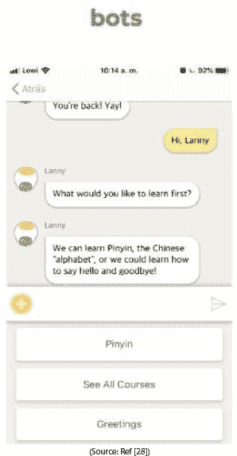

**Figure 1.1** Chatbot responding to the user contextually.

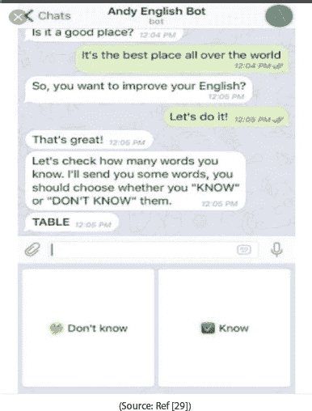

**Figure 1.2** Chatbot responding to the user contextually.

此外，Google 助手可以建设性地集成，以提升学习者的语言能力和发音。学生可以向 Google 助手提出简单的问题，例如“今天……的天气怎么样？”、“德里距离阿格拉有多远？”、“泰姬陵是什么时候建造的？”以及“马来西亚现在几点了？”。这是一种提升和评估学生沟通技能的绝佳方式，同时也能确保他们的发音清晰易懂。一些知名的语音识别应用程序在下文给出的时间线中有所提及。

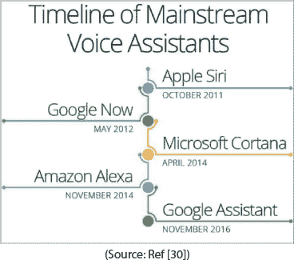

### 1.5.4 自动更正/自动文本评估器

像 `Autocorrect` 这样的应用程序可用于获取文本反馈。提供的反馈是关于写作中主张与来源、主题发展、连贯性以及英语惯例和用词的可操作性反馈。它还为学生在阅读外部来源时可能遇到的生词提供同义词。此类广泛使用的基于 AI 的应用程序包括 `Writing Mentor` 和 `Grammarly`，它们提供关于标点符号、句子构造和准确性的文本反馈。

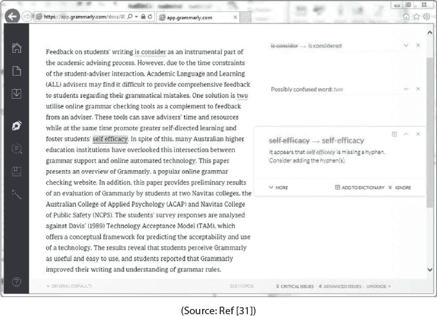

### 1.5.5 词汇训练应用程序

有些应用程序拥有独特的机器学习算法，能够通过调整学习模式并分析每位学习者的词汇优势和劣势，提供完全个性化的学习材料集合。`Alphary` 是一款基于 AI 的应用程序，帮助学生掌握和巩固英语词汇。这些应用程序使用《牛津学习者词典》系列以及名为 `FeeBu`（反馈蝴蝶）的集成 AI，来模拟人类英语导师的行为，提供自动化的智能反馈。它还能自动评估写作并分析语法错误 \[32\]。

### 1.5.6 Google Docs 语音识别

广为人知的文本处理器 `Google Docs` 是一款免费且适合移动设备的工具。语音编辑功能最近被添加到其中。语音识别功能已经发展，可以帮助教师提供对话活动的反馈。它还可以通过以文本形式提供直接反馈，用于评估学习者语音的可懂性。该应用程序可以创造性地使用，以最大限度地造福学生。

### 1.5.7 Language MuseTM 活动调色板

`Language Muse TM Activity Palette` 是一种提升学习者语言技能的有趣方式。它是一个基于网络的语言教学程序，使用 NLP 算法和词汇工具自动生成语言活动，帮助英语学习者提升内容理解和语言技能。该软件用于活动生成、评估和反馈的在线界面可适应 MOOC 以及其他多种在线学习环境 \[33\]。

## 1.6 人工智能工具增强教学与学习过程

### 1.6.1 自主学习

AI 促进个性化和自主学习。随着 AI 的集成，学生始终可以轻松访问学习资源。他们可以按照自己的节奏和空间学习。他们可以在任何他们希望的时间和地点学习。学生可以借助 AI 驱动的聊天机器人或 AI 虚拟个人助理（如 `Google Assistant` 和 `Siri`），按照自己的速度和时间解决疑问，而无需在全班同学面前感到难堪。AI 个性化学习以满足个别学生的需求，从而提高效率。AI 有潜力为每位学习者量身定制个性化的数字语言学习，满足他们的个人需求。

### 1.6.2 制作智能内容

AI 在教育中的应用为可视化、模拟和基于网络的学习环境等现代学习方法铺平了道路。由于这些新的学习方法，学习者变得更加投入和参与。不仅如此，AI 还协助开发和更新课程材料，并根据各种学习目标和学习者进行定制。

### 1.6.3 任务自动化

评估是一项耗时的任务，教师可以使用 AI 轻松实现自动化。它可以自动评分测试，甚至审阅论文，突出错误并推荐未来预防错误的方法。

### 1.6.4 身体残障学生的教育机会

AI 在教育中的创新集成，拓宽了为有学习障碍的学生构建多种建设性教学法的方式，以进行教学和学习。它还确保了身体残障学生（如聋人或视力障碍者）的教育机会。AI 系统可以有效地训练，以协助任何一群特殊需求的学生。

## 1.7 结论

如果我们回顾时间线，就会意识到我们今天所生活的 AI，几年前还只是科幻电影的一部分。今天，AI 已成为我们生活中不可分割的一部分，并在我们所能想到的几乎所有领域占据了一席之地，从商业、银行、健康、航空到营销，现在正慢慢在学术领域铺平道路。AI 在教育中发挥着重要作用，增强教学与学习。AI 学习平台促进自主学习，提供空间、节奏和时间的灵活性。此外，它还促进个性化学习，关注学习者的兴趣领域，并考虑优势、劣势、兴趣和文化背景等因素。集成 AI 的在线学习极大地推动了全球第二语言教育。

尽管 AI 在提升外语或第二语言教学与学习方面具有巨大潜力，但仍存在一些需要解决的挑战。根据 Lovett 的说法，尽管翻译技术取得了进步，但关于 `Google Translate` 的语法准确性及其可能对学习者构建语言能力过程的影响，仍然存在疑问 \[34\]。此外，NLP 是一个复杂的过程，准确捕捉所有语言信息是困难的。此外，语音识别也需要调整，因为有时它无法理解重口音、构音障碍和轻声。因此，可以进一步研究以找出上述问题的解决方案。此外，还可以开展进一步研究，以确定 AI 对个性化学习、目标语言语法以及所学语言能力的影响。此外，还可以开展关于评估 AI 在评分和评估方面效率的研究。

AI 正通过机器学习和 NLP 等各种技术，慢慢进入学术领域，并且无疑将在未来促进第二语言和外语的教学与学习。

## 参考文献

1\. Warschauer, M., Of digital divides and social multipliers: Combining language and technology for human development, in: *Information and communication technologies in the teaching and learning of foreign languages: State of the art, needs and perspectives*, p. 46, 2004.

2\. Khan, N.M. and Kuddus, K., Integrating ICT in English Language Teaching in Bangladesh: Teachers’ Perception and Challenges. *Rupkatha J. Interdiscip. Stud. Humanit.*, 12, 5, 1, 2020.

3\. Chatterjee, B. and Kuddus, K., Second Language Acquisition through Technology: A Need for Underdeveloped Regions like Jharkhand. *Res. Sch.-An International Referred e- J. Lit. Explor.*, 2, 2, 252, 2014.

4\. Kuddus, K., Emerging Technologies and the Evolving Roles of Language Teachers: An Overview. *Lang. India*, 18, 81, 2018.

5\. Kannan, J. 和 Munday, P., 透过 ICT、网络学习和人工智能视角看第二语言学习与教学的新趋势，载于：*Vías de transformación en la enseñanza de lenguas con mediación tecnológica. Círculo de Lingüística Aplicada a la Comunicación*，第 76 卷，Fernández Juncal, C. 和 Hernández Muñoz, N. (编)，第 13 页，2018 年，[`http://dx.doi.org/10.5209/CLAC.62495`](http://dx.doi.org/10.5209/CLAC.62495)。

6\. Davies, G., Walker, R., Rendall, H., Hewer, S., 新技术简介及其如何促进语言学习与教学（CALL）。模块 1.1，载于：*Information and Communications Technology for Language Teachers (ICT4LT)*，G. Davies (编)，泰晤士河谷大学，斯劳，2011 年，[`http://www.ict4lt.org/en/en\_mod1-1.htm`](http://www.ict4lt.org/en/en_mod1-1.htm)。

7\. Levy, M., *CALL: context and conceptualisation*，牛津：牛津大学出版社，纽约，1997 年。

8\. Warschauer, M., 21 世纪的 CALL。在巴塞罗那，西班牙举行的 *IATEFL and ESADE Conference* 上发表的论文，2000 年 7 月 2 日，[`http://education.uci.edu/uploads/7/2/7/6/72769947/cyberspace.pdf`](http://education.uci.edu/uploads/7/2/7/6/72769947/cyberspace.pdf)。

9\. Davies, G., Otto, S.E., Rüschoff, B., CALL 的历史视角，载于：*Contemporary computer-assisted language learning*，第 19 页，2013 年。

10\. Kuddus, K., Web 2.0 技术在英语作为第二语言教学与学习中的应用。*Int. J. Engl. Lang. Lit.*，1，4，292，2013 年。

11\. Dash, A. 和 Kuddus, K., 利用 ICT 在英语语言和文学教学中的优势，载于：*Smart Intelligent Computing and Applications. Smart Innovation, Systems and Technologies*，第 160 卷，S. Satapathy, V. Bhateja, J. Mohanty, S. Udgata (编)，第 225–232 页，Springer，新加坡，2020 年。

12\. Chatterjee, B. 和 Kuddus, K., 大众媒体第二语言习得方法。*J. Engl. Stud.*，10，1，10，2015 年。

13\. Warschauer, M. 和 Kern, R., *Network-based language teaching: Concepts and practice*，剑桥大学出版社，纽约，2000 年。

14\. Sharples, M., Taylor, J., Vavoula, G., 移动时代的学习理论，载于：*Medienbildung in neuen Kulturräumen*，第 87–99 页，VS Verlag für Sozialwissenschaften，瑞士，2010 年。

15\. Jones, C., *Networked learning: an educational paradigm for the age of digital networks*，Springer，瑞士，沙姆，2015 年。

16\. Manns, *UNESCO, Artificial Intelligence: Opportunities, threats and the future of learning*，亚太区域教育局，曼谷，联合国教科文组织，2017 年。

17\. Goksel, N. 和 Bozkurt, A., 教育中的人工智能：当前洞察与未来展望，载于：*Handbook of Research on Learning in the Age of Transhumanism*，Sisman-Ugur, S. 和 Kurubacak, G. (编)，第 224 页，2019 年。

18\. Russell, S.J., 和 Norvig, P., *Artificial intelligence, A modern approach*，第 2^(nd) 版，Pearson Education Inc.，新泽西州，上沙德尔河，2003 年。

19\. Housman, M., *Why ‘augmented intelligence’ is a better way to describe AI*，AINews，英国，2018 年，[`https://www.artificialintelligence-news.com/2018/05/24/why-augmented-intelligence-is-a-betterway-to-describe-ai/`](https://www.artificialintelligence-news.com/2018/05/24/why-augmented-intelligence-is-a-betterway-to-describe-ai/)。

20\. Nabiyev, V.V., *Yapay zeka: İnsan bilgisayar etkileşimi*，Seçkin Yayıncılık，安卡拉，2012 年。

21\. Nilsson, J., *Voice interfaces: Assessing the potential*，Nielsen Norman Group，美国，2003 年，从 [`http://www.useit.com/alertbox/20030127.htm`](http://www.useit.com/alertbox/20030127.htm) 检索。

22\. Self, J., 智能辅导系统研究的定义特征：ITS 关心，精确。*Int. J. Artif. Intell. Educ. (IJAIED)*，10，350，1998 年。

23\. Steenbergen-Hu, S. 和 Cooper, H., 智能辅导系统对大学生学术学习有效性的元分析。*J. Educ. Psychol.*，*106*，2，331，2014 年。

24\. Reiland, R., *Is Artificial Intelligence the Key to Personalized Education?*，史密森尼杂志，史密森尼杂志，美国，2018 年。[`https://www.smithsonianmag.com/innovation/artificial-intelligencekey-personalized-education-180963172/`](https://www.smithsonianmag.com/innovation/artificial-intelligencekey-personalized-education-180963172/)，2018 年 3 月 15 日。

25\. Lu, X., *Natural Language Processing and Intelligent Computer-Assisted Language Learning (ICALL)*，英语教学 TESOL 百科全书，美国，2018 年。

26\. Turovsky, B., *Ten years of Google translate*，Google 翻译博客，Google，美国，2016 年。[`https://blog.google/products/translate/ten-years-of-google-translate/`](https://blog.google/products/translate/ten-years-of-google-translate/)

27\. Turovsky, B., *Found in translation: More accurate, fluent sentences in Google Translate*，Blog. Google，美国，15，2016 年，[`https://www.blog.google/products/translate/found-translation-more-accurate-fluentsentences-google-translate/`](https://www.blog.google/products/translate/found-translation-more-accurate-fluentsentences-google-translate/)。

28\. [`https://medium.com/@alejandra.riveraUX/adding-a-chat-feature-to-duolingoa-ux-case-study-73175b612120`](https://medium.com/@alejandra.riveraUX/adding-a-chat-feature-to-duolingoa-ux-case-study-73175b612120)

29\. [`https://images.app.goo.gl/3g7rVCnfyYBBVJZMA`](https://images.app.goo.gl/3g7rVCnfyYBBVJZMA)

30\. [`https://www.google.co.in/url?sa=i&url=https%3A%2F%2Fwww.smartsheet.com%2Fvoice-assistants-artificial-intelligence&psig=AOvVaw35WNWG91EdKuqWmYVQcvdI&ust=1617361257271000&source=images&cd=vfe&ved=0CAIQjRxqFwoTCJC8hq7y3O8CFQAAAAAdAAAAABAD`](https://www.google.co.in/url?sa=i&url=https%3A%2F%2Fwww.smartsheet.com%2Fvoice-assistants-artificial-intelligence&psig=AOvVaw35WNWG91EdKuqWmYVQcvdI&ust=1617361257271000&source=images&cd=vfe&ved=0CAIQjRxqFwoTCJC8hq7y3O8CFQAAAAAdAAAAABAD)

31\. [`https://www.researchgate.net/profile/Michelle-Cavaleri/publication/320618419/figure/fig2/AS:697745916571656@1543366998696/Grammarly-feedback-Free-version.jpg`](https://www.researchgate.net/profile/Michelle-Cavaleri/publication/320618419/figure/fig2/AS:697745916571656@1543366998696/Grammarly-feedback-Free-version.jpg)

32\. [`https://www.intellias.com/ai-nlp-driven-language-learning-app/`](https://www.intellias.com/ai-nlp-driven-language-learning-app/)

33\. Burstein, J., Madnani, N., Sabatini, J., McCaffrey, D., Biggers, K., Dreier, K., 使用 Language Muse 为英语学习者实时生成语言活动，载于：*Proceedings of the Fourth ACM Conference on Learning Scale (L@S’17)*，计算机协会，纽约，美国，第 213–215 页，2017 年，[`https://dl.acm.org/doi/10.1145/3051457.3053988`](https://dl.acm.org/doi/10.1145/3051457.3053988)。

34\. Lovett, D., *Is Machine Translation a threat to language learning?*，《高等教育纪事报》，华盛顿特区，2018 年。

*Email*: `khushboo3133@gmail.com`

# 2

使用机器学习算法进行房地产价格预测

**Palak Furia\* 和 Anand Khandare^(†)**

*Thakur College of Engineering and Technology 计算机工程系，孟买，印度*

> ***Abstract***

> 从一开始很长一段时间以来，买卖房屋/土地的连续模式一直存在。一个人的财富通常取决于他/她购买的房屋类型，但这一过程涉及多个中间人。然而，随着技术的发展，这种以物易物系统也发生了很大变化。随着 PropTech 成为房地产市场即将颠覆的新事物，利用技术完成操作使得购买房产变得非常简单。它被视为房地产行业数字化转型的一部分，关注相关人员的技术和心理变化，并可能导致透明度、前所未有的数据、统计数据、机器学习、区块链以及传感器等新功能，这些都是 PropTech 的一部分。

> 在印度，有许多网站收集待售房产的数据，但存在同一套公寓在不同网站价格不同的情况，因此存在大量模糊性 \[1, 2\]。本项目使用机器学习来预测房价。在住房价格赤字分析中常用的一种启发式数据是班加罗尔市郊区住房数据。最近的分析发现，该数据库中的价格高度依赖于大小和位置。到目前为止，线性回归等基本算法可以使用内部和本地特征来消除错误。预测房价的先前功能是回顾性分析和机器学习的基础 \[6, 7\]。线性回归模型和决策树模型使用模糊假设。此外，使用两个训练项目的多维对象模型来评估房价，其中用于预测房屋“内部”成本的东西，非目标组件可以计算邻居的偏好。目标是解决回归问题，其中目标变量是价值，自变量是区域。我们在每个机构中都使用了独热编码。该算法的商业应用是分类网站可以直接使用此算法来预测新上架房产的价值，通过变量输入并预测正确和适当的价值。

> **关键词：** 机器学习、聚类算法、线性回归、LASSO 回归、决策树、支持向量机、随机森林回归器

## 2.1 引言

我们在房地产和住房市场领域急需一次正确的预测。我们看到一种贯穿整个住房购物和销售过程的机制；购买房屋可能是大多数人的终生目标。在购买房屋时，有很多人会犯大错误；大多数人是通过查看分类广告并在印度各地的各个角落遇到他们认识的人来购买房屋。一个常见的麻烦是购买价格过高且不值得的房屋 \[3\]。从声称估值系统，额外技术反映了资产的性质和提供的条件 \[8, 9\]。房产可能会在开放市场上在许多情况下和实例中发生变化；人们不了解当前状况，开始损失资金 \[10\]。房屋价格的变化会影响普通民众以及国家的经济；为了避免这种情况，需要价格预测。许多技术用于价格预测。

## 2.2 文献综述

统计模型长期以来一直是分析和预测房地产价格的方法。在 Fik *et al.* (2003) 的工作中，通过研究位置特征对房地产价格的影响，进行了一项解释房屋成本模型的研究 \[11\]（Piazzesi 和 Schneider；2009）。对于以不同方式预见产品成本的人来说，关联可能相当复杂。价格预测是进口商业部门的首要任务。但是，从供需预测可能很复杂，因为沿途可能存在整合力量。神经编程模型需要预测股票价格。这在这些股票和收益之间提供了重叠。

作者（Selim, 2009）\[12\] 比较了几项使用 60% 住房价格计算的人工神经网络偏转研究，并通过估计所有比较的性能与不同训练大小和选择统计长度进行了大量比较。

作者（Wu 和 Brynjolfsson, 2009）\[15\] 来自 MIT，估计了谷歌对全球贷款和收入的搜索方式。作者非常了解房屋价格和对高价房屋的喜爱之间的密切接触。数据来自互联网搜索方式，使用谷歌程序搜索查询，并借助实际全国和谐信息收集每个州的现状。

作者简要介绍了随机森林算法如何用于回溯和分段，以及功率增强和袋装加载用作方法。它生成许多区别，Liaw *et al.* (2002) 所述的提升和袋装之间的区别是连续树木、计算对象权重，大多数将进行预测。在 2001 年期间，Nghiep 和 Al (2001) 提出了一种随机启动，包括筹款，并更随机地提供整个随机规划和推迟过程，这里以回顾的方式提及。

Eric Slone *et al.* (2014) 改善了各种房屋因素与使用简单线性回归和多元线性回归（采用标准平方法）分析的住房查询数量之间的关系。房屋平方图像已在简单队列中用作描述性变量，多元线性回归包括土地面积增加、卧室数量、建造年份和更多描述性变量。

## 2.3 拟议工作

### 2.3.1 方法论

存在分类网站，其中公寓的定价不一致，存在类似公寓定价不同的情况，因此存在大量不透明性。有时，消费者觉得特定上架公寓的定价不合理，但也没有办法确认这一点。我们提议使用三种机器学习算法：线性回归、LASSO 回归和决策树算法。该项目所需的工具如下：`Python`、`Sklearn` 用于模型构建，`Jupyter notebook`，`visual studio code` 和 `Pycharm` 作为 IDE，`Python flask` 用于 HTTP 服务器，`HTML/CSS/Javascript` 用于 UI，`Numpy` 和 `Pandas` 用于数据清洗，`Matplotlib` 用于数据可视化。

### 2.3.2 工作流程

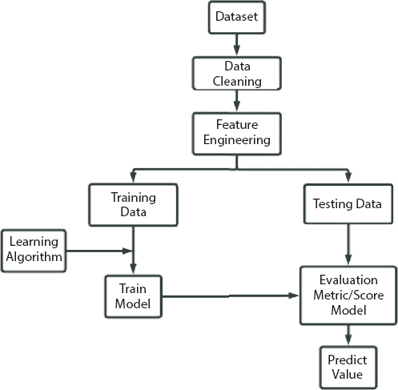

**Figure 2.1** 工作流程。

### 2.3.3 数据集

所选数据集包含班加罗尔大都市的元素；它包含九列，内容如下所示 表 2.1，共有 13,321 个实例。2017 年，印度房地产执法、城市房地产开发商不忠以及房地产销售下降了 7%。例如，对于潜在的房主来说，待售公寓和公寓超过 9,000 套，价格在 420 万至 520 万卢比之间，根据房地产文件网站 Makaan，发现超过 7,100 套公寓在 520 万至 620 万卢比的预算内。

**表 2.1** 数据集列。

| **列名** || **描述** |

| --- | --- |

| 区域类型 || 公寓/地块所在的区域类型。 |

| --- | --- |

| 可用性 || 土地当前是否可用。 |

| 位置 | 土地/地块的位置。 |
| 大小 | 公寓的卧室、客厅和厨房数量。 |
| 社区 | 合作社的名称。 |
| 总面积（平方英尺） | 地块的面积（平方英尺）。 |
| 卫生间 | 公寓的浴室数量。 |
| 阳台 | 公寓的阳台数量。 |
| 价格 | 地块/公寓的价格。 |

### 2.3.4 数据处理

#### 2.3.4.1 缺失值与数据清洗

第一步是清理数据，为此我们需要找出数据集中的空值。图 2.2 和 2.3 显示了每列中空值的数量。处理空值有两种方法：第一种是删除所有包含空值的行，这会导致数据丢失；另一种是计算所有值的平均值，并用平均值替换所有空值。因此，在清理空值之前，我们删除包含多个空值的列，如 society 和 balcony。与此同时，我们也删除 area type 和 availability 等列，因为我们的主要目标是预测价格。

在 size 列中，存在 3 BHK 和 3 BK 等不同属性的值，它们含义不同；因此，为了统一，我们将创建一个新列 BHK。在该列中，我们将应用一个函数来对每个单词进行分词；在这里，我们保留数字并去除其他单词。因此，我们得到了 BHK 列。在 total square feet 列中，有些条目提到的是范围而不是精确数字；在这种情况下，我们用这两个数字的平均值来替换。

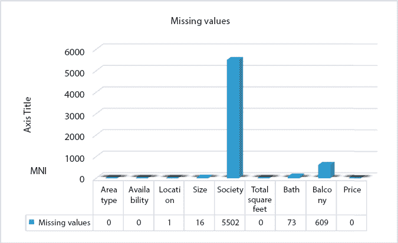

**Figure 2.2** 缺失值。

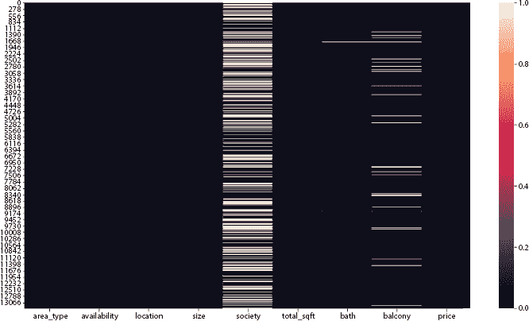

**Figure 2.3** 使用热图可视化缺失值。

#### 2.3.4.2 特征工程

特征工程是帮助我们进一步剔除异常值的基础。在这里，我们合并两列，应用公式，得到每平方英尺的价格。然后，我们找出唯一位置的数量，得到 1,304 个位置。其中，有些位置只出现了一次或两次；因此，我们设定阈值为 10，所以出现次数超过五次的位置被视为 Figure 2.4。

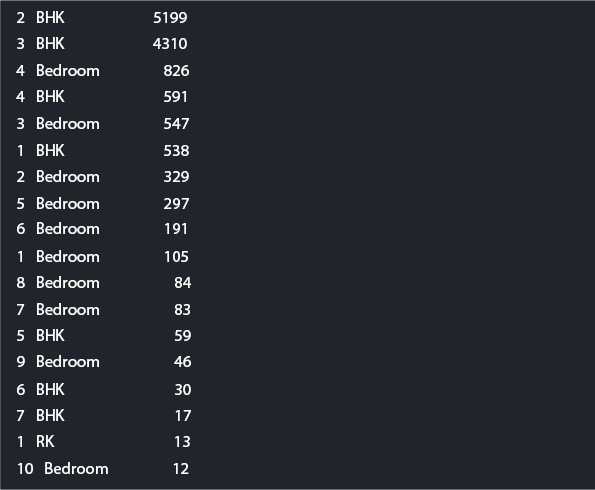

**Figure 2.4** 不同的 BHK 属性。

#### 2.3.4.3 剔除异常值

异常值是数据点或错误，代表数据集中的极端变化。有检测异常值的技术；其中一种是通过可视化。我们可以绘制箱线图或散点图，并从模式中得出推断。

在 BHK 中，有些公寓的单间平均面积较大，这看起来不寻常，而在某些情况下，浴室数量多于房间数量，从而影响结果。

散点图用于可视化 2 BHK 和 3 BHK 房产的每平方英尺价格。在这里，蓝色点代表 2 BHK，红色点代表 3 BHK 地块。基于 Figures 2.5 到 2.8，使用“remove bhk outliers function”从 Hebbal 区域删除了异常值。

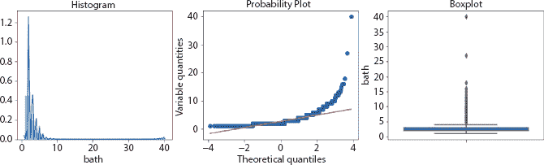

**Figure 2.5** 浴室可视化。

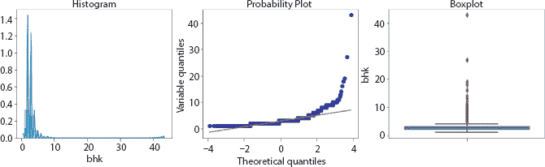

**Figure 2.6** BHK 可视化。

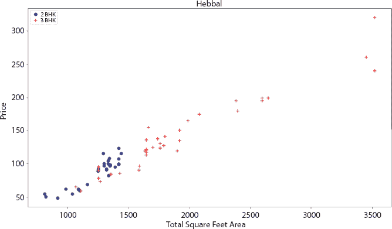

**Figure 2.7** 2 和 3 BHK 公寓的总面积散点图。

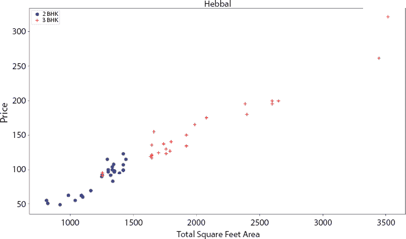

**Figure 2.8** 剔除异常值后 2 和 3 BHK 公寓的总面积散点图。

## 2.4 算法

### 2.4.1 线性回归

线性回归是一种线性方法，用于建模标量响应与一个或多个解释变量之间的关系。预测建模技术寻找自变量与因变量之间的关系。自变量可以是类别型或连续型，而因变量仅为连续型。

### 2.4.2 LASSO 回归

LASSO 回归是另一种线性回归；它使用收缩。其数据值在向有价值的点（如均值）的方向上被缩减。该系统鼓励简单和稀疏的模型；缩写“LASSO”代表 Least Absolute Shrinkage and choice Operator \[4, 5\]。LASSO 回归执行 L1 正则化；它给予一个惩罚，等于系数重要性的绝对值。这种正则化形式导致稀疏模型，系数较少；许多系数可能变为零并从模型中删除。巨大的惩罚导致接近零的值，从而产生更简单的模型。相反，L2 正则化（例如，岭回归）不会导致系数的排除或稀疏模型。这使得 LASSO 比岭回归更容易解释。

### 2.4.3 决策树

决策树是一种类似流程图的树，其中特征由内部节点表示；决策规则由分支表示，最终结果由每个叶节点表示。决策树中的顶部节点称为根节点。它以递归方式分区树，即递归分区。时间复杂度是给定数据中数据量和属性数量的函数。决策树处理高维数据且准确性高 \[13, 14\]。

### 2.4.4 支持向量机

支持向量机是一种精心设计的学习系统，用于分类和回顾性问题。支持向量机非常流行，因为它以低计算能力产生显著的准确性。它广泛用于分离问题。它有三种类型：有监督、无监督和强化学习。支持向量机是一个选定的分隔器，由分离超平面正式定义。在提供训练数据的情况下，分离新模型的先进超平面算法的发布被标记。

### 2.4.5 随机森林回归器

随机森林是一种灵活且易于使用的机器，大多数情况下花费较少时间进行超参数设置即可产生良好结果。它因其简单性以及用于分割和反向函数而获得流行。随机森林是可预测树的集合，使得每棵树都基于随机向量值独立采样，并与森林中所有树具有相同的分布。随着森林中树木数量的增加，总的砍伐错误会发生变化。

### 2.4.6 XGBoost

XGBoost 是构建较低备份模型的一种强大方法。这一断言的有效性可以通过其（XGBoost）与其学生合作的工作来表征。动机工作包括工作损失和适应所需时间。它处理实际值与预期值之间的差异，例如，模型结果与实际值的偏差。XGBoost 中用于延迟问题的典型损失函数是 reg: linear，而在二进制类别中是 reg: logistics。正则化参数如下：alpha、beta 和 gamma。

## 2.5 评估指标

在使用回归模型时，选择合适的评估指标非常重要。它还涉及回归的损失函数；其中一些在 Table 2.2 中提及。如果损失值与预测值之间的差异较小，则损失/错误特征可能较小，并表明模型最合适。

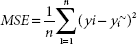

**表 2.2** 不同评估指标。

我们可以通过对 MSE 开平方根来获得 RMSE。RMSE 在数值预测中非常直观，能够发现是否有异常值干扰记录预测。因此，我们选择 RMSE 用于版本评估。

## 2.6 预测结果

数据集被分为 80% 的训练数据集和 20% 的测试数据集，如 表 2.3 所示。已导入所需库，并使用 `GridSearchCV` 来定位满意的模型。它在多个回归器和不同参数之间比较模型，并提供其中的最佳得分。在 `GridSearchCV` 的协助下，我们已比较了算法，即线性回归、LASSO 回归、决策树、支持向量机、随机森林回归器和 XGBoost。

为了应对这一挑战，已检查了各种机器学习算法。很明显，XGBoost 表现更好，准确率为 85%，且误差值大大降低。当此测试与结果相比时，一旦这些算法预测正确。此任务已以确定价格预测为主要目标完成，我们已高效地使用特定系统分析算法（如线性回归、LASSO 回归、决策树、随机森林、多元回归、支持向量机、梯度增强树、神经网络和袋装法）完成了此任务。

因此，很明显，与其他算法相比，XGBoost 在预测中提供了更高的准确率，此外，我们的研究还提供了定位预测中属性贡献的方法。此外，`python flask` 可用作 HTTP 服务器，CSS/Html 用于为网站创建 UI。因此，人们可能会同意，这项研究可能对人们和政府有用，未来工作将在每个系统下说明，新的软件技术未来可以帮助预测价格。价格预测可以通过添加许多属性（如环境、市场以及与房屋相关的许多其他变量）来改进。

**表 2.3** 算法比较。

|   || **模型** || **最佳得分** || **RSME 得分** || **误差得分** || **准确率百分比** |

| --- | --- | --- | --- | --- |

| 0 || 线性回归 || 0.790932 || 64.813703 || 0.209068 || 79% |

| 1 || LASSO 回归 || 0.803637 || 62.813241 || 0.196363 || 80% |

| 2 || 决策树 || 0.71606 || 70.813421 || 0.283936 || 72% |

| 3 || 支持向量机 || 0.204336 || 126.440620 || 0.795664 || 20% |

| 4 || 随机森林回归器 || 0.884247 || 48.226644 || 0.115753 || 88% |

| 5 || XGBoost || 0.891979 || 46.588246 || 0.108021 || 89% |

## 参考文献

1\. Bhagat, N., Mohokar, A., Mane, S., House price forecasting using data mining. *Int. J. Comput. Appl.*, 152, 2, 23–26, 2016.

2\. Breiman, L., Bagging predictors. *Mach. Learn.*, 24, 2, 123–140, 1996.

3\. Ganjisaffar, Y., Caruana, R., Lopes, C.V., Bagging gradient-boosted trees for high precision, low variance ranking models. *Proceedings of the 34th international ACM SIGIR conference on Research and development in Information Retrieval*, ACM, pp. 85–94, 2011.

4\. Gu, J., Zhu, M., Jiang, L., Housing price forecasting based on genetic algorithm and support vector machine. *Expert Syst. Appl.*, 38, 4, 3383–3386, 2011.

5\. Li, L. and Chu, K.-H., Prediction of real estate price variation based on economic parameters. *Applied System Innovation (ICASI), 2017 International Conference on*, IEEE, pp. 87–90, 2017.

6\. Liaw, A., Wiener, M. *et al.*, Classification and regression by randomforest. *R. News*, 2, 3, 18–22, 2002.

7\. Limsombunchai, V., House price prediction: Hedonic price model vs. artificial neural network. *New Zealand Agricultural and Resource Economics Society Conference*, pp. 25–26, 2004.

8\. Mirmirani, S. and Cheng Li, H., A comparison of var and neural networks with genetic algorithm in forecasting price of oil. *Applications of Artificial Intelligence in Finance and Economics*, Emerald Group Publishing Limited, pp. 203–223, 2004.

9\. Nghiep, N. and Al, C., Predicting housing value: A comparison of multiple regression analysis and artificial neural networks. *J. Real Estate Res.*, 22, 3, 313–336, 2001.

10\. Patel, J., Shah, S., Thakkar, P., Kotecha, K., Predicting stock and stock price index movement using trend deterministic data preparation and machine learning techniques. *Expert Syst. Appl.*, 42, 1, 259–268, 2015.

11\. Piazzesi, M. and Schneider, M., Momentum traders in the housing market: Survey evidence and a search model. *Am. Econ. Rev. Am. Econ. Assoc.,* 99, 2, 406–411, May 2009.

12\. Selim, H., Determinants of house prices in turkey: Hedonic regression versus artificial neural network. *Expert Syst. Appl.*, 36, 2, 2843–2852, 2009.

13\. Trafalis, T.B. and Ince, H., Support vector machine for regression and applications to financial forecasting, Neural Networks, 2000, *IJCNN 2000, Proceedings of the IEEEINNS-ENNS International Joint Conference on*, vol. 6, IEEE, pp. 348–353, 2000.

14\. Willmott, C.J., On the validation of models. *Phys. Geogr.*, 2, 2, 184–194, 1981.

15\. Wu, L. and Brynjolfsson, E., *The future of prediction: How google searches foreshadow housing prices and sales*, 2009.

1.  \**通信作者*: palakfuria18@gmail.com

2.  ^†*通信作者*: anand.khandare@thakureducation.org

# 3  

基于聚类方法的多标准娱乐推荐系统

**Chandramouli Das, Abhaya Kumar Sahoo\* 和 Chittaranjan Pradhan**

*School of Computer Engineering, KIIT Deemed to be University, Odisha, India*

> ***摘要***

> 多标准推荐系统是一种旨在为用户提供用户友好环境的模型。这些模型在世界各个领域都被广泛使用。许多领先公司正在通过引入新技术和新方法，致力于使这些多标准推荐模型更加有效。在过去，人们习惯于手动进行推荐。例如，如果有人想购买某样东西，他们通常会询问购买过该特定物品或对该物品有一定了解的其他人。为了使这一过程更加真实、自动化和高效，推荐系统的概念应运而生。第一个推荐系统基于单一标准。这被称为单标准推荐系统。但在现实世界的推荐场景中，模型需要考虑不止一个标准。因此，多标准推荐概念应运而生。在本章中，我们将深入探讨各种类型的多标准推荐系统。在这里，我们将看到一些创新的想法、方法和技术，这些方法和技术被应用于多标准推荐系统，使其更加高效和有效。我们将看到这些新颖和创新的方法与传统推荐系统相比能取得更好的效果。在这里，我们讨论了全球各地研究人员进行的许多不同的多标准推荐技术方法。所有这些研究都是使用现实世界的数据集来解决实际问题。我们还选择了五个最可能的研究活动，并详细解释了他们如何进行研究并取得成功的结果。但在深入硬核细节之前，我们将了解推荐系统是如何构建的。我们讨论了各种过滤技术和推荐系统的核心工作原理。在本章末尾，我们还讨论了推荐系统的优缺点。推荐系统帮助企业不断增长，也有助于分析风险。出于这些原因，多标准推荐系统在市场上很受欢迎，需求量很大。

**关键词：** 聚类，娱乐，平均绝对误差，多标准，推荐系统

## 3.1 引言

在当今的数字时代，互联网上有海量的信息可供使用；它为用户提供了任何领域的大量资源或服务。随着互联网上信息的增加，资源和选项的数量也呈指数级增长，导致信息过载，最终在客户中造成大量困惑，从而使决策过程变得艰难 \[1\]。

推荐系统广泛应用于决策过程，并处理信息过载问题。多标准推荐系统是一种利用用户对多个标准的评分和偏好，为相应客户做出最优决策的推荐系统。因此，它可以根据用户的需求和选择提供个性化推荐。在本文中，我们比较了三种设置下推荐系统的性能：首先，使用传统方法对所有标准的评分进行评估；其次，将多标准偏好作为情境；第三，利用所选标准的评分作为情境。因此，推荐系统是决策过程中的重要工具。它根据客户的先前喜好，向客户生成推荐项目列表 \[28–31\]。

推荐系统的重要性与日俱增，尤其是在商业应用方面，因为推荐系统在亚马逊等电子商务领域的应用已被证明非常成功。许多商业应用开始将其纳入包括电影和音乐推荐、图书和电子书、旅游业、酒店、餐厅、新闻等在内的各个领域。这些系统帮助用户根据自身需求找到最相关的信息，而不是向用户展示大量与其无关的无差别数据。因此，推荐系统必须具有高预测准确性，并根据特定用户的要求，将所需项目排在推荐列表的顶部 \[16, 21\]。

用户对移动设备的普及程度提高，增加了对移动服务器的依赖。人们从移动设备获取大量信息，包括商业信息、产品信息和推荐信息。移动服务器的重要应用之一是电影推荐。电影推荐系统一直是向用户推荐电影的有效工具，从而帮助观众应对众多可用的电影选项，并方便地找到合适的电影。然而，推荐是一项复杂的任务，因为它涉及用户的不同口味、不同的电影类型等。因此，许多技术已被用于提高推荐系统的性能 \[32\]。

我们拥有一个庞大的平台，可用于发表个人想法和评论。由于互联网上有如此多的数据流动，找到收集和生成信息的新方法至关重要。推荐系统是许多企业的重要组成部分，尤其是在电子商务领域。它通常利用用户的偏好历史为其提供合适的推荐，而传统推荐系统只能为一个项目提供一个评分值 \[5, 24–26\]。

## 3.2 与多标准推荐系统相关的工作

多标准推荐系统（MCRS）在几乎每个领域都被广泛使用。它随着时间不断发展。如今，我们拥有许多先进的推荐系统。推荐系统模型可以通过多种方法构建，例如聚类技术、机器学习技术、深度学习技术、神经网络和大数据情感分析。在 MCRS 领域有许多正在开发的开源项目。那么，让我们来看看这里。

Wasid 和 Ali 提出了一种基于聚类方法的 MCRS。其方法的主要目标是通过识别特定用户聚类中更相似的邻居来提高推荐性能。为了实现此方法，他们完成了两件主要事情。首先，他们根据多标准评分提取了用户对给定项目的偏好。其次，根据用户的偏好，定义了聚类中心 \[2\]。

Zheng 提出了一种基于效用的多标准推荐系统，该系统依赖于效用函数。他通过应用多标准评分来构建效用函数，以衡量用户评估向量与用户期望向量之间的相似性。为了计算效用得分，他们结合了三种相似度量。此外，还使用了三种优化学习排序方法来学习用户期望 \[3\]。

Tallapally *et al.* 采用了一种基于深度学习的 ANN 架构技术，称为堆叠自编码器，以缓解推荐问题。传统堆叠自编码器的功能得到了增强，通过添加一个额外层来包含多标准评分，该额外层充当自编码器的输入层。多标准评分输入连接到中间层。该中间层由项目或标准组成。该中间层进一步连接到 N 个连续的编码层 \[4\]。

Musto、Gemmis、Semeraro 和 Lops 使用了基于方面情感分析的 MCRS。他们利用了一种用于情感分析和意见挖掘的结构。该结构能自动从用户评论中提取情感评分和相关方面。他们通过与其他最先进的基线方法对比，评估了所提方法的效率，并比较了结果 \[5\]。

García-Cumbreras *et al.* 方法利用了用户在推荐系统中的悲观和乐观行为。其目标是根据用户的认知或行为，将客户分为两个不同的类别，即悲观类和乐观类。这些类别基于客户评分和评论的平均极性报告来定义。然后，将推导出的客户类别作为最新属性添加到协同过滤（CF）算法中 \[6\]。

Zhang *et al.* 提出了一种算法，该算法通过分析用户意见的情感来考虑用户评论中的虚拟评分或总体评分，并利用评论中包含的表情符号来缓解推荐系统中仍然存在的稀疏性问题 \[7\]。

Bauman *et al.* 提出了一种推荐系统，该系统推荐包含最重要方面的项目，以改善用户的整体体验。这些方面是使用情感效用方法识别的 \[8\]。

Akhtar *et al.* 提出了一种分析酒店评论的技术，并从中提取一些有价值的信息或知识，以帮助服务提供商和客户识别服务领域中的漏洞和优势，从而改善其业务表现 \[9\]。

Yang *et al.* 提出了一种包含三个主要组件的技术，即方面权重、意见挖掘和总体评分推断。意见挖掘组件负责从用户评论中仅提取关键方面和意见，并据此为每个提取的方面计算评分 \[10\]。

Dong *et al.* 提出了一种 CF 方法，该方法合并特征相似性和特征情感来推荐项目，这些项目的优先级更高，与用户查询中的项目相似且更好 \[11\]。

Wang *et al.* 提出了一种解决用户初次接触环境时出现问题的方法。这个问题被称为冷启动问题。我们将在本文后面讨论冷启动问题。大多数推荐系统会收集用户对项目某些属性的偏好 \[12\]。

Musat *et al.* 解释了一种称为主题档案 CF（TPCF）的方法，该方法解决了由于数据稀疏性问题和非个性化排名方法导致的难以找到足够可靠数据以进行推荐的问题 \[13\]。

Jamroonsilp 和 Prompoon 提出了一种基于用户评论对项目进行排名的方法。他们考虑了软件项目的五个预定义方面。软件的排名是通过比较分析不同客户对每个软件方面评分的句子来计算的。这分为三个阶段：收集用户评论、分析收集到的评论以及进行后续的软件排名 \[14\]。

Zhang *et al.* 提出了一种利用用户评论的方面级情感，并借助有用性评论的方法 \[15\]。

Zheng、Shekhar、Jose 和 Rai 在教育学习领域提出了一种多标准决策方法。首先，他们将上下文感知和多标准决策集成到考虑教育数据的推荐系统中。他们的实验结果相当令人满意，并意识到他们能够基于两种不同的推荐策略产生更多正确的建议 \[17\]。

这些是全球各地科学家所做的一些工作。在 MCRS 领域，有成千上万个项目已经进行或正在进行，以使系统完全高效。如今，领先公司正在使用推荐系统。最好的例子之一是亚马逊公司，它使用推荐系统为客户提供合适的推荐。Netflix 是另一家使用多标准推荐系统的公司，根据用户的详细信息和用户的先前选择，为用户提供电影和网络剧集的建议列表。因此，日复一日，新技术正在被应用于推荐系统以提高准确性。

## 3.3 工作原理

脑海中最基本的问题是什么是推荐系统。推荐系统是一种软件或模型，它分析客户的偏好，并基于此为该客户生成一系列项目。多标准推荐系统可以定义为收集多个标准信息的推荐系统。推荐系统的基本工作是为特定用户预测准确的推荐。推荐系统或单标准推荐系统仅探索一个标准并给出推荐结果。这是第一个推荐系统概念。但对于现实世界的问题，我们不能一次只探索一个标准来预测推荐列表。这会给出错误的预测。因此，MCRS 概念进入了该领域。这种推荐系统可以一次探索多个标准，并能给出极高的准确性（Figure 3.1）。

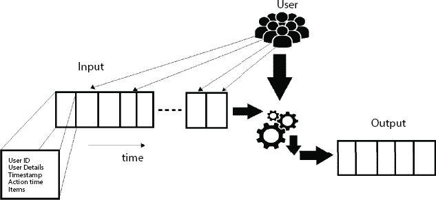

**Figure 3.1** Working principle of MCRS.

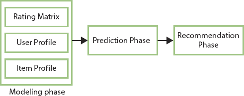

**Figure 3.2** Phases of MCRS.

推荐系统广泛应用于电子商务系统、电影行业以及各个领域。假设我们使用 amazon.com 并购买一件商品，那么在结账前，它会显示类似的商品作为附加项。这个项目列表是由亚马逊自己的推荐系统预测的。同样，如果我们使用 Netflix，我们可以看到它总是向我们推荐新电影和网络剧集。这种预测通常基于两个类别：一个是基于我们之前的选择，另一个是基于我们的 Netflix 账户详细信息。推荐系统就是这样生成一个最适合用户的列表。

每个推荐系统都要经历三种阶段。这些阶段是建模阶段、预测阶段和推荐阶段。

Figure 3.2 解释了推荐系统的不同阶段。现在，我们将了解每个阶段及其重要性。

### 3.3.1 建模阶段

在建模阶段，重点是准备将在接下来两个阶段中使用的数据。如图所示，它也分为三种情况。第一步是构建一个比率矩阵。矩阵的行包含用户的名称，列包含项目，每个单元格包含用户对特定项目的评分。现在，它生成一个用户档案。这个档案解释了用户的偏好。它大多是一个向量，每个用户都有自己的私人偏好档案。在第三步，它为项目生成一个档案，其中包含项目的特征。

### 3.3.2 预测阶段

这是推荐系统的第二阶段。主要目标是为每个客户估计未揭示或未指定项目的评分或分数。这个过程是通过基于建模阶段提供的提取数据的效用函数来完成的。不同的过滤技术在 Figure 3.3 中以图示形式展示。

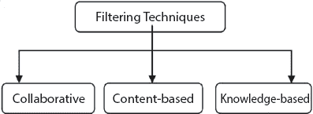

**Figure 3.3** Filtering techniques of MCRS.

### 3.3.3 推荐阶段

这是推荐系统的第三阶段，也是扩展预测阶段。在此步骤中，通过预测最可接受的项目，采用各种方法来支持客户的选择。根据用户的兴趣，在此步骤中推荐新项目。

这些是 MCRS 的三个最重要阶段。我们在 MCRS 中使用不同类型的方法来预测良好的结果。最重要且广泛使用的方法是基于内容的过滤、协同过滤方法和基于知识的方法。我们还有一种混合方法。现在，我们将深入了解 MCRS 的所有这些方法。

### 3.3.4 基于内容的方法

它根据客户的先前行为生成合适的推荐。它分析用户的先前历史记录（例如喜欢、购买或观看过的内容），并据此进行预测。它根据每个用户先前选择的项目为其生成用户画像，并根据用户之前喜欢的具有相似特征的项目向其推荐项目。它不将用户的偏好与其他用户进行比较来刻画每个用户。基于内容的过滤方法分为三个步骤：项目表示、学习用户画像和推荐生成器。在项目表示步骤中，提取项目的信息或描述以创建项目的特征。它生成结构化的项目表示。在下一步中，生成用户画像。该用户画像基于用户对特定项目的先前行为（例如喜欢或不喜欢、评分或撰写的文本评论）。此步骤称为学习用户画像，最后一步是推荐生成器。在此步骤中，生成推荐项目列表，并将其与客户画像的项目特征进行比较。合适或最可能的项目将被添加到预测列表中 \[1\]。

该方法已在各种领域中执行，例如文本细节（如网站、新闻和文章），也用于推荐活动（如旅游、旅行、电视和电子商务行业）。当项目规模适中时，该方法效率非常高。这种方法依赖于每个项目的内容或特征，因此具有多种优势：它在推荐中提供高度个性化；当用户数量增加时，它可以进行扩展，这意味着它具有可扩展性。它可以根据用户的特定兴趣进行推荐，并提供非常好的安全性。这些是基于内容的过滤方法的一些优势 \[1\]。

### 3.3.5 协同过滤方法

这种技术在所有多标准推荐系统中是一种非常流行的技术。它与多个用户交互并生成推荐列表。如果用户 1 与用户 2 的偏好相似，那么推荐给用户 2 的项目也会推荐给用户 1。该方法背后的假设是，过去同意其他客户的客户在未来也会同意。对于新项目，其与用户的关系由其他用户的评论决定。我们可以将其表示为用户-项目矩阵，其中矩阵的每个单元格代表客户对特定项目的评分 \[1\]。

CF 可分为两类：基于模型的方法和基于内存的方法。基于内存的方法是一种启发式算法。它根据另一个客户的评分来估计项目的评分。它还可以分为两种方法：基于项目的方法和基于用户的方法。另一种基于内存的方法，根据其他用户的相似兴趣推荐项目。它分析其他客户的行为（例如他们之前购买、喜欢或查看过的内容），然后向该客户推荐产品 \[1\]。

与所有其他过滤方法相比，CF 方法具有许多优势，例如，有时会推荐新颖且不熟悉的项目，它在各种领域中非常合适且灵活，并且不需要分析特定项目的内容 \[1\]。

这些是 CF 在 MCRS 中的一些优势。

### 3.3.6 基于知识的过滤方法

与其他两种方法相比，这是一种相对较新的方法。当协同过滤和基于内容的方法都失败或无法正常工作时，使用此方法。当特定项目的推荐过程没有足够的评分或评论时，就会出现这种情况。这通常发生在很少购买的项目上，例如房屋、汽车或金融服务。这种方法的工作原理是提取客户对该领域的认知，以推荐最能满足其要求的项目。其核心优势是不需要该问题的任何先前评分。通过使用此方法，可以克服冷启动问题。但它也有一个缺点，即需要有经验的工程师及其所有相关困难来令人满意地理解项目领域 \[1\]。

推荐系统中还有另一种方法，称为混合方法。这种方法旨在克服协同过滤和基于内容的过滤方法的局限性。它结合了协同过滤和基于内容的方法的优势，即将多个推荐算法的实现整合到单个推荐系统中，以提高推荐系统的效率，从而表现出更好的性能。混合方法是通过结合两个或多个算法生成的。这里必须注意两个主要点。第一是考虑推荐模型，该模型声明所需输入和混合推荐系统的确定。第二点是确定将在混合推荐系统中使用的策略。但这种混合方法也存在某些缺点，例如它不具成本效益，即实施成本非常高，因为它是其他过滤方法的融合。此外，它增加了复杂性，并且有时需要外部数据，而这些数据大多数时候是不可用的 \[1, 18\]。

## 3.4 不同方法的比较

现在，我们将比较全球研究人员使用的一些方法，并了解他们研究的结果。

### 3.4.1 基于方面情感分析的 MCRS

在这项研究活动中，Musto *et al*. 提出了一种基于 MCRS 的 CF 技术，该技术利用信息分析用户评论中传达的用户兴趣。

在他们的实验数据分析中，他们使用许多传统模型进行评估。结果显示了这项研究背后的认知 \[5\]。

现在，如果我们查看他们的实验数据分析，可以看到他们使用了三个数据集。它们是 Yelp、TripAdvisor 和 Amazon。

**表 3.1** 数据集统计。

|   || **Yelp** || **TripAdvisor** || **Amazon** |

| --- | --- | --- | --- |

| **Users** || 45,981 || 536,952 || 826,773 |

| --- | --- | --- | --- |

| **Items** || 11,573 || 3,945 || 50,210 |

| **Rating/Reviews** || 229,906 || 796,958 || 1,324,759 |

| **Sparsity** || 99.95% || 99.96% || 99.99% |

这个框架主要用于方面提取和情感分析。为了实现这一点，我们需要不同类型的参数。在第一步中，我们需要删除诸如“a”、“and”、“but”、“how”、“or”和“what”之类的词。在下一步中，我们需要将框架设置在 10 到 50 之间，以提取方面和子方面。为了计算子方面的效率，在某些实验会话中提取了主要方面。根据情感分析算法程序，同时使用了“CoreNLP”和“基于 AFINN”的算法。他们将 KL-散度分数值设置为 0.1。他们同时使用了基于用户和基于项目的 CF 系统。此前，他们使用了欧几里得距离的一个高级版本，他们将其引入为多维欧几里得距离，用于计算邻域。根据他们针对所有数据集的公式，邻域大小设置为 10、30 和 80，他们这样做是因为更大的邻域会降低所提议算法的效率 \[5\]。

他们算法程序的有效性是通过计算平均平均误差（MAE）来规划的。竞争框架用于计算矩阵，以确保结果的可靠性 \[5\]。

### 3.4.1.1 讨论与结果

在此演示中，他们分析了离散排列。这些主要基于基于方面的情感分析。我们可以在 表 3.2 和 3.3 中看到结果。他们陈述了使用 AFINN 情感分析算法得出的结果，由于空间原因。它与 CoreNLP 算法没有任何重大差异。由于它基于基于用户的 CF 方法，在 Yelp 数据集和 Tripadvisor 数据集上，他们从数据集中选取了前 10 个方面。此外，上述结果优于之前的 50 个方面。因此，他们没有占用更大的空间。

另一个吸引人的结果来自 Yelp 和 TripAdvisor，通过使用子方面，性能得到了显著提升。在这里，通过使用前 50 个方面获得了最大效率。为了更好地理解这一点，我们需要进行进一步的研究 \[5, 20\]。

**表 3.2** 结果比较。

**基于 MCRS 的 CF 实验 1 结果**

**实验 2 结果**

| **配置** || **数据集** || || || **数据集** |
| --- | --- | --- | --- | --- | --- |
| **#neigh.** || **#asp.** || **子方面** || **Yelp** || **TripAdvisor** || **Amazon** || || **配置** || **Yelp** || **TripAdvisor** || **Amazon** |
| 10 || 10 || Y || 0.8362 || 0.7111 || 0.6464 || || Multi-U2U || **0.8362** || **0.7111** || **0.6276** |
| 10 || 10 || N || 0.841 || 0.7564 || 0.6335 || || U2U-Euclidean || 0.886 || 0.8337 || 0.7254 |
| 10 || 50 || Y || 0.841 || 0.7269 || 0.6346 || || U2U-Pearson || 0.964 || 1.1222 || 0.9789 |
| 10 || 50 || N || 0.8364 || 0.8007 || 0.6276 || || Static-Multi-U2U || N.A. || 0.798 || N.A. |
| 30 || 10 || Y || 0.8461 || 0.7677 || 0.712 || || Multi-I2I || 0.864 || 0.8245 || 0.811 |
| 30 || 10 || N || 0.8473 || 0.7722 || 0.7122 || || I2I-Euclidean || 0.8745 || 0.8429 || 0.8117 |
| 30 || 50 || Y || 0.8474 || 0.7743 || 0.7101 || || I2I-Pearson || 1.1794 || 0.8644 || 0.9679 |
| 30 || 50 || N || 0.8494 || 0.8003 || 0.714 || || Static-Multi-I2I || N.A. || 0.8474 || N.A. |
| 80 || 10 || Y || 0.8579 || 0.7971 || 0.7584 || || RatingSGD || 0.8409 || 0.745 || 0.8859 |
| 80 || 10 || N || 0.8592 || 0.7953 || 0.7554 || || ParallelSGD || 0.8409 || 0.7449 || 0.8852 |
| 80 || 50 || Y || 0.859 || 0.7907 || 0.7544 || || ALSWR || 0.9545 || 0.9053 || 1.0354 |
| 80 || 50 || N || 0.8597 || 0.7995 || 0.7544 || || || || || |

**基于 MCRS 的基于项目的 CF 结果**

**提取的前 10 个主要方面**

| **配置** || **数据集** || || **Yelp** || 地点、食物、服务、餐厅、价格、菜单、员工、饮料和午餐 |
| --- | --- | --- | --- | --- |
| **#asp.** || **子方面** || **Yelp** || **TripAdvisor** || **Amazon** || |
| 10 || Y || 0.864 || 0.8245 || 0.811 || || **TripAdvisor** || 酒店、房间、员工、位置、服务、早餐、餐厅、浴室、价格、景观 |
| 10 || N || 0.8643 || 0.8252 || 0.811 || || |
| 50 || Y || 0.8641 || 0.8254 || 0.8118 || || **Amazon** || 游戏、图形、故事、角色、玩家价格、游戏玩法、控制器级别和音乐 |
| 50 || N || 0.8648 || 0.826 || 0.8124 || || |

值得注意的是，为了获得更好的效率，我们需要将所有数据集配置为前 10 个邻居。

在下一步中，他们将算法与矩阵分解（MF）算法进行了比较，以获得更好的基线。此外，规定 TripAdvisor 数据集有一组不可更改的六个特征。对于每个分析，如“清洁度”、“位置”、“价值”、“服务”、“睡眠质量”和“总体”。他们已将其方法与依赖于这些方面的 MCRS 算法区分开来。在 表 3.5 中，我们可以看到他们的方法优于所有基线。这些结果无疑确立了他们的看法，因为他们证明了他们的方法可以胜过利用单一评分和 MCRS 算法的两种策略。

当多标准用户对用户 CF 被用作推荐算法时，则获得最佳总体结果 \[5\]。

## 3.4.2 基于堆叠自编码器的多标准推荐中的用户偏好学习，由 Tallapally 等人提出

在这里，他们提出了一种堆叠自编码器，这是一种 DNN 方法，用于使用多标准评分。他们实现了一个模型，该模型配置为分析每个客户的标准与一般评分效率之间的连接。测试结果基于实际数据集，如 Yahoo! Movies 数据集和 TripAdvisor 数据集。它说明了这种方法可以在不同的性能矩阵上执行单标准系统和多标准方法 \[4\]。

现在，如果我们查看他们提出的性能评估和结果分析，那么将清楚这个模型可以达到多少效率。

### 3.4.2.1 数据集与评估矩阵

在本文中，他们使用了来自旅游和电影领域的两个基于现实世界的数据集，用于评估性能。他们保留了至少评论过五家酒店的用户和至少被五个用户评论的酒店的样本数据，以从 TA 中获得工作数据子集。

他们使用了包含超过 19,000 个评分实例、超过 3,100 个用户和约 3,500 家酒店的子集，其稀疏度高达 99.8272%。此外，YM 数据按 表 3.3 到 3.5 所示生成。为了分析该方法的性能，他们使用了平均绝对误差（MAE），该误差以其简单性、准确性和流行性而闻名 \[4\]。

**表 3.3** 数据集。

**结果 = YM 10-10**

**结果 = YM 20-20**

| **技术** || **MAE** || **GIMAE** || **GPIMAE** || **F1** || || **技术** || **MAE** || **GIMAE** || **GPIMAE** || **F1** |
| --- | --- | --- | --- | --- | --- | --- | --- | --- | --- | --- |
| MF \[10\] || 0.8478 || 0.7461 || 0.6765 || 0.5998 || || MF \[10\] || 0.7397 || 0.6077 || 0.57 || 0.6698 |
| --- | --- | --- | --- | --- | --- | --- | --- | --- | --- | --- |
| 2016\_Hybrid AE \[23\] || 0.7811 || 0.6595 || 0.8269 || 0.7042 || || 2016\_Hybrid AE \[23\] || 0.7205 || 0.6008 || 0.783 || 0.7578 |
| 2011\_Liwei Liu \[13\] || 0.6574 || 0.5204 || 0.6574 || 0.664 || || 2011\_Liwei Liu \[13\] || 0.6576 || 0.5054 || 0.6576 || 0.6828 |
| 2017\_Learning \[22\] || 0.6576 || 0.5054 || 0.6576 || 0.6629 || || 2017\_Learning \[22\] || 0.8254 || 0.5958 || 0.8131 || 0.7544 |
| 2017\_CCC \[27\] || 0.6374 || 0.624 || 0.7857 || 0.5361 || || 2017\_CCC \[27\] || 0.6798 || 0.6095 || 0.7159 || 0.5585 |

| 2017\_CCA \[27\] || 0.6618 || 0.6015 || 0.799 || 0.5343 ||   || 2017\_CCA \[27\] || 0.6691 || 0.6042 || 0.6971 || 0.5641 |

| 2017\_CIC \[27\] || 0.6719 || 0.6542 || 0.7743 || 0.5327 ||   || 2017\_CIC \[27\] || 0.7029 || 0.6218 || 0.7064 || 0.5677 |

| Extended\_SAE\_3 || 0.5783 || 0.487 || **0.6501** || 0.7113 ||   || Extended\_SAE\_3 || 0.5906 || 0.4959 || 0.6523 || 0.7973 |

| Extended\_SAE\_5 || **0.564** || **0.4842** || 0.6503 || **0.7939** ||   || Extended\_SAE\_5 || **0.5798** || **0.4834** || **0.6306** || **0.807** |

**Result = TA 5-5**

**Result = YM 5-5**

| **技术** || **MAE** || **GIMAE** || **GPIMAE** || **F1** ||   || **技术** || **MAE** || **GIMAE** || **GPIMAE** || **F1** |

| --- | --- | --- | --- | --- | --- | --- | --- | --- | --- | --- |

| MF \[10\] || 1.2077 || 1.3055 || 0.8079 || 0.4491 ||   || MF \[10\] || 1.2961 || 1.2755 || 0.6204 || 0.4882 |

| 2016\_Hybrid AE \[23\] || 0.6531 || 0.6022 || 0.8406 || 0.6789 ||   || 2016\_Hybrid AE \[23\] || 0.7691 || 0.6314 || 0.8244 || 0.6798 |

| 2011\_Liwei Liu \[13\] || 0.772 || 0.5262 || 0.6282 || 0.6102 ||   || 2011\_Liwei Liu \[13\] || 0.7233 || 0.575 || 0.7232 || 0.6706 |

| 2017\_Learning \[22\] || 0.6204 || 0.5907 || 0.6103 || 0.6907 ||   || 2017\_Learning \[22\] || 0.6514 || 0.5019 || 0.5824 || 0.7107 |

| 2017\_CCC \[27\] || 0.6737 || 0.5878 || 0.5901 || 0.4497 ||   || 2017\_CCC \[27\] || 0.6888 || 0.6242 || 0.7577 || 0.538 |

| 2017\_CCA \[27\] || 0.6914 || 0.6124 || 0.6095 || 0.4826 ||   || 2017\_CCA \[27\] || 0.6891 || 0.5417 || 0.5972 || 0.564 |

| 2017\_CIC \[27\] || 0.7129 || 0.6536 || 0.6814 || 0.4636 ||   || 2017\_CIC \[27\] || 0.7012 || 0.642 || 0.7439 || 0.537 |

| Extended\_SAE\_3 || 0.5674 || 0.521 || **0.5379** || **0.7458** ||   || Extended\_SAE\_3 || 0.608 || 0.4636 || 0.5673 || **0.7109** |

| Extended\_SAE\_5 || **0.5593** || **0.5075** || 0.549 || 0.7384 ||   || Extended\_SAE\_5 || **0.5854** || **0.4633** || **0.5592** || 0.6073 |

#### 3.4.2.2 训练设置

在此，他们使用三层隐藏层和五层隐藏层训练了堆叠自编码器，并应用了 Sigmoid 和双曲正切函数。在 Sigmoid 传递函数中，数据被转换到 0 到 1 之间。在双曲正切函数中，数据被转换到 −1 到 1 之间。他们使用了小批量 GD 优化器和 Adam 优化器进行正则化。Dropout 正则化被添加到每个隐藏层，概率为 `p = 0.5`。针对不同参数进行了研究。最优参数值在研究工作中给出。在本文提出的方法中，90% 的数据用于训练，其余样本用于测试 \[4\]。

#### 3.4.2.3 结果

为了将该方法与单标准以及多标准评分系统进行比较，他们实现了该方法，并参考了不同研究者提出的一些不同研究结果。这些包括 MF、2016 Hybrid AE \[23\] 以及多标准推荐技术：2011 Liwei Liu \[13\]、2017 Learning \[22\]、来自 \[27\] 的三种方法（2017 CCC、2017 CCA 和 2017 CIC）。某些程序被应用于所有功能数据集。结果显示在 表 3.1 到 3.3。传统矩阵分解在 MAE、GIMAE 和 GPIMAE 方面损失最大，数值分别为 1.2077、1.3055 和 0.8079，如 表 3.1 所示。在平均绝对误差和 F1 方面，2017 Pref Learning 优于现有的单标准和多标准评分技术。然而，该方法在所有现有方法中表现良好。可以看出 MF 损失最大且 F1 最低。他们偏好的扩展堆叠自编码器方法在各种评估指标上显著超越了所有方法，如 表 3.2 所示。在其他数据集 YM 10-10 和 YM 20-20 上也发现了类似趋势，分别在 表 3.3 和 3.4 中 \[4\]。

### 3.4.3 情境感知多标准推荐系统：将标准偏好作为上下文，作者 Zheng

在这项研究活动中，他们尝试实现将标准偏好作为情境情况的新方法。具体来说，他们认为多标准偏好的一部分可以被视为上下文，而另一部分则以传统方式在 MCRS 中处理。他们区分了三种设置下的推荐效率。第一种是以传统方式应用每个标准评分。第二种设置是将每个标准偏好作为上下文，最后一种是将偏好的标准评分作为上下文。他们的演示基于两个实际评分数据集。结果表明，将标准优先级作为上下文可以提升模块推荐的效率，前提是这些上下文被非常仔细地选择。他们使用了一个混合模型，该模型选择标准偏好作为上下文，并以传统方式解决其余部分。他们阐述了该拟议模型，并取得了非常高效的结果，该模型成为他们实验的胜出者 \[19\]。

现在，我们将查看其实验评估和结果，以确保其效率。

#### 3.4.3.1 评估设置

他们拥有非常有限的数据集，这些数据集包含用于实验的多标准评分。为此项研究，他们使用了两个流行的真实世界数据集：TripAdvisor 数据集和 Yahoo! Movies 数据集。随后，他们使用 80% 的已评分电影或酒店用于训练，其余 20% 用于测试。他们评估并比较了声称用于计算评分预测的算法。他们预测了测试集中用户对每个项目的总体评分，并通过非常流行的平均绝对误差方法计算效率 \[19\]。

#### 3.4.3.2 实验结果

输出显示在 图 3.4。如果我们认真看一下，就会发现每个柱状图上方的数据标签显示了 HCM 相对于其他方法的改进率。在与算法关联方面，偏差 MF 代表了由偏差 MF 算法生成的结果。当前结果基于聚合方法，该方法利用多标准评分的优势。聚合是一种混合模型，它将用户特定的聚合模型与项目特定的聚合模型相结合。在本文中，拟议的模型是 FCM、PCM 和 HCM。在 PCM 中，他们使用信息增益选择最权威的标准作为上下文。他们在这里尝试了许多选择和组合，并在该研究工作中展示了最佳选择 \[19\]。

首先，偏差 MF 不需要更多细节，如多标准评分或上下文。因此，它是这里最差的模型。由于 FCM 在 TripAdvisor 数据集上的效率优于 Agg 方法，因此将上下文作为标准偏好并不总是不足的选择。选择最具影响力的标准，PCM 在两个数据集上都优于 Agg。最终，他们观察到，HCM 是最佳预测模型，具有最短的平均绝对误差。它足以提供与其他模型相比的显著改进，并取决于统计配对 t 检验。更具体地说，它在 TripAdvisor 和 Yahoo! Movies 数据集上分别相对于聚合模型获得了 4.7% 和 8.7% 的改进，相对于 FCM 获得了 6.7% 和 6.9% 的改进。他们证明了 HCM 在此实验中优于 PCM \[19\]。

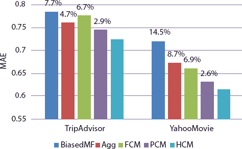

**Figure 3.4** Result comparison.

### 3.4.4 基于效用的多标准推荐系统，作者 Zheng

在这项研究活动中，他们引入了一种基于效用的多准则推荐算法。在这个算法中，他们通过不同的学习排序方法研究了客户期望。他们的实验输出取决于实际数据集。它证明了这些方法的有效性 \[3\]。

### 3.4.4.1 实验数据集

在这项研究活动中，他们使用了两个实际数据集，其中评分在 1 到 5 之间。使用了 TripAdvisor 数据。在这个数据集中，有超过 1,500 名客户提供的超过 22,000 个评分，涉及大约 14,000 家酒店。每个客户至少评分 10 次。这些评分涉及七个准则上的多准则评分。这些准则包括性价比、便利性、客房质量、入住和酒店清洁度以及设施的一般标准和特定业务设施。这里还使用了 Yahoo! Movies 数据集。有超过 2,000 名客户对大约 3,100 部电影给出了超过 62,000 个评分。每个客户至少评分 10 次。这些评分与毛皮上的多准则评分相关。这些 critters 是表演、导演、故事和视觉效果。他们将基于效用的模型与一些方法进行了比较。这些方法是 MF、线性聚合模型 (LAM)、混合上下文模型 (HCM) 和准则链模型 (CCM) \[3\]。

他们使用准确性和 NDCG 来计算前 10 个推荐的推荐系统效率。为了计算效用分数，他们使用了三种指标。通过应用皮尔逊相关性，他们获得的结果比应用余弦相似性略有改善。他们发现欧几里得距离是不好的选择。他们通过使用皮尔逊相关性获得了最佳结果 \[3\]。

### 3.4.4.2 实验结果

如 Figure 3.5 所示，它代表了实验结果。FMM 成为 TripAdvisor 数据的最佳基准方法，但 LAM 和 CCM 比 MF 高出 1%。在这里，HCM 的表现甚至低于 MF 方法。通过应用基于效用的方法，使用列表排序的 UBM 可以很好地超越 FMM 方法。如果他们使用点对点和成对排序优化，那么其他 UBM 模型将无法击败 FMM。来自 Yahoo! Movies 数据集，所有方法都可以超越不考虑多准则评分的 MF 方法。具体来说，在 TripAdvisor 数据中，使用列表排序的 UBM 可以将 NDCG 和精度分别提高 6.3% 和 5.4%，在与 Yahoo! Movies 数据相比的 FMM 中提高 4.1% 和 8% \[3\]。

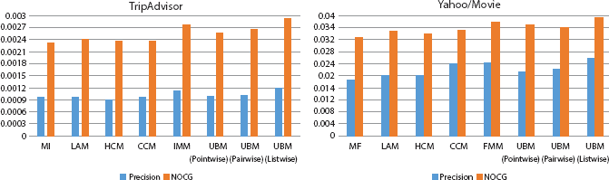

**Figure 3.5** 实验结果。

## 3.4.5 Wasid 和 Ali 的多准则聚类方法

在这项研究活动中，他们建议了一种聚类方法，以成功地将多准则评分纳入传统推荐系统。为了生成更精准的推荐，他们通过应用马哈拉诺比斯距离方法评估了集群内客户匹配。然后，他们将他们的方法与传统的 CF 进行了比较 \[2\]。

现在，我们将看看他们的实验评估及其效率的结果。

### 3.4.5.1 实验评估

为了实施这项提议的方法，他们使用了 Yahoo! Movies 数据集。该数据集包含 6,078 名用户对 976 部电影提供的 62,156 个评分。为了简化，他们提取了至少评分 20 部电影的客户。此条件满足 484 名用户和 945 部电影，他们总共有 19,050 个评分。然后，每个客户的评分被任意分为训练集和测试集。他们取了 70% 的数据用于训练，剩余 30% 的数据用于测试。然后，他们成功计算了客户之间的距离。他们为邻域集形成选择了前 30 名最等效的用户。为了评估这项提议的方法，他们使用了最流行的平均绝对误差 (MAE) 性能指标。正如我们之前看到的，MAE 因其简单性和准确性而非常流行。它符合实验的目标。平均绝对误差估计实际和预测客户评分之间的偏差 \[2\]。

### 3.4.5.2 结果与分析

他们使用的数据集包含单准则和多准则用户提供的评分。Table 3.4 代表了他们的方法与传统方法在非聚类和聚类环境下的差异。在这里，他们将实验结果与皮尔逊协作推荐器 (PCRS) 方法进行了比较。Table 3.4 传达了 PCRS 与他们提出的基于马哈拉诺比斯距离的推荐方案 (MDRS) 之间的结果。很明显，他们的方法 MDRS 远优于传统的 PCRS。这些结果基于平均绝对误差方法。这项提议的 MDRS 方法在聚类和非聚类环境下都效果更好，如 Figure 3.6 所示 \[2\]。

他们还展示了这个表格的图形实现，适用于非聚类和聚类环境。基于马哈拉诺比斯距离的方法优于皮尔逊协作推荐器方法。如果平均绝对误差值较低，则意味着结果更好。由此结果，我们还可以看到，基于非聚类的技术始终不如聚类方法效果好。因此，聚类方法更好 \[2\]。

**Table 3.4** 聚类和非聚类方法的比较。

| **Approach** || **MAE (non-clustering)** || **MAE (clustering)** |

| --- | --- | --- |

| PCRS || 2.4577 || 2.2734 |

| --- | --- | --- |

| MDRS || 2.3094 || 2.1751 |

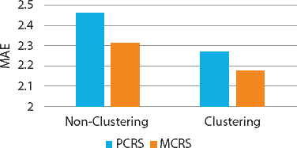

**Figure 3.6** 结果。

他们使用 K-means 算法将多准则评分整合到传统的 CF 推荐系统中。他们的方法将第三维视为多准则，将聚类参数视为客户的聚类参数，以处理维度问题。他们的方法取决于每个用户都有独特意见和准则的思维方式。因此，为了比较每个用户，这项工作最重要的关注点是找到具有相似客户的客户细分群。马哈拉诺比斯距离方法在这里用于为集群内的每个客户创建最精确的邻居。在结果中，我们可以清楚地看到，这种技术比传统方法更有效和准确 \[2\]。

## 3.5 多准则推荐系统的优势

多准则推荐系统用于使用户体验更轻松，或让每个用户的事情变得更容易。如果我们从商业角度来看，这个系统用于发展业务。

**Table 3.5** MCRS 中现有方法的比较。

| **Author name** || **Research work** || **Work done** || **Method name** || **Challenges** |

| --- | --- | --- | --- | --- |

| Yong Zheng || Utility-Based Multi-Criteria Recommender System (2019) || Implemented a new recommender system approach which dominates many the traditional approaches. || Utility-based approach. || Issue of overexpectation, which may contribute finer-grained recommendation models |

| --- | --- | --- | --- | --- |

| Dharahas Tallapally, Rama Syamala Sreepada, Bidyut kr. Patra, Korra Sathya Babu || User Preference Learning in Multi-Criteria Recommendation Using Stacked Auto Encoders || Implemented a recommender system using extended version of autoencoder named as stacked autoencoder. || Stacked Autoencoder, An unsupervised deep neural network approach. || This approach is still now in improvement state, and this approach cannot work in user review system. |

| Mohammed Wasid, Rashid Ali || 基于多准则聚类方法的改进推荐系统（2018） || 实现了基于聚类方法的多准则推荐系统，其效果优于传统推荐系统。 || K-means 聚类，马氏距离。 || 该特定算法假设每个客户对每个准则都有其个人意见，且彼此不同。 |

| Yong Zheng || 情境感知多准则推荐系统：将准则偏好作为上下文（2017） || 实现了使用准则偏好作为上下文方法的推荐系统，效果更好。 || 聚合方法，完整情境模型，部分情境模型，混合情境模型。 || 不适用于所有情况，需要改进。 |

| CataldoMusto, Marco de Gemmis, Giovanni Semeraro, Pasquale Lops || 基于用户评论的基于方面的情感分析的多准则推荐系统（2017） || 实现了使用用户评论的推荐系统。 || 从评论中提取方面和情感，然后将其输入基于协同过滤技术的多准则推荐算法中。 || 该研究工作仍在改进状态，可以进一步改进。 |

从商业角度来看，如果客户来到任何平台，所有者和员工的主要工作是满足客户需求。他们会确保客户拥有良好的体验并获得想要的东西。这是推荐系统的主要工作。出于这个特定原因，许多公司正在采用这种多准则推荐系统 \[33\]。

以下是从商业角度可以通过使用 MCRS 实现的一些好处：

### 3.5.1 收入

MCRS 在产生收入方面发挥着重要作用。经过多年的研究、执行和实验，来自世界各地的许多研究人员开发了各种类型的推荐系统。为了获得良好的准确性，执行和探索了许多不同类型的算法。当客户来购买特定物品时，MCRS 会向他展示一些相似的物品和配件，以便客户也会购买这些物品。这是 MCRS 的一项工作，也是产生更好收入的有效方式之一。

### 3.5.2 客户满意度

根据一项调查，许多时候，客户倾向于查看他们上次浏览的产品推荐，以寻找更好的产品机会。假设客户浏览了一下就离开，过一段时间他再次来访，那么如果他们的之前浏览会话可用，将会非常有帮助。这对推荐系统也有好处，因为它将根据用户的先前数据生成一个物品列表，并向客户推荐这些物品。因此，MCRS 就是这样在客户满意度方面发挥重要作用的。

### 3.5.3 个性化

如果我们看一下日常生活，就会明白我们在购买产品时也会寻求推荐。这些推荐大多由我们的家人和朋友提供。我们遵循他们的推荐是因为我们信任他们。这是 MCRS 在系统和用户之间建立的唯一要素。系统为用户预测的产品越合适，用户就越信任 MCRS 并购买推荐的产品。这就是通过个性化，客户会一次又一次地回到该平台的方式。

### 3.5.4 发现

每个推荐系统都可以用作工具。领先的公司发现将推荐系统作为工具的新方法。例如，iTunes 使用“Genius Recommendations”，这是一个非常高效的多准则推荐工具，Amazon 使用“Frequently Bought together”，用户也可以对其进行自定义。这些是使用多准则推荐系统的一些创新方式。

### 3.5.5 提供报告

这是个性化系统的一个组成部分。它也用于与客户建立信任。它有助于对网站或活动方向做出坚实的决策。为了创建促销，销售客户会根据他们的报告对滞销产品生成优惠。

在当前，在线销售通常更令人满意。因此，每家公司都想做点额外的事情。电子商务公司可以使用我们之前学过的不同类型的过滤技术，如协同过滤、基于内容的过滤、混合过滤，来构建有效的推荐引擎。例如，Amazon 拥有非常成功的多准则推荐引擎，它能非常高效地推荐多个附加商品，从而吸引客户或顾客从同一平台购买越来越多的东西。它遵循每个推荐系统的唯一原则：真正与客户互动的唯一方式是将每个人视为个体进行沟通。

## 3.6 多准则推荐系统的挑战

每个 MCRS 都面临一些常见挑战。其中一些如下。

### 3.6.1 冷启动问题

当客户第一次来到该平台或当新物品添加到该平台时，推荐系统会面临此问题。当有人第一次来到任何平台时，推荐系统没有关于该客户的任何信息。因为客户没有对任何产品进行评分或没有浏览任何内容。如果在平台上添加了新物品，那么它也没有关于其质量、耐用性等的任何评分。这被称为冷启动问题。已有大量研究工作致力于解决这个问题 \[34\]。

### 3.6.2 稀疏性问题

这也是当前所有推荐系统面临的一个非常重要的问题。当用户拥有庞大的历史记录列表时会发生这种情况。列表包含他购买的物品列表、观看的电影列表、收听的音乐列表，甚至他之前的浏览列表。当用户在购买物品或观看电影后没有给出评分时，就会发生稀疏性问题。评分是 MCRS 最基本的要素。由于缺乏评分，推荐系统无法判断客户是否喜欢该特定事物 \[34\]。

### 3.6.3 可扩展性

可扩展性与多准则推荐系统自身的性能相关。通常，推荐系统不会消耗太多资源。它的设计方式是使用最少资源来获得最佳准确性。推荐系统需要向用户推荐一系列物品。但随着时间的推移，用户数量增加，物品数量也增加，推荐列表也在增加 \[34\]。

### 3.6.4 过度专业化问题

当 MCRS 能够了解特定客户的选择时，它会创建一个边界，并根据他们的选择显示内容，而不随时间发现新物品和其他选项。这种情况被称为过度专业化问题 \[34\]。

### 3.6.5 多样性

如果用户在平台上花费很长时间，那么推荐系统就拥有关于他的大量信息。如果他订购几乎相同类型的东西，那么推荐系统生成的推荐列表将仅基于同一类别 \[34\]。

### 3.6.6 意外性

每个推荐系统都应该有一个目标：通过推荐新产品来让人们感到惊喜，并激发用户的兴趣 \[34\]。

### 3.6.7 隐私

对于推荐系统，隐私非常重要。由于推荐系统了解用户的一些信息，这些信息不应传播到外部世界。用户需要了解哪些数据是批准更理想物品给他们所必需的，以及这些数据是如何被使用的 \[34\]。

### 3.6.8 刷单攻击

当用户变得恶意或不道德时会发生这种情况。许多时候，观察到用户开始对某些项目给出虚假评分。如果发生这种情况，那么要么该优质项目的评分会下降，该项目将不再被推荐，要么低质量项目会获得更多好评，并被`MCRS`更多地推荐。这被称为刷单攻击 \[34\]。

### 3.6.9 灰羊

灰羊现象通常发生在 CF 系统中。在这里，客户的信念与任何群体都不一致，因此无法获得推荐的优势 \[34\]。

## 3.7 结论

在 `MCRS` 的本章中，我们了解了推荐系统的定义、其日益增长的重要性以及在各个领域的应用。此外，我们讨论了推荐系统的不同阶段。而且，我们深入分析了与推荐系统相关的三种不同的过滤技术，包括协同过滤、基于内容的过滤和基于知识的过滤技术。此外，我们还讨论了混合过滤技术。为了更好地理解推荐系统的概念，我们考虑了全球各位研究人员进行的五项研究活动。最后，我们还讨论了推荐系统中普遍存在的各种优势和挑战。

如今，推荐系统在各个方面被广泛使用，随着时间的推移，推荐系统正在被修改并表现出更好的性能。在推荐系统中实施了新技术，以得出更好的预测 \[1\]。

## 参考文献

1\. Al-Ghuribi, S.M. and Noah, S.A.M., Multi-criteria review-based recommender system–the state of the art. *IEEE Access,* 7, 169446–169468, 2019.

2\. Wasid, M. and Ali, R., An improved recommender system based on multi-criteria clustering approach. *Proc. Comput. Sci.*, 131, 99–101, Jan. 2018.

3\. Zheng, Y., Utility-based multi-criteria recommender systems, in: *Proc. 34th ACM/SIGAPP Symp. Appl. Comput.*, pp. 2529–2531, 2019.

4\. Tallapally, D., Sreepada, R.S., Patra, B.K., Babu, K.S., User preference learning in multi-criteria recommendations using stacked auto encoders. Presented at the *Proc. 12th ACM Conf. Recommender Syst.*, Vancouver, BC, Canada, 2018.

5\. Musto, C., de Gemmis, M., Semeraro, G., Lops, P., A multi-criteria recommender system exploiting aspect-based sentiment analysis of users’ reviews. Presented at the *Proc. 11th ACM Conf. Recommender Syst.*, Como, Italy, 2017.

6\. García-Cumbreras, M. Á., Montejo-Râez, A., Díaz-Galiano, M.C., Pessimists and optimists: Improving collaborative filtering through sentiment analysis. *Expert Syst. Appl.*, 40, 17, 6758–6765, 2013.

7\. Zhang, W., Ding, G., Chen, L., Li, C., & Zhang, C. (2013). Generating virtual ratings from chinese reviews to augment online recommendations. ACM Transactions on intelligent systems and technology (TIST), 4(1), 1–17.

8\. Bauman, K., Liu, B., Tuzhilin, A., Aspect based recommendations: Recommending items with the most valuable aspects based on user reviews, in: *Proc. 23rd ACM SIGKDD Int. Conf. Knowl. Discovery Data Mining*, pp. 717–725, 2017.

9\. Akhtar, N., Zubair, N., Kumar, A., Ahmad, T., Aspect based sentiment oriented summarization of hotel reviews. *Proc. Comput. Sci.*, 115, 563–571, Jan. 2017.

10\. Yang, C., Yu, X., Liu, Y., Nie, Y., Wang, Y., Collaborative filtering with weighted opinion aspects. *Neurocomputing*, 210, 185–196, Oct. 2016.

11\. Dong, R., O’Mahony, M.P., Schaal, M., McCarthy, K., Smyth, B., Sentimental product recommendation, in: *Proc. 7th ACM Conf. Recommender Syst*, pp. 411–414, 2013.

12\. Wang, F., Pan, W., Chen, L., Recommendation for new users with partial preferences by integrating product reviews with static specications, in: *Proc. Int. Conf. Modeling, Adaptation, Pers.*, pp. 281–288, 2013.

13\. Musat, C.C., Liang, Y., Faltings, B., Recommendation using textual opinions, in: *Proc. Int. Joint Conf. Artif. Intell.*, pp. 2684–2690, 2013.

14\. Jamroonsilp, S. and Prompoon, N., Analyzing software reviews for software quality-based ranking, in: *Proc.10th Int. Conf. Elect. Eng./Electron., Comput., Telecommun. Inf. Technol. (ECTI-CON)*, May 2013, pp. 1–6.

15\. Zhang, Y., Liu, R., Li, A., A novel approach to recommender system based on aspect-level sentiment analysis, in: *Proc. 4th Nat. Conf. Electr., Electron. Comput. Eng. (NCEECE)*, pp. 1453–1458, 2015.

16\. Kermani, N.R. and Alizadeh, S.H., A hybrid multi-criteria recommender system using ontology and neuro-fuzzy techniques. *Electron. Commer. Res. Appl.,* 21, 50–64, 2017.

17\. Wang, Y., Wang, M., Xu, W., A sentiment-enhanced hybrid recommender system for movie recommendation: a big data analytics framework. *Wireless Communications and Mobile Computing*, 2018, 2018.

18\. Zheng, Y., Utility-based multi-criteria recommender systems. In: *Proceedings of the 34th ACM/SIGAPP Symposium on Applied Computing,* pp. 2529–2531, 2019, April.

19\. Zheng, Y., Situation-aware multi-criteria recommender system: using criteria preferences as contexts. In: *Proceedings of the Symposium on Applied Computing,* pp. 689–692, 2017, April.

20\. Tallapally, D., Sreepada, R. S., Patra, B. K., Babu, K. S., User preference learning in multi-criteria recommendations using stacked auto encoders. In: *Proceedings of the 12th ACM Conference on Recommender Systems,* pp. 475–479, 2018, September.

21\. Hassan, M. and Hamada, M., Improving prediction accuracy of multi-criteria recommender systems using adaptive genetic algorithms. In: *2017* *Intelligent Systems Conference (IntelliSys),* pp. 326-330, IEEE, 2017, September.

22\. Hassan, M. and Hamada, M., A neural networks approach for improving the accuracy of multi-criteria recommender systems. *Appl. Sci.*, 7, 9, 868, 2017.

23\. Hassan, M. and Hamada, M., Performance comparison of featured neural network trained with backpropagation and delta rule techniques for movie rating prediction in multi-criteria recommender systems. *Informatica*, 40, 4, 2016.

24\. Zheng, Y., Criteria chains: a novel multi-criteria recommendation approach. In: *Proceedings of the 22nd International Conference on Intelligent User Interfaces*, pp. 29–33, 2017, March.

25\. Ryngksai, I. and Chameikho, L., Recommender Systems: Types of Filtering Techniques. *Int. J. Eng. Res. Technol.,* Gujarat, 3, 2278-0181, 251–254, 2014.

26\. Lakshmi, S.S. and Lakshmi, T.A., Recommendation Systems: Issues and challenges. *(IJCSIT) Int. J. Comput. Sci. Inf. Technol.*, 5, 4, 5771–5772, 2014.

27\. Sharma, L. and Gera, A., A Survey of Recommendation System: Research Challenges. *Int. J. Eng. Trends Technol. (IJETT)*, 4, 5, 1989–1992, 2013.

28\. Khusro, S., Ali, Z., Ullah, I., Recommender systems: issues, challenges, and research opportunities. In: *Information Science and Applications (ICISA) 2016,* pp. 1179–1189, Springer, Singapore, 2016.

29\. Maan, T., Gupta, S., Mishra, A., A Survey On Recommendation System. *International Conference on recent innovations in management, Engineering, Science and technology (RIMEST2018)*, pp. 543–549, 2018.

30\. Mahmoud, H., Hegazy, A., Khafagy, M.H., An approach for big data security based on Hadoop distributed file system. *2018 International Conference on Innovative Trends in Computer Engineering (ITCE)*, Aswan, pp. 109–114, 2018.

31\. Mohamed, M.H., Khafagy, M.H., Ibrahim, M.H., Recommender systems challenges and solutions survey. In: *2019 International Conference on Innovative Trends in Computer Engineering (ITCE)*, pp. 149-155, IEEE, 2019, February.

32\. Sahoo, A.K., Pradhan, C., Bhattacharyya, S., Privacy towards GIS Based Intelligent Tourism Recommender System in Big Data Analytics, in: *Hybrid Computational Intelligence: Research and Applications*, p. 81, 2019.

33\. Mallik, S. and Sahoo, A.K., A Comparison Study of Different Privacy Preserving Techniques in Collaborative Filtering Based Recommender System, in: *Computational Intelligence in Data Mining*, pp. 193–203, Springer, Singapore, 2020.

34\. Sahoo, A.K. and Pradhan, C., Accuracy-Assured Privacy-Preserving Recommender System Using Hybrid-Based Deep Learning Method, in: *Recommender System with Machine Learning and Artificial Intelligence: Practical Tools and Applications in Medical, Agricultural and Other Industries*, pp. 101–120, 2020.

1. \**通信作者*: abhayakumarsahoo2012@gmail.com

# 4 云中机器/深度学习的采用及宫颈癌识别案例研究

**Jyothi A. P. ^(1,2)\*, S. Usha^(2,3) and Archana H. R.^(3)**

*^(1)Dept. of CSE, RVITM, Bengaluru, Karnataka, India*

*^(2)Dept. of CSE, RND, RRCE, Bengaluru Karnataka, India*

*^(3)Dept. of ECE, BMSCE, Bengaluru, Karnataka, India*

> **摘要**

> 机器学习（ML）利用计算来解析信息，并基于其所学内容做出明智决策。深度学习（DL）是 ML 的一个子领域。虽然两者都属于人工智能的一般分类，但深度学习才是控制最具人类特征的人工智能的关键。

> ML/DL 与云计算之间的关联在于对资源的需求。云计算之所以成为关键因素，在于能够快速启动带有预定义镜像的新服务器，并随时更改资源。您可能需要 100 台服务器来运行计算，但不需要这些服务器一直运行，那将是浪费金钱。借助云计算，您可以启动所需数量的服务器，运行算法，并在完成后再次销毁这些机器。

> 本书章节讨论了 ML/DL 在云中的采用。内容包括介绍、背景研究、ML/DL 描述、ML/DL 与云的连接、ML/DL 算法、基于云的 ML/DL 宫颈癌识别项目实现及其设计方法和结果，以及认知云、聊天机器人、智能个人助手、IoT 云、商业智能、AI-as-a-Service 等应用，以及与云中 ML/DL 采用相关的优势和结论。

> 准确无误的定位可以挽救生命。早期宫颈癌的识别曾通过基于样本细胞核边界计算的微小涂片测试完成，例如其形状和大小，因为涂片在显微镜下分析是一项极具挑战性的任务。因此，需要数字图像处理技术来识别人类细胞中的异常。随后，本书章节中提出了一种全面的 AI 程序。所提方法可提供宫颈细胞中细胞质和细胞核的特征和形状。KNN 和 SVM 与分割细胞的特征和形状一起使用，并与未知宫颈细胞样本进行比较，以实现该方法。SVM 的精确率为 86%，KNN 的精确率为 70%。

> 尽管 ML/DL 使云计算更加增强、高效和可扩展，但云平台为 ML/DL 应用拓宽了视野。因此，两者内在相关，当结合成一种共生关系时，其商业内涵可能是巨大的。

> **关键词:** 机器学习，深度学习，KNN，SVM，云，AI，宫颈癌

## 4.1 介绍

人工智能（AI）利用计算来解析数据，从该信息中学习，并基于其所学内容做出明智决策。机器学习（ML）/深度学习（DL）是 AI 的一个子领域。两者都属于人工智能的广义范畴，深度学习是控制最具人类特征的人工智能的关注点。

AI 的这两个子集在某种程度上都与数据相关，这使得可以表达为一种明确的理解。另一方面，您应该知道，深度学习所需的数据远多于传统的 AI 计算。其原因是，当超过 1,000,000 个数据点交互时，深度学习网络可以识别神经网络层中的各种机制。另一方面，AI 算法能够通过预修改的模型进行学习。

分布式计算是个人计算机系统资源（主要是数据存储和算力）的按需访问。它描述了通过互联网向多个用户提供的数据中心。

ML/DL 与云处理之间的关联在于对资源的需求。ML/DL 是一个需要大量处理能力的过程。许多对此感兴趣的人会立即整合许多员工来处理计算，并请求在专用托管平台上不易获得的算力。人工智能的发展以及深度学习和机器学习的演进在 Figure 4.1 中得到体现。

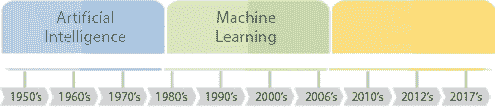

**Figure 4.1** 人工智能的发展。

分布式计算之所以成为关键因素，在于能够快速启动带有预定义镜像的新员工，并随时更改资源。您可能需要 100 名员工来处理计算，但您不需要这些员工一直在线，否则将是浪费金钱。

借助分布式计算，您可以启动所需数量的员工，处理计算，并在完成后再次销毁这些机器。

随着更多云服务提供商和组织认识到云中 ML/DL 的潜力，这将推动对云 ML/DL 平台的需求。尽管 ML/DL 使分布式计算更加增强、高效和可扩展，但云平台为 ML/DL 应用拓宽了视野。因此，两者复杂地相互关联。当结合在一起时，商业内涵可能是巨大的。AI、ML 和 DL 的相关性在 Figure 4.2 中得到体现。

在云中准备 ML 模型是合理的。为什么？在众多原因中，它允许您在大量数据上进行训练，并拥有充足的计算能力，也许可以同时训练多个模型。此外，这并不难！在 Google Cloud Platform 上，您可以使用 Cloud ML Engine 在 Tensor Flow 和其他 Python ML 库（例如，scikit-learn）中训练 AI 模型，而无需处理任何基础设施。为此，您应将代码放入 Python 包中（例如，添加 setup.py 和 \_\_init\_\_.py 文件）。同样，将代码组织到 model.py 和 task.py 中是一种最佳实践。

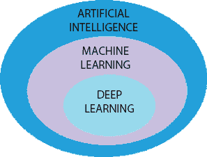

**Figure 4.2** AI、ML 和 DL。

人工智能作为一门学科成立于 20 世纪 50 年代。事实上，“人工智能”一词是由美国计算机科学家 John McCarthy 提出的。根据 John McCarthy 的说法，AI 是“智能机器，特别是智能计算机程序的科学、工程和构建”。

尽管它并非最近才出现，但由于海量数据可用性的提升和处理能力的增强，它已成为生活方式中必不可少的一部分。`AI` 通过大量数据收集与快速迭代训练以及精巧计算的融合，发挥出最大潜力。这使得 `AI` 编程能够从海量数据集中提供的示例或特征中自然学习。如今，我们在常规新闻广播中见到 `AI` 新闻和模型已属常见。显然，公众意识中取得普遍成功的 `AI` 程序是 `AlphaGo` 人工智能程序，它于 2017 年 5 月在古老的桌面游戏 `GO` 中，利用一种名为“强化学习”的 `AI` 算法，终结了人类 2500 年的统治地位。从那时起，这类 `AI` 新闻已成为我们日常流程的一部分，包括自动驾驶汽车、`Alexa`/`Siri`、机场实时人脸识别、人类基因组项目、`Amazon`/`Netflix`、`AI` 专家、手写回复、`Email` 广告算法，清单可永无止境，而深度神经网络作为最突出的 `AI` 形式，正处于 `Gartner` 支持曲线的顶峰，表明期望值被夸大；自动驾驶汽车仅行驶了数百万英里，且安全记录良好。

`AI` 创新将在 2019 年持续颠覆，并因中等分布式计算和大数据爆炸而变得更加广泛可用。我们目前不记得有任何其他技术领域能同时吸引开源/创客社区和最大型企业的如此多优秀人才和巨额资源。

## 4.2 背景研究

关键理念 \[1\] 是在训练期间主动丢弃神经网络中的单元（及其连接）。这防止单元过度协同变化。这从根本上减少了过拟合，并相较于其他常规正则化技术带来了显著改进。

一种剩余知识结构 \[2\] 用于支持建立比当前使用的更为显著的神经连接。我们明确将层重新表述为学习相对于层贡献的额外边界，而非学习无参考边界。我们提供广泛的详细验证，证明这些剩余连接更容易优化，并能从根本性的综合含义中获得准确性。

构建深度神经网络 \[3\] 存在混乱，因为每层数据的分布在训练过程中会随前一层限制的变化而变化。我们将这种现象称为内部协变量偏移，并通过归一化输入层来解决该问题。它被应用于前沿图像识别方法。这在训练步骤大幅减少的情况下实现了可比精度，并以巨大的领先优势超越了主要方法。

卷积神经网络（`CNNs`） \[4\] 已确立为表示验证问题的一类杰出模型。受这些结果启发，我们通过一个包含一百万个带有 487 个类别标签的 `YouTube` 视频的额外数据集，对 `CNNs` 进行大规模视频聚合的广泛仔细估计。

另一个数据集 \[5\] 旨在通过将物体确认置于更广泛的场景理解请求中，推动物体确认的顶尖水平。我们的数据集包含 91 种物体类别的照片，这些物体对 4 岁儿童来说都能轻易辨认。最后，我们使用可变部件模型对跳跃框和分割识别结果进行了模型执行评估。

另一个场景驱动的数据库 \[6\] 包含超过 700 万张标记场景图片。我们提出新方法来考察图像数据集的密度和多样性，并表明 Places 的密度与其他场景数据集相当，且具有更大的多样性。

另一种通过对抗循环 \[7\] 评估生成模型的框架，其中我们同时训练两个模型：一个生成模型 `G` 获取数据分布，以及一个判别模型 `D` 评估模型来自训练数据而非 `G` 的概率。

在大多数当前追踪器中，为了适应常规图像变化，分类器通常使用平移和缩放的示例补丁进行训练。针对数千个平移补丁的数据集提出了一种科学模型 \[8\]。通过证明结果数据矩阵是循环矩阵，我们可以使用离散傅里叶变换将其对角化，从而将存储和计算量降低几个数量级。

为了对多标签学习进行理想审查，作者考虑 \[9\] 这样一个问题：每个模型由单个示例表示，同时关联一组标签。

暂时评估重要卷积神经网络每层中神经元的共识与明确性 \[10》，并报告两三个惊人的结果。灵活性受两个特定问题的负面影响：(1) 高层神经元对其特殊任务的专业化，以牺牲目标任务的执行为代价，这是典型的；(2) 与分离协同变化神经元之间的网络相关的改进挑战，这是未预料到的。

我们评估了来自 17 个家族 \[11\] 的 179 个分类器（判别评估、贝叶斯、神经网络、基于维护规则的分类器、向量机、决策树、堆叠、提升、发射以及各种集群，总结了线性模型、最近邻、不充分最小二乘和主成分回归、确定性和多项式回归、多变量回归样条以及独特技术）。我们使用来自 `UCI` 数据库的 121 个数据集来考察分类器行为，不受数据集集合的影响。获胜者是在 `R` 中实现并通过 `caret` 访问的随机森林（`RF`）变体，以及使用 `LibSVM` 在 `C` 中实现的带高斯位的 `SVM`。

信息库，一种网络规模的概率数据库，它将从网络内容（通过文本、纯数据、页面结构和人类注释的分析获得）与从现有数据存储获得的先前数据相结合，用于构建数据库 \[12\]。我们使用受监督的 `AI` 技术来整合特定数据源。知识库比任何先前发布的结构化数据存储都要大得多，并具有概率推理框架，用于计算真实性准确性的对齐概率。

针对近似最近邻排序 \[13\] 进行计算，并将其与过去的算法进行评估和对比。为了扩展到那些否则无法装入单台机器内存的巨大数据集，我们提出了一种分布式最近邻排序框架，可以与论文中描述的任何计算一起使用。

关于极端学习机（`ELM`） \[14\] 的理论研究现状和实际进展。除了表示和回归，`ELM` 最近还被应用于分类、特征选择、示例学习以及各种其他学习任务。鉴于其卓越的有效性、简便性和出色的假设执行，`ELM` 已应用于多个领域，例如生物医学规划、`PC` 视觉、结构识别以及控制和先进机械。

工作旨在全面介绍概念漂移转变，该转变是指在线受监督学习 \[15\] 情况下，输入数据与目标变量之间的关系随时间变化。

为了提高 CNN 初始化的不变性 \[16\]，同时不降低其歧视能力，本文提出了一种名为多尺度无序池化（`MOP-CNN`）的简单而强大的方案。

我们计划识别图像中所有类别的出现，并对每个实例标记属于它的像素。我们将这项任务称为同时检测与分割（`SDS`）\[17\]。

由于存在包含许多变量的数据，导致数据具有极高维度，因此文献中可用大量特征选择技术 \[18\]。

本文针对单幅图像的人脸对齐问题进行了研究。我们展示了如何利用一组回归树直接从稀疏像素子集中估计面部标志位置，从而实现超实时性能和高质量预测 \[19\]。

模式识别 \[20\] 中当前研究的热点是融合多个分类器系统，这些系统可以基于相同或不同的模型以及数据集构建。

在对不同方法进行研究和讨论之后，Rajashekar *et al.* \[21\] 的论文描述了一种为实用筛查结构设计的筛查系统，该系统可广泛部署。该结构数字化巴氏涂片载玻片，并对数字化涂片进行细胞级和涂片级评估，最终将涂片描述为正常或可疑。显然，常规涂片在无需人工干预的情况下被筛选，而可疑涂片则被送交资深细胞学家审查。

一种微小努力的单层载玻片制备技术也已被认可，它能以远低于传统系统的成本生产出价值相当的单层载玻片。

Aabha Phatak *et al.* \[22\] 描述了宫颈癌可能影响全球女性且其发病率正在上升。早期诊断可在降低宫颈癌死亡率方面发挥重要作用。基于临床图像评估的确诊正在迅速获得认可，因此，本文提出了一种利用图像处理技术的自动诊断系统，该系统可能成为放射科医生的指南，并在早期发现癌症方面发挥关键作用。它介绍了分割和规划技术，利用这些技术，设想的自动化决策支持系统的局限性得以克服。

Zhi Lu *et al.* \[23\] 提出并评估了提交给生物医学领域宫颈细胞学图像分割挑战的主框架。该框架旨在激励开发和基准测试能够从宫颈细胞学图像中分离单个细胞的方法，这些方法是计算机辅助宫颈损伤诊断系统发展的前提。

Mustafa N *et al.* \[24\] 提出了可用于提供异常结构储备的数字化成像策略，并对感兴趣区域（`ROI`）和聚类以及散点分析进行了建模。

## 4.3 机器学习/深度学习概述

人工智能包括计算机在没有被明确编程的情况下学习如何执行任务。它包括计算机从提供的数据中学习，以便执行某些任务。对于分配给计算机的简单任务，可以编写算法来指导机器执行处理当前问题所需的所有步骤；在计算机方面，不需要学习。对于更复杂的任务，人类可能难以真正进行必要的计算。此时，让机器发展自己的算法，而不是让人类工程师演示每个必要步骤，可能更为有效。

AI 控制利用不同的方法来教导计算机完成没有完全合适算法可用的任务。在存在大量潜在答案的情况下，一种方法是将部分正确答案标记为有效。然后，这可以作为训练数据，供计算机改进其用于确定正确答案的算法。例如，为了训练用于自动字符识别任务的系统，MNIST 手写数字数据集经常被使用。

 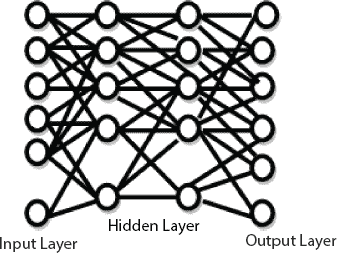

**Figure 4.3** Working network of deep learning.

深度学习算法使用受监督和无监督学习算法，通过传递的输入来训练输出。下面的圆圈表示神经元，它们相互连接。神经元分为三个不同的层级结构，如 Figure 4.3 所示。第一个神经元层级，即输入层，接收数据并将其传递给第一个隐藏层。隐藏层对接收到的数据进行计算。神经网络构建中最大的挑战是确定神经元的数量和各个隐藏层的数量。最后，输出层生成所需的输出。

这是工作的基本流程。现在，进入解释计算方法的部分。神经元之间的每个连接都包含权重，它表示输入值的重要性。为了归一化输出，使用激活函数。为了训练网络，考虑两个重要措施。第一是创建一个大型数据集，第二是强大的计算能力。深度学习中的“深度”指的是模型用于训练数据集的隐藏层数量。

DL 的工作原理可以总结为以下四点：

1. ANN 要求一组二元真/假问题的组合。

2. 从数据块中提取数值。

3. 根据得到的答案对数据进行排序。

4. 最后一点是对数据进行标记/标注。

 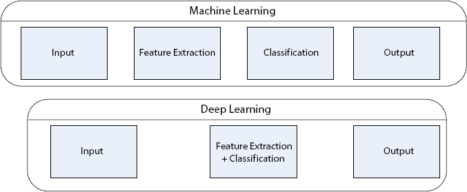

**Figure 4.4** Difference between ML and DL.

## 4.4 机器学习/深度学习与云计算的联系

联系在于对资源的需求。ML 是一个需要大量处理能力的过程。许多对此感兴趣的人会一次性结合数百台服务器来处理算法，并需要在专用托管平台上无法直接获得的算力。

云计算发挥作用的地方在于，它能够快速使用预定义镜像启动新服务器，并即时更改资源。您可能希望有 100 台服务器正在处理您的算法，但您不希望这 100 台服务器一直运行，否则将是浪费金钱。

借助云计算，您可以启动任意数量的服务器，处理算法，并在完成后销毁机器。ML 和 DL 之间的根本区别如 Figure 4.4 所示。DL 和 ML 的比较研究见 Table 4.1。

## 4.5 机器学习/深度学习算法

ML 算法中的三种不同学习方法如 Figure 4.5 所示。

### 4.5.1 监督学习

Input is called preparation set and has a label as well as outcome, for instance, a supply price at a time. A model is entity from beginning to end of a training cycle in which it is needed to craft prospect and is adjusted while those forecasts are not correct. The groundwork cycle proceeds until the representation achieves an ideal degree of accuracy on the research information. Model issues are classification and regression. A representation of Supervised Learning Algorithm is as shown in Figure 4.6.

**Table 4.1** Comparison of DL and ML.

| **Attributes** || **Deep Learning** || **Machine Learning** |

| --- | --- | --- |

| **Definition** || It is a subset of AI with the steady spotlight on accomplishing more noteworthy adaptability through considering the entire world as a settled progressive system of concepts. || It is a sub-part of artificial knowledge. It permits the machines to prepare with different datasets and anticipate dependent on their encounters. |

| --- | --- | --- |

| **Working mechanism** || Neural networks help in deciphering the highlights of information and their connections in which significant data is handled through different phases of preparing the data. || It uses mechanized calculations to foresee the choices for the future and demonstrating of capacities dependent on the information took care of to it. |

| **Management** || All the calculations are self-coordinated after the usage for result getting and information analysis. || All the investigation is overseen by investigators to assess distinctive variable under the different datasets. |

| **Functional examples** || Practical models are remote helpers, shopping and amusement, facial acknowledgment, interpretations, drugs, and vision for driverless vehicles. || Practical models are discourse acknowledgment, clinical conclusion, measurable exchange, arrangement, expectation, and extraction. |

| **Information points** || Data focuses are utilized for examination typically numbered in millions. || Data focuses are utilized for investigation as a rule numbered in thousands. |

| **Preparing time** || Considering bigger boundaries, profound learning sets aside a long effort for training. || Machine learning calculations ordinarily sets aside less effort for examination, going from a couple of moments to hours. |

| **Considered algorithms** || It utilizes neural networks. || It uses calculations like straight relapse, arbitrary timberland, and KNN. |

| **Output** || The yield is typically assorted like a score, a component, grouping, or basically a text. || The yield for this calculation is normally a numeric worth like an arrangement. |

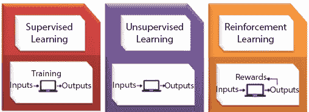

**Figure 4.5** Types of ML.

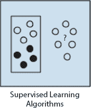

**Figure 4.6** Supervised learning algorithm.

### 4.5.2 Unsupervised Learning

Information is not marked and does not include an identified outcome. A representation is unit by final structure at hand in the data. This may be to remove common guidelines. It could be during a statistical cycle to efficiently diminish surplus, or it very well may be to coordinate information by likeness. Model problems are alliance, size decrease and membership rule learning. Model computations are the Apriori estimate and K-Means. A representation of Supervised Learning Algorithm is as shown in Figure 4.7.

### 4.5.3 Reinforcement or Semi-Supervised Learning

Records are a combination of named as well as unnamed models. At hand is an ideal plan concern; however, the model should gain proficiency with the structures to sort out the information just as make expectations. A representation of Supervised Learning Algorithm is as shown in Figure 4.8.

Model issues are order and relapse. Model computations are extension of flexible strategies that formulate suspicions concerning how to make obvious the unnamed info. The method is based on observation and initial preparation and gaffe to bring about objectives or inflate return. The specialist settles on an alternative by noticing its current circumstance.

In the event that the insight is negative, the result changes its masses to have the choice to mend on an every other requisite preference at any time. Various learning techniques can be mapped as shown in Figure 4.9.

#### 4.5.3.1 Outline of ML Algorithms

While crunching information to display business choices, you are most normally utilizing directed and unaided learning strategies. An interesting issue right now is semi-administered learning techniques in zones, for example, picture order where there are huge datasets with not so many marked models.

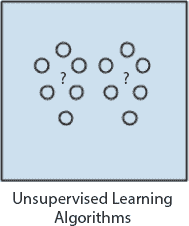

**Figure 4.7** Unsupervised learning algorithm.

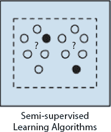

**Figure 4.8** Reinforcement algorithm.

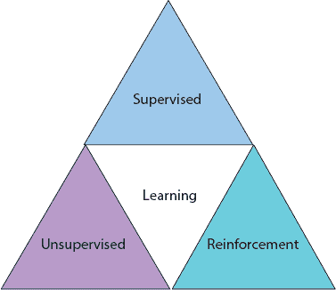

**Figure 4.9** Supervised, unsupervised, and reinforcement learning.

**Algorithms Grouped by Resemblance**

Calculations are frequently gathered by comparability regarding their capacity; for instance, tree-based strategies and neural organization motivated techniques. It is the most valuable approach to assemble calculations and it is the methodology we will use here. This is a helpful assembly strategy, yet it is not great. There are still computations that possibly will just find a way into numerous classes like Learning Vector Quantization together with a neural organization roused technique and an occasion-based strategy. It has additional divisions having the very name that depicts hitch along with set of computation.

These computations had been done two times or by picking the social affair that sincerely is the “superlative” on top form. This segments a list of the well-known AI calculations that gathered the manner in which we believe is the most instinctive. The rundown is not thorough in both the gatherings or the computations, yet it is delegate and valuable to understand a thought of the set of the ground.

It would be ideal if you note the following: There is a solid predisposition toward calculations utilized for grouping and relapse, the two most predominant directed AI issues you will experience.

**a. Regression Algorithms**

Regression is worried about displaying the connection among factors that is iteratively sophisticated utilizing a proportion of blunder in the expectations prepared by the model which is represented in Figure 4.10.

Relapse techniques are a set of measurements and co-selected into factual AI. This might be befuddling on the grounds that we can employ regression to incorporate indirect method for class of computation. Truly, relapse is a cycle.

The well-known relapse calculations are as follows:

*   Ordinary Least Squares Regression (OLSR)

*   Linear Regression

*   Logistic Regression

*   Multivariate Adaptive Regression Splines (MARS)

*   Locally Estimated Scatterplot Smoothing (LOESS)

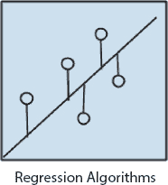

**Figure 4.10** Regression algorithms.

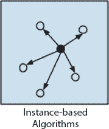

**Figure 4.11** Instance-based algorithms.

**b. Instance-Based Algorithms**

This erudition method is a choice issue specifying occasions or instances of preparing information which are considered significant or needed.

这些技术会定期为模型事实构建信息库，并将新颖的统计数据与利用可比性评估来定位最佳匹配并进行估算的信息库进行对比。基于示例的策略还被称为“赢家通吃”方法和基于记忆的学习。基于实例的算法表示如 图 4.11 所示。零点依赖于存储案例的表示，并在实例之间使用可比性估计。

该领域中几个著名的算法如下：

* `k-Nearest Neighbor (kNN)`
* `Learning Vector Quantization (LVQ)`
* `Self-Organizing Map (SOM)`
* `Locally Weighted Learning (LWL)`
* `Support Vector Machines (SVM)`

## c. 正则化算法  

正则化是一种扩展技术，它根据方法的复杂性来处理方法，倾向于更简单的模型，这些模型在求和方面也更出色，如 图 4.12 所示。我们将正则化计算单独列出，这些计算是著名的、强大的、简单的变化，可应用于不同的策略。

著名的算法如下：

* `Ridge Regression`
* `Least Absolute Shrinkage and Selection Operator (LASSO)`
* `Elastic Net`
* `Least-Angle Regression (LARS)`

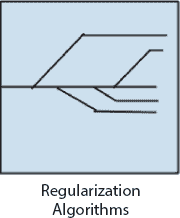

**Figure 4.12** 正则化算法。

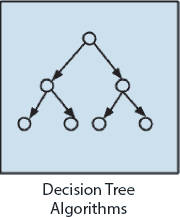

**Figure 4.13** 决策算法。

## d. 决策树算法  

这些技术通过基于记录中特征的实际估计值来构建一系列选择。选项在树结构中分叉，直到为特定证据准备好预测选项。决策树通常快速、准确，并且是 AI 的主要首选。

最著名的决策树计算如下：

* `Classification and Regression Tree (CART)`
* `Iterative Dichotomiser 3 (ID3)`
* `C4.5 and C5.0 (various adaptations of an incredible methodology)`
* `Chi-Squared Automatic Interaction Detection (CHAID)`
* `Decision Stump`
* `M5`
* `Conditional Decision Trees`

## e. 贝叶斯算法  

该方法涉及用于分类和回归的贝叶斯定理。

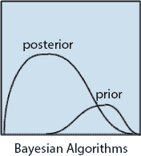

**Figure 4.14** 贝叶斯算法。

几个著名的算法如下：

* `Naive Bayes`
* `Gaussian Naive Bayes`
* `Multinomial Naive Bayes`

## f. 聚类算法  

聚类描述了一组事物和一组计划。这些始终通过建模方法同步。这些策略关注于整合常规结构数据以供参考。

主流的聚类计算如下：

* `k-Medians`
* `Expectation-Maximization (EM)`
* `Hierarchical Clustering`

## g. 关联规则学习算法  

这些技术提取规则，以更好地解释信息中变量之间观察到的关联。

像这样的标准在被组织利用的大型数据库中具有科学价值的关联意义。

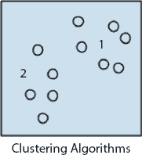

**Figure 4.15** 聚类算法。

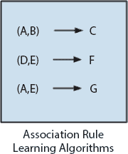

**Figure 4.16** 关联规则学习算法。

算法如下：

* `Apriori algorithm`
* `Eclat algorithm`

## h. 人工神经网络算法  

ANN 是受生物神经网络的结构和额外能力启发的方法。

它是一个包含许多计算和方法的巨大子领域。

由于该领域的巨大发展和普及，我们将深度学习（DL）与神经网络分离出来。

* `Perceptron`
* `Multilayer Perceptrons (MLPs)`
* `Back-Propagation`
* `Stochastic Gradient Descent`
* `Hopfield Network`
* `Radial Basis Function Network (RBFN)`

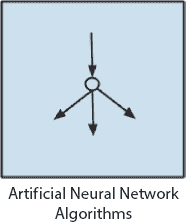

**Figure 4.17** 人工神经网络算法。

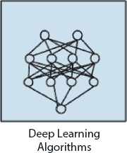

**Figure 4.18** 深度学习算法。

## i. 深度学习算法  

它们是对 ANN 的前沿更新，利用了廉价的大量计算。

我们关注构建更高级、更复杂的神经网络，许多技术关注带有标记简单信息（例如图像、文本、声音和视频）的大型数据集。

## j. 降维算法  

与聚类策略类似，降维寻找并利用信息中的固有结构，但在这种情况下，是以单一方式或顺序来概括或描述信息，使用更少的数据。

这对于可视化维度信息或改进信息（然后可用于监督学习技术）可能很有用。许多这些策略可以调整用于分类和回归。

* `Principal Component Analysis (PCA)`
* `Principal Component Regression (PCR)`
* `Partial Least Squares Regression (PLSR)`
* `Multidimensional Scaling (MDS)`

## k. 集成算法  

这些技术是更脆弱的模型，独立训练，其期望以某种方式合并以产生共同预测。

大量精力用于整合弱学习者以及合并它们的方式。这是一个出色的策略类别，并且很著名。

* `Stacked Generalization (Stacking)`
* `Gradient Boosting Machines (GBM)`
* `Gradient Boosted Regression Trees (GBRT)`
* `Random Forest`

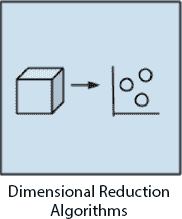

**Figure 4.19** 降维算法。

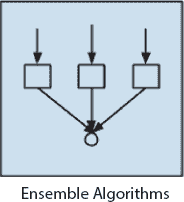

**Figure 4.20** 集成算法。

公认的 DL 算法如下：

1. `Convolutional Neural Network (CNN)`
2. `Recurrent Neural Networks (RNNs)`
3. `Generative Adversarial Networks (GAN)`

## A. 卷积神经网络  

这是最主流的应用 DL 案例之一。它们非常适合图像/视频处理应用。它们是主要用于分类（按接近度分组）的深度人工神经网络。这些计算可以区分面孔、人员、路标、肿瘤、花朵以及视觉信息的许多其他方面。自动驾驶汽车或机器人将扩展其能力的应用。主流的应用商业案例可能是光学字符识别（OCR），用于将文本数字化以自动化数据输入，如 图 4.21 中的示例所示。

CNN 计算与人类大脑不同地看待图像。每张图像都是一个三维数字阵列，称为像素，具有宽度、高度和深度。宽度和高度取决于图像分辨率。第三个维度（深度）是颜色代码的红绿蓝（RGB）值（除非您使用黑白图像作为输入）。系统在应用 DL 时对图像的感知如 图 4.22 所示。

深度学习 CNN 将这些图像通过一系列带有通道的卷积层处理（图 4.23）。

起初，这些通道完全不知道在哪里搜索图像特征（如边缘或曲线），而刚才提到的权重是任意数字（就像一个大脑初生的孩子）。我们通常拥有一个巨大的训练数据集，其中包含大量带有预先识别标签的图像。模型首先进行前向传递，计算初始权重，对结果标签进行预测（例如，这是一只狗），并将其与当前训练集标签的实际情况进行对比。由于这是一个训练集，我们肯定知道结果标签，因此根据预测的成功与否，会计算出损失函数，并且网络在更新其权重的同时进行反向传递。计算机改变其权重以减少损失的方法是通过一种被称为反向传播的技术。现在，模型在网络中执行反向传递，即找出哪些权重对损失贡献最大，并寻找方法来微调这些权重，以便通过连续的传递来减少损失。

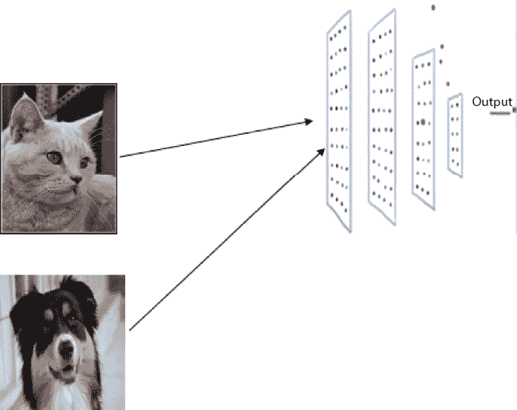

**Figure 4.21** 卷积神经网络。¶ 来源：[`search.creativecommons.org/photos/e6d6b916-ea50-4ade-9c23-283fa6e3dd6b`](https://search.creativecommons.org/photos/e6d6b916-ea50-4ade-9c23-283fa6e3dd6b)。

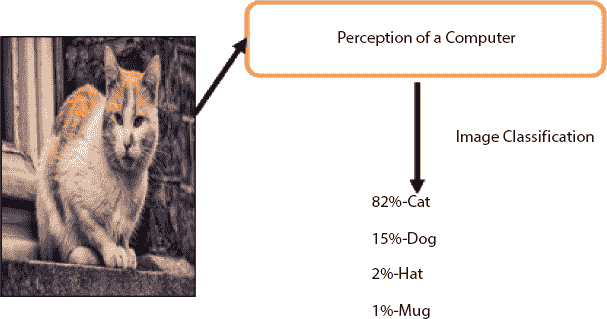

**Figure 4.22** 我们的深度学习算法如何看待图像。¶ 来源：[`search.creativecommons.org/photos/812ca736-2128-4652-aa36-2095cc23d359`](https://search.creativecommons.org/photos/812ca736-2128-4652-aa36-2095cc23d359)。

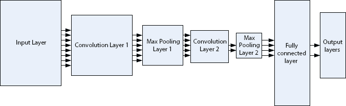

**Figure 4.23** 卷积层。

起初，计算出的损失预计会非常高，并且预计在多次（但固定次数）的前向/反向传递后降至最低。最终，理想情况下，网络应该被充分训练，以便各层的权重被准确调整。

那时，运行测试以查看 CNN 模型是否有效。我们应该拥有一组不同的图片及其各自的标签，并通过 CNN 对测试图片集进行处理。我们将输出与测试集进行对比，以检查我们的网络是否正常工作以及工作得如何！通常，你拥有的数据越多，你的模型就能通过训练和测试被调整得越好。这就是为什么大数据使能深度学习。对于一个足够好、适合用于实际场景的模型，我们不断修改该方法。

它非常复杂，但却是绝大多数人工神经网络的重要且简化的逻辑。

计算机视觉在中国的另一个真实例子是活生生的案例。阿里巴巴在中国发源地推出了城市大脑系统，其中一个人工智能中心优化交通信号灯。

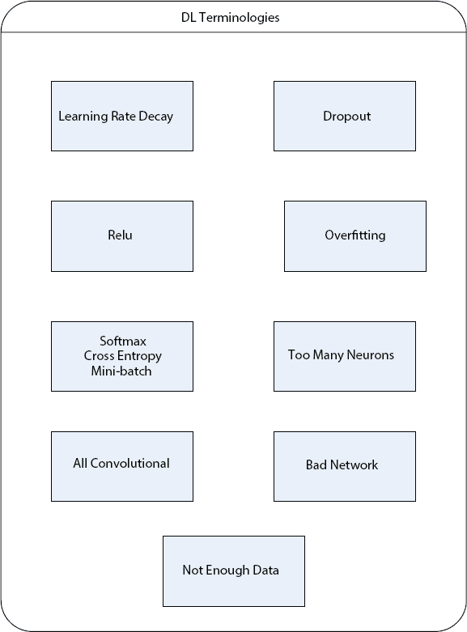

**Figure 4.24** 深度学习术语示例。

CNN 等算法目前主导着我们的日常生活：Facebook——自动标记，Google——照片搜索，以及 Pinterest——房屋频道个性化。

**B. 递归（循环）神经网络（RNN）**

互换使用时，这个网络只是一个由相同缩写词泛化的循环网络。RNN 本质上在计算中使用过去的输入。假设你正在研究书法。考虑 RNN 的另一种方式是，它们具有一种“记忆”，能够捕捉到目前为止所确定的信息。RNN 可以记住之前的输入，从而在语音识别等连续和上下文敏感任务上，比其他人工神经网络具有巨大优势。

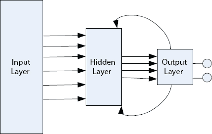

**Figure 4.25** 神经网络。

**Figure 4.26** AI 还是真实的莎士比亚？

它们被认为是自然语言处理的一个非常出色的模型。它们也被用于口语交流翻译、创作音乐、编写书籍、撰写 AI 推文、特斯拉 AI，并且已经撰写了主流深度学习 RNN 文章以供进一步参考。

**C. 生成对抗网络（GAN）**

它们由 Ian Goodfellow 创建，他目前是 Google Brain 的员工研究专家，以及他的蒙特利尔大学同事于 2014 年创建。Facebook AI 负责人 Yann LeCun 表示：“生成对抗网络是过去十年中机器学习领域最令人着迷的想法”。GAN 通过允许神经网络“创造”而不仅仅是用教育记录对其进行设置，使神经网络更具人性。

生成对抗关联由两个神经关联组成：一个生成关联和一个判别关联。在初始阶段，生成器模型将任意变换信号作为输入，并产生一个自信的混乱（虚假）图像作为输出。在判别器的帮助下，它开始传递看起来像真实的特定类别的照片。

判别器是生成器的对立面，它同时接收生成的图像和特定类别的图像，从而能够告诉生成器真实图像是什么样子。

生成器和判别器是相互对抗的（即“组织不严”），并在训练过程中相互竞争，它们的灾难相互推动以改进行为（通过反向传播）。生成器的目标是不被发现地通过，而判别器的目标是识别出伪造品。

当达到某个点时，判别器将无法判断生成的图像是真实还是虚假，而这就是我们的生成器可以创造出从未真正存在过的图像的地方！专家有时将其描述为生成关联试图“欺骗”判别关联，而判别关联应该被设置为不断识别明确的模式。

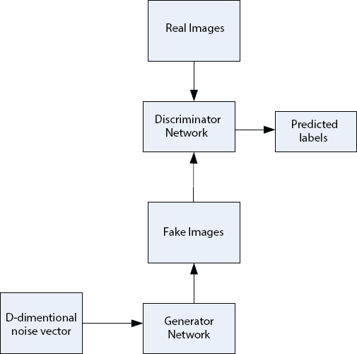

**Figure 4.27** GAN。

这些可能被很好地用于提高图像分辨率、复制流行图片或绘画，或从文本生成图像，生成产品模型的逼真照片描述，以及生成真实人物的逼真语音音频，同时生成风格/库存照片。

GAN 在社交媒体上非常流行。小心深度伪造视频！如果输入包含足够多面孔的数据集，它可以创造出完全创新的虚假面孔，这些面孔过于逼真但又不存在！以下是 NVIDIA 的 AI 使用此技术生成虚假人类照片的示例。

用于 NLP 的深度学习：由于 AI，它近年来获得了巨大的普及。它具有计算机分析、理解和生成个人语言（包括语音）的能力。例如，你可以基于任何文本进行情感分析。它可以在解析电影/书籍评论或网页后做出 AI 推荐。它能够使用文本或音频交互为前端任务运行聊天机器人/数字助手。Alexa/Siri/Cortana/Google Assistant 是使用 NLP 引擎的著名数字人格。

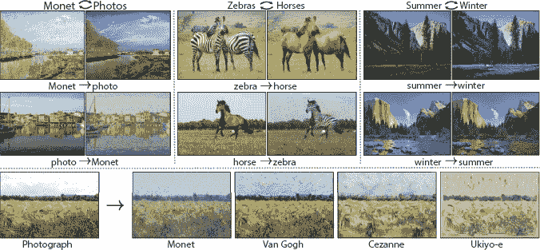

**Figure 4.28** GAN 示例。¶ 来源：[`github.com/junyanz/CycleGAN`](https://github.com/junyanz/CycleGAN)。

**Figure 4.29** GAN 示例。¶ 来源：[`github.com/junyanz/CycleGAN`](https://github.com/junyanz/CycleGAN)。

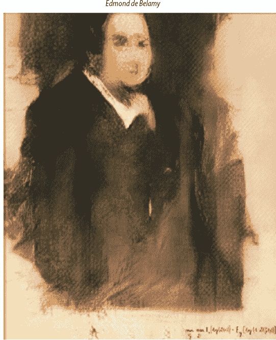

**Figure 4.30** 用于创作绘画的 GAN。¶ 来源：Wikipedia。GANs 用于创作 2018 年的绘画 *Edmond de Belamy*。

NLP 的阶段是一个语言联盟，赋予个人说话的能力。Google Assistant 可以做出少量决策。其他已实现的用例包括搜寻或舆情分析（意见分析）。目前，大量可立即嵌入常规应用（如呼叫中心、聊天机器人、翻译器、自动指示器、垃圾邮件过滤器，以及新兴的数字助理领域）的引擎供人选择。

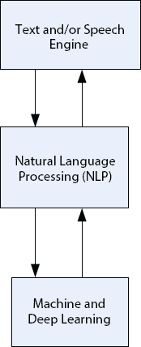

**Figure 4.31** 聊天机器人中的 AI。

**Figure 4.32** 情感神经元的行为。颜色显示情感类型。

## 4.6 基于机器/深度学习在云端实现宫颈癌辨识的项目实现

宫颈癌是全球女性因疾病死亡的首要原因。准确且无误的识别可以挽救生命。宫颈癌的早期检测曾通过基于细胞核边界计数的细微涂片检查完成，例如其形状和大小，因为在显微镜下检查涂片是一项非常具有挑战性的任务。因此，需要数字图像处理技术来识别人类细胞中的异常。因此，本文提出了一种广泛的人工智能方法。所提出的方法提供了宫颈细胞中细胞质和细胞核的特征和形状。KNN 和 SVM 使用分割细胞的特征和形状进行训练，并与未知宫颈细胞样本进行比较。SVM 的准确率为 86%，KNN 的准确率为 70%。

### 4.6.1 拟议工作

目前，宫颈癌是全球最致命的疾病。宫颈癌的主要问题是，它在早期阶段无法被发现，因为它直到最终阶段才会出现任何紊乱。因此，真正的分期将有助于为患者提供细致的治疗。

为此目的的具体工具包括 Pap 检查、计算机断层扫描（CT/CAT）、活检、磁共振成像（MRI）、正电子发射断层扫描（PET）、膀胱镜检查、腹腔镜检查 X 光等，可以与图像处理方法一起使用以获得疾病的分期。本项目的目标是设计和开发一种基于 ML 框架的新型图像处理方法，以帮助在早期阶段发现宫颈癌。我们的方法是基于云的，因此计算不局限于特定区域。

使用云是一种额外的优势，因为它提供了从任何地点访问结果的机会，专家可以在早期阶段开始治疗。

目标如下：

*   缩短救援行动时间和救援管理员的数量。

*   获取肿瘤的精确位置和阶段。

*   降低死亡率。

*   获取肿瘤的视觉内容，以尽可能早地了解病情，使用图像处理。

#### 4.6.1.1 MRI 数据集

宫颈癌是起源于宫颈（子宫的下部）的癌症。本工作使用 MRI 作为诊断工具，DICOM（数字成像和医学通信）格式被作为本工作的输入。将图像转换为灰度进一步消除了杂乱，并获得更好的图像质量，以提高识别耐药性的可能性。该数据集包含 24 名患有局部进展性宫颈癌的患者。

#### 4.6.1.2 预处理

我们潜在技术中的重要步骤包括以下内容。

##### 4.6.1.2.1 图像增强

通过伽马调整和优势像素的概率分布来提升褪色图像的亮度。增强策略分为两类直接增强方法和间接增强方法。在直接增强方法中，图像对比度可以由特定的对比度项直接定义。在间接增强中，方法通过重新分配概率密度来尝试改善图像对比度。

自适应伽马校正（AGC）被设计为图像对比度可以通过伽马校正智能地检索增强，伽马校正是一种非线性操作。伽马校正用于修正图像像素的亮度或暗度。图像亮度可以根据伽马值进行修正。伽马范围为 0.0 到 10.0；如果比率小于 1.0，则图像变暗。如果比率大于 1.0，则图像变亮。如果伽马值等于 1，则图像没有变化。

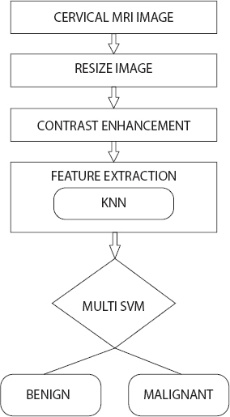

**Figure 4.33** 方法论流程图。

##### 4.6.1.2.2 图像分割

这是一个关键部分。将图像分解为相关格式称为图像分割。分割的愿望是将图像像素的描述转换为简单的方面。该方法基于两个属性，即不连续性和相似性。利用此属性，它分为基于边缘和基于区域的分割。基于像素不连续性属性的分割被视为基于边界或边缘的策略。基于区域的分割是将图像划分为连接像素的类似区域。基于区域的方法包括阈值处理、区域生长、区域分割和合并。基本思想是为图像中的感兴趣对象与背景灰度分布选择一个理想的灰度级阈值。Otsu 方法经常被使用。这需要计算仅依赖于图像灰度像素的全局阈值处理的灰度级图像。

#### 4.6.1.3 特征提取

获取描述大量数据所需的度量称为特征提取。所采用的方法用于统计 KNN 特征。

特征如下：

1. 对比度

2. 相关性

3. 能量

4. 同质性

5. 均值

6. 标准差（std）

7. 熵（I）

8. 均方根（RMS）

9. 方差（var）

10. 平滑度

11. 峰度

12. 偏度

13. 反差中值

**多支持向量机**

SVM 仅将数据分为两类。这种能力通过“查找”测试数据集中每一行的正确类别来消除限制。支持向量机中的训练集可由超平面分割。该超平面由决策函数计算；点限制排列可以分组。有两种分类器用于获得更好的结果。反向传播和前馈分类器不能识别图像中的某些害虫，但 SVM 能提供更好的结果。SVM 是一种非线性分类器，是一种移动的人工智能算法。

> Ex: Training set = \[1 10;2 20;3 30;4 40;5 50;6 66;3 30;41 42\];

> Test set = \[3 34;1 14;22 25;62 63\];

> Group Train = \[1;1;2;2;3;3;2;2\];

> `Results = multisvm (Training set, Group Train, Test set);`

> `Disp("multi class problem");`

> `Disp(results).`

### 4.6.2 设计方法与实现

阶段 1：输入 MR 图像。

阶段 2：利用自适应伽马校正技术增强 MR 图像。

阶段 3：改进后的图像随后利用 Otsu 分割策略进行分割。

阶段 4：特征目前利用 KNN 特征提取进行移除。

阶段 5：图像分类利用 SVM 分类器完成。

阶段 6：每张图像的分期是最终产出。

**输入规范**

拟议系统的输入/数据集为 DICOM 格式的磁共振图像（MRI）；这些 DICOM 图像转换为“联合图像专家组”（JPEG）格式，如下图所示。

**输出规范**

计算后，输出分为以下两个阶段：

1. 良性

2. 恶性。

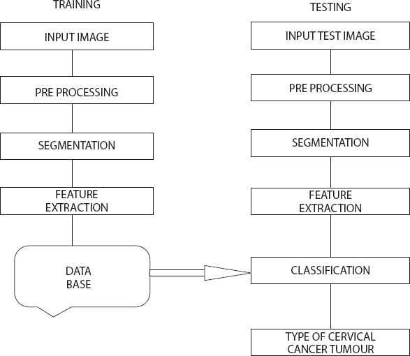

**Figure 4.34** Flowchart includes training and testing.

**Figure 4.35** Values of the trained dataset matrices.

**Figure 4.36** Values of the tested datasets matrices.

**Figure 4.37** Sample cervical cancer magnetic resonance image (MRI).

> **i. Benign**

> 增长中的细胞正常，属于良性。

> **ii. Malignant.**

> 细胞不规则且可广泛发展；它们是癌细胞，肿瘤为恶性。

### 4.6.3 结果

本研究旨在探讨，即使源自局部进展期宫颈癌患者磁共振图像的特征，或许也能预测综合征的分期。

项目的逐步输出如下：

基于肿块的二阶纹理特征和 KNN 特征，构建了精确的 SVM 矛盾模型。然而，二阶统计外观依赖于差异、交互、强度和一致性，这些特征被显著用于预测宫颈癌囊肿的自由治疗 MRI 结果。因此，纹理特征超越了与数值特征一起用于癌症分期结论的特征，而后者取决于囊肿大小。因此，精确分期将为患者提供治疗方案，作为未来工作的决策，此外，根据分期预测治疗也将为放射科医生提供更好的用药建议。

**Figure 4.38** Loading the MRI image from datasets.

**Figure 4.39** Contrast enhancement.

**Figure 4.40** Image segmentation.

**Figure 4.41** Segmented region of interest (ROI).

## 4.7 应用

当与分布式计算的强大功能相结合时，AI 可能会更加有利。这种融合被称为“智能云”。云的当前用途包括计算、存储和系统管理。然而，当 AI 元素融入云中时，云的能力将大幅提升。智能云能够从云中存储的海量数据中学习，以形成预期并分析情况。这将作为一个智能平台，以更高效地执行任务。

**Figure 4.42** After classification, cervical cancer (ROI) tumor is found.

**Figure 4.43** After classification, cervical cancer region of interest (ROI) tumor is not found.

分布式计算为运行 AI 模型提供了两个基本要求：低成本和处理需要关注大量数据的关键情况的能力。首先，它提供可扩展且便捷的计算，是存储和处理海量数据的绝佳方式。因此，云与 AI 的结合使这两个领域都受益。AI 对云的影响在以下方面最为显著。

### 4.7.1 认知云

云存储了海量数据，这些数据成为机器学习算法的学习来源。全球数十亿人使用其平台存储数据；这为机器学习算法利用这些数据并从中学习提供了绝佳机会。换句话说，机器学习算法可以将云范式从分布式计算转移到认知计算。

认知计算涉及基于 AI 和信号处理原则设计的技术平台。它融合了 AI、自然语言处理、语音/对象识别、人机交互和叙事生成。

当嵌入机器学习能力时，云就变成了“认知云”，使认知计算应用对普通大众可用。IBM Cognitive 和 Microsoft 的 Azure Cognitive Services 是绝佳示例——这些平台允许无需麻烦地创建智能应用。

### 4.7.2 聊天机器人和智能个人助手

聊天机器人和个人助手已在个人和商业领域出现。像 Alexa 这样的智能虚拟助手可以为你执行各种任务，甚至可以像另一个人一样与你互动。无论它们开发得多么成熟，聊天机器人和虚拟助手仍处于早期阶段。它们仍在进步，仍在学习。因此，它们存在局限性是正常的。当与云集成时，聊天机器人和智能个人助手可以访问大量数据来学习。因此，它们的学习能力将得到大幅提升。随着时间的推移，聊天机器人和个人助手将进步到完全消除任何形式的人为干预或支持。

### 4.7.3 IoT 云

IoT 云是专门用于存储和处理物联网（IoT）生成的数据的云平台。Salesforce 的 IoT 云由 Thunder 驱动——一个“极具可扩展性的实时事件处理引擎”。

IoT 云可以处理由连接设备、网站和用户生成的海量数据，并触发实时响应的操作。它可以用于各种真实情况。

### 4.7.4 商业智能

得益于机器学习/深度学习分布式计算，商业智能（BI）服务也变得越来越智能。云机器学习为 BI 带来双重收益。云平台可以存储大量客户及其朋友的数据，机器学习算法可以处理和分析这些数据以发现创新解决方案。

在掌握客户数据的同时，机器学习算法可以帮助组织更深入、更好地了解其目标受众的购买行为、偏好、需求、痛点等。同样，组织可以制定产品开发和营销策略，以促进销售并提高 ROI。

机器学习在客户体验和满意度方面具有重要意义。组织了解客户并进行改进；他们制造可以解决客户痛点和需求的产品。这将提高客户忠诚度。此外，机器学习算法可以创建直观的推荐引擎和聊天机器人，以提供更好的客户体验。

这只是融合机器学习/深度学习算法的一个方面，分布式计算也随着 BI 系统而不断改进。

### 4.7.5 AI-as-a-Service

云管理供应商通过开源 AI-as-a-Service (AIaaS) 平台提供 AI 能力。这是一种将 AI 功能部署到组织中非常实用的方法。

它为客户提供一大批用于 AI/ML 模型构建、智能自动化、认知计算等所需的 AI 工具和功能。显然，它非常快速且高效。它为以更好的方式理解 ML 和云提供了极大的帮助。

## 4.8 机器学习/深度学习中云采用的优势

云按需付费的方法对于突发的 AI 或 ML/DL 工作负载非常有用。它使企业能够轻松尝试 ML/DL 功能，并随着项目进入生产环境和需求增加而进行升级。云使智能功能可用，而无需具备人工智能或数据科学方面的高级技能。AWS 和 Google Cloud Platform 等提供许多 ML/DL 选项，这些选项不需要深入了解 AI、AI 理论或一组数据科学家。ML 不再是一个流行语——它是最近记忆中一个鲜活的事实，在数据科学领域催生了各种非凡的职业。

从曾经对中小型企业来说遥不可及的技术，ML 如今已成为一种标准技术，这要归功于公有云。今天，像 Amazon (`AWS`)、Google (`ML Engine`) 和 Microsoft (`Azure`) 这样的顶级云计算平台已经使 AI 和 ML 民主化，并使其既可用又负担得起。各种规模的云平台都在重新定义 AI 和 ML，以创建能够将这些颠覆性技术纳入组织结构的高级服务。在云提供的所有服务中，ML 平台是增长最快的服务之一。这主要归功于它们可以灵活地推出。与其他基于云的服务不同，云 ML 平台可以通过多种不同的交付模型进行部署，包括认知计算、基于 GPU 的计算、自动化 AI 和 ML 模型管理。随着各个行业越来越多的企业使用 ML，它正在推动该领域的就业前景。根据 Indeed 2019 年关于“美国最佳工作”的报告，机器学习工程师是最高级别的工作，拥有惊人的 344% 增长率和每年平均基本薪资 146,085 美元！此外，随着云成为基于 ML 的项目和服务的主要目标，云领域的职业也在飞速发展。即使在印度，它也是应届生中薪酬最高的工作之一。预计到 2021 年，云计算服务的总收入将超过 3000 亿美元。

云中的 AI 是业界的新趋势，因为当两者结合时，ML 和云的潜力和能力会成倍增加。由于云中的 ML 不需要特定的高级技能组合（具备 ML 概念和云平台的基本知识即可），它为职业发展提供了绝佳的机会。此外，云使 ML 模型/服务变得更加可扩展，为满足动态业务需求提供了足够的空间。利用云中的 AI，企业可以先在云上测试和部署较小的项目，然后随着需求和需求的增加进行扩展。按需付费模式进一步使访问更复杂的功能变得简单，而无需购买新的高级硬件。

## 4.9 结论

目前，深度学习市场中一个重要的趋势是深度学习解决方案在医疗行业的日益融合。这些解决方案帮助医疗研究人员更好地了解各种药物和化合物的临床特性和优势。此外，这项技术帮助护理人员更好地分析患者的病史，以便为他们推荐最佳治疗方案。此外，这些解决方案还可以与各种医学影像技术（例如 CT 扫描、ECG 和 MRI 检查）相结合，以有效诊断许多危急疾病和问题，从而帮助更好地治疗这些疾病。

图像识别类别在过去几年中记录了深度学习市场应用细分下的最高增长。这归因于图像识别应用中对深度学习解决方案的巨大需求，因为它们能够帮助用户检测和识别对象以及分析数字图像。通过构建 `task.py`，我们可以将超参数作为命令行参数处理，这使我们能够将模型逻辑与超参数解耦。一个关键优势是，这使我们能够轻松地使用不同的参数并行运行多个任务，以确定最佳超参数集（我们甚至可以使用内置的超参数调优服务！）。最后，`docopt` 包根据用户输入的使用字符串自动为我们的 `task.py` 文件生成解析器。

## 参考文献

1\. Hinton, G.E., Krizhevsky, A., Srivastava, N., Sutskever, I., Salakhutdinov, R., Dropout: A simple way to prevent neural networks from overfitting. *J. Mach. Learn. Res.*, 15, 1929–1958, 2014.

2\. He, K., Ren, S., Sun, J., Zhang, X., Deep residual learning for image recognition, 2016, CoRR, abs/1512.03385.

3\. Ioffe, S. and Szegedy, C., Batch Normalization: Accelerating deep network training by reducing internal covariate shift. *ICML*, 2015.

4\. Fei-Fei, L., Karpathy, A., Leung, T., Shetty, S., Sukthankar, R., Toderici, G., Large-scale video classification with convolutional neural networks. *IEEE Conference on Computer Vision and Pattern Recognition*, 2014.

5\. Belongie, S.J., Dollár, P., Hays, J., Lin, T., Maire, M., Perona, P., Ramanan, D., Zitnick, C.L., Microsoft COCO: Common Objects in Context. *ECCV*, 2014.

6\. Lapedriza, À., Oliva, A., Torralba, A., Xiao, J., Zhou, B., Learning deep features for scene recognition using places database. *NIPS*, 2014.

7\. Bengio, Y., Courville, A.C., Goodfellow, I.J., Mirza, M., Ozair, S., Pouget-Abadie, J., Warde-Farley, D., Xu, B., Generative adversarial nets. *NIPS*, 2014.

8\. Batista, J., Caseiro, R., Henriques, J.F., Martins, P., High-speed tracking with kernelized correlation filters, 2015, CoRR, abs/1404.7584.

9\. Zhang, M. and Zhou, Z., A review on multi-label learning algorithms. *IEEE TKDE*, 2014.

10\. Bengio, Y., Clune, J., Lipson, H., Yosinski, J., How transferable are features in deep neural networks, 2014, CoRR, abs/1411.1792.

11\. Amorim, D.G., Barro, S., Cernadas, E., Delgado, M.F., Do we need hundreds of classifiers to solve real world classification problems. *J. Mach. Learn. Res.*, 2014.

12\. Dong, X., Gabrilovich, E., Heitz, G., Horn, W., Lao, N., Murphy, K., Zhang, W., Knowledge vault: A web-scale approach to probabilistic knowledge fusion, in: *Proceedings of the 20th ACM SIGKDD international conference on Knowledge discovery and data mining ACM*, 2014, August.

13\. Lowe, D.G. and Muja, M., Scalable nearest neighbor algorithms for high dimensional data. *IEEE Trans. Pattern Anal. Mach. Intell.*, 2014.

14\. Huang, G., Huang, G., Song, S., You, K., Trends in extreme learning machines: A review. *Neural Networks*, 2015.

15\. Bifet, A., Bouchachia, A., Gama, J., Pechenizkiy, M., Zliobaite, I., A survey on concept drift adaptation. *ACM Comput. Surv.*, 2014.

16\. Gong, Y., Guo, R., Lazebnik, S., Wang, L., Multi-scale orderless pooling of deep convolutional activation features. *ECCV*, 2014.

17\. Arbeláez, P.A., Girshick, R.B., Hariharan, B., Malik, J., Simultaneous detection and segmentation. *ECCV*, 2014.

18\. Chandrashekar, G. and Sahin, F., A survey on feature selection methods. *Int. J. Comput. Electr. Eng.*,

19\. Kazemi, V. and Sullivan, J., One millisecond face alignment with an ensemble of regression trees. *Proc. IEEE Conf. Comput. Vis. Pattern Recognit.*, 2014.

20\. Corchado, E., Graña, M., Wozniak, M., A survey of multiple classifier systems as hybrid systems. *Inform. Fusion*, 16, 3–17, 2014.

21\. Deepak, R.U., Kumar, R.R., Byju, N.B., Natarajan, P., Pour-nami, C., Sibiu, S., Bengtsson, E., Sujathan, K.R., Computer assisted Pap Smear Analyser for Cervical cancer screening using Quantitative Microscopy. *J. Cytol. Histol.*, 2015.

22\. Phatak, A. and Barbadekar, A.B., Classification of MR images of cervical cancer using SVM and ANN. *Int. J. Sci. Res. (IJSR)*, 2015.

23\. Mustafa, N., Mat Isa, N.A., Mashor, M.Y., Othman, N.H., New features of cervical cells for cervical cancer diagnostic system using neural network. *Int.* *J. Simul. Syst. Sci. Technol. (IJSSST)*, 2008.

24\. Lu, Z., Carneiro, G., Bradley, A.P., Ushizima, D., Nosrati, M.S., Bianchi, A.G.C., Evaluation of three Algorithms for the segmentation of overlapping Cervical Cells. *IEEE J. Biomed. Health Inform.*, 21, 2, March 2017.

25\. Baldi, P. and Brunak, S., *Bioinformatics: A Machine Learning Approach*, MIT Press, Cambridge, MA, 2002.

26\. Jyothi, A.P. and Usha, S., Interstellar-based topology control scheme for optimal clustering performance in Wireless Sensor Network. *Int. J. Commun. Syst.*, 33, 8, 1–16, May 2020.

27\. Miller, T., Explanation in artificial intelligence: Insights from the social sciences. 267, 1–38, February 2019.

28\. Zhang, J., Zheng, Y., Qi, D., Li, R., Yi, X., Li, T., Predicting citywide crowd flows using deep spatio-temporal residual networks. 259, 147–166, June 2018.

29\. Albrecht, S.V. and Stone, P., Autonomous agents modelling other agents: A comprehensive survey and open problems - Open access. 258, 66–95, May 2018.

30\. Eppe, M., Maclean, E., Confalonieri, R., Kutz, O., Schorlemmer, M., Plaza, E., Kühnberger, K.U., A computational framework for conceptual blending - Open access. 256, 105–129, March 2018.

31\. Anshelevich, E., Bhardwaj, O., Elkind, E., Postl, J., Skowron., P., Approximating optimal social choice under metric preferences. 264, 27–51, November 2018.

32\. Beck, H., Dao-Tran, M., Eiter, T., LARS: A logic-based framework for analytic reasoning over streams. 261, 16–70, August 2018.

33\. Leottau, D.L., Ruiz-del-Solar, J., Babuška, R., Decentralized reinforcement learning of robot behaviors. 256, 130–159, March 2018.

34\. Bozzato, L., Eiter, T., Serafini, L., Enhancing context knowledge repositories with justifiable exceptions. 257, 72–126, April 2018.

35\. Ganian, R. and Ordyniak, S., The complexity landscape of decompositional parameters for ILP. 257, 61–71, April 2018.

36\. Lowalekar, M., Varakantham, P., Jaillet, P., Online spatio-temporal matching in stochastic and dynamic domains. 261, 71–112, August 2018.

37\. Benedikt, M., Grau, B.C., Kostylev, E.V., Logical foundations of information disclosure in ontology-based data integration. 262, 52–95, September 2018.

38\. Li, F., Qian, Y., Wang, J., Dang, C., Jing, L., Clustering ensemble based on sample’s stability. 273, 37–55, August 2019.

39\. MacAlpine, P. and Stone, P., Overlapping layered learning. 254, 21–43, January 2018.

40\. Law, M., Russo, A., Broda, K., The complexity and generality of learning answer set programs - Open access. 259, 110–146, June 2018.

41\. Martínez-Plumed, F., Prudêncio, R.B.C., Martínez-Usó, A., Hernández-Orallo, J., Item response theory in AI: Analysing machine learning classifiers at the instance level. 271, 18–42, June 2019.

42\. Jyothi, A.P. and Sakthivel, U., CFCLP- “A Novel clustering framework based on combinatorial approach and linear programming in WSN”. *2nd International Conference on Computing and Communications Technologies (ICCCT)*, pp. 49–54, 2017, Chennai.

43\. Zhou, J.T., Pan, S.J., Tsang, I.W., A deep learning framework for Hybrid Heterogeneous Transfer Learning. 275, 310–328, October 2019.

44\. Baldi, P., Sadowski, P., Lu, Z., Learning in the machine: Random backpropagation and the deep learning channel. 260, 1–35, July 2018.

45\. Gaggl, S.A., Linsbichler, T., Maratea, M., Woltran, S., Design and results of the Second International Competition on Computational Models of Argumentation. 279, February 2020.

46\. Gottifredi, S., Tamargo, L.H., García, A.J., Simari, G.R., Arguing about informant credibility in open multi-agent systems. 259, 91–109, June 2018.

47\. Rigas, E.S., Ramchurn, S.D., Bassiliades, N., Algorithms for electric vehicle scheduling in large-scale mobility-on-demand schemes. 262, 248–278, September 2018.

48\. Fazzinga, B., Flesca, S., Furfaro, F., Complexity of fundamental problems in probabilistic abstract argumentation: Beyond independence. 268, 1–29, March 2019.

49\. de Campos, C.P., Scanagatta, M., Corani, G., Zaffalon, M., Entropy-based pruning for learning Bayesian networks using BIC. 260, 42–50, July 2018.

50\. Nikolaou, C., Kostylev, E.V., Konstantinidis, G., Kaminski, M., Grau, B.C., Horrocks, I., Foundations of ontology-based data access under bag semantics - Open access. 274, 91–132, September 2019.

51\. Bonatti, P.A., Rational closure for all description logics. 274, 197–223, September 2019.

1.  \**Corresponding author*: jyothiarcotprashant@gmail.com

# 5  

基于机器学习和物联网的医疗监测模型

**Shruti Kute^(1)\*, Amit Kumar Tyagi^(1,2†), Aswathy S.U.^(3‡) and Shaveta Malik^(4)**

*^(1)School of Computer Science and Engineering, Vellore Institute of Technology, Chennai, Tamil Nadu, India*

*^(2)Centre for Advanced Data Science, Vellore Institute of Technology, Chennai, Tamil Nadu, India*

*^(3)Department of Computer Science and Engineering, Jyothi Engineering College, Cheruthuruthy, Thrissur, Kerala, India*

*^(4)Terna Engineering College, University of Mumbai, Mumbai, India*

> ***Abstract***

> 

> 我们都知道生命对我们意味着什么，而且，如果人类生命因任何精神或身体问题而受到影响，医疗领域将立即获得最高优先级。因此，借助广泛而先进的技术，该领域变得更加容易，并产生准确高效的结果。正是基于此，ML 和 IoT 这一组合在医学领域带来了巨大变化，创造了许多高效系统，使医生和护士的每一个工作流程都更加轻松。本文介绍了近年来研究人员使用的一些 ML-IoT 模型，同时也将对其他研究专家有所裨益，激发他们尝试新的方面，这些方面可能有助于其他医疗工作者。我们还讨论了 ML-IoT 集成的挑战，这些挑战未来可以加以解决。

> 

> ***Keywords*:** Internet of Things, machine learning, neural networks, E-healthcare

## 5.1 Introduction

# 医疗服务中的物联网与机器学习

医疗服务的基本部分是医疗服务。医疗服务是通过预防和诊断疾病来维护和改善健康的过程。借助 CT、MRI、PET、SPECT 等诊断设备，可以确定深层皮肤下存在的任何裂缝或异常。一些可能不寻常的疾病，如冠心病和癫痫，甚至可以在发生前被识别。随着普通人群的不断扩大，疾病导致的情绪无法预测的变化在大众中增加，这可能会给现有的医疗框架带来压力。因此，主要目标是在保持医疗区域框架性质的同时，减少其压力氛围，这也体现了该过程的基本理念。所以，控制医疗区域框架压力的答案将是物联网（IoT）。在没有全面监控的情况下照顾患者是一大失败，也会导致其他一些原因。因此，为了应对显性和隐性医疗案例，需要持续监控的进步。一些相关工作最近研究了与 IoT 医疗保健相关的显性领域和创新。一项广泛的研究在文献中介绍，重点放在经济可行的解决方案、潜在应用和剩余问题上。每个主题都被独立考虑，而不是作为一个全面框架的组成部分。在评估框架时，可以在其中进行数据挖掘和存储的集成。为了降低治疗费用，RFID 被用于美国诊所。各种可穿戴框架已被提出，以提供可靠的远程信息传输。由于 IoT 在医疗保健领域有许多优势，唯一的担忧是安全性，在实施过程中以及用户使用最终产品时，会传递大量数据。因此，保护它们是一项巨大的挑战。

还有更好的进步，例如人工智能（AI），它可能为医疗领域构建如此准确和高效的模型。机器学习（ML）是 AI 的一个子集，其中只需输入某些算法，机器本身就能学习并执行其训练好的模型（其中包括网页查找、垃圾邮件过滤、广告投放和股票交易）。ML 通过研究那些巨大的数据片段并自动化地简化数据科学家的任务，获得了与大数据和云计算同等的重要性和认可。大规模教育集合在各个领域被积累和检查，从规划科学到人际关系、商业、生物分子研究和安全。AI 模型的计算将被加载到内存中；然而，同样需要大量进步来获取那些大量数据，这些数据实际上会带来现实世界中的一些经验。ML 将是这些领域的良好算法，可能能够摄入巨大和复杂的数据。

## 动机

本文的宗旨是定义在 ML 和 IoT 集成的帮助下，医疗服务中发生的一些最近进步。它也将对许多研究人员有所帮助，他们可以阅读并受到启发，提出新的建议，从而有助于开发新模型。

## 工作组织

介绍部分在 第 5.1 节，其余部分如下：第 5.2 节 描述了一些模型的文献综述，随后是 第 5.3 节 中医疗保健中的可解释 ML，随后是 第 5.4 节 中医疗保健中 ML 的机会。第 5.5 节 讨论 ML-IoT 集成及相关模型。第 5.6 节 讨论机器学习在医疗和制药领域的应用。第 5.7 节 描述集成它们时的挑战，最后，第 5.8 节 是结论。

## 5.2 文献综述

在这里，我们讨论了一些最近由 ML 和 IoT 集成处理的医疗保健进步。Samir Jadhav \[1\] 提出了一种在 IoT 环境中使用 ML 进行疾病预测的方法。在这里，他们集成了 IoT 和身体传感器网络（BSN），其中包括脉搏传感器、温度传感器和血压传感器等传感器，用于收集连续数据。在训练阶段，他们从在线存储库收集数据并进行预处理。清理错误后，数据被保存在数据库中。在测试阶段，借助六个可穿戴传感器，创建了一个 IoT 环境以收集数据，并将其提供给模糊随机森林（FRF）分类器进行预测，在评估该模型时，他们获得了 93.5% 的准确率。Ganesan 和 Sivakumar \[2\] 提出了一种使用 ML 和 IoT 进行心脏病预测和诊断的方法。他们使用 UCI 数据集对该模型进行训练和测试。他们还使用可穿戴 IoT 设备收集与人体相关的数据。在最终阶段，他们使用 J 48、逻辑回归（LR）、多层感知器（MLP）和 SVM 等分类器，在使用准确率、精确率、召回率、F-得分和卡帕值等参数进行评估时，他们发现 J 48 表现更好，准确率为 91.4%。Deva Priya Isravel *et al.* \[3\] 提出了一种改进的 ML-IoT 模型用于心脏病预测。使用 LM35 温度传感器、公共传感器、AD8232 ECG 传感器和 Arduino Uno 创建了 IoT 环境，并收集连续数据，在训练和测试阶段，他们使用 VA 医疗中心、长滩、克利夫兰诊所基金会 UCI 数据集。数据被提供给朴素贝叶斯、KNN 和决策树等分类器，其中决策树优于其他方法。

在 \[4\] 中，提出了一种基于 IoT 的可穿戴架构来测试 ECG 信号。该设备提供了一个便携式平台，使用非侵入式可穿戴传感器从患者处捕获 ECG 信号，并通过蓝牙或 ZigBee 支持的智能手机技术将其发送到 IoT 云。为了查找疾病，云中收集的数据可以由专业人士访问，以使用数据分析进行进一步处理。可以通过访问远程服务器来执行数据分析程序，用于数据清理、存储、审查以及向相关专家生成实时通知警告。ML 方法用于促进心脏病的早期诊断。该研究从健康数据收集到研究心脏的不规则功能进行。使用 ML 分类算法，如 SVM、Adaboost、人工神经网络（ANN）和朴素贝叶斯，分析了心脏波的振幅和间隔周期以识别信号，如 \[5\] 所示。识别正确的分类器可以帮助医生进行诊断并及时做出患者质量决策。有许多与心律失常相关的心律失常疾病。统计特征和动态特征对于 ECG 信号的提取至关重要，以确保正确诊断。因此，本文 \[6\] 计算了心率变异性，以便在患者受到心律失常疾病影响时产生警告。在 \[7\] 中，基于异常值的警告系统在数据驱动方法中用于分类患者异常数据以最大限度地减少测量错误。当合格的数据集在实时系统中被评估时，该系统被证明是高效的。下一节建议了一种用于 ECG 数据分类的新预处理方法。

## 5.3 医疗保健中的可解释机器学习

While the utilization of ML and counterfeit intelligence in medication has its foundations in the most recent days of the field, it is just lately that there has been a push toward the acknowledgment of the need to have medical care arrangements controlled by ML. This has driven specialists to propose that it is just a short time before ML will be pervasive in medical care. Notwithstanding the acknowledgment of the estimation of ML in medical care, obstacles to additional appropriation remain. Particularly in basic use cases that incorporate clinical dynamic, there is some indecisive in the organization of such models in light of the fact that the expense of model misclassification is potentially high. Medical care swarms with conceivable “high stakes” uses of ML calculations: anticipating understanding danger of sepsis (a potentially hazardous reaction to contamination), foreseeing a patient’s probability of readmission to the clinic, and foreseeing the requirement for end-of-life care. Interpretable ML along these lines permits the end client to grill, comprehend, troubleshoot, and even improve the ML framework. There is a lot of chance and interest for interpretable ML models in such circumstances. Interpretable ML models permit end clients to assess the model, preferably before a move is made by the end client, for example, the clinician. By clarifying the thinking behind forecasts, interpretable ML frameworks give clients motivations to acknowledge or dismiss expectations and proposals.

Reviews of ML frameworks in spaces like medical services and the criminal equity framework uncover that the choices and suggestions of ML frameworks might be one-sided. Accordingly, interpretability is expected to guarantee that such frameworks are liberated from inclination and reasonable in scoring distinctive ethnic and social gatherings. In conclusion, ML frameworks are previously settling on choices and suggestions for a huge number of individuals around the globe (for example, Netflix, Alibaba, and Amazon). These prescient calculations are having troublesome effects on society and bringing about unexpected results like deskilling of doctors. While the use of ML techniques to medical care issues is unavoidable given that intricacy of dissecting huge measures of information, the need to normalize the desire for interpretable ML in this space is basic. Verifiably, there has been a compromise between interpretable ML models and execution (exactness, review, F-Score, AUC, and so on) of the forecast models. That is, more interpretable models like regression models and decision trees regularly perform less well on numerous forecast undertakings contrasted with less interpretable models like slope boosting, Deep Learning (DL) models, and others. Specialists and researchers have needed to adjust the longing for the most exceptionally performing model to that which is enough interpretable. Over the most recent couple of years, analysts have proposed new models which display superior just as interpretability, e.g., GA2M, rule-based models like SLIM, falling principal records, and model refining. Be that as it may, the utility of these models in medical services has not been convincingly shown because of the uncommonness of their application.

The absence of interpretability in ML models can conceivably have unfavorable or even hazardous results. Consider a situation where the experiences from a discovery models are utilized for operationalization without the acknowledgment that the prescient model is not prescriptive in nature. For instance, consider Caruana *et al.* \[8\] chip away at building classifiers for naming pneumonia patients as high or generally safe for in-clinic mortality. A neural organization, basically, a black box as far as interpretability, ends up being the best classifier for this issue. Examination of this issue with relapse models uncovered that one of the top indicators showed restraint history of asthma, a constant pneumonic infection. The model was foreseeing that given asthma, a patient had a lower danger of in-clinic demise when conceded for pneumonia. Truth be told, the inverse is valid—patients with asthma are at higher danger for genuine complexities and sequelae, including demise, from an irresistible aspiratory infection like pneumonia. The asthma patients were, truth to be told, given more convenient consideration of a higher keenness than their partners without asthma, accordingly causing an endurance advantage. Likewise, spillage from information can mislead models or misleadingly swell execution during testing, anyway clarifications can be utilized to amend models when such issues surface. While there is a call to apply interpretable ML models to an enormous number of areas, medical services are especially testing because of medicolegal and moral necessities, laws, and guidelines, just as the genuine alert that must be utilized while wandering into this space. There are moral, lawful, and administrative difficulties that are remarkable to medical care given that medical services choices can immediately affect the prosperity or even the life of an individual. Guidelines like the European Union’s General Data Protection Regulation (GDPR) require associations which utilize understanding information for expectations and proposals to give on request clarifications. The powerlessness to give such clarifications on request may bring about enormous punishments for the associations in question. Hence, there are financial just as administrative and well-being motivating forces related with interpretable ML models.

## 5.4 Opportunities in Machine Learning for Healthcare

ML has a huge part in technology advancements, and it has a wider part in every fields. Due to its accurate and efficient nature of model and the capability to analyze the complex data in a much simplistic way, it brings various applications that have been put forwarded by so many specialists out there. When comes to medical aspect, ML gives much hand-hand systems that could potentially make the service much accurate and efficient. So, here are some of medical related applications of ML:

1. **a. Identifying Diseases and Diagnosis:** One of the main difficult stages while implementing ML over this medical field is to identifying the disease and analyzing them. In case of identifying tumor stage, various hereditary related diseases also can be identified. A genome-based sequencing of tumor is developed by IBM Watson Genomics which makes fast and accurate results. ML is being used in Berg, the biopharma goliath an oncology section to create remedial medicines for curing the tumor. P1vital’s PReDicT (Predicting Response to Depression Treatment) is also used for analyzing and providing treatment in several clinical conditions.

2. **b. Medication Discovery and Manufacturing:** ML is also being used in the medication part in which it needs R&D advances, such as sequencing and accurate medication that could potentially help in treating diseases that are multifactor. As of now, the AI strategies include solo realizing which can distinguish designs in information without giving any expectations. As an example, we take Hanover which is created by Microsoft that uses ML for treatment of malignant growth and also for other purposes and also for medication that is customisable for AML (Acute Myeloid Leukemia).

3. **c. Clinical Imaging Diagnosis:** DL is a subset of ML also being advanced in this area much wider in which these two combined to give computer vision (CV). With the help of these advancements, Microsoft created a device that could take inner shot of body that could use as further analysis.

4. **d. 定制化医疗：** 定制化药物不仅能通过将个人健康与预测性调查相匹配来提高成功率，还可用于进一步探索和更好的疾病评估。目前，医生仅限于浏览特定的一组诊断，或根据患者的主诉病史和可用的遗传数据来评估患者风险。随着机器学习（ML）技术的发展，IBM Watson 的肿瘤学部门正处于前沿，致力于开发基于病史的此类药物，这可能有助于多种治疗。未来几年将出现基于 ML-IoT 的进步，这些进步将带来各种设备，能够摄入海量数据。

5. **e. 基于 ML 的行为改变：** 行为改变是预防性医疗的重要组成部分，自从 ML 在医疗服务中得到扩展以来，大量新企业正在癌症预防与识别、患者治疗等领域涌现。一家名为 Somatrix 的组织进行基于 B2B2C 的分析，他们也使用 ML 来识别日常生活中使用的信号。

6. **f. 智能健康记录：** 维护最新的健康记录是一个全面的过程，尽管技术在简化数据录入方面发挥了作用，但事实上，目前大部分流程仍需花费大量时间才能完成。ML 的主要目标是构建一个模型，使我们能够投入更少的时间和资金，在此基础上，记录分类是另一个 ML 发挥作用的过程，我们使用 OCR 工具来识别文本（例如，`Google Cloud Vision API` 和 `MATLAB` 集成用于基于 ML 的手写体识别）。目前，MIT 正处于开发此类模型的前沿，该模型有助于记录分类、推荐等。

7. **g. 临床试验与研究：** ML 在试验和研究方面并未受到太大影响，因为这需要大量的时间和研究。当我们将 ML 应用于此领域，这可能有助于识别这些试验并预测结果，这对科学家来说可能非常有帮助。

8. **h. 公开支持的数据收集：** 公开支持在临床领域目前非常流行，允许分析师和专业人士访问个人基于自身同意上传的大量数据。在药物方面，公开可用的数据集在影响方面要大得多。Apple 开发的一个研究套件使用面部识别，作为 ML 技术收集数据，并可能有助于治疗阿斯伯格综合征和帕金森病。IBM 最近还与 Medtronic 合作，该合作收集数据，并借助公开可用的数据使胰岛素可用。

9. **i. 更好的放射治疗：** 这是 ML 不断适用的热门领域之一。借助 ML，分析临床图像并使用多种模型获得准确结果的分类变得更加简单和容易。通过使用 ML 模型，我们可以将其分类为正常或异常、溃疡或非损伤等。Google 的 DeepMind Health 开发了一种算法，可能有助于 UCLH 专家识别对比度恶性图像。

10. **j. 爆发预测：** AI 和 ML 是如此优秀的技术，可用于预测未来；目前，研究人员可以获取从卫星、实时社交媒体更新、网站数据等收集的大量信息。ANN 有助于收集这些数据，并预测从疟疾爆发到严重慢性传染病的一切。预测这些爆发在欠发达国家尤其有用，因为他们急需关键的医疗框架和教育框架（例如，`ProMED-mail`）。

## 5.5 为什么要结合 IoT 和 ML？

众所周知，IoT 和 ML 相互依赖，其中 IoT 处理非常大的连续数据，并可通过 ML 算法 \[9\] 得到增强。由于 IoT 连接许多设备，它确实存在许多缺陷，例如传输过程中的数据速度和准确性。但当 ML 与 IoT 结合时，它不仅像人脑一样模仿，还能学习自身的模式。因此，这些 IoT 生成的大量数据将被提供给这些机器模型，在学习阶段使用这些数据，从而可能提高物理设备的智能水平。

### 5.5.1 医疗监测的 ML-IoT 模型

ML 由于其准确和高效的结果，在许多领域带来了革命，其中 DL 也作为 ML 的一部分出现，将 ML 提升到了一个新的水平。以下是与 DL 和 IoT 在医疗保健方面相关的一些模型。Wei-Long Zheng 等人 \[10\] 提出了基于 EEG 的情绪分类器，借助深度网络实现。他们提出了一种深度神经网络，可以将情绪分类为积极和消极。情绪阶段切换由隐马尔可夫模型（HMM）和深度置信网络（DBN）分析。在此过程中，提取特征并提供给该模型以进行进一步分类。该模型与 KNN、SVM 和图正则极限学习机（GELM）等模型进行了比较，所提出的模型显示出比其他模型（如 87%）更好的改进结果。Musaed Alhussein 和 Ghulam Muhammad \[11\] 提出了一种借助 DL 的声音病理检测方法。他们使用一个框架，利用移动设备执行神经网络。他们使用的数据集是 Saarbrücken 声音障碍数据集，其中包含分类器分析所需的声音。在此过程中，他们特别使用了 CNN 中的 VGG-16 网络以及其他 CaffNet 模型进行进一步分析。最初，智能移动传感器从患者处捕获数据，然后传输到机器，再传输到云端进行 DL 处理。一旦服务器云端检测到，云管理器会将决策发送给医生，医生分析这些声音信号，然后将反馈发回云端。然后，这些反馈会返回给患者，患者由此获得良好的医疗护理。他们使用数据库评估了该模型，获得了 98.7% 的准确率，未来他们计划将这些声音信号分为多个带限信号，并行应用其他 CNN 模型。此外，还可以将声音和 EEG 信号的融合作为输入，用于进一步的深度融合策略。

Jose Granados 等人 \[12\] 提出了一种基于神经网络的多通道 ECG 信号监测和分类方法。在此过程中，他们尝试对 12 导联配置的 ECG 进行分类，他们设置了一个五通道多通道设备，该设备通过智能手机网关连接到云端。通过在该网关上使用 GATT 作为协议，他们可以启用通知，并借助 WebSocket 收集数据，这些数据被传递到 CNN 中，以分类为不同类型的心律失常。他们还补充说，未来可以实施节能模型以及基于 FPGA 的神经网络。Trang Pham 等人 \[13\] 提出了 DeepCare，这是一种读取医疗记录、存储、推断当前疾病并预测未来结果的神经网络。他们使用长短期记忆网络（LSTM）来避免不规则事件。一旦所有设置完成，在每个步骤中，他们需要找到将用作未来轨迹部分的隐藏状态。他们执行的三个步骤是疾病进展，随后推荐干预措施，最后是未来风险预后。为了评估该模型的性能，他们从澳大利亚地区医院收集了数据。他们在数据集中优先考虑的内容包括 a) 患者数据不完整的入院记录和 b) 入院次数少于两次的患者。该模型的局限性在于它是为编码数据构建的，数值数据可以包含在内，为此，他们需要提取每个序列的特征向量。

Further, Dong Nie *et al.* \[14\] proposed a model that could produce CT from MRI images. For this, they use Generative Adversarial Network (GAN) with the help of fully connected network (FCN). To solve the discontinuity problem occurring in 2D CNN, they take 3D FCN for evaluating CT from MRI images. Then, they use the image gradient difference-based loss function for reducing blurriness of CT image obtained as output. Finally, they use auto-context model for refining the output. The dataset is of Alzheimer’s Disease Neuroimaging Initiative (ADNI) and contains 16 subjects of both MRI and CT, and also, they use pelvic dataset contains 22 subjects of MRI and CT images. Edward Chol *et al.* \[15\] proposed a GAN for generating multilabel records of patients. By using GAN, they can generate high-dimensional variables that are discrete say binary, count features, etc. For this, the Palo Alto Medical Foundation (PAMF) dataset contains 258,000 patient records of 10-year-old. They also propose a minibatch averaging in order to avoid the collapse that can happen in mode, so as to increase the efficiency using batch normalization.

## 5.6 Applications of Machine Learning in Medical and Pharma

The main applications of ML technique in healthcare are as follows:

**Identifying Diseases and Diagnosis:** ML application play a vital role in identifying the deadly disease such as cancer and genetic disorder which are very difficult to identify by manual operation. This ML application provides a feasible way for the identification and diagnosis of disease and also provides a routine clinical condition for the affected person.

**Drug Discovery and Manufacturing:** An early stage drug development method is one of the principal clinical applications of ML. This also comprises of R&D innovations such as next-generation pattern and precise medicine that can help define potential mechanisms for multifactorial disease therapy. Currently, ML includes supervised learning techniques that can recognize patterns in data without prediction.

**Medical Imaging Diagnosis:** The breakthrough technology called CV is the responsibility of ML and DL. Microsoft’s Inner Eye initiative operates as a diagnostic image tool to analyze images. As ML becomes easier and explanatory, more data sources from different medical imaging sources are to be expected to form part of this diagnostic process powered by AI.

**Machine Learning-Based Behavioral Modification:** Behavioral modification is an important component of preventive medicine, with several start-ups being produced in cancer prevention and identification, patient management, etc., after the proliferation of computers in healthcare. Somatix is a B2B2C-based data analytics company that has launched an ML-based framework to identify movements we make in our everyday lives to help us understand and make appropriate adjustments to our unconscious actions.

**Better Radiotherapy:** Radiology is one of the most common applications in the field of ML in healthcare. The analyses of the medical image have several discrete variables which can occur at any time. Many tumors, cancer focuses, etc., cannot be modeled simply by means of complex equations. As ML-based algorithms learn from several different samples, diagnosing and finding variables is easier. The classification of artifacts like lesions into categories such as normal or abnormal lesions or lesion, etc., is one of the most common applications of ML in analyzing medical images.

## 5.7 Challenges and Future Research Direction

Even though ML and DL have that huge potential for integrating with so much other technology, we should also look for some challenges that could be evaluated and incorporated as well \[16\]:

1. Massive scale of IoT data: As IoT is generating huge and continuous real time data that could be a challenge to ML/ DL in terms of time consumption and the complexities in the structure. As the data instances increases, so as the accuracy of that model will be increase and also the resources need to develop this model also gets increased. So, for that, these models can be run in a distributed framework in a parallel processing way, but further research is also need to develop this issue.

2. Data pre-processing: In the case of IoT, it is hard to find and pre-process such massive data that contains errors.

3. High velocity: Even though IoT produce such vast data at a certain rate in which processing such fast data and analyzing them is challenging and the solution is to reduce is that by providing online learning. Also, further research is needed for integrating online learning with ML/DL models.

4. Heterogeneity: However, these ML/DL models analyze many different data and the challenge arrives while managing them in order to avoid conflicts between the formats.

5. Requirement of large IoT data sets: As these ML models are performed under large dataset in which IoT may or may not provide that large data that is potentially needed for a ML model to perform.

6. Models for IoT devices: Making a model that is as much constrained with IoT in which both could perform well is another task need to be taken care.

Further, the readers are suggested to refer work \[17–24\] to know more about raised issues in healthcare services and solutions provided by AI-based techniques for the healthcare application.

Also, many future research opportunities have been discussed in \[17–24\] for future researchers, i.e., to find a problem for their research.

## 5.8 Conclusion

This proposed work mainly focus on patient heath monitoring by integrated the concept of IoT and ML, which will help us to determine and diagnose the deadly disease in an efficient way. This paper mainly focused on the advances of ML and IoT in healthcare section and also discussed some of the advance works that have been put forwarded by researchers in past years. Authors also attempt to address the challenges that could be solved in future integration of ML and IoT when implementing over healthcare. This paper also helps other researchers out there to analyze and to be inspired to create further models that could potentially help healthcare workers in many diagnostic areas.

## References

1\. Yadav, S. and Jadhav, S., Machine learning algorithms for disease prediction using IoT environment. *Int. J. Eng. Adv. Technol. (IJEAT)*, 8, 6, 4303–4307, August 2019.

2\. Ganesan, M. and Sivakumar, N., IoT based heart disease prediction and diagnosis model for healthcare using machine learning models. *2019 IEEE Int. Conf. Syst. Comput. Autom. Netw. (ICSCAN)*, 1–5, 2019. DOI: 10.1109/ ICSCAN.2019.8878850.

3\. Isravel, D.P., Darcini S, V.P., Silas, S., Improved heart disease diagnostic IoT model using machine learning techniques. *Int. J. Sci. Technol. Res.*, 9, 02, 4442–4446, February 2020.

4\. Yang, Z., Zhou, Q., Lei, L., Zheng, K., An IoT-cloud based wearable ECG monitoring system for smart healthcare, *J. Med. Syst.*, 286, 2016.

5\. Celin, S. and Vasanth, K., ECG signal classification using various machine learning techniques. *J. Med. Syst.*, 42, 2018, 10.1007/s10916-018-1083-6.

6\. Kalaivani, R.L.D.V., Machine learning and IoT-based cardiac arrhythmia diagnosis using statistical and dynamic features of ECG. *J. Supercomput.*, 9/2020, 47–55, 2019, [`www.springerprofessional.de/en/the-journal-of-supercomputing-9-2020/18221258`](https://www.springerprofessional.de/en/the-journal-of-supercomputing-9-2020/18221258)

7\. Hauskrecht, M., Batal, I., Valko, M., Visweswaran, S., Cooper, G.F., Clermont, G., Outlier detection for patient monitoring and alerting. *J. Biomed. Inform.*, 46, 1, 47–55, February 2013, [`www.sciencedirect.com/science/journal/15320464`](https://www.sciencedirect.com/science/journal/15320464).

8\. Caruana, R., Lou, Y., Gehrke, J., Intelligible models for HealthCare: Predicting pneumonia risk and hospital 30-day readmission. *Proc. 21th ACM SIGKDD Int. Conf. Knowl. Discov. Data Mining*, 46, 1, February 2013.

9\. Vilmate Blog, open source: [`https://vilmate.com/blog/why-use-aienabled-iot-in-healthcare/`](https://vilmate.com/blog/why-use-aienabled-iot-in-healthcare/), Pattern Recognit Lett., pp. 346–353, 2020, [`https://www.ncbi.nlm.nih.gov/pmc/articles/PMC7217772/`](https://www.ncbi.nlm.nih.gov/pmc/articles/PMC7217772/).

10\. Zheng, W.-L., Zhu, J.-Y., Peng, Y., Bao-Liang, L., EEG-based emotion classification using deep belief networks. *IEEE Int. Conf. Multimed. Exp.*, 346–353, 2014.

11\. Alahussein, M. and Muhammad, G., Voice pathology detection using deep learning on mobile healthcare framework. *Appl. Sci.*, 10, 3723, 1–13, 2020.

12\. Granados, J., Westerlund, T., Zheng, L., Zou, Z., IoT platform for real-time multichannel ECG monitoring and classification with neural networks, in: *11th International Conference on Research and Practical Issues of Enterprise Information Systems (CONFENIS)*, pp. 181–191, Shanghai, China, Oct. 2017.

13\. Pham, T., Tran, T., Phung, D., Venkatesh, S., Predicting healthcare trajectories from medical records: A deep learning approach. *J. Biomed. Inform.*, 69, 218–229, 2017, [`https://www.sciencedirect.com/science/journal/15320464`](https://www.sciencedirect.com/science/journal/15320464).

14\. Nie, D., Trullo, R., Lian, J., Ruan, C.P.S., Wang, Q., Shen, D., Medical image synthesis with context-aware generative adversarial networks, 417–425, 2018.

15\. Choi, E., Biswal, S., Malin, B., Duke, J., Stewart, W.F., Sun, J., Generating multi-label discrete patient recordsusing generative adversarial networks, in: *Proceedings of Machine Learning for Healthcare 2017*, vol. 68, JMLR W&C Track, 2017.

16\. Saleem, T.J. and Chishti, M.A., Deep learning for Internet of Things data analytics. *Digit. Commun. Netw.*, 2019.

17\. Nair, M.M. and Tyagi, A.K., Privacy: History, Statistics, Policy, Laws, Preservation and Threat Analysis. *J. Inf. Assur. Sec.*, 16, 1, 24–34, 11p. 2021.

18\. Tyagi, A.K., Nair, M.M., Niladhuri, S., Abraham, A., Security, privacy research issues in various computing platforms: A survey and the road ahead. *J. Inf. Assur. Sec.*, 15, 1, 1–16, 16p, 2020.

19\. Tyagi, A.K. and Nair, M.M., Deep learning for clinical and health informatics, in the book, in: *Computational Analysis and Deep Learning for Medical Care: Principles, Methods, and Applications*, 28 July 2021, [`https://doi.org/10.1002/9781119785750.ch5`](https://doi.org/10.1002/9781119785750.ch5).

20\. Kumari S., Vani V., Malik S., Tyagi A.K., Reddy S., Analysis of text mining tools in disease prediction. In: *Hybrid Intelligent Systems. HIS 2020. Advances in Intelligent Systems and Computing*, A., Abraham, T., Hanne, O., Castillo, N., Gandhi, T., Nogueira Rios, T.P., Hong (eds.), vol. 1375, Springer, Cham., 2021, [`https://doi.org/10.1007/978-3-030-73050-5\_55`](https://doi.org/10.1007/978-3-030-73050-5_55)

21\. Gudeti, B., Mishra, S., Malik, S., Fernandez, T.F., Tyagi, A.K., Kumari, S., A novel approach to predict chronic kidney disease using machine learning algorithms, in: *2020 4th International Conference on Electronics, Communication and Aerospace Technology(ICECA)*, pp. 1630–1635, Coimbatore, 2020, doi: 10.1109/ICECA49313. 2020.9297392.

22\. Tyagi, A.K., Gupta, M., Aswathy S.U., Ved, C., Healthcare solutions for smart era: An useful explanation from user’s perspective, in: *Recent Trends in Blockchain for Information Systems Security and Privacy*, CRC Press, 2021.

23\. Tyagi, A.K. and Chahal, P., Artificial intelligence and machine learning algorithms, in: *Challenges and Applications for Implementing Machine Learning in Computer Vision*, IGI Global, 2020. DOI: 10.4018/978-1-7998-0182-5.ch008.

24\. Tyagi, A.K., and Rekha, G., Challenges of applying deep learning in real-world applications, in: *Challenges and Applications for Implementing Machine Learning in Computer Vision*, p. 92–118. IGI Global 2020, DOI: 10.4018/978-1-7998-0182-5.ch004.

1.  \**Corresponding author*: `shrutikute99@gmail.com`

2.  †*Corresponding author*: `amitkrtyagi025@gmail.com`

3.  ‡*Corresponding author*: `aswathy.su@gamail.com`

4.  Amit Kumar Tyagi: ORCID: 0000-0003-2657-8700

# 6  

基于机器学习的电子医疗系统疾病诊断与预测

**Shruti Suhas Kute^(1), Shreyas Madhav A. V.^(1)\*, Shabnam Kumari^(2) and Aswathy S. U.^(3)**

*^(1)School of Computer Science and Engineering, Vellore Institute of Technology, Chennai, Tamil Nadu, India*

*^(2)SRM Institute of Science and Technology, Chennai, Tamil Nadu, India*

*^(3)Department of Computer Science and Engineering, Jyothi Engineering College, Cheruthuruthy, Thrissur, Kerala, India*

> ***Abstract***

> 

> 过去十年来，物联网（IoT）和人工智能（AI）技术的快速发展，催生了多种用于数字化医疗行业的医疗应用。医疗领域中一个重要的领域，由于新兴技术在医疗诊断中的集成，获得了最大的益处。疾病诊断需要对患者的症状、遗传病史、环境条件等进行深入分析。在传统的医疗系统中，医生通过研究患者提供的数据及其健康记录得出明确结论。物联网和深度学习的出现，使传统医疗诊断转变为由机器学习驱动的自动化决策系统。医生在每个步骤中的干预需求被最小化，咨询是在初步自动化筛查测试后进行的。过去已建立了多种机器学习框架，用于诊断包括不同形式的癌症、阿尔茨海默病、皮肤状况等在内的广泛疾病。基于机器学习的推断与基于物联网的医疗系统的集成已建立，并预计在未来几年将成为主流。本文重点介绍了物联网和机器学习应用在检测和识别患者体内医疗状况方面的现有作用。本章特别关注影响心脏和大脑的疾病，这是人体中两个最重要的器官。

> 

> ***Keywords*:** 医疗保健，物联网，人类智能，机器智能

## 6.1 Introduction

IoT 在医疗保健领域的作用改变了人们的生活，尤其是年长患者的生活，通过实现对医疗问题的稳定和远程监测。主要受益者是独居且需要医疗护理的个人。在出现任何令人不安的情况或患者标准行为发生变化时，医疗保健系统的 IoT 组件可以促进与亲属和相关健康提供者的即时通信。IoT 框架已在医疗保健行业实现，以简化患者护理中涉及的诊断和监测过程。养老院的跌倒识别框架是 IoT 住院患者监测的一个突出示例 \[1\]。这些框架不仅仅依靠警报运行，还会发送通信模型，例如语音帮助和摄像头识别，通过提供持续状态更新来降低恐慌 \[2\]。此类实施将使更多年长成年人能够无需担心学习曲线即可与框架交互。扩展的基于 IoT 的跌倒发现框架使家人和监护人能够立即得知事件并远程监控该人员。在合理的家庭环境中集成扩展的基于 IoT 的跌倒发现框架，将提高老年成年人的生活质量。IoT 网络提供即时互通信，并提高医疗保健日常流程的效率。IoT 实施有助于提供更好的患者体验，降低错误率，并能够从家中的舒适环境中监测和照顾患者。网络中与患者直接交互的终端节点设备在收集患者状况和整体环境数据方面发挥着关键作用。患者体征或状况的任何异常变化都会持续监测，并定期更新给相关医疗保健专业人员。

虽然 IoT 应用在医疗保健领域正变得越来越流行，但深度学习模型的集成将帮助将 IoT 的有益属性提升到一个新的水平。该技术的主动性和数据收集能力使其成为与机器学习应用集成的最合适的技术之一。深度学习是人工智能（AI）的一个子空间，因其在处理计算机视觉问题方面的高效性而被广泛认可。其运作取决于学习所提供数据的各种反映和表现程度。计算模型在深度发现中可用，包含不同的处理层，以学习具有各种反映程度的信息特征。X 光、MRI 和 CT 扫描的图像分析可以帮助检测器官性质的异常。虽然图像深度学习有助于得出疾病的视觉决定因素，但对大量样本数据的分析可以帮助开发人类无法高效提取的模式。监测基因表达水平在评估遗传性疾病方面也起着巨大作用 \[3\]，并且高度依赖于机器学习。可靠的数据收集和 IoT 网络通信与机器学习的学习能力相结合的优势，加速了患者的实时诊断。本章讨论了在 IoT 医疗保健系统中应用机器学习模型来诊断心脏和大脑相关健康问题。本章涵盖的主题包括生物医学成像中使用的机器学习技术、基于机器学习和 IoT 的脑肿瘤分类、痴呆早期检测系统、使用 IoT 对心律失常患者进行实时监测的机器学习应用，以及用于医疗状况诊断和预测的 IoT 机器学习集成。

## 6.2 文献综述

IoT 在近年来迅速普及，其在日常生活和应用中的积极属性正在不断增加。它本质上是一个网络，将具有网络连接的真实设备、车辆、结构和植入物与实际科学、编程、传感器、执行器和组织属性相连接，以收集和交换数据。它已被广泛应用于许多领域，例如交通和运输领域、气候预期 \[5\]，以及个人和社会应用。由于 IoT 预计到 2020 年将构成近 500 亿个物体，因此这是非常可预测的。最初面向开发智能家居的联网设备和 IoT 数量的增加，使我们能够拥有具有重大技术改进的房屋，使住宿安全且舒适。这些联网设备构成了称为物联网（IoT）的设备网络的外层。远程医疗也是另一个在过去几年中取得进展的 IoT 应用 \[6\]。随着智能系统管理和处理的发展，IoT 应用在增强其他技术管理方面拥有光明而无限的未来。无论是工程师、专家、商业人士还是研究人员，是时候将 M2M 通信视为一种灵活的创新，它在更新的实施中使用常规设备 \[7\]。加快老龄化人口的步伐，并使医疗服务在偏远地区负担得起且可及，是医疗保健行业必须跟进的两个关键挑战。印度医疗管理结构的重要资源归功于其总体安排的医务人员。已采取不同措施来提升这些机构提供的人类服务的质量和性质。Khambete 考察了为提升健康结构所采取的措施。同样，它还强调了医务人员的弱点、健康问题以及为改善印度人类服务质量而应考虑采取的合理措施。

医疗诊断是应用与 IoT 框架兼容的 AI 解决方案的首要关注点。Priyan Malarvizhi Kumar *et al.* 引入了用于冠心病早期识别的三层 IoT 与 AI 计算架构。他们提出了三层结构，用于存储和处理可穿戴设备产生的大量信息。第 1 层侧重于从不同传感器收集信息，第 2 层使用 Apache HBase 将大量信息存储到云计算中，而第 3 层使用 Apache Mahout 创建基于计算回归的预测模型。最后，它进行 ROC 分析以获取冠心病的节点分析。2016 年，Mingyu Park *et al.* 实现了一种新型座椅框架，该框架通过手机应用程序记录和显示用户的活动，以使用户能够纠正不良姿势。他们使用了重量传感器和倾斜检测，尽管他们使用了 I-Beacon 和 Bluetooth 技术进行通信，以低功耗发送信息。这是一种 Arduino 实现，主要用于识别不同的用户姿势。该实现通过向手机应用程序提供直观和可视化的实时信息，帮助用户正确坐姿，并认识到自己的当前状态。左侧和右侧显示真实与理想姿势，重量以红色/黄色/绿色和橙色调在周围显示。这是 IoT 技术的一个真实案例。

基于云和物联网的 m-医疗应用已交付并实现，用于注意认证的严重程度并根据紧急程度进行诊断。可穿戴和植入式物联网设备被用作物联网设备。这些设备用于从偏远地区收集治疗数据。快速评估可以作为有用数据收集，这些数据通过与人体相关联的物联网设备汇总。相关治疗数据通过使用 UCI 存储库数据集和有用传感器来提供，用于可视化每个受糖尿病严重影响的人。所得数据将通过应用最近提出的存储技术的五个特定阶段安全保存，例如，`data storage`，`data recovery`，`data accumulation`，`data partitioning`，和 `data blending`。云计算是一个按需提供对计算资源即时访问的平台。这种状态在任何人的视线之外运行，并用于从智能事物获取信息，查看和解读这些信息，并为客户提供电子感知。这也是系统的一个精彩部分，因为这将为物联网应用用户创造一个充满机会的市场，从而产生动力。云中对这些信息的评估通常将由大数据评估和 AI 评估执行。AI 使这些计算能够通过从其数据输入中学习来自我发展。WSN 是一组自选择传感器，它们通过结构将数据发送到中心区域。物联网结构可以使用 WSN 为大量客户收集数据。到目前为止，并非每个物联网框架都会使用一个，因为存在多种特定的可能性。总数据只是物联网框架的基本步骤；此外，这些数据必须被分离并转换为关键数据或提供给不同对象。用于 WSN 的传感器有可能使任何动作变得精彩，这些传感器的巨大进步显然是启动物联网进步的主要改进。

深度学习技术用于解释 MRI 扫描需要对医学图像进行预处理和重建，以实现正确的诊断 \[4\]。视觉特征和像素信息可以帮助在患者的扫描中建立主导模式，以识别潜在疾病。基于云的健康诊断系统通过在服务器端运行来生成用户诊断结果，在多个医疗和保健中心中很突出，用于为患者提供初步的一般筛查。预训练的分类和预测模型在高效识别疾病标签方面发挥着巨大作用。可穿戴技术和计算学习确保了医疗系统在应对主要影响老年人的疾病（如帕金森病 \[8\]）方面的普遍存在。对现有技术的分析中观察到的一个趋势是，由于其关键性和对生命的威胁，特别重视心脏和脑部疾病。人群的久坐生活方式导致过去十年中心脏病患者总数大幅增加。物联网医疗系统及相关建模技术提高了心血管疾病和异常的效率 \[9\]。混合机器学习技术也促进了这种缓解 \[10\]。已经开发了多个框架，用于利用雾计算、深度学习和物联网等多领域技术监测心脏病患者的过程 \[11\]。类似的深度学习和物联网发展也已用于脑肿瘤分割和定位 \[12\]。在本章中，我们强调了突出的脑部和心脏疾病以及为对抗它们而开发的最先进的技术。

## 6.3 生物医学成像中的机器学习应用

AI 似乎能够“看到”超出人类观察范围的模式。这一发现引发了 AI 领域的重大和日益增长的兴趣——具体来说，如何将其应用于医学图像。AI 是一种识别特征并理解其在医学图像中意义的策略。AI 计算框架的基于像素的分析然后识别这些图像特征的最佳组合，用于对图像进行分类或处理给定图像区域的某些度量。有几种策略可以使用，每种都有不同的优点和缺点。大部分这些 AI 技术都有开源版本，使它们易于尝试并应用于图像。存在一些用于估计算法存在的度量；然而，必须了解可能导致误导度量的相关陷阱。更近期，深度学习开始被使用；这种策略的优点是它不需要图像特征识别和计算作为初始步骤；相反，特征作为学习循环的一部分被识别。AI 已被用于医学成像，并将在未来产生更大的影响。从事医学成像工作的人必须了解 AI 的工作原理。

利用 AI 计算进行计算机辅助发现和结论，可以帮助医生解读临床影像发现并缩短解读时间。这些计算已被用于一些测试任务，例如，利用计算机断层扫描（CT）血管造影进行肺栓塞分割，在结肠癌背景下利用虚拟结肠镜或 CT 进行息肉识别，乳腺癌发现，以及利用乳腺 X 线摄影进行诊断，利用医学共振（MR）成像进行脑肿瘤分割，以及利用功能 MR 成像识别大脑的心理状态以分析神经系统疾病（例如，阿尔茨海默病）。从胸部扫描和 X 光片中检测呼吸道疾病也有助于控制 COVID-19、肺炎等传染病。频繁检查和联合 PET/CT 扫描筛查的低剂量方案在视觉理解需要精确性方面可能存在不利因素。通过应用图像增强技术来提供类似标准 PET/CT 扫描的图像，可以增强这种精确性 \[13\]。这些修改后的图像可以轻松地适配到深度学习模型中以获得准确结果。除了表现出内部症状的疾病外，像皮肤病变和溃疡 \[14\] 这样表现出外部症状的状况也已使用机器学习技术进行了有效分类。图像分割处理是为了从伤口图像中识别受损区域。一个人皮肤颜色或纹理的突然变化是令人担忧的原因，可能是重大潜在疾病的症状。基于 RGB 分析和 GLCM 特征提取的机器学习算法被应用于表征皮肤疾病固有的视觉表现 \[15\]。该研究针对包括银屑病、湿疹和真菌感染在内的广泛疾病测试了多种 ML 模型。皮肤癌研究也因 AI 计算和机器智能的出现而加速。集成机器学习技术在恶性黑色素瘤早期检测方面取得了显著进展 \[16》，并利用受影响区域的纹理、颜色和骨架来对疾病进行分级。在大多数医学影像病例中，建立适当的感兴趣区域以关注图像中存在的疾病最重要特征是至关重要的。分割图像消除了不必要的背景信息。CNN 架构模型是用于推导医学结论和诊断疾病最常用的模型。CNN 被应用的一个特别感兴趣领域是颈动脉超声处理 \[17\]。已提出多个类似系统来加速患者诊断过程。将深度学习解决方案应用于生物医学图像具有高度准确性，并在诊断初期阶段消除了对博士干预的需求。

## 6.4 基于机器学习和 IoT 的脑肿瘤分类

脑肿瘤会大幅降低人的预期寿命，在大多数情况下是绝症。这被认为是影响我们身体最重要器官之一的主要问题之一。放射科医生一直在使用包括 X 射线、磁共振成像（MRI）、超声和计算机断层扫描（CT）在内的多种成像技术来监测任何异常的视觉生长物。卷积神经网络（CNN），一种深度学习系统，通常用于包括目标定位、定位和分类在内的图像分类任务。它自然学习特征，消除手动特征提取，并因此消除人工干预。CNN 通常需要一个用于训练的已标记数据集，因此它是一种受监督的学习技术，灵感来自动物视觉皮层。卷积层包含用于应用于输入图像的滤波器，然后在生成的数据传递到池化层之后。每个卷积层都会生成特征映射。它是通过计算局部补丁和通常称为滤波器的权重向量之间的卷积来获得的。特征映射是一组局部加权实体。为了提高训练效果，滤波器被反复应用。这个循环有助于减少学习过程中的参数数量。为了处理更复杂的特征，这个循环被引入和使用。最后，完全连接层充当普通神经网络。最后的学习阶段将特征映射到预期输出。通常，大多数非常深的卷积神经网络都设置有固定的卷积层、密集层、子采样层和软最大层。应用深度学习模型和结构来识别、定位和预测肿瘤的总体理念。

基于 MRI 的脑肿瘤检测自动化已通过包括图像滤波、噪声去除、阈值处理以及从感兴趣区域提取特征的流程实现 \[18\]。灰度 MRI 被处理以隔离大脑结构中的差异，并在低颜色尺度变化的扫描中识别异常生长物。这些模型在高效完成过程且耗时大大减少的同时，始终满足为人类医生指定的准确性要求。脑肿瘤在结构和大小上的变异性凸显了对强健系统的需求，这些系统能在诊断中保持准确性。多模态图像组织分割的新特征表示策略的最新进展，用于探索和提取局部及整体信息。特征学习内核是模态特定的随机森林 \[19\]。稀疏表示–基于轮廓建模技术在后期阶段被用于在 MRI 扫描上可视化分析信息。医学图像的形态学处理在使特征提取过程更容易方面非常有用，尤其是在脑 MRI 的情况下。它使得能够忽略在图像捕获时影响图像的冲击噪声 \[20\]。使用基于区域的卷积神经网络来定位和隔离肿瘤生长区域有助于增强脑肿瘤检测系统的强健性 \[21\]。

近年来，多个框架正在朝着广泛流式实现方向发展，用于分类脑肿瘤图像。肿瘤参数优化和脑肿瘤图像注册（ORBIT）是上述领域的一个著名应用 \[22\]。IoT 技术与机器学习的结合在脑肿瘤识别方面尤其有帮助。利用 IoT 提取与脑肿瘤相关的身体症状来预测脑肿瘤 \[23\]。基于分形的 IoT 框架与云服务集成也推动了脑肿瘤检测过程。

## 6.5 基于机器学习和 IoT 的应用进行痴呆症早期检测

痴呆症是一种精神疾病，会攻击记忆、理智和思维等智力活动。随着年龄增长，痴呆症的风险会增加，也可能由严重损伤引起，约 65%的病例可归因于阿尔茨海默病。请注意，痴呆症增加的特点是其终末性，如果没有早期诊断。诊断过程包括三个阶段。第一步是通过咨询医生来完成。第二阶段将身体和精神引入各种神经心理学测试。诊断通过对患者进行 MRI 扫描来最终确定。几种现代方法旨在通过神经心理学测试与分段数据相结合的方法，早期确定痴呆症。通常使用的测试措施遵循简易智力状态检查（MMSE）、阿尔茨海默病登记建立联盟（CERAD）、布莱斯定向-记忆-注意力测试（BOMC）、蒙特利尔认知评估（MoCA）、用于区分痴呆症的简短来源访谈（AD8）以及全科医生认知评估（GPCOG），每种都有其特定的优点和局限性。CERAD 和 MMSE 最常被采用，因为它们不受受试者性别、教育、文化或宗教的影响。

机器学习策略已被引入以确定上述测试的结果，因为它们在计算上是统一的，从而导致最小的错误和不平等。这提供了一个机会，在极其微妙且决定患者未来的过程中消除人为错误。为了探索 AI 计算接管神经心理学测试并提取重要分段数据的能力，以期数字化痴呆症的早期检测，相关实验已被广泛研究。Chen 和 Herskovits 研究了使用`SVM`和`Bayesian Classifiers`来评估早期痴呆症受影响成员的实现。Joshi *et al.* 采用 AI 和神经网络策略对痴呆症状态进行分类，以提高超过当前痴呆症筛查工具和 MMSE 的精度。研究结果清楚地证明了通过采用 AI 进行联合测试的准确性和精确性。Trambaiolli 和 Lorena 最近利用脑电图测试的数据，通过学习阿尔茨海默病患者的脑电图模式，利用`SVM`计算对具有正常理解能力的患者以及患有阿尔茨海默病或轻度认知障碍（MCI）的患者进行分组。因此，脑电图时代显示了 79.9%的准确性，而`SVM`结果约为 87%。Williams 和 Weakley 探索了临床痴呆评分，并实施了一种利用`决策树`、`朴素贝叶斯`、`SVM`和`人工神经网络（ANN）`进行痴呆症筛查的策略。对痴呆症严重程度的评估结果表明，`朴素贝叶斯`最准确，而`SVM`的精度最低。Cho 和 Chen 提出了一种分层双层结构，用于痴呆症的早期诊断。这是一种模型，在执行例如`MMSE`和`CERAD`等认知测试时，利用底层中的`FCM`和`PNN`计算进行分析预测，然后在顶层使用`贝叶斯组织`来预测痴呆症的早期诊断。在此模型中，`FCM`和`PNN`的准确率分别为 74%和 69%，但是，在比较正常、`MCI`和痴呆症时，`MCI`和痴呆症并未被很好地分类。Shankle 和 Mani 利用 AI 技术和电子病历进行了`CDR`预测。对于`朴素贝叶斯`，准确率最高，而对于不同的计算，它低于`贝叶斯`，但大约有 70%的准确率。

痴呆症的诊断包括评估各种认知能力以发现思维过程中的常见缺陷的大部分工作。这导致医生解读产生冲突结果的测试：与前述考虑相反，一种两层多级方法，用于评估和区分正常、`MCI`和早期痴呆症，可以提高诊断的准确性。该方法源自痴呆症诊断技术，包括认知测试、神经心理学筛查和早期疾病检测的三方面结合。在这项研究中，我们计划利用神经心理学和分段数据，通过应用七种常用的 AI 模型（包括`朴素贝叶斯`、`逻辑回归`、`随机森林`、`贝叶斯网络`、`乞讨`、`SVM`和`MLP`）在我们提出的模型中预测正常、`MCI`和痴呆症。提供即时直觉诊断，可以帮助医生做出明智的结论。

## 6.6 基于物联网和机器学习的电子病历疾病预测与诊断系统

医疗保健中的其他方法利用 AI 来关联患者的电子病历信息，包括基因和药物史分析，以根据发表在《细胞模式》上的一项研究来测量感染风险。虽然电子病历包含关于患者医疗问题及其所获得护理的重要信息，但这些记录并不总是准确。电子病历可能不是患者在不同时间点实际健康状态的直接指标，反而反映了临床流程、患者与系统的互动以及会计周期。

马萨诸塞州总医院的专家开发了一种系统，该系统利用 AI 长期收集患者诊断和药物数据，而不是来自独立的健康记录。“在过去十年中，已投入数十亿美元来启动电子病历系统的重大应用。然而，出于许多原因，电子病历数据仍然复杂且存在足够的质量问题，这使得很难利用这些数据来解决紧迫的医疗问题，特别是在 COVID-19 等大流行期间，此时需要快速响应，”主要作者 Hossein Estiri 表示。“在本文中，我们提出了一种算法，用于利用电子病历中被层层行政和医疗保健系统措施扭曲的时间数据。”调查发现，这种连续方法可以准确预测患者可能实际上患有潜在感染的可能性。

“新方法中编码的时间连接捕捉了传统方法中丢失的一些临床流程的复杂性，”科学家们指出。例如，临床记录中冠状动脉疾病随后出现胸痛，被发现比单独或以不同顺序的两个因素更有助于预测心力衰竭的发展。

**表 6.1** 关于阿尔茨海默病现有技术工作的文献综述。

| **应用** || **方法论** || **N[s]** || **性能** |

| --- | --- | --- | --- |

| 阿尔茨海默病诊断 || `NBC`、`RF`、`RLO`、`RS`和`SVM` || 27 || 准确率 = 97.14% |

| --- | --- | --- | --- |

| 阿尔茨海默病诊断 || `SVM` || 53 || 准确率 = 96.23% |

| 痴呆症诊断 || `LR`和`SVM` || 29 || 准确率 = 93% |

| 阿尔茨海默病相关区域检测 || `SVM` || 126 || 准确率 = 92.36% |

| 预测轻度认知障碍患者转化为阿尔茨海默病 || `LDS` || 164 || AUC = 0.7661 |

| 预测轻度认知障碍患者转化为阿尔茨海默病 || `GA`和`SVM` || 458 || 灵敏度 = 76.92%；  

特异度 = 73.23%；  

准确率 = 75% |

| 可分离多变量形态模式识别 || `LC` || 801 || AUC = 0.93 |

| 阿尔茨海默病和轻度认知障碍识别 || `EM`和`SVM` || 338 || 阿尔茨海默病：灵敏度 = 84.86%，  

特异度 = 91.69%，  

准确率 = 88.73%；  

轻度认知障碍：灵敏度 = 79.07%，  

specificity = 82.7%,

accuracy = 80.91%

| 用于阿尔茨海默病和轻度认知障碍的识别 | DCNN | 900 | 阿尔茨海默病：

`sensitivity = 98.89%`,
`specificity = 97.78%`,
`accuracy = 98.33%`;

轻度认知障碍：`sensitivity = 92.23%`,
`specificity = 91.11%`,
`accuracy = 92.12%`

| 用于阿尔茨海默病和轻度认知障碍的识别 | DCNN | 142 | 阿尔茨海默病：

`sensitivity = 85%`,
`specificity = 82%`,
`accuracy = 85%`;

轻度认知障碍：`sensitivity = 84%`,
`specificity = 81%`,
`accuracy = 85%`

| 与阿尔茨海默病相关的基因识别 | DT 和 QAR | 33 | 90 个基因与阿尔茨海默病相关 |

| 与阿尔茨海默病相关的基因识别 | ELM、RF 和 SVM | 31 | `Sensitivity = 78.77%`;

`Specificity = 83.1%`; `Accuracy = 74.67%`

在 表 6.1 中，可以找到关于阿尔茨海默病现有技术工作的文献综述。新方法可以为供应商提供关于常规感染的新见解，并突出可能对照护者来说更微妙的模式。“我们的调查不依赖于单一诊断代码，而是依赖于代码组合，期望一段时间内的一系列重要属性比单一组件更能反映现实，”Estiri 说。“此外，AI 可以分析大量患者，并发现医生单独可能永远不会认为相关，但实际上与感染相关的分组。”该策略还可以帮助识别临床医生可解释的感染标志物。这可能为识别和验证新疾病标志物以及推进临床发现提供新的计算模型。关于临床记录的拟议视角还可以帮助识别网络中面临患上各种不同疾病风险的患者，并建议由医疗保健实践对其进行评估。调查结果展示了电子健康记录中临时信息的实用性和价值，以及如何利用这些信息来指导医疗实践。

RS，随机子空间；DCNN，深度卷积神经网络；DT，决策树；ELM，极端学习机；GA，遗传算法；SVM，支持向量机；LC，套索分类；LDS，低密度分离；NBC，朴素贝叶斯分类器；QAR，定量关联规则；RF，随机森林；RLO，随机线性神谕；EM，期望最大化；LR，逻辑回归。

## 6.7 使用 IoT 对心律失常患者进行实时监测的机器学习应用

利用可穿戴传感器和 IoT 设备对心律失常等危险心血管疾病进行持续监测，为移动健康（m-健康）系统铺平了道路。带有机器学习应用、可穿戴传感器和 IoT 设备的手机是现有心律失常监测系统的重要进步。室内持续心血管监测通过使用 AI 程序来预测心律失常的症状，方法是对从 UCI 存储库获取的数据进行分类。生理信号心电图（ECG）被认为可以描述心血管系统的异常行为 \[24\]。我们的主要兴趣是利用传感器或手机从患者处获取的数据，并将其分类到存储库中，以预测心律失常的症状。通过分析现场采集的 ECG 信号的大量数据集，已验证所提方案的精度和效率。健康监测及其相关技术是一个有吸引力的研究领域。ECG 一直是评估和诊断心血管疾病（CVDs）的流行测量方案。文献中 ECG 监测系统的数量正在呈指数增长。因此，科学家和医疗保健专家很难选择、比较和评估满足其需求并符合监测要求的系统。这凸显了需要一个经过验证的参考指南，用于 ECG 监测系统的设计、分类和分析，服务于该领域的研究人员和专家。过去，已经建立了 ECG 监测系统的全面、专家验证的科学分类法以及文献的精确综述 \[25\]。这为基本理解 ECG 监测系统的组件、环境、特征和挑战提供了循证支持。因此，已经介绍了 ECG 监测系统的常规设计模型、对 ECG 监测系统价值链的广泛分析，以及针对专家分类法分类的相关文献的仔细综述，突出了挑战和最新技术。

深度学习技术已被建立用于将心律失常视为非线性延迟微分方程（DDE）时间序列分析，其中轻量级 CNN 网络可用于对患者进行分级和监测。这与检测心脏不规则跳动的 IoT 传感器相关 \[26\]。其他类似的解决方案包括基于单导联心电图痕迹且不需要噪声滤波和手动特征提取步骤的轻量级心律失常分类（DL-LAC）方法。将这些模型虚拟化部署到 IoT 微控制器，为利用新兴技术的全部力量来对抗医疗问题带来了希望 \[27\]。ECG 心律失常数据也已输入到多个机器学习模型中，以确保计算模型与给定医疗数据的兼容性。基于支持向量机的分类在精度和准确性方面被证明最有效 \[28\]。该分类速度快得多，其准确率超过授权医生进行正确诊断的可接受率 \[29\]。

## 6.8 基于 IoT 和机器学习的医疗数据挖掘系统

医疗服务确定是一个不断发展的探索领域。许多分析人士提出了不同的算法和策略，用于疾病的早期发现和分类。`K implies` 算法的准备时间取决于临床信息的大小，需要更快的处理速度。为了加速，Hussain `et al.` 提出了一种基于 Xilinx Virtex4 XC4VLX25 FPGA 的并行循环方法，以加速临床数据集的五个 `K implies` 分组。2013 年，Chauhan `et al.` 利用多种数据挖掘方法设计了一个与冠心病相关的预测模型。基于该模型和 `J48` 分类算法的使用，实现了更高的精度。2015 年，Gelogo `et al.` 强调了使用基于 IoT 架构的通用临床系统来预测病理状况。2015 年，Delen `et al.` 利用数据挖掘技术预测了乳腺癌生存率。为了预测生存率，作者使用了两种主流的数据挖掘算法，包括神经网络和 `DT`，并结合统计方法（逻辑回归）。Rajkumar `et al.` 设计了一个用于甲状腺疾病的分类器。他们提出的多层感知器（`MLP`）算法以更高的精度对病理阶段进行分类和确定。2017 年，Verma `et al.` 为学生医疗保健方案引入了一种新的架构模型。他们在模型中实现了 `k crease cross-approval` 方法，以分析样本，并根据精度、特异性和灵敏度等指标计算结果。Jain `et al.` 提出了一种利用 AI 算法识别 H1N1 猪流感病毒的智能方法。该方法可供政府和各机构用于分类和预测疾病。2018 年，Singh `et al.` 设计了一个有效的冠心病预测系统，利用 `MLP` 神经网络计算风险等级。Verma 和 Sood 提出了一种基于 IoT 和云计算的方法，用于确认病理状态和预测疾病。作者专注于学生医疗保健和卫生。Verma 和 Sood 发布了一份基于心理健康策略的数据挖掘算法系统综述，简要总结了数据挖掘算法在预测各种疾病风险因素方面的应用。数据挖掘的生物信息学研究在医疗保健和临床诊断中发挥着重要作用。Verma `et al.` 简要总结了各种 AI 算法以及用于预测病理状况的并行计算。在我们提出的框架中，使用模糊分类器及其 FPGA 实现提高了精度，从而减少了预测心血管疾病所需的计算时间。

最后，鼓励研究人员参考文章 `[30–37]`，了解更多关于新兴技术及其在电子医疗保健（包括开放问题和挑战）中的应用。

## 6.9 结论与未来工作

本章讨论了医疗诊断领域中现有的机器学习应用，以及已建立模型与 IoT 网络的集成可能性。生物医学成像是用于了解患者生物学和生理特征的测试过程中的关键步骤。大脑和心脏是我们身体最重要的两个器官，应因其在医学领域开发强大成像技术方面的贡献而得到应有的认可。早期脑肿瘤检测每年挽救数百万人的生命，机器学习服务的引入只会提高该过程的效率。IoT 和云服务可以推动 ML 框架在远程和家庭条件下运行。这有助于在家中舒适地诊断和监测患者。痴呆症是另一种缓慢生长的疾病，对老年人来说变得非常关键。探索电子健康记录可以帮助监测患者的疾病史和接受的医疗治疗。AI 的计算性质可以爬取大量医疗数据，以清晰了解患者的医疗状况。

心脏疾病也是长期的，会给患者带来巨大的压力和困难。在本章中，我们更仔细地研究了心律失常及其相关的技术应用，这些应用使我们能够缓解该病症。`ECG` 监测框架在文献中已得到广泛研究。这些框架的多维特性使得专家、临床专业人员和其他人很难在这些框架中选择满足其监测需求、符合其使用环境并支持所需疾病监测要求的框架。当前 `ECG` 监测框架的进步利用了深度学习、AI、大数据和 IoT，以提供高效、成本效益高、完全连接且强大的监测框架。赋能技术为 `ECG` 监测框架的发展提供了巨大的机遇。IoT 实现了远程、自组织的网络和服务，这些网络和服务利用数据，为更好的生活方式做出及时、重要和关键的决策。此外，雾计算和云处理有助于增加机会，以提高生产力并满足各种备受追捧的灵活应用服务。此外，区块链技术在 `ECG` 监测框架架构的各个层面的各种交易中实现了分布式环境下的安全性。

作为未来工作，探索机器人技术和医疗自动化领域有可能改变下一代 `ECG` 监测框架，并简化机器人辅助手术方法、老年护理以及远程和急诊患者监测。机器人辅助手术应以更高的精度、控制力和改进的视野进行，为明天的革命性医疗保健铺平道路。进一步的未来研究方向包括探索快速发展的 IoT 和智能连接设备在预防性医疗保健中的应用，并支持识别患者的异常医疗问题或行为模式的变化。同样，应将个性化监测系统提升到下一个水平，使其能够根据患者的需求和智能进行高度定制，以允许针对客户要求的特殊设计和修改，从而获得更好的生活质量。最后，另一个可能的研究方向是为患者的环境增加更多智能，例如，在地毯中嵌入更多传感器以准确识别患者的动作，建立行为模式并识别任何异常，如建议所示。IoT 系统开始主导医疗保健，本章考虑到这一主流变化，讨论了 ML 应用对互操作系统的适应。

## 参考文献

1\. Kong, X., Meng, Z., Meng, L., Tomiyama, H., A Privacy Protected Fall Detection IoT System for Elderly Persons Using Depth Camera. *2018 International Conference on Advanced Mechatronic Systems (ICAMechS)*, Zhengzhou, pp. 31–35, 2018.

2\. Saadeh, W., Butt, S.A., Altaf, M.A.B., A Patient-Specific Single Sensor IoT-Based Wearable Fall Prediction and Detection System. *IEEE Trans. Neural Syst. Rehabil. Eng.*, 27, 5, 995–1003, May 2019.

3\. Pirooznia, M., Yang, J.Y., Yang, M.Q. *et al.*, A comparative study of different machine learning methods on microarray gene expression data. *BMC Genomics*, 9, S13, 2008, [`doi.org/10.1186/1471-2164-9-S1-S13`](https://doi.org/10.1186/1471-2164-9-S1-S13).

4\. Lundervold, A.S. and Lundervold, A., An overview of deep learning in medical imaging focusing on MRI. *Z. Med. Phys.*, 29, 2, 102–127, [`doi.org/10.1016/j.zemedi.2018.11.002`](https://doi.org/10.1016/j.zemedi.2018.11.002), 2019.

5\. Salam, A., Internet of Things for Environmental Sustainability and Climate Change, in: *Internet of Things for Sustainable Community Development. Internet of Things (Technology, Communications and Computing)*, Springer, Cham, [`doi.org/10.1007/978-3-030-35291-2\_2`](https://doi.org/10.1007/978-3-030-35291-2_2), 2020.

6\. Albahri, A.S., Alwan, J.K., Taha, Z.K., Ismail, S.F., Hamid, R.A., Zaidan, A.A., Albahri, O.S., Zaidan, B.B., Alamoodi, A.H., Alsalem, M.A., IoT-based telemedicine for disease prevention and health promotion: State-of-the-Art. *J. Netw. Comput. Appl.*, 173, 102873, [`doi.org/10.1016/j.jnca.2020.102873`](https://doi.org/10.1016/j.jnca.2020.102873), 2021.

7\. Tyagi, A.K., Gupta, M., Aswathy S.U., Ved, C., Healthcare solutions for smart era: An useful explanation from user’s perspective, in: *Recent Trends in Blockchain for Information Systems Security and Privacy*, CRC Press, 2021.

8\. Romero, L.E., Chatterjee, P., Armentano, R.L., An IoT approach for integration of computational intelligence and wearable sensors for Parkinson’s disease diagnosis and monitoring. *Health Technol.*, 6, 167–172, 2016, [`doi.org/10.1007/s12553-016-0148-0`](https://doi.org/10.1007/s12553-016-0148-0).

9\. Khan, M.A., An IoT Framework for Heart Disease Prediction Based on MDCNN Classifier. *IEEE Access*, 8, 34717–34727, 2020.

10\. Ganesan, M. and Sivakumar, N., IoT based heart disease prediction and diagnosis model for healthcare using machine learning models. *2019 IEEE International Conference on System, Computation, Automation and Networking (ICSCAN)*, Pondicherry, India, pp. 1–5, 2019.

11\. Tuli, S., Basumatary, N., Gill, S.S., Kahani, M., Arya, R.C., Wander, G.S., Buyya, R., HealthFog: An ensemble deep learning based Smart Healthcare System for Automatic Diagnosis of Heart Diseases in integrated IoT and fog computing environments. *Future Gener. Comput. Syst.*, 104, 187–200, 2020, [`doi.org/10.1016/j.future.2019.10.043`](https://doi.org/10.1016/j.future.2019.10.043).

12\. Madhupriya, G., Guru, N.M., Praveen, S., Nivetha, B., Brain Tumor Segmentation with Deep Learning Technique. *2019 3rd International Conference on Trends in Electronics and Informatics (ICOEI)*, Tirunelveli, India, pp. 758–763, 2019.

13\. Nai, Y. *et al.*, Improving Lung Lesion Detection in Low Dose Positron Emission Tomography Images Using Machine Learning. *2018 IEEE Nuclear Science Symposium and Medical Imaging Conference Proceedings (NSS/MIC)*, Sydney, Australia, pp. 1–3, 2018.

14\. Seixas, J.L., Barbon, S., Mantovani, R.G., Pattern Recognition of Lower Member Skin Ulcers in Medical Images with Machine Learning Algorithms. *2015 IEEE 28th International Symposium on Computer-Based Medical Systems*, Sao Carlos, pp. 50–53, 2015.

15\. Hegde, P.R., Shenoy, M.M., Shekar, B.H., Comparison of Machine Learning Algorithms for Skin Disease Classification Using Color and Texture Features. *2018 International Conference on Advances in Computing, Communications and Informatics (ICACCI)*, Bangalore, pp. 1825–1828, 2018.

16\. Sabri, M.A., Filali, Y., El Khoukhi, H., Aarab, A., Skin Cancer Diagnosis Using an Improved Ensemble Machine Learning model. *2020 International Conference on Intelligent Systems and Computer Vision (ISCV)*, Fez, Morocco, pp. 1–5, 2020.

17\. Sudha, S., Jayanthi, K.B., Rajasekaran, C., Sunder, T., Segmentation of RoI in Medical Images Using CNN- A Comparative Study. *TENCON 2019 - 2019 IEEE Region 10 Conference (TENCON)*, Kochi, India, pp. 767–771, 2019.

18\. Shahriar Sazzad, T.M., Tanzibul Ahmmed, K.M., Hoque, M.U., Rahman, M., Development of Automated Brain Tumor Identification Using MRI Images. *2019 International Conference on Electrical, Computer and Communication Engineering (ECCE)*, Cox’sBazar, Bangladesh, pp. 1–4, 2019.

19\. Ma, C., Luo, G., Wang, K., Concatenated and Connected Random Forests With Multiscale Patch Driven Active Contour Model for Automated Brain Tumor Segmentation of MR Images. *IEEE Trans. Med. Imaging*, 37, 8, 1943–1954, Aug. 2018.

20\. Sharma, Y. and Meghrajani, Y.K., Brain tumor extraction from MRI image using mathematical morphological reconstruction. *2014 2nd International Conference on Emerging Technology Trends in Electronics, Communication and Networking*, Surat, pp. 1–4, 2014.

21\. Sharma, Y. and Meghrajani, Y.K., Brain tumor extraction from MRI image using mathematical morphological reconstruction. *2014 2nd International Conference on Emerging Technology Trends in Electronics, Communication and Networking*, Surat, pp. 1–4, 2014.

22\. Zacharaki, E.I., Shen, D., Lee, S., Davatzikos, C., ORBIT: A Multiresolution Framework for Deformable Registration of Brain Tumor Images. *IEEE Trans. Med. Imaging*, 27, 8, 1003–1017, Aug. 2008.

23\. Rahman, M.L., Shehab, S.H., Chowdhury, Z.H., Datta, A.K., Predicting the Possibility of Being Malignant Tumor based on Physical Symptoms using IoT. *2020 IEEE Region 10 Symposium (TENSYMP)*, Dhaka, Bangladesh, pp. 26–30, 2020.

24\. Devadharshini, M.S., Heena Firdaus, A.S., Sree Ranjani, R., Devarajan, N., Real Time Arrhythmia Monitoring with Machine Learning Classification and IoT. *2019 International Conference on Data Science and Engineering (ICDSE)*, Patna, India, pp. 1–4, 2019.

25\. Baig, M.M., Gholamhosseini, H., Connolly, M.J., A comprehensive survey of wearable and wireless ECG monitoring systems for older adults. *Med. Biol. Eng. Comput.*, 51, 5, 485–95, 2013 May.

26\. Sakib, S., Fouda, M.M., Fadlullah, Z.M., Nasser, N., Migrating Intelligence from Cloud to Ultra-Edge Smart IoT Sensor Based on Deep Learning: An Arrhythmia Monitoring Use-Case. *2020 International Wireless Communications and Mobile Computing (IWCMC)*, Limassol, Cyprus, pp. 595–600, 2020.

27\. Sakib, S., Fouda, M. M., Fadlullah, Z. M., Nasser, N., Alasmary, W., A proof-of-concept of ultra-edge smart IoT sensor: A continuous and lightweight arrhythmia monitoring approach. *IEEE Access*, 9, 26093–26106, 2021.

28\. Shimpi, P., Shah, S., Shroff, M., Godbole, A., A machine learning approach for the classification of cardiac arrhythmia. *2017 International Conference on Computing Methodologies and Communication (ICCMC)*, Erode, pp. 603–607, 2017.

29\. Bulbul, H.I., Usta, N., Yildiz, M., Classification of ECG Arrhythmia with Machine Learning Techniques. *2017 16th IEEE International Conference on Machine Learning and Applications (ICMLA)*, Cancun, pp. 546–549, 2017.

30\. Nair, M. M., Tyagi, A. K., Sreenath, N., The future with industry 4.0 at the core of society 5.0: Open issues, future opportunities and challenges. *2021 Int. Conf. Comput. Commun. Inform. (ICCCI)*, 1–7, 2021.

31\. Varsha, R., Nair, S.M., Tyagi, A.K., Aswathy, S.U., RadhaKrishnan, R., The future with advanced analytics: A sequential analysis of the disruptive technology’s scope. In: *Hybrid Intelligent Systems. HIS 2020. Advances in Intelligent Systems and Computing*, A. Abraham, T. Hanne, O. Castillo, N. Gandhi, T. Nogueira Rios, T.P. Hong (eds.), vol. 1375. Springer, Cham., 2021, [`doi.org/10.1007/978-3-030-73050-5\_56`](https://doi.org/10.1007/978-3-030-73050-5_56)

32\. Tyagi, A.K., Nair, M.M., Niladhuri, S., Abraham, A., Security, privacy research issues in various computing platforms: A survey and the road ahead. *J. Inform. Assur. Sec.*, 15, 1, 1–16, 16p, 2020.

33\. Madhav, A.V.S. 和 Tyagi, A.K., 面向未来技术的世界（后 COVID-19 时代）：开放问题、挑战与未来之路。载于：*面向电子医疗保健应用的智能交互多媒体系统*，A.K. Tyagi、A. Abraham、A. Kaklauskas（编），Springer，新加坡，2022 年，[`https://doi.org/10.1007/978-981-16-6542-4\_22`](https://doi.org/10.1007/978-981-16-6542-4_22)。

34\. Mishra, S. 和 Tyagi, A.K., 基于物联网的云应用中机器学习技术的作用。AI-IoT 图书，Springer，2021 年。

35\. Pramod, A., Naicker, H.S., Tyagi, A.K., 机器学习与深度学习：未来十年的开放问题与未来研究方向，载于：*医疗保健深度学习计算分析与理解：原理、方法与应用*，2020 年，Wiley Scrivener，2020 年。

36\. Nair, M.M. 和 Tyagi, A.K., 隐私：历史、统计、政策、法律、保护与威胁分析。*J. Inform. Assur. Sec.*, 16, 1, 24–34, 11p, 2021 年。

37\. Tyagi, A.K., Fernandez, T.F., Mishra, S., Kumari, S., 工业 4.0 核心的智能自动化系统。载于：*智能系统设计与应用。ISDA 2020。智能系统与计算进展*，A. Abraham、V. Piuri、N. Gandhi、P. Siarry、A. Kaklauskas、A. Madureira（编），I，vol. 1351，Springer，Cham.，2021 年，[`https://doi.org/10.1007/978-3-030-71187-0\_1`](https://doi.org/10.1007/978-3-030-71187-0_1)。

1.  **通信作者*：`shreyas.madhav@gmail.com`

# Part 2  

# 深度学习及其模型简介

# 7  

# 数据科学的深度学习方法

**K. Indira^(1), Kusumika Krori Dutta^(1)\*, S. Poornima^(2) 和 Sunny Arokia Swamy Bellary^(3)**

*^(1)M.S. Ramaiah 技术学院，班加罗尔，印度*

*^(2)安娜大学，钦奈，印度*

*^(3)夏洛特，北卡罗来纳州，美国*

> ***摘要***

> 深度学习网络（DLN）被定义为具有复杂连接层的神经网络，用于处理大量数据、自动特征提取以及用于识别和回归问题的表征学习。本章简要介绍了数据科学的深度学习（DL）方法，通过一系列程序编写任务，向读者介绍在人工智能（AI）的各个领域中使用不同 DL 技术。它涵盖了各种 DL 方法的禅与道，例如卷积神经网络、循环神经网络（RNN）、去噪自编码器（DAE）、递归神经网络、深度强化学习、深度置信网络（DBN）和长短期记忆网络（LSTM），即从架构、学习规则、数学模型到本章中解释的编程方面。DLN 的开发和新兴结构已根据计算图的深度、学习和性能应用于各种应用。了解每种方法的优缺点可以训练读者为给定问题陈述选择最合适的技术。例如，基于 RNN 的 DL 架构的演变在时间序列、生物、语音转文本转换等领域催生了许多应用，这些领域具有序列依赖数据。RNN 处理实值（时间序列）和变长输入的符号值。本章通过示例涵盖了各种应用，以使读者获得整体学习。本章的阐述强调了通过修改网络配置来改进应用（如语言、文本、信号和图像处理）。这种 AI 技术总结了数据科学中使用的 DLN 模型的必要性、发展、优势和劣势，这些模型将在不久的将来整合工程的所有基本核心。

> ***关键词*：** 深度学习，RNN，CNN，DBN，LSTM，深度强化学习，递归 NN

## 7.1 简介

人工神经网络或 ANN 是模仿生物大脑的生物神经网络而建模并设计用于模拟它们的计算系统。它们由输入层、中间的多个隐藏层和输出层组成。每个层都有大量称为神经元的处理单元。

神经元是神经网络的基本单元，接收多个输入并返回单个输出。在前馈神经网络中，一层的神经元输出作为输入馈送到后续层的神经元。输入层是链条的第一层，接收来自用户的输入信号，输出层是链条中的最后一层，将其输出返回给用户。神经网络可能有多个输入和多个输出。

深度学习（DL）也称为深度神经网络 \[1–3\]，基于 ANN 概念，使用更多层数或每层更多数量的神经元或两者兼而有，即更深层和更多数量的神经元。更多层数提供更多迭代并提高网络效率，但同时也增加了处理的复杂性。而更多数量的神经元提供了从给定数据集中提取更多特征的能力。

在本章中，将详细讨论一些 DL 方法。

## 7.2 卷积神经网络

卷积通过数学结合两个信号来生成一个信号。对于灰度图像（2D 数据），滤波器（内核）`W^k[1]^(xk)[2]` 与图像 `X^(N1xN2)` 之间的卷积运算由 方程 (7.1) 给出。该方程允许内核中心位于感兴趣像素上。

(7.1)

因此，如果图像是 2D，则使用 2D 滤波器在输入图像上滑动，如果图像是彩色（RGB），则是 3D 情况，使用 3D 滤波器（称为体积），并执行卷积，3D 滤波器将在 3D 输入上的体积上滑动，其效果是当滤波器向右或向左移动而不是沿深度移动时，对 3D 输入执行 2D 卷积操作。因此，可以使用多个滤波器来获得多个特征图。如果输入的维度为宽度（`W[1]`）× 高度（`H[1]`）× 深度（`D[1]`），则空间滤波器的大小为（`F × F`），滤波器的深度与输入的深度相同。为了在角落应用内核，请适当填充输入（`P`）并使用步幅 `S`，它定义了应用滤波器的间隔。输出的维度为宽度（`W2`）× 高度（`H2`），分别在 方程 (7.2) 和 (7.3) 中给出。

(7.2)(7.3)

输出层的深度取决于使用的滤波器数量。如果使用 `K` 个这样的滤波器，则输出维度将为 `W[2] × H[2] × K`。在传统机器学习中，会提取手工制作的特征，例如 `SIFT`、`HOG` 和 `LBP`，而在 `CNN` \[4–7\] 中，有多层有意义的滤波器/内核用于提取特征。这些内核被视为参数，权重通过反向传播学习。

完全连接神经网络（FNN）面临的一些问题，例如网络无法在输入图像的不同位置学习相同的特征（如边缘），以及对于大图像而言网络计算开销大，在 CNN 中得到了解决。在 CNN 中，通过局部感受野和权重共享解决了这些问题。在局部感受野中，隐藏层与下一层的局部补丁相连，以捕捉像素之间的局部关系，从而减少模型中的参数数量。权重共享减少了模型的参数数量，并使神经网络对图像具有平移不变性。还有一种称为池化层的层，它聚合包括微小变化在内的信息，并减少前一层输出的大小，从而便于后续层的性能发挥。

卷积的其他变体包括空洞卷积和转置卷积。在空洞卷积中，空洞率控制核中值之间的间距。转置卷积（也称为反卷积）用于可学习的上采样。

反向传播是一种广泛用于训练 CNN 的算法。在此算法中，梯度通过递归应用链式法则来计算。优化器用于更改网络的权重和学习率以减少损失。梯度下降是一种一阶优化算法，损失通过反向传播在层之间传递，权重被修改以使损失最小化。梯度下降的变体，如随机梯度下降（SGD）和小批量梯度下降（MBGD），可用于训练模型。其他类型的优化器，如 Adagrad、Adadelta 和 Adam 优化器，用于以最小损失更新权重。

## 7.2.1 架构

CNN 模型由四层组成，即两个卷积层、一个最大池化层和一个完全连接（FC）层，其中每一层的神经元都与相邻层的每个神经元相连。在卷积层中，有十六个 3 × 3 滤波器用于执行特征提取，最大池化层用于减少特征图的维度、学习参数的数量以及模型要执行的计算量。FC 层执行分类任务。两个卷积层之后跟随 ReLu 激活。它有助于缓解梯度消失问题，并在模型中引入一定量的非线性。最后一个 FC 层之后跟随 softmax 激活函数。这确保了最终层中所有神经元的输出在范围 \[0, 1\] 内。输出表示输入属于该特定类别的概率。Dropout 随机忽略总神经元的某个比例。它有助于防止过拟合，从而帮助模型更好地泛化。

## 7.2.2 CNN 的实现

光学字符识别（OCR）是实现和测试卡纳达语文本 \[7\] 的首选方法。打印的文本文档被扫描，扫描图像经过预处理以提取图像中的行、单词和字符。在训练阶段，单个字符被训练，在预处理后的测试阶段，单个字符被识别并转换为机器可读格式（例如电子书、pdf 等）。

卡纳达语文本有 49 个音素字母（Varnamaale），分为 13 个元音、34 个辅音和两个特殊字符（Anuswara 和 Visarga）。该文字有自己的数字、元音修饰符和辅音修饰符。元音和辅音的组合称为音节（Akshara）。元音独立于辅音，而辅音依赖于元音。辅音分为 Vargeeya 和 Avargeya Vyanjanas。卡纳达语字符的可能组合数量为 623,893。但是，在识别单词中的字符时，首先识别基础字符，然后识别元音修饰符和 Vatt Aksharas 并将其附加到基础字符。复杂性从 623,893 减少到仅有 340 个主音节类别和 32 个 Vattaksharas 类别。卡纳达语主音节和 Vatt Aksharas 的数据样本分别显示在 图 7.1A 和 B 中。

卷积神经网络用于训练主音节和 Vatt Aksharas。CNN 训练的框图如 图 7.2 所示。

对于主音节数据集，所有图像分别调整为 15×20、25×20、30×20 和 40×20 的尺寸，从而创建了四个不同的数据集，这些数据集包含相同的图像但尺寸不同。这些数据集分别用于训练四个不同的 CNN 模型，即 CNN1、CNN2、CNN3 和 CNN4。对于 Vatt Aksharas 数据集，所有图像分别调整为 15×15、20×15、30×15 的尺寸。这些数据集再次分别用于训练三个不同的 CNN 模型，即 CNN5、CNN6 和 CNN7。确定要预测的字符是主音节还是 Vatt Akshara。如果是主音节，则将其调整为高度 20，保持宽度不变。宽高比乘以因子 20。通过实施以下提到的决策规则，将其分配给合适的 CNN：

**Figure 7.1 (A)** Kannada Main Aksharas.

 

**Figure 7.1 (B)** Kannada Vatt Aksharas.

**Figure 7.2** Training of CNN for kannada characters.

*   如果宽度小于或等于 20，则分配给 CNN1

*   如果宽度大于 20 但小于或等于 25，则分配给 CNN2

*   如果宽度大于 25 但小于或等于 35，则分配给 CNN3

*   如果宽度大于 35，则分配给 CNN4

如果是 Vatt Akshara，则将其调整为高度 15，保持宽度不变。宽高比乘以因子 15。通过实施以下提到的决策规则，将其分配给合适的 CNN：

*   如果宽度小于或等于 20，则分配给 CNN5

*   如果宽度大于 20 但小于或等于 25，则分配给 CNN6

*   如果宽度大于 25，则分配给 CNN7

使用单独的 CNN 来预测主音节和 Vatt Akshara 的想法是由于卡纳达语文字中，几个主音节和相应的 Vatt Aksharas 看起来相似，如果只使用一个 CNN 进行预测，则很有可能会误判。使用多个 CNN 来预测主音节或 Vatt Akshara 的想法是由于 CNN 无法处理尺寸可变的输入。对所有字符使用单个 CNN，忽略宽高比，同样会导致模型误判。因此，考虑字符的宽高比，然后调整字符大小并将其馈送到合适的 CNN。

## 7.2.3 仿真结果

实现所用的数据集包含如 图 7.1A 和 B 所示的卡纳达语主 aksharas 和 vattaksharas。主 aksharas 有 340 个类别，vattaksharas 有 32 个类别。每个类别收集的样本平均数量为 50。输入扫描图像被分割为行、单词和字符，分割后的字符被收集以构建主 aksharas 和 vattaksharas 的数据库。这些训练样本被输入到相应的 CNN 模型中。模型使用批量大小为 32，训练 15 个 epoch。权重使用 RMS prop 优化器和交叉熵损失函数进行更新。训练好的模型被保存，然后用于测试。在测试阶段，如 图 7.3A 所示的样本图像被输入系统以提取行、单词和字符，单个字符由训练好的模型识别，然后转换为可输出的文本，如 图 7.3B 所示。系统获得的错误被突出显示。该设计的模型在不同段落上进行测试，预测准确率被记录并在 表 7.1 中列出。该模型的总体准确率为 81.76%。

**Figure 7.3 (A)** Sample image.

**Figure 7.3 (B)** Output edible text.

### 7.2.4 Merits and Demerits

该系统能够为任何字体大小生成可输出的文本，但如果字符图像中包含两个 Aksharas（理想情况下应进一步分割为独立的 Aksharas），会导致 CNN 出现误预测，从而产生错误输出。此外，在罕见的两个 Vatt Aksharas 同时存在的情况下，字符分割同样会生成包含两者的图像，而不是分开的图像。

**Table 7.1** Model prediction accuracy.

| **Input paragraph no.**  || **No. of input words** || **Correct output** || **Incorrect output** || **Accuracy (in %)** |

| --- | --- | --- | --- | --- |

| 1 || 82 || 73 || 09 || 89.02 |

| 2 || 40 || 34 || 06 || 85 |

| 3 || 42 || 34 || 08 || 80.95 |

| 4 || 52 || 41 || 11 || 78.84 |

| 5 || 24 || 18 || 06 || 75 |

| Overall || 81.76 |

### 7.2.5 Applications

可以开发以卡纳达语为中心的语言翻译应用程序，将卡纳达语内容翻译成任何其他语言，反之亦然。这些应用程序对于生活在卡纳塔克邦且不懂本地语言的人将非常有用。

## 7.3 Recurrent Neural Network

人工神经网络（ANN）的卓越洞察力被用于计算人类神经系统的认知模型。ANN 在图像感知与分类、自动驾驶汽车、数据分析与预测以及动画游戏等多种应用中的发展证明，ANN 模型的性能等同于或优于人类。ANN 的基本架构接受依赖的多维数据，并根据应用需求调整其结构。基于循环神经网络（RNN）的深度学习架构的发展，在时间序列、生物学以及语音转文本转换等许多应用中实现了创新，这些应用涉及具有序列依赖性的数据。RNN 既处理真实值（时间序列），也处理变长输入的符号值。利用时间分层 RNN 结构对文本进行语义解释，催生了情感分析、机器翻译和信息分析等新兴研究领域 \[8–15, 27–30\]。

RNN 以隐藏层的形式保存记忆。在 RNN 中，信息在网络的各个层和序列位置之间传递。虽然传统的 ANN 在处理单层变长输入时会感到困惑，但 RNN 接收对应序列每个位置的多层单输入。每一层的输入都具有相关的建模参数，这些参数在整个网络中重复出现，因此，“循环神经网络”被定义为隐藏层神经元中的自环，使前一输出能够循环。RNN 的隐藏神经元保存同一序列中先前输入的摘要，这使其区别于其他前馈网络。

### 7.3.1 Architecture

RNN 是一种模型，其中第一层的输出作为输入传递给下一层神经元，如 图 7.4 所示。在传统神经网络中，所有神经元的输入和输出都是相互独立的。在需要预测句子下一个词的情况下，需要记住前面的词。因此，选择 RNN 使用隐藏层来满足这一需求。该模型的主要且最重要的特征是隐藏状态，它能够记住关于序列的一些信息。

**Figure 7.4** Recurrent neural network architecture.

### 7.3.2 Types of Recurrent Neural Networks

基于工作原理，RNN 分为三种类型：a) Simple RNN，b) Gated Recurrent Units (GRUs)，和 c) Long Short-Term Memory (LSTM) Networks。

#### *7.3.2.1 Simple Recurrent Neural Networks*

Simple RNN 有三层：输入层、隐藏层和输出层。基于架构，Simple RNN 分为两种类型：i) Elman Networks 和 ii) Jordan Networks。在 Elman Networks 中，来自隐藏层的一组上下文单元被连接，可以存储前一隐藏层单元的值和序列预测。而 Jordan Network 的输出层则反馈一组上下文单元，如 图 7.5 所示。

让我们考虑

> x[t]: input vector  

> h[t]: hidden layer vector  

> o[t]: output vector  

> y[t]: target vector  

> b[x]: bias vector (input layer)  

> b[h]: bias vector (hidden layer)  

> b[o]: bias vector (output layer)  

> W[x,] W[h]: weight parameter matrix  

> e(^.), f(^.): a nonlinear Activation function (e.g., tanh and sigmoidal)

**Figure 7.5** Simple RNN.

对于总时间步数 T：

*Feedforward Phase (h[t], y[t], L[t], L):* 对于给定的序列输入，RNN 按如下方式计算隐藏状态输出和模型输出：

(7.4)(7.5)(7.6)(7.7)

在梯度消失的情况下，遥远时间步的贡献会变得混乱，因此认知仅使用更近期的时间步信息来实现。具有这种局限性的 RNN 不适合具有长期依赖性的序列。如果损失函数的归一化梯度呈指数级上升，那么在梯度爆炸条件下，乘积将不会是标量。具有这种局限性的 RNN 认知变得不稳定，网络可能会崩溃。隐藏状态中的层数（k）越多，归一化标量值就越形成谱矩阵形式，这使得认知变得复杂和困难。然后，利用链式法则计算所有矩阵的范数以学习梯度问题。因此，RNN 模型简单而强大，且 RNN 的训练在具有许多深层结构时存在梯度消失和梯度爆炸的限制。

梯度限制已通过延迟神经网络、优化方法、惩罚、正则化技术、梯度裁剪、分级泄漏单元、LSTMs 和 GRUs 得到处理。

#### *7.3.2.2 Long Short-Term Memory Networks*

# LSTMs 遵循人工 RNN 架构

LSTMs 遵循人工 RNN 架构，该架构既包含前馈连接也包含反馈连接 \[16–26]。它可以一次处理整个数据序列，因此，该方法在深度学习（DL）领域获得了广泛应用。它具有广泛的应用场景，例如入侵检测系统、连续的非分割手写体分析、语音和视频分析，以及网络流量中的异常检测。

它具有一个单元和三个门，即输入门、输出门和遗忘门（如 图 7.6 所示），其中单元的作用是在随机时间间隔内记住数值，而门控制单元之间的信息流，或者决定是否丢弃某些信息。

**Figure 7.6** 长短期记忆网络。

## LSTMs 的优势

*   它可以执行数据集的处理和来自数据集的分类。

*   基于时间序列数据，它可以进行预测。

*   它具有弥合流中事件之间未知间隔的能力。

*   它可以解决传统 RNN 的梯度消失问题。

*   它对间隔长度不敏感，这与隐马尔可夫模型和其他序列学习技术不同。

*   LSTMs 在所有机器翻译应用中都能强有力地实现经典结果。

## LSTMs 的劣势

*   为了实现精确的时间步数计数，可能需要额外的计数方法。

*   门的数量要求更多，因为每个内存单元块都需要一个输入门和一个输出门。

*   当一次性将整个字符串作为输入时，它会像传统前馈架构一样显示恒定误差。

*   就像其他前馈网络一样，LSTMs 也存在“近期性”问题。

> 让我们考虑：  

> `hC[t]`, `hh[t]`: 隐藏层向量。  

> `x[t]`: 输入向量。  

> `bias[f]`, `bias[i]`, `bias[c]`, `bias[o]`: 偏置向量。  

> `Wt[f,]`, `Wt[i,]`, `Wt[c,]`, `Wt[o]`: 参数矩阵。  

> `σ`, `tanh`: 激活函数。

(7.8)(7.9)(7.10)(7.11)(7.12)(7.13)

## 7.3.2.3 门控循环单元 (GRUs)

在 RNN 中，GRUs 是门控机制。与具有类似架构和遗忘门的 LSTMs 相比，它的参数更少。GRUs 分为两种类型：i) 完全门控单元和 ii) 最小门控单元。它主要用于防止标准 RNN 使用更新门和重置门时出现梯度消失问题。

完全门控单元（如 图 7.7 所示）有多种变体，基于偏置组合和使用先前隐藏状态进行的门控。GRU 最简化的形式称为最小门控单元。主要三种类型分别在 图 7.8、7.9 和 7.10 中显示为 Type1、Type 2 和 Type 3。

**Figure 7.7** 完全门控版本。

> 让我们考虑：  

> `hh[t]`: 隐藏层向量。  

> `x[t]`: 输入向量。  

> `z[t]`: 更新门向量  

> `r[t]`: 重置门向量  

> `bias[z]`, `bias[r]`, `bias[h]`: 偏置向量  

> `Wt[z,]`, `Wt[r,]`, `Wt[h,]`: 参数矩阵。  

> `σ`, `tanh`: 激活函数。  

> 如果 `σ(x)` ϵ \[0, 1\]，则也可以使用替代激活函数。  

> 运算符 ʘ 表示 Hadamard 积

(7.14)

**Figure 7.8** Type 1 GRU。

**Figure 7.9** Type 2 GRU。

**Figure 7.10** Type 3 GRU。

(7.15)(7.16)

*Type 1:* 每个门仅依赖于偏置和先前的隐藏状态

(7.17)(7.18)

*Type 2:* 每个门仅依赖于先前的隐藏状态，不依赖偏置

(7.19)(7.20)

*Type 3:* 每个门仅依赖于偏置，不依赖先前的隐藏状态

(7.21)(7.22)

*最小门控单元:*

在最小门控单元的情况下，更新向量 (`z[t]`) 和重置向量 (`r[t]`) 合并为一个遗忘门 (`f[t]`)。

(7.23)(7.24)

> where  

> `x[t]`: 输入向量  

> `hh[t]`: 输出向量  

> `f[t]`: 遗忘向量  

> `Wt[f]`, `Wt[h]`, 和 `bias[f]`, `bias[h]`: 参数矩阵和偏置向量

## 7.3.3 优点和缺点

### 7.3.3.1 优点

1.  RNN 在时间间隔内回忆所有信息，因为 LSTMs 可以回忆时间序列预测中的先前输入。

2.  RNN 可以与卷积层结合，以扩展像素邻域以实现有效性能。

### 7.3.3.2 缺点

1.  它存在梯度消失和梯度爆炸问题。

2.  训练 RNN 很困难。

3.  它无法使用 tanh 和 ReLu 激活函数执行长序列。

## 7.3.4 应用

RNNs 被应用于从癫痫发作检测到密码学，再从语音识别到股票市场预测的许多应用中。非常重要的是，其显著的应用是非分割的、连续的、通常具有时间性质，并且适合生理信号，因为它们作为随时间记录的一维 (1D) 样本。因此，许多研究工作已从将 RNN 特征应用于生理数据中受益，例如

*   生理数据，也称为生物医学信号，分类为生物电信号，分类和特征如下： 

    *   脑电图 (EEG): 由于人脑的电活动产生的电信号。

    *   视电图 (EOG): 由于角膜-视网膜区域（存在于人眼前后两侧之间）的电位变化而产生的信号。

    *   心电图 (ECG): 由人类心脏活动产生的信号，是心脏肌肉在心跳期间去极化和再极化的结果。

    *   肌电图 (EMG): 由骨骼肌产生的电信号。

*   过去 2 年，即 2018 年和 2019 年，在 EEG 及其与其他四种模态或两种或多种模态的组合中使用方面，出现了大量的研究进展。EEG 主要被使用，因为基于 EEG 的信号获取更加经济，不需要任何特殊设备，获取系统便携，这使其适用于脑机接口等应用，并且具有高时间分辨率，采样率在 250 到 2,000 Hz 之间。

*   最近，关于统计回归技术的几项实验和理论工作已被发表。许多文献证明 DL 模型优于传统模型。在以下部分中，讨论了利用 RNN 的 EEG 模态。在下一部分中，详细阐述了 EEG 研究的突出应用，例如脑解码和异常检测。

# 7.4 去噪自动编码器

自动编码器是用于筛选和提取数据特征的神经元模型。它在隐藏层中的节点比输入节点更多。它危险地学习所谓的“恒等函数”，也称为“零函数”，表示输出和输入相等，以便对自动编码器网络进行无意义的建模。

去噪自动编码器 (DAE) 通过故意损坏数据来处理这个问题，即随机将其自身输入值的一半置零。研究建议使用 30% 的损坏输入，因为这取决于数据的大小和模型的输入节点数量。损失函数计算为原始输入和获得的输出之间的误差大小，这有助于学习特征的提取或消除。

### 7.4.1 Architecture

在这种架构中，输入和输出的数量保持不变，而隐藏层的神经元数量有所变化，如 图 7.11 所示。

### 7.4.2 Merits and Demerits

一个显著的缺点是你的自动编码器可能无法工作。它可能总是给你输入集的平均值，或者总是精确地重建输入集，或者以隐秘的方式将这两种缺点结合起来。或者它可能在训练集上完美工作，但在样本外惨败。与统计分析相比的一个缺点是，你可能会错过至关重要的理论洞察。这与其说是缺点，不如说是自动编码器能够捕捉人类永远不会想到的有价值关系这一优势的另一面，无论是由于人类的先入之见，还是因为这些关系对人类来说太复杂而无法处理。与统计分析相比的一个缺点是，你可能会错过至关重要的理论洞察。这与其说是缺点，不如说是自动编码器能够捕捉人类永远不会想到的有价值关系这一优势的另一面，无论是由于人类的先入之见，还是因为这些关系对人类来说太复杂而无法处理。自动编码器可能对训练集中不同的输入错误或底层关系的变化更为敏感，而人类可能会察觉到这些变化。

**Figure 7.11** Architecture of denoising autoencoder.

### 7.4.3 Applications

*   Dimensionality reduction

*   Recommendation system

*   Image generation, compression, and denoising

*   Feature extraction

*   Sequence to sequence prediction

## 7.5 Recursive Neural Network (RCNN)

自然语言处理吸引了更多研究者来分析多媒体、数据挖掘、传感器、引用和社交网络中使用的语音或文本 (rcnn4)。RCNN 的图形表示使研究人员能够处理高度复杂的数据 \[31\]。递归神经网络有助于识别图片中的许多对象及其之间的关系。虽然图属性被研究为图分类，但顶点分类已被用于识别与图的顶点相关的标签。顶点分类是通过使用邻接顶点和标签信息获得的 \[32\]。

### 7.5.1 Architecture

半监督递归自动编码器 (RAE) 和监督递归神经张量 (RNT) 网络是 RCNN 的扩展版本 \[33\]。表 7.2 中 RNT 和 RAE 的框架和功能描述对比有助于读者选择变体。NLP 使用 RAE 对句子进行分段以便进一步处理。RNT 根据其成分拆分输入并为其贴标签。

与循环模型类似，RCNN 也处理可变输入长度。它用于使用通过结构反向传播 (BPTS) 将句子或图像分割为各种类别。基本 RCNN 由一个二叉树图组成，其中每个节点共享权重矩阵 \[32\]。不同长度的输入在馈送阶段在树的底部输入并向上传递到目标。单词被组合为函数 P 和 Q，如 图 7.12 所示，然后递归地构成 S 函数。对复合节点 S 应用损失函数，计算出的损失与预测值进行比较。错误使用负对数似然准则方法计算，然后在反向传播阶段相应地更新权重。节点的标签被分析用于情感。语义分析进一步扩展到在节点的递归阶段之前使用 LSTM 单元的 NLP \[34\]。

 

**Table 7.2** Comparison between RCNN variants.

 

**Figure 7.12** Architecture of RCNN.

### 7.5.2 Merits and Demerits

对于长度为 τ 的序列，深度（量化为非线性操作的组合数量）可以从 τ 缩短到 O (log τ)，并且必须处理长期依赖关系。为每个需求构建完美树的能力始终是一个关键问题。

### 7.5.3 Applications

研究论文使用 RCNN 将句子拆分为二叉树，并利用其语义属性对其进行碎片化。同样，使用 RCNN 的类型分析了包含许多对象的图像的构建和重建。RCNN 通过其树结构处理粒度和层次数据。RCNN 的应用包括以下内容：

*   Paraphrasing detection

*   NLP

*   Speech-to-text transcription

*   Image decomposition and reconstruction

*   Forecasting short-term electrical load

*   Identification and control of discrete nonlinear systems

*   Sentiment analysis

## 7.6 Deep Reinforcement Learning

强化学习 (RL) 为人工智能 (AI) 研究人员带来了热情，因为其框架能够像人类一样从环境中学习能力。这是一种基于成功或失败经验的奖励驱动的试错学习过程，用于未来决策。Atari 游戏、AlphaGo、无人驾驶汽车和教机器人是 DLN 的实用 RL 的经典示例。该算法基于探索与利用之间的平衡构建，通过提取感知输入并将其生成为动作状态。针对特定应用，还开发了无状态算法，例如 Naïve 和 E-greeding \[31–33\]。该算法已针对赌博问题进行了简要介绍，其中选择正确的老虎机以获得高回报是任务。

(i) *Naïve Algorithm*:

1.  Exploration: 玩家为每个老虎机固定试验次数。

2.  Exploitation: 将继续使用回报最高的老虎机。

寻找最高回报会花费更多时间，且产出较少的机器。如果老虎机被误识别，玩家将输掉游戏。Naïve 算法不适合现实问题。

(ii) ε - greeding Algorithm:

1.  Exploration: 从‘ε’比例的试验中，将随机选择一个老虎机。

2.  Exploitation: 最佳平均回报机器将用于 (1 − ε) 次试验。

使用 ε – greeding 方法完全避免了错误选择老虎机。较小的 ε 值将以更多利用时间为代价获胜。使用退火方法固定比例是成功游戏的最佳策略。

### 7.6.1 Architecture

RL 系统通常建模为简单的神经网络，以评估和最大化学习者在环境中做出的每个决策的奖励。学习者在没有先验知识的情况下，通过其行动收集的累积数据进行探索，系统会不断挑战学习过程，直到他成功。持续学习会根据行动和奖励修改结构。如果神经网络有多个隐藏层，则称为深度 RL 网络。DRL 的学习过程可以使用马尔可夫决策模型和 Q 学习模型来解释，其功能在 表 7.3 中描述。

### 7.6.2 Merits and Demerits

尽管 RL 有许多错误，但由于其特殊功能，它仍然是首选。表现过好的 RL 可能会有状态过载，以至于部分输出可能会被丢弃。DRL 将无法解决简单的两难困境。但另一方面，利用 DL 的最受赞誉的益处可以如下：

*   No desideratum for feature engineering

*   Best results with unstructured data

*   No desideratum for labeling of data

*   Efficient at distributing high-quality results

*   The desideratum for lots of data

*   Neural networks at the core of DL are ebony boxes

### 7.6.3 Applications

DRL 网络在其框架的探索和利用阶段均具有动态学习能力，因此拥有以下令人兴奋的应用：

*   无人驾驶汽车
*   机器人控制与自动化
*   股票市场交易
*   广告投放优化
*   商业战略规划
*   飞机指导的定制化培训系统

深度置信网络（DBN）是一种具有多个互连层的模糊单元的传播式图形神经网络模型。DBN 的各层在信息流过程中检测输入特征。

**Table 7.3** 马尔可夫决策模型与 Q 学习模型的比较。

## 7.7 深度置信网络（DBNS）

最初，DBN 学习使用概率方法检索输入，然后通过监督训练进行降级。DBN 可以被视为由简单且无方向的非监督网络组成的网络 \[11\]。受限玻尔兹曼机（RBM）是一种基于能量的模型，由输入层和互连的模糊层传播而成。其框架将网络层作为快速层进行训练，以便对比度散度应用于所有层及其组成部分。

DBN 的光学选择性特征允许一次训练单个层，这使其成为成功的深度学习算法之一。连续 DBN 是深度概念网络的扩展版本，仅接受小数而不接受二进制。

### 7.7.1 架构

未训练的层堆叠在训练过的层之上，使输入传输到底层（即正在训练的层）。互连的 DBN 层作为受限玻尔兹曼机网络发挥作用。训练过的层使用训练向量重置，其权重和偏差值分配给各个单元。堆叠 RBM 的训练过程如 Figure 7.13 所示。更新过程重复进行，直到满足停止标准。

### 7.7.2 优点与缺点

DBN 的优点包括高效利用模糊层（与多层感知机相比，通过集成层获得更高的性能增益）以及在降级方面的鲁棒性（尺寸、位置、颜色、视角旋转）。硬件需求是该网络最显著的缺点，对于等效设备而言。

### 7.7.3 应用

**Figure 7.13** 深度置信网络架构。

DBN 在现实生活应用中具有许多吸引人的实现和应用，尽管存在其自身的局限性。

*   感知、聚类和创建图像、视频序列
*   数据捕获

## 7.8 结论

本章解释了 DLN 结构的基本工作原理及其文献应用。本章的阐述重点在于通过修改网络配置来改进应用（例如语言、文本、信号、图像或视频处理）。这种 AI 技术总结了数据科学中使用的 DLN 模型的必要性、发展、优势和劣势，这些模型将在不久的将来整合工程的所有基本核心。

## 参考文献

1\. Aggarwal, CC., *Neural Networks and Deep Learning- A Textbook*, Springer International Publishing AG, part of Springer Nature, Switzerland, 2018. [`doi.org/10.1007/978-3-319-94463-0`](https://doi.org/10.1007/978-3-319-94463-0)

2\. Patterson, J. and Gibson, A., *Deep Learning: A Practitioner’s Approach*, 1st. ed, O’Reilly Media Inc., USA, 2017.

3\. Yann, L., Bengio, Y., Hinton, G., Deep Learning. *Nature*, 521, 7553, 436–44, 2015. [`doi.org/10.1038/nature14539`](https://doi.org/10.1038/nature14539).

4\. Bellary, S.A.S. and Conrad, J.M., Classification of Error Related Potentials using Convolutional Neural Networks, in: *2019, 9th International Conference on Cloud Computing, Data Science & Engineering (Confluence)*, IEEE, pp. 245–249, 2019, January.

5\. Dutta, K.K. *et al.*, Classification of Kannada Hand Written Alphabets using Multi-Class Support Vector Machine with Convolutional Neural Networks. *International Conference on Innovative Computing and Cutting-edge Technologies, (ICICCT 2020)*, Thailand, 11-12 September 2020.

6\. Dutta, K.K., Swamy, S.A., Banerjee, A., Chandan, R., Vaprani, D., Kannada character recognition using multi-class SVM method. *Proceedings of the Confluence 2021: 11th International Conference on Cloud Computing, Data Science and Engineering*, pp. 405–409, Jan. 2021.

7\. Dutta, K.K., Sunny, S.A., Victor, A., Ayman Habib, M., Parashar, D., Kannada alphabets recognition using decision tree and random forest models. *Proceedings of the 3rd International Conference on Intelligent Sustainable Systems, ICISS 2020*, pp. 534–541, 2020.

8\. Dutta, K.K., Multi-Class Time Series Classification of EEG Signals with Recurrent Neural Networks, in: *2019 9th International Conference on Cloud Computing, Data Science & Engineering (Confluence)*, IEEE, Noida, India, pp. 337–341, 2019, [`doi.org/10.1109/CONFLUENCE.2019.8776889`](https://doi.org/10.1109/CONFLUENCE.2019.8776889).

9\. Abdelhameed, A.M., Daoud, H.G., Bayoumi, M., Deep convolutional bidirectional LSTM recurrent neural network for epileptic seizure detection, in: *2018 16th IEEE International New Circuits and Systems Conference (NEWCAS)*, IEEE, pp. 139–143, 2018, June.

10\. Alhagry, S., Fahmy, A.A., El-Khoribi, R.A., Emotion recognition based on EEG using LSTM recurrent neural network. *Emotion*, 8, 10, 355–358, 2017.

11\. Ghasemi, F., Pérez-Sánchez, H., Dehnavi, M.A., Fassihi, A., The Role of Different Sampling Methods in Improving Biological Activity Prediction Using Deep Belief Network. *J. Comput. Chem.*, 38, 10, 1–8, 2016.

12\. Bresch, E., Großekathöfer, U., Garcia-Molina, G., Recurrent deep neural networks for real-time sleep stage classification from single channel EEG. *Front. Comput. Neurosci.*, 12, 85, 2018.

13\. Dutta, K.K., Kavya, V., Swamy, S.A., Removal of Muscle Artifacts from EEG Based on Ensemble Empirical Mode Decomposition and Classification of Seizure Using Machine Learning Techniques, in: *2017 International Conference on Inventive Computing and Informatics (ICICI)*, IEEE, Coimbatore, pp. 861–866, 2017, [`doi.org/10.1109/ICICI.2017.8365259`](https://doi.org/10.1109/ICICI.2017.8365259).

14\. Şen, D. and Sert, M., Continuous valence prediction using recurrent neural networks with facial expressions and EEG signals. *2018 26th Signal Processing and Communications Applications Conference (SIU)*, Izmir, pp. 1–4, 2018.

15\. Wang, F. *et al.*, Analysis for Early Seizure Detection System Based on Deep Learning Algorithm. *2018 IEEE International Conference on Bioinformatics and Biomedicine (BIBM)*, Madrid, Spain, pp. 2382–2389, 2018.

16\. Gers, F.A., Schmidhuber, J.A., Cummins, F.A., Learning to Forget: Continual Prediction with LSTM. *Neural Comput.*, 12, 10, 2451–2471, 2000. [`doi.org/10.1162/089976600300015015`](https://doi.org/10.1162/089976600300015015).

17\. Sutskever, I., *Training Recurrent Neural Networks*, PhD Thesis, University of Torondo, 2013.

18\. Cai, J., Wei, C., Tang, X., Xue, C., Chang, Q., The Motor Imagination EEG Recognition Combined with Convolution Neural Network and Gated Recurrent Unit. *2018 37th Chinese Control Conference (CCC)*, Wuhan, pp. 9598–9602, 2018.

19\. Patterson, J. and Gibson, A., *Deep Learning: A Practitioner’s Approach*, 1st. ed, O’Reilly Media, Inc, California, 2017.

20\. Attia, M., Hettiarachchi, I., Hossny, M., Nahavandi, S., A time domain classification of steady-state visual evoked potentials using deep recurrentconvolutional neural networks. *2018 IEEE 15th International Symposium on Biomedical Imaging (ISBI 2018)*, Washington, DC, pp. 766–769, 2018.

21\. Li, M., Zhang, M., Luo, X., Yang, J., Combined long short-term memory based network employing wavelet coefficients for MI-EEG recognition. *2016 IEEE International Conference on Mechatronics and Automation*, Harbin, pp. 1971–1976, 2016.

22\. Sun, M., Wang, F., Min, T., Zang, T., Wang, Y., Prediction for High Risk Clinical Symptoms of Epilepsy Based on Deep Learning Algorithm. *IEEE Access*, 6, 77596–77605, 2018.

23\. Min, S., Lee, B., Yoon, S., Deep learning in bioinformatics. *Brief. Bioinform*. 18, 5, 851–869, 2017.

24\. Rim, B., Sung, N.J., Min, S., Hong, M., Deep Learning in Physiological Signal Data: A Survey. *Sensors*, 20, 4, 969, 2020.

25\. Ruffini, G., Ibanez, D., Castellano, M., Dubreuil-Vall, L., Soria-Frisch, A., Postuma, R., Gagnon, J.F., Montplaisir, J., Deep learning with EEG spectrograms in rapid eye movement behavior disorder. *Front. Neurol.*, 10, 806, 2019.

26\. Lee, S., Hussein, R., McKeown, M.J., A Deep Convolutional-Recurrent Neural Network Architecture for Parkinson’s Disease EEG Classification. *2019 IEEE Global Conference on Signal and Information Processing (GlobalSIP)*, Ottawa, ON, Canada, pp. 1–4, 2019.

27\. Hochreiter, S. and Schmidhuber, J., Long short term memory. *Neural Comput.*, 9, 8, 1735–1782, 1997.

28\. Tayeb, Z., Fedjaev, J., Ghaboosi, N., Richter, C., Everding, L., Qu, X., Wu, Y., Cheng, G., Conradt, J., Validating deep neural networks for online decoding of motor imagery movements from EEG signals. *Sensors*, 19, 1, 210, 2019.

29\. Tsiouris, Κ.Μ., Pezoulas, V.C., Zervakis, M., Konitsiotis, S., Koutsouris, D.D., Fotiadis, D.I., A Long Short-Term Memory deep learning network for the prediction of epileptic seizures using EEG signals. *Comput. Biol. Med.*, 99, 24–37, 2018.

30\. Hush, D., Abdallah, C., Horne, B., The recursive neural network and its applications in control theory. *Comput. Electr. Eng.*, 19, 4, 333–341, 1993. [`https://doi.org/10.1016/0045-7906(93)90054-U`](https://doi.org/10.1016/0045-7906\(93\)90054-U).

31\. Lu, Q. and Getoor, L., Link-based classification. *Proceedings of the 20th International Conference on Machine Learning*, vol. 3, pp. 496–503, 2003.

32\. Socher, R., Perelygin, A.Y., Wu, J., Chuang, J., Manning, C.D., Ng, A.Y., Potts, C., *Recursive Deep Models for Semantic Compositionality Over a Sentiment Treebank*, Emnlp, 2013.

33\. Xu, Q., Wang, Q., Xu, C., Qu, L., Collective Vertex Classification Using Recursive Neural Network, *Comput. Sci*., ArXiv, 2017.

34\. Geron, L.S., *Recursive Neural Networks for Semantic Sentence Representation*, Thesis and Dissertation, City University of New York, Sep 2018.

1.  \**Corresponding author*: `kusumika@msrit.edu`

# 8  

基于 EEG 的消费者情绪状态评估 LSTM 神经营销模型提案

**Rupali Gill\* 和 Jaiteg Singh**

*Chitkara University Institute of Engineering and Technology, Chitkara University, Punjab, India*

> ***Abstract***

> 

> 营销人员使用电视广告、报纸广告和广告牌等当代营销方法来销售产品，因为他们不了解消费者对购买点的心理。过去十年技术领域的进步使各种研究人员能够测量神经生理参数，以预测人类购买行为，从而实现更好的营销。本研究旨在弥合传统市场研究与神经营销研究之间的差距。基于 EEG 的情绪状态评估在神经营销中已被广泛使用。神经营销的主要缺陷在于缺乏使用机器学习方法预测和分类客户偏好的研究工作。各种用于预测和分类用户偏好的机器学习方法已得到深入研究。采用基于 LSTM 的方法，通过 DEAP EEG 信号检测消费者情绪状态。研究结果表明，所提 LSTM 模型可用于基于 EEG 的情绪识别。

> 

> ***Keywords*:** Neuromarketing, brain-computer interface, deep learning, deep neural networks, EEG (electroencephalograph)

## 8.1 Introduction

情绪在人类生活中起着关键作用，不仅体现在互动中，也体现在决策制定中。这导致认知计算、人机交互、情感分析、用户界面设计、优化用户体验、医疗保健和神经营销等研究领域得到显著扩展。这些领域主要计算和评估情感反应以优化结果。用户响应可以通过多种渠道记录，例如主观自我报告、面部表情、语音分析、生理信号和自主神经生理测量。功能磁共振成像 (fMRI)、脑电图 (EEG)、眼动追踪、基于瞳孔测量的眼动追踪、生物特征和面部编码等技术已被广泛用于了解受访者的情绪状态。这种理解进一步用于触发冲动决策 \[1, 2\]。大脑区域内部的内在连接有助于预测决策的冲动性。大脑活动被视为决策过程的生物标志物 \[3, 4\]。

决策过程涉及大脑的额叶、岛叶、顶叶和前扣带回部分。这些大脑区域内的相互作用被认为在决策过程中至关重要 \[4–9\]。EEG 和 fMRI 最以对任何给定刺激提供无偏见的自然反馈而闻名，并可最好地用于决策评估 \[4, 10–12\]。这些信号是自发和自然的，无法伪造；这使得它们在预测决策方面非常准确。EEG 更容易设置，并且由于高时间信息记录，可以用于开发决策预测系统。在本章中，已尝试开发一个基于 EEG 和生理信息的智能框架来预测决策。测量任何刺激相关的情绪状态需求量很大，可能有助于决策 \[13\]。同样可用于评估产品设计策略、包装设计策略、用户界面设计审查和营销广告评估 \[14\]。还需要寻找用于决策的高级分析方法 \[15, 16\]。最新的机器学习和深度学习方法导致了各种预测和规划分析模型的发展。因此，它可以帮助我们找到一种自动方法来提取机器学习或深度学习特征以预测情绪状态 \[17\]。

本工作的主要研究大纲如下：

*   研究和比较机器学习技术与深度学习技术以预测情绪状态。

*   记录测试数据集并找到适合用于降维的特征提取技术。

*   提出一种基于长短期记忆网络 (LSTM) 的框架，用于基于 EEG 的情绪状态评估

本章首先对各种可用于记录受访者生理和心理反应的技术进行了比较分析。随后，介绍了研究界探索的用于分类和预测情绪的机器学习技术摘要。后来，提出了一种基于 LSTM 的框架，用于诱导受访者的冲动决策。该框架在基准数据集上进行训练，并使用所提议的记录数据集进行测试。第 8.2 节介绍了当前研究的背景和动机。第 8.3 节详细阐述了机器学习和深度学习技术的广泛综述。第 8.4 节提供了方法论和拟议系统。第 8.5 节介绍了结果和讨论，而第 8.6 节提供了本章的结论和未来展望。

## 8.2 背景和动机

营销人员花费大量资金来推广商品的可用性或性能。在推出前对各种替代广告策略进行预测试以及在推出后进行市场活动分析时，这一点非常重要。有一些传统的预测试广告方法。这些方法包括自我报告方法，例如喜好、回忆或购买意向，以及神经营销 \[18–20\]。最近，可口可乐等公司开始使用神经营销策略在产品推向消费者之前测试广告 \[12\]。本节描述了与预测情绪欲望相关的不同原则以及记录它们所使用的策略。迄今为止，在情绪预测中使用的范围、方法、意图和分类技术已在以下各节中介绍。

### 8.2.1 情绪模型

情绪是指一种理性产生而非由注意力强加的精神状态，通常伴随着对人类大脑系统很重要的生理生理变化 \[22\]。

情绪理论可以分为三大类——生理、神经和认知。基于这些理论，定义了两种情绪模型，即离散模型和维度模型。离散情绪模型评估 Ekman 给出的不同离散情绪。它们可以分为六种基本类型——快乐、悲伤、愤怒、厌恶、恐惧和惊讶。维度情绪模型是连续情绪，由效价和唤醒在各自的维度上给出。大多数维度模型结合了效价-唤醒和兴奋 \[18, 23, 24\]。

### 8.2.2 神经营销和 BCI

“神经营销”一词大约在 2002 年开始出现。一些企业，例如 Sales Brain 和 Bright house，开始提供咨询和研究，激发了将神经科学的知识和技术应用于广告行业的使用 \[24\]。神经营销重视对消费者行为的研究 \[2, 25\]。这种方法受到了可口可乐和坎贝尔等新高管的青睐 \[20\]。神经营销人员使用神经科学方法来操纵消费者行为（即需求、需求和认知），以购买产品 \[26\]。这激发了神经营销人员通过广告和产品方法评估客户大脑输入活动的灵感 \[21\]。

脑机接口（BCI）是神经营销领域的一些最新创新。所使用的技术有助于与客户建立有效的连接。BCI 不需要来自神经、肌肉的干扰来发出命令 \[27–29\]。目前，不同的 BCI 被用于情绪识别任务。最常见的有 EEG、fMRI、正电子发射断层扫描（PET）、脑磁图（MEG）、稳态地形图（SST）和经颅磁刺激（TMS）。此外，其他神经营销技术，如面部编码、皮肤电反应、皮肤电导和眼动追踪 \[30\]，也被用于情绪识别。每种技术都有特定的功能。

神经营销包括大多数企业自身无法企及的先进设备和专业知识。当高管决定聘请众多神经营销服务提供商之一时，他们应考虑可用技术的最关键特征和差异化因素 \[31\]。

大多数情绪进程发生在非常短的时间内——比眨眼还要快得多。此外，引起情绪进程的行为发生在毫秒到秒的非常短的时间跨度内，并且具有更高时间分辨率的 EEG 被用于以更快的速度计算大脑活动。人脑产生足够的活动，BCI 将其作为 EEG 信号捕获。EEG 即使在没有行为变化的情况下，也能在时间范围内捕捉情绪过程。简而言之，EEG 提供了一种低成本、便携且安全的解决方案，用于记录情绪以预测广告偏好 \[18, 20, 26\]。

### 8.2.3 EEG 信号

EEG 技术在讨论大脑研究及其功能时是最通用和常见的。其应用涉及认知和情绪反应。该设备之所以受欢迎，是因为它对情绪和认知反应进行中立测量 \[23, 32, 33\]。EEG 常用于 BCI 通信网络，以使大脑活动能够明确转换为用于情绪反应识别的命令 \[34\]。EEG 是大脑电位振荡的记录，这是大脑神经元之间离子电流流动的结果 \[1\]。这些神经动作包括两种独特类型：（1）节律和（2）瞬态行为。节律是神经振荡，基于肾上腺的生物活动。通过评估变异，在人类头皮上指示电活动。EEG 电活动按频率分为称为 α 波、δ 波、θ 波和 γ 波的组。人脑电波由五个主要频率带组成，称为 δ 波、θ 波、α 波、β 波和 γ 波 \[13, 35\]。这些活动使用安装在头皮上的皮层电极记录。其他已获得的 EEG 信号是在电极头皮位置测量电活动 \[36, 37\]。

最常用的 EEG 设备类型是 Emotive EPOC。在此设备中，电极连接到设备上。Emotiv EPOC 包含 14 个 EEG 通道加 2 个参考通道，为精确空间分辨率提供最佳定位。使用 EEG 的主要挑战是低信噪比（SNR）\[15, 38, 39\]、非平稳信号 \[40, 41\]、处理困难 \[42\] 以及个体间差异性 \[16\]。下一节详细介绍了研究人员在 EEG 领域为基于 EEG 的特征提取和分类所做的相关工作。

## 8.3 相关工作

本节分为两类：基于 EEG 的机器学习研究和基于 EEG 的深度学习研究。

### 8.3.1 机器学习

原研究 \[43\] 旨在利用外周和脑电生理信号在短期内测量人类情绪。作者专注于使用基于回溯的采集程序进行情绪检测的维度模型。在决策层面使用汇总规则组合不同的特征集，使准确率提高到 70%。此外，拒绝非自信样本最终使三个等级的分类准确率达到 80%。研究 \[44\] 基于音乐识别的情绪反应方法来研究脑活动。作者进行了一项基于比较的研究，以证实使用层次二元分类器比非层次方法更能提高分类效率，采用的是维度情绪模型。结果预测，`SVM` 可用于解决基于脑电的多类情绪分组问题。

作者 \[45\] 开发了一种脑电情绪识别系统，可用于寻找情绪特异性脑电特征，并在刺激为听音乐时检验分类器的有效性。将 `SVM` 应用于脑电信号的研究，为实际或临床应用中的情绪状态提供了一种实用方法。作者 \[46\] 提出了一种方案，将混合自适应滤波（`HAF`）与高阶过零（`HOCs`）分析相结合，对脑电信号进行初步处理，以增强潜在的情绪信息，通过整合维度模型和基于遗传算法的技术，然后应用特征提取分析，得出基于 `HOC` 的向量特征。所采用的情感诱导技术基于镜像神经元方法，以准确表征用于唤起脑电位的情感刺激。作者 \[47\] 提出了一种基于近似熵（`ApEn`）和小波熵（`WE`）脑电信号的情绪识别方法。该算法可以在电子学习系统上连续分类效价水平。作者 \[48\] 使用 `MAHNOB-HCI` 分析面部视频、音视频信号、视线点以及外周/中枢神经系统的生理信号。实验采用基于共识或分歧的二维模型进行。这些结果表明，所识别模态的可能用途以及 `SVM` 分类器在情绪识别中的重要性。作者 \[49\] 提出了一种离散情绪识别模型，旨在使用脑电、视线距离和瞳孔反应来检索视频的有效标签，使用 `MANHOB` 数据集。采用单参与者交叉验证技术，使用 `SVM` 分类器进行实验。作者 \[50\] 使用微分熵（`DE`）及其变体来记录基于脑电的情绪状态。将 `DE` 技术与各种频域技术进行了比较。这些结果表明，所使用的方法在情绪识别方面优于传统的频域技术。

研究 \[51\] 旨在评估多模态方法的应用领域，利用 `EEG` 的动态和音乐内容的声音特性对情绪效价和唤醒度进行分类。作者 \[52\] 的一项研究使用基于样本熵（`SampEn`）的情绪状态识别，采用支持向量机（`SVM`）加权分类器。一种是区分高唤醒度的积极或消极情绪，另一种是区分不同唤醒状态的生殖情绪。研究结果表明，与情绪相关的通道主要位于前额叶区域。严格的验证程序证明了识别的合理准确性。未来研究将重点关注 `EEG` 数据持续时间和频段的影响。研究 \[53\] 探讨了使用单模态和多模态生理信号以及 `SVM` 分类器进行受试者依赖型和受试者独立型情绪分类的可行性和适用性。`EEG`、`ECG` 和皮肤电导（`SC`）用于通过维度模型表征情绪。情绪由图像和古典音乐引发。分类效价和唤醒度最准确的方法分别是 `EEG` 和决策层融合。

作者 \[54\] 提出了一种模型，用于分类个体在听《古兰经》时的离散情绪状态。脑信号使用机器学习方法进行分析。结果表明，听《古兰经》时会产生两种情绪——快乐和不快乐。数据分析结果提出了一种基于受试者特定频段的情绪状态分类方法。研究人员 \[55\] 同时使用了传统音乐和伊朗音乐样本。参与者在听音乐选段时记录了 `EEG` 信号。特征基于高效连通性原理。通过维度模型提取了提取特征的相关性。信号已使用基于连通性的特征分类为不同类别。

研究人员 \[56\] 提出了一种基于 `EEG` 的特征情绪识别模型。维度模型使用 `SVM` 分类器对效价和唤醒度维度进行分类。所提出的解决方案结果超过了其他识别方法。作者 \[57\] 使用了一种新技术来识别情绪，该技术通过检测与特定情绪水平相关的单次试验 ERPs 来进行研究。研究 \[58\] 使用晚期正电位（`LPP`）来选择用于分类情绪（消极、中度消极和中性）的特征。`LPP` 基于的 `EEG` 特征是在多个频段下选择的。情绪分类使用 `SVM` 和 K 近邻（`KNN`）进行。报告中包含的结论提供了实验证据，表明 `LPP` 组件可用于基于 `EEG` 的情绪识别。作者 \[59\] 提出了一种基于 `EEG` 的 `BCI` 框架，用于情绪识别，以检测两种特定情绪状态。作者 \[53\] 评估了使用 `SVM` 和 `K-NN` 的单通道 `EEG` 动态的效率。结果表明，`K-NN` 对 `SVM` 达到了更好的分类率。作者 \[60\] 介绍了观看音乐视频引发的情绪分类。作者表明，用户对唤醒度和效价的自我评估与其 `EEG` 行为的频率之间存在联系。作者 \[61\] 提出了一种分析高度污染脑信号以检测情绪的方法。研究 \[62\] 的作者进行了基于 `EEG` 的情绪分类，并可视化了情绪状态随时间的变化。

作者 \[63\] 提出了一种情感 `EEG` 功能提取技术：核心自我情绪模式（`KEEP`）。还提出了自适应 `SVM` 来解决从过多情感 `EEG` 数据集中学习的问题。`KEEP` 与自适应 `SVM` 的联合使用在效价和唤醒度分类模型方面显示出了有希望的结果。作者 \[64\] 提出了一种基于统计加权自回归 `EEG` 信号建模的新方法，用于分类不同的人类情绪。所提出的算法比当前算法更高效。作者 \[65\] 研究了双谱特征，以使用效价-唤醒情绪模型量化情绪，并通过后向顺序搜索得到了功能向量。

作者 \[66\] 专注于基于 Emotive EPoC 头戴设备的情绪识别研究中脑电信号与人类情绪之间关系的研究。作者 \[67\] 提出了一种基于谱特征和神经网络分类器的高效脑电信号情绪识别算法。通过应用 Gabor 函数和小波变换，从与情绪相关的脑电信号中选择了时域特征，并使用概率神经网络（PNN）进行分类。研究 \[68\] 考察了所提基于脑电信号的情绪识别方法的输出，该方法使用自组织映射来定义可分离区域之间的边界。一项研究从 26 名健康右手受试者在四种情绪状态下收集了八通道脑电数据，这些受试者接触了音频-视觉情绪刺激。

作者 \[69\] 使用体域网络中的无线脑电系统，探索了脑电情绪效价监测在现实生活场景中的应用潜力。分析 \[70》研究了三种脑电信号，其特征提取技术包括统计特征、基于 PSD 的特征（功率谱密度）和基于 HOC 的特征（高阶过零）。研究 \[35\] 专注于受试者对喜欢或不喜欢的自我评估音乐的脑电反应的区分。研究结果为构建用于音乐偏好识别的通用脑机接口提供了一种方法。作者 \71》旨在建立一种方法，通过使用脑电信号检测和传输中枢神经系统（CNS）表现出的情绪变化。作者分析并讨论了系统各阶段相关的实现问题。

作者 \[72》介绍了一种情绪识别系统，使用自回归（AR）模型、序列前向特征选择（SFS）和 KNN 分类器，利用情绪音频-视觉诱导过程中的脑电信号，基于 Levinson-Durbin 递归算法研究 AR 特征。作者 \[73》使用一个 10 通道脑电设备，基于维度模型对情绪进行分类。比较研究借助支持向量机和 KNN 分类器进行，取得了有希望的结果。作者 \[74》研究了音乐“BCI 感受”的首次演示。脑电数据包括脑和非脑行为。常见空间模式分类给出了 84% 的正确伪在线性能和五次五次正确的现场性能分类。

作者 \[75》对基于脑电衍生特征区分积极和消极情感状态的各种方法进行了系统分析和比较评估。他们通过分析这些模型和分类器在考虑用户依赖和用户独立数据中神经生理数据固有变化方面的有效性，对比了通用模型和个性化模型及分类器。作者 \[76》使用脑电和心电信号研究了气味愉悦感知。结果表明，气味对性别、时间演变和数据集材料没有影响。结果表明，心电信号的特征在实验中并未产生显著的非随机输出。作者的研究工作 \[47》使用维度模型来理解生理状态。

作者使用非线性方法进行特征提取——分形维数和相关维数。结果表明，使用分形维数模型，情绪状态之间存在高度相关性。作者 \[77》进行了基于脑电信号的研究，以寻找情绪分析中脑信号之间的关系。结果表明，基于脑电信号的功能连接变化在不同情绪状态之间存在显著差异。研究人员 \[78》通过在素人受试者上使用隐式情绪标记，展示了良好的性能评估。使用情绪可触度指标来衡量情绪识别效能。作者 \[79》提出了一种算法，将脑电信号视为与感兴趣的脑活动特定的源的激活/去激活。

所提算法称为不对称空间模式（ASP），提取一对空间滤波器，每个滤波器仅对应两个源中的一个。对实际数据的实验研究也表明，对于大脑情绪产生的一些不对称神经生理观察，结果呈积极。研究 \[80》提出了一种基于贝叶斯理论和使用感知器收敛算法的监督学习的概率分类器。在贝叶斯分类器中，加权对数后验函数用于向量特征。分析使用脑电信号在 DEAP 数据集上进行。所提方法的效率使用维度模型来衡量。工作 \[81》提出了一种使用脑电信号评估患者精神状态的方法。

出于这个原因，使用了小波能量、变化能量、小波熵和脑电活动的统计矩。作为未来工作的一部分，建议将脑电信号与其他几种传感器（可穿戴传感器）融合。作者 \[82》使用维度模型融合了脑电和面部表情特征，用于隐式情感标记。他们提取了特征级和决策级融合，并证明了性能的提升。作者提出 \[83》使用深度简要网络（DBN）来识别听音乐时的情绪。在大多数维度情绪模型的情况下，DBN 相比 SVM 和决策树取得了更好的结果。它进一步记录了时间（FD）和时频（DWT）域分类特征优于 PSD 特征，用于动态情绪识别。作者 \[84》使用脑电特征基于决策树算法对效价和唤醒进行分类。脑电特征与唤醒和效价之间发现了显著相关性。研究 \[85》的作者建议整合脑信号和外周信号以用于情绪检测。作者 \[86》使用脑电信号利用常见空间模式（CSP）和线性 SVM 对两种情绪（快乐和悲伤）进行分类。实验结果表明，伽马频段适用于基于脑电信号的情绪识别和分类。作者 \[87》使用混合脑电信号特征对四种不同情绪使用脑信号。对三个不同年龄组的情绪分类和识别准确率结果进行了分析。作者探讨了音乐流派与人类情绪之间的关系。作者 \[88》评估了脑电系统 Emotiv EPOC，并将其与 NoldusFaceReader 进行比较，以从捕获的数据中区分情绪。作者 \[89》提出了一种基于脑电和面部地标检测的面部表情融合识别方法。脑电信号处理和面部地标是情绪识别的主要组成部分。使用 SVM 捕获面部地标，结果表明面部情绪识别提高了 4.35%，使用融合过程后面部情绪识别提高了 5.78%。迄今为止开展的研究探讨了使用各种分类和回归算法进行脑电研究的百分比使用情况。

[表 8.1 显示，在约 59% 的案例中，使用了 SVM，使用了不同的字符。KNN 被选用于约 13% 的工作；线性判别分析（LDA）被 6.34% 的作者使用，而二次判别分析（QDA）被 1.58% 的作者选择。最后，朴素贝叶斯（NB）和多层感知器反向传播（MLP-BP）分别被 3.17% 和 1.58% 的作者选中；每个都被作者选中，以使用随机森林、PNN、短深度网络和神经网络来研究脑电信号。

### 8.3.2 深度学习

机器学习算法具有许多优势，但它们在生成不局限于各种时间序列数据库的集成模式方面可能效果不佳。此外，主要特征集中关键特征的选择很重要，并且需要降维技术。此外，特征的移除和选择是计算机化的。例如，增加特征的大小会显著增加选择特征的计算机成本。一般来说，搜索算法可能无法转换为机器学习模型的适当特征设置。为了解决从时间序列数据中获取有效且动态特征的困难，许多研究人员专注于更深层次的学习方法。

深度学习降低了在机器学习模型中从脑电图原始数据提取自动化特征的难度 \[90\]。作为一种替代方案，层次化特征表示可以通过机器学习模型自动学习。因此，层次化表示消除了预处理的需求。许多深度学习技术，如自动编码器、全卷积神经网络（CNN）和循环神经网络（RNN），对计算机视觉、语音识别、对象识别、自然语言处理（NLP）和机器翻译产生了重大且显著的影响 \[91, 92\]。因此，深度学习模型可以掌握高级别数据抽象，并且近年来被用于构建可重构的情感识别架构。

**表 8.1** 机器学习算法的百分比使用情况。

| **算法名称** || **脑电图参考文献的百分比** || **参考文献数量** |

| --- | --- | --- |

| 逻辑回归 || 1.58 || 1 |

| --- | --- | --- |

| 朴素贝叶斯 || 3.17 || 2 |

| 支持向量机 || 58.73 || 37 |

| 随机森林 || 1.58 || 1 |

| AdaBoost || 1.58 || 1 |

| 概率神经网络 || 1.58 || 1 |

| K-最近邻 || 12.69 || 8 |

| LDA || 6.34 || 4 |

| Elman NN || 1.58 || 1 |

| QDA || 1.58 || 1 |

| BLDA || 1.58 || 1 |

| MLP-BP || 3.17 || 2 |

| RBF || 19.04 || 12 |

| DBF || 1.58 || 1 |

| 其他 || 无 || 0 |

深度学习在从对象查找到语音检测的多项活动中提供了最新的精度。少数研究人员 \[93\] 显示，40% 的深度学习研究集中在 CNN 上，13% 使用 RNN 进行基于脑电图的系统研究，并且超过一半的研究使用了带有机器学习技术的预处理数据。系统分析 \[94\] 指出，CNN、RNN 和反向传播分类任务的使用，结果表明这些技术优于传统的神经网络技术。

深度学习模型需要广泛的研究、多样化的数据集和大量的数据来识别底层结构。此外，机器学习提供了快速的模型。机器学习深度学习的优势在于其非常准确。

深度学习算法可以分为三种类型的前馈神经网络 \[92\]、RNN 和 CNN \[91, 92\]，如 图 8.1 所示。在大多数最先进的情感识别研究中，由于其有效性，深度学习已被用于深度提取/表示。深度学习模型已应用于基于脑电图的情感识别领域 \[95\]。当前研究预测，深度学习方法已成为生理信号分析中用于情感识别的主导方法。研究已使用 DBN 进行，并取得了 87.62% 的分类准确率 \[96\]。\[97–99\] 的作者采用了深度 CNN 模型来提取情感识别的特征，并与线性 SVM 进行了比较。

深度学习模型可以如 图 8.1 所示分类。下一小节详细介绍了这些模型。

### 8.3.2.1 快速前馈神经网络

FFNN 是人工神经网络的最简单形式。使用这种结构，数据只向一个方向流动，即向前。也就是说，信息流始于安装层，然后是“隐藏”层，并结束于提取层。网络没有循环。详细信息取决于输出层 \[100\]。

### 8.3.2.2 循环神经网络

RNN 是一种多学科网络，可以在内容节点上存储数据，允许其读取数据序列，并提取数字或其他序列。简单来说，在人工神经网络中，其神经元之间的通信包括环路。RNN 非常适合处理输入序列 \[91, 92\]。对于脑电图数据的训练，与其他机器学习算法相比，RNN 更适合从脑电图数据中提取特征信息。非正式地说，原始脑电图数据的转换被应用于 RNN 输入域的频谱图特征。研究已通过在原始脑电图数据及相应小波特征上应用 RNN 来进行癫痫发作分类 \[101\]。LSTM 技术与脑电图数据一起被用于检测失神发作 \[102\]。因此，一些作者提出了一种三阶段技术，用于脑电图信号中的癫痫发作查找；使用 Welch 方法功率谱密度、描述维度、时间序列信号样本和 RNN \[103\]。Elman RNN，一种新的 RNN 架构，用于脑电图信号的分类以理解大脑精神状态 \[104, 105\]。少数研究人员已使用 LSTM 处理脑电图数据 \[106, 107\]，用于预测或分类大脑情感状态。为了从脑电图数据中提取脑电图特征，一些作者使用了小波变换来进行人脑状态预测 \[108\]。深度 RNN 已采用了布局和权重损失活动，具有通用名称。基于小语音处理过程框架的结构已被用作 RNN 的结构元素，以模拟感觉识别中的表内电位 \[109\]。总之，已尽一切努力复制脑电图及其在情感意识、诊断和大脑澄清方面的应用领域的神经网络。神经网络（NN）由于深度学习算法中特征提取和分割可用性的综合效应，在各种应用中发挥着作用。作者 \[110\] 使用了两层 LSTM 和四层神经网络用于基于脑电图的信号分类。他们使用了带有径向偏差的一维梯度下降来提高所提系统的准确性。

**图 8.1** 深度神经网络分类。

### 8.3.2.3 卷积神经网络

CNN 是一种多层网络，具有独特的设计，旨在每一层提取更复杂的数据特征以获得结果。CNN 非常适合认知功能。当存在一组随机数据（例如，图像）且其用户需要从中提取信息时，CNN 被广泛使用 \[92, 92\]。由于卷积核从图像中去除了特征，CNN 在最近的图像处理操作中被广泛使用。细节显示通过批量转移图像的所有部分来提取 \[111\]。CNN 与原始 EEG 数据和量程范围配合良好。CNN 用于训练 EEG 数据，因为它降低了音频性能；因此，它降低了训练复杂性。作者 \[112, 113\] 引入了一种新方法，用于提取特征并分离单次测试的 MI EEG。研究已提出一种计算方法，以找出在处理记忆时训练 EEG 数据时会被记住或忽略的记忆性能 \[114\]。CNN 和 RNN 的组合方法已被用于训练强大的特征，以自动检测医疗感染的存在 \[115\]。作者用四层卷积和三层全连接测试了 CNN 的新结构，以向所有受试者添加单相 EEG 分离，旨在增强人类分离和自主功能 \[116–118\]。

## 8.4 拟议系统的方法论

EEG 信号数据的响应和效果基于输出方法和分区算法的良好选择。当前研究强调了使用 EEG 统计和类别发现两种情绪状态——不愉快和愉快的可能性。本节讨论了拟议的基于 EEG 的情绪获取过程的过程、纳入过程和其他实现细节。本节提供了拟议数据库和微笑模型的 DEAP 数据库的描述。我们展示了 RNN 分类的差异。选择了前几年没有报告病史的志愿者来记录数据。

对于研究，使用了 DEAP 数据集，测试数据集由作者在受控环境中使用 Emotiv Epoc 记录。

原始 EEG 数据是从 Emotiv Epoc 设计的 EEG 设备中收集的：EEG 耳机的 14+2 个通道与 DEAP 数据集的映射。DEAP 数据集中使用的 EEG 耳机包含 32 个通道。因此，需要映射通道。

DWT（离散小波变换）以原始 EEG 数据的形式应用。该算法将信号从某些频带中分离，并且在使用适当参数多次使用 DWT 和逆 DWT 后，可以以较小的样本成本从信号中提取 α 波和 β 波。DWT 是一种基于限制因素和减小尺寸过程的方法。EEG 信号使用 DWT 被细分为多个子频带，并产生了最佳中间结果以纳入分类引擎。接下来，应用适当的分类技术以提取情绪用于决策。

### 8.4.1 DEAP 数据集

DEAP 数据集被用作测试数据集。DEAP \[119\] 是一个公开可用的数据集，用于以多模态方式分析人类情感。DEAP 数据库已在众多研究中多次用于检测 \[120, 121\]。当 32 名参与者每人观看 40 分钟的音乐视频片段时，记录了他们的 EEG 和身体手势。参与者根据唤醒度、效价、喜好/厌恶、支配性和熟悉度的水平对每个视频进行评分。

为了设定真实的情绪状态，我们参考了 \[119\] 中提到的评分量表。我们使用 DEAP 自我报告来使用九点 Likert 量表识别选定区域。

### 8.4.2 分析数据集

对于当前研究，将检测六种情绪（快乐、悲伤、愤怒、中性、无聊和惊讶），并且情绪被映射为效价唤醒模型，效价值为“正、负、中性”，唤醒值为“高、中、低”。这些值基于 Figure 8.2 所示的效价唤醒模型。这些值在 Likert 量表上测量。根据形成的规则并使用值的均值对数据集进行分类，状态可以分类为子状态。对于这些情绪的分类，将使用 RNN-LSTM。

**Figure 8.2** 效价唤醒模型。

### 8.4.3 长短期记忆网络

标准 RNN 训练可能因梯度消失或爆炸问题而困难。这抑制了网络在长时间内复制梯度的能力。这在研究具有长后窗口的人类活动运动时，阻止了输入数据之间的中等依赖模型。然而，基于 LSTM 的 RNN 可以通过插入带有内部和外部复制的内存单元的公共节点来模拟时间序列字符串及其综合依赖关系。

### 8.4.4 实验设置

数据集从 35 名志愿者中收集，包括 30 名男性和 5 名不同年龄组的女性。参与者在观看视频片段时提供了不同的反应。EEG 信号是通过使用 10-20 国际标准放置系统从 16(14+2) 个电极获取的。

数据集是使用被要求坐在受控环境中的受访者收集的。

**刺激视频片段：** 心理学家建议视频时长为一到十分钟以引发单一情绪 \[122, 123\]。对于刺激选择，选择了 20 个视频片段以从参与者那里收集多种反应。

### 8.4.5 数据集收集

实验在 35 名受试者上进行，每个受试者观看了 20 个引起某种情绪的广告。为了检测 EEG 信号，使用了 (14+2) 通道的 Emotiv Epoc 耳机进行分析。EEG 信号窗口视频根据采样频率和视频时长分为帧。有 10 种结果情绪，因此情绪数量乘以帧数。获得的特征数量很大。1 到 2 分钟时长的广告片段被用作刺激，以识别面部表情和 EEG 信号的变化，如 Figure 8.3 所示。

实验所需的所有设备，如显示器、屏幕、计算机、EEG 机、摄像头，在数据收集会议前 30 分钟准备就绪。为了确保参与者处于舒适的情绪中，给予了 10 分钟的放松时间来放松大脑。然后，将 EEG 耳机应用于每个志愿者。志愿者在事先获得不在头发上涂油的许可后被选中。引发情绪的主要因素是颜色组合、展示广告的品牌和模特、广告时长以及用户对产品的兴趣。

 

**Figure 8.3** EEG 设置。

## 8.5 结果与讨论

### 8.5.1 LSTM 模型训练与准确率

此处的 LSTM 模型有六层 LSTM、六层批量归一化、六层丢弃层和一层密集层，以及许多个时代。使用 LSTM 模型的模型准确率已预测，如 Figure 8.4 所示。

DEAP 作为训练数据集和拟议数据集作为验证集的准确率图表显示了 600 个时代的比较结果。结果表明，该模型可以使用验证和测试数据集进行情绪预测，但结果的准确率仍有改进空间。

**Figure 8.4** DEAP 数据集的训练和验证准确率。

## 8.6 结论

本章首先介绍了情感识别，并研究了传统市场调研与基于脑电图（EEG）作为基础技术的神经营销研究之间的差距。在下一节中，所审查的文献对不同机器进行了描述。该综述提供了以下观察结果：1) 分析表明，58% 的研究人员使用 `SVM` 作为分类技术来分类情感；2) 机器学习技术在 2016 年受到更多关注，基于 EEG 的情感识别深入研究模型于 2020 年发布。`LSTM` 模型被训练用于检查广告的情感状态，并在所提议的数据集上进行了测试。验证数据集和测试数据集的准确率相当，但仍有改进空间。对于未来工作，我们建议通过 `DWT` 作为降维技术来提高 `LSTM` 模型在基于 EEG 的情感识别中的准确率。

## 参考文献

1\. Abdulkader, S.N., Brain computer interfacing: Applications and challenges. *Egypt. Inform. J.*, *16*, 2, 213–230, 2015.

2\. Agarwal, S. and Dutta, T., Neuromarketing and consumer neuroscience: current understanding and the way forward. *Decision*, *42*, 4, 457–462, 2015.

3\. ALdayel, M.Y.-N., Deep Learning for EEG-Based Preference Classification in Neuromarketing. *Appl. Sci.*, *10*, 4, 1525–1548, 2020.

4\. Alhagry, S.F.-K., Emotion recognition based on EEG using `LSTM` recurrent neural network. *Emotion*, *8*, 10, 355–358, 2017.

5\. Ali, M.M., EEG-based emotion recognition approach for e-healthcare applications, in: *2016 eighth international conference on ubiquitous and future networks (ICUFN)*, IEEE, pp. 946–950, 2016.

6\. Al-Nafjan, A., Hosny, M., Al-Ohali, Y., Al-Wabil, A., Review and classification of emotion recognition based on EEG brain-computer interface system research: a systematic review. *Appl. Sci.*, *7*, 12, 1239, 2017.

7\. Alsolamy, M. and Fattouh, A., Emotion estimation from EEG signals during listening to Quran using PSD features. *7th International Conference on Computer Science and Information Technology (CSIT)*, IEEE, pp. 1–5, 2016.

8\. Atkinson, J. and Campos, D., Improving BCI-based emotion recognition by combining EEG feature selection and kernel classifiers. *Exp. Syst. Appl.*, 47, 35–41, 2016.

9\. Bartra, O.M., The valuation system: a coordinate-based meta-analysis of BOLD fMRI experiments examining neural correlates of subjective value. *Neuroimage*, *76*, 412–427, 2013.

10\. Bastos-Filho, T.F., Evaluation of feature extraction techniques in emotional state recognition, in: *2012 4th International conference on intelligent human computer interaction (IHCI)*, IEEE, pp. 1–6, 2012.

11\. Baumgartner, T.S., Diminishing parochialism in intergroup conflict by disrupting the right temporo-parietal junction. *Soc Cogn. Affect. Neurosci.*, *9*, 5, 653–660, 2014.

12\. Bechara, A.D., Different contributions of the human amygdala and ventromedial prefrontal cortex to decision-making. *J. Neurosci.*, *19*, 13, 5473–5481, 1999.

13\. Benar, C.S.-C., Single-trial analysis of oddball event-related potentials in simultaneous EEG-fMRI. *Hum. Brain Mapp.*, *28*, 602–613, 2007.

14\. Berka, C. and Levendowski, D., EEG correlates of task engagement and mental workload in vigilance, learning, and memory tasks. *Aviat. Space Environ. Med.*, *78*, B231–44, 2007.

15\. Bhatti, A.M., Human emotion recognition and analysis in response to audio music using brain signals. *Comput. Hum. Behav.*, *65*, 267–275, 2016.

16\. Bigdely-Shamlo, N. and Mullen, T., The PREP pipeline: standardized preprocessing for large-scale EEG analysis. *Front. Neuroinform.*, 9–16, 2015.

17\. Blankertz, B.L., Single-trial analysis and classification of ERP components— a tutorial. *NeuroImage*, *56*, 2, 814–825, 2011.

18\. Brown, L. and Bernard, G., Towards wireless emotional valence detection from EEG,” in IEEE EMBS, in: *2011 Annual International Conference of the IEEE Engineering in Medicine and Biology Society*, vol. 2011, IEEE, pp. 2188–2191, 2011.

19\. Buschman, T.J., Top-down versus bottom-up control of attention in the prefrontal and posterior parietal cortices. *Science*, *315*, 5820, 1860–1862, 2007.

20\. Cecotti, H. and Graser, A., Convolutional neural networks for P300 detection with application to brain-computer interfaces. *IEEE Trans. Pattern Anal. Mach. Intell.*, *33*, 3, 433–445, 2010.

21\. Chanel, G.K., Short-term emotion assessment in a recall paradigm. *Int. J. Hum. Comput. Stud.*, *67*, 8, 607–627, 2009.

22\. Chen, J.H., Electroencephalogram-based emotion assessment system using ontology and data mining techniques. *Appl. Soft Comput.*, *30*, 663–674, 2015.

23\. Clerc, M. and Bougrain, L., *Brain–Computer Interfaces 1: Foundations and Methods*, New York, Wiley, 2016.

24\. Cole, S.V., Cycle-by-cycle analysis of neural oscillations. *J. Neurophysiol.*, *122*, 2, 849–861, 2019.

25\. Craik, A.H.-V., Deep learning for electroencephalogram (EEG) classification tasks: a review. *J. Neural Eng.*, *16*, 3, 031001, 2019.

26\. Critchley, H.D., Neural activity relating to generation and representation of galvanic skin conductance responses: a functional magnetic resonance imaging study. *J. Neurosci.*, *20*, 8, 3033–304, 2000.

27\. Davidson, P.R., EEG-based lapse detection with high temporal resolution. *IEEE Trans. Biomed. Eng.*, *54*, 5, 832–839, 2007.

28\. Duan, R.N., Differential entropy feature for EEG-based emotion classification, in: *2013 6th International IEEE/EMBS Conference on Neural Engineering (NER)*, IEEE, pp. 81–84, 2013.

29\. Fayek, H.M., Evaluating deep learning architectures for Speech Emotion Recognition. *Neural Netw.*, *92*, 60–68, 2017.

30\. Forney, E.M., Classification of EEG during imagined mental tasks by forecasting with Elman recurrent neural networks, in: *The 2011 International Joint Conference on Neural Networks*, IEEE, pp. 2749–2755, 2011.

31\. Gao, Y.L., Deep learninig of EEG signals for emotion recognition, in: *2015 IEEE International Conference on Multimedia & Expo Workshops (ICMEW)*, IEEE, pp. 1–5, 2015.

32\. Geisen, E. and Murphy, J., A Compendium of Web and Mobile Survey Pretesting Methods, in: *Advances in Questionnaire Design, Development, Evaluation and Testing*, pp. 287–314, 2020.

33\. Gramfort A, S.D., Time-frequency mixed-norm estimates: sparse M/EEG imaging with non-stationary source activations. *NeuroImage*, *70*, 410–22, 2013.

34\. Hadjidimitriou, S.K., Toward an EEG-based recognition of music liking using time-frequency analysis. *IEEE Trans. Biomed. Eng.*, *59*, 12, 3498–3510, 2012.

35\. Hakim, A. and Levy, D.J., A gateway to consumers’ minds: Achievements, caveats, and prospects of electroencephalography-based prediction in neuromarketing. *Wiley Interdiscip. Rev. Cogn. Sci.*, *10*, 2, e1485, 2019.

36\. Hammou, K.A., The contributions of neuromarketing in marketing research. *J. Manage. Res.*, *5*, 4, 20, 2013.

37\. Hatamikia, S.M., The emotion recognition system based on autoregressive model and sequential forward feature selection of electroencephalogram signals. *J. Med. Signals Sens.*, *4*, 3, 194, 2014.

38\. Hosseini, S.A., Emotional stress recognition system using EEG and psychophysiological signals: Using new labelling process of EEG signals in emotional stress state, in: *2010 international conference on biomedical engine*, IEEE, pp. 1–6, 2010.

39\. Huang, D.G., Asymmetric spatial pattern for EEG-based emotion detection, in: *The 2012 International Joint Conference on Neural Networks (IJCNN)*, IEEE, pp. 1–7, 2012.

40\. Hwang, H.J., EEG-Based Brain-Computer Interfaces: A Thorough Literature Survey. *Int. J. Hum. Comput. Interact.*, *29*, 12, 814–826, 2013.

41\. Jain, D.K., Extended deep neural network for facial emotion recognition. *Pattern Recognit. Lett.*, *120*, 69–74, 2019.

42\. Jas, M. and Engemann, D.A., Autoreject: automated artifact rejection for MEG and EEG data. *NeuroImage*, *159*, 417–29, 2017.

43\. Jatupaiboon, N.P.-N., 基于单模态和多模态生理信号的特异性和非特异性情绪分类。 *J. Med. Imaging Health Inform.*, *5*, 5, 1020–1027, 2015.

44\. Jiang, J.Z., 用于情绪识别的单次试验 ERP 检测。 *17th IEEE/ ACIS International Conference on Software Engineering, Artificial Intelligence, Networking and Parallel/Distributed Computing (SNPD)*, IEEE, pp. 105–108, 2016.

45\. Jiao, Z.G., 基于 EEG 数据的心理负荷分类的深度卷积神经网络。 *Pattern Recognit.*, *76*, 582–595, 2018.

46\. Jie, X.C., 基于 EEG 样本熵的情绪识别，载于：*Biomedical materials and engineering*, vol. *24*, pp. 1185–1192, 2014.

47\. Jordão, I.L., 应用于消费者行为的神经营销：2010 年至 2015 年间的综合文献综述。 *Int. J. Business Forecasting Marketing Intell.*, *3*, 3, 270–288, 2017.

48\. Kaur, R.G., 大脑的认知情绪测量，载于：*2019 6th International Conference on Computing for Sustainable Global Development (INDIACom)*, IEEE, pp. 290–294, 2019.

49\. Khalili, Z. and Moradi, H., 使用脑和外周信号的情绪识别系统：使用相关维度改善 EEG 结果，载于：*2009 International Joint Conference on Neural Networks*, IEEE, pp. 1571–1575, 2009.

50\. Khosrowabadi, R.Q., 基于自组织映射的边界检测 EEG 情绪识别，载于：*2010 20th International Conference on Pattern Recognition*, pp. 4242–4245, 2010.

51\. Koelstra, S.M., Deap: 用于生理信号的情绪分析数据库。 *IEEE T. Affect. Comput.*, *3*, 1, 18–31, 2011.

52\. Koelstra, S.P., 用于隐性情感标记的面部表情和 EEG 融合。 *Image Vis. Comput.*, *31*, 2, 164–174, 2013.

53\. Koelstra, S.Y., 基于音乐视频诱发情绪的 EEG 和外周生理信号单次试验分类，载于：*International Conference on Brain Informatics*, Springer, Berlin, Heidelberg, pp. 89–100, 2010.

54\. Krain, A.L., 风险和模糊性的不同神经机制：决策的元分析。 *Neuroimage*, *32*, 1, 477–484, 2006.

55\. Kroupi, E.V., 基于脑和外周信号的特异性气味愉悦度分类。 *IEEE T. Affect. Comput.*, *7*, 4, 422–434, 2015.

56\. Kumar, N.K., 用于情绪识别的 EEG 双谱分析。 *Proc. Comput. Sci.*, *84*, 31–35, 2016.

57\. Lan, Z.L., 基于 EEG 的用户效价实时监测 IEEE，载于：*2015 10th International Conference on Information, Communications and Signal Processing (ICICS)*, IEEE, pp. 1–5, 2015.

58\. Lee, Y.Y., 基于 EEG 功能连接模式的不同情绪状态分类。 *PloS One*, *9*, 4, 1–13, 2014.

59\. Li Y, G.C., 自训练半监督 SVM 算法及其在基于 EEG 的脑机接口拼写系统中的应用。 *Pattern Recognit. Lett.*, *29*, 9, 1285–1294, 2008.

60\. Li, D.W., 基于脑电图和面部标志定位的面部表情识别。 *Technol. Healthcare*, *27*, 4, 373–387, 2019.

61\. Li, G.L., 用于 EEG 数据分析的深度学习：综述。 *Concurr. Comput. Pract. Exp.*, e5199, 2019.

62\. Li, M.L., 基于 γ 波段 EEG 的情绪分类，载于：*2009 Annual International Conference of the IEEE Engineering in medicine and biology society*, IEEE, pp. 1223–1226, 2009.

63\. Li, N.M., 静息态功能连接预测经济决策中的冲动性。 *J. Neurosci.*, *33*, 11, 4886–4895, 2013.

64\. Lin, M.H., 在消费者神经科学中应用 EEG。 *Eur. J. Marekting, 52*, 66–91, 2018.

65\. Lin, Y.P., 音乐聆听中的基于 EEG 的情绪识别：多类支持向量机方案的比较。 *IEEE International Conference on Acoustics, Speech and Signal Processing*, IEEE, pp. 489–492, 2009.

66\. Lin, Y.P., 音乐聆听中的基于 EEG 的情绪识别。”. *IEEE Trans. Biomed. Eng.*, *57*, 7, 1798–1806, 2010.

67\. Lin, Y.P., 探索基于 EEG 的情绪分类中的日间变异性，载于：*2014 IEEE International Conference on Systems, Man, and Cybernetics (SMC)*, IEEE, pp. 2226–2229, 2014.

68\. Liu, Y.H., 基于核特征情绪模式和自适应支持向量机的单次试验基于 EEG 的情绪识别，载于：*2013 35th Annual International Conference of the IEEE Engineering in Medicine and Biology Society (EMBC)*, IEEE, pp. 4306–4309, 2013.

69\. Lotte F, B.L., 基于 EEG 的脑机接口分类算法综述：10 年更新。 *J. Neural Eng.*, *15*, 031005, 2018.

70\. Lou, S.F., 基于云模型和 EEG 数据的产品设计方案评估综合决策方法。 *Adv. Eng. Inform.*, *43*, 101028–1010236, 2020.

71\. Makeig, S.L.-S., 音乐情感 BCI 的首次演示，载于：*International Conference on Affective Computing and Intelligent Interaction*, Springer, Berlin, Heidelberg, pp. 487–496, 2011.

72\. Manor, R. and Geva, A.B., 用于多类快速串行视觉呈现 BCI 的卷积神经网络。 *Front. Comput. Neurosci.*, *9*, 146, 2015.

73\. Matlovič, T., 使用 EPOC EEG 设备进行情绪检测，载于：*Information and Informatics Technologies Student Research Conference (IIT. SRC)*, pp. 1–6, 2016.

74\. Mehmood, R.M., 一种基于晚期正电位的人脑信号模式情绪识别的新特征提取方法。 *Comput. Electr. Eng.*, *53*, 444–457, 2016.

75\. Mikhail, M.E.-A., 使用新诱发技术产生的脑信号进行情绪检测所需的最少电极数量。 *Int. J. Auton. Adapt. Commun. Syst.*, *6*, 1, 80–97, 2013.

76\. Minasyan, G.R., 头皮 EEG 的患者特异性早期癫痫发作检测。 *J. Clin. Neurophysiol.: Off. Publ. Am. Electroencephalographic Soc.*, *27*, 3, 163, 2010.

77\. Mohammadi, Z.F., 基于 EEG 信号的小波情绪识别系统。 *Neural Comput. Appl.*, *28*, 8, 1985–1990, 2017.

78\. Morin, C., 神经营销：消费者行为的新科学。 *Society*, *48*, 131–135, 2011.

79\. Murugappan, M.M., 基于快速傅里叶变换 (FFT) 的无线 EEG 信号神经营销系统，载于：*2014 IEEE 10th International Colloquium on Signal Processing and its Applications*, IEEE, Kuala Lumpur, pp. 25–30, 2014.

80\. Nagabushanam, P.G., 使用 LSTM 和改进神经网络算法的 EEG 信号分类。 *Soft Comput.*, 1–23, 2019.

81\. Nasehi, S.P., 使用加波特征的最优基于 EEG 的情绪识别算法。 *WSEAS Trans. Signal Process.*, *3*, 8, 87–99, 2012.

82\. Ni, Z.Y., 困惑还是不困惑？使用双向 LSTM 循环神经网络从 EEG 数据中解耦大脑活动，载于：*Proceedings of the 8th ACM International Conference on Bioinformatics, Computational Biology, and Health Informatics*, ACM, pp. 241–246, 2017.

83\. Nosratabadi, S.M., 智慧城市和城市可持续性深度学习和机器学习模型的最新综述，载于：*International Conference on Global Research and Education*, Cham, Springer, Cham, pp. 228–238, 2019.

84\. Ohme, R.R., 通过 EEG 和皮肤电反应分析广告刺激的神经生理反应。 *J. Neurosci. Psychol. Econ.*, *2*, 21–31, 2009.

85\. Pan, J.L., 基于 EEG 的情绪识别脑机接口，载于：*2016 international joint conference on neural networks (IJCNN)*, IEEE, pp. 2063–2067, 2016.

86\. Patnaik, S.M., 基于 EEG 的功能脑状态推断的深度 RNN 学习。 *International Conference on Advances in Computing, Communication and Control (ICAC3)*, IEEE, pp. 1–6, 2017.

87\. Petrantonakis, P.C., 使用混合自适应滤波和高阶过零分析从脑信号中识别情绪。 *IEEE T. Affect. Comput.*, *1*, 2, 81–97, 2010.

88\. Petrosian, A.P., Recurrent neural network based prediction of epileptic seizures in intra-and extracranial EEG. *Neurocomputing*, *30*, 1.4, 201–218, 2000.

89\. Pham, T.D., Emotion recognition using the emotiv epoc device, in: *International Conference on Neural Information Processing*, Springer, Berlin, Heidelberg, pp. 394–399, 2012.

90\. Ramadan, R.A., Basics of brain computer interface, in: *Brain-Computer Interfaces*, vol. *74*, pp. 31–50, Springer Cham, Switzerland, 2015.

91\. Ramadan, R.A., Brain computer interface: control signals review. *Neurocomputing*, *223*, 26–44, 2017.

92\. Romero, E.M., Margin maximization with feed-forward neural networks: a comparative study with SVM and AdaBoost. *Neurocomputing*, *57*, 313–344, 2004.

93\. Roy, Y.B., Deep learning-based electroencephalography analysis: a systematic review. *J. Neural Eng.*, *16*, 5, 051001, 2019.

94\. Santhoshkumar, R. and Geetha, M.K., Deep Learning Approach for Emotion Recognition from Human Body Movements with Feedforward Deep Convolution Neural Networks. *Proc. Comput. Sci.*, *152*, 158–165, 2019.

95\. Shahabi, H. and Moghimi, S., Toward automatic detection of brain responses to emotional music through analysis of EEG effective connectivity. *Comput. Hum. Behav.*, *58*, 231–239, 2016.

96\. Shamwell, J.L., Single-trial EEG RSVP classification using convolutional neural networks, in: *Micro-and Nanotechnology Sensors, Systems, and Applications VIII*, vol. *9836*, p. 983622, 2016.

97\. Shin, S.J., Brainwave-based Mood Classification Using Regularized Common Spatial Pattern Filter. *KSII T. Internet Inf.*, *10*, 2, 807–824, 2016.

98\. Shu, L.X., A review of emotion recognition using physiological signals. *Sensors*, *18*, 7, 2074, 2018.

99\. Si, Y.L., Predicting individual decision-making responses based on single-trial EEG. *NeuroImage*, *206*, 116333–116342, 2020.

100\. Singh, J.G., Use of neurometrics to choose optimal advertisement method for omnichannel business. *Enterp. Inf. Syst.*, *14*, 2, 243–265, 2020.

101\. Smith, M.E., Monitoring task loading with multivariate EEG measures during complex forms of human-computer interaction. *Hum. Factors*, *43*, 3, 366–380, 2001.

102\. Soleymani, M.A.-E., Continuous emotion detection using EEG signals and facial expressions, in: *2014 IEEE International Conference on Multimedia and Expo (ICME)*, IEEE, pp. 1–6, 2014.

103\. Soleymani, M.L., A Multimodal Database for Affect Recognition and Implicit Tagging. *IEEE T. Affect. Comput.*, *3*, 1, 42–55, 2012.

104\. Soleymani, M.P., Multimodal Emotion Recognition in Response to Videos. *IEEE T. Affect. Comput.*, *3*, 2, 211–223, 2011.

105\. Stikic, M.J., EEG-based classification of positive and negative affective states. *Brain-Comput. Interfaces*, *1*, 2, 99–112, 2014.

106\. Stober, S.S., *Deep feature learning for EEG recordings. arXiv preprint arXiv:1511.04306*, 2015.

107\. Sun, X.Q., Remembered or forgotten?—An EEG-Based computational prediction approach. *PloS One*, *11*, 12, 2016.

108\. Suzuki, S.H., Learning to simulate others’ decisions. *Neuron*, *74*, 6, 1125–1137, 2012.

109\. Tang, Z.L., Single-trial EEG classification of motor imagery using deep convolutional neural networks. *Optik*, *130*, 11–18, 2017.

110\. Thammasan, N.F., Application of deep belief networks in eeg-based dynamic music-emotion recognition, in: *2016 International Joint Conference on Neural Networks (IJCNN)*, IEEE, pp. 881–888, 2016.

111\. Thodoroff, P.P., Learning robust features using deep learning for automatic seizure detection, in: *Machine Learning for Healthcare Conference*, pp. 178–190, 2016.

112\. Tripathi, S.A., Using Deep and Convolutional Neural Networks for Accurate Emotion Classification on DEAP Dataset, in: *Twenty-Ninth IAAI Conference*, pp. 4746–4752, 2017.

113\. Vijayan, A.E., EEG-based emotion recognition using statistical measures and auto-regressive modeling, in: *2015 IEEE International Conference on Computational Intelligence & Communication Technology*, IEEE, pp. 587–591, 2015.

114\. Wang, X.W., Emotional state classification from EEG data using machine learning approach. *Neurocomputing*, *129*, 94–106, 2014.

115\. Xu, H. and Plataniotis, K.N., Affect recognition using EEG signal, in: *2012 IEEE 14th International Workshop on Multimedia Signal Processing (MMSP)*, IEEE, pp. 299–304, 2012.

116\. Yadava, M.K., Analysis of EEG signals and its application to neuromarketing. *Multimed. Tools Appl.*, *76*, 18, 19087–19111, 2017.

117\. Yazdani, A.L., Implicit emotional tagging of multimedia using EEG signals and brain computer interface, in: *Proceedings of the first SIGMM workshop on Social media*, ACM, pp. 81–88, 2009.

118\. Yoon, H.J., EEG-based emotion estimation using Bayesian weighted-log-posterior function and perceptron convergence algorithm. *Comput. Biol. Med.*, *43*, 12, 2230–2237, 2013.

119\. Zander, T.O., Towards passive brain–computer interfaces: applying brain–computer interface technology to human–machine systems in general. *J. Neural Eng.*, *8*, 2, 025005, 2011.

120\. Zhang, J.Y., Emotion recognition using multi-modal data and machine learning techniques: A tutorial and review. *Inform. Fusion*, *59*, 103–126, 2020.

121\. Zhang, S.Z., Learning affective features with a hybrid deep model for audio–visual emotion recognition. *IEEE Trans. Circuits Syst. Video Technol.*, *28*, 10, 3030–3043, 2017.

122\. Zhang, X.Y., *A survey on deep learning based brain computer interface: Recent advances and new frontiers. arXiv preprint arXiv:1905.04149*, 2019.

123\. Zheng, W.L., EEG-based emotion classification using deep belief networks, in: *2014 IEEE International Conference on Multimedia and Expo (ICME)*, IEEE, pp. 1–6, 2014.

1. \**Corresponding author*: rupali.gill@chitkara.edu.in

# 9

An Extensive Survey of Applications of Advanced Deep Learning Algorithms on Detection of Neurodegenerative Diseases and the Tackling Procedure in Their Treatment Protocol

**Vignesh Baalaji S., Vergin Raja Sarobin M.\*, L. Jani Anbarasi, Graceline Jasmine S. and Rukmani P.**

*School of Computer Science and Engineering, Vellore Institute of Technology, Chennai, India*

> ***Abstract***

> 

> A degenerative disorder that results in deterioration of the structure or functions of the “nervous system”, either by killing or rupturing the nerve cells, is known as a neurodegenerative disease. The most frequently occurring nerve disorder is “Alzheimer’s Disease” (AD) and “Parkinson’s Disease” (PD). The “National Institute of Environmental Health Sciences” has declared that, in the year 2016, around five million American citizens were living with AD. It focuses on application of deep learning models in the detecting the frequent occurrence of neurodegenerative diseases, the AD and PD. It also includes research works involving novel architecture for ensuring security in the deep brain stimulation (a treatment protocol for PD). This survey briefly reviews some significant literature on the application of advanced deep learning algorithms in the diagnosis of neurodegenerative diseases and in tackling the security threats in their treatment protocol. This chapter presented few techniques followed by various researchers; accuracy, sensitivity, and recall achieved by the methodologies have been presented for PD.

> 

> ***Keywords*:** Deep learning, Alzheimer’s Disease, Parkinson’s Disease, deep brain stimulation, machine learning

## 9.1 Introduction

# 人类神经系统与神经退行性疾病

人类神经系统由称为神经元的结构构成。当这些结构破裂或死亡时，我们的身体不会替换它们。这会导致神经退行性疾病，例如阿尔茨海默病（AD）或帕金森病（PD）。这些疾病无法治愈，并会缓慢恶化大脑，最终导致患者死亡。最常见的神经系统疾病是痴呆症，而痴呆症的常见原因是 AD \[14\]。本章重点介绍深度学习模型 \[53, 54\] 在检测神经退行性疾病（即 AD 和 PD）频繁发生方面的应用。它还包括涉及确保深部脑刺激（DBS，一种针对 PD 的治疗方案）安全性的新型架构的研究工作。本研究的结构如下：第 9.2 节 介绍 AD 的故事，第 9.3 节 介绍 PD 的故事，第 9.4 节 解释用于检测神经退行性疾病的深度学习算法，第 9.5 节 讨论各位研究人员提出的方法论，第 9.6 节 比较各个领域方法论的结果，第 9.7 节 给出结论，随后是参考文献部分。

## 9.2 阿尔茨海默病的故事

### 阿尔茨海默病

根据《临床精神病学（1910）》教科书，有一组特殊的病例，涉及大部分大脑皮层死亡，伴有严重的营养不良和由大量斑块存在引起的神经损伤 \[1\]。作者名为 Kraepelin，是定义 AD 术语的人 \[15\]。第一个病例由 Alois Alzheimer 博士介绍，他于 1907 年描述了 AD，随后 Proskin 在 1909 年进行了描述 \[16\]。后来在 1998 年，发现神经原纤维缠结和淀粉样斑块影响了大脑的某些部分，导致 AD \[17\]。它是美国老年人主要的死亡原因之一 \[18\]。

### 阿尔茨海默病的病因

当一种称为 A-Beta 的特殊蛋白质转化为斑块（不溶性沉积物）时，会导致 AD，这会杀死神经元突触并破坏脑细胞之间的通信。尽管 A-Beta 对 AD 的病因贡献更大，另一个主要原因是 tau 缠结，它们会损害神经结构的稳定性，从而杀死神经元。迄今为止的研究表明，大脑中的身体症状出现在认知症状之前。我们可以推断，越早检测到生物标志物，就越早可以治疗患者以减缓甚至可能预防疾病。图 9.1 展示了健康大脑与受 AD 影响大脑的对比 \[19\]。

**Figure 9.1** Comparison of healthy brain and AD-affected brain.

### 阿尔茨海默病的阶段

AD 可根据全球退化量表（GDS）分为七个不同的阶段。在 GDS 阶段 1 和 2 中，患者不会出现任何损害；在阶段 4 中，会出现轻度认知障碍（MCI）；在阶段 4 和 5 中，患者会出现轻度到中度痴呆；在阶段 6 和 7 中，会出现严重痴呆。

### 诊断方法

AD 可以使用非侵入性方法诊断，例如 MRI，它可以帮助我们了解患者大脑的结构 \[45\]。这可以分为两组，即结构成像和功能成像 \[46\]，其中前者提供大脑结构的信息，后者报告大脑活动 \[47–52\]。

### 磁共振成像（MRI）

大脑结构被捕捉为 3D 或 2D 格式的图片，使用磁场和无线电波。sMRI 的示例在 Figure 9.2a 中给出，fMRI 的示例在 Figure 9.2b 中给出。如上所述，fMRI 捕捉与大脑活动相关的细节。

### 正电子发射断层扫描（PET）

“正电子发射断层扫描”是一种神经影像技术，它使用放射性示踪剂将大脑活动分析为放射性球体。Figure 9.3 显示了 PET 扫描的示例图像，用于各种活动，如观看、听觉，使用氟脱氧葡萄糖和淀粉样蛋白，这些是诊断 AD 最常用的示踪剂。PET 的一种成本效益更高的替代方案是 SPECT，但不太适合初步调查。

![Figure 9.2 (a) sMRI example and \[20\] (b) fMRI example \[21\].](images/fig9-2.jpg)

**Figure 9.2** (a) sMRI example and \[20\] (b) fMRI example \[21\].

![Figure 9.3 Example of PET \[22\].](images/fig9-3.jpg)

**Figure 9.3** Example of PET \[22\].

## 9.3 数据集

### 9.3.1 ADNI

ADNI 数据库包含 509 个病例，其中 137 个属于 AD 类别，67 个属于 MCIc，134 个属于 MCInc，76 个为正常病例 \[23》。其目的是查看 MRI 和 PET 等生物标志物是否可用于推进 AD 的早期检测。它持有体素为 121 × 145 × 121 的 sMRI \[1\]。

### 9.3.2 OASIS

由哈佛大学 Randy Buckner 博士和神经信息学研究小组开发 \[24\]，该数据库涉及 100 个年龄超过 60 岁的受试者病例和 416 个年龄在 18 至 96 岁之间的受试者病例。OASIS 数据集的示例图像在 Figure 9.4 中给出。

![Figure 9.4 OASIS example images \[25\].](images/fig9-4.jpg)

**Figure 9.4** OASIS example images \[25\].

## 9.4 帕金森病的故事

### 帕金森病

帕金森病或 PD 是一种神经退行性疾病，会导致不自主颤动、运动困难和自我协调能力丧失。随着疾病进展，它可能会在身体活动和精神方面给患者带来挑战，这可能导致各种问题，如抑郁、记忆困难、行为改变、疲劳和睡眠问题。老年人更容易受到这种疾病的影响，其中“早发型”患者的比例不到 10% \[26, 27\]。

### 帕金森病的病因

当大脑运动控制区域的神经元单元死亡或破裂时，会导致 PD。这部分的神经元负责产生一种重要的大脑化学物质，多巴胺。因此，当它们受损或死亡时，会产生较少的多巴胺，导致患者出现运动问题。这些神经元死亡的原因尚未发现。这些患者还会失去另一种称为去甲肾上腺素的化学物质，它作为“中枢神经系统”的信使部分，负责控制不自主的身体运动，如“血压”和“脉搏”。这种失衡会通过引起血压不规则、疲劳等问题，影响一个人的非身体健康。尽管一些 PD 病例是遗传的，但有些则倾向于随机发生。因此，科学界认为其原因是环境和遗传因素的结合。

### 症状

一些常见症状包括以下内容：

*   静止性震颤/颤动。
*   肢体和躯干僵硬。
*   运动活动受阻。
*   平衡丧失。

它还可以通过引起其他症状（如抑郁、情绪和行为改变、说话困难等）来影响患者的精神状态。

### 帕金森病的诊断

PD 的诊断可以基于神经学检查和患者的病史。非遗传性 PD 的诊断具有挑战性。

### 帕金森病的治疗

在撰写本综述时，PD 无法治愈，但疾病的影响可以通过某些药物和侵入性方法来缓解。

深部脑刺激：对药物反应不佳的患者可以接受一种侵入性手术，该手术在大脑内植入电极。这些电极通过释放微小的电荷来对抗症状，使患者的运动障碍正常化，从而缓解其症状。

## 数据集

### PPMI

“PPMI”或“帕金森病进展标志物倡议”在澳大利亚、欧洲、以色列和美国的临床站点进行。从研究参与者处获取的数据和样本将有助于为帕金森病（PD）建立一个全面的数据库和生物样本库，供科学界用于研究目的。PPMI 中有 72 张数据表，包含实验室数据和临床数据。

### PhysioNet—“DBS 数据集”

该数据集包含十六名患者的食指静止震颤速度（RTV）记录，这些患者接受了“电深部脑刺激”，无论是单侧还是双侧。DBS 涉及一种手术方法，包括将电极植入大脑的皮层下结构，以进行“长期刺激”，频率高于“100 Hz”。

## 9.5 学习算法综述

### 9.5.1 卷积神经网络（CNN）

“卷积神经网络”是深度神经网络架构的一种变体，其灵感来源于大脑的视觉皮层。该架构利用连续的卷积操作来处理二维和三维空间数据，这构成了“CNN”的基础，并已被确立为图像处理的高效模型 \[28, 29]。除了分类，它们还作为图像数据的优秀特征提取器。CNN 的示例架构如 图 9.5 所示。

### 9.5.2 受限玻尔兹曼机

“受限玻尔兹曼机”（RBM）连接在隐藏层和可见层之间，但同一层内的神经元之间没有任何连接，这类似于二分图。该模型使用对比散度作为其训练技术，而不是传统的基于梯度下降的算法。它可以从隐藏表示生成输入数据，类似于自动编码器，如 \[31, 32] 所示。深度置信网络（DBN）可以通过堆叠 RBM 形成，如 \[33] 所示。

### 9.5.3 暹罗神经网络

“暹罗神经网络”是一种包含两个或多个相同子网络的神经网络架构，即两个网络具有相同的配置以及相似的权重和参数。参数的更新在两个子网络之间是镜像的。它通过比较特征向量来查找输入的相似性，可以在许多用例中实现。由于这些 SNN 学习相似性函数，可以训练它们来判断两张图像是否相似。因此，它可以用于在不重新训练网络的情况下对新类别的数据进行分类。

![Figure 9.5 CNN—Example \[30\].](images/fig9-5.jpg)

**Figure 9.5** CNN—Example \[30\].

### 9.5.4 残差网络（ResNet）

“残差网络”，也称为“ResNet”，是一种用作许多计算机视觉问题骨干网络的神经网络架构。ResNet 的显著优势在于它成功地使非常深层神经网络的训练成为可能，因为它解决了梯度消失问题。“ResNet50”包含五个阶段，每个阶段都有一个恒等块和一个卷积块。该架构在迁移学习中有应用，作为特征提取器，提取的特征可以传递给分类器以获得最终结果。它还可以进行微调，最初，它将加载预训练的 ImageNet 权重，新的全连接层头替换原始头以对我们的问题中的数据进行分类。要学习跳跃权重，如果使用了额外的权重矩阵，则称为“HighwayNets”，如果架构涉及多个并行跳跃，则称为“DenseNet”。

### 9.5.5 U-Net

Olaf Ronneberger *et al.* \[34\] 提出了一种用于生物医学图像分割的新架构，称为“U-Net”。它是一种自上而下的卷积网络，包含一个编码器，使用卷积层和池化层来提取上下文，以及一个解码器，使用转置卷积进行精确定位。“U-Net”来自原始论文 \[34\] 的架构如 图 9.6 所示。

### 9.5.6 LSTM

一种带有反馈连接的循环神经网络（RNN）的变体被开发出来，用于解决梯度消失/爆炸问题，称为“长短期记忆”（LSTM）\[35\]。该模型最适合基于时间序列的数据。它不仅可以处理连续数据，也可以很好地处理离散数据。

![Figure 9.6 Architecture—UUNet \[34\].](images/fig9-6.jpg)

**Figure 9.6** Architecture—UUNet \[34\].

### 9.5.7 支持向量机

支持向量机，也称为 SVM，可以定义为一种线性分类器，是 1958 年由 Rosenblatt 开发的感知器的扩展。感知器保证如果存在超平面就能找到它，而 SVM 旨在找到超平面的最大边界。Amir Ebrahimighahnavieh *et al.* \[2\] 对应用于所讨论领域的各种深度学习算法进行了详细比较，并总结在 表 9.1 中。

## 9.6 方法综述

### 9.6.1 阿尔茨海默病预测

Santos Bringas *et al.* \[3\] 提出了一种方法，通过加速度计数据和深度学习算法来识别 AD 患者的阶段。数据在“AFAC 日间护理中心”收集，其中收集了 35 名患者智能手机的加速度计数据，这些数据被分为三种类型，即“早期”、“中期”和“晚期”。这种基于时间序列的数据作为输入传递给 1D-CNN 以预测 AD 的阶段。所提议的 \[3\] 架构概述如 图 9.7 所示。

这种基于 CNN 的方法总体准确率达到 90.91%，F1-得分为 0.897 \[3\]，与传统的基于特征的分类器性能相比，这是一个显著的改进。这项研究表明，患者的移动性数据可以成为治疗 AD 患者及其研究其进展的宝贵资源。所提议的基于 CNN 的方法的使用提高了识别 AD 阶段的准确性，相比于标准的监督学习模型。

**Table 9.1** 常用深度学习模型比较 \[2\]。

| **Models** || **Strength** || **Limitations** |
| --- | --- | --- |
| Autoencoders || 表示高度非线性和复杂的模式会更容易。 作为 CNN 的良好初始化。 非常适合降维。 易于实现。 || 捕获更多信息，无论其相关性如何。 |
| Restricted Boltzmann Machine (RBM) || 可以学习非常好的生成模型。 如果存在缺失数据，能够创建模式。 || 训练过程计算开销大。 |
| Deep Neural Network (DNN) || 适合基于向量的问题。 可以处理样本数量庞大的数据集。 检测复杂的非线性关系效率高。 || 训练速度较慢，不适合图像数据。 存在泛化问题。 |
| Deep Polynomial Network (DPN) || 小样本特征表示效率高。 || 由于它使用跨各层学习的层次特征的简单串联，性能受到限制。 |
| Recurrent Neural Network (RNN) || 适合连续的 2D 图像。 适合纵向研究。 | 学习过程中会出现梯度消失/爆炸问题。 |
| Convolutional Neural Network (CNN) || 2D CNN || 图像中的局部特征提取是最优的。 |

Training is effortless. || Encoding of spatial information of the three-dimensional images across the third dimension is not possible. |

| 3D CNN || Local feature extraction in images is optimal.  

Captures three-dimensional information from images. || Computationally expensive in the training process. |

![Figure 9.7 Architecture of CNN presented by Santos et al. \[3\].](images/fig9-7.jpg)

**Figure 9.7** Architecture of CNN presented by Santos *et al.* \[3\].

Alejandro Puente-Castro *et al.* \[4\] proposed a methodology which makes use of deep learning techniques and sagittal MRI images, which are not generally used. The Transfer Learning \[36\] technique was implemented, using the `ResNet` \[37\] feature extractor with the SVM classifier \[38\]. The proposed methodology is evaluated based on some common performance metrics. The architecture of this \[4\] model is given in Figure 9.8.

The experimental results exhibit that the model delivers a satisfactory performance, especially in the detection of initial stages of the AD, in comparison with the previous works with horizontal plane MRI. The model is able to achieve an accuracy of 78.64% on ADNI dataset and 86.81% on OASIS dataset. This study also proves that deep learning models could be built in the where; obtaining samples for dataset can be very expensive, with transfer learning being a crucial tool for solving the problem with minimum examples.

A hybrid model (Figure 9.9) making use of `VNet` (an extension of `UNet`) is proposed by Manhua Liu *et al.* \[5\]. The initial image is passed to the “V-Net” which outputs segmentation map. This output is passed to the “3D DenseNet” for learning the features. Then, the output from “ResNet Block2” of the “V-Net” ad the “3D DenseNet” is concatenated ad then passed to a “Fully Connected Layer” for classification. This idea has achieved impressive results with the classification between AD patients and normal people being 88.9% accurate and the classification between MCI and normal being 76.2%. The `VNet` is able to achieve a “dice similarity coefficient” of 87% for segmentation \[5\].

![Figure 9.8 Architecture of detection model presented by Alejandro et al. \[4\].](images/fig9-8.jpg)

**Figure 9.8** Architecture of detection model presented by Alejandro *et al.* \[4\].

![Figure 9.9 Architecture of the hybrid model \[5\].](images/fig9-9.jpg)

**Figure 9.9** Architecture of the hybrid model \[5\].

Bi Xiaojun and Wang Haibo proposed a method \[6\] using novel strategy which is based on the neural network architecture using hybrid feature maps, called the “Discriminative Contractive Slab and Spike Convolutional Deep Boltzmann Machine” or abbreviated as “DCssCDBM” \[6\]. This can be viewed as a discriminative extension of the “Contractive Slab and Spike Convolutional Deep Boltzmann Machine” abbreviated as “CssCDBM” \[39\], where a label layer is induced to result in the discriminative version of “CssCDBM” known as the “DCssCDBM”. For reduction of overfitting, a “Siamese Network” based is proposed where two “DCssCDBM” maintain shared parameters. The architecture of “DCssCDBM” is represented in Figure 9.10, whereas Figure 9.11 displays the “Siamese DCssCDBM architecture”. This method is 95.04% accurate and is giving exceptional results in comparison with other models like “DBN-3”, “GDBM-2”, and “CDBN” \[6\].

Lin Liu *et al.* \[7\] have proposed an algorithm that utilizes spectrogram data to identify AD at an early stage. The speech data is collected from elderly people using a “Wearable IoT Device” designed for this purpose. The data is transmitted to cloud for encrypted storage, using secure transfer protocols. Then, after decryption, machine learning algorithms are applied on it. New speech data is collected for the experiment and then compared with “Dem@care” data. Logistic Regression CV exhibits optimal results.

This method by Chin-Fu Liu *et al.* \[8\] considers architecture, based on “Siamese Net” and the principle that the volume of two hemispheres of the brain must be “symmetric” or “same”. The MRI is fed to the “MRICloud Pipeline” for extraction of volume features from it, for left and right hemispheres of the brain, separately. This is the passed to a “Siamese Network” model, where the left and right hemisphere volume details are passed to two different identical networks. Figure 9.12 shows the proposed algorithm that utilizes spectro-gram data to identify AD by Lin *et al.* Figure 9.13 displays the “MRICloud” representation, whereas Figure 9.14 shows the proposed \[8\] Siamese network architecture.

![Figure 9.10 Architecture of DCssCDBM \[6\].](images/fig9-10.jpg)

**Figure 9.10** Architecture of DCssCDBM \[6\].

![Figure 9.11 “Siamese Net” Architecture \[6\].](images/fig9-11.jpg)

**Figure 9.11** “Siamese Net” Architecture \[6\].

The outcome of these two networks is the features vectors, between which the absolute difference is calculated using a distance function. If the images are similar, the person is classified as “normal else as “symptomatic”. This ideology is experimented on the ADNI and BIOCARD datasets, where it is able to achieve best results.

Suhad Al-Shoukry *et al.* \[1\] have presented an extensive survey that mainly focuses on neuro image analysis and biomarkers for AD. This study has also reviewed about the various datasets and various deep learning algorithms that can used in the detection of AD. Another review presented by Amir Ebrahimighahnavieh *et al.* \[2\] has presented a detailed survey on various deep learning algorithms, preprocessing techniques, and datasets related to AD. This study has suggested the use of intensity normalization and registration for preprocessing, ROI-based and patch-based methods for handling images, and CNNs for classification tasks of images in detection of AD. The review concludes, suggesting an automatic multimodal longitudinal approach while designing a system for detecting AD.

![Figure 9.12 Architecture of Lin Liu that utilizes spectrogram \[7\].](images/fig9-12.jpg)

**Figure 9.12** Architecture of Lin Liu that utilizes spectrogram \[7\].

![Figure 9.13 “MRICloud” representation \[8\].](images/fig9-13.jpg)

**Figure 9.13** “MRICloud” representation \[8\].

![Figure 9.14 “Siamese Net” architecture of \[8\].](images/fig9-14.jpg)

**Figure 9.14** “Siamese Net” architecture of \[8\].

### 9.6.2 Prediction of Parkinson’s Disease

Wu Wang *et al.* \[9\] proposed an innovative deep learning technique which is based on “premotor features” to classify an individual as affected with PD or not. Three models, namely, the, “DEEP1”, “DEEP2”, and “DEEP3”, along with an ensemble of the three models called the “DEEP-EN” are built with different hyper parameter configurations. These models consider several features such as the “rapid movement of eye” and “the level of spinal fluid” \[9\]. Figure 9.15 displays the architecture of the proposed \[9\] model. While comparing the proposed method with other algorithms on a dataset, which includes 183 healthy individuals and 401 early PD patients, the proposed deep learning model displays a superior detection performance, with a highest accuracy of 96.45% on an average.

再次，K. H. Leung *et al.* \[10\] 提出了一种混合方法，用于基于“第 0 年”和“第 1 年”数据预测“第 4 年”的“MDS-UPDRS-III”评分。该特征从“DAT-SPECT”图像中提取，使用适合医疗数据 \[41–43\] 的“Google InnceptionnV3”模型 \[40\]。然后，开发了一种基于“LSTM”的架构，用于从“第 0 年”和“第 1 年”的“MDS-UPDRS-III”中提取特征。然后，这些特征向量与患者详细信息（如“age”和“gender”）相连接，并转发到“Fully Connected Layer”以预测最终结果。所提 \[10\] 方法的高级架构如 Figure 9.16 所示。

![Figure 9.15 Architecture of deep learning technique for Parkinson’s \[9\].](images/fig9-15.jpg)

**Figure 9.15** Architecture of deep learning technique for Parkinson’s \[9\].

该方法作为三项研究进行实验，并使用“10-fold cross validation”进行评估。研究一在图像数据上使用“InceptionV3”，获得了“MAE”为 4.33 ± 3.36，研究二在“MDSUPDRS-III”数据上使用“LSTM”，获得了“MAE”为 3.71 ± 2.91，研究三同时使用两者，获得了“MAE”为 3.22 ± 2.71 \[10\]。该模型的基于图像的方法已被非基于图像的方法取代，但可以清楚地看出，结合图像和非基于图像数据的混合方法优于任何单一方法。

Veronica Munoz Ramırez *et al.* \[11\] 提出了一种深度学习方法，使用自动编码器和一种称为“anomaly scoring”的技术，基于“quantitative Magnetic Resonance Imaging”数据对 PD 患者进行分类。

数据从“Parkinson Progression Markers Initiative database”导入。从该数据中提取了两个特征，即“mean diffusivity”和“fractional anisotropy”。该方法实现了三种基于自动编码器的模型，即“Spatial Auto encoder”（缩写为“sAE”）、“Spatial Variational Autoencoder”（缩写为“sVAE”）和“Dense Variational Autoencoder”（缩写为“dVAE”），并使用 ROC 曲线作为性能指标进行评估。该模型获得了最佳结果，分别为“sAE”、“sVAE”和“dVAE”的“Area Under Curve”或“AUC”为 0.83、0.80 和 0.74 \[11\]。

![Figure 9.16 Architecture of MDS-UPDRS \[10\].](images/fig9-16.jpg)

**Figure 9.16** Architecture of MDS-UPDRS \[10\].

### 9.6.3 Detection of Attacks on Deep Brain Stimulation

Jonathan Pugh *et al.* \[12\] 提出了一项关于深部脑刺激（DBS）中脑劫持及其自主性的概念性研究。作者绘制了三个假设性案例研究，以解释脑机接口（BCI）中脑劫持的可能性。该研究还讨论了在开发先进的 BCI 应用程序（如神经植入物，如 DBS）时必须遵循的责任和伦理。

Heena Rathore *et al.* \[13\] 提出了一种算法，用于预测第三方对 DBS 的不同攻击。该方法使用 LSTM（LSTM-RNN）来预测和预测 RTV，RTV 是一种有助于评估神经系统疾病强度的特征。该模型的开发理念是识别 DBS 中电极电荷的重复模拟与真实模拟之间的差异。在对 PD 患者各种类型攻击的检测进行测试时，该模型能够完成检测，并能够通知患者可能发生攻击的情况。所提方法包括两项研究，其中研究 1 使用均方根误差作为性能指标进行评估，获得了 0.095 的 RMSE 分数，研究 2 分析了模型在不同攻击下的性能，基于训练损失、验证损失和训练持续时间，其中，它获得了最佳结果。

## 9.7 Results and Discussion

阿尔茨海默病（AD）领域的大多数研究工作都使用基于计算机视觉的方法。最常用的数据集是 ADNI，在某些情况下，它作为独立数据集使用，在某些情况下，它与其他标准数据集（如 OASIS 和 BIOCARD）结合使用。最常用的深度学习算法是基于 CNN 的算法。有些工作中，CNN 用于分类，而在某些混合方法中，特征提取任务由 CNN 架构处理，然后传递给分类算法（如 SVM 或 AdaBoost）来处理分类问题。Table 9.2 显示了基于准确率的 AD 检测所提算法的比较。

对于 PD 检测，已实现了各种方法；然而，我们又可以看到，迁移学习方法在少量数据下表现出良好的准确率。\[10\] 中提出的工作使用了一种并行混合方法来检测 PD，使用神经影像数据和临床数据。PD 检测中各种算法的比较如 Table 9.3 所示。

Table 9.4 列出了一个用于预测 DBS 攻击的检测模型的最终结果。该研究领域仍在不断发展，有许多创新空间。这类模型不仅可以用于 DBS，还可以用于确保 BCI 设备的安全性。这种新型架构在检测 DBS 过程中的各种模拟攻击时能够实现最小误差值。

## 9.8 Conclusion

神经系统疾病每年影响着全球大量人口 \[44\]。由于早期检测对治疗至关重要，也是一项非常具有挑战性的任务，因此智能系统与医学专家的结合在检测中发挥着至关重要的作用。在本章中，回顾了一些在检测和治疗协议安全强制执行方面的先进深度学习模型。在 AD 检测方面，大多数工作都使用了基于 CNN 的方法，并且与其他深度学习模型相比，报告了更好的准确率。一些先进的新方法（非基于图像的方法，如 \[6\] 以及在移动加速度计数据上应用 1D CNN）显示出有希望的结果，并为尚未探索的新研究领域开辟了道路。在 PD 分类中，用于 PD 检测的常用数据集是 PPMI 数据库。很明显，基于并行方法 \[10\] 的模型已显示出卓越的性能。我们也可以说，迁移学习方法有助于在最少数据下实现最大准确率。尽管 DBS 为 PD 治疗带来了希望，但它也带来了自身的重大威胁。必须重视使用此类设备引发的安全问题，因为它可能直接影响患者的身体和精神定向。此外，我们还回顾了一种新型架构 \[13\]，用于检测深部脑刺激器的攻击，该架构能够高效地检测不同的攻击模式。这类方法对于确保 BCI 的安全使用至关重要。总之，本研究回顾了一些与 AD 和 PD 相关的重要数据集、先进深度学习算法在检测中的应用，以及在使用 BCI 的先进神经退行性疾病治疗中确保安全的问题。

**Table 9.2** Comparison of various algorithms on detection of AD.

| **S. no.** | **Proposed algorithm** | **Dataset** | **Results** |
| --- | --- | --- | --- |
| 1 | 1D – Convolutional Neural Network \[3\] | AFAC Daycare Dataset | ACCURACY - 91% |
| 2 | ResNet50 and Support Vector Machine \[4\] | ADNI | ACCURACY - 78.64% |
| | | OASIS | ACCURACY - 86.81% |
| 3 | V-Net and 3D DenseNet \[5\] | ADNI | ACCURACY 88.9% (AD vs. NC) and 76.2% (MCI vs. NC) |
| 4 | DCssCDBM \[6\] | Bejing Easy Monitor Technology Dataset | ACCURACY - 95.04% |

| 5 || `Logistic Regression CV [7]` || `VBSD Dataset` || `ACCURACY - 83.33%` |

| `Dem@Care Dataset` || `ACCURACY - 84.44%` |

| 6 || `Siamese Neural Network [8]` || `ADNI` || `FI-SCORE 0.9512 (Latest) and 0.9372 (Scan Time) (displayed as mean)` |

| `BIOCARD` || `FI-SCORE 0.2275 (Scan Time) 0.5811 (Latest) (displayed as mean)` |

**Table 9.3** 各种算法在帕金森病检测中的比较。

| **S. no.** || **Proposed algorithm** || **Dataset** || **Results** |

| --- | --- | --- | --- |

| 1 || `DEEP1` || `PPMI` || `96.45% (Average)` |

| `DEEP2` |

| `DEEP3` |

| `DEEP\_EN [9]` |

| 2 || `Google Inception V3 and LSTM [10]` || `PPMI` || `Method 1 - 4.33 ± 3.36 (MAE)` |

| `Method 2 - 3.71 ± 2.91 (MAE)` |

| `Method 3 - 3.22 ± 2.71 (MAE)` |

| 3 || `Autoencoders [11]` || `PPMI` || `sAE - 0.075 (Reconstruction Error)` |

| `SVAE - 0.086 (Reconstruction Error)` |

| `DVAE - 0.106 (Reconstruction Error)` |

**Table 9.4** 算法在深部脑刺激攻击检测中的结果。

| **Proposed algorithm** || **Dataset** || **Results** |

| --- | --- | --- |

| `LSTM [13]` || `PhysioNet Dataset` || `RMSE: 0.095` |

| --- | --- | --- |

## References

1\. Al-Shoukry, S., Rassem, T.H., Makbol, N.M., Alzheimer’s Diseases Detection by Using Deep Learning Algorithms: A Mini-Review. *IEEE Access*, 8, 77131–77141, 2020.

2\. Ebrahimighahnavieh, M.A., Luo, S., Chiong, R., Deep learning to detect Alzheimer’s disease from neuroimaging: A systematic literature review. *Comput. Methods Programs Biomed.*, 187, 105242, 2020.

3\. Bringas, S., Salomón, S., Duque, R., Lage, C., Montaña, J.L., Alzheimer’s Disease stage identification using deep learning models. *J. Biomed. Inform.*, 109, 103514, 2020.

4\. Castro, A.P., Fernandez-Blanco, E., Pazos, A., Munteanu, C.R., Automatic assessment of Alzheimer’s disease diagnosis based on deep learning techniques. *Comput. Biol. Med.*, 120, 103764, 2020.

5\. Liu, M., Li, F., Yan, H., Wang, K., Ma, Y., Shen, L., Xu, M., Alzheimer’s Disease Neuroimaging Initiative, A multi-model deep convolutional neural network for automatic hippocampus segmentation and classification in Alzheimer’s disease. *NeuroImage*, 208, 116459, 2020.

6\. Bi, X. and Wang, H., Early Alzheimer’s disease diagnosis based on EEG spectral images using deep learning. *Neural Netw.*, 114, 119–135, 2019.

7\. Liu, L., Zhao, S., Chen, H., Wang, A., A new machine learning method for identifying Alzheimer’s disease. *Simul. Model. Pract. Theory*, 99, 102023, 2020.

8\. Liu, C.F., Padhy, S., Ramachandran, S., Wang, V.X., Efimov, A., Bernal, A., Shi, L., Vaillant, M., Ratnanather, J.T., Faria, A.V., Caffo, B., Using deep Siamese neural networks for detection of brain asymmetries associated with Alzheimer’s disease and mild cognitive impairment. *Magn. Reson. Imaging*, 64, 190–199, 2019.

9\. Wang, W., Lee, J., Harrou, F., Sun, Y., Early detection of Parkinson’s disease using deep learning and machine learning. *IEEE Access*, 8, 147635–147646, 2020.

10\. Leung, K.H., Salmanpour, M.R., Saberi, A., Klyuzhin, I.S., Sossi, V., Jha, A.K., Pomper, M.G., Du, Y., Rahmim, A., Using deep-learning to predict outcome of patients with Parkinson’s disease, in: *2018 IEEE Nuclear Science Symposium and Medical Imaging Conference Proceedings (NSS/MIC)*, IEEE, pp. 1–4, 2018, November.

11\. Ramírez, V.M., Kmetzsch, V., Forbes, F., Dojat, M., Deep Learning Models to Study the Early Stages of Parkinson’s Disease, in: *2020 IEEE 17th International Symposium on Biomedical Imaging (ISBI)*, IEEE, pp. 1534–1537, 2020, April.

12\. Pugh, J., Pycroft, L., Sandberg, A., Aziz, T., Savulescu, J., Brainjacking in deep brain stimulation and autonomy. *Ethics Inf. Technol.*, 20, 3, 219–232, 2018.

13\. Rathore, H., Al-Ali, A.K., Mohamed, A., Du, X., Guizani, M., A novel deep learning strategy for classifying different attack patterns for deep brain implants. *IEEE Access*, 7, 24154–24164, 2019.

14\. [`www.neurodegenerationresearch.eu/`](https://www.neurodegenerationresearch.eu/)

15\. Vatanabe, I.P., Manzine, P.R., Cominetti, M.R., Historic concepts of dementia and Alzheimer’s disease: From ancient times to the present. *Rev. Neurol.*, 176, 3, 140–147, 2020.

16\. Sundberg, R.J., *The Chemical Century: Molecular Manipulation and Its Impact on the 20th Century*, CRC Press, USA, 2017.

17\. Keuck, L., History as a biomedical matter: recent reassessments of the first cases of Alzheimer’s disease. *Hist. Philos. Life Sci.*, 40, 1, 10, 2018.

18\. Koh, H.K. and Parekh, A.K., Toward a United States of health: implications of understanding the US burden of disease. *JAMA*, 319, 14, 1438–1440, 2018.

19\. Saraiva, C., Praça, C., Ferreira, R., Santos, T., Ferreira, L., Bernardino, L., Nanoparticle-mediated brain drug delivery: overcoming blood–brain barrier to treat neurodegenerative diseases. *J. Control. Release*, 235, 34–47, 2016.

20\. Cuingnet, R., Gerardin, E., Tessieras, J., Auzias, G., Lehéricy, S., Habert, M.O., Chupin, M., Benali, H., Colliot, O., Alzheimer’s Disease Neuroimaging Initiative, Automatic classification of patients with Alzheimer’s disease from structural MRI: a comparison of ten methods using the ADNI database. *Neuroimage*, 56, 2, 766–781, 2011.

21\. Lajoie, I., Nugent, S., Debacker, C., Dyson, K., Tancredi, F.B., Badhwar, A., Belleville, S., Deschaintre, Y., Bellec, P., Doyon, J., Bocti, C., Application of calibrated fMRI in Alzheimer’s disease. *NeuroImage Clin.*, 15, 348–358, 2017.

22\. Cohen, A.D. and Klunk, W.E., Early detection of Alzheimer’s disease using PiB and FDG PET. *Neurobiol. Dis.*, 72, 117–122, 2014.

23\. Vermunt, L., van Paasen, A.J., Teunissen, C.E., Scheltens, P., Visser, P.J., Tijms, B.M., Alzheimer’s Disease Neuroimaging Initiative, Alzheimer disease biomarkers may aid in the prognosis of MCI cases initially reverted to normal. *Neurology*, 92, 23, e2699–e2705, 2019.

24\. Marcus, D.S., Wang, T.H., Parker, J., Csernansky, J.G., Morris, J.C., Buckner, R.L., Open Access Series of Imaging Studies (OASIS): cross-sectional MRI data in young, middle aged, nondemented, and demented older adults. *J. Cogn. Neurosci.*, 19, 9, 1498–1507, 2007.

25\. Matsuda, H., MRI morphometry in Alzheimer’s disease. *Ageing Res. Rev.*, 30, 17–24, 2016.

26\. [`www.nia.nih.gov/health/parkinsons-disease`](https://www.nia.nih.gov/health/parkinsons-disease)

27\. [`physionet.org/content/tremordb/1.0.0/`](https://physionet.org/content/tremordb/1.0.0/)

28\. Razzak, M.I., Naz, S., Zaib, A., Deep learning for medical image processing: Overview, challenges and the future, in: *Classification in BioApps*, pp. 323–350, Springer, Cham, 2018.

29\. Litjens, G., Kooi, T., Bejnordi, B.E., Setio, A.A.A., Ciompi, F., Ghafoorian, M., Van Der Laak, J.A., Van Ginneken, B., Sánchez, C.I., A survey on deep learning in medical image analysis. *Med. Image Anal.*, 42, 60–88, 2017.

30\. Vieira, S., Pinaya, W.H., Mechelli, A., Using deep learning to investigate the neuroimaging correlates of psychiatric and neurological disorders: Methods and applications. *Neurosci. Biobehav. Rev.*, 74, 58–75, 2017.

31\. Li, F., Tran, L., Thung, K.H., Ji, S., Shen, D., Li, J., A robust deep model for improved classification of AD/MCI patients. *IEEE J. Biomed. Health Inform.*, 19, 5, 1610–1616, 2015.

32\. Suk, H.I., Wee, C.Y., Lee, S.W., Shen, D., State-space model with deep learning for functional dynamics estimation in resting-state fMRI. *NeuroImage*, 129, 292–307, 2016.

33\. Faturrahman, M., Wasito, I., Hanifah, N., Mufidah, R., Structural MRI classification for Alzheimer’s disease detection using deep belief network, in: *2017 11th International Conference on Information & Communication Technology and System (ICTS)*, IEEE, pp. 37–42, 2017, October.

34\. Ronneberger, O., Fischer, P., Brox, T., U-net: Convolutional networks for biomedical image segmentation, in: *International Conference on Medical image computing and computer-assisted intervention*, Springer, Cham, pp. 234–241, 2015, October.

35\. Sak, H., Senior, A., Beaufays, F., *Long short-term memory based recurrent neural network architectures for large vocabulary speech recognition*, 2014, arXiv preprint arXiv:1402.1128.

36\. Pan, S.J. and Yang, Q., A survey on transfer learning. *IEEE Trans. Knowl. Data Eng.*, 22, 10, 1345–1359, 2009.

37\. He, K., Zhang, X., Ren, S., Sun, J., Deep residual learning for image recognition, in: *Proceedings of the IEEE conference on computer vision and pattern recognition*, pp. 770–778, 2016.

38\. Cortes, C. and Vapnik, V., Support-vector networks. *Mach. Learn.*, 20, 273–297, 1995.

39\. Xiaojun, B. and Haibo, W., Contractive slab and spike convolutional deep Boltzmann machine. *Neurocomputing*, 290, 208–228, 2018.

40\. Deng, J., Dong, W., Socher, R., Li, L.J., Li, K., Fei-Fei, L., Imagenet: A large-scale hierarchical image database, in: *2009 IEEE conference on computer vision and pattern recognition*, IEEE, pp. 248–255, 2009, June.

41\. Esteva, A., Kuprel, B., Novoa, R.A., Ko, J., Swetter, S.M., Blau, H.M., Thrun, S., Dermatologist-level classification of skin cancer with deep neural networks. *Nature*, 542, 7639, 115–118, 2017.

42\. Gulshan, V., Peng, L., Coram, M., Stumpe, M.C., Wu, D., Narayanaswamy, A., Venugopalan, S., Widner, K., Madams, T., Cuadros, J., Kim, R., Development and validation of a deep learning algorithm for detection of diabetic retinopathy in retinal fundus photographs. *JAMA*, 316, 22, 2402–2410, 2016.

43\. Rajpurkar, P., Hannun, A.Y., Haghpanahi, M., Bourn, C., Ng, A.Y., *Cardiologist-level arrhythmia detection with convolutional neural networks*, 2017, arXiv preprint arXiv:1707.01836.

44\. [`https://www.niehs.nih.gov/research/supported/health/neurodegenerative/index.cfm`](https://www.niehs.nih.gov/research/supported/health/neurodegenerative/index.cfm)

45\. Hill, N.L. and Mogle, J., Alzheimer’s disease risk factors as mediators of subjective memory impairment and objective memory decline: protocol for a construct-level replication analysis. *BMC Geriatr.*, 18, 1, 260, 2018.

46\. Nolte, D.D., Turek, J.J., Jeong, K., Purdue Research Foundation, *Method and apparatus for motility contrast imaging*, 2014.

47\. Makaretz, S.J., Quimby, M., Collins, J., Makris, N., McGinnis, S., Schultz, A., Vasdev, N., Johnson, K.A., Dickerson, B.C., Flortaucipir tau PET imaging in semantic variant primary progressive aphasia. *J. Neurol. Neurosurg. Psychiatr.*, 89, 10, 1024–1031, 2018.

48\. SenthilKumar, A.L.P. *et al.*, “Breast cancer Analysis and Detection in Histopathological Images using CNN Approach.”, 1272, 2021.

49\. Anbarasi, L.J. and Anandha, M., “EPR hidden medical image secret sharing using DNA cryptography.”. *Int. J. Eng. Technol.*, 6, 1346–1356, 2014.

50\. Sharon, J.J., Anbarasi, L.J., Raj, B.E., “DPSO-FCM based segmentation and Classification of DCM and HCM Heart Diseases.”. *2018 Fifth HCT Information Technology Trends (ITT)*, IEEE, 2018.

51\. Jawahar, M. *et al.*, “Diabetic Foot Ulcer Segmentation using Color Space Models.”. *2020 5th International Conference on Communication and Electronics Systems (ICCES)*, IEEE, 2020.

52\. Sagnou, M., Mavroidi, B., Shegani, A., Paravatou-Petsotas, M., Raptopoulou, C., Psycharis, V., Pirmettis, I., Papadopoulos, M.S., Pelecanou, M., Remarkable Brain Penetration of Cyclopentadienyl M (CO) 3+(M= 99mTc, Re) Derivatives of Benzothiazole and Benzimidazole Paves the Way for Their Application as Diagnostic, with Single-Photon-Emission Computed Tomography (SPECT), and Therapeutic Agents for Alzheimer’s Disease. *J. Med. Chem.*, 62, 5, 2638–2650, 2019.

53\. Anbarasi, L., Prassanna, J., Sarobin, V., Rajarajeswari, S., Prabhakaran, R., Manikandan, R., Autistic Disorder Analysis Among Children and Adult. *Int.* *J. Curr. Res. Rev.*, 12, 21, 48–51, November, 2020. [`http://dx.doi.org/10.31782/IJCRR.2020.12217`](http://dx.doi.org/10.31782/IJCRR.2020.12217).

54\. Sarobin, V.R.M. *et al.*, Swarm intelligence-based optimal device deployment in heterogeneous Internet of Things networks for wind farm application. *Int. J. Commun. Syst.*, 2021.

1.  \**Corresponding author*: `verginraja.m@vit.ac.in`

# 10

Emerging Innovations in the Near Future Using Deep Learning Techniques

**Akshara Pramod^(1), Harsh Sankar Naicker^(1) and Amit Kumar Tyagi^(1,2)\***

*^(1)School of Computer Science and Engineering, Vellore Institute of Technology, Chennai, Tamil Nadu, India*

*^(2)Centre for Advanced Data Science, Vellore Institute of Technology, Chennai, Tamil Nadu, India*

> ***Abstract***

> Due to recent development in technology, we can see many rapid changes in many sectors. Some popular rapid technologies of previous decade are deep learning, disruptive technology, blockchain technology (decentralized technology), cyber physical systems, Internet of Things, etc. Internet of Things is an interesting creation (development) of the previous decade and used today in many applications/sectors to make people’s life easier to live and to increase productivity of businesses. Internet of Things provides device-to-device and machine-to-machine communication in this architecture. Also, it has data (communication) at rest and in motion mode. Generally, Internet of Things or internet-enabled thing devices generated a lot of data when these smart devices communicate together. For that, we require sufficient tools and efficient (also robust methods/algorithms) tools to analyze this large amount of data. Also, we require new measurements and standards to quantify this data and its respective results. Till now, machine learning was being used to analyze this data, but machine learning is unable to handle large amount of data, which is increasing every day. In near future, deep learning will take the place of machine learning for analyzing this massive data. Deep learning today is used in natural language processing, healthcare (mostly, i.e., to cure disease), etc., and will be used in many other applications like visual art processing, automatic speech recognition, facial recognition, and medical image recognition, etc. This chapter provides complete details about every innovation possible in the filed of deep learning in the near future.

> **Keywords:** Emerging innovations in near future, deep learning, computer vision, smart era

## 10.1 Introduction

Deep learning is one way of implementing machine learning (automated data analysis) via what are called artificial neural networks, i.e., algorithms that effectively mimic the human brain’s structure and function \[1\]. With deep learning revolution, deep learning is useful to artificial neural networks, deep neural networks, automatic speech recognition, image recognition, visual art processing, natural language processing, drug discovery and toxicology, and many more. In near future, we see the tendency of deep learning in two ways. First, the huge advances in computational resources (CPU and GPU) allow the use of more complex and deeper models. The upper limit of this growth is difficult to predict. Second, as a researcher in machine learning, we feel a tendency toward the way the human learns. For example, currently, there is a lot of research focused on deep reinforcement learning, which integrates deep neural networks, such as convolutional neural networks (CNNs), with reinforcement learning theory. These models have proven to be very effective (in some cases, more than a human user) in several fields, for example, playing video games. With facial recognition, we use deep learning like the following:

1. `unsupervised learning features with deep models and then using discriminative methods`;

2. `directly using class labels as supervision of deep models`.

For implementation, deep learning is a complicated process in many applications, because of its black box problem \[1\]. Deep learning is one stream of exponential knowledge automation; the hidden layers of learning processes play a decisive role \[2\]. The progress with images will be faster than that with language; there are still a lot of heuristic enigmas to be solved. Generally, using deep learning is just complex architectures of neural networks. Note that we need to do precision during classification task, at the time training and testing of data.

Further, 图 10.1 depicts evolution of computer science terms since 1950. Also, 图 10.2 discusses working structure of deep neural network. In this, we can see that input layer, output layer, and hidden layers play an essential role in solving a problem or to do a task.

**Figure 10.1** Concepts and theories in deep learning.

**Figure 10.2** Process of deep neural network (DNN).

Hence, this chapter can be organized in further sections: 第 10.2 节 discusses related work behind this merging topic. Further, 第 10.3 节 discusses our motivation behind writing this chapter toward deep learning. Further, 第 10.4 节 discusses many emerging innovations in near future with deep learning. This section includes almost essential uses of nearly 20 applications, where deep learning is useful. Then, many open issues and opportunities or future research toward (excluding sectors) deep learning in near future have been discussed in 第 10.5 节. Then, opportunities and challenges have been discussed in 第 10.6 节. Further, an open discussion with augmenting the importance of deep learning over other learning techniques like data mining and machine learning is discussed in 第 10.7 节. In last, 第 10.8 节 concludes this work in brief with including several interesting future remarks.

## 10.2 Related Work

“Deep learning” refers to the immensely powerful form of machine learning which is being used in practice nowadays. It constructs complex mathematical structures called a neural network on large amount of data. Neural networks were first introduced in 1930. These are analogous to the functioning of the human brain. Our computers have become efficient enough to use these neural networks only in the past decade. Deep learning works on artificial neural networks (ANNs) and neural networks. People think that both are similar terms, but are not. ANNs work on neuron \[1, 5\], while neural networks work based on layers. ANN is a very old concept; it is nothing new to this world. Earlier, they were not even referred as neural networks and are rather quite different from what they were believed to be in their inception. Perceptron was what we had in the 1960s \[3\]. McCulloch-Pitts neurons basically laid the formation of these perceptrons. Earlier, there existed biased perceptrons, and ultimately, the world could witness the creation of multilayer perceptrons, which go with the definition of ANNs which exists in this present era.

Now, here a big question is that a neural network is active since the 1960s then why it was not popular in 20th century. Then, answer to such questions is like “we do not enough data to train and test our models”. Also, we do not have computer processing power to do the same. But in today’s scenario, what we observe is increase in rate of speed and power of our computers, and the collaboration of computers with internet, providing it all kinds of data sharing techniques. Many tools are popular in current for deep learning simulation. Five of the most popular open-source deep learning frameworks \[1\] (i.e., packages \[17–25\]) are listed below:

1. Caffe: [`https://github.com/BVLC/caffe`](https://github.com/BVLC/caffe);

2. TensorFlow: [`https://github.com/tensorflow/tensorflow`](https://github.com/tensorflow/tensorflow);

3. Theano: [`https://github.com/Theano/Theano`](https://github.com/Theano/Theano);

4. Torch7/PyTorch: [`https://github.com/torch/torch7`](https://github.com/torch/torch7) or

5. [`https://github.com/pytorch/pytorch`](https://github.com/pytorch/pytorch); and

6. MXNet: [`https://github.com/apache/incubator-mxnet`](https://github.com/apache/incubator-mxnet).

Few more comparisons on machine learning and deep learning tools have been made by Tyagi *et al.* \[26–31\]. Most of the popular frameworks provide multiple interfaces, such as C/C++, MATLAB, and Python. In addition, several packages provide a higher level library written on top of these frameworks, such as Keras. Hence, this section discusses work related to deep learning and status of deep learning in the previous decade. Now, next section will deal with motivation behind this work.

## 10.3 Motivation

In general, when a user starts buying some products over internet, then many websites starts recommending products during online shopping; in this process, machine learning took action on browsing history (previous). Note that even the “bought together” combination of products is another by-product of machine learning. Such techniques or methods used to increase the productivity of an item. This is how companies target their audience, and divide people into various categories to serve them better, make their shopping experience tailored to their browsing behavior. To provide, better service more things or scenarios are yet to be discovered. For example, in previous decade, digital marketing was not available, but today, it is on top position of marketing. So, in near future deep learning will have many innovative solution to solve people‘s daily problems in an efficient way.

Hence, to provide better service to customer/consumers or businesses is our main aim. For that, we want to write a write on this merging topic. This chapter shows us future capabilities of deep learning technology in detail, with example uses of deep learning in many possible applications. This section discusses motivation behind this work. Now, next section will discuss future with deep learning.

## 10.4 Future With Deep Learning/Emerging Innovations in Near Future With Deep Learning

Machine learning is used to do predictions, which is made based on experience \[4, 7\], i.e., collected previous data. In near future, vehicles/which will be driving themselves, fully autonomous vehicles which use Internet of Things/smart things to communicate each other. For example, there are various machines or devices which are programmed to create art. Generally, artificial intelligence (AI) technology is becoming the core/ essential element of every application or of everything we do. Note that previous experience or backpropagation process is used by ANN \[5\]. Layers are just sets of neurons. We have an input layer which is the data we provide to the ANN. We have the hidden layers, which is where the magic happens. Lastly, we have the output layer, which is where the finished computations of the network are placed for us to use. Layers themselves are just sets of neurons. In the early days of multilayer perceptrons, we originally thought that having just one input layer, one hidden layer, and one output layer was sufficient.

现在，我们介绍深度学习，它拥有不止一个隐藏层。这是我们现在拥有更好人工神经网络（ANN）的原因之一，因为我们需要数百个节点和几十个甚至更多层数 \[5\]。这导致我们需要同时跟踪大量的变量。并行编程的进步也允许我们以批次运行更大的 ANNs。我们的 ANNs 现在变得如此庞大，以至于我们无法一次运行一个完整的 epoch（即遍历整个网络的一次迭代）。我们需要分批次处理，批次只是整个网络的子集，一旦完成一个完整的 epoch，我们就应用反向传播。

今天，在深度学习中，我们有许多层（层数没有限制），并且获得了非常高效的结果。由于这个原因，深度学习对外部世界提出了黑盒问题，即没有人知道“这种魔法是如何发生的或结果是如何生成的”。请注意，ANNs 通常使用前馈神经网络进行处理。为了在特定/不同场景中获得更好的结果，我们可能会使用一些深度学习的其他变体，例如 CNNs，有时也称为 LeNets \[6\]，它用于图像处理，长短期记忆网络（LSTM），循环神经网络（RNN）等。请注意，LSTM 和 RNN 已在 \[8\] 中解释。在不久的将来，我们可以应用强化学习或遗传算法（GA）来构建 ANN 架构 \[9\]。在不久的将来，深度学习将被用于许多其他领域/应用程序 \[1, 10–16\]，包括语言翻译、动物识别、图片字幕和文本摘要。在少数应用程序中，如图像分类和处理、医学图像识别、面部识别以及临床和健康信息学，深度学习的使用将在下一小节中讨论。

### 10.4.1 深度学习在图像分类和处理中的应用

随着高度演进的大数据，人类几乎无法检查处理海量数据的机器的准确性。其中一种应用是图像、视频处理（视频无非是以更高帧率播放的图像）。推测存在超过 3.5 万亿张照片，面对如此令人震惊的数据量，机器迫切需要像人类一样在无监督的情况下自我学习。深度学习有着迫切的需求。图像处理和分类被预测为计算机视觉和机器学习领域中经典的问题之一。这一过程的出现是为了缩小计算机视觉与人类视觉之间的差距。这种机制涉及基于视觉上下文区分图像，以便实现图像分类。

### 10.4.2 深度学习在医学图像识别中的应用

每当发生流行病时，在找到疾病解药的过程中会出现时间延迟，在此期间，世界许多地区会发生大量死亡和住院影响。即使在生物战争期间，这种影响也会发生，但范围更广。在这种情况下，生命风险很高，需要尽快提供解决方案以挽救人们的生命。为了在不超出投资的情况下分析药物的复杂化学，可以使用深度学习算法。

它基本上旨在借助基于图像识别的深度学习算法，改进医学中的视觉诊断。这是深度学习中发展最快的领域之一。医学中的深度学习算法可以用于实现医学图像分析的自动化。与其使该领域完全计算化，不如说深度学习可以为病理学、放射学等领域的转型提供支持。

### 10.4.3 面部识别的计算智能

如果我们受伤，脸部受损怎么办？我们的手机很可能无法识别我们，因为我们的脸已经变形了。但如果我们的手机可以学习映射脸部的其他部分并分析它们，那么就可以开发出更智能的人脸解锁系统。无监督机器学习有可能区分双胞胎，前提是它发展得足够好。面部识别对人类来说是一项平凡的任务，因为它很容易发生，但对于机器来说可能相当复杂且常常是不可能的。例如，如果我们穿着小丑的服装，朋友可以认出我们，但识别机器却难以做到。

它包括在识别和公共安全领域的改进。它涉及计算面部存在的节点点之间距离的机制。为了准确性，它必须确保至少计算 80 个这些节点点。这是一项新兴技术，可以保证高水平的隐私和安全性，因为每个人都有不同的面部特征。

### 10.4.4 深度学习在临床和健康信息学中的应用

世界上总共有 12% 到 14% 的资金用于健康支持。对于这样一个权重很高的因素，信息学是一个直接的结果。为了分析州、国家和大洲等大范围的整体经济发展，我们将需要深度学习的帮助。传统流程将无法高效处理极大量的数据，因此有此需求。

分析数据驱动模型的使用大幅增加。深度学习可以很好地应用于医学成像、医学信息学和转化生物信息学等领域。

### 10.4.5 模糊逻辑在医学应用中的应用

如果我们将经典机器学习例程按层次结构排列，那么模糊逻辑出现在顶部。它使用概率方法，而不是经典的模糊真或假逻辑。它分析模式或输入，给予 0 到 1 之间的权重。它围绕开发基于知识的医学系统的基本理念，旨在整合东方和西方医学，并实时监控患者的数据。它还用于解释一组医学功能或疾病的综合征诊断分化。

### 10.4.6 生物医学和医疗保健中的其他基于智能的方法

它利用复杂的算法和软件结构来模拟人类识别。借助 AI，计算机算法可以选择决策边界并预测结论，无需直接的人工输入。

### 10.4.7 其他应用

如果人类曾经想过制造可以在现实生活中思考、实施和分析的事物，那么深度学习就发挥了作用。使用算法学习的概念已经深入到当今世界机器的根基中。我们不断失败，但却创造了越来越先进的技术。深度学习可以被视为机器学习的一种复杂版本。在当今被称为弱人工智能时代的时代，由于我们仍处于发展的幼儿阶段，我们高度依赖技术的进步。改进方法的需求非常迫切，而非实施需求。在专家 AI 任务中，执行监督机器学习变得越来越复杂。深度学习比监督机器学习例程更复杂。本节简要解释了一些此类任务。在不久的将来，深度学习将对我们的生活产生重大影响。以下示例描绘了深度学习在不久的将来将在我们生活中造成的变化：

# 自动驾驶汽车

多家公司提出了构建驾驶辅助服务的想法，并与全功能自动驾驶汽车合作，以借助数字传感器而非人类感官来接管驾驶的关键功能。公司通常在大型语料库上使用训练算法。在不久的将来，我们应该思考“孩子如何通过不断的经验和复制来学习”。新的创新可能为行业和公司提供意想不到的商业模式。

# 医疗保健

为了诊断从轻微感冒到乳腺癌等重大问题，你更喜欢“移动和监控”应用程序，还是基于生物库数据分析的预测或个性化药物？人工智能如何在这个领域发挥作用？人工智能为生命科学、医药和医疗保健行业提供了新的方向。许多新技术和许多新创新共同推动精准医疗和人群健康管理的未来以不确定的方式发展。计算机辅助检测、定量成像、决策支持工具和计算机辅助诊断等概念将在未来几年在医疗保健领域获得巨大的认可和良好的控制。

# 语音搜索和语音激活助手

深度学习在该领域取得了许多改进。人工智能中的深度学习领域此前已经经历了许多发展，如今可以在每部智能手机上找到。科技巨头在该领域的重大投入使其成为深度学习最流行的应用。苹果的 Siri 自 2011 年 10 月以来已推向市场。面向 Android 的语音激活助手 Google Now 在 Siri 推出不到一年后进入市场。最新的语音激活智能助手是微软的 Cortana。

# 自动添加声音

这种现象广泛应用于无声电影中。系统合成声音并将其与无声视频匹配。系统提供了一个包含约 1,000 个视频样本的训练集，这些视频包含鼓棒敲击不同表面产生不同声音的录音。此外，创建了一个深度学习模型，其中视频帧充当训练数据集，在训练和学习过程后，这些视频帧会相应地与预先录制的视频数据集关联和匹配。随后进行调谐测试，用于确定视频是合成了假声音还是真声音。确定过程基于基于奖励的学习（强化学习），在此情况下由人类执行。我基本上涉及 CNN、LSTM 和 RNN 等应用。

# 自动机器翻译

它涉及将某些单词、短语或句子从一种语言翻译成另一种语言。自动机器翻译已经存在相当长的时间了。但一旦深度学习进入这个领域，它就在两个主要领域取得了成功：自动文本翻译和自动图像翻译。文本翻译不需要对序列进行任何预处理；算法只需学习单词之间的依赖关系并将其映射到新语言。

# 自动文本生成

文本生成模型是使用文本语料库作为其预测器创建的。这个大型文本集被学习，并进一步逐字或逐字符生成文本。该模型学习如何拼写、标点、捕捉集合中的文本风格以及句子构成，学习过程旨在使用大型 RNN 找出生成文本序列和输入文本中项目之间的关系。

# 自动手写生成

这是指给定一组包含单词和短语的手写样本以生成新手写内容的过程。样本以笔在创建样本时移动的坐标序列给出。进一步，通过寻找字母和笔迹运动之间的关系来进行学习，从而创建新样本。

# 图像识别

这是深度学习的另一个热门部门。这主要侧重于对人、物体和图像的识别和辨认。它也用于理解文本和内容。它已经在游戏、社交媒体、零售、旅游等领域存在。这项工作包括基于先前已知物体对照片中的物体进行分类。添加到其中的一个复杂变体是物体检测部分，即在其框架内识别一个物体并在其周围绘制一个框。

# 自动图像字幕

在自动图像字幕中，系统以图像作为输入，并生成与该图像相关的描述性字幕。2014 年，深度学习出现以解决此类问题陈述并取得了巨大成果，利用了用于物体分类和检测的顶级模型的工作。一旦检测到物体，下一个主要目标是为该物体创建标签。在此步骤之后，我们将标签转换为连贯的句子描述。系统使用大型 CNN 进行物体检测，而系统涉及 RNN 和 LSTM 将标签转换为连贯的句子。

# 自动着色

主要出现的问题是图像着色，即给黑白图像上色。深度学习使用物体或其上下文来给图像上色。它的工作方式更像人类处理此问题的方式。这种现象提供了高质量且非常大的卷积网络，这些网络在 ImageNet 上进行了训练，并选择解决图像着色问题。这种方法包括使用大型 CNN 和监督层，用于重建彩色图像。

# 广告

随着深度学习进入该领域，该领域经历了壮丽的革命。出版商和广告商都使用它来增强广告的相关性并提升其广告活动投资的回报政策。为了创建数据驱动预测、实时广告竞价和精准定位展示广告的场景，广告网络和出版商选择利用内容的想法。

# 地震预测

哈佛科学家开发了一个深度学习模型。该模型经历了监督学习过程以执行粘弹性计算。粘弹性计算专门用于地震预测。以前，计算更倾向于计算密集型，但现在随着深度学习的发展，计算时间提高了 50,000%。为了防止任何灾难并挽救所有生命，时间预测被认为是地震预测的因素之一。

# 用于脑癌检测的神经网络

许多法国研究人员发现，在手术过程中发现侵袭性脑癌细胞时面临着许多并发症。这种并发症的主要原因是手术室照明的影响。为了克服此类问题，神经网络与拉曼光谱仪合作，使癌细胞的检测更加容易并减少了术后癌症。最近，这项工作已将先进的图像识别和分类与各种形式的癌症和筛查设备相匹配。

14. 金融中的神经网络：过去四十年来，期货市场在全球发达国家和发展中国家建立以来取得了巨大成功。这种成功归功于期货市场将为市场参与者提供的资源。它主要关注分析交易策略，以及如何利用资本资产定价模型（CAPM）和持有成本关系获益。现货市场价格中预先存在的一组技术交易规则，通过基于 CAPM 的对冲比率应用于期货市场价格。对十个市场中每个市场 20 只股票的历史日价进行并行分析。

15. 能源市场预测：西班牙和葡萄牙的研究人员对电网应用人工神经网络（ANN）进行了一项非常有信息量的研究。应用深度学习的主要原因是预测价格和使用量的波动。按地区划分的日内市场和日前市场正在每日会话中进行，其中分析未来销售、电力购买和交易。此外，在六个日内会话中，每日会话后确定的每日可行性计划以及可能出现的能源供应和需求成为首要关注点。主要预测大多基于消费模式和资源可用性，以实现最大效率和成本节约。

请注意，计算机视觉、人工智能、机器学习和深度学习将帮助我们在不久的将来实现超级智能，这将彻底改变不久的将来，并解决现实世界的复杂问题。因此，如上所述，深度学习在看似无限多的领域都有应用，包括语音识别、超级计算、社交媒体、自然语言处理和网络安全。因此，本节讨论了不久的将来/下一个十年中深度学习的几项新兴创新。现在，下一节将讨论当今和未来深度学习的各种机遇和挑战。

## 10.5 开放问题与未来研究方向

本节为深度推荐系统的未来研究方向提供了明确的轮廓，超越了现有工作奠定的基础。已解决了对当前领域状态至关重要的几个开放问题。

### 10.5.1 基于用户和项目内容信息的联合表示学习

对项目属性和用户实际需求与偏好的深入了解对于做出有价值、准确的推荐是必要的。这可以通过利用海量的补充数据存储库来实现。例如，关于用户环境的上下文数据可以帮助提供定制的服务和产品，并缓解冷启动问题。收集显式反馈是一个资源密集型过程，而隐式反馈则容易获取。这些反馈包含关于用户隐式意图的宝贵信息。深度学习模型可以挖掘用户和项目画像、隐式反馈、上下文信息和评论文本以进行推荐。其有效性已得到调查，但它们没有以有效的方式使用这些数据，也没有充分获取其全部好处。可以通过彻底检查社交媒体平台（例如，Facebook 帖子或推文）和物理世界（例如，物联网）中的用户足迹，推断用户的时间兴趣和意图。深度学习方法是整合这些补充数据的可行工具。它在处理异构数据源方面非常强大，这为使用文本、视觉、音频和视频特征等非结构化数据推荐多样化项目铺平了道路。

推荐研究社区尚未充分研究特征工程。尽管如此，它在工业应用中极其重要且广泛使用。尽管耗时且麻烦，现有模型仍使用手动制作和选择的特征。使用深度神经网络进行自动特征制作可以大幅降低人工干预。在不设计复杂的特征工程管道的情况下，通过自由图像、文本或“野外”现有数据进行表示学习是一项额外的好处。通过更深入地分析专门针对推荐系统的深度特征工程，可以节省人力并进一步提高推荐质量。一个更具潜力的研究问题是“如何设计神经架构以最好地利用其他模式数据的可用性”。联合表示学习框架是最近的一项工作，为这种性质的模型铺平了道路。推荐系统研究可能会见证学习用户和项目的联合（可能是多模态表示）成为未来的新兴趋势之一。从深度学习的角度来看，研究问题将如下：“如何以端到端的方式设计更好的归纳偏置（混合神经架构）？”例如，对不同模态（文本、图像和交互）数据或推荐性能进行推理。

### 10.5.2 基于深度学习的可解释推荐

一个常见的刻板印象是深度学习高度不可解释。确实，做出可解释的推荐是一项艰巨的任务。随后，人们普遍认为数据被拟合到大型复杂的神经模型中，而没有任何适当的理解（有关概念的更清晰图景，请参见后续的机器学习部分）。基本上存在两个领域，可解释机器学习在这些领域具有重要意义。第一是通过向用户提供可解释的预测，使其能够理解网络推荐背后的因素（即推荐项目/服务的原因）。第二基本上是为了探测权重和激活以了解模型，这被认为是对从业者的可解释性。目前，注意力模型已经减轻了神经模型的不可解释性。注意力权重不仅提供了关于模型内部执行的信息，还向用户提供可解释的结果，确实提高了可解释性。注意力模型一直是“深度学习前”研究的一部分。它们既能提升性能，又能提供更大的可解释性。因此，它推动了使用深度学习进行推荐。模型的可解释性和可解释性取决于其应用领域和内容信息的使用。未来一个有前景的方向是致力于设计更好的注意力机制。模型已经可以描绘出什么有助于决策。这可以提升到模型能够提供对话式或生成式解释的程度。

### 10.5.3 为推荐而深入

已经确立，大多数神经协同过滤模型在三到四层时表现稳定。更深层的网络在各种任务中远优于浅层网络。尽管有这一已知事实，但在深度神经网络推荐系统方面，关于深入存在歧义。如果深入能提供有利结果，那么“我们如何训练这种深层架构？”如果不是，那么为什么？在这方面有两种可能性。第一是分层而非顺序地探索不同层的辅助损失。第二是为深度网络的每一层使用逐层学习率，或利用一些残差策略。

### 10.5.4 用于推荐的机器推理

# 深度学习领域机器推理的众多近期进展

深度学习领域机器推理的众多近期进展已经发生。这种机器推理可以基于自然语言，甚至是视觉输入。机器阅读、推理、问答和视觉推理等任务对推荐系统有着巨大的影响，但它们却被忽视了，因为它们看起来与推荐系统完全无关且无关紧要。然而，必须认识到推荐系统通常需要对单一（或多个）模态（评论、文本、图像和元数据）进行推理，这最终需要借鉴（并调整）这些相关领域的技术。推荐与推理是相关的，因为它们都是信息检索问题。注意力机制的核心思想是与具有机器推理能力的神经架构相关的最关键的架构创新。几个推荐问题已被有效地利用这些关键直觉来解决。Tay *et al.* Yi Tay, Luu Anh Tuan, 和 Siu Cheung Hui \[32\] 提出了一种协同注意架构，用于对评论进行推理。他们强调，每个推荐领域都有不同的证据聚合模式。在仅交互推荐的情况下，所有类似的推理架构都使用了类似的协同注意机制来对元路径进行推理。适应需要多步推断和推理的情况是推荐系统必须达到的下一个层次。例如，对用户的社交资料、购买记录等进行推理，对多个模态进行推理以推荐产品。推理架构应在推荐系统研究中占据主导地位。

## 10.5.5 基于深度神经网络的跨域推荐

几家大公司为客户提供各种产品和服务。例如，Google 为我们提供网络搜索、移动应用程序和新闻服务；我们可以从 Amazon 购买书籍、电子产品和衣服。单域推荐系统仅在一个领域工作。它们忽略了用户在其他领域的兴趣，这反过来加剧了稀疏性和冷启动问题。由于跨域推荐系统利用从各种源域学到的知识来辅助目标域推荐，因此它为这些问题提供了一个务实的解决方案。在跨域学习中，会发生迁移学习。这反过来通过使用从其他领域获取的知识来改善一个领域的学习。深度学习适合于此，因为它学习高层次的抽象，从而解耦不同领域的变化。深度学习在捕捉不同领域之间的泛化和差异以及收集跨域推荐方面的卓越能力在多项工作中得到了描绘。因此，这是一个大部分尚未探索的领域，对未来充满希望。

## 10.5.6 用于推荐的深度多任务学习

计算机视觉和自然语言处理等任务已通过多任务学习得到成功解决。一些工作通过将多任务学习应用于深度神经框架中的推荐系统，在单任务学习的基础上取得了少量改进。上述多任务学习应用有三个主要优势。优势 1：通过同时学习多个任务来泛化共享隐藏表示，从而防止过拟合。优势 2：辅助任务产生可理解（可解释）的输出，因此可以解释推荐结果。优势 3：通过隐式数据增量缓解了稀疏性问题。多任务学习可以用于传统推荐系统。深度学习促进了它们的更紧密集成。多任务学习可以以这种方式使用：每个特定任务为每个领域提供推荐，从而执行跨域推荐，同时引入辅助任务。

## 10.5.7 用于推荐的深度神经网络的可扩展性

我们所处的时代是大数据时代，大数据充斥着海量数据，这被证明是现实世界应用的一项巨大挑战。当我们期望推荐某个模型时，可扩展性是一个主要关注的问题，而时间复杂度也是选择最佳模型时需要首要考虑的领域。 considerable，随着 GPU 计算能力的增长，深度学习在大数据分析方面获得了非常有效的控制。主要地，在这个领域下仍然有可以探索的领域，并且仍然有通过探索某些问题来实施新的先进技术的空间，例如：(a) 存在大量非平稳和流式数据，即大量涌入的用户和项目，需要增量学习；(b) 多媒体数据源以及高维张量所需的广泛效率计算效率；(c) 在训练参数呈指数级增长时，保持模型复杂度和可扩展性之间的平衡。有一个激烈的研究领域涉及知识蒸馏，它已应运而生，用于小型和紧凑的推荐系统。这种策略背后的基本思想是训练较小的学生模型，从大型教师模型中提取知识，并在它们之间建立师生关系。时间作为实时应用中主要影响因素之一，成为至关重要的关注和调查领域。另一个需要发展的领域是压缩技术，即将高维输入压缩为紧凑的嵌入，以减少模型执行给定任务所需的计算时间。

## 10.5.8 对更好、更统一评估的迫切需求

每当提出新模型时，就有必要根据预定义的指南进行评估和判断。在数据集/基线的选择上已经目睹了严重问题。主要是，诸如分数不一致等问题被创建出来，因为每位作者都报告他们自己的一组结果。系统的总体排名仍然模糊，这意味着存在“无免费午餐”定理。由此产生的主要问题是冲突结果场景，每位作者都根据他们自己不同的标准提出不同的模型及其结果。此外，在这种情况下，相对位置的变化会成为后果。这种情况是 NCF 与原始论文相比排名非常低，而原始论文提出了该模型。因此，神经模型的相对基准现在变得具有挑战性。现在产生的主要疑问是如何解决这个问题。观察其他领域，这个领域似乎有点困惑。我们由于缺乏 `MNIST` 和 `ImageNet` 而为推荐系统面临问题。目前克服这一问题的明显想法是提出一套标准化的数据集来评估模型。

`MovieLens` 数据集是一个非常常见的数据集，许多从业者使用它来评估他们的模型。测试数据通常是随机的。其次，目睹的问题是不受控制的评估程序。为了克服这个问题，推荐系统社区需要赶上 CV/NLP 社区，并建立隐藏数据集，以便预测只能通过 Web 界面（如 Kaggle）访问（提交）。最后，出现的第三个问题是，对作为系统输入的测试样本的难度没有控制。很难预测测试样本是太简单还是无法推断。对数据集的依赖也非常可疑。为了克服这个问题，系统需要从计算机视觉和 NLP 社区学习。

# 10.6 深度学习：机遇与挑战

正如我们所见，随着技术的发展，计算机正在学习越来越多且学习速度越来越快，而我们也在学习如何改进它们的系统。许多问题，例如可扩展性和标准化，与现代深度神经网络相关，即，每个框架类库（`FCL`）中的连接数量随输入和输出中的节点数量呈平方增长。卷积层提供了一种绕过二次 `FCL` 问题的方法，并促成了 2010 年代图像处理模型的突破。通过卷积，可以将输入数据的维度充分降低，以便在生成必要输入之前将其传输到 `FCL` 中。卷积利用过去关于结构的知识，在图像处理问题中取得有效结果，而另一方面，它限制了训练这些模型所需的计算成本。

Figure 10.3 描绘了深度神经网络的一个子类，称为 `CNN`，它基本上用于分析视觉图像的应用。而 `ANN` 的一个类，称为 `RNN`，用于处理序列数据，其中通过网络节点之间的连接沿时间序列形成有向图。`RNN` 基本上基于使用内部内存/状态来处理输入序列的原理工作，而 `FNN`（前馈神经网络）则不是这种情况。深度学习为未来带来了巨大的希望，并围绕它建立了大量炒作。然而，它将经历过去所有技术进步都经历过的相同发展阶段。从理论角度看，需要大量工作来理解和证明（解析地）深度学习的收敛性。而在经验上，自 `CNN` 引入以来（与 1980 年代连接主义的兴起以及反向传播同步），已经确立了，以非常大的数据和高计算能力为代价，表征学习和更广泛的层次网络表现非常出色。在数据高度非平稳的场景中，我们尚未确立 `DL` 的有用性。无监督学习等更具挑战性的任务也是如此。Hinton 提出了一项建议，旨在超越反向传播算法。

![Figure 10.3 Convolution layers feeding image data into a fully-connected layer \[26, 27, 31\].](images/fig10-3.jpg)

**Figure 10.3** Convolution layers feeding image data into a fully-connected layer \[26, 27, 31\].

深度学习的未来取决于寻找好的数据；在自然界中，深度学习可用于无监督学习。在不久的将来，我们应该允许未来项目将项目规模扩大到前所未有的规模。此外，量子计算机将被开发，也将使用深度学习。在未来十年，许多要点已为深度神经网络模型学习能力的二次增长奠定了基础。随着新的学习模型，我们将能够解决复杂的现实世界问题。因此，本节讨论了当前和近期未来的几个挑战和机遇。现在，下一节将讨论一个公开讨论，即，将深度学习与其他学习技术进行比较，以证明深度学习将在未来十年主导其他现有技术。

## 10.7 与机器学习及其他可用技术的论证

深度学习是机器学习的一个子集，而机器学习是 AI 的一个子网 \[4, 33\]。深度学习的许多演进已被缓解并应用于许多领域/应用。因此，机器学习的未来将是

*   改进的认知服务

*   量子计算的兴起

*   机器人的兴起

*   其他：课程、工作等。

另一方面，对深度学习未来影响最大的是

*   架构搜索

*   压缩神经网络（压缩计算机内存）

*   基于生成对抗网络（`GAN`）的数据增强 \[34\]

在未来十年，深度学习开发工具、库和语言将成为每个软件开发工具包的标准组件。

请注意，构建深度学习模型的最大挑战之一是构建数据集。换句话说，非结构化数据的处理对于分析目的或决策来说太困难了。深度学习和 `CNN` 是从预测天气、云等到严重疾病诊断等多个领域中最常见的技术和结构。但是，我们没有找到评估其计算复杂性开销和其他缺点的示例。因此，本节讨论了深度学习相对于其他现有学习技术（如数据挖掘和机器学习）的重要性或范围（带有论证），并提供了一些现实世界的例子，证明深度学习是未来的必需。现在，下一节将简要总结本章，并识别几个未来研究的研究差距（与深度学习技术相关）。

## 10.8 结论与未来工作

深度学习目前主要应用于许多领域，如图像识别（医疗保健）和自然图像处理（翻译）。在不久的将来，我们将看到深度学习的许多新创新，也将看到使用深度学习技术的人/企业的生活水平的差异。例如，`CNN` 是（一种前馈神经网络）用于图像识别和对象分类，而在 `RNN` 中，前一状态作为输入馈送到网络的当前状态。它（`RNN`）可用于 `NLP`、时间序列预测、机器翻译等。因此，其他新的深度学习变体 `LSTM`、`ANN` 等，将覆盖世界，并在许多应用中更有帮助，尤其是在医疗保健领域，如健康信息学、临床信息学、生物医学图像和放射学（即，CT 扫描和 X 射线）。因此，本章讨论了深度学习在不久的将来/十年内的每一种可能创新，以解决复杂问题。此外，在本章中，我们列出了几个面向深度学习的机遇和挑战。我们相信，深度学习将通过架构搜索、压缩神经网络和使用 `GAN` 构建深度学习数据集等重大变革来改变近未来。简单来说，这项工作的目标是为计算机科学界提供关于深度学习的系统研究/知识及其在其他应用中的可能创新。因此，所有本地/全球的有兴趣的人都在或正在进行面向深度学习的研究工作，并热情邀请他们继续上述列出的可能性（机遇）的研究工作。

## 致谢

这项研究工作由 Anumit Academy 的研究与创新网络（`AARIN`），印度资助。作者们想感谢 `AARIN`，印度，一个研究网络，通过其财务援助支持该项目。

## 参考文献

1\. Tyagi, A.K. 和 Rekha, G., Challenges of Applying Deep Learning in Real-World Applications, Book: *Challenges and Applications for Implementing Machine Learning in Computer Vision*, pp. 92–118, IGI Global, 2020.

2\. Robins, M., *The Future of Deep Learning: Challenges & Solutions*, pp. ii–ii, 2017.

3\. Alom, Md. Z., Taha, T., Yakopcic, C., Westberg, S., Sidike, P., Nasrin, Mst., Hasan, M., Essen, B., Awwal, A., Asari, V., A State-of-the-Art Survey on Deep Learning Theory and Architectures. *Electronics*, 8, 292, 2019.

4\. Kumar, A.T. 和 Chahal, P., Artificial Intelligence and Machine Learning Algorithms, Book: *Challenges and Applications for Implementing Machine Learning in Computer Vision*, IGI Global, 2020

5\. [`https://doi.org/10.1016/j.heliyon.2018.e00938`](https://doi.org/10.1016/j.heliyon.2018.e00938)

6\. [`http://deeplearning.net/tutorial/lenet.html`](http://deeplearning.net/tutorial/lenet.html)

7\. Tyagi, A.K. 和 Rekha, G., Machine Learning with Big Data. *Proceedings of International Conference on Sustainable Computing in Science, Technology and Management (SUSCOM)*, February 26–28, 2019, Amity University Rajasthan, Jaipur - India, March 20, 2019, Available at SSRN: [`https://ssrn.com/abstract=3356269`](https://ssrn.com/abstract=3356269) or [`http://dx.doi.org/10.2139/ssrn.3356269`](http://dx.doi.org/10.2139/ssrn.3356269).

8\. [`https://colah.github.io/posts/2015-08-Understanding-LSTMs/`](https://colah.github.io/posts/2015-08-Understanding-LSTMs/)

9\. Idrissi, M.A.J., Hassan, R., Ghanou, Y., Ettaouil, M., *Genetic algorithm for neural network architecture optimization*, pp. 1–4, 2016.

10\. Ranzato, M.A., Poultney, C., Chopra, S., LeCun, Y., Efficient learning of sparse representations with an energy-based model, in: *Proceedings of the 19th International Conference on Neural Information Processing Systems (NIPS᾽06)*. MIT Press, Cambridge, MA, USA, 1137–1144, 2006.

11\. Vincent, P., Larochelle, H., Bengio, Y., Manzagol, P.-A., “Extracting and composing robust features with denoising autoencoders,” in: *Proc. ICML*, pp. 1096–1103, 2008.

12\. Rifai, S., Vincent, P., Muller, X., Glorot, X., Bengio, Y., “Contractive auto-encoders: Explicit invariance during feature extraction,” in: *Proc. ICML*, pp. 833–840, 2011.

13\. Masci, J., Meier, U., Ciresan, D., Schmidhuber, J., Stacked Convolutional Auto-Encoders for Hierarchical Feature Extraction, pp. 52–59, ICANN, 2011.

14\. Krizhevsky, A., Sutskever, I., Hinton, G.E., “Imagenet classification with deep convolutional neural networks,” in: *NIPS*, pp. 1097–1105, 2012.

15\. Zeiler, M.D. and Fergus, R., “Visualizing and understanding convolutional networks,” in: *ECCV*, pp. 818–833, 2014.

16\. Szegedy, C., Liu, W., Jia, Y., Sermanet, P., Reed, S., Anguelov, D., Erhan, D., Vanhoucke, V., Rabinovich, A., “Going deeper with convolutions,” in: *Proc. CVPR*, pp. 1–9, 2015.

17\. Center Berkeley, *“Caffe,”* \[Online\]. Available: [`http://caffe.berkeleyvision.org/`](http://caffe.berkeleyvision.org/).

18\. Microsoft, “*Cntk,*” \[Online\]. Available: [`https://github.com/Microsoft/CNTK`](https://github.com/Microsoft/CNTK).

19\. Skymind, *“Deeplearning4j,”*, \[Online\]. Available: [`http://deeplearning4j.org/`](http://deeplearning4j.org/).

20\. Wolfram Research, “*Wolfram math*,” \[Online\]. Available: [`https://www.wolfram.com/mathematica/`](https://www.wolfram.com/mathematica/).

21\. Google, “*Tensorflow,”* \[Online\]. Available: [`https://www.tensorflow.org/`](https://www.tensorflow.org/).

22\. Universite de Montreal, *“Theano,”* \[Online\]. Available: [`http://deeplearning.net/software/theano/`](http://deeplearning.net/software/theano/).

23\. Collobert, R., Kavukcuoglu, K., Farabet, C., *“Torch,”* \[Online\]. Available: [`http://torch.ch/`](http://torch.ch/).

24\. Chollet, F., *“Keras,”* \[Online\]. Available: [`https://keras.io/`](https://keras.io/).

25\. Nervana Systems, *“Neon,”* \[Online\]. Available: [`https://github.com/NervanaSystems/neon`](https://github.com/NervanaSystems/neon).

26\. Tyagi, A.K. and Nair, M.M., Deep Learning for Clinical and Health Informatics, in the book, *Computational Analysis and Deep Learning for Medical Care: Principles, Methods, and Applications*, 28 July 2021.

27\. Varsha, R., Nair, S.M., Tyagi, A.K., Aswathy, S.U., RadhaKrishnan, R., The Future with Advanced Analytics: A Sequential Analysis of the Disruptive Technology’s Scope, in: *Hybrid Intelligent Systems. HIS 2020. Advances in Intelligent Systems and Computing*, Abraham A., Hanne T., Castillo O., Gandhi N., Nogueira Rios T., Hong TP. (eds), vol. 375, Springer, Cham, 2021.

28\. Goyal, D., Goyal, R., Rekha, G., Malik S., Tyagi, A.K., Emerging Trends and Challenges in Data Science and Big Data Analytics, *2020 International Conference on Emerging Trends in Information Technology and Engineering (ic-ETITE),* pp. 1–8, 2020.

29\. Pramod, A., Naicker, H.S., Tyagi, A.K., Machine Learning and Deep Learning: Open Issues and Future Research Directions for Next Ten Years, in the book *Computational Analysis and Deep Learning for Medical Care: Principles, Methods, and Applications*, 28 July 2021.

30\. Tyagi, A.K., Nair, M.M., Niladhuri, S., Abraham, A., Security, Privacy Research issues in Various Computing Platforms: A Survey and the Road Ahead. *J. Inf. Assur. Secur.*, 15, 1, pp. 1–16. 16p, 2020.

31\. Nair M.M., Kumari S., Tyagi, A.K., Sravanthi, K., Deep Learning for Medical Image Recognition: Open Issues and a Way to Forward. In: *Proceedings of the Second International Conference on Information Management and Machine Intelligence. Lecture Notes in Networks and Systems*, Goyal D., Gupta A.K., Piuri V., Ganzha M., Paprzycki M. (eds), vol. 166, Springer, Singapore, 2021.

32\. Tay, Y., Tuan, L.A., Hui, S.C., KDD ‘18, London, United Kingdom, August 19–23, 2018, [`https://arxiv.org/pdf/1801.09251.pdf`](https://arxiv.org/pdf/1801.09251.pdf)

33\. Mishra S., Tyagi A.K. (2022) The Role of Machine Learning Techniques in Internet of Things-Based Cloud Applications. In: Pal S., De D., Buyya R. (eds) Artificial Intelligence-based Internet of Things Systems. Internet of Things (Technology, Communications and Computing). Springer, Cham. [`https://doi.org/10.1007/978-3-030-87059-1_4`](https://doi.org/10.1007/978-3-030-87059-1_4)

34\. Malik S., Tyagi A.K., Mahajan S. (2022) Architecture, Generative Model, and Deep Reinforcement Learning for IoT Applications: Deep Learning Perspective. In: Pal S., De D., Buyya R. (eds) Artificial Intelligence-based Internet of Things Systems. Internet of Things (Technology, Communications and Computing). Springer, Cham. [`https://doi.org/10.1007/978-3-030-87059-1_9`](https://doi.org/10.1007/978-3-030-87059-1_9)

1.  \**Corresponding author*: amitkrtyagi025@gmail.com

2.  Amit Kumar Tyagi: ORCID: 0000-0003-2657-8700

# 11

# Optimization Techniques in Deep Learning Scenarios: An Empirical Comparison

**Ajeet K. Jain^(1)\*, PVRD Prasad Rao^(2) and K. Venkatesh Sharma^(3)**

*^(1)Department of Computer Science and Engineering, Koneru Lakshmaiah Education Foundation, Vaddeswaram, AP, India; (Association: CSE, KMIT, Hyderabad, India)*

*^(2)CSE, KLEF, Vaddeswaram, AP, India*

*^(3)CSE, CVR College of Engineering, Hyderabad, India*

### Abstract

Machine learning has enormously contributed toward optimization techniques motivating new approaches for optimization algorithms and their usage that have played a pivotal role in data science. The optimization approaches in deep learning has wide applicability with resurgence of novelty starting from Stochastic Gradient Descent to convex and non-convex and derivative-free approaches. Selecting an optimizer is an important choice in deep learning scenarios, and the optimization algorithm chosen having convexity principles in their core determines the training speed and final performance predicted by the DL model. The complexity further increases with growing deepness due to hyperparameter tuning and as the datasets become larger and, in turn, they require a fitting optimizer.

In this chapter, we examine the most popular and widely optimizers algorithms in an empirical way. The augmenting behaviors of these are tested on MNIST, *SKLEARN* datasets. We empirically compare them pointing out their similarities, differences, and likelihood of their suitability for a given applications. Recent variants of optimizers are highlighted with their subtleties. The chapter focuses on the critical role and pinpoints which one would be a better option while making a trade-off.

**Keywords:** Deep learning, optimizers, Lipschitz constant, convexity, lottery ticket

## 11.1 引言

深度学习（DL）算法在数据集规模增大时，对于统计计算而言不可或缺，能够提高效率。有趣的是，DL 的支柱之一是优化过程中的数学策略，该策略基于先前未见过的数据做出决策。这是通过为给定学习问题仔细选择参数（直觉上接近最优解）来实现的。超参数是学习算法的参数，而非给定模型的参数。显然，其灵感在于期待一种表现良好且预测准确的优化算法 \[1–4\]。在机器学习中，文本分类的研究已被许多人开展，因为它提供了从示例中学习的基本问题。同样，语音和图像识别也已取得巨大成功和高准确度，但仍有改进空间。为了实现更高目标，目前涉及凸性原理的各种优化技术以及逻辑回归和其他回归技术被广泛引用 \[5–7\]。此外，随机梯度下降（SGD）在过去多年中非常流行，但也存在条件数差的问题，并且在处理大数据集时计算耗时较长。有时，它还需要超参数调整和自适应学习率。

随着凸理论与 DL 算法及一阶导数的最近融合，这些优化器正在提供高性能。新进入者的变体正在证明其在适应新数据集时的卓越性能。我们考察了 DL 网络中最常用的优化器，应用于图像数据集以及 CNN 和 `sklearn`。我们还强调了优化器所起作用的关键性，并根据其学习率、适用性及其他选择标准对它们进行了经验比较。

### 11.1.1 背景与相关工作

DL 在所有工程应用领域都开辟了坚实的道路，并因其与人类认知的接近而引起浓厚兴趣。机器学习（ML）已在解决人类生活问题方面深深扎根，包括医疗保健、社会学、经济、物流等。因此，现在我们有了智能产品和服务，例如语音识别、计算机视觉、异常检测、游戏等众多领域。不断变化的 ML 工具和技术在诊断疾病、自动驾驶、动画电影制作、智能推荐系统等方面产生了日益广泛的影响。背景工作归功于“优化器和正则化方法”——从梯度下降（GD）到随机 GD 再到基于动量的优化器 \[8\]。同时，优化的凸理论和非凸理论被简要介绍，关于这些主题可以参考引用的参考文献 \[9, 10\]。事实上，如今整个凸优化方法都已放宽，并结合条件数，研究了合适的利基算法，以找到最可能的准确结果，从而减少执行时间并更注重结果。

在 DL 中，正则化和优化是硬币的两面，在两者之间达到完美的平衡是一种艺术般的精妙。首先，为了缓解神经网络中的“过拟合”，正则化效果良好，从而提高了对“从未见过的”数据的真实性。有效地，这样做在不显著增加“偏差”的情况下降低了模型的方差。改变正则化参数“λ”会相应地降低系数。因此，正则化提高了 DL（ML）的泛化能力，绝对与提高算法在工作数据集上的性能指标无关。因此，获得泛化能力正是最理想的！

其次，为了训练 DL 模型，人们设计了多种不同的算法方法来更新模型参数，以在给定训练数据集上评估时降低损失函数的值。为了完美地完成这一任务，需要深入理解优化技术。我们需要优秀的算法来训练 DL 网络，训练时间可能从几分钟到惊人的一小时左右，以完全训练！随着当代 GPU 技术的普及，这一时间已大大缩短。如预期，算法能够达到的最优性能极大地影响训练效果，并复杂地影响性能改进所起的作用。此外，由于优化问题本质上是非凸的，尽管如此，许多问题可以通过合适的变换转换和重塑为凸问题。

这两者的融合在过去多年中已被“分别”研究，各种范式和算法表现卓越。然而，在 DL 场景中，文献中的许多研究论文很少将它们统一处理，大多将它们视为“孤立”的智慧岛屿。基于这一前瞻性思考，引人入胜的激励因素要求更深入地探索正则化和优化领域，将它们作为“融合”共同研究，以获得对 DL 的更深入洞察。因此，本研究寻求一种深思熟虑的过程来回答以下大部分问题，并涵盖平衡的范畴以解决问题和挑战。相关问题列表如下：

* 如何衡量最优性能？哪些属性可以使用深度学习中的各种技术对它们进行经验比较？

* 非凸方法如何转换为凸方法？

* 无导数算法如何在降低计算时间的同时获得重要性？

* 优化技术的超参数调整如何进行？

* 最近的进展（如彩票票算法）是什么？当代优化器在解决分布式和深度学习场景中有何用处？

## 11.2 DL 中优化及优化器的作用

本节介绍优化器的作用和关键性以及其中的性能问题和挑战。显而易见，我们需要某种方式来评估算法是否准确运行，以缩小当前输出与目标输出之间的差距。这种测量出的差异充当响应指标，用于调节优化器获得的差异并做出适当调整。权重本质上是一组数字，以携带信息的模式存储，表示一层如何处理其输入数据。因此，学习主要是为了发现所有层的新更新权重值，使其能够准确地将其映射到连接的目标上。说起来容易，做起来难！问题在于——深度网络可能包含数百个（甚至更多！）参数，为每个参数找到精确值是一项艰巨的任务，尤其是知道修改一个参数的值会影响其余参数。

为了控制层的输出，我们将其与预期进行评估。两者之间的接近程度就是期望的结果。这就是网络损失函数的工作——即客观函数 \[1, 3, 4\]。它获取预测值并与真实目标（即我们想要的实际输出）进行比较，计算差异，这表明我们在特定输入数据集上的性能，如 图 11.1 所示。

基本原理利用这个得分差异作为指针来相应地调节权重值，从而降低损失分数。这种调整由“优化器”执行，它增强了传统上称为反向传播算法的功能。从事实意义上讲，这是机器学习算法的基本部分 \[11–14\]。

**Figure 11.1** 优化器框架。

最初，权重被赋予随机值（初始值较小），网络执行一系列任意变换。如预期，差异应相对于较大值降低。尽管如此，网络会针对每个输入向正确方向更新权重，从而促进损失减小。此过程作为迭代继续，训练循环重复（称为 epoch）——每个 epoch 都会产生正确的权重更新值，进一步减少损失。理想情况下，目标是将其减小至接近零。成本函数通常仅计算执行监督学习任务时实际输出与期望输出之间的均方误差（损失）。因此，损失函数可以与成本函数视为同义 \[15\]。

如何成功训练 NN？要完成此任务，我们需要 (i) 强大引擎（最新多核 CPU/GPU），(ii) 合适的网络，以及 (iii) 具有精确训练技巧（tricks）的合适算法。

### 11.2.1 深度网络架构

架构和激活函数至关重要，可以认为深度网络至少有四到五层和足够的连接。要获得良好性能，可以进入甚至 20 层或更多的深度，并添加跳跃连接。主要，`ReLU` (`Re`ctified `L`inear `U`nit) 激活函数是一个不错的选择，但取决于数据集的特征，在训练算法时使用 `tanh` 或 `swish` 激活函数可能是更优的选择 \[16\]。此外，另一个关键点是使用带有调谐良好的恒定步长的 SGD，然而，动量和自适应步长提供额外收益。一个原型在 Figure 11.2 中描绘，展示了三个方面及其影响。

 

**Figure 11.2** 训练 NN 的建议选择。

这些命题具有算法收敛的三个特征：使收敛成为可能、更快的收敛和更好的全局解。所有三个方面相互关联。

Lipschitz 常数是输出空间变化与输入空间变化之间的最大比率，用于 `f`。这衡量了函数对输入扰动的敏感性。

函数 `f`: ℝ^n→ℝ^m 称为 Lipschitz 连续，如果存在常数 `L` 使得

(11.1)

对于局部 Lipschitz 函数，可以使用微分算子计算。更多细节，可以参考 \[17, 18\]。

### 11.2.2 适当初始化

这对于开始训练具有多层的网络至关重要，还有两个额外的技巧可以改进：添加归一化层和添加跳跃连接。关键的是，哪一个是设计还是关键选择？典型的包括：初始化策略、归一化方法、跳跃连接和过参数化，如 Figure 11.3 所示。

 

**Figure 11.3** 迈向泛化的三个步骤。

### 11.2.3 表示、优化和泛化

首先，对于监督学习场景，我们需要找到一个近似观察样本的函数。其次，我们需要识别那些用于最小化损失的参数。第三，我们需要使用上一步的函数对测试数据进行预测并计算结果测试误差，这些误差可以进一步分为 `representation`、`optimization` 和 `generalization` 误差。

值得注意的是，在 DL 中，这三个误差通常被分开研究——在注意某类函数的表示优越性时，我们通常不会深入研究优化问题。同样，在注意泛化误差时，我们往往理所当然地认为已经找到了全局最优解，并且在注意优化特性时也倾向于忽略泛化误差，假设表示误差为 `zero` \[19–21\]。

### 11.2.4 优化问题

DL 中优化问题的关键性相当复杂，图示表示在 Figure 11.4 中，枚举如下：

1.  (i) 使算法开始运行并收敛到现实解。

2.  (ii) 使算法快速收敛并加速收敛速度。

3.  (iii) 确保收敛到较低值——如全局最小值。

粗略地说，所有问题和挑战主要受优化技术启发。此外，这种垂直划分从来不精确，因为边界模糊。例如，一些算法提供更好的收敛速度——将其视为全局问题（大多）。其他人将这三个视为 DL 优化技术的子领域，作为一门重要的艺术。

 

**Figure 11.4** 优化：问题与挑战。

### 11.2.5 随机 GD 优化

讽刺的是，SGD 紧密遵循随机选择的小批量的梯度。在训练网络时，我们使用合适的损失函数估计梯度。在迭代 `k` 时，梯度将相应更新。因此，从训练集中输入 `m` 个样本且目标为 y(i) 的计算如下：

(11.2)

这里 `η` (eta) 是学习率。此外，学习率至关重要，因为第 `k^(th)` 次迭代的更新幅度由其决定。例如，如果 `η = 0.01`（非常小到小），则显然需要更多的迭代更新才能收敛。相反，如果 `η = 0.5` 或更多，则在这种情况下，最近的更新将高度依赖于最近的实例。最终，一个明显的明智决定是通过试错任意选择它——这是 DL 系统中非常重要的超参数调优。在其并行方面，另一种方式可能是 `choose one among several learning rates`，即提供最小损失值的学习率。这种巧妙技术被称为 `line search`——DL 社区中非常流行的调优方案。另一种直观的方法是监控前几个 epoch 并做出谨慎的 `η` 选择，以提供最佳或接近最佳的性能。在随后的 Section 11.4.3 中关于 `MAS` (`M`ixing `A`dam and `S`GD)，将讨论这种看似有趣的技术的更多细节。

### 11.2.6 带动量的随机梯度下降

从前面的部分和段落可以看出，SGD 在趋向全局最优解方面存在问题，并且倾向于陷入局部最小值，如 Figure 11.5 所示。

**Figure 11.5** 具有局部和全局最小值（最大值）的 3-D 表示。

此外，较小或噪声的梯度可能会引起另一个消失梯度问题！为了克服这个问题，采用涉及动量（借用物理学的原理）的方法来加速学习过程。动量方法旨在解决两个非常重要的问题：

1.  (i) SGD 中的方差。

2.  (ii) 求解条件不良的 Hessian 矩阵时的方差。

该方法通过将先前的更新纳入最近的变化来采用运行移动平均值的简洁性，仿佛由于先前的更新而存在动量。

基于动量的 SGD 将在减少振荡的同时更快地收敛。为了实现这一点，我们使用另一个名为“速度”的超参数 "`ν`"。这个超参数告诉其在给定参数空间中移动的速度，当然还有方向。通常，"`ν`" 被设置为指数衰减平均梯度值的负值。继续往下看，我们还需要一个超参数 `α`（alpha）：`α ϵ [0, 1]`，称为动量参数，其作用是找出先前梯度指数衰减的速度。新的（更新后的）值计算如下：

(11.3)

从 公式 (11.3) 可以看出，速度向量 "`ν`" 不断累加梯度值。此外，对于相对于 `ϵ` 较大的 `α`（alpha）值，梯度对当前方向的影响更多来自前一次迭代。这实际上为 ADAM（参见 第 11.3.3 节 所示：

(11.4)

随后，完成梯度的暂定估计并更新参数，如公式 (10.5) 所示：

(11.5)

这种修改后的技术在深度学习场景中也备受关注。

## 11.3 深度学习实践者场景中的各种优化器

深度学习实践更多是优化和正则化过程。目前可用的优化器及其处理框架将简要描述，并说明其相对优点和局限性。每个优化器都有其独特之处，了解这些将有助于形成典型的思维进展 \[25, 26\]。

### 11.3.1 AdaGrad 优化器

作为起步最简单的优化算法，`AdaGrad` 的名称本身就暗示了这一点，即该算法会自适应，也就是根据模型参数动态调整学习率。在这里，对于偏导数较高（较大）的参数，会显著降低其对应的学习率。与这一直觉相反，该算法在导数较低的地方采取相反的做法。一个自然的问题是：“`为什么需要不同的学习率？`” 答案表明，我们需要学习率的这种自适应特性，原因如下 \[25\]：

1.  (i) `稀疏特征的学习率`——其中存在大量零值特征，例如词袋模型（Deepak likes to watch movies on Amazon Streaming）。这要求我们应有一种机制来对这些特征进行较大的更新。

2.  (ii) `稠密特征的学习率`——其中存在大量非零值（房价/股票数量/人口等）。当这类稠密特征出现在数据集中时，就需要一种机制来对这些特征进行较小的更新。

因此，为了实现这些特性，`AdaGrad` 使用梯度向量的平方值，并使用变量 "`r`" 进行梯度累积，如以下 公式 (11.6) 所示。

(11.6)

使用此公式 (10.6)，收集梯度的平方，随后，参数的更新由缩放因子 "`δ` + `√r`" 计算得出，其中 `δ` 是一个非常低的常数，用于数值稳定性。现在按以下 公式 (11.7) 应用更新：

(11.7)

这里，`ʘ` 运算符表示向量的逐元素乘法。从上述公式可以推断，当 "`r`" 接近“接近零”的值时，分母中的项不应被评估为 "`NaN = Not A Number`"，因此，项 `δ` 有助于避免这种情况发生。此外，项 "`ϵ`" 代表全局学习率。

**AdaGrad 的优点**

*   非常适合简单的学习任务问题，且易于使用。

*   消除了学习率的手动调整——默认设置为 0.01。

**AdaGrad 的缺点**

*   仅适用于具有二次空间的简单问题。

*   在训练中等复杂度网络时会过早停止，因为缩放因子会影响收敛性，并且在尝试获得更好的解决方案之前就停止了。

### 11.3.2 RMSProp

`AdaGrad` 的修改版本是 `RMSProp`（`R`oot `M`ean `S`quare `Prop`ortional）\[27\]。为了缓解 `AdaGrad` 的问题，这里我们递归地定义所有过去梯度的衰减平均值。通过这样做，每个时间步的运行指数移动平均仅取决于先前和当前梯度的平均值。它在非凸设置中也表现更好，具有相同的特性特征。从比较角度看，`AdaGrad` 根据整个平方梯度历史收缩学习率，而 `RMSProp` 利用指数衰减平均值来丢弃极远过去的历史，这样它在找到凸谷后就能快速收敛。实现的相关公式如下：

(11.8)

这里，`ρ` 是衰减率。然后，参数更新按如下方式计算和应用：

(11.9)

**RMSProp 的优点**

*   可以随每个时代调整学习率的增加或减少——这意味着它为每个参数选择不同的学习率。

*   新输入数据不会显著改变梯度，从而使收敛到局部极小值的路径更短且更平滑。

### 11.3.3 Adam

`Adam`（`Ada`ptive `M`omentum）是深度学习中主要使用的优化算法之一，它结合了动量和 `RMSProp` 的启发式方法，并且有趣地是为深度神经网络设计的 \[28\]。这种算法技术具有 `AdaGrad` 的平方梯度特性（第 11.3.1 节），并以类似于 RMSProp 的方式缩放学习率（第 11.3.2 节），同时使用移动平均实现动量特性。该精细算法使用称为“`第一阶矩`”（类似于速度向量）和“`第二阶矩`”（类似于加速度向量）的术语，为每个参数计算单独的学习率。该算法结合了 AdaGrad 具有稀疏梯度的特性以及 RMSProp 具有在线和非平稳数据集机制的特性。

让我们仔细看看一些显著特征，这些特征使其在深度学习界中更加流行。这些特征源于以下几点：

*   – 动量项作为一阶矩的估计内置。

*   – 在估计一阶和二阶矩时内置偏差修正，有时称为在原点（起点）初始化。

*   – 使用超参数 `ρ1` 和 `ρ2` 更新梯度 "`m[t]`" 和平方梯度 "`u[t]`" 的移动指数平均值（在原始论文中，作者分别用 `β1` 和 `β2` 表示），因为它们控制上述衰减率。

这些移动平均值是梯度均值（第一阶矩）和无中心方差（第二阶矩）的估计。在管道流程中继续前进，在时间步 "`t`"，各种估计如下：

(11.10)

然后，对一阶和二阶矩进行偏差修正。使用修正后的矩估计，计算并应用参数更新：

(11.11)

从 [28] 中可知，默认值为 `ρ1 (β1)` = `0.9` 和 `ρ2 (β2)` = `0.999` 以及 `δ` = `10^(−8)`。Adam 在深度学习场景中表现相当出色，是最受欢迎的自适应学习率算法之一。

## Adam 的优点

1. (i) 无需手动调整学习率，且无需对梯度进行重新缩放（修改），因此非常直观。
2. (ii) 由于“板载”内存需求较少，该算法效率很高。
3. (iii) 适用于具有噪声和稀疏性特征的梯度。

### 11.3.4 AdaMax

将 Adam 算法与无穷范数相结合，得出另一种变体，称为 AdaMax [28]。这里借用的思想是，由于 Adam 算法在更新单个权重时与 L[2] 范数成反比，因此该技术在更新时采用 Lp 范数，具有更广泛的适用性。

在此，在时间步骤“`t`”，我们通过训练无穷范数以随机方式计算有偏一阶矩的梯度。随后，根据公式 (10.12) 更新参数：

(11.12)

使用 AdaMax 的基本优势在于，我们无需修正初始化偏差的值，且与 Adam [28, 29] 相比，参数更新的边界更容易处理。

### 11.3.5 AMSGrad

在推进流程中，我们是否可以采用一种技术，使得指数移动平均保证收敛成为其特征之一？预期答案是：`yes`，这正是 AMSGrad 技术所代表的含义 [30]。它结合了 Adam 和 RMS Prop 的特点，并在当前深度学习场景中受到相当多的关注。如前所述，一阶和二阶矩变量根据公式 (10.13) 进行修改：

(11.13)

与 Adam 算法的根本区别体现在公式 (10.14)：

(11.14)

需要注意的是，它会保留截至当前时间步骤的所有 `u[t]` 的最大值，并使用该值来连续归一化平均值，而不是像 Adam 中那样使用 `u[t]`。通过这种方式，`AMSGrad` 实现了非递增的步长，并根据 (14) 修订参数。最显著的特征是，`AMSGrad` 既不会降低也不会提高学习率。除此之外，它会减少 `u[t]`，这在未来预期迭代中梯度很大的情况下，会导致非递减的学习率。

## 11.4 流程中的近期优化器

在最近的过去，许多从业者和学者在优化研究方面开展了大量工作。机器学习和深度学习研究社区正在努力通过更好的参数调整和指数衰减率，并利用最先进的技术来提升 CNN、GAN、RNN 及其他数据集上的性能。在此，我们列举了一些近期的优化器，它们具有不同的组合方式，并与迄今介绍的优化器有着密切关系。值得关注的是，这一新兴研究领域中大量蓬勃发展的思想正借助统计技术达到新的高度 [31]。

### 11.4.1 EVE

如 Figure 11.4 (Section 11.4) 所示，有两个至关重要的学习率，它们影响着优化器的收敛性和其他优点。回顾这一思路，我们可以拥有 SGD 的自适应梯度特性，而这种特性也非常合适。因此，这个优化器被引用为 Adam 优化器的一种修改，其系数包含两个主题——首先是为每个参数局部调整学习率，其次是将所有参数组合在一起并进行全局更新。这听起来很棒！事实上，在训练深度神经网络（DNN，如用于图片（照片）分类的 CNN 和用于语言翻译任务的 RNN）时，它已被证明优于 Adam 和其他优化器 [32]。它似乎是 `Adam` 的一个伙伴——正如其名称所暗示的那样。

### 11.4.2 RAdam

自适应学习率及其较大方差的问题通常在网络训练的早期阶段被注意到，“`warmup`”的想法作为一种补充，用于减少方差。“`warmup`”步骤只是一个参数，用于降低学习率，以减少模型在从新数据突然学习时的偏差。这意味着我们可以在一定数量的训练步骤中使用非常低的学习率，即“`warmup` `steps`”。之后，我们使用“`regular`”学习率，或更常被称为“`learning rate scheduler`”。我们也可以在 warmup 步骤的数量上逐渐增加学习率。

提出的 `R`ectified `Adam` (`RAdam`) 是通过引入一个项来修正自适应学习率方差的一种修改。图像分类、语言建模和神经机翻译的实验结果验证了我们的直觉，并证明了这一新变体的有效性 [33, 34]。

### 11.4.3 MAS^(1) (Mixing ADAM and SGD)

另一种变体将 Adam 和 SGD 结合在一起，通过对常规（恒定）权重的贡献进行集体加权，同时利用两者的优点。这种直观的混合思想在 Figure 11.6 中有说明，并附有旁注。最近，各种演示引用了将 CNN DNN 与不同图像以及常规文本数据分类相结合的情况，并指出 MAS 优化器产生的结果优于单独的 SGD 或 ADAM 对应优化器 [35]。

### 11.4.4 Lottery Ticket Hypothesis

受赌博世界的热情启发，其灵感在于选择（获得）一张中奖机会最高的彩票！同样，深度学习模型的训练常被比作购买每一张可能的彩票。然而，如果我们知道中奖过程，那么似乎我们可以在选择过程中做出审慎的决定。同样地，在深度学习模型中，训练过程会产生神经网络的大规模互连结构，相当于一个大型彩票容器。在这个假设中，模型会经历类似剪枝的优化技术，从神经网络中移除不必要的权重，以在不影响性能的前提下减小模型规模。因此，这反过来相当于从容器中搜索中奖彩票并丢弃其余部分。这种剪枝过程产生的结构比原始神经网络结构小近 90% [34]。这一想法导致了这样一个假设：大型神经网络包含一个较小的子网络，如果经过适当训练，将能达到与原网络相似的准确率。

**Figure 11.6** A MAS mixing logo.

因此，考虑到这一假设的简洁性，它为理解和研究开辟了更多前沿，有望成为深度学习最重要的领域之一，因为它挑战了深度学习网络训练的传统观念。如需更多洞察，可以参考 [33–36]。

## 11.5 实验与结果

### 11.5.1 Web Resource

`https://scikit-learn.org/stable/modules/generated/sklearn.datasets.make_blobs.html`

各种优化器是通过使用 `sklearn` 数据集中的分类来测试的，方法是生成随机分类。最初，这会创建一个点簇，这些点围绕边长为 `2*class_sep` 的 `n_informative` 超立方体的顶点正态分布，标准差为 1，并为每个类分配相同数量的簇。此外，它还在这些特征之间引入相互依赖，并向数据中添加各种类型的噪声。样本数量取为 100（默认值），特征数量为 20。测试数据集为聚类生成各向同性高斯团块。使用此数据集的目的是人为创建给定受控大小和复杂度的随机样本，从而提供一种方法，通过不同的“学习率”和时代数来测试各种优化器算法。生成的数据集生成一个特征矩阵及其对应的目标值。3 个类别的生成簇图显示在 图 11.7，颜色分别为橙色、绿色和蓝色。在保持“lr”和“epoch”为参数的情况下测试了不同的优化器，它们的行为和复杂性在 图 11.8(a)-(e) 中描绘。

**Figure 11.7** 显示三个不同类别的示例输出。

**Figure 11.8** (a) SGD with “lrate” and accuracy with number of epochs. (b) ADAM with “lrate” and accuracy with number of epochs. (c) AdaGrad with “lrate” and accuracy with number of epochs. (d) RMSProp with “lrate” and accuracy with number of epochs. (e) AMSGrad with “lrate” and accuracy with number of epochs.

**Figure 11.9** MNIST 手写数据。

### 11.5.2 资源

Simple MNIST ConvNet (CONVolutional neural NETwork) 手写数字分类 (keras.io) 如 图 11.9 所示。

MNIST 数据集包含 60,000 张 28 × 28 像素的小正方形手写单个数字（0 到 9 之间）的灰度图像，并将其分类为 10 个类别之一，代表 0 到 9 的整数值。图 11.10(a,b) 清晰地描绘了不同优化器的准确率与时代数。正如人们可以直观地猜测的那样，不同的优化算法及其相应的优化器在经验上具有不同的优点，需要仔细考虑——取决于数据集和其他优化参数，以产生更好的结果！

**Figure 11.10** (a, b) 不同优化器的损失和准确率。

## 11.6 讨论与结论

如从实验分析的各种图表中直观分析所见，出现了一些显著的观点：

*   – 一个好的开始是拥有通常与 ReLU 配合良好并调整少数超参数的技术。

*   – 误差函数应反映学习目标，以便能够提供直观的学习思路和近似推测。

*   – 深度学习更多是关于理顺因素，而合适的数据表示可以提供有意义的数据转换。

*   – 从具有较少（较容易）样本的简单数据集和简单网络开始，在获得有希望的结果后，逐渐增加数据和网络的复杂度，同时调整超参数并尝试正则化方法。

*   – 随机初始化训练是首选，之后可以使用预训练模型来加速。

*   – 从知名优化器开始以获得结果，尝试每个优化器将提供侦察并可能带来改进。正确选择的优化器配合学习率和其他参数效果显著。然而，没有一种 `单一优化器适用于所有类型的数据集` (`NO FIT ALL RULE`!)。

*   – `选择特定优化器`：选择一个理解良好的优化器，使用默认学习率和其他参数设置。尝试随着迭代（时代）更改这些参数并查看损失（准确率）结果。随后，转向其他具有类似特征的优化器并观察变化。`这确实是一个详尽的过程`！尽管如此，继续尝试，转向基于动量和其他当前混合的优化器（如 Adam、AMSGrad 或 RADam 等）。

| Caveat: || 选择合适的学习率是“试错”场景。调整超参数需要直觉和经验。尽管如此，要在性能上取得卓越表现，深度学习法则很简单——耐心尝试不同的方法，肯定会带来改进的结果。 |

| --- | --- |

我们提供了关于特定数据集选择特定优化器的原因的理解，并为其适用性的优缺点奠定了基础。深度学习研究社区中最流行的是 Adam 和 RMSProp，结果显示很有希望。然而，这种必要性为优化器的远见卓识选择提供了深刻的洞察。此外，了解其关键性和选择原因的原因，为深度学习 \[37–39\] 奠定了基础平台。

此外，可以从不同的一组或多组优化器中获得几个有希望的结果，这可能需要更多的调查和更深入的研究。即将推出和已经宣布的优化器，如 YOGI，必须集成到深度学习框架中，以便能够与其他优化器进行经验测试。彩票票技术已经在这个领域获得动力，希望，迟早，我们将能够探索更多洞察。蓝天是极限！

## 参考文献

1\. Goodfellow, I., Bengio, Y., Courville, A., *Deep Learning*, MIT Press, USA, 2016.

2\. Bishop, C.M., *Neural Network for Pattern Recognition*, Clarendon Press, USA, 1995.

3\. Chollet, F., *Deep Learning with Python*, 1st Ed, Manning Pub., NY, USA, 2018.

4\. Jain, A.K., Prasad Rao, Dr. PVRD., Sharma, Dr. K. V., “A Perspective Analysis of Regularization and Optimization Techniques in Machine Learning”, in: *Computational Analysis and Understanding of Deep Learning or Medical Care: Principles,Methods and Applications”. CUDLMC 2020*, Wiley-Scrivener, USA, April/May 2021.

5\. Mueller, J.P. and Massaron, L., *Deep Learning for Dummies*, John Wiley, USA, 2019.

6\. Patterson, J. and Gibson, A., *Deep Learning: A Practitioner’s Approach*, O’Reilly Pub. Indian Edition, New Delhi, India, 2017.

7\. Jain, A.K., Prasad Rao, Dr.PVRD., Sharma, Dr. K. V., Deep Learning with Recursive Neural Network for Temporal Logic Implementation. *Int. J.* *Adv. Trends Comput. Sci. Eng.*, 9, 4, 6829–6833, July – August 2020. online ([`doi.org/10.30534/ijatcse/2020/383942020`](https://doi.org/10.30534/ijatcse/2020/383942020)

8\. Srivasatava, N. *et al. Journal of Machine Learning Research, JMLR, Inc. and Microtome Publishing (USA),* Vol.15, 2014 , pp 1929-1958. [`jmlr.org/papers/volume15/srivastava14a.old/srivastava14a.pdf`](http://jmlr.org/papers/volume15/srivastava14a.old/srivastava14a.pdf).

9\. Bertsekas, D.P., *Convex Optimization Theory*, Athena Scientific Pub., MIT Press, USA, 2009.

10\. Boyd, S. and Vandenberghe, L., *Convex Optimization*, Cambridge University Press, USA, 2004.

# Part 3  

# 高级分析简介

# 12  

# 大数据平台

**Sharmila Gaikwad^(1)\* 和 Jignesh Patil^(2†)**

*^(1)孟买大学，计算机工程，Mct’s Rajiv Gandhi Institute of Technology, Andheri Mumbai, India*

*^(2)孟买大学，Mct’s Rajiv Gandhi Institute of Technology, Andheri Mumbai, India*

> ***摘要***

11\. LeCun, Y., Boser, B., Denker, J.S., Henderson, D., Howard, R.E., Hubbard, W., Jackel, L.D., Backpropagation applied to handwritten zip code recognition. *Neural Comput.*, 1, 4, 541–551, 1989.

12\. Hinton, G., Srivastava, N., Krizhevsky, A., Sutskever, I., Salakhutdinov, R., *Improving neural networks by preventing co-adaptation of feature detectors*, 3 Jul 2012, arXiv:1207.0580v1 \[cs.NE\]

13\. Glorot, X. and Bengio, Y., Understanding the difficulty of training deep feed-forward neural networks, in: *Proceedings of the International Conference on Artificial Intelligence and Statistics (AISTATS)*, pp. 249–256, 2010.

14\. Glorot, X., Bordes, A., Bengio, Y., Deep sparse rectifier neural networks, in: *Proceedings of the International Conference on Artificial Intelligence and Statistics (AISTATS)*, pp. 315–323, 2011.

15\. Zeiler, M. and Fergus, R., Stochastic pooling for regularization of deep convolutional neural networks, in: *Proceedings of the International Conference on Learning Representations, ICLR*, 2013.

16\. Ramachandran, P., Zoph, B., Le, Q.V., Semantic Scholar, *SWISH: A Self-Gated Activation Function*, 16 Oct 2017, arXiv:1710.05941v1 \[cs.NE\]. ([`www.semanticscholar.org/paper/4f57f486adea0bf95c252620a4e8af-39232ef8bc`](https://www.semanticscholar.org/paper/4f57f486adea0bf95c252620a4e8af-39232ef8bc))

17\. Latorre, F., Rolland, P., Cevher, V., Lipschitz Constant Estimation Of Neural Networks Via Sparse Polynomial Optimization. *ICLR*, 2020.

18\. Asadi, K., Misra, D., Littman, M.L., Lipschitz Continuity in Model-based Reinforcement Learning. *Proceedings of the 35th International Conference on Machine Learning, PMLR*, Stockholm, Sweden, p. 80, 2018.

19\. Hinton, G., Srivastava, N., Krizhevsky, A., Sutskever, I., Salakhutdinov, R., *Improving neural networks by preventing co-adaptation of feature detectors*, arXiv:1207.0580v1 \[cs.NE\] Jul 2012.

20\. Duchi, J., Hazan, E., Singer, Y., Adaptive subgradient methods for online learning and stochastic optimization. *J. Mach. Learn. Res.*, 12, 2121–2159, 2011.

21\. Prabhu, C.S.R., Gandhi, R., Jain, A.K., Lalka, V.S., Thottempudi, S.G., Prasada Rao, P.V.R.D., “A Novel Approach to Extend KM Models with Object Knowledge Model (OKM) and Kafka for Big Data and Semantic Web with Greater Semantics”, in: *Advances in Intelligent Systems and Computing*, vol. 993, p. 544, 2020.

22\. Bottou, L., Online algorithms and stochastic approximations, in: *Online Learning and Neural Networks*, D. Saad, (Ed.), Cambridge University Press, Cambridge, 1998.

23\. Sutskever, I., Martens, J., Dahl, G., Hinton, G., On importance of initialization and momentum in deep learning. *International Conference on Machine Learning*, Atlanta, USA, pp. 1139–1147, 2013.

24\. Nesterov, Y., A method of solving a convex programming problem with convergence rate O(1/k2). *Sov. Math. Dokl.*, 27, 372–376, 1983.

25\. Duchi, J., Hazan, E., Singer, Y., Adaptive subgradient methods for online learning and stochastic optimization. *J. Mach. Learn. Res.*, 12, 2121–2159, 2011. [`dl.acm.org/doi/10.5555/1953048.2021068`](https://dl.acm.org/doi/10.5555/1953048.2021068)

26\. Jain, A.K., Prasad Rao, Dr.PVRD., Sharma, Dr.K V., ”Extending Description Logics for Semantic Web Ontology Implementation Domains”. *Test Eng. Manage.*, 83, 7385, 2020.

27\. Hinton, G., *Neural networks for machine learning, Coursera, Video Lectures*, 2018. [`www.youtube.com/watch?v=cbeTc-Urqak`](https://www.youtube.com/watch?v=cbeTc-Urqak)

28\. Kingma, D. and Ba, J., *Adam: A method for stochastic optimization*, 2014, arXiv:1412.6980. arXiv:1412.6980v9 \[cs.LG\] 30 Jan 2017 - [`arxiv.org/pdf/1412.6980.pdf`](https://arxiv.org/pdf/1412.6980.pdf)

29\. Reddi, S.J., Kale, S., Kumar, S., On the convergence of Adam and beyond. *International Conference on Learning Representations, Vancouver, Canada*, 2018.

30\. Zaheer, M., Reddi, S., Sachan, D., Kale, S., Kumar, S., Adaptive methods for nonconvex optimization, in: *Advances in Neural Information Processing Systems*, pp. 9793–9803, 2018.

31\. Londhe, A. and Prasada Rao, P.V.R.D., “*Platforms for big data analytics: Trend towards hybrid era”*. *International Conference on Energy, Communication, Data Analytics and Soft Computing, ICECDS*, 2017.

32\. Hayashi, H., Koushik, J., Neubig, G., *Eve: A Gradient Based Optimization Method with Locally and Globally Adaptive Learning Rates*, 11 Jun 2018, arXiv:1611.01505v3 \[cs.LG\]. [`sciencedocbox.com/Physics/72482944-Optimization-for-training-i-first-order-methods-training-algorithm.html`](https://sciencedocbox.com/Physics/72482944-Optimization-for-training-i-first-order-methods-training-algorithm.html)

33\. Liu, L. *et al.*, *On The Variance Of The Adaptive Learning Rate And Beyond*, International Conference on Learning Representations (ICLR), 17 Apr 2020, arXiv:1908.03265v3 \[ cs.LG\]. [`arxiv.org/abs/1908.03265`](https://arxiv.org/abs/1908.03265)

34\. \[\][`d2l.ai/chapter\_optimization/lr-scheduler.html`](https://d2l.ai/chapter_optimization/lr-scheduler.html)

35\. Landro, N., Gallo, I., La Grassa, R., *Mixing ADAM and SGD:a Combined Optimization Method*, 16 Nov 2020, arXiv:2011.08042v1 \[cs.LG\]. [`www.researchgate.net/publication/345970892\_Mixing\_ADAM\_and\_SGD\_a\_Combined\_Optimization\_Method`](https://www.researchgate.net/publication/345970892_Mixing_ADAM_and_SGD_a_Combined_Optimization_Method)

36\. Frankle, J. and Carbin, M., *The Lottery Ticket Hypothesis: Finding Sparse, Trainable Neural Networks*, 4 Mar 2019, arXiv:1803.03635v5 \[cs.LG\]. [`arxiv.org/abs/1803.03635`](https://arxiv.org/abs/1803.03635)

37\. Yadla, H.K. and Prasad Rao, P.V.R.D., “Machine learning based text classifier centered on TF-IDF vectoriser. *Int. J. Sci. Technol. Res.*, 9, 03, 583–586, 2020.

38\. Varakumari, S., Prasad Rao, P.V.R.D., Sirisha, M., Mohan Rao, K.R.R., MANOVA- A multivariate statistical variance analysis for WSN using PCA. *Int. J. Eng. Technology(UAE)*, 7, 8, 4, pp 70-74, 2018. [`www.sciencepubco.com/index.php/ijet/article/view/10976/4101%20pp.779–782`](https://www.sciencepubco.com/index.php/ijet/article/view/10976/4101%20pp.779–782), [`www.sciencepubco.com/index.php/ijet/article/view/10976/4101`](https://www.sciencepubco.com/index.php/ijet/article/view/10976/4101) pp.779-782

39\. Phani Madhuri, N., Meghana, A., Prasada Rao, P.V.R.D., Prem Kumar, P., “Ailment prognosis and propose antidote for skin using deep learning”. *IJITEE*, 8, 4, 70–74, 2019.

1.  \**通讯作者*：jainajeet123@gmail.com

2.  ^(1) [`gitlab.com/nicolalandro/multi optimizer`](https://gitlab.com/nicolalandro/multioptimizer)

> 大数据是指能够对系统进行高级分析的海量数据集。由于技术、工具和技术的不断进步，当今的信息量日益增加。当信息大幅增加时，会带来一些优点和缺点，例如数据维护、数据可视化和数据安全。大数据提供了各种工具和技术来维护和保护数据。本章重点介绍大数据的两个重要部分，即可视化和安全。以简单方式可视化数据是一项非常具有挑战性的任务，但大数据使其易于理解和解释。本研究解释了不同的技术，例如 1D、2D 和多维，并结合当前 COVID-19 大流行病例研究，通过图示表示来便于理解这些技术。数据可视化通过可视化表示来传达数据中的洞察。其主要目标是将数据集转化为可视化图形，以便在数据中轻松理解复杂的关系。数据可视化促进创造性的数据探索 \[3\]。数据可视化应用于各个知识领域。研究人员使用计算机技术来建模复杂事件，并可视化无法直接观察的现象，例如天气模式和医疗状况。今天，世界正面临 COVID-19 等大流行病情况，大数据在分析和预测中发挥了至关重要的作用 \[1\]。可视化极大地帮助社会可视化不同地区或全球的患者。通过使用 plotly 数据可视化分析，本研究涵盖了不同的 COVID-19 数据集。今天，几乎每个机构都在考虑大数据，因为他们看到使用 Hadoop、Spark、Pig 等技术的大数据正在增长。HDFS（HADOOP 分布式文件系统）是一种分布式文件系统。所有类型的文件都可以存储在 HDFS 中。从数据安全角度来看，大数据面临的最大挑战是保护用户详细信息。根据研究，已证明大数据的流动分为三个层：传入、存储和传出数据。组织在存储海量数据时可能会面临加密问题。在处理大数据时，存在一些关于安全性的主要问题，例如数据泄露、数据访问和隐私侵犯。由于数据集较大，可能会出现严重的数据泄露问题，这可能导致比任何系统中通常看到的更具毁灭性的后果。本章涵盖了 2018 年至 2019 年部分数据泄露事件以及 2020 年的结论。本研究还展示了一项关于虚拟现实的调查，它正在从根本上改变大数据的世界。

> **关键词：** Plotly, 数据可视化, HDFS, 隐私, COVID-19, 安全, 数据泄露

## 12.1 大数据中的可视化

### 12.1.1 大数据简介

大数据一词是指海量数据集的集合，在执行操作时能提供高性能；大数据有三个主要特征，即容量、价值和真实性。这种宏观数据正在日益剧增。技术在全世界都在增加，因此数据的收集也在增加 \[1\]。

大数据是专注于收集海量数据集以在几秒钟内解决系统复杂问题的领域；我们知道，用户执行的操作需要资源的高性能才能快速得出结果。它与以下特征相关：

1.  1) 容量：容量是指必须在秒级处理并大于 TB 的数据数组的内存。示例：事务是将存储在大型存储中且需要系统快速更新的数据集。

2.  2) 多样性：多样性在系统中创造海量数据。记录源自极多种来源，通常分为三种类型：结构化数据、半结构化数据和非结构化数据。

3.  3) 速度：速度是指信息生成的快慢。示例：在多媒体上发布和搜索。

4.  4) 真实性：正在分析的记录的质量称为真实性。因此，审查的正确性取决于源记录的真实性。例如：对某个主题的预测。

5.  5) 价值：价值决定了数据在过去的市场成本以及未来该数据的价值。数据的每个价值都会在系统中获得记录进步的池；它帮助大数据根据数据特征收集数据。

6.  6) 可视化：概念使计算机数据更具创新性，这有助于数据使用不同的方法实时呈现。

7.  7) 变异性：变异性意味着不断变化，这使得大数据非常特殊，因为存在不同的解决方案、不同的技术等。示例：季节性对人类健康的影响分析（如今，世界冠状病毒分析是由大数据完成的，并且具有这种特殊属性） \[4\]。

![Figure 12.1 Characteristics of Big Data \[2\].](images/fig12-1.jpg)

**Figure 12.1** Characteristics of Big Data \[2\].

上述 Figure 12.1 阐述了大数据特征，其中我们添加了可视化，我们的章节重点关注数据可视化。

### 12.1.2 可视化技术

大数据包含几乎任何形式的信息的图形格式排列，这使其易于识别和解释。在几秒钟内可视化困难的海量信息对任何人来说都不是一项简单的任务；使用条形图、直方图和树状图以简便方式对数据进行可视化，使计算机数据对人类来说不再难以阅读。大数据可视化依赖于强大的 IT 系统来获取新的分段数据，其方法是生成图形表示，使用户能够在几秒钟内吸收和了解海量统计数据。

可视化技术 \[2\] 为以下方面提供了一种快速有效的方法：

1.  1) 正确的文档表示：您希望让观众确切地了解他们需要什么，并以一种观众会对产品感兴趣的方式定义数据。产品的可视化应该能够引起兴趣并改变人们的思维方式。

2.  2) 数据概念关联：信息的关联应通过查看数据的所有因素来表示，这些因素可能是正面或负面的数据集。先前使用的信息可以作为策略，以便为公司利益重新回忆或再加工。

3.  3) 粘性数据：将数据固定在适当位置很困难，但大数据使在早期固定数据变得容易，这是一个可以采取行动的机会。

4.  4) 数据复杂性：数据库中收集的海量数据，大数据提供各种操作以尽快完成容量。正如我们所知，大数据的七个 V 特征使工作变得轻松。有许多大数据可视化技术 \[3\]，如下所示：

    1.  `a) Linear (One Dimensional)`：一维数据可视化是一组按单个条件（例如字母顺序系列）系统化的信息数组 (Figure 12.2) \[5\]。

    2.  `b) Two-Dimensional`：二维数据可视化是一个平面图，使用水平和垂直（X 和 Y）维度，数据项根据用户提供的数据进行表示。

![Figure 12.2 One dimensional illustration (COVID-19 cases maximum in Mumbai and Pune at the end of March) \[15\].](images/fig12-2a.jpg)

**Figure 12.2** One dimensional illustration (COVID-19 cases maximum in Mumbai and Pune at the end of March) \[15\].

![Figure 12.3 Two-dimensional representation of Covid Cases in Pune \[15\].](images/fig12-3.jpg)

**Figure 12.3** Two-dimensional representation of Covid Cases in Pune \[15\].

如 Figure 12.3 所示，我们看到锯齿线代表浦那病例的数据，该数据呈上升和下降趋势。X 轴代表 4 天的预测病例数。

# 二维数据可视化

下面列出了几种二维数据可视化类型：

## 1. 统计变形图

统计变形图是一种地图，其中区域的结构会沿某个方向倾斜，以反映替代变量的数据。各分区会根据数值进行放大或压缩。统计变形图有三种类型，即相邻式、非相邻式和多林相邻式（图 12.4）。

算法：

* 读取多边形的值。
* 计算区域和中心（使用多边形的当前边距）。
* 找出每个多边形质心的角度以确定误差。
* 再次验证点并绘制数据。
* 输出已就绪。

## 2. 点分布图

分布图用于表示元素的集中程度。地图上的每个点代表一个或多个正在绘制的特殊点。

如 图 12.5 所示，地图上的每个点代表不同的人口。大点代表人口数量较多。

![图 12.4 印度统计变形图，每种颜色代表印度的不同州 \[2\]。对于以下统计变形图，我们使用了工具来表示印度地图 \[18\]。](images/fig12-4.jpg)

**图 12.4** 印度统计变形图，每种颜色代表印度的不同州 \[2\]。对于以下统计变形图，我们使用了工具来表示印度地图 \[18\]。

**图 12.5** 人口分布。

算法：

* 调整分配区域。
* 计算可能的点位置。
* 制作单独但可重复的点形状。

![图 12.6 不同区域最高病例的比例图 \[11\]。左侧区域为红色区域。右侧区域代表橙色区域，包含普通到危重患者。中间区域代表绿色区域，是最安全的区域。](images/fig12-6.jpg)

**图 12.6** 不同区域最高病例的比例图 \[11\]。左侧区域为红色区域。右侧区域代表橙色区域，包含普通到危重患者。中间区域代表绿色区域，是最安全的区域。

* 估计点率并验证错误。
* 点图示的最终报告。

## 3. 比例符号图

比例符号图是一种地图类别，它集成了根据所绘制数据而改变大小的符号。比例符号图通常用于显示总数，可以表示分类或非分类数据。比例符号图有两种类型（图 12.6）：

1. 单变量比例符号图
2. 多变量比例符号图

最大的圆代表特定区域的高病例数，这些区域被分为不同区域（红色、橙色和绿色）。

算法：

1. 搜索并存储平方根以构建数据集。
2. 选择一个更大的符号尺寸——例如，直径为 2 厘米的圆。
3. 现在，你从平方根数组中读取完整的值数组。对于每个值，我们得到一个符号尺寸。
4. 使用不同形状绘制标记；我们可以看到圆的直径、三角形和树叶图片等。它们都将处于适当的比例。

## 4. 等值线图

等值线图用于显示与地形信息相关的数据。大多数情况下，等值线图用于显示与地质相关的地图。

如 图 12.7 所示，Sub 1、Sub 2 和 Sub 3 是假设的区域，例如。在这些子区域中，统计了总患者数（重症、呼吸机、普通症状和死亡）。

![图 12.7 COVID-19 患者的等值线图 \[16\]。](images/fig12-7.jpg)

**图 12.7** COVID-19 患者的等值线图 \[16\]。

![图 12.8 区域及特定区域患者数量的三维可视化。区域根据患者病例和健康状况划分。绿色区域是最安全的地方，患者数量较少 \[15\]。](images/fig12-8.jpg)

**图 12.8** 区域及特定区域患者数量的三维可视化。区域根据患者病例和健康状况划分。绿色区域是最安全的地方，患者数量较少 \[15\]。

![图 12.9 3 月至 6 月马哈拉施特拉邦三个主要城市的 COVID-19 病例 \[15\]。](images/fig12-9.jpg)

**图 12.9** 3 月至 6 月马哈拉施特拉邦三个主要城市的 COVID-19 病例 \[15\]。

算法：

* 收集信息并构建数据集。
* 假设矩形形状并将其分为四部分。
* 检查与所有部分的交点可能性。
* 根据用户要求通过各种算法在地图上绘制点（图 12.8 和 图 12.9）。

我们在科学显示方面取得了成就，该系统旨在预测物理生活的性能或后果。在大数据中，3D 原型很重要，因为其现有数据可以平滑地修复现实世界中的数据。

# I. 时间可视化

时间可视化类似于 1D 线性可视化。由于日程表被普遍使用且对于医疗记录、项目组织和早期出现非常动态，它是按具有开始和结束时期的项目分类的，项目之间可能相互交叉。

示例：时间轴、时间服务图表和散点图。

## a. 时间轴

时间轴是一种以线性方向显示一系列程序的图形方式。少数时间轴基于规则工作，而其他时间轴仅显示事件。时间轴允许你查看事物发生的时间，通过让观察者观察某种形式的调查；某些指定的时间阶段或动作在该时间段内是如何分布的（图 12.10）。

![图 12.10 3 月至 6 月的时间轴图表中的 COVID-19 病例 \[17\]。](images/fig12-10.jpg)

**图 12.10** 3 月至 6 月的时间轴图表中的 COVID-19 病例 \[17\]。

示例：最新的时间轴算法专注于 Facebook，以收集更多朋友和亲戚，而不是品牌推广。如今，Facebook 集成了新算法，例如创建房间、联系朋友以及将帖子表情包分享给朋友和页面，面向全球世界。

## b. 时间序列

时间序列图同样称为时间序列图，图上的点分别对应一个时间和正在计算的数量。时间序列也用于预测任何情况的未来，例如天气状况（特定地区的大雨和水坝水位上升是通过观察天气状况来预测的）。

使用不同的算法来利用机器学习 Python 语言进行编程来预测数据 \[14\]。

1. 自回归：这种类型的算法学习先前的信息以找到未来趋势的预测 \[10\]。
2. 移动平均：基本上，它关注过去和当前情况中发生的故障。
3. 自回归移动平均：它是自回归和移动平均的组合。
4. 向量自回归：它使用单个模型来预测多个时间点。
5. 简单指数平滑：如上述算法所示，我们可以看到过去数据、当前数据和故障数据，这些数据用于预测。该算法专注于数据清洗，消除噪声，例如在数字信号中。

示例：股票市场和各国 GDP 的预测。

![图 12.11 不同地区的 COVID-19 病例 \[16\]。](images/fig12-11.jpg)

**图 12.11** 不同地区的 COVID-19 病例 \[16\]。

## c. 散点图

散点图是一种信息可视化，它将两个不同变量的值显示为点。每个视图的信息由可视化的水平（X）和垂直（Y）位置来表征。散点图也称为散点图。

# 数据可视化图表类型

不同的圆代表特定区域的案例区域。如果发现大圆，则称为红色区域；中等圆为橙色区域；小圆代表绿色区域。散点图存在几种条件（最佳拟合线、插值、相关性）(Figure 12.11)。

## d. 多维图表

多维图表将一个维度表示为点，两个维度表示为对象或图形，三个维度表示为 3D 对象或图形。一些示例如下：

![Figure 12.12 Death rate of Maharashtra in metro cities \[16\].](images/fig12-12.jpg)

**Figure 12.12** Death rate of Maharashtra in metro cities \[16\].

### 1) 饼图

饼图通过将圆隔离为比较扇区来帮助显示类别之间的大小和比例。每条弧长表示每个组的比例，而整个圆代表等于 100% 的数据总量 (Figure 12.12)。

算法：

1. 搜索所有模块的中间角度。
2. 绘制任意范围的圆。
3. 绘制水平范围。
4. 从水平范围开始，绘制与各模块对应值的中间角度的半径。
5. 对所有组件重复所有过程。
6. 这些半径将整个圆隔离为各个扇区。

### 2) 直方图

直方图是表示数据集可能性分布的图表。直方图有垂直条的类别，每个条代表一个单独值或变量的限制值。条的高度指示不同值或值范围的发生次数或机会。

类别如下：类别 1（正常症状）、类别 2（中度症状）、类别 3（严重病例）和类别 4（呼吸机）。

算法：

Step 1: 计算累积频率分布 Figure (12.13)。

![Figure 12.13 Most case in March-April (Mumbai) \[16\].](images/fig12-13.jpg)

**Figure 12.13** Most case in March-April (Mumbai) \[16\].

Step 2: 与均衡直方图的 CuF 进行比较。

Step 3: 设计映射。

Step 4: 新直方图将显示 \[9\]。

### 3) 热图

热图是一种在温暖和冰冷区域中运用冷热系统来想象访客性能数据的方式。深色代表访客交互最大的区域，红色覆盖交互最大的区域，冷色指定访客交互最小的区域。

示例：进一步位置的天气预测 (Figure 12.14)。

算法：

计算每个容器值范围（下限和上限）有两个程序。

实现以下步骤以计算范围：

1. 通过将总进程案例数除以总容器数来计算容器大小。总容器数始终为九。
2. 分析每个容器值的范围（下限和上限）。

![Figure 12.14 Weather prediction \[16\].](images/fig12-14.jpg)

**Figure 12.14** Weather prediction \[16\].

第一个容器（索引为零的容器）的范围将大于零且小于 2。第二个容器（索引为一的容器）的范围将大于 2 且小于 4 (Figure 12.15)。

### 4) 树形图

树形图是分类数据的可视化。它们由大小与等效数据值成比例的嵌套矩形序列组成。树的一个分支是大矩形，它被分割为较小的矩形，表示该分支中每个节点的维度 \[7, 8\]。

算法：

1. 取矩形 R，选择枢轴 P 和具有特定区域的有序列表。
2. 将 R 分为四个矩形。
3. 将列表分为三个段，以放置在 r1、r2 和 r3 中。
4. 如果项目数小于或等于 4，则将它们放置在枢轴上。
5. 选择合适的枢轴：

    1. 按大小选择枢轴。
    2. 按中间值选择枢轴。
    3. 按分割大小选择枢轴。

6. L1 包含索引小于 P 的项目，L2 包含索引小于 L3 中项目的项目，且 RP 的特征分数尽可能接近 1。
7. 选择特征分数接近 1 的最佳设计。

![Figure 12.15 Major cases in three states of India \[16\].](images/fig12-15.jpg)

**Figure 12.15** Major cases in three states of India \[16\].

### 5) 蜘蛛图

蜘蛛图是一种图形方法，用于在三个或多个可测量变量表示在从相同点开放的轴上的 2D 图表中演示一个或多个变量数据。它也被称为网状图和雷达图 Figure (12.16)。

算法：

1. 沿每个轴绘制一个点，然后使用不同形状的形式将它们连接起来。
2. 搜索哪个类别轴代表。
3. 检查围绕圆阅读时类别如何相互关联。
4. 零是每个轴圆的中心。

## a. 树/网络图

树图是设想树状图层次结构的不同方式，同时通过区域大小显示每个组的度量。树图总结每个数据，使用户能够快速连接信息。

## b. 树状图

树状图是显示对象之间层次连接的图表。树状图的目的是找出将项目分配到组的最佳方式。树状图由一组分解为较小分支的分支组成。

![Figure 12.16 Covid cases in Mumbai and Pune (March-July) \[9\]. We can say that two region of Maharashtra Mumbai and Pune patients count from April to June 2020. We can also see that how rapidly patients is increased \[16\].](images/fig12-16.jpg)

**Figure 12.16** Covid cases in Mumbai and Pune (March-July) \[9\]. We can say that two region of Maharashtra Mumbai and Pune patients count from April to June 2020. We can also see that how rapidly patients is increased \[16\].

算法：

1. 我们将所有点分配到特定组（簇）。例如，不同大小的点将显示不同的组（簇）。
2. 我们搜索邻接矩阵中最小的距离，并将距离最小的点连接起来，然后更改邻接矩阵。
3. 我们将重复该过程，直到只剩下一个单一簇。

## d. 双曲树图

双曲树是一种强调框架可视化技术：它在小区域提供全面视图，同时仍然提供整个结构的概述。这是通过首先以统一的方式将层次结构作为非欧几里得双曲平面上的树进行布局来实现的。

将根节点视为第一个公共传播国家，最后节点代表世界上最后一名感染患者。在 Figure 12.17 中，我们可以看到蓝色三角形作为根节点，其他节点作为最后的叶节点。

算法：

Step-1: 将 S 分配为包含数据集的树的根节点。

Step-2: 使用属性选择度量 (ASM) 在数据集中搜索最佳特征。

Step-3: 将 S 分配为包含最佳特征可能值的子组。

Step-4: 生成包含最佳特征的决策树节点。

Step-5: 定期使用 Step-3 形成的信息子组生成新的决策树。保持此过程，直到触及无法进一步建立节点的阶段，称为叶节点。

我们已经了解了不同的大数据可视化技术。今天，有不同的数据可视化工具供公司用于制作数据演示。

1. Fusion Charts Suite XT
2. QlikView
3. Tiblo Specific
4. Watson Analytics
5. Sisense
6. Tableau

![Figure 12.17 Dendrogram data analysis of COVID-19 \[12\].](images/fig12-17.jpg)

**Figure 12.17** Dendrogram data analysis of COVID-19 \[12\].

### 12.1.3 数据可视化案例研究

可视化不是想象；它是一个提供准确结果的数学过程。如今，可视化是大数据的重要因素；从 20 世纪 90 年代起，数据可视化将这一模式转变为可视化的黄金时代。我们在上一节中看到了，各种图表和算法如何以整洁清晰的质量表示大大小小的信息，这对我们所有人来说都易于理解（Figure 12.18）。

世界正面临一场必须赢得的巨大战争，使世界免受病毒侵害。在这些大流行病情况下，大多数国家开始以长期战争的局势进行规划；不同国家的政府首先选择可视化的方法。本章侧重于可视化，因此我们将专注于可视化模块。

如 Figure 12.19 所示，我们可以看到，通过可视化（向世界解释冠状病毒及其对健康的影响）、媒体（向世界叙述每日情况）以及 Facebook 等社交媒体，已在 Facebook 应用程序中添加了带有热线号码的安全和预防措施模块。追踪患者记录以防止与其他社区传播。分析患者在感染新冠病毒前后的健康状况，评估患者的心理和身体健康。公司已接受在家办公作为新系统或架构的挑战，以应对客户。经理和员工计划取得更好的产出结果，并通过各种可视化工具做出高质量的决策。可视化使市场上的产品展示和解释更具创新性。

![Figure 12.18 Spreading of Corona virus from root node to last node \[16\].](images/fig12-18.jpg)

**Figure 12.18** Spreading of Corona virus from root node to last node \[16\].

![Figure 12.19 Hierarchy of data visualization according to department \[12\].](images/fig12-19.jpg)

**Figure 12.19** Hierarchy of data visualization according to department \[12\].

![Figure 12.20 Two-dimensional histogram (different colour) shows age group and total of age group patients \[9\].](images/fig12-20.jpg)

**Figure 12.20** Two-dimensional histogram (different colour) shows age group and total of age group patients \[9\].

如 Figure 12.20 所示，plotly chart studio 用于可视化，可视化年龄组的数据集（Figure 12.21 和 Figure 12.22

**Figure 12.21** Two-Dimensional Contour with different age \[9\].

![Figure 12.22 Polar scatter in which age and new confirmed cases is shown in 0° to 45° \[16\].](images/fig12-22.jpg)

**Figure 12.22** Polar scatter in which age and new confirmed cases is shown in 0° to 45° \[16\].

## 12.2 大数据安全

### 12.2.1 数据泄露简介

请记住，在大数据中存在一组需要测量的错误。这些包括数据生命周期（来源、权利和信息排序）、数据构建和组装程序，以及安全技术的短缺。最终，大数据安全目标与任何其他信息形式的保密性、完整性和可用性并无不同 \[1\]。

大数据安全中的大量信息可能是益处也可能是负担。如果你检查数据并保持其安全，那么你可以控制大数据认知并恢复业务。然而，如果你的大数据不安全，那么你可能会遭受财务和品牌声誉的损失。随着 2019 年的结束，评估我们之前的安全工作并找出需要进一步改进的地方至关重要。

大数据泄露是一种未经授权检索数据的安全事件。数据泄露可能以传统的形式伤害公司和消费者。数据泄露可能由多种原因引起，包括无意但有针对性的攻击，这些攻击通过四种方式实施：

1. 利用系统漏洞

2. 弱密码

3. 通过下载进行的攻击

4. 目标恶意软件攻击

### 12.2.2 数据安全挑战

开源漏洞已成为几年来值得关注的安全问题。像 White Source \[13\] 这样的组织已开始通过免费漏洞信息库提供数据。欧盟甚至为其开源漏洞奖励计划提供了高达 100 万美元的奖金池。

高级持续性威胁（APT）攻击已开始通过网络钓鱼计划针对最终用户。与被盗凭证相关的内部威胁正在获得更多媒体关注。研究表明，不仅非技术用户会成为网络钓鱼计划和社会工程学的受害者——即使是首席信息安全官（CSO）也会成为恶意 URL 的受害者。虽然存在故意试图伤害目标组织的内部威胁，但大多数内部威胁是受害者 \[12\]。

数据信息安全一词是指用于确保信息和分析措施的实践和工具。大数据边缘通常分为三类：

1. 传输中的数据——在传输过程中易受攻击。

2. 存储的数据——在静止状态下易受攻击。

3. 输出数据——准备好进行分析，在使用过程中易受攻击。

**Table 12.1** 2018 年与 2019 年数据安全对比 \[1\]。

|   || **2018** || **2019** |

| --- | --- | --- |

| 年内泄露的记录总量 || 超过 45 亿条记录 || 超过 53 亿条记录 |

| 最大数据泄露事件中泄露的记录总量 || 超过 5 亿条记录 || 超过 8.85 亿条记录 |

| 数据泄露的平均成本 || 386 万美元 || 392 万美元 |

| 泄露的主要原因 || 99% 的泄露是由外部攻击者造成的 || 90% 的泄露是由网络钓鱼攻击造成的 |

### 12.2.3 数据泄露

如果将今年的数据泄露统计数据与 2018 年进行比较，我们会发现数据泄露呈现出令人震惊的增长。根据 IT Governance 的数据，2019 年 10 月，记录了 4.12 亿起数据泄露案例。这与 2018 年 10 月相比是一个巨大的上升；当时有 4400 万条记录被泄露 \[6\]（参见 Table 12.1）。

### 12.2.4 数据安全实现

标准的大数据安全最佳实践包括以下内容：加密是对数据进行编码的过程，使其对攻击者来说毫无用处。数据编码后，系统会生成密钥。只有正确的密钥才能解密数据，系统会轮换密钥。这种安全策略基于这样一个概念：攻击者将无法重新创建正确的解密密钥。

令牌化是将数据发送给第三方仲裁者，后者向网站发送一个令牌。令牌化系统将数据保存在保险库中，网站不存储任何与资金相关的数据。这种安全策略基于这样一个假设：攻击者无法访问令牌化系统。

下一代防火墙（NGFW）根据 Gartner 的说法，这是一种“深度数据包检测防火墙”。NGFW 超越了有状态端口/协议检测和阻止。NGFW 是动态的，并提供应用程序检测、入侵防御和云威胁情报等功能。

对于终端保护，组织可以使用以下内容：

端点保护平台（EPP）是一种针对已知威胁的潜在防护层。基础 EPP 方案使用防病毒软件和下一代防病毒软件（NGAV）、加密、DLP 和 NGFW。EPP 通常采用保护程序，例如签名匹配、沙箱、黑名单和白名单。端点检测与响应（EDR）是一种针对端点威胁的主动防护层。EDR 方案大多应用数据收集、识别和分析方法。EDR 的关键目标是提供实时威胁情报、警报和取证。某些 EDR 方案提供自动化响应和回溯工具。

如果 EPP 方案包含 EDR 工具，则会增加动态防护能力。目标是确保组织中的所有端点都受到保护，以防止未经授权访问您的数据。您获得的可见性越高，盲区就越少。

**Table 12.2** 2020 年 2 月至 6 月的数据泄露 \[1\]。

| **数据泄露规模** || **公司名称** || **数据泄露发生日期** |

| --- | --- | --- |

| 超过 100 万 || One class || 2020 年 6 月 |

| --- | --- | --- |

| 超过 20 亿 || Blue Kai || 2020 年 6 月 |

| --- | --- | --- |

| 超过 800 万 || Postbank || 2020 年 6 月 |

| --- | --- | --- |

| 5vBillion || Keepnet || 2020 年 6 月 |

| --- | --- | --- |

| 4750 万 || True caller || 2020 年 5 月 |

| --- | --- | --- |

| 2600 万 || Live Journal || 2020 年 5 月 |

| --- | --- | --- |

| 9100 万 || Tokopedia || 2020 年 5 月 |

| --- | --- | --- |

| 2500 万 || Math way || 2020 年 5 月 |

| --- | --- | --- |

| 16 万 || Nintendo || 2020 年 4 月 |

| --- | --- | --- |

| 520 万 || Marriot || 2020 年 3 月 |

| --- | --- | --- |

| 690 万 || Dutch Government || 2020 年 3 月 |

| --- | --- | --- |

| 8100 万 || Antheus technology || 2020 年 3 月 |

| --- | --- | --- |

| 9 万 || Virgin Media || 2020 年 3 月 |

| --- | --- | --- |

| 35 万 || Slickwraps || 2020 年 2 月 |

### 12.2.5 发现：数据泄露案例研究

2019 年又是一个“数据泄露之年”。大多数安全攻击都集中在数据上。事实上，通过查看安全信息和模式，一个可靠的推断是，攻击目标几乎总是数据。在数字领域，数据是一种重要资产，可以泄露财务信息和凭证。攻击者可以泄露数据、将其出售给出价最高者、用它发起另一次攻击、删除它以损害组织，并操纵它以传播虚假信息。大数据分析存储库尤其脆弱，值得采取一种平衡的安全方法，涵盖广泛的组织端点和客户。大流行期间的公司以及 2020 年 2 月至 6 月的最高数据泄露情况显示在 表 12.2。

## 12.3 结论

大数据一词是指巨大的数据集合，在执行操作时提供高性能。本章重点介绍了大数据的三个主要特征，即容量、价值和真实性。这种宏观数据正在日益剧烈地增长。

像文档、图像和视频这样的大量数据集合，作为发现和显性知识的潜在来源，需要战术分析技术。技术在全世界都在增加，因此数据收集也在增加。数据可视化是信息和数据的图形插图。本章通过使用数据可视化概念，借助图形表示来解释 COVID-19 案例研究。

## 参考文献

1\. Ping Wang, Hubert D’Cruze, David Wood “Economic Costs and Impacts of Business Data Breaches” Issues in Information Systems Volume 20, Issue 2, pp. 162–171, 2019.

2\. Friendly, M., Hardle, W.K.K., Chen, C.H., Unwin, A., *A Brief History of Data Visualization*, pp. 3–25, Springer, Verlag, 2006.

3\. Nseok Ko Hyejung Chang, Interactive Visualization of Healthcare Data Using Tableau, (2017) DOI: 10.4258/hir.2017.23.4.349, pp. 349–354).

4\. Gennady Ardrienko, Steven Drucker (2019), Big Data Visualization and Analytics: Future Research Challenges and Emerging Applications, 3rd Intl. Workshop on Big Data Visual Exploration & Analytics pg (1-8)1 [`https://bigvis.imsi.athenarc.gr/bigvis2020`](https://bigvis.imsi.athenarc.gr/bigvis2020) Published in the Workshop Proceedings of the EDBT/ICDT 2020 Joint Conference (March 30-April 2, 2020, Copenhagen, Denmark) on [`http://CEUR-WS.org`](http://CEUR-WS.org). Use permitted under Creative Commons License Attribution 4.0 International (CC BY 4.0).

5\. Sharmila Gaikwad, Rajesh Thasal, Subhada Yelkar, “Information Retrieval and Deduplication for Tourism Recommender System, International Research Journal of Engineering and Technology (IRJET), pp. 6–9, 2018.

6\. Supriya More, Sharmila Gaikwad, “Secure Cloud using Secure Data De-Duplication Scheme”, International Research Journal of Engineering and Technology (IRJET) Volume No: 05 Issue No: 5, Page 793-799, May 2018.

7\. Gharat, M. *et al.*, Enhancing Speed of Map Reduce Classification Algorithms using Pre-Processing Technique. *Int. J. Adv. Res. Comput. Eng. Technol.*, 5, 10, 2482–2487, October 2016.

8\. Maya Gharat, *et al.*, “Review on Enhancing the Speed of Map Reduce Classification Algorithms using preprocessing Technique”, *International Journal of Computer Science Trends and Technology (IJCST)*, 4, 2, 32–37, Mar–Apr 2016.

9\. Sharmila Gaikwad, Jignesh Patil, “Analysis of Data Visualization in Pandemic Situation” IJEAST, Vol. 5, Issue 7, Pages 251–254, November 2020.

10\. Rathod, N. and Wankhade, S., An Enhanced Extreme Learning Machine Model for Improving Accuracy, in: *Proceedings of Integrated Intelligence Enable Networks and Computing*, pp. 613–621, Springer, Singapore, 2021.

11\. Gaikwad, S., Study on Artificial Intelligence in Healthcare. *2021 7th International Conference on Advanced Computing and Communication Systems (ICACCS)*, pp. 1165–1169, 2021.

12\. Esmaeili, L. *et al.*, A novel tourism recommender system in the context of social commerce. *Expert Syst. Appl.*, 149, 113301, 2020.

13\. White source computer Software Agile Open Source License Management, container security, open source security, application security. *DevSecOps, and AppSec.*, 2011.

14\. Rathod, N. and Wankhade, S.B., Improving Extreme Learning Machine Algorithm Through Optimization. *Advanced Computing Technologies and Applications: Proceedings of 2nd International Conference on Advanced Computing Technologies and Applications—ICACTA 2020*, Springer Nature, SVKM’s Dwarkadas J. Sanghvi College of Engineering, Mumbai, India, from 28 to 29 February 2020.

15\. Nazeer, F. and Akbar, I., Data Visualization Techniques – A Survey. *Int. J. Res. Emerg. Sci. Tech*., 4, 3, 2017.

16\. Teyseyre, A.R. and Campo, M.R., IEEE Trancations on visualizations and computers graphics, 15, 1, January-February 2009.

17\. Sadiku, M.N.O., Shadare, A.E., Musa, S.M., Akujuobi, C.M., International Journal of Engineering Research And Advanced Technology (IJERAT), 02, 12, December– 2016\]

18\. The State of the Art in Cartograms Sabrina Nusrat and Stephen Kobourov, vol. 35, 3, STAR – State of The Art Report, 2016.

1.  `*`*Corresponding author:* `sharmilagaikwad170@gmail.com`

2.  `^†`*Corresponding author*: `jigpatil1999@gmail.com`

# 13

使用大数据技术的智慧城市治理

**K. Raghava Rao`*` 和 D. Sateesh Kumar**

*Koneru Lakshmaiah Education Foundation, Guntur, India*

> ***Abstract***

> 城市人口（UN, 1993）声称在 2000 年为 29.6 亿，2010 年为 37.7 亿。全世界每年有 5000 万人口增加到城市人口，近 3500 万人口增加到农村人口。近 37% 的城市人口居住在百万级以上城市。根据印度 2001 年人口普查，有 12 个城市拥有百万级以上人口，它们分别是阿格拉、阿拉哈巴德、阿姆利则、阿萨索尔、丹巴德、法里达巴德、贾巴尔普尔、詹姆谢德普、米尔特、孟买、纳西克、拉杰科特和维贾亚瓦达。在未来，ICT（`Information and Communications Technologies`）将在城市治理中发挥越来越主导的作用。利用 ICT 改造工作效率、与公众共享信息以及改善政府服务以造福公民福祉，被称为“智慧城市”。政府的工作压力在不断增大，旨在提高全球生产力，尤其是以更少的资源做更多的事情。在后全球经济衰退时期，政府正努力在低预算下提供一流的公共服务。他们试图通过大量投入公共资金刺激增长，以减少高预算赤字并积累债务水平。原因可能是政府部门之间缺乏透明度和协调，而这些部门需要协同工作以向公民提供更好的服务。政府正试图利用信息来提高治理的绩效和透明度。幸运的是，在印度，市政部门管理职能的大部分细节已以数字形式存在；然而，仍然存在与旧系统相关的不确定数据格式和障碍。因此，解决这些问题非常关键，但必须加以克服。本章强调了智慧治理的必要性，以整合所有政府部门及城市及其所有利益相关者提供的服务中的规划、政策和信息。因此，政府需要一个更好的信息工程流程和一个更好的治理流程。大数据技术的采用正在部署以支持政府内部的流程。这可以在协助国家经济和公民方面发挥显著的经济作用。

> 

> **关键词：** 大数据，智慧城市，电子政务，城市治理，智慧治理，城市管理，Hadoop，MapReduce

## 13.1 目标

全球化进程是信息技术的馈赠，由于技术及其带来的好处，电子政务的概念在印度被引入。电子政务的概念在 `Figure 13.1` 中得到说明。本章的目标是展示可供公民服务（无纸化）的政府部门数据之间的整合，以及当局基于 `Aadhar card number`（或）任何其他唯一 ID 对机密信息的评估。来自任何地方（或）任何地址的公民都可以访问任何部门的信息，并进行分析，该分析由数据分析算法完成。

## 13.2 引言

本章专注于大数据技术及其分析的实施和应用，以改善并为城市提供智慧治理，涵盖税收、道路和交通、土地和建筑以及医疗和警察部门等基本服务，并可进一步扩展到其他部门。对于像印度这样的国家来说，这是当前最重要的问题之一，中央政府和州政府都强调要发展更多的智慧城市，本质上，首先和最重要的是需要智慧治理。实施智慧城市治理的问题与大数据技术高度相关；解决来自不同格式和维度（如结构化、非结构化、音频、视频和图像）的无限数据问题，被认为可以收集、分析并得出结论；并且，与使用样本数据相比，使用更大的数据集可以实现更准确且接近实时条件的决策。在印度，大数据计划始于近年来，政府也认识到其重要性，这从 `DST` 启动了一个独立的部门 `BDI` 来开发大数据科学技术中可见一斑。本章提议采用开源技术实现智慧治理，这既经济实惠，又不依赖于任何商业或特定供应商，因此公众和政府可以自由使用和访问软件及分析工具，并且在流程和实施中可以实现一致性。官僚努力是大量公共区域职能的基础，这在许多部门中都很常见。利用数据，政府员工及其相关机构可以实现快速工作进度。这可以减少部门之间的时间浪费和查找时间，这可以节省管辖区员工大量的时间。大数据在城市管理中的应用有助于提高运营效率、降低成本以及消除欺诈和错误。所有公民服务都基于 `Aadhar card` 或唯一 ID 的关键输入。在部门间信息共享中，政府为部门内的公民和员工提供智慧服务，并且，每个部门的绩效都可以得到评估。政府部门缺乏透明度的问题被消除，并且预算分配、支出和记录的结果都被考虑在内，并可根据需要向公众公开。`RTI act` 可供任何公民在线查阅。部门内任何个人的每项服务和工作进度都可以由政府官员跟踪，找出特定文件案例在哪个环节/流程卡住了。每个公民在城市中都有明确的身份，以 `Aadhar card` 作为输入，在政府官员经过身份验证的登录下，可以了解任何公民跨部门的完整历史。这项工作在可接受的政府政策、规则和指南范围内，将政府部门与公民之间流程的无形桥梁拉近了。最初在一个城市实施该项目的政府部门希望拥有智慧治理；后来，考虑了五个关键部门，例如税收、交通、警察、医疗以及道路和建筑。公民可以通过 `Aadhar card` 输入键享受智慧服务。政府部门官员在部门的自动化文件系统中处理它，透明度流程从一名官员传递到另一名官员，从而实现快速的服务绩效和政府运营的效率；因此，可以实现智慧治理。

**Figure 13.1** Addressing e-governance.

## 13.3 文献综述

在第二次世界大战期间，美国科学调查与发展署主管 V. 布什博士（Dr. V. Bush）在长期致力于协调科学与战争的过程中，提出了一个难题，这对信息的大幅增加以及高效获取资源以恢复社会起到了巨大的推动作用 \[1\]。根据布什的观点，在防御性战争科学方面，美国工业城市面临着基础设施建设模式的问题，这种模式旨在支撑 19 世纪和 20 世纪的经济衰退，以及那些依赖其数十年发明得以维持的社区。他 \[2\] 表示，城市在财政转型方面呈现出一种奇特的愿景，该转型涵盖从重建项目到强力再利用的所有方面 \[3\]。城市面临的混合问题已被详细记录 \[4–6\]，包括人口向中等地区迁移以及新兴的“智慧繁荣”概念 \[7\]。美国城市的接收者已被观察到（“新兴信息技术趋势”，2012 年 5 月 28 日，Jason Repko 和 Steve DeBroux 撰写）。古代，城市人口随传统工业框架的脉动而起伏 \[8\]。欧洲有 80% 的人口居住在城市地区。印度和中国 \[9\] 计划在未来 30 年内增加超过 6 亿人口，并呈现出向城市中心聚集的显著趋势。这将增加城市服务的压力——“环境、经济状况和社区文化”。智慧城市是一个概念，旨在阐述影响可持续性、市民福祉和经济发展的策略。信息和通信技术（`ICTs`）是智慧城市的组成部分。Anuj Tiwari 和 Kamal Jain \10》在其题为“G.I.S 引领智慧印度城市的智慧命运”的论文中，解释了智慧进步模型三大支柱的影响及其决策的后果和资产的未来状态。Yogesh Meena *et al.* \[11》提出了印度智慧城市基础设施发展的愿景。

## 13.4 智慧治理现状

### 13.4.1 国际

如今，一半的人类生活在城市环境中，到本世纪中叶，这一比例将达到 81%。北美地区更早，目前 80% 的人口居住在城市，到 2050 年将增加到 90%。城市是消费、经济和创新场所的资源。这些都是我们迫在眉睫的可持续性问题的根源；然而，这些问题必须得到解决。城市必须高效、有韧性且可持续。它必须关注其公民的生活质量。城市必须在全球人才和资本竞争中尽可能优秀。

正如 John Chicago（首席技术官）所指出的：“我们通过数字技术体验城市。我们需要学习一种实际上尚不存在的学科，将城市规划与设计与城市信息学以及网络化公共空间相结合。”欧洲政府部门有可能将官僚行动的成本降低 16% 到 21%，创造相当于 1500 亿至 3000 亿欧元甚至更高的回报。大数据提供了巨大的统计样本，从而从分析上增强了结果（Philip Russom 撰写）。根据 IDC（2011）的数据，今年复制和创建的信息量将超过 1.8 泽字节；仅在 5 年内就增长了九倍。根据一个网站（`http://ubdc.ac.uk/our-research/our-research/urban-research/neighbourhoods-housing`）的研究，值得注意的是，由实体照片、音乐、记录、文档文件、博客文章等创建的知识量，低于数字宇宙中知识本身的数量。英国数据门户网站（`http://www.Data.gov.uk`）和西班牙门户网站（`https://datos.gob.es/`）是向公民使用和披露大数据服务的示例。通过政府开放数据，`http://wheredoesmymoneygo.org/` 上提供了数据库。英国通过可视化和分析 [Figure 13.2 中显示的数据，使公民能够查看和了解英国的公共支出。公民为与政府机构的互动而奋斗，但他们将更好地获得满足其需求的服务。信息透明度在公共部门机构中创造并改善了问责制，并增强了公众的信任。在美国，`FTC`（`Federal Trade Commission`）使用最大的数据应用，例如，将其清晰的信息基础作为处理隐私和安全问题的指导。德国使用联邦委员会监控行业的数据保护合规性。通过两个政府机构，韩国保护数据。2003 年，英国的 `NS`（`National Statistics`）响应 Atkinson 审查并成立了 `CMGA`（`Centre for the Measurement of Government Activity`）。它开始生产生产力指数。管理系统是“智能系统”的线索。基于 ICT 的技术在环境中的应用，能够提供更高效、更有效的公共服务，改善生活和工作条件，创造高度可持续的城市环境。智慧城市是一个互联的、仪器化的智能体系。美国总统在 2009 年发布了命令 `M10-06`，即“公开政府指令”。该法令要求各部门和行政机构采取准确的决策，以实现以下目标：1. 在线发布政府信息；2. 提高政府信息的质量；3. 建立和规范开放政府的文化，并为开放政府构建行政框架。英国政府通过其开放政府数据计划和政府数字服务单位，采取了与挪威、加拿大、芬兰、巴西和法国非常相似的举措。

**Figure 13.2** 各地理区域的城市人口比例。

### 13.4.2 国家

这是一种信念，即现代主义总体规划中城市设计的科学方法可以解决城市的复杂性。2007 年，Benjamin *et al.* 调查了印度班加罗尔的土地记录数字化保护项目。实际上，该项目被宣传为一项有利于穷人和提高透明度的举措。这导致腐败和贿赂有所下降，并减少了土地交易中耗费的时间。通过此举，与土地相关的先前信息对所有人都可用。一位诺贝尔奖得主和印度经济学家 Amartya Kumar Sen 提到：“仅靠国民收入的增长是不够的，如果其益处不能以更多食物、更好的医疗和教育机会的形式体现出来”。受尊敬的总理 Narendra Modigi 为主要城市发展启动了智慧城市项目。然而，这一概念对印度来说非常新。该国在过去几年中吸引了大量人才。智慧城市使命和住房项目在 Figure 13.3 中有所说明。

印度见证了大规模的城市转型；观察发现，每分钟都有 30 人离开农业型印度，按照这一速度，到 2050 年，印度需要 500 个新城市来容纳多出的 7 亿人口。这导致印度城市城市现代化的肆意推进。政府城市规划局期待巧妙的技术和解决方案，以管理城市基础设施日益增长的需求。预计到 2030 年，这一数字将增长至原来的五倍。届时，该国劳动力预计将增加 2.7 亿。按照这一速度，城市就业占这一增长的 75%。印度第一座规划中的山城大约有 10,000 英亩起伏的土地。它位于浦那和孟买之间的瓦朗加隆大坝后水区。为了发展相当的生活水平，印度私营基础设施部门以约 1400 亿卢比的成本创建了统一城镇。印度将拥有 82 个人口超过 600 万的城市和六个人口在 1000 万或以上的特大城市。GIFT（即古吉拉特国际金融科技城）的主要目的是提供高质量的物理基础设施（包含水、电、燃气、冷却道路、电信和宽带）。它从孟买、班加罗尔、古尔冈等地开始运营。在此背景下，现在，印度州政府和中央政府意识到要发展具有智能服务的智慧城市，例如智慧城市治理，这是当务之急，旨在将城市置于数据保护之下，并通过记录支出、合理利用和消除欺诈来保障政府财富。政府部门间的信息共享将有助于更快的治理和透明度以及智能公民服务。

**Figure 13.3** 印度智慧城市使命与住房。

## 13.5 方法论与实施方法

政府通过机构定期从所有部门和个人收集大量数据。这些大数据有助于了解在政府和私营部门不同部分中运行着大致相同职能的未被发现的成就。在所提设计中，基本步骤是数字化和结构化数据。它包含确保数据以可直接用于进一步分析的方式被创建、结构化和组织的步骤。随后，这些技术用于识别和删除数据中的错误并确保数据质量。这有助于将数据置于常规形式并添加描述所收集数据的元数据。随着网络攻击变得日益复杂，保护关键 IT（信息技术）非常重要。框架对于确保机构能够安全、可靠地访问和使用数据至关重要。如今，大数据被用于复杂应用程序的自动化设计，以检查大型数据集并做出更优决策。在这项工作中，建议采用 Apache Hadoop 框架，它被认为是该项目设计和实施的最佳新颖方法。Hadoop 框架通过城市区域所有政府部门的分布式计算资源的力量，重新定义了数据的处理和分析方式（Figure 13.4）。

Hadoop 是一个开源框架，用于在计算机集群配置管理、工作流和并行计算上处理大型数据集。与传统方法相比，Hadoop 框架处理广泛复杂或无序的数据集更具成本效益，并且速度更快。编程框架 MapReduce 简化了处理大型数据集，并为程序员提供了一种通用方法。MapReduce 的应用与社交网络、娱乐、电子商务、欺诈检测、搜索和广告机制、数据仓库等相关联。HDFS 提供对大数据的实时访问。Hadoop 框架采用大数据平台供政府部门使用，以整合政府部门之间的信息共享。该框架分为四个组件：1）数据生成，2）数据获取，3）数据存储，4）数据分析。这采用多种挖掘过程来调查大型数据集。

**Figure 13.4** 智慧城市治理采用的 Apache Hadoop 框架架构。

### 13.5.1 数据生成

它关注数据是如何生成的。“大数据”这一术语被提名为来自各种纵向分布式数据源（来自所有政府部门）的过于分散、复杂和庞大的数据集。

### 13.5.2 数据获取

它表示获取信息的过程，并分为数据预处理、数据收集和数据传输。数据存储涉及持续存储和执行大规模数据集。它可以分为两部分：硬件基础设施和数据管理。

### 13.5.3 数据分析

它是分析原始数据以对该信息得出结论的科学。分析研究可以分为六个技术领域：结构化数据分析、文本分析、多媒体分析、网络分析、网络分析和移动分析。

此外，为了通过采用 Hadoop 架构实施智慧城市治理，我们提出了一种分层设计（Figure 13.6），它为强调智慧城市治理大数据系统应用的复杂性提供了一个远见卓识的等级体系。Figures 13.5 和 13.6 展示了大数据技术的分层架构和数据处理系统的关键步骤。基础设施层由 ICT 资源组成；计算层将各种数据工具封装为在原始 ICT 资源之上运行的中间件层；应用层利用编程模型提供的接口来实现数据分析功能。MapReduce、Dryad、Pregel 和 Dremel 是示例性的编程模型。HDFS 基于“移动计算比移动数据更便宜”的原则。最后，用户访问层由部门或通过部门通过 Web 界面或任何个人数字助理（PDA）的用户数据访问组成。智慧治理面向公民服务和数据分析的概览模型流程如 Figure 13.7 所示。

**Figure 13.5** 大数据系统的分层架构（从下到上）。

**Figure 13.6** 数据获取系统的三个阶段。

**Figure 13.7** 面向公民服务和数据分析的智慧治理概览模型流程。

## 13.6 智慧治理的成果

拟议项目已准备好供公众使用，最初将面向五个政府部门提供全部功能和服务，且可轻松扩展至其他部门。基于反馈、修正和遗漏的补充，该项目将扩展到其他政府部门，更多智慧城市公民服务可被视为智慧城市治理。该项目的工作成果将城市社会转变为知识社会，信息在政府部门之间流动。每个城市公民都已记录其完整信息，以便在城市中进行身份识别，从而加快追踪和获取信息的速度。公民服务和政府部门的透明度将带来经济发展的更快增长。所有政府福利计划、预算支出和及时完成的工作都向公众公开，跨部门工作变得更快，无延误。该项目的另一关键成果是，任何人都必须使用`Aadhar card number`才能访问任何政府服务和政府部门；所有员工的数据归档流程更快，他们可以尽可能访问任何部门的数据。影响方面，起初，城市居民觉得难以进入该系统；公民和政府部门对在短时间内记录和存储的整个过程缺乏兴趣并感到恐惧。实施一年后，影响将非常巨大，智慧服务和智慧治理将在城市社会中形成一种文化和纪律，郊区居民也将了解政府和公众的运作方式，这将节省时间、提供及时服务、无腐败，并且一切都在线。预计项目实施一年后，必将实现自我维持。公民和政府部门员工之间将有更大的合作，因为该项目带来了便利和舒适。由于该项目采用开源`Hadoop`架构实施，它变得流行，并被国际上许多不同领域的项目采用，发达国家已经体验到了巨大的潜在收益。大数据和`Hadoop`技术的增长在图 13.8 中有所说明。

该项目可以定制到所有其他城市，在印度实现智慧治理；可以复制到其他政府服务，适用于商业领域和私营组织；并且可以用于政府政策、法规和法律问题，这些问题需要作为本项目的一部分不时考虑，并且它们符合智慧治理的方向。研究成果作为用于并行处理和高速计算的大数据算法，具有巨大的可复制性到其他领域的范围。

**图 13.8** 全球大数据和 Hadoop 市场规模。

## 13.7 结论

本章介绍了在现有手动流程中引入智慧治理，如何克服早先的困难，时间表如何安排，智慧治理如何为公众带来益处，以及它如何迈向未来。本研究表明，大数据技术实际上具有巨大的智慧治理潜力，它可以轻松改善日常运营，增强公民合作，获取决策信息，并改善民主、金融和社会准入、可持续特性、私营部门参与、公共服务交付、政策制定决策和其他服务。扩展和局限性也已明确。

## 参考文献

1\. Bush, V., *As we may think*, ACM SIGPC Notes, 312, New York, NY, United States, April 1979, [`doi.org/10.1145/1113634.1113638`](https://doi.org/10.1145/1113634.1113638).

2\. Widner, R.R., Physical Renewal of the Industrial City. *Ann. Am. Acad. Pol. Soc Sci.*, 488, 47–57, Nov. 1986.

3\. Wikipedia contributors, “Adaptive reuse,” Wikipedia, the free encyclopedia. Wikimedia Foundation, Inc, 21-May-2012.

4\. Frey, W.H., Black In-Migration, White Flight, and the Changing Economic Base of the Central City. *Am. J. Sociol.*, 85, 6, 1396–1417, May 1980.

5\. Brueckner, J.K., *Urban Sprawl: Lessons from Urban Economics*, pp. 65–97, Brookings-Wharton Papers on Urban Affairs, Chicago, 2001.

6\. Downs, Smart Growth: Why We Discuss It More than We Do It. *J. Am. Plann. Assoc.*, 71, 4, 367–378, 2005.

7\. Mitra and B. Mehta, Cities as the Engine of Growth: Evidence from India. *J. Urban Plann. Dev.*, 137, 2, 171–183, Jun. 2011.

8\. Repko, J. and DeBroux, S., Smart Cities Literature Review and Analysis. *IMT 598 Spring 2012: J. Emerg. Trends Comput. Inf. Sci*. IMT 598, 1–18, 2012, [`www.researchgate.net/publication/236685572`](https://www.researchgate.net/publication/236685572).

9\. UN Department of Economics and Social Affairs, Population Division, Population Estimates and Projections Section, “UN: World Urbanization Prospects, 2011 Revision,” United Nations Department of Economics and Social Affairs, 25-Apr-2012. \[Online\]. Available: [`esa.un.org/unpd/wup/Country-Profiles/country-profiles\_1.htm`](http://esa.un.org/unpd/wup/Country-Profiles/country-profiles_1.htm). \[Accessed: 27-May-2012\].

10\. Tiwari, A. and Jain, Dr. K., 3D City Model Enabled E-Governance For Sustainable Urbanization. *14th ESRI India User Conference id:UCP0024*, pp. 11–12, Dec. 2013.

11\. Meena, Y. *et al.*, Smart City Development. *Int. J. Educ. Res.*, *3*, 3, 38–41, 2017. [`ierj.in/journal/index.php/ierj/article/view/740`](http://ierj.in/journal/index.php/ierj/article/view/740).

1.  \**通讯作者*：krraocse@gmail.com

# 14  

基于云、雾和边缘计算的大数据分析

**Deepti Goyal^(1), Amit Kumar Tyagi^(2,3)\* and Aswathy S. U.^(4)**

*^(1)Lingaya’s Vidyapeeth, Faridabad, Haryana, India 计算机科学与工程系*

*^(2)Vellore Institute of Technology, Chennai, Tamil Nadu, India 高级数据科学中心*

*^(3)Vellore Institute of Technology, Chennai, Tamil Nadu, India 计算机科学与工程学院*

*^(4)Jyothi Engineering College, Thrissur, Kerala, India 计算机科学与工程系*

> ***摘要***

> 

> 基于物联网（IoT）的设备在世界范围内被人们使用得越来越多，如今没有这些智能设备的生活几乎变得不可能。人类的基本需求与日俱增，加上物联网的改进，导致对边缘计算和雾云等不断发展的平台的需求。

> 

> 在这里，我们可以将云计算术语定义如下：“云计算服务最初是由于工业中的小型工作（以减少组织中的计算机系统数量）而提出的，但后来，它被大规模实施”。今天，IBM 和 Amazon 等主要公司正在向消费者（或全球数百万客户）提供如此高效的云服务。谈到云计算的公司方面，他们实际上更喜欢以公用事业形式提供的资源，例如虚拟机（VM）和其他应用程序，一些服务涉及云存储、混合云智能和应用程序。这些服务主要分为三大类，例如 IaaS（基础设施即服务）、PaaS（平台即服务）和 SaaS（软件即服务）。本章将详细介绍这些服务。

> 

> ***关键词*：**云计算、雾计算、边缘计算、大数据分析、物联网

## 14.1 云、雾和边缘计算简介

# 云计算概述

云计算赋予我们通过互联网访问多个应用程序的授权，并帮助在线创建和定制应用程序。我们可以将云定义为指代网络或互联网。它提供网络服务，分为两种类型：公共网络或私有网络，进一步分为 WAN、LAN 或 VPN。它还提供在线数据存储、构建基础设施以及供用户使用的应用程序，并且还克服了平台依赖问题 \[1\]。

它可以通过任何 Web 浏览器远程访问，这些文件以集中式格式存储，而不是存储在某些硬盘中 \[2\]。分析部分涉及在可用的云驱动器上应用分析原则，而不是在单个服务器上。有几种模型用于最终用户，其中两种是部署模型和服务模型。

由于每个提供商都有自己的功能，我们需要通过与可用提供商进行比较来选择云提供商，如果相关技术在其工作中发生变化，那么我们可以从云提供商购买更多空间。云提供商分为三类：软件即服务（SaaS）、平台即服务（PaaS）和基础设施即服务（IaaS）。

1. SaaS：它提供对资源和应用程序的访问，并为客户提供会员或月度免费订阅（例如，Salesforce CRM、Google Apps 和 Desk Away）。

2. PaaS：它授予组件访问权限，以便每个提供商开发和运行他们正在构建的应用程序。

3. IaaS：它处理计算基础设施，用户可以完全外包资源。

# 边缘计算及相关技术

IT 领域带来了日常生活的不断变化，当将边缘计算与物联网（IoT）、机器学习（ML）和大数据分析等新技术结合时，它是一种新范式。

1. **a. 边缘计算** 将计算作为云环境的新独立级别，这是智能应用中的一个原因，即数据不发送到云端以避免延迟。这种计算与 IoT 的结合将在未来带来传感器的巨大发展，并且需要被广泛使用，不仅能给传感器本身带来一些好处。边缘计算始终带来数据处理和实时数据的本地处理，几个边缘相关组件包括数据处理、规则引擎和本地数据库。被认为是“边缘计算之父”的 Mahadev Satyanarayanan 在他的文章 \[4\] 中解释了边缘计算的诞生。

2. **b. 云计算** 在内存、存储和处理方面提供了大量资源，可用于移动应用程序的计算需求。但是，当引入整个计算需求时，会出现延迟问题和带宽可用性问题。由于这些数据包必须经过多个路由器，这也会导致由互联网服务提供商（ISP）提供和控制的 RTT（往返时间）增加，这些 ISP 在不同级别运行。由于 ISP 和一些网络条件，端到端路径也可能发生变化（Medianova R&D 中心就此问题向 IEEE ISNCC 2019 提交了一篇研究论文）。随着 IoT 的发展，要面对带宽和瓶颈等问题将会非常困难。因此，远程云环境不是一个选项 \[10\]。在 图 14.1a 和 b 中，展示了从云计算到边缘计算的过渡，其中边缘计算解决了延迟问题。

从云到边缘计算的过渡角度来看，云小区、雾计算和移动边缘计算的发展应运而生 \[5, 8\]。当这种移动边缘计算将每个网络连接到其基站时，无线接入网络 **(**RAN**)** 范围内的设备可以轻松地在某些移动边缘节点上执行计算和存储任务。

1. **a. 云小区计算** 在延迟敏感型应用程序以及可能在 LAN 中服务器上运行的计算机应用程序上执行计算。它们可以被称为“盒中数据中心” \[3\]。

# 数据分析的最佳用途

1. 社交媒体：借助云数据分析，我们可以记录社交媒体上发生的所有活动。早些时候，没有云驱动器会使我们在不同服务器的社交网站上保存记录变得非常困难。

2. 产品追踪：这曾是一个长期的想法，但如今，亚马逊正在使用数据分析来随时追踪记录。亚马逊结合 Redshift 计划，利用云驱动器进行远程分析，为小型组织提供分析工具和存储功能，并充当信息仓库。

3. 偏好追踪：“Netflix”是描述这一点的最佳示例，因为它不断追踪用户选择的电影喜好和观看记录，并基于此向用户推荐其他选择。用户不希望在不同系统之间更改存储，因为每个用户的信息都远程存储在云驱动器中。

4. 记录保存：无论本地服务器如何，云活动都会持续进行同步记录保存过程。在大多数公司中，此功能帮助他们跟踪多个销售相关和库存相关信息。如果产品没有正常销售，则不需要等待库存入库，而是所有内容都会在云驱动器中更新。这些持续更新带来了更高效的业务版本和客户行为。

**Figure 14.1 (**a**)** Cloud computing to edge computing transition. (b) Cloud computing to edge computing transition.

**物联网：** 根据 Gartner 的研究，到 2020 年将有大约 260 亿个基于 IoT 的设备，每个设备产生的数据量以及需要存储在云驱动器中的数据量带来了许多附加功能，例如 \[11\] 灵活性、多处理系统以及与云计算相结合的不一致数据集。

因此，本章节讨论了与前面讨论的不同计算相关的几个有用组件。将简要介绍这项有用技术的相关工作和演进，以及有用的回顾和时间线（按十年划分）。最后，本章的组织如下：

*   第 14.2 节 讨论相关工作，包括云计算的演进及其问题和相应的解决方案。

*   第 14.3 节 讨论这项工作背后的动机。

*   第 14.4 节 讨论云计算、雾计算和边缘计算在各种应用中的重要性。

*   第 14.5 节 讨论云计算、雾计算和边缘计算环境中分析（一般）的几个要求和重要性。

*   第 14.6 节 讨论用于在云计算、雾计算和边缘计算环境中进行大数据/分析的几种可用工具。

*   第 14.7 节 讨论在这个智能时代用于高级分析的几种工具。

*   第 14.8 节 详细介绍了大数据分析在云-IoT 系统中的网络安全和隐私方面的重要性。

*   第 14.9 节 讨论一个与云计算、雾计算和边缘计算相关的现实世界应用案例（关于大数据分析）。

*   第 14.10 节 讨论大数据中的问题和挑战以及与三种计算相关的问题/应用。

## 14.2 计算术语的演变及其相关工作

通过消息传递接口，多个任务被分配到多个网络中，它们相互通信以实现去中心化的运行，这便带来了分布式计算。由于任务已给定，每个进程通过消息传递方法相互通信来执行该任务，该过程早在 20 世纪 60 年代初就已提出 \[27\]。LAN 是第一种分布式计算形式，它展示了多台计算机之间的通信并提出了相应的解决方案。因此，分布式计算从实用计算开始缓慢演变，随后出现云计算，最近又出现用于雾计算的大型机。图 14.2 展示了分布式计算的时间线。

**Figure 14.2** The timeline of DC.

实用计算这一名称源于最终用户的需求，因为用户对其最终产品有自己的需求需要满足。在早期，用户需要为服务付费，这一概念最早由 John McCarthy 于 1961 年提出 \[32\]。尽管它最初并不十分流行，但在 20 世纪 90 年代再次被引入，当时由于硬件和实际应用的原因，成本大幅下降。在之前的章节中，这些系统无法精确访问资源，且缺乏支持以在截止日期前完成任务，因此无法让用户对其服务进行适当的估值。市场对实用计算有巨大影响，其中服务和服务提供商之间存在着激烈的竞争。单次共享系统是这种计算的一个优点，并且在多服务器的情况下也支持高吞吐量 \[33–36\]。

谈到集群计算 \[31–37\]，计算机互连以执行多个任务，尽管它们相互连接，但表现得像一个单一系统，所有计算机都会执行分配的相同任务，并由调度器控制。集群计算的不同组件在 图 14.4 中。借助交换机和高速网络属性，各个人计算机的网络接口和通信软件得以实现。可靠性和可用性是这种计算的一些优点。由于集群中存在冗余，从而降低了系统故障率 \[38–42\]。

云计算始于 21 世纪初。它最初出现在大量系统面临单一问题时，该问题具有科学性质，需要高水平的并行计算。在 20 世纪 90 年代，虚拟化概念开始出现，其范围扩展到超越虚拟服务器的更高抽象层级，即首先是包括存储和网络资源在内的虚拟平台。在覆盖网络的情况下，具有可扩展性和去中心化两个属性的应用程序的使用从 2001 年开始发挥作用。当我们覆盖网络时，它在容错路由、对象定位和负载均衡方面带来了效率，从而改变了网络的整体负载并改善了延迟。雾计算旨在解决上述问题 \[3\]。此外，图 14.3 详细描绘了雾框架的分类法。

**Figure 14.3** Taxonomy of fog framework.

Cisco 于 2012 年引入雾计算，其主要目标是促进可扩展性 \[6\]。数据被发送到附近的本地位置（如网关和手机）进行分析，而不是发送到云端。边缘计算概念将这种智能推送到多种技术中，以带来一些有用且高效的产品，这些产品可用于有效目的以及分析。它还处理许多实时应用程序，如流媒体。主要优点是延迟最小化、成本降低、负载减少和安全性提高 \[7\]。

当边缘计算与无人机和自动驾驶汽车等现代应用相结合时，会带来巨大的数据消耗（例如，一辆自动驾驶汽车每天可产生高达 4,000 GB 的数据）。因此，本节讨论云计算的历史及其多种应用。下一节将讨论云计算的动机。

## 14.3 动机

今天，IoT 几乎被用于每一种可能的计算环境。这些智能设备在很大程度上帮助市民完成日常任务，即让人们的生活更加便利和轻松。这些互联网设备在终端节点产生大量数据，这些数据复杂且难以处理，需要高效的工具来处理，并做出一些预测性和有用的决策，以改善企业或组织的增长。但是，除了 IoT，云计算、雾计算和边缘计算等许多其他新概念也正在吸引全球研究人员的关注。云计算是边缘计算的最早版本。边缘计算在节点边缘产生服务，即降低延迟。因此，为用户提供便捷、可靠和安全的服务是我们的主要/首要目标。为此，我们需要使用高效算法来保护网络基础设施。因此，需要以清晰简洁的方式定义这些概念。本章试图实现这些目标，并详细提供关于云计算及其扩展环境与大数据分析的完整信息。

现在，下一节将详细讨论云计算、雾计算和边缘计算在许多应用中的重要性。

## 14.4 云计算、雾计算和边缘计算在各种应用中的重要性

云计算是 21 世纪最引人注目的创新之一，这一切之所以发生，是因为它易于融入主流。它可以用于各种应用：

1. 灾难恢复：借助此功能，可以从不同物理位置的设备以更低成本实现更快的恢复。

2. 测试和开发：就资产、电力和时间而言，我们需要投入足够的预算来进行测试和开发，最后是安装和配置。

3. 混合云：在高峰使用期间扩展的能力，适用于大型基础设施。

雾计算的潜力带来了与其他新兴技术结合的新型创新服务和应用 \[9, 43\]，如下所述：

* 智能交换机：有时，某些设备需要自动切换网络，因为当前服务提供商在该时间点不可用。如果感觉到拥塞，它将自动跳转到另一个网络。

* 智慧城市：为了保持一个区域井然有序，我们必须使用自我调节的技术系统（例如，交通灯传感器）。

* 智能家居电器：嵌入传感器的设备，有助于监控家庭中的组件。如果设备检测到/发现任何问题，它们将连同问题一起向所有者发送警报。

现在，这里列举了一些边缘技术和分布式计算的实际应用示例 \[9, 23–26, 28, 和 30\]：

* 自动驾驶汽车：GE Digital 的合作伙伴 Intel 估计，配备数百个车载传感器的自动驾驶汽车，每 8 小时驾驶条件可产生高达 40 TB 的数据，因此边缘计算发挥作用。将所有数据发送到云端是不安全且不切实际的。当汽车立即响应事件时，这些具有价值的数据与数字孪生耦合，并与同类其他汽车的性能相结合。

Fleet Management: 例如，考虑一家卡车公司，主要目标是将来自多个运营数据点（如车轮和电池）的数据合并并发送到云端。云端会分析关键运营组件的健康状况。因此，本质上，车队管理解决方案鼓励车辆降低成本。

因此，本节讨论云及其先进技术在各种（现有）应用中的范围和重要性。接下来，下一节将讨论在云中实现场景的现有（可用）工具（并附有用例说明）。

## 14.5 云、雾和边缘计算中分析（通用）的需求与重要性

云计算与数据科学密不可分。数据科学家将分析存储在云端的数据。云分析提供许多好处，如下所示：

*   **改进决策**：哈佛商业评论的一项研究表明，约 82%的组织可能会使用分析工具，因为数据质量得到了提高，从而这些组织获得了新客户和良好的收入。

*   **改进规划和预测**：它主要允许财务部门的业务合作伙伴整合来自不同来源的数据，以构建数据模型 \[18\]。

*   **单一数据源**：云分析工具使验证数据并将其整合到单一数据源变得更加容易。

*   **敏捷性**：使用上述工具，他们可以快速响应并适应市场状况的变化。

*   **用户满意度**：相比传统工具，更倾向于使用云工具，以提升员工士气。

总之，我们可以说云分析既提供了云计算的优势，也提供了大数据分析的优势。云计算中大数据的优势包括更好的分析、简化的基础设施、低成本、安全性和虚拟化。在本节中，我们讨论了云分析的优势。接下来，下一节将讨论用于分析大数据（由 IoT 设备收集）的多种可用工具，用于不同的应用（使用云应用程序）。

## 14.6 用于构建可靠通信及用例讨论的现有工具（关于云、雾和边缘计算）

“云”一词在当今环境中被广泛使用。它是一个存在于 1970 年代初期的概念。其主要用途是数据传输（点对点），也称为虚拟专用网络（VPN）。云计算使用中心远程服务和互联网来维护、处理和操作软件应用程序和数据库。现有工具列表如下。

### 14.6.1 CloudSim

Clouds Laboratory 在澳大利亚墨尔本大学提出了“CloudSim” \[12\]。它充当模拟工具包，帮助评估用户制定的策略。得出解决方案并不容易，而是需要编写 Java 代码，从而收集所需数据，并在云端得出需要存储的期望结果。CloudSim 的分层架构如 Figure 14.4 所示；所有组件通过消息传递进行通信。

 

**Figure 14.4** Layered CloudSim architecture.

### 14.6.2 SPECI

SPECI 代表用于扩展的弹性云基础设施仿真程序。作为输入，我们提供大小和中间件设计；得到的结果是数据的性能和行为 \[13\]。SPECI 如 Figure 14.5 所示。

### 14.6.3 Green Cloud

Kliazovich 提出了这个想法，它本质上是一个面向能源感知数据中心的模拟器，主要关注云通信。它提供设备（如服务器、交换机和通信链路）的详细消耗情况 \[14\]，也可用于监控、分配和工作负载调度的解决方案。

 

**Figure 14.5** SPECI package.

### 14.6.4 OCT (Open Cloud Testbed)

Grossman *et al.* 提出了这个 OCT，主要用于研究互操作性 \[5\]。它目前也用于小规模版本，并用于开发 \[15\] 云计算软件和基础设施。OCT 的架构如 Figure 14.6 所示。

### 14.6.5 Open Cirrus

Hewlett-Packard (HP) 与其他合作伙伴共同提出了这个开放云计算测试平台。它有助于实现以下目标：

*   促进云计算中的系统级研究。

*   收集实验数据集。

*   为云开发开源堆栈和 API。

**Figure 14.6** Architecture of the OCT cloud simulator.

### 14.6.6 GroudSim

Ostermann 提出了这个基于事件的模拟器，用于网格和云环境。它可以通过概率包轻松参数化和扩展，用于故障情况 \[16\]。

### 14.6.7 Network CloudSim

S.K. Garg 和 Rajkumar Buyya 提出了这个，且 \[17\] 这是 Cloud Sim 的扩展，允许对调度和资源配置策略进行更准确的评估 \[17\]。

因此，本节讨论了许多可用于在云中实现或解决问题的现有工具。接下来，下一节将讨论云、雾和边缘计算环境中数据和数据分析的需求与重要性。

## 14.7 用于高级分析的可用工具（针对存储在云、雾和边缘计算环境中的大数据）

大数据是一个更广泛的术语，要对其进行分析，需要一些工具。借助工具，分析变得更容易、更快速地进行。\[20\] 中讨论了多种数据挖掘、机器学习和大数据分析工具，用于从大数据中进行预测/做出有效决策。以下讨论了一些工具。

### 14.7.1 Microsoft HDInsight

它提供两个类别：标准版和高级版，并为运行大数据工作负载提供企业级规模。部分功能列表如下：

*   具有可靠扩展领先 SLA 的行业

*   企业安全性和监控

*   保护数据资产

*   高生产力

*   集成

*   在云中部署 Hadoop 而无需购买新硬件

### 14.7.2 Skytree

大数据工具使数据科学家能够构建准确的模型 \[19\]。部分功能如下：

*   具有高度可扩展性的算法

*   人工智能

*   可解释性

*   解决强健的预测问题

*   编程和 GUI 访问

### 14.7.3 Splice Machine

大数据工具可移植到 AWS 和 Google 等公有云。部分功能如下：

*   从几个到数千个动态扩展

*   降低风险

*   消费快速流式数据

### 14.7.4 Spark

开源大数据分析工具用于构建并行应用程序 \[19\]。部分功能列表如下：

*   更快地运行应用程序

*   能够与 Hadoop 和现有 Hadoop 数据集成

*   提供 Java、Scala 或 Python 的内置 API

### 14.7.5 Apache SAMOA

大数据工具支持新的机器学习算法。它还帮助进行数据挖掘和机器学习任务。

### 14.7.6 Elastic Search

基于 JSON 的搜索和分析引擎，用于解决多种用例，并提供可扩展性、最大可靠性和易于管理。

### 14.7.7 R-Programming

用于大数据分析的统计计算和图形语言：它提供多种统计检验。部分功能如下：

*   数据处理和存储设施

*   适合计算的操作

因此，本节讨论了当前可用于分析数据（大数据）的几种可用工具，用于基于跟踪/分析事件行为生成有用的决策。接下来的部分将解释一个与现实世界应用相关的常见用例，并涉及大数据分析与云、雾和边缘计算的集成。

## 14.8 大数据分析对云-IoT 系统网络安全和隐私的重要性

大数据就像一枚硬币，有两个方面；它可以是威胁，也可以是拯救者。如我们所知，大数据用于检查、观察和检测网络中的异常，这对打击网络犯罪大有裨益。根据 CSO 报告，84% 的商业用户使用此技术来阻止多种攻击，例如恶意软件、蠕虫、间谍软件、僵尸网络 \[46\] 等。

### 14.8.1 风险管理

及时处理这些威胁，使我们拥有足够的能力来抵御其他组织，而工具需要由风险管理洞察力支持。

### 14.8.2 预测模型

当这些攻击到达入口点时，可以使用预测模型设置警报，而机器学习和人工智能等技术在此发挥作用。

### 14.8.3 通过渗透测试实现安全

为了利用漏洞，我们使用此测试来针对我们的计算机和网络。渗透测试已成为 IT 和商业领域的关键步骤。

渗透测试涉及五个阶段：

*   规划

*   扫描

*   获取访问权限

*   维持访问权限

*   分析和 Web 应用程序防火墙（WAF）配置

配置和流程加强完成后，将进行新的测试。

### 14.8.4 总结

引入机器学习和人工智能为其以及商业领域带来了巨大的希望，从而为模型提供了更高的效率。监控和改进以及定期的渗透测试有助于防范网络威胁。

### 14.8.5 其他：基于物联网的智能应用

可在此讨论的几种基于物联网（依赖于云）的智能时代应用如下：

*   智能农业物联网

*   智能家居

*   智能电网

*   智能制造

*   智能物流系统

*   智能交通

    *   自动驾驶汽车

    *   智能车辆

    *   混合动力车辆

    *   自动驾驶智能车辆

*   其他智能应用

## 14.9 与云、雾和边缘计算相关的大数据分析现实世界应用用例

今天，各个行业都在向云迁移，以造福社会。让我们以医疗保健为例。在医疗保健中，云有多种用途，例如灾难恢复，以确保在发生中断时关键系统的可用性。这些服务有助于组织满足 HIPAA 要求。与数据中心相比，这是一种非常具成本效益的替代方案。除此之外，微软和 VMware 等公司引入了一些云安全方面，可用于帮助用户保护其数据。本用例的一些其他信息如下：

*   医疗保健处理由其内部临床系统生成的海量数据。这庞大的信息山促使许多组织考虑云选项，以挖掘信息以获得有意义的洞察，并为其提供一个弹性和可扩展的环境，其中存储更加经济实惠且受到保护。云服务提供商可以根据医院的数据需求定制不同的套餐。

*   云服务提供商可以存储其客户的数据，并提供强大的引擎，可使用先进的算法和机器学习功能挖掘数据以获得洞察。此外，商业智能功能，例如交互式仪表板，鼓励许多企业将这些供应商视为一种快速有效的方式来分析其信息，而无需进行大量的前期硬件和软件投资。

*   云可能易于采用，但也可能很难离开。在评估医疗保健的不同云服务时，应考虑这一点。

因此，本节介绍了医疗保健应用场景中的云计算和物联网设备。此外，它还讨论了“这些设备如何改变医疗保健行业的未来”。例如，通过智能设备接收预警消息，可以将任何疾病的感染率降低到一定水平。接下来的部分将介绍当前大数据分析面临的挑战和问题。

## 14.10 大数据分析（在云、雾和边缘计算环境中）面临的问题和挑战

当出现复杂问题而非传统问题时，大数据才发挥作用。在本节中，我们讨论在过程中可能面临的挑战和问题。

**云分析挑战：** 尽管云分析提供了诸多好处，企业也将面临一些挑战，例如：

*   安全性：在涉及公共计算服务时，这是主要关注点之一。为了保护客户数据，我们必须对事务数据和客户服务数据都保持谨慎，并确保采取了强有力的数据保护措施。

*   技能缺乏：许多组织缺乏选择多种云相关解决方案的专业知识，并且还需要投资以确保成功。

*   数据迁移：将数据从一个地方移动到另一个地方的过程始终是一项具有挑战性的任务，当我们拥有海量数据（PB 级）的内部数据中心并需要将其迁移到云端时，这将是一项艰巨的任务，因为数据量将始终增长。

*   缺乏定制：组织总是试图定制自身以满足其要求。当供应商为满足需求时会发生这种情况。

*   供应商锁定：由于云分析供应商众多，每个供应商都使用不同的技术和工具来提供他们所提供的支持。在选择供应商时，组织必须花足够的时间进行选择过程，因为更换供应商将影响损失成本。

此外，\[21\] 中还包含了几种基于物联网的网络物理攻击的挑战。当今大数据分析计划面临的一些主要挑战包括以下内容：

1.  数据管理的不确定性：由于大数据每天都在持续增长，因此很难选择哪种技术最适合公司的未来，且风险和问题较少。

2.  人才缺口：随着大数据的构建，能够理解该领域复杂性的专家非常少，因此存在人才缺口。

3.  将数据导入大数据平台：由于数据源在增加（手机），数据也在增加，每次处理这些海量数据都是一项艰巨的任务，因此我们需要使数据变得简单和便捷。

4.  同步：随着数据量增大，需要创建某种同步；否则，可能会导致错误的洞察。

### 14.10.1 云问题

在云安全方面，仍然存在疑问，我们坚持的是真实性。根据 2008 年的一项调查 \[4\]，阻碍云计算的主要挑战如下：

1.  安全性：最关键的挑战，需要日复一日地确保免受第三方攻击，为此，组织使用云作为（SaaS、PaaS 和 IaaS）以及部署模型（私有云、公有云、混合云和社区云）\[4\]。

2.  计费模式：在选择模型时，这是另一件重要的事情。当社区拥有混合云且数据在公有/私有社区中均匀分布时，会出现问题。

3.  服务级别协议（SLA）：提供商和消费者之间形成协议。协议的制定方式应使适当的权衡发生，并应涵盖消费者期望以供验证。

4. 云互操作性：每个云都有其自身的连接操作方式，同时确保本地云与云端云都能满足要求也至关重要。

因此，本节讨论了在大数据分析（即云和边缘计算环境分析）过程中存在的几个开放问题和挑战。接下来，下一节将讨论与云、雾和边缘计算环境相关的若干未来机遇，供未来研究人员参考。

## 14.11 云、雾和边缘计算环境中的未来机遇（或研究空白）

这两种技术的目标都是通过降低成本来提升公司的收益。这些不断发展的技术的应用带来了可靠且改进的安全性，使得数据可以远程存储，而非存储在物理位置。此外， cyber-physical systems 是多个 IoT 设备的互连。IoT 是 cyber-physical infrastructure 或 internet-enabled/cyber infrastructure 的主要功能。在此基础上，\[21\] 中讨论了若干未来研究机遇。如上所述，IoT 和大数据产生了许多新挑战，如数据存储、集成和分析。如今，所有这些作为我们生活一部分的新兴技术都需要研究界的关注。云/雾/边缘计算与 IoT 融合，以解决流行的实时问题（涉及许多应用）。\[22\] 中讨论了许多需要高效解决方案的严重问题。在不久的将来，研究人员和科学家受邀关注/致力于解决 \[22\] 中提到的问题。

雾计算是一个非常重要的步骤，因为我们可以轻松检查过去有多少以及哪些不同类型的运行数据在移动，并帮助为未来决策提供支持。通过这种方式，雾计算有助于降低带宽使用量，甚至减少进行昂贵升级的需求。它还有助于保持基础设施平稳运行。

* 面向云计算的人工智能

* 面向边缘计算的人工智能

* 面向基于 IoT 的云应用的人工智能和区块链

* 用于自动化分析的 ML

在 \[43–45, 47\] 中，读者可以找到关于云和边缘计算可能用途的详细信息（包括提出的问题和挑战）。

因此，本节讨论了针对云、雾和边缘计算的若干未来机遇（或提供一些未来研究方向），供未来研究人员参考。接下来，下一节将简要总结本工作（同时为读者指出一些研究空白）。

## 14.12 结论

云计算在上一个十年引起了研究界的关注。许多关于这项技术的优秀文章已由著名科学家和研究人员撰写。但今天，由于用户/客户需求的变化，云计算已过时。现在，这一地位由其扩展技术（如雾计算和边缘计算）取代。正如我们今天所见，两项重要技术，即大数据和云计算，可以改变 IT/现实世界关注的面貌/中心，并为国家公民提供高效服务。这两种技术的结合对工业/组织非常有用且有益。在不久的将来，利用大数据分析和 IoT，我们可以向医生发送关于患者健康的警报消息。此外，患者可以随时或根据其可用性从任何地方访问信息。因此，本章讨论了若干有用的术语、概念、重要性、开放问题和挑战，最后，为未来读者/研究人员提供了未来研究方向。在未来，我们可以更加关注与 IoT 设备和云计算集成的大数据分析。此外，区块链技术在保护数据免受互联网/开放（公共）网络上不想要的用户侵害方面发挥着关键作用。

## References

1\. Hashizume, K., Rosado, D.G., Fernández-Medina, E., Fernandez, E.B., An analysis of security issues for cloud computing. *J. Internet Serv. Appl.*, 4, 5, December 2013.

2\. Neves, P.C., Schmerl, B., Bernardino, J., Big Data in Cloud Computing: features and issues. *Proceedings of the International Conference on Internet of Things and Big Data - IoTBD*, Rome, Italy, pp. 307–314, 2016.

3\. Peter, N., FOG Computing and Its Real Time Applications. *IJE TAE*, 5, 6, June 2015.

4\. Satyanarayanan, M., How we created edge computing. *Nat. Electron.*, 2, 1, 42–42, 2019.

5\. Hassan, N., Gillani, S., Ahmed, E., Yaqoob, I., Imran, M., The Role of Edge Computing in Internet of Things. *IEEE Commun. Mag.*, 56, 11, 110–115, 2018.

6\. Yu, W., Liang, F., He, X., Hatcher, W.G., Lu, C., Lin, J., Yang, X., A Survey on the Edge Computing for the Internet of Things. in *IEEE Access*, vol. 6, pp. 6900–6919, 2018.

7\. Nebbiolo Technologies - pioneers of fog Computing - difference between Fog and Edge Computing.

8\. Dolui, K. and Datta, S.K., Comparison of edge computing implementations: Fog computing, cloudlet and mobile edge computing. *2017 Global Internet of Things Summit (GIoTS)*, 2017, pp. 1–6, 2017.

9\. Spice, B., Carnegie Mellon University, Microsoft join forces to advance Edge Computing Research. News. Retrieved, 2018. November 22, 2018, from [`www.cmu.edu/news/stories/archives/2018/november/edge-computing-partnership.html`](https://www.cmu.edu/news/stories/archives/2018/november/edge-computing-partnership.html).

10\. Bastug, E., Bennis, M., Debbah, M., Living on the edge: The role of proactive caching in 5G wireless networks. *IEEE Commun. Mag.*, 52, 8, 82–89, 2014.

11\. Gartner Identifies Top 10 Strategic IoT Technologies and Trends. *Analysts Explore Internet of Things Opportunities and Pitfalls at Gartner Symposium/ ITxpo 2018, November 4-8 in Barcelona*, Spain BARCELONA, Spain, November 7, 2018.

12\. Calheiros, R.N., Ranjan, R., Beloglazov, A., De Rose, C.A.F., CloudSim: A Toolkit for Modeling and Simulation of Cloud Computing Environments and Evaluation of Resource Provisioning Algorithms. *Software Pract. Exp.*, 41, 1, 23–50, January 2011.

13\. Sriram, I., SPECI, a Simulation Tool Exploring Cloud-Scale Data Centres. *IEEE International Conference on Cloud Computing, CloudCom*, Cloud Computing, pp. 381–392, 2009.

14\. Radu (Genete), L.D., Green Cloud Computing: A Literature Survey. *Article (PDF Available) Symmetry*, 9, 12, 295, November 2017.

15\. Sinha, U. and Shekhar, M., Comparison of Various Cloud Simulation tools available in Cloud Computing, IJARCCE4(3) : 171–176, March 2015.

16\. Ostermann, S., Plankensteiner, K., Prodan, R., Fahringer, T., GroudSim: An Event-Based Simulation Framework for Computational Grids and Clouds. *European Conference on Parallel Processing, Euro-Par 2010: Euro-Par*, Parallel Processing Workshops, pp. 305–313, 2010.

17\. Garg, S.K. and Buyya, R., Cloud Computing and Distributed Systems (CLOUDS), in: *Laboratory Department of Computer Science and Software Engineering*, The University of Melbourne, Australia, 2006.

18\. Muntean, M., Driving Business Agility With The Use Of Cloud ANALYTICS. *International Conference on Informatics in economy, At Bucharest, Volume: Proceedings of the 14the International Conference on Informatics in economy (IE 2015)*.

19\. Karthiga, S., Janahan, S.K., Anbazhagu, U.V., Research on Various Tools in Big Data. *Int. J. Innov. Technol. Explor. Eng. (IJITEE)*, 8, 6S4, April 2019.

20\. Tyagi, A.K. and Rekha, G., Machine Learning with Big Data (March 20, 2019). *Proceedings of International Conference on Sustainable Computing in Science, Technology and Management (SUSCOM)*, Amity University Rajasthan, Jaipur - India, February 26-28, 2019, Available at SSRN: [`ssrn.com/abstract=3356269`](https://ssrn.com/abstract=3356269) or [`dx.doi.org/10.2139/ssrn.3356269`](http://dx.doi.org/10.2139/ssrn.3356269).

21\. Amit, K., Cyber Physical Systems (CPSs) – Opportunities and Challenges for Improving Cyber Security. *Int. J. Comput. Appl.*, 137, 19–27, 2016. 10.5120/ ijca2016908877.

22\. Tyagi, A.K., Rekha, G., Sreenath, N., Beyond the Hype: Internet of Things Concepts, Security and Privacy Concerns, in: *Advances in Decision Sciences, Image Processing, Security and Computer Vision. Learning and Analytics in Intelligent Systems, ICETE*, vol. 3, S. Satapathy, K. Raju, K. Shyamala, D. Krishna, M. Favorskaya (Eds.), Springer, Cham, 20202019.

23\. Leopold, C., *Parallel and Distributed Computing: A survey of Models, Paradigms and approaches*, John Wiley & Sons, Inc, 2001.

24\. Bermond, J.-C., Comellas, F., Hsu, D.F., Distributed loop computer-networks: a survey,” Elsevier. *J. Parallel Distrib. Comput.*, 24, 1, 2–10, 1995.

25\. Huebscher, M.C. and McCann, J.A., A survey of autonomic computing degrees, models, and applications. *ACM Comput. Surv. (CSUR)*, 40, 3, 7, 2008.

26\. Bal, H.E., Steiner, J.G., Tanenbaum, A.S., Programming languages for distributed computing systems. *ACM Comput. Surv. (CSUR)*, 21, 3, 261–322, 1989.

27\. Gropp, W., Lusk, E., Doss, N., Skjellum, A., A high-performance, portable implementation of the MPI message passing interface standard,” Elsevier. *Parallel Comput.*, 22, 6, 789–828, 1996.

28\. Clark, D.D., Pogran, K.T., Reed, D.P., An introduction to local area networks. *Proceedings of the IEEE*, vol. 66, pp. 1497–1517, 1978.

29\. Limb, J. and Flamm, L., A distributed local area network packet protocol for combined voice and data transmission. *IEEE J. Sel. Areas Commun.*, 1, 5, 926–934, 1983.

30\. Tsao, C., A local area network architecture overview. *IEEE Commun. Mag.*, 22, 8, 7–11, 1984.

31\. Buyya, R., High performance cluster computing: Architecture and systems, volume i, in: *Prentice Hall, Upper SaddleRiver*, vol. 1, p. 999, NJ, USA, 1999.

32\. Garfinkel, S. and Abelson, H., Architects of the information society, in: *35 years of the Laboratory for Computer Science at MIT*, MIT Press, Cambridge, MA, United States, 1999.

33\. Padala, P., Shin, K.G., Zhu, X., Uysal, M., Wang, Z., Singhal, S., Merchant, A., Salem, K., Adaptive control of virtualized resources in utility computing environments, in: *Proceedings of the 2007 ACM SIGOPS Operating Systems Review*, vol. 41, ACM, pp. 289–302, 2007.

34\. Nurmi, D., Wolski, R., Grzegorczyk, C., Obertelli, G., Soman, S., Youseff, L., Zagorodnov, D., Eucalyptus: A technical report on an elastic utility computing architecture linking your program stouseful systems, in: *UCSB Technical Report*, Citeseer, Cambridge, MA, United States, 2008.

35\. Ross, J.W. and Westerman, G., Preparing for utility computing: The role of it architecture and relationship management. *IBM Syst. J.*, Cambridge, MA, United States, 43, 1, 5–19, 2004.

36\. Buco, M.J., Chang, R.N., Luan, L.Z., Ward, C., Wolf, J.L., Yu, P.S., Utility computing sla management based upon business objectives. *IBM Syst. J.*, 43, 1, 159–178, 2004.

37\. Valentini, G.L., Lassonde, W., Khan, S.U., Min-Allah, N., Madani, S.A., Li, J., Zhang, L., Wang, L., Ghani, N., Kolodziej, J. *et al.*, An overview of energy efficiency techniques in cluster computing systems,” Springer. *Clust. Comput.*, 16, 1, 3–15, 2013.

38\. Werstein, P., Situ, H., Huang, Z., Load balancing in a cluster computer, in: *Proceedings of 2006 IEEE Seventh International Conference on Parallel and Distributed Computing*, Applications and Technologies, IEEE, pp. 569–577, 2006.

39\. Bohn, C.A. and Lamont, G.B., Load balancing for heterogeneous clusters of PCs,” Elsevier. *Future Gener. Comput. Syst.*, 18, 3, 389–400, 2002.

40\. Maguluri, S.T., Srikant, R., Ying, L., Stochastic models of load balancing and scheduling in cloud computing clusters, in: *Proceedings of the 2012 IEEE International Conference on Computer Communications (INFOCOM)*, IEEE, 2012702–710.

41\. Agbaria, A.M. and Friedman, R., Starfish: Fault-tolerant dynamic MPI programs on clusters of workstations, in: *Proceedings of the 1999 IEEE Eighth International Symposium on High Performance Distributed Computing*, IEEE, pp. 167–176, 1999.

42\. Fu, S., Failure-aware resource management for high-availability computing clusters with distributed virtual machines,” Elsevier. *J. Parallel Distrib. Comput.*, 70, 4, 384–393, 2010.

43\. Tyagi, A.K., Fernandez, T.F., Mishra, S., Kumari, S., Intelligent Automation Systems at the Core of Industry 4.0. in: *Intelligent Systems Design and Applications. ISDA 2020. Advances in Intelligent Systems and Computing*, A. Abraham, V. Piuri, N. Gandhi, P. Siarry, A. Kaklauskas, A. Madureira (Eds), vol 1351, Springer, Cham, 2021.

44\. Tyagi, A.K., Nair, M.M., Niladhuri, S., Abraham, A., Security, privacy research issues in various computing platforms: A survey and the road ahead. *J. Inf. Assur. Secur*., 15, 1, 1–16, 16p, 2020.

45\. Nair, M.M., Tyagi, A.K., Sreenath, N., “The Future with Industry 4.0 at the Core of Society 5.0: Open Issues, Future Opportunities and Challenges,” *2021 International Conference on Computer Communication and Informatics (ICCCI)*, pp. 1–7, 2021.

46\. Tyagi, A.K. and Aghila, G., “A Wide Scale Survey on Botnet”. *Int. J. Comput. Appl*., 34, 9, 9–22, 2011.

47\. Kumari, S., Tyagi, A.K., Aswathy, S.U., The Future of Edge Computing with Blockchain Technology: Possibility of Threats, Opportunities and Challenges, in: *Recent Trends in Blockchain for Information Systems Security and Privacy,* CRC Press, 2021.

1. \**Corresponding author*: amitkrtyagi025@gmail.com

2. Amit Kumar Tyagi: ORCID: 0000-0003-2657-8700

# 15

Big Data in Healthcare: Applications and Challenges

**V. Shyamala Susan^(1)\*, K. Juliana Gnana Selvi^(2), and Ir. Bambang Sugiyono Agus Purwono^(3)**

*^(1) Department of Computer Science, A.P.C. Mahalaxmi College for Women, Thoothukudi, Tamil Nadu, India*

*^(2) Department of Computer Science, Rathinam College of Arts and Science, Coimbatore, Tamil Nadu, India*

*^(3) Department of Mechanical Engineering, State Polytechnic of Malang, Malang City, Indonesia*

> ***Abstract***

>

> 医疗保健领域的需求迅速增加，进而大大增加了管理医疗保健和创新药物的需求。这一需求是医疗保健行业启动新技术的主要原因。根据国际数据公司（IDC）的说法，在医疗保健行业使用大数据分析将是未来几年可能出现的主要挑战之一。IDC 报告显示，与其他行业相比，大数据在医疗保健行业将呈现巨大的增长。大数据伴随着许多工具。这些工具将收集、管理、分析和同化当前医疗保健系统产生的海量数据。这表明，到 2025 年，医疗保健行业的数据将呈现 36% 的复合年增长率（CAGR）。本章重点介绍了大数据对医疗保健行业的巨大影响，以及在医疗保健实施大数据之前，管理和处理医疗保健领域大数据所面临的各种挑战因素。

>

> ***Keywords*:** Big data analysis, healthcare system, international data corporation, challenges, factors

## 15.1 Introduction

21 世纪初，全球计算机化创新和医疗服务取得了惊人的进步。医疗领域正在缓慢而有条理地从纸质文档记录过渡到数字文档，引起了不安 \[1\]。这些改进通过提供一个高效共享医疗信息的平台，为医疗机构带来了高效性和适应性，使各利益相关方之间能够共享医疗信息。电子病历（`EMR`）、电子健康记录（`EHR`）、电子健康数据（`EHD`）和个人健康记录（`PHR`）都是因这场革命而被数字文档取代的文档记录示例（`EHD`）。这些记录包含了大量的医疗信息。与纸质文档不同，`EHR` 所需的劳动、时间和实际存储空间更少 \[2\]。`HER` 的优势包括更简单、更快速的临床信息访问、保持高效临床工作流程的能力、减少临床错误、提升患者健康、降低医疗成本，以及为临床决策提供更好、更强大的支持。`EHRs` 的采用在 21 世纪初较为缓慢；2009 年后显著提高 \[3, 4\]。`EHDs` 提供更好医疗服务管理的能力已被不同客户学习和证实。这些特性支持了医疗数据满足高速度标准的验证。这些医疗信息在决策方面尚未被充分利用。分析海量的医疗数据是一项艰巨的任务。

### 15.1.1 医疗领域的大数据

医疗服务中的大数据引入了来自各种来源的海量医疗数据。这些信息可以来自一系列来源，包括 `HER`、`PHR`、药物研究、基因组测序临床设备、`RPM` 可穿戴设备、保险公司、医生、医院等。根据 IDC Data Age 2025 研究，物联网（`IoT`）、数字化和云进步以及精通技术的临床医生将导致 2018 年至 2025 年间收入增长 36%。这些巨大的数据集非常庞大、复杂，使用传统的管理方法几乎无法处理。面对问题，为了产生可操作的洞察，医疗系统需要实施能够捕获、存储和分析这些知识的技术。

### 15.1.2 医疗大数据的 5V 特性

大多数文献 \[5, 6\] 中用于描述医疗大数据的五个重要特性如下。

#### 15.1.2.1 容量

与其他行业相比，医疗领域产生了大量的信息，包括 `EHRs` 生物特征信息、临床信息、放射学图像和基因组信息。医疗领域中的任何这些信息都会产生大数据 \[7–9\]。

#### 15.1.2.2 速度

数据生成的速度，以及从各种医疗框架 \[10\] 获得的数据，被称为速度。

#### 15.1.2.3 多样性

“多样性”一词指的是知识的多样性和多元化。医疗行业以惊人的速度从各种方式生成和收集数据，包括社交媒体平台、传感器设备、传感器和手机。然而，医疗信息可能是有序的、非结构化的或半结构化的。

#### 15.1.2.4 真实性

它适用于数据的可靠性，尽管在此语境下等同于数据质量确认。它表明医疗细节的有效程度。

#### 15.1.2.5 价值

价值是医疗大数据五个 V 中最重要的因素，具有独特的特性，因为它有可能将医疗细节转化为有价值的数据。其理念实际上与医疗数据的理念一致。

### 15.1.3 医疗领域各种大数据分析（`BDA`）

`BDA` 专注于三种分析类型：描述性分析、处方性分析和发现性分析。

描述性分析允许医疗专业人员讨论想法并考虑特定情况下实际发生的情况 \[11, 12\]。它分析收集的数据，以查看、理解、解释和说明与健康相关的相关细节。另一方面，预测性研究允许医生做出选择 \[13\]。处方性分析预测未来并有机会采取行动。虽然为了评估相互关系、模式和异常值，发现性分析使用机器学习来分析原始数据。它试图分析我们真正需要进一步探索的内容，但原始数据可能因不准确或不完整而限制其有效性。

### 15.1.4 医疗领域大数据分析的应用

大数据是数字环境中的热点话题，在各个领域，特别是医疗领域，都供不应求。它在医疗领域的各种应用中奠定了基石。通过从大量健康数据中发现相关性，公共医疗 `BDA` 有可能通过提供关于医学证据和各种测试的更广泛的临床知识视角，来提高医疗效率并降低患者医疗成本 \[14\]。公共医疗 `BDA` 还使医生和决策者能够利用可获取的医疗数据、疾病发生数据和社会经济困境数据来改善政府政策和患者护理 \[15\]。根据 \[16–19\] 中的研究人员，医疗领域 `BDA` 实施的关键领域如下所述。

**医疗跟踪：** 医疗数据管理可以用于持续监控客户（患者）的健康状况，以改变他们的行为 \[20\]。

**医疗风险预测：** 对医疗数据的深入分析有助于医疗合作伙伴和临床专家制定风险预测解决方案。它还使临床医生能够根据系统预期做出与患者相关的决策 \[21\]。在医疗中，数据分析还可用于识别和管理高风险且成本高昂的患者 \[22\]。

**行为监控：** `BDA` 在医疗服务中的另一项待实现应用是监控行为异常的患者 \[23\]。Nambe *et al*. 于 2005 年启动家庭健康服务，以捕获患者的行为信息，目的是确定他们的疾病 \[24\]。

**欺诈识别与预防：** 欺诈检测与纠正是医疗领域数据调查中最重要的应用之一。根据 \[25\] 中的开发者，数据挖掘和 AI 程序常用于医疗机构中的欺诈定位。

**临床决策支持网络：** 临床支持网络在医疗行业中用于鼓励医疗专家根据患者的疾病做出临床决策以诊断疾病 \[26, 27\]。

**个性化医疗建议框架：** 医疗领域的大数据旨在创建一个个性化框架，根据个人当前的健康状况和病史，为其提供准确且相关的临床建议（咨询） \[28\]。

**药物发现与临床试验：** 医疗 `BDA` 通常被制药行业用于药物发现，以帮助医生、药物设计师和其他医疗专家在正确的时间将正确的药物给予正确的患者 \[29–31\]。

**Telediagnosis and Image Informatics:** Imaging informatics is the examination of techniques for developing, handling, and interacting with imaging data in a variety of biological applications. It is involved only with sharing and analysis of imaging data around various healthcare systems \[32, 33\]. The investigation’s creators \[34\] propose a revolutionary tele-mammography system for early breast cancer detection through the assistance of picture preparing and AI procedures.

**Healthcare Data Framework:** As per \[35\], Healthcare Data framework is created to help clinical decision-making.

Based on the studies of various scholars, it is demonstrated that the BDA in health has a significant potential to improve healthcare efficiency, minimize patient outcomes, and lower patient hospital expenses by examining the relationships and understanding the nature of healthcare data. Image processing, signal processing, and genomics are currently the three primary areas for the implementation of data analytics in the healthcare sector.

### 15.1.5 Benefits of Big Data in the Health Industry

Through digitizing, integrating, and effectively utilizing healthcare analytical tools and techniques for big data, healthcare markets that extend from a particular doctor’s office to a wide range of platforms of suppliers of healthcare services may find significant advantages. The below are some of the key advantages, based on the newly published studies \[36–38\].

**Clinical operations:** The health data aids in the creation of more clinically relevant and expense diagnosis and treatment strategies. Health knowledge can help clinicians make the best decision and boost clinicians’ health, thereby lowering healthcare costs.

**Providers of healthcare:** Data gathered from health organizations aid stakeholders in developing creative patient healthcare programs that eliminate unnecessary hospital admissions.

**Research and product development:** Health data assists doctors and scientists in developing increasingly accurate and efficient approaches to improve healthcare outcomes.

**Public health:** Health data also helps to determine health risks and analyze disease patterns to improve and monitoring of public health.

**Innovative work:** Healthcare information uphold analysts and researchers to improve Healthcare services administrations through more exact and proper therapies.

**Public health:** Health data is useful for identifying health hazards and analyzing disease trends in order to enhance public health surveillance.

## 15.2 Analytical Techniques for Big Data in Healthcare

To store, process, and manage data, data analysts have historically relied on traditional technology and data repositories. Conventional database systems, techniques, and methods, on the other hand, would not be able to deal with the revolution of massive data collections in healthcare. The data analyst has traditionally used conventional technology and data warehouses to store, process, and handle data. However, it is not possible to tackle the revolution of large data volumes in healthcare using traditional database systems, instruments, and techniques.

To counter the reduced productivity and complexity of conventional systems, many advanced systems with high storage capacity and large storage have been installed in recent years. As a result, big data technology \[39\] can be described as innovative materials that have a high level of resource utilization and processing capability to absorb great quantities of data extracted from multiple sources in order to extract information. Big data techniques, according to the authors in \[40\], cover a broad range of areas, including machine learning, statistical analysis, and image analysis. Big data is relevant in all sectors, including government agencies, trade unions, healthcare, education, and technology development. In the healthcare industry, BDA also encourages the main use of patient images \[41\]. Big data awareness has grown significantly, from 17 in 2015 to 53 in 2017, according to Forbes \[42\].

### 15.2.1 Platforms and Tools for Healthcare Data

Currently, there are many methods for conducting BDA. Hadoop, Apache HDFS, Hadoop Map Reduce, Apache Hive, Pig, HBase, and Mahout are some of the instruments and techniques that support the distributed platform.

## 15.3 Challenges

Big data provides tremendous opportunities to optimize patient outcomes, provide reliable medicine, minimize costs, reduce hospital readmissions, increase revenue, ensure patient safety, and comply with regulations. Yet there are an equal number of barriers to compliance. Big data research in healthcare, as today’s big data is distributed in multiple ways through different outlets.

The real problem is how such nuanced knowledge can be obtained, evaluated, and managed to forecast the effects and make possible decisions. The healthcare data problems fall into many groups, like challenges in data, challenges in the process, and management challenges.

### 15.3.1 Storage Challenges

Encrypting is one of the ways to store big data safely. Even then, scaling and managing a fully equipped server network can be expensive and challenging. With declining costs and rising reliability, it seems that cloud-based storage using its technology is a safer choice that most healthcare organizations have selected. Cloud partners must be selected by organizations that understand the significance of particular enforcement and protection concerns surrounding healthcare. Cloud technology, in particular, has a lower initial investment, a faster recovery plans, and faster growth. Institutions may now use a customized approach to digital management software, which is the most adaptable and realistic solution for businesses with varying data access and processing times.

### 15.3.2 Cleaning

In order to ensure precision and correctness, the data must be cleaned or scrubbed. Consistency is after acquisition, significance, and purring. Using logical guidelines, this cleaning method can be performed manually or automated to ensure a high degree of consistency and integrity. Data cleaning is indeed an equally essential feature in most healthcare businesses. Machine learning methods are used by more advanced and reliable tools to minimize costs and effort and to avoid foul data from big data ventures derail.

### 15.3.3 Data Quality

The majority of healthcare knowledge is unstructured and is accessible in text, images, numerical, paper, audio, and visual formats. Such unstructured and untapped information typically includes the patients, workers, and performers’ most relevant and genre bending information. The task is making such knowledge more valuable and interoperable. Developers need to create the correct data metadata and convert it into a standardized format.

### 15.3.4 Data Security

As cyberattacks in this sector are growing exponentially, protecting patient data is a priority for all health organizations. About 18 PHI elements that must be covered are listed by HIPAA. The job is to eliminate certain key PHI components and still make knowledge usable for study. This legislation also addresses some safeguards that must be adopted by organizations in order to ensure privacy and protection. In order to resolve data privacy and use patient data for invention or research, balance is needed.

### 15.3.5 Missing or Incomplete Data

Patients often appear to conceal some of their personal facts. When work is done with such empty or incorrect fields, it may or may not be processed and incorrect research will be made. If we leave any documents because they are null, then our study is not based on cumulative data. Unless we assume incorrect value fields, therefore the analysis is again incorrect and inaccurate and it is important to answer such a problem.

### 15.3.6 Information Sharing

临床信息需要通过医院、研究中心、医院等多个组织进行交换，以建立良好的健康计划和临床结局；然而，数据共享引发了数据隐私问题。因此，为了以安全的方式交换信息，必须将 HIPAA 法规纳入考虑。另一个重大的共享问题是，没有标准化的数据存储解决方案，这使得与其他医疗数据处理系统实现互操作性变得困难。当今供应商提供的医疗部门实际上使得从电子病历软件或其他医疗技术中，将数据精确复制或共享到其他不匹配的字体、各种数据字段和专有格式中变得不可能，确保数据必须被操作和清理，直到它能够被纳入其他系统。为了确保来自来源的数据是有效信息且质量良好，我们需要一种方法。在社交媒体数据的情况下，评估数据验证和准确性是另一个重大挑战。健康数据规范的制定和使用是允许组织和电子健康记录系统之间互操作性的基础。然而，不存在单一的规范。这种缺乏患者数据收集、传输、接收、存储和管理的一般做法，导致延迟和不一致，成为主要障碍。

### 15.3.7 克服大数据人才和成本限制

为了处理和分析海量的实时数据，每个组织都需要经过培训的专业人员。大型企业使用经过培训的数据科学家和大数据分析来最优地利用和优化大数据。然而，目前，数据科学家和大数据研究人员供不应求，需求量大。由于缺乏资金和专业知识，大数据主要被小公司和初创企业使用。大型组织通常发现，通过部署更多的数据科学家来有效处理大数据具有挑战性。

### 15.3.8 财务障碍

这些与设计和改进健康信息系统以满足不断变化的要求和健康服务的费用有关，包括信息共享机会的短缺以及对二次数据使用商业模式的需求。

### 15.3.9 数据量

海量的数据和巨大的规模带来了重大挑战。异质性、不公平性以及用于数据生成的多种工具和设备的多样性，加上数据本身的巨大规模，将使从现实世界中恢复、处理和干预数据成为一项艰巨的任务。医疗数据并非真正静态，为了保持最新和重要，大多数组件需要相当频繁的更新。对于不定期跟踪其数据搜索的企业来说，更新不断变化的大数据或现在经常发生的变化以及变化的程度可能是一项挑战。然而，公司经常忽视这样一个事实：大数据的数量和工作量正在迅速增加。企业必须构建一个基础设施，以便能够定期处理新数据集的加入。他们需要确保有足够的资源来满足大数据规模和复杂性的稳步增长。

### 15.3.10 技术采用

医疗组织定期产生海量数据，但一旦拥有了合适的基础设施、技术和工具，它们可能不会被使用。有时，医疗中心缺乏能够帮助其分析数据的正确技术。尽管大型医疗组织越来越多地采用智能设备、移动计算和云服务等新兴技术，但中小型医疗专业人员也应采用这些技术。此外，创新不仅可以发生在医疗创新中，还可以发生在专注于企业结构的创新中。

## 15.4 大数据在医疗服务中的最终命运是什么？

随着大数据对成功变得越来越重要，未来将有更多的医疗组织采用大数据。大数据分析还将努力支持使营销接触点更智能、更集成。此外，随着移动技术和物联网的普及，可用数据的数量将扩大。通过物联网等可穿戴设备，持续的医疗监测将变得正常，并将向大数据存储中添加海量数据。医疗广告商将结合海量医疗数据和这些知识，以识别和吸引最有可能使用服务的患者。

大数据分析正在成为一种有前途的方式，用于从海量数据中提取信息，改善结果并降低成本，其受欢迎程度正在上升。其能力是非凡的。

## 15.5 结论

数据分析有能力改变医生利用尖端技术产生知识并基于临床和其他数据做出明智选择的方式。与此同时，我们可能会看到数据分析在医疗系统和医疗行业中快速而广泛地实施和使用。为了实现这一目标，解决上述列出的众多问题至关重要。随着大数据分析变得更加流行，保持安全、建立标准和管理以及不断开发工具和创新等问题也变得更加突出。大数据分析和医疗技术正处于发展的初期阶段，但阶段和工具的快速进步将加速其发展周期。

## 参考文献

1\. Dong, N., Jonker, H., Pang, J., Challenges in ehealth: From enabling to enforcing privacy. *Proc. Int. Symp. Found. Health Inform. Eng. Syst*, pp. 195–206, 2011.

2\. Kruse, C.S., Mileski, M., Vijaykumar, A.G., Viswanathan, S.V., Suskandla, U., Chidambaram, Y., Impact of electronic health records on long-term care facilities: Systematic review. *JMIR Med. Inform.*, 5, e35, 2017.

3\. Reisman, M., EHRs: the challenge of making electronic data usable and interoperable. *Pharm. Ther.*, 42, 9, 572–5, 2017.

4\. Murphy, G., Hanken, M.A., Waters, K., *Electronic health records: changing the vision*, p. 627, WB Saunders Company, Philadelphia, 1999.

5\. Nazir, S., Nawaz, M., Adnan, A., Shahzad, S., Asadi, S., Big data features, applications, and analytics in cardiology-a systematic literature review. *IEEE Access*, 7, 143742–143771, 2019.

6\. Sarkar, B.K., Big data for secure healthcare system: A conceptual design. *Complex Intell. Syst.*, 3, 2, 133–151, 2017.

7\. Widmer, A., Schaer, R., Markonis, D., Müller, H., Gesture interaction for content–based medical image retrieval, in: *Proceedings of International Conference on Multimedia Retrieval*, Glasgow, Scotland, pp. 503–506, April 2014.

8\. Seibert, J.A., Modalities and data acquisition, in: *Practical Imaging Informatics*, pp. 49–66, Springer, New York, NY, USA, 2009.

9\. Panayides, A.S., Pattichis, M.S., Leandrou, S., Pitris, C., Constantinidou, A., Pattichis, C.S., Radiogenomics for precision medicine with a big data analytics perspective. *IEEE J. Biomed. Health Inform.*, 23, 5, 2063–2079, 2018.

10\. Cyganek, B., Graña, M., Krawczyk, B. *et al.*, A survey of big data issues in electronic health record analysis. *Appl. Artif. Intell.*, 30, 6, 497–520, 2016.

11\. Phillips-Wren, G., Iyer, L.S., Kulkarni, U., Ariyachandra, T., Business analytics in the context of big data: a roadmap for research. *Commun. Assoc. Inf. Syst.*, 37, 1, 23, 2015.

12\. Watson, H.J., Tutorial: big data analytics: concepts, technologies, and applications. *Commun. Assoc. Inf. Syst.*, 34, 1, 65, 2014.

13\. Gandomi, A. and Haider, M., The hype: Big data concepts, methods, and analytics. *Int. J. Inf. Manage.*, 35, 2, 137–144, 2015.

14\. Sukumar, S.R., Natarajan, R., Ferrell, R.K., Quality of big data in healthcare. *Int. J. Healthcare Qual. Assur.*, 28, 6, 621–634, 2015.

15\. Cleland, B., Wallace, J., Bond, R. *et al.*, Insights into antidepressant prescribing using open health data. *Big Data Res.*, 12, 41–48, 2018.

16\. Oussous, A., Benjelloun, F.-Z., Ait Lahcen, A., Belfkih, S., Big data technologies: a survey. *J. King Saud Univ.- Comput. Inf. Sci.*, 30, 4, 431–448, 2018. (100-104).

17\. Bahri, S., Zoghlami, N., Abed, M., Tavares, J.M.R.S., Big data for healthcare: a survey. *IEEE Access*, 7, 7397–7408, 2019.

18\. Sukumar, S.R., Natarajan, R., Ferrell, R.K., Quality of big data in healthcare. *Int. J. Healthcare Qual. Assur.*, 28, 6, 621–634, 2015.

19\. Cleland, B., Wallace, J., Bond, R. *et al.*, Insights into antidepressant prescribing using open health data. *Big Data Res.*, 12, 41–48, 2018.

20\. Agnihotri, N. and Sharma, A.K., Proposed algorithms for effective real time stream analysis in big data, in: *Proceedings of the 2015 Third International Conference on Image Information Processing (ICIIP)*, IEEE, Waknaghat, India, pp. 348–352, December 2015.

21\. Rumsfeld, J.S., Joynt, K.E., Maddox, T.M., Big data analytics to improve cardiovascular care: promise and challenges. *Nat. Rev. Cardiol.*, 13, 6, 350–359, 2016.

22\. Bates, D.W., Saria, S., Ohno-Machado, L., Shah, A., Escobar, G., Big data in healthcare: using analytics to identify and manage high-risk and high-cost patients. *Health Aff.*, 33, 7, 1123–1131, 2014.

23\. Mehta, N. and Pandit, A., Concurrence of big data analytics and healthcare: a systematic review. *Int. J. Med. Inform.*, 114, 57–65, 2018.

24\. Nambu, M., Nakajima, K., Noshiro, M., Tamura, T., An algorithm for the automatic detection of health conditions. *IEEE Eng. Med. Biol. Mag.*, 24, 4, 38–42, 2005.

25\. Platt, R., Carnahan, R., Brown, J.S. *et al.*, The U.S. Food and drug administration’s mini-sentinel program. *Pharmacoepidemiol. Drug Saf.*, 21, 1–303, 2012.

26\. Berner, E.S., *Clinical Decision Support Systems*, vol. 233, Springer Science+ Business Media, LLC, New York, NY, USA, 2007.

27\. Mayo, C.S., Moran, J.M., Bosch, W. *et al.*, American association of physicists in medicine task group 263: standardizing nomenclatures in radiation oncology. *Int. J. Radiat. Oncol. Biol. Phys.*, 100, 4, 1057–1066, 2018.

28\. Kos, A. and Umek, A., Wearable sensor devices for prevention and rehabilitation in healthcare: swimming exercise with real-time therapist feedback. *IEEE Internet Things J.*, 6, 2, 1331–1341, 2018.

29\. Hamburg, M.A. and Collins, F.S., The path to personalized medicine. *N. Engl. J. Med.*, 363, 4, 301–304, 2010.

30\. Wang, G., Jung, K., Winnenburg, R., Shah, N.H., A method for systematic discovery of adverse drug events from clinical notes. *J. Am. Med. Inform. Assoc.*, 22, 6, 1196–1204, 2015.

31\. Luo, J., Wu, M., Gopukumar, D., Zhao, Y., Big data application in biomedical research and healthcare: A literature review. *Biomed. Inf. Insights*, 8, 1–10, 2016.

32\. Doi, K., Computer-aided diagnosis in medical imaging: historical review, current status and future potential. *Comput. Med. Imaging Graph.*, 31, 4-5, 198–211, 2007.

33\. Manogaran, G., (ota, C., Lopez, D., Vijayakumar, V., Abbas, K.M., Sundarsekar, R., Big data knowledge system in healthcare, in: *Internet of 7ings and Big Data Technologies for Next Generation Healthcare*, pp. 133–157, Springer, Cham, Switzerland, 2017.

34\. Saheb, T. and Izadi, L., Paradigm of IoT big data analytics in healthcare industry: a review of scientific literature and mapping of research trends. *Telemat. Inform.*, 41, 70–85, 2019.

35\. Wang, Y., Kung, L., Byrd, T.A., Big data analytics: understanding its capabilities and potential benefits for healthcare organizations. *Technol. Forecast. Soc Change*, 126, 3–13, 2018.

36\. Mehta, N. and Pandit, A., Concurrence of big data analytics and healthcare: a systematic review. *Int. J. Med. Inform.*, 114, 57–65, 2018.

37\. Bahri, S., Zoghlami, N., Abed, M., Tavares, J.M.R.S., Big data for healthcare: a survey. *IEEE Access*, 7, 7397–7408, 2019.

38\. Gantz, J. and Reinsel, D., Extracting value from chaos. *IDC Iview*, 1142, 1–12, 2011.

39\. Ngufor, C. and Wojtusiak, J., Learning from large-scale distributed health data: an approximate logistic regression approach, in: *Proceedings of the ICML 13: Role of Machine Learning in Transforming Healthcare*, Atlanta, GA, USA, 2013.

40\. Zhang, R., Simon, G., Yu, F., Advancing Alzheimer’s research: a review of big data promises. *Int. J. Med. Inform.*, 106, 48–56, 2017.

41\. Cano, I., Tenyi, A., Vela, E., Miralles, F., Roca, J., Perspectives on big data applications of health information. *Curr. Opin. Syst. Biol.*, 3, 36–42, 2017.

42\. [`https://www.forbes.com/sites/louiscolumbus/2017/12/24/53-of-companies-are-adoptingbig-data-analytics/#50bf384239a1`](https://www.forbes.com/sites/louiscolumbus/2017/12/24/53-of-companies-are-adoptingbig-data-analytics/#50bf384239a1).

1.  `*Corresponding author*`: `shyamalasusan@gmail.com`

# 16  

The Fog/Edge Computing: Challenges, Serious Concerns, and the Road Ahead

**Varsha. R.**^(1), **Siddharth M. Nair**^(1) and **Amit Kumar Tyagi**^(1,2)[*] (#c16.xhtml#raut1)

^(1)School of Computer Science and Engineering, Vellore Institute of Technology, Chennai Campus, Chennai, Tamil Nadu, India,

^(2)Centre for Advanced Data Science, Vellore Institute of Technology, Chennai, Tamil Nadu, India

> ***Abstract***

> Cloud computing is the innovative solutions of the past decade, developed to shared data anytime, anywhere (from any remote location) and to reduce complexity and enhanced accessibility of resources. This technology has seen several enhancements in the form of fog and edge computing. Moreover, this in the recent years, we are facing several other issues also with this emerging technology. Privacy, security, and scalability are the major (common) problems faced in the fog/edge networking-based solutions. But today, in the 21st century, we can use several emerging concepts to resolve above listed issues, i.e., artificial intelligence can help in service provider to store data at nearest node in edge computing. Similarly, user can access the required data from nearest node (without any hassle). Also, blockchain technology can help in securing this data in perfect way and can provide trusted services to users or consumers, i.e., it can help in building a highly trusted relationship among service providers and consumers. Today, cloud/ fog or edge computing is using by many industries to reduce e-waste and save cost of installation of infrastructure, etc. These industries also used cloud/edge computing in providing reliable services to its users and increase profits of their businesses. Hence, this work discusses such interested topics, areas, threats mitigated in cloud/fog/edge computing, opportunities and problems faced during implementation of cloud/edge computing in many sectors, etc. This work also discusses various challenges faced during implementation of these emerging technologies like AI and blockchain with cloud computing and suggest countermeasure for the same for researchers/scientific community.

> ***Keywords*:** Artificial intelligence-based edge computing, IoT-based edge computing environment, blockchain technology, threats, security, privacy

## 16.1 Introduction

云允许客户在任何时间、任何地点通过受保护的互联网连接执行工作并访问数据（以进一步提高生产力和资源复用）。基于云的服务还可能包括用于医学图像归档和安全服务的应用程序，允许医疗保健提供者在安全网络上交换临床信息。请注意，每年全球约有 130 万人死于道路事故。关于这一点，物联网设备或智能设备技术可以以安全的方式收集、分析并自动化对来自家庭或其他物业中的传感器和不同设备的实时数据作出适当反应和行动。例如，通过智能设备的预警消息，任何感染的污染率都可以降低到一定水平。同样，关于任何心脏病发作或精神或混乱的患者警报消息可以发送给特定专家。当这些智能设备相互连接时，它会创建一个大规模的框架（数字和物理）来执行日常任务。\[1\] 这种基础设施称为物理 - 网络系统（CPS），其操作由计算和通信中心监控、编排、控制和集成。当前的互联网改变了“人们相互连接的方式”，而数字物理系统将改变“我们与周围物理世界连接的方式”。我们正在（转向）另一个时代，即第四次工业革命，而这次新的工业变革是一场 CPS 革命。我们可以看到，物联网是这次变革（进步）的关键能力。同时，大数据分析进入物联网（IoT）的视野，以做出有效决策并检查行为经济学（通过社会分析）。

因此，当前的大数据和云计算是改变组织思维的理想组合。这两项技术都旨在提高组织收入的同时降低投资成本。云计算处理本地软件，而大数据有助于商业决策。云中的大数据分析有多种优势，包括更先进的分析、简化的基础设施、降低成本、安全性和隐私性以及虚拟化。

雾计算是一种分布式基础设施，多个进程、服务和应用程序在网络边缘由智能设备监管，而其他则在云框架中监管。本质上，它是介于云框架和硬件资源之间的一层，用于增强数据处理、分析、存储和可视化。之所以发生这种情况，是因为需要传输到云中的数据已大幅减少。在这种计算场景中，信息由智能设备处理，从而减少了发送到云服务器的数据量。雾计算并不完全取代分布式计算；它旨在补充并使数据处理、分析和存储更加高效。雾计算带来的优势是它将智能带到了本地网络 \[2\]。

与期望设备体验连接骨干结构不同，雾计算允许设备轻松连接，并允许它们以任何认为合适的方式管理其关联和努力 \[3\]。因此，雾计算基于网络的概念，减少延迟，并提供良好的客户体验。雾计算有效支持新兴的物联网，这些系统嵌入传感器以使它们能够发送/接收数据。雾计算可以使用关键通信系统实现，而不是使用重要的骨干连接。因此，它具有更密集的关注。这一优势使得运行持续的大数据移动变得简单，能够支持数十亿个节点在极其新颖、多样的条件下运行。边缘处理将云的极限带到靠近最终客户或最终设备的地方。关于边缘计算与雾计算的讨论很多。事实上，两者有相同的目标。一个小的区别是，雾计算可以在最终设备上运行知识，并且更侧重于物联网。电信运营商经常将边缘视为与移动边缘处理或多接入边缘计算相同——依赖于网络边缘的计算。无论如何，电信边缘计算结合了需要在客户场所设备上运行的独特任务以及客户站点的各种质量目的。与云一样，边缘计算架构是灵活且可扩展的。与静态的本地服务器不同，它能够处理由最终用户活动自发增加而导致的工作量意外激增。它还在测试和部署新应用程序时帮助扩展，因此是企业的一个绝佳解决方案。同样，效率和可扩展性是这里的成本节约优势。

我们认为电信边缘是分布式计算的最佳概念，由管理员管理，可能超出网络边缘并延伸到客户边缘。电信边缘云结合了云和本地计算的优势，“本地”可以在设备上或在本地。客户可以运行低延迟应用程序，同样可以在数据源附近保留或处理数据。这也可以减少回程流量量和成本。

### 16.1.1 工作组织

第 16.2 节 讨论了我们撰写本文关于云/边缘计算的灵感。此外，第 16.3 节 详细介绍了雾计算/边缘计算的基础或历史发展。第 16.4 节 讨论了基于雾和边缘计算的应用。基于机器学习和物联网的云、雾和边缘计算应用在 第 16.5 节 中讨论。雾/边缘计算及其应用面临的困难和严重威胁已在 第 16.6 节 中进行了探讨。第 16.7 节 讨论了雾/边缘计算及其应用的关键挑战和严重顾虑。然后，第 16.8 节 推荐了针对提出/缓解攻击的潜在对策。此外，第 16.9 节 讨论了面向 21 世纪雾和边缘计算的几个机会，这是 5G 和物联网成功、人工智能（AI）用于云计算和边缘计算等的绝对必要条件。最后，第 16.10 节 回顾了面向未来科学家的各种有趣评论。

## 16.2 动机

云计算是一种环境，即公有云、私有云和混合云，可随时随地为用户提供服务。雾/边缘计算多年来不断发展，已成为当前及未来最具前景和最可靠的技术之一，并催生了大量新型应用和方法。此外，这种方法确实具有某些引人注目的特点和特征，能够增强存储数据的安全性、隐私性 \[20\] 和可扩展性。进一步，随着区块链的融入，数据存储和维护从多个方面提升到了更高水平。云计算与雾/边缘计算是未来的必然。另一方面，物联网几乎被应用于每一种可能的计算环境中。这些智能设备正在帮助公民完成许多日常任务，即让人们的生活更加便利和轻松。换句话说，物联网设备在相互通信后，将大量数据存储在云/边缘网络中。这些互联（智能）设备在终端节点产生大量数据，处理起来复杂，需要高效工具来处理，以便为改善业务或组织增长做出一些预测性和有用的决策。但是，与物联网一起，云计算、雾计算和边缘计算等许多其他新概念也正在吸引全球研究人员的关注。云计算是边缘计算的最早版本。边缘计算在节点边缘产生服务，即降低延迟。本文包括雾计算或边缘计算可用的所有可能性，在许多应用中缓解了威胁，并详细建议了针对相同应用的对策。

因此，本部分探讨了我们撰写本文所受的启发，该文涉及云计算、雾计算和边缘计算。接下来，下一节将详细探讨这些术语的背景。

## 16.3 背景

为了实现持续自动化，信息捕获和分析必须连续进行，而无需处理在组织信息处理过程中发生的高延迟和低传输容量问题。尽管云计算为数据分析提供了灵活且可扩展的环境，但附近资源与云之间的通信和安全挑战会导致停机和其他风险因素。为了缓解这些风险，雾计算和边缘计算应运而生。这些概念将计算资源更靠近数据源，并允许这些资源使用它们生成的数据访问重要洞察，而无需与远程计算系统通信 \[4\]。

雾计算一词与思科有关，思科注册了“思科雾计算”名称，该名称借用了分布式计算（参阅 图 16.1）。2015 年，成立了开放雾联盟，创始成员包括 ARM、思科、戴尔、英特尔、微软和普林斯顿大学，其他贡献成员包括 GE、日立和富士康。IBM 提出了密切相关且通常可互换（尽管在某些情况下并不完全如此）的术语“边缘计算”。

边缘计算的起源可以追溯到 20 世纪 90 年代，当时 Akamai 推出了其内容分发网络（CDN）。当时的理念是在地理位置上更靠近最终客户的地区设立中心，用于传输存储的内容，例如图片和视频。1997 年，在其著作“面向可移植性的快速应用感知迁移”中，Nobel *et al.* 展示了如何在资源受限的移动手机上运行的各种应用程序（网络浏览器、视频和聊天确认）可以将某些任务卸载到强大的工作节点（代理）\[5\]。

 

**Figure 16.1** Evolution of computational methods.

目标是减轻处理资源的负载。此外，如后来的一项工作所提议，为了进一步提升电池寿命。今天，例如，来自 Google、Apple 和 Amazon 的语音识别服务就是这样运作的。2001 年，移动和去中心化的分布式应用程序使用了，如所提议，各种对等（所谓的分布式哈希表）覆盖网络。这些自组织覆盖网络能够实现高效且容错的路由、对象定位和负载平衡。此外，这些系统还使得能够利用互联网中基本物理连接的网络邻近性，从而避免对等节点之间的长距离链接。这些减少了整体网络负载，并提高了应用程序的响应速度。在过去几年中，大数据领域取得了快速发展，推动了云计算的兴起。利用云计算的大数据已成为许多组织访问海量数据的最可行选择。随着数字化社交数据变得越来越普遍，许多人将注意力转向利用这些庞大的教育清单，以创建所谓的更加准确和完整的社会过程理解，并为其创造了“大数据”这一术语。数据量将继续增加并转移到云端。

数十亿台相关设备和部署系统正在全球各地可靠地创建、收集和分享大量物联网数据评估。随着企业获得存储和分析海量数据的机会，他们将能够尽快创建和管理 60% 的大数据。专家认为，计算机利用云和其他方式获取数据的能力将因更先进的自主计算、更高的个性化和抽象网络而大幅提升。我们认为大数据很重要，因为它们具有社会和空间方法的多层特性。在当今世界，大数据意味着处理通常是非结构化的海量数据集。正在处理的数据集将是受限内部数据和公开可用数据的混合。处理这些数据集将需要能够处理非结构化数据并能够管理海量数据的设备。数据安全和保障一直是紧迫问题，显示出巨大的恶化潜力。不断增长的数据量在保护数据免受干扰和网络攻击方面带来了额外挑战，因为数据保护水平无法跟上数据增长的速度。几个月前，NASA 揭示了黑洞的图像，但黑洞发现背后有大量的数据科学工作。数据科学和数据处理是制造流线型自治车辆（即自动驾驶汽车）的关键因素。为了进一步推动这一发展，暗数据将进步并刻画未来几年甚至几个月内大数据的可能命运。由于缺乏指导和规划机会以及网络攻击的发展（其中危险被开发者利用）造成的安全漏洞正在进步，并且变得越来越好 \[6\]。

## 16.4 基于雾和边缘计算的应用

With edge registering, the IoT information is gathered and broke down straight by regulators, sensors, and other associated gadgets, or the data is communicated to a nearby data handling framework for investigation. While mist registering is similar to edge figuring and that they are frequently confused with each other, there is a little distinction between them. In mist registering, there is just 1 brought together PC liable for preparing information from various endpoints inside the organizations. On the contrary hand, in edge registering, each organization partakes in preparing information. Edge registering pushes correspondence capacities, handling force, and insight information straightforwardly into gadgets like programmable mechanization regulators. The most innovative applications are smart cities, in the manufacturing departments and healthcare department where even blockchain plays a major rule. Augmented reality devices such as glasses and headsets are major applications of fog and edge computing and the most important application is the AI Virtual Assistant.

1. a) Healthcare applications: this is a territory where constant preparing assumes a significant job. Henceforth, information should be prepared quick, and the reaction time should be as less as conceivable.

2. b) Augmented reality: for augmented reality (AR), overlaying valuable data onto the actual world continuously is significant. Utilizing haze registering will help accomplish this part of enlarged reality.

3. c) Smart utility administrations: utility administrations like power, water, and phone can be overseen by fog computing \[7\].

4. d) Traffic administration framework: mist registering can expand the proficiency of the traffic light framework by decreasing the idleness. The communications between vehicles, traffic lights, and passageways can be upgraded by the fog framework.

5. e) Caching and preparing: mist processing can likewise be utilized for improving the presentation of sites. Certain sites have a ton of information bases and information to be handled, for instance, person-to-person communication locales and library or internet shopping centers. These sites can utilize the mist layer for reserving and preprocessing its information and henceforth decreasing reality unpredictability.

6. f) Gaming: in the previous, not many, years, there has been a tremendous advancement in the gaming business. Aside from games being computationally mind boggling, they are generally multiplayer nowadays and rely enormously upon constant handling.

7. g) Decentralized brilliant structure control: like keen utility administrations, even on account of savvy building, control mist processing will assume an enormous part in making it more effective and secure \[8\].

8. h) Retail advertising: targeted advertisements and data for retail associations depend on key boundaries, for example, segment data and set on field gadgets. In this utilization case, edge figuring can help secure client protection. It can scramble the information and keep the source as opposed to sending unprotected data to the cloud.

9. i) Smart speakers: Smart speakers can get the ability to translate voice rules locally to run fundamental orders. Turning lights on or off, or changing indoor controller settings, whether or not web network bombs would be possible.

10. j) Video conferencing: Poor video quality, voice delays, and set screens—a moderate associate with the cloud can cause various video conferencing disappointments. By setting the specialist side of video conferencing programming closer to individuals, quality issues can be lessened.

11. k) Portable edge registering is a provisioning answer for AR applications on cell phones. AR portable applications have natural shared properties as far as information assortment in the uplink, figuring at the edge, and information conveyance in the downlink. In this letter, these highlights are utilized to propose a novel asset assignment approach over both correspondence and calculation assets. The methodology, actualized by means of progressive raised estimate, apparently yields significant increases in versatile energy utilization when contrasted with traditional autonomous offloading across clients.

12. l) A clever sewer vent covers the board framework (IMCS) is one of the main fundamental stages in a keen city to forestall successive sewer vent cover mishaps. Sewer vent cover dislodging, misfortune, and harm present dangers to individual security, which is in opposition to the point of shrewd urban areas. This paper proposes an edge processing–based IMCS for keen urban areas. An interesting radio recurrence distinguishing proof tag with tilt and vibration sensors is utilized for every sewer vent cover, and a narrowband IoT is embraced for correspondence. Then, edge registering workers communicate with relating the executive’s faculty through cell phones dependent on the gathered data.

## 16.5 Machine Learning and Internet of Things–Based Cloud, Fog, and Edge Computing Applications

With the ascent of the IoT, applications have become more astute and associated gadgets offer ascent to their abuse in all parts of an advanced city. As the volume of the gathered information expands, Machine Learning (ML) procedures are applied to additionally upgrade the insight and the capacities of an application \[9\]. ML and the IoT-based cloud, fog, and edge computing with each other are commonly prevalent today. The speed, flexibility, and transparency which can be achieved with the combination with each other cannot be achieved with anything else, the safety of the data and the quality of deliverables are attributed top priority. They widely include facial recognition tools, to filter the spam mails from general mails, chatbots for services, and the self-driving cars; in fact, the Google search engine technology is using a combination of the two.

Smart location tracking, navigation becomes easier, the control of the cabin conditions, the combination of them helps in automating the environment, helps with the connectivity of the mobile devices, not just with each other but with other points which can improve the connectivity, and helps in building signals. The control of the drive modes, like the self-driving cars, makes it much more efficient and time saving, the safety of the car and the surroundings is being monitored with the help of fog computing and ML, the assistance of parking cars or vehicles in general is yet another application which makes use of these concepts. Intelligent mobile and mobile apps are in process. The monitoring of the driver with the car in general and self-driving cars is being kept on track with the IoT-based cloud and fog computing. Sports applications/wearables powered by ML are yet another application which is of extreme importance and the success rates can be achieved by using ML and IoT. Predictive maintenance for battery monitoring and solar tracking systems in Industry 4.0 is the final and the most important forthcoming application which will make a huge difference in the society. There are many possible use cases for fog and edge computing and ML including the following:

1. a) Remote monitoring for corporations: This can be the distinction between day-by-day activities and a cataclysm. Regular concentrated examination of information can educate you what caused individual time or can expect dissatisfaction subject to oversaw learning applied to different sorts of exercises or disillusionments reliant upon a pre-arranged dataset. However, setting up of choices that can move toward second examination at the site as the data is being made can see the signs of a disaster and take measures to prevent a catastrophe before it even starts.

### 2. b) 客户行为分析

零售分析旨在减少卡车弃用并进一步提升客户责任感，通过紧随其后的边缘分析，其中交易数据、图片、使用的优惠券、交通模式和账目被生成，能提供关于购买者行为的绝佳洞察。这种理解可以帮助零售商更好地定位产品、安排和促销，并协助改进商店布局和商品陈列，以提升客户体验。例如，使用标志来收集信息，比如从客户的无线设备中获取交易历史，然后在客户在商店中走动时，针对性地推送促销并安排商品。

### 3. c) 无人驾驶汽车

借助先进的驾驶员辅助系统，车辆将变得更加安全和高效，因为它们能够动态感知并响应周围的驾驶环境和条件。真正的成功将意味着 ADAS 的普及，即该技术在入门级到高端车辆中均可提供，适用于初学者到老年人，适用于乘用车和商用车，以及中间的任何场景。车辆应循环以匹配最先进技术的开发和部署——以及不远的未来的自动驾驶汽车——因此，有必要审视车辆内部系统的整体设计如何能够提供更好的体验，而不是将车辆视为一组独立技术的小集合 \[10\]。

### 4. d) 葡萄发展

葡萄在印度具有社会和经济意义。在印度，马哈拉施特拉邦在葡萄产量方面排名第一。在过去几年中，葡萄的质量因多种原因而下降。一个重要原因是葡萄疾病。为了预防疾病，农民喷洒大量农药，这导致生产成本增加。此外，农民无法肉眼识别感染。

请注意，`IoT` 设备将在不久的将来成为智能环境的一部分，当所有应用程序都连接到互联网时，该环境可以被视为万物互联 \[21\]。在不久的将来，我们将看到工业、制造业、教育、医疗保健等领域的完全自动化流程 \[22–24\]。

## 16.6 基于雾和边缘计算的应用中缓解的威胁

重要信息泄露，使数据面临危险。虚假/错误身份将原始数据泄露给攻击者的网络。这会干扰无线电频率，当到达错误的人群时，可以改变整个网络并重定向到攻击者的群体。如果添加恶意节点，则会影响整个网络。`DDOS` 攻击会使系统服务中断。雾系统的内存资源相对较少，与云相比存储不足；然而，这些资源可以增加。它们从各种数据源收集大量数据。系统在地理位置上既稀疏分布又密集。它们加强机器之间的通信和无线连接。雾计算系统可以安装在规格较低的设备上，包括交换机和 IP 摄像头。它主要部署在移动电话和其他便携式设备上。假数据通常被原始数据替换，这会影响整个网络。某些消息被转换为虚假消息，提供错误信息，最终链接被阻塞 \[11\]。

### 1. a) 诱饵系统

诱饵文档用于检测可按需生成的异常信息，并“毒化”被窃取的信息。当检测到对云的未经授权访问时，云会返回干扰数据，并以看似正常的方式传递。这种技术可以与客户行为分析技术结合，以确保云中用户的数据安全。

### 2. b) 客户行为分析

预期对客户在云中数据的访问将显示良好的访问模式。客户分析是可识别的技术，可用于展示客户如何、多大程度、何时访问云中的数据。这种“正常用户”可以被持续监控，以确定是否出现对用户数据的异常访问。这种策略通常用于欺诈识别应用。加密、修补和使用人工智能来监控以识别和应对潜在威胁都是基本的，而实施这些安全措施的责任决定性地落在组织身上，而非最终用户。各种基于云的服务提案描述了在远程服务中存储记录、文档和媒体的策略，这些服务可以在客户可能连接到互联网的任何地方访问。在这样的服务被广泛接受之前，一个特别棘手的问题是关于如何确保客户数据的保证，而该保证仅允许客户本人和其他任何人都无法访问该信息。提供私人数据安全的问题仍然是核心安全问题，到目前为止，尚未提供大多数人所期望的保证程度。

已提出各种建议，以使用加密和标准访问控制来确保云中远程数据的安全。大多数人会同意，所有标准技术都已显示出有时会因各种原因而失效，包括内部攻击、组织不当、实现缺陷、带有错误的代码，以及安全框架实现者未预料到的成功且先进的攻击的创新改进。构建一个强大的分布式处理框架是不够的，因为灾难仍在继续发生，当发生灾难且数据丢失时，极不可能将其找回。一个需求是预期此类挫折 \[12\]。

Edge Clouds 通过将安全安排部署到更靠近遭受攻击的设备的位置，从而提供更广泛、更深入的安全保障。Edge Clouds 提供的计算、存储和网络资源可用于构建极其精密的入侵检测和防御系统，以转移 DoS 攻击，保护关键边缘应用并减少进一步的上游暴露。通过在边缘添加额外的安全服务（例如深度包检测），Edge Clouds 可以防止恶意数据污染，这些数据可能被用于发起本地或上游攻击。此外，由于 Edge Clouds 通过将大量边缘计算和 IoT 设备分布在不同的云上，提供了一种“分割”模型，因此大规模攻击的影响可以在更细粒度的层面上进行管理和隔离。Edge computing 对于轻量级设备高效完成复杂任务非常有用，但其快速发展在很大程度上导致了边缘处理平台及其专用应用中安全隐患的忽视；某些问题，例如延迟问题。Edge computing 可以消除智能设备之间的延迟时间，并能快速响应客户请求。这可以在买家和设备之间建立更可靠的接口。这对于一些影响新 IoT 设备（从你的 Alexa 到自动驾驶汽车）的即时决策至关重要。安全性可以通过 edge computing 进行分割。Edge 架构允许将信息中断限制在本地处理中心及其管理的应用程序中。IoT 设备（及其传感器）传输实时数据，这些数据以去中心化结构存储在云中。Edge computing 是一个专注于特定数据增量的孤立实例，具有较少的处理延迟时间。边缘的成本可以降低，从而减少资本和运营成本。边缘计算网络的管理由 IT 业务倡议维护。在源头控制数据消除了云中间商并增强了 IT 所有权。

## 16.7 面向 Fog/Edge Computing 及其应用的关键挑战和严重担忧

依赖 IoT 的组织需要为 EUs 提供强大且安全的服务。这要求雾组织中所有重要设备彼此之间具有一定的信任度。验证在建立 IoT 设备与雾节点之间初始关系方面起着巨大作用。但是，这还不够，因为设备可能会发生故障，也容易受到恶意攻击。在这种情况下，信任在基于过去关联建立关系方面起着关键作用。信任在雾组织中应发挥双向作用。也就是说，为 IoT 设备提供服务的计算网络应能够确认请求服务的设备是否经过验证。同样，发送数据和其他受信任处理请求的 IoT 设备应能够确认预期的雾网络是否确实安全。

Fog computing 扩展了分布式计算并与 IoT 相连。雾计算过程在边缘拥有额外的存储资源来处理需求。因此，雾节点需要改变其组织，从而增加管理和维护成本。此外，管理者需要面临以下问题：

1.  a) 安全：雾计算注册被远程压倒，基本上存在网络安全的重大担忧。协会主席制定计划，雾节点部署在 Internet 边缘，产生巨大的维护成本。在使用组织时，私人数据泄露正受到关注。最终用户更容易访问雾中心。因此，雾节点收集的敏感信息比远程云更多。可以使用 `HAN (Home-Area Network)` 等加密策略来解决这些问题。

2.  b) 安全：主要的安全问题是验证在不同入口处与雾计算相关的设备。每个设备都有自己的 IP 地址。恶意客户可能会使用伪造的 IP 地址访问特定雾中心存储的信息。为了克服这种访问控制问题，应在平台的所有层应用入侵检测系统。

3.  c) 组织管理：由于涉及异构设备，管理雾节点和关联，以及每个节点之间的关系将会变得混乱，除非应用 `SDN` 和 `NFV` 技术。

4.  d) 雾服务器的位置：部署一组雾服务器以最大限度地满足本地需求是一项挑战。在部署之前检查每个节点的工作可以降低维护成本。

5.  e) 计算延迟：由于数据聚合导致的延迟：资源过度使用会降低雾节点提供服务的有效性，导致数据处理延迟。数据聚合应在数据处理之前进行；资源受限的雾节点应使用基于优先级和灵活性模型进行调度。

**Edge Computing:**

1.  在完全转向边缘处理之前，云供应商将通过实施混合云/边缘框架来启动转变，这是 IDC 研究主管 Dave McCarthy 的观点。

2.  由于 COVID-19 大流行，边缘计算的发展将因 5G 网络部署中断而推迟。

3.  虽然 5G 将加强边缘处理，但它可能不会成为许多人预期的主要驱动力。“5G 扩展了应用程序所基于的平台。在某些情况下，这将允许创建新应用程序，但通常，它将基本上允许现有应用程序运行得更好。”

4.  许多投资于 IoT 的组织目前正面临着未预料到的数据过载问题。边缘计算不仅为他们提供了存储这些数据的地方，还将降低存储成本，同时减少对通信的需求。借助人工智能和机器学习的帮助，它还将为这些组织提供关于数据模式如何影响其运营的洞察。

5.  在实施新兴技术时，传统的理念是从小处着手；然而，这可能不适用于边缘处理。边缘处理计划和架构必须以运营整个企业为目标来制定。概念验证模型很少奏效。

6.  随着 COVID-19 大流行加剧了组织投资新技术以保持竞争力的需求，他们可能会将边缘计算视为一种可行的解决方案。“随着组织进一步数字化其运营并探索有助于指导业务决策的新数据流，他们将更有兴趣将边缘计算作为其云模型的延伸。”

## 16.8 可能的应对措施

攻击者可能通过获取客户的真实身份、位置，甚至其习惯来滥用客户隐私。例如，如果数据在未加密的情况下发送到雾节点，攻击者可以通过智能电视遥控器访问敏感数据。然而，对所有通信数据进行加密成本高昂，并会导致延迟。通过监控客户在远程设备上的按键和请求通道，攻击者可以识别其身份、习惯和位置。已建议，应仅将功能所需的最少数据发送到雾节点，以通过以下框架限制安全风险：

*   雾节点仅通过远程电视获取最关键的提取特征。
*   可以通过雾节点的简单计算消除添加到通信数据中的失真。
*   数据可以作为破碎和重排的数据包发送而无需加密，而请求则使用雾节点的公钥进行加密，以便对其进行重排。

当然，所提议的结构可以实现分组和可靠性的目标，并能有效抵御中间人攻击和暴力攻击。在此系统中，与对所有数据进行覆盖加密这一过度选择相比，共享数据被模糊、分配和重新排列，以减少客户的活动并增加持续网络的能力。此类防护措施足以阻止中间人攻击者、窃听者和暴力攻击者实现其目标。然而，尽管所提议的结构保护了客户隐私，但它需要大量的并行任务（模糊、过滤、加密、解密、请求和重新排序），这增加了客户端和雾节点的开销负担，尤其是当电视遥控器持续发送数据时。该评估领域需要更多的时间使用评估，以展示其对持续网络的影响，并减少组件的开销。“高效隐私保护聚合系统”（EPPA）围绕智能电网结构中使用的智能电表展开，并建议改进交易的安全性、批准成本和隐私问题。

有一种名为智能电表的设备，用于监控和维护客户端的能源使用。随着时间的推移，节省的能源被发送到操作中心，并从该处发送回响应。它用于防止雾节点解密客户数据。

*   智能电表数据由 Paillier 加密系统传输，该系统本质上保证数据免受选定明文攻击；此外，它不给干扰者留下机会。
*   每个传输的记录都有一个时间戳标记以确保其真实性，并验证智能电表。我们认为它还将避免重放攻击。
*   对应的雾节点验证签名和时间戳；验证后，它用其签名对加密记录进行签名并将其发送到操作中心，而无需解密数据。
*   操作点检查发送雾节点的签名，然后使用主密钥解密客户的记录。该系统未能实现可访问性的目标，因为雾节点-客户端设备与雾节点-控制中心之间的通信是昂贵的 Wi-Fi，并且仍然因带宽过载而受到威胁。

在边缘计算的情况下，大部分危险是由于边缘设备和工作节点中的配置缺陷、使用错误和设备配置错误而加剧的。同样，许多边缘设备缺乏明显的用户界面，这通常使得难以识别正在进行/展开的攻击。考虑到上述情况，理解边缘计算中的安全风险（和防护措施）具有极端重要性。应对边缘处理设备中的零日攻击更加困难，因为运行在机器上的程序缺乏唯一源代码，并且通常软件嵌入在固件中，无法进行检查。最常见的数据混淆计算是 k-匿名性，它在分发数据的敏感属性之前调整数据中的标识符数据。最后，必须注意的是，出乎意料的是，大多数防御机制本身也容易受到侧信道攻击。防御注入攻击的系统通常依赖于静态分析来发现恶意代码和细粒度访问控制。正在进行研究以制定减轻固件修改的方法，以防止此类攻击。

## 16.9 面向 21 世纪雾计算和边缘计算的机遇

云技术提供了一个主要的数据存储问题，设备向这个中心来回发送数据。因此，云中的数据管理会导致延迟，这就是为什么边缘计算被认为在智能城市系统中更高效的原因。边缘计算意味着在靠近最终用户的区域实时进行数据分析。它还更贴近活动地提供更多存储资源。智能城市应用程序和 IoT 设备需要即时分析服务，这些功能需要边缘计算（source）。随着计算能力更接近源头，边缘计算和 5G 将使 IoT 传感器能够更快地分析数据，并实现自动化和即时响应，而无需依赖在线云中心。边缘计算的一些可能性如下：

*   边缘计算——5G 和 IoT 成功的必备条件
*   5G 和边缘计算作为智能城市移动性转型的载体
*   云和边缘计算的人工智能

### 16.9.1 5G 和边缘计算作为智能城市移动性转型的载体

视频监控在很大程度上依赖于带宽。高质量视频需要大量资源和存储空间，使得 HD 监控在当前条件下不切实际。然而，5G 和边缘计算肯定会改变这一图景。今天，云计算/边缘计算已被转移到许多应用/领域，如交通 \[14–19\]、零售、教育和医疗保健。根据许多行业分析师的说法，5G 将在连接公共和城市范围的摄像头和传感器网络中发挥关键作用。由于更高的传输容量，HD 录像将快速可用，边缘处理的使用将使现场的情境意识、分析和动态决策成为可能。

5G 和边缘计算将推动全市停车位自动化（巴塞罗那此前曾尝试实施）。街道传感器和高清摄像头可用于实时监控交通拥堵，向驾驶员发出通知并即时组织交通。这些以及众多其他交通应用将为道路用户提供大幅改善的体验，同时节省时间并减少城市污染。此外，IoT 传感器、机器人和无人机可被有效用作追踪垃圾专家和监控器、配送系统以及登记中心。借助本地数据管理和高带宽，这些智能设备可实时执行复杂的 AI 计算。随着 5G 和边缘计算的发展，我们正逐渐接近高度运转的智慧城市的终极愿景。在 21 世纪，IoT 在构建智慧都市区域中发挥着巨大作用。随着 IoT 的发展，数据呈加速增长。随着数据的增长，存储数据的需求也在扩大。数据越多，从云端存储和检索数据的延迟就越高。雾计算应运而生，旨在降低访问云端数据的延迟。雾计算在靠近连接终端目的地的位置提供容量、处理能力以及系统网络服务。雾节点也具有有限的计算能力。由于某些不足，雾计算和分布式计算无法单独发挥作用，因此将这两种技术结合起来，为智慧城市构建卓越的 IoT 基础设施。雾计算在智慧城市的发展中发挥着巨大作用和特殊贡献。本文探讨了雾计算的各种应用及其在智慧都市网络中的使用。它还提出了一种城市废弃物管理系统的模型。雾计算可以帮助以智能方式管理城市的废弃物分类。根据我们的综述，探讨了雾计算的一些公开问题和挑战，并讨论了未来研究人员的方向。

### 16.9.2 用于云计算和边缘计算的人工智能

当前一代的智能环境；包括人工智能和云计算在内的技术正在全面改善人们的生活。为了更好地解释，人工智能和云计算以及边缘计算在结合时。我们还可以看到，边缘计算是云计算的一种初步技术先进版本 \[8\]。当前众多数字（智能）设备将人工智能和分布式计算融入我们的日常生活，如 Siri、Google Home 和 Amazon 的 Alexa。在更大范围内，人工智能能力正在努力使商业分布式计算世界中的组织更加成功、关键和数据驱动。通常，通过在云端托管数据和软件，分布式计算为组织提供更大的灵活性、敏捷性和成本节约。商业（行业）中的云可以是公有云、私有云和混合云，为最终用户提供 SaaS、PaaS 和 IaaS 等服务。一项关键的分布式计算服务是基础设施，包括提供计算和存储设备。云服务提供商还提供涵盖各种可用数据库的数据中心服务。这一发展链正在推动技术向人工智能和云计算的发展方向演进。

为了从 IoT（通过其通信）存储的大量数据中获得更好的结果，云计算与人工智能相结合。人工智能技术与云/边缘计算相结合，帮助组织管理数据、查找数据模式和洞察、提供更好的客户支持并改进工作流程 \[9\]。人工智能具有巨大的商业价值，但对创新资源和大型基础设施的需求使得许多组织难以实现。从人工智能技术中获益可以这样理解：如果我们需要顶尖技术人才，并能访问大型数据集，人工智能可以凭借其巨大的计算能力帮助我们以智能方式精炼这些数据，实现成本效益、提高生产力、可靠性以及先进基础设施的可用性。例如，这种人工智能驱动的定价模块确保企业的定价始终得到优化。这不仅仅是利用数据；在无需人工干预的情况下，它执行研究并将其付诸实施。也就是说，云计算通过允许组织现在使用人工智能，正在使人工智能的使用民主化。其他一些有益的优势如下：

*   关键且有前景的人工智能和分布式计算应用：将人工智能自管理云集成到 IT 基础设施中，以帮助简化工作并自动化重复任务。

*   改进人工智能数据管理：云端的人工智能解决方案也在进一步改进数据管理。

*   通过人工智能-SaaS 集成实现目标：人工智能技术目前正在应用于更广泛的软件即服务（SaaS）框架中，以提供更多价值。

*   利用动态云服务：作为一种服务，人工智能也在改变组织依赖工具的方式。

当前的云计算和边缘计算充当引擎，以扩大区域的覆盖范围和人工智能影响。在各个层面，人工智能和云（以及边缘）计算正在改变商业，尤其是对大规模商业产生巨大影响。流畅的人工智能流程和基于云的工具正在使许多服务成为现实 \[11\]。例如，可以享受（无需创建非凡的 ML 模式）文本处理、语音、视觉和代码翻译等系统，这些系统可供最终用户使用。但是，在此之前，我们需要提供更多的数据和更多的人力资源来分析大量数据，然后预测会改善，精度也会提高。

借助这些基于人工智能的平台，越来越多的组织正在改进讨论，并有意投入资金开发认知技术能力。总而言之，人工智能在分布式计算中的应用绝非激进或革命性的举措。它是一种渐进式的举措，从多个角度来看。我们需要人工智能和云计算的“测试和学习”能力。我们乐观地认为，分布式计算服务和人工智能技术的结合将为技术领域带来重大改进。在不久的将来，人工智能将成为一种生产要素，具备巨大的存储能力。通过为未来的分析人员、研究人员等介绍许多模型/可能用途（在下一小节中），面向人工智能的云计算和边缘计算，我们保证，随着分布式计算的发展，人工智能领域需要出现，对人工智能的投资将推动云计算领域，并有望在收入和生产力方面达到新的水平。因此，在未来几年，我们应该期待市场开始爆发，人工智能将推动分布式计算达到前所未有的高度，因为云计算市场将把人工智能的优势带给大众 \[13\]。

一项新兴创新在 2017–2018 年也达到了顶峰。如云计算工程所示，云架构的中心或第二层由雾计算表示。对于某些应用，现场计算设备与云中数据（通常相隔数千英里）之间的通信延迟不利于时间要求，因为它可能导致对时间敏感的应用出现重大延迟。例如，灾害（地震、海啸等）早期预警的处理和存储必须是实时的。对于这类应用，计算和存储资源应部署在需要计算的位置附近（如数字化道路等应用区域）。在这些场景中，雾计算被认为是合适的。

## 16.10 结论

云计算提供多种服务，如基础设施即服务、软件即服务、网络即服务、互联网即服务和数据即服务，形式包括公有云、私有云和混合云。在这个智能时代，我们见证了云计算的快速增长，如今，云计算的扩展或变体——边缘计算——已被广泛应用，即应用于重要领域。与此同时，我们也面临着针对这一进步的多种关键攻击、问题和挑战。本文涵盖了这些话题并进行了详细讨论，为读者开辟了边缘计算的新视野，即边缘计算与大数据分析、计算、人工智能以及区块链在边缘计算中的应用等可能用途。此外，边缘计算还可能成为量子计算和露点计算普及的重要资源。建议读者和发明者探索边缘计算与新兴技术的可能进步，并为此努力，以造福社会（以高效的方式）。

## 参考文献

1\. Patil, S.S. and Thorat, S.A., Early detection of grapes diseases using machine learning and IoT. *2016 Second International Conference on Cognitive Computing and Information Processing (CCIP)*, Mysore, pp. 1–5, 2016.

2\. Jia, G., Han, G., Rao, H., Shu, L., Edge Computing-Based Intelligent Manhole Cover Management System for Smart Cities. *IEEE Internet Things J.*, 5, 3, 1648–1656, June 2018.

3\. Ni, J., Zhang, K., Lin, X., Shen, X., Securing Fog Computing for Internet of Things Applications: Challenges and Solutions. *IEEE Commun. Surv. Tutor.*, 20, 1, 601–628, Firstquarter 2018.

4\. Peralta, G., Iglesias-Urkia, M., Barcelo, M., Gomez, R., Moran, A., Bilbao, J., Fog computing based efficient IoT scheme for the Industry 4.0. *2017 IEEE International Workshop of Electronics, Control, Measurement, Signals* *and their Application to Mechatronics (ECMSM)*, Donostia-San Sebastian, pp. 1–6, 2017.

5\. Fan, Q. and Ansari, N., Application Aware Workload Allocation for Edge Computing-Based IoT. *IEEE Internet Things J.*, 5, 3, 2146–2153, 2018.

6\. Tedeschi, P. and Sciancalepore, S., *Edge and Fog Computing in Critical Infrastructures: Analysis, Security Threats, and Research Challenges*.

7\. Shi, W. and Dustdar, S., The Promise of Edge Computing. *Computer*, 49, 5, 78–81, May 2016.

8\. Xiao, Y., Jia, Y., Liu, C., Cheng, X., Yu, J., Lv, W., Edge Computing Security: State of the Art and Challenges, in: *Proceedings of the IEEE*, vol. 107, pp. 1608–1631, Aug. 2019.

9\. Svorobej, S., Takako Endo, P., Bendechache, M., Filelis-Papadopoulos, C., Giannoutakis, K.M., Gravvanis, G.A., Tzovaras, D., Byrne, J., Lynn, T., Simulating Fog and Edge Computing Scenarios: An Overview and Research Challenges. *Future Internet*, 11, 55, 2019.

10\. Fernandes, E., Jung, J., Prakash, A., “Security analysis of emerging smart home applications”,. *Proc. IEEE Symp. Secur. Privacy (SP)*, pp. 636–654, May 2016.

11\. Na, W., Jang, S., Lee, Y., Park, L., Dao, N., Cho, S., Frequency Resource Allocation and Interference Management in Mobile Edge Computing for an Internet of Things System. *IEEE Internet Things J.*, 6, 3, 4910–4920, 2019.

12\. Stojmenovic, I. and Wen, S., The Fog computing paradigm: Scenarios and security issues. *2014 Federated Conference on Computer Science and Information Systems*, Warsaw, pp. 1–8, 2014.

13\. Nair, M.M., Tyagi, A.K., Sreenath, N., The Future with Industry 4.0 at the Core of Society 5.0: Open Issues, Future Opportunities and Challenges. *2021 International Conference on Computer Communication and Informatics (ICCCI)*, pp. 1–7, 2021.

14\. Rekha, G., Tyagi, A.K., Anuradha, N., Integration of Fog Computing and Internet of Things: An Useful Overview. *Proceedings of ICRIC 2019. Lecture Notes in Electrical Engineering*, vol. 597 Springer, Cham, 2020, [`https://doi.org/10.1007/978-3-030-29407-6\_8`](https://doi.org/10.1007/978-3-030-29407-6_8).

15\. Tyagi, A.K. and Sreenath, N., Providing trust enabled services in vehicular cloud computing. *2016 International Conference on Research Advances in Integrated Navigation Systems (RAINS)*, Bangalore, pp. 1–7, 2016.

16\. Tyagi, A.K. and Niladhuri, S., Providing Trust Enabled Services in Vehicular Cloud Computing, in: *Proceedings of the International Conference on Informatics and Analytics (ICIA-16)*, vol. Article 3, Association for Computing Machinery, New York, NY, USA, pp. 1–10, 2016.

17\. Tyagi, A.K., Kumari, S., Fernandez, T.F., Aravindan, C., P3 Block: Privacy Preserved, Trusted Smart Parking Allotment for Future Vehicles of Tomorrow, in: *Computational Science and Its Applications – ICCSA 2020. ICCSA 2020. Lecture Notes in Computer Science*, vol. 12254 Springer, Cham, 2020.

18\. Sravanthi, K., Burugari, V.K., Tyagi, A., Preserving Privacy Techniques for Autonomous Vehicles. 8, 5180–5190, 2020.

19\. Varsha, R. *et al.*, Deep Learning Based Blockchain Solution for Preserving Privacy in Future Vehicles. 1, 223 – 236, Jan. 2020.

20\. Tyagi, A.K., Nair, M.M., Niladhuri, S., Abraham, A., Security, Privacy Research issues in Various Computing Platforms: A Survey and the Road Ahead. *J. Inf. Assur. Secur.*, 15, 1, 1–16, 16, 2020.

21\. Tyagi, Amit Kumar; Nair, Meghna Manoj "Internet of Everything (IoE) and Internet of Things (IoTs): Threat Analyses, Possible Opportunities for Future, *JJ. Inf. Assur. Secur.,* 15, 4, 2020.

22\. Tyagi, A.K., Fernandez, T.F., Mishra, S., Kumari, S., Intelligent Automation Systems at the Core of Industry 4.0, in: *Intelligent Systems Design and Applications. ISDA. Advances in Intelligent Systems and Computing*, vol. 1351, A. Abraham, V. Piuri, N. Gandhi, P. Siarry, A. Kaklauskas, A. Madureira (Eds.), Springer, Cham, 2020.

23\. Varsha, R., Nair, S.M., Tyagi, A.K., Aswathy, S.U., RadhaKrishnan, R., The Future with Advanced Analytics: A Sequential Analysis of the Disruptive Technology’s Scope, in: *Hybrid Intelligent Systems. HIS 2020. Advances in Intelligent Systems and Computing*, vol. 1375 Springer, Cham, 2021.

24\. Kumari, S., Tyagi, A.K., Aswathy, S.U., The Future of Edge Computing with Blockchain Technology: Possibility of Threats, Opportunities and Challenges, in: *Recent Trends in Blockchain for Information Systems Security and Privacy*, CRC Press, 2021.

1.  \**Corresponding author*: amitkrtyagi025@gmail.com

2.  Amit Kumar Tyagi: ORCID: 0000-0003-2657-8700

# 索引

*   A-beta, 208

*   AdaBoost, 224

*   AdaDelta, 276

*   ADNI dataset, 210, 217, 220, 224

*   Advanced persistent threats (APT), 304

*   Advantages of multi-criteria recommender system, 54 

    *   customer satisfaction, 57

    *   discovery, 58

    *   personalization, 57

    *   provide reports, 58

* `revenue`, 57

* `AI-as-a-service`, 104

* `Alzheimer’s disease (AD)`, 208–210

    * prediction of, 215, 217–220

    * various algorithms on detection of, 225

* `Alzheimer’s disease neuroimaging initiative (ADNI)`, 121

* `Analytical techniques`, 356

* `Artificial intelligence (AI)`, 7, 113–124, 129, 235, 324, 338, 344

* `Artificial neural network (ANN)`, 114, 119–120, 122, 124

* `Artificial neural network algorithms`, 83

* `Association rule learning algorithm`, 82

* `Auto-encoders`, 191

* `Bayesian algorithms`, 81

* `Big data`, 235, 245, 309–311, 313–318, 320–322

    * `value`, 353

    * `variety`, 353

    * `velocity`, 353

    * `veracity`, 353

    * `volume`, 353

* `Big data in healthcare`, 354

* `BIOCARD datasets`, 220, 224

* `Blessed orientation-memory-concentration test`, 135

* `Body sensor network (BSN)`, 113

* `Brain-computer interfaces (BCIs)`, 184–185, 223

* `Business intelligence`, 103

* `Campbell`, 184

* `Capital asset pricing model`, 243

* `Cardiovascular illnesses`, 141

* `Central nervous system (CNS)`, 189

* `Challenges of multi-criteria recommender system`, 58

    * `cold start problem`, 59

    * `diversity`, 59

    * `gray sheep`, 60

    * `over specialization problem`, 59

    * `privacy`, 60

    * `scalability`, 59

    * `serendipity`, 59

    * `shilling attack`, 60

    * `sparsity problem`, 59

* `Chatbot`, 9

* `Chatbots and smart personal assistants`, 103

* `City administration`, 310, 311

* `City governance`, 309–311, 313, 315–321

* `Cleaning`, 358

* `Clinical operations`, 356

* `Cloud computing`, 365

* `Cloudlet`, 324, 327, 335

* `Cloudsim`, 334–335, 337

* `Cluster computing`, 347, 330

* `Clustering algorithms`, 20, 82

* `CNN-based method`, 215, 217

* `Coca-cola`, 183, 184

* `Cognitive cloud`, 102

* `Common spatial patterns (CSPs)`, 190

* `Comparison among different methods`, 42

    * `Musto, Gemmis, Semeraro, and Lops proposed a MCRS exploiting aspect-based sentiment analysis`, 42–46

    * `Tallapally, Sreepada, Patra, and Babu proposed an approach on user preference learning in multi-criteria recommendation using stacked autoencoders`, 46–49

    * `Wasid and Ali proposed an approach based on multi-criteria clustering approach`, 53–54

    * `Zheng proposed an approach on situation-aware multi-criteria recommender system: using criteria preferences as contexts`, 49–51

    * `Zheng proposed another approach on utility-based multi-criteria recommender systems`, 51–52

* `Computed tomography`, 133

* `Computer-assisted language learning (CALL)`, 5

* `Computer vision (CV)`, 117, 121, 191

* `Contractive slab and spike convolutional deep Boltzmann machine`, 218–219

* `Convolutional neural network (CNN)`, 85, 120–121, 134, 152–159, 191–195, 212–213, 232, 237, 241, 242, 250, 251

    * `backpropagation`, 154

    * `fully connected neural network (FNN)`, 153

    * `mini-batch gradient descent (MBGD)`, 154

    * `stochastic gradient descent`, 154

* `Cyber physical systems`, 366

* `Data analytics`, 310, 317

* `Data breach achieved`, 305

* `Data breaches`, 304

* `Data quality`, 358

* `Data security`, 358

* `DEAP database`, 195, 196–198

* `Decision tree`, 20, 22, 28, 30, 31, 114

* `Decision tree algorithms`, 81

* `Deep belief network (DBN)`, 174, 175–177

    * `restricted Boltzmann machine (RBM)`, 175

* `Deep brain stimulation (DBS)`, 208

    * `detection of attacks on`, 223

* `Deep brief network (DBN)`, 190

* `Deep learning (DL)`, 115, 117, 122, 152, 191–195

* `Deep learning algorithms`, 84

* `Deep learning models`, 216t

    * `applications in detection of neurodegenerative diseases`, 208–226

* `Deep neural network (DNN)`, 234

* `Deep reinforcement learning`, 173–175

    * `ε - greeding algorithm`, 173

    * `naïve algorithm`, 173

    * `reinforcement learning (RL)`, 173

* `Deeper networks`, 245

* `Delay differential equation`, 141

* `Dementias`, 208

* `Denoising autoencoder`, 168–170

* `Descriptive analytics`, 354

* `Differential entropy (DE)`, 186–187

* `Dimensionality reduction algorithms`, 84

* `Discovery analytics`, 354

* `Discriminative contractive slab and spike convolutional deep Boltzmann machine`, 218–219

* `DWT (discrete wavelet transform)`, 195

* `Edge computing`, 365

* `EEG`, 184–185, 186

* `Efficient privacy preservation aggregation`, 382

# 索引

## E
* `e-governance`, 310

* `Elastic search`, 338

* `Emotion model`, 183–184

* `Emotiv EPOC`, 185, 188, 191, 195, 197

* `English language teaching (ELT)`, 5

* `Ensemble algorithms`, 84

* `Eye-tracking`, 184

* `Facial coding`, 184

* `Fast feed neural networks`, 193

* `Fate of big data in healthcare`, 360

* `Financial obstruction`, 359

* `fMRI`, 184

* `Forecasting`, 19, 21, 31, 32

* `Framework class library`, 249

* `Fully connected network (FCN)`, 120

* `Fuzzy logic`, 239

* `Fuzzy random forest (FRF)`, 113

* `Galvanic skin reaction`, 184

* `Generative adversarial network (GAN)`, 120, 251

* `Generative adversarial networks (GAN)`, 89

* `Genetic algorithm`, 237

* `Global deterioration scale (GDS)`, 209

* `Google assistant`, 11

* `Google InnceptionnV3 model`, 221–222

* `Google translate`, 9

* `Graph regularized extreme learning machine (GELM)`, 120

* `Green cloud`, 336, 345

* `Groudsim`, 337, 345

* `Hadoop`, 310, 316, 317, 320, 321

* `Healthcare`, 324, 340–341

* `Hidden Markov model`, 119

* `Higher-order crossings (HOCs) analysis`, 186

* `Human brain waves`, 185

* `Hybrid adaptive filtering (HAF)`, 186

* `Image enhancement`, 95

* `Image segmentation`, 96

* `ImageNet`, 248

* `Information and communication technology (ICT)`, 4

* `Information sharing`, 358

* `Innovative work`, 356

* `Instance-based algorithm`, 80

* `Intelligent computer assisted language learning (ICALL)`, 8

* `Internet of everything`, 376

* `Internet of Things (IoT)`, 111–119, 121–124, 129, 244, 366

* `IoT cloud`, 103

* `Kernel self-emotion pattern (KEEP)`, 188

* `K-nearest neighbors (KNN)`, 114, 119, 188, 191

* `LASSO regression`, 21, 22, 27, 30

* `Late positive potential (LPP)`, 187–188

* `Latency`, 325–327, 330–331

* `Learning algorithms`, 212–215

* `Likert scale`, 196

* `Linear discriminant analysis (LDA)`, 191

* `Linear regression`, 21, 22, 30

* `Logistic regression (LR)`, 113

* `Long short-term memory (LSTM)`, 197, 214, 237

* `Lottery ticket hypothesis`, 272

* `LSTM model training and accuracy`, 198

    * `background and motivation`, 183–186

    * `introduction`, 182–183

    * `methodology of proposed system`, 195–198

    * `related work`, 185–195

    * `results and discussions`, 198

* `Machine learning (ML)`, 19, 20, 22, 113–124, 186–191, 219, 220f, 374

* `Machine learning/deep learning algorithm`, 74–78

* `Machine translation`, 191

* `Magnetic resonance image (MRI)`, 209

* `Magnetic resonance imaging`, 134

* `Magnetoencephalography (MEG)`, 184

* `MAHNOB-HCI`, 186

* `MapReduce`, 310, 316–318

* `Massive online open courses (MOOCs)`, 8

* `MATLAB`, 235

* `Mild cognitive impairment (MCI)`, 209

* `Mirror neuron method`, 186

* `Missing data`, 358

* `MNIST`, 248

* `Mobile-assisted language learning (MALL)`, 8

* `MRI dataset`, 94

* `MRICloud pipeline`, 220

* `Multilayer perceptron (MLP)`, 113, 142

* `Multilayer perceptron back propagation (MLP-BP)`, 191

* `Naive Bayes (NB)`, 191

* `Natural language processing (NLP)`, 4, 191

* `Network-based language teaching (NBLT)`, 6

* `Network cloudsim`, 337

* `Networked learning (NL)`, 6

* `Neurological implants`, 223

* `Neuromarketing and BCI`, 184–185

* `NoldusFaceReader`, 191

* `OASIS`, 210, 224

* `OASIS data set`, 210, 217

* `Object recognition`, 191

* `Open cloud testbed`, 336

* `Optimization`, 258

    * `issues`, 261

    * `optimizer framework`, 259

    * `role of optimizer`, 258

    * `SGD`, 262

    * `SGD with momentum`, 263

    * `SGD with Nestoriv momenetum`, 263

* `Optimizer`

    * `AdaGrad`, 265

    * `Adam`, 267

    * `AdaMax`, 269

    * `EVE`, 270

    * `MAS`, 271

    * `RAdam`, 271

    * `RMSProp`, 267

* `Parkinson progression markers initiative database`, 222–223

* `Parkinson’s disease (PD)`, 208, 211–212

    * `prediction of`, 221–223

    * `various algorithms on detection of`, 226

* `Patch-based methods for image handling`, 220

* `Platform and tools`, 357

* `Positron emission tomography (PET)`, 184, 209–210

* `PPMI database`, 225

* `Prescriptive analytics`, 354

* `Probabilistic neural network (PNN)`, 188, 191

* `Providers of healthcare`, 356

# 索引

*   Public health, 356

*   Quadratic discriminant analysis (QDA), 191

*   Random forest regressor, 20, 28, 30

*   Recurrent neural network, 159–168, 191–195, 237

    *   GRUs, 164

    *   LSTM, 162

    *   minimum gated unit, 166

    *   simple RNN, 161

*   Recursive neural network (RCNN), 89, 170–173

    *   backpropagation through structure (BPTS), 170

    *   recursive auto encoder (RAE), 170

    *   supervised recursive neural tensor (RNT), 170

*   Regression algorithm, 79

*   Regularization algorithms collector, 80

*   Reinforcement, 78, 79

*   Research and product development, 356

*   Residual network (ResNet), 214

*   ResNet feature extractor, 217

*   Restricted Boltzmann machine, 213

*   Rhythms, 185

*   RMSE score, 223

*   ROI-based methods for image handling, 220

*   R-programming, 338

*   RTV, 223

*   Safety and precautions, 300

*   SDN, 379

*   Semi-supervised (DPSCs), 77, 78

*   Sequential forward feature selection (SFS), 189

*   Siamese Net architecture, 219f

*   Siamese neural networks, 213–214

*   Signal-to-noise ratio (SNR), 185

*   Skin conductance (SC), 184, 187

*   Skytree, 338

*   Smart city, 309–321

*   Smart governance, 309–312, 319–321

*   Spark, 324, 338

*   SPECI, 334–335

*   Spectrogram, 220f

*   Speech recognition, 191–192

*   Splice machine, 338

*   Steady state topography (SST), 184

*   Storage challenges, 357

*   Supervised learning, 74–76

*   Support vector machine (SVM), 20, 28, 30, 32, 187, 191, 215, 224

*   Technology adoption, 360

*   Temporary visualization, 285

*   Transcranial magnetic stimulation (TMS), 184

*   Transfer learning technique, 217

*   Transparency, 309, 311, 314, 316, 320

*   Types of analytics, 353

*   U-Net, 214

*   Unsupervised learning, 77, 78

*   Valence-arousal emotion model, 188

*   Virtual machine, 323, 335

*   Visualization in big data, 283

*   Visualization tool, 301

*   VNet (an extension of UNet), 217

*   Wavelet entropy (WE), 186

*   Web 2.0, 6

*   Work related multicriteria recommender system, 35–38

*   Working principle, 38

    *   collaborative approach, 41

    *   content-based approach, 40–41

    *   knowledge-based approach, 41–42

    *   modeling phase, 39

    *   prediction phase, 39–40

    *   recommendation phase, 40

*   Year of the data breach, 307

# Also of Interest

## Check out these published and forthcoming titles in the “Next-Generation Computing and Communication Engineering” series from Scrivener Publishing

**Advanced Analytics and Deep Learning Models**

Edited by Archana Mire, Shaveta Malik and Amit Kumar Tyagi

Forthcoming 2022. ISBN 978-1-119-79175-1

**Medical Imaging and Health Informatics**

Edited by Tushar H Jaware, K Sarat Kumar, Svetlin Antonov, and Ravindra D Badgujar

Forthcoming 2022. ISBN 978-1-119-81913-4

**Data Science Handbook**

A Practical Approach

By Kolla Bhanu Prakash

Forthcoming 2022. ISBN 978-1-119-85732-7

**Integration of Renewable Energy Sources with Smart Grids**

Edited by A. Mahaboob Subahani, M. Kathiresh and G. R. Kanagachidambaresan

Published 2021. ISBN 978-1-119-75042-0

**Cognitive Engineering for Next Generation Computing A Practical Analytical Approach**

Edited by Kolla Bhanu Prakash, G.R. Kanagachidambaresan, V. Srikanth and E. Vamsidhar

Published 2021. ISBN 978-1-119-71108-7

**Role of Edge Analytics on Sustainable Smart City Development**

Edited by G.R. Kanagachidambaresan

Published 2020. ISBN 9781119681281

[www.scrivenerpublishing.com](http://www.scrivenerpublishing.com)

# WILEY END USER LICENSE AGREEMENT

Go to [www.wiley.com/go/eula](http://www.wiley.com/go/eula) to access Wiley’s ebook EULA.

