## 数据、区块链、物联网与网络防护高级网络安全技术


> 本书深情献给我的父亲 Shri Shyam Kishor Chaubey，他是我们的灯塔；以及我的母亲、已故的 Mrs. Subhraji Chaubey，她激励我有目的、有意义地生活，始终专注于回馈社会。他们的爱、勇气、奉献一直是我奋斗的力量源泉。
>
> **Nirbhay S. Chaubey**  
> 甘帕特大学，印度古吉拉特邦

> 本书献给我的父母，Neelam Chaubey 和 Nirbhay Chaubey，你们都是我的榜样，教导我践行真理与诚实，激励我成为一个有价值观的好人。我的妹妹 Medha Chaubey 和弟弟 Om Chaubey，感谢你们持续不断的支持。感谢我的外祖父 Shri Hiramani Shukla 和外祖母 Smt. Shubhadra Shukla，以及家人、老师和朋友们，你们总是鼓励我所做的一切。
>
> **Neha N. Chaubey**  
> 伦敦帝国理工学院，英国

### 编辑顾问委员会

Kalpdrum Passi，加拿大劳伦森大学  
Om Prakash Vyas，印度阿拉哈巴德 IIIT  
Savita R. Gandhi，印度 GLS 大学  
Jyoti Pareek，印度古吉拉特邦古吉拉特大学  
Noor Zaman Jhanjhi，马来西亚泰莱大学  
Gua Xiangfa，新加坡国立大学  
Rajkumar Buyya，澳大利亚墨尔本大学  
Sabu M. Thampi，印度喀拉拉数字科学、创新与技术大学  
Maniklal Das，印度 DA-IICT  
Jigisha Patel，加拿大谢里丹学院  
Payal Mahida，澳大利亚维多利亚理工学院  
Mohit Tahiliani，印度卡纳塔克邦国家理工学院  
H.S. Mazumdar，印度 Dharmsinh Desai 大学  
Debabrata Singh，印度 Siksha O Anusandhan 大学  
Deepak Garg，印度 SR 大学  
Sandeep Kautish，印度昌迪加尔大学  
Sarang C. Dhongdi，印度 BITS Pilani  
Amrita Chaturvedi，印度 IIT(BHU)  
Lal Bihari Barik，沙特阿拉伯阿卜杜勒阿齐兹国王大学  
Satyen Parikh，印度甘帕特大学  
Kiran Amin，印度甘帕特大学  
Priyanka Sharma，印度古吉拉特邦国家国防大学  
Digvijaysinh Rathod，印度国家法医科学大学  
Apurv Shah，印度瓦多拉拉 M.S. 大学  
Deepak H Sharma，印度孟买大学  
Parameshachari B. D.，印度 Visvesvaraya 技术大学  
Rakhee，牙买加西印度大学  
Seema Mahajan，印度 Indus 大学  
Anand Kumar，印度 Visvesvaraya 技术大学  
Madhuri Bhavsar，印度 Nirma 大学  
Sanjay Garg，印度 Jaypee 工程技术大学  
Jagdish Rathod，印度 BVM 工程学院，古吉拉特技术大学  
Maulika Patel，印度 CVM 大学  
Balaji Rajendran，印度 CDAC  
Mayuri Mehta，印度 Sarvjanik 大学  
Aditya Sinha，印度 CDAC  
Harshal Arolkar，印度 GLS 大学  
Binod Kumar，印度 JSPM 大学  
Vrushank Shah，印度艾哈迈达巴德 Indus 大学  
Manish Patel，印度 Sakalchand 大学  
Vishal Jain，印度 Sharda 大学  
D.B. Choksi，印度 Sardar Patel 大学  
Jignesh Doshi，印度 L. J. 大学  
Padmapriya Praveenkumar，印度 SASTRA 大学  
Parvej Faruki，印度古吉拉特技术大学

### 前言

我非常荣幸能为这部重要的新书——《面向数据、区块链、物联网与网络防护的高级网络安全技术》撰写前言。本书由 Nirbhay Kumar Chaubey 教授（博士）和 Neha Chaubey 女士编辑。这部包含 16 章的综合性著作探讨了传统与量子密码学方法的交汇点，提供了关于网络安全最紧迫关切与网络防御机遇的专家视角，展示了保护复杂系统、区块链、物联网和网络基础设施的尖端技术。向编辑和作者们致以祝贺，感谢你们取得的这一卓越成就，它必将启迪寻求高级网络安全知识的研究人员、从业者和学生。本书是一项合作成果，汇聚了杰出作者、编辑、审稿人和顾问委员会成员的专业知识，他们以在计算机科学、网络安全、网络与通信工程领域的学术卓越而闻名。最终成果是一部权威的研究手册。

我强烈推荐本书作为学者、研究人员和大学生，以及寻求掌握高级网络安全技术复杂性的商务专业人士和行业专家不可或缺的资源。

**Akshai Aggarwal**  
古吉拉特技术大学 (GTU)，印度

### 序言

由物联网、区块链和网络物理系统驱动的数字化革命，已经改变了全球互动与商业模式。然而，这种日益增强的连通性也加剧了网络安全漏洞，亟需创新且具韧性的安全措施，以应对日益猖獗的网络威胁，包括数据泄露、APT 攻击（高级持续性威胁）和新兴的基于量子的攻击。

曾经作为安全通信支柱的经典密码学的局限性，正变得日益明显。随着量子计算的进步并超越当今系统的计算能力，传统加密方法面临过时的风险。计算机算力的不断增强和量子计算即将取得的突破所带来的漏洞，使得保护数字基础设施的方法必须发生范式转变。量子密码学的出现，为加强网络安全提供了一条令人振奋且充满希望的途径。其固有的、理论上不可破解的加密能力，使其成为依赖安全数据传输和保护的行业的游戏规则改变者。


### 致谢

编辑们想向所有参与该项目的人员表达谢意，特别是作者们。没有他们的贡献和支持，本书就不会问世。我们向每一位作者为其宝贵的投入表示衷心的感谢。我们还想感谢审稿人和编委会成员的重大贡献，他们的见解有助于提高章节的质量、连贯性和呈现效果。此外，我们非常感激那些承担了额外审稿人职责的作者们。

我们要向 GLS 大学计算机科学院院长 Savita Gandhi 博士（印度艾哈迈达巴德）表达最诚挚的感谢，感谢她在撰写本书过程中给予的鼓励和支持。她持续的协助和卓越的指导是我们塑造这部作品的最大动力。我们也深深感激 Gujarat Technological University（GTU）前校长 Akshai Aggarwal 博士（印度艾哈迈达巴德）在本书项目执行过程中提供的宝贵见解和指导。此外，我们要感谢家人们的支持和耐心，他们在整个书籍项目过程中发挥了关键作用。

编辑们要向出版商 IGI Global 表达最衷心的感谢，他们在整个出版过程中持续给予我们支持和指导。

# 第 1 章：网络安全本体的综合综述

Vatsal Hasmukhbhai Shah  
BVM Engineering College, India

Rahil Maniar  
  
BVM Engineering College, India

## 摘要

随着语义网架构的演进和生成式 AI 的进步，网络安全领域对通用接受的本体的需求显著增加。本文综述了五个著名的本体框架：`STIX`、`STUCCO`、`UCO`、`CTIM`和`WAVED`。它评估了它们的优势和局限性，提供了比较分析。该研究为开发最优本体提供了建议，旨在增强网络安全系统的互操作性、安全性和自动化，从而解决当前的差距，促进更统一的网络安全格局。

### 1. 简介

网络安全领域长期以来一直在为开发统一本体而争论不休。已经提出了几种本体作为该问题的通用解决方案，但迄今为止，尚无任何一种达成集体共识，被公认为通用的、权威的本体。通用本体的接受将使网络安全从业者受益，并将显著降低未来系统对各种恶意威胁的脆弱性。

为了说明，下面列出了一些著名的网络安全本体：

*   `STIX` (Structured Threat Information Expression)
*   `CybOX` (Cyber Observable eXpression)
*   `MAEC` (Malware Attribute Enumeration and Characterization)
*   `CAPEC` (Common Attack Pattern Enumeration and Classification)
*   `CWE` (Common Weakness Enumeration)
*   `ATT&CK` (Adversarial Tactics, Techniques, and Common Knowledge)
*   `OpenIOC` (Open Indicators of Compromise)
*   `VERIS` (Vocabulary for Event Recording and Incident Sharing)
*   `MISP` (Malware Information Sharing Platform & Threat Sharing)
*   `CIM` (Common Information Model)
*   `MITRE CAR` (Cyber Analytics Repository)
*   `MAR` (Malware Analysis Repository)

从所有这些来源收集信息，并在过滤、消除冗余、预处理和修正后将它们与现有系统集成，将阻碍打算有效利用它们的组织。此外，在可预见的未来，自动化系统的效率和使用预计将显著提高，并且随着生成式 AI 的当前趋势，完全自动化的基于 AI 的系统可能会进一步推动该领域的发展。在本文中，我们考察了提出其本体的五种独特方法，并提供了关于它们大致效用以及它们在当前场景中表现如何的各种见解。本文的结构如下。第 2 节将简要描述我们采用的方法论，而第 3 节包含每个小节中相关本体的考察。每个小节包含两个进一步的小节，分别代表它们的优点和缺点。第 4 节包含结论和未来工作展望。本文着重于为开发通用本体方法所做的工作及其详尽总结，以帮助在该领域工作的研究人员。结论和未来工作部分提供了关于此的进一步见解。

## 2. 方法论

对发表原始本体的每篇论文进行了彻底分析。提供了每个本体框架的简要描述，以及直接来自源头的本体架构图，以增强可读性。检查了源论文和现有综述论文以提取优点和缺点，主要是分别助益和阻碍本体的因素。一个简洁的汇总表包含在审查最后一个本体的章节中，列出了每个本体的优点和缺点。

## 3. 本体考察

### 3.1 漏洞管理本体 (OVM)


# 我们要研究的第一个本体是漏洞管理本体（OVM），由 Wang & Guo (2009) 发布。

它包含 NVD（国家漏洞数据库）中的所有现有漏洞（Booth et al., 2013）。诸如漏洞推理、漏洞表征及其影响分析等问题主要由它处理。它是遵循 DL 知识工程方法论构建的。遵循了 Fenz et al. (2008) 提出的设计标准，即本体清晰性、连贯性、可扩展性、最小编码偏见和最小本体论承诺。它建立在 `CVE`（通用漏洞披露）及其相关协议和标准的基础之上，如 `CWE`（通用弱点枚举）、`CPE`（通用平台枚举）和 `CAPEC`（通用攻击模式枚举与分类）。基本的漏洞表征表达被表示为 OVM 架构的高层概念。它包含十二个顶层概念：`Vulnerability`（漏洞）、`Introduction Phase`（引入阶段）、`Active Location`（活动位置）、`IT Product`（IT 产品）、`IT Vendor`（IT 厂商）、`Product Category`（产品类别）、`Attack`（攻击）、`Attack Intent`（攻击意图）、`Attack Method`（攻击方法）、`Attacker`（攻击者）、`Consequence`（后果）和 `Countermeasure`（对策）。这些概念中的每一个都包含一个子系统层级，包含不同的子类和关键概念。OVM 还提供了实用工具和一个集中式存储库，可用于系统安全领域所有参与者之间的共享与通信。

## 图 1. 漏洞本体的概念模型

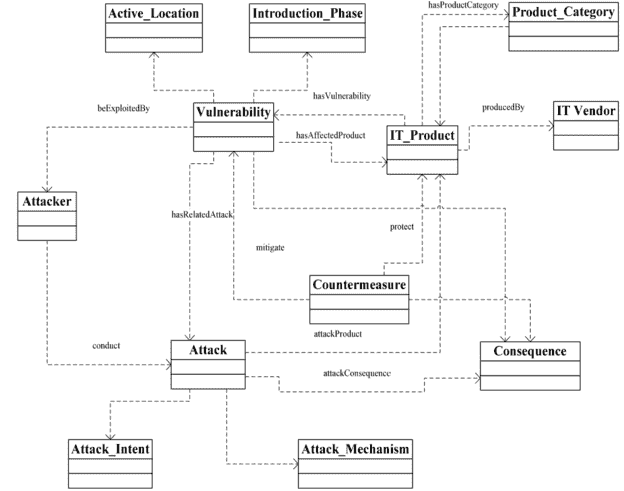

(Wang & Guo, 2009)

它支持有限的自动化和查询。它是发布在漏洞领域的最早本体之一，并在信息安全自动化计划（ISAP）下发布。总体而言，它可被归类为领域特定本体。

### 3.1.1 OVM 的优点

*   高互操作性和各方间更好的交换
*   结构良好的架构
*   易于融入现有概念
*   增强的自动化

### 3.1.2 OVM 的缺点

*   有限的推理和查询
*   难以融入不存在的概念
*   通用目的的适用范围有限
*   复杂性较高 (Wang & Cui, 2019)

### 3.2 结构化威胁信息表达（STIX）

第二个被分析的本体方法是 STIX 标准。虽然根据教科书定义它不是一个本体，但 STIX 尽管类似于一种语言或标准，却遵循系统化方法并以结构化方式表示数据。因此，在本文的范围内，它被视为一个本体。必须注意的是，整篇论文中提到 STIX 时，均指 Barnum (2012) 论文中发布的本体以及 MITRE 公司旗下的本体。STIX 的突出之处在于，它更侧重于一种社区驱动的方法，而非建立一个必须融入新信息的僵化结构。它更侧重于灵活性、表达性、可扩展性、自动化能力和可读性。它为网络威胁信息提供了通用机制和统一架构。它包含一组核心的必需指导原则，即表达性、可集成性、灵活性、可扩展性、自动化能力、可读性和架构。STIX 结构由可观测对象、指标、事件、战术技术与程序（TTP）、活动、威胁行为者、利用目标和行动方案（COA）组成。由于其灵活的方法，它拥有比其他本体更多的用例，以及更长的生命周期。它最常与可信自动化情报信息交换（TAXII）一起使用。尽管两者完全独立，但协同工作时能产生最佳效果。

## 图 2. 结构化威胁信息表达（STIX）架构 v0.3

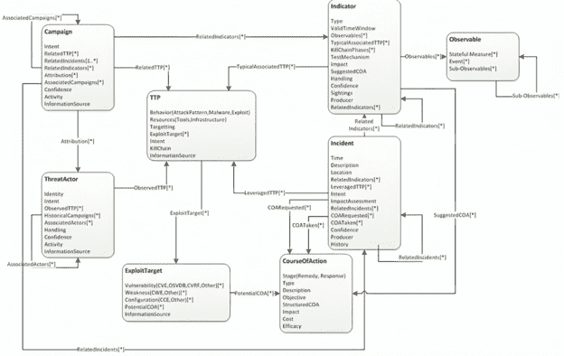

(Barnum, 2012)

## 图 3. STIX 关键构造与关键相互关系

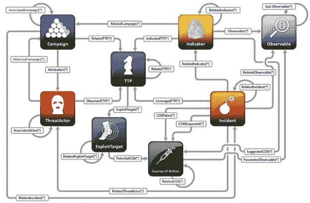

(STIX 项目 [`stixproject.github.io/about/`](https://stixproject.github.io/about/))

### 3.2.1 STIX 的优点

*   灵活性和可扩展性
*   自动化能力
*   部分实现
*   多样化的用例

### 3.2.2 STIX 的缺点

*   复杂性和计算开销
*   互操作性和集成问题
*   匿名性和隐私担忧

### 3.3 安全工具箱：攻击与对策本体（STAC）

第三个被研究的本体是 STAC 本体，由 Gyrard et al. (2013) 在第 22 届国际万维网会议论文集中开发。旨在为非安全专家创建一个本体，帮助他们设计安全应用并了解多个领域的安全概念和风险，STAC 融合了 `Application`（应用）、`Requirement`（需求）、`Domain`（领域）、`Attack`（攻击）、`Countermeasures`（对策）、`Feature`（特性）、`SecurityProperty`（安全属性）和 OSI 模型的概念。这些概念之间的关系及其结构在 STAC 中定义明确。除了这些主要概念外，它还包含子概念、方法和属性。它采用 `OWL`（Web 本体语言）框架表示。其 UI 利用以下技术：`Java`、`REST Web Services` (Jersey)、`Google Application Engine` (GAE)、`Jena framework`、`SPARSQL` 语言、`HTML5`、`CSS3`、`Javascript` 和 `AJAX`。STAC 支持的用例包括：针对攻击和对策的领域特定查询、额外信息检索（如对策的优缺点及满足的安全属性）、针对特定 OSI 模型层的攻击和对策搜索。

## 图 4. STAC 本体的顶层部分

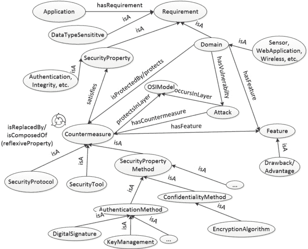

(Gyrard et al., 2013)

它融合了来自各种来源的信息。STAC 的构建方式使得第三方难以修改，这使其略显不适合即时添加关于新型网络安全概念、攻击和对策的信息。它的特定目的是帮助新手软件开发人员以更稳健可靠的方式开发安全软件。

### 3.3.1 STAC 的优点

*   域外高度互操作
*   开源框架利用
*   支持领域特定检索

### 3.3.2 STAC 的缺点

*   临时更新过程困难
*   特定范围
*   领域密集型任务的用例有限
*   实现复杂 (Gong & Tian, 2020)

### 3.4 通过关联上下文观测进行态势与威胁理解（STUCCO）本体


第四个被研究的本体是 STUCCO 本体 (Iannacone et al., 2015)。该本体由国家实验室和斯坦福大学的研究人员开发，多年来表现良好，在网络安全专业人员中普遍备受推崇。该本体的主要设计目标是确保人类和自动化系统的互操作性。这是一个相对简洁的本体，能够恰当地对网络安全的关键概念进行分类，并定义它们与其他相关概念的关系。它使用 `JSON Schema` 定义本体，查询使用 `GraphSON` 格式。这种有意摒弃普遍使用的框架（`RDF` 或 `OWL`）而采用 `JSON` 的选择，有其自身的优势和权衡。它确实存在问题，即现有文献中术语定义模糊或分配不当。由于其固有局限性，它也缺乏来自非结构化数据源的潜在洞察信息。相反，`STUCCO` 对人类具有高度可解释性，使其易于使用。由于其更通用的性质，Lie 等人将其归类为统一安全本体。总体而言，`STUCCO` 更像是一个需要不断更新或操作的维基百科页面，而不是网络安全领域的灵丹妙药。从选择将 `STUCCO` 作为数据源的本体数量来看，可以恰当地评估这一点。此后的大多数本体在一定程度上都受到了它的影响。

#### 图 5. STUCCO 本体中的实体和关系

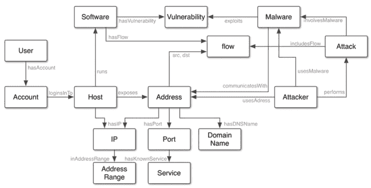

(Iannacone et al., 2015)

### 3.4.1 STUCCO 的优点

*   • 高人类可解释性
*   • 易于验证和模式定义
*   • 融合用于推理的元数据

### 3.4.2 STUCCO 的缺点

*   • 无法使用 `OWL-DL`
*   • 缺乏来源
*   • 有限的用例
*   • 无法融合非结构化的、潜在有用的数据

### 3.5 统一网络安全本体 (UCO)

第五个被评估的本体是由马里兰大学研究人员开发的 (Syed et al., 2016)，简称为统一网络安全本体 (`UCO`)。该本体试图融合来自各种结构化和非结构化数据源的信息，并试图将通用本体设计为入侵检测系统本体 (`IDS`) (Pinkston et al., 2003) 的扩展。它支持推理、推演和专业知识捕获。表示框架为 `OWL`。它包含一组类，这些类可能有也可能没有子类，并定义了它们与其他类的关系。`UCO` 具有多样性，可以支持多种用例（如其研究论文所示），可映射到通用世界本体，并可扩展以添加新信息。

#### 图 6. 链接开放数据云中 UCO 与通用世界本体的映射

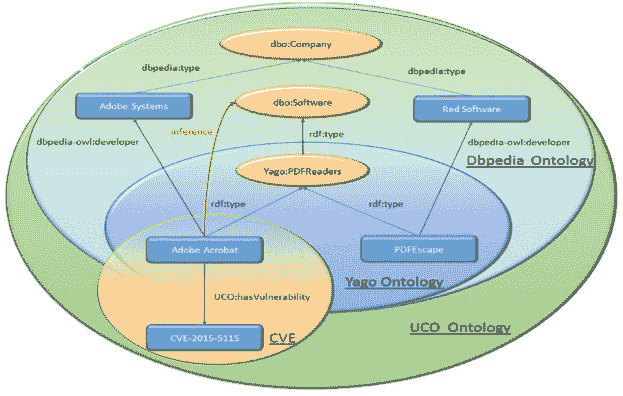

(Syed et al., 2016)

### 3.5.1 UCO 的优点

*   • 使用语义框架 (`OWL`) 而非语法框架 (`XML`)
*   • 支持推理/查询
*   • 可扩展
*   • 范围广泛/通用

### 3.5.2 UCO 的缺点

*   • 有限的用例
*   • 难以集成新概念
*   • 部分实现不便
*   • 依赖人工工作

### 3.6 网络威胁情报模型 (CTIM)

倒数第二个被评估的本体是 `CTIM`，由奥斯陆大学的研究人员 Mavroeidis 和 Bromander (2017) 开发。`CTIM` 的主要目标是处理网络威胁，并更好地装备组织以应对其检测和预防。它建立在 Stillions (2014) 开发的威胁模型之上，并融合 `DML` 模型来构建 `CTIM`。它包含十三个要素：Identity、Motivation、Goals、Strategy、Tactics Techniques and Procedures (`TTPs`)、Attack Pattern、Malware、Infrastructure、Tools、Indicators of Compromise、Atomic Indicators、Target 和 Course of Action。与之前的本体不同，`CTIM` 解决了威胁这一特定问题，因此自动将其排除在通用性讨论之外。然而，考虑到其融合的综合来源，其表示准确性值得注意。它支持自动推理，允许演绎和推断。Roy & Dutta (2022) 建立了几个相关标准来评估网络威胁本体。总体而言，`CTIM` 在解决其旨在解决的问题方面表现良好，即使组织能够更好地准备和防御网络威胁。

#### 图 7. 修改后的检测成熟度等级 (DML) 模型

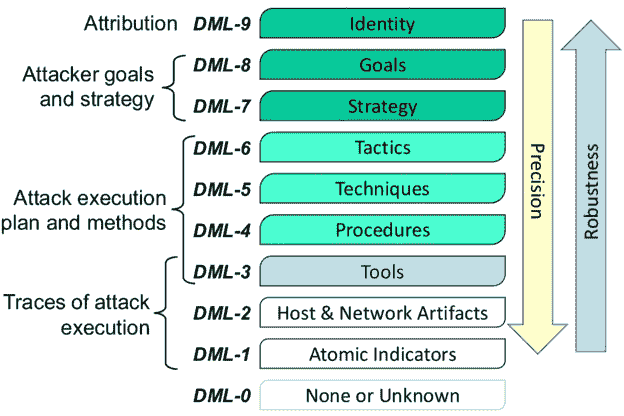

(Mavroeidis & Bromander, 2017)

#### 图 8. 网络威胁情报模型

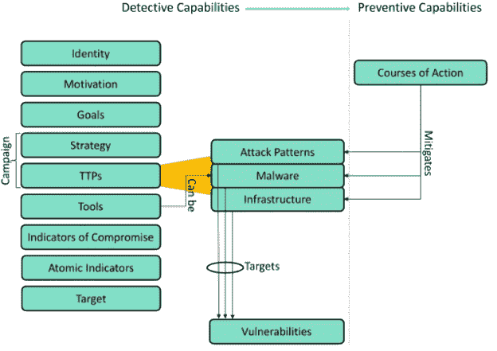

(CTIM Mavroeidis & Bromander, 2017)

### 3.6.1 CTIM 的优点

*   • 支持推理/查询
*   • 结构定义良好
*   • 高互操作性

### 3.6.2 CTIM 的缺点

*   • 范围/领域有限
*   • 表示中的歧义
*   • 不可扩展

### 3.7 WAVED：统一本体

最后一个本体由德克萨斯大学研究人员在国家标准与技术研究院人员的协助下贡献。首字母缩写 `WAVED` 代表 Weakness、Attack、Vulnerability、Engage、D3fend。它建立在 Akbar 等人的工作基础上，融合了更多框架并进行了其他进步性变更 (Akbar et al., 2023a, 2023b)。该本体的主要用例是检测和缓解高级持续性威胁活动 (`APT`)。总体而言，作为本文撰写时相对较新的本体，`WAVED` 解决了通用本体应解决的大多数活动问题，留给检查的空间很小。它考虑了大多数知名来源，并使融合新信息变得容易，但并非完全自动化。除了论文中提到的差距和不一致性外，该本体相当好地解决了大多数主要用例。

#### 图 9. WAVED 本体的概念表示

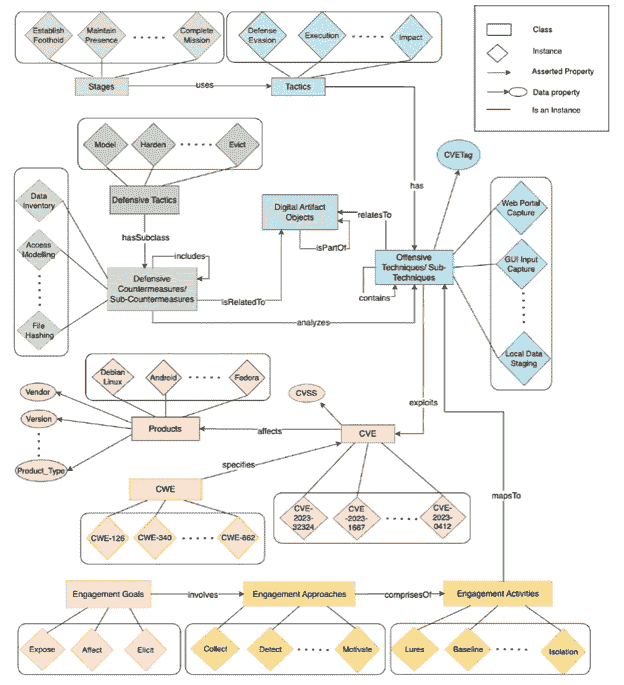

(Akbar et al., 2023b)

### 3.7.1 WAVED 的优点

*   • 支持 `SPARSQL`
*   • 可部分实现
*   • 双向性
*   • 易于集成新数据
*   • 多样化的用例

### 3.7.2 WAVED 的缺点

*   • 范围有限
*   • 关联困难
*   • 缺乏测试用例

#### 表 1. 各本体优缺点表格摘要

| OVM | 优点 | 缺点 |
| :--- | :--- | :--- |
| | 1. 高互操作性和各方间更好的交换<br>2. 结构良好的架构<br>3. 易于融合现有概念<br>4. 增强的自动化 | 1. 推理和查询有限<br>2. 难以融合不存在的概念<br>3. 通用目的范围有限<br>4. 更高的复杂性 (Wang and Cui, 2019) |
| STIX | 1. 灵活性和可扩展性<br>2. 可自动化<br>3. 部分实现和用例 | 1. 复杂性和认知开销<br>2. 互操作性和集成问题<br>3. 匿名化和隐私担忧 |
| STAX | 1. 域外高度互操作<br>2. 开源框架利用<br>3. 支持特定领域检索 | 1. 临时更新过程困难<br>2. 特定范围<br>3. 领域密集型任务的用例有限 |


## 4. 复杂实现 (Gong and Tian, 2020)

| 框架 | 优势 | 劣势 |
| :--- | :--- | :--- |
| **STUCCO** | 1. 高人类可解释性<br>2. 易于验证和模式定义<br>3. 融合元数据用于推理 | 1. 无法使用 OWL/DL<br>2. 缺乏来源<br>3. 使用案例有限<br>4. 无法融合非结构化/潜在有用数据 |
| **UCO** | 1. 使用语义框架 (OWL) 而非语法框架 (XML)<br>2. 支持推理/查询<br>3. 可扩展<br>4. 范围广泛 (通用) | 1. 使用案例有限<br>2. 难以集成新来源<br>3. 不便于对部分匿名化/常规工作进行推理 |
| **CTIM** | 1. 支持推理/查询<br>2. 结构定义良好<br>3. 高互操作性 | 1. 范围/领域有限<br>2. 表示存在歧义<br>3. 使用案例有限 |
| **WAVED** | 1. 支持 SPARQL<br>2. 部分实现<br>3. 灵活的关系/自然结构<br>4. 易于集成新数据<br>5. 使用案例广泛 | 1. 范围有限<br>2. 难以关联关系<br>3. 缺乏测试用例 |

### 4. 结论与未来工作

随着网络安全社区提供了各种不同的方法来解决通用本体问题，基于各种参数持续分析和评估这些方法显得尤为重要。在实施成功本体的最佳特性并消除其缺陷方面，仍有大量工作有待完成。如果标准本体能在管理复杂性、适应性和可演化性之间达到平衡，通常表现良好。近期出现了一种利用 NLP 从文本来源提取信息的趋势。包括 WAVED 在内的早期结果令人鼓舞。语义 Web 技术结合这种方法已彻底改变了该领域的格局。发表本文旨在希望此次考察能对当前正在开发本体的人员有所帮助，并协助他们确定应实施哪些特性以使其本体达到最优。

## 参考文献

Akbar, K. A., Rahman, F. I., Singhal, A., Khan, L., & Thuraisingham, B. (2023a, December). The Design and Application of a Unified Ontology for Cyber Security. In International Conference on Information Systems Security (pp. 23-41). Cham: Springer Nature Switzerland. DOI: [10.1007/978-3-031-49099-6_2](http://dx.doi.org/10.1007/978-3-031-49099-6_2)

Barnum, S. (2012). Standardizing cyber threat intelligence information with the structured threat information expression (stix). Mitre Corporation, 11, 1–22.

Booth, H., Rike, D., & Witte, G. A. (2013). The national vulnerability database (nvd). Overview.

Fenz, S., Ekelhart, A., & Weippl, E. (2008, March). Fortification of IT security by automatic security advisory processing. In 22nd International Conference on Advanced Information Networking and Applications (aina 2008) (pp. 575-582). IEEE. DOI: [10.1109/AINA.2008.69](http://dx.doi.org/10.1109/AINA.2008.69)

Gong, L., & Tian, Y. (2020). Threat modeling for cyber range: an ontology-based approach. In Communications, Signal Processing, and Systems: Proceedings of the 2018 CSPS Volume III: Systems 7th (pp. 1055-1062). Springer Singapore. DOI: [10.1007/978-981-13-6508-9_128](http://dx.doi.org/10.1007/978-981-13-6508-9_128)

Gyrard, A., Bonnet, C., & Boudaoud, K. (2013, May). The stac (security toolbox: attacks & countermeasures) ontology. In Proceedings of the 22nd International Conference on World Wide Web (pp. 165-166). DOI: [10.1145/2487788.2487869](http://dx.doi.org/10.1145/2487788.2487869)

Iannacone, M., Bohn, S., Nakamura, G., Gerth, J., Huffer, K., Bridges, R., & Goodall, J. (2015, April). Developing an ontology for cyber security knowledge graphs. In Proceedings of the 10th annual cyber and information security research conference (pp. 1-4). DOI: [10.1145/2746266.2746278](http://dx.doi.org/10.1145/2746266.2746278)

Liu, K., Wang, F., Ding, Z., Liang, S., Yu, Z., & Zhou, Y. (2022). A review of knowledge graph application scenarios in cyber security. arXiv preprint arXiv:2204.04769.

Pinkston, J., Joshi, A., & Finin, T. (2003, July). A target-centric ontology for intrusion detection. In Workshop on Ontologies in Distributed Systems, held at The 18th International Joint Conference on Artificial Intelligence.

Mavroeidis, V., & Bromander, S. (2017, September). Cyber threat intelligence model: an evaluation of taxonomies, sharing standards, and ontologies within cyber threat intelligence. In 2017 European Intelligence and Security Informatics Conference (EISIC) (pp. 91-98). IEEE.

Roy, D., & Dutta, M. (2022). A systematic review and research perspective on recommender systems. Journal of Big Data, 9(1), 59. DOI: [10.1186/s40537-022-00592-5](http://dx.doi.org/10.1186/s40537-022-00592-5)

Stillions, R. (2014). The DML model. Retrieved Jan, 29, 2022.

Syed, Z., Padia, A., Finin, T., Mathews, L., & Joshi, A. (2016, March). UCO: A unified cybersecurity ontology. In Workshops at the thirtieth AAAI conference on artificial intelligence.

Wang, B., & Cui, B. (2019). Ontology-based services for software vulnerability detection: A survey. Service Oriented Computing and Applications, 13(4), 333–339. DOI: [10.1007/s11761-019-00276-8](http://dx.doi.org/10.1007/s11761-019-00276-8)

Wang, J. A., & Guo, M. (2009, April). OVM: an ontology for vulnerability management. In Proceedings of the 5th Annual Workshop on Cyber Security and Information Intelligence Research: Cyber Security and Information Intelligence Challenges and Strategies (pp. 1-4).

# 第 2 章：大数据网络安全分析

**Prerna Agrawal**


GLS University, India

**Savita Gandhi**


GLS University, India

## 摘要

社交媒体的使用普及率正在迅速攀升。仅在 2024 年 1 月，印度就记录了总计 4.62 亿社交媒体用户。在线用户的激增导致网络安全欺诈相应激增。网络安全专家可以利用大数据分析工具来识别、预防和缓解网络攻击，因为这些技术能够处理从不同来源收集的海量数据。本章探讨了可利用大数据分析 (BDA) 识别的网络犯罪。本章的主要目的是让读者全面了解大数据分析 (BDA) 在网络安全领域的应用。同时也旨在让读者了解 BDA 在网络安全应用中的当前进展以及该领域面临的挑战。

## 引言

网络安全这一关键学科致力于防止未经授权的访问、中断、破坏和窃取电子设备、互联网络和记录 (Mahmood & Afzal, 2013)。在二十一世纪相互互联的数字世界中，网络安全对于保护个人、组织和政府免受各种威胁至关重要 (Apurva, 2017; Alpana, 2021)。在线上，信息持续存储和交换。网络安全主要关注维护机密性、完整性、可用性、真实性和不可抵赖性。


## 大数据与网络安全分析

**大数据** 一词是指极其庞大且复杂的信息汇编，其规模超出了传统数据处理系统分析和有效管理的能力。 **大数据** 由三个 V 定义：速度、容量和多样性 (Mahmood, 2013; Apurva, 2017; Rajsekhar, 2018; Alpana, 2021; Srivastava, 2019; Suraj, 2018)。大数据领域涵盖了大量数据，通常范围从 TB 级到 PB 级。信息可能源自传感器数据、社交媒体互动、商业交易和其他来源。 **速度** 涉及大数据的快速涌现，要求及时管理以便及时提取有价值的见解。以下数据源需要实时或近实时处理：传感器数据、社交媒体流和网站访问流。这些源能够快速生成数据。 **大数据** 可以以多种格式存在，包括非结构化、半结构化和结构化数据。 **非结构化数据** ，如图像、视频和文本文档，不遵循预定义的数据模型； **结构化数据** ，如数据库，组织良好且易于搜索。 **大数据** 存在于所有领域，包括金融、智慧城市、医疗保健、商业与营销以及供应链管理 (Mahmood & Afzal, 2013)。普通人每月平均使用 6.7 个不同的社交网络，到 2024 年底，全球将有 51.7 亿人使用社交媒体 (West, 2024)。到 2028 年，移动广告将为 2024 年预计 2198 亿美元的社交媒体广告支出贡献 2558 亿美元 (West, 2024)。截至 2024 年初，印度有 7.515 亿人上网，占人口的 52.4%。2024 年 1 月，印度有 4.62 亿社交媒体用户 (Kemp, 2024)。

## 大数据网络安全分析

**大数据网络安全分析** 致力于通过实施先进分析技术和大数据技术来增强网络安全运营 (Mahmood & Afzal, 2013)。由于网络威胁在数量、速度和多样性上的激增，传统网络安全措施在征服和最小化复杂的网络攻击方面已被证明极其困难。 **大数据网络安全分析** 通过允许组织实时或近实时地从多个来源收集、处理和评估海量的安全相关数据，为这一问题提供了解决方案 (Mahmood, 2013; Apurva, 2017; Rajsekhar, 2018; Alpana, 2021; Srivastava, 2019; Suraj, 2018)。

## 章节目标

本章的主要目标是确定 **BDA** 在网络安全领域的应用，强调可借助这些分析手段补救的各类网络犯罪，教育读者在网络安全领域应用 **BDA**，并宣传 **BDA** 在网络安全方面的社会重要性。

## 印度网络犯罪现状

**网络欺诈** 是指利用数字设备、计算机和互联网愚弄个人、组织或政府，以获取钱财或实现其他邪恶目的。 “网络欺诈” 一词包含各种各样的欺诈计谋和手段，这些手段往往利用人性、组织流程或技术中的缺陷 (Mahmood, 2013; Apurva, 2017; Alpana, 2021)。网络犯罪的来源来自于通过商业、金融交易、基于位置的数据、社交媒体等产生的海量数据 (Apurva et al., 2017)。

国家犯罪记录局 (**NCRB**) 2023 年报告显示，印度各邦总共收到 1,128,265 起网络欺诈投诉 (Cases of Cyber Frauds, 2024)。

### 图 1. 印度各邦的网络欺诈

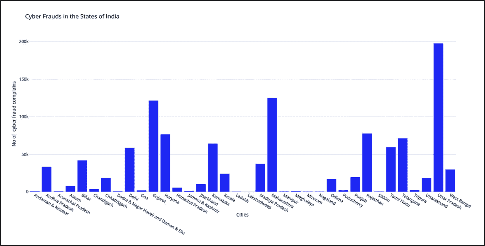

图 1 显示了印度各邦的网络欺诈投诉总数。随着在线数据的增长，网络犯罪将随之增加，这要求开发能够检测数据趋势、防止网络攻击并保护数据的强大网络安全系统。 **BDA** 在网络安全领域的应用有助于增强检测能力，从而降低网络犯罪的发生率。

## 当前时代对网络安全的需求

由于海量数据在线激增，数据面临巨大威胁。因此，基于以下原因，当前时代需要网络安全 (Mahmood & Afzal, 2013)：

*   **日益增长的网络威胁**：随着技术的发展，网络犯罪分子的工具也在进步。网络威胁变得越来越多样化，包括勒索软件、恶意软件、网络钓鱼骗局和日益先进的黑客技术。
*   **数据安全**：由于数据数字化，个人和企业现在在网上存储了海量私人信息。网络安全意味着确保这些数据免受盗窃、篡改和未经授权的访问。
*   **隐私担忧**：在数字时代，人们的隐私处于脆弱状态。网络安全措施有助于防止恶意行为者利用人们的个人信息。
*   **关键基础设施保护**：互联计算机系统在电力、交通、医疗和银行等基本服务的提供中发挥着重要作用。为了保护这些系统免受可能阻碍正常业务运营或引发大规模混乱的网络攻击，网络安全至关重要。
*   **经济影响**：网络攻击会给企业和政府造成严重的财务后果。投资网络安全有助于减轻数据泄露、系统不可用和声誉受损造成的经济损失。
*   **合规要求**：许多行业都有数据保护和网络安全准则。遵守这些法规不仅能确保法律合规，还能维护消费者和合作伙伴的信任。
*   **新兴技术**：随着 **物联网**、**人工智能** 和云计算等尖端技术的进步，网络威胁的攻击面不断扩大。实施弹性网络安全协议对于降低与这些技术相关的风险至关重要。

### 网络犯罪类型

**网络犯罪** 包括通过使用计算机或互联网实施的非法活动。窃取和分发企业数据、勒索赎金以防止数据丢失、在目标计算机上植入漏洞、入侵企业或政府计算机都是网络犯罪的例子 (Mahmood, 2013; Apurva, 2017; Rajsekhar, 2018; Alpana, 2021; Srivastava, 2019; Suraj, 2018; Rawat, 2021; Alani, 2017)。以下是常见的网络犯罪形式：

*   **恶意软件**：恶意软件的缩写，包含一系列专门设计用于造成损害、干扰或非法进入计算机系统的软件应用程序。 **恶意软件** 包括间谍软件、广告软件、病毒、蠕虫和特洛伊木马等。


### 网络犯罪类型

*   **Phishing（网络钓鱼）**：被归类为一种网络犯罪，攻击者通过欺诈性网站、电子邮件或消息，诱导受害者泄露敏感信息（包括财务详情、登录凭证或机密数据）。为了欺骗受害者，网络钓鱼攻击经常伪装成合法组织，如政府机构或机构。
*   **Identity Theft（身份盗窃）**：为了实施欺诈或冒充他人，攻击者获取受害者的机密信息，如姓名、社会安全号码（SSN）或信用卡详情。网络犯罪分子可能采用多种手段获取这些记录，包括网络钓鱼、数据泄露和社会工程学。
*   **Data Breaches（数据泄露）**：当恶意行为者非法进入组织或公司的系统并窃取机密数据（包括但不限于财务记录、客户信息或知识产权）时发生。数据窃取可能导致受影响组织遭受声誉损害、财务损失和法律责任。
*   **Ransomware（勒索软件）**：一种恶意软件，它使目标计算机系统瘫痪或加密其数据和文件，随后要求以加密货币支付赎金，以换取解密密钥或恢复系统访问权限。勒索软件攻击可能使组织瘫痪、中断关键服务并向受害者勒索钱财。
*   **Cyber Extortion（网络勒索）**：在不支付赎金的情况下，通过威胁对组织或个人造成伤害（包括数据泄露、DDoS 攻击或声誉损害）进行勒索。如果要求不被满足，网络勒索者可能威胁泄露敏感信息或中断服务。
*   **Cyberbullying and Online Harassment（网络霸凌和网络骚扰）**：通过数字场所（包括在线讨论组、社交媒体和即时通讯应用）恐吓、威胁或骚扰个人。这可能包括未经同意发送辱骂性信息、散布谎言或泄露私人信息。
*   **Financial Fraud（金融欺诈）**：网络犯罪分子为获取钱财或受害者敏感财务信息，可能实施信用卡欺诈、投资骗局、身份盗窃、网络钓鱼计划等多种形式的金融欺诈。
*   **Cyber Espionage（网络间谍活动）**：出于政治、经济或军事目的，利用网络攻击非法获取敏感信息或知识产权。政府机构、企业和组织可能成为试图窃取机密信息或商业机密的网络间谍活动目标。
*   **Distributed Denial of Service Attacks (DDoS)（分布式拒绝服务攻击）**：通过向目标网络或系统发送过量流量或请求，使合法用户无法使用服务。DDoS 攻击可能导致在线服务、网站或网络严重中断，给受害者造成财务损失和声誉损害。

## 网络攻击类型

网络攻击是个人或团体利用数字技术，意图破坏计算机系统、网络或设备的恶意行为。以下是常见的网络攻击类型（Mahmood, 2013; Apurva, 2017; Rajsekhar, 2018; Alpana, 2021; Srivastava, 2019; Suraj, 2018; Rawat, 2021; Alani, 2017）：

*   **Viruses（病毒）**：通过文件附件渗透合法程序或文件的恶意软件；在所述文件执行时传播。
*   **Worms（蠕虫）**：一种自我复制的恶意软件，可在系统和网络中传播，常利用漏洞感染其他设备。
*   **Trojans（特洛伊木马）**：伪装成正版软件的恶意软件，旨在未经授权地渗透系统或窃取敏感信息。
*   **Ransomware（勒索软件）**：锁定计算机系统或加密文件的恶意软件，要求以加密货币支付赎金以换取解密或恢复。
*   **Email Phishing（电子邮件钓鱼）**：网络犯罪分子通过伪装成合法实体，采用欺骗性电子邮件手段，诱骗接收者泄露密码或财务详情等关键数据。
*   **Spear Phishing（鱼叉式网络钓鱼）**：一种针对特定组织或个人的网络钓鱼形式，利用个性化信息提高成功几率。
*   **Vishing（语音钓鱼）**：通常通过语音通信渠道（包括电话和语音消息）实施的网络钓鱼攻击。这些攻击利用社会工程学技术操纵受害者。
*   **Denial of Service (DoS) Attacks（拒绝服务攻击）**：通过向目标系统或网络发送大量请求或流量，使其无法为授权用户提供服务。
*   **DDoS Attacks（分布式拒绝服务攻击）**：利用僵尸网络（被攻陷设备组成的网络）向目标发送海量流量，耗尽其资源并导致服务完全中断。
*   **Interception（拦截攻击）**：攻击者在受害者不知情的情况下，拦截并窃听双方通信，以篡改数据或窃取敏感信息。
*   **Spoofing（欺骗攻击）**：攻击者假冒可信组织或网络设备的身份，以欺骗用户或非法访问系统。
*   **SQL Injection Attacks（SQL 注入攻击）**：利用 Web 应用程序或数据库中的漏洞执行恶意 SQL 查询，使攻击者能够绕过身份验证、未经授权访问敏感数据或篡改数据库内容。
*   **Cross-Site Scripting (XSS) Attacks（跨站脚本攻击）**：将有害代码注入在线应用，当不知情用户在浏览器中运行时，攻击者可窃取会话 Cookie、将访问者重定向到有害网站或执行其他非法活动。
*   **Zero-Day Exploits（零日漏洞利用）**：利用供应商未知或未修复的软硬件漏洞，使攻击者能在安全更新或补丁发布前利用该弱点。
*   **Insider Threats（内部威胁）**：指组织内部的员工、承包商或业务合作伙伴实施的恶意活动或数据泄露。这些人员利用其授权访问权限窃取数据、破坏系统或造成其他损害。
*   **Social Engineering（社会工程学）**：通过操纵人类心理或利用信任感，诱骗个人泄露密码或访问凭证等敏感数据，或执行对攻击者有利的操作。
*   **Advanced Persistent Threats (APTs)（高级持续性威胁）**：由有组织、资金充足的对手实施的复杂且有针对性的网络攻击，通常以经济利益、破坏或间谍活动为主要动机；典型特征是持续渗透目标网络并执行多阶段攻击。

## 大数据的价值


#### 大数据

大数据适用于来自多个来源的海量数据的处理、分析和存储。当传统的数据处理、存储和分析手段不足时，大数据方法和解决方案变得至关重要。大数据的核心在于快速发现隐藏信息、分析海量非结构化数据以及整合不相关的数据集。大数据环境从各种来源收集数据，包括内部应用程序、传感器和外部来源。大数据解决方案可为企业应用分析数据，或丰富数据仓库中的现有数据（Erl et al. 2015）。以下关键原因清晰地展示了大数据的价值（Mahmood, 2013; Apurva, 2017; Rajsekhar, 2018; Alpana, 2021; Srivastava, 2019; Suraj, 2018; Erl, 2015）：

*   **知识驱动决策**：组织可以利用大数据分析，基于事实而非猜测或直觉做出明智判断。通过分析来自不同来源的海量数据，组织能够增强对消费者行为、市场趋势和运营低效环节的理解。

*   **提升绩效与生产力**：通过识别流程和运营中的低效环节，大数据分析使组织能够优化工作流、更有效地分配资源并精简运营。这将带来生产力提升、成本节约和效率改善。

*   **深化客户洞察**：大数据分析的应用使组织能够全面了解客户的偏好、行为和需求。企业能够通过分析来自不同渠道的客户数据（如社交媒体互动、网站交易和购买记录），提升客户满意度和忠诚度，定制营销举措，并量身打造产品和服务。

*   **创新与新兴商业前景**：大数据中蕴含的海量信息具有激发创新和创造新商业机会的潜力。通过分析新兴技术、市场趋势和消费者行为，组织可以识别未被满足的需求、开发新产品和服务，并进入新市场。

*   **风险管理与欺诈预防**：大数据分析有助于组织更有效地识别和降低风险。通过实时分析海量数据集，组织能够检测异常、识别潜在安全威胁，并在欺诈发生前将其防范。这在保险、金融和网络安全等行业尤为关键。

*   **医疗与生命科学创新**：大数据分析在医疗和生命科学领域的应用有潜力彻底改变患者护理、药物研发和疾病控制。研究人员可通过分析海量数据集（包括临床试验、基因组数据和患者记录），加速新药和疗法的发现、识别疾病模式，并制定个性化治疗方案。

## 大数据生命周期

大数据生命周期考虑了大数据的功能需求。图 2 对大数据生命周期进行了说明，表明数据必须先获取、再组织、最后整合。成功实施此阶段后，即可对数据进行分析以解决已发现的问题。随后管理层需根据分析结果采取行动（Arya & Dayanand, 2017）。

### 图 2. 大数据生命周期

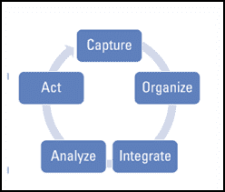

来源：(Hurwitz et al., 2013)

例如，Amazon.com 可能会根据客户的过往购买记录推荐一本书，或者为客户已购买的相关产品提供折扣券。尽管这些功能看似简单，但其背后的复杂性可能错综复杂且难以理解。在整合多个数据源时，必须验证输出结果在逻辑上是一致的。必须为特定数据源实施适当的安全和治理程序，以保护敏感信息。

## 大数据生态系统

大数据被描述为海量的有组织和非组织信息，其规模过大或变化过快，超出了普通关系型数据库的处理能力。该生态系统涵盖了这两类海量数据。该生态系统用于以尽可能少的延迟收集、处理和分析数据。图 3 展示了大数据生态系统各阶段的细分。其组件包括数据源、数据摄取、数据存储、数据处理和数据可视化（Judith, 2013）。

### 图 3. 大数据生态系统

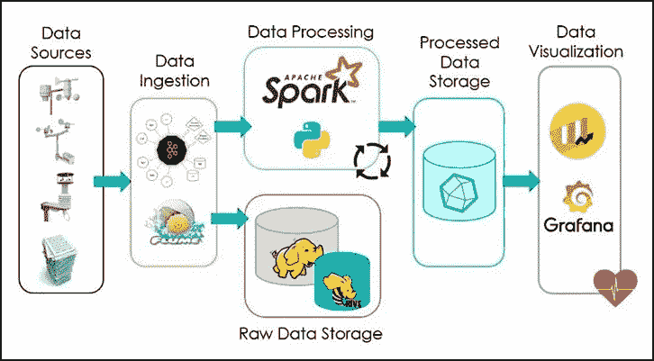

来源：(Hurwitz et al., 2013)

*   **数据源**：第一步是从广泛的来源收集记录，如传感器、数据库、物联网设备、社交媒体等。视情况而定，数据可以是结构化、半结构化或非结构化的。

*   **数据摄取**：收集完成后，必须将数据保存在一个系统中，该系统可以是存储或处理设备。在此步骤中，数据从其原始源传输到存储信息或数据的平台。此类平台的示例包括数据仓库、数据湖或分布式文件系统 (DFS)。在“数据存储”阶段，获取的信息保存在适合该目的的存储系统中。这可能包含分布式文件系统，如 NoSQL 数据库、`HDFS` (Hadoop 分布式文件系统)、基于云的存储服务、数据仓库、`Amazon S3` 或 `Google Cloud Storage`。

*   **数据处理**：数据存储后，将对其进行处理以获取见解和有用信息。在此步骤中，会使用各种数据处理方法，如数据修改、数据清洗、数据增强、数据分组和数据统一。根据情况需求，信息可实时、批量或流式处理。

*   **数据可视化**：数据分析结果通常通过图表、仪表盘、图形和其他工具进行展示。此阶段包括数据呈现。

## 大数据来源

大数据可从广泛的来源收集，包括传统的结构化数据库，以及社交媒体平台信息流和传感器监控数据等非结构化来源。以下是一些常用的海量数据来源（Mahmood, 2013; Apurva, 2017; Rajsekhar, 2018; Alpana, 2021; Srivastava, 2019; Suraj, 2018）：

*   **事务数据**：通过公司交易创建的数据，如销售记录、发票和客户联系，称为事务数据源。通常存储在关系型数据库或数据仓库中。


• 社交媒体：Facebook、Twitter、Instagram 和 LinkedIn 是社交媒体平台的示例，它们以帖子、评论、点赞、分享和其他类似活动的形式产生大量数据。这些数据有可能提供对客户情绪、行为和趋势的洞察。

• 机器和传感器信息：物联网设备、传感器和机器提供与温度、压力、运动及其他相关主题有关的海量数据。这些数据用于制造、医疗保健和交通等各行业的预测性维护、监控和优化等活动。

• 网络和文本信息：网页、博客、论坛和新闻报道都包含大量信息，可供检索和分析，用于情感分析、趋势追踪和内容推荐等多种目的。

• 日志数据：服务器日志、应用程序日志和网络日志是记录系统和网络内部发生的操作和事件的日志数据类型。日志数据的分析有助于检测异常、解决问题和提升系统性能。

• 地理空间数据：全球定位系统（GPS）数据、卫星图像和基于位置的服务都会生成地理空间数据，可用于物流优化、城市规划和基于位置的营销。

• 金融数据：金融数据包含股市、银行交易和财务报表等信息，其中蕴含的信息对投资研究、风险管理和欺诈活动识别很有用。

• 基因组数据：在医疗保健和生命科学领域，源自 DNA 测序和医疗记录的基因组数据，为遗传疾病、定制用药和人口健康提供了洞察。

• 政府数据：来自政府机构的公开数据集提供了关于气候、经济和人口统计等各类主题的信息。这些数据集常用于研究、公共政策制定和公共服务相关应用。

• 客户交互：客户服务交互记录，如呼叫中心录音文本、聊天日志和电子邮件，为客户偏好、问题和满意度提供了重要洞察。

• 音频和视频数据：通过分析音频和视频数据，可以深入了解语音模式、面部表情和客户偏好，鉴于多媒体内容的增长，这尤为有用。

这些只是几个示例，随着技术发展和数据收集模式的转变，大数据来源持续增长。

## 大数据分析概述

大数据分析（BDA）是一个研究领域，专注于从海量数据集中提取价值，特别是主要的、先前隐含的、未披露的以及潜在有用的洞察。这些发现直接影响当前公司计划的制定或调整，并作为通常被称为“以数据驱动决策”项目的驱动力。据推测，大量数据中包含可单独识别的使用模式、事件或行为。为了将数学模型应用于这些模式，会使用 BDA 和各种其他数据挖掘方法，如聚类分析、处方分析和关联规则挖掘。应用这些方法时，获得的发现通常显示在交互式仪表板上。这些仪表板帮助企业保持竞争优势、增加收入并改善客户关系管理（Mahmood, 2013; Apurva, 2017; Rajsekhar, 2018; Alpana, 2021; Srivastava, 2019; Suraj, 2018)。

### 图 4. 大数据分析流程

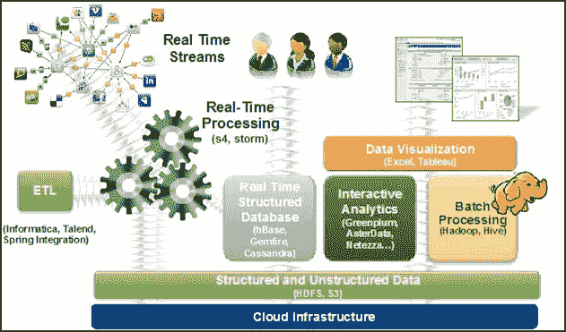

来源：(Mahmood & Afzal, 2013)

图 4 展示了 BDA 程序的基本阶段。首先，分析基于从海量数据流中实时选取的预处理数据。抽取-转换-加载（ETL）是这一繁琐操作的名称，它可能占用 BDA 时间的 70%–80%。其职责包括：处理不一致、不完整或缺失值的数据；对数据进行归一化、离散化或缩减；使用聚类分析、箱线图和正态性检验确保数据在统计上合理；并使用描述性统计（如相关性、直方图和假设检验）帮助理解数据。数据清洗后存储在 BDA 数据库中（如云、移动设备、网络服务器等），如有需要再使用分析工具和 Hadoop 进行进一步分析。之后，使用计算机可视化工具通过交互式显示传达结果。BDA 是一个迭代过程，由对先前任何步骤的输入驱动，旨在通过微调分析方法来改进结果（Mahmood & Afzal, 2013）。

### 分析方法类型

大数据分析为数据驱动决策提供实证支持，消除了仅依赖直觉或过往经验的必要。根据结果不同，分析可分为 4 类：描述性、诊断性、预测性和处方性分析（Erl et al. 2015）。图 5 显示了从描述性到处方性分析，价值和复杂性逐渐上升。

### 图 5. 从描述性到处方性分析，价值与复杂性上升

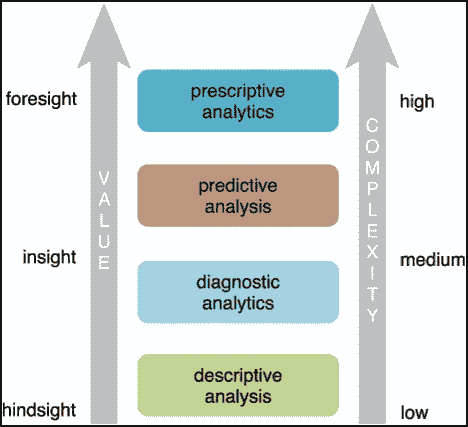

来源：(Erl et al. 2015)

描述性分析旨在回答有关过去事件的询问。这种分析通过将数据置于语境中来生成信息。描述性分析通常通过临时报告或仪表板执行。报告主要由以数据网格或图形形式呈现的静态信息组成，用于说明历史数据。基于企业的查询在运营数据存储库上执行。

诊断性分析的目标是通过聚焦于事件原因的询查，确定过去现象的根本原因。这种分析的目标是确定与现象相关的信息，以回答旨在查明发生原因的问题。虽然诊断性分析比描述性分析更有用，但也要求更复杂的技能组合。通常，诊断性分析需要从各种来源获取数据，并将其存储在便于下钻和上卷分析的格式中。诊断性分析的结果通过便于检测趋势和模式的交互式可视化技术交付给用户。


## 大数据中的预测分析与规范分析

### 预测分析

预测分析的实施旨在确定未来事件的潜在结果。预测分析通过赋予信息以意义来生成知识，从而阐明所述信息的相互关系。基于过去的事件以及关联的强度和程度，构建预测模型以生成未来结果。预测分析通过识别当前和历史数据中的模式、趋势和异常，致力于预测事件的后果。这可能导致潜在机会和风险的识别。

### 规范分析

规范分析通过提供可操作的建议，延伸了通过预测分析获得的洞见。其重点不仅在于最优的建议行动方案，还在于其背后的根本理由。简单来说，规范分析生成的结果可通过推理进行辩护，因为它们融合了态势感知的组成部分。因此，人们可以利用这种分析形式来获取优势或降低风险。规范分析是最有价值的分析形式；因此，它要求最复杂的技能组合，此外还需要专业的软件和工具。

## 近期的大数据分析工具与技术

为了应对现代技术产生的数据洪流，BDA 方法和技术已取得长足进步。以下列出了一些工具和技术（Srivastav, 2019; Arya, 2017; Rassam, 2017; Raju, 2016; Quinto, 2018）：

*   **Hadoop**：`Hadoop` 由 Apache 开发，是一个用于在分布式计算环境中存储和分析海量信息的免费开源平台。其两个主要部分是用于存储数据的 `Hadoop Distributed File System (HDFS)` 和用于处理该数据的 `Map Reduce` 编程模型。
*   **Spark**：`Apache Spark` 提供内存数据处理能力，是一个快速的通用集群计算系统。它提供的应用仅举几例就包括批处理、图处理、机器学习和实时流处理。
*   **NoSQL 数据库**：`NoSQL` 数据库（如 `Cassandra`、`Couchbase` 和 `MongoDB`）可轻松管理海量的半结构化或非结构化数据。由于其灵活性和可扩展性，它们非常适合大数据分析应用。
*   **Apache Kafka**：`Apache Kafka` 是一个分布式流式平台，是开发流式应用和实时数据管道的热门工具。它使得在海量数据流被摄取后能够对其进行实时分析。
*   **Apache Flink**：借助 `Apache Flink` 这一流处理框架，可对连续数据流进行低延迟、高吞吐量的处理。它支持有状态计算、精确一次语义和事件时间处理。
*   **Apache Hive**：`Apache Hive` 是一个基于 `Hadoop` 的数据仓库引擎，允许用户使用类 `SQL` 的接口查询和分析存储在 `Hadoop Distributed File System (HDFS)` 中的海量数据集。
*   **Apache HBase**：`Apache HBase` 是一个基于 `Hadoop` 的 `NoSQL` 数据库，具有分布式、可扩展和一致性的特点。凭借对 `HDFS` 数据的随机读/写访问，它能轻松管理包含数十亿行的海量表。
*   **Apache Storm**：对于连续数据流的处理和分析，可使用 `Apache Storm` 这一分布式实时流处理系统。它有助于以最低延迟处理数据，并具备容错能力。
*   **Apache Drill**：`Apache Drill` 促进了对来自 `Hadoop`、`NoSQL` 数据库和云存储等众多数据源的海量数据集进行交互式分析。`Drill` 是一个分布式 `SQL` 查询引擎。
*   **机器学习库**：`Tensor Flow`、`scikit-learn` 和 `PyTorch` 等库为在大数据集上创建和部署机器学习模型提供了强大工具。这些库与 `Spark` 及其他大数据 (`BD`) 系统兼容，支持分布式推理和训练。
*   **数据可视化工具**：`Tableau`、`Power BI` 和 `Apache Super Set` 只是数据可视化工具的几个例子，它们允许用户构建交互式仪表板和可视化图表，以在海量数据集中发现并共享洞见。

## 网络安全中对大数据分析的需求

采用 BDA 有着广泛的理由，包括其提供的增强业务分析的新方法。现有的安全技术并不完全安全，且无法识别威胁、欺诈或网络攻击。目前有许多大数据分析 (`BDA`) 框架和工具可用，可用于在海量数据中将模式识别为异常活动。通过聚类、数据可视化和异常值检测等广泛的 `ML` 方法，更容易发现大数据中的关联（Mahmood, 2013; Apurva, 2017; Rajsekhar, 2018; Alpana, 2021; Srivastava, 2019; Suraj, 2018; Rawat,2021）。

BDA 已被积极研究并应用于各个业务领域，随着网络日益复杂和威胁日益先进，大数据在网络安全中的力量正逐渐显现。大数据倾向于掩盖真实的威胁图景，在这方面，网络安全被认为是特别关键的领域，甚至可以说是最关键的关键领域。

## 大数据分析在检测网络犯罪中的应用

网络犯罪的检测和预防高度依赖 `BDA`，它帮助企业从各种来源收集、评估海量数据并得出结论。以下是大数据分析在网络犯罪检测中的一些应用示例（Mahmood, 2013; Apurva, 2017; Rajsekhar, 2018; Alpana, 2021; Srivastava, 2019; Suraj, 2018; Arya, 2017; Rassam, 2017; Rawat,2021; Alani,2021; Angin, 2019）：

*   **异常检测**：大数据分析算法可分析网络流量、系统日志和用户活动数据以检测异常，这些异常可能是网络攻击的迹象。如果企业建立基线行为模式并监控偏离这些模式的变化，就能更快地发现安全问题。
*   **网络攻击趋势与模式识别**：机器学习、数据挖掘 (`DM`) 和其他大数据分析工具可以识别网络攻击策略和战术中的趋势和模式。组织可通过回顾过去的攻击数据并寻找趋势，提高预见和应对网络攻击的能力。
*   **行为分析**：通过使用 `BDA`，企业可分析用户行为并发现可疑模式，如非法访问尝试、数据渗出或权限提升。通过跨多个平台和应用跟踪用户活动，可检测出公司内部威胁和被攻陷的账户。
*   **威胁情报整合**：为了发现新的漏洞和威胁，`BDA` 系统可摄取并处理来自多种来源的数据，如威胁情报源和暗网。组织可通过将内部安全数据与外部威胁信息进行比对以检测渗透迹象，从而主动防御和保护自己免受网络攻击。


### 事件关联
为了发现潜在的安全问题，大数据分析技术可以关联来自多个来源的安全警报和事件，包括防火墙、入侵检测系统和端点安全解决方案。通过整合和关联来自多个来源的数据，组织可以改进响应工作的优先级排序并减少误报。

### 取证调查
通过检查海量的日志数据、网络流量和系统工件，大数据分析使企业能够对安全事件进行取证调查。企业为调查和法律行动做准备的最佳方式是重现攻击场景并确定导致安全漏洞的原因。

### 实时监控与响应
借助 BDA 系统的实时监控和分析能力，组织可以实时识别网络威胁并做出反应。为了防止安全问题恶化，企业可以使用流处理和实时分析。

### 预测性分析
将 BDA 应用于预测性分析，可以利用模式和历史数据来预测未来的网络危险和漏洞。网络威胁缓解措施可以按优先级排序，未来的攻击场景可以被预测，从而使企业能够采取主动防御立场。

大数据分析用于检测各种网络攻击，如恶意软件感染、网络钓鱼攻击、DoS 和 DDoS 攻击、内部威胁、勒索软件攻击、SQL 注入攻击、暴力破解攻击、零日攻击、加密劫持攻击、社会工程学攻击等。大数据分析使企业能够分析海量数据、发现趋势和异常、整合威胁情报、进行取证分析并实时响应安全事件，所有这些都对网络犯罪的检测有重要贡献。组织可以通过利用大数据分析的力量来强化其网络安全防御，保护自己免受各种网络威胁。

## 相关工作
大规模数据的实时分析对于网络安全（CS）而言始终是一个重大问题。多年来，针对该问题已开展了大量研究。本节讨论了迄今为止关于 BDA 开展的不同研究。


This paper emphasizes the problems faced by the cybersecurity domain in the context of big data (Mahmood & Afzal, 2013). The authors argue that security analytics—i.e., using big data analytics techniques to extract valuable information from streams in real-time—is becoming an increasingly important requirement for cybersecurity systems. This paper thoroughly examines the state of the art of security analytics, including its description, tools, techniques, and trends, aiming to convince the reader that analytics will soon become the supreme cybersecurity solution.

The literature (Apurva et al., 2017) delves into architecture, cybercrime categorization, and big data analytics methods used to investigate the salient features of big data. It also covers various types of analytics, the rise of big data analytics, and the most useful algorithms that could potentially solve cybercrime problems through targeted analytics. Furthermore, it discusses the growing difficulties faced by cybersecurity, the process of leveraging data analytics, and the specific key elements that should be considered when extracting potentially useful information from big data. This information promises to be of great help to the cybersecurity domain.

The literature (Rajsekhar & Pawan, 2018) highlights the cutting-edge difficulties faced by the cybersecurity industry in the context of big data. The authors demonstrate that security analytics—i.e., using big data analytics methodologies to extract actionable knowledge and insights from streams in real-time—is becoming an increasingly critical necessity for cybersecurity systems. This paper thoroughly examines the state of the art of security analytics, including its definition, techniques, trends, and tools, aiming to convince the reader that analytics will soon become the superior cybersecurity solution.

The literature (Alpana, 2021) highlights some applications of big data technology in cybersecurity in the digital age. It proposes a theoretical framework based on the TAM model, stating that the deployment of big data technology in cybersecurity depends on its ease of use and usefulness. A qualitative research method is subsequently adopted to evaluate materials from credible sources.

The literature (Srivastava & Umesh, 2019) examines the significance of big data, various definitions of big data security and privacy, the value of secured big data analytics, various obstacles in BDA, and privacy concerns in BDA.

The literature (Suraj et al., 2018) examines various types of attacks on big data, its storage mechanisms, and real-time analytics methods. The study also covers various social network attacks.

The literature (Arya & Dayanand, 2017) examines the significance of big data and cybersecurity, various big data technologies, and the utility of big data analytics in the cybersecurity domain.

The literature (Rassam et al., 2017) examines traditional systems/techniques and Security Information and Event Management Tools (`SIEMT`), arguing their inadequacy in addressing advanced sophisticated threats and massive data volumes. It also delves into the prerequisites for the successful implementation of big data analytics and cyber threat intelligence in the cybersecurity domain to counter sophisticated threats and high data volumes. Furthermore, it highlights obstacles arising from the adoption of this technology and provides some recommendations for future research to overcome these obstacles.

The literature (He et al., 2019) discusses the retrieval of papers related to big data cyber applications using third-party databases. Subsequently, using `Citespace` and other bibliometric methods, a co-citation analysis and co-word analysis of these papers were conducted. The survey indicates that big data technology is widely used in cyberspace, and its scope and complexity of implementation are expanding every year.

The literature (Rawat et al., 2021) examines current research work in the cybersecurity domain in the context of big data. It also highlights measures to secure big data and its potential as a cybersecurity tool. The document briefly summarizes current research findings in tabular form, highlighting emerging patterns, unresolved research questions, and issues requiring further investigation. It aims to provide the reader with a comprehensive understanding of cybersecurity in the big data era, covering the latest research trends and unresolved puzzles in this dynamic field.

The literature (Alani, 2021) comprehensively evaluates the application of BDA in developing, upgrading, or countering cybersecurity systems. It examines cutting-edge research on various applications of big data in cybersecurity. Applications are categorized into anomaly detection and intrusion, malware detection, spam and deception detection, ransomware detection, cloud security, code security, and another category investigating other research directions in big data and cybersecurity.

The literature (Angin et al., 2019) explores the significance of big data and cybersecurity, as well as the significance of BDA in the cybersecurity domain, asserting that the demand for BDA will inevitably increase in the future.

The literature (Romil et al., 2023) indicates that evolving challenges and risks facing big data security have rendered traditional approaches obsolete, calling for a new intelligent framework to address the issue. The authors conduct a comprehensive examination of the big data protection literature review domain to better grasp the current state. Using Machine Learning (`ML`) methods, they propose an integrated solution for large-scale data encryption.

The literature (Nwobodo, 2024) explores the necessity of improving cybersecurity measures to protect sensitive data and safeguard the reliability of digital infrastructure in an era defined by massive data generation and advanced analytics methods. The paper also concludes that in the era of big data and sophisticated analytics, better cybersecurity policies are needed to protect critical digital assets and maintain trust in digital ecosystems. To mitigate cyber risks and fully leverage big data for sustained growth and innovation, enterprises should implement data governance frameworks and use state-of-the-art analytics tools.

The literature (Tank & Chaubey, 2020) investigates cybersecurity risks and solutions in the context of cloud computing from a virtualization perspective. The authors also introduce the creation process of a `Flush+Flush` cache attack detection method based on its unique virtualization environment.

The literature (Jani & Chaubey, 2020) acquires a basic understanding of the Internet of Things (`IoT`), identifies various types of risks that may invade IoT systems, and takes measures to limit the impact of such attacks.

Table 1 presents a comparison of the application of BDA in the cybersecurity domain. The papers are compared based on the following three factors:

*   Paper objective
*   Challenges faced by BDA
*   Future rating of BDA application in cybersecurity

#### Table 1. Comparison of BDA Usage in Cybersecurity


## 文献综述表

| Paper | Purpose | Challenges with BDA | Future Scope of Using BDA in Cyber Security |
| --- | --- | --- | --- |
| (Rawat et al., 2021) | 探索当前关于大数据的网络安全研究。同时也讨论了大数据是如何被保护的，以及它如何被用作网络安全工具。 | 1. 将大数据作为安全工具采纳。<br>2. 大数据法规。<br>3. 去中心化和上下文感知的数据存储。<br>4. 使用人工智能。<br>5. 大数据时代安全技术的可扩展性。 | 可以在 BDA 中加入更多加密方法和访问控制，以改进网络安全。 |
| (Alani, 2021) | 全面评估大数据分析如何被用于开发、改进或挑战网络安全系统。还回顾了大数据在网络安全中应用的当前研究。 | | 未来的网络安全系统将严重依赖分析海量数据来识别和防止不良行为。利用大数据进行网络安全应用的潜在研究方向包括检测入侵和异常，包括恶意软件和勒索软件。网络安全应用包括代码安全、云安全、欺骗、垃圾邮件和网络钓鱼。 |
| (Alpana, 2021) | 利用 TAM 模型，研究确定大数据技术在网络安全中的适用性取决于其效用和使用情况。 | TAM 范式仅限于大数据技术在当代网络安全中的应用。 | 主要重点应放在识别与大数据技术进步相关的未来影响上。 |
| (Srivastava & Umesh, 2019) | 大数据分析旨在建立一个安全环境以促进未经授权的访问。 | 1. 数据来源地。<br>2. 大数据安全存量<br>3. 基础人机交互。<br>4. 与大数据相关的信息安全问题。<br>5. 保密性。 | |
| (Angin et al., 2019) | 为了快速评估来自多个来源的海量数据以识别攻击模式和异常值，大数据分析对于使系统更具弹性、更不易受攻击至关重要。 | | 未来对云计算安全中 BDA 的需求将增长。 |
| (He et al., 2019) | 搜索第三方数据库中关于大数据在网络空间应用的研究。 | | 除了网络安全，共词分析还能开启新的前沿研究领域，如能源管理中的 BDA、边缘计算和大数据分析。 |
| (Rajsekhar & Pawan, 2018) | 这包括安全分析，以及考虑到大数据的网络安全领域面临的问题。 | | 使用安全分析方法分析网络相关数据集，以降低非法交易预测模型中的误报数量。 |
| (Suraj et al., 2018) | 讨论了针对大数据的各种网络安全攻击、其存储/保存机制以及实时分析方法。 | 社交网络数据量巨大且易受基于图的威胁。 | 最小化数据中的噪声可减少信息损失。 |
| (Apurva et al., 2017) | 为了打击网络犯罪分子并保护无辜平民的福祉，将利用大数据分析。 | 1. 解决方案昂贵。<br>2. 熟练工人不易获得。<br>3. 数据集成是一个挑战。<br>4. 处理传入数据。 | 通过使用 BDA 技术有效提取潜在的大数据信息，可以在网络安全领域取得重大进展。 |
| (Arya & Dayanand, 2017) | 面向安全的 BDA 旨在获取可立即采取行动的情报。 | 1. 某些组织可能缺乏数据驱动的方法。<br>2. 企业可能将 BDA 视为从数据中产生价值的方法。<br>3. 用户和分析团队在整个分析过程中协作，从范围定义开始，贯穿数据提取和恢复。<br>4. 管理层对分析结果的信心可能受到损害。 | 1. 发掘隐藏洞察。<br>2. 更好的决策制定。<br>3. 实施业务流程自动化。 |
| (Rassam et al., 2017) | 实施大数据分析解决方案已成为缓解与大数据相关的复杂风险的当务之急。 | 1. 管理非结构化数据。<br>2. 实时分析。<br>3. 数据流分析。<br>4. 数据保护。<br>5. 数据溯源。<br>6. 可视化分析。<br>7. 适应性。 | 1. 大数据安全与隐私。<br>2. 行为分析<br>3. 可视化<br>4. 物联网 |
| (Mahmood & Afzal, 2013) | 除了强调考虑到大数据的网络安全行业面临的前沿挑战外，该文还展示了安全分析。 | | 在网络相关数据集上实施安全分析方法，旨在减少非法交易预测模型中误报的发生。 |

## 结论

随着社交媒体用户数量的快速增长，网络欺诈的发生率也随之上升。为了在网络攻击者之前保持领先，BDA 技术将在检测、预防和缓解网络犯罪方面发挥关键作用。各种形式的大数据分析（BDA）已被证明在理解趋势、发掘新型漏洞和威胁方面行之有效。尽管在网络安全中使用大数据分析（BDA）面临诸多挑战，但它具有巨大的未来增长和发展潜力。

## 参考文献

Alani, M. M. (2021). Big Data in cybersecurity: A survey of applications and future trends. Journal of Reliable Intelligent Environments, 7(2), 85–114. DOI: [`10.1007/s40860-020-00120-3`](http://dx.doi.org/10.1007/s40860-020-00120-3)

Alpana, S. (2021). Big Data Technologies for Cyber Security in the Digital Era. Social Science Research Network. DOI: [`10.2139/ssrn.4629044`](http://dx.doi.org/10.2139/ssrn.4629044)

Angin, P., Bhargava, B., & Ranchal, R. (2019). Big Data Analytics for Cyber Security. Security and Communication Networks, 1–2, 1–2. Advance online publication. DOI: [`10.1155/2019/4109836`](http://dx.doi.org/10.1155/2019/4109836)

Aviral Apurva, Pranshu Ranakoti, Yadav, S., Tomer, S., & Nihar Ranjan Roy. (2017). Redefining cyber security with big data analytics. DOI: [`10.1109/IC3TSN.2017.8284476`](http://dx.doi.org/10.1109/IC3TSN.2017.8284476)

Arya, D. (2017). Big data Analytics in Cyber Security. International Journal of Engineering Research & Technology (Ahmedabad), 5(10).

Buyuaa, R., & Calheiros, R. N. (2016). Big Data Principles and Paradigms (1st ed.). Elsevier.

Cases of Cyber Frauds. (2024). Pib.gov.in. [`https://pib.gov.in/PressReleaseIframePage.aspx?PRID=2003158`](https://pib.gov.in/PressReleaseIframePage.aspx?PRID=2003158)

Erl, T., Khattak, W., & Buhler, P. (2015). Big data fundamentals: Concepts, drivers & techniques. Prentice Hall.

He, J., Xian, M., & Liu, J. (2019). The Application of big Data in cyberspace: A Survey. In International Conference on Communications, Information System and Computer Engineering e (pp. 570–574). IEEE Xplore. DOI: [`10.1109/CISCE.2019.00132`](http://dx.doi.org/10.1109/CISCE.2019.00132)

Hurwitz, J. Alan Nugent, & Dr. Fern Halper. (2013). Big Data For Dummies (1st ed.). Wiley.


## 参考文献

Jani, K. A., & Chaubey, N. (2020). IoT and Cyber Security: Introduction, Attacks, and Preventive Steps. In Chaubey, N., & Prajapati, B. (Eds.), *Quantum Cryptography and the Future of Cyber Security* (pp. 203–235). IGI Global. DOI: [`10.4018/978-1-7998-2253-0.ch010`](http://dx.doi.org/10.4018/978-1-7998-2253-0.ch010)

Kemp, S. (2024, February 20). Digital 2024: India — DataReportal – Global Digital Insights. *DataReportal – Global Digital Insights*. [`https://datareportal.com/reports/digital-2024-india`](https://datareportal.com/reports/digital-2024-india#:~:text=The%20state%20of%20digital%20in%20India%20in%202024&text=There%20were%20751.5%20million%20internet,percent%20of%20the%20total%20population)

M. V., Nikhil Kumar Singh, & Deepak Singh Tomar. (2018). Big data Analytics of cyber attacks: a review. *2018 IEEE International Conference on System, Computation, Automation and Networking (ICSCA)*. DOI: [`10.1109/ICSCAN.2018.8541263`](http://dx.doi.org/10.1109/ICSCAN.2018.8541263)

Mahmood, T., & Afzal, U. (2013). Security Analytics: Big Data Analytics for cybersecurity: A review of trends, techniques and tools. *2013 2nd National Conference on Information Assurance (NCIA)*. DOI: [`10.1109/NCIA.2013.6725337`](http://dx.doi.org/10.1109/NCIA.2013.6725337)

Nwobodo, N. L. K., Nwaimo, N. C. S., & Adegbola, N. E. (2024). Enhancing cybersecurity protocols in the era of big data and advanced analytics. *GSC Advanced Research and Reviews*, 19(3), 203–214. DOI: [`10.30574/gscarr.2024.19.3.0211`](http://dx.doi.org/10.30574/gscarr.2024.19.3.0211)

Quinto, B. (2018, June 12). *Next-Generation Big Data*. Apress. [`http://books.google.ie/books?id=teZfDwAAQBAJ`](http://books.google.ie/books?id=teZfDwAAQBAJ&printsec=frontcover&dq=Next-Generation+Big+Data&hl=&cd=1&source=gbs_api)

Rao, N. R., & Pandey, P. K. (2018). Security Analytics: Big Data Analytics for Cybersecurity A Review of Trends, Techniques and Tools. *IJCRT*, 6(1), 579-584. [`https://www.ijcrt.org/papers/IJCRT1802412.pdf`](https://www.ijcrt.org/papers/IJCRT1802412.pdf)

Rassam, & Maarof, M. (2017). Big Data Analytics Adoption for Cybersecurity: A Review of Current Solutions, Requirements, Challenges and Trends. *Journal of Information Assurance and Security*, 11, 124–145. [`https://mirlabs.org/jias/secured/Volume12-Issue4/Paper14.pdf`](https://mirlabs.org/jias/secured/Volume12-Issue4/Paper14.pdf)

Rawat, D. B., Doku, R., & Garuba, M. (2021). Cybersecurity in big data era: From securing big data to data-driven security. *IEEE Transactions on Services Computing*, 14(6), 2055–2072. DOI: [`10.1109/TSC.2019.2907247`](http://dx.doi.org/10.1109/TSC.2019.2907247)

Rawat, R., Oki, O. A., Sankaran, K. S., Olasupo, O., Ebong, G. N., & Ajagbe, S. A. (2023). A new solution for cyber security in big data using machine learning approach. In *Lecture notes on data engineering and communications technologies* (pp. 495–505). DOI: [`10.1007/978-981-99-0835-6_35`](http://dx.doi.org/10.1007/978-981-99-0835-6_35)

Srivastava, N., & Chandra Jaiswal, U. (2019). Big Data Analytics Technique in Cyber Security. *RE:view*, 579–585. Advance online publication. DOI: [`10.1109/ICCMC.2019.8819634`](http://dx.doi.org/10.1109/ICCMC.2019.8819634)

Tank, D. M., Aggarwal, A., & Chaubey, N. K. (2020). Cyber Security Aspects of Virtualization in Cloud Computing Environments: Analyzing Virtualization-Specific Cyber Security Risks. In Chaubey, N., & Prajapati, B. (Eds.), *Quantum Cryptography and the Future of Cyber Security* (pp. 283–299). IGI Global. DOI: [`10.4018/978-1-7998-2253-0.ch013`](http://dx.doi.org/10.4018/978-1-7998-2253-0.ch013)

West, C., & West, C. (2024, April 26). 50+ Must-know social media marketing statistics for 2024. *Sprout Social*. [`https://sproutsocial.com/insights/social-media-statistics/`](https://sproutsocial.com/insights/social-media-statistics/)

[`https://towardsdatascience.com/do-you-really-need-to-implement-big-datatechnologies-in-your-ecosystem-ea840a3cf286`](https://towardsdatascience.com/do-you-really-need-to-implement-big-datatechnologies-in-your-ecosystem-ea840a3cf286)

# 第 3 章：区块链在网络安全中的应用

**Akhil John Mampilly**  
  
林肯大学学院，马来西亚

**Vijaya Kittu Manda**  
  
PBMEIT，印度

**Chithirai Pon Selvan Muthu Perumal**  
  
科廷大学，迪拜，阿联酋

## 摘要

区块链是一项极具前景的技术，可帮助组织改善其网络安全。区块链拥有许多固有特性，有助于增强数据安全、改进威胁检测与响应、强化身份认证与授权，并增强网络威胁情报共享。之所以能实现这一点，是因为区块链采用了创新方法，例如利用不可篡改的账本存储交易、监控资产，并通过仅向授权参与者提供访问权限来建立信任。本章讨论了与智能合约、密钥管理、网络安全、用户教育与意识、事件报告、隐私挑战、软件更新和去中心化相关的网络安全最佳实践。还讨论了关键的法规合规性方面，例如 `GDPR` 和 `HIPAA`。人工智能（`AI`）、机器学习（`ML`）和物联网（`IoT`）与区块链日益增加的交互，可进一步提供改进的网络安全服务，因此构成了本章趋势与潜在未来研究部分的讨论内容。

## 引言

由于多种原因，网络安全现在比以往任何时候都更加关键。数字化程度和互联网连接的不断提高、网络威胁形势的演变、对技术的过度依赖、数据价值的日益增长、国家支持的网络攻击、网络犯罪即服务的出现，以及缺乏网络安全意识，可能是造成这一现象的关键原因。考虑到这些原因，组织，尤其是大型企业，正在投入大量资源来保护其数据、系统和基础设施，以改善其网络安全措施。全球网络安全市场预计将经历显著增长，从 2021 年估计的 1904 亿美元扩大至 2028 年预计的 2985 亿美元，在预测期内的复合年增长率（`CAGR`）为 9.4%（Markets & Markets, 2024）。个人也越来越重视网络安全，并采取主动措施保护其数据和设备。

区块链等新兴技术为构建可靠且网络安全的基础设施提供了革命性方法，帮助组织实现韧性。区块链因其固有特性而闻名，为增强数字安全提供了坚实基础。德勤的一项调查发现，大多数受访者（58%）表示，网络安全是影响其整体区块链或数字资产相关战略的几个问题之一（Deloitte, 2020）。根据另一项调查，基于区块链的安全信息交换是 45%受访者的首要用例（Deloitte, 2021）。

## 章节大纲


## 简介

本章的“简介”部分设定了背景，并阐述了区块链在网络安全中日益重要的地位。随后，简短的“文献综述”介绍了该技术，并解释了其内置特性如何提供安全性。接着，“面向企业的区块链安全”部分强调了企业拥抱并适应技术进步的必要性。然后，“区块链在网络安全中的优势”部分解释了该技术在构建和维护安全网络安全基础设施方面的优势。随后是“网络安全最佳实践”部分，阐述了一些具有实际重要性的、经过行业验证的最佳实践。“区块链安全考量”和“合规监管”部分讨论了区块链实施中需考量的各个方面，以及从主要监管视角出发的合规监管需求。最后，“未来趋势与挑战”讨论了可为未来研究提供指引的趋势与挑战。

## 文献综述

基于区块链的数字服务面临来自法规（`GDPR`）、勒索软件防御、供应链攻击以及与数据存储相关的可扩展性问题的挑战（Wylde 等，2022）。

### 区块链的基本概念

构建稳健的合规网络安全应用需要对底层技术有基本的了解，在本例中即区块链技术。本节深入概述了区块链的架构，标志着去中心化、加密哈希的必要性，以及不可篡改性和透明度标准，这些特性将区块链确立为一项革命性技术。

### 区块链架构与核心原则

去中心化是区块链所提供功能的核心。这一特性有助于将数据存储在区块中。出于优化原因，每个区块会等待足够的数据，并打包大量数据（例如打包多笔交易），然后才完成区块并将其广播到区块链网络。这种架构不同于传统的中心化系统。如图 1 所示，典型的区块链区块包含一个区块头（带有时间戳）、要存储的实际数据（例如一组或一批交易）以及前一个区块的加密哈希值。区块相互连接形成一条链。网络参与者（称为节点）验证区块。节点确保数据不可变且无法被篡改（Tripathi 等，2023）。

### 图 1. 区块链中的区块结构

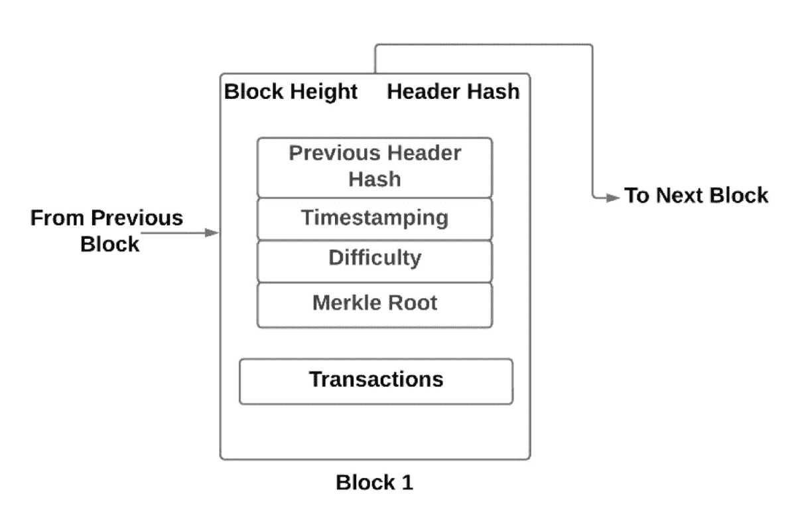

来源：(Tripathi 等，2023)

加密通常使用两种类型的密钥——公钥和私钥。这些密钥有助于在区块链网络中的节点之间实现安全通信。公钥通常用于生成地址，地址是发送和接收资金的唯一标识符。私钥用于批准并对交易进行数字签名。

例如，假设 A 方想向 B 方发送 1 个比特币（`BTC`）。A 方使用其私钥对一笔交易进行签名，指定接收方地址和他想要发送的 `BTC` 数量。A 方签署交易后，该交易会被广播到比特币网络。网络随后验证该交易并将其添加到区块链账本中。一旦添加，即被视为永久性记录，无法撤销。因此，当一个人想要创建加密货币交易时，他会使用私钥对交易进行签名。这证明了资金所有者已授权该交易，且该交易将分发给网络中的所有节点。

矿工（指网络节点组）将这些交易打包进一个区块并加上时间戳。然后使用共识机制挖掘该区块，并将其集成到网络中。图 2 展示了区块链的工作流程。

### 图 2. 区块链网络的工作流程

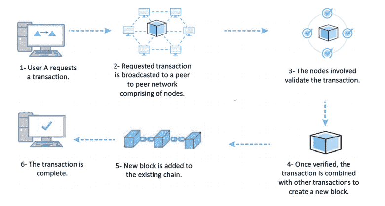

来源：(Sami Berkani 等，2023)

### 共识协议

共识协议是在分布式网络中运行的算法。这些算法帮助所有节点达成一致，达到共同的状态或决策。这对去中心化进程至关重要，主要有三个原因：

*   确保数据完整性并防止双重支付，这在加密货币相关实现中至关重要。
*   维护分布式数据库的一致性。
*   实现多个节点之间的可靠通信与协调。

节点是实施共识协议的关键组件。节点可以向区块链添加新数据，同时保持先前数据不变。节点确保区块链保持安全、加密、一致且最新，并为进一步研究提供支持。此外，它们验证交易，确保一切井然有序（Kaur 等，2021）。尽管约有 58 种共识算法在运行（Singh 等，2022），但表 1 列举了著名共识协议及其节点机制的概况。表 2 展示了节点扮演的各种角色。研究表明，共识协议对于维护区块链的完整性和安全性至关重要。长期未升级或未优化的旧版本算法将成为瓶颈，导致高延迟，正如在公共区块链网络中所见。这阻碍了应用在实时环境中的部署（Taylor 等，2020）。多项研究（Xiao 等，2020；Kaur & Gupta，2021；Oyinloye 等，2021；Singh 等，2022；Xu 等，2023）致力于共识协议、其优化以及寻找合适的替代方案。

### 表 1. 共识协议及其机制

| 共识协议名称 | 节点机制 |
| --- | --- |
| 工作量证明（`PoW`） | 节点相互竞争以解决复杂的数学问题。获胜节点将获得授权交易并在区块链中创建新区块的权力。 |
| 权益证明（`PoS`） | 节点根据需求用于验证交易和创建新区块。然而，这一权力是基于其持有的加密货币数量授予的。 |
| 实用拜占庭容错（`PBFT`） | 它使用固定数量的节点达成一致。即使发现某些节点是恶意的或已失效，节点仍会被选中。 |
| `Raft` | 一种无领导者的共识协议，利用大多数节点达成共识。 |
| `Paxos` | 一种为分布式系统设计的共识协议，其中节点可能失效或经历延迟。 |
| 委托权益证明（`DPoS`） | 只有少数节点通过投票过程被选为验证者，并拥有更高的机会获得添加节点的权力。 |


### 权威证明

节点/验证者通常由网络创建者预先选定。这些验证者通常是受信任的社区成员，如大型企业或组织。

#### 表 2. 区块链达成共识的典型节点角色

| 角色 | 描述 |
| --- | --- |
| 提议者 | 通过提出新状态或决策来启动共识过程。 |
| 接受者 | 评估提议并接受或拒绝它。 |
| 领导者 | 协调共识过程并确保所有节点就提议的状态或决策达成一致。 |
| 跟随者 | 通过向其他节点发送投票或消息来参与共识过程。 |
| 验证者 | 验证提议状态或决策的有效性。 |

区块链系统凭借其透明性和可追溯性特性建立了对系统的信任。由于有序链式存储机制，存储在区块中的交易数据可以使用时间戳进行追溯。哈希、数字签名、分布式共识协议和去中心化架构有助于增强安全性（Zheng et al., 2018）。数字签名提供了一种安全的方式来验证参与交易各方的身份。分布式共识协议致力于使所有节点就总账本的当前状态达成一致。

### 去中心化与网络安全

**去中心化治理与安全：** 去中心化、真实性、一致性和假名性是区块链的核心特征（Schlatt et al., 2023）。这些特征增强了现有安全网络的安全强度。由于去中心化架构，数据副本分布在各个节点上。这使得数据篡改比现有解决方案困难得多（或不可能）。采用传统机制存储的数据容易被攻破，因为它们依赖单一受信机构进行验证和存储加密数据（Taylor et al., 2020）。这一特性有助于数字证书管理的网络安全背景，从而提高在线交易和通信的安全性。然而，尽管有这些增强，应注意到这些只能部分替代现有的网络安全解决方案。

**免疫 DDoS 攻击：** 区块链的去中心化特性和存储主要是公开的，且能抵御分布式拒绝服务（DDoS）攻击。DDoS 攻击的性质是通过洪水般的互联网流量来破坏可用服务。传统的 DDoS 攻击难以控制，因为它们来自多个来源。然而，由于分布式架构，不存在单点故障，使区块链网络对 DDoS 攻击具有免疫力（Rodrigues et al., 2017）。此外，区块链交易由网络中的多个节点验证。这使得攻击者很难用虚假交易淹没网络并使系统不堪重负。

以太坊网络在 2017 年曾遭受 DDoS 攻击。然而，攻击未遂，网络能够继续正常运行。这证明了区块链技术对 DDoS 攻击的韧性。

**数据篡改与欺诈：** 传统的中心化数据存储行为产生安全问题，且容易遭受数据篡改。然而，区块链技术防篡改，因为它除了分布式架构外还使用了密码学（Zhang & Chen, 2019）。

**通过去中心化应对网络安全风险：** 区块链技术通过将控制权分发给各个节点，消除了对中央控制的必要性。这增加了透明度和可追溯性，从而增强网络安全并防止数据的未经授权操纵和控制。

### 密码学哈希

区块链技术的基本概念是密码学哈希，它连同其他共识机制一起强化了区块链的强度、完整性和可信度。向区块链添加区块会自动链接到前一个区块，并变得抗篡改。区块链技术的不可变性至关重要，因为它防止未经授权的数据篡改，并阻止威胁行为者尝试更改数据（Adeghe et al., 2024）。区块链中的数字签名验证交易的真实性，并保证数据未被篡改（Uikey et al., 2024）。

区块链技术使用的高级密码算法能耗密集，消耗大量处理能力。大多数现有共识机制能耗密集，导致延迟和成本增加（Adeghe et al., 2024）。

像 `SHA-256` 这样的哈希算法广泛用于区块链技术。它们防篡改并抵御密码学攻击。尽管如此，不断演变的网络威胁要求持续的研究和开发，以开发动态对策（Fernández-Caramés & Fraga-Lamas, 2020）

### 通过不可变性确保数据完整性

区块链为数据存储提供可靠性和准确性，使其成为在多个需要精确决策的领域中的首选技术。不可变性及其防篡改特性使区块链技术相较于其他技术具有差异化优势（S. Zhou et al., 2023）。因此，透明性特性使其成为共享和记录数据的理想选择，特别是在协作环境中。区块相互链接形成一条链。每个区块包含其交易的唯一加密哈希值和前一个区块的哈希值。这种强链式互连实现了不可变性。数据无法在不破坏链的情况下被篡改。这一特性使区块链技术成为一种安全可靠的数据存储方式（L. Zhou et al., 2024）

### 透明度与信任

区块链技术是开创性的网络安全力量，促进透明度、安全性和信任。公有链、私有链和联盟链目前是流行的区块链类型。在公有链中，账本的可见性对所有成员开放，因为每个人都可以查看同一个账本。在联盟链和私有链中，只有群组成员可以查看。使用区块链账本确保数据绝不能被篡改或破坏（Leteane & Ayalew, 2024）。区块链技术因其防篡改、不可变和去中心化的特性，能威慑 DDoS 和 DoS 等网络安全攻击。它无意中促进了网络参与者之间的信任，通过共识机制保护数据（Hasan et al., 2024）

### 面向企业的区块链安全

### 区块链强化数据完整性

包含敏感信息（如密码、身份和关键组织数据）的数据必须始终得到保护，无论处于静止、处理中还是传输中。必须在所有阶段保护此数据免受威胁行为者的未经授权的更改或篡改。因此，维护数据完整性是一项必要且复杂的工作。凭借其不可变账本和安全交易，区块链技术是一个全面的解决方案，在加强安全性和隐私的同时维护数据完整性。


区块链仅允许添加数据。一旦成功添加，若无参与者共识，数据无法被移除、删除或修改。这是因为区块链中的每个区块都包含前一个区块的哈希值。因此，区块链在密码学上是相互关联的。试图修改一个区块将需要修改所有后续区块，这在计算上是不可行的。区块链的这一特性被称为**不可变性**，适用于数据完整性和安全性至关重要的场景。它有助于组织简化决策流程，并提升信任度与透明度。区块链的加密特性增强了数据完整性。其与进一步网络安全措施的集成对于保护信息和确保充分的数据治理至关重要（Salagrama et al., 2023）。

### 身份治理与验证

考虑到每个人都需要数字身份来验证身份、访问资源并领取权威机构提供的福利，身份与访问管理（IAM）变得至关重要。典型示例包括美国的社会安全号码（SSN）、英国的政府网关、新加坡的 SingPass 以及印度的 Aadhaar 卡等唯一身份系统。该系统允许我们：

1.  证明公民身份
2.  进行数字认证
3.  允许公民访问各类服务

研究表明，当前的 IAM 系统缺乏足够的安全措施。现有的系统通常不足以抵御迫在眉睫的网络威胁。这引发了担忧，使其容易遭受身份盗窃和信息滥用。在未经用户明确同意的情况下与外部服务提供商共享数据，引发了对现有同意机制是否充分的质疑。基于区块链的身份管理系统的去中心化特性为应对这些挑战提供了稳健的解决方案。区块链提供了增强的安全性、隐私性和用户控制权，使其成为安全高效管理数字身份的有前景的替代方案（Agarkar et al., 2024）。

### 不可变性与可信度

不可变特性是区块链技术建立信任的基础。该技术提供了引人注目的特性，使用户愿意信任它以创造价值。数据是去中心化的，网络中所有参与者均可追溯。未经串通，数据无法被篡改或转移。这一独特的加密特性使区块链技术值得信赖，并将其与其他传统计算机系统区分开来。区块链的不可变性和透明度增强了对数据可靠性和准确性的信心。不可变性结合区块链技术的防篡改性质，带来了更完善高效的数据管理（Ali et al., 2023）。最重要的是，该系统实现了信任机制，这优于传统的由人工驱动的基于密码的安全系统。这吸引了多种实际应用，如车辆信息系统（Distefano et al., 2021）、电子政务（Ahmad et al., 2021）、区块链交易所和营销领域（Tan & Saraniemi, 2023）等。

### 安全挑战：区块链部署中的缓解措施

典型的区块链因其去中心化能力而被认为是不可变且安全的。然而，隐私、互操作性、可扩展性以及完全符合法律要求等挑战，仍是许多企业关注的问题。虽然区块链技术是透明的，但仍需机制确保特定交易的隐私。区块链中增强的隐私旨在阻止对敏感信息的非法访问和复制。由于其可信度和企业采用的增加，区块链使用量大幅上升。交易数量的激增导致了延迟。可扩展性问题可通过重新设计区块链和优化存储来解决（Joshi et al., 2018）。互操作性在区块链中至关重要，但实现它的知识有限。不同区块链技术间的无缝通信和数据交换对其持续发展至关重要（Belchior et al., 2021）。

### 区块链在网络安全中的优势

### 保护数据

在传统方法中，数据极易被篡改、修改和删除。对数据保护的需求催生了区块链技术，其具有去中心化、不可变和抗漏洞的特性。每个区块链区块包含前一区块的加密哈希值，形成了一条抗篡改的链。图 3 展示了区块链中区块的排列。表 3 列出了将区块链融入网络安全的软件工具和服务。

#### 图 3. 区块链中区块的排列

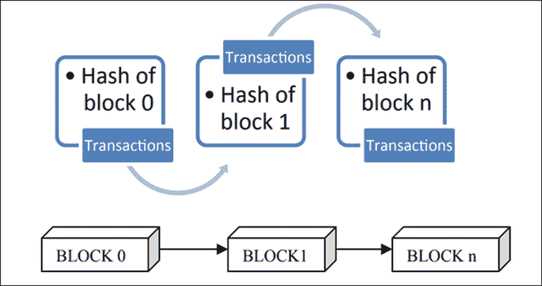

来源：(Fatima et al., 2022)

#### 表 3. 实现了区块链网络安全应用的在线软件和服务

| 软件 | 实施领域 | 简要说明 |
| --- | --- | --- |
| IBM Blockchain Transparent Supply | 数据溯源与认证 | 基于区块链的平台，用于追踪供应链中产品的来源和真实性。 |
| Uport<br>Microsoft Azure Active Directory (AAD) | 身份验证与管理 | 这些去中心化身份验证平台利用区块链存储和管理个人数据。 |
| Chainlink's Threat Intelligence<br>IBM's Blockchain-based Threat Intelligence<br>CyberSponse's Blockchain-based Threat Intelligence | 网络安全威胁情报 | 提供实时威胁数据的基于区块链的威胁情报平台。 |
| Wire<br>Signal<br>Telegram's Blockchain-based Messaging | 安全通信与消息传递 | 这些安全通信平台利用区块链提供端到端加密。 |
| Xage Security | 工业物联网 | 为工业物联网提供区块链保护的安全结构。 |
| REMME | 认证 | 实施基于区块链的认证以取代基于密码的系统。 |
| Guardtime KSI | 基于区块链的时间戳 | 利用区块链进行数据完整性验证和防范内部威胁。 |

去中心化、不可变性、加密方法（Fatima et al., 2022）、身份管理（Liu et al., 2020）和自主身份（Monrat et al., 2019）使系统更加稳健。

### 透明度与可信度

区块链技术运行在无信任框架上，但因其不可变、透明、去中心化的记录和交易而产生信任。与无法盲目信任的传统中心化系统不同，区块链的防篡改性和透明度防止了欺诈交易，从而在用户中建立了信任（Monrat et al., 2019）。

### 数字签名与智能合约


区块链技术使用数字签名来确认身份的真实性和验证。另一方面，智能合约根据预定义条件自动验证签名（Monrat et al., 2019）。

### 安全平台交易

交易区块以公共记录的形式存储在区块链技术中，允许所有网络参与者验证和确认区块。虽然他们可以查看所有交易，但交易无法被篡改或更改，从而使区块链技术安全高效（Monrat et al., 2019）。图 4 解释了区块链上的交易流程。

#### 图 4. 区块链上的交易流程

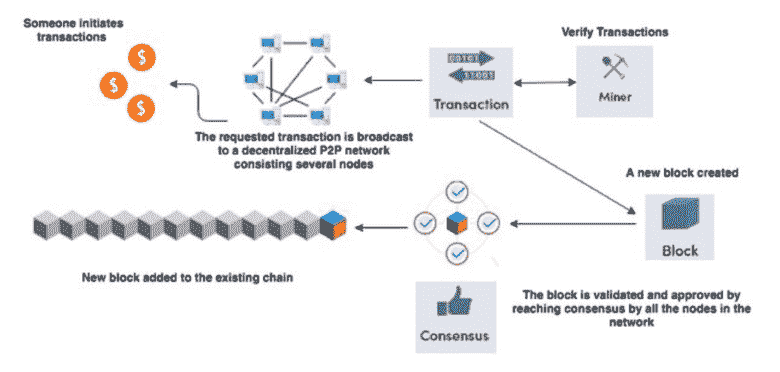

来源：(Monrat et al., 2019)

### 网络安全最佳实践

图 5 列出了系统集成在使区块链网络更加稳健时需考虑的网络安全最佳实践关键领域。

#### 图 5. 网络安全最佳实践关键领域

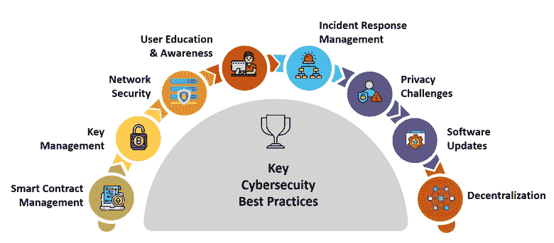

### 智能合约

智能合约是响应各种重大事件的程序。其开发不需要两方或中介机构的直接参与（John et al., 2023）。智能合约通过自动化流程、提高效率和优化成本来增强安全性并彻底改变业务运营（Guo & Yu, 2022）。

### 智能编码标准

随着对应用软件开发需求的不断增长，开发人员正在加快生产环境的部署，这可能会损害安全最佳实践并增加漏洞风险。实施安全编码标准对于减少这些漏洞至关重要。采用标准和既定的行业指南可以显著提高代码质量和安全性（Nath et al., 2023）。

### 密钥管理

#### 私有安全密钥

区块链技术使用公钥基础设施（PKI）（Pal et al., 2021）。授权网络用户使用私钥对数字交易进行签名和验证（Bhushan et al., 2021）。在加密系统中，胜任且安全的密钥管理是必要的（Pal et al., 2021）。

### 密钥轮换

区块链技术中的轮换密钥管理可以缓解多种安全攻击。如果私钥泄露，密钥轮换对于生成新密钥对以增强区块链安全性至关重要。定期轮换密钥有助于确保安全性不被破坏（Park & Nam, 2022）。

#### 多方计算（MPC）

安全多方计算（MPC）技术将密钥的生成和管理分发给各方，以增强隐私并建立信任。安全 MPC 很难被威胁行为者攻破（J. Zhou et al., 2021）。

### 网络安全

#### 共识机制的选择

共识机制的核心工作是验证数据。然而，选择合适的共识机制不仅限于核心工作。该决策影响网络的安全性和可扩展性。选定的共识机制应能抵御双重支付和女巫攻击等攻击。它们是用于认证正在进行的交易和维护网络节点间协议的弹性机制。它们保证网络的安全性、运营连续性和容错性（Lashkari & Musilek, 2021）。

#### 节点安全

区块存储交易数据。区块相互连接形成一条链（Bhushan et al., 2021）。区块链网络中的节点必须验证每个区块中记录的数据未被篡改或更改。保护区块链中的每个节点对于数据的安全性、保密性和完整性至关重要。区块链采用假名身份来保证参与者的安全性和机密性（Idrees et al., 2021）。

### 用户教育与意识

用户教育和意识在预防区块链诈骗、增强区块链基础设施、降低网络安全风险和改进事件报告方面大有裨益。图 6 展示了用户教育和区块链及网络安全意识的重要性。

#### 图 6. 区块链和网络安全的用户教育与意识

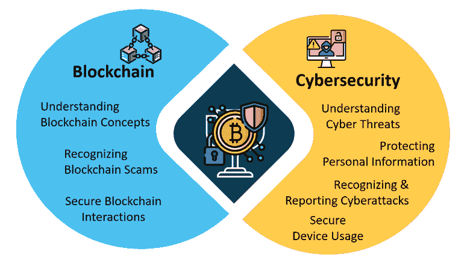

### 用户教育

区块链常被误认为是数字货币。大多数人不知道区块链是比特币等各种数字货币背后的技术实现。区块链在加密货币之外还有多种应用，并被用作多个平台中的技术来执行各种交易。为了获得用户对区块链技术的接受，应采用用户友好且易于访问的策略和解决方案。人们应接受如何安全使用此应用程序的教育，并开展促进他们意识的活动（Ravichandra et al., 2024）。

### 钓鱼和社会工程学意识

钓鱼攻击是一种常见的网络安全威胁，通过电子邮件或网站诱骗用户泄露其凭证。人类往往因侦察或社会工程学而成为钓鱼攻击的受害者。虽然没有万无一失的解决方案来应对此类攻击，但用户必须接受教育并了解预防措施（Andryukhin, 2019）。

### 密码管理

区块链技术必须通过教育用户使用至少 14 个字符的强密码并启用多因素认证（MFA）来增强安全性（Andryukhin, 2019）。

### 定期安全评估

区块链技术中的隐私和安全问题令人担忧且对开发具有挑战性。组织应进行定期评估以发现可能的安全漏洞，并采取措施解决这些风险（Bhutta et al., 2021）。

### 法规合规

组织必须遵守有关合规问题、标准一致性、权利纠纷和日益增长的物联网经济挑战的法律法规（Bhutta et al., 2021）。

### 事件响应管理

### 响应策略


由于区块链技术的采用增加，安全威胁正在激增。区块链工程主要侧重于开发应用程序，而极少关注安全威胁。区块链目前的安全事件报告系统是中心化的，且需要更多结构。实施结构化的事件报告和快速响应机制将限制损害影响，并促进即时响应和恢复。图 7 以去中心化方式描绘了六个步骤中的安全事件报告和及时响应（Putz 等人，2022）。同样，通过追踪恶意软件的传播并识别受感染设备，可以检测和预防恶意软件。

#### 图 7. 事件报告的六步流程

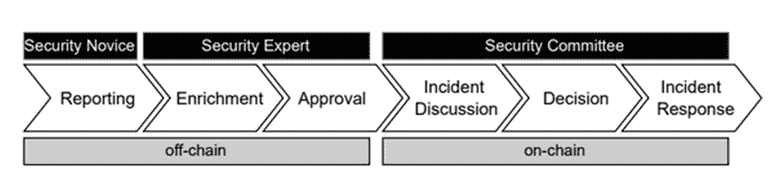

来源：(Putz 等人，2022)

### 隐私挑战与解决方案

### 区块链采用中的隐私保护

区块链技术面临各种可扩展性和隐私挑战，例如 GDPR（通用数据保护条例）带来的挑战。尽管有多种隐私保护解决方案可供实施，但由于担心在公共平台上泄露隐私，组织和个人必须更加开放地采用区块链技术。自主身份（SSI）、零知识证明（ZKPs）和环签名可以隐藏用户的身份和交易。复杂的隐私程序确保了零知识方法在区块链技术中的有效性（Bernabe 等人，2019）。

### 软件更新

### 定期软件更新

及时更新区块链技术软件可确保潜在的未来安全威胁和漏洞得到及时应对和缓解（Lee，2018）。

### 去中心化

### 数据安全

在区块链技术中，数据是去中心化的，并存储在分布在网络中的区块里，从而将数据勒索的影响降至最低。区块链数据防篡改且经过加密，使得威胁行为者无法对其进行操纵（Ismail 等人，2024）。

### 协同网络安全举措

区块链技术用户必须共享威胁情报信息，共同应对威胁，并集体缓解威胁。集体网络安全有助于根除威胁并消除单点故障（Miller 和 Pahl，2024）。

### 区块链安全考量

尽管区块链技术具有去中心化、不可篡改和防篡改的特性，但由于数字化以及组织和个人的日益接受，它仍易受某些安全风险的影响。网络攻击可能给组织造成重大损失，影响其品牌声誉、财务稳定性和技术基础设施（Ibarra 等人，2019）。

### 理解双重支付和 51% 攻击

51% 网络攻击会破坏区块链的完整性，属于高风险类别。威胁行为者可以重写区块链并创建新版本以进行恶意活动，这被称为双重支付攻击。任何持有 51% 算力哈希率的授权用户或矿工都可以恶意执行攻击，篡改网络中的区块链凭证和交易。一些潜在的操纵手段包括：

1.  a. 逆转交易，导致双重支付攻击
2.  b. 篡改或修改交易
3.  c. 干扰其他矿工的操作
4.  d. 阻止交易确认（Apone-Novoa 等人，2021）。

51% 攻击的著名案例包括（Y. Chen 等人，2022）：

*   2018 年 5 月 22 日，Verge 区块链上被盗取数百万匿名币（XVG 代币）。
*   2018 年 5 月 16 日，威胁行为者在 Bitcoin Gold (BTG) 上非法交易 12,239 个比特金。
*   2019 年 1 月 5 日，Ethereum Classic (ETC) 遭受 110 万美元损失。
*   Vertcoin (2019)、Grin (2020)、Expanse (2020)、Litecoin Cash (2020) 和 Firo（前身为 Zcoin）(2021) 也遭受了 51% 攻击。

这些攻击凸显了实施强有力安全措施以防止 51% 攻击的重要性。一些应采取的即时措施包括：

*   增加挖矿难度
*   实施权益证明（PoS）共识
*   使用分布在多个数据中心多个节点上的去中心化网络
*   实施强健的安全协议
*   定期更新和修补软件

### 缓解策略

*   **惩罚系统**：在延迟区块方法系统中，威胁行为者必须付出高昂代价才能实施攻击。攻击者必须连续挖掘更多区块才能加入真实链。
*   **延迟工作量证明**：该系统必须遵循最长链规则，使攻击者难以获得控制权。
*   **PirlGuard**：与延迟工作量证明 (DPoW) 和惩罚系统类似，PirlGuard 对威胁行为者施加重罚，从而将风险降至最低。
*   **ChainLocks**：该过程速度快，因为只需一个区块确认即可执行交易。
*   **合并挖矿**：该过程对威胁行为者成本更高，因为它结合了两种加密货币的算力（Sayeed 和 Marco-Gisbert，2019）。图 8 展示了针对 51% 攻击的防御机制。

#### 图 8. 针对 51% 攻击的防御机制

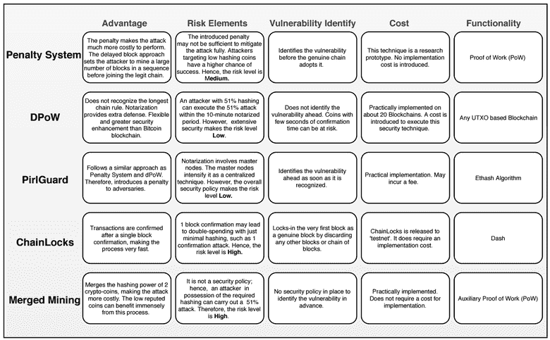

来源：(Sayeed 和 Marco-Gisbert，2019)

### 密钥窃取

### 保护数字资产

私钥是区块链技术中的一种数字身份形式，允许网络中的授权用户执行交易。区块链技术承诺隐私和匿名性；私钥对于保护数字资产至关重要。然而，如果威胁行为者窃取了私钥，资产将丢失且无法恢复（Efanov 和 Roschin，2018）。

### 缓解策略

### 安全存储解决方案

加密硬件安全模块 (HSM) 通过存储和管理密钥及密码来保障数据完整性和机密性。它具有防篡改、加密和物理保护设备安全的特性（Alrubei 等人，2022）。

### 基于区块链的多因素认证 (BMFA)

它通过将多因素认证 (MFA) 与区块链特性相结合，提供安全认证。这种组合称为基于区块链的 MFA (BMFA)。BMFA 利用去中心化且不可篡改的账本存储敏感数据，通过增加对恶意行为者的进一步保护来增强安全性（Almadani 等人，2023）。MFA 通过要求用户在访问区块链系统前提供多种形式的身份验证，增加了一层额外的安全防护。

### 密钥轮换


安全密钥应定期轮换，以最大程度地降低安全风险。对于威胁行为者而言，要构成重大安全风险，他们需要在短时间内攻破每个用户，以获得进行更改所需的用户数量，这极其困难（Šimunić et al., 2021）。

### 代码漏洞利用

尽管区块链技术具有不可变性，但威胁行为者仍可利用代码漏洞，导致无法挽回的损失。2016 年的 DAO 攻击即是著名案例，威胁行为者利用漏洞造成了约 6000 万美元的以太币损失（He et al., 2024）。

### 缓解策略

*   **审计**：将定期进行审计，以检查和审查区块链系统中的漏洞、弱点和潜在攻击向量（Moubarak et al., 2018）。定期审计至关重要，尤其是在重大更新或发布之前。审计类型包括智能合约审计、安全审计、合规审计、性能审计、基础设施审计、治理审计，以及代码审计和漏洞扫描。这有助于防止攻击、确保合规并建立用户信任。

*   **安全代码**：应遵循安全编码标准，以防范漏洞（Bhardwaj et al., 2021）。

*   **代码分析工具**：代码分析工具通常用于检查软件应用程序的源代码。其目的是对潜在漏洞和安全弱点进行分类。这些工具有助于执行手动和自动化渗透测试。它们通过模拟网络攻击来识别可利用的漏洞。

*   **渗透测试**是一种安全评估技术，用于识别系统或网络中的弱点。这是通过模拟对网络的外部或内部攻击来完成的。渗透测试人员拥有丰富的工具和技术储备，他们的工作是发现恶意行为者可能利用的漏洞。目前已有多种可用于区块链应用程序的渗透测试框架（K. Chen et al., 2024）。

横向移动是另一个维度。它指攻击者在获得对系统的初始访问权限后，在网络中逐步深入的能力。其目标是寻找高价值资产。攻击者可能利用多种技术进行横向移动，例如利用操作系统、应用程序或网络协议中的漏洞（Smiliotopoulos et al., 2024）。

组织会定期进行渗透测试和横向移动测试。这些测试可以手动进行，也可以使用自动化工具。测试的目的是识别网络中可能横向扩散的薄弱环节和漏洞（Bhardwaj et al., 2021）。

### 物理安全措施

物理安全在保护区块链基础设施的过程中至关重要。这通过保护节点免受威胁行为者侵害来实现。组织必须采用防篡改检测和预防解决方案，以保护系统免受入侵者侵害（Alrubei et al., 2022）。

### 其他缓解策略

*   其他缓解策略包括：

    *   **漏洞赏金计划**：激励道德黑客发现并报告漏洞。

    *   **形式化验证**：使用数学方法证明智能合约和协议的正确性。

    *   **共识机制改进**：实施更安全的共识算法。也可考虑混合共识机制，以平衡安全性和效率。

    *   **实时监控系统**：特别是网络监控，以检测异常活动或潜在攻击。

    *   **安全密钥管理**：实施强大的关键管理实践，包括硬件安全模块（HSM）。

    *   **定期更新和补丁**：保持所有区块链软件组件为最新状态。

    *   **互操作性标准**：制定并遵守跨链交互的安全标准。

    *   **治理机制**：制定包括针对关键漏洞的应急响应程序在内的治理机制。

    *   **教育和培训**：面向开发人员、运营人员和用户的区块链安全最佳实践教育和培训，可持续进行。

### 法规合规

企业在部署区块链解决方案时，始终关注法规和合规性。遵守数据保护法和行业特定法规是规避法律和声誉风险的必要条件。遵守现有法律和监管框架是任何技术（无论新旧）的先决条件。区块链技术在网络安全中的实施也不例外。区块链部署应遵循监管法律和标准。参与将区块链技术集成到网络安全框架中的专业人员必须彻底了解法律和监管环境。虽然隐私和监管合规并不总是相辅相成，但隐私机制对于某些交易仍然必要。执法机关尽管无法看到用户身份，但可以访问用户交易（Buterin et al., 2024）。本节重点关注两项关键法规——通用数据保护条例（GDPR）和健康保险流通与责任法案（HIPAA）。

### 通用数据保护条例 (GDPR)

通用数据保护条例 (GDPR) 是欧盟 (EU) 于 2018 年 5 月颁布的关键框架。它是一项全面的个人数据保护法，已成为多个国家颁布类似数据保护法的典范。它适用于处理欧盟居民个人数据的任何组织，无论其所在地为何。GDPR 要求组织采取适当的技术和组织措施，确保个人数据的安全性和机密性。违反 GDPR 将付出高昂代价。剑桥分析丑闻（2018 年）、谷歌、Facebook 和 Uber 的 GDPR 罚款（2019 年）即是合规成本的例证。图 9 列出了 GDPR 的关键条款。

#### 图 9. GDPR 关键条款

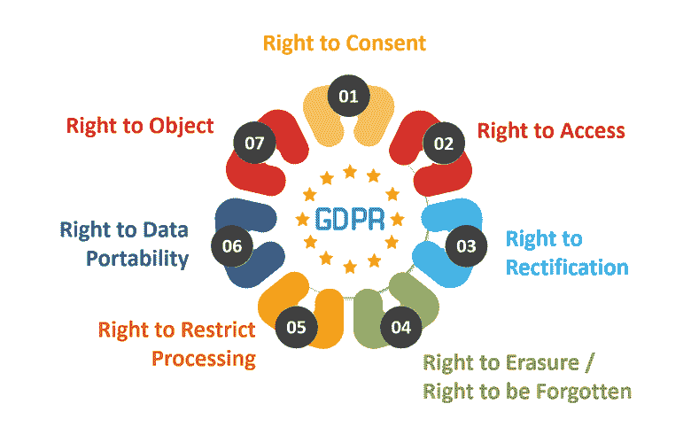

*   现已有多个区块链用例可用于满足 GDPR 合规要求。其中包括：

    1.  以太坊的 GDPR 合规措施
    2.  IBM 的区块链与 GDPR 平台
    3.  基于自主身份 (SSI) 的区块链身份验证
    4.  基于星际文件系统 (IPFS) 的区块链数据存储

区块链技术提供的去中心化和透明的数据交易记录，可以通过促进数据控制者和处理者的工作，增强数据安全性和 GDPR 合规性（Hristov & Dimitrov, 2018）。然而，GDPR 对数据控制者和处理者有严格要求。组织有义务通知数据主体数据泄露事件，并提供其访问自身数据的权利。


欧盟区块链观察站 2018 年报告指出，GDPR 与区块链技术之间不存在原则性矛盾，因为 GDPR 并非针对技术本身，而是关乎技术如何被使用（Patrick & Haie, 2018）。此外，还曾讨论过某些区块链（如许可型区块链）是否应豁免 GDPR，考虑到用户所拥有的控制权（Anisha, 2019）。这场辩论导致了两种倾向——纯粹主义者和原教旨主义者（Poelman & Iqbal, 2021）。去中心化特性引发了对数据所有权和控制权的担忧，这可能与 GDPR 的基本原则相冲突（Zemler & Westner, 2019）。此外，跨多个节点共享个人数据也是一个问题。由于不可篡改特性使得删除个人数据变得困难（甚至不可能），**被遗忘权**对区块链构成了挑战。

组织机构已设计出替代方案来应对这一挑战，催生了一波新的符合 GDPR 要求的区块链网络（Haque et al., 2021）。诸如加密混淆、零知识证明或链下存储等技术，有助于在保留区块链技术优势的同时确保 GDPR 合规。

### 1996 年健康保险流通与责任法案 (HIPAA)

1996 年健康保险流通与责任法案 (HIPAA) 是医疗保健领域的关键框架。它是美国于 1996 年颁布的联邦法律，旨在确保患者数据得到保护。HIPAA 适用于医疗保健组织。表 4 列出了 HIPAA 适用的利益相关者部分名单。

#### 表 4. HIPAA 利益相关者及其受影响的原因

| 利益相关者 | 影响 |
| --- | --- |
| 医疗服务提供者 | 他们以电子方式传输涉及特定交易的健康信息，包括索赔、福利和转诊。 |
| 健康计划 | 这些包括身体和心理健康、牙科、视力和处方药保险公司、健康维护组织 (HMO)、政府医疗服务提供者和保险公司、长期和临终关怀（养老院）服务提供者和保险公司；雇主赞助的团体健康计划；教会和宗教健康计划，以及多雇主计划。当然，也存在少数例外情况。 |
| 医疗信息清算机构 | 这些实体将从另一实体接收的非标准健康信息加工为特定的标准格式或数据。 |
| 业务关联方 | 这些包括为受保护实体执行或提供职能、活动或服务而使用或披露个人 PHI 的个人或组织（通常为第三方）。业务关联方包括索赔处理商、数据分析师、利用审查员和账单服务提供商。 |

这些实体应采取适当的技术和组织措施，以保障患者数据的安全性和机密性。HIPAA 的目标是保护受保护健康信息 (PHI) 的机密性和安全性。这是通过建立全国性指导方针来实现的，这些指导方针规范电子共享、隐私保护和 PHI 的安全性。图 10 列出了关键条款。

#### 图 10. HIPAA 关键条款

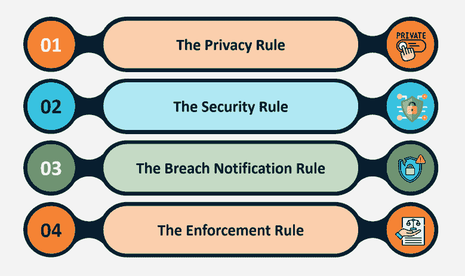

区块链提供了患者数据交易的去中心化和透明记录。这可以增强数据安全性和 HIPAA 合规性。HIPAA 还对医疗保健组织施加了严格要求。它要求我们有义务通知患者数据泄露事件，并向他们提供访问其医疗记录的权限。区块链技术给 HIPAA 合规性带来了独特挑战。安全规则要求受保护实体和关联方采取管理、物理和技术防护措施，以确保电子 PHI 的隐私性、准确性和可访问性。组织必须实施特定技术来应对这一挑战。一些标准方法包括加密和访问控制。

### 其他法规

除上述讨论的法规外，还有其他几项相关法规适用于不同情境下的企业。以下列举几项：

*   支付卡行业数据安全标准 (PCI DSS)
*   格雷姆-里奇-比利雷法案 (GLBA)
*   加州消费者隐私法案 (CCPA)
*   纽约州金融服务部 (NYDFS) 网络安全条例
*   欧盟的加密资产市场 (MiCA) 法规。

这些法规对处理个人信息的实体提出要求，保护敏感信息的安全，并确立在金融服务中使用区块链技术的标准。组织可通过开展全面的风险评估来确保合规。可定期进行检查，以识别潜在的合规差距。利用适当的控制措施及时解决已识别的安全差距和疏漏，从长远来看大有裨益。风险评估要点和技术需结合区块链技术的独特特性和不断演变的网络安全挑战进行调整。

应采取强有力的安全措施来保护区块链网络及其数据。这些措施包括实施访问控制机制、采用加密算法和定期进行安全审计。此外，组织必须制定事件响应计划，以减轻安全漏洞或数据泄露的影响。组织应制定并执行关于区块链技术使用的明确政策、程序和协议。应准备数据保护指南、访问控制和事件响应指南。必须及时更新这些内容，以确保符合不断演变的监管要求。数据加密和匿名化技术可在保持区块链记录完整性的同时保护敏感数据。

组织应考虑聘请具备技术专长和合规经验的法律顾问。顾问应就具体监管要求提供指导，并确保符合这些要求。法律顾问还可就区块链技术的潜在法律影响提供指导，包括责任、知识产权和管辖权等相关问题。

## 未来趋势与挑战

随着技术采用频率的增加，一些新挑战正逐渐显现。其中一些挑战将与网络安全相关。本节将介绍采用 AI 和其他技术与区块链及安全相结合的全球趋势。重点关注利用量子计算增强网络攻击防御，超越传统方法并彻底变革网络安全。

1.  **不可能三角**：区块链网络面临一种被称为**区块链不可能三角**的困境。它指出区块链网络最多只能同时实现三个理想属性中的两个：安全性、可扩展性和去中心化。如果在追求可扩展性和去中心化的过程中，区块链实施中所选的安全因素权重不足，网络安全强度就会被削弱。这种情况严重阻碍了 IT 从业者实施稳健的系统（Vijaya Kittu & Gupta, 2024）。目前正在研究和探索分片等一些初步解决方案。


## 2. 加密资产

考虑到执法和取证维度的挑战，需要对加密资产（如加密货币和 NFT）进行更多研究，主要是因为加密资产被指责为恐怖主义融资的首选支付方式。这导致网络安全领域出现交易追踪问题。许多加密货币的伪匿名性质会使执法部门难以追踪非法交易。

## 3. 物联网

物联网设备使用量的增加将意味着保护它们的需求增加。将物联网与区块链集成有助于防止未经授权的访问和数据泄露。然而，物联网-区块链相关的网络安全问题可能以智能合约漏洞、区块链上的 51% 攻击和数据泄露的形式出现。未来可能需要更多关于容错、延迟和效率的定量研究。

## 4. 用于区块链安全的人工智能

在数据、算法和算力方面，人工智能和区块链有多种应用。其中一些应用（如数据共享、隐私保护、可信决策和去中心化智能）与数据管理相关，并延伸至提升安全性（Wang et al., 2021）。

### a. 自动化威胁检测与响应

利用机器学习（ML），可以分析大量数据以检测潜在威胁并做出响应，触发自动化响应以缓解风险，通常能实现实时处理。这能极大地提升整体安全性（Manoharan & Sarker, 2024）。

### b. 检测和预防恶意活动

可配置 AI 算法持续监控网络（如区块链网络）中的可疑活动和欺诈行为（Varun Shah, 2022）。这能大幅降低检测和响应网络攻击所需的时间和精力。可训练机器学习模型以检测并标记异常交易模式。例如，异常大额或高频交易可能表明发生了安全漏洞或遭受了攻击尝试。

### c. 增强交易验证

它们可帮助验证交易数据的真实性，甚至在其提交至区块链网络之前。

### d. 优化共识机制

一般来说，共识机制缓慢且资源密集，因此成为研究人员关注的主题。优化算法参数可使区块链更快、更高效；但应注意不破坏去中心化、安全性和性能之间的平衡。例如，ML 算法可预测有效交易的可能性。交易验证将更快，并减少对资源密集型共识机制的需求。同样，并行工作量证明等较新算法已被提出，并处于各种实验阶段。

### e. 对抗 AI 驱动的攻击

AI 可帮助企业制定并维持主动的安全态势。这可通过识别和解决其区块链系统中的潜在弱点来实现。AI 可帮助应对新挑战，包括 AI 驱动攻击的可能性。它们可满足 AI 模型验证和可解释性的需求。例如，攻击者可能利用 ML 算法识别并利用区块链网络漏洞，或发起社会工程学攻击。因此，可构建稳健的 AI 模型验证和可解释性机制，以确保透明度和问责制。

## 5. AI 与智能合约安全

智能合约用于编程新一代去中心化应用，如去中心化金融（DeFi）（John et al., 2023）。因为它们是人工编写的代码，所以容易受到攻击和漏洞影响。过往经验表明，这些漏洞可能导致重大财务损失。AI 可帮助分析智能合约代码并识别潜在漏洞和错误。它还有助于构建更安全、更可靠的智能合约。

## 6. 用于数据分析的 AI

区块链数据可结合 AI 用于数据分析。可从交易数据中获取洞察。可识别可能表明恶意活动的模式和异常。安全分析师可利用这些输入来确定威胁调查的优先级并发现潜在漏洞。这能降低风险和欺诈活动，尤其是在 B2B 网络中。

## 7. AI 与数据隐私

生成式 AI 算法使用大语言模型（LLM）。LLM 需要访问大量数据进行训练和分析。这引发了对数据隐私和个人信息潜在滥用的担忧。被攻破的信息技术系统可以成为良好的训练数据来源，因为其拥有丰富的交易数据源。然而，由于去中心化，区块链系统极难被攻破。

## 8. 破解现有加密

量子计算机有可能破解现有加密算法，如 RSA 和 ECC（Sharma et al., 2021）。这对区块链安全构成重大威胁，因为这些是许多区块链系统运行所依赖的常见且流行的算法。组织必须通过探索后量子密码学和制定缓解策略来应对这一可能性。

## 9. 抗量子密码学

量子计算机可用于开发抗传统攻击的新加密算法（Chaubey & Prajapati, 2020）。这些算法能显著增强区块链网络及其上存储数据的安全性。主要有三种实现方式：

- 开发新的数字签名算法
- 创建更安全的哈希函数
- 提高智能合约的安全性

抗量子密码学是一个充满前景的新兴研究分支（Allende et al., 2023）。人们认为利用它构建的算法甚至能抵御量子计算机的攻击。尽管量子计算机仍处于发展早期，但许多研究人员正在为实现其全部潜力而努力。在开发阶段关注抗量子密码学有助于为未来做好准备。

## 结论

企业可利用区块链改进其网络安全系统。它们可实现增强的数据安全、改进的威胁检测与响应、强化的认证与授权，以及增强的网络威胁情报共享。这些能力大多源于区块链的基本特征。诸如不可变账本等特性有助于保障交易数据存储安全。它还通过仅向授权参与者提供访问权限来帮助监控资产并建立信任。其去中心化和分布式账本系统为改善数字安全和应对不断演变的网络威胁环境提供了结构。


然而，将区块链技术与现有的网络安全措施相结合也面临一些挑战。本章通过提出网络安全最佳实践带来了创新。这些实践有助于系统集成专家应对这些挑战，确保区块链与网络安全的平滑且有效实施。企业应考虑隐私顾虑、可扩展性问题、对熟练专业人员的需求以及法规合规性。组织在处理敏感数据时，必须根据适用性重新评估其对 `GDPR` 和 `HIPAA` 的合规情况。尽管存在挑战，但区块链技术用于网络安全提供了显著优势。通过利用该技术及其独特功能，企业可以提升其安全水平，保护其关键数据和资产免受网络威胁。

区块链与其他技术（如 `AI`、`ML` 和 `IoT`）的交叉融合以改善网络安全，是一个热门的研究课题。这将提升企业网络安全基础设施的安全水平。

## 参考文献

Adeghe, E., Okolo, C., & Ojeyinka, O. (2024). Evaluating the impact of blockchain technology in healthcare data management: A review of security, privacy, and patient outcomes. Open Access Research Journal of Science and Technology., DOI: [10.53022/oarjst.2024.10.2.0044](http://dx.doi.org/10.53022/oarjst.2024.10.2.0044)

Agarkar, A., Karyakarte, M., Chavhan, G., Milind, P., Talware, R., & Kulkarni, L. (2024). Blockchain aware decentralized identity management and access control system. Elsevier, 31. DOI: [10.1016/j.measen.2024.101032](http://dx.doi.org/10.1016/j.measen.2024.101032)

Ahmad, D., Lutfiani, N., Rizki Ahmad, A. D. A., Rahardja, U., & Aini, Q. (2021). Blockchain Technology Immutability Framework Design in E-Government. Jurnal Administrasi Publik : Public Administration Journal, 11(1), 32–41. DOI: [10.31289/jap.v11i1.4310](http://dx.doi.org/10.31289/jap.v11i1.4310)

Ali, V., Norman, A. A., & Azzuhri, S. R. B. (2023). Characteristics of Blockchain and Its Relationship With Trust. IEEE Access : Practical Innovations, Open Solutions, 11, 15364–15374. DOI: [10.1109/ACCESS.2023.3243700](http://dx.doi.org/10.1109/ACCESS.2023.3243700)

Allende, M., León, D. L., Cerón, S., Pareja, A., Pacheco, E., Leal, A., Da Silva, M., Pardo, A., Jones, D., Worrall, D. J., Merriman, B., Gilmore, J., Kitchener, N., & Venegas-Andraca, S. E. (2023). Quantum-resistance in blockchain networks. Scientific Reports, 13(1), 5664. DOI: [10.1038/s41598-023-32701-6](http://dx.doi.org/10.1038/s41598-023-32701-6) PMID: [37024656](https://pubmed.ncbi.nlm.nih.gov/37024656)

Almadani, M., Alotaibi, S., Alsobhi, H., & Hussain, O. (2023). Blockchain-based multi-factor authentication: A systematic literature review. Elsevier, 23. DOI: [10.1016/j.iot.2023.100844](http://dx.doi.org/10.1016/j.iot.2023.100844)

Alrubei, S., Ball, E., & Rigelsford, J. (2022). Adding hardware security into IoT-blockchain platforms. IEEE, 1–6. DOI: [10.1109/LATINCOM56090.2022.10000585](http://dx.doi.org/10.1109/LATINCOM56090.2022.10000585)

Andryukhin, A. (2019). Phishing attacks and preventions in blockchain based projects. IEEE, 15–19. DOI: [10.1109/EnT.2019.00008](http://dx.doi.org/10.1109/EnT.2019.00008)

Anisha, M. (2019). The GDPR-Blockchain Paradox: Exempting Permissioned Blockchains from the GDPR. Fordham Intell. Prop. Media & Ent. L.J., 29. [`heinonline.org/HOL/LandingPage?handle=hein.journals/frdipm29&div=35`](https://heinonline.org/HOL/LandingPage?handle=hein.journals/frdipm29&div=35)

Apone-Novoa, F., Orozco, A., Villanueva-Polanco, R., & Wightman, P. (2021). The 51% attack on blockchains: A mining behavior study. IEEE, 9, 140549–140564. DOI: [10.1109/ACCESS.2021.3119291](http://dx.doi.org/10.1109/ACCESS.2021.3119291)

Belchior, R., Vasconcelos, A., Guerreiro, S., & Correia, M. (2021). A survey on blockchain interoperability: Past, present, and future trends. ACM Computing Surveys, 54(8), 41. DOI: [10.1145/3471140](http://dx.doi.org/10.1145/3471140)

Bernabe, J., Cánovas, J., Hernández-Ramos, J., Moreno, R., & Skarmeta, A. (2019). Privacy-preserving solutions for blockchain: Review and challenges. IEEE, 7, 164908–164940. DOI: [10.1109/ACCESS.2019.2950872](http://dx.doi.org/10.1109/ACCESS.2019.2950872)

Bhardwaj, A., Hussian Shah, S. B., Shankar, A., Alazab, M., & Kumar, M. (2021). Penetration testing framework for smart contract blockchain. Springer, 14, 2635–2650. DOI: [10.1007/s12083-020-00991-6](http://dx.doi.org/10.1007/s12083-020-00991-6)

Bhushan, B., Sinha, P., Sagayam, K., & J, A. (2021). Untangling blockchain technology: A survey on state of the art, security threats, privacy services, applications and future research directions. Elsevier, 90. DOI: [10.1016/j.compeleceng.2020.106897](http://dx.doi.org/10.1016/j.compeleceng.2020.106897)

Bhutta, M. N. M., Khwaja, A. A., Nadeem, A., Ahmad, H. F., Khan, M. K., Hanif, M. A., Song, H., Alshamari, M., & Cao, Y. (2021). A Survey on Blockchain Technology: Evolution, Architecture and Security. IEEE Access : Practical Innovations, Open Solutions, 9, 61048–61073. DOI: [10.1109/ACCESS.2021.3072849](http://dx.doi.org/10.1109/ACCESS.2021.3072849)

Chaubey, N. K., & Prajapati, B. B. (Eds.). (2020). Quantum Cryptography and the Future of Cyber Security. IGI Global., DOI: [10.4018/978-1-7998-2253-0](http://dx.doi.org/10.4018/978-1-7998-2253-0)

Chen, K., Zhang, M., Liang, R., Chen, J., Peng, J., & Huang, X. (2024). Research on the Application of Penetration Testing Frameworks in Blockchain Security. In Li, S. (Ed.), Computational and Experimental Simulations in Engineering (Vol. 146, pp. 307–330). Springer Nature Switzerland., DOI: [10.1007/978-3-031-44947-5_25](http://dx.doi.org/10.1007/978-3-031-44947-5_25)

Chen, Y., Chen, H., Zhang, Y., Han, M., Siddula, M., & Cai, Z. (2022). A survey on blockchain systems: Attacks, defenses, and privacy preservation. Elsevier, 2(2). DOI: [10.1016/j.hcc.2021.100048](http://dx.doi.org/10.1016/j.hcc.2021.100048)

Deloitte. (2020). Deloitte’s 2020 Global Blockchain Survey: From promise to reality (Deloitte Insights) [Industry / Business Report]. [`www2.deloitte.com/content/dam/Deloitte/tw/Documents/financial-services/2020-global-blockchain-survey.pdf`](https://www2.deloitte.com/content/dam/Deloitte/tw/Documents/financial-services/2020-global-blockchain-survey.pdf)

Deloitte. (2021). Deloitte’s 2021 Global Blockchain Survey: A new age of digital assets (Deloitte Insights, p. 28) [Industry / Business Report]. [`www2.deloitte.com/content/dam/insights/articles/US144337_Blockchain-survey/DI_Blockchain-survey.pdf`](https://www2.deloitte.com/content/dam/insights/articles/US144337_Blockchain-survey/DI_Blockchain-survey.pdf)

Distefano, S., Giacomo, A. D., & Mazzara, M. (2021). Trustworthiness for Transportation Ecosystems: The Blockchain Vehicle Information System. IEEE Transactions on Intelligent Transportation Systems, 22(4), 2013–2022. DOI: [10.1109/TITS.2021.3054996](http://dx.doi.org/10.1109/TITS.2021.3054996)

Efanov, D., & Roschin, P. (2018). The all-pervasiveness of the blockchain technology. Elsevier, 123, 116–121. DOI: [10.1016/j.procs.2018.01.019](http://dx.doi.org/10.1016/j.procs.2018.01.019)

Fatima, N., Agarwal, P., & Sohail, S. (2022). Security and privacy issues of blockchain technology in health care—A review. Springer, 314, 193–201. DOI: [10.1007/978-981-16-5655-2_18](http://dx.doi.org/10.1007/978-981-16-5655-2_18)

Fernández-Caramés, T., & Fraga-Lamas, P. (2020). Towards post-quantum blockchain: A review on blockchain cryptography resistant to quantum computing attacks. IEEE, 8. DOI: [10.1109/ACCESS.2020.2968985](http://dx.doi.org/10.1109/ACCESS.2020.2968985)

Guo, H., & Yu, X. (2022). A survey on blockchain technology and its security. Elsevier, 3(2). DOI: [10.1016/j.bcra.2022.100067](http://dx.doi.org/10.1016/j.bcra.2022.100067)


## 参考文献

Haque, A. B., Islam, A. K. M. N., Hyrynsalmi, S., Naqvi, B., & Smolander, K. (2021). 符合 GDPR 的区块链——系统文献综述。 *IEEE Access : Practical Innovations, Open Solutions*, 9, 50593–50606. DOI: [10.1109/ACCESS.2021.3069877](http://dx.doi.org/10.1109/ACCESS.2021.3069877)

Hasan, K., Sajid, M., Lapina, M., & Shahid, M. (2024). 区块链技术遇见 6G 无线网络：系统性调查。 *Elsevier*, 92, 199–220. DOI: [10.1016/j.aej.2024.02.031](http://dx.doi.org/10.1016/j.aej.2024.02.031)

He, F., Li, F., & Liang, P. (2024). 增强智能合约安全性：利用预训练语言模型进行高级漏洞检测。 *IET Blockchain*, •••, 1–12. DOI: [10.1049/blc2.12072](http://dx.doi.org/10.1049/blc2.12072)

Hristov, P., & Dimitrov, W. (2018). 区块链作为符合 GDPR 框架的骨干。 *第 8 届国际多学科研讨会 / SIMPRO 2018, 罗马尼亚*。 [`www.researchgate.net/publication/328576742_The_blockchain_as_a_backbone_of_GDPR_compliant_frameworks`](https://www.researchgate.net/publication/328576742_The_blockchain_as_a_backbone_of_GDPR_compliant_frameworks)

Ibarra, J., Jahankhani, H., & Kendzierskyj, S. (2019). 网络物理攻击与医疗数据的价值：面对网络勒索和有组织犯罪的时代。 *Springer*。 [`link.springer.com/book/10.1007/978-3-030-11289-9`](https://link.springer.com/book/10.1007/978-3-030-11289-9)

Idrees, S., Nowostawski, M., Jameel, R., & Mourya, A. (2021). 面向工业应用的区块链技术安全方面。 *Electronics (Basel)*, 10(8), 951. [`kdoi.org/10.3390/electronics10080951`](https://kdoi.org/10.3390/electronics10080951). DOI: [10.3390/electronics10080951](http://dx.doi.org/10.3390/electronics10080951)

Ismail, S., Nouman, M., Dawoud, D., & Reza, H. (2024). 面向基于区块链和机器学习的轻量级安全框架。 *ScienceDirect*, 5(1), 100174. 网络先行出版。 DOI: [10.1016/j.bcra.2023.100174](http://dx.doi.org/10.1016/j.bcra.2023.100174)

John, K., Kogan, L., & Saleh, F. (2023). 智能合约与去中心化金融。 *Annual Review of Financial Economics*, 15(1), 523–542. DOI: [10.1146/annurev-financial-110921-022806](http://dx.doi.org/10.1146/annurev-financial-110921-022806)

Joshi, A., Han, M., & Wang, Y. (2018). 区块链技术安全与隐私问题综述 (2)。 *1*(2), Article 2. DOI: [10.3934/mfc.2018007](http://dx.doi.org/10.3934/mfc.2018007)

Kaur, M., Zubair khan, M., Gupta, S., Noorwali, A., Chakraborty, C., & Kumar Pani, S. (2021). MBCP：大规模主流区块链共识协议的性能分析。 *IEEE*, 9. DOI: [10.1109/ACCESS.2021.3085187](http://dx.doi.org/10.1109/ACCESS.2021.3085187)

Kaur, M., & Gupta, S. (2021). 区块链共识协议：最新进展与未来方向。 *2021 年技术进步与创新国际会议 (ICTAI)*, 446–453. DOI: [10.1109/ICTAI53825.2021.9673260](http://dx.doi.org/10.1109/ICTAI53825.2021.9673260)

Lashkari, B., & Musilek, P. (2021). 区块链共识机制综合综述。 *IEEE Access : Practical Innovations, Open Solutions*, 9, 43620–43652. DOI: [10.1109/ACCESS.2021.3065880](http://dx.doi.org/10.1109/ACCESS.2021.3065880)

Lee, J. (2018). 补丁传输器：面向 WSN 和 IoT 环境的激励型去中心化软件补丁系统。 *Sensors (Basel)*, 18(2), 574. 网络先行出版。 DOI: [10.3390/s18020574](http://dx.doi.org/10.3390/s18020574) PMID: [29438337](https://pubmed.ncbi.nlm.nih.gov/29438337)

Leteane, O., & Ayalew, Y. (2024). 利用区块链和信任模型提高食品供应链中溯源数据的可信度。 *The JBBA*, 7(1), 1–12. 网络先行出版。 DOI: [10.31585/jbba-7-1-(2)2024](http://dx.doi.org/10.31585/jbba-7-1-(2)2024)

Liu, Y., He, D., Obaidat, M. S., Kumar, N., Khan, M. K., & Raymond Choo, K.-K. (2020). 基于区块链的身份管理系统：综述。 *Journal of Network and Computer Applications*, 166, 102731. DOI: [10.1016/j.jnca.2020.102731](http://dx.doi.org/10.1016/j.jnca.2020.102731)

Manoharan, & Sarker, M. (2024). 革新网络安全：释放人工智能和机器学习的力量，用于下一代威胁检测。 *International Research Journal of Modernization in Engineering Technology and Science*. 网络先行出版。 DOI: [10.56726/IRJMETS32644](http://dx.doi.org/10.56726/IRJMETS32644)

Markets and Markets. (2024). 网络安全市场 (TC 3485; p. 597)。 [`www.marketsandmarkets.com/Market-Reports/cyber-security-market-505.html`](https://www.marketsandmarkets.com/Market-Reports/cyber-security-market-505.html)

Miller, L., & Pahl, M.-O. (2024). 基于区块链的协作式网络安全：综述。 *arXiv*, 1(1), 35.

Monrat, A., Schelén, O., & Andersson, K. (2019). 从应用、挑战和机遇视角的区块链综述。 *IEEE*, 7. DOI: [10.1109/ACCESS.2019.2936094](http://dx.doi.org/10.1109/ACCESS.2019.2936094)

Moubarak, J., Filiol, E., & Chamoun, M. (2018). 关于区块链安全性及相关攻击。 *IEEE*, 1–6. DOI: [10.1109/MENACOMM.2018.8371010](http://dx.doi.org/10.1109/MENACOMM.2018.8371010)

Nath, P., Mushahary, J., Roy, U., Brahma, M., & Singh, P. (2023). 面向多方软件开发的基于 AI 和区块链的源代码漏洞检测与预防系统。 *Elsevier*, 106. DOI: [10.1016/j.compeleceng.2023.108607](http://dx.doi.org/10.1016/j.compeleceng.2023.108607)

Oyinloye, D. P., Teh, J. S., Jamil, N., & Alawida, M. (2021). 区块链共识：替代协议概述。 *Symmetry*, 13(8), 1363. DOI: [10.3390/sym13081363](http://dx.doi.org/10.3390/sym13081363)

Pal, O., Alam, B., Thakur, V., & Singh, S. (2021). 区块链技术的密钥管理。 *ScienceDirect*, 7(1), 76–80. DOI: [10.1016/j.icte.2019.08.002](http://dx.doi.org/10.1016/j.icte.2019.08.002)

Park, C.-S., & Nam, H.-M. (2022). 构建去中心化标识符以实现安全灵活密钥轮换的新方法。 *IEEE Internet of Things Journal*, 9(13), 10610–10624. DOI: [10.1109/JIOT.2021.3121722](http://dx.doi.org/10.1109/JIOT.2021.3121722)

Patrick, V. E., & Haie, A.-G. (2018). 区块链与 GDPR：欧盟区块链观察站报告 (从业者角度 531)。 *EDPL*。 [`heinonline.org/HOL/LandingPage?handle=hein.journals/edpl4&div=88`](https://heinonline.org/HOL/LandingPage?handle=hein.journals/edpl4&div=88)

Poelman, M., & Iqbal, S. (2021). 调查 GDPR 合规性：在区块链上处理个人数据。 *2021 IEEE 第 5 届密码学、安全与隐私国际会议 (CSP)*, 38–44. DOI: [10.1109/CSP51677.2021.9357590](http://dx.doi.org/10.1109/CSP51677.2021.9357590)

Putz, B., Vielberth, M., & Pernul, G. (2022). BISCUIT - 基于人工观察的区块链安全事件报告。 *ACM*, 1–6. DOI: [10.1145/3538969.3538984](http://dx.doi.org/10.1145/3538969.3538984)

Ravichandra, T., Madaan, Dr. V., Sharma, Dr. A., Deshmukh, Dr. S., Agrawal, Prof. Dr. R., Gumber, Dr. G., & Khan, Dr. M. (2024). 印度个人对区块链技术认知与感知的研究。 *IJISAE*, 12(8), 239–250.

Rodrigues, B., Bocek, T., Lareida, A., Hausheer, D., Rafati, S., & Stiller, B. (2017). 基于区块链的协作式 DDoS 缓解架构与智能合约。 *Springer*。 [`link.springer.com/content/pdf/10.1007/978-3-319-60774-0_2.pdf`](https://link.springer.com/content/pdf/10.1007/978-3-319-60774-0_2.pdf)

Salagrama, S., Bibhu, V., & Rana, A. (2023). 基于区块链的数据完整性安全管理。 *Elsevier*, 215, 331–339. DOI: [10.1016/j.procs.2022.12.035](http://dx.doi.org/10.1016/j.procs.2022.12.035)


## 参考文献

Sami Berkani, A., Moumen, H., Benharzallah, S., Yahiaoui, S., & Bounceur, A. (2023). 体育产业中的区块链用例：系统性综述。Springer。DOI：[10.1007/s44227-024-00022-3](http://dx.doi.org/10.1007/s44227-024-00022-3)

Sayeed, S., & Marco-Gisbert, H. (2019). 评估区块链共识与安全机制对抗 51% 攻击的能力。应用科学（瑞士巴塞尔），9(9)，1788。在线预出版。DOI：[10.3390/app9091788](http://dx.doi.org/10.3390/app9091788)

Schlatt, V., Guggenberger, T., Schmid, J., & Urbach, N. (2023). 攻击信任机器：为区块链网络安全制定信息系统研究议程。Elsevier，68。DOI：[10.1016/j.ijinfomgt.2022.102470](http://dx.doi.org/10.1016/j.ijinfomgt.2022.102470)

Sharma, M., Choudhary, V., Bhatia, R. S., Malik, S., Raina, A., & Khandelwal, H. (2021). 利用量子计算能力破解 RSA 加密。网络物理系统，7(2)，73–92。DOI：[10.1080/23335777.2020.1811384](http://dx.doi.org/10.1080/23335777.2020.1811384)

Šimunić, S., Bernaca, D., & Lenac, K. (2021). 区块链中的可验证计算应用。IEEE，9，156729–156745。DOI：[10.1109/ACCESS.2021.3129314](http://dx.doi.org/10.1109/ACCESS.2021.3129314)

Singh, A., Kumar, G., Saha, R., Conti, M., Alazab, M., & Thomas, R. (2022). 区块链共识协议综述与分类。系统架构期刊，127，102503。DOI：[10.1016/j.sysarc.2022.102503](http://dx.doi.org/10.1016/j.sysarc.2022.102503)

Smiliotopoulos, C., Kambourakis, G., & Kolias, C. (2024). 检测横向移动：系统性综述。Heliyon，10(4)，e26317。DOI：[10.1016/j.heliyon.2024.e26317](http://dx.doi.org/10.1016/j.heliyon.2024.e26317) PMID：[38404775](https://pubmed.ncbi.nlm.nih.gov/38404775)

Tan, T. M., & Saraniemi, S. (2023). 区块链赋能交易中的信任：区块链营销的未来方向。市场营销科学学院期刊，51(4)，914–939。DOI：[10.1007/s11747-022-00889-0](http://dx.doi.org/10.1007/s11747-022-00889-0)

Taylor, P. J., Dargahi, T., Dehghantanha, A., Parizi, R. M., & Choo, K.-K. R. (2020). 区块链网络安全的系统性文献综述。数字通信与网络，6(2)，147–156。DOI：[10.1016/j.dcan.2019.01.005](http://dx.doi.org/10.1016/j.dcan.2019.01.005)

Tripathi, G., Abdul Ahad, M., & Casalino, G. (2023). 区块链技术综述：基本原理与历史背景及未来挑战。Elsevier，9，1–6。

Uikey, D. Brarskar, Dr. R., & Ahirwar, Dr. M. (2024). 基于区块链的数字公证系统为数字文档提供可靠且防篡改的时间戳和验证服务：综述。多学科研究国际期刊 (IJFMR)，6(2)。[`www.ijfmr.com/papers/2024/2/17429.pdf`](https://www.ijfmr.com/papers/2024/2/17429.pdf)

Varun Shah. (2022). 网络安全机器学习算法：检测与预防威胁。DOI：[10.5281/ZENODO.10779509](http://dx.doi.org/10.5281/ZENODO.10779509)

Vijaya Kittu, M., & Gupta, V. (2024). IT 项目经理的区块链三难困境。载于《现代管理挑战：案例汇编》（第 66–77 页）。Excel India Publishers。[`zenodo.org/records/11910324`](https://zenodo.org/records/11910324)

Wang, R., Luo, M., Wen, Y., Wang, L., Raymond Choo, K.-K., & He, D. (2021). 区块链在人工智能中的应用。安全与通信网络，2021，1–16。DOI：[10.1155/2021/8690662](http://dx.doi.org/10.1155/2021/8690662)

Wylde, V., Rawindaran, N., Lawrence, J., Balasubramanian, R., Prakash, E., Jayal, A., Khan, I., Hewage, C., & Platts, J. (2022). 网络安全、数据隐私与区块链：综述。SN Computer Science，3(2)，127。DOI：[10.1007/s42979-022-01020-4](http://dx.doi.org/10.1007/s42979-022-01020-4) PMID：[35036930](https://pubmed.ncbi.nlm.nih.gov/35036930)

Xiao, Y., Zhang, N., Lou, W., & Hou, Y. T. (2020). 区块链网络分布式共识协议综述。IEEE 通信调查与教程，22(2)，1432–1465。DOI：[10.1109/COMST.2020.2969706](http://dx.doi.org/10.1109/COMST.2020.2969706)

Xu, J., Wang, C., & Jia, X. (2023). 区块链共识协议综述。ACM Computing Surveys，55(13s)，1–35。DOI：[10.1145/3579845](http://dx.doi.org/10.1145/3579845)

Zemler, F., & Westner, M. (2019). 区块链与 GDPR：应用场景与合规要求。2019 年波特兰工程与技术管理国际会议 (PICMET)，1–8。DOI：[10.23919/PICMET.2019.8893923](http://dx.doi.org/10.23919/PICMET.2019.8893923)

Zhang, X., & Chen, X. (2019). 基于联盟区块链的车载自组网中数据安全共享与存储。IEEE，7。DOI：[10.1109/ACCESS.2018.2890736](http://dx.doi.org/10.1109/ACCESS.2018.2890736)

Zheng, Z., Xie, S., Dai, H.-N., Chen, X., & Wang, H. (2018). 区块链的挑战与机遇。国际 Web 与 Grid 服务期刊，14(4)，352。DOI：[10.1504/IJWGS.2018.095647](http://dx.doi.org/10.1504/IJWGS.2018.095647)

Zhou, J., Feng, Y., Wang, Z., & Guo, D. (2021). 利用安全多方计算保护许可区块链上的隐私。传感器（巴塞尔），21(4)，1540。DOI：[10.3390/s21041540](http://dx.doi.org/10.3390/s21041540) PMID：[33672175](https://pubmed.ncbi.nlm.nih.gov/33672175)

Zhou, L., Diro, A., Saini, A., Kaisar, S., & Hiep, P. (2024). 利用零知识证明进行基于区块链的身份共享：进展、挑战与机遇综述。Elsevier，80。DOI：[10.1016/j.jisa.2023.103678](http://dx.doi.org/10.1016/j.jisa.2023.103678)

Zhou, S., Li, K., Xiao, L., Cai, J., Liang, W., & Castiglione, A. (2023). 区块链共识机制系统性综述。数学，11(2248)，2248。在线预出版。DOI：[10.3390/math11102248](http://dx.doi.org/10.3390/math11102248)

## 关键术语与定义

**Blockchain**：一种分布式且不可变的账本技术，通过在多个去中心化节点中存储数据（而非依赖中央权威），安全透明地记录交易和其他数据。

**Cybersecurity（网络安全）**：保护计算机系统、网络和数据免遭未经授权的访问、使用、披露、中断、修改或破坏的技术、措施或实践。也包括预防或减轻影响的步骤。

**Decentralization（去中心化）**：将控制权和决策权在系统的多个参与者之间分配，而非由单一中央权威掌控的过程。

**Decentralized Security（去中心化安全）**：不由单一实体控制，而是由分散的节点、参与者或团队网络控制的安全系统。

**Immutable Ledger（不可变账本）**：一旦记录交易便无法更改、删除或篡改的数字记录簿（账本）。它免疫数据损坏。

**Incident Response Management（事件响应管理）**：响应和从网络安全事件中恢复的过程。它是处理影响信息安全和数据事件的结构化方法。

**Key Management（密钥管理）**：创建（生成）、存储、分发、保护、管理和销毁用于数据加密和解密的加密密钥的过程。

**Network Security（网络安全）**：保护计算机网络免遭未经授权的访问、使用、披露、中断、修改或破坏的过程。

**Regulatory Compliance（合规性）**：组织必须知晓并遵守管辖数据使用和保护的法律、政策和法规的必要性。

**Smart Contracts（智能合约）**：当满足某些条件（触发）时自动执行的小型自执行合约。代码包含协议条款。

# 第 4 章 动态可扩展的安全云计算中隐私保护组数据共享

Astitva Bhardwaj


## 摘要

云计算是一个已经被广泛采用且预计将显著增长的概念，代表了未来的信息时代。尽管使用了现代术语，但其基本思想诞生于 20 世纪 50 年代，当时大型企业和组织开始探索远程数据和应用程序存储。平台即服务、基础设施即服务和软件即服务这三个术语在云计算的数据共享与访问方面处于领先地位，具有经济高效的特点，并能给社会带来革命性变化。因此，本章探讨了过去至今云计算中见证的一些安全问题，这些问题亟需一套用于安全交换数据的完整系统。此外，文章概述了云环境中固有的安全问题，并指出需要建立适当的安全通信机制。最后，本章分析了企业如何通过了解自身弱点和行业现状，借助云计算获得额外的市场份额。

## 1. 引言

云计算是当今最大、最热门的争议话题之一。它指的是一种计算架构，其中应用程序运行在虚拟服务器上并通过互联网访问，从而消除了在用户计算机上存储数据或程序以供离线检索的需求。然而，云计算背后的概念并不新鲜。20 世纪 50 年代，大型企业、政府机构和教育机构建立了巨型主机，使多个用户能够物理连接不同的终端并共享 CPU 时间 (Jadeja, Y., 2012)。云计算是一种网络化架构，信息托管在云端，而非存储在本地设备上，并通过互联网访问。“云计算”这一概念看似新颖，实则早在 20 世纪 50 年代就已存在，当时大型企业、政府和学校构建了巨型主机，多人可通过连接特定终端同时使用 (Ali, M., 2015)。然而，存在多种服务交付模型，其中平台即服务、基础设施即服务和软件即服务最为流行。这得益于云服务提供商提供的基础设施，其充当客户的计算平台 (Mell, P., 2009)。

云计算领域正在改变企业的运营方式，特别是在共享群组数据及利用其优势方面。这种方法使共享云端同一数据集的个人或组织能够对其进行访问、共享和协作。例如，群组数据共享涵盖广泛的应用，包括 MS Word 中的团队编辑和 Microsoft Excel 的修改 (Simla Mercy, S., 2014)。基于云的数据库系统另一个重要方面是单一环境中跨多租户的群组数据共享，这对 SaaS 应用尤为重要。研究人员因此受益，能够协作处理大型数据集，促进数据分析，并在不同研究小组和机构间共享信息。在云端共享群组数据具有诸多优势，例如卓越的可访问性，允许用户从任何有互联网接入的位置查看和共享几乎所有内容 (De Capitani di Vimercati, S., 2015)。这种可访问性支持远程工作和全球协作，是当今全球互联环境中的关键要素。成本效益是另一优势，因为它消除了物理存储和维护成本，由云提供商负责底层基础设施 (Mahakalkar, N., 2017)。可扩展性或许是最重要的组成部分，因为它确保群组数据共享能根据需要扩展、收缩和适应。实时更新是云协作的独特功能，允许个人实时查看同事的操作，减少版本控制问题，并提升生产流程 (Tchao, E. T., 2021)。

关于云计算背景下群组数据共享的一个主要担忧集中在安全问题上。随着云服务参与度的增加，确保共享信息的可用性、机密性和完整性变得至关重要。这可以通过几项重要的安全措施来解决。第一步是数据加密，这对数据传输和存储都至关重要 (Hendre, A., 2015)。这确保了尽管存在安全漏洞，重要信息仍免受未授权访问 (Bharadwaj, D. R., 2018)。访问控制是另一个重要问题，权限按严格的“需知”原则授予。流行的访问控制方法包括访问管理系统和基于角色的访问控制。通过定期的数据备份和恢复方法，可以降低潜在数据丢失的风险，从而在意外事件后实现平滑的数据恢复。此外，用户意识和教育对有效性至关重要 (Sendi, A. S., 2014)。告知用户相关风险并确保使用此类服务时的安全性至关重要，因为尽管技术不断进步，人为错误仍是重大威胁 (Somani, G., 2017)。通过结合培训和教育计划的综合技术解决方案，可以实现云计算中群组数据共享的有效安全防护 (Joshi, A., 2022)。

云计算一直是许多热门辩论的中心，并将代表未来信息时代。该技术最初开发于 20 世纪 50 年代左右，涉及将软件和信息存储在可通过互联网访问的独立外部服务器上 (Lai, S.-T., 2015)。云端群组数据共享的可用性、经济性、易于扩展以及跨多设备及时更新信息的特性，正在改变协作方式。然而，安全仍是首要关注点，凸显了告知用户局限性、认证和数据加密的必要性 (Kaur, R., 2015)。涉及先进技术工具和用户教育的综合策略对于保障云端群组数据共享安全至关重要 (Liu, W., 2012)。

## 本文的主要贡献如下：

*   本文通过探讨云计算的背景及云计算中的各类安全顾虑，提供了云计算的概览，并简要介绍了其架构。
*   探讨了云计算中的各种漏洞。
*   重点强调了内部威胁和外部攻击。


* 它强调了 CC 的最新进展

本文其余部分安排如下：第 2 节概述 CC 领域，提供全面综述。第 3 节深入探讨困扰 CC 的漏洞。第 4 节转向 CC 行业的最新进展。第 5 节通过总结前几节讨论的关键点来结束本文。

## 2. 云计算概述

目前，客户借助互联网能够按需使用服务器、存储和应用程序等计算机资源。它为企业提供了灵活性、可扩展性，以及一种无需维护物理基础设施的更廉价（负担得起）的替代方案。

### 2.1 背景

过去，带有一些基础设施的互联网一部分通常用云来表示。如今，在线服务被称为“云”服务。与早期交易容量有限的系统不同，云计算（CC）现在支持在几秒钟内进行大量活动。这种能力使得事件预测、分析和数据预处理等任务能够高效完成。要使用云服务，用户必须保持设备连接，以访问和操作分布在全球的这些大规模处理虚拟机（Furht, B., 2010）。可参考 CC 出现前使用的旧系统来追踪其发展进程。在 CC 语境下，通过互联网提供服务的提供商被称为“云”，而“计算”涉及使用计算机处理计算或资源。正如约翰·麦卡锡 1961 年在 MIT 所建议的，如果这类计算机被作为计算的未来进行推广，最终可能会被归类为公用事业，类似于电话系统（Garfinkel, S., 1999）。Salesforce 是最早使用“CC”术语的公司之一，成立于 20 世纪 90 年代末，最初提供其 SaaS 和客户关系管理（CRM）服务（Salesforce, 2023）。Salesforce 模型是一个著名的 CC 范例，它为用户提供开发平台，如 `Microsoft Azure`（Microsoft, 2023）和 `Google's App Engine`（Google, 2023），以及 PaaS。另一种选择是 IaaS 模型，由 `Amazon Elastic Compute Cloud (EC2)` 等公司于 2006 年引入。

### 2.2 安全顾虑

组织必须解决云中群组数据共享带来的多个安全问题，以保护其敏感数据并维护数据完整性。当众多用户或群组在云环境中协作和共享数据时，必须实施强有力的安全措施。

#### 2.2.1 数据存储

云架构由所提供的服务决定。随着客户数据现存储在云中，本地访问已丧失，这需要一个备份系统来确保云服务器上数据文件的可用性和完整性。一个主要顾虑是能够尽快检测到任何未经授权的修改或数据损坏，这是数据安全服务质量的一个长期方面。虽然云计算（CC）引入了新的复杂安全风险，但也揭示了传统加密基元不再足够。由于用户在 CC 中不直接管理其数据安全措施，立即应用安全协议具有挑战性。因此，即使在不知道数据确切内容的情况下，确保可信信息被上传到云中至关重要。此外，CC 不仅涉及第三方数据仓储；还包括以存储准确性更新动态数据（Amazon, 2023）。

用户修改云中存储数据的能力——如插入、删除、修改和添加新条目——要求在动态更新期间保持存储准确性。这种不断演变的性质需要新策略，使过时的完整性保证策略失效。此外，CC 涉及数据中心的并发、协作和分布式管理。为增强数据安全，特定用户的信息存储在多个物理位置，创建冗余并降低数据泄露风险。因此，开发一个具有现实完整性的真实世界云数据存储系统，将极大受益于用于存储正确性验证的分布式协议（Wang, Q., 2009）。图 1 展示了如下所示的云数据存储安全模式。

#### 图 1. 云存储中的数据存储安全模式

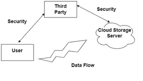

#### 2.2.2 数据传输安全

云提供商使用互联网作为其通信信道来传输数据。安全有效地传输信息的能力是信息管理和其他业务运营赖以建立的基础，也是 CC 的核心。

* 它涉及将脚本注入用户浏览器，通过网站修改控制其会话，以及注入蠕虫等其他恶意行为。
* 注入缺陷：当 Web 应用程序的用户输入未经过充分验证时，可被用于修改服务器查询。
* 恶意文件执行：此攻击可针对 XML 或任何其他接受用户文件的框架，因为这些文件可能包含恶意脚本。
* 未使用加密函数保护数据传输的 Web 应用程序容易受到攻击（Saripalli and Walters, 2010）。

#### 2.2.3 应用安全

应用安全是利用硬件、软件和程序控制来保护程序免受外部威胁。集成到强大的应用安全流程中的安全要素，降低了黑客修改数据集以及窃取、篡改或删除重要数据的可能性。随着应用程序跨网络访问的频率增加，因此更容易受到各种威胁，安全在开发过程中的因素变得越来越重要。在线编写并在个人计算机或防火墙后的局域网上运行的计算机代码称为 SAAS。客户能够通过 Web 远程访问应用程序，以及能够从集中位置管理操作而非在每个客户站点管理，是其主要特征。此外，还包含用于商业产品的基于网络的软件访问和管理。应用程序、软件和服务攻击迄今为止最为常见，占导致数据泄露的所有黑客活动的 39%（Zissis & Lekkas, 2009）。

#### 2.2.4 安全与云完整性

使用云系统运行应用程序时，必须建立适当的备份机制，以确保在发生数据丢失问题时应用程序的安全。无论这是数据库条目损坏、用户信息删除，还是更严重的数据丢失，都无关紧要。通常，需要定期将数据备份到便携式介质上。

仅出于识别原因，此活动通常需要一些关于服务实现组件的元数据。特定基于云的 Web 服务的 PaaS 实例的每个唯一服务实现相关的所有 Web 服务也可能包含在该信息中。例如，Web 服务描述文档需要存在于服务实现实例中，并由云系统提供，以便根据用户请求提供给用户。用户必须检查大多数这些元数据描述，以确定服务是否适合其目的，然后再使用它（Pan,J-S.,2011）。在表 1 中，我们汇编了所有先前攻击的综合摘要。

#### 表 1. 云安全顾虑


| 安全方面 | 描述 |
| --- | --- |
| 数据存储安全 (Wang,Q.,2009) | 云数据需要备份以确保安全性和准确性。由于数据频繁变更，新的完整性解决方案至关重要。 |
| 数据传输安全 (Saripalli,P.,2010) | 云中的安全数据传输至关重要。为防止黑客窃取数据，请务必在发送时使用加密。 |
| 应用安全 (Zissis,D.,2010) | 请通过网络谨慎管理您的 SaaS 应用，并采取安全措施以降低黑客攻击您系统的风险。 |
| 安全与云完整性 (Pan, J.-S.,2012) | 定期备份您的云应用以保障安全。元数据提供描述信息，帮助用户更好地理解和评估服务。 |

### 2.3 云架构

云架构的各个组件如图 2 所示，并在下面的小节中进行探讨。

*   **前端**：前端由客户端使用。包含访问云计算服务所需的客户端 API 和应用程序。前端由平板电脑、智能手机、瘦客户机和胖客户机以及 Web 服务器（如 Internet Explorer、Firefox、Chrome 等）组成。
*   **后端**：后端由服务提供商使用。它负责管理提供云计算服务所需的所有资源。包括服务器、虚拟计算机、流量管理系统、服务器、安全程序和海量数据存储。
*   **客户端基础设施**：客户端基础设施是前端的一个组成部分。为云通信提供 GUI（图形用户界面）。
*   **应用**：客户希望使用的任何程序或平台均可视为应用。
*   **服务**：云服务根据客户的需求管理可访问的服务。
*   **SAAS**：另一种称呼为云应用服务。大多数 SAAS 程序无需下载或安装，即可在 Web 浏览器中快速运行。
*   **PAAS**：它提供开发、运行和管理软件应用所需的所有服务和工具，使您能够访问平台，从而免去对基础设施和技术细节的担忧。
*   **IAAS**：另一种术语为云基础设施服务。它负责管理应用数据、运行时环境和中间件。
*   **存储**：存储是云计算的主要组件之一。它提供足够的云存储容量用于数据管理和归档。
*   **运行时云**：运行时云为虚拟计算机提供执行环境和运行时环境的访问权限。
*   **基础设施**：它提供主机、网络和应用服务。构成云基础设施、实现云计算理念所需的硬件和软件组件示例包括服务器、存储、网络设备和虚拟化软件。
*   **管理**：后端管理促进运行时云、存储、基础设施和应用等多个组件之间的协调。
*   **安全**：安全是云计算后端的一项功能。安全机制部署在后端。
*   **互联网**：通信可连接互联网的前端和后端。

#### 图 2. 云计算架构

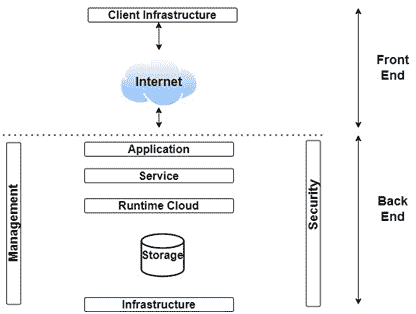

## 3. 相关漏洞

这指的是系统的薄弱环节，即攻击者可能利用的安全缺陷。导致这些弱点的因素包括错误配置、无效的访问控制、不安全的 API 和软件漏洞。

### 3.1 内部威胁

对供应商和云消费者而言，最坏的情况是云服务商雇佣了一名恶意系统管理员。由于与云提供商存在业务关系，内部人员拥有授权用户凭证，从而能够访问关键数据。例如，负责定期备份托管客户资源的系统（虚拟机、数据存储）的管理员，可能会利用其对备份的访问权限窃取敏感的客户信息。这种间接数据访问可能难以被发现。取决于内部人员的目的，内部攻击对云基础设施造成的后果可能从数据泄露到对受影响系统和数据的灾难性破坏。无论如何，供应商都将面临严厉的商业后果。如果内部人员有权访问数据中心或云管理系统，内部攻击将是所有主流云类型（IaaS、PaaS 和 SaaS）关注的问题 (Bohn,R. B.,2011)。

有人可能会辩称，如前所述，云中内部威胁的后果类似于传统外包模式中的内部人员。这在一定程度上是准确的，因为外包可能会向未经授权的方泄露私人信息，但云计算不同，因为它通过 IaaS 和 PaaS 为外包提供了完全的替代方案。因此，云计算范式可用于外包大部分基础设施，而非 Web 托管或应用托管等特定服务 (Bishop,M.,2008)。下节将讨论三种与云相关的内部威胁类型。

#### 3.1.1 恶意管理员

首先让我们考察云安全联盟 (CSA) 所指的那类内部人员，即为云提供商工作的恶意管理员。在工作中，研究人员通常处理与云相关的此类内部人员。此类内部人员通常提出通过窃取个人信息来破坏数据完整性和机密性的攻击。这种威胁引发了一种可能性，即内部人员可能受金钱驱动，这在欺诈和知识产权盗窃案件中经常发生。另一种可能是信息技术 (IT) 破坏，即员工试图破坏其公司的 IT 系统。由于云系统中的管理员为提供商工作，而非为使用它们的企业工作，因此一些人可能会忽视这种犯罪行为 (Alliance, C.S, 2010)。

然而，这不能完全排除。尽管内部人员怀恨受害组织的情况不寻常，但这种敌意可能对受害组织和云提供商的声誉均造成损害。该内部人员受雇于一家公司，受害企业聘请该公司担任系统管理员，负责为数据挖掘处理客户数据。尽管并非工作所需，该内部人员仍拥有对受害组织系统和数据的访问权限。人们发现，这些服务器之一上有一个无密码保护的文件，其中包含加密的密码数据。

该内部人员访问了目标组织多个客户的数据，窃取了数百万条个人记录，并暴力破解了 300 多个密码。幸运的是，该内部人员从未被发现出售或泄露该信息。该案例研究演示了一个涉及可信任业务合作伙伴且配置非常类似云计算的场景。即使有计算机应急响应小组 (CERT) 持续汇总当前的内部威胁事件，这也是我们拥有的极少数云相关问题示例之一。尽管如此，仍有大量示例显示，可信任业务合作伙伴的员工、独立承包商和合同工利用其对网络和数据的访问权限实施身份盗窃。重要的是要记住，不同类型的恶意管理员构成的威胁，在云架构中与传统商业环境有所不同。

*   云中有四个管理层级需要考虑：
    *   **托管公司管理员**
    *   **虚拟镜像管理员**


#### 3.1.2 云弱点利用

安全专业人员可能会忽视与云计算相关的另一种内部危险：员工利用云服务暴露公司数据或系统中的漏洞，以获取未经授权的访问。这有时是由于本地系统与基于云的系统之间在访问控制或安全策略上的差异而成为可能。这可能是故意的，也可能是无意的。威胁的严重程度还可能取决于组织快速建立对系统和数据的直接管理控制有多困难。这类内部人员很可能正在寻找获取敏感信息的途径，以便将其用于未来的就业机会（知识产权窃取）或出售（欺诈）。云可能提供了规避安全防护措施最简单且最不易被发现的方法。然而，破坏攻击也不容忽视。考虑到云服务的稳健性、可靠性和远程位置，云基础设施本身不太可能被本地内部人员攻破。如果内部人员想要损害组织，最好以本地系统为破坏目标，而不是泄露敏感或令人尴尬的公司信息。

一名恶意外部人员欺骗受影响公司的一名员工打开了一份包含恶意软件的文档。

最终，攻击者利用该漏洞访问了该公司由云服务提供商托管的电子邮件服务。受害组织在攻击发生时知情，但为时已晚，无法停止电子邮件服务并防止关键数据丢失。该组织在与云提供商支持人员进行身份验证时遇到的困难加剧了延迟。这次意外内部攻击的实施者无意伤害公司。然而，外部攻击者设法获取了内部管理员的登录凭据，并利用它们发起了攻击。目标组织缺乏对电子邮件服务的直接控制，是导致此次攻击得逞的被利用弱点。

#### 3.1.3 云渎职/不当行为

第三类云内部人员是利用云服务损害其组织的人员。这类内部人员与针对云托管数据或系统的前一类人员类似。然而，第三类内部人员是通过使用云来攻击不一定与基于云的服务相连的特定系统或数据。以下情况可能导致此类攻击：

*   陷入财务困境的员工利用云服务破解密码，不受限制地访问公司银行账户。
*   怀恨在心的内部人员利用许多廉价、易于设置的云服务，对其组织发起分布式拒绝服务攻击，以阻碍取证分析和事件调查。
*   计划离职的员工通过云存储收集并窃取敏感信息，以便跳槽到竞争对手公司。

另一方面，CERT 有大量第三方内部人员利用基于云的服务窃取信息的案例。通常，这些都是知识产权窃取的实例。攻击者通常使用像 Dropbox 这样的文件共享服务，或像 Gmail、Hotmail 等基于 Web 的电子邮件，以绕过过滤和监控商务电子邮件附件的安全措施。(Moore,A.P,2011)。以下是 表 2 中所有内部威胁的综合摘要。

#### 表 2. 内部威胁摘要

| 内部威胁 | 描述 |
| --- | --- |
| 叛变管理员 (Alliance, C. S.,2010) | 不可靠的内部人员可能玷污云公司声誉、窃取数据、中断访问并滥用管理员权限。 |
| 云弱点利用 (Lamport,L.,1982) | 内部人员可利用云漏洞进行非法访问、欺诈、数据窃取、复制延迟和缺乏控制。 |
| 云渎职/不当行为 (Moore,A.P,2011) | 内部人员利用云进行攻击、数据窃取、DDoS 攻击，并利用外部云进行数据窃取。 |

### 3.2 外部攻击

云计算中的外部攻击类似于数字闯入，网络犯罪分子试图从外部渗透云系统。

#### 3.2.1 分布式拒绝服务 (DDoS) 攻击

DDoS 通过大量流量淹没云服务，阻止合法用户使用。攻击者利用僵尸网络或大量被攻陷的设备来组织这种洪水攻击。图 3 概述了 DDoS 攻击的架构方面 (Deshmukh, R.V.,2015)。

DDoS 攻击的主要类型包括：

*   来自多个来源的攻击，如暴力破解或经典 DDoS
*   系统漏洞利用攻击（攻击目标指向特定系统，如流媒体、图像渲染或内容分发）

存在各种类型的 DDoS 攻击，例如可耗尽网络所有资源、所有带宽或两者混合的 DDoS 攻击。DDoS 攻击的三种形式是容量型 (Gbps)、协议型 (pps) 和应用层型 (reps) (Somani,G.,2017)。针对网络带宽的攻击或洪水可利用僵尸网络或放大技术发起。协议攻击通常在 OSI 模型的第 3 层和第 4 层对路由器等网络设备进行操作，以此攻击服务器和中间设备的 CPU 和内存。根据攻击向量和数据包大小，大多数攻击都可被分类，且类别经常重叠 [33]。通过云计算的视角来看 DDoS 攻击类型。根据攻击者的意图和潜在漏洞，各种云组件都可能受到攻击。易受 DDoS 攻击的云组件包括云基础设施（虚拟机、管理程序和云调度器）、云服务（SaaS 和 Web 服务）以及云客户（成本问责组件）。

以下讨论了一些针对 DDoS 攻击的防御策略：

*   **显著的 IDS**：部署的入侵检测系统需要精准且最新。系统必须能够定位后端流量，并基于凭证和行为变量提供早期预警。它充当云安全入侵的警报器 (Yu,S.,2013)。
*   **防火墙流量类型检查功能**：它将利用 IDS 等技术检查传入流量的源和目的，以及流量的性质。在检查期间，此功能可在良性和恶意流量之间进行裁决 (Wahab,O.A.,2017)。
*   **限制源速率**：DoS 攻击的主要问题之一是它会耗尽所有可用带宽。定位攻击源并阻止或限制相关 IP 地址至关重要 (Kautish,S.,2022)。

#### 图 3. 分布式拒绝服务 (DDoS) 攻击

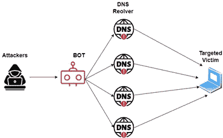

#### 3.2.2 恶意软件注入攻击


# 云恶意软件注入攻击和洪水攻击

企业和个人日益广泛的采用，使得云计算服务提供了无与伦比的便利性和可扩展性。尽管如此，随着如此多的人依赖基于云的服务，黑客们也在寻求创新方法来利用漏洞。可用于渗透基于云的系统并窃取机密信息的一种攻击类型是云恶意软件注入攻击 (Naval, S., 2015)。本文将深入探讨云恶意软件注入攻击，包括其工作原理、可能造成的后果以及可能的预防措施。攻击者必须更改部分云可执行代码或服务，使其变为恶意代码。此类外部攻击的其他形式也被称为元数据欺骗攻击。在这种情况下，攻击者从互联网获取数据，并施压诱导个人无意中上传危险材料 (Rhee, J., 2014)。这是将恶意软件引入云环境的主要途径之一。基于云的攻击包括将恶意软件非法注入基础设施和系统。云架构的 `IAAS`、`PAAS` 和 `SAAS` 层都可能遭受此类攻击 (Musleh, A.S., 2019)。攻击的聚焦技术如下图 Figure 4 所示。

## 攻击序列

这些攻击的正常序列如下：

*   **注入点**：恶意软件注入攻击经常利用 Web 应用程序、API 或配置不当的云服务中的漏洞。这些缺陷可能包括不充分的访问控制、不安全的 API 以及在线表单中的未清理输入。
*   **恶意软件载荷**：被注入的恶意软件可以是病毒、特洛伊木马、勒索软件或间谍软件的形式。一旦进入云环境，它就可能破坏数据安全、窃取机密数据或干扰云服务。
*   **传播**：云环境中受感染的恶意软件实例可以跨连接的资源传播，从而可能危害大量用户和数据。

## 针对恶意软件注入攻击的防御策略

*   **定期安全审计**：对云应用程序和基础设施进行定期安全审计和漏洞评估。尽早识别漏洞并进行修补，以减少攻击面。
*   **实施强访问控制**：应用最小权限和严格的访问控制原则。确保用户仅拥有其角色和职责所需的权限 (Bi, J., 2022)。
*   **Web 应用程序防火墙 (WAF)**：使用 `WAF` 来阻止针对 Web 应用和 API 的恶意请求和载荷，过滤传入流量并对其进行检测。
*   **入侵检测和防御系统 (IDPS)**：使用 `IDPS` 监控网络流量，识别可能表明试图用恶意软件渗透系统的异常活动。
*   **安全教育和培训**：让员工和云管理员了解安全最佳实践、社会工程学风险，以及如何识别和处理网络钓鱼骗局。
*   **安全补丁和更新**：及时为所有云硬件和软件应用最新的安全更新，以减少已知漏洞。
*   **云安全解决方案**：通过利用云服务提供商 (`CSP`) 提供的云安全服务和解决方案，您可以加强云环境的安全性 (Khan, H.A., 2019)。

### Figure 4. 云恶意软件注入攻击

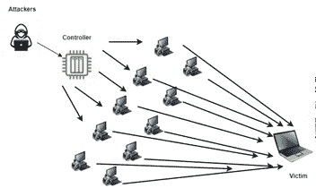

#### 3.2.3 洪水攻击

当网络或服务上发起大量流量时，可能会导致洪水攻击，这是一种拒绝服务攻击。这会导致服务器或主机过度使用系统的随机存取存储器 (`RAM`)。在这些攻击中，主要目的是通过中断受保护资源的提供，阻止合法用户访问它 (Kim, H., 2010)。洪水攻击的架构布局如 Figure 5 所示。

### 云计算中的洪水攻击形式

在 `CC` 的背景下，洪水攻击可以采取几种不同的形式：

*   **传统 DoS 攻击**：在典型的 `DoS` 攻击中，单个攻击者或一小群攻击者用流量淹没云服务或服务器，耗尽其资源，导致短暂或长时间的中断 (Nishanth, N., 2021)。
*   **DDoS 攻击**：在 `DDoS` 攻击中，众多被黑设备或僵尸网络协同努力，用流量淹没目标，这使得缓解和防御变得更加困难 (Wu, Z., 2023)。
*   **应用层攻击**：某些洪水攻击针对特定的基于云的服务或应用程序，利用漏洞或耗尽其资源。

### 针对洪水攻击的防御策略

*   **流量过滤和访问控制**：在网络层使用防火墙和访问控制列表 (`ACLs`) 过滤传入流量。拒绝来自已知恶意 IP 地址或地区的流量，仅允许来自可靠来源的流量。使用基于云的安全服务或本地安全设备在流量到达云资源之前进行过滤。
*   **内容分发网络 (CDNs)**：使用 `CDNs` 可帮助您分发流量并将内容缓存得更靠近客户。因为 `CDNs` 可以处理流量高峰并过滤有害流量，所以您的云基础设施负担会减轻。
*   **负载均衡器**：使用负载均衡器将传入流量均匀地分发到多台云服务器或实例中。在遭受攻击时，负载均衡器有助于防止单台服务器过载。使用自动扩展技术根据流量需求动态调整服务器实例的数量 (Wu, Z., 2023)。
*   **速率限制和流量整形**：使用速率限制来限制来自单个客户端或 IP 地址的请求或连接数量。这可以防止攻击者用请求淹没您的服务。使用流量整形来优先处理合法流量并减轻 `DoS` 攻击的影响。
*   **异常检测系统**：使用专门的异常检测软件或入侵检测和防御系统 (`IDPS`) 监控网络流量，发现可能表明攻击的异常模式或行为。设置警报系统，在发现攻击时向管理员发送通知或启动自动防御机制。
*   **内容安全解决方案**：使用 Web 应用程序防火墙 (`WAFs`) 在应用层分析和过滤流量。`WAFs` 允许正常流量通过，同时阻止恶意请求和载荷。使用反恶意软件和防病毒软件检查传入和传出流量中的已知威胁。
*   **冗余和故障转移**：设计云基础设施时应考虑冗余。使用多个数据中心或可用区，确保如果一个站点成为攻击目标，流量可以被转移到未受影响的资源。实施故障转移系统，在发生攻击时迅速将流量重定向到备用服务器或区域。
*   **DDoS 缓解服务**：使用擅长识别和防止大规模攻击的第三方 `DDoS` 缓解服务。多家云服务提供商也提供 `DDoS` 防护服务。
*   **事件响应计划**：定期制定并测试专门针对洪水攻击的事件响应策略。确保您的团队在发生攻击时能够迅速果断地采取行动。建立沟通准则，例如如何通知相关方，以及在必要时如何联系执法部门。


## 持续监控与分析

密切关注网络性能和流量，以发现攻击者可能试图利用的任何模式或潜在缺陷。分析攻击数据并从过去的错误中吸取教训，以加强防御（Aydeger, A., 2021）。

#### 图 5. 泛洪攻击

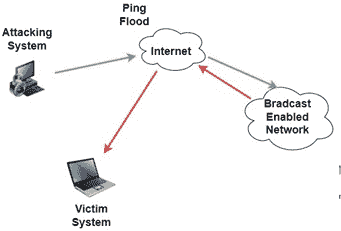

#### 3.2.4 侧信道攻击

攻击者将部署攻击，使恶意虚拟机靠近目标云服务器。在执行加密操作和解读计算机加密信息的同时收集整个主机数据时，这属于安全漏洞（Miki, T., 2019）。与之前的安全攻击不同，侧信道攻击同时影响软件和硬件平台。它不关注软件漏洞如何导致编码错误或代码不匹配，而是会影响硬件规格，例如设备操作系统（Sayyah Ensan, S., 2021）。这种攻击可能发生在任何操作系统上，无论是 Linux、Windows 还是其他系统。与仅限于软件或硬件平台的先前安全攻击不同，侧信道攻击具有两个维度，即硬件和软件。与其关注什么导致软件漏洞引起糟糕的编码或代码位不匹配，不如考虑对硬件可能造成的影响，例如设备应具有哪种类型的操作系统（Das, D., 2018）。此类攻击的一个示例适用于所有操作系统：例如 Linux、Windows 等。如图 6 所示，展示了侧信道攻击的结构。各类侧信道攻击如下：

*   **声学密码分析攻击**：当一个人使用计算机时，该组件可能会监视释放到环境中的电子电路。此外，它还可能收集关于设备电力使用和电磁场的数据。
*   **缓存攻击**：在物理系统环境下，缓存攻击利用缓存处理的时机和方式。
*   **故障分析攻击**：这些攻击在系统计算过程中发生故障时从系统收集数据。
*   **时序攻击**：此类攻击监控 CPU 和内存之间的数据传输。

以下讨论了针对侧信道攻击的防御策略：

为了防范侧信道攻击，虚拟防火墙设备与随机生成的加密解密相结合。通过这种组合，云计算架构的前端和后端都将得到保障（Liu, W., 2022）。首先，企业应高度重视使用安全的加密方法和侧信道攻击防御。为了阻止跨虚拟机数据泄露，隔离和保护虚拟机及容器至关重要。硬件选择和 Hypervisor 安全都应被仔细考量。必须建立严格的访问控制程序和持续监控，以捕捉异常情况。此外，在时序和功耗信道中引入噪声和随机化，有助于挫败攻击者（Aljuffri, A., 2021）。在表 3 中，我们总结了之前所有的外部攻击。

#### 图 6. 侧信道攻击

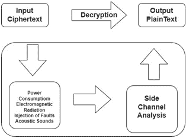

#### 表 3. 攻击总结

| 攻击 | 攻击类型 | 漏洞原因 | 安全违规 | 后果 |
| --- | --- | --- | --- | --- |
| 拒绝服务攻击 | 外部攻击 | 存储漏洞、数据中心漏洞 | 虚拟化层面安全问题 | 软件中断和修改 |
| 恶意软件注入攻击 | 外部攻击 | 电力损失和环境控制失效 | 物理层面安全问题 | 硬件修改和窃取 |
| 泛洪攻击 | 外部攻击 | RREQ 或数据泛洪漏洞 | 流量低层安全问题以及通信缓冲区溢出问题 | 网络流量拥塞 |
| 侧信道攻击 | 被动/主动攻击 | 操作系统漏洞 | 利用恶意跨虚拟机攻击云 | 将同时影响软件和硬件平台 |

## 4. 近期进展


# 相关研究综述

## 文献摘要

(Burra, M.S., 2023) 提出了一种分布式去中心化密码学方法，以增强群组成员密钥生成的安全性。

(Raj, D., 2023) 阐述了 VANET 研究的重要方面，包括应用、安全措施、路由算法和通信协议。

(Chaudhary, A., 2023) 展示了基于 URL 特征的结构，研究了不同的检测方法和策略。随后基于 URL 属性的不同数据集组合分析了性能。研究旨在推动基于 URL 的网络钓鱼检测系统的发展。

(Ding, R., 2023) 提出应实施有效的完整性检查系统以实现完全的身份匿名性。该方法还能简化密钥管理，并最小化与证书管理相关的职责。

(Hao, K., 2023) 针对 IBD 中的安全数据交换问题，引入混合链方法以安全有效地执行数据共享交易。首先提出了一种名为“可互操作共识组”（ICG）的独特概念，将多个基础共识节点分组，每个节点至少监管一条本地区块链。

(Ali, S.A., 2023) 综述了利用机器学习技术预测软件缺陷的著名研究。最常用的技术包括支持向量机（`SVM`）、随机森林（`RF`）和朴素贝叶斯（`NB`）。研究发现随机森林和朴素贝叶斯表现最佳。

(Sudarsa, D., 2023) 提出了一种在云环境下交换数据时保护隐私的方法。

(Ali, M., 2023) 提出了一种面向云数据存储的设计，并提供了一种名为“基于机密性的分类即服务”（`C2aaS`）的新型服务模型作为切实解决方案，该模型根据数据安全级别动态处理数据。

(Abdullayeva, F.J., 2023) 提出了一种面向云计算（`CC`）的新型网络安全参考模型，由包含多个 `CC` 层级的组件构成。虚拟化层和服务层对于提供 `CC` 网络安全至关重要，但当前的参考模型未能完全涵盖这两层。

(Ameur, Y., 2023) 分析了当前可用的多云安全解决方案，指出了未解决的问题和潜在改进领域，研究中使用了同态加密技术。

(Anto Viji, A., 2022) 提出了安全感知调度模型（`SASM`），用于管理云计算中的调度并增强安全性。该模型分两阶段运行：最优调度过程和安全增强。

(Xiao, M., 2022) 阐述了部署云计算及私有云安全平台网络安全的相关理论和方法。

(An, S., 2022) 提出了 `Cloud Safe`，一种前沿的云安全评估与强制执行解决方案。`Cloud Safe` 集成多种安全工具，以执行自动安全评估并为云实施适当的安全措施。为验证其适用性和实用性，研究者在 Amazon AWS 上构建了该系统并进行了安全评估。

(Miao, Y., 2022) 旨在实现紧凑的记录密文大小、阈值解密和阈值多关键词搜索。研究首先提出了一种用于云端群组数据共享的阈值多关键词搜索（`TMS`）技术（即基本 `TMS` 方案），随后进一步扩展该基础方案以实现阈值结果的可追溯性和验证。

(Huang, Q., 2021) 提出了一种面向云计算的多所有者安全数据群组共享与条件传播方案，若属性符合密文中的访问策略，数据分发者可将数据分发给新用户组。

(Nhlabatsi, A., 2021) 提出了一种针对特定威胁的风险评估方法，除考虑客户特定的云安全需求外，还考虑漏洞信息、攻击概率及每种已识别威胁相关攻击的影响等多种云安全属性。

(Huynh, T.T., 2021) 提出了数据生成、存储和交换的模式。组成员在将数据所有者提供的原始数据转化为有价值的数字数据后，基于数据的密文生成证书。

(Zhang, S., 2020) 为云存储上的文件共享提出了一种群组密钥管理协议（`GKMP`）。针对公共信道的网络威胁，建议采用基于混合加密技术的群组密钥生成策略。

(Halabi, T., 2020) 提出了一种联邦创建方法，阻止云服务提供商（`CSP`）形成相对不安全的联邦或加入会降低最小安全损失的联邦。根据实验数据，该方法实现了联邦内更高的安全级别，并降低了 `SLA` 安全违规的频率和严重程度。

(Gan, C., 2020) 探讨了 `IaaS` 架构下虚拟机（`VM`）间恶意软件传播问题。首先展示了一个动态传播模型，用于研究恶意软件扩散相关的关键要素，特别是在 `VM` 中安装杀毒软件的效果。

(Kumari, A., 2020) 为云支持的短信服务提出了安全高效的椭圆曲线密码学（`ECC`）认证方案。该方法分为六个阶段：患者注册、医疗中心上传、治疗、检查、急诊和患者数据上传。

(Zhao, W., 2020) 启动了云增强 `HNF` 计算的研究，并提出了一种有效的外包方案，使资源有限的客户端能将繁重任务委托给资源丰富但可能不诚实的云服务商。

(Zhang, Z., 2020) 分析了在云环境中使用 `ABE` 存在的主要滥用和密钥托管问题。用户的密钥由两个构造者（一个 `KGC` 和一个 `AA`）代表生成。

(Li, Z., 2020) 基于排队论提出了一种数学模型，用于衡量基于容器的云对抗低速率 `DDoS` 攻击的弹性。

(Yang, Y., 2020) 提出了 `EF-TANKS-VOD`：一种无托管可追踪基于属性的多关键词子集搜索系统，支持可验证的外包解密。

(Luo, J.-L., 2020) 为最小化分配虚拟安全功能时的资源浪费，通过组合将服务功能链（`SFC`）汇聚为安全服务功能树。

(Tank, D.M., 2020) 探讨了云计算环境中网络安全威胁与解决方案的虚拟化层面。

## 表 4：文献汇总表

| Author | Year | Description |
| --- | --- | --- |
| (Burra, M.S., 2023) | 2023 | 采用移动成员和反多线程效率的去中心化安全机制。 |
| (Raj, D., 2023) | 2023 | VANET 研究的重要方面包括应用、安全措施、路由算法和通信协议。 |
| (Chaudhary, A., 2023) | 2023 | 利用各种 URL 属性分析基于 URL 的检测算法性能，旨在支持网络钓鱼检测系统的进步。 |
| (Ding, R., 2023) | 2023 | 通过针对授权用户数据共享的简单谓词，简化操作并降低开销。 |
| (Hao, K., 2023) | 2023 | `ICG` 通过支持本地区块链的核心共识节点实现安全数据共享。 |
| (Ali, S.A., 2023) | 2023 | 通过回顾机器学习预测软件缺陷的研究，发现朴素贝叶斯优于随机森林和 `SVM`。 |
| (Sudarsa, D., 2023) | 2023 | 云数据隐私：9 步骤——设置、注册、密钥管理、文件处理、加密。 |
| (Ali, M., 2023) | 2023 | `C2aaS` 根据安全级别调整数据处理，实现安全云存储。 |


## 文献综述表

| 引用 | 年份 | 核心贡献 |
| :--- | :--- | :--- |
| (Abdullayeva, F.J, 2023) | 2023 | 新云安全策略结合虚拟化、服务、社交媒体和 IoT 以应对网络犯罪。 |
| (Ameur, Y., 2023) | 2023 | 利用同态加密检查云安全性。 |
| (Anto Viji, A, 2022) | 2022 | SASM 模型用于增强安全性并更高效地分配资源任务。 |
| (Xiao, M., 2022) | 2022 | 建议改进私有云安全性，以节约面临数据存储挑战的组织的成本。 |
| (An, S., 2022) | 2022 | Cloud Safe 简化了 Amazon AWS 内的安全验证，使一切功能良好运行。 |
| (Miao, Y., 2022) | 2022 | 一种用于安全数据共享的云协议，支持搜索、解密、压缩和结果追踪以建立信任。 |
| (Huang, Q., 2021) | 2021 | 基于用户属性和访问规则在加密文件中安全共享数据。 |
| (Nhlabatsi, A., 2021) | 2021 | 一种定制的风险评估方法，综合考虑客户需求、漏洞和云中的攻击可能性。 |
| (Huynh, T.T., 2021) | 2021 | 基于 IPFS：模拟到数字、群签名验证、区块链存储以实现用户验证访问。 |
| (Zhang, S., 2020) | 2020 | 高效云文件共享：混合加密、抵御网络威胁的安全性、验证机制防止协同攻击。 |
| (Halabi, T., 2020) | 2020 | 促进防范不忠诚云供应商的协作安全，并减少 SLA 漏洞。 |
| (Gan, C., 2020) | 2020 | 通过研究决定因素和虚拟机杀毒软件影响，遏制 IaaS 中恶意软件传播。 |
| (Kumari, A., 2020) | 2020 | 基于 ECC 的短信认证模型，包含 6 个阶段：注册、数据提交、处理、检查和紧急处理。 |
| (Zhao, W., 2020) | 2020 | 探索面向资源受限客户端的安全高效云计算，客户端信任非受信云服务器。 |
| (Zhang, Z., 2020) | 2020 | 涉及 KGC 和 AA，解决云中 ABE 关键滥用和托管问题。 |
| (Li, Z., 2020) | 2020 | 排队论评估系统基于跟踪请求或任务排列能力拒绝攻击者的效率。 |
| (Yang, Y., 2020) | 2020 | 引入 EF-TANKS-VOD，消除了基于属性的关键词子集搜索中对托管的需求。 |
| (Luo, J.-L, 2020) | 2020 | 服务功能链 (SFCs) 连接创建复合虚拟集群，降低硬件资源负载。 |
| (Tank, D. M., 2020) | 2020 | 探讨云计算环境中网络安全威胁和解决方案的虚拟化方面。 |

## 5. 结论

CC 指通过互联网访问的虚拟计算机，应用程序和数据托管在远程服务器上，而非用户的计算机上。本文概述了 CC 作为一门新兴学科的发展脉络，其萌芽可追溯至 1950 年代末。文章探讨了云中共享数据的概念，强调了群组的革命性力量。群组数据共享彻底改变了企业管理和部署数据的方式，提供了无与伦比的可用性、经济性、灵活性和最新信息。然而，随着 CC 逐步改变网络世界，安全性成为主要问题。只有通过访问控制和数据加密，才能保证共享数据的机密性和完整性，从而实现其各种形式的应用。本文进一步讨论了复杂的 CC 安全问题。它分析了围绕 CC 的影响，例如数据泄露、内部威胁和外部攻击。组织应了解这些安全问题和漏洞，以加强其对网络潜在危害的防御。本研究还意味着组织及其合作伙伴在采用 CC 时应保持高度谨慎，因为其仍易受安全问题影响。在信息时代，这意味着必须采取双重策略：充分利用云技术提供的优势，同时保护敏感数据和系统免受不断演变的威胁。

## 参考文献

Abdullayeva, F. J. (2023). Cyber resilience and cyber security issues of intelligent cloud computing systems. *Results in Control and Optimization*, 12, 100268. DOI: [10.1016/j.rico.2023.100268](http://dx.doi.org/10.1016/j.rico.2023.100268)

Ali, M., Khan, S. U., & Vasilakos, A. V. (2015). Security in cloud computing: Opportunities and challenges. *Information Sciences*, 305, 357–383. DOI: [10.1016/j.ins.2015.01.025](http://dx.doi.org/10.1016/j.ins.2015.01.025)

Ali, M., Tang Jung, L., Hassan Sodhro, A., Ali Laghari, A., Birahim Belhaouari, S., & Gillani, Z. (2023). A confidentiality-based data classification-as-a-service (C2aaS) for cloud security. *Alexandria Engineering Journal*, 64, 749–760. DOI: [10.1016/j.aej.2022.10.056](http://dx.doi.org/10.1016/j.aej.2022.10.056)

Ali, S. A., Roy, N. R., & Raj, D. “Software Defect Prediction using Machine Learning”, 2023, Proceedings of the 17th INDIACom; 10th International Conference on Computing for Sustainable Global Development, INDIACom 2023, PP: 639-642.

Sudarsa, D., A, N. R., & AP, S. (2023). An effective and secured authentication and sharing of data with dynamic groups in cloud. *Data and Knowledge Engineering*, 145, 102125. DOI: [10.1016/j.datak.2022.102125](http://dx.doi.org/10.1016/j.datak.2022.102125)

Aljuffri, A., Zwalua, M., Reinbrecht, C. R. W., Hamdioui, S., & Taouil, M. (2021, November). “Applying Thermal Side-Channel Attacks on Asymmetric Cryptography,” in *IEEE Transactions on Very Large Scale Integration (VLSI)*. *IEEE Transactions on Very Large Scale Integration (VLSI) Systems*, 29(11), 1930–1942. DOI: [10.1109/TVLSI.2021.3111407](http://dx.doi.org/10.1109/TVLSI.2021.3111407)

Alliance, C. S. “Top threats to cloud computing, version 1.0,” *Cloud Security Alliance*, Tech. Rep., March 2020. \[Online\]. Available: [`www.cloudsecurityalliance.org/topthreats/csathreats.v1.0.pdf`](http://www.cloudsecurityalliance.org/topthreats/csathreats.v1.0.pdf)

Ameur, Y., Bouzefrane, S., & Vinh, T. L. (2023). Handling security issues by using homomorphic encryption in multi-cloud environment. *Procedia Computer Science*, 220, 390–397. DOI: [10.1016/j.procs.2023.03.050](http://dx.doi.org/10.1016/j.procs.2023.03.050)

An, S., Leung, A., Hong, J. B., Eom, T., & Park, J. S. (2022). Toward Automated Security Analysis and Enforcement for Cloud Computing Using Graphical Models for Security. *IEEE Access : Practical Innovations, Open Solutions*, 10, 75117–75134. DOI: [10.1109/ACCESS.2022.3190545](http://dx.doi.org/10.1109/ACCESS.2022.3190545)

A. Aydeger, M. H. Manshaei, M. A. Rahman and K. Akkaya, “Strategic Defense Against Stealthy Link Flooding Attacks: A Signaling Game Approach,” in *IEEE Transactions on Network Science and Engineering*, vol. 8, no. 1, pp. 751-764, 1 Jan.-March 2021. DOI: [10.1109/TNSE.2021.3052090](http://dx.doi.org/10.1109/TNSE.2021.3052090)

Bharadwaj, D. R., Bhattacharya, A., & Chakkaravarthy, M. “Cloud Threat Defense – A Threat Protection and Security Compliance Solution,” 2018 *IEEE International Conference on Cloud Computing in Emerging Markets (CCEM)*, Bangalore, India, 2018, pp. 95-99. DOI: [10.1109/CCEM.2018.00024](http://dx.doi.org/10.1109/CCEM.2018.00024)

Bi, J., Luo, F., He, S., Liang, G., Meng, W., & Sun, M. (2022, September). False Data Injection- and Propagation-Aware Game Theoretical Approach for Microgrids. *IEEE Transactions on Smart Grid*, 13(5), 3342–3353. DOI: [10.1109/TSG.2022.3174918](http://dx.doi.org/10.1109/TSG.2022.3174918)

Bishop, M., & Gates, C. “Defining the Insider Threat”, in *Proc. of the 4th Annual Workshop on Cyber Security and Information Intelligence Research*, Tennessee, Vol. 288, 2008.


## 参考文献

Burra, M. S., & Maity, S. (2023). A Distributed and Decentralized Certificateless Framework for Reliable Shared Data Auditing for FOG-CPS Networks. *IEEE Access : Practical Innovations, Open Solutions*, 11, 42595–42618. DOI: [10.1109/ACCESS.2023.3271605](http://dx.doi.org/10.1109/ACCESS.2023.3271605)

Chaudhary A.; Krishna K.C.; Shadik M.; Raj D. (2023). “A review on malicious link detection techniques”. *Artificial Intelligence, Blockchain, Computing and Security: Volume 1*, Volume-1, PP: 768-777. DOI: [10.1201/9781003393580-114](http://dx.doi.org/10.1201/9781003393580-114)

Das, D., Maity, S., Nasir, S. B., Ghosh, S., Raychowdhury, A., & Sen, S. (2018, October). ASNI: Attenuated Signature Noise Injection for Low-Overhead Power Side-Channel Attack Immunity. *IEEE Transactions on Circuits and Systems. I, Regular Papers*, 65(10), 3300–3311. DOI: [10.1109/TCSI.2018.2819499](http://dx.doi.org/10.1109/TCSI.2018.2819499)

Deshmukh, R. V., & Devadkar, K. K. (2015). Understanding DDoS attack & its effect in cloud environment. *Procedia Computer Science*, 49, 202–210. DOI: [10.1016/j.procs.2015.04.245](http://dx.doi.org/10.1016/j.procs.2015.04.245)

Furht, B., & Escalante, A. (2010). *Handbook of cloud computing* (Vol. 3). Springer. DOI: [10.1007/978-1-4419-6524-0](http://dx.doi.org/10.1007/978-1-4419-6524-0)

Gan, C., Feng, Q., Zhang, X., Zhang, Z., & Zhu, Q. (2020). Dynamical Propagation Model of Malware for Cloud Computing Security. *IEEE Access : Practical Innovations, Open Solutions*, 8, 20325–20333. DOI: [10.1109/ACCESS.2020.2968916](http://dx.doi.org/10.1109/ACCESS.2020.2968916)

Garfinkel, S. (1999). *Architects of the information society: 35 years of the Laboratory for Computer Science at MIT*. MIT press. DOI: [10.7551/mitpress/1341.001.0001](http://dx.doi.org/10.7551/mitpress/1341.001.0001)

Hao, K., Xin, J., Wang, Z., Yao, Z., & Wang, G. (2023, August 1). Efficient and Secure Data Sharing Scheme on Interoperable Blockchain Database. *IEEE Transactions on Big Data*, 9(4), 1171–1185. DOI: [10.1109/TBDATA.2023.3265178](http://dx.doi.org/10.1109/TBDATA.2023.3265178)

Hendre, A., & Joshi, K. P. (2015). “A Semantic Approach to Cloud Security and Compliance”. *2015 IEEE 8th International Conference on Cloud Computing*, New York, NY, USA, pp. 1081-1084. DOI: [10.1109/CLOUD.2015.157](http://dx.doi.org/10.1109/CLOUD.2015.157)

Huynh, T. T., Nguyen, T. D., Hoang, T., Tran, L., & Choi, D. (2021). A Reliability Guaranteed Solution for Data Storing and Sharing. *IEEE Access : Practical Innovations, Open Solutions*, 9, 108318–108328. DOI: [10.1109/ACCESS.2021.3100707](http://dx.doi.org/10.1109/ACCESS.2021.3100707)

Jadeja, Y., & Modi, K. (2012). “Cloud computing - concepts, architecture and challenges”. *Computing, Electronics and ElectricalTechnologies (ICCEET), 2012 International Conference on*, pp. 877-880. DOI: [10.1109/ICCEET.2012.6203873](http://dx.doi.org/10.1109/ICCEET.2012.6203873)

Joshi, A., Raturi, A., Kumar, S., Dumka, A., & Singh, D. P. (2022). “Improved Security and Privacy in Cloud Data Security and Privacy: Measures and Attacks”. *2022 International Conference on Fourth Industrial Revolution Based Technology and Practices (ICFIRTP)*, Uttarakhand, India, pp. 230-233. DOI: [10.1109/ICFIRTP56122.2022.10063186](http://dx.doi.org/10.1109/ICFIRTP56122.2022.10063186)

Kaur, R., & Kaur, J. (2015). “Cloud computing security issues and its solution: A review”. *2015 2nd International Conference on Computing for Sustainable Global Development (INDIACom)*, New Delhi, India, pp. 1198-1200.

Kautish, S., A, R., & Vidyarthi, A. (2022, September). R. A and A. Vidyarthi, “SDMTA: Attack Detection and Mitigation Mechanism for DDoS Vulnerabilities in Hybrid Cloud Environment”. *IEEE Transactions on Industrial Informatics*, 18(9), 6455–6463. DOI: [10.1109/TII.2022.3146290](http://dx.doi.org/10.1109/TII.2022.3146290)

H. A. Khan et al. (2021). “IDEA: Intrusion Detection through Electromagnetic-Signal Analysis for Critical Embedded and Cyber-Physical Systems”. *IEEE Transactions on Dependable and Secure Computing*, vol. 18, no. 3, pp. 1150-1163, 1 May-June 2021. DOI: [10.1109/TDSC.2019.2932736](http://dx.doi.org/10.1109/TDSC.2019.2932736)

Kim, H., Chitti, R. B., & Song, J. (2010, May). Novel defense mechanism against data flooding attacks in wireless ad hoc networks. *IEEE Transactions on Consumer Electronics*, 56(2), 579–582. DOI: [10.1109/TCE.2010.5505973](http://dx.doi.org/10.1109/TCE.2010.5505973)

Kumari, A., Kumar, V., Abbasi, M. Y., Kumari, S., Chaudhary, P., & Chen, C.-M. (2020). CSEF: Cloud-Based Secure and Efficient Framework for Smart Medical System Using ECC. *IEEE Access : Practical Innovations, Open Solutions*, 8, 107838–107852. DOI: [10.1109/ACCESS.2020.3001152](http://dx.doi.org/10.1109/ACCESS.2020.3001152)

Lai, S.-T., & Leu, F.-Y. (2015). “A Security Threats Measurement Model for Reducing Cloud Computing Security Risk”. *2015 9th International Conference on Innovative Mobile and Internet Services in Ubiquitous Computing*, Santa Catarina, Brazil, pp. 414-419. DOI: [10.1109/IMIS.2015.64](http://dx.doi.org/10.1109/IMIS.2015.64)

Lamport, L., Shostak, R. E., & Pease, M. C. (1982). The Byzantine Generals problem. *ACM Transactions on Programming Languages and Systems*, 4(3), 382–401. DOI: [10.1145/357172.357176](http://dx.doi.org/10.1145/357172.357176)

Li, Z., Jin, H., Zou, D., & Yuan, B. (2020, March 1). Exploring New Opportunities to Defeat Low-Rate DDoS Attack in Container-Based Cloud Environment. *IEEE Transactions on Parallel and Distributed Systems*, 31(3), 695–706. DOI: [10.1109/TPDS.2019.2942591](http://dx.doi.org/10.1109/TPDS.2019.2942591)

Liu, W. (2012). “Research on cloud computing security problem and strategy”. *2012 2nd International Conference on Consumer Electronics, Communications and Networks (CECNet)*, Yichang, China, pp. 1216-1219. DOI: [10.1109/CECNet.2012.6202020](http://dx.doi.org/10.1109/CECNet.2012.6202020)

Liu, W., Zhang, Y., Tang, Y., Wang, H., & Wei, Q. (2023). ALScA: A Framework for Using Auxiliary Learning Side-Channel Attacks to Model PUFs. *IEEE Transactions on Information Forensics and Security*, 18, 804–817. DOI: [10.1109/TIFS.2022.3227445](http://dx.doi.org/10.1109/TIFS.2022.3227445)

Luo, J.-L., Yu, S.-Z., & Peng, S.-J. (2020). SDN/NFV-Based Security Service Function Tree for Cloud. *IEEE Access : Practical Innovations, Open Solutions*, 8, 38538–38545. DOI: [10.1109/ACCESS.2020.2974569](http://dx.doi.org/10.1109/ACCESS.2020.2974569)

Mell, P., & Grance, T. (2009). Version 15 The NIST definition of cloud computing October 7. *National Institute of Standards and Technology*. [`csrc.nist.gov/groups/SNS/cloud-computing`](https://csrc.nist.gov/groups/SNS/cloud-computing)

Miki, T., Miura, N., Sonoda, H., Mizuta, K., & Nagata, M. (2020, January). A Random Interrupt Dithering SAR Technique for Secure ADC Against Reference-Charge Side-Channel Attack. *IEEE Transactions on Circuits and Systems. II, Express Briefs*, 67(1), 14–18. DOI: [10.1109/TCSII.2019.2901534](http://dx.doi.org/10.1109/TCSII.2019.2901534)

Moore, A. P., Capelli, D. M., Caron, T. C., Shaw, E., Spooner, D., & Trzeciak, R. F. (2011). A preliminary model of insider theft of intellectual property. *Journal of Wireless Mobile Networks, Ubiquitous Computing and Dependable Applications*, 2(1).

Musleh, A. S., Chen, G., & Dong, Z. Y. (2020, May). A Survey on the Detection Algorithms for False Data Injection Attacks in Smart Grids. *IEEE Transactions on Smart Grid*, 11(3), 2218–2234. DOI: [10.1109/TSG.2019.2949998](http://dx.doi.org/10.1109/TSG.2019.2949998)


## 参考文献

Naval, S., Laxmi, V., Rajarajan, M., Gaur, M. S., & Conti, M. (2015, December). 利用程序语义进行恶意软件检测。 *IEEE Transactions on Information Forensics and Security*（IEEE 信息取证与安全汇刊），10(12)，2591–2604。DOI：[10.1109/TIFS.2015.2469253](http://dx.doi.org/10.1109/TIFS.2015.2469253)

A. Nhlabatsi 等，“云环境中的威胁特定安全风险评估”，载于 *IEEE Transactions on Cloud Computing*（IEEE 云计算汇刊），第 9 卷，第 2 期，第 793-806 页，2021 年 4 月-6 月。DOI：[10.1109/TCC.2018.2883063](http://dx.doi.org/10.1109/TCC.2018.2883063)

Nishanth, N., & Mujeeb, A. (2021, September). 利用不确定推理对无线自组网中基于泛洪的拒绝服务攻击进行建模与检测。 *IEEE Transactions on Cognitive Communications and Networking*（IEEE 认知通信与网络汇刊），7(3)，893–904。DOI：[10.1109/TCCN.2021.3055503](http://dx.doi.org/10.1109/TCCN.2021.3055503)

Pan, J.-S., Chen, S.-M., & Nguyen, N. T. (Eds.). “云计算安全问题”，*ACIIDS 2012, Part II, LNAI 7197*，第 560–569 页，2012。

Q. Huang, Y. Yang, W. Yue and Y. He, “云计算中支持多所有者的安全数据组共享与条件分发”，载于 *IEEE Transactions on Cloud Computing*，第 9 卷，第 4 期，第 1607-1618 页，2021 年 10 月-12 月。DOI：[10.1109/TCC.2019.2908163](http://dx.doi.org/10.1109/TCC.2019.2908163)

R. B. Bohn, J. Messina, F. Liu, J. Tong, and J. Mao, “NIST 云计算参考架构”，载于 *Proceedings - 2011 IEEE World Congress on Services, SERVICES 2011*，2011，no. July 2011，第 594–596 页。

R. Ding, Y. Xu, H. Zhong, J. Cui and G. Min, “一种面向云数据共享的具有完全身份匿名性的高效完整性检查方案”，载于 *IEEE Transactions on Cloud Computing*，第 11 卷，第 3 期，第 2922-2935 页，2023 年 7 月-9 月。DOI：[10.1109/TCC.2023.3242140](http://dx.doi.org/10.1109/TCC.2023.3242140)

Raj D.; Sagar A.K., “车载自组网：应用与安全综述”，2023，*Communications in Computer and Information Science*（计算机与信息科学通讯），Volume-1921 CCIS，PP: 241-255，DOI：[10.1007/978-3-031-45124-9_19](http://dx.doi.org/10.1007/978-3-031-45124-9_19)

Rhee, J., Riley, R., Lin, Z., Jiang, X., & Xu, D. (2014, January). 以数据为中心的操作系统内核恶意软件表征。 *IEEE Transactions on Information Forensics and Security*，9(1)，72–87。DOI：[10.1109/TIFS.2013.2291964](http://dx.doi.org/10.1109/TIFS.2013.2291964)

Sabrina De Capitani di Vimercati, Sara Foresti, Stefano Paraboschi, Member, Gerardo Pelosi, and Pierangela Samarati, “用于访问机密性的三服务器交换”，*IEEE Transaction on Cloud Computing*，2015。Neha Mahakalkar, Vaishali Sahare, “基于重加密安全机制实现云计算中共享访问认证”，《2017 年 5 月 12 日国际会议》。

Salesforce, “Salesforce crm.” [`www.salesforce.com/platform`](https://www.salesforce.com/platform). [Online; accessed 25-Sep-2023]。Microsoft, “Windows azure.” [`www.microsoft.com/azure`](http://www.microsoft.com/azure). [Online; accessed 25-Sep-2023]。Google, “Google app engine.” [`code.google.com/appengine`](http://code.google.com/appengine). [Online; accessed 25-Sep-2023]。Amazon, “Amazon elastic computing cloud.” [`aws.amazon.com/`](https://aws.amazon.com/) ec2. [Online; accessed 26-Sep-2023]。Q. Wang, C. Wang, J. Li, K. Ren, and W. Lou, “为云计算存储安全实现公开可验证性和数据动态性”，载于 *Proc. of ESORICS'09*，法国圣马洛，2009 年 9 月。P. Saripalli, and B. Walters, “QUIRC: 云安全的定量影响与风险评估框架”，《2010 IEEE 3rd Intl. Conf. on Cloud Computing》；美国佛罗里达州迈阿密，2010 年 7 月。

Sayyah Ensan, S., Nagarajan, K., Khan, M. N. I., & Ghosh, S. (2021, December). “SCARE：针对内存计算的侧信道攻击以实现逆向工程”，载于 *IEEE Transactions on Very Large Scale Integration (VLSI)*。*IEEE Transactions on Very Large Scale Integration (VLSI) Systems*，29(12)，2040–2051。DOI：[10.1109/TVLSI.2021.3110744](http://dx.doi.org/10.1109/TVLSI.2021.3110744)

Sendi, A. S., & Cheriet, M. “云计算：一种风险评估模型”，《2014 IEEE International Conference on Cloud Engineering》，美国马萨诸塞州波士顿，2014，第 147-152 页，DOI：[10.1109/IC2E.2014.17](http://dx.doi.org/10.1109/IC2E.2014.17)

S. Simla Mercy, Dr. G. Umarani Srikanth, “面向云系统环境组数据共享的高效数据安全系统”，2014。

Somani, G., Gaur, M. S., Sanghi, D., Conti, M., & Buyya, R. (2017). 云计算中的 DDoS 攻击：问题、分类与未来方向。 *Computer Communications*（计算机通信），107，30–48。DOI：[10.1016/j.comcom.2017.03.010](http://dx.doi.org/10.1016/j.comcom.2017.03.010)

G. Somani, M. S. Gaur, D. Sanghi, M. Conti and M. Rajarajan, “Scale Inside-Out：云 DDoS 攻击的快速缓解”，载于 *IEEE Transactions on Dependable and Secure Computing*（IEEE 可靠与安全计算汇刊），第 15 卷，第 6 期，第 959-973 页，2018 年 11 月-12 月。DOI：[10.1109/TDSC.2017.2763160](http://dx.doi.org/10.1109/TDSC.2017.2763160)

T. Halabi and M. Bellaiche, “面向基于安全的云联邦形成：一种博弈论方法”，载于 *IEEE Transactions on Cloud Computing*，第 8 卷，第 3 期，第 928-942 页，2020 年 7 月-9 月。DOI：[10.1109/TCC.2018.2820715](http://dx.doi.org/10.1109/TCC.2018.2820715)

Tank, D. M., Aggarwal, A., & Chaubey, N. K. (2020). 云计算环境中虚拟化的网络安全方面：分析虚拟化特有的网络安全风险。载于 Chaubey, N., & Prajapati, B. (Eds.), *Quantum Cryptography and the Future of Cyber Security*（量子密码学与网络安全的未来）（第 283–299 页）。IGI Global。DOI：[10.4018/978-1-7998-2253-0.ch013](http://dx.doi.org/10.4018/978-1-7998-2253-0.ch013)

Tchao, E. T., Quansah, D. A., Klogo, G. S., Boafo-Effah, F., Kotei, S., Nartey, C., & Ofosu, W. K. (2021b). 面向智能电网集成的基于云的系统和分布式平台：加纳电网的挑战与前景。 *Scientific African*，12，e00796。DOI：[10.1016/j.sciaf.2021.e00796](http://dx.doi.org/10.1016/j.sciaf.2021.e00796)

Viji, A. A., Jasper, J., & Latha, T. (2022). 用于增强云计算中安全性和工作流模型的高效安全感知调度模型。 *Optik (Stuttgart)*，170349，170349。Advance online publication。DOI：[10.1016/j.ijleo.2022.170349](http://dx.doi.org/10.1016/j.ijleo.2022.170349)

O. A. Wahab, J. Bentahar, H. Otrok and A. Mourad, “用于云中检测基于 VM 的 DDoS 攻击的最优负载分发”，载于 *IEEE Transactions on Services Computing*（IEEE 服务计算汇刊），第 13 卷，第 1 期，第 114-129 页，2020 年 1 月-2 月。DOI：[10.1109/TSC.2017.2694426](http://dx.doi.org/10.1109/TSC.2017.2694426)

Z. Wu, S. Peng, L. Liu and M. Yue, “基于 BO-GBM 融合算法在 NDN 中检测改进的串谋利益泛洪攻击”，载于 *IEEE Transactions on Network Science and Engineering*（IEEE 网络科学与工程汇刊），第 10 卷，第 1 期，第 239-252 页，2023 年 1 月-2 月。DOI：[10.1109/TNSE.2022.3206581](http://dx.doi.org/10.1109/TNSE.2022.3206581)

Xiao, M., Guo, M., & Zhu, W. (2022). 基于私有云安全平台的网络安全部署研究与实现。 *Procedia Computer Science*，208，565–569。DOI：[10.1016/j.procs.2022.10.078](http://dx.doi.org/10.1016/j.procs.2022.10.078)

Y. Miao, R. H. Deng, K. -K. R. Choo, X. Liu and H. Li, “面向基于云的组数据共享的阈值多关键词搜索”，载于 *IEEE Transactions on Cloud Computing*，第 10 卷，第 3 期，第 2146-2162 页，2022 年 7 月-9 月。DOI：[10.1109/TCC.2020.2999775](http://dx.doi.org/10.1109/TCC.2020.2999775)

Y. Yang, X. Liu, X. Zheng, C. Rong and W. Guo, “面向安全云存储的高效可追踪授权搜索系统”，载于 *IEEE Transactions on Cloud Computing*，第 8 卷，第 3 期，第 819-832 页，2020 年 7 月-9 月。DOI：[10.1109/TCC.2018.2820714](http://dx.doi.org/10.1109/TCC.2018.2820714)

Yu, S., Tian, Y., Guo, S., & Wu, D. O. (2014, September). 我们能战胜云中的 DDoS 攻击吗？ *IEEE Transactions on Parallel and Distributed Systems*（IEEE 并行与分布式系统汇刊），25(9)，2245–2254。DOI：[10.1109/TPDS.2013.181](http://dx.doi.org/10.1109/TPDS.2013.181)


# 5G 网络的网络安全技术

**Himadri Sekhar Das**  
  
哈尔迪亚理工学院，印度

**Sandipan Samanta**  
CGI，班加罗尔，印度

**Rajrupa Metia**  
哈尔迪亚理工学院，印度

**Debasish Samanta**  
IBM 加尔各答，印度

**Banibrata Bag**  
哈尔迪亚理工学院，印度

## 摘要

5G 网络的快速部署因其增强的速度、低延迟和海量连接而带来了新的网络安全挑战。为保障这些网络安全，先进技术至关重要，包括用于隔离威胁的网络切片、用于实时威胁检测的人工智能和机器学习，以及用于保障交易安全的区块链。此外，零信任架构确保无论来源如何，每个访问请求都经过身份验证。这些策略结合强大的加密和异常检测机制，对于应对 5G 生态系统中多样且不断演变的威胁至关重要，确保为用户和行业提供安全可靠的通信。

## 引言

5G 作为第五代移动网络，标志着电信领域的重大飞跃，有望给各行业和日常生活带来变革性的变化。与前几代不同，5G 旨在提供最快的数据速度、海量连接和高可靠性通信，使其成为物联网（`IoT`）、智慧城市、自动驾驶汽车和先进医疗应用等创新的基石（Huseien, F. G. & Shah, W. K., 2022）。凭借每平方公里支持多达数百万台设备的能力，5G 网络有能力应对联网设备和业务的爆发式增长，实现此前仅存在于科幻电影中的新可能。

5G 网络的架构建立在几项关键技术之上，包括毫米波频谱、大规模 `MIMO`（多输入多输出）、网络切片、软件定义网络（`SDN`）和网络功能虚拟化（`NFV`）。这些技术协同工作，提供前所未有的性能和灵活性，使网络运营商能够根据特定用例和客户需求定制服务（Lorincz et al., 2024）。网络切片尤为先锋，它允许在单一物理网络基础设施内创建多个虚拟网络，每个网络都针对不同类型的服务进行了优化，例如高速移动宽带、低延迟应用和大规模 `IoT` 连接。图 1. 5G 技术的不同特性，如大容量、快速响应、广覆盖等。

### 图 1. 5G 技术的不同特性

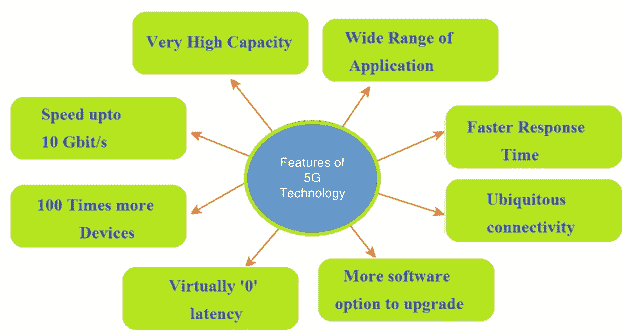

## 5G 中网络安全的重要性

随着 5G 网络成为现代关键基础设施的支柱，其安全性至关重要。5G 网络内设备和系统的连接性和关联性增强，意味着网络一小部分的安全漏洞可能产生连锁效应，潜在地干扰关键服务并造成广泛损害（Georgiou et al., 2021）。在医疗、交通、能源和金融等数据可用性和完整性至关重要的领域，风险尤为高。

5G 的主要担忧之一是攻击面的扩大。`SDN`、`NFV` 和边缘计算等新技术的引入，以及连接到 5G 网络的海量 `IoT` 设备，创造了众多脆弱点。网络攻击者不仅可以针对网络基础设施，还可以针对运行在其上的设备、应用程序和服务（Georgiou et al., 2021）。在早期移动网络代际中有效的传统安全措施可能不再足够，这要求开发专门针对 5G 独特挑战的新型网络安全技术（Fakhouri, H. N., 2023）。

此外，5G 网络遭受网络攻击可能产生地缘政治影响，这为安全格局增加了另一层复杂性。随着各国竞相引领 5G 部署，关于间谍活动、破坏以及利用 5G 基础设施进行进攻性网络行动的担忧已浮出水面。因此，确保 5G 网络的安全不仅是一项技术挑战，也是国家安全和国际关系的问题。

### 本章的目的与范围

本章旨在概述为保护 5G 网络而开发的网络安全技术。通过考察这些技术多年来的演变，本章重点介绍了为应对日益增长和不断变化的威胁格局而出现的自适应策略。讨论将涵盖广泛的主题，包括 5G 独有的安全挑战、人工智能（`AI`）、区块链和量子密码学等新兴技术在增强 5G 安全性中的作用，以及这些技术在现实场景中的实际实施。

本章范围广泛，涵盖 5G 网络安全的理论和实践两方面。它将深入探讨网络切片、`SDN` 和 `NFV` 等技术带来的具体挑战，并探索这些挑战如何通过创新安全解决方案得到解决。本章还将审视 5G 安全对关键基础设施和 `IoT` 设备的影响，为保护 5G 生态系统中这些关键组件的最佳实践提供见解。

### 背景与动机


## 移动网络的演进与 5G 安全挑战

从 1G 到 5G 的移动网络演进，反映了技术、容量和能力的巨大飞跃。第一代（1G）引入了基本的语音通信，依赖模拟信号，安全功能有限。随着 2G 的出现，采用了数字信号，通过基本加密和短信服务的引入实现了更安全的通信。3G 网络标志着移动数据服务的开始，允许互联网接入和多媒体消息传递，而 4G 通过提供高速互联网、支持视频流媒体和催生移动应用，彻底改变了移动体验。每一代不仅在速度和功能上带来了增强，也在安全性上应对不断演变的威胁格局。然而，这些前几代网络均未预见到 5G 将引入的连接水平、数据生成量和依赖程度。

5G 凭借超快速度、低延迟以及连接数十亿设备的能力，相较于前代实现了质的飞跃。它旨在不仅支持智能手机，还支持海量连接设备，从自动驾驶汽车到智慧城市和工业物联网应用。然而，这种连接性和数据流的指数级增长，也带来了前所未有的安全挑战。

### 5G 独有的关键安全挑战

5G 网络的构建和功能特性带来了前几代所没有的各种安全挑战。基本挑战之一是由于海量连接设备导致的攻击面扩大。物联网设备融入 5G 网络意味着每个设备都可能成为网络攻击的入口点（Banafaa, M 等，2023）。许多此类设备计算能力和存储受限，难以实施强有力的安全措施。

另一个棘手的挑战是网络切片，它允许在单一物理基础设施内创建多个虚拟网络。虽然这是优化资源利用的关键特性，但也引发了对切片间隔离性以及跨切片攻击潜在风险的担忧。

### 对增强安全框架的需求

鉴于这些挑战，迫切需要专门针对 5G 网络量身定制的增强安全框架。对于 4G 和早期网络足够的传统安全措施，已无法应对 5G 带来的复杂性和风险。新的安全框架必须设计用于保护 5G 多样化且动态的环境，确保数据完整性、机密性和可用性在网络的各个方面得到维护。这些框架必须融合先进技术，如用于威胁检测的人工智能、用于安全交易管理的区块链，以及用于面向未来的加密的量子密码学。

## 5G 网络中的安全挑战

### 设备密度增加与物联网融合

5G 网络中最重要的安全挑战之一是设备密度的空前增加以及物联网的广泛融合。5G 网络计划支持每平方公里多达一百万台设备，比前几代有了巨大提升（O’Connell 等，2020）。这种海量的连接设备，从智能手机到智慧城市中的传感器，极大地扩展了攻击面，使得网络攻击者更容易瞄准漏洞。

许多物联网设备处理能力和存储有限，这限制了它们实施强安全措施的能力。这些设备经常运行过时或不安全的软件，使其易受恶意软件注入、分布式拒绝服务（DDoS）攻击和未授权访问等攻击。此外，连接到 5G 网络的海量物联网设备意味着，即使是一个微小的安全缺口也可能产生级联效应，危及整个网络。

**图 2. 5G 网络中的不同安全挑战**

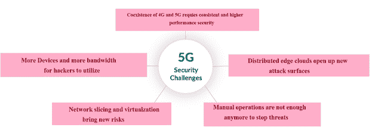

### 异构网络架构

5G 网络本质上是异构的，集成了多种技术、协议和设备。这种异质性是一把双刃剑：虽然它使 5G 能够支持多样化的应用和服务，但也引入了复杂性，使得安全管理更具挑战性（Pons, M. 2023）。不同无线接入技术（如 LTE、毫米波和 Wi-Fi）、多厂商设备以及多样化的用户需求的结合，创造了一个碎片化的网络环境，传统安全机制可能在此失效。挑战在于确保在这一多变的环境中实现一致且全面的安全。例如，某个组件（如 Wi-Fi 接入点）中的漏洞可能被利用来危害网络的其他部分。这些不同组件之间对无缝互操作性的需求，也增加了配置错误和安全漏洞的风险，攻击者可利用这些漏洞发动攻击。

### 虚拟化与软件定义网络（SDN）

5G 网络采用虚拟化和软件定义网络（SDN）带来了诸多优势，如灵活性、可扩展性和成本效益。虚拟化将网络功能与底层硬件解耦，支持创建可动态部署和管理的虚拟网络功能（VNF）（Kim, J. 2023）。另一方面，SDN 允许对网络流量进行集中控制，为网络管理提供了更大的敏捷性。

### 网络切片及其安全隐患

网络切片是 5G 网络的一项关键特性，允许在单一物理基础设施内创建多个虚拟网络或“切片”。每个切片可针对特定应用或服务进行定制，如增强移动宽带、超可靠低延迟通信或海量机器类通信。虽然网络切片在资源优化和服务定制方面提供了显著优势，但也带来了独特的安全挑战。

主要担忧之一是切片间的隔离性。如果隔离机制失效，攻击者可能访问多个切片，导致跨切片攻击，危害不同服务的安全。此外，切片的动态特性——切片可按需创建、修改或终止——增加了在所有切片间确保一致安全策略的难度。在多个切片间管理安全，每个切片具有不同的需求和特性，进一步增加了保障 5G 网络安全的复杂性。

### 5G 中的隐私担忧

隐私是 5G 网络中的另一个关键问题，由连接设备生成和传输的海量个人及敏感数据驱动。5G 网络收集数据的颗粒度极细，包括位置数据、使用模式和个人偏好，引发了重大的隐私担忧。不充分的隐私保护可能导致未授权的数据收集、追踪和用户画像分析，潜在地侵犯用户隐私权。


将物联网设备集成到 5G 网络中加剧了这些担忧，因为许多物联网设备缺乏强有力的隐私保护。例如，智能家居设备、可穿戴设备和健康监测器可以收集关于个人日常活动、健康状况等的详细信息。如果这些数据被拦截或滥用，可能会导致严重的隐私泄露（Popoola, O. 2024）。此外，边缘计算等技术的使用（数据处理发生在更靠近数据源头的地方）引入了新的隐私风险，因为敏感数据分布在各个位置，可能处于用户控制之外。

解决这些隐私问题需要实施强大的数据保护机制，包括加密、匿名化和用户同意管理，以及制定监管框架来规范 5G 网络中的数据收集和使用。

## 网络安全技术的演进

在 5G 发展的初期阶段，研究人员和行业利益相关者开始探索支持这种下一代网络所需的基础安全框架。重点在于理解 5G 的独特需求，包含其支持海量设备连接、超高可靠低延迟通信和增强型移动宽带的能力。早期研究确定了对强大安全机制的需求，以应对预期的挑战，例如攻击面的扩大和网络管理的复杂性。图 3 展示了网络安全的不同工具和技术，如网络安全、运营安全、信息安全、应用安全等。

### 图 3. 网络安全中的不同工具和技术

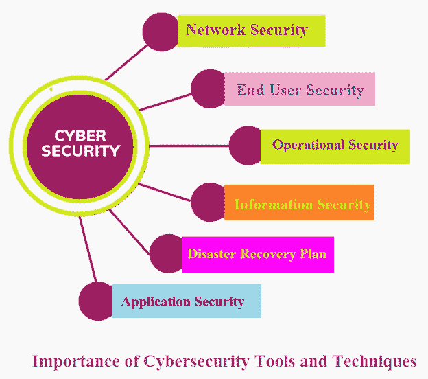

**SDN 和 NFV 作为 5G 安全的关键推动者：** 软件定义网络（`SDN`）和网络功能虚拟化（`NFV`）在此期间成为 5G 安全的关键推动者。`SDN` 的集中式控制平面提供了对网络流量增强的可见性和控制力，从而实现对安全威胁更有效的监控和响应。`NFV` 允许网络功能被虚拟化并更灵活地管理，使得在整个网络中动态部署安全措施成为可能。这些技术被视为 5G 网络所需可扩展性和适应性的关键，为更先进的安全架构奠定了基础。

**区块链作为潜在的安全解决方案：** 区块链技术开始作为增强 5G 网络安全的潜在解决方案而受到关注。其去中心化的特性和提供不可篡改、透明记录的能力，使其成为保障交易安全、管理身份以及确保分布式网络中数据完整性的一个有吸引力的选择。早期研究探讨了将区块链集成到 5G 中的可行性，以应对安全认证、隐私保护和去中心化物联网网络管理等挑战。

**3GPP 和 ITU 的标准化工作：** 随着 5G 技术的进步，标准化成为确保全球 5G 网络互操作性和安全性的优先事项。第三代合作伙伴计划（`3GPP`）和国际电信联盟（`ITU`）在定义 5G 安全架构方面发挥了关键作用。这些工作重点在于开发全面的安全框架，以应对 5G 的独特特征，包括网络切片、虚拟化和物联网的集成（Morgado, A.2018）。这一时期确立的标准为全球 5G 的安全部署奠定了基础。

**网络切片的出现及相关安全担忧：** 网络切片作为 5G 的一个显著特征，成为安全研究的焦点。创建多个针对特定用例定制的虚拟网络的能力，引入了新的安全挑战，特别是在维护切片间的隔离和确保跨切片的一致安全策略方面（Zhang, L. Chen, Y. and Zhang, Q. 2017）。研究人员探索了各种技术来保护网络切片，包括使用专用安全协议、加密和访问控制，以防止跨切片攻击并确保每个切片的完整性（Xiao, Y. He, X. Hu, L. and Huang, D. 2018）。

**用于实时威胁检测的 AI 和机器学习：** 人工智能（`AI`）和机器学习（`ML`）增强 5G 安全的潜力在此期间变得越来越明显。`AI` 和 `ML` 因其能够实时分析海量数据、识别可能表明安全威胁的模式和异常而受到认可。`AI` 驱动的安全解决方案的早期实施侧重于入侵检测、异常检测和预测分析，为 5G 网络中的威胁管理提供了主动方法。

**零信任架构和端到端加密：** 零信任架构的概念作为保护 5G 网络的关键方法而变得突出。在零信任模型中，无论用户或设备位于网络边界内部还是外部，默认都不受信任。这种方法强调了持续验证、最小权限访问和端到端加密的重要性，以保护数据在网络中移动时的安全（Chen, S. 2019）。采用零信任原则被视为防御 5G 环境中日益复杂的网络威胁所必需的。

**AI 驱动的异常检测：** 基于早期研究，`AI` 驱动的异常检测系统变得更加复杂，利用先进的机器学习算法实时识别和响应安全威胁。这些系统能够检测正常网络行为的细微偏差，从而实现对潜在攻击的早期发现。`AI` 适应并从新数据中学习的能力使其成为维护动态复杂 5G 网络安全的宝贵工具。

**用于面向未来安全的量子密码学：** 量子密码学作为一种为 5G 安全提供面向未来保障的有前景的解决方案而出现。随着量子计算的潜在到来，传统加密方法面临过时的风险。量子密钥分发（`QKD`）提供了一种利用量子力学原理来保障通信安全的方式，理论上使攻击者无法拦截和解码加密数据。这一时期的研究集中于将量子密码学集成到 5G 网络中，以确保长期的数据安全（Abbas, R. Jan, S. and Ali, F. 2020）。

**协作威胁情报共享：** 认识到协作在打击网络威胁中的重要性，5G 安全策略开始强调利益相关者之间共享威胁情报。开发了协作平台，以实现关于新兴威胁、漏洞和攻击载体的信息实时交换。这种集体方法增强了更有效地检测、分析和响应威胁的能力，为 5G 网络创造了一个更具弹性的安全环境（Mahbub, M. 2021）。

**自适应安全模型：** 随着 5G 网络复杂性的增加，自适应安全模型成为维持强大防护所必需的。这些模型旨在根据当前的威胁形势、网络状况和用户行为动态调整安全措施。自适应安全系统利用 `AI` 和机器学习持续评估风险并实施适当的对策，确保 5G 网络在面对不断演变的威胁时保持安全。


## 面向 IoT 设备的轻量级密码学

将 IoT 设备集成到 5G 网络中，要求开发适合这些设备有限计算资源的轻量级密码学解决方案。研究重点在于创建高效的加密算法，在不牺牲性能的前提下提供强安全性。轻量级密码学成为保障 5G 网络内 IoT 生态系统安全的关键组件，保护敏感数据并确保设备通信的完整性 (Sikder, S. 2022)。

## 同态加密与安全多方计算

随着数据隐私和安全变得日益重要，同态加密和安全多方计算作为保护 5G 网络中敏感信息的前沿技术应运而生。同态加密允许在数据仍处于加密状态时对其进行处理，确保敏感信息即使在计算过程中也保持安全 (Zhang, X. 2023)。安全多方计算使多方能够在不泄露各自输入的情况下联合计算一个函数，为协作环境提供强大的隐私保护。

## 用于去中心化安全管理的区块链

区块链技术作为一种去中心化的 5G 网络安全管理方法，持续获得关注。其提供防篡改记录和安全身份管理的能力，使其成为管理分布式环境中信任的理想解决方案。区块链越来越多地用于保障 5G 网络中的交易安全、设备认证和访问控制管理，提供了一个具有弹性和透明度的安全框架。

## 面向关键基础设施的弹性安全架构

随着 5G 网络成为能源、交通和医疗等关键基础设施领域不可或缺的一部分，对弹性安全架构的需求变得至关重要。研究重点在于开发能够抵御攻击、确保基本服务连续性并能从中断中快速恢复的安全框架。这些架构融合了先进的威胁检测、冗余和故障转移机制，以保护关键基础设施免受网络威胁，并确保 5G 赋能服务的可靠性 (Wang, J. 2024)。

5G 网络网络安全技术的这一按年份演进历程，展示了为应对这一变革性技术带来的独特挑战所做的持续努力。每个发展阶段都带来了新的创新和策略，反映了 5G 安全态势的动态性质。

## 5G 网络安全中的前沿技术

### 在威胁检测与响应中的作用

人工智能 (AI) 和机器学习 (ML) 在强化 5G 网络内部网络安全方面扮演着越来越关键的角色。这些技术被用于处理 5G 网络产生的海量数据，识别可能预示潜在威胁的模式和异常。AI 驱动的威胁检测系统可以实时监控网络流量，快速识别并缓解诸如未授权访问、恶意软件和分布式拒绝服务 (DDoS) 攻击等风险。AI 适应并从新数据中学习的能力，使其成为应对 5G 环境中动态且不断演变的威胁格局的有力工具。

### 用于预测性安全建模的 AI

除了实时威胁检测，AI 和 ML 还越来越多地用于 5G 网络中的预测性安全建模。通过分析历史数据并识别趋势，AI 可以在潜在安全事件发生前预测它们。预测模型可以预判漏洞、预测攻击模式，并提供对最可能发生的未来威胁的洞察，从而实现主动安全措施。这种能力在 5G 网络中尤为宝贵，因为海量且复杂的连接设备规模要求采取前瞻性方法来维护安全 (Bibri, E. S. 2023)。

### 区块链技术

#### 去中心化安全管理

区块链技术为 5G 网络中的安全管理提供了一种去中心化方法，解决了与集中式安全框架相关的一些固有挑战。通过利用区块链的不可变性和透明性，5G 网络可以在分布式环境中实现安全的身份管理、认证和访问控制。记录在区块链上的每一笔交易或事件都受到密码学保护，使得数据几乎不可能被篡改或更改。这种去中心化方法增强了信任和问责制，特别是在涉及多方利益相关者或分布式设备的场景中 (Hasan, B. K. 2024)。

### 量子密码学：量子密钥分发 (QKD)

量子密码学，特别是量子密钥分发 (QKD)，正作为一种当代解决方案崭露头角，用于保障 5G 网络免受未来威胁。QKD 利用量子力学原理在各方之间安全地分发加密密钥。任何试图拦截或测量量子密钥的行为都会改变其状态，立即向各方发出潜在窃听尝试的警报。量子密码学这一固有特性使其成为保障 5G 网络中敏感通信安全的理想解决方案，确保加密密钥保持机密且未被篡改 (Adnan, M. H. 2022)。

#### 在 5G 安全中的未来应用

虽然 QKD 目前是量子密码学在 5G 中最突出的应用，但未来的应用很可能会扩展到密钥分发之外。随着量子计算的进步，传统加密方案可能变得容易受到量子攻击。为了应对这一问题，研究人员正在探索能够抵御此类攻击的后量子密码算法。未来，量子密码学可被整合到更广泛的 5G 安全基础设施中，不仅保护密钥交换，还保护跨网络传输的所有数据的完整性和机密性。

### 同态加密：确保 5G 中的数据隐私

同态加密是一项有前景的技术，用于确保 5G 网络中的数据隐私。与常规加密系统不同，同态加密允许以加密形式处理数据，这意味着敏感数据可以在从未被解密的情况下被分析或操作。这种能力在数据隐私至关重要的 5G 环境中（如医疗和智慧城市应用）尤为宝贵。同态加密实现了安全的数据共享和处理，确保私人和敏感数据即使在计算过程中也受到保护 (Shi, S. 2020)。

#### 潜在用例与挑战

同态加密在 5G 中的潜在用例非常广泛，包括安全数据分析、隐私保护机器学习和加密云计算。例如，在医疗领域，同态加密可允许第三方服务提供商分析医疗数据而不暴露原始数据，从而保护患者隐私。然而，在 5G 网络中广泛采用同态加密也面临重大挑战。主要挑战之一是计算开销，因为同态加密目前比传统加密方法消耗更多资源。此外，确保与现有系统和标准的兼容性，对于同态加密成功融入 5G 网络安全框架至关重要。

这些前沿技术有望彻底改变 5G 网络的网络安全格局，提供先进的解决方案来应对这项下一代技术带来的独特挑战。每项技术都带来了自身的优势和挑战，它们的成功实施将是保障 5G 未来的关键。

## 5G 网络切片中的网络安全


### 网络切片概述

网络切片是 5G 技术的一项重要功能，它支持在单一物理网络基础设施上创建多样化的虚拟网络，即“切片”。每个切片均经过定制，以满足特定的性能、容量和服务需求，从而使得在同一网络上支持多种类型的服务成为可能。例如，一个切片可能针对增强移动宽带进行优化，而另一个切片则可专门用于任务关键型应用的超可靠低时延通信。

网络切片的概念使网络运营商能够根据不同应用和用户的需求，高效地管理和分配资源。这种虚拟化方法支持提供定制化服务的灵活性，并提高整体网络效率。每个切片独立运行，拥有自己的网络功能和资源集合，从而能够支持自动驾驶汽车、智慧城市和工业物联网等各种用例。

### 切片网络中的安全挑战

网络切片引入了若干独特的安全挑战，必须加以解决以确保 5G 网络的整体完整性和安全性：

#### 隔离与分离

主要安全顾虑之一是确保切片之间的有效隔离。由于每个切片独立运行但共享相同的物理基础设施，一个切片中的安全漏洞可能会影响其他切片。确保一个切片中的数据和功能不干扰或危及另一个切片中的数据和功能，对于维护整体网络安全至关重要。

#### 切片的动态特性

网络切片的动态创建、修改和终止增加了安全管理的复杂性。快速部署和扩展切片的能力意味着安全策略和配置必须具有适应性，并在整个网络中得到一致执行。这种动态特性使得有效监控和管理安全变得困难。

#### 资源分配与管理

网络切片共享物理资源，如算力和存储。确保资源得到安全高效的分配，且不产生漏洞或资源争用，至关重要。攻击者可能利用资源共享发起攻击或降低其他切片的性能。

#### 管理复杂性

管理多个切片（每个切片具有不同的安全需求和策略）增加了维护安全网络环境的复杂性。跨各切片协调安全措施并确保符合不同的安全策略，可能是一项重大挑战。

### 隔离与保护切片的技术

为应对与网络切片相关的安全挑战，采用了若干技术和策略：

#### 基于虚拟化的隔离

利用虚拟化技术为每个网络切片创建隔离环境。这种隔离通过使用虚拟机或容器来实现，确保每个切片独立运行，无法直接访问或干扰其他切片的资源。虚拟专用网络 (VPN) 和防火墙等技术用于在切片之间强制执行安全边界。

#### 访问控制与认证

实施强有力的访问控制机制，确保只有授权实体才能访问或修改网络切片。这包括健壮的认证协议和基于角色的访问控制 (RBAC)，根据用户的角色和权限限制访问。此外，切片专用的凭证和授权检查有助于维护每个切片的完整性和安全性。

#### 加密与数据保护

采用端到端加密保护在网络切片内部及之间传输的数据。这确保敏感信息保持机密，免受未授权访问。数据保护措施还包括存储数据的加密和安全的密钥管理实践，以防范数据泄露。

#### 监控与威胁检测

持续监控和实时威胁检测对于识别和缓解网络切片中的安全威胁至关重要。采用先进的监控工具和入侵检测系统 (IDS) 来检测异常行为、未授权访问尝试和潜在攻击。机器学习和 AI 驱动的分析增强了有效识别和响应威胁的能力。

#### 策略管理与自动化

使用自动化策略管理工具在网络切片间一致地执行安全策略。这包括使用安全编排框架，可根据当前网络状况和威胁等级动态调整策略。自动化有助于简化策略管理，并确保策略在所有切片中统一应用。

### 案例研究与实际实施

#### 案例研究：智慧城市的安全网络切片

在一个智慧城市部署中，网络切片被用于为各种智慧城市应用创建专用切片，如交通管理、公共安全和环境监测。为保护这些切片，实施了基于虚拟化的隔离，确保每个切片中的数据和功能保持分离。采用访问控制和加密来保护敏感数据，并使用持续监控来检测和响应潜在安全事件。该部署展示了网络切片如何在保持强大安全措施的同时提供定制化服务。

#### 案例研究：采用网络切片的工业物联网

一家大型工业设施利用网络切片支持其工业物联网 (IIoT) 应用，包括实时监控和自动化。每个 IIoT 应用被分配专属网络切片，以满足特定的性能和安全要求。采用加密、访问控制和策略管理等技术保护工业数据的完整性和机密性。该实施凸显了在管理复杂多变的工业环境时，自适应安全措施的重要性。

#### 实际实施：面向医疗保健的 5G 网络切片

在医疗保健场景中，网络切片被用于为远程医疗、电子健康记录 (EHR) 和医疗设备通信创建安全、低时延的切片。安全措施包括医疗数据加密、面向医疗服务提供者的访问控制，以及针对潜在安全威胁的监控。该实施展示了网络切片如何定制以满足关键医疗应用严格的安全性和性能要求 (Gao, S. 2024)。

这些案例研究和实际实施展示了各种技术在应对网络切片相关安全挑战方面的有效性。它们为如何在不同场景下安全地部署网络切片提供了宝贵见解，确保在实现 5G 技术优势的同时，保持强大的安全性和隐私保护。

## 5G 网络中的物联网安全

### 5G 中物联网带来的独特挑战

物联网 (IoT) 融入 5G 网络引入了若干独特的安全挑战，这是由于连接设备的数量庞大且种类多样所致。这些挑战包括：


### 设备异构性与可扩展性

IoT 工具在配件能力、操作系统和通信义务方面差异巨大。这种多样性使统一安全措施的实施变得复杂。此外，5G 网络中 IoT 部署的巨大规模（每平方公里潜在可达数百万设备）给管理和保护如此庞大且多样化的终端阵列带来了挑战 (Allioui, H. & Mourdi, Y., 2023)。

### 资源限制

许多 IoT 设备在处理能力、内存和电池寿命方面受限。这些限制使得部署传统的、资源密集型安全解决方案变得困难。能够在受限设备上高效运行的轻量级安全机制至关重要，但要有效实施它们颇具挑战。

### 不安全的设备设计

一些 IoT 设备在设计时仅包含最少的安全功能，可能使其易受攻击。常见问题包括硬编码凭证、缺乏加密和不完善的软件更新机制。利用这些漏洞可能导致未授权访问、数据泄露和设备行为篡改 (D. M. et al, 2020)。

### 设备间通信

IoT 设备经常相互通信，并通过不同网络与主系统通信。保护这些通信通道至关重要，以防止未授权的数据访问、篡改或窃听。确保跨越多样且潜在不受信网络的安全通信义务增加了 IoT 安全的复杂性。

### 数据隐私与完整性

IoT 设备生成并传输大量敏感数据，包括个人、健康和功能信息。确保该数据的隐私和完整性至关重要，特别是在医疗保健和智慧城市等应用中，数据泄露可能产生重大后果。

### 轻量级密码学与安全固件更新

#### 轻量级密码学

轻量级密码学旨在提供强大的安全性，同时适应许多 IoT 设备的有限资源。轻量级密码学的关键方面包括：

**高效算法**：轻量级加密算法针对低功耗和低内存环境进行了优化。示例包括轻量级分组密码如 `PRESENT` 和 `SPECK`，以及专为受限设备设计的轻量级哈希函数，如 `SHA-3` 变体。

### 确保 IoT 生态系统的端到端安全

#### 综合安全框架

确保 IoT 生态系统的端到端安全需要一种综合方法，解决网络每一层的安全问题。端到端安全框架的关键组件包括：

**设备安全**：确保 IoT 设备经过安全设计和配置，具备强大的访问控制、加密和安全固件更新机制。这包括实施安全启动流程和保护设备凭证。

**网络安全**：通过加密、安全协议和网络隔离，保护 IoT 设备与网络基础设施之间的通信通道。实施入侵检测和预防系统 (`IDPS`) 有助于监控和防御基于网络的攻击。

**数据安全**：利用加密和数据完整性手段保护静态和传输中的数据。确保敏感数据经过匿名化处理并安全存储，以防止未授权访问和泄露。

**访问控制与身份管理**：实施强认证和授权机制以控制对 IoT 设备和数据的访问。这包括使用多因素认证 (`MFA`) 和基于角色的访问控制 (`RBAC`)，以确保只有授权用户和设备能与 IoT 生态系统交互。

**监控与事件响应**：持续监控 IoT 网络中的安全威胁和异常。制定并维护事件响应计划，以便在安全事件发生时快速处理和缓解 (Jani, K. A. et al., 2020)。

**协作与标准**：行业利益相关者、标准化机构和监管机构之间的协作对于建立 IoT 安全的最佳实践和标准至关重要。遵守既定的安全标准和指南有助于确保 IoT 设备和网络免受已知威胁和漏洞的侵害。

## 5G 网络安全的未来方向

### 预期威胁与新兴挑战

随着 5G 网络的持续演进和扩展，若干预期威胁和新兴挑战可能会影响其网络安全格局：

**高级持续性威胁 (APTs)**：APTs 即持续且有针对性的高科技攻击，预计将变得更加复杂和频繁。攻击者可利用 5G 的高速、低延迟能力发动复杂攻击，并能在漫长时期内隐蔽持续。

**攻击面扩大**：大量 IoT 设备的融合和网络切片的增长创造了更广泛的攻击面。每个新设备和网络切片都呈现潜在漏洞，可能被恶意行为者利用。

**供应链漏洞**：5G 基础设施的复杂性及其对全球供应链的依赖，增加了供应链攻击的风险。确保整个供应链中硬件和软件组件的完整性对于防范此类攻击至关重要。

**量子计算威胁**：量子计算的到来对当前的加密体系构成潜在威胁。量子计算可能打破广泛使用的加密算法，因此开发和实施抗量子加密方法势在必行 (Chaubey, N. et al, 2020)。

**AI 驱动的攻击**：随着 AI 和机器学习技术变得更先进，攻击者可能利用它们来自动化和增强攻击策略。防御 AI 驱动的威胁将需要复杂且自适应的安全措施。

### 6G 及其安全启示

从 5G 向 6G 的过渡预计将引入新技术和能力，对安全产生重大影响：

**超高速与低延迟通信**：6G 将提供比 5G 更快的速度和更低的延迟，支持增强现实 (`AR`) 和虚拟现实 (`VR`) 等新应用，并具有更高保真度。然而，这些进步也可能带来新的攻击载体，并在保护超高速通信通道方面带来挑战。

**先进 AI 集成**：6G 网络可能集成更先进的 AI 技术用于网络管理和优化。虽然 AI 可增强安全，但也引入了与 AI 系统漏洞和机器学习模型对抗性攻击相关的新风险。

**增强的连接性与自动化**：6G 将进一步增强跨各行业的连接性和自动化，包括智慧城市、自动驾驶汽车和工业自动化。确保这些互联系统的安全对于防止中断和维护安全至关重要。

**新无线电技术**：6G 预计将引入新的无线电技术和频谱频段，这将需要新颖的安全方法来防范针对这些技术的潜在威胁。

**隐私与数据保护**：随着 6G 数据收集和共享能力的增强，保护用户隐私和确保数据保护将变得更加关键。需要新的隐私保护技术和法规来应对这些担忧。

## 结论


# 5G 网络网络安全概述

5G 网络的网络安全形势以不断演变的威胁和挑战为标志，包括设备密度增加、高级持续性威胁以及量子计算的潜在影响。解决这些问题需要创新方法，例如轻量级密码学、AI 驱动的威胁检测和安全固件更新。向 6G 的过渡将引入新技术和安全隐患，需要面向未来的策略和稳健的政策框架。行业利益相关者、研究人员和监管机构之间的持续创新与合作对于推进安全措施至关重要。保障 5G 的未来要求采取主动和自适应的解决方案，以抵御新兴风险并确保网络完整性。

# 章节贡献：5G 网络网络安全技术

关于 5G 网络网络安全技术的章节提供了一项新颖的贡献，即呈现了针对 5G 技术带来的独特挑战而量身定制的安全措施演变的全面、按年份分析。与主要关注单个方面或静态概述的先前综述不同，本章强调了安全策略的动态演进，展示了它们如何随时间推移适应新出现的威胁和技术进步。它独特地整合了对 AI 驱动的威胁检测、同态加密和基于区块链的去中心化安全等尖端技术的讨论，提供了这些创新如何塑造 5G 安全未来的前瞻性视角。此外，本章还强调了这些技术对 5G 网络中关键基础设施和 IoT 设备的实际意义，使其成为学术研究人员和行业从业者了解并缓解下一代网络复杂安全挑战的宝贵资源。

# 章节结论

本章得出结论：5G 网络中的网络安全是一个快速发展的领域，由这项变革性技术带来的复杂挑战和机遇所驱动。多年来，安全策略已从基本概念框架发展为利用 AI、区块链和同态加密等尖端技术的复杂、多层方法。这些创新对于应对 5G 网络面临的多样化和动态威胁至关重要，特别是在保护关键基础设施和 IoT 生态系统方面。持续的研究和开发工作预示着向更具弹性、自适应和去中心化的安全架构发展的趋势，这将随着 5G 在全球范围内的持续扩展而变得至关重要。展望未来，本章强调了学术界、行业和标准化机构之间持续合作的重要性，以确保 5G 网络对所有用户都是安全可靠的。

## 参考文献

Adnan, M. H., Ahmad Zukarnain, Z., & Harun, N. Z. (2022). Quantum Key Distribution for 5G Networks: A Review, State of Art and Future Directions. *Future Internet*, 14(3), 73. DOI: [10.3390/fi14030073](http://dx.doi.org/10.3390/fi14030073)

Allioui, H., & Mourdi, Y. (2023). Exploring the Full Potentials of IoT for Better Financial Growth and Stability: A Comprehensive Survey. *Sensors (Basel)*, 23(19), 8015. DOI: [10.3390/s23198015](http://dx.doi.org/10.3390/s23198015) PMID: [37836845](https://pubmed.ncbi.nlm.nih.gov/37836845)

Banafaa, M., Shayea, I., Din, J., Azmi, H. M., Alashbi, A., Daradkeh, I. Y., & Alhammadi, A. (2023). 6G Mobile Communication Technology: Requirements, Targets, Applications, Challenges, Advantages, and Opportunities. *Alexandria Engineering Journal*, 64, 245-274. ISSN 1110-0168. DOI: [10.1016/j.aej.2022.08.017](http://dx.doi.org/10.1016/j.aej.2022.08.017)

Bibri, E. S., Krogstie, J., Kaboli, A., & Alahi, A. (2023). Smarter eco-cities and their leading-edge artificial intelligence of things solutions for environmental sustainability: A comprehensive systematic review. *Environmental Science and Ecotechnology*, 19, 100330. ISSN 2666-4984. DOI: [10.1016/j.ese.2023.100330](http://dx.doi.org/10.1016/j.ese.2023.100330)

Chaubey, N. (2020). *Quantum Cryptography and the Future of Cyber Security*. IGI Global. DOI: [10.4018/978-1-7998-2253-0](http://dx.doi.org/10.4018/978-1-7998-2253-0)

Chen, S., Liu, Y., & Cui, S. (2019). Security in 5G networks: A survey. *IEEE Access*, vol. 7, pp. 30474-30488. Abbas, R., Jan, S. and Ali, F. (2020). Security and privacy in 5G: A survey of emerging challenges and future directions. *IEEE Access: Practical Innovations, Open Solutions*, 8, 211657–211691.

Fakhouri, H. N., Alawadi, S., Awaysheh, F. M., Hani, I. B., Alkhalaileh, M., & Hamad, F. (2023). A Comprehensive Study on the Role of Machine Learning in 5G Security: Challenges, Technologies, and Solutions. *Electronics (Basel)*, 12(22), 4604. DOI: [10.3390/electronics12224604](http://dx.doi.org/10.3390/electronics12224604)

Gao, S., Lin, R., Fu, Y., Li, H., & Cao, J. (2024). Security Threats, Requirements and Recommendations on Creating 5G Network Slicing System: A Survey. *Electronics (Basel)*, 13(10), 1860. DOI: [10.3390/electronics13101860](http://dx.doi.org/10.3390/electronics13101860)

Georgiou, K. E., Georgiou, E., & Satava, R. M. (2021). 5G Use in Healthcare: The Future is Present. *JSLS: Journal of the Society of Laparoendoscopic Surgeons*, 25(4), 00064. DOI: [10.4293/JSLS.2021.00064](http://dx.doi.org/10.4293/JSLS.2021.00064) PMID: [35087266](https://pubmed.ncbi.nlm.nih.gov/35087266)

Hasan, B. K., Sajid, M., Lapina, M., Shahid, M., & Kotecha, K. (2024). Blockchain technology meets 6G wireless networks: A systematic survey. *Alexandria Engineering Journal*, 92, 199-220. ISSN 1110-0168. DOI: [10.1016/j.aej.2024.02.031](http://dx.doi.org/10.1016/j.aej.2024.02.031)

Huseien, F. G., & Shah, W. K. (2022). A review on 5G technology for smart energy management and smart buildings in Singapore. *Energy and AI*, 7, 100116. ISSN 2666-5468. DOI: [10.1016/j.egyai.2021.100116](http://dx.doi.org/10.1016/j.egyai.2021.100116)

Jani, K. A. (2020). IoT and Cyber Security: Introduction, Attacks, and Preventive Steps. In Chaubey, N., & Prajapati, B. (Eds.), *Quantum Cryptography and the Future of Cyber Security* (pp. 203–235). IGI Global. DOI: [10.4018/978-1-7998-2253-0.ch010](http://dx.doi.org/10.4018/978-1-7998-2253-0.ch010)

Kim, J., Kim, Y., Yegneswaran, V., Porras, P., Shin, S., & Park, T. (2023). Extended data plane architecture for in-network security services in software-defined networks. *Computers & Security*, 124, 102976. ISSN 0167-4048. DOI: [10.1016/j.cose.2022.102976](http://dx.doi.org/10.1016/j.cose.2022.102976)

Lorincz, J., Kukuruzović, A., & Blažević, Z. (2024). A Comprehensive Overview of Network Slicing for Improving the Energy Efficiency of Fifth-Generation Networks. *Sensors (Basel)*, 24(10), 3242. DOI: [10.3390/s24103242](http://dx.doi.org/10.3390/s24103242) PMID: [38794095](https://pubmed.ncbi.nlm.nih.gov/38794095)

Mahbub, M., Shami, S. and Alam, S. M. (2021). Adaptive security in 5G networks: Challenges and solutions. *IEEE Communications Magazine*, 59, no. 4, pp. 20-26. Sikder, S., Rahmati, A. and Saxena, N. (2022). Lightweight security mechanisms for 5G IoT devices. *IEEE Transactions on Mobile Computing*, vol. 21, no. 1, pp. 27-39.

Morgado, A., Mohammed, K., Huq, S., Mumtaz, S., & Rodriguez, J. (2018). A survey of 5G technologies: regulatory, standardization and industrial perspectives. *Digital Communications and Networks*, 4(2), 87-97. ISSN 2352-8648. DOI: [10.1016/j.dcan.2017.09.010](http://dx.doi.org/10.1016/j.dcan.2017.09.010)

O’Connell, E., Moore, D., & Newe, T. (2020). Challenges Associated with Implementing 5G in Manufacturing. *Telecom*, 1(1), 48–67. DOI: [10.3390/telecom1010005](http://dx.doi.org/10.3390/telecom1010005)


## 参考文献

Pons, M., Valenzuela, E., Rodríguez, B., Nolazco-Flores, J. A., & Del-Valle-Soto, C. (2023). 物联网应用中 5G 技术的利用：干扰与网络优化困难带来的当前局限性——综述。 *Sensors (Basel)*， 23(8)， 3876。 DOI： [10.3390/s23083876](http://dx.doi.org/10.3390/s23083876) PMID： [37112216](https://pubmed.ncbi.nlm.nih.gov/37112216)

Popoola, O., Rodrigues, M., Marchang, J., Shenfield, A., Ikpehai, A., & Popoola, J. (2024). 采用物联网与区块链的智能家居医疗方案中安全与隐私的关键文献综述：问题、挑战与解决方案。 *Blockchain: Research and Applications* ， 5(2)， 100178。 ISSN 2096-7209。 DOI： [10.1016/j.bcra.2023.100178](http://dx.doi.org/10.1016/j.bcra.2023.100178)

Shi, S., He, D., Li, L., Kumar, N., Khan, M. K., & Choo, K. R. (2020). 区块链在保障电子健康记录系统安全与隐私中的应用：综述。 *Computers & Security* ， 97， 101966。 DOI： [10.1016/j.cose.2020.101966](http://dx.doi.org/10.1016/j.cose.2020.101966) PMID： [32834254](https://pubmed.ncbi.nlm.nih.gov/32834254)

Tank, D. M. (2020). 云计算环境中虚拟化的网络安全方面：分析虚拟化特有的网络安全风险。载于 N. Chaubey & B. Prajapati (Eds.)，*量子密码学与网络安全的未来* (pp. 283–299)。 IGI Global。 DOI： [10.4018/978-1-7998-2253-0.ch013](http://dx.doi.org/10.4018/978-1-7998-2253-0.ch013)

Zhang, L., Chen, Y., & Zhang, Q. (2017). 面向 5G 的网络切片：挑战与机遇。 *IEEE Internet Computing* ， 21(5)， 20-27。

Xiao, Y., He, X., Hu, L., & Huang, D. (2018). 5G 网络切片中的 AI 增强安全。 *IEEE Wireless Communications* ， 25(5)， 119–125。

Zhang, X., Zhang, J., & Zheng, L. (2023). 面向隐私保护的 5G 网络：同态加密与区块链。 *IEEE Transactions on Information Forensics and Security* ， 18， 378-390。

Wang, J., Li, Y., & Wang, Z. (2024). 面向 5G 及未来网络的弹性安全架构：综述。 *IEEE Network* ， 38(3)， 47–55。

# 第 6 章：利用 AI 和机器学习实现高效的钓鱼邮件检测

**Ritesh Joshi**  
 [`orcid.org/0000-0002-0138-8786`](https://orcid.org/0000-0002-0138-8786)  
Prestige Institute of Engineering Management and Research, Indore, India

**Nirbhay Kumar Chaubey**  
A.M. Patel Institute of Computer Studies, Ganpat University, India

**Swati Patel**  
A.M. Patel Institute of Computer Studies, Ganpat University, India

**Md Danish Imtiaz**  
 [`orcid.org/0009-0003-7341-5506`](https://orcid.org/0009-0003-7341-5506)  
A.M. Patel Institute of Computer Studies, Ganpat University, India

**Ankit Kumar**  
A.M. Patel Institute of Computer Studies, Ganpat University, India

## 摘要

针对电子邮件用户的钓鱼攻击构成了重大的网络安全威胁，导致财务损失和数据泄露。本研究项目旨在利用人工智能 (AI) 开发一种先进的钓鱼检测工具，以识别和缓解电子邮件钓鱼尝试。其核心在于该工具将具备一个复杂的 AI 模型，用于分析邮件并将其分类为钓鱼邮件或合法邮件。该方法结合了机器学习算法和自然语言处理技术，以提高检测准确性。拟议的解决方案将集成到一个 Web 应用程序中，允许用户输入可疑邮件以进行实时分析。AI 模型将检查邮件的各种特征，包括内容、发件人信息和嵌入链接，以判断钓鱼的可能性。通过利用监督学习方法，我们的模型将在一个包含钓鱼邮件和合法邮件的多样化数据集上进行训练，确保在不同场景下的稳健性能。

## 1 简介

在数字时代，钓鱼攻击是最常见且危害最大的网络攻击类型之一。为了诱骗人们泄露敏感信息（如密码、信用卡详情和其他个人信息），犯罪分子会冒充可信组织。通常使用电子邮件发起这些攻击，攻击者制作的邮件看似来自信誉良好的来源，如银行、社交网络平台或企业。其目的是诱使收件人点击恶意链接、下载恶意附件或直接提供敏感信息 (Yasin & Abuhasan, 2016)。

多年来，钓鱼攻击已显著演变，变得更加复杂且更难检测。早期的钓鱼尝试通常因拼写、语法错误和显而易见的虚假链接而容易被识别。然而，现代钓鱼攻击使用社会工程学、个性化定制甚至人工智能等先进技术来制作极具迷惑性的邮件。钓鱼攻击可能导致严重后果，包括身份盗窃、资金损失和大规模数据泄露，威胁组织的安全。

钓鱼攻击频率和复杂性的上升凸显了有效检测机制的迫切需求。由于钓鱼攻击的动态性，传统方法（如基于规则的系统和黑名单）已被证明不够有效 (Zareapoor & Seeja, 2015)。黑名单只能防范已知威胁且需要持续更新，而基于规则的系统可能被不断调整战术的攻击者绕过。

### 高效的钓鱼检测至关重要，原因如下：

*   **财务安全：** 钓鱼攻击可能给个人和企业造成巨大的财务损失。检测并拦截这些攻击可防止银行账户被未授权访问、信用卡欺诈和其他金融犯罪。
*   **数据保护：** 钓鱼攻击往往以敏感的个人和企业数据为目标。防范这些攻击有助于保护个人信息和知识产权，降低数据泄露风险并维护隐私。
*   **声誉管理：** 钓鱼攻击会严重损害组织的声誉。消费者和客户可能会质疑公司保护其数据的能力，从而导致业务下滑和法律纠纷。
*   **合规性：** 严格的数据保护法规（包括欧洲的 GDPR 和美国的 HIPAA）适用于众多行业。有效的钓鱼检测有助于组织遵守这些法规，避免高额罚款。

### 钓鱼检测的演变

多年来，钓鱼检测已从基础的基于关键词的方法演变为涉及人工智能 (AI) 和机器学习 (ML) 的更先进技术 (Salloum et al., 2021)。传统方法包括：

*   **黑名单：** 这些是已知钓鱼 URL、电子邮件地址和域名的列表。虽然有用，但它们是被动而非主动的，且需要持续更新以保持有效性。
*   **基于规则的系统：** 这些系统使用预定义规则，根据某些特征（如可疑链接或特定措辞）识别钓鱼邮件。然而，它们难以处理误报，且无法轻易适应新的钓鱼策略。
*   **启发式方法：** 这些方法涉及手工制作的规则和模式来检测钓鱼。尽管比黑名单更灵活，但它们仍缺乏处理复杂钓鱼攻击所需的适应性和准确性。

### AI 和机器学习简介


## 人工智能与机器学习在网络钓鱼检测中的应用

人工智能和机器学习改变了网络安全行业，提供了强大的工具来检测和缓解网络钓鱼攻击（Atawneh & Aljehani, 2023）。人工智能（AI）是指在具有思维和学习程序的机器中模拟人类智能。作为人工智能的一个分支，机器学习利用统计模型和算法，帮助计算机从经验和数据中学习，以更有效地执行任务。

### 本章目标

在本章中，我们探讨利用人工智能和机器学习技术开发稳健的网络钓鱼邮件检测系统。我们利用两个公开可用的数据集来训练和评估各种算法的性能。

本文其余部分的组织结构如下：第 2 节包含相关工作，涵盖使用各种方法进行网络钓鱼邮件检测的研究工作。第 3 节介绍拟议研究工作中将采用的方法论，涵盖数据收集、数据预处理、特征提取、模型实现和模型训练。性能评估在第 4 节进行。第 5 节重点阐述所获结果背后的基本原理及其意义。第 6 节给出结论，最后第 7 节展望未来的工作方向。

## 2 相关工作

网络钓鱼是一种常见的网络威胁，它利用巧妙的伎俩诱骗人们泄露信用卡号、密码或个人信息等私人信息。攻击者通过欺诈性电子邮件、消息或网站冒充银行、政府机构或知名公司等受信任实体，这些通信被设计得看起来合法无异。这些通信通常利用紧迫感、恐惧或奖励诱惑，促使收件人立即采取行动，如打开危险的附件或点击可疑链接。

网络钓鱼攻击的最终目的是利用人类的信任和弱点，以获取经济利益、实施身份盗窃或未经授权地访问敏感数据。复杂的网络钓鱼活动可能会使用精密的社会工程学技术来增加其可信度和成功几率。例如，攻击者可能会创建令人信服的官方徽标副本、电子邮件模板或登录页面来欺骗受害者。

网络钓鱼攻击持续演变，不断适应以规避传统的网络安全防御。这些全球性威胁可能给个人、公司和组织带来经济损失、声誉受损和法律后果。检测和缓解网络钓鱼威胁需要强有力的网络安全措施、识别网络钓鱼尝试的用户教育以及对数字通信的主动监控相结合。通过保持警惕并实施有效的安全实践，个人和组织可以更好地保护自己免受网络钓鱼这一普遍威胁的侵害。

传统的网络钓鱼检测方法通常依赖基于启发式的规则、黑名单数据库和人工检查来识别和拦截网络钓鱼尝试。启发式规则分析电子邮件内容中的可疑关键词、模式或与网络钓鱼战术一致的格式。黑名单维护已知网络钓鱼 URL 或域名的数据库，阻止访问这些站点。虽然这些方法提供基本保护，但它们受限于对预定义规则和静态数据库的依赖，难以跟上不断演变的网络钓鱼技术和零日攻击。此外，人工检查劳动密集且容易出错，使其在大规模检测中效果较差。

相比之下，基于 AI 和 ML 的网络钓鱼检测方法利用先进算法来检查大量数据，并检测表明网络钓鱼行为的细微模式。机器学习模型可以自动从标记数据集中学习，以识别异常发件人行为、欺骗性内容或可疑 URL 等特征。自然语言处理（NLP）等技术从文本中提取含义，而异常检测算法则标记偏离正常电子邮件行为的偏差。此外，卷积神经网络（CNN）和循环神经网络（RNN）等深度学习模型擅长处理复杂的非结构化数据以发掘隐藏威胁。

Altwaijry 等人 (2024) 发现，深度学习模型，特别是混合 CNN 和 LSTM，比传统技术更可靠、更准确。他们的工作强调了特征工程和 NLP 技术的重要性。这些算法为现实世界的检测提供了强有力的解决方案，成功捕捉了网络钓鱼邮件中的复杂模式。Sanchez & Duan (2012) 发现 SVM 和集成方法在网络钓鱼检测中表现极佳，强调了强大算法在提高准确性和鲁棒性方面的重要性。Atawneh & Aljehani (2023) 建议了一种混合垃圾邮件过滤器，该过滤器将带有修正线性单元的深度多层感知器神经网络与 N-gram tf-idf 特征选择以及集成的基于分布的平衡技术相结合。在 SpamAssassin 和 Enron 的基准数据集中，该过滤器正确识别了垃圾邮件。此外，Rawal 等人 (2017) 通过使用机器学习方法创建有效的网络钓鱼检测系统，强调了特征选择在提升模型性能方面的重要性。

Salloum 等人 (2021) 在一项关于网络钓鱼检测策略的深入研究中，强调了 NLP 方法结合机器学习的实用性。Khonji 等人 (2013) 进行了一项深入研究，比较了用于网络钓鱼邮件检测的机器学习分类器，包括决策树、随机森林和支持向量机 (SVM)。他们的研究表明，集成方法，特别是随机森林，提供了最佳的检测准确性。Yasin & Abuhasan (2016) 提出了一种智能分类模型，展示了机器学习方法如何能显著提高网络钓鱼邮件的检测准确性。Harikrishnan, Vinayakumar, & Soman (2018) 探讨了多种用于网络钓鱼邮件检测的机器学习技术，展示了不同分类器如何提高检测的鲁棒性和准确性。这进一步支持了向机器学习发展的趋势。


## 文献综述与方法论

## 文献综述

使用 J48 决策树作为基础分类器，Zareapoor 和 Seeja 2015 年的比较研究考察了钓鱼邮件检测的特征提取和选择策略。研究发现，谨慎的特征选择能极大地提升机器学习模型性能。在 2020 年的研究中，Li et al. (2020) 探讨了深度学习方法在钓鱼邮件检测中的应用，发现与传统机器学习技术相比，长短期记忆（LSTM）网络显著提高了检测准确率并降低了误报率。特征工程已被证明在提高检测准确率方面起着关键作用。正如 Yang et al. (2019) 所展示的，领域特定特征和谨慎的特征选择非常重要，他们的工作证明了 SVM 和集成方法优于其他分类器。PhishNet-NLP 是由 Verma, Shashidhar, & Hossain (2012) 设计的基于自然语言处理的系统，旨在通过利用邮件头、链接和正文中的特征来识别钓鱼邮件。该方法利用上下文来提高区分“可执行”和“信息类”邮件的准确性，以 97% 的检测率优于以往方法。

Hassanpour et al. (2018) 使用字符级卷积神经网络（NN）展示了细粒度模式识别在钓鱼检测中的有效性，实现了卓越的准确性和对混淆战术的鲁棒性。为了提高检测率，Bountakas & Xenakis (2023) 和 Al-Daeef et al. (2014) 强调了混合各种特征类型的重要性。Unnithan et al. (2018) 和 Alhogail & Alsabih (2021) 进行了广泛的综述和比较研究，强调了应对不断演变的钓鱼策略需要自适应模型，以及集成方法的鲁棒性。Zhang & Yuan (2012) 使用神经网络进行钓鱼检测，并展示了卓越的准确性。他们的模型利用 `Encog Java Core` 包在 Java 中构建了多层前馈神经网络。其他算法则使用 MATLAB 包实现。

为了提高实时在线环境中的检测准确性，Smadi, Aslam, & Zhang (2018) 提出了一个融合神经网络与强化学习的新型钓鱼检测框架。为克服静态数据集的局限性，该系统自动扩充训练数据集并动态适应新型钓鱼活动。在应对零日钓鱼攻击方面，该策略以其高准确率和低误报率显著优于以往解决方案。

总之，研究结果凸显了机器学习和深度学习在钓鱼检测中的重要性。未来需要进一步研究 Random Forest、XGBoost、KNN 和 SVM 等集成方法。将领域特定特征工程与 NLP 相结合可提高检测准确性，为抵御不断演变的钓鱼战术提供强有力的防御。未来的研究可能将集中于开发实时、自适应的检测系统，以应对先进的网络犯罪策略。

## 3 方法论

我们的钓鱼邮件检测系统的开发涉及将先进的机器学习算法与两个精心策划的数据集相结合：垃圾/正常邮件分类数据集和钓鱼邮件数据集。选择这些数据集是因为它们对邮件内容有着多样化的表征，涵盖了合法通信和各种形式的钓鱼尝试。垃圾/正常邮件数据集为模型训练典型邮件模式提供了平衡的基础，而钓鱼邮件数据集则用真实的钓鱼战术丰富了我们的模型。

数据预处理确保了数据集的质量和一致性，涉及文本规范化、HTML 标签移除、分词、移除停用词和标点符号等任务。这种准备工作标准化了文本格式，消除了无关内容，并将文本构建为有意义的标记，增强了模型准确检测钓鱼模式的能力。

特征提取通过结合 TF-IDF 和针对钓鱼检测的特定指标（如紧急威胁、金钱提及和随机字符串识别）进一步优化了数据集。这两类特征的结合提供了区分合法和恶意邮件至关重要的上下文洞察，提升了检测准确率。

模型使用 Random Forest、Logistic Regression、XGBoost 和 K-Nearest Neighbors (KNN) 等先进算法进行训练和评估。通过准确率、精确率、召回率和 F1-score 等指标进行评估，以衡量它们在识别钓鱼尝试的同时最小化误报的有效性。

该方法论体现了钓鱼邮件检测的综合方法，结合了稳健的数据预处理、复杂的特征工程和严格的模型评估。通过利用机器学习和多样化数据集，我们的研究旨在开发一个具有弹性的检测系统，能够在真实邮件环境中保护用户免受不断演变的钓鱼威胁。

### 3.1 数据收集

数据收集是指从多个来源系统地收集、组织和准备原始信息以构建用于分析、建模和决策的数据集的方法论过程。在开发 AI 模型的背景下，数据收集涉及识别相关数据源、提取相关信息，并确保数据的质量和完整性。这一过程对于创建能准确代表问题领域并使机器学习算法能有效学习模式、进行预测或执行其他任务的数据集至关重要。数据收集技术可能包括网页抓取、数据库查询、传感器数据获取或人工数据录入，具体取决于数据的性质及其可用性。执行得当的数据收集确保 AI 模型在具有代表性和多样性的数据集上进行训练，增强其泛化能力和在实际应用中的表现。

在本研究中，我们利用来自 Kaggle 的两个综合性公开数据集来训练和评估专门用于钓鱼邮件检测的机器学习模型，每个数据集都贡献了全面分析所必需的独特特征。

#### 3.1.1 垃圾/正常邮件分类数据集

*   **Source**: [`https://www.kaggle.com/datasets/yashpaloswal/spamham-email-classification-nlp`](https://www.kaggle.com/datasets/yashpaloswal/spamham-email-classification-nlp)
*   **Description**: 该数据集包含标记为钓鱼或合法的邮件混合体。由于它包含从邮件内容、元数据和补充上下文中提取的各种特征，因此适用于基于 NLP 的特征提取方法，如 TF-IDF。'Text' 列提供文本分析的主要内容，而 'Label' 列指示邮件是钓鱼（垃圾邮件）1 还是合法（正常邮件）0。该数据集同时提供钓鱼和合法邮件的公平样本，为模型训练提供了坚实基础。

#### 3.1.2 钓鱼邮件数据集


## 数据来源

* **Source**: [`www.kaggle.com/datasets/subhajournal/phishingemails`](https://www.kaggle.com/datasets/subhajournal/phishingemails)
* **Description**: 该数据集提供了被检测为网络钓鱼尝试的电子邮件的综合样本，并专门聚焦于网络钓鱼邮件。邮件的主要文本内容在 `Email` 列中提供以供分析，而 `Label` 列指示该邮件是否为网络钓鱼邮件（1）或非钓鱼邮件（0）。该数据集对于理解网络钓鱼邮件中常见的特定特征和趋势至关重要。对该数据集的独立分析为研究提供了关于网络钓鱼攻击独特要素和手法的新视角。

通过分别利用这些数据集，我们的方法确保了：

* **聚焦的模型训练**：每个数据集均被独立用于训练机器学习模型，优化其识别垃圾邮件或网络钓鱼邮件特定特征的能力，且不混淆上下文。
* **精确的评估**：模型在各自数据集上的性能被单独评估，从而能够根据垃圾邮件和网络钓鱼邮件带来的不同挑战进行量身定制的调整和改进。
* **真实场景模拟**：针对独立数据集进行测试模拟了多样化的真实场景，提供了关于模型适应不同类型电子邮件威胁能力的洞见。

这些数据集作为开发稳健网络钓鱼检测方法的关键资源，为旨在降低多样化数字环境中网络钓鱼攻击相关风险的网络安全实践进步做出了贡献。

### 3.2 数据预处理

数据预处理是数据分析的初始步骤，在此步骤中对原始数据进行清洗、转换和组织，以便进行进一步分析或建模。此过程确保数据准确、完整且相关。它涉及诸如数据清洗（处理缺失值、纠正错误）、数据转换（归一化、标准化）和特征提取（从现有数据创建新特征）等任务。其目标是提升数据质量，使其适用于机器学习算法和其他分析技术。妥善预处理的数据能带来更精准的建模、更优的算法性能和有意义的洞见。在此，我们将详细阐述数据集预处理中涉及的每个步骤。

#### 加载数据

最初，数据集使用 `Pandas` 进行加载和构建，`Pandas` 是一个用于数据操作的多功能 Python 库。`Pandas` 允许从各种来源无缝导入数据，并将其组织成数据框以便于探索和操作。它简化了数据清洗和转换，处理缺失值、纠正数据类型，并执行诸如筛选和聚合等基本操作。这为后续的预处理步骤奠定了坚实基础，确保在归一化、分词和特征提取等任务之前数据的质量和完整性，从而为分析和机器学习任务建立了高效的工作流。

#### 文本归一化

为确保一致性并缓解与大小写敏感性相关的问题，邮件内的所有文本均转换为小写。这一关键的归一化过程标准化了单词的表示形式，无论其原始大小写如何。通过将所有文本转换为小写，诸如 “Email” 和 “email” 之类的变体在整个数据集中得到了统一处理。这种方法确保了此后应用的机器学习算法和文本处理技术能够一致地解释和分析文本。统一单词的大小写有助于避免因不同大小写而产生的差异，从而提高后续分析的准确性和可靠性。此外，这一归一化步骤简化了涉及文本数据的比较和计算，促进了更有效、高效的数据处理和建模任务。

#### HTML 标签移除

为提升用于分析的邮件内容质量，使用正则表达式消除了邮件中存在的 HTML 标签。HTML 标签虽便于在浏览器或邮件客户端中渲染邮件，但对机器学习模型所需的内容分析不提供有意义的信息。这些标签包括 `<div>`、`<span>`、`<p>` 等构建邮件呈现结构但无助于理解其文本内容的元素。通过使用正则表达式——一种强大的模式匹配工具——所有 HTML 标签均被有效地从邮件正文中剥离。此过程确保了剩余文本纯粹具有信息量，且不含格式代码的干扰。移除这些标签至关重要，因为它们的存在可能会扭曲结果，导致特征提取和模型训练出现不准确。通过消除非信息性的 HTML 元素，数据集变得更整洁，更能代表邮件中实际使用的语言，从而增强了后续分析过程的可靠性，并提升了网络钓鱼检测系统的整体性能。

#### 分词

下一步涉及使用 `NLTK` 的 `word_tokenize()` 函数对文本进行分词。分词将文本分解为单个标记，如单词或标点符号。例如，句子 “The quick brown fox” 被分割为 `["The", "quick", "brown", "fox"]`。此过程允许进行更细粒度的分析，有助于更好的特征提取和更准确的建模。分词对于识别和处理单个单词至关重要，便于执行移除停用词和词干提取等任务。这一步为进一步的细化奠定了基础，增强了模型检测网络钓鱼尝试的能力。

#### 停用词和标点符号移除

数据预处理阶段还包括从文本中移除常见停用词和标点符号这一关键步骤。停用词是指在语言中频繁出现但在区分网络钓鱼邮件和合法邮件的语境下承载极少有意义信息的词汇。此类停用词的例子包括 “and”、“the”、“is”、“in” 和 “at”。这些词虽对句子的语法结构至关重要，但对识别网络钓鱼内容的分析目标没有显著贡献。通过消除这些停用词，文本变得更聚焦于那些更可能指示网络钓鱼尝试的词汇。同时，标点符号也被从文本中剥离。标点符号虽对句子的可读性和结构很重要，但对旨在识别网络钓鱼特征的分析不增加价值。移除标点符号进一步细化了文本，确保仅分析单词本身。这一步对于减少数据噪声和增强信噪比至关重要，使机器学习算法更容易检测与网络钓鱼相关的模式和特征。停用词和标点符号的移除共同简化了文本数据，将分析聚焦于有意义的词汇。这一预处理步骤通过确保输入算法的数据更整洁、更具信息量，显著提高了后续分析（如特征提取和模型训练）的准确性。因此，这一细化过程有助于构建一个更有效、更精准的网络钓鱼检测系统。

### 3.3 特征提取


# 特征提取

特征提取将预处理后的文本数据转换为结构化格式，供机器学习算法使用，方法是将原始数据转换为可测量的特征或属性。主要方法是词频-逆文档频率（`TF-IDF`）向量化，它评估一个词在文档中的重要性（相对于文档集合），突出可能表明网络钓鱼的独特词汇。此外，还使用了关键词识别和句法模式识别来提取与网络钓鱼邮件相关的特定术语和结构模式。这种技术的组合提高了网络钓鱼检测模型的准确性和鲁棒性。

#### TF-IDF（词频-逆文档频率）

`TF-IDF`，即词频-逆文档频率，是一种统计度量，用于评估词在文档中的重要性（相对于文档集合，称为语料库）。`TF` 组件衡量一个术语在文档中出现的频率，而 `IDF` 组件通过考虑该术语在文档中的稀有程度，衡量其在整个语料库中的重要性。通过结合这些指标，`TF-IDF` 为在单个文档中显著但跨语料库不常见的术语分配更高的权重。这种优先级排序有助于识别通常表明网络钓鱼尝试的独特且有意义的词汇，增强了模型区分网络钓鱼邮件和合法邮件的准确性。

#### 手动特征提取

为了提高模型对网络钓鱼尝试的检测能力，除了 `TF-IDF` 向量化外，还手动提取了一些独特特征。这些属性包括：

##### 紧急关键词

网络钓鱼邮件通常包含紧急语言，如“urgent”（紧急）、“immediately”（立即）和“action required”（需要采取行动）。这种紧迫感旨在通过营造即时重要性的感觉，引发收件人迅速且往往冲动的回复。这些策略利用了人类优先处理紧急事务的倾向，增加了收件人绕过正常谨慎步骤的可能性。例如，威胁账户暂停或承诺意外奖励的邮件会提示收件人匆忙点击恶意链接或泄露敏感信息。识别这些紧急关键词对于将网络钓鱼邮件与合法邮件区分开来至关重要，因为后者通常不依赖此类强制性策略。此特征提取过程通过识别和标记利用紧迫感操纵收件人的邮件，提高了检测准确性。

##### 货币提及

涉及金钱的引用，包括特定的卢比或美元金额，在网络钓鱼邮件中很常见，并服务于各种欺骗目的。网络钓鱼尝试通常承诺经济奖励，例如声称中了彩票或继承遗产，以诱使收件人透露个人信息。或者，这些邮件可能使用恐吓策略，威胁除非立即付款否则将面临罚款或账户暂停。此类引用利用了收件人渴望获利或恐惧损失的心理，触发可能覆盖理性判断的情绪反应。例如，一封邮件可能承诺点击链接即可获得 `₹10,00,000` 奖金，或提供银行通知要求支付 `₹500` 以避免账户冻结。在特征提取过程中识别和标记这些货币引用对于网络钓鱼检测系统至关重要。它使机器学习模型能更好地区分合法邮件和试图通过金融操纵进行欺诈的邮件。

##### 随机字符串

网络钓鱼邮件通常使用随机字符串来规避垃圾邮件过滤器和检测算法。这些字符串会干扰文本解析并掩盖恶意内容。例如，网络钓鱼者可能会使用过多的特殊字符或故意拼写错误，如用 `pa$$w0rd` 代替 `password`，或将 URL 伪装为 `hxxp://example[dot]com`。这些策略利用了过滤器的局限性，如果不加以标记，甚至可以逃避复杂的分析。有效的网络钓鱼检测系统能识别并解读这些异常，以区分正常的语言变体和欺骗性策略，从而加强电子邮件安全。

这些特征是使用正则表达式和逻辑条件从邮件文本中提取的。最初，文本使用 `TF-IDF` 进行向量化，将其转换为数值矩阵，其中每个条目表示一个术语在邮件中的重要性。随后，手动提取的特征被整合到该矩阵中，创建了一个综合特征集，既捕捉了邮件的语义内容，又包含了与网络钓鱼相关的特定指标。

通过将 `TF-IDF` 向量化与有针对性的特征提取相结合，生成的特征集为训练机器学习模型提供了坚实的基础。这种方法确保模型能够同时利用微妙的文本模式和显性的网络钓鱼标记，显著增强了其准确区分网络钓鱼邮件和合法邮件的能力。这些多样化特征的整合对于构建复杂且有效的网络钓鱼检测系统至关重要。

### 3.4 模型实现

模型实现阶段是开发可靠网络钓鱼邮件检测系统的关键步骤。它指的是将选定的算法集成到一个能够根据输入数据进行预测的功能性系统中的过程。此阶段包含多项任务，包括选择合适的模型、为其配置最佳性能，并确保其在更广泛的数据处理流水线中无缝运行。针对特定问题进行仔细的模型选择至关重要，随后进行严格的测试和验证以微调模型，确保它们能准确预测结果并有效处理真实世界的数据变化。适当的实现还涉及建立持续监控和更新模型的机制，以保持其长期有效性。选择合适的机器学习算法是实现过程中的关键部分。选择了四种不同的算法，因为它们各自具有独特的优势和互补能力，能够处理分类任务。

#### 3.4.1 随机森林

`Random Forest` 是一种通用的集成学习方法，非常适合处理文本分类任务中典型的大型特征集。它通过在训练期间构建大量决策树并聚合其预测来工作。每棵树都在数据的随机子集上训练，并且在每次分裂时，都会考虑特征的随机子集。树木之间的这种多样性有助于防止过拟合，并提高模型泛化到新数据的能力。

`Random Forest` 的优势之一是其鲁棒性。通过结合多棵树的预测，它降低了单棵树过拟合训练数据的风险。这使其能够生成稳定且准确的预测，特别是在涉及大型数据集和高维特征空间（如文本数据）的任务中。

`Random Forest` 在管理高维数据方面表现出色，因为它在每次分裂时都专注于信息量大的特征。这种能力在文本分类中至关重要，因为每个单词或标记都可以被视为一个单独的特征。此外，该模型提供特征重要性度量，有助于理解数据模式并指导特征选择。

总之，`Random Forest` 因其鲁棒性、处理复杂特征空间的有效性以及在文本分类任务中产生可靠预测的能力而被选中。其集成方法确保了在不同数据集上的平衡性能，并增强了对过拟合的抵抗力，使其成为检测网络钓鱼邮件的强大工具。

#### 3.4.2 逻辑回归


# 逻辑回归

逻辑回归是一种基础线性模型，广泛用于机器学习和统计学中的二分类任务。它通过一对多等方法扩展到多分类问题。模型使用逻辑（Sigmoid）函数预测输入属于特定类别的概率，该函数将实数映射到 0 到 1 的范围，非常适合概率估计。

训练期间，逻辑回归优化参数以最大化观测数据的似然，建立输入特征与目标变量对数几率之间的线性关系。其简洁性使其能在大型数据集上高效训练，且系数能揭示特征影响，保证了可解释性。

逻辑回归的优势在于其作为直观基线模型的角色，能提供对数据关系的洞察，这对医疗、金融等领域的可解释性至关重要。它计算效率高，适用于实时和大规模应用，适合线性可分数据，并为复杂模型提供稳健基础。虽然它可能无法像高级算法那样捕捉复杂模式，但其可解释性、易实现性和可靠性使其在机器学习应用中极具价值。

#### 3.4.3 XGBoost

XGBoost（极端梯度提升）是梯度提升的一种稳健实现，凭借其高效性和性能在分类任务中表现出色。它按顺序构建决策树，每棵树修正前一个模型的错误，以逐步提高准确性。一个显著特点是在损失函数中利用二阶梯度（Hessian 矩阵），这提高了更新精度并加快了收敛速度。

该方法通过稀疏感知算法擅长处理稀疏和缺失数据，使其适用于数据完整性各异的真实数据集。XGBoost 还结合了正则化技术（L1 和 L2），通过惩罚复杂模型来缓解过拟合，确保稳健且可泛化的性能。

XGBoost 的另一优势在于其高效利用并行处理，借助多核处理器显著加速训练时间。它采用优化的树剪枝技术，在保持预测能力的同时降低计算复杂度，使其可扩展至大规模数据集。

XGBoost 的优势在于其捕捉数据中复杂关系和依赖性的能力，这对于网络钓鱼邮件检测等任务至关重要，因为识别细微模式是区分正常邮件和恶意邮件的关键。总体而言，XGBoost 的先进功能和优化策略使其成为在各种分类场景中开发准确高效机器学习模型的强大选择。

#### 3.4.4 K-近邻算法 (KNN)

K-近邻算法 (KNN) 是一种非参数机器学习算法，广泛用于分类任务，如网络钓鱼邮件检测。它基于基于实例的学习原理运行，通过在特征空间中将新数据点与其最近邻进行比较来做出决策。这种方法适用于决策边界不规则或数据关系复杂的场景。

要对新数据点进行分类，KNN 计算该点与所有训练数据之间的距离（通常为欧氏距离）。然后基于这些距离识别出“k”个最近邻。参数“k”影响性能，可根据数据集特征进行调整。KNN 通过最近邻的多数投票分配类别标签。

KNN 的流行源于其简单性和直观性，使机器学习初学者也能轻松上手。它不假设数据分布，能很好地处理非线性关系，动态适应数据中的变化和噪声。其通用性延伸至二分类和多分类任务，无需修改即可适应不断变化的数据集和即时分类需求。

在网络钓鱼邮件检测中，KNN 的基于实例的方法将传入邮件与已知的网络钓鱼示例进行比较，基于特征空间中的邻近性识别可疑模式。其有效处理非线性边界的能力提高了区分正常邮件和恶意邮件的准确性，增强了网络钓鱼检测系统的可靠性。

### 3.5 模型训练

机器学习中的模型训练涉及教导算法从输入数据中识别模式并进行预测。首先，预处理后的数据被分割为训练集和验证/测试集。根据数据特征和问题类型，选择随机森林、逻辑回归、XGBoost 和 K-近邻算法 (KNN) 等算法。训练过程通过梯度下降等优化方法调整模型参数，旨在最小化训练数据中预测结果与实际结果的差异。超参数（如学习率或正则化强度）被调整以优化性能并防止过拟合。评估指标评估模型泛化到新数据的能力，通常使用交叉验证等技术进行验证。目标是开发一个能在新数据上可靠地做出准确预测的预测模型，解决医疗、金融和网络安全等领域的实际问题。

#### 3.5.1 数据分割

模型实施的初始步骤是将预处理后的数据集分割为单独的训练集和测试集，以评估模型在未见数据上的性能，从而降低过拟合风险。采用了 80-20 的分割比例，80% 的数据用于训练，剩余 20% 保留用于测试。为确保网络钓鱼邮件和正常邮件的分布在两个集合中保持一致，采用了分层分割。该技术保持了每个类别在数据集中的比例代表性，确保数据整体分布的平衡和准确反映。通过维持这种平衡，模型能更好地将学习泛化到新数据，增强其在检测网络钓鱼邮件方面的鲁棒性和可靠性。

#### 3.5.2 训练

模型训练阶段对于开发稳健的网络钓鱼邮件检测系统至关重要。随机森林、逻辑回归、XGBoost 和 K-近邻算法 (KNN) 等机器学习模型在预处理后的数据集上进行训练，以学习区分网络钓鱼邮件和正常邮件的模式。例如，模型分析了诸如紧迫语言和提及金钱等特征。

超参数调整类似于为最佳烘焙调整烤箱设置，通过交叉验证来执行以提升模型性能。这种全面的训练和调整方法确保模型能准确区分正常邮件和恶意邮件。

训练阶段结束时，模型已具备高准确率识别网络钓鱼尝试的能力，为抵御网络威胁提供了稳健防线。

#### 3.5.3 交叉验证

交叉验证是机器学习中评估模型性能的关键技术，通过将数据划分为多个子集或折来实现。它不是进行单次训练-测试分割，而是迭代地在不同子集上训练和测试模型。

其工作原理如下：数据集被分割为 k 折。在每次迭代中，一折作为验证集，其余 k-1 折用于训练。此过程重复 k 次，并跨所有迭代平均准确率或 F1 分数等评估指标，以获得可靠的性能估计。


The advantage of cross-validation lies in its ability to provide a more robust estimate of a model's generalization capability on unseen data, reducing the risk of overfitting or underfitting. It also assists in hyperparameter tuning by testing different sets of hyperparameters in each iteration, ensuring optimal performance without overfitting to a specific data subset.

In summary, cross-validation enhances model reliability and generalizability, providing comprehensive evaluation and optimization for better performance across diverse datasets.

## 4 Performance Evaluation

Performance evaluation in phishing detection involves testing the ability of machine learning models to distinguish between legitimate and phishing emails. After training a model on labeled data, an unseen test set (e.g., 1,000 emails labeled as phishing or legitimate) is used to measure its performance. Key metrics include Accuracy, Precision, Recall, and F1 Score.

Two evaluation methods were used: the Test Dataset method and 10-Fold Cross-Validation. The Test Dataset method computes metrics on a separate test set to check generalizability. In 10-Fold Cross-Validation, the dataset is split into 10 folds; the model is trained on 9 folds and validated on the remaining 1, repeated 10 times. This approach provides a comprehensive performance measure and reduces the risk of overfitting.

These evaluations reveal model strengths and weaknesses, informing decisions on deployment or further improvements, ensuring reliable performance across various scenarios. An overview of the key steps and metrics involved in the performance evaluation process is as follows:

### 4.1 Accuracy

Accuracy is a key performance metric for machine learning models, particularly those used to identify phishing emails. In the context of phishing detection, accuracy refers to the percentage of emails (both phishing and legitimate) that the model correctly classifies out of all emails it analyzes.

To illustrate with a simple example, suppose you have a dataset of 100 emails, where 80 are legitimate and 20 are phishing. After training the model and applying it to the dataset, the model correctly identifies 70 legitimate emails and 15 phishing emails. In this case:

*   **True Positives (TP)**: The model correctly identified 15 phishing emails.
*   **True Negatives (TN)**: The model correctly identified 70 legitimate emails.
*   **False Positives (FP)**: The model incorrectly flagged 10 legitimate emails as phishing.
*   **False Negatives (FN)**: The model incorrectly classified 5 phishing emails as legitimate.

To calculate accuracy, sum the correctly classified emails (TP + TN) and divide by the total number of emails:

```
Accuracy = (TP + TN) / Total number of emails = (15 + 70) / 100 = 0.85
```

Thus, the model's accuracy in this example is 85%.

Accuracy provides a straightforward measure of how often the model's predictions match the actual labels. However, in imbalanced datasets (e.g., where legitimate emails outnumber phishing ones), accuracy alone can be misleading. In such cases, Precision, Recall, and F1 Score offer a more nuanced evaluation, highlighting the model's ability to correctly identify phishing emails and avoid false positives.

### 4.2 Precision

Precision is a critical metric for evaluating the performance of a machine learning model, particularly in tasks like phishing email detection. In this context, precision measures the proportion of emails accurately identified as phishing out of all emails the model predicts as phishing.

To elaborate with an example: Suppose a phishing detection model predicts 100 emails as phishing. Among these predictions, 80 are indeed phishing emails (True Positives), while 20 are legitimate emails incorrectly classified as phishing (False Positives). Precision in this example is calculated as:

```
Precision = True Positives / (True Positives + False Positives) = 80 / (80 + 20) = 0.8
```

Thus, the model's precision is 80%. This indicates that when the model identifies an email as phishing, it is correct 80% of the time.

Precision is crucial when false positives (legitimate emails flagged as phishing) carry significant consequences, such as in cybersecurity, where minimizing false positives is essential to avoid blocking legitimate communications. However, for a comprehensive evaluation of model performance, precision should be interpreted alongside Recall and F1 Score.

### 4.3 Recall

Recall, also known as Sensitivity or True Positive Rate, is a fundamental metric for evaluating the performance of a machine learning model, particularly in tasks like phishing email detection. Recall measures the proportion of actual phishing emails in the dataset that were correctly identified by the model.

To explain recall with an example: Suppose there is a dataset containing 100 phishing emails. After applying the phishing detection model, it correctly identifies 70 of these phishing emails (True Positives). However, it misses 30 phishing emails, incorrectly classifying them as legitimate (False Negatives).

Recall is calculated as:

```
Recall = True Positives / (True Positives + False Negatives) = 70 / (70 + 30) = 0.7
```

Thus, the model's recall is 70%. This means the model correctly identifies 70% of the actual phishing emails in the dataset.

Recall is especially important in scenarios where missing phishing emails (False Negatives) can lead to severe consequences, such as security breaches or financial loss. A high recall indicates the model effectively captures most actual phishing attempts, reducing the risk of such harmful incidents.

### 4.4 F1 Score

The F1 Score is a metric that provides a balanced evaluation of a model's performance by combining Precision and Recall into a single value, particularly in tasks like phishing email detection where both false positives and false negatives are critical.

The F1 Score is calculated as the harmonic mean of Precision and Recall, providing a balanced assessment of model performance:

```
F1 Score = 2 * (Precision * Recall) / (Precision + Recall)
```

The harmonic mean is used because it gives more weight to the lower value. If either Precision or Recall is low, the F1 Score will also be low, encouraging the model to achieve both high Precision and high Recall.

For example, if a phishing detection model achieves a Precision of 0.75 (75%) and a Recall of 0.80 (80%), the F1 Score is:

```
F1 Score = 2 * (0.75 * 0.80) / (0.75 + 0.80) = 2 * 0.6 / 1.55 = 0.77
```

In this example, the F1 Score is 0.77, indicating a balanced performance between Precision and Recall.

In phishing detection, a high F1 Score signifies that the model correctly identifies phishing emails while minimizing both false positives and false negatives. It is a valuable metric for evaluating overall model efficacy across different thresholds and datasets, providing a comprehensive assessment of its predictive skill.

### 4.5 10-Fold Cross-Validation

10-Fold Cross-Validation is a robust technique widely used in machine learning to evaluate model performance. It divides the dataset into 10 equal folds, using 9 folds for training and 1 for validation, repeated 10 times so that each fold serves as the validation set once. This method provides a more accurate estimate of the model's generalization to new data compared to a single train-test split. By averaging performance metrics across iterations, it reduces the risk of skewed results from a specific data split, helps detect issues like overfitting, and ensures consistent model performance. This comprehensive approach maximizes data utilization and enhances confidence in the model's predictive accuracy on unseen data.

#### Dataset Performance Metrics


下表汇总了两个数据集的性能指标（准确率、精确率、召回率和 F1 分数），这些指标是在单次训练-测试集划分上评估得出的。表 1 和 表 2 分别汇总了垃圾/正常邮件数据集和钓鱼邮件数据集上的分类准确率。

#### 表 1. 垃圾/正常邮件数据集上的分类性能

| 模型 | 准确率 | 精确率 | 召回率 | F1 分数 |
| --- | --- | --- | --- | --- |
| 随机森林 | 0.981675 | 0.968641 | 0.958620 | 0.963604 |
| 逻辑回归 | 0.979057 | 0.985401 | 0.931034 | 0.957446 |
| XGBoost | 0.979057 | 0.971631 | 0.944827 | 0.958041 |
| KNN | 0.965968 | 0.940350 | 0.924137 | 0.932173 |

#### 表 2. 钓鱼邮件数据集上的分类性能

| 模型 | 准确率 | 精确率 | 召回率 | F1 分数 |
| --- | --- | --- | --- | --- |
| 随机森林 | 0.955071 | 0.926308 | 0.964333 | 0.944939 |
| 逻辑回归 | 0.951304 | 0.927308 | 0.952893 | 0.939926 |
| XGBoost | 0.953188 | 0.916772 | 0.971063 | 0.943137 |
| KNN | 0.729351 | 0.600671 | 0.963660 | 0.740051 |

下表汇总了两个数据集的性能指标（准确率、精确率、召回率和 F1 分数）。表 3 和 表 4 分别汇总了使用 10 折交叉验证时，垃圾/正常邮件数据集和钓鱼邮件数据集上的分类准确率。

#### 表 3. 垃圾/正常邮件数据集上使用交叉验证的分类性能

| 模型 | 准确率 | 精确率 | 召回率 | F1 分数 |
| --- | --- | --- | --- | --- |
| 随机森林 | 0.983932 | 0.965354 | 0.967840 | 0.966433 |
| 逻辑回归 | 0.981490 | 0.969743 | 0.952490 | 0.960887 |
| XGBoost | 0.983407 | 0.958436 | 0.972944 | 0.965556 |
| KNN | 0.962628 | 0.929164 | 0.913761 | 0.921237 |

#### 表 4. 钓鱼邮件数据集上使用交叉验证的分类性能

| 模型 | 准确率 | 精确率 | 召回率 | F1 分数 |
| --- | --- | --- | --- | --- |
| 随机森林 | 0.958030 | 0.929573 | 0.966633 | 0.947722 |
| 逻辑回归 | 0.955554 | 0.930931 | 0.958293 | 0.944362 |
| XGBoost | 0.957922 | 0.923634 | 0.973609 | 0.947948 |
| KNN | 0.749420 | 0.617360 | 0.956377 | 0.750290 |

通过使用这些评估方法，本研究确保模型不仅准确，而且在钓鱼邮件特征差异巨大的真实场景中也具有鲁棒性和可靠性。这一彻底的评估过程证实了模型在检测钓鱼邮件方面的实际适用性和有效性。

## 5 理由

钓鱼攻击构成了重大的网络安全威胁，通过欺骗性手段利用人类的脆弱性。本章深入探讨了用于钓鱼邮件检测的机器学习模型的开发与评估。首先解释了钓鱼攻击及其影响，然后概述了数据预处理、特征提取和模型实现等方法论。

本章回顾了 `Logistic Regression`、`Random Forest`、`XGBoost` 和 `K-Nearest Neighbors (KNN)` 等机器学习算法在检测钓鱼攻击方面的有效性。详细阐述了准确率、精确率、召回率和 F1 分数等评估指标，强调了使用测试数据集和 `10-fold cross-validation` 进行稳健性能评估的重要性。

研究使用了两个 Kaggle 数据集——垃圾/正常邮件分类数据集和钓鱼邮件数据集——进行训练和评估。大多数模型在初始数据集上表现出高准确率，其中 `Random Forest` 达到 98%，`Logistic Regression` 和 `XGBoost` 达到 97%，`KNN` 达到 96%。在第二个数据集上，`Random Forest`、`Logistic Regression` 和 `XGBoost` 保持了 95% 的准确率，而 `KNN` 下降至 72%。

本章为钓鱼邮件检测提供了一种结构化方法，凸显了主动网络安全措施和持续研究的重要性。它为旨在实施和优化基于机器学习的钓鱼检测系统的专业人士和研究人员提供了宝贵的资源。

## 6 结论

总之，本研究利用机器学习探索了钓鱼邮件检测，凸显了针对复杂威胁采取强有力网络安全措施的必要性。钓鱼攻击利用人类的信任和紧迫感窃取敏感信息，对个人和组织构成重大风险。研究证明了机器学习在增强针对这些威胁的防御方面的有效性，涵盖了数据预处理、模型实现和评估。

本章首先解释了钓鱼战术及其心理操纵手段。随后详细阐述了钓鱼检测系统的构建，包括文本规范化、HTML 标签移除和特征提取。评估了 `Logistic Regression`、`Random Forest`、`XGBoost` 和 `K-Nearest Neighbors` 等关键机器学习算法识别钓鱼邮件的能力，每种算法在不同方面均展现出优势。

准确率、精确率、召回率和 F1 分数等评估指标衡量了模型性能，确认了其有效性。虽然大多数模型在初始数据集上实现了高准确率，但 `K-Nearest Neighbors` 在第二个数据集上表现下降，这凸显了对适应性强且鲁棒的检测策略的需求。

## 7 未来工作

展望未来，本研究强调了改进钓鱼邮件检测系统的几个有前景的方向。通过更复杂的词法、句法和语义特征增强特征工程，并探索 `RNNs` 等深度学习方法以及 `BERT` 等 Transformer 模型，可显著提升性能。应对对抗性攻击并实施实时检测系统以在邮件接收时即刻分析至关重要。将内容分析与行为分析相结合可提供更全面的防御。扩展数据集以涵盖更广泛的钓鱼战术，以及促进组织间的协作威胁情报共享也必不可少。这些进步将强化网络安全防御，以应对不断演变的钓鱼威胁。

## 参考文献

Al-Daeef, M. M., Basir, N., & Saudi, M. M. (2014). A method to measure the efficiency of phishing emails detection features. In 2014 International Conference on Information Science & Applications (ICISA) (pp. 1-5). IEEE. DOI: [10.1109/ICISA.2014.6847332](http://dx.doi.org/10.1109/ICISA.2014.6847332)


# 使用机器学习的网络入侵检测系统

## 第 7 章

**R. Gunasundari**  
本地治里技术大学，印度

**Ra Srinethe**  
本地治里技术大学，印度

**V. Thilagavathianu**  
本地治里技术大学，印度

## 摘要

网络入侵检测系统有助于识别网络面临的攻击类型。网络安全专业人员利用这些信息采取必要措施，保护原本可能遭到泄露的宝贵信息。传统的网络入侵检测系统以基于特征的检测为特点。这往往使网络容易受到威胁。所提出的方法采用基于机器学习的模型，有助于及时识别威胁，从而加强安全性。现有的基于机器学习的模型存在误报率增加以及因缺乏特征选择而无法处理海量数据的问题。该方法提出结合数据平衡使用粒子群优化技术进行特征选择，以降低误报率并提升模型的整体性能。此外，还进行了超参数调优和最佳性能模型的集成，以提高模型的鲁棒性。通过评估模型在随机噪声环境下的表现以及稳定性评分，对其进行了测试。

## 引言

在快速演变的网络安全形势下，网络入侵检测系统在保护网络免受未经授权的访问、威胁和异常行为方面发挥着重要作用。网络入侵检测系统监控传入的网络流量或系统活动，检查是否存在恶意活动或策略违规，并将其报告给网络管理员（Vanin 等，2022）。

传统入侵检测系统大体可分为两类：基于特征的网络入侵检测系统和基于异常的网络入侵检测系统（Singh & Singh, 2014）。基于特征的入侵检测系统（Kumar & Sangwan, 2012）涉及使用数据库来识别潜在威胁。NIDS 监控流量模式并将其与数据库中存在的流量模式进行比较。如果模式匹配，则触发警报。这有助于减少正常流量触发警报的误报情况。然而，这也留下了潜在的安全漏洞，攻击者可能会更改攻击的流量模式。对于零日攻击和未知威胁，它也无法有效应对。此外，数据库必须频繁更新。在当前网络威胁呈指数级增长的情况下，这实际上是不可能的。这呼吁需要一种能够识别未知威胁的 NIDS。

## 参考文献

Alhogail, A., & Alsabih, A. (2021). Applying machine learning and natural language processing to detect phishing email. *Computers & Security*, 110, 102414. DOI: [10.1016/j.cose.2021.102414](http://dx.doi.org/10.1016/j.cose.2021.102414)

Altwaijry, N., Elnagar, N., Alshurideh, M., & Shaalan, K. (2024). Advancing phishing email detection: A comparative study of deep learning models. *Sensors (Basel)*, 24(7), 2077. DOI: [10.3390/s24072077](http://dx.doi.org/10.3390/s24072077) PMID: [38610289](https://pubmed.ncbi.nlm.nih.gov/38610289)

Atawneh, S., & Aljehani, H. (2023). Phishing email detection model using deep learning. *Electronics (Basel)*, 12(4261), 4261. DOI: [10.3390/electronics12204261](http://dx.doi.org/10.3390/electronics12204261)

Bountakas, P., & Xenakis, C. (2023). Helphed: Hybrid ensemble learning phishing email detection. *Journal of Network and Computer Applications*, 210, 103545. DOI: [10.1016/j.jnca.2022.103545](http://dx.doi.org/10.1016/j.jnca.2022.103545)

Harikrishnan, N. B., Vinayakumar, R., & Soman, K. P. (2018). A machine learning approach towards phishing email detection. In *Proceedings of the anti-phishing pilot at ACM international workshop on security and privacy analytics (IWSPA AP)* (Vol. 2013, pp. 1-6).

Hassanpour, R., Dogdu, E., Choupani, R., Goker, O., & Nazli, N. (2018, March). Phishing e-mail detection by using deep learning algorithms. In *ACM Southeast Regional Conference* (pp. 45-1). DOI: [10.1145/3190645.3190719](http://dx.doi.org/10.1145/3190645.3190719)

Khonji, M., Iraqi, Y., & Jones, A. (2013). Phishing detection: A literature survey. *IEEE Communications Surveys and Tutorials*, 15(4), 2091–2121. DOI: [10.1109/SURV.2013.032213.00009](http://dx.doi.org/10.1109/SURV.2013.032213.00009)

Li, Q., Liu, W., Wu, H., Xie, C., & Yang, W. (2020). LSTM based phishing detection for big email data. *IEEE Transactions on Big Data*, 8(1), 278–288. DOI: [10.1109/TBDATA.2020.2978915](http://dx.doi.org/10.1109/TBDATA.2020.2978915)

Rawal, S., Sharma, A., Kumar, S., & Pandey, H. (2017). Phishing detection in e-mails using machine learning. *International Journal of Applied Information Systems*, 12(7), 21–24. DOI: [10.5120/ijais2017451713](http://dx.doi.org/10.5120/ijais2017451713)

Salloum, S., Alshurideh, M., Elnagar, N., & Shaalan, K. (2021). Phishing email detection using natural language processing techniques: A literature survey. *Procedia Computer Science*, 189, 19–28. DOI: [10.1016/j.procs.2021.05.077](http://dx.doi.org/10.1016/j.procs.2021.05.077)

Salloum, S., Alshurideh, M., Elnagar, N., & Shaalan, K. (2022). A systematic literature review on phishing email detection using natural language processing techniques. *IEEE Access : Practical Innovations, Open Solutions*, 10, 65703–65727. DOI: [10.1109/ACCESS.2022.3183083](http://dx.doi.org/10.1109/ACCESS.2022.3183083)

Sanchez, F., & Duan, Z. (2012). A sender-centric approach to detecting phishing emails. In *2012 international conference on cyber security*. IEEE.

Smadi, S., Aslam, N., & Zhang, L. (2018). Detection of online phishing email using dynamic evolving neural network based on reinforcement learning. *Decision Support Systems*, 107, 88–102. DOI: [10.1016/j.dss.2018.01.001](http://dx.doi.org/10.1016/j.dss.2018.01.001)

Unnithan, N. A., . . . (2018). Machine learning based phishing e-mail detection. In *Proceedings of Security-CEN@ Amrita* (pp. 65-69). DOI: [10.1145/3190645.3190652](http://dx.doi.org/10.1145/3190645.3190652)

Verma, R., Shashidhar, N., & Hossain, N. (2012). Detecting phishing emails the natural language way. In *Computer Security–ESORICS 2012: 17th European Symposium on Research in Computer Security, Pisa, Italy, September 10-12, 2012. Proceedings 17* (pp. 824-841). Springer Berlin Heidelberg. DOI: [10.1007/978-3-642-33167-1_47](http://dx.doi.org/10.1007/978-3-642-33167-1_47)

Yang, Z., Chen, Z., Xiao, W., Liu, Q., & Zhang, Y. (2019). Phishing email detection based on hybrid features. IOP Publishing. *IOP Conference Series. Earth and Environmental Science*, 252(4), 042039. DOI: [10.1088/1755-1315/252/4/042051](http://dx.doi.org/10.1088/1755-1315/252/4/042051)

Yasin, A., & Abuhasan, A. (2016). An intelligent classification model for phishing email detection. *arXiv preprint arXiv:1608.02196*.

Zareapoor, M., & Seeja, K. R. (2015). Feature extraction or feature selection for text classification: A case study on phishing email detection. *International Journal of Information Engineering and Electronic Business*, 7(2), 60. DOI: [10.5815/ijieeb.2015.02.08](http://dx.doi.org/10.5815/ijieeb.2015.02.08)

Zhang, N., & Yuan, Y. (2012). Phishing detection using neural network. *CS229 Lecture Notes*, 301. DOI: [10.1145/3180445.3180464](http://dx.doi.org/10.1145/3180445.3180464)


## 基于异常的网络入侵检测系统

基于异常的网络入侵检测系统通过检测网络模式中的偏差来识别潜在威胁。它最初监控正常的网络流量以确定基线，然后以此为基础（而非数据库）来识别偏差。这有助于检测新的和未知的威胁。然而，它也存在一些缺点，例如误报数量增加，且在基线建立方面面临困难。它还消耗大量资源，需要计算资源来持续监控和分析网络流量。

## 利用机器学习构建稳健的 IDS

在减轻传统网络入侵检测系统局限性的同时发挥其优势，对于开发稳健的网络入侵检测系统至关重要。机器学习是实现这一目标的工具。由于机器学习算法是在包含正常和恶意流量的大型数据集上训练的，因此具有改进的模式识别能力，从而有助于减少误报。此外，特征工程技术（Venkatesan, 2023）可用于提高检测准确性。由于机器学习模型可以持续学习，它们能够适应新模式，从而为异常检测建立动态且自适应的基线。机器学习算法旨在处理大型数据集。它们还能更高效地预处理和分析数据，并可并行处理，从而降低计算开销并提高资源效率。

## 应对高容量数据挑战

现有的基于机器学习的网络入侵检测面临超大数据量的问题，这影响了检测准确率和检测率。这可以通过使用特征选择技术（Pudjihartono et al., 2022）来缓解，而不是使用数据中存在的所有特征。这将减少计算过载，缩短检测时间，减少误报数量，并有助于整体提升网络入侵检测系统的性能。此外，对用于该目的的不同机器学习算法进行超参数调优（Kusumaputri & Arifin, 2022），有助于识别哪些算法是最优的。这也有助于选择表现最佳的算法并对它们进行集成。集成是一种利用不同超参数调优后的机器学习算法优势的方法。这有助于构建一个稳健的网络入侵检测系统——即一个在不同场景下都能工作的系统。

## 使用 CICIDS-2017 数据集实施

为了实施所提出的想法，使用了 `CICIDS-2017` （Panigrahi & Borah, 2018）数据集。该数据集包含为期七天观察到的正常和恶意网络模式，因此数据量很大。用于模式识别的各种机器学习算法包括 `Random Forest`、`Decision Tree` 等（将在后文讨论）。`Optuna` 用于超参数调优。最后，模型被集成并进行了测试。

## 章节结构

以下呈现本章的总体结构：

- 本章讨论了在实施所提出想法之前进行的文献综述。这涉及对不同作者提出的类似系统及其局限性的研究。
- 还讨论了方法论，并概述了所提出想法的开发方法、预处理技术、特征选择和模型选择。
- 本章的实施部分提供了系统架构、使用的算法和测试环境。
- 结果与讨论部分展示了获得的结果以及从结果中得出的分析和推断。
- 本章以所提出系统的结论和未来展望作为结尾。
- 关键术语和定义见附录。

## 文献综述

所提出的模型专注于特征选择技术，以提高预测准确性，从而实现对未见攻击的检测。模型使用 `CIC IDS 2017` 数据集进行训练。执行探索性数据分析以观察数据集中的趋势，然后对数据进行预处理，随后采用特征选择技术 `Particle Swarm Optimization`（粒子群优化），然后使用 `RUS` 和 `ADASYN` 采样算法对数据集进行平衡。使用的机器学习算法包括 `K-Nearest Neighbours`、`Random Forest`、`Decision tree`、`Gaussian Naïve Bayes`、`XGBoost`、`Catboost`、`LightGBM`、`Adaboost` 和 `Logistic regression`。这些单独的模型使用 `Optuna` 进行超参数调优并进行集成，以确保在存在外部噪声时的稳健性和稳定性。训练好的集成模型的性能通过三种方式进行评估，并通过改变扰动大小使用稳定性分数验证模型的稳定性。通过添加随机噪声验证模型的鲁棒性。最后，执行了 `5 fold cross validation`（5 折交叉验证）以检查过拟合。

在题为“Machine and Deep Learning Based Comparative Analysis Using Hybrid Approaches for Intrusion Detection System”（基于混合方法的机器学习与深度学习入侵检测系统比较分析）的研究中，A. Rashid、M. J. Siddique 和 S. M. Ahmed 提出了他们的想法，该论文的核心思想基于在 `NSL-KDD` 和 `CIDDS-001` 数据集上对 ML 算法的全面比较分析；推广混合特征选择方法以提高分类器性能。该论文展示了使用机器学习和深度学习方法在 `NSL-KDD` 和 `CIDDS-001` 数据集上对入侵检测系统的比较分析。论文的局限性包括未解决所有现有的网络安全问题；需要未来研究更先进的深度学习方法和最新数据集。

在探索了上述论文后，研究了文中提到的数据集，分析了数据集的优缺点并记录了重要观察结果，决定采用机器学习方法用于所提出的模型，仔细记录了上述论文的局限性，并旨在在所提出的模型中加以修正。这篇论文有助于比较和对比机器学习和深度学习模型。

2024 年，Ramu, C., Rao, T.S. & Rao, E.U.S. 在其题为“Attack Classification in Network Intrusion Detection System Based on Optimization Strategy and Deep Learning Methodology”（基于优化策略和深度学习方法的网络入侵检测系统攻击分类）的论文中，提出了一种创新的元启发式优化和基于深度学习的方法，以提升网络入侵检测系统的性能，取得了优于现有模型的结果。该方法涉及将符号特征转换为布尔值，使用 z-score 进行归一化，并使用 `SMOTE` 和 `RUS` 进行数据平衡，使用扩展的 `Pelican Optimization algorithm (Ex-Pel)`（鹈鹕优化算法）进行特征选择过程以选择最优特征集，使用 `Self-Attention Assisted Weighted Auto Encoder (SAttn_WAE)`（自注意力辅助加权自编码器）模型进行分类以检测攻击。所提出的模型在 `UNSW-NB15` 数据集上显著优于替代方法。局限性包括该研究未解决所提出模型在实际部署中的潜在局限性。

详细研究了这篇论文，并得出了关于所提出模型的重要结论。在上述模型中被证明能产生最佳结果的数据平衡和特征选择技术也被用于所提出的模型。彻底研究了 `UNSW-NB15` 数据集，并在为所提出的模型选择数据集时考虑了其优缺点。


## 文献综述

### 基于特征选择的入侵检测系统设计 (2023)

Srinath Venkatesan (2023) 在论文“Design an Intrusion Detection System based on Feature Selection Using ML Algorithms”中提出了一种使用机器学习算法进行入侵检测的模型。该论文对决策树、随机森林和 SVM 等机器学习算法进行了比较研究，以构建高效的入侵检测系统，并得出结论：**随机森林算法在选定特征下表现最佳**。

**局限性**：
- 存在重复记录，可能导致误报结果
- 需要使用不同的 ML 算法和特征选择技术进行进一步研究

该论文记录了特征选择过程后决策树、随机森林和支持向量机等不同分类器算法的响应和预测。这有助于单独分析各种机器学习分类器算法，并进一步研究了文中特征选择方法的优势。

### 面向入侵检测系统的可解释机器学习框架 (2020)

M. Wang, K. Zheng, Y. Yang & X. Wang (2020) 在论文“An Explainable Machine Learning Framework for Intrusion Detection Systems”中提出了一种使用 SHAP 为 IDS 提供解释的框架；这是将 SHAP 方法应用于提高 IDS 透明度的首次尝试。该框架提供局部和全局解释，以提高任何入侵检测系统 (IDS) 的可解释性。

该框架帮助网络安全专家更好地理解 IDS 做出的预测以及不同网络攻击的特征，并允许专家根据不同分类器之间解释的差异来优化 IDS 的结构。

**研究方向**：
- 在 APT 等更复杂的攻击上探索 SHAP 方法
- 不同分类器之间的不同解释也有助于安全专家更好地设计 IDS 的结构

**局限性**：
- SHAP 方法无法实时工作
- 需要在更多数据集上进行实验

该论文主要关注入侵检测系统的透明度，使模型更易理解，并将模型应用于复杂攻击，模型的解释详细且有助于设计更好的 IDS。

### 粒子群优化与入侵检测系统特征选择 (2020)

Kunhare, N., Tiwari, R. & Dhar, J. (2020) 在论文“Particle Swarm Optimization and Feature Selection for Intrusion Detection System”提出了一种方法论，涉及对 NIDS 指标的不同分类器进行比较研究，使用 RF 进行特征选择，使用 PSO 进行优化，灵感来源于群体智能。在 NSL-KDD 数据集上，结合特征选择的粒子群优化方法比其他机器学习算法实现了更好的准确性和性能，且仅使用了 10 个特征，优于在同一数据集上使用特征选择的其他现有算法。

该论文使用的特征选择方法——粒子群优化被用于拟议模型中，该技术已被广泛研究和详细探讨。论文中使用的 NSL-KDD 数据集已被研究，其优缺点被仔细观察并记录以供进一步参考。这是拟议模型的核心论文之一。

### 数据集选择与预处理决策

在回顾文献后得出重要结论：彻底研究了各论文中使用的 NSL-KDD、UNSW-NB15 等数据集以及 KDD-Cup 99 和 CIC IDS 等其他可用数据集，决定使用 **CIC IDS 2017 数据集**。理由如下：
- 这是一个包含真实网络流量数据的最新数据集
- 相比 KDD-Cup 99 和 NSL-KDD 提供了更详细的标注
- 包含 2,830,743 条记录，涵盖与网络攻击相关的各类网络活动

使用 **ADASYN 和 RUS 采样方法**等数据平衡技术解决了 CIC IDS 2017 数据集的类别不平衡问题。

在彻底研究文献中的各种模型并考虑其优缺点后，确定了拟议模型的工作流程。执行了**探索性数据分析 (EDA)**，以从数据集中获得重要见解、详细的可视化和统计摘要，分三步进行：单变量分析、双变量分析和多变量分析。随后在粒子群优化之前进行了独热编码和对数变换等预处理技术，然后应用了不同的分类器算法。为防止对特定类别的偏见，进行了数据平衡，之后应用不同的分类器算法，然后使用 Optuna 对单个模型进行超参数调优，使用软投票进行集成，并使用稳定性评分和交叉验证等测试方法进行测试。

## 方法论

拟议模型通过一系列步骤实现，重点在于特征选择，旨在提高网络入侵检测系统的准确性和对未见攻击类型的识别能力。此外，该模型基于多个超参数调优模型的集成构建，使其即使在存在外部噪声的情况下也具有鲁棒性和稳定性。该过程涉及的步骤包括：数据集收集、探索性数据分析、独热编码、特征选择、数据平衡、分类、超参数调优、集成和模型验证。本节将详细介绍该模型中执行的每一步。

### 数据集

数据集是按行和列结构化的数据集合，行代表样本或实例，列代表特征或属性。数据集用于机器学习模型训练；在监督学习中，数据集包含特征和标签，这有利于模型训练和预测。特征可以包含数值或分类值。

拟议模型使用的数据集是 **CICIDS2017**，这是一个具有详细标注和真实网络流量的最新数据集。它包含的网络攻击类型如下：
- 拒绝服务 (DoS)
- 分布式拒绝服务 (DDoS)
- 暴力破解攻击
- 端口扫描
- 僵木马
- Web 攻击 XXS
- FTP-Patator
- 渗透攻击
- Heartbleed
- Web 攻击 SQL 注入
- SSH Patator

### 探索性数据分析

探索性数据分析旨在获得重要见解和模式，理解属性之间的关系、统计趋势和数据集中的特征。它包括统计摘要、数据可视化和降维等方法的组合。在拟议模型中，进行了单变量、双变量和多变量分析：
- **单变量分析**：单独观察一个变量的分布
- **双变量分析**：展示两个变量如何相关以及一个如何影响另一个
- **多变量分析**：考虑多个变量以理解数据集中的复杂关系和模式

### 独热编码

独热编码是一种数据预处理技术，用于将分类变量转换为适合机器学习算法处理的数值变量。这种方法允许在需要数值输入的模型中使用分类变量，并避免了序数性问题。

在独热编码中，分类参数将为每个标签创建单独的列，对应正确标签的列用 `1` 表示，其他列的值为 `0`。涉及的步骤包括：
1. 识别分类变量
2. 为每个类别创建哑变量
3. 分配二进制值以表示每个类别的存在或不存在
4. 组合哑变量以形成独热编码表示 (Karthiga et al., 2021)


### 特征选择

特征选择侧重于识别并选择属于原始数据集中最相关的特征。它是一种消除维度灾难的技术，能够提升模型性能并减少过拟合 (Venkatesan, 2023)。特征选择技术的各种类型包括：

- **过滤法**，基于统计度量评估特征。
- **包装法**，通过在不同特征组合上迭代训练模型来形成特征子集。
- **嵌入法**，根据特征对模型预测的贡献来选择特征 (Pudjihartono et al., 2022)。

## 粒子群优化 (PSO)

**粒子群优化 (PSO)** 是一种机器学习算法，其灵感源于鱼群或鸟群中观察到的集体动力学。其应用广泛，跨越许多不同领域，最著名的是用于解决优化问题，例如机器学习中的复杂特征选择任务 (Gad, 2022)。

PSO 过程通过一系列迭代阶段推进：

1.  **初始化**：生成一组粒子，每个粒子通过捕获一个特征子集来代表一个潜在解。
2.  **适应度评估**：使用适应度函数衡量每个粒子的有效性，通常涉及使用选定特征训练机器学习模型，并利用模型中的逻辑回归评估其性能。
3.  **速度更新**：根据每个粒子的当前位置、局部最优位置和全局最优位置调整其速度，引导它们朝向搜索空间内有前景的区域。
4.  **位置更新**：粒子根据其更新后的速度在搜索空间中移动，模仿自然集体行为中见到的集体流动。
5.  **终止**：该标准标志着 PSO 算法的结束，当达到预定义阈值（如最大迭代次数）或达到令人满意的适应度水平时触发。

这一结构化的步骤系列使 PSO 能够有效地探索和利用搜索空间，最终收敛于复杂优化挑战的最优或近似最优解。

### 数据平衡

**数据平衡** 是一种机器学习技术，用于纠正数据集中遇到的类别不平衡问题。它解决了模型偏向某一类别的问题 (Mooijman et al., 2023)。在提出的模型中，使用了两种技术进行数据平衡：**随机欠采样 (RUS)** (Ramu et al., 2024) 和 **自适应合成采样 (ADASYN)** (He et al., 2008)。

### 随机欠采样 (RUS)

**随机欠采样 (RUS)** 是一种通过减少多数类实例数量来平衡数据的技术。该过程包括识别多数类，然后随机移除其中的实例，直到与少数类达到平衡。

RUS 有几个优点，包括实现简单和计算效率高，特别是在大型数据集上，因为它减少了多数类的规模。然而，RUS 也带来了挑战，例如可能丢失来自多数类的重要信息，这可能影响数据集的整体代表性。

### 自适应合成采样 (ADASYN)

**自适应合成采样 (ADASYN)** 是一种机器学习技术，旨在通过为少数类生成合成样本来平衡数据。ADASYN 过程包括几个步骤：

1.  **识别**：识别实例较少的少数类。
2.  **合成样本生成**：在少数类分布较稀疏的区域以更高密度生成合成样本。
3.  **自适应**：基于局部分布自适应地生成合成样本，专注于难以学习的区域。

ADASYN 有几个优势。它能动态适应具有挑战性的数据区域，通过自适应性增强分类器学习。此外，它通过在少数类代表性不足的区域生成合成样本来减少信息损失。

## 使用分类器算法进行检测

使用分类器算法进行检测涉及利用机器学习模型将数据样本分类到不同的类别中。在提出的模型中，分类器算法用于查找网络攻击的类型。模型中使用的分类器算法包括：**K-近邻 (KNN)**、**随机森林 (RF)**、**决策树 (DT)**、**高斯朴素贝叶斯**、**逻辑回归**、**XGBoost (极端梯度提升)**、**Catboost**、**Adaboost (自适应提升)** 和 **LightGBM**。

### 超参数调优

**超参数调优**，也称为超调，涉及调整机器学习模型的超参数以提升其性能。在机器学习中，超参数是在学习过程开始前设定的配置设置，而非从数据中学习得出。超参数调优涉及系统地搜索预定义的超参数空间，以找到导致最佳性能的组合，通常使用准确率、精确率、召回率或 F1 分数等指标进行衡量，具体取决于手头的问题。在提出的模型中，使用了 **Optuna**，一个开源的超参数优化框架。

### Optuna

**Optuna** 是一个通用的超参数优化框架，旨在通过自动配置范围、分布和约束来简化搜索空间的探索。Optuna 支持各种优化算法，如 **树状帕泽估计器 (TPE)**、**贝叶斯优化** 和 **遗传算法**，确保对最优超参数进行稳健探索。

使用 Optuna 的工作流始于定义一个目标函数，该函数根据超参数输入评估性能指标。通过迭代评估和自适应搜索策略，Optuna 优化超参数配置以最大化模型性能。完成后，框架提供搜索期间识别出的最佳配置，提高模型训练的效率。

## 集成方法

**集成方法** 是机器学习算法中的一种技术，其中将不同的模型组合起来以提高模型的整体效率，使其更加稳定和鲁棒，因为不同的模型捕捉数据集的不同方面。提出的模型中使用了 **软投票集成**。

### 软投票

**软投票** 是分类过程中使用的一种技术，涉及多个单独的分类器。最终预测是所有分类器预测标签概率的平均值。获得最高概率的类别即为最终预测。软投票有助于模型对未见攻击的泛化。

## 模型测试

**模型测试** 是评估训练好的机器学习模型性能以评估其泛化能力、稳定性和准确性的过程。在提出的模型中，使用 **稳定性得分**、**噪声准确率** 和 **交叉验证** 进行模型测试。

稳定性得分、噪声准确率和交叉验证通常结合使用，以提供对模型可靠性和性能的全面评估。

### 稳定性得分

**稳定性得分** 显示预测的一致性，指示其随输入数据变化而波动的程度，量化了鲁棒性；得分越高，模型越可靠。

### 噪声准确率

**噪声准确率** 衡量模型在暴露于嘈杂或损坏数据时保持准确性的能力，揭示其在逆境中的韧性。通过模拟嘈杂条件或向数据集引入扰动，噪声准确率提供了关于模型承受逆境能力的见解。


## 交叉验证与模型评估

交叉验证提供了一种结构化的方法，用于估计模型在不同数据样本上的泛化能力，降低过拟合的风险。该过程涉及将数据划分为子集，在一个子集上训练模型。所提出的模型采用了 5 折交叉验证。

整合这些技术能提供对模型能力与局限性的全面视角，使从业者能够在模型选择和部署过程中做出明智决策。通过结合稳定性评分、噪声准确率和交叉验证，利益相关者能更深入地洞察模型的优势与劣势，从而在机器学习应用中促进稳健的评估与优化流程。

## 实现

所实现思路的工作流程可通过以下框图给出：

## 图 1. 框图

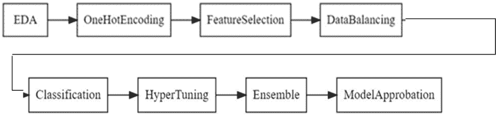

实现所提出的思路使用了 `CIC IDS 2017` 数据集。该数据集包含 `2830743` 条记录，其中删除了空值记录。删除空值后的记录数为 `2827876` (Panigrahi & Borah, 2018)。

实现所提出思路的第一步是探索性数据分析 (Oyelakin et al., 2023)。这是为了更深入地了解数据及不同特征间的关系，以及这些关系如何影响对攻击类型的准确预测。为此进行了单变量、双变量和多变量分析。单变量分析涉及绘制给定数据集中不同结果的出现频率。这通过计数图进行可视化。这有助于我们识别数据集的性质以及数据集中不同结果的比例。这成为了进行数据平衡步骤的原因。双变量分析涉及寻找数据集中不同特征之间的相关性。多变量分析涉及寻找所有特征之间的相关性，并借助热力图进行可视化。如前所述，特征选择和降维是所提出思路的主要目标。因此，为了获得不同特征重要性的洞察，执行了这一过程 (Tukey, 1977)。

数据集包含 `79` 个特征，其中 `1` 个为输出。作为攻击名称的目标变量是分类变量。为便于计算并支持使用不同算法，进行了独热编码。这将分类变量转换为数值 (Karthiga et al., 2021)。

进一步地，使用粒子群优化算法进行了特征选择 (Kunhare et al., 2020)。`PSO` 在传统特征选择方法难以奏效的高维空间中极为高效。此外，它具备全局优化能力。因此，在该方法中，根据初始化的代数更新每个粒子的位置和速度。识别出局部最优，并逐步识别出全局最优。这种涉及惯性、社会成分和认知成分的协作方法，确保了用于模型的特征子集能得到更好的选择。它也易于实现。与涉及复杂数学计算的其他几种特征选择方法不同，粒子群优化——一种基于鸟类和鱼类行为的技术——更为简单。因此，它更易于实现并集成到工作流中。此外，它极具适应性，可用于实现各种目标函数，例如所提出思路中旨在减少特征数量同时提高准确率的目标函数。`PSO` 也擅长处理特征交互。特征交互是指不同特征共同产生的效应（这在探索性数据分析中已研究过），这不同于特征各自单独的效应。由于数据集包含相互交互的不同特征，因此采用 `PSO` 进行特征选择。考虑到数据集的巨大体量，最初初始化了 `10` 代。这将特征分类为不同的特征子集。然后，每个特征子集由适应度函数进行测试。实现的思路中使用 `Logistic regression` 作为适应度函数。获得了每个特征子集的准确率。此外，这对所有十代持续进行，并确定了全局最优准确率。返回全局最优准确率的特征子集被保留，其余特征被丢弃，不再进一步处理。

从探索性数据分析中，在单变量分析中，观察到数据集高度不平衡。正常模式的数量远超攻击模式。像 `Heartbleed` 这样的少数攻击计数非常少。这样的数据集无法产生准确的结果，因为它会导致向多数类偏倚。因此，进行了数据平衡 (Mooijman et al., 2023) 以平衡数据集。采用了同时包含过采样和欠采样的方法，以确保数据完美平衡。通过随机欠采样对多数类进行了欠采样处理。少数类通过自适应合成过采样技术 (He et al., 2008) 进行过采样。这产生了一个平衡的数据集，数据集最终准备好可用各种机器学习算法进行分类并观察准确率。

使用了九种不同的分类器算法对数据集进行分类。算法包括 `random forest`、`K-nearest neighbor`、`Logistic regression`、`decision tree`、`LightGBM`，以及 `Adaboost`、`Catboost`、`XGBoost` 和 `Gradient boost` 等提升算法。这些算法的评估指标为：预测准确率、精确率、`F1 score`、召回率、模型训练耗时和模型测试耗时。随后，这些模型使用 `Optuna` (Kusumaputri & Arifin, 2022)——一种超参数优化框架——进行了超参数调优。定义了特征空间，并为上述每种机器学习算法指定了待调优的超参数（以提高准确率为目标函数）。采用并行处理以加速计算并降低计算开销。观察了每种算法的准确率、精确率、`F1 score` 和召回率。根据上述四个评估指标选出表现最好的算法，并对其进行超参数调优。


集成的机器学习算法包括 `XGBoost`、`Catboost`、`Random Forest` 和 `LightGBM`。`XGBoost` 以其高效性和有效性著称。它具有高速度和内置正则化功能以防止过拟合，还能处理缺失值。`Catboost` 无需单独预处理数据即可处理分类变量。它能自动处理缺失数据，且对过拟合具有鲁棒性。`Random forest` 是多棵决策树的集成模型，具备处理大型数据集的能力，且对过拟合具有鲁棒性。`LightGBM` 是一种梯度提升算法，旨在处理大型数据集。它速度快且内存效率极高。基于上述原因，以及基于分类和超参数调优期间建立的评估指标所表现出的高性能，选择了上述模型进行集成。集成采用软投票方式完成，最终获得了集成模型（Dietterich, 2000）。

随后，使用不同方法对获得的集成模型进行了测试。首先，通过改变扰动级别计算模型的稳定性得分。然后，向数据集注入合成噪声，并使用集成模型对数据集进行分类。最后，进行了五折交叉验证，以确保不存在过拟合。从而验证了模型的鲁棒性。关于所获得的各种中间结果和最终结果及其推论的详细解释，将在本章的“结果与讨论”部分阐述。

## 结果与讨论

### 探索性数据分析 (EDA)

**统计摘要** - 对数据集中进行的不同统计分析结果的摘要。

#### 图 2. 统计摘要

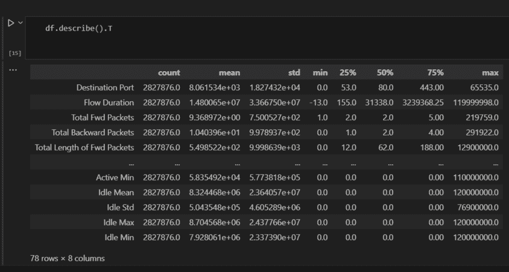

#### 推论

*   从上述统计摘要得出的推论如下：

    1.  少数特征的均值与中位数之间存在巨大差异，表明潜在的偏态。
        *   例如：流持续时间和后向数据包总长度
    2.  少数特征（如流持续时间和后向数据包总长度）的第 75 百分位数与最大值之间存在巨大差距，表明存在异常值。
    3.  与数据包长度和流相关的特征显示出高变异性和宽广的取值范围。这些特征可能具有潜在重要性。
    4.  然而，标志计数特征显示出较低的均值和较低的标准差。这表明它们在数据集中不常被观测到，可能不具备太大重要性。
        *   例如：FIN 标志计数、SYN 标志计数、RST 标志计数等。

### 直方图与箱线图

#### 图 3. 流持续时间：接收流中第一个和最后一个数据包之间的时间间隔。

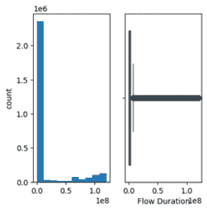

#### 图 4. 流数据包：网络流中每秒的数据包数量

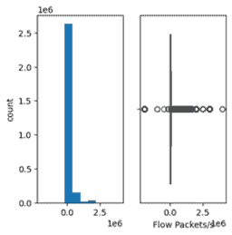

为了进行单变量分析，为所有 78 个特征绘制了直方图和箱线图。直方图是以矩形形式直观展示数值数据的图表。箱线图利用箱体和线条描绘数值数据分组情况。图 3 和 图 4 分别展示了流持续时间（图 3）和流数据包/秒（图 4）这两个特征的直方图和箱线图。

直方图（图 3）显示了流持续时间的分布。它展示了每个流持续时间范围（显示在 x 轴）在数据中出现的频率。

直方图（图 4）显示了数据中每秒接收的流数据包数量的分布。

x 轴（流数据包/秒）表示观测到的数据包速率范围，y 轴（计数）表示特定数据包速率（显示在 x 轴）在数据中被观测到的次数。

箱线图（图 3 和 图 4）用关键统计量总结了流持续时间的分布：

图 3 中箱体内的中心线（水平线）代表约 1.25 毫秒的流持续时间中位数。这是第 50 百分位数，表明一半的流持续时间小于或等于此值，另一半大于或等于此值。在 图 4 中，这代表 1.4×10⁶ 数据包/秒的中位数数据包速率。这是第 50 百分位数，表明一半时间观测到的数据包速率小于或等于此值，另一半时间大于或等于此值。

箱体代表四分位距 (IQR)。这显示了包含中间 50% 流持续时间和流数据包/秒的范围。箱体从第一四分位数 (Q1，第 25 百分位数) 延伸到第三四分位数 (Q3，第 75 百分位数)。

须线从箱体延伸出，可能指示潜在异常值。这些是流持续时间落在第一四分位数以下或第三四分位数以上 1.5 倍 IQR 范围之外的数据点。

#### 图 5. 计数图：不同类别数据出现次数的图形化表示

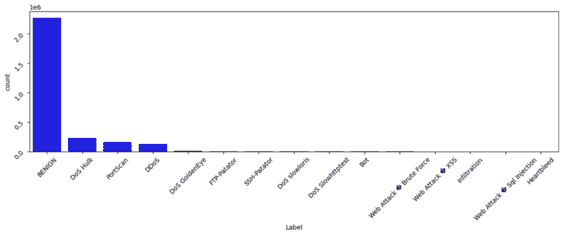

上图显示了数据集中目标变量（攻击类型）的计数图。可以看到良性变量（无攻击）的值非常高，而 DoS Goldeneye、FTP-Patator 等攻击类型的实例非常少。下表显示了每个标签的实际实例数量：

#### 表 1. 数据集中不同标签的计数

| 标签 | 计数 |
| --- | --- |
| BENIGN | 2271320 |
| DoS Hulk | 230124 |
| PortScan | 158804 |
| DDoS | 128025 |
| DoS GoldenEye | 10293 |
| FTP-Patator | 7935 |
| SSH-Patator | 5897 |
| DoS slowloris | 5796 |
| DoS Slowhttptest | 5499 |
| Bot | 1956 |
| Web Attack Brute Force | 1507 |
| Web Attack XSS | 652 |
| Infiltration | 36 |
| Web Attack Sql Injection | 21 |
| Heartbleed | 11 |

### 散点图

#### 图 6. 散点图：使用点来表示两个不同数值变量的可视化图表


从散点图中得出以下观察结果：

*   可以看出 `Total fwd packets vs total bck packets`（总前向数据包 vs 总后向数据包）、`Total length of bck packets vs total fwd packets`（后向数据包总长度 vs 总前向数据包）、`Total bck packets vs total length of bck packets`（总后向数据包 vs 后向数据包总长度）、`Flow_IAT_std vs Flow_IAT_mean`、`Flow_IAT_max vs Flow_IAT_mean`、`Flow_IAT_min vs Flow_IAT_mean`、`Flow_IAT_max vs Flow_IAT_std`、`Flow_IAT_min vs Flow_IAT_max`、`bck_packet_length_mean vs bck_packet_length_min`、`Fwd_IAT` 和 `Bck_IAT` 变量（min、mean、max、total、std）具有强正相关性；`Packet_length_var vs Packet_length_std`、`active_mean vs act_data_pkt_fwd`、`active_std vs act_data_pkt_fwd`、`active_mean vs min_seg_size_fwd`、`active_std vs active_mean`、`active_min vs active_max`、`idle_mean vs active_min`、`idle_max vs idle_min` 具有强正相关性。


• 可以看出，`fwd_packet_length_mean` 与 `fwd_packet_length_std`、`fwd_packet_length_mean` 与 `fwd_packet_length_max`、`fwd_packet_length_std` 与 `fwd_packet_length_max`、`bck_packet_length_mean` 与 `bck_packet_length_max`、`bck_packet_length_std` 与 `bck_packet_length_max`、`fwd_packets` 与 `bck_packets`、`packet_length_var` 与 `packet_length_mean`、`packet_length_std` 与 `packet_length_mean`、`avg_fwd_seg_size` 与 `avg_packet_size`、`avg_bck_segment_size` 与 `avg_packet_size`、`min_seg_size_fwd` 与 `act_data_pkt_fwd` 存在中等正相关。

• 可以看出，`idle_std` 与 `active_min`、`fwd_IAT_min` 与 `fwd_IAT_std` 存在强负相关。

• 可以看出，`avg_bck_seg_size` 与 `avg_fwd_seg_size` 存在中等负相关。

从上述散点图观察中，我们可以推断：在这些具有负相关的特征变量中，只有对输出影响较大的特征才可能在进一步分析后被选中。

### 热力图

#### 图 7. 热力图：不同数值变量间相关性的可视化表示

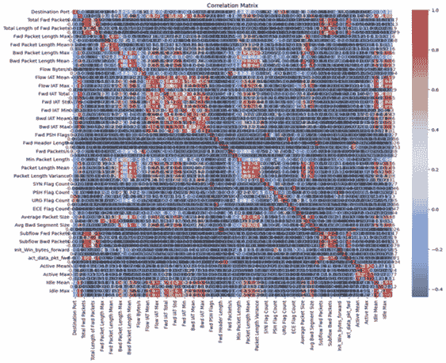

生成热力图是为了对 78 个特征进行多变量分析，观察结果如下：

可以看出，少数变量表现出强正相关（由热力图的对角线指示），这些可能是具有潜在重要性的特征。此外，少数变量表现出弱正相关和弱负相关。举几个例子：

*   ▪ 前向数据包总数与前向数据包总长度之间存在弱负相关。
*   ▪ 前向数据包总长度与前向数据包长度均值之间存在弱正相关。
*   ▪ 前向数据包长度均值与后向数据包长度均值之间存在弱负相关。
*   ▪ 流字节数/秒与流 IAT 均值之间存在弱正相关。
*   ▪ 前向 IAT 总计与后向 IAT 均值之间存在弱正相关。
*   ▪ 后向 IAT 均值与后向数据包长度均值之间存在弱负相关。

由于这些特征表现出弱相关性，它们可能不包含太多信息，因此在这些特征对中只能选择一个。

### 特征选择

特征选择基于粒子群优化技术进行。初始化了 10 代。每个簇的适应度函数通过逻辑回归计算。

### 特征选择准确率（局部）

这些是第一次迭代中不同代的个体最优值。

#### 图 8. 特征选择准确率（局部）——第一次迭代中不同代获得的个体最优值

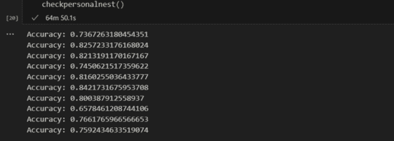

可以看出，不同簇中个体最优的最大准确率为 0.8421。

### 全局最优准确率

#### 图 9. 遍历所有代后获得的全局最优准确率


在遍历完所有 10 代并将当前代的所有个体最优值与其他所有代的个体最优值进行比较后，全局最优的准确率为 0.84217。

### 选定特征

基于上述特征选择方法，特征选择后，为降低数据集维度，选定的特征如下：

`Flow Duration`、`Total Backward Packets`、`Total Length of Fwd Packets`、`Fwd Packet Length Min`、`Fwd Packet Length Mean`、`Bwd Packet Length Min`、`Bwd Packet Length Mean`、`Bwd Packet Length Std`、`Flow Bytes/s`、`Flow Packets/s`、`Flow IAT Std`、`Flow IAT Max`、`Flow IAT Min`、`Fwd IAT Total`、`Fwd IAT Mean`、`Bwd IAT Total`、`Bwd IAT Mean`、`Bwd IAT Std`、`Fwd PSH Flags`、`Fwd URG Flags`、`Bwd Header Length`、`Min Packet Length`、`Max Packet Length`、`Packet Length Std`、`Packet Length Variance`、`FIN Flag Count`、`RST Flag Count`、`CWE Flag Count`、`ECE Flag Count`、`Down/Up Ratio`、`Average Packet Size`、`Avg Bwd Segment Size`、`Fwd Header Length.1`

在可用的 78 个特征中，共选定了 31 个特征。

### 数据平衡

从计数图（图 5）可以看出，数据高度不平衡。这会导致训练模型偏向多数类，即良性。因此，必须对数据进行平衡以获得准确的结果。多数类使用随机欠采样（RUS）进行欠采样。随后使用自适应合成过采样（ADASYN）对少数类数据进行过采样。这些过程通过饼图可视化如下：

#### 图 10. 数据平衡输出：包含原始数据中类别比例、RUS 后获得的比例以及 ADASYN 后比例的饼图

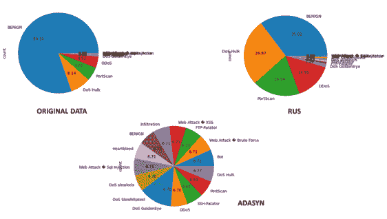

## 分类

然后使用下表列出的分类器算法对平衡数据集进行训练和测试。评估指标（准确率、精确率、召回率、F1 分数以及训练和测试时间）也在表中列出。

### 获得的评估指标

#### 图 11. 获得的评估指标——分类

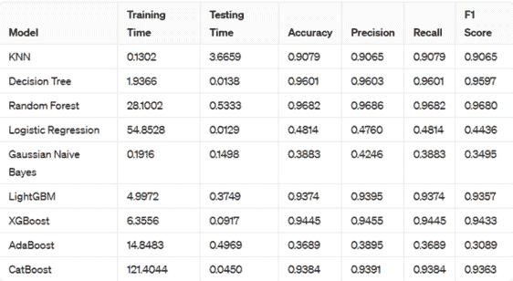

下图展示了不同模型的准确率、精确率、F1 分数、召回率和测试时间。

#### 图 12. 获得的评估指标——分类的条形图，展示准确率、精确率、F1 分数、召回率和测试时间

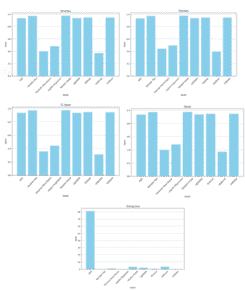

可以看出，随机森林在准确率、精确率、F1 分数和召回率方面表现最佳。而决策树在考虑训练和测试时间时表现更好。高斯朴素贝叶斯尽管训练和测试耗时极少，但在其他指标上表现不佳。在所有 9 个模型中，AdaBoost 表现最差。

为了获得更深入的见解，为每个模型绘制了相关矩阵和 ROC 曲线。下图展示了决策树分类器的相关矩阵和 ROC 曲线。

#### 图 13. (a) 混淆矩阵：总结机器学习模型性能的矩阵——和 (b) ROC 曲线：展示分类模型性能的图表

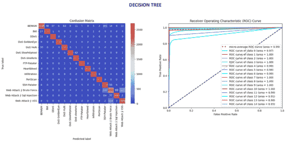

决策树分类器的性能可通过混淆矩阵得到验证，该矩阵显示大量数值被正确检测（显示在对角线上）。ROC 曲线的推断如下：

高性能类别（AUC > 0.95）：良性、DoS GoldenEye、DoS Hulk、DoS Slowhttptest、DoS Slowloris、PortScan、SSH-Patator。

中等性能类别（AUC > 0.8）：DDoS、Infiltration。

低性能类别（AUC < 0.8）：Bot、暴力破解 Web 攻击、Heartbleed、XSS Web 攻击、SQL 注入 Web 攻击。

### 超参数调优

随后使用 Optuna 对模型进行超参数调优。获得的评估指标如下：

### 获得的评估指标

#### 图 14. 获得的评估指标——超参数调优

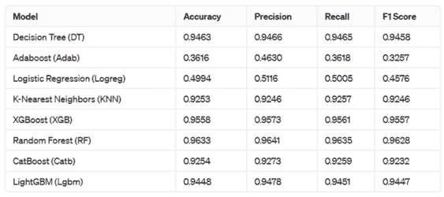

可以看出，随机森林在所有评估指标方面仍然表现最佳。AdaBoost 和逻辑回归表现不佳。

#### 集成学习

从调优后的模型中，选取随机森林、XGBoost、CatBoost 和 LightGBM 共 4 个模型，采用软投票技术进行集成。获得的评估指标如下。

### 获得的评估指标


#### 图 15. 获得的评估指标-集成- 给出了集成模型的准确率、精确率、F1 值和召回率得分

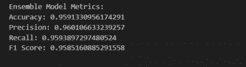

可以看出，该模型表现出高性能。通过绘制混淆矩阵和 ROC 曲线进一步分析。

#### 图 16. 集成模型的混淆矩阵- 根据旁边给出的图例显示强相关性和弱相关性

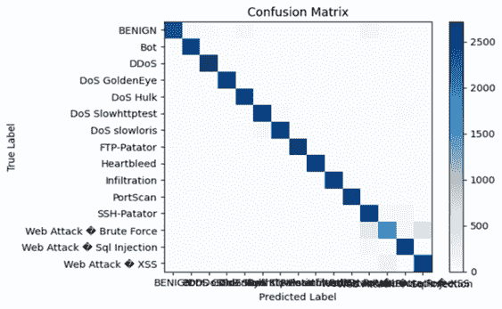

#### 图 17. 集成模型的 ROC- 显示模型的性能

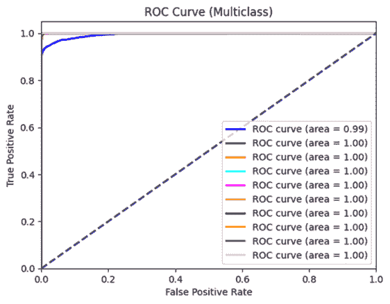

混淆矩阵显示了模型的准确性能。从 ROC 曲线可以看出，所有类别的 AUC >= 0.99，表明所有类别均表现优异。

## 模型验证

通过寻找稳定性得分、带噪声的准确率以及交叉验证，对集成模型进行了测试。

### 稳定性得分

稳定性得分表示扰动下数据的变化。扰动大小从 0.1 变化到 5，获得了以下稳定性得分。

#### 图 18. 不同扰动下的稳定性得分- 稳定性是模型鲁棒性的度量

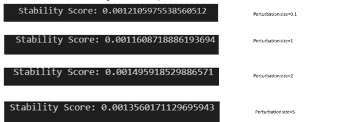

可以看出，由于稳定性得分接近 0，该模型相当稳定。

### 提出模型在噪声下的准确率

生成了随机噪声并添加到数据中。使用集成模型计算数据的准确率，获得了以下准确率。

#### 图 19. 带噪声的准确率- 显示模型在噪声存在下的准确率


可以看出，即使在存在噪声的情况下，该模型依然鲁棒。

### 交叉验证准确率

对给定数据进行了五折交叉验证以检查过拟合。获得了以下准确率。

#### 图 20. 交叉验证准确率- 一种用于评估模型在未见数据上性能的技术


高准确率确保了模型在未见数据上的性能。

## 结论与未来工作

使用机器学习实现网络入侵检测系统 (NIDS) 具有多项优势。机器学习算法能够学习并适应不断演变的攻击模式，与传统基于规则的系统相比，能更准确地检测网络入侵。它们能够识别基于规则的系统难以检测的异常和模式。

通过分析大量数据并辨别模式，与基于规则的系统相比，所提出的模型能显著减少误报。这有助于专注于真实威胁，而不是花费时间调查虚假警报，并能高效处理大规模数据集，随着网络流量增加而扩展，使其适合部署在大规模网络和环境中。该模型通过持续从新数据中学习，能够适应新的和以前未见过的威胁。这种适应性对于应对以前可能未曾遇到的新兴网络威胁至关重要。

基于机器学习的 NIDS 在很大程度上可以自动化检测过程，减少人工干预的需求。安全分析师随后可以专注于调查和响应已确认的威胁，而不是花费时间在日常监控任务上。通过分析网络流量实现增强的威胁情报，使机器学习模型能够识别表明恶意行为的模式。这些模型为攻击者利用的战术、技术和程序 (TTP) 提供了宝贵见解。这些见解对于增强组织安全态势和制定更有效的防御策略至关重要。

机器学习模型可以定制和微调，以适应不同网络和环境的特定需求和特征。总体而言，将机器学习集成到网络入侵检测系统中，可以实现更有效、更高效的威胁检测，帮助组织更好地保护其资产和数据免受网络攻击。

使用机器学习（如所提出的模型）的网络入侵检测系统 (NIDS) 的未来前景广阔，有几个潜在领域可供进一步开发和增强。未来的研究可以探讨利用先进的机器学习方法（如强化学习）来提高 NIDS 的精度和韧性。这些方法有望有效捕捉网络流量数据中复杂的模式和关系 (Jani et al., 2019)。

开发具有可解释 AI 能力的 NIDS 模型，可以通过提供对系统生成的决策或警报有贡献的因素的见解，帮助解决可解释性挑战。这对于建立对 NIDS 的信任以及促进自动化系统与人工分析师之间的协作至关重要 (Corea et al., 2024)。针对这些环境量身定制的入侵检测解决方案的需求日益增长。未来的 NIDS 可以专注于检测针对物联网 (IoT) 和运营技术 (OT) 网络特有的异常和攻击，考虑其独特的特性和通信协议。

对对抗防御机制的研究有助于降低针对基于机器学习的 NIDS 的对抗攻击风险。专门设计用于检测对抗输入的对抗训练和鲁棒优化等技术，可以增强 NIDS 抵御复杂攻击的韧性。为 NIDS 开发隐私保护技术，可以使组织在确保敏感网络数据机密性的同时，利用机器学习进行入侵检测。差分隐私、联邦学习和同态加密等技术有助于保护分布式 NIDS 部署中的隐私。

未来的 NIDS 可以向自主响应和编排能力演进，即系统不仅检测入侵，还根据预定义的策略和规则自动发起响应行动。在混合 NIDS 架构中结合不同检测技术的优势，如基于特征的、基于异常的和基于机器学习的方法，可以在最大限度地减少误报和漏报的同时，为广泛的威胁提供全面覆盖。混合方法可以利用不同检测方法的互补性，实现更好的整体性能。

NIDS 应持续监控网络流量，并适应不断演变的威胁和网络行为的变化。未来的系统可以采用动态重新训练策略、在线学习算法和自适应机制，以跟上新出现的威胁并长期保持有效性。将 NIDS 与更广泛的安全运营工作流、事件响应流程和安全自动化平台集成，可以简化威胁检测、调查和修复活动。这种集成实现了 NIDS 与其他安全工具和利益相关者之间的无缝协作，增强了整体安全态势和对网络威胁的韧性。

## 参考文献

Corea, P. M., Liu, Y., Wang, J., Niu, S., & Song, H. (2024). Explainable AI for comparative analysis of intrusion detection models. DOI: [10.1109/MeditCom61057.2024.10621339](http://dx.doi.org/10.1109/MeditCom61057.2024.10621339)


## 参考文献

Dietterich, T. G. (2000). Ensemble methods in machine learning. In *Multiple Classifier Systems. MCS 2000*. Springer. DOI: [10.1007/3-540-45014-9_1](http://dx.doi.org/10.1007/3-540-45014-9_1)

Gad, A. G. (2022). Particle swarm optimization algorithm and its applications: A systematic review. *Archives of Computational Methods in Engineering*, 29(5), 2531–2561. DOI: [10.1007/s11831-021-09694-4](http://dx.doi.org/10.1007/s11831-021-09694-4)

Grolemund, G., & Wickham, H. (2017). *R for data science*. O’Reilly Media.

He, H. (2008). ADASYN: Adaptive synthetic sampling approach for imbalanced learning. In *2008 IEEE International Joint Conference on Neural Networks (IEEE World Congress on Computational Intelligence)* (pp. 1322-1328). Hong Kong. DOI: [10.4018/978-1-7998-8023-2](http://dx.doi.org/10.4018/978-1-7998-8023-2)

James, G. (2013). *An introduction to statistical learning*. Springer. DOI: [10.1007/978-1-4614-7138-7](http://dx.doi.org/10.1007/978-1-4614-7138-7)

Jani, K., Lalwani, P., Upadhyay, D., & Potdar, M. B. (2019). Network Intrusion Detection System using Threat Intelligence and Deep Learning Approach. *International Journal on Computer Science and Engineering*, 7(4), 526–531. DOI: [10.26438/ijcse/v7i4.526531](http://dx.doi.org/10.26438/ijcse/v7i4.526531)

Karthiga, R. (2021). Transfer learning based breast cancer classification using one-hot encoding technique. In *2021 International Conference on Artificial Intelligence and Smart Systems (ICAIS)* (pp. 115-120). DOI: [10.1109/ICAIS50930.2021.9395930](http://dx.doi.org/10.1109/ICAIS50930.2021.9395930)

Khraisat, A., Gondal, I., Vamplew, P., & Kamruzzaman, J. (2019). Survey of intrusion detection systems: Techniques, datasets and challenges. *Cybersecurity*, 2(1), 20. DOI: [10.1186/s42400-019-0038-7](http://dx.doi.org/10.1186/s42400-019-0038-7)

Kumar, V., & Sangwan, O. P. (2012). Signature based intrusion detection system using SNORT. *International Journal of Computer Applications & Information Technology*, 1(3), 35–41. DOI: [10.4018/978-1-7998-8023-2](http://dx.doi.org/10.4018/978-1-7998-8023-2)

Kunhare, N., Tiwari, R., & Dhar, J. (2020). Particle swarm optimization and feature selection for intrusion detection system. *Sadhana*, 45(1), 109. DOI: [10.1007/s12046-020-1308-5](http://dx.doi.org/10.1007/s12046-020-1308-5)

Kusumaputri, F. H., & Arifin, A. S. (2022). Anomaly detection based on NSL-KDD using XGBoost with Optuna tuning. In *2022 7th International Conference on Business and Industrial Research (ICBIR)* (pp. 586-591). DOI: [10.1109/ICBIR54589.2022.9786429](http://dx.doi.org/10.1109/ICBIR54589.2022.9786429)

Macleod, D., & Whyte, D. (2003). An investigation of the practical limitations of network-based intrusion detection imposed by partial IP datagram inspection. In *Real Time Intrusion Detection*. IGI Global. DOI: [10.4018/978-1-7998-8023-2](http://dx.doi.org/10.4018/978-1-7998-8023-2)

Maseer, Z. K., Yusof, R., Bahaman, N., Mostafa, S. A., & Foozy, C. F. M. (2021). Benchmarking of machine learning for anomaly based intrusion detection systems in the CICIDS2017 dataset. *IEEE Access: Practical Innovations, Open Solutions*, 9, 22351–22370. DOI: [10.1109/ACCESS.2021.3056614](http://dx.doi.org/10.1109/ACCESS.2021.3056614)

Mooijman, P., Catal, C., Tekinerdogan, B., Lommen, A., & Blokland, M. (2023). The effects of data balancing approaches: A case study. *Applied Soft Computing*, 132, 109853. DOI: [10.1016/j.asoc.2022.109853](http://dx.doi.org/10.1016/j.asoc.2022.109853)

Mudigonda, N. (2022, August). A method for network intrusion detection using deep learning. *J Stud Res*, 11(3). Advance online publication. DOI: [10.47611/jsrhs.v11i3.2875](http://dx.doi.org/10.47611/jsrhs.v11i3.2875)

Oyelakin, A. M. (2023). Overview and exploratory analyses of CICIDS 2017 intrusion detection dataset. *Journal of Systems Engineering and Information Technology*.

Pandas Development Team. (2022). *pandas: powerful Python data analysis toolkit*. IGI Global. DOI: [10.4018/978-1-7998-8023-2](http://dx.doi.org/10.4018/978-1-7998-8023-2)

Panigrahi, R., & Borah, S. (2018). A detailed analysis of CICIDS2017 dataset for designing intrusion detection systems. *IACSIT International Journal of Engineering and Technology*, 7, 479–482.

Pudjihartono, N., Fadason, T., Kempa-Liehr, A. W., & O’Sullivan, J. M. (2022). A review of feature selection methods for machine learning-based disease risk prediction. *Frontiers in Bioinformatics*, 2, 927312. Advance online publication. DOI: [10.3389/fbinf.2022.927312](http://dx.doi.org/10.3389/fbinf.2022.927312) PMID: [36304293](https://pubmed.ncbi.nlm.nih.gov/36304293)

Ramu, C., Rao, T. S., & Rao, E. U. S. (2024). Attack classification in network intrusion detection system based on optimization strategy and deep learning methodology. *Multimed Tools Appl*. DOI: [10.1007/s11042-024-18558-5](http://dx.doi.org/10.1007/s11042-024-18558-5)

Rashid, A., Siddique, M. J., & Ahmed, S. M. (2020). Machine and deep learning based comparative analysis using hybrid approaches for intrusion detection system. In *2020 3rd International Conference on Advancements in Computational Sciences (ICACS)* (pp. 1-9). DOI: [10.1109/ICACS47775.2020.9055946](http://dx.doi.org/10.1109/ICACS47775.2020.9055946)

Singh, A. P., & Singh, M. D. (2014). Analysis of host-based and network-based intrusion detection system. *IJCNIS*, 6(8), 41–47. DOI: [10.5815/ijcnis.2014.08.06](http://dx.doi.org/10.5815/ijcnis.2014.08.06)

Tukey, J. W. (1977). *Exploratory data analysis*. Addison-Wesley.

Vanin, P., Newe, T., Dhirani, L. L., O’Connell, E., O’Shea, D., Lee, B., & Rao, M. (2022). A study of network intrusion detection systems using artificial intelligence/machine learning. *Applied Sciences (Basel, Switzerland)*, 12(22), 11752. DOI: [10.3390/app122211752](http://dx.doi.org/10.3390/app122211752)

Venkatesan, S. (2023). Design an intrusion detection system based on feature selection using ML algorithms. *MSEA*, 72(1), 702–710.

Wang, M., Zheng, K., Yang, Y., & Wang, X. (2020). An explainable machine learning framework for intrusion detection systems. *IEEE Access: Practical Innovations, Open Solutions*, 8, 73127–73141. DOI: [10.1109/ACCESS.2020.2988359](http://dx.doi.org/10.1109/ACCESS.2020.2988359)

Xia, X. (2024). Optimizing and hyper-tuning machine learning models for the water absorption of eggshell and glass-based cementitious composite. *PLoS One*, 19(1), e0296494. Advance online publication. DOI: [10.1371/journal.pone.0296494](http://dx.doi.org/10.1371/journal.pone.0296494) PMID: [38165942](https://pubmed.ncbi.nlm.nih.gov/38165942)

## 附录

### CIC IDS 2017 数据集
由加拿大网络安全研究所创建的数据集，包含正常和恶意网络流量详情（Maseer 等，2021；Panigrahi 和 Borah，2018）。

### 探索性数据分析 (EDA)
为发现不同特征间的相关性并获取数据集洞察而进行的分析（Oyelakin 等，2023；Tukey，1977）。

### 特征选择
从数据集中选择相关特征以提升模型性能并降低计算负担的过程（Pudjihartono 等，2022）。实现中采用粒子群优化来选择最优特征子集（Kunhare 等，2020）。

### 数据平衡
用于解决类别不平衡问题的技术。包括过采样和欠采样（Mooijman 等，2023；He 等，2008）。

### 机器学习算法
可用于数据分类并观察准确率、精确率、F1 分数和召回率的算法。


### 超参数调优

一种针对模型参数的优化技术，旨在提升模型性能（Xia, 2024）。

#### 集成学习

一种将多个机器学习模型的预测结果相结合的技术，以提高整体性能并使系统更加稳健（Dietterich, 2000）。

### 稳定性评分

一种在不同扰动水平下衡量模型稳定性的指标，用于评估其鲁棒性。

### 交叉验证

一种统计方法，通过将数据集划分为子集并迭代地用于训练和测试，来评估模型性能。

## 威胁情报

威胁情报是关于网络攻击的基于证据的信息，由网络安全专家组织和分析（Jani et al., 2019）。

## 可解释 AI

可解释 AI 是一组工具和框架，帮助您理解和解释机器学习模型做出的预测（Corea et al., 2024）。

# 第 8 章：利用区块链技术实现刑事档案存储与处理的安全协作

**Hima Bindu**  
QIS College of Engineering and Technology, India

**Sanjana Muvvala**  
QIS College of Engineering and Technology, India

## 摘要

区块链技术在各行业引发了变革性变化，为共享、防篡改的交易记录提供了安全账本。其去中心化特性通过要求多方参与者达成共识，防止了数据篡改。应用领域涵盖医疗、教育、金融科技、会计、银行和政府，解决了欺诈、腐败和身份盗窃等问题。本章介绍了一种新应用，探讨利用区块链在派出所安全存储刑事档案。这种方法确保了数据的长期保存，减少了存储空间，并保持了关键证据的完整性。通过实现警方与司法机关之间的安全协作，它增强了证据收集并强化了治理，促进了值得信赖的执法体系建设。

## 1. 介绍

区块链正获得极大的重视，并已成为当前时代的一个新流行词。区块链时代引入了数据安全共享的新概念，同时兼顾透明度，并增强了解决完整性、安全性和数据隐私问题的潜力。凭借其特性，区块链吸引了各个领域众多应用的关注（Anton 2022）。区块链由区块链（记录）组成，允许存储所有已提交的交易。区块链融合了加密哈希函数、分布式共识算法和数字签名等技术，以实现安全传输（Bushra Hameed 2019, Zhang 2019）。在区块链技术中，所有交易均以去中心化方式进行，以消除第三方干预。区块链常被描述为一种分布式账本技术，也称为 DLT，这意味着不存在中心攻击点。在区块链中，数据库通过具有分布式时间戳服务器的 P2P 网络自动管理（Abdullah 2022）。

存在不同代际的区块链，对应不同的演进阶段：区块链 1.0 主要侧重于货币与支付，实现了数字加密货币交易。区块链 2.0 引入了智能合约；区块链 3.0 扩展了应用领域，引入了去中心化应用（dApp），并解决了可扩展性和互操作性相关问题。区块链 4.0 带来了结合 AI、IoT 等其他技术的工业应用区块链新模型（Nurmukhametov 2018）。

共识协议在区块链中至关重要，因为它们确保所有参与者遵循普遍认可的视角，从而建立全局共识（Zhang 2021）。节点的验证与确认用于在区块加入链之前检查其真实性。区块数据无法被篡改，因为当前区块的哈希值依赖于前一区块的哈希值。区块链结合智能合约将消除对中心服务器的需求，以确保交易各方之间的公平性。可追溯性和去中心化这两个重要特性使区块链区别于所有其他安全方法（Alaa Haddad 2022）。

### 1.1 区块链架构

在区块链中，该部分存放经过哈希处理并编码进默克尔树的官方交易。区块链中区块的结构如图 1 所示。

#### 图 1. 区块链结构

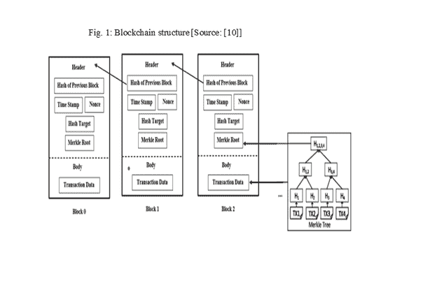

来源：(Alaa Haddad 2022)

区块链包含的每个区块包括：

*   **区块头**：通过区块头可更容易地识别整条链中的特定区块。矿工会定期更改 nonce 值以对区块头进行哈希运算。
*   **前一区块地址/哈希**：包含前一区块哈希的值。
*   **时间戳**：区块验证后，会标注其创建的具体时间。
*   **Nonce**：每个区块使用一个 nonce 数值来解决工作量证明，并将其与实时目标值进行比较。矿工在哈希计算时，每次都会更改一个四字节的随机字段。
*   **默克尔根**：通过提供整个交易的数字蓝图，存储所有交易数据。

每个区块的哈希值由前序区块的哈希之和、交易信息以及当前区块的 nonce 值共同决定。区块按顺序依次添加到区块链中，第一个区块被称为创世区块，或第 0 号区块。为确保账本一致性和用户安全，区块链通常由两项技术组成：P2P 分布式共识和非对称加密（Alaa Haddad 2022）。在区块链技术中，验证交易记录的节点称为矿工。区块的创建利用了不可篡改性、透明性和假名性（Yumna 2019, Abid Haleem 2021, Alaa Haddad 2022）。

### 1.2 共识算法

由于区块链网络缺乏单一联系点，一个基本挑战是拜占庭将军问题（Alaa Haddad 2022），该问题于 1982 年在分布式网络研究中被提出。一组节点的决策过程及网络内节点间的达成一致构成了共识（Abdullah Almamun 2022, Khezr 2019）。区块链网络使用传统的共识方法，如 PoW、PoS、PBFT 等。这些共识算法在能耗、节点管理和对抗节点容忍度方面的特性如图 2 所示。

#### 图 2. 共识算法对比


（来源：(Kherbouche 2022)）


## 共识机制

*   ➢ **工作量证明** 是最流行且鲁棒性最高的共识机制。它用于验证和创建区块链中的新区块。该机制最早由 Cynthia Dwork 和 Moni Naor 于 1993 年发表，通过挖矿过程中的资源消耗进行验证。最初，矿工通过寻找低于预定值的哈希值来解谜。由于需要大量计算，该任务在处理资源方面成本高昂。例如，对区块链网络发起 51% 攻击将付出高昂代价 (Alaa Haddad 2022, Zheng 2017)。

*   ➢ **权益证明** 是一种处理交易和在区块链中创建新区块的机制。它解决了 PoW 过度消耗 CPU 算力的缺点。在 PoS 中，矿工（验证者）根据其持有的货币或财富（称为“权益”）被选中。第二大加密货币以太坊现正计划将其共识算法从 PoW 更改为 PoS (Kherbouche 2022, Castro 2019)。

*   ➢ **实用拜占庭容错** 建立在拜占庭协议之上 (King 2012, Kherbouche 2022)。PBFT 要求每个节点都为网络所知，这限制了其在公有链中的应用。PBFT 共识过程可分为三个阶段：预准备、准备和提交。节点需要获得所有其他节点三分之二的投票才能推进这三个阶段。Hyperledger Fabric 目前采用 PBFT (Zheng 2019, Kherbouche 2022)。

## 1.3 区块链类型

区块链的基本类型如下 (Bushra Hameed 2019)：

*   ➢ **许可/私有链**：在私有环境中作为封闭网络运行，或由单一组织管理的区块链网络。用户无法自由加入社区、查看记录或进行独立交易。利用网络优势进行内部业务活动的中心化组织倾向于使用许可链。雇主联盟也可能使用私有链以安全的方式进行数据交换和交易记录。

*   ➢ **无许可/公有链**：对所有人开放的区块链。任何用户均可创建私有协议、在网络上发送交易，并随后向账本添加条目以开始与网络交互。比特币及其他加密货币衍生的区块链技术原始形式称为公有链。公有链网络进一步推动了分布式账本技术（DLT）的发展。

*   ➢ **混合/联盟链**：同时利用公有链和私有链技术的区块链。混合网络使用无许可链代替许可链。虽然不公开访问，但该链隐蔽地提供了可追溯性、完整性和安全性等基本功能。

## 1.4 区块链特性

区块链的基本特征包括：图 3。

*   ➢ **去中心化**：区块链将网络中的每个节点相互连接，维护所有交易的透明且全面的日志 (Yumna 2019)。依赖分布式框架结构，在区块链上进行的数据确认、存储、保存和传输过程被称为去中心化。

*   ➢ **可追溯性**：区块链上的每笔交易按时间顺序编索引，区块通过其加密哈希值与两个相邻区块相连。区块链由矿池维护，允许基于云的网站浏览区块 (Yumna 2019)。

*   ➢ **共识机制**：在 PC 和区块链框架中，容错机制即共识机制，使分布式进程或多智能体系统能就单一网络状态数据达成一致。它有助于记录保存。三种共识机制过程为 POW、POS 和 DPOS (Yumna 2019)。

### 图 3. 区块链基本特征


*   ➢ **货币**：在所有提议的加密货币中，比特币是革命性世界中的第一种数字货币。加密货币是区块链技术的一项特性，它是一种保证端到端交易安全性和可靠性的数字或虚拟货币。这些货币通过多种挖矿算法创建。因此，区块链与加密货币的结合产品在会计和金融等领域具有多种应用 (Yumna 2019)。

*   ➢ **智能合约**：开发者需要智能合约（一种必需的区块链协议）来在区块链上创建由相关方触发的金融协议 (Yumna 2019)。它不仅降低了传统交易相关的“外部成本”，还极大地提高了交易的安全性和质量。

*   ➢ **不可篡改性**：数据一旦录入便无法更改。要成功篡改或进行非法更改，需要更改系统中存储的 51% 以上的记录。

## 1.5 区块链技术工作步骤

网络连接系统通过添加新区块来更新其区块链。区块链技术的基本流程如图 4 所示。通过机器共识，区块链系统允许点对点（P2P）价值交易，无需中介。它运行在互联网之上，利用执行协议并拥有相同交易账本副本的计算机点对点（P2P）网络 (Varshney 2021, McGhin 2019, Yue 2016)。

### 图 4. 区块链技术工作步骤


## 1.6 区块链应用

### ➢ 医疗保健领域的区块链

区块链技术被用于在整个供应链中追踪和溯源处方药。利用该技术，可以轻松阻止和控制假药扩散、召回危险无效药品，并快速响应。为了改善医院、政府和研究机构间的医疗服务，数据交换与传播以及客户数据安全是医疗行业的首要任务。

### ➢ 合同与遗嘱转移

书写合同和遗嘱并依赖众多中介的时代即将结束。区块链技术使得用数字化的遗嘱、合同和继承安排取代纸质文件成为可能。纸质合同被具有法律约束力的智能合约所取代。智能合约中规定的条款约束所有相关客户，该数据可在必要时随时检索，并存储在区块链网络上。

### ➢ 供应链管理

区块链的不可篡改账本完美执行了实时追踪商品在供应链中移动和交接的任务。区块链为销售这些产品的企业提供了多种选择。区块链上的条目可用于确定供应链任务的优先级，例如将新到货物分配到多个集装箱中。区块链技术使以新颖动态的方式利用和构建追踪数据成为可能。

### ➢ 版权与版税保护


## 区块链应用

目前，许多版权和所有权法律适用于音乐、电影、博客和其他在线内容。借助区块链技术，这些法律的实施可以更容易且更安全。此外，它为艺术家和内容制作者提供了关于版税分配的准确、最新统计数据。任何类型的数字内容下载均可被追踪，以确保创作者或艺术家因其作品获得应有的认可。

### 投票

区块链的概念已应用于安全投票领域。电子投票流程解决了传统人工投票的问题，但仍存在一些主要顾虑，包括选民欺诈、选民隐私以及传统数字投票技术的高昂成本。区块链有潜力通过智能合约和加密技术提高安全性、透明度和隐私性，从而改善选民的投票体验。这些目标可以通过区块链实现，区块链还使得通过使用不同类型的选票和基于逻辑的投票来定制投票程序成为可能。大学层面的选举已在使用它。

### 加密货币

区块链最熟悉的应用是在加密货币领域。采用区块链用于加密货币是由于其众多优势，其中之一是其无国界的特性。因此，加密货币可用于国际交易。一个重要的问题是汇率可能会波动，导致买家最终亏损。另一方面，这一选项明显优于区域性支付应用（如印度的 Paytm），但后者的功能仅限于国内使用。

### 物联网

物联网是一个由相互连接的设备组成的网络，它们共享信息以提供有价值的洞察。智能家居是一个典型示例，各种家电连接在一个平台上。然而，确保此类分布式系统的安全性至关重要。区块链在这方面发挥着重要作用。通过利用区块链，物联网设备可以确保其接收的信息安全，且仅授权方可访问，从而增强整体系统安全性。

### 资产管理

资产管理也不例外，区块链在金融领域的重要性日益凸显。一般来说，资产管理涉及个人可能拥有的各类资产的管理和交换，包括但不限于大宗商品、共同基金、房地产、股票、固定收益和另类投资。传统的资产管理交易技术成本高昂，特别是在涉及多个国家和跨境支付时。由于区块链消除了对经纪人、托管人、结算经理等中介的需求，在这些情况下可以提供显著帮助。相反，区块链技术提供了一种透明且明确的方法，从而消除了出错的可能性。

### 区块链在反洗钱中的应用

基于区块链的反洗钱应用的固有特性有助于阻止洗钱活动。每笔区块链交易都会创建一条不可逆转的永久记录轨迹。因此，当局很容易确定资金来源。区块链账本可以执行记录、验证和记录每笔交易完整历史等任务。如果任何步骤（如目标钱包、货币类型、源钱包和金额）未得到确认，交易将被立即取消。区块链还使风险评估和洗钱报告工具成为可能。它允许进行全系统分析，而不仅仅是监控进出点。

### 区块链在广告中的应用

区块链应用广告是一种分布式数字账本技术，在提供最高级别的安全性、可追溯性和透明度的同时促进去中心化。一旦数字记录被放置在区块链上，它们就是不可变的；有访问权限的人可以查看交易，但无法更改它们。因为区块链实时记录交易和信息，广告商可以利用它来追踪广告支出。最终，它能提供现有系统无法提供的公开性。好处不仅限于透明度。在广告领域，速度至关重要。维护库存控制和保证高质量商品是具有挑战性的任务。区块链技术能够保持最新状态。

## 区块链技术的优势

由于其众多优势，区块链技术已对广泛的行业变得愈发重要（Anton 2022）。

### 防欺诈

区块链技术确实通过绕过多方确认交易的需求，彻底改变了防欺诈机制。其点对点网络和防篡改特性使其成为任何依赖快速、安全且可验证的信息和交易行业的有力工具。通过消除中介并提供透明、不可变的账本，区块链提高了数据交换的效率和可信度，从而显著降低了欺诈风险。

### 维护隐私和机密性

区块链技术确实带来了效率、透明度和信任，同时保护隐私和机密性。其混合网络和私有网络专门设计用于处理高交易量和网络活动的突然激增，确保即使在高峰期也能平稳运行。

这与传统银行系统中的某些支付形成鲜明对比，后者可能需要数天才能清算。通过提供近乎即时的交易处理，区块链提高了金融交易的速度和可靠性，使企业和消费者均受益。

### 简化转账流程

区块链支付加快了转账流程，减少甚至完全消除了手续费。当客户开具空头支票支付商品或服务时，企业会蒙受损失，不得不支付额外费用，并可能不得不采取法律行动追回款项（Guo 2016, Zhang 2019, Ke 2021）。

### 加速交易系统

金融机构可以使用基于区块链的分布式、不可变交易记录进行记账和监管报告。区块链技术提供的更快交易结算可以增强多项金融服务。

### 赋能数字货币

区块链技术开启了数字资产的新时代，数字货币走在前列。这些基于区块链的货币为传统银行系统提供了一种替代方案。区块链公司正致力于降低准入门槛，促进主流加密货币的无缝交换。尽管数字货币已在使用中，但这些努力使其对用户更加易用和便捷。

### 简化审计流程

区块链技术确实有巨大潜力简化金融领域的审计流程。通过利用不可变的区块链记录，金融机构可以实现前所未有的透明度，使审计师能够彻底审查其活动。这些透明记录有助于确认符合监管标准，增强行业内的信任和问责制。

### 数字资产管理

区块链技术现在使得以可预测、自动化、可追溯和可靠的方式完全管理数字资产成为可能。每个区块链中的“区块”相互关联并加密的方式正是其独特之处（Haleem 2021）。


### 2. 文献综述

Treleaven 等人 (Treleaven 2017) 涵盖了银行和金融服务领域的区块链技术，并指出了区块链技术的诸多优势。本专刊探讨了其独特的起源、重大影响、实施难题及巨大潜力。区块链技术有望在银行和金融服务行业简化业务流程，同时生成安全、可靠的合同和交易记录。Qiang 等人 (Qiang Wang 2020) 解释了如何利用区块链网络通过直接连接生产者和消费者来执行各层级的交易。为了制定何时启动交易的规则，智能合约使用信号与系统进行通信。这些基于智能合约预设规范的程序，保证了所有能量和存储流的自动控制，并有助于平衡供需。能源区块链通过在单一区块链上存储能源交易数据，确保了所有能源流和商业操作的分布式安全记录。

在他们的论文中，Quazi Mamun 等人 (Quazi Mamun 2022) 探讨了区块链技术未来如何用于解决当前困扰医疗行业的诸多问题。他们建议，为了提高安全性和保密性，减少医疗人员开支并增加患者护理投入，应为医生和患者建立一个共享的健康相关数据档案，而不受患者电子诊断的限制。该报告还涵盖了区块链在医疗领域的多种应用。电子健康记录（EHR）是以数字形式存储的医疗记录，提供关于个人健康状况的信息。Alaa Haddad 等人 (Alaa Haddad 2022) 对 EHR 数据进行了研究。

由于 EHR 通常由各种医疗利益相关者共享，它们可能会遇到停电、数据不当使用、缺乏隐私、安全性和审计追踪等问题。相反，区块链是一项革命性技术，它提供了一个分布式和去中心化的环境，其中网络列表中的节点可以在不需要中央权威机构的情况下相互连接。它有能力突破 EHR 管理的局限，建立一个更去中心化、安全可靠的 EHR 数据交换体系。许多研究提出了利用区块链技术和人工智能技术的防篡改解决方案，以保证健康数据的准确性。

## 3. 方法论

### 3.1 动机

区块链技术已成为一种稳健且创新的解决方案，提供了诸多优势，特别是在透明度和防篡改数据存储方面。考虑到其潜力，我们受到激励，提议将区块链应用于一个关键问题领域：派出所的档案记录管理。派出所当前的档案记录系统常面临数据篡改、访问受限和文件丢失风险等挑战，这些都可能阻碍司法进程。通过实施区块链技术，我们可以彻底改变这一流程，使其更加高效和安全。

区块链的核心特性是其不可篡改性。与特定案件相关的每条信息都将被记录为一个区块，一旦记录，若无网络共识，便无法被更改或删除。这确保了数据的完整性，防止任何未经授权的修改，并维护了可靠的保管链。将所有案件相关数据存储在区块链上将显著降低传统系统中普遍存在的丢失和篡改风险。因此，警方部门可以节省原本用于冗余备份和安全措施的大量存储空间和资源。

此外，区块链的透明性质确保了案件所有授权参与方（包括执法人员、律师、法官，甚至在适当情况下的公众）均可访问数据。这种开放访问促进了跨部门和跨辖区的关键信息和证据共享，从而实现更协作、更高效的司法流程。法庭可在审判期间随时访问区块链数据，使其更易于审查和评估证据。这将简化决策流程，加快判决速度，并最终减轻司法系统的负担。通过采用区块链技术进行档案记录，派出所可以显著提高其效率、问责制和透明度。此外，该系统可在印度各地推广应用，协调数据管理实践，推动案件处理采取一致统一的方法。

#### 图 5. 刑事档案记录与处理的拟议安全协作


图 5 描绘了拟议工作的方法论，流程步骤如下：

1.  **数据收集**：从案件涉及的各方和各种来源收集相关案件数据。
2.  **数据加密与哈希**：对收集的数据进行加密以确保机密性，并进行哈希运算以创建代表数据块的唯一固定长度字符串。
3.  **区块创建**：将每个哈希后的数据块与前一个区块的哈希值及附加信息（如时间戳）结合，形成新区块。区块按时间顺序链接，形成区块链。
4.  **共识机制**：共识机制（如工作量证明、权益证明）验证并就区块链中区块的顺序和内容达成一致，确保仅添加授权且合法的信息。
5.  **数据验证与审计**：区块链的透明性质允许任何有访问权限的人独立验证数据，便于审计流程。

## 4. 结论与未来方向

将区块链技术融入派出所档案记录管理，代表了一种开创性且变革性的解决方案，旨在解决当前系统面临的重大挑战。利用区块链最关键的优势之一是其不可篡改性。通过将数据存储在去中心化分布式账本中，所有案件相关信息均具备防篡改能力，确保了证据的真实性和完整性。这增强了对数据可靠性的信任，消除了对其准确性的任何疑虑，使其成为缓解证据篡改或未经授权访问等问题的有力工具。

区块链的透明性和可访问性也有助于司法流程，即仅授权方（如执法部门、律师、法官及其他利益相关者）可实时安全地访问案件信息。这促进了协作并简化了法律系统的运作，因为所有相关方可同时访问同一最新信息。总之，区块链技术可通过提供安全、高效、透明的系统，彻底改变派出所档案记录管理。其采用将增强案件相关数据的可靠性，简化操作流程，并提升公众对司法系统的信心。

## 参考文献

ABDULLAH ALMAMUN, (2022). “Blockchain-Based Electronic Health Records Management: A Comprehensive Review and Future Research Direction”, IEEE ACCESS, VOLUME 10, pp- 5768-5789.


## 参考文献

Ahmed. (2022). “Emerging Trends in Blockchain Technology and Applications: A Review Outlook”. *Journal of King Saud University - Computer and Information Sciences*, Vol. 34, pp. 6719–6742.

ALAA HADDAD et al. (2022). “Systematic Review on AI-Blockchain Based E-Healthcare Records Management Systems”. *IEEE Access*, Vol. 10, pp. 94583–94615. [`www.fool.com/investing/stock-market/market-sectors/financials/blockchain-stocks/blockchain-applications/`](https://www.fool.com/investing/stock-market/market-sectors/financials/blockchain-stocks/blockchain-applications/)

Anton (2022). “Blockchain in healthcare and health sciences—A scoping review”. *International Journal of Medical Informatics*, Vol. 134. https://doi.org/10.1016/j.ijmedinf.2019.104040

Antoniadis, S., Kontsas, K., & Spinthiropoulos (2019). “Blockchain applications in marketing”. In *The Proceedings of 7th ICCMI*.

Castro, M., & Liskov, B. (Eds.). (2019). “Practical Byzantine Fault Tolerance”. *OSDI*. Projects Tlf. Hyperledger: [`www.hyperledger.org`](https://www.hyperledger.org)

Guo, Y., & Liang, C. (2016). Blockchain application and outlook in the banking industry. *Financial Innovation*, 2(1), 1–12. DOI: [10.1186/s40854-016-0034-9](http://dx.doi.org/10.1186/s40854-016-0034-9)

Haleem, A., Javaid, M., Singh, R. P., Suman, R., & Rab, S. (2021). Blockchain technology applications in healthcare: An overview. *International Journal of Intelligent Networks*, 2, 130–139. DOI: [10.1016/j.ijin.2021.09.005](http://dx.doi.org/10.1016/j.ijin.2021.09.005)

Haleem, M., Javaid, R.P. Singh, R. Suman, S. Rab (2021). “Blockchain technology applications in healthcare: An overview”. *Int. J. Intell. Netw.*, pp. 130–139.

Hameed, B., Murad, M., Noman, A., Javed, M., Ramzan, M., Ashfaq, F., Usman, H., & Yousaf, M. (2019). A Review of Blockchain-based Educational Projects. *International Journal of Advanced Computer Science and Applications*, 10(10), 491–499. DOI: [10.14569/IJACSA.2019.0101065](http://dx.doi.org/10.14569/IJACSA.2019.0101065)

Javaid, M., Haleem, A., Singh, R. P., Suman, R., & Khan, S. (2022). A review of Blockchain Technology applications for financial services. *BenchCouncil Transactions on Benchmarks, Standards, and Evaluations*, 2(3), 1–18. DOI: [10.1016/j.tbench.2022.100073](http://dx.doi.org/10.1016/j.tbench.2022.100073)

Ke, Z. & Tang (2021). “Innovation of supply chain finance model based on blockchain technology”. In: *International Conference on Cognitive Based Information Processing and Applications*, CIPA 2021, Springer, pp. 680–686.

Kherbouche, M., Pisoni, G., & Molnár, B. (2022). Model to program and blockchain approaches for business processes and workflows in finance. *Applied System Innovation*, 5(1), 10. DOI: [10.3390/asi5010010](http://dx.doi.org/10.3390/asi5010010)

Khezr, A. Y., & Benlamri, R. (2019). Blockchain technology in healthcare: A comprehensive review and directions for future research. *Applied Sciences (Basel, Switzerland)*, 9(9), 1736. DOI: [10.3390/app9091736](http://dx.doi.org/10.3390/app9091736)

King, S., & Ppcoin, N. S. (2012). “Peer-to-peer Crypto-currency With Proof-of-Stake”. Self-published paper, August, p. 19.

Kumar, M., Nikhil, N., & Singh, R. (2020). “Decentralising finance using decentralized blockchain oracles”. *International Conference for Emerging Technology*, INCET, IEEE, pp. 1–4.

X. Li, P. Jiang, T. Chen, X. Luo, and Q. Wen (2020). “A survey on the security of blockchain systems”. *Future Gener. Comput. Syst.*, Vol. 107, pp. 841–853.

C. Lin, D. He, X. Huang, M. K. Khan, and K.-K.-R. Choo (2020). “DCAP: A secure and efficient decentralized conditional anonymous payment system based on blockchain”. *IEEE Trans. Inf. Forensics Security*, Vol. 15, pp. 2440–2452.

Liu, L., Li, Y., & Jiang, T. (2021). Optimal strategies for financing a three-level supply chain through blockchain platform finance. *International Journal of Production Research*, 1–18.

Ma, S., Deng, Y., He, D., Zhang, J., & Xie, X. (2021). “An efficient NIZK scheme for privacy-preserving transactions over account-model blockchain”. *IEEE Trans. Dependable Secure Comput.*, Vol. 18, No. 2, pp. 641–651.

Mamun, Q. (2022). Blockchain technology in the future of healthcare. *Smart Health (Amsterdam, Netherlands)*, 23, 100223. Advance online publication. DOI: [10.1016/j.smhl.2021.100223](http://dx.doi.org/10.1016/j.smhl.2021.100223)

McGhin, T., Choo, K. K., Liu, C. Z., & He, D. (2019). Blockchain in healthcare applications: Research challenges and opportunities. *Journal of Network and Computer Applications*, 135, 62–75. DOI: [10.1016/j.jnca.2019.02.027](http://dx.doi.org/10.1016/j.jnca.2019.02.027)

Nakamoto, S. (2008). *Bitcoin: A Peer-to-Peer Electronic Cash System*. Projects Tlf. Hyperledger (cited 19.03 2019). Available from: [`www.hyperledger.org`](https://www.hyperledger.org)

Nurmukhametov, R. K., Stepanov, P. D., & Novikova, T. R. (2018). Blockchain technology and its application in trade finance. *Financ. Anal.: Probl. Solut.*, 11(2), 179–190. DOI: [10.24891/fa.11.2.179](http://dx.doi.org/10.24891/fa.11.2.179)

O’Dair, M., & Owen, R. (2019). Financing new creative enterprise through blockchain technology: Opportunities and policy implications. *Strategic Change*, 28(1), 9–17. DOI: [10.1002/jsc.2242](http://dx.doi.org/10.1002/jsc.2242)

P. Treleaven, R. Gendal Brown, and D. Yang (2017). “Blockchain Technology in Finance”. *Computer*, Vol. 50, No. 9, pp. 14–17. DOI: [10.1109/MC.2017.3571047](http://dx.doi.org/10.1109/MC.2017.3571047)

Varshney, N., Garg, K.S., Nagla, et al. (2021). “Challenges in sensors technology for industry 4.0 for futuristic metrological applications”. *MAPAN*, Vol. 36, pp. 215–226. DOI: [10.1007/s12647-021-00453-1](http://dx.doi.org/10.1007/s12647-021-00453-1)

Wang, Q., & Su, M. (2020). Integrating blockchain technology into the energy sector — From the theory of blockchain to research and application of energy blockchain. *Computer Science Review*, 37, 100275. Advance online publication. DOI: [10.1016/j.cosrev.2020.100275](http://dx.doi.org/10.1016/j.cosrev.2020.100275)

R. Yaksick (2019). “Overcoming supply chain finance challenges via blockchain technology”. In *Disruptive Innovation in Business and Finance in the Digital World*, Emerald Publishing Limited.

Yue, X., Wang, H., Jin, D., Li, M., & Jiang, W. (2016). Healthcare data gateways: Found healthcare intelligence on Blockchain with novel privacy risk control. *Journal of Medical Systems*, 40(10), 1–8. DOI: [10.1007/s10916-016-0574-6](http://dx.doi.org/10.1007/s10916-016-0574-6) PMID: [27565509](https://pubmed.ncbi.nlm.nih.gov/27565509)

Yumna, H. (2019). “Use of Blockchain in Education: A Systematic Literature Review”. In *Asian Conference on Intelligent Information and Database Systems*, Springer, pp. 191–202. DOI: [10.1007/978-3-030-14802-7_17](http://dx.doi.org/10.1007/978-3-030-14802-7_17)

Zhang, S., Zhang, D., Zheng, J., & Aerts, W. (2021). Does policy uncertainty of the blockchain dampen ICO markets? *Accounting and Finance*, 61(S1), 1625–1637. DOI: [10.1111/acfi.12639](http://dx.doi.org/10.1111/acfi.12639)

Zhang, X., & Han, Y. (2019). Research on the energy distribution and tendency of blockchain in the E-commerce field. *Int. J. Front. Eng. Technol*, 1(1).

Zheng, Z., Xie, S., Dai, H., Chen, X., & Wang, H. (2017). “An overview of blockchain technology: architecture, consensus, and future trends”. In: (Eds.), *Big Data (BigData Congress)*, IEEE. DOI: [10.1109/BigDataCongress.2017.85](http://dx.doi.org/10.1109/BigDataCongress.2017.85)

# 第 9 章

## Wireshark 在网络安全中数据包检测与密码嗅探中的作用

**Manvi Mishra**  
SRMSCET&R Bareilly, India

**Md Shadab Hussain**  
SRMSCET&R Bareilly, India

**Nirbhay Chaubey**  
  
Ganpat University, India

**Prabhakar Gupta**


# SRMSCET, Bareilly, India

## 摘要

在当今互联的数字环境中，网络完整性、效率和安全性对于商业、机构和个人交互至关重要。本章重点深入探讨 Wireshark 的功能，广泛探索数据包检查方法论以及缓解密码嗅探攻击相关风险的有效策略。内容涉及捕获和分析网络流量，检查 `HTTP`、`DNS`、`SMTP` 等关键协议，并演示网络中的数据传输。通过实际演示，指导读器完成部署 Wireshark 以实时捕获和分析网络数据包的过程。针对密码嗅探——攻击者用于拦截和解密敏感数据（包括登录凭据）的常见手段——Wireshark 能帮助读者识别并应对常见的密码嗅探技术。本章还涵盖了主动防范措施，如采用安全协议、加密算法和最佳密码管理实践。

### 1. 简介

Wireshark 是一款流行的开源网络协议分析器，使用户能够捕获并主动检查计算机网络上的实时流量。其用途延伸至网络故障排除、分析、软件与协议开发以及教育目的。得益于对众多协议的支持，Wireshark 成为跨 OSI 模型不同层审视网络流量的多功能解决方案。凭借其直观的图形用户界面和强大的功能，Wireshark 仍然是网络专业人员、爱好者和研究人员的首选工具。

Wireshark 可用于多种目的，例如诊断网络中的性能问题。网络安全专家经常使用 Wireshark 进行连接追踪、检查可疑网络事务以及检测网络活动激增。只要具备有效利用其能力所需的专业知识，它被视为任何 IT 专业人员工具箱中的必备组件。Wireshark 是一款功能强大的工具，包含网络故障排除、安全、协议和取证分析、网络流量监控、教育和培训等功能。

本章的主要目的是让您了解网络中使用的协议的基本概念。它涵盖了使用 Wireshark 进行数据包检查，让您了解数据包是如何构建和传输的。您还将学习如何分析这些数据包，从而深入了解网络中传输的数据。此外，本章还论述了密码嗅探，说明不安全的密码是如何被拦截的，以及网络安全的重要性。

协议是管理网络设备之间数据传输和接收的规则或标准。它们指导数据交换的结构、时序、顺序和错误处理程序。这些协议可帮助设备实现无缝通信并促进互操作性，无论其制造商或平台如何。

**超文本传输协议 (HTTP)** 是用于万维网数据传输的基石协议。它确立了 Web 浏览器和服务器之间通信的准则，实现了超文本文档（如网页）的传输。基于请求-响应机制运行，`HTTP` 涉及客户端（通常是 Web 浏览器）向服务器发送特定资源的请求，服务器则提供所请求的数据，通常包含 `HTML` 文档、图像、样式表或多媒体内容。`HTTP` 运行在 `TCP/IP` 之上，并采用无状态架构，客户端和服务器之间的每次交互都是自主的，独立于先前的交换。

**域名系统 (DNS)** 是一项将用户友好的域名（如 `example.com`）转换为计算机可读的 IP 地址的关键协议。该系统作为在线资源的分布式命名系统运行，允许用户使用可识别的域名访问网站、发送电子邮件和执行各种在线任务。`DNS` 通过管理一个包含域名及其关联 IP 地址的分布式数据库来实现这一点，从而允许将域名解析为 IP 地址，反之亦然。该协议对于确保互联网的顺畅导航和网络流量的有效路由至关重要。

**简单邮件传输协议 (SMTP)** 是一项管理网络上电子邮件传输的核心协议。它管理邮件服务器之间的邮件流向，促进消息从发件人传递给收件人。在客户端-服务器框架内运行，`SMTP` 涉及电子邮件客户端与 `SMTP` 服务器之间的通信以发送传出消息。随后，这些服务器根据收件人电子邮件地址将消息转发给指定的目标服务器。`SMTP` 在电子邮件通信中占据关键地位，保证消息跨互联网的可靠投递。

本章其余部分安排如下。第 2 节详述关于 Wireshark 重要性的文献综述。第 3 节重点介绍使用 Wireshark 进行数据包检查。第 4 节描述使用 Wireshark 进行密码嗅探。第 5 节讨论结论与未来展望。

### 2. 文献综述

Wireshark 的文献综述至关重要，因为它提供了对这款网络协议分析器在各种背景下如何被利用和研究的全面理解。通过考察现有研究，它确定了 Wireshark 如何为网络故障排除、安全分析和教育目的做出贡献。它强调了最佳实践、常见挑战和创新应用，有助于指导和改进该工具的未来使用与开发。此外，它揭示了当前文献中的空白，指引新的研究方向，并增强与网络分析和网络安全相关的整体知识库。

本文通过一个实验装置演示了 Wireshark 作为网络嗅探工具的功能，展示了其检测恶意数据包的效率。通过 Wireshark 分析的实时网络测试凸显了其能力，表明其有潜力发展成为一个强大的入侵检测系统。本文强调了 Wireshark 作为网络协议分析器的角色及其作为开源实用程序的灵活性，允许开发者通过额外的入侵检测功能对其进行增强。 (Banerjee et al., 2010)

网络计算机系统遭受攻击的数量和种类不断增加，凸显了对强大网络安全的迫切需求。如今，网络管理员必须能够调查和分析网络流量，以了解正在进行的活动并迅速响应以识别威胁。Wireshark 作为一款研究网络数据包及其行为的有效开源工具，在该过程中发挥着关键作用。它可用于识别和分类不同类型的攻击特征。本文旨在演示 Wireshark 如何应用于诊断网络协议并揭露传统网络攻击，如端口扫描、隐蔽 `FTP` 和 `IRC` 通道、基于 `ICMP` 的攻击以及由 `Bit Torrent` 驱动的拒绝服务攻击。此外，所呈现的案例研究说明了如何利用 Wireshark 识别新兴攻击向量。 (Ndatinya et al., 2015)


## 网络取证与安全研究综述

### 物联网环境下的网络取证与 5G 安全
电信技术的最新进展使物联网成为焦点，物联网通过互联网连接对象，预示着一个海量设备形成广泛网络的时代。随着无线网络技术的进步，5G 网络正超越 2.4G 频段，移动运营商正在商用化 5G。这一发展使得更快、更可靠的无线连接成为可能，但无线网络仍易受攻击。网络取证通过分析网络活动并通过数据包分析响应攻击，至关重要。本文利用软件（`Wireshark`）和硬件（`Observer`）收集和分析数据包，对比了各工具在数据包收集和分析方面的性能。(Kim et al., 2020)

### 网络安全威胁与 BitTorrent 流量取证分析
本文针对网络安全威胁和攻击日益普遍这一现状，该现状推动了网络取证领域的广泛研究。网络系统中收集的数据通常用于调查这些安全威胁。数据包分析作为一项关键的网络安全技术，专注于研究不安全的协议。为协助取证调查并应对安全与隐私威胁，我们对 BitTorrent 客户端上的网络数据包进行了主动检测。本文提出了一种使用 `Wireshark` 捕获和分析网络数据包的方法。对 P2P 网络流量进行监控、捕获和分析表明，该技术成功识别了威胁来源和位置，为取证调查提供了可信的数字证据。(Nusa, 2020)

### 物联网系统攻击面与防护策略
本文解释了物联网的基础知识，涵盖了针对物联网系统的不同攻击类型，并提出了防御这些威胁的方法。文章探讨了各类物联网设备及其用途，以及它们面临的安全问题和预防措施。(Jani & Chaubey, 2020)

### 云计算虚拟化环境安全与 Flush+Flush 攻击检测
研究表明，网络安全威胁在不断演变，且可能影响任何规模的企业。为保障云计算安全，保护底层虚拟化系统并使用强有力的工具来发现和处理威胁至关重要。研究探讨了不同的网络安全问题及其解决方案，包括一种用于检测虚拟化环境中攻击的新型 `Flush+Flush` 方法。(Tank et al., 2020)

### 量子密码学：突破与网络安全影响
该研究展示了密码学的缺陷、弱点及其预防措施。量子密码学探讨了量子密码学领域的最新突破及其对网络安全的影响。(Chaubey, 2020)

### 基于 Wireshark 与 SNORT 的入侵检测系统协同分析
如今，我们对互联网的依赖导致了各类入侵事件。为检测这些入侵，我们需要无需用户介入即可工作的入侵检测工具。入侵检测系统 (IDS) 分析入侵行为以确保数据传输安全。`Wireshark` 作为一款流行的数据包分析工具，可拦截并分析加密网络流量，识别 DoS 和 DDoS 等攻击。`SNORT` 利用预定义规则捕获实时互联网数据包，若无匹配则向用户发出警报。通过路由器实现精确的数据流向，生成捕获数据包的日志文件。随后由 `Wireshark` 分析该日志，详细记录数据包流向、流量、TCP 错误和增量时间。(Jain, 2021)

### 软件定义网络 (SDN) 环境下的 DDoS 攻击检测模型
研究指出，洪泛攻击的重要性日益凸显，推动了软件定义网络 (SDN) 等创新网络架构的出现。SDN 的问世将网络从硬件转向软件，提供了可管理性、成本效益和适应性。其在安全性、网络数据收集和攻击检测框架构建方面的作用显著。SDN 环境下的实时案例研究分析了正常与攻击场景下的网络统计数据。流量分析以图形化方式描绘往返时间和吞吐量等参数，阐明了网络指标在检测 DDoS 攻击中的重要性。这项初步研究最终形成了一个用于 SDN 内 DDoS 检测的概念模型，展示了其应对不断演变的安全挑战的潜力。(Verghese, 2021)

### 网络取证中的数据包分析与恶意软件指标识别
本文作者探讨了数据包分析，也称为数据包嗅探或协议分析，这是网络取证中的关键技术。它涉及捕获和解读实时网络数据以了解网络活动。该方法可检测恶意行为迹象、数据泄露、未授权访问、恶意软件感染和入侵尝试。数据包分析允许重建通过网络发送的图像文件、文档和电子邮件附件。通常使用数据包嗅探器执行，如开源工具 `Wireshark`，有助于识别和分类攻击特征。本文演示了 `Wireshark` 如何协助网络协议诊断并识别恶意软件妥指标的基本指标。(Dodiya, 2022)

### SS7 信令系统漏洞分析与异常流量检测方法
20 世纪 70 年代，蜂窝网络的漫游互联是为少数受信方设计的，因此安全性并非主要考量。如今，有着数十年历史的 SS7 (Signalling System No. 7) 仍被广泛使用，尽管因放松管制、扩张及与基于 IP 的 LTE 网络融合而存在漏洞。SS7 无法验证用户位置和身份，也无法过滤非法消息，使其面临通话拦截、追踪和拒绝服务等攻击。虽然 LTE 和 Diameter 协议提供了更好的安全性，但仍存在缺陷。本研究引入了一种利用 `Wireshark` 和 `Snort IDS` 检测 SS7 流量异常的方法，凸显了 SS7 的严重漏洞。(Afzal, 2022)

### 嗅探器技术原理与 Sniffit 工具设计实现
本文介绍了嗅探器，其具备监控和验证互联网流量的最高能力，在高效管理计算机网络中发挥关键作用。它们在不篡改数据的前提下，控制、观察和记录 telnet、用户登录和 FTP 连接的密码，检查数据包在网络中传输时的情况。网络管理员使用嗅探器解码捕获的数据包，提取相关信息。嗅探器虽对组织有益，但黑客也利用其进行恶意活动，获取未授权数据。本研究旨在开发并实现一款名为 `Sniffit` 的新型嗅探工具，引入数据包分析协议。结果显示，`Sniffit` 可创建编码数据包数据库，并根据用户请求显示相关数据。(Rajawa, 2022)

### 基于 Wireshark 的 LMS 系统 HTTP 流量安全审计与加固建议
本文探讨了数据安全，这对网络通信和软件安全至关重要。HTTP 常用于网站访问，是关键的互联网协议。在 LMS 网站上，学生访问讲座资料、讨论论坛和作业。`Wireshark` 分析网络协议，记录并显示数据包数据。本研究利用 `Wireshark` 嗅探 LMS 流量并识别漏洞。结果显示，使用 HTTP 的 LMS 缺乏加密，存在安全风险。建议包括使用 HTTPS、实施多因素认证、监控网站日志和管理密码。建议的密码管理措施包括定期更改、字符规范化和哈希处理。实施这些措施将增强 LMS 安全性并降低数据通信风险。(Jaya, 2022)


## Paper Review: The Application of Wireshark in Network Analysis and Security

### Abstract
This paper reviews multiple research papers exploring the core role of **Wireshark** as a leading network analysis software in network traffic monitoring, troubleshooting, security auditing, and educational simulation. The studies consistently agree that Wireshark, with its deep packet capture and parsing capabilities, is an indispensable analysis tool in the contemporary digital environment.

---

### 1. Overview of Related Research

#### 1.1 Network Forensics and Protocol Analysis
**Soepeno (2023)** notes that Wireshark acts as a "digital investigator" in the virtual realm, capable of capturing and analyzing packets in real-time with exceptional precision and depth. Through four weeks of network analysis, it systematically revealed the complexities of various protocols, accumulating a valuable database of packet behaviors, making it an essential tool for investigators and analysts delving into the intricacies of internet-based operations.

#### 1.2 Local Area Network (LAN) Security and Credential Theft
**Hussain (2024)**'s research focuses on the rising LAN security risks in a digitally interconnected world. The paper discusses how attackers utilize Wireshark to capture **HTTP** packets to steal login credentials (IP addresses, emails, financial details, etc.). The study points out that while LANs are often considered secure, vulnerabilities exist. Wireshark can capture protocols such as **HTTP**, **ARP (Address Resolution Protocol)**, **TCP (Transmission Control Protocol)**, etc. To secure LANs, the study recommends implementing data encryption, firewalls, **IDS/IPS**, network segmentation, using Ethernet cables, **HTTPS**, and Multi-Factor Authentication (MFA), and mitigating threats through traffic monitoring, port security, and MAC address whitelisting.

#### 1.3 Satellite Communication (VSAT) Network Feasibility Analysis
**Yusuf (2024)** addresses the issue of limited internet access in remote areas by recommending the use of **VSAT (Very Small Aperture Terminal)**. By using Wireshark to measure **jitter**, **packet loss**, **latency**, and **throughput**, the feasibility of the VSAT network in the SD 65 scenario was successfully analyzed. The results provided valuable diagnostic data for technicians to facilitate maintenance and repair.

#### 1.4 Quality of Service (QoS) Monitoring and Online Education
**Hamidah (2024)** studied the case of Indonesian **4G** networks supporting online education during the pandemic. An-Najiyah Surabaya High School achieved excellent network quality with **2.6 Mbps throughput, 0% packet loss, and 0.12 ms latency** through QoS monitoring (focusing on packet loss, throughput, and latency), ensuring optimal performance for online learning.

#### 1.5 The Active Defense Role of Network Sniffing in Cybersecurity
**Shaw (2024)** emphasizes that network packet sniffing is key to understanding network behavior, identifying vulnerabilities, and enhancing security. The research details its methodology and applications, affirming its effectiveness as a proactive security tool, while also discussing ethical concerns regarding user privacy, data protection, and legal compliance. Case studies demonstrated its value in detecting anomalies, thwarting malicious activities, and hardening infrastructure.

#### 1.6 Large-Scale Network Traffic Monitoring and Protocol Filtering
**Paravathi (2024)** points out that with network expansion and traffic surges, monitoring user behavior is crucial for smooth operation. Sniffing tools like Wireshark can capture and analyze traffic, supporting the implementation and filtering of protocols such as **TCP**, **IP**, **UDP**, etc., helping administrators pinpoint weak links in large-scale networks, with applications ranging from network security to compliance monitoring.

---

### 2. Comparative Tool Analysis

#### 2.1 Differences Between Wireshark and Cisco Packet Tracer
To analyze the characteristics of Wireshark, **Cisco Packet Tracer** is introduced for comparison (Čabarkapa, 2015), as detailed in **Table 1**. The comparison aims to highlight the strengths and weaknesses of both and clarify their applicable scenarios in network analysis and troubleshooting.

#### Table 1. Comparison of Wireshark and Cisco Packet Tracer

| Criteria | Wireshark Packet Analyzer | Cisco Packet Tracer |
| :--- | :--- | :--- |
| **Purpose** | A tool for inspecting and dissecting network packets. | A simulation platform for building and modeling network setups. |
| **Functionality** | Provides deep insights into network activity and security threats. | Supports network topology design and configuration simulation. |
| **Primary Use Cases** | Diagnosing network issues, analyzing traffic patterns, security auditing. | Learning network architecture, configuring virtual networks, simulation teaching. |
| **Target Audience** | Network administrators, security analysts, data analysis professionals. | Students, educators, network engineers seeking hands-on training. |
| **Core Features** | Powerful packet analysis, filtering, and decryption capabilities. | Device simulation, topology design, Cisco device emulation. |
| **Compatibility** | Compatible with multiple OSs (Windows, macOS, Linux). | Supports Windows and macOS platforms only. |
| **Cost** | Open source and free. | Free for education; commercial use requires Cisco subscription. |
| **Learning Curve** | Requires intermediate to advanced understanding of network protocols. | Beginner-friendly, offering guided exercises and a simplified interface. |
| **Practical Application** | Professional network troubleshooting and security auditing. | Hands-on network training in educational environments. |
| **Scalability** | Effectively supports large-scale network analysis and auditing. | Limited scalability due to educational focus and simulation environment. |

**Conclusion**: Packet Tracer is limited by its simulation environment, primarily used for training, and requires payment for commercial use; Wireshark is open-source, free, and highly scalable, making it the preferred tool for this study due to its rich features.

---

### 3. Basic Steps for Packet Inspection Based on Wireshark

The basic steps for performing fundamental packet inspection using Wireshark are as follows:

1.  **Obtain Wireshark**: First, download and install Wireshark from the official website (if not already installed).


### 2. 启动程序

安装完成后，打开 Wireshark。根据您的系统，您可能需要管理员权限才能捕获网络数据。

### 3. 选择网络接口

在 Wireshark 主界面中，选择您打算从中捕获数据包的网络接口，无论是以太网、Wi-Fi 还是其他接口。

### 4. 开始捕获数据包

点击选定的接口，然后点击“开始”按钮以启动数据包捕获。

### 5. 分析数据包

当数据包穿过选定的接口时，Wireshark 将实时显示捕获的数据包。您将看到各种详细信息，如源 IP 地址和目标 IP 地址、协议、数据包长度和时间戳。

### 6. 应用数据包过滤器

利用 Wireshark 强大的过滤选项来锁定特定的数据包类型或流量。根据协议、IP 地址、端口号等应用过滤器，以简化您的分析。

### 7. 检查单个数据包

点击列表中的任意数据包，即可在 Wireshark 窗口底部的数据包详细信息面板中查看详细信息。在这里，您可以仔细检查数据包头部、载荷和其他相关数据。

### 8. 追踪 TCP/UDP 流

Wireshark 支持追踪 TCP 或 UDP 流，简化了不同主机间通信的分析。右键点击一个数据包，然后选择“追踪 TCP 流”或“追踪 UDP 流”以查看完整的会话。

### 9. 停止捕获数据包

当您收集了足够的数据或完成了分析，点击“停止”按钮以停止数据包捕获。

### 10. 保存或导出结果

保存您捕获的数据包以备将来参考，或将其以多种格式导出以便共享或进一步检查。

图 1 展示了 Wireshark 软件的主页，其中显示了连接到系统的所有网络。

#### 图 1. Wireshark 网络分析器主页


图 2 显示了当前的数据包信息，包括源 IP 地址、目标 IP 地址、协议 TCP、长度 60 以及其他信息。

#### 图 2. 当前数据包信息与原始数据的表示


图 3 说明了如果您想获取用于访问网站的特定 IP 地址的信息，应应用 HTTP 过滤器并分析结果。此过滤将隔离相关流量，使识别和检查涉及该特定 IP 地址的交互变得更加容易。

#### 图 3. 通过应用过滤器选择网络 HTTP


#### 图 4. 数据包信息


利用 Wireshark 捕获密码不仅在道德上令人质疑，而且很可能是非法的，因为这涉及在未经同意的情况下拦截机密信息。Wireshark 是一款强大的网络协议分析器，旨在用于合法的网络诊断、分析和教育工作。未经适当授权使用 Wireshark 进行密码拦截违反了隐私和安全法规及协议。

在保护您的网络时，必须实施强有力的安全措施，例如加密连接（如 HTTPS）和强健的认证协议（如多因素认证），而不是诉诸非法的密码捕获。

如果您有合法理由监控网络流量，请确保获得所有相关方的明确同意并遵守相关法律法规。未经授权拦截密码或任何敏感数据不仅是不道德的，而且是非法的，可能会带来严重的后果。

### 4. 使用 Wireshark 进行密码嗅探

在此，我们将探讨使用 Wireshark 网络捕获分析器捕获密码的过程，并检查每一步的结果。

#### 步骤 1

首先，在您的 Windows 系统上或 Linux 虚拟机中启动 Wireshark 工具，并开始网络捕获。例如，假设我正在捕获我的 Wi-Fi 网络流量。图 5 显示了网络数据包分析器的主页。

#### 图 5. 网络数据包分析器主页


#### 步骤 2

数据包捕获开始后，前往网站并使用您的凭据登录，如图 6 所示。

#### 图 6. Acunetix Web 漏洞扫描器登录页面


#### 步骤 3

成功输入登录凭据后，我们将继续在 Wireshark 中捕获密码。为此，我们使用数据包捕获期间识别登录凭据所需的特定过滤器。

#### 步骤 4

Wireshark 捕获了各种数据包，但我们的重点是定位 HTTP 数据包。因此，我们在显示过滤器栏中应用特定命令以隔离所有捕获的 HTTP 数据包，如图 7 所示，绿色栏指示过滤器的应用。

#### 图 7. 表示所有捕获的 HTTP 数据包


#### 步骤 5

在捕获的 HTTP 数据包中，我们的关注点在于识别用户在网站上提交的表单数据。为此，我们采用一个不同的过滤器。

我们知道，主要有两种方法用于将网页（如登录表单）的表单数据提交给服务器。这些方法包括：GET 和 POST。

#### 步骤 6

首先，在我们确定凭据的探索中，我们最初选择第一种方法并实施 GET 方法的过滤器，如下所示。

```
http.request.method == “GET”
```

#### 图 8. 实施 GET 方法的过滤器


#### 步骤 7

如果在检查 GET 方法时未能找到表单数据，我们的下一步是尝试 POST 方法。我们通过在 Wireshark 中应用过滤器来实现这一点，如图 9 所示。

```
http.request.method == “POST”
```

#### 图 9. 实施 POST 方法的过滤器


图 9 突出显示了用户名为 `Tonystark_44`，密码为 `tony@1234`。清晰可见，任何人都可以轻松捕获它。

### 5. 结论与未来展望

Wireshark 是一款强大的工具，可以提供每个数据包的详细信息，包括头部和内部的实际数据 (Mishra, 2024)。该研究具有独特性，因为它将理论与实践相结合，利用 Wireshark 进行网络安全。这一贡献使学习体验更加完整。此外，还使用了图形工具来可视化和理解网络流量及趋势。总之，本章是负责保护网络基础设施免受恶意实体侵害的个人的宝贵资源。通过将理论见解与实践练习相结合，它使读者能够充分利用 Wireshark 的功能来加强其网络以抵御网络威胁，从而确保其数字资产的弹性。未来将通过 Wireshark 演示 ARP 欺骗、跨站请求伪造 (CSRF)、跨站脚本和 SQL 注入攻击。


## 参考文献

Afzal, R., & Murugesan, R. K. (2022). Implementation of a malicious traffic filter using snort and wireshark as a proof of concept to enhance mobile network security. *Journal of Telecommunications and Information Technology*, (1).

Banerjee, U., Vashishtha, A., & Saxena, M. (2010). Evaluation of the Capabilities of WireShark as a tool for Intrusion Detection. *International Journal of Computer Applications*, 6(7), 1–5. DOI: [`10.5120/1092-1427`](http://dx.doi.org/10.5120/1092-1427)

Čabarkapa, D. (2015). Application of Cisco Packet Tracer 6.2 in teaching of advanced computer networks. *Proceddings of the Information Technology and Development of Education ITRO*, 153.

Chaubey, N. K., & Prajapati, B. B. (Eds.). (2020). *Quantum Cryptography and the Future of Cyber Security*. IGI Global. DOI: [`10.4018/978-1-7998-2253-0`](http://dx.doi.org/10.4018/978-1-7998-2253-0)

Dodiya, B., & Singh, U. K. (2022). Malicious Traffic analysis using Wireshark by collection of Indicators of Compromise. *International Journal of Computer Applications*, 183(53), 1–6. DOI: [`10.5120/ijca2022921876`](http://dx.doi.org/10.5120/ijca2022921876)

Hamidah, M. N., Tias, R. F., & Zainal, R. F. (2024). Quality of Service (QoS) Analysis using Wireshark on the LAN Network at An Najiyah High School Surabaya. *Jurnal Mandiri IT*, 12(4), 222–228.

Hussain, A., Hussain, A., Qadri, S., Razzaq, A., Nazir, H., & Ullah, M. S. (2024). Enhancing LAN Security by Mitigating Credential Threats via HTTP Packet Analysis with Wireshark. *Journal of Computing & Biomedical Informatics*, 6(02), 433–440.

Jain, G., & Anubha, . (2021, March). Application of snort and wireshark in network traffic analysis. IOP Publishing. *IOP Conference Series. Materials Science and Engineering*, 1119(1), 012007. DOI: [`10.1088/1757-899X/1119/1/012007`](http://dx.doi.org/10.1088/1757-899X/1119/1/012007)

Jani, K. A., & Chaubey, N. (2020). IoT and cyber security: introduction, attacks, and preventive steps. In *Quantum Cryptography and the Future of Cyber Security* (pp. 203–235). IGI Global. DOI: [`10.4018/978-1-7998-2253-0.ch010`](http://dx.doi.org/10.4018/978-1-7998-2253-0.ch010)

Jaya, I. K. N. A., Dewi, I. A. U., & Mahendra, G. S. (2022). Implementation of Wireshark Application in Data Security Analysis on LMS Website. *Journal of Computer Networks. Architecture and High Performance Computing*, 4(1), 79–86. DOI: [`10.47709/cnahpc.v4i1.1345`](http://dx.doi.org/10.47709/cnahpc.v4i1.1345)

Kim, H., Lee, H., & Lim, H. (2020, February). Performance of packet analysis between observer and wireshark. In *2020 22nd International Conference on Advanced Communication Technology (ICACT)* (pp. 268-271). IEEE. DOI: [`10.23919/ICACT48636.2020.9061452`](http://dx.doi.org/10.23919/ICACT48636.2020.9061452)

Mishra, A., Mishra, S., & Panday, S. (2024). Security Analysis of Password-based Authenticated Key Exchange Protocols.

Musa, A. (2020). Forensic analysis of peer-to-peer network traffic with Wireshark. *Journal of Science and Technology*, 1(2), 92–99.

Ndatinya, V., Xiao, Z., Manepalli, V. R., Meng, K., & Xiao, Y. (2015). Network forensics analysis using Wireshark. *International Journal of Security and Networks*, 10(2), 91–106. DOI: [`10.1504/IJSN.2015.070421`](http://dx.doi.org/10.1504/IJSN.2015.070421)

Paravathi, C., Roshini, D., & Nayak, S. S. (2024). Packet Sniffing. *International Journal of Engineering and Management Research*, 14(1), 71–76.

Rajawat, S. S., Khatri, P., & Surange, G. (2022, December). Sniffit: A Packet Sniffing Tool Using Wireshark. In *International Conference on Communication, Networks and Computing* (pp. 203-212). Cham: Springer Nature Switzerland.

Shaw, R., & Parveen, S. (2024, March). Literature Review on Packet Sniffing: Essential for Cybersecurity & Network Security. In *2024 5th International Conference on Intelligent Communication Technologies and Virtual Mobile Networks (ICICV)* (pp. 715-719). IEEE.

Soepeno, R. A. A. P. (2023). Wireshark: An Effective Tool for Network Analysis.

Tank, D. M., Aggarwal, A., & Chaubey, N. K. (2020). Cyber security aspects of virtualization in cloud computing environments: analyzing virtualization-specific cyber security risks. In *Quantum Cryptography and the Future of Cyber Security* (pp. 283–299). IGI Global. DOI: [`10.4018/978-1-7998-2253-0.ch013`](http://dx.doi.org/10.4018/978-1-7998-2253-0.ch013)

Varghese, J. E., & Muniyal, B. (2021). A pilot study in software-defined networking using wireshark for analyzing network parameters to detect DDoS attacks. In *Information and Communication Technology for Competitive Strategies (ICTCS 2020) Intelligent Strategies for ICT* (pp. 475-487). Springer Singapore. DOI: [`10.1007/978-981-16-0882-7_41`](http://dx.doi.org/10.1007/978-981-16-0882-7_41)

Yusuf, A., Khairil, K., & Rohmawan, E. P. (2024). AN ANALYSIS OF SERVICE QUALITY ON VSAT NETWORK USING WIRESHARK. *JURNAL MEDIA INFOTAMA*, 20(1), 73–78.

# 第 10 章

# 无声的威胁：利用智能检测防范基于 PDF 的恶意软件

**Ravi Kirtivadan Sheth**


Rashtriya Raksha University, India

**Chandresh D. Parekha**


Rashtriya Raksha University, India

## 摘要

鉴于当今世界在个人和商业关系中充斥着 PDF 文件，这些看似无害的文档内部潜藏的恶意活动危险已急剧上升。多年来，对互联网安全构成重大威胁的是已知的 PDF 恶意软件。PDF 恶意软件构成了一个大问题，因为它可以隐藏在 PDF 文件复杂的结构之中。这些文件可以包含多种类型的内容，包括文本、图像和隐藏对象。这些复杂性为黑客提供了更多机会，隐藏其绕过传统杀毒软件的恶意代码。本章的目标是开发一种基于分类的机器学习算法来检测 PDF 恶意软件，并通过使用随机森林分类器，取得了令人印象深刻的 99.3%总体准确率。本章还重点强调了这一重要成就，以及机器学习算法检测和中和基于威胁的 PDF 的能力。

## 1. 引言

PDF 因其可移植性和可靠性而长期流行。与`.doc`等可能跨平台显示不一致的格式不同，PDF 确保在所有平台上的一致渲染。尽管外观简单，PDF 却拥有复杂的底层结构，由二进制和 ASCII 数据的混合组成。事实上，PDF 可以被视为一种独立的编程语言，查看时能够执行代码。此外，PDF 支持嵌入式多媒体、JavaScript 和系统命令等高级功能，使其既灵活又高效（Martsinkevich et al., 2023；Issakhani et al., 2022）。


## PDF 文件结构与安全风险

许多用户将 PDF 视为简单、静态的文档，但它们实际上功能强大。您看到的内容是后台程序运行的结果。虽然人们越来越了解其他文档格式（如带宏的 Microsoft Office 文件）的风险，但往往忽视 PDF 中存在的类似风险 (Endignoux, G., 2016), (Elingiusti et al., 2018)。PDF 文件内部包含预定义的结构，可在其框架内复现文本、图像、图形和交互元素。以下是 PDF 文件基本结构的概述 (Martsinkevich et al., 2023), (Endignoux, G., 2016)：

*   **Header（文件头）**：PDF 文件以文件头开头，标识其为 PDF 文档。通常，文件头部分包含 PDF 规范的版本号，指示创建文件所用的特定 PDF 标准。
*   **Body（文件体）**：PDF 文件的文件体由按顺序排列的对象组成，本质上是内容格式。对象是 PDF 文件中的主要部分，可能以某种方式呈现文本、图像、字体和其他主要内容。因此，我们应重视 PDF 文件的灵活性，这使得理解和处理复杂信息变得更加容易。
*   **Cross-Reference Table / Xref（交叉引用表）**：交叉引用表可说是 PDF 文件中最重要的元素。它存储文件中对象位置和结构的元数据，支持对这些对象的轻松导航和快速检索。
*   **Trailer（尾部）**：尾部部分通过列出关键信息（包括引用对象、交叉引用组的大小和其他基本详情），提供整个 PDF 文档的综合概览。
*   **Objects（对象）**：PDF 由表单字段和文本块等对象的排列构成。对象具有虚拟标识符，每个对象存储一个定义对象属性的字典，以及一个包含对象真实数据的流或字符串。
*   **Catalog（目录）**：目录是电子文档中的关键细节。它作为基础，被其他关键根对象引用，涵盖文档和大纲，以及文档元数据。
*   **Pages（页面）**：`Pages` 对象以树结构定义页面的结构层级。每个页面都有缩略图，其中内容流、注释和资源等其他对象直接相连。
*   **Content Streams（内容流）**：内容流包含在页面上渲染文本、图像和其他图形元素的指令。它们通常使用可移植文档格式 (PDF) 语法编码。
*   **Fonts and Resources（字体与资源）**：构成文档的字体、图像和其他元素通常放置在“资源”部分以供后续使用。例如，此类部分包含字典，指定必须按第 II 节所述方式使用的资源。
*   **Annotations（注释）**：注释（例如链接、评论和表单字段）是创建交互性并为 PDF 文档提供更多信息的对象。另一方面，位置名称主要与页面的精确区域相关联。

从 Figure 1 可获取 PDF 文件结构的基础知识，该图最初出自 (Martsinkevich et al., 2023), (Endignoux, G., 2016)。PDF 格式的规范已公开发布，全球软件开发人员可设计出与 PDF 文件完美配合的工具和应用程序。

PDF 文档在阅读、下载或共享单个文档时非常方便。因此，PDF 的普遍使用使其成为网络犯罪的诱人目标，恶意软件经常通过利用其简单的文本排列被添加到 PDF 中。如今，越来越多的组织和个人依赖 PDF 传播高敏感度数据，保护 PDF 免遭黑客攻击已成为 PDF 安全最重要的问题。

有许多可用的文件格式，其中之一是 PDF 文件，它们用途广泛且跨所有平台具有良好的兼容性；但它们已成为恶意行为者的目标，后者利用系统中的任何漏洞。PDF 中隐藏的脚本（如特洛伊木马）及类似工具函数可能正在触发恶意代码，而攻击者可能正在针对 PDF 阅读器应用程序中的漏洞。影响可能是多方面的，包括私人数据甚至整个系统的泄露，这凸显了面向未来的安全系统的必要性。

## Figure 1. Basic Structure of PDF file


现代网络危险（特别是 PDF）的发展程度日益加深。HP Wolf Security 近期的一份报告揭示了一个令人担忧的趋势：网络犯罪分子越来越多地利用 PDF 传播 Wiki Loader、Ursnif 和 DarkGate 等恶意软件。与 2023 年第一季度相比，2023 年第四季度 PDF 相关威胁增加了 7%。这些威胁已从网络钓鱼尝试演变为通过 PDF 文档直接分发恶意软件。事实上，2023 年第四季度分析的恶意软件中有 11% 使用 PDF 作为投递方式，而第一季度仅为 4%。一个显著的例子是 Wiki Loader 活动，它使用虚假的包裹投递 PDF 诱骗用户安装 Ursnif 恶意软件 (Maundrill, B., 2024)。


## PDF 恶意软件检测：智能方法综述

恶意软件创建者经常利用 PDF 文件中嵌入 JavaScript 的能力来运行其代码。尽管这些代码通常被包含在沙箱中以保证安全，但它们仍可利用未修补的漏洞逃逸并在用户设备上执行有害命令。恶意 PDF 可能包含复杂、伪装的有效载荷以逃避检测，或者一旦攻击者获得控制权，恶意软件会从互联网下载。这些危险的 PDF 通过多种方式分发，包括路过式下载、定向攻击或大规模电子邮件活动（Li et al., 2021；Tzermias et al., 2011）。依赖基于特征的检测的传统防病毒软件难以捕获隐藏在 PDF 中的此类恶意软件。随着 PDF 文件在个人和专业环境中的广泛使用，其中嵌入的恶意软件风险也在增加。防范 PDF 中的恶意软件已成为网络安全专家的首要任务（Li et al., 2020；[Shijo et al., 2015]；Mohammed et al., 2021）。网络安全专家与恶意软件创建者之间的持续博弈凸显了对更智能检测方法的需求，这些方法能够将未知威胁与其他恶意活动区分开来。不仅是基于 PDF 的恶意软件，现代恶意软件在当今的数字环境中也对所有数字设备（包括 IoT 设备）构成重大威胁（Jani, K. A., & Nirbhay, Chaubey., 2020）。恶意软件分析过程非常复杂，需要高计算加密和解密设备。随着计算机性能增强，现代密码学的弱点暴露无遗。在这种情况下，量子密码学是一个有前景的解决方案，为在线交易、通信等各种应用提供强大保护。它正在专家中获得关注，且理由充分——它是安全数据交换的未来（Chaubey, N. K., & Prajapati, B. B., 2020）。

2020 年，研究人员提出了一种基于 API 函数调用的恶意软件检测新方法（Tank et al., 2020）。该方法能够追踪恶意软件行为，并表明特定 API 函数调用的存在可暗示恶意软件的存在（Tank et al., 2020）。

智能检测方法的使用是对抗软件病毒/恶意软件的一种非常强有力的手段。它结合了现有的尖端智能识别方法，包含机器学习模型和其他类型的先进技术。通过利用这些技术分析能力和发现漏洞，将有可能为网络安全解决方案的改进提供关键贡献，这些解决方案本质上旨在应对 PDF 下载环境中新出现的挑战（Rieck et al., 2011；Li et al., 2020）。

基本上，智能检测技术采用现代技术，包含机器学习、人工智能和威胁行为科学，以发现任何恶意行为倾向的迹象。随着更复杂的设备和技术出现，网络犯罪分子开发其恶意特征，并逼近不断变化的网络威胁前景。为了在不断演变的威胁形势中保持领先，需超越静态特征，采用动态分析。在多样化数据集上训练的机器学习模型将有能力仅凭其 PDF 基础就区分出该恶意软件的最细微指标，提供卓越的阻断功能。

在基于机器学习的技术领域，用于恶意软件检测有两类特征：静态和动态。理解 PDF 文件中动态与静态特征的相互作用，对于开发能有效交互和操作 PDF 内容的应用程序至关重要。无论提取文本、图像还是交互元素，开发人员都需要考虑 PDF 的静态和动态两方面，以创建全面的解决方案（Al-Haija et al., 2022；Li et al., 2021）。

虽然动态特征在检测 PDF 文件中的恶意软件方面显示出潜力，但它们并非 PDF 文件所独有，且实施安全沙箱环境会增加检测过程的复杂性。因此，我们的方法主要利用静态特征。动态和静态特征的使用需要大量的特征提取专业知识。然而，我们的目标是利用 PDF 文件特有的、不需要大量领域知识的特征（Liu, R., & Nicholas, C., 2023；Li et al., 2019；He et al., 2020）。

在论文的后续章节中，我们将对当前 PDF 恶意软件检测的智能工具进行详细综述。本文审视了几种方法，即机器学习算法和行为分析框架。每节将重点介绍这些方法的有效性及其在战略防御中可能发挥的作用。因此，本研究的主要目标是为对抗 PDF 文件中恶意软件的网络安全专家、研究人员和组织提供指导。

## 2 文献综述

针对基于 PDF 的恶意软件采用智能检测进行防护的文献反映了一个动态且不断发展的领域。已使用各种模型，以及静态、动态和混合方法。下表 1 简要概述了迄今为止该领域开展的工作及显著观察。深度学习方法（如深度神经网络`DNN`）在学术和工业环境中广泛使用（Al-Haija et al., 2022）。它们应用于恶意软件分析等领域。`DNN`在语音识别、自然语言处理和图像识别等繁重任务中表现出色。然而，已证明这些系统在敌对环境中可能难以应对复杂的逃避技术（Li et al., 2021）。


## 相关工作综述

在 Falah et al. (2020) 中，作者开发了一种方法，用于从现有工具中识别一组特征并创建新特征。这改进了 PDF 恶意软件检测，并延长了当前分析和检测技术的生命周期。

在 Li et al. (2020) 中，引入了一种利用特征向量生成对抗网络（fvGAN）的新型逃逸技术，以攻击基于学习的恶意软件分类器。该方法使用 fvGAN 在特征空间中创建对抗特征向量，然后将其转换为实际的对抗恶意软件样本。结果表明，fvGAN 模型能在短时间内实现较高的逃逸率。此外，与现有的两种攻击算法 Mimicry 和 GD-KDE 相比，该技术在逃逸率和执行成本方面表现更优。

作者 Shijo, P. V., & Salim, A. (2015) 提出了用于恶意软件检测的集成静态与动态分析。该方法利用了静态分析和动态分析各自的优势。

在 Li et al. (2019) 中，研究强调了典型 K 近邻（KNN）分类算法在对抗环境下的脆弱性。作者使用梯度下降攻击方法修改测试集中的恶意样本，以逃避分类器检测。他们提出了一种将这些对抗样本加入训练集、并创建新的 KNN 分类器以测试其对不同攻击强度鲁棒性的方法。结果表明，在训练集中包含由梯度下降攻击生成的对抗样本，能显著增强 KNN 分类器的鲁棒性，且不影响其整体性能。

在 Smutz, C., & Stavrou, A. (2016) 中，作者介绍了一种识别集成分类器中数据问题的新方法。他们发现，当单个分类器的投票在检测期间发生冲突时，集成分类器的预测可能不正确。他们的方法称为集成分类器相互一致性分析，允许在不需要额外外部真实标签的情况下检测各类分类器逃逸。

在 M. Zubair Shafiq et al. (2008) 中，作者利用统计异常检测技术引入了一种新的嵌入式恶意软件检测系统。这是首个能精确定位文件内感染位置的方法。其马尔可夫 n-gram 检测器在检测恶意软件方面优于现有检测器。结合当前杀毒软件时，由于能发现嵌入式恶意软件，它提供了极低的误报率。

在 He et al. (2020) 中，作者系统地介绍了用于最小化逃逸潜力同时保持高准确率的特征选择关键原则。这些准则被应用于提取特征并训练两阶段分类器。实验结果表明，该模型在准确性、泛化能力和鲁棒性方面表现出色，能有效区分恶意文件中利用的漏洞。

Table 1 给出了基于 PDF 的恶意软件检测技术的综合调查。

#### 表 1. 基于 PDF 的恶意软件检测技术文献调查概览

| 作者 | 机器学习/深度学习模型 | 数据集 | 总体观察 |
| --- | --- | --- | --- |
| Bilal Sowan et al. (2024) | Hybrid RF-KNN | Evasive-PDFMal2022 | ▪ 利用随机森林和 KNN 的组合。可进一步工作以提高模型准确率。 |
| Liu, R., & Nicholas, C. (2023) | XGBoost, Navie Bayes, Multi-Layer Perceptron 等 | Contagio dataset | ▪ 旨在解决在不需要太多 PDF 文件领域知识的情况下寻找小特征集的需求。 |
| Muhammad Binsawad, (2024) | Logistic Model Trees | Canadian Institute for Cybersecurity (UNB CIC) at the University of New Brunswick | ▪ 使用了广泛的特征选择方法<br>▪ 总体准确率 97.5%，仍可提升<br>▪ 特征选择过程非常复杂且耗时 |
| Al-Haija et al. (2022) | Optimizable Decision Tree | Evasive-PDFMal2022 | ▪ 使用静态方法<br>▪ 因树的插入和删除而耗时 |
| Li et al. (2021) | Supervised ML | Created Dataset | ▪ 使用混合方法<br>▪ 独立运行时效率提升<br>▪ 耗时 |
| Issakhani et al. (2022) | Base and Meta Learner | Evasive PDF Dataset | ▪ 使用静态方法<br>▪ 准确率可提升 |
| Falah et al. (2020) | RF, C5.0 (DT), and SVM (2 class) | Virus Total + Contagio | ▪ 使用静态方法<br>▪ 因所选特征导致训练时间增加<br>▪ Virus-Total 数据集对良性样本偏倚更大 |
| Li et al. (2020) | Feature Vector - GAN | Contagio Malware Dump, PRA Lab | ▪ 使用混合方法<br>▪ 在恶意软件检测和分析中取得良好结果<br>▪ 耗时 |
| Shijo, P. V., & Salim, A. (2015) | SVM, Random Forest | 997 Malicious and 490 clean files | ▪ 使用混合方法<br>▪ 数据集非常小<br>▪ 高准确率和误报率 |
| Li et al. (2019) | KNN | Created Dataset | ▪ 使用静态方法<br>▪ 无可用逃逸测试<br>▪ 降低假阴性并提高检测准确率 |
| He et al. (2020) | CNN | Virus Total | ▪ 使用静态方法<br>▪ 对逃逸样本具有鲁棒性<br>▪ 无法检测对抗样本 |
| Smutz, C., & Stavrou, A. (2016) | Ensemble classifier (random sampling/bagging) | Contagio | ▪ 使用动态方法<br>▪ 未检查任何可能的嵌入式 PDF 有效载荷<br>▪ 使用真实数据 |
| M. Zubair Shafiq et al. (2008) | Markov n-gram | 37,000 malware and 1800 benign | ▪ 使用静态方法<br>▪ 与其他恶意软件相比，检测率和误报率较高<br>▪ 无可用逃逸测试 |


### 3. 建议方法论

本研究专注于实现一种基于机器学习的模型，以检测嵌入 PDF 文件中的恶意软件。该工作的基础在于利用 `CIC-Evasive-PDFMal2022` 数据集，该数据集被广泛认可为标准数据集，并已被用于众多其他研究中。为了全面了解本研究采用的方法论，读者可以参考图 2，该图提供了实现过程的详细概述。

## 图 2. 建议框架


1.  **步骤 1**：从 `CIC-Evasive-PDFMal2022` 数据集检索数据。
2.  **步骤 2**：数据使用各种数据平滑和处理技术进行彻底构建，从 32 个特征中筛选出 15 个主要特征。
3.  **步骤 3**：选定的特征用于模型的训练、验证和微调。
4.  **步骤 4**：使用训练和微调后的参数对模型进行测试。
5.  **步骤 5**：最后，模型预测数据的类别，通过分类将其标记为“恶意”或“良性”。

### 3.1 数据库描述

在本研究中，我们使用了 PDF 数据集 `Evasive-PDFMal2022`，该数据集包含 10,025 条记录，其中 5557 条恶意记录和 4468 条良性记录，这些记录倾向于规避每个类别中常见的显著特征。该数据集是从 Contagio 和 VirusTotal 收集的各种恶意和良性样本中准备的。K-means 聚类已应用于总体样本，将其分为两个标签。从收集的样本中总共提取了 32 个特征。特征的分布已按下文所述的表 2 和表 3 分为通用特征和结构特征，`CIC-Evasive-PDFMal2022`。表 4 描述了本研究工作中使用的硬件列表。

#### 特征分布

#### 表 2. 通用特征与结构特征

| 通用特征 | 结构特征 |
| --- | --- |
| 文件头、元数据大小、PDF 大小、加密、对象、图像、文本、嵌入文件、页码、标题字符、嵌入媒体平均大小等 | 关键字数量（endstreams、streams、“/JS”、“/javascript”、“/AA”、“/launch”、“/OpenAction”、“/Acroform”、“/XFA”、“/JBig2Decode”、“/Colors”、“/Trailer”、“/Xref”、“/Startxref”等） (Xref 条目、名称混淆、带嵌套过滤器的对象、ObjStm、过滤器) 的数量以及平均流大小。 |

#### 标签/警报

#### 表 3. 恶意与良性

| 恶意 | 感染恶意软件的 PDF 文件 |
| --- | --- |
| 良性 | 真实的 PDF 文件 |

#### 硬件描述

#### 表 4. 硬件描述

| 处理器 | 11th Gen Intel(R) Core (TM) i5-1135G7 @ 2.40GHz 2.42 GHz |
| --- | --- |
| 安装的内存 | 16.0 GB (15.8 GB 可用) |
| 操作系统 | 64 位操作系统，基于 x64 的处理器 (Windows 11 Home Single Language) |
| 制造商 | HP - PAVILION |

**特征及其重要性**：根据重要性，前 15 个特征已用于本研究。

#### 图 3. 特征重要性


### 3.2 机器学习模型/分类器

**朴素贝叶斯 (NB)** 是一种利用贝叶斯定理的分类方法，并假设在给定类标签时所用特征相互独立。尽管其性质简单并假设特征独立，NB 在各种实际场景中往往能产生令人印象深刻的结果。其最大优势在于高效和快速，使其成为分析大量数据集的高价值工具。本质上，NB 可描述为 (Ray, S., 2019).：

$$
P\left( A \middle| B \right) = \frac{P\left( B \middle| A \right)*P\left( A \right)}{P\left( B \right)}
$$

(1)

*   **上述公式中，**
    *   `P(A|B)` 是在给定预测变量 (B, 属性) 的情况下类别 (A, 目标) 的后验概率。
    *   `P(A)` 是类别的先验概率。
    *   `P(B|A)` 是似然度，即在给定类别的情况下预测变量的概率。
    *   `P(B)` 是预测变量的先验概率。

**逻辑回归 (LR)**：逻辑回归是一种强大的统计技术，常用于解决二分类问题。其特征是结果变量为分类型且有两个可能的类别，其名称源于回归分析。但重要的是要注意，逻辑回归主要用于分类而非回归。

$$
f\left( x \right) = \frac{L}{1 + e^{- k(x - x0)}}
$$

(2)

*   **上述公式中，**
    *   `f(x)` 是函数的输出
    *   `L` 是曲线的最大值
    *   `K` 是逻辑增长率或曲线的陡峭程度
    *   `x0` 是 Sigmoid 中点的 x 值
    *   `x` 是实数

**K-近邻 (KNN)**：K-近邻 (KNN) 是一种用途极广的机器学习算法，能轻松处理分类和回归任务。其有效性在于其基本原理，即具有相似特征的模型获得相似的结果。这意味着分类器严重依赖可靠的测度。该度量越准确地记录相似性，分类就越准确。KNN 通常采用的距离度量是闵可夫斯基距离。

$$
D\left( {X_{i},X_{j}} \right) = \left\lbrack \left\lbrack {\sum_{l = 1}^{d}\left| X_{il} - X_{jl} \right|} \right\rbrack^{1/p} \right\rbrack^{p}
$$

(3)

其中 `Xi` 和 `Xj` 是数据点，`n` 是维度数，`p` 是闵可夫斯基幂参数。

**决策树 (DT)**：决策树是一种备受青睐的机器学习技术，用于分类和回归任务。它创建树状结构来表示决策，其中节点象征具体细节或实验，分支代表可能的结果，叶节点代表最终或预测的决策结果。其受欢迎的原因之一是其直观的特性，以及轻松处理统计和分组信息的能力。该算法依赖熵和增益等关键参数对数据进行分类并做出准确决策。这些决策可解释如下 (Capable Machine. (2020))：

$$
Entropy\left( S \right) = {\sum_{i = 1}^{c}{- p_{i}{log}_{2}p_{i}}}
$$

(4)

$$
Gain\left( {S,A} \right) = Entropy\left( S \right) - {\sum\limits_{v\epsilon Values(A)}{\frac{\left| S_{v} \right|}{S}Entropy\left( S_{v} \right)}}
$$

(5)


#### 熵

熵就像我们正在处理的信息中的不确定性程度。当熵较低时，理解数据要简单得多（Capable Machine., 2020）。

#### 信息增益

信息增益是一种度量，它捕捉了在特定属性上原始集合与分裂后集合之间的熵差异。简单来说，它告诉我们当根据属性 A 对 S 集合进行划分时，不确定性减少了多少。可以把它看作是量化熵减少程度的一种方式。最终，它帮助我们确定哪个属性应被选为关键决策节点（Capable Machine, 2020）。

#### 随机森林

随机森林算法涉及构建多棵决策树。在分类情况下，最终预测由多数投票决定；在回归情况下，则由单棵树预测的平均值决定。

```
RFfi_i = \frac{\sum\limits_{j\epsilon all~tress}{norm{fi}_{ij}}}{T}
```
(5)

```
norm{fi}_{i} = \frac{{fi}_{i}}{\sum\limits_{j\epsilon all~features}{fi}_{j}}
```
(6)

```
{fi}_{i} = \frac{\sum\limits_{j:node~j~splits~on~features~i}{ni}_{j}}{\sum\limits_{k\epsilon all~nodes}{ni}_{k}}
```
(7)

```
n_i[j] = w[j]C[j] - w[left(j)]C[left(j)] - w[right(j)]C[right(j)]
```
(8)

其中：

- `nij` = 节点 j 的重要性
- `wj` = 搜索样本 j 的加权数量
- `Cj` = 节点 j 的不纯度
- `left` 和 `right` 分别代表树的左子节点和右子节点
- `fij` = 计算每个特征的重要性
- `norm fij` = 归一化到 0 到 1 之间的值
- `RFfij` = 从随机森林模型中所有树计算得出的特征 i 的重要性

## 4. 实现与结果分析

为实验目的，实现了前一节讨论的四种不同分类器：朴素贝叶斯（NB）、逻辑回归（LR）、K-近邻（KNN）、决策树（DT）和随机森林（RF）。表 5 和 表 6 分别解释了训练和测试准确率以及交叉验证分数。很明显，DT 和 RF 相比其他模型给出了最佳结果。

### 表 5. 验证与训练准确率

| 模型名称 | 总体准确率 | 交叉验证分数 |
| --- | --- | --- |
| NB | 0.8261 | 0.8255 |
| LR | 0.8825 | 0.8777 |
| KNN | 0.8249 | 0.735 |
| DT | 1 | 0.9873 |
| RF | 1 | 0.9923 |

### 表 6. 测试准确率

| 模型名称 | 总体准确率 |
| --- | --- |
| NB | 0.827 |
| LR | 0.8859 |
| KNN | 0.7396 |
| DT | 0.9853 |
| RF | 0.9930 |

### 图 4. 总体准确率


从上图图 4 可以清晰地看到，实现了随机森林（RF）、决策树（DT）、K-近邻（KNN）、朴素贝叶斯（NB）和逻辑回归（LR）等各种模型。在所有这些模型中，RF 提供了最高的准确率。RF 成功达到了 99.30% 的最高总体准确率。

图 5 提供了各分类器混淆矩阵的整体图景，即从左到右、从上到下依次为朴素贝叶斯（NB）、逻辑回归（LOG）、K-近邻（KNN）、决策树（DT）和随机森林（RF）。可以清晰地看到，在检测恶意软件方面，RF 在假阳性率和真阳性率方面提供了更好的检测率。RF 分类器成功达到了 0.9930（99.30%）的准确率，且错误率极低，使其优于其他分类器。RF 分类器在恶意和良性两类中均表现出最低的误检率。表 7 通过适当的统计数据突出了同样的结论。

### 表 7. 不同分类器/模型的总体对比

| 模型/分类器 | 恶意 | 错分 | 错误率 | 准确率 |
| --- | --- | --- | --- | --- |
| NB | 1281 | 412 | 0.24 | 0.7566 |
| LR | 1595 | 98 | 0.06 | 0.9421 |
| KNN | 1348 | 345 | 0.20 | 0.7962 |
| DT | 1674 | 19 | 0.011 | 0.9888 |
| RF | 1684 | 9 | 0.005 | 0.9947 |

| 模型/分类器 | 良性 | 错分 | 错误率 | 准确率 |
| --- | --- | --- | --- | --- |
| NB | 1206 | 108 | 0.08 | 0.9178 |
| LR | 1068 | 246 | 0.19 | 0.8128 |
| KNN | 876 | 438 | 0.33 | 0.6667 |
| DT | 1289 | 25 | 0.019 | 0.9810 |
| RF | 1303 | 11 | 0.008 | 0.9916 |

### 图 5. 不同分类器/模型的混淆矩阵（NB、DT、KNN、Log 和 RF 分别）


图 6 和 表 7 说明了恶意和良性标签数据总体分析的影响。在两个类别中，RF 都提供了更好的准确率和更低的错误率。此外，RF 的误分类计数非常低。在 RF 的情况下，两类中的误分类错误率都非常低，恶意情况为 0.5%，良性情况为 0.8%，与其他分类器相比显著更低。因此，我们可以在统计上得出结论：RF 有能力非常有效地处理此类分类问题。

### 图 6. 恶意与良性在误分类、错误率和准确率方面的总体分析


### 表 8. 各模型在精确率、召回率和 F1 分数方面的总体对比

### 恶意

| 模型 | 精确率 | 召回率 | F1 分数 |
| --- | --- | --- | --- |
| NB | 0.92 | 0.76 | 0.83 |
| LR | 0.87 | 0.94 | 0.9 |
| KNN | 0.75 | 0.8 | 0.77 |
| DT | 0.99 | 0.99 | 0.99 |
| RF | 0.99 | 0.99 | 0.99 |

### 良性

| 模型 | 精确率 | 召回率 | F1 分数 |
| --- | --- | --- | --- |
| NB | 0.75 | 0.92 | 0.82 |
| LR | 0.92 | 0.81 | 0.86 |
| KNN | 0.72 | 0.67 | 0.69 |
| DT | 0.99 | 0.98 | 0.98 |
| RF | 0.99 | 0.99 | 0.99 |

从表 8 和图 7 也可以清晰地看到，与其他分类器/模型相比，RF 提供了更高的精确率、召回率和 F1 分数。RF 成功达到了 99% 的精确率、召回率和 F1 分数。这一数值本身就说明了 RF 相比其他分类器的有效性。在其他分类器中，DT 在精确率方面与 RF 结果略微接近，但在召回率和 F1 分数方面与 RF 相比表现较差。

精确率是模型做出的所有正向预测中准确正向预测的比例，而召回率是数据中所有正向实例中准确正向预测的比例。F1 分数，也称为 F1 度量或 F1 值，是一个将精确率和召回率结合到单一分数中的有价值指标。当模型在精确率和召回率之间取得平衡时，它特别有用。F1 分数范围从 0 到 1，分数越高表示性能越好。在类别分布不均或假阳性产生后果的情况下，F1 分数提供了模型的平衡评估。总体而言，F1 分数通过同时考虑精确率和召回率，提供了模型性能的良好度量。

### 图 7. 各模型在精确率、召回率和 F1 分数方面的总体对比


#### 表 9. 训练数据与测试数据的总体对比

| 恶意 | | 训练 | | 测试 |
| --- | --- | --- | --- | --- |
| 模型/分类器 | | 错误率 | 准确率 | 错误率 | 准确率 |
| NB | | 0.25 | 0.7519 | 0.24 | 0.7566 |
| Log | | 0.07 | 0.9301 | 0.06 | 0.9421 |
| KNN | | 0.15 | 0.8532 | 0.2 | 0.7962 |
| DT | | 0.000 | 1.000 | 0.011 | 0.9888 |
| RF | | 0.000 | 1.000 | 0.005 | 0.9947 |
| 良性 | | 训练 | | 测试 |
| 模型/分类器 | | 错误率 | 准确率 | 错误率 | 准确率 |
| NB | | 0.08 | 0.9169 | 0.08 | 0.9178 |
| Log | | 0.18 | 0.8244 | 0.19 | 0.8128 |
| KNN | | 0.21 | 0.7904 | 0.33 | 0.6667 |
| DT | | 0.000 | 1.000 | 0.019 | 0.9810 |
| RF | | 0.000 | 1.000 | 0.008 | 0.9916 |

所有模型和分类器在数据集训练部分和测试部分的详细对比见表 9 和图 8。重要的是，使用随机森林（`RF`）分类器的所提方法在各种统计分析的所有方面均提供了始终优于其他模型的结果。优越的 `RF` 体现在准确率、精确率、召回率和 F1 值上。可以清楚地看到，在训练阶段，`RF` 在恶意和良性两个类别中均提供了 0% 的错误率和 100% 的准确率。在测试阶段，值得注意的是 `RF` 在恶意和良性类别中分别提供了 99.47% 和 99.16% 的总体准确率以及 0.5% 和 0.8% 的错误率。此外，为了提供一种通用方法，所提方法与现有方法相结合，如表 10 所述。该对比显示了其优于过去方法的性能，突显了 `RF` 的优势。特别是，`RF` 表现出较高的精确率、召回率和 F1 值，从而证实了其在基于 PDF 的恶意软件检测中的有效性。

#### 图 8. 训练数据与测试数据的总体对比


#### 表 10. 所提方法与现有方法的对比

| 研究 | | 准确率 | 精确率 | 召回率 | F1 值 |
| --- | --- | --- | --- | --- | --- |
| Issakhani 等 (2022) | | 0.9884 | 0.988 | 0.989 | 0.9885 |
| Al-Haija 等 (2022) | | 0.9884 | 0.988 | 0.989 | 0.988 |
| Lakshmanan Nataraj 等 (2021) | | 0.9593 | | | |
| Li 等 (2019) | | 0.9511 | 0.9757 | 0.9087 | 0.9410 |
| Mohammed 等 (2021) | | 0.8956 | | | |
| 所提 [`RF`] | | 0.9930 | 0.9900 | 0.9900 | 0.9900 |

## 5. 结论

本章呈现了利用智能搜索进行基于 PDF 的恶意软件防护创建的综合分析。本章提供了不同基于 PDF 的恶意软件检测器的宝贵比较分析，重点介绍了它们的性能、能力和伦理考量，同时也作为从业者和研究人员的实用指南。它涵盖了机器学习与自动化的集成以及先进检测技术的发展等新兴趋势。本章提出了一种新方法，能够以 99.30% 的准确率检测恶意软件。与现有方法相比，所提方法在精确率、召回率和 F1 值方面也取得了最佳结果。这表明该系统有潜力根据其影响诊断基于 PDF 的恶性软件。与其他方法相比，所提方法还能实现更低的错误率。未来，可探索基于深度学习的模型和新数据集，以获得更稳健的结果。

## 参考文献

Al-Haija, . (2022). PDF malware detection based on Optimizable Decision trees. Electronics (Basel), 11(19), 3142. DOI: [10.3390/electronics11193142](http://dx.doi.org/10.3390/electronics11193142)

Bilal Sowan 等, (2024). PDF Malware Detection: A Hybrid Approach Using Random Forest and K-Nearest Neighbors. DOI: [10.1109/ICCR61006.2024.10533046](http://dx.doi.org/10.1109/ICCR61006.2024.10533046)

Binsawad, M. (2024). Enhancing PDF Malware Detection through Logistic Model Trees. Computers, Materials & Continua/Computers. Computers, Materials & Continua, 0(0), 1–10. DOI: [10.32604/cmc.2024.048183](http://dx.doi.org/10.32604/cmc.2024.048183)

Chaubey, N. K., & Prajapati, B. B. (2020). Quantum Cryptography and the Future of Cyber Security. (2020). In Advances in information security, privacy, and ethics book series. IGI Global., DOI: [10.4018/978-1-7998-2253-0](http://dx.doi.org/10.4018/978-1-7998-2253-0)

CIC-Evasive-PDFMal2022 | Datasets | Canadian Institute for Cybersecurity | UNB. (n.d.). [`www.unb.ca/cic/datasets/pdfmal-2022.html`](https://www.unb.ca/cic/datasets/pdfmal-2022.html)

Elingiusti., . . .. (2018). PDF-malware detection: a survey and taxonomy of current techniques. [`iris.uniroma1.it/retrieve/e383531c-a499-15e8-e053-a505fe0a3de9/Elingiusti_Postprint_PDF-Malware-Detection_2018.pdf`](https://iris.uniroma1.it/retrieve/e383531c-a499-15e8-e053-a505fe0a3de9/Elingiusti_Postprint_PDF-Malware-Detection_2018.pdf)

Endignoux, G. (2016). Introduction to PDF syntax | Blog | Guillaume Endignoux. [`gendignoux.com/blog/2016/10/04/pdf-basics.html`](https://gendignoux.com/blog/2016/10/04/pdf-basics.html)

Falah, , Pan, L., Huda, S., Pokhrel, S. R., & Anwar, A. (2020). Improving malicious PDF classifier with feature engineering: A data-driven approach. Future Generation Computer Systems, 115, 314–326. DOI: [10.1016/j.future.2020.09.015](http://dx.doi.org/10.1016/j.future.2020.09.015)

He, , Zhu, Y., He, Y., Liu, L., Lu, B., & Lin, W. (2020). Detection of Malicious PDF Files Using a Two-Stage Machine Learning Algorithm. Chinese Journal of Electronics, 29(6), 1165–1177. DOI: [10.1049/cje.2020.10.002](http://dx.doi.org/10.1049/cje.2020.10.002)

Introduction to Decision Tree. (2020). Capable Machine; Capable Machine. [`capablemachine.wordpress.com/2020/05/05/decision-tree-2/`](https://capablemachine.wordpress.com/2020/05/05/decision-tree-2/)

Issakhani, . (2022). PDF Malware Detection based on Stacking Learning. Proceedings of the 8th International Conference on Information Systems Security and Privacy. DOI: [10.5220/0010908400003120](http://dx.doi.org/10.5220/0010908400003120)

Issakhani, . (2022). PDF Malware Detection based on Stacking Learning. Proceedings of the 8th International Conference on Information Systems Security and Privacy. DOI: [10.5220/0010908400003120](http://dx.doi.org/10.5220/0010908400003120)

Jani, K. A., & Nirbhay Chaubey. (2020). IoT and Cyber Security. IGI Global EBooks, 203–235. https://doi.org/DOI: [10.4018/978-1-7998-2253-0.ch010](http://dx.doi.org/10.4018/978-1-7998-2253-0.ch010)

Jiang, , Song, N., Yu, M., Chow, K.-P., Li, G., Liu, C., & Huang, W. (2021). DETECTING MALICIOUS PDF DOCUMENTS USING SEMI-SUPERVISED MACHINE LEARNING. IFIP Advances in Information and Communication Technology, 612, 135–155. DOI: [10.1007/978-3-030-88381-2_7](http://dx.doi.org/10.1007/978-3-030-88381-2_7)

Lakshmanan Nataraj 等 (2021). OMD: Orthogonal Malware Detection Using Audio, Image, and Static Features. ArXiv (Cornell University). https://doi.org//arxiv.2111.04710 DOI: [10.48550](http://dx.doi.org/10.48550)

Li, . (2019). Research on KNN Algorithm in Malicious PDF Files Classification under Adversarial Environment. Proceedings of the 2019 4th International Conference on Big Data and Computing - ICBDC 2019. DOI: [10.1145/3335484.3335527](http://dx.doi.org/10.1145/3335484.3335527)


## 参考文献

Li, , Wang, X., Shi, Z., Zhang, R., Xue, J., & Wang, Z. (2021). Boosting training for PDF malware classifier via active learning. *International Journal of Intelligent Systems*, 37(4), 2803–2821. DOI: [10.1002/int.22451](http://dx.doi.org/10.1002/int.22451)

Li, , Wang, Y., Wang, Y., Ke, L., & Tan, Y. (2020). A feature-vector generative adversarial network for evading PDF malware classifiers. *Information Sciences*, 523, 38–48. DOI: [10.1016/j.ins.2020.02.075](http://dx.doi.org/10.1016/j.ins.2020.02.075)

Liu, R., & Nicholas, C. (2023). IMCDCF: An incremental malware detection approach using hidden Markov models. *arXiv (Cornell University)*. https://doi.org//arxiv.2304.07989DOI: [10.48550](http://dx.doi.org/10.48550)

Liu, R., & Nicholas, C. (2023). A Feature Set of Small Size for the PDF Malware Detection. [`arxiv.org/pdf/2308.04704`](https://arxiv.org/pdf/2308.04704)

Martsinkevich et al. (2023). Algorithms for extracting lines, paragraphs with their properties in PDF documents. *E3S Web of Conferences*, 389, 08024. https://doi.org/DOI: [10.1051/e3sconf/202338908024](http://dx.doi.org/10.1051/e3sconf/202338908024)

Maundrill, B. (2024). PDF Malware on the Rise, Used to Spread WikiLoader, Ursnif and DarkGate. *Infosecurity Magazine*; Infosecurity Magazine. [`www.infosecurity-magazine.com/news/pdf-malware-on-the-rise/#:~:text=PDF%20threats%20are%20on%20the`](https://www.infosecurity-magazine.com/news/pdf-malware-on-the-rise/#:~:text=PDF%20threats%20are%20on%20the)

Mohammed., . . .. (2021). Malware Detection Using Frequency Domain-Based Image Visualization and Deep Learning. *ArXiv.org*. /arXiv.2101.10578DOI: [10.24251/HICSS.2021.858](http://dx.doi.org/10.24251/HICSS.2021.858)

Ray, S. (2019). 6 Easy Steps to Learn Naive Bayes Algorithm (with code in Python). *Analytics Vidhya*. [`www.analyticsvidhya.com/blog/2017/09/naive-bayes-explained/`](https://www.analyticsvidhya.com/blog/2017/09/naive-bayes-explained/)

Rieck, , Trinius, P., Willems, C., & Holz, T. (2011). Automatic analysis of malware behaviour using machine learning. *Journal of Computer Security*, 19(4), 639–668. DOI: [10.3233/JCS-2010-0410](http://dx.doi.org/10.3233/JCS-2010-0410)

Shijo, P. V., & Salim, A. (2015). Integrated Static and Dynamic Analysis for Malware Detection. *Procedia Computer Science*, 46, 804–811. DOI: [10.1016/j.procs.2015.02.149](http://dx.doi.org/10.1016/j.procs.2015.02.149)

Smutz, C., & Stavrou, A. (2016). When a Tree Falls: Using Diversity in Ensemble Classifiers to Identify Evasion in Malware Detectors. DOI: [10.14722/ndss.2016.23078](http://dx.doi.org/10.14722/ndss.2016.23078)

Tank, . (2020). A Method for Malware Detection in Virtualization Environment. *Communications in Computer and Information Science* (Vol. 1235). Springer., DOI: [10.1007/978-981-15-6648-6_21](http://dx.doi.org/10.1007/978-981-15-6648-6_21)

Tzermias, . (2011). Combining static and dynamic analysis for the detection of malicious documents. *Proceedings of the Fourth European Workshop on System Security - EUROSEC ’11*. DOI: [10.1145/1972551.1972555](http://dx.doi.org/10.1145/1972551.1972555)

US20200175164A1 - Malware classification and detection using audio descriptors - Google Patents. (2018, December 3). *Google.com*. [`patents.google.com/patent/US20200175164A1/en`](https://patents.google.com/patent/US20200175164A1/en)

Zubair Shafiq, M.. (2008). Embedded Malware Detection Using Markov n-Grams. *Lecture Notes in Computer Science*, 5137, 88–107. DOI: [10.1007/978-3-540-70542-0_5](http://dx.doi.org/10.1007/978-3-540-70542-0_5)

# 第 11 章：增强物联网网络安全

**Anubha Gauba**


计算机科学与工程系，IKG Punjab Technical University，印度

**Ravneet Preet Singh Bedi**

IKG Punjab Technical University，印度

## 摘要

这是一个引人入胜且重要的主题，在当今的数字世界中变得日益相关。物联网设备的快速普及彻底改变了我们日常生活的多个方面。从智能家居和可穿戴系统到工业传感器和自动驾驶汽车，物联网技术开启了一个连接与便利的新时代。此外，伴随这种连接而来的是日益增加的网络安全风险。本文概述了一种增强物联网部署网络安全的战略方法，确保数据、设备和网络的保护。

## 1. 关于物联网的介绍

物联网标志着我们与技术及周围环境互动方式的范式转变。物联网是一个由链接的系统、传感器和小工具组成的系统，能够以同步的方式收集、交换和分析信息。

### 图 1. 物联网包含 3 个要素


这些“智能”小工具可以通过一个中心化系统相互连接，从而实现众多流程和服务的无缝集成与自动化（Saqlain, Jahangir, 2018）。从智能家居和城市到工业自动化和医疗保健，物联网技术有望改变大规模的组织形式，并改善全球人民的生活质量。医疗保健行业包括远程患者监测、医院运营管理、血糖监测、联网吸入器、联网隐形眼镜、机器人手术、高效药物管理、癌症识别等物联网设备；智能门锁、智能花园、视频门铃，以及用于智能照明、咖啡机和冰箱的个人伴侣，只是当前可用的家庭自动化物联网设备的几个例子。智慧城市行业已开发出用于智能路灯、智能垃圾收集或自动停车的物联网设备（Phillip Williams et al., 2022）。Ayush G Ingole 先生（2024）指出，家庭安全系统开发中采用了包括物联网和 Telegram 在内的多种方法，以及用于远程监控和控制的 ESP32，为寻求通过智能技术提升安全性的房主提供了一种经济高效的替代方案。

IEEE 标准协会将物联网网络描述为“一个用于对象（包括网络物理设备、数据资产或个人）的框架，这些对象通过检测、分析数据或做出反应来共享数据并与现实世界进行通信”（IEEE SA, 2018）（Rajmohan, T. et al., 2022）。

连接性是物联网的关键推动因素，因为它允许设备通过互联网或其他各种网络进行通信和共享数据。这种连接性实现了对设备和系统的远程监控、控制和优化，从而带来更高的效率、生产力和便利性。采用物联网的组织可以从数据分析中获得有用的见解，最大化资源利用，改进决策流程，并为用户提供定制化的体验。

然而，物联网设备的日益普及导致了相当大的问题和担忧，特别是在安全、隐私、互操作性和可扩展性方面。联网系统的数量急剧增加。网络威胁和漏洞的潜在攻击面也随之扩大。

## 2. 物联网的历史


## 物联网的演进与组成

“物联网”这一概念最初于 1999 年提出，并在 21 世纪早期开始受到关注。然而，其起源可追溯至 1965 年阿波罗制导计算机的研发。我们可以逐年看到若干里程碑事件。在本文中，Greengard, Samuel (2024) 指出，重要的是在 20 世纪 90 年代中期，互联网已在全球范围内拓展了此类能力，科学家和技术专家正在探索人类与机器人更有效沟通的方式。

物联网持续演进。如今，它支持广泛的应用，包括用于高级仿真的人工智能、识别水源污染的传感系统，以及监测农业动物和作物的系统。例如，现在可以远程监控动物的位置和健康状况，并向作物施用理想水平的水、肥料和农药。

## 表 1. 物联网发明大事记

| 年份 | 发明事件 |
| :--- | :--- |
| 1982 | 卡内基梅隆大学的一台贩卖机连接互联网以发送库存和状态信息，标志着物联网的开端，并为远程监控打开了大门。 |
| 1999 | Kevin Ashton 提出了“物联网”这一术语，用以定义一个相互连接、通信并共享信息的设备系统，为最新的连接时代铺平了道路 (A S Abdul-Qawy et al., 2015)。 |
| 2000 | LG 发布了首款智能冰箱。LG 智能冰箱具有革命性意义，它允许用户远程监控和管理冰箱内容物，展示了物联网在日常生活中的威力。 |
| 2004 | 一款智能手表将物联网引入可穿戴电子设备领域，提供随身的健身监测和通知功能 (Sharma, N., 2019)。 |
| 2007 | Apple 的 iPhone 带来重大变革，它将物联网功能与应用程序相结合，将消费者连接到广泛的服务和系统，使智能手机转变为枢纽。 |
| 2009 | 物联网通过为车辆配备传感器以进行实时诊断、生产追踪和远程测试，渗透进了汽车行业。 |
| 2011 | IPv6 正式启用。 |
| 2014 | 亚马逊的 Echo（包含虚拟助手 Alexa）展示了语音激活物联网的威力，使智能家居更加直观和灵敏 (Zainab H. Ali et al., 2015)。 |
| 2020 | 5G 与边缘计算 |
| 2021 | 物联网通过降低传感器制造成本，已进入车辆、安防系统和智能家居等行业，预计该技术将在未来 5-10 年达到顶峰。 |

## 3. 物联网的组成

### 图 2. 物联网的组成


物联网是将我们的智能设备和产品连接到一个系统中，以使其高效运行并可被远程访问的过程。

### 表 2. 物联网的组成

| 组件 | 描述 |
| :--- | :--- |
| **传感器** | 一种连接设备，用于检测场景或受控环境中的物理因素，并将其数值转换为数字数据 (Safa Ahmed et al., 2018)。 |
| **物联网网关** | 物联网网关处理系统与规则之间的双向信息传输。网关的另一功能是转换不同的系统协议，并实现连接系统和传感器的兼容性 (Haddaoui, S., et al., 2022)。物联网网关采用高阶加密方法为系统提供一级安全防护并发送信息。它充当设备与云端之间的缓冲区，保护设备免受恶意活动和非法访问的侵害。 |
| **物联网云** | 物联网从系统中产生海量信息；应用程序必须高效组织这些信息。物联网云提供实时存储、处理和组织海量信息集的能力。组织和设施可远程轻松访问这些信息，并根据需要做出关键决策。Kumar, S., et al. (2019) 概述称，物联网系统包含大量相互通信的设备和传感器。随着物联网网络的增长和扩展，传感器和设备的数量急剧增加。这些设备相互通信并通过互联网传输海量数据，这些数据必须被高效存储和分析以支持实时决策。此外，可利用云计算或大数据框架（如 `Hadoop` 和 `Spark`）处理这种大规模流式数据，并利用机器学习方法开发更好的预测模型，从而构建更准确、可靠的物联网系统以满足当前需求。物联网云本质上是一个复杂的、高产能的服务器系统，旨在高速分析来自数十亿系统的信息、组织流量并提供精准分析。 |
| **分析** | 将数十亿电子设备和传感器收集的数字信息分析为可进一步检查和分析的有用信息，是统计学的本质。物联网系统需要智能分析工具来调节和优化整个网络 (Singh D et al., 2014)。分析涵盖多种角色，包括数据处理、机器学习和统计分析。许多物联网分析应用包括异常识别、环境追踪、能源管理、智慧城市和农业。 |
| **用户界面** | 用户界面是人们可接触的物联网网络的可见、有形组件。它是物联网的关键要素，用户通过它操作设备和收集数据。创作者需要提供一个设计良好的用户界面，要求用户付出最小努力并鼓励更多交互 (Fagan M., Megas K, 2020)。物联网仪表盘必须具备数据可视化、定制化、用户友好布局、远程控制、集成、授权和安全等功能。 |

## 4. 物联网的应用

物联网应用有潜力通过提供连接性、自动化和数据驱动的洞察，以多种方式变革组织和日常生活。物联网应用可帮助企业简化运营、提高效率并增强决策流程。例如，物联网设备可用于追踪设备性能、库存水平和供应链运营，从而实现成本节约和生产力提升。

利用物联网技术的企业可创建智能设备、个性化体验和预测性维护解决方案，以满足不断变化的客户需求和偏好。这有助于组织在市场中脱颖而出并保持领先优势。


在日常事务中，物联网应用可以提升便利性、安全性和可持续性。智能家居技术、可穿戴技术和联网家电让人们能够实现工作自动化、追踪健康状况并节约能源。医疗、交通和城市规划领域的物联网应用能够提高生活质量、促进可持续发展并改善公共服务。Rahmani, A.M. 等人（2022）[¹] 指出，物联网如今已影响人类生存的方方面面，构建了一个互联设备网络。如今，由于智能工具、传感器和应用程序与人类生活错综复杂地融合在一起，如果设想一种没有它们的生活方式，显得既奇怪又充满挑战。物联网应用的范围不仅体现在宏大和工业维度，还涵盖个人、生活方式和医疗保健等层面，例如智能手机和智能手表。易用的在线服务让用户能够使用这些服务并获得所需的分析结果。物联网已迅速成为全球性刚需，并建立了一套用于快速交换人、物、数据和流程的体系。

以下展示了物联网对多个行业变革的影响：

### 4.1 医疗保健

*   **远程患者监护：** 可穿戴健康追踪器和智能吸入器等物联网设备可持续监测患者的生命体征和健康参数。例如，`Fitbit` 和 `Apple Watch` 可监测心率和身体活动，并检测可能预示健康问题的异常情况。

*   **智慧医院：** 医院正在引入物联网解决方案以提高效率。例如，`Medtronic` 提供联网胰岛素泵，可根据实时血糖水平自动调节胰岛素供给，从而实现更好的糖尿病管理。

### 4.2 制造业

*   **预测性维护：** 机器上的物联网传感器提供设备性能数据，并在故障发生前识别隐患。例如，`GE's Predix platform` 协助 `Caterpillar` 等制造商预判维护需求，从而减少停机时间和维修成本。

*   **智能工厂：** `Siemens' MindSphere software` 将制造设备连接至云端，实现实时数据分析和流程优化。这种集成提高了效率，同时减少了浪费。

### 4.3 农业

*   **精准农业：** 农民可利用土壤湿度传感器和气候监测系统等物联网设备优化灌溉和作物管理。`John Deere's linked machinery` 通过分析数据来改进播种和收割作业。

*   **牲畜监测：** 可穿戴物联网牲畜设备（如 `Allflex's smart collars`）监测动物健康状况和位置，提供实时洞察以改善畜群管理和生产效率。

### 4.4 零售

*   **智能库存管理：** 支持物联网的货架和库存系统（如 `Amazon Go` 所用）可自动追踪产品库存并管理补货，降低库存成本并提升消费者满意度。

*   **个性化购物体验：** 零售业中信标技术的应用，是指在零售行业利用信标进行邻近营销。在零售场景下，信标可与开启了蓝牙并下载了零售商应用的顾客移动设备通信，并根据顾客的位置和购买记录向其手机推送定向促销信息。

### 4.5 交通与物流

*   **车队管理：** 车辆中的物联网传感器监测位置、燃油消耗和维护需求。`UPS` 等公司利用这些信息优化配送路线、降低燃油消耗并提高整体效率。

*   **智能交通管理：** 城市部署物联网技术以监测和控制交通流量。例如，`Barcelona` 已采用智能红绿灯，可根据交通状况实时调整，从而缓解拥堵和减少排放。

### 4.6 建筑业

*   **工地监测：** 建筑设备和材料上的物联网传感器便于进度追踪和安全保障。`Trimble` 提供实时工地监测解决方案，可最大限度减少错误并提高项目效率。

*   **楼宇管理系统：** 智能建筑中的物联网设备监测和控制照明、空调和安防等系统。例如，`Johnson Controls` 提供物联网解决方案，以最大限度降低能耗并提高建筑安全性。

### 4.7 环境监测

*   **空气质量监测：** 城市地区安装的物联网传感器监测污染水平，并提供数据以改善空气质量。例如，`PurpleAir` 提供实时空气质量监测，助力城市采取行动对抗污染。

*   **野生动物追踪：** 利用支持物联网的追踪设备监测野生动物的移动和活动。`Wildlife Conservation Network` 利用该技术研究动物迁徙模式并保护濒危物种。

总之，物联网是各行业的**游戏规则改变者**，它提高了效率、改善了决策并催生了新的商业模式。将物联网技术融入各个行业，不仅增强了运营能力，还为创新和增长开辟了新途径。

## 5. 网络安全 (CS)

网络安全是保护计算机系统、网络和数据免受数字威胁的过程。这包括采取措施防止未经授权的访问、信息泄露和其他网络危害。在当今的数字环境中，网络安全在保护敏感信息、确保数据机密性和完整性方面发挥着至关重要的作用。Amit Jaykumar 和 Lamba (2018) 指出，万物互联 (IoE) 为企业、个人和国家创造了前所未有的经济机遇。万物互联 (IoE) 中的安全和隐私面临重大挑战，这归因于 IoE 网络的巨大规模和分散特性。IoE 迫切需要强健的认证和安全方法，本文建议在拟议工作中实施此类程序。为保障网络和物联网的安全性与可靠性，网络安全至关重要。此外，这也是有益的。

*   **数据保护：** 物联网设备收集并传输海量数据。网络安全技术（包括访问控制和加密）保护这些数据免遭拦截和未经授权的访问。

*   **防止未经授权的访问：** 采用授权和认证等安全协议，可防止未经授权的用户进入网络和物联网设备。这通过确保只有授权用户才能操作或与物联网设备通信，降低了被篡改或滥用的可能性 (Y. Li & Q. Liu, 2021)。

*   **设备完整性：** 网络安全措施通过保护物联网设备免受病毒、恶意软件和其他在线威胁的侵害，有助于维护设备完整性。可定期应用安全更新和补丁来修复漏洞，确保设备安全运行。

*   **隐私保护：** 物联网设备经常收集私人和敏感数据。安全的数据处理和仅限授权方访问是利用强有力的网络安全措施保护用户隐私的两种方式。

*   **网络安全防护：** 物联网设备经常连接到更大的网络。网络安全可防止 DDoS 攻击和其他网络攻击。

### 5.1 网络安全对物联网的重要性


## 物联网安全：挑战与考量

物联网彻底改变了小工具通过互联网无缝联网的方式，使其能够高效地对话和共享数据。这项创新通过带来便利设施，显著改善了日常生活。智能环境中的物联网与无线传感器网络（WSN）和移动自组网（MANET）相融合，增强了其用户吸引力和商业可行性。Rasa Bruzgiene 等人 (2017) 指出，智能环境中的物联网（IoT）与无线传感器网络（WSN）和移动自组网（MANET）相集成，增强了其用户吸引力和商业成功。将无线传感器网络和移动自组网与物联网相结合，能够开发新的 MANET-IoT 系统和基于 IT 的网络。本研究提出了一种全球 MANET-IoT 系统中高效利用能源的解决方案。这是朝着通过全球未来互联网基础设施可靠地提供服务迈出的一步。该技术在降低网络部署成本的同时提高了用户移动性。我们现在可以通过联网摄像头监控房屋，用智能手机控制家电，并从汽车和健康监测设备接收即时通知。然而，这种连通性也带来了弊端。Deogirikar 和 Vidhate (2017) 指出，网络攻击涉及利用物联网网络造成危害或获取未经授权的访问。这些攻击可以采取多种形式，针对网络基础设施的不同组件。随着物联网持续融入日常生活的方方面面，不断增长的物联网设备数量增加了黑客潜在访问我们个人信息的途径。加强网络安全措施的需求呈指数级上升。

### 物联网设备为何脆弱

物联网设备可能因一系列原因而变得危险。物联网系统可能因以下典型原因而易受攻击：

*   **弱凭证或默认凭证**：物联网设备上的默认用户名和密码偶尔会被找到，或者用户可能选择弱密码或忘记更新默认设置。攻击者可利用这一点，通过快速猜测或暴力破解凭证来获取未经授权的访问权限。
*   **不安全的网络连接**：如果使用的加密技术不足，或者物联网设备与其他系统之间未建立安全通信路线，该设备可能容易遭受拦截和未经授权的访问。攻击者可以拦截网络流量，进而接管设备（Ravi Sharma, 2012）。
*   **不充分的认证和授权**：执行不力的许可和认证协议可能允许恶意分子绕过安全协议，未经批准地进入设备或其连接的网络。
*   **缺乏物理安全**：如果对设备的物理访问未得到充分控制，攻击者可以故意篡改物联网设备、收集敏感数据，或植入恶意代码以破坏其运行或控制关联系统。
*   **无保护的数据管理**：物联网设备对数据的不当处理、传输或存储可能导致敏感数据泄露或数据泄露事件。攻击者可利用这些缺陷获取敏感信息，进行有害操作或未经授权的访问。

随着物联网网络的扩大，包括恶意软件、无保护的通信路线和 DDoS 在内的安全风险变得日益普遍。因此，采取必要措施降低这些风险至关重要（Upadhyay 等人，2018）。

### 网络安全对物联网的重要性

随着物联网设备数量的增加，网络威胁的攻击面也随之扩大，这需要复杂的安全措施。以下是网络安全对物联网至关重要的原因。

#### 5.1.1 攻击面扩大

*   **设备多样性**：物联网生态系统由各类设备组成，包括传感器、摄像头、智能家电等，如果保护不力，所有这些设备都可能成为攻击者的入口点。
*   **网络复杂性**：物联网设备的相互依赖性可能导致网络结构复杂，难以监控和保护。

#### 5.1.2 敏感数据

*   **个人和商业数据**：物联网设备经常处理敏感信息，例如来自可穿戴设备的健康数据或来自企业监控设备的运营数据。泄露这些信息可能带来严重的隐私和财务后果。
*   **数据泄露风险**：非法访问物联网数据可能导致严重泄露，例如身份盗窃、金融欺诈或专有企业信息的披露。

#### 5.1.3 运营风险

*   **服务中断**：针对物联网设备的攻击可能会损害关键服务。例如，针对智慧城市基础设施的勒索软件攻击可能导致交通控制系统或公用事业瘫痪。
*   **安全隐患**：在医疗和制造等领域，受损的物联网设备可能因故障或提供错误信息而威胁到人身安全。

#### 5.1.4 法规合规

*   **法律要求**：多个行业领域受严格的数据保护法规约束（例如 GDPR 和 HIPAA）。确保物联网安全有助于组织满足监管标准，避免法律后果。
*   **行业标准**：遵守特定行业的安全标准对于维持信任和保证物联网设备间的功能互操作至关重要。

### 5.2 物联网的关键网络安全考量

大多数具备互联网功能的设备在设计时并未将网络安全纳入考量。因此，物联网对其自身安全构成了许多固有危害，其中一些可能是灾难性的。与其他技术解决方案相比，物联网安全缺乏明确定义的标准和法规。此外，大多数人未意识到他们的物联网小工具构成了安全隐患。以下是一些需要牢记的重要方面：

#### 5.2.1 设备认证与访问控制

*   **强认证**：在物联网设备上实施使用多因素的强健认证，以防止非法访问。
*   **访问控制策略**：实施基于职责和许可限制设备访问的标准，确保只有授权用户才能访问设备。

#### 5.2.2 数据加密

*   **传输中数据**：保护联网设备与服务器之间传输的信息，以防窃听和干扰。
*   **静态数据**：加密存储在物联网设备上的信息，以便在设备遭到攻破时防止未经授权的访问。

#### 5.2.3 定期软件更新与补丁管理

*   **固件更新**：建议频繁更新固件，以解决漏洞并改进安全功能。
*   **补丁管理**：建立及时更新软件和固件的策略，以防御已知漏洞。

#### 5.2.4 网络安全

*   **网络分段**：采用网络分段将物联网设备与关键系统隔离，最大限度地减少潜在攻破的影响。
*   **防火墙与入侵检测**：通过防火墙和入侵检测系统（IDS）监控和保护物联网设备的网络流量。

#### 5.2.5 设备管理与监控

*   **资产管理**：保持物联网设备配置记录的最新状态，以高效地维护和跟踪设备。
*   **异常检测**：使用监控工具识别物联网设备活动中任何异常行为或异常情况，这可能预示着安全风险。


简而言之，随着物联网的扩展，确立网络安全优先级对于保护敏感数据、维护运营完整性以及确保合规性至关重要。实施强有力的安全措施并时刻警惕新威胁，将有助于降低风险并保障物联网技术的效益。

### 网络安全挑战与解决方案示例

*   **Mirai 僵尸网络**：2016 年，Mirai 僵尸网络利用脆弱的物联网设备发动了有史以来最大规模的 DDoS 攻击之一。该攻击凸显了保护物联网设备免遭劫持并被用于网络攻击的重要性。
*   **智能家居漏洞**：智能家居设备（如智能门锁和摄像头）中的安全弱点可能允许非法入侵住宅。制造商正致力于增强安全功能并发布定期更新以解决此类漏洞。

通过主动解决物联网设备和网络中的安全问题，我们可以确保这些互联系统的可信度和可靠性。这需要一种多方面的技术，涵盖安全模型应用、加密协议、访问控制机制、威胁检测与响应策略，以及持续的安全更新和补丁。

## 6. 物联网的潜在风险

#### 表 3. 物联网的潜在风险

| 风险 | 示例 |
| --- | --- |
| 1. 未经授权的访问和控制 | 安全防范措施松懈的物联网设备可能被黑客攻击，从而允许未经授权的访问。这可能导致设备操作被篡改，例如更改智能恒温器的设置或解锁智能门锁。智能门锁的弱点可能允许攻击者进入建筑物，使居住者的安全面临风险。 |
| 2. 数据泄露和隐私侵犯 | 物联网设备经常采集机密数据，如个人、医疗和财务信息。黑客攻击可能导致数据被窃取或泄露，危及用户隐私和安全。健康监测系统的失陷可能暴露敏感医疗信息，导致身份盗窃或歧视。 |
| 3. 设备篡改和操控 | 黑客可能故意篡改物联网设备，改变其功能或导致其失效。篡改工业物联网传感器可能干扰制造流程，导致生产缺陷或安全问题。 |
| 4. 网络攻击和 DDoS | 有缺陷的物联网设备可被用于分布式拒绝服务 (DDoS) 攻击，以淹没网络或服务，造成延迟和中断。Mirai 僵尸网络利用被劫持的物联网设备发动了大规模 DDoS 攻击，展示了此类攻击的范围和影响。 |
| 5. 更新和补丁管理不足 | 许多物联网设备无法持续更新，使其容易受到已知攻击和安全风险的威胁。未能提供及时更新可能使设备暴露于利用已知漏洞的攻击之下，这在多起高调泄露事件中已有体现。 |
| 6. 不安全的接口和 API | 物联网设备经常使用 API 和 Web 接口进行通信，如果保护不当，这些接口可能不安全，从而容易受到攻击。不安全的 API 可能被利用以获取对设备功能或数据的未经授权的访问。 |

### 6.1 强有力安全措施的必要性

鉴于物联网设备因其互联性质而固有的问题，物联网设备需要强有力的网络安全解决方案。由于算力低下、缺乏内置安全机制以及通信协议多样等因素，物联网设备经常容易受到网络攻击。为物联网设备实施有效的安全措施对于防止未经授权的访问、数据泄露和设备操控至关重要。

通过确保物联网设备配备强有力的安全措施，组织可以保护敏感数据、确保系统完整性，并避免关键运营中断。此外，物联网网络安全中的有效安全措施通过展示保护用户隐私和确保连接设备可靠性的承诺，有助于在用户和利益相关者中建立信任。

总体而言，为物联网网络安全实施强有力的安全措施，对于解决互联设备带来的特定问题以及减轻与物联网技术日益增长的使用相关的风险至关重要。

#### 6.1.1 设备与网络认证

*   **实施强认证**：为确保只有授权用户才能访问物联网设备和网络，请使用多因素认证 (MFA)。
*   **网络分段**：将物联网设备隔离在不同的网络段上，以限制对关键系统的暴露并减轻泄露的影响。

#### 6.1.2 数据加密与隐私保护

*   **加密数据**：为防止拦截和篡改，请确保物联网设备与中央系统之间交换的数据经过加密。
*   **安全数据存储**：加密存储在物联网设备上的数据，以防设备被攻破时发生未经授权的访问。

#### 6.1.3 入侵检测与异常监控

*   **监控设备活动**：实施监控工具以检测物联网设备活动中可能预示安全攻击的任何异常或反常情况。
*   **入侵检测系统 (IDS)**：使用入侵检测系统 (IDS) 实时检测潜在威胁并做出响应。

#### 6.1.4 全面的事件响应计划

*   **为事件做准备**：制定并维护专门针对物联网安全事件的事件响应计划，以便及时处理和缓解任何泄露。
*   **定期演练**：定期进行安全演练和更新，以保持对未来物联网相关事件的应对准备。

#### 6.1.5 用户教育与意识

*   **培训**：通过物联网安全最佳实践培训（如识别网络钓鱼尝试和保护个人设备）赋能用户和管理员。
*   **意识计划**：实施意识提升活动，让利益相关者了解新出现的危险和安全措施。

## 7. 物联网攻击

针对连接互联网且相互连接的设备的网络威胁被称为物联网攻击。如果缺乏足够的安全防护，这些设备——范围涵盖可穿戴技术、智能家用电器到工业传感器和联网汽车——都可能成为多种攻击的目标。Tinshu Sasi, Arash Habibi Lashkari 等人 (2023) 指出，利用物联网设备获取敏感消费者数据的网络攻击被称为物联网攻击。通常，攻击者会破坏设备、在其上植入恶意软件，或获取其他组织的数据。考虑到物联网设备内置的安全措施不足，它们因此代表了组织中最薄弱的环节之一，并构成严重的安全风险。

### 7.1 拒绝服务


由于 DOS 攻击（图 3），电信服务的常规使用或治理受到阻碍或无法进行。此类攻击针对特定目标；例如，某个单元确实可能会抑制所有指向相应目的地的消息。中断现有的 IoT 网络是另一种服务拒绝形式；通过停用系统或使其过载来降低性能。Hanan、Mustapha 等人（2018）指出，物联网（IoT）漏洞是僵尸网络的绝佳目标，显著导致了分布式拒绝服务（DDoS）攻击数量的上升。DDoS 攻击的激增凸显了解决其对物联网行业影响的重要性，这是主要原因之一。本文旨在对避免 DDoS 攻击的尝试进行考察，主要集中在网络层面。这些解决方案的敏感性源于其对解决物联网漏洞的影响。

### 图 3. 拒绝服务


### 7.2 灰洞攻击

这是黑洞攻击的一种类别，其中恶意节点选择性地丢弃数据包。某些节点有时会在黑洞状态和正常状态之间切换。灰洞攻击难以检测，因为节点可能因洞洞特性和恶意本质而丢弃数据包（Sasi, Lashkari 等, 2023）。在黑洞攻击和灰洞攻击中，入侵者都遵循两个步骤：首先，他们捕获路由；然后，他们要么忽略所有数据包（黑洞攻击），要么仅丢弃部分数据包（灰洞攻击）。

### 7.3 黑洞攻击

它利用协议声称恶意节点是通往目标节点的最短路径。当路由算法选定一条路由时，它开始忽略路由数据包，且不将数据包转发给其邻居节点（Tseng, Chou, & Chao, 2011）。在多路径场景中，激活入侵节点黑洞攻击的操作可以被区分开来。在 AODV 方法的场景中，此攻击利用 DSN 和跳数实施。DSN 用于表明路由的新鲜度。较大的 DSN 值表示更新的路由。攻击者可以减少跳数数据或增加 DSN 以吸引目标节点。此外，攻击者确实可以结合这两种方法来加强攻击。攻击的强度取决于网络中入侵者生效的路由器集合。

### 7.4 躁进攻

为了限制路由发现开销，网络中的每个节点针对任何路由发现仅生成一个 RREQ。通常，它是最先到达的。攻击者可以利用这一特性。结果，RREQ 数据包开始在网络中快速传播，抑制了任何后续到达的 RREQ 数据包。因此，发起者无法找到任何可行的替代路径（即不含攻击者的路由）。每个实体都包含一个不同的位置以参与路由路径。这个唯一地址标识节点。然而，在 MANET 中也没有中央机构来验证这些身份。在女巫攻击中，恶意节点可以为多个其他节点生成虚假身份。女巫节点可以为自己构建不同的身份，或窃取另一个节点的身份。这会在网络中制造混乱。

### 7.5 睡眠剥夺攻击

在此攻击中，流氓节点可能会通过将电池用于不必要的路由确定，或在无需求的情况下向目标发送数据包来耗尽电池寿命。这是一种 DDoS 恶意活动，恶意节点以看似合法的方式与合法节点通信。然而，该交互的功能是阻止受害节点进入其省电睡眠模式。

### 7.6 窃听

节点发送的消息可能经过许多中间节点，如果未使用加密，攻击者将获取重要信息。发送方和接收方通常没有办法确认攻击是否发生（Alterazi HA 等, 2022）。通过使用加密技术可以防止此类攻击。基本上，有两种加密技术。i) 对称加密 ii) 非对称加密。与非对称加密相比，对称加密速度非常快，但同时安全性低于非对称加密。混合加密是第三种加密方法。它结合了非对称和对称加密，以利用各自的优势。这些优势包括速度和安全性兼备（Mohammad Rafsun Islam & K. M. Aktheruzzaman, 2020）。

### 7.7 干扰攻击

当 IoT 系统使用无线连接进行自组网、接收人工指令或向云存储发送信息时，可能会发生干扰攻击（Mohindru V. & Garg A., 2021）。第三方可以通过使用相同的通信频率来干扰 IoT 设备与网关之间的通信。这种方法常用于移动和射频干扰 WSN 节点（P.N. Mahalle 等, 2013）。

### 7.8 流量分析与位置泄露

攻击者确实可以监听无线链路流量，通过评估通信模式、节点传输的数据量以及传输特性来确定目标节点的位置。例如，在战场情况下，大量网络活动通常流向指挥部或从指挥部流出。因此，流量分析方法（图 4）使攻击者能够识别信道中的指挥节点。

### 图 4. 流量分析


### 7.9 社会工程学

“社会工程学”一词涵盖了通过人际交往实施的广泛恶意行为。它利用情感欺骗诱使用户泄露敏感数据或犯下安全错误（T. Xu 等, 2017）。其特征是发送电子邮件或其他通信，使受害者产生紧迫感、恐惧或类似情绪，促使受害者泄露关键数据、点击恶意链接或打开恶意文件。这些是最常见的几种数字社会工程威胁，如诱饵攻击、借口攻击和网络钓鱼（Ashwini Sheth & Sachin Bhosale, 2021）。Wang, Z., Zhu, H., Liu, P., 等 (2021) 该研究通过定义 11 个基本实体概念（这些概念显著构成或影响社会工程学领域）以及这些概念之间的 22 种关系类型，在网络安全领域构建了一个社会工程学的领域本体。它为理解、分析、复用和共享社会工程学领域知识提供了一个形式化且显性的知识架构。

### 7.10 克隆攻击

拥有对 IoT 设备物理或无线访问权限的敌对实体可能会生成精确的克隆体。这些设备有可能危害 IoT 网络基础设施。在克隆攻击中，攻击者首先以网络节点为目标或重新配置该节点（Sathish 等, 2013）。攻击者复制重新编程的节点并将其分布在整个系统中以获取网络访问权限（Sher Alia, Syed Babar 等, 2020）。Anubha, R P S Bedi. (2020) 该研究专注于在 MANET 中检测克隆攻击，其中攻击者节点获取合法节点的 ID，将其复制，并吸引所有数据流向自身。ACO 识别了克隆攻击，并使用丢包率、数据包投递率和网络吞吐量评估了性能。

### 7.11 数据与身份盗窃


物联网设备的数据存储在云端。如前所述，云信息安全在很大程度上依赖于 SaaS（软件即服务）。第三方公司通常会备份来自物联网云的数据。备份对数据完整性构成重大风险（B. Ondiege 等人, 2017）。

#### 表 4. 基于近期研究文章的物联网攻击比较分析。

| 作者 | 物联网攻击与防范 | 使用的方法 | 实际意义 | 局限性 |
| --- | --- | --- | --- | --- |
| Abdul Hanan K. Mohammed 等人, 2021 | 各种物联网攻击包括恶意软件、DDoS 和中间人攻击 | 随机森林、逻辑回归、SVM、KNN、MLP | • 可利用机器学习和深度学习方法识别物联网网络攻击。<br>• 对六种检测技术进行了比较分析。 | • 传统策略在检测网络攻击方面效率低下。<br>• 日益增加的安全风险要求防御措施不断创新。 |
| Nader Karmous 等人, 2022 | • 物联网攻击：DDoS、恶意软件、勒索软件、欺骗、窃听、物理篡改<br>• 防范方法：网络分段、加密、强认证、定期软件更新 | 监督机器学习方法及 RF、SVM、KNN 等分类算法 | 采用监督机器学习方法以提高精度。 | • 研究缺乏对所用机器学习模型可解释性的完整描述，而这对于理解入侵检测系统 (IDS) 如何做出决策以及识别潜在偏差或错误至关重要。<br>• 文章未彻底考察所提框架的可扩展性，特别是在数据量和设备数量巨大的大规模物联网部署中，这可能影响实际应用。 |
| Inayat U, Zia MF, 2022 | • 常见物联网攻击包括 DoS、DDoS、探测、欺骗和 MITM。<br>• 利用机器学习和深度学习识别并防范攻击。 | 用于检测物联网网络中网络攻击的基于学习的技术（机器学习和深度学习） | 已针对物联网设备中的网络攻击识别研究了机器学习和深度学习方法，详细综述了它们在保护物联网环境方面的实用性。 | • 物联网网络易受网络安全攻击。<br>• 威胁可能造成物理和经济损失。 |
| Anika Tasnim, Nigah Hossain, 2022 | • 物联网威胁包括数据泄露、网络漏洞、非法访问和 DDoS 攻击。<br>• 实施强加密、执行频繁安全更新并分割网络。 | • 多种方法，包括 DT、RF、AdaBoost、XGBoost、ANN、MLP<br>• 对数据集应用了欠采样、过采样和 SMOTE。 | • 研究人员利用 DT 和 RF 改进了物联网网络攻击的识别。<br>• 探讨了多种机器学习和深度学习算法以提高物联网安全性。 | • 物联网网络安全功能不足。<br>• Adaboost 技术和人工神经网络在多分类任务中表现不佳。 |
| Celil Okur, Murat Dener, 2020 | • 针对智能医疗物联网设备的僵尸网络攻击。<br>• 使用机器学习算法区分正常流量和攻击流量作为防范手段。 | • 统计测量（皮尔逊系数、熵）<br>• 使用数据预处理技术的机器学习方法 | • 增强物联网设备安全性。<br>• 使用机器学习算法检测网络攻击。 | • 使用 tcpdump 程序进行耗时的调查。<br>• 高速网络需要高处理吞吐量。 |
| Qifeng Chen, Haoming Chen 等人, 2018 | • 使用 Kali Linux 在物联网系统上模拟 DoS 攻击。<br>• 提供了各种 DoS 攻击战术效率的比较。 | • 使用 Kali Linux 作为攻击端、Arduino 作为受害端的模拟物联网搭建。<br>• 研究比较了三种主要类型的 DoS 攻击。 | • 物联网安全问题、DoS 攻击及基于仿真的效率比较。 | • 物联网系统周围的安全问题和针对物联网系统的攻击可能造成重大损害。 |

## 8 用于安全物联网的预防措施

部署强大的安全措施以防止未经授权的访问和数据泄露至关重要。以下策略为提高物联网安全性和抵御潜在危害的韧性提供了全面指导。

### 8.1 强密码

对物联网设备使用通用且简单的密码会为潜在黑客敞开大门。抵御黑客的最佳防线是使用强健且安全的密码。请确保为每个设备创建一个新密码（Vutukuru & Lade, 2023）。如果黑客猜中了您的一个密码，可能会危害所有使用该密码的设备。定期更新这些密码可降低非法入侵的可能性。

### 8.2 定期改进

如果基础软件工具的版本长时间未修改，就会成为易攻击目标。这只是给了恶意人员足够的时间来审查软件中的缺陷（Kamel, Hegazi, 2018）。因此，定期更新并确保每个连接设备均为最新版本是明智之举。最好自动化整个基础设施的软件更新实施，因为这能降低遭受入侵的可能性。定期更新物联网设备上的软件有助于修复安全漏洞并提高生产力。

### 8.3 加密

加密是提升物联网设备网络安全不可或缺的一环。加密所有传输中的数据，包括传感器和设备数据、管理、配置及部署。几乎所有现代物联网设备都能够加密网络流量，并保护信息平面和控制平面的通信。下表列出了一些额外的考量因素：

#### 表 5. 加密在网络安全中的重要性

| 方面 | 重要性 |
| --- | --- |
| 数据机密性 | 加密确保物联网设备与服务器之间交换的数据安全，且未经授权的一方无法理解（Lei Cui a b., Youyang Qu 等人, 2020）。即使数据被截获，没有加密密钥也几乎无法破译。 |
| 数据完整性 | 加密通过保证数据在传输或存储过程中未被篡改或破坏，有助于保护数据完整性。物联网设备可使用加密哈希函数或数字签名，以确保接收到的数据真实且未被修改（C. Ge, W. Susilo, 2022）。 |
| 认证 | 加密使物联网设备和用户的认证变得更加容易。设备可使用数字证书和公钥加密等技术，向彼此及网络证明其身份，从而限制非法访问（Pedro Ramos Brandao, 2018）。 |
| 访问控制 | 加密可用于限制对物联网设备中敏感信息和资源的访问。通过加密静态或传输中的数据，组织可仅授权特定人员访问，降低数据泄露风险。 |
| 保护固件更新 | 物联网设备通常需要修复缺陷并增强功能的软件升级。加密保证这些更新安全通信和实施，防止黑客拦截并植入有害代码（Kvarda, Hnyk, 2017）。 |

总而言之，加密是物联网网络安全的关键组成部分，可防范窃听、篡改、非法访问和数据泄露等多种威胁。


## 加密方法

以下加密方法结合有效的加密密钥管理指令，对于保护数据和系统免受未经授权的访问、拦截、篡改及其他网络安全风险至关重要。

## 表 6. 加密方法

| 方法 | 描述 |
| --- | --- |
| 对称加密 | 此技术使用相同的密钥来加密和解密数据。`AES`、`DES` 和 `Triple DES` 均为加密协议的实例。对称加密适用于海量数据，但需要安全的密钥管理以防止未经授权的访问。 |
| 非对称加密 | 非对称加密使用一对密钥——用于加密的公钥和用于解密的私钥。`RSA` 和 `ECC` 是公钥加密的示例。非对称加密主要用于确保安全通信、密钥交换和数字签名。 |
| 哈希函数 | 将可变大小的输入送入哈希算法，以换取固定大小的输出（哈希值）。它们被用于创建数字签名以及确保信息完整性。两种流行的哈希算法是 `MD5` 和 `SHA-256`。目前，`MD5` 因存在弱点而被认为不安全。 |
| 数字签名 | 为实现认证和不可抵赖，数字签名采用非对称加密。它们验证消息或文档源自特定发送者，且在传输过程中未被篡改。通常，数字签名需要对消息进行哈希处理，并使用发送者的私钥进行加密。 |
| 密钥交换协议 | 这些协议通过安全地传输加密密钥，确保各方之间的安全通信。`Diffie-Hellman` 密钥交换及其变体，使双方能够通过不安全信道协商出一个共享的密钥。 |
| 传输层安全 (TLS) | `TLS` 作为 `SSL` 的继任者，加密客户端与服务器之间发送的信息，以提供安全的网络连接。它结合使用对称加密和非对称加密以及数字证书，以保障机密性、完整性和认证性。 |
| 端到端加密 (E2EE) | `E2EE` 确保信息从发送者设备发出起一直保持加密状态，直到到达预期接收者，防止中间人或无关方查看明文。`Signal` 和 `WhatsApp` 使用 `E2EE` 以保护用户隐私。 |

## 8.4 用于物联网的加密算法

*   **数据加密标准 (DES)：** `DES` 是最古老的加密技术之一。`IBM` 于 1976 年首次发布了这种对称加密技术，用于保护敏感且非机密的政府数据。尽管被视为加密技术的基石，但 `DES` 如今已不再使用。这是因为它已被众多安全研究人员破解（Ghulam Mustafa, Rehan Ashraf 等，2018）。`DES` 失效的原因是其加密密钥长度过短，使其容易受到暴力破解密码学攻击。`DES` 使用相同的加密密钥进行加密和解密。因此，它已被 `AES` 取代。然而，由于其稳定性、互操作性和灵活性，部分物联网设备和银行服务仍在使用它。

*   **高级加密标准 (AES)：** `AES` 于 1997 年推出，是一种流行的物联网加密方法，被美国政府国家安全局 (`NSA`) 及许多其他大型企业采用。它是目前最普遍且最稳健的对称加密方法，可应用于密钥长度小至 128 位、大至 192 或 256 位的分组密码。得益于更长的密钥长度，它坚不可摧，且除暴力破解外免疫其他攻击。众多物联网用例，包括文件加密、`VPN`、处理器安全或 `Wi-Fi` 安全，均可使用 `AES`。

*   **三重数据加密标准 (3-DES)：** 三重 `DES` 通过三轮加密保护数据。该方法提供极高的安全性，并用于任务关键型应用。三重 `DES` 方法使用 3 个 56 位密钥，总计 168 位，用于加密和解密。使用 56 位 `DES` 密钥加密敏感数据是不够的。`3-DES` 通过将该方法连续应用 3 次于 3 个不同的密钥，增加了密钥的长度。`3-DES` 旨在提供一种通用技术，以增加 `DES` 密钥的长度，从而在无需创建新的分组加密方法的情况下抵御攻击（Singh, Kinger, 2013）。其更强大有效的密钥长度使其较少受到暴力破解攻击的威胁，而此类攻击曾威胁 `DES`。`3-DES` 广泛用于各种应用，特别是在金融领域的 `ATM` 和 `POS` 交易中。其在 `VPN`、`SSL/TLS` 协议和政府通信中的应用证明了其可靠性和安全性。

*   **Rivest–Shamir–Adleman (RSA)：** `RSA` 算法创建于 1977 年。它也被视为最常用的非对称加密方法。它允许用户在无需预先与接收方共享代码的情况下发送加密消息。因此，它相当安全（Wander, A.S., 2005）。它是一种可扩展的非对称加密方法，最受信任用于保护互联网上传输的信息，包括 `SSL/TLS`、`S/MIME`、`SSH` 和加密货币。它通过使用更长的密钥长度（768、1024、2048、4096 位及更多），强力防御暴力破解密码学攻击，使解密变得困难且耗时。

*   **椭圆曲线密码学 (ECC)：** `ECC` 是 `RSA` 密码学方法的一种变体，最常用于 `Bitcoin` 和 `Ethereum` 等虚拟货币的数字签名，以及电子邮件、信息和程序的单向加密（Shruti.P., Chandraleka.R., 2017）。`ECC` 通过提供比 `RSA` 等标准方法更高效的加密和认证方式，有助于保护资源受限的物联网设备。`ECC` 使用 256 位密钥即可提供相当于 3,072 位 `RSA` 密钥的保护强度（Di Matteo et al., 2021）。`ECC` 在提供同等安全性的同时，比 `RSA` 消耗更少的计算能力和电池资源；因此常用于具有特定 CPU 资源的移动应用和物联网设备（Miller, S.D. 等，2009）。

*   **区块链技术：** 物联网区块链，常被称为“物联区块链” (`BoT`)，意味着将区块链技术与物联网设备和系统相结合，以提升物联网部署的安全性、可靠性和信任度。（Ahmed A. Abd El-Latif 等，2021）。以下是区块链在物联网背景下的应用方式。Mohit, Singh, and Daliya1 (2024) 本研究强调了网络安全在区块链技术中的关键重要性，重点关注密码学原理、共识机制和智能合约漏洞以改进安全措施，并评估针对区块链环境量身定制的现有网络安全实践和解决方案。这包括加密、共识程序改进和去中心化身份管理等方法。区块链技术有潜力以多种方式极大地提升物联网 (IoT) 设备的网络安全：

*   **设备检测与认证：** 每个物联网设备可被分配一个存储在区块链上的唯一标识号。该标识可被加密验证；确保只有授权系统能连接到系统。基于公私钥对或数字签名的认证系统可用于验证设备身份。


## 区块链与量子计算在物联网安全中的应用

### 区块链技术在物联网安全中的优势

*   **安全数据交换**：区块链使物联网设备能够在无需中介的情况下进行安全的点对点数据交换。设备间传输的数据可被加密并记录在区块链上，以保证真实性和准确性。智能合约的使用可规范特定的数据交换规范，实现完全自动化且无篡改的交易 (Yegireddi et al., 2021)。

*   **数据完整性与不可篡改性**：存储在区块链上的物联网数据不可更改且无懈可击。数据一旦写入区块链，即通过加密哈希与前一区块链接，未经所有网络参与者同意，无法更改或销毁。这使得在不修改所有后续区块并获取网络多数控制权的情况下，篡改历史交易几乎成为不可能。这保证了物联网数据的可靠性和有效性，使其非常适合供应链管理 (SCM) 或资产追踪等要求数据完整性的应用。这确保了来自传感器或设备的数据无法被篡改或更改，从而形成可信、安全的交易或传感器读数记录。

*   **去中心化网络基础设施**：区块链作为物联网网络的去中心化基础设施，消除了单点故障，降低了网络攻击风险。分布式共识机制（如 `PoW` 或 `PoS`）在无需中心化权威的情况下保障网络安全与稳定 (Rasane et al., 2023)。中心化系统依赖中央服务器进行数据管理，该核心节点一旦遭受攻击或妥协即变得脆弱。区块链去中心化依赖分布式节点网络管理和验证交易。每个节点均保存一份区块链副本，因此不存在单点故障。这种去中心化使攻击者难以入侵系统，因为他们必须同时攻击多个节点才能篡改数据。

*   **供应链中的端到端可追溯性与透明度**：区块链技术通过记录产品和资金的流向，实现了供应链的端到端可追溯性与透明度。每笔交易（如支持物联网的仓库或运输车辆间的货物移动）均可作为一个区块记录在区块链上，从而创建可验证的供应链历史记录。

*   **物联网数据变现**：基于区块链的系统允许物联网设备所有者通过安全地向第三方出售数据来获得收益。智能合约基于既定条件实现自动化支付，确保数据贡献者获得公平报酬，同时保障数据机密性和安全性。

*   **合规性与审计**：区块链创建了可见且可审计的物联网交易记录，便于满足法律规范和行业标准。组织可利用区块链的不可逆审计追踪和数据透明度属性，证明符合 `GDPR` 等隐私法规 (Ravi Prakash, V.S. Anoop et al., 2022)。

*   **安全透明的交易**：区块链交易记录在公共账本（公有链）或许可账本（私有链）中。每笔交易在上链前均由多个节点确认。该验证机制防范非法交易并确保透明度。这意味着物联网操作（如固件更新 `firmware updates` 或数据传输）可被验证和授权，降低恶意干预风险。

*   **增强隐私保护**：区块链技术可采用零知识证明验证交易，且无需透露物联网设备的敏感数据。这确保了隐私与安全，仅在必要时向授权方披露信息。

    *   **量子计算提升物联网网络安全**：量子计算可利用其比传统计算机快得多的复杂计算能力，改善物联网网络安全。一种应用方式是 `QKD` (Quantum Key Distribution)，它基于量子力学原理生成加密密钥，实现安全通信 (Alekha Parimal Bhatt & Anand Sharma, 2019)。这些密钥理论上难以在不被发现的情况下拦截，为物联网设备提供更高安全性。此外，量子算法可用于增强加密协议，如提高加解密过程的效率。量子计算的主要优势之一是其改变密码学、优化和机器学习等领域的潜力。`Shor` 算法用于整数分解，`Grover` 算法用于非结构化搜索，它们有能力打破现有加密标准，并比经典算法更快地解决优化问题 (Abdulbast A. & Abushgra, 2023)。

量子计算通过为数据和通信安全提供更好的解决方案，有潜力改变物联网 (IoT) 的网络安全。以下是量子计算可能影响物联网网络安全的方式。

*   **量子密钥分发 (QKD)**：量子密钥分发利用量子力学原理创建安全通信通路。任何窃听尝试都会改变量子态，从而通知通信双方。在物联网中采用 `QKD` 加密设备间通信，可防止攻击者拦截或篡改数据。

*   **抗量子算法**：经典加密技术（如 `RSA` 或 `ECC`）基于特定数学问题的复杂性。量子计算机能更快地解决这些问题，使经典加密变得脆弱。抗量子算法（如基于格的密码学）旨在抵御量子攻击。将抗量子算法集成到物联网设备中，可确保即使在量子计算机强大且普及的世界里，设备依然安全。

*   **增强随机数生成**：量子计算可生成真正的随机数，这对于创建强加密密钥至关重要。传统随机数生成器依赖确定性过程，易受预测。物联网设备利用量子生成的随机数可建立更安全的加密密钥，从而提升整体系统安全性。

*   **改进威胁检测与响应**：量子计算有潜力比传统计算机更快地处理海量数据。这可用于增强威胁检测系统，通过实时分析模式和异常来识别潜在网络攻击。量子增强的威胁检测系统能更快、更准确地响应物联网网络中的网络威胁，降低泄露风险并限制损失。

量子计算有潜力极大地提高物联网安全性，但也带来了新挑战。随着量子技术进步，物联网安全措施必须同步演进，融入抗量子解决方案，并在可能的情况下利用量子优势。

### 挑战与考量

1.  **资源限制**：物联网设备通常算力、内存和能源有限。在特定设备上实施抗量子算法或量子增强安全措施可能面临困难。

2.  **可扩展性**：量子技术仍处于早期阶段，要将这些解决方案扩展以适应物联网网络多样且普遍的特性，需要重大突破和成本降低。

3.  **互操作性**：为确保平稳过渡，量子安全解决方案必须与现有物联网基础设施兼容。


#### 表 7. 展示研究人员采用的各种模型的比较分析

| 作者与年份 | 标题 | 协议 | 实际意义 | 局限性 |
| --- | --- | --- | --- | --- |
| Ahmed A. Abd El-Latif, 2021 | 基于量子启发区块链的网络安全：保护面向 IoT 智能社区的智能边缘效用 | • 基于 QIQW 的认证与加密机制。<br>• 使用基于 QIQW 的量子哈希算法链接区块链单元。 | • 用于安全数据传输的量子启发区块链框架。<br>• 抵御消息攻击和冒充攻击 | • 量子系统有可能破解现有的密码学方法。<br>• 量子仪器均应能抵御来自数字或量子机器的攻击。 |
| Sharma, A., & Bhatt, A. P., 2021 | 量子密码学保障基于 IoT 的医疗设施安全 | • 隐写术、AES 密码系统和 RSA 密码技术。<br>• 用于安全、隐私和数据完整性的量子密码系统 | • 提升患者的信息安全、隐私与真实性。<br>• 利用量子密码学构建不可破解的安全系统 | • 主题涉及移动性、计算限制、扩展性、传输介质和动态几何。<br>• 确保数据在保留和传输过程中的信息安全。 |
| Vella, 2022 | 量子抗性密码学竞赛 [量子 - 网络安全] | • 量子密码协议确保通信安全。<br>• 协议包括量子密钥分发 (QKD) 和量子云。 | • 开发用于安全通信的先进量子密码解决方案。<br>• 国防飞机、区块链、物联网和智慧城市中的潜在应用 | • 因安全顾虑，需要先进的量子密码解决方案。 |
| Prabhsharan Kaur, Isha Sharma, 2022 | 云计算与量子区块链的加密算法 | • 云存储加密技术提升网络安全主干。<br>• 基于属性的云访问策略，配合身份加密。 | • 加密技术提高云存储中的数据安全性。 | • 云存储安全与合规性<br>• 数据保护与隐私相关问题 |
| A, Thi, Na, 2022 | 使用 3DES 算法的安全数据共享 | • 使用 3DES 算法进行安全数据共享。<br>• 采用 Java 技术、敏捷方法和 MySQL 数据库开发。 | • 3DES 方法在确保安全数据共享的同时，也允许高效的存储和传输。 | • 系统依赖 Java 技术进行开发，可能限制其与特定系统或环境的兼容性，从而限制无 Java 支持用户的可用性。<br>• 研究论文中提出的方法基于电子邮件通信共享聚合密钥，若被拦截或泄露可能带来安全问题。 |
| Sakhi, Bandyopadhyay, 2023 | 使用 AES 加密与 DFS 图遍历在 3D 图片中隐藏秘密信息。 | • 使用 AES 加密保护文档中的数据。<br>• 使用 DFS 图遍历在 3D 图像中隐藏数据。 | • 使用 AES 加密在 3D 照片中安全隐藏数据。<br>• 抵抗几何攻击，包括盲揭示数据的能力。 | • 抵抗平移、缩放和旋转等几何攻击。<br>• 建议用于私人信息盲揭示的方法。 |
| Zhixian, Chang., Marcin, 2015 | 基于 3DES-ECC 技术的移动网络音频加密。 | • V.32 协议用于语音采集器 MODEM 通信过程。<br>• 检查 SIP 协议的潜在安全问题和 VoIP 升级。 | • 高效语音加密，速度快、数据完好性好。<br>• 表现出低数据丢失率和良好的抗攻击能力。 | • 传统语音采集器设计抗攻击能力有限。 |

## 9. 文献综述总结

物联网网络安全面临诸多问题，包括缺乏全面的安全标准、因处理能力有限导致的设备脆弱性，以及大量数据收集带来的隐私泄露风险增加。然而，研究也存在不足，如缺乏标准化的安全标准、对资源限制考虑不足，以及侧重于短期评估，可能无法准确反映现实世界的复杂性。此外，在解决物联网安全的伦理和隐私方面存在真空，对新兴威胁的响应缓慢，凸显了对该主题进行更务实、跨学科和前瞻性研究的必要性。

## 10. 结论

总之，投资物联网网络安全以抵御不断演变的威胁和弱点至关重要。组织通过实施建议的网络安全措施，可提升其物联网部署的安全性、可靠性和可信度，确保在一个日益互联的世界中持续成功。

## 11. 未来展望

区块链、量子计算和改进的加密技术等新兴技术的融合将定义物联网网络安全的未来。区块链提供去中心化安全和防篡改数据交换，而量子计算既构成挑战也带来机遇，要求开发抗量子加密算法和安全通信路由（如量子密钥分发）。轻量级密码学和全同态加密对于保护资源受限的物联网设备至关重要，后量子密码学将保护这些系统免受量子威胁。这些技术的结合，连同新的监管要求和跨学科合作，有望产生更具弹性和安全的物联网网络，能够抵御复杂的网络攻击。

## 参考文献

A, Thi, Na. (2022). 使用 3DES 算法的安全数据共享. 国际科学技术与工程期刊, 10(6):5101-5104. DOI: [10.22214/ijraset.2022.45107](http://dx.doi.org/10.22214/ijraset.2022.45107)

Abd El-Latif, A. A., Abd-El-Atty, B., Mehmood, I., Muhammad, K., Venegas-Andraca, S. E., & Peng, J. (2021, July). 基于量子启发区块链的网络安全：保障基于 IoT 智慧城市中的智能边缘效用. 信息处理与管理, 58(4), 102549. DOI: [10.1016/j.ipm.2021.102549](http://dx.doi.org/10.1016/j.ipm.2021.102549)

Abd El-Latif, A. A., Abd-El-Atty, B., Mehmood, I., Muhammad, K., Venegas-Andraca, S. E., & Peng, J. (2021, July). Quantum-Inspired Blockchain-Based Cybersecurity: Securing Smart Edge Utilities in IoT-Based Smart Cities. Information Processing & Management, 58(4), 102549. DOI: [10.1016/j.ipm.2021.102549](http://dx.doi.org/10.1016/j.ipm.2021.102549)

Abdul Hanan, K. M.. (2021), 物联网网络攻击检测：比较分析, 数据科学、电子学习和信息系统国际会议.

Abdul-Qawy, A. S., . . .. (2015), 物联网 (IoT) 概述, 国际工程研究与应用期刊, ISSN: 2248-9622, Vol. 5, Issue 12, (Part - 2) December 2015, pp.71-82

Abdulbast, A. Abushgra, 量子计算如何影响网络安全 (2023), IEEE 会议: 2023 智能方法、系统与应用 (IMSA) DOI:DOI: [10.1109/IMSA58542.2023.10217756](http://dx.doi.org/10.1109/IMSA58542.2023.10217756)

Alekha Parimal Bhatt, Anand Sharma (2019), 面向物联网安全的量子密码学, 电子科学与技术期刊, DOI:.DOI: [10.11989/JEST.1674-862X.90523016](http://dx.doi.org/10.11989/JEST.1674-862X.90523016)


## 参考文献

Alia, S., & Babar, S. (2020). Review Article: Survey Paper on IOT Attacks And Its Prevention Mechanisms. *Information Management and Computer Science (IMCS)*. DOI: [10.26480/imcs.02.2020.38.41](http://dx.doi.org/10.26480/imcs.02.2020.38.41)

Alterazi, H. A., Kshirsagar, P. R., Manoharan, H., Selvarajan, S., Alhebaishi, N., Srivastava, G., & Lin, J. C. (2022). Prevention of Cyber Security with the Internet of Things Using Particle Swarm Optimization. *Sensors (Basel)*, 22(16), 6117. DOI: [10.3390/s22166117](http://dx.doi.org/10.3390/s22166117) PMID: [36015878](https://pubmed.ncbi.nlm.nih.gov/36015878)

Amit Jaykumar Chinchawade & Dr. O.S. Lamba (2018). Development of Authentication and Security Procedures for IoT System. *International Journal of Research in Advent Technology (IJRAT)*, Special Issue. E-ISSN: 2321-9637. Available online at [www.ijrat.org](http://www.ijrat.org)

Anubha & R P S Bedi (2020). Detection of Clone Attacks in Manets using Ant Colony Optimization. *International Journal of Engineering and Advanced Technology (IJEAT)*, ISSN: 2249–8958 (Online), Volume-9 Issue-4, April 2020.

Ayush, Mr. G, Ingole (2024). Home Security System Using IOT: A Research Paper. *International Journal For Science Technology And Engineering*, 12(5):5112-5116. DOI: [10.22214/ijraset.2024.62773](http://dx.doi.org/10.22214/ijraset.2024.62773)

Brandão, P. R. (2018). The Importance of Authentication and Encryption in Cloud Computing Framework Security. *International Journal on Data Science and Technology*, 4(1), 1–5. DOI: [10.11648/j.ijdst.20180401.11](http://dx.doi.org/10.11648/j.ijdst.20180401.11)

Bruzgiene, R., Narbutaite, L., & Adomkus, T. (2017). MANET Network in Internet of Things System. In *Ad Hoc Networks* (Book). DOI: [10.5772/66408](http://dx.doi.org/10.5772/66408)

Chen, Q., Chen, H., & Ca, Y. (2018). Denial of Service Attack on IoT System. *9th International Conference on Information Technology in Medicine and Education (ITME)*. DOI: [10.1109/ITME.2018.00171](http://dx.doi.org/10.1109/ITME.2018.00171)

Deogirikar, J., & Vidhate, A. (2017). Security Attacks in IoT: A Survey. *International conference on I-SMAC (IoT in Social, Mobile, Analytics and Cloud)*. DOI: [10.1109/I-SMAC.2017.8058363](http://dx.doi.org/10.1109/I-SMAC.2017.8058363)

Di Matteo, S., Baldanzi, L., Crocetti, L., Nannipieri, P., Fanucci, L., & Saponara, S. (2021). Secure Elliptic Curve Crypto-Processor for Real-Time IoT Applications. *Energies*, 14(15), 4676. DOI: [10.3390/en14154676](http://dx.doi.org/10.3390/en14154676)

Fagan, M., Megas, K., Scarfone, K., & Smith, M. (2020). Foundational Cyber security Activities for IoT Device Manufacturers. *NIST IR 8259*.

Ge, C., Susilo, W., Baek, J., Liu, Z., Xia, J., & Fang, L. (2022). Revocable Attribute-Based Encryption With Data Integrity in Clouds. *IEEE Transactions on Dependable and Secure Computing*, 19(5), 2864–2872. DOI: [10.1109/TDSC.2021.3065999](http://dx.doi.org/10.1109/TDSC.2021.3065999)

Greengard, S. (2024). Internet of Things. *Encyclopedia Britannica*. [`www.britannica.com/science/Internet-of-Things`](https://www.britannica.com/science/Internet-of-Things)

Haddaoui, S., Chikhi, S., & Miles, B. (2022). The IoT Ecosystem: Components, Architecture, Communication Technologies, and Protocols. In *Lecture notes in networks and systems* (pp. 76–90). DOI: [10.1007/978-3-031-18516-8_6](http://dx.doi.org/10.1007/978-3-031-18516-8_6)

Hanan Mustapha, A. A. (2018). DDoS attacks on the internet of things and their prevention methods. *International Conference on Future Networks and Distributed Systems*. DOI: [10.1145/3231053.3231057](http://dx.doi.org/10.1145/3231053.3231057)

Inayat, U., Zia, M. F., Mahmood, S., Khalid, H. M., & Benbouzid, M. (2022). Learning-Based Methods for Cyber Attacks Detection in IoT Systems: A Survey on Methods, Analysis, and Future Prospects. *Electronics (Basel)*, 11(9), 1502. DOI: [10.3390/electronics11091502](http://dx.doi.org/10.3390/electronics11091502)

Karmous, N. (2022). IoT Real-Time Attacks Classification Framework Using Machine Learning. *IEEE Ninth International Conference on Communications and Networking (ComNet)*. DOI: [10.1109/ComNet55492.2022.9998441](http://dx.doi.org/10.1109/ComNet55492.2022.9998441)

Kaur, P. (2022). Encryption Algorithms for Cloud Computing and Quantum Blockchain. In *Artificial Intelligence, Machine Learning and Blockchain in Quantum Satellite, Drone and Network* (1st ed., Isha Sharma, Rahul Kumar Singh).

Kumar, S., Tiwari, P., & Zymbler, M. (2019). Internet of Things is a revolutionary approach for future technology enhancement: A review. *Journal of Big Data*, 6(1), 111. DOI: [10.1186/s40537-019-0268-2](http://dx.doi.org/10.1186/s40537-019-0268-2)

Kvarda, L., & Hnyk, P. (2017). Software Implementation of Secure Firmware Update in IoT Concept (Vol. 15). *Information And Communication Technologies And Services*.

Lei Cui, Youyang Qu, et al. (2020). Detecting false data attacks using machine learning techniques in smart grid: A survey. *Journal of Network and Computer Applications*, Volume 170.

Li, Y., & Liu, Q. (2021). A comprehensive review study of cyber-attacks and cyber security; Emerging trends and recent developments. *Energy Reports*, 7, 8176–8186. DOI: [10.1016/j.egyr.2021.08.126](http://dx.doi.org/10.1016/j.egyr.2021.08.126)

P. Mahalle, B. Anggorojati, N. Prasad, & R. Prasad (2013). Identity Authentication and Capability Based Access Control (IACAC) for the Internet of Things. *Journal of Cyber Security and Mobility*. DOI: [10.13052/jcsm2245-1439.142](http://dx.doi.org/10.13052/jcsm2245-1439.142)

Miller, S. D., & Venkatesan, R. (2009). Expander Graphs Based on GRH with an Application to Elliptic Curve Cryptography. *Journal of Number Theory*, 129(6), 1491–1504. DOI: [10.1016/j.jnt.2008.11.006](http://dx.doi.org/10.1016/j.jnt.2008.11.006)

Mohammad Rafsun Islam & K. M. Aktheruzzaman (2020). An Analysis of Cyber security Attacks against Internet of Things and Security Solutions. *Journal of Computer and Communications*, ISSN Print: 2327-5219, ISSN Online: 2327-5227.

Mohindru, V., & Garg, A. (2021). Security attacks in internet of things: a review. In *Recent Innovations in Computing* (pp. 679–693). Singapore. DOI: [10.1007/978-981-15-8297-4_54](http://dx.doi.org/10.1007/978-981-15-8297-4_54)

Mohit, Singh, & Daliya1 (2024). The Role of Cybersecurity in Blockchain. *Indian Scientific Journal Of Research in Engineering And Management*. DOI: [10.55041/IJSREM30686](http://dx.doi.org/10.55041/IJSREM30686)

Mustafa, G., Ashraf, R., et al. (2018). A review of data security and cryptographic techniques in IoT based devices. *Conference: ICFNDS '18 Proceedings of the 2nd International Conference on Future Networks and Distributed Systems*, Amman, Jordan.

Okur, C., & Dener, M. (2020). Detecting IoT Botnet Attacks Using Machine Learning Methods. *International Conference on Information Security and Cryptology (ISCTURKEY)*, Electronic ISBN: 978-1-6654-1863-8.

B. Ondiege, M. Clarke, & G. Mapp (2017). Exploring a New Security Framework for Remote Patient Monitoring Devices.

Phillip Williams et al. (2022). A survey on security in internet of things with a focus on the impact of emerging technologies. *Internet of Things*, Volume 19, ISSN 2542-6605. DOI: [10.1016/j.iot.2022.100564](http://dx.doi.org/10.1016/j.iot.2022.100564)

Rahmani, A. M., Bayramov, S., & Kiani Kalejahi, B. (2022). Internet of Things Applications: Opportunities and Threats. *Wireless Personal Communications*, 122(1), 451–476. DOI: [10.1007/s11277-021-08907-0](http://dx.doi.org/10.1007/s11277-021-08907-0) PMID: [34426718](https://pubmed.ncbi.nlm.nih.gov/34426718)

Rajmohan, T., Nguyen, P., & Ferry, N. (2022). A decade of research on patterns and architectures for IoT security. *Cybersecurity*, 5(1), 2. DOI: [10.1186/s42400-021-00104-7](http://dx.doi.org/10.1186/s42400-021-00104-7)


## 参考文献

- Rasane, T. (2023). 网络安全中的区块链 [JETIR]. *新兴技术与创新研究期刊*, 10(5), •••.
- Ravi Prakash, V.S. Anoop 等. (2022). 用于网络安全的区块链技术：基于文本挖掘的文献分析. *国际信息管理数据洞察期刊*, 第 2 卷, 第 2 期.
- Sakhi, Bandyopadhyay., Sunita, Sarkar., Somnath, Mukhopadhyay. (2023). 利用 AES 加密和 DFS 图遍历在 3D 图像中隐藏秘密数据. 1–4. DOI: [10.1109/ICEEICT56924.2023.10156957](http://dx.doi.org/10.1109/ICEEICT56924.2023.10156957)
- Samah Osama Kamel, Nadia H Hegazi. (2018). 基于物联网安全研究的物联网安全管理系统建议模型. *国际科学与工程研究期刊*.
- Sambana, B. (2020). 面向网络安全漏洞攻击及潜在对策的区块链方法. *国际安全及其应用期刊*, 14(1), 1–14. DOI: [10.33832/ijsia.2020.14.1.01](http://dx.doi.org/10.33832/ijsia.2020.14.1.01)
- Saqlain, J. (2018). "物联网与 5G：历史演变及其架构、兼容性与未来". 梅特罗波利应用科学大学.
- Safa Ahmed 等. (2018). 物联网概述：基础、组件与应用. *安巴尔大学纯科学期刊*, 第 12 卷: 第 3 期, ISSN: 1991-8941.
- Tinshu Sasi; Arash Habibi Lashkari 等. (2023). 物联网攻击综述：分类、检测机制与挑战. *信息与智能期刊*. DOI: [10.1016/j.jiixd.2023.12.001](http://dx.doi.org/10.1016/j.jiixd.2023.12.001)
- 科学与技术. 第 4 卷, 第 1 期, 2018, pp. 1-5. doi: DOI: [10.11648/j.ijdst.20180401.1](http://dx.doi.org/10.11648/j.ijdst.20180401.1)
- Sharma, A., & Bhatt, A. P. (2021). 用于保护基于物联网的医疗系统的量子密码学. 在 *信息安全、隐私与伦理进展丛书* 中 (pp. 124–147). DOI: [10.4018/978-1-7998-6677-0.ch007](http://dx.doi.org/10.4018/978-1-7998-6677-0.ch007)
- Sharma, N., Shamkuwar, M., & Singh, I. (2019). 物联网的历史、现状与未来. 在 Balas, V., Solanki, V., Kumar, R., & Khari, M. (Eds.) 中, *面向智能一代的物联网与大数据分析*. 智能系统参考库 (第 154 卷). Springer. DOI: [10.1007/978-3-030-04203-5_3](http://dx.doi.org/10.1007/978-3-030-04203-5_3)
- Sharma, R. (2012). 网络安全最新新兴趋势及其对社会挑战的研究. *国际科学与工程研究期刊*, 第 3 卷, 第 6 期, 1ISSN 2229-5518.
- Sheth, A., & Bhosale, S. (2021). 网络安全研究论文. *印度当代研究* (ISSN 2231-2137).
- Shruti, P., & Chandraleka, R. (2017). 物联网背景下的椭圆曲线密码学安全性. *国际科学与工程研究期刊*, 第 8 卷, 第 5 期, ISSN 2229-5518.
- Singh, D., Tripathi, G., & Jara, A. J. (2014). 物联网综述：未来愿景、架构、挑战与服务. *IEEE 物联网世界论坛*, 韩国首尔, p. 287–92.
- Singh, G., & Kinger, S. (2013). 加密算法研究 (RSA, DES, 3DES 和 AES) 用于信息安全. *国际计算机应用期刊*, 67(19), 33–38. DOI: [10.5120/11507-7224](http://dx.doi.org/10.5120/11507-7224)
- Tasnim, A., & Hossain, N. (2022). 利用机器学习和深度学习对不同物联网网络攻击进行分类的实验分析. *决策辅助科学与应用国际会议 (DASA)*. DOI: [10.1109/DASA54658.2022.9765108](http://dx.doi.org/10.1109/DASA54658.2022.9765108)
- Tseng F-H, Chou L-D, Chao H-C. (2011). 无线移动自组网中黑洞攻击综述. *Hum Cent Comput Inf Sci*. DOI: [10.1186/2192-1962-1-4](http://dx.doi.org/10.1186/2192-1962-1-4)
- Veenoo Upadhyay, SuryakantYadav (2018). 网络安全挑战及其新兴趋势研究：当前技术. *国际工程研究与管理期刊 (IJERM)*, ISSN: 2349-2058, 第 05 卷, 第 07 期.
- Vella, H. (2022). 量子抗性密码学竞赛 [quantum - cyber security]. *工程与技术*, 17(1), 56–59. DOI: [10.1049/et.2022.0109](http://dx.doi.org/10.1049/et.2022.0109)
- Vutukuru, S. R., & Lade, S. C. (2023). 安全物联网：用于检测和防范物联网设备攻击的新型机器学习算法. *J. Electrical Systems*.
- Wander, A. S., Gura, N., Eberle, H., Gupta, V., & Shantz, S. C. (2005). 无线传感器网络中公钥密码学的能量分析. *IEEE 普适计算与通信国际会议*, 考艾岛. DOI: [10.1109/PERCOM.2005.18](http://dx.doi.org/10.1109/PERCOM.2005.18)
- Wang, Z., Zhu, H., Liu, P., & Sun, L. (2021). 网络安全中的社会工程学：领域本体与知识图谱应用示例. *网络安全*, 4(1), 31. DOI: [10.1186/s42400-021-00094-6](http://dx.doi.org/10.1186/s42400-021-00094-6)
- Xu, T. (2017). 针对基于 SDN 的物联网中新流攻击的防御. *IEEE*. DOI: [10.1109/ACCESS.2017.2666270](http://dx.doi.org/10.1109/ACCESS.2017.2666270)
- Zainab H. Ali 等. (2015). 物联网：定义、挑战与近期研究方向. *国际计算机应用期刊* (0975 – 8887), 第 128 卷 – 第 1 期.
- Zhixian, C. (2020). 基于 3DES-ECC 算法的移动网络语音传输加密技术. *移动网络与应用*, 25(6), 2398–2408. DOI: [10.1007/s11036-020-01617-0](http://dx.doi.org/10.1007/s11036-020-01617-0)

# 第 12 章：释放软件定义网络 (SDN) 在革新网络管理中的力量

**Manasa Kulkarni**  
 https://orcid.org/0000-0002-0129-2557  
Christ University, India

**Bhargavi Goswami**  
Queensland University, Australia

**Joy Paulose**  
Christ University, India

**Lavanya Malakalapalli**  
IIT Dharwad, India

## 摘要

本章深入探讨了 SDN 对现代网络管理的变革性影响。通过将控制平面与数据平面解耦并集中网络智能，SDN 在管理网络基础设施方面实现了前所未有的灵活性、可编程性和效率。本章考察了各种用例，包括数据中心网络管理、广域网 (WAN) 优化和网络安全。这些用例展示了 SDN 动态分配资源、优化流量、执行安全策略和自动化网络供给的能力。尽管面临可扩展性、可靠性和安全性相关的挑战，但本章强调了 SDN 在提供全面的网络实时视图、实现自适应调整和促进创新方面的优势。总体而言，本章突出了 SDN 在革新网络管理中的作用，为更敏捷、高效和安全的网络铺平了道路，以满足当今数字环境不断演变的需求。

## 1 引言

在一个由快速技术进步和对高速、可靠网络连接无处不在的需求所定义的时代，传统网络基础设施的局限性变得日益明显 (McKeown et al., 2008)。随着企业努力满足现代应用、服务和用户期望的动态需求，对更敏捷、可扩展和高效的网络管理解决方案的需求从未像现在这样关键。这一迫切需求为 SDN 的出现铺平了道路，SDN 是一种变革性方法，有望彻底改变网络的设计、部署和管理方式 (Abdallah et al., 2018)。


## 软件定义网络 (SDN)

从本质上讲，SDN 建立在将网络控制平面与数据平面解耦的基础之上，从而实现对网络的集中控制和管理 (Sharma et al., 2013)。这种分离带来了前所未有的灵活性和可编程性，使网络管理员能够动态调整网络行为以满足特定需求和条件。通过利用软件控制硬件，SDN 将静态、以硬件为中心的网络转变为能够快速适应和优化的动态、软件驱动环境 (Kim & Feamster, 2013)。

SDN 的演进始于对传统网络模型固有挑战的认识。传统网络的特点是其控制平面和数据平面紧密耦合，面临着复杂性、缺乏灵活性和高运营成本的问题 (Sasidharan & Chandra, 2014)。这些网络需要对单个设备进行手动配置，导致管理流程繁琐，并增加了人为错误的可能性。此外，传统网络硬件的专有性质扼杀了创新，并将组织锁定在特定供应商的解决方案中，进一步加剧了低效率 (Rasool et al., 2021)。

SDN 通过引入可编程网络架构来应对这些挑战，该架构允许进行自动化的、策略驱动的网络管理。这一架构的核心是 SDN 控制器，它作为网络的“大脑”，对流量路由、安全策略和资源分配做出智能决策 (Aliyu et al., 2020)。这个集中的控制平面通过标准化协议（如 `OpenFlow`）与底层的物理和虚拟网络基础设施进行通信，从而实现对网络流量的细粒度控制，并促进不同网络设备的无缝集成 (Wickboldt et al., 2015)。

SDN 的优势延伸至网络管理的各个维度，在敏捷性、效率和成本效益方面带来了显著提升。最引人注目的优势之一是能够迅速部署和修改网络服务，以响应不断变化的业务需求。通过将网络控制与物理基础设施抽象分离，SDN 允许管理员以编程方式定义和实施网络策略，从而加快服务供应速度，并缩短新应用的上市时间 (Kim et al., 2013)。此外，SDN 增强了网络可见性和监控能力，为管理员提供了网络性能的全局视图，并促进了主动管理。这种全面的可见性对于在问题升级之前识别和缓解网络问题至关重要，从而提高了整体网络的可靠性和性能。另外，集中控制模型通过减少人工干预的需求，并实现自动化配置和故障排除流程，简化了网络管理 (Tsagkaris et al., 2015)。

总之，SDN 代表了网络管理的一次范式转变，为传统网络的局限性提供了强有力的解决方案。通过解耦控制平面和数据平面，SDN 实现了集中式、可编程和自动化的网络管理，带来了前所未有的敏捷性、效率和成本节约。随着 SDN 的不断演进和成熟，它不仅有望改变网络的管理方式，还将改变企业在数字时代的运营方式，为一个更加互联和创新的未来铺平道路。

### 1.1 理解软件定义网络

SDN 是一种设计、构建和管理网络的革命性方法。SDN 旨在通过将网络的控制平面（决定数据包如何在网络中流动）与数据平面（实际将数据包从一处移动到另一处）分离，来提高网络的敏捷性和灵活性。这种分离使网络管理员能够通过软件应用程序以编程方式管理网络行为，提供了一种更集中、更动态的网络流量控制方式。

#### 1.1.1 SDN 的核心组件

*   **应用层**：这个最顶层包含与 SDN 控制器通信以定义网络行为的网络应用程序和服务。应用程序可以包括负载均衡器、防火墙、入侵检测系统等。通过将网络功能抽象为软件，应用程序可以直接与网络基础设施通信，从而实现更高效、更有效的网络管理。

*   **控制层**：SDN 的核心是 SDN 控制器，它作为网络的“大脑”发挥作用。控制器将来自应用层的需求转换为基础设施层网络设备可执行的特定命令。它拥有网络的全局视图，支持集中管理、策略执行和决策制定。SDN 控制器的示例包括 `OpenDaylight`、`ONOS` 以及思科的应用中心基础设施 (`ACI`)。

*   **数据层**：这个底层由物理和虚拟网络设备组成，如交换机、路由器和其他转发设备，它们实际处理数据流量。这些设备负责根据从控制层接收到的指令转发数据包。标准化协议（如 `OpenFlow`）的使用使 SDN 控制器能够与这些设备通信，而不受硬件供应商的限制，从而促进了互操作性和灵活性。

### 1.2 演进与历史

SDN 的概念源于传统网络架构带来的挑战。传统网络通常采用静态且紧密耦合的控制平面和数据平面构建，这导致了多种低效率和复杂性。

#### SDN 演进历程中的关键里程碑

*   **早期研究与开发**：SDN 的起源可以追溯到斯坦福大学和加州大学伯克利分校的研究项目，特别是 Ethane 项目。Ethane 旨在通过将策略与底层硬件分离来简化网络管理。这一概念演变为我们今天所知的 SDN。

*   **OpenFlow 协议**：SDN 发展过程中的一个重大突破是 OpenFlow 协议的引入。`OpenFlow` 由斯坦福大学的研究人员于 2008 年提出，为 SDN 控制器与网络设备之间的通信提供了标准化接口。它实现了从控制平面对转发平面的直接控制，促进了 SDN 在现有网络环境中的实施。

*   **行业采用与标准化**：开放网络基金会 (`ONF`) 于 2011 年成立，标志着 SDN 的一个关键时刻。`ONF` 作为一个行业领导者联盟，成立的目的是推广和标准化 `OpenFlow` 及其他 SDN 技术。学术界与产业界的这种合作加速了 SDN 在商业网络中的采用。

*   **SDN 控制器和平台的开发**：随着对 SDN 兴趣的日益增长，开发了大量开源和商业 SDN 控制器。`OpenDaylight`、`Ryu` 和 `ONOS` 等项目为在各种环境中部署 SDN 提供了强大的平台。这些控制器为构建和管理基于 SDN 的网络提供了全面的框架。

### 1.3 架构框架


## SDN 架构框架

SDN 架构框架旨在为网络管理提供一种模块化且灵活的方法，实现集中控制、策略执行和自动化。SDN 架构如图 1 所示。以下章节将详细解释所有三个层。该框架的主要组件包括：

### 1.3.1 数据平面

数据平面由物理和虚拟网络设备组成，它们根据控制平面的指令转发数据包。这些设备（如交换机和路由器）配备了由 SDN 控制器填充的流表。数据平面负责实际处理和转发网络流量。

#### 数据平面的关键功能

*   **包转发**：数据平面设备根据控制器安装的流表条目转发数据包。
*   **流量监控**：数据平面设备可向控制器提供实时统计和遥测数据，用于监控和分析。

### 1.3.2 控制平面

控制平面负责网络中的整体逻辑和决策。位于控制平面的 SDN 控制器监督全网操作，并为网络管理提供集中式接口。控制器维护网络的全局视图，从而能够就流量路径、资源分配和策略执行做出明智决策。

### 图 1. SDN 架构


#### 控制平面的关键功能

*   **网络拓扑管理**：控制器维护网络拓扑的实时地图，跟踪网络设备的状态和连接性。
*   **路径计算**：控制器根据网络策略、流量状况和资源可用性计算数据包的最优路径。
*   **策略执行**：控制器在整个网络中一致地执行安全、服务质量 (QoS) 和其他网络策略。

### 1.3.3 应用平面

应用平面承载网络应用和服务，它们与 SDN 控制器交互以请求特定的网络行为。这些应用利用网络的可编程性来实现高级功能，如动态流量工程、负载均衡和安全执行。

#### 应用平面的关键功能

*   **网络优化**：应用可通过动态调整流量路径和资源分配来优化网络性能。
*   **安全管理**：安全应用可实施细粒度的访问控制、入侵检测和威胁缓解。
*   **服务供给**：应用可自动化网络服务的部署和管理，减少人工干预和运维复杂性。

### 1.4 SDN 的优势

SDN 提供了众多优势，解决了传统网络架构的局限性，并增强了网络管理能力：

### 图 2. SDN 的优势


*   **集中控制与可见性**：SDN 为管理整个网络提供了一个集中式平台，提供全面的可见性和控制。这种集中化简化了网络管理、故障排除和策略执行。
*   **提升网络敏捷性**：SDN 的可编程性允许快速适应不断变化的网络状况和业务需求。网络管理员可以快速部署新服务、调整策略，并实时重新配置网络。
*   **成本效益**：通过利用商用硬件和开放标准，SDN 减少了对昂贵专有设备的依赖。此外，网络管理任务的自动化降低了运营成本和对人工干预的需求。
*   **增强安全性**：SDN 实现了整个网络安全策略的一致性执行，并提供了对流量的细粒度控制。集中控制允许快速响应安全威胁，并更容易实施安全措施。
*   **可扩展性与灵活性**：SDN 的模块化架构允许轻松扩展网络资源并集成新技术。这种灵活性支持现代应用和服务的动态需求。

### 1.5 挑战与未来方向

虽然 SDN 提供了显著优势，但其采用和实施也面临着需要解决的挑战：

*   **安全顾虑**：SDN 中控制的集中化引入了潜在的单点故障和新的攻击向量。确保 SDN 控制器的安全性和弹性至关重要。
*   **互操作性与标准化**：确保不同供应商 SDN 解决方案之间的互操作性并遵循开放标准，对于广泛采用至关重要。
*   **技能差距与培训**：向 SDN 的转变要求网络专业人员掌握新技能和知识。全面的培训计划和教育资源对于弥补这一技能差距是必要的。
*   **性能与可扩展性**：随着 SDN 部署规模的增长，确保 SDN 控制器和底层基础设施的性能和可扩展性变得日益重要。

总之，软件定义网络代表了一种变革性的网络管理方法，提供了前所未有的敏捷性、效率和控制水平。通过解耦控制平面和数据平面，SDN 实现了集中式、可编程和自动化的网络管理，彻底改变了网络的设计、部署和管理方式。随着 SDN 的不断发展和成熟，它有望推动网络运营的创新和效率，为更加互联和动态的未来铺平道路。

## 1.6 SDN 在网络管理中的优势

SDN 通过在控制、灵活性和效率方面提供显著改进，正在改变网络管理的格局。本节深入探讨 SDN 的多方面优势，说明它如何解决传统网络架构的局限性并提升整体网络性能。

### 1.6.1 集中式网络控制

SDN 的标志性优势之一是其集中式控制模型，该模型将网络智能整合到单个实体中——SDN 控制器。这种集中化带来了几个优势：

*   **简化网络管理**：在传统网络中，单独管理每个网络设备既繁琐又容易出错。使用 SDN，控制器为管理所有网络设备提供了一个统一平台，降低了与设备特定配置相关的复杂性。管理员可以在高层定义策略和配置，控制器随后将其转换为设备特定的指令。这种抽象简化了网络管理，并降低了配置错误的可能性。
*   **提升网络可见性**：SDN 通过集中式控制器提供了对整个网络的全面可见性。管理员可以从单一界面监控流量、设备状态和网络性能。这种整体视图实现了更有效的故障排除和性能优化。增强的可见性还促进了主动网络管理，使管理员能够在问题影响用户之前检测并解决它们。

### 1.6.2 增强网络敏捷性与灵活性

SDN 的可编程性和动态特性显著增强了网络敏捷性和灵活性，使网络能够快速适应不断变化的需求和条件。


#### 1.6.2 敏捷性与自动化

SDN 显著增强了网络的敏捷性和自动化能力，使组织能够快速响应不断变化的业务需求。

*   **服务快速部署**：SDN 允许快速部署新服务和应用程序。网络管理员可以通过编程方式定义网络行为并部署配置，而无需大量人工干预。这种快速部署能力在必须迅速上线新服务以满足业务需求的环境中尤为宝贵。
*   **自动化网络供给**：自动化是 SDN 的基石。自动化网络供给的能力减少了配置和管理网络资源所需的时间和精力。自动化流程将人为错误的风险降至最低，确保网络配置的一致性和可靠性。这种自动化延伸至 VLAN 分配、IP 地址管理和策略执行等任务，所有这些都可以通过软件进行管理。
*   **动态流量管理**：SDN 通过允许控制器根据当前网络状况实时调整流量，实现了动态流量管理。此功能对于优化网络性能和确保网络资源的高效利用至关重要。例如，SDN 可以动态重新路由流量以避免拥塞、跨多条路径平衡负载，并为关键应用程序提供优先级。

##### 1.6.3 成本效益

SDN 提供了多项与成本相关的优势，使其成为网络管理的一个极具吸引力的选择。

*   **降低资本支出**：传统网络通常依赖昂贵的专有硬件。另一方面，SDN 利用商用现货硬件和开放标准，这些通常更具成本效益。这种转变降低了与购买和升级网络设备相关的资本支出。通过将控制平面与数据平面解耦，SDN 允许组织投资于更实惠、更通用的硬件，而不牺牲性能。
*   **降低运营成本**：与运行网络相关的运营支出可通过 SDN 大幅降低。网络管理任务的集中化和自动化简化了运营，并减少了对大量人工干预的需求。网络管理员可以专注于更高层级的任务和战略规划，而不是日常维护和故障排除。此外，自动化网络管理减少了停机时间并提高了服务可靠性，进一步降低了运营成本。
*   **高效利用网络资源**：SDN 优化了网络资源的利用率，从而节省成本。通过根据实时需求动态分配资源，SDN 确保网络容量得到高效使用。这种优化将过度配置的需求降至最低，并使组织能够更经济地扩展其网络。

##### 1.6.4 改进的安全性与合规性

安全性是网络管理中的关键考量，SDN 提供了多项增强网络安全并确保符合策略和法规的功能。

*   **细粒度策略执行**：SDN 实现了跨网络的细粒度策略执行。管理员可以定义详细的安全策略，由 SDN 控制器在整个网络中一致地实施。这种集中式方法简化了访问控制、防火墙规则和其他安全措施的执行，确保所有网络段获得统一的保护。
*   **动态威胁缓解**：SDN 的可编程性允许动态威胁缓解。SDN 控制器可以实时响应安全事件，调整流量流并实施对策以隔离和缓解威胁。例如，如果入侵检测系统 (IDS) 识别出安全漏洞，SDN 控制器可以自动将流量从受损区域重定向并应用额外的安全措施。
*   **增强的监控与分析**：SDN 提供了增强的监控和分析能力，这对于维护网络安全至关重要。集中式控制器从网络设备收集详细的遥测数据，从而能够全面分析流量模式和潜在威胁。这些数据可用于检测异常、进行取证调查和优化安全策略。

#### 1.7 可扩展性与前瞻性

SDN 的模块化架构支持可扩展性和前瞻性，确保网络能够增长和演进以满足不断变化的需求。

*   **可扩展性**：SDN 通过允许管理员添加新设备和服务而无需大量重新配置，促进了可扩展的网络设计。集中式控制模型简化了额外网络元素的集成，确保网络能够无缝扩展。这种可扩展性在数据中心和服务提供商网络等大规模环境中尤为宝贵。
*   **前瞻性**：SDN 的灵活性和可编程性确保网络能够适应新兴技术和不断演变的业务需求。随着新协议、应用程序和设备的开发，它们可以以最小的干扰集成到 SDN 框架中。这种前瞻性能力保护了网络基础设施投资并确保了长期生存能力。

##### 1.7.1 增强的性能与服务质量 (QoS)

SDN 动态管理流量流和分配资源的能力增强了网络性能，并确保关键应用程序获得高质量的服务 (QoS)。

*   **流量优化**：SDN 支持高级流量优化技术，如负载均衡、流量整形和拥塞管理。SDN 控制器可以动态调整流量路径，以跨网络平衡负载、防止瓶颈并确保带宽的高效使用。这些优化提升了整体网络性能并改善了用户体验。
*   **服务质量 (QoS)**：SDN 通过允许管理员在细粒度层面定义和执行 QoS 策略，实现了精确的 QoS 管理。关键应用程序可获得优先级，确保其接收必要的带宽和低延迟。此功能对于需要高性能的应用程序（如视频会议、在线游戏和实时数据分析）至关重要。

#### 1.8 结论

SDN 在网络管理中的优势深远且多方面，解决了与传统网络架构相关的许多局限性和挑战。通过集中控制、增强敏捷性、降低成本、提高安全性和支持可扩展性，SDN 为管理现代网络提供了一个稳健的框架。随着组织继续采用和实施 SDN，他们可以期望实现更高的效率、灵活性和性能，最终实现更有效和响应更迅速的网络运营。

## 2 相关工作

对“释放软件定义网络 (SDN) 在革新网络管理中的力量”这一主题的重要论文进行的综合回顾，揭示了一个专注于 SDN 变革潜力的多元化研究领域。文献共同强调了 SDN 对控制平面与数据平面的解耦、集中式控制机制和增强的可编程性，如何实现动态、灵活且高效的网络管理。例如，Kreutz 等人 (2014) 和 Nunes 等人 (2014) 的研究强调了 SDN 的架构优势，展示了其简化网络管理、提高可扩展性以及通过可编程接口支持快速创新的能力。这些基础性工作为理解 SDN 的核心原则及其对现代网络基础设施的影响奠定了基础。


进一步的研究深入探讨了 SDN 在各种网络环境中的具体应用和优势。Jain 等人 (2013) 和 Benson 等人 (2010) 的论文阐述了 SDN 在优化数据中心网络方面的有效性，重点强调了在资源分配、流量工程和容错方面的改进。同样，Hong 等人 (2013) 和 Curtis 等人 (2011) 的著作探讨了 SDN 在广域网 (WAN) 中的作用，展示了其增强带宽管理、降低延迟和提升整体网络性能的能力。这些研究为 SDN 在实际大规模部署中的优势提供了实证证据，强化了其对网络运营商和企业的价值主张。SDN 研究中的挑战与未来方向也是所评述文献中的显著主题。Phemius 等人 (2014) 和 Hassas Yeganeh 与 Ganjali (2012) 的论文探讨了与可扩展性、安全性和互操作性相关的问题，提出了分层控制结构和高级安全框架等解决方案。此外，Lara 和 Kolasani (2013) 以及 Handigol 等人 (2012) 的研究讨论了 SDN 与网络功能虚拟化 (NFV) 和物联网 (IoT) 等新兴技术的融合，凸显了进一步创新和增强网络能力的潜力。总的来说，这些论文凸显了 SDN 的持续演进、其对网络管理的变革性影响，以及为充分发挥其潜力而持续应对挑战的必要性。

## 3 SDN 的关键技术

SDN 代表了网络架构的一次范式转变，承诺提供前所未有的灵活性、可编程性和效率。SDN 实现的核心是支撑其框架的几项关键技术。这些技术包括控制平面与数据平面的分离、使用 `OpenFlow` 等标准通信协议、中心化控制器的实现、网络虚拟化以及应用程序编程接口 (API) 的开发。本节深入探讨这些关键技术及其在实现 SDN 中的作用。

### 3.1 OpenFlow 协议

`OpenFlow` 是 SDN 中最广泛使用的协议之一。它定义了控制器与网络设备通信的标准化方法，促进了 SDN 模型的实施。`OpenFlow` 的工作原理如下所述：

*   **流表**：网络设备维护流表，定义数据包应如何处理。这些表可由 SDN 控制器动态编程。
*   **匹配-动作范式**：`OpenFlow` 遵循匹配-动作范式，即传入数据包与流表条目进行匹配，并根据这些匹配执行预定义动作（如转发、丢弃、修改）。
*   **安全通道**：SDN 控制器与网络设备之间的通信通过安全通道进行，确保所传递指令的完整性和安全性。

`OpenFlow` 的优势：

*   **互操作性**：`OpenFlow` 的标准化确保了不同厂商设备之间的互操作性。
*   **动态控制**：支持基于实时网络调整和优化。
*   **简洁性**：通过提供统一的设备管理接口，简化了网络架构。

### 3.2 控制平面与数据平面的分离

在传统网络架构中，控制平面（决定流量应发往何处）和数据平面（实际转发流量）紧密耦合在网络设备（如路由器和交换机）内部。SDN 将这两个平面解耦，将控制平面迁移至中心化控制器，而数据平面保留在网络设备上。

## 4 SDN 控制器

SDN 控制器是 SDN 架构的核心组件，充当网络的中心管理和控制点（Salman 等人, 2016）。它们将控制逻辑与底层网络设备解耦，集中网络智能，并提供可编程性和自动化能力。本节探讨 SDN 控制器的各个方面，包括其角色、关键功能、著名案例以及实施相关的挑战（Ahmad & Mir, 2021）。SDN 控制器作为网络的“大脑”，基于对网络状态的全面视图，编排整个网络基础设施的行为。它们与数据平面（交换机、路由器等网络设备）和应用平面（网络应用和服务）交互，实现动态和自动化的网络管理。

### 4.1 中心化控制

SDN 控制器的主要作用是集中控制和决策过程（Kulkarni 等人, 2021），从而实现：

*   **全局网络视图**：通过维护网络的全局视图，控制器能做出更明智的决策，优化网络性能和资源利用率。
*   **策略执行**：控制器在整个网络中一致地实施和执行网络策略，确保合规性和安全性。
*   **动态调整**：它们支持基于当前状况（如流量模式、应用需求和安全威胁）进行实时网络调整。

### 4.2 SDN 控制器的关键功能

SDN 控制器执行一系列对高效网络管理至关重要的功能：

#### 4.2.1 网络拓扑发现与管理

*   **拓扑发现**：控制器发现并维护一张最新的网络拓扑图，包含所有设备及其互连关系。
*   **拓扑管理**：它们管理网络拓扑的变更，如设备增减、链路故障，确保网络持续运行。

#### 4.2.2 流量工程与路径计算

*   **流量工程**：控制器通过根据当前网络状况和性能指标动态调整路径，优化网络流量流向。
*   **路径计算**：利用算法和策略，控制器计算数据传输的最优路径，提高网络效率并降低延迟。

#### 4.2.3 网络监控与分析

*   **监控**：控制器持续监控网络性能，收集带宽使用率、延迟、丢包率和设备状态等指标数据。
*   **分析**：它们分析收集的数据以识别趋势、检测异常并预测未来网络状况，为主动管理提供洞察。

#### 4.2.4 安全与策略执行

*   **安全策略**：控制器实施安全策略以保护网络免受威胁，如访问控制列表 (ACL)、防火墙规则和入侵检测系统 (IDS)。
*   **策略执行**：它们确保安全策略在整个网络中一致应用，缓解潜在漏洞。

### 4.3 著名 SDN 控制器

由于其健壮性、可扩展性和功能集，有几款 SDN 控制器脱颖而出。以下是其中最著名的几款：

#### 4.3.1 OpenDayLight


### OpenDaylight

OpenDaylight 是一个在 Linux 基金会主导下开发的开源 SDN 控制器平台。它旨在加速 SDN 的采用，并为网络功能虚拟化 (NFV) 创建一个稳健的基础。高度模块化，支持各种南向和北向协议，拥有广泛的社区支持，以及大量的插件和应用程序。设置和配置可能比较复杂，大规模部署需要大量资源。图 3 详细展示了 ODL 架构。

#### 4.3.2 ONOS (Open Network Operating System)

ONOS 旨在通过提供高性能、可扩展性和高可用性来满足服务提供商的需求。它专注于可扩展性和高可用性，适用于大规模运营商网络，对网络切片提供强有力的支持。主要面向服务提供商，对于企业级应用可能功能不如其他控制器丰富。图 4 详细展示了 ONOS 架构。

#### 4.3.3 Ryu

Ryu 是一个基于组件的 SDN 框架，为构建 SDN 应用程序提供软件组件。它使用 Python 安装，设计初衷是简单易用。它轻量级，易于部署和扩展，对 OpenFlow 和其他协议提供强有力的支持。缺乏其他控制器中所具备的一些高级功能和可扩展性。图 5 详细展示了 Ryu 架构。

### 图 3. OpenDaylight 控制器架构


### 图 4. ONOS 架构


### 图 5. Ryu 架构


#### 4.3.4 Floodlight

Floodlight 是一个用 Java 编写的开源 SDN 控制器。它以易用性和集成能力著称。用户友好，文档完善，并支持多种网络应用。对非 OpenFlow 协议的支持有限，且较少关注大规模部署。图 6 详细展示了 Floodlight 架构。

## 5 现代网络中 SDN 的用例

SDN 在网络管理、优化和安全的方式上引入了革命性的变革。其将控制平面与数据平面解耦的能力，结合集中式网络控制和可编程性，使得广泛的应用和用例成为可能 (Mamushiane et al., 2018)。本节深入探讨现代网络管理中 SDN 的几个主要用例，探索 SDN 技术如何提升网络效率、灵活性和安全性 (Zhu et al., 2019)。

### 图 6. Floodlight 架构


### 5.1 数据中心网络管理

数据中心是现代数字基础设施的骨干，托管着应用程序、服务和数据存储。SDN 在以下几个方面显著增强了数据中心网络管理：

#### 5.1.1 动态资源分配

SDN 可根据实时需求动态分配网络资源，确保高效利用。

- **优势**：降低延迟，避免拥塞，并最大化资源利用率。
- **示例**：Google 的 B4 SDN 项目在数据中心之间动态重新分配网络资源，提高了带宽利用率。

#### 5.1.2 流量工程

SDN 控制器可动态调整流量路径，以优化网络性能并减少瓶颈。

- **优势**：提升网络吞吐量，降低延迟，并改善整体性能。
- **示例**：Microsoft Azure 的 SWAN 项目利用 SDN 进行流量工程，实现了显著的性能提升。

#### 5.1.3 网络虚拟化

SDN 支持创建隔离且可独立管理的虚拟网络。

- **优势**：增强安全性，支持多租户，并简化网络管理。
- **示例**：VMware NSX 利用 SDN 在数据中心内创建虚拟网络，为不同租户提供隔离和安全性。

### 5.2 广域网 (WAN) 优化

SDN 通过提供集中式控制和优化能力，也在改变广域网 (WAN)。

#### 5.2.1 动态路径选择

SDN 可根据当前网络状况，跨 WAN 动态选择数据传输的最优路径。

- **优势**：提高网络效率，降低延迟，并确保可靠的数据传输。
- **示例**：Cisco 的 IWAN 利用 SDN 为 WAN 流量动态选择最佳路径，优化性能和可靠性。

#### 5.2.2 带宽管理

SDN 控制器可根据应用程序需求和网络策略动态分配带宽。

- **优势**：确保关键应用获得必要的带宽，同时优化整体网络利用率。
- **示例**：Google 的 Espresso 利用 SDN 动态管理带宽，提高性能和成本效益。

#### 5.2.3 多路径路由

SDN 支持多路径路由，允许使用多条路径进行数据传输，以提高冗余性和负载均衡。

- **优势**：增强网络弹性，并在多条路径间平衡流量负载。
- **示例**：Facebook 的 Express Backbone 利用 SDN 进行多路径路由，确保高可用性和性能。

### 5.3 网络安全

SDN 通过提供集中式控制和动态执行安全策略的能力，增强了网络安全。

#### 5.3.1 分布式拒绝服务 (DDoS) 缓解

SDN 可通过动态重新路由或过滤恶意流量，实时检测和缓解 DDoS 攻击。

- **优势**：保护网络资源，确保可用性，并最大程度减少攻击影响。
- **示例**：AT&T 利用 SDN 通过动态将流量重路由至清洗中心来缓解 DDoS 攻击

#### 5.3.2 访问控制

SDN 通过根据用户角色、设备类型和网络段动态应用安全策略，实现细粒度的访问控制。

- **优势**：通过确保只有授权用户和设备才能访问关键资源来增强安全性。
- **示例**：Google 的 BeyondCorp 安全模型利用 SDN 原则实施细粒度访问控制，增强远程和移动用户的安全性。

#### 5.3.3 网络分段

SDN 通过为不同的应用程序、用户或服务创建隔离的网络段，促进网络分段。

- **优势**：通过将潜在威胁限制在隔离段内并防止横向移动来提高安全性。
- **示例**：医疗网络利用 SDN 对患者数据进行分段，确保合规性并增强安全性。

### 5.4 网络自动化与编排

SDN 在自动化和编排网络运营中发挥着关键作用，减少人工干预并提高效率。

#### 5.4.1 自动化供给

SDN 根据预定义策略和实时需求自动供给网络资源和服务。

- **优势**：缩短部署时间，最小化错误，并提高运营效率。
- **示例**：电信运营商利用 SDN 实现虚拟网络功能 (VNF) 的自动化供给，加速服务交付。

#### 5.4.2 基于策略的管理

SDN 实现基于策略的网络管理，策略可集中定义并动态在整个网络中执行。

- **优势**：确保一致的策略执行，简化管理，并改善合规性。


* 示例：企业利用 SDN 动态实施安全和服务质量策略，确保合规性和最佳性能。

##### 5.4.3 故障管理与恢复

SDN 控制器能够实时检测网络故障并启动自动化恢复程序，例如重新路由流量或重新分配资源。

* 优势：增强网络可靠性，减少停机时间，并确保持续运行。
* 示例：电信运营商利用 SDN 进行自动化故障管理，缩短平均修复时间 (MTTR) 并提高服务可用性。

#### 5.5 边缘计算与物联网

SDN 在管理边缘计算和物联网环境的复杂性与动态特性方面发挥着关键作用。

##### 5.5.1 边缘网络管理

SDN 提供对边缘网络的集中管理和控制，优化网络边缘的数据处理和传输。

* 优势：降低延迟，提升性能，并增强边缘应用的可扩展性。
* 示例：智慧城市利用 SDN 管理边缘网络，确保物联网应用的高效数据处理。

##### 5.5.2 物联网安全

SDN 通过动态应用安全策略和监控物联网设备行为来增强物联网安全。

* 优势：保护物联网设备和数据，确保安全可靠的运行。
* 示例：工业物联网部署利用 SDN 实施安全策略并监控设备流量，缓解潜在威胁。

## 6 结论

“释放软件定义网络 (SDN) 在革新网络管理中的潜力”凸显了 SDN 在现代网络环境中的变革潜力。SDN 将控制平面与数据平面解耦，集中网络控制，并引入可编程性，从根本上改变了网络的管理和优化方式。关键技术如控制平面与数据平面的分离、OpenFlow 等协议、集中式控制器、网络虚拟化和 API 共同增强了网络的灵活性、效率和安全性。本章探讨了各种用例，包括数据中心网络管理、广域网优化、网络安全、网络自动化，以及边缘计算和物联网环境的管理。这些用例展示了 SDN 如何实现动态资源分配、流量工程、自动化配置、基于策略的管理和增强的安全措施。尽管面临可扩展性、可靠性、安全性和互操作性相关的挑战，SDN 在提供全局视图、实现实时调整和促进创新方面的优势显而易见。总体而言，SDN 代表了网络管理的重大进步，为构建更具适应性、高效和安全的网络基础设施铺平了道路，使其能更好地满足现代数字环境不断演变的需求。

## 参考文献

Abdallah, S., Elhajj, I. H., Chehab, A., & Kayssi, A. (2018, February). A network management framework for SDN. In 2018 9th IFIP International Conference on New Technologies, Mobility and Security (NTMS) (pp. 1-4). IEEE. DOI: [10.1109/NTMS.2018.8328672](http://dx.doi.org/10.1109/NTMS.2018.8328672)

Ahmad, S., & Mir, A. H. (2021). Scalability, consistency, reliability and security in SDN controllers: A survey of diverse SDN controllers. Journal of Network and Systems Management, 29(1), 1–59. DOI: [10.1007/s10922-020-09575-4](http://dx.doi.org/10.1007/s10922-020-09575-4)

Aliyu, A. L., Aneiba, A., Patwary, M., & Bull, P. (2020). A trust management framework for software defined network (SDN) controller and network applications. Computer Networks, 181, 107421. DOI: [10.1016/j.comnet.2020.107421](http://dx.doi.org/10.1016/j.comnet.2020.107421)

Benson, T., Akella, A., & Maltz, D. A. (2010, November). Network traffic characteristics of data centers in the wild. In Proceedings of the 10th ACM SIGCOMM conference on Internet measurement (pp. 267-280). DOI: [10.1145/1879141.1879175](http://dx.doi.org/10.1145/1879141.1879175)

Curtis, A. R., Mogul, J. C., Tourrilhes, J., Yalagandula, P., & Sharma, P., Banerjee, S. (2011, August). DevoFlow: Scaling flow management for high-performance networks. In Proceedings of the ACM SIGCOMM 2011 Conference (pp. 254-265). DOI: [10.1145/2018436.2018466](http://dx.doi.org/10.1145/2018436.2018466)

Handigol, N., Heller, B., Jeyakumar, V., Lantz, B., & McKeown, N. (2012, December). Reproducible network experiments using container-based emulation. In Proceedings of the 8th international conference on Emerging networking experiments and technologies (pp. 253-264). DOI: [10.1145/2413176.2413206](http://dx.doi.org/10.1145/2413176.2413206)

Hassas Yeganeh, S., & Ganjali, Y. (2012, August). Kandoo: a framework for efficient and scalable offloading of control applications. In Proceedings of the first workshop on Hot topics in software defined networks (pp. 19-24). DOI: [10.1145/2342441.2342446](http://dx.doi.org/10.1145/2342441.2342446)

Hong, C. Y., Kandula, S., Mahajan, R., Zhang, M., Gill, V., & Nanduri, M., Wattenhofer, R. (2013, August). Achieving high utilization with software-driven WAN. In Proceedings of the ACM SIGCOMM 2013 Conference on SIGCOMM (pp. 15-26).

Jain, S., Kumar, A., Mandal, S., Ong, J., Poutievski, L., Singh, A., Venkata, S., Wanderer, J., Zhou, J., Zhu, M., Zolla, J., Hölzle, U., Stuart, S., & Vahdat, A. (2013). B4: Experience with a globally-deployed software defined WAN. Computer Communication Review, 43(4), 3–14. DOI: [10.1145/2534169.2486019](http://dx.doi.org/10.1145/2534169.2486019)

Kim, D., Gil, J. M., Wang, G., & Kim, S. H. (2013). Integrated SDN and non-SDN network management approaches for future internet environment. In Multimedia 20 and Ubiquitous Engineering: MUE 2013 (pp. 529-536). Springer Netherlands. DOI: [10.1007/978-94-007-6738-6_64](http://dx.doi.org/10.1007/978-94-007-6738-6_64)

Kim, H., & Feamster, N. (2013). Improving network management with software defined networking. IEEE Communications Magazine, 51(2), 114–119. DOI: [10.1109/MCOM.2013.6461195](http://dx.doi.org/10.1109/MCOM.2013.6461195)

Kreutz, D., Ramos, F. M., Verissimo, P. E., Rothenberg, C. E., Azodolmolky, S., & Uhlig, S. (2014). Software-defined networking: A comprehensive survey. Proceedings of the IEEE, 103(1), 14–76. DOI: [10.1109/JPROC.2014.2371999](http://dx.doi.org/10.1109/JPROC.2014.2371999)

Kulkarni, M., Goswami, B., & Paulose, J. (2021, February). Experimenting with scalability of software defined networks using pyretic and frenetic. In International Conference on Computing Science, Communication and Security (pp. 168-192). Cham: Springer International Publishing. DOI: [10.1007/978-3-030-76776-1_12](http://dx.doi.org/10.1007/978-3-030-76776-1_12)

Lara, A., Kolasani, A., & Ramamurthy, B. (2013). Network innovation using openflow: A survey. IEEE Communications Surveys and Tutorials, 16(1), 493–512. DOI: [10.1109/SURV.2013.081313.00105](http://dx.doi.org/10.1109/SURV.2013.081313.00105)

Mamushiane, L., Lysko, A., Dlamini, S. (2018, April). A comparative evaluation of the performance of popular SDN controllers. In 2018 Wireless Days (WD) (pp. 54-59). IEEE.

McKeown, N., Anderson, T., Balakrishnan, H., Parulkar, G., Peterson, L., Rexford, J., Shenker, S., & Turner, J. (2008). OpenFlow: Enabling innovation in campus networks. Computer Communication Review, 38(2), 69–74. DOI: [10.1145/1355734.1355746](http://dx.doi.org/10.1145/1355734.1355746)

Nunes, B. A. A., Mendonca, M., Nguyen, X. N., Obraczka, K., & Turletti, T. (2014). A survey of software-defined networking: Past, present, and future of programmable networks. IEEE Communications Surveys and Tutorials, 16(3), 1617–1634. DOI: [10.1109/SURV.2014.012214.00180](http://dx.doi.org/10.1109/SURV.2014.012214.00180)


# Neptune Security：大数据隐私保护的新方法

**Vruddhi K Shah**  
L.J. University, India

**Jignesh Doshi**  
L.J. University, India

## 参考文献

Phemius, K., Bouet, M., & Leguay, J. (2014, May). DISCO: Distributed SDN controllers in a multi-domain environment. In *2014 IEEE Network Operations and Management Symposium (NOMS)* (pp. 1-2). IEEE.

Rasool, Z. I., Abd Ali, R. S., & Abdulzahra, M. M. (2021, February). Network management in software-defined network: A survey. IOP Publishing. *IOP Conference Series. Materials Science and Engineering*, 1094(1), 012055. DOI: [10.1088/1757-899X/1094/1/012055](http://dx.doi.org/10.1088/1757-899X/1094/1/012055)

Salman, O., Elhajj, I. H., Kayssi, A., & Chehab, A. (2016, April). SDN controllers: A comparative study. In *2016 18th mediterranean electrotechnical conference (MELECON)* (pp. 1-6). IEEE. DOI: [10.1109/MELCON.2016.7495430](http://dx.doi.org/10.1109/MELCON.2016.7495430)

Sasidharan, S., & Chandra, S. K. (2014, July). Defining future SDN based network management systems characterization and approach. In *Fifth International Conference on Computing, Communications and Networking Technologies (ICCCNT)* (pp. 1-5). IEEE. DOI: [10.1109/ICCCNT.2014.6963137](http://dx.doi.org/10.1109/ICCCNT.2014.6963137)

Sharma, P., Banerjee, S., Tandel, S., Aguiar, R., Amorim, R., & Pinheiro, D. (2013, May). Enhancing network management frameworks with SDN-like control. In *2013 IFIP/IEEE International Symposium on Integrated Network Management (IM 2013)* (pp. 688-691). IEEE.

Tsagkaris, K., Logothetis, M., Foteinos, V., Poulios, G., Michaloliakos, M., & Demestichas, P. (2015). Customizable autonomic network management: Integrating autonomic network management and software-defined networking. *IEEE Vehicular Technology Magazine*, 10(1), 61–68. DOI: [10.1109/MVT.2014.2380633](http://dx.doi.org/10.1109/MVT.2014.2380633)

Wickboldt, J. A., De Jesus, W. P., Isolani, P. H., Both, C. B., Rochol, J., & Granville, L. Z. (2015). Software-defined networking: Management requirements and challenges. *IEEE Communications Magazine*, 53(1), 278–285. DOI: [10.1109/MCOM.2015.7010546](http://dx.doi.org/10.1109/MCOM.2015.7010546)

Zhu, L., Karim, M. M., Sharif, K., Li, F., Du, X., & Guizani, M. SDN controllers: Benchmarking performance evaluation. *arXiv* 2019. arXiv preprint arXiv:1902.04491. 22

## 摘要

随着结构化、半结构化和非结构化等各类数据的纳入，在我们所处的快节奏技术时代，保护个人在线隐私至关重要，而 Neptune Security（尼普顿安全）在这一领域脱颖而出，成为主要参与者。分析强调了 Neptune Security 在应对日益严重的隐私问题中发挥的关键作用，特别是在印度不断变化的数字环境中。大数据对隐私的影响是本研究的一个重要方面。大数据以其巨大的规模和复杂性为特征，彻底改变了数据分析和决策制定的方式。然而，海量数据天然地对隐私构成了挑战。在此场景下，Neptune Security 通过使用尖端加密技术和自适应访问控制来快速消除此类威胁，发挥着关键作用。本研究探讨了隐私与大数据之间的复杂关系，旨在为数字时代相关的不断演变的风险提供深入分析。

## I. 引言

随着在线 Web 应用程序的日益普及，`PostgreSQL`、`MySQL` 和 `SQL` 等企业级数据库已成为数字环境的重要组成部分。但随着更多人参与在线活动，网络威胁和攻击也随之增加，这要求采取强有力的安全措施。由于威胁的不断演变，大数据已成为增强敏感数据安全性和保护的关键工具。在快速变化的数字世界中，由于在线 Web 应用程序的普及，多种数据库应运而生。这些数据库对于组织和存储大量用户生成数据至关重要。`SQL`、`PostgreSQL` 和 `MySQL` 为多个应用程序和网站提供支持，已成为这一领域的主要参与者。这些数据库的广泛使用使其成为网络攻击的诱人目标，严重威胁到存储在这些数据库中的数据的安全性和完整性。利用暗网研究和 Web 挖掘技术实现数据、区块链、物联网和网络保护中的高级网络安全 (Faizan & Khan, 2019)。

随着网络威胁持续发展并变得更加复杂，改进安全措施的必要性变得越来越明显。传统安全机制往往无法应对新型网络威胁，这促使人们整合大数据解决方案以改进保护和安全策略。最近的研究，包括 Ahmadi 关于大数据和 AI 在银行业融合的深入调查，特别强调了这一转变 (Shakarian & Shakarian, 2016)。

在此场景下，作为敏感数据的重要守护者，数据库经常成为寻求非法访问、造成破坏或泄露数据的恶意人员的攻击目标 (Chen, 2011)。鉴于广泛使用的数据库中存在的风险，需要采取全面的安全策略，从而引入大数据分析以加强针对潜在威胁的防御。人工智能 (AI) 在网络安全中的日益广泛应用，增加了对安全去中心化系统的需求，以防范网络威胁。区块链技术因其去中心化和不可篡改的数据存储能力，已成为增强 AI 系统安全性和隐私性的有效解决方案 (Saleh, 2024)。另一篇文章分析了来自 14,993 个暗网网站的数据，并展示了三个案例研究，证明了这种调查方法在识别非法网站运营者方面的有效性。这些方法有助于更广泛的网络安全策略，包括数据保护、区块链分析、物联网安全和网络防御 (Jin et al., 2024)。


## 导航大数据隐私与安全：来自 Neptune Security 的洞见

一项研究旨在探讨大数据背景下隐私担忧的复杂动态，并强调 Neptune Security 在解决这些问题中发挥的重要作用，特别是在印度快速变化的技术环境下。为了提供对过去五年中大数据如何被用于改善安全和隐私保护的透彻理解，该研究考察了来自各类学术出版物的统计趋势和洞见，包括专家研究。将传统数据库与大数据的分析能力相结合，正成为企业应对针对其数据库的日益增长的网络攻击风险的重要策略 (Kaur & Randhawa, 2020)。一篇论文的作者提出了一种基于 CNN 的数据区域定位方法和一种视觉信息分割算法，以改进数据提取。该方法在商业网站上经过测试，提高了识别数据区域的准确性和提取的效率。这种方法在网络安全方面具有潜在应用，特别是用于自动化数据提取，以及保护区块链、物联网和网络系统中的敏感信息 (Liu et al., 2024)。

将传统数据库与大数据的分析能力相结合，正成为企业应对针对其数据库的日益增长的网络攻击风险的重要策略。

## 图 1. 大数据全景


## 图 2. Neptune Security 的角色


## 未来之路

大数据的前景取决于安全与隐私。Neptune Security 的承诺确保数据驱动的创新保持道德、安全并尊重隐私。共同努力，我们在未知水域中航行，迈向更安全、数据驱动的未来。

## II. 文献综述

### A. 动机

技术领域大数据的爆发式增长改变了信息的处理方式，并带来了严重的安全问题。需要强有力的安全措施来确保用户数据的安全。本文献综述考察了大数据安全挑战，突出了创新在解决隐私问题中的必要性。受技术快速发展速度的启发，它旨在分享最新研究的知识，同时强调 Neptune Security 等积极进取的组织的作用。通过整合知名学者的研究，该综述阐明了安全话语的演变，并强调了灵活方法的价值。自然语言处理 (NLP) 被用于分析暗网上的大量文本，有助于从论坛帖子、聊天记录和其他通信中提取有价值的洞见。情感分析、主题建模和实体识别等技术有助于检测与网络威胁相关的对话 (Gopireddy, 2020)。

### B. 大数据中的安全担忧

## 图 3.


大数据安全问题至关重要，特别是在管理海量数据时。保护用户数据不仅需要管理海量信息的体量和复杂性，还需要建立强有力的安全协议。当前的研究强调，在技术迅速进步的背景下，保护用户隐私面临的挑战日益严峻，凸显了创新解决方案的必要性。

### 大数据安全挑战：驾驭数据洪流

在数字化转型时代，大数据已成为一把双刃剑。组织利用海量数据集的力量获取洞见、推动创新并增强决策能力。然而，这场数据驱动的革命伴随着固有风险，特别是在安全和隐私方面。

#### 挑战的规模

1.  **巨大的体量与复杂性：**
    *   大数据存储库从不同来源（交易日志、社交媒体、传感器等）积累 PB 级信息 (Gehl, 2016)。
    *   管理这种数据洪流需要强大的基础设施、高效的存储和可扩展的处理框架。

2.  **速度与实时处理：**
    *   数据实时流式传输，要求快速分析和即时行动。
    *   安全机制必须跟上数据摄取的速度。

#### 安全与隐私的关键作用

1.  **机密性与信任：**
    *   组织收集敏感数据——个人标识符、财务记录、健康信息。
    *   违规会破坏信任、损害声誉并招致法律后果。

2.  **威胁形势：**
    *   网络威胁不断演变——恶意软件、勒索软件、内部攻击和复杂的对手。
    *   大数据系统因其价值和互联性而成为主要目标。

3.  **隐私保护：**
    *   在数据效用与隐私保护之间取得平衡是一项微妙的工作。
    *   差分隐私、匿名化和安全多方计算等技术可降低风险。

#### 复杂局面的创新解决方案

1.  **区块链集成：**
    *   探索区块链在透明、防篡改数据管理方面的潜力。
    *   不可变账本增强数据完整性和可审计性。

2.  **伦理考量：**
    *   解决算法和模型中的偏见。
    *   确保数据驱动决策的公平性和问责制。

3.  **自动化威胁检测：**
    *   机器学习和异常检测识别可疑模式。
    *   预警系统防止违规。

## 图 4.


各个领域的技术进步给大数据安全中的隐私带来了利益和困难。人工智能与大数据的结合不仅为数据驱动的洞见开辟了新途径，也凸显了保护用户隐私所需的微妙平衡。当代环境强调控制对数据完整性的更广泛影响，突显了对安全框架的需求。

当前大数据安全中的关键问题包括：

1.  **数据访问控制：** 确保只有授权实体才能根据不断变化的用户访问需求访问敏感信息。
2.  **数据管理：** 有效处理海量数据，考虑到不断增长的数据集和对复杂管理技术的需求。
3.  **数据投毒：** 防范恶意篡改或破坏数据完整性的企图，尤其是在网络威胁日益增加的情况下。


## 4. 数据隐私
在利用用户数据获取洞察与保护个人隐私之间取得微妙平衡，应对当代日益严峻的隐私担忧。

## 5. 员工窃密
调查内部人员未经授权访问或恶意活动相关的风险，承认内部威胁形势的不断演变。

## 6. 虚假数据
解决引入误导性数据所引发的担忧，考虑到破坏分析准确性的攻击手段日益复杂。

## 7. 数据存储
强调安全存储实践以防止未经授权的访问或泄露，符合当代数据保密措施。总而言之，当前关于大数据用户安全担忧的文献凸显了多方面的挑战以及对创新安全措施的需求。这些措施必须适应海量数据集的动态处理，解决大数据安全不断演变领域中的担忧，并与当代研究分析相关联。

### C. 缓解大数据安全担忧

在当今数据驱动的环境中，缓解大数据安全担忧至关重要。随着组织越来越多地依赖海量数据进行决策和运营，它们也面临着数据泄露、网络攻击和隐私侵犯的更高风险。此外，培养网络安全意识文化并在员工中推广最佳实践是任何全面安全战略的基本组成部分 (Weimann, 2015)。通过采取主动措施并利用创新技术，组织可以缓解大数据安全担忧，保护敏感信息免受新兴威胁的侵害。

#### 表 1. 缓解大数据安全担忧

| 安全担忧 | 2020 | 2021 | 2022 | 2023 | 2024 |
| --- | --- | --- | --- | --- | --- |
| 未经授权的访问 | 100% | 135% | 150% | 160% | 135% |
| 数据泄露 | 100% | 142% | 155% | 165% | 142% |
| 内部威胁 | 100% | 128% | 140% | 150% | 128% |
| 隐私侵犯 | 100% | 120% | 130% | 140% | 120% |
| 数据丢失 | 100% | 138% | 152% | 162% | 138% |

#### 图 5. 内部威胁


#### i. 改进的访问控制机制

为限制对敏感信息的访问，必须实施强有力的访问控制。增强访问控制和身份认证机制对于缓解大数据安全担忧至关重要。这涉及实施稳健的身份验证和授权流程，以确保只有授权人员才能访问敏感数据。双因素认证、生物识别访问控制和基于角色的访问控制是一些用于增强安全性的先进方法。此外，为用户认证实施安全协议和加密在维护数据完整性和机密性方面发挥着至关重要的作用。

组织还可以通过实施访问监控和日志记录来跟踪用户活动并检测任何未经授权的访问尝试，从而帮助降低安全风险并确保遵守数据保护法规。

#### ii. 先进的数据管理策略

鉴于数据量呈指数级增长，有效处理数据至关重要。企业应投资于数据生命周期管理程序、分析工具和可扩展存储解决方案。对数据管理程序进行常规评估有助于找出改进机会，并确保符合企业目标和法律要求。

#### iii. 主动的数据完整性保护

采取主动措施避免数据投毒。可以利用用于异常检测的机器学习算法、完整性验证方法和定期审计来识别和减轻威胁。必须持续监控和评估数据完整性流程，以检测新威胁并相应地修改安全协议。

## III. 建议模型

我们提出的大数据隐私保护和安全模型旨在为广泛的网络威胁提供强有力的防护，同时确保敏感数据的隐私。它基于一种多层方法，在数据生命周期的不同阶段整合各种安全措施。弥合研究空白有助于改善大数据时代的隐私实践。

基于证据的洞察可以强化 Neptune Security 在保护隐私方面的作用。

### 3.1. 研究空白

#### i. 大数据隐私挑战

*   ▪ 尽管大数据技术的使用日益频繁，但关于大数据如何影响隐私的知识仍然匮乏。
*   ▪ 大数据隐私研究需要扩展范围，不仅涵盖技术层面，还要包括伦理和人为因素。

#### ii. 应对复杂性与隐私

*   ▪ 大数据的特征在于其巨大的规模和复杂性。但这种海量数据本质上威胁着个人隐私。
*   ▪ 缺乏关于在隐私保护与大数据分析优势之间取得平衡的实用策略的研究。

#### iii. 自适应访问与加密算法

*   ▪ Neptune Security 采用了现代加密技术和自适应访问控制，但仍有必要评估其有效性。研究可以探讨这些方法对隐私、可用性和数据识别可用性的影响。

### 3.2. 研究目标

#### i. 理解大数据隐私影响

*   ▪ 探索大数据如何影响隐私，同时考虑社会伦理和技术因素。
*   ▪ 分析数据收集、存储和分析过程中所做决策对个人隐私的影响。

#### ii. 评估安全的自适应访问控制

*   ▪ 评估 Neptune Security 自适应访问控制在维护数据隐私方面的有效性。
*   ▪ 调查动态访问策略是否在可用性和隐私之间取得了适当的平衡。

#### iii. 提出隐私增强策略

*   ▪ 为 Neptune Security 等组织制定增强数据隐私的实用指南。
*   ▪ 探索新方法，如差分隐私、同态加密和数据掩码。

#### iv. 与利益相关者合作

*   ▪ 与用户、监管机构和法律专业人士互动，确保隐私政策符合不断变化的法律。
*   ▪ 促进数据处理和隐私选择的公开性与用户教育。

## IV. NEPTUNE SECURITY: 全生命周期强化数据

Neptune Security 是我们建议模型实施的基石，提供了一套全面的工具和服务，经过精心设计，旨在强化数据生命周期的每个阶段。通过与 Neptune Security 无缝集成，组织可以确信其数据在整个流转过程中都受到强大的安全和隐私保护。

#### 图 6.


*   **1. 规划与界定：**
    *   ▪ 确定数据所有者：识别负责数据管理的个人。
    *   ▪ 数据分类：确定数据的安全等级。
    *   ▪ 最小化数据：仅收集必要数据以降低安全风险。

*   **2. 创建/收集：**

*   **4. 使用：**
    *   ▪ 选择具备强大安全控制的平台。
    *   ▪ 在数据分析和处理过程中保护敏感和个人信息。

*   **5. 归档/删除：**

## V. 评估


我们提出的模型的有效性将接受全面评估，根据成功网络攻击的频率、实现的隐私保护程度以及用户对已实施隐私保障措施的满意度等关键指标来衡量其性能。通过系统评估这些指标，我们旨在验证我们的方法在大数据分析领域保护敏感数据的有效性。

该模型从大量研究文章中汲取灵感并得到验证，利用来自不同来源的见解和方法论，将最先进的安全措施和技术无缝集成到大数据生命周期的各个方面。这种方法的核心在于认识到 `Neptune Security` 在协调和管理数据安全与隐私之间复杂博弈中的关键作用。

## 评估效率：大数据隐私与安全的指标

随着大数据时代的帷幕拉开，组织面临着双重使命：利用数据的力量，同时保障其完整性和隐私。我们提出的模型作为抵御网络威胁的哨兵，矗立在创新与责任的交汇点。但我们如何衡量其有效性？让我们深入探讨指引我们道路的指标。

### 关键指标

#### 1. 成功网络攻击的频率

*   **目标**：衡量模型抵御恶意入侵的韧性。
*   **测量**：统计我们的模型成功阻止的网络攻击数量。
*   **意义**：频率越低，意味着安全性越强。

#### 2. 隐私保护程度

*   **目标**：评估我们的模型保护敏感数据的效果。
*   **测量**：
    *   评估数据匿名化技术。
    *   量化信息泄露的减少量。
*   **意义**：更高的保护得分表明隐私保障措施有效。

#### 3. 用户满意度

*   **目标**：了解用户的感知和接受度。
*   **测量**：
    *   进行调查或访谈以收集反馈。
    *   评估用户对数据共享和模型预测的舒适度。
*   **意义**：满意的用户更有可能采用并遵守隐私准则。

### 评估中的挑战

1.  **权衡**：
    *   平衡安全性和实用性是微妙的。
    *   指标必须兼顾两者——不能以牺牲可用性为代价换取隐私。
2.  **情境相关性**：
    *   指标因领域而异（医疗、金融、社交媒体）。
    *   定制化的评估标准至关重要。
3.  **动态环境**：
    *   大数据格局不断演变。
    *   指标必须适应不断变化的威胁和技术。

### 定量与定性评估

1.  **定量指标**：
    *   精确率、召回率、F1 分数：评估模型准确性。
    *   误报率：将误报降至最低。
    *   隐私损失：量化信息泄露。
2.  **定性洞察**：
    *   用户反馈：了解现实世界的影响。
    *   伦理考量：评估公平性和偏见。

## VI. 未来工作

1.  **整体隐私框架**：
    *   **目标**：开发一个集成技术、法律和伦理层面的综合隐私框架。
    *   **组件**：
        *   **隐私设计**：将隐私考量嵌入数据处理的每个阶段。
        *   **隐私影响评估**：定期进行评估以识别和缓解隐私风险。
        *   **以用户为中心的方法**：优先考虑用户对其数据的同意、透明度和控制权。

2.  **先进加密技术**：
    *   **目标**：通过利用尖端加密技术提高数据安全性。
    *   **方法**：
        *   **同态加密**：在无需解密的情况下对加密数据进行计算。
        *   **抗量子加密**：使用抗量子技术为后量子时代做准备。
        *   **基于区块链的加密**：探索去中心化加密解决方案。

3.  **用于隐私保护分析的联邦学习**：
    *   **目标**：在不共享原始数据的情况下实现协作模型训练。
    *   **方法论**：
        *   **分布式学习**：在用户设备上本地训练模型。
        *   **聚合模型更新**：在不暴露个人数据的情况下合并模型更新。

4.  **与监管机构合作**：
    *   **目标**：遵守不断演变的隐私法规。
    *   **行动**：
        *   **定期审计**：评估对数据保护法的合规性。
        *   **法律咨询**：与法律专家合作以解释和实施法规。

以下是关于大数据隐私保护及其安全领域未来工作的更多补充要点：

1.  **区块链集成**：
    *   探索区块链技术如何增强数据隐私和安全性。
    *   研究利用区块链进行去中心化身份管理和安全数据共享。
2.  **差分隐私增强**：
    *   研究并实施用于大数据分析的差分隐私技术。
    *   确保聚合结果保持准确的同时保护个人隐私。
3.  **安全数据溯源**：
    *   开发机制以追踪和验证数据的来源和历史。
    *   实施安全的数据血缘和审计。
4.  **隐私保护分析**：
    *   研究安全多方计算和联邦学习等技术。
    *   实现无需暴露原始数据的协作分析。
5.  **自动化隐私影响评估**：
    *   开发用于自动化隐私影响评估的工具或框架。
    *   评估新数据处理活动对隐私和合规性的影响。

## VII. 结论

在当今快节奏的数字世界中，保护隐私和数据安全比以往任何时候都更加重要，尤其是随着大数据的兴起。本研究强调了 `Neptune Security` 在应对网络威胁面前保护敏感信息日益增长的挑战中的作用。通过使用先进的加密方法、自适应访问控制以及区块链和机器学习等创新解决方案，`Neptune Security` 帮助组织在数据的整个生命周期中（从收集到存储乃至更远）保护其数据。它在利用大数据进行创新和维护隐私之间取得了关键平衡。

本研究提出的模型概述了一种多层数据保护方法，将传统安全方法与新技术相结合。随着大数据的持续增长，`Neptune Security` 的工具和策略将在确保隐私得到保护的同时，仍允许组织有效使用数据方面发挥至关重要的作用。通过走在威胁前面并开发面向未来的解决方案，`Neptune Security` 为在不断演变的数字环境中保护数据提供了坚实的基础。

## VII. 参考文献

Chen, H. “Dark Web: Exploring and Mining the Dark Side of the Web,” 2011 European Intelligence and Security Informatics Conference, Athens, Greece, 2011, pp. 1-2, . keywords: {Educational institutions;Informatics;Libraries;Awards activities;Terrorism;Conferences;Presses} DOI: [10.1109/EISIC.2011.78](http://dx.doi.org/10.1109/EISIC.2011.78)

Faizan, M., & Khan, R. A. (2019). Exploring and analyzing the dark Web: A new alchemy. First Monday, 24(5). Advance online publication. DOI: [10.5210/fm.v24i5.9473](http://dx.doi.org/10.5210/fm.v24i5.9473)

Gehl, R. W. (2016). Power/freedom on the dark web: A digital ethnography of the Dark Web Social Network. New Media & Society, 18(7), 1219–1235. DOI: [10.1177/1461444814554900](http://dx.doi.org/10.1177/1461444814554900)

Gopireddy, R. R. (2020). Dark Web Monitoring: Extracting and Analyzing Threat Intelligence. [1]


# 第 14 章：物联网中的安全挑战

**Purva Joshi**  
  
Institute for Communications and Navigations, Deutsches Zentrum für Luft- und Raumfahrt e.V. (DLR), Germany

**Seema Joshi**  
  
Gujarat Technological University, India

## 参考文献

- Jin, P., Kim, N., Lee, S., & Jeong, D. (2024). Forensic investigation of the dark web on the Tor network: Pathway toward the surface web. *International Journal of Information Security*, 23(1), 331–346. DOI: [10.1007/s10207-023-00745-4](http://dx.doi.org/10.1007/s10207-023-00745-4)
- Kaur, S., & Randhawa, S. (2020). Dark Web: A Web of Crimes. *Wireless Personal Communications*, 112(4), 2131–2158. DOI: [10.1007/s11277-020-07143-2](http://dx.doi.org/10.1007/s11277-020-07143-2)
- Liu, J., Lin, L., Cai, Z., Wang, J., & Kim, H. (2024). Deep web data extraction based on visual information processing. *Journal of Ambient Intelligence and Humanized Computing*, 15(2), 1481–1491. DOI: [10.1007/s12652-017-0587-0](http://dx.doi.org/10.1007/s12652-017-0587-0)
- Saleh, A. M. S. (2024). Blockchain for secure and decentralized artificial intelligence in cybersecurity: A comprehensive review. *Blockchain: Research and Applications*, 100193.
- Shakarian, P., & Shakarian, J. (2016, March). Socio-cultural modeling for cyber threat actors. In *Workshops at the Thirtieth AAAI Conference on Artificial Intelligence*.
- Weimann, G. (2015). Going Dark: Terrorism on the Dark Web. *Studies in Conflict and Terrorism*, 39(3), 195–206. DOI: [10.1080/1057610X.2015.1119546](http://dx.doi.org/10.1080/1057610X.2015.1119546)

## 摘要

工业和家用电器均已接入物联网。传感器、手机和安防系统即为典型示例。设备通信的益处多种多样。需监控物联网安全风险。简便的方法和技术可保护设备并检测攻击者。物联网安全挑战包括认证与授权、加密、固件与软件漏洞、不安全连接，以及设备补丁与更新。源自物联网漏洞的威胁：弱密码导致物联网设备被盗用。被利用的物联网设备可加入更大规模网络。低加密物联网设备可能泄露并滥用消费者数据。可能引发物联网用户不信任、身份盗窃和金融欺诈。脆弱的物联网设备可能被恶意网络劫持，对服务和基础设施发起大规模 DDoS 攻击。工业和关键基础设施物联网设备可能导致损毁、中断甚至人员伤亡。黑客可入侵物联网并访问更多系统和数据。本章阐述物联网安全风险。最后分析案例研究。技术和行业无法采取所有攻击规避措施。

## 1 引言

**物联网**使物体能够相互建立通信，并与连接到互联网的其他应用程序进行通信。物联网实现了企业运营和日常生活中众多方面的自动化。**物联网**设备持续交换和分析海量数据，这给确保该数据的安全性带来了重大困难。为保障敏感数据安全并维护客户信任，必须保护用于数据共享的设备和网络。日益增长的安全问题可能导致大量客户避免使用**物联网**设备。对于医疗、银行、制造、物流、零售及其他领域的组织而言，数据保护尤为关键。

随着科技公司持续开发和改进**物联网**设备，它们将面临一项持续的挑战：确保这些设备的安全。**物联网安全**涉及用于保护**物联网**所有要素的综合措施和方法，包括策略、设备、程序、系统和技术。为维护**物联网**生态系统，必须在保证可用性、完整性和机密性的前提下，保护物理组件、应用程序、数据和网络连接。**物联网**系统可能存在大量安全漏洞。有效的安全计划包含所有保护要素，包括强化组件、更新固件、监控、管控访问、识别威胁和修复问题。**物联网安全**的重要性在于这些系统规模庞大、脆弱性高，且极具吸引力，易成为潜在攻击者的目标。防范**物联网**设备遭受未授权访问至关重要，可防止敏感信息泄露和网络其他组件被未授权访问。

智能手表、智能家居小工具、网络摄像头和汽车等设备存在与**物联网**相关的安全风险。**物联网安全**为这些脆弱设备提供必要防护。大多数**物联网**系统开发者优先考虑设备功能而非安全。这凸显了**物联网安全**的必要性，用户和 IT 团队必须了解其责任并实施预防措施。本文主要目标是深入洞察**物联网**生态系统中数据和系统的隐私、准确性及可访问性。这包括保护机密信息免遭未授权访问或泄露（机密性）、确保数据和系统不被外部篡改（可靠性），以及维持对**物联网**设备、网络和服务的持续无限制访问（可用性）。实现这一目标对于保护用户隐私、防范网络攻击、维护可信的**物联网**系统，以及确保**物联网**应用在智能家居、医疗、工业自动化和关键基础设施等各行业的安全可靠运行至关重要。

本章中，第 2 节详细综述了**物联网**框架安全方面及相关威胁文献。第 3 节讨论**物联网**安全框架及其应用，作为重要**物联网**应用安全的参考。第 4 节阐述工业 4.0 与 5.0 的对比，第 5 节详述**物联网**网络安全需求及**物联网**安全框架面临的实际挑战。案例研究撰写于第 5 节，结论见第 6 节。

## 2 文献综述


## 相关文献综述

Furstenau L. B. 等 (2023) 探讨了 IoT 技术的概念框架、主要挑战和未来进展。Sott M. K. 等 (2020) 详细考察了咖啡行业培育可持续性的当前进展、挑战和未来模式。Bel & Sabeen (2022) 调查了 IoT 安全，包括攻击、困难和响应，以及 IoT 架构、尖端技术、安全风险和安全解决方案。Jurcut A 等 (2020) 和 Taherdoost H (2023) 探讨了 IoT 安全的重要主题，强调了保障连接设备安全的困难和解决方案。Meneghello F. 等 (2019) 对物联网 (IoT) 行业的物理安全问题进行了彻底检查，并详细讨论了缓解这些漏洞的方法。Gopalan S. S. 等 (2021) 探讨了物联网 (IoT) 和人工智能 (AI) 在当前医疗保健中的融合，特别关注网络安全在保护私人医疗数据方面的重要性。Ahmad W. 等 (2021) 和 Abba Ari A. A. 等 (2024) 检查了基于 IoT 的云计算安全问题、弱点和解决方案。Ogonji M. M. 等 (2020) 分析了 IoT 安全问题、漏洞和解决方案，以改善用户隐私和安全，并管理这个不断增长的行业中的困难和机遇。

Shammar E. A. 等 (2021) 检查了在 IoT 安全中使用区块链相关方法和技术的当前研究问题和趋势，展示了集成 IoT 和区块链技术的挑战和潜在解决方案。Yu M. 等 (2020) 回顾了 IoT 安全漏洞分析、识别、检测和缓解研究、困难以及未来发展的潜力。Liang & Kim (2021) 涵盖了物理层、网络层和应用层的 IoT 网络安全攻击和解决方案，包括区块链和机器学习。Sharma V 等 (2020) 涵盖了智能移动物联网 (M-IoT) 网络中的安全、隐私和信任问题，强调了保护数据和防止网络攻击的有效解决方案的必要性。Mousavi S. K. 等 (2021) 和 Raeisi-Varzaneh 等 (2024) 的最新研究考察了 IoT 安全问题和解决方案，重点关注保护连接设备的加密技术。Rani S. 等 (2021) 详述了 IoT 安全问题、纠正方法以及 IoT 取证在网络犯罪调查中的重要性，为未来研究提供了有用的结论和建议。Thabit F. 等 (2023) 分析了用于 IoT 安全的加密方法，解决了重大困难、威胁和解决方案。Najmi K. Y. 等 (2023) 讨论了 IoT 安全和隐私威胁、对策，以及用户保密性和可靠性在不断增长的物联网中的相关性。

Shirvani & Masdari (2023) 对物联网应用中基于信任的安全问题进行了详细检查，强调了对强大信任管理框架的需求，以提供可靠的数据传输和服务。Chui K. T. 等 (2023) 研究了物联网和网络物理系统，涵盖标准、算法、应用、安全、困难和未来方向。Siwakoti Y. R. 等 (2023) 涵盖了 IoT 安全弱点、犯罪利用和潜在解决方案，强调了在日益增加的网络威胁面前对强大安全性的需求。Alqarawi 等人的文章分析了 IoT 安全问题并提供了保护企业的建议。Issa W. 等 (2023) 详述了利用区块链和联邦学习来提高 IoT 安全性和隐私性。Kannan (2024) 全面考察了 IoT 设备在金融部门带来的网络安全风险，并提供了缓解和防范这些风险的解决方案。Liu Y. 等 (2023) 调查了区块链技术在物联网 (IoT) 系统信任管理中的集成，强调了重要问题并提出了未来研究方向，以开发去中心化和安全的 IoT 环境。

#### 表 1. 现有综述文章概述，包括其贡献和局限性

| Ref no & year | Paper contribution | Limitation |
| --- | --- | --- |
| Neshenko N. 等 (2019) | 物联网 (IoT) 漏洞和安全问题的原创分类体系及彻底检查。 | 缺乏 IoT 特定的威胁特征和实证数据。 |
| Hassan W. H. (2019) | IoT 安全研究趋势、问题及重要工具，包括 IoT 建模器和模拟器。 | 专注于 2016–2018 年的 IoT 安全研究趋势，可能忽略近期进展。 |
| Hassija V. 等 (2019) | 涵盖 IoT 安全挑战，包括应用分类、威胁源识别、基础设施增强建议和对策。 | 由于 IoT 安全性广泛且动态，未涵盖所有要素，需要未来对新兴问题进行广泛调查。 |
| Hou J. 等 (2019) | IoT 安全的数据驱动三维分析。 | 通过专注于数据传输，可能忽略其他关键的 IoT 生态系统安全问题。 |
| Rachit & Ragiri (2021) | 新兴 IoT 安全问题，提出安全解决方案并评估保护 IoT 网络的现有协议和标准。 | 新技术的集成增加了安全解决方案的复杂性，可能降低安全供给的透明度。 |
| Omolara A. E. 等 (2022) | IoT 安全问题、解决方案和未来前景，解决主要问题并建议改进安全性的新方法。 | 侧重于当前研究发现而非原始证据，潜在的文献来源偏见，以及需要额外的科学检验来测试提出的解决方案和见解。 |
| Hameed & Alomary (2019) | 考虑设备限制的轻量级算法和认证方法，以处理 IoT 安全挑战。 | IoT 设备包括 |


## 文献综述表

| 参考文献 | 研究重点 | 局限性 |
| :--- | :--- | :--- |
| Mrabet H. et al (2020) | 跨架构层的 IoT 安全挑战，提出减轻主要攻击的安全技术。 | 缺乏适用于 IoT 设备的轻量级加密技术；需要更多关于机器学习算法和区块链技术保护 IoT 设备的研究。 |
| Sadhu P. K. et al (2022) | IoT 与 IoE 网络概述，分析 IoT 设备漏洞，讨论针对各类威胁的安全措施，提出未来 IoT 安全系统方向。 | 缺乏对具体安全措施的深入研究，侧重宏观概述，限制了研究范围。 |
| Harbi Y et al (2021) | 当前 IoT 安全研究，基于新技术和策略评估安全方案以提高安全性。 | 可能未完全解决所提 IoT 安全解决方案的实现问题或实际部署考量。 |
| Chanal & Kakkasageri (2020) | 考察 IoT 的机密性、完整性、认证和可用性问题，强调资源受限设备对安全和隐私管理系统的需求。 | 缺乏对当前正在实施且资源密集型的 IoT 安全和隐私方法的深入讨论。 |
| Ahanger T. A. et al (2022) | 调查 IoT 专用文献，引入新分类法应对 IoT 领域的网络威胁和漏洞，鼓励 IoT 数据保护研究。 | 缺乏关于 IoT 安全深度/机器学习、实时攻击漏洞、认证与隐私、时敏攻击及对抗措施的研究。 |
| HaddadPajouh H et al (2021) | IoT 安全威胁和问题的架构分类，按分层架构分组以理解和管理各层威胁。 | 缺乏 IoT 环境的指定标准；IoT 安全问题和解决方案的呈现缺乏结构。 |
| Babun L. et al (2021) | 基于七项技术标准的完整评估框架，用于分析和比较 IoT 平台，辅助用户做出明智决策。 | 侧重流行 IoT 平台，可能遗漏具有创新能力的新平台。 |
| Yugha & Chithra (2020) | 调查 IoT 安全关注点、协议、攻击及实现工具，供未来研究开发参考。 | 除认证和访问控制外，缺乏对 IoT 安全问题的深入讨论。 |
| Tournier J. et al (2021) | 描述 IoT 网络的基本安全挑战（与协议栈无关），提供通用的比较和分析方法。 | 无法分析所有 IoT 协议及其安全方法，可能限制研究范围。 |
| Sartayeva Chan (2023) | 提供室内定位安全和隐私的系统完整概述，对定位方法分类，识别安全挑战，描述提出的解决方案 | 因主要关注基于射频的方法，可能无法解决替代定位系统中的安全和隐私问题。 |
| Sun P. et al (2024) | 为 IoT 设备提出全面的隐私保护框架，扩展隐私安全技术、法律隐私研究、当前安全关注点及未来发展前景。 | 与其他综述相比，该文献的 IoT 安全覆盖面和技术广度有限。 |
| Prakash R. et al (2024) | 强调 IoT 安全关注点、攻击和解决方案，以保障设备和网络的安全性、隐私性和可靠性。 | 缺乏对特定攻击场景的深入分析，侧重宏观安全关注点，无案例研究或真实案例。 |
| Adil M. et al (2024) | 综述医疗物联网应用中安全需求和问题的文献，突显研究进展并识别未来可能性。 | 难以在一篇综述中涵盖所有相关材料，准确呈现相关工作，并满足所有医疗物联网应用安全标准。 |

## 3 IoT 安全框架

IoT 架构由硬件、云端服务器和网络架构组成，实现设备间通信。基本 IoT 架构包含四个不同层级：

## Figure 1. IoT 框架层级


**感知层（传感器、装置及其他设备）**：该框架包含多种传感器，用于检测和测量环境变化，包括温度、湿度、运动、光照、声音及其他因素。执行器是根据传感器收集的信息执行特定动作的机器，例如当室温达到特定阈值时开启风扇。传感器从环境收集数据，执行器基于数据执行动作，从而在 IoT 生态系统中实现即时响应。选择感知层 IoT 设备的关键考量因素包括安全能力、能源效率、设备兼容性和成本效益。感知层将采集的数据转换为数字格式，并通过安全连接发送至上层。感知层设备包含温度传感器、湿度传感器、运动探测器、智能锁、智能灯及其他能够检测和/或响应周围环境的 IoT 设备。感知层可能面临的攻击包括：网络干扰、节点篡改、RFID 传感器攻击、窃听和制造干扰攻击。

**中间件层（API、Web 服务、云存储）**：中间件层作为管理和创建可访问 API（应用程序编程接口）的中心化平台，使各种应用和服务能够相互交互。它承担多项职责，包括 API 认证、速率限制、缓存和监控。中间件层作为应用与云存储服务间的中介，简化了各云服务商 API 和协议的复杂细节。中间件层通过服务发现、编排和数据格式转换工具，实现 Web 服务的集成。中间件解决方案通常具备监控和日志记录功能，使开发者能够监控集成系统的性能、使用情况和潜在缺陷。中间件层面临的相关攻击与感知层和网络层类似，因其位于这两层之间。已有多项研究表明云存储被黑或云数据认证被篡改的事件屡见不鲜。


## 网络（连接设备的能力）

网络连接是指计算机、服务器、智能手机和物联网设备等设备在网络中相互建立并维持连接的能力。设备通过有线（如以太网线缆）或无线（如 Wi-Fi 或蜂窝网络）方式互联，从而实现它们之间的数据传输。标准化协议（如 `TCP/IP`、`HTTP` 和 `FTP`）确立了传输数据的标准和结构，为各种设备和网络提供了兼容性。连接性允许跨设备交换数据和服务，支持文件共享、打印机共享、电子邮件通信、网页浏览和远程访问等活动。这促进了连接设备之间的协作和资源共享。网络连接需要采用防火墙、加密和访问控制等安全措施，以防范未经授权的访问、数据泄露和网络威胁。重要的网络层攻击包括女巫攻击、中间人攻击、分布式拒绝服务攻击、重放攻击等。

## 应用（用户交互的层）

应用层是物联网架构中的最顶层，它充当用户或应用程序与底层物联网系统之间的中介。物联网设备收集的数据以用户友好的方式呈现，包括仪表板、报表、可视化图表和移动应用程序。用户可通过用户界面或应用程序与物联网设备、系统和操作进行交互和管理。物联网系统提供 `API`（应用程序编程接口），使外部应用程序和服务能够连接并与其交互，从而访问其数据和功能。系统利用从物联网设备获取的数据进行数据分析、处理和决策，通常采用机器学习、人工智能和大数据分析等技术。系统管理用户认证、访问控制和安全协议，以保证对物联网系统及其数据的安全合法访问。应用层的一些安全漏洞或潜在攻击示例包括 Mirai 僵尸网络攻击、IPC Telnet 恶意软件、跨站脚本攻击、Slowloris 攻击和 SQL 注入攻击。

正如第 3 节所述，物联网应用可分为四层：感知层、网络层、中间件层和应用层。物联网应用中的每一层都利用多种技术，这可能会引入多种挑战和安全漏洞。

#### 图 2. 各层的攻击类型


图 1 展示了这四层中存在的一系列技术进步、设备和应用。本节将探讨这四层中物联网应用潜在的安全漏洞。图 2 说明了可能发生在这四层上的潜在攻击。这些层通过收集和分析数据来支持物联网设备。该设计包括将数据转化为有用信息，超越了 OSI 模型。

## 3.1 重要的物联网应用及其安全

### 3.1.1 智能建筑

智能家居或建筑是一个技术先进的生活或工作区域，它结合了互联设备、传感器和自动化系统，以最大化舒适度、安全性、能源效率和便利性。这些环境集成了一系列技术，包括家庭自动化、物联网设备和智能控制系统，以便于对不同操作和流程进行简单的监控、控制和优化（Shaharuddin S. 等, 2023）。传感器收集使用情况、温度、湿度、能耗和其他因素的数据，从而实现智能决策和自动化。例如，系统能够根据在场人数、一天中的时间以及用户偏好，自动调节照明、温度和通风。这带来了更高的能源效率和更低的开支。智能家居和建筑提供先进的安全功能，包括远程访问控制、监控摄像头和集成报警系统。此外，它们通过语音控制、移动应用程序以及与其他智能设备和服务的轻松连接，提供了便捷的体验。

### 3.1.2 智能医疗

智能医疗设施或医院是一个高效且技术先进的医疗机构，它利用联网设备、传感器、人工智能和自动化系统来改善患者护理、运营效率和整体医疗服务（Karthik S. A. 等, 2023）。医疗行业无缝融合了物联网、可穿戴设备、远程医疗、机器人技术和大数据分析等先进技术。在技术先进的医疗机构中，患者监护持续且即时地进行，利用可穿戴传感器监测关键身体机能。人工智能算法被用于通过分析收集的数据，快速识别任何异常事件或健康恶化问题。AI 驱动的解决方案通过协助图像分析、诊断和治疗规划来增强医学影像。机器人设备协助复杂的手术过程，提高精度并减少人为错误。智能楼宇管理系统优化能源效率、通风和物资监控。远程医疗系统提供远程患者咨询和监护，从而增加医疗服务的可及性。此外，电子健康记录和数据分析平台支持制定特定治疗方案、预测建模和基于证据的决策（Adil M. 等 2024）。

### 3.1.3 智能交通与道路

智能交通和道路包括将物联网、人工智能、传感器和通信网络等尖端技术引入交通网络和系统。这使得对交通相关的多种因素能够进行持续监控、数据收集、分析和智能控制。智能交通系统使用一个由联网传感器、摄像头和通信设备组成的网络，这些设备集成在道路、汽车、交通信号灯和其他基础设施组件中。这些设备采集关于交通流量、路况、车辆移动和环境变量的数据。随后，这些数据通过 AI 和机器学习算法进行分析，以优化交通信号灯时序、提供即时路线建议、识别事故或问题、支持道路和桥梁的自适应维修，并实现智能停车系统。此外，车对车（V2V）和车对基础设施（V2I）通信技术的利用，使得避免事故和自动驾驶能力等高级安全功能得以实现。

### 3.1.4 智慧城市


## 智慧城市

智慧城市是指利用尖端技术和集成系统来优化效率、可持续性及居民整体福祉的大都市区域。它包含在城市基础设施的多个领域部署各类数字解决方案、物联网设备、传感器和数据分析。智慧城市利用信息和通信技术来改善和精简城市生活的诸多方面，包括交通、能源管理、供水、垃圾处理、公共安全、医疗保健和市民服务（Sharma & Arya 2023）。城市配备了可收集交通模式、能源使用、空气质量及其他变量的实时信息的传感器。这些数据用于做出明智决策并有效分配资源。智慧出行解决方案（包括智能交通管理系统、智慧停车和一体化公共交通）旨在减少拥堵和环境破坏。智慧建筑和智能电网利用节能技术和可再生能源以尽量减少对环境的影响。此外，智慧城市项目通常包含电子政务系统，以实现市民参与、促进透明度并提高市政服务的高效提供。

### 3.1.5 智能电网

智能电网是一种复杂且智能的电力网系统，它利用数字通信技术、传感器和自动化控制系统来提高发电、输电和配电的效率、可靠性和可持续性。传统电网的升级涉及在公司和客户之间实现双向通信和数据交换。智能电网是一种结合了高级计量基础设施（AMI）、智能电子设备和通信网络的系统，可实时监控和调节电力系统的不同部分（Sharma K. et al., 2023）。它使供应商能够远程监控和调节用电情况，识别并处理停电事故，接入太阳能和风能等分布式能源，并建立需求响应策略以鼓励消费者在高峰时段减少用电。智能电网技术还支持储能系统、电动汽车和微电网的接入，从而增强灵活性和韧性。

### 3.1.6 智慧农业

智慧农业是指将传感器、通信网络、数据分析和自动化系统等先进技术应用于农业作业，以提高产量、效率和可持续性。该过程要求在农场和农业区域部署由相互连接的物联网设备和传感器组成的网络（AlZubi & Galyna, 2023）。这些设备和传感器收集土壤湿度、温度、湿度、作物健康、畜禽产品状态和环境因素等多个变量的实时数据。随后，这些数据通过无线网络发送到基于云的平台，利用机器学习和人工智能算法进行分析和处理。数据分析提供有价值的见解，使农民能就灌溉执行、施肥、病虫害防治和其他农业实践做出明智决策。此外，由物联网（IoT）驱动的自动化系统能够根据接收到的数据自动启动操作，如开启灌溉系统或调整温室条件。智慧农业采用无人机进行空中监测、机器人进行精准作业、精准农业技术进行理想资源分配等先进技术。

## 4 基于区块链的物联网安全

区块链技术的持续发展不断改进物联网设备的安全解决方案。当前研究聚焦于去中心化安全框架、节能共识机制（如权益证明 PoS）、用于自动化安全协议的智能合约集成，以及用于安全数据传输的加密技术（如零知识证明）等创新理念。这些进步不仅解决了传统物联网安全的缺陷，还为利用互联互联的不断增长的设备网络建立了稳健高效的安全框架。随着区块链技术的进步，以去中心化和透明方式保护物联网设备的概念正日益流行。区块链技术、边缘计算和隐私保护解案增强了物联网的安全性。

### 4.1 通过去中心化安全框架利用区块链技术增强物联网安全的进展

近期研究建议采用利用区块链技术的去中心化安全框架，以降低单点故障导致漏洞的风险。这些框架提供强健的认证流程，并加强对分散在多个平台上的攻击的防御。区块链技术具有优势，能使物联网设备相互安全地交换数据，无需中央权威机构，从而增强物联网网络的隐私和安全性。边缘计算使物联网设备能在靠近数据源头的地方进行数据处理。这可降低延迟、增强实时处理能力，并降低潜在安全风险的敏感性。我们可以采用零知识证明等隐私增强技术，确保存储在区块链上的敏感数据的加密和匿名性。这些技术进步的集合形成了一种保护物联网系统和应对网络攻击的整体方法（Shah A. et al, 2020）。

### 4.2 轻量级共识机制


## 轻量级共识机制

传统的共识机制（如**工作量证明 (PoW)**）由于计算和能源成本高昂，不适合资源受限的物联网设备。研究人员正在开发更节能、更适合物联网环境的轻量级共识机制。这些轻量级共识机制旨在为物联网设备提供必要的安全性和效率，同时将计算和能源需求降至最低。

其中一种机制是**权益证明 (PoS)**，它允许用户根据持有的代币数量创建区块和验证交易。另一种方法是**有向无环图 (DAG)**，它无需挖矿即可实现交易的并行处理。

高效的共识机制（如**工作量证明 (PoW)**）需要大量的计算能力和能源，这使得它们对于资源有限的物联网 (IoT) 设备来说并不切实际。研究人员目前正专注于开发优先考虑能源效率且与物联网应用高度契合的高效共识算法。这些精简共识方法的主要目标是在保证物联网设备安全性和有效性的同时，降低其能耗和计算需求。

**权益证明 (PoS)** 就是这种方法的典范。**权益证明 (PoS)** 是一种共识机制，用户可利用其持有的货币数量来创建区块和验证交易。这项技术使个人能够构建区块和验证交易。

将**有向无环图 (DAG)** 作为一种替代方案，它允许在无需挖矿的情况下同时处理多笔交易。确保这些共识技术高效至关重要，以推动区块链技术在基于物联网的智能家居中的广泛采用。这些技术可为资源有限、低能耗的设备带来优势，因为它们提供了替代的安全方法 (Singh & Kim, 2021)。

### 4.3 与边缘计算的融合

将区块链与边缘计算相结合有望提升物联网 (IoT) 的安全性。边缘计算支持在数据源附近处理数据，从而降低延迟和带宽消耗。当与区块链技术集成时，它能够促进实时数据的安全处理。

区块链与边缘计算的融合促进了智能家居中各类物联网设备之间的增强通信，从而提高了其效率和安全性。由于区块链技术具有去中心化特性，边缘计算存储和使用的数据免受篡改。此外，这种组合通过促进有效的数据处理、最小化延迟并确保设备间的安全连接，提升了智能家居物联网系统的效率、可靠性和安全性 (Panarello A. et al, 2018)。

### 4.4 隐私保护技术

区块链可支持**零知识证明 (ZKPs)** 和**环签名**等隐私保护技术。这些技术能够在不披露实际数据的情况下实现数据验证，从而保护机密性和完整性。这些策略对于维护物联网应用中的隐私至关重要。

此外，区块链技术有能力促进物联网设备间安全且不可追踪的交易，从而增强消费者的隐私和安全。智能住宅中的物联网 (IoT) 系统可通过整合这些增强隐私的方法，确保机密信息得到保护，仅授权实体可访问。区块链与物联网的融合不仅增强了机密性，还提升了智能家居系统的整体效率和可靠性，使其对用户更加可信和安全 (Fan K. et al, 2020)。

### 4.5 区块链在物联网安全中的新兴应用

#### 4.5.1 医疗物联网

区块链技术有潜力通过提供一种安全高效的方式来存储和共享患者数据，从而改变医疗行业。区块链可保护物联网设备收集的敏感医疗数据，确保数据完整性和患者隐私。最新框架利用区块链实现医疗服务提供者间的安全数据共享。

患者通过在医疗物联网安全中使用区块链，确保敏感信息保持私密且防篡改。这通过保护患者敏感医疗数据并促进医疗服务提供者间的安全数据共享、改善协作，最终提升患者护理质量，从而使患者受益 (McGhin T. et al, 2019)。

#### 4.5.2 智慧城市

将区块链技术融入智慧城市可确保物联网设备的安全。这保障了大多数民众赖以进行日常活动的结构性和关键服务（如公共交通、电力和公用事业服务及其他服务）免受潜在风险侵害。

智能大型城市化区域可利用区块链技术建立一个去中心化的、主要具有非弹性物理科学策略，用于物联网电子电器设备的命令与监管。我们可以认为，区块链凭借其存储数据和调节来自各种指标信息的能力，有潜力改变智慧城市的功能特性。这将创建一个内聚的网络和结构，提升城市环境的整体效率。

这不仅增强了关键设施的物理防护及其结构完整性，还提高了高效且可持续地处理城市流程及其他相关事务的潜力 (Biswas & Muthukkumarasamy, 2019)。

#### 4.5.3 供应链管理

作为一种分布式账本，区块链可为整个供应链中的运输提供可追溯性和可见性。区块链通过确保链上数据保持不可篡改来消除数据完整性风险，而物联网设备持续监控产品的状况和状态。

就其本身而言，在供应链中使用物联网和区块链有助于追踪欺诈者、窃贼和造假者对供应系统造成的部分影响。通过整合区块链技术以追踪货物流向并验证产品真伪，企业可以维护消费者和合作伙伴对供应链流程的信心，从而增强问责制。这种新的运营模式彻底改变了企业的运作方式，并已在影响智慧城市中供应链系统的形态 (Tian F., 2017)。

### 4.6 挑战与未来方向

尽管取得了令人期待的进展，但仍存在若干挑战：

*   **可扩展性**：这确保区块链网络能够容纳大量物联网设备、物品以及交易。2018 年一家加密货币交易平台遭受攻击，因区块链网络薄弱导致 5.3 亿美元数字货币被盗，这一事件体现了该策略的独特性。此次事件还引发了关于区块链技术是否足够安全可靠、能否处理大量交易或数据的讨论。


### 互操作性
开发用于连接各种区块链环境和 IoT 结构的指南。一个详细的反例是各平台区块链网络之间存在的不兼容程度，这给连接 IoT 设备带来了挑战。如果没有集体努力，兼容性问题可能会极大地影响区块链技术在 IoT 中的应用。

### 法规与合规
物联网 (IoT) 方法涉及建立法律框架或标准，以指导区块链技术在 IoT 应用中的使用。一个更精确的反例是不同地区盛行的规则存在差异，这使得公司难以遵守不同的程序以满足不同的规则。此外，由于技术的快速发展，法规制定和执行过程滞后的可能性增加。未来的研究应主要集中在实施区块链平台和去中心化政策以解决这些因素。

## 5 工业 4.0 与 5.0

Industry 4.0 和 Industry 5.0 在关注点和方法论上存在显著差异，它们标志着工业流程演进中的两个不同阶段。图 3 展示了工业环境中从 1.0 到 5.0 的工业革命，其中提到的年份为近似值而非精确值。第 1 次革命的开始以机械化的引入以及蒸汽和水力的利用为标志。随后，第 2 次革命引入了电力利用、大规模生产和装配线，而第 3 次革命带来了工业计算机、自动化和电子技术的发展。前三次革命从根本上改变了文明的运作方式和生活方式。目前，组织因实施先进技术、新能源和创新工作组织方法而提高了生产力和效率。我们正处于当前的网络革命中，通常称为 Industry 4.0 或网络物理人类智能。Industry 4.0 的重点围绕人工智能 (AI)、网络物理系统、网络和云服务器、机器学习、3D 打印、自动化、虚拟现实 (VR) 以及计算机的优势。

### 5.1 Industry 4.0

Industry 4.0，即第四次工业革命，其标志是将尖端技术和数字化融入制造流程。互联设备和机器进行实时通信和数据共享。数据驱动的决策制定和预测分析涉及大量数据的收集和分析。AI 和 ML 功能被集成到机器和系统中，以实现自主决策和模式识别。物理世界和数字世界错综复杂地互联，在机器、传感器和人员之间建立了无缝连接。智能机器和机器人接管单调和例行任务，从而提高效率和生产力。Industry 4.0 主要强调自动化、连接性和数字化，以增强制造流程并提高效率。

### 5.2 Industry 5.0

Industry 5.0，也称为第五次工业革命，标志着从 Industry 4.0 的根本性转变。其重点在于将人类能力与先进技术相结合，促进人类与智能机器之间的协作。机器人被设计为以确保人类安全的方式运行，辅助人类而非完全取代他们。促进和增强人类创造力：认可并利用个人的独特能力，如创造力、解决问题的能力和适应性，以刺激创新并提高效率。促进大规模定制，通过定制产品和服务以满足个别客户的特定需求。利用这些技术改善人机交互，并在工作场所提供沉浸式体验。Industry 5.0 旨在实现自动化与人类独创性的和谐融合，特别强调协作、个性化和伦理考量。

#### 图 3. 从工业 1.0 到工业 5.0 的工业革命


Industry 4.0 主要由自动化和机器驱动程序推动，而 Industry 5.0 则承认人类创造力、解决问题的技能和适应性的重要性 [56]。目标是通过协同人类和机器的能力来实现平衡，促进它们的无缝协作。此外，Industry 5.0 强调可持续性、韧性和道德实践，确保技术进步符合社会价值观和环境考量。

Industry 5.0 实施中的几个重要挑战包括：
*   结合不同的系统，并确保新旧技术能够顺利协同工作。
*   确保涉及多设备数据交换的互联生态系统中的数据安全和隐私。
*   成功实施该技术需要在硬件（包括协作机器人和传感器）和软件方面进行大量投资。然而，这种资金投入对小公司来说可能是一个挑战。
*   需要一支结合了高级技能的队伍，能够与 AI 和机器人等复杂技术协同工作。
*   改进和修改现有生产线和系统以融入 Industry 5.0 技术 (Guruswamy S. et al, 2022)。
*   监督各行业和地理区域中变革发生的速度和新技术的实施情况。

## 6 IoT 网络中的安全需求


## 物联网安全威胁与挑战

物联网系统容易受到许多威胁，这些威胁可能会损害其性能、数据的准确性以及用户的隐私。恶意软件和勒索软件攻击构成重大风险，因为它们有能力使设备无法使用或加密数据，并要求支付费用以换取解密。未授权访问和数据泄露构成巨大风险，因为物联网设备经常采集和发送敏感信息，使其成为黑客的理想目标。拒绝服务攻击有能力使物联网网络过载，导致服务故障和中断。中间人攻击构成重大危险，因为它们涉及攻击者拦截和篡改设备间传输的数据。物联网系统的主要风险在于存在安全性差的设备（认证薄弱）、缺乏加密，以及存在已知漏洞的老旧组件（Alotaibi & Ilyas, 2023）。这些因素助长了各种形式的攻击，如恶意软件问题、僵尸网络和非法访问。由于连接、协议和接口不安全，物联网系统容易受到窃听、数据拦截和拒绝服务攻击等威胁。其他重大风险来自设备管理不善、对暗物联网设备认知不足、未被发现的复杂且持续的数据泄露暴露机密数据，以及 5G 和 DNS 等技术中的弱点助长了针对物联网系统的大规模攻击。

此外，缺乏强健的认证措施可能导致设备被未授权访问，而脆弱的接口和网络服务可能被利用以获取对物联网设备的控制权。如果固件和软件漏洞得不到持续更新，它们可能成为攻击者利用的潜在入口。此外，对物联网设备进行物理篡改，特别是位于公共或安全性较低环境中的设备，可能导致系统被攻破。加密方法不足可能导致数据在传输和存储过程中被未授权获取和访问。这凸显了物联网系统对强有力安全措施的关键需求。

### 6.1 物联网安全概念面临的挑战

物联网设备在设计时缺乏对安全性的首要关注。因此，存在多个物联网安全问题，可能产生危险的影响。在基本上每一个已实施或正在实施的物联网应用中，安全都是最高优先级。物联网应用正在快速扩展，现在存在于大多数当前行业领域。尽管运营商通过现有网络技术支持许多物联网应用，但其中一些应用需要其所采用的技术提供额外的安全支持。以下是与特定物联网设备相关的物联网安全挑战列表，这些挑战有可能使消费者面临数据泄露的威胁。

#### 软件和固件漏洞

由于许多物联网设备无法安全地更新其固件，因此攻击者可以利用已知漏洞对其发起攻击。设备容易受到虚假或未授权的固件更改影响。在硬件、软件、网络和应用接口方面的物联网固件漏洞，可能允许物联网恶意软件以远程劫持和控制的形式构成威胁。攻击者可以利用用 C 语言编写的固件应用中的内存安全漏洞，如缓冲区溢出。物联网固件通常带有后门或硬编码的默认凭据，使攻击者能轻松访问。由于固件中加密薄弱或密钥存储不安全，敏感信息可能泄露，且可能遭受窃听攻击。大量物联网设备拥有不安全的 Web 界面，容易遭受 SQL 注入和跨站脚本攻击 (XSS)。如果物联网系统使用具有已知漏洞的过时组件、库或框架，则容易受到攻击。由于输入数据认证不充分，可能发生 SQL 注入和代码注入等注入攻击。如果访问控制无效，可能导致对物联网设备和数据的未授权访问。不安全的通信协议或加密不足可能导致中间人攻击和数据获取（Mansour M. et al, 2023）。

#### 缺乏可见性

缺乏清晰的可见性是物联网网络中一个重要的安全障碍。大量物联网设备在后台运行，人工参与有限，其操作和数据传输神秘且难以监控。连接到网络的物联网设备数量庞大且种类繁多，可能会压垮标准安全监控解决方案，导致存在未监控区域，且缺乏对其行为的洞察。物联网设备通常使用独特或不常见的协议，这使得检查和评估其网络数据以发现潜在安全风险变得复杂。对物联网设备行为缺乏明显的洞察，可能导致难以快速检测异常、未授权访问尝试或恶意行为。部署物联网设备发现和资产管理工具，以全面了解网络内互联设备的情况。实施专为物联网环境设计的专用网络流量监控和分析解决方案，以检查和理解设备通信。部署能够收集和关联来自不同物联网设备和来源数据的安全信息和事件管理 (SIEM) 系统，以检测任何安全风险。为物联网设备实施强健的访问限制和认证措施，确保只有授权设备能连接到网络。

#### 缺乏标准化

缺乏标准给物联网网络的安全带来了重大挑战。显而易见，缺乏全球公认的物联网设备通信、认证、加密和安全措施标准及协议。在缺乏广泛认可的安全标准的情况下，组织可能会采用创造性的或特定供应商的安全方法，导致其物联网安全框架出现不一致和潜在漏洞。针对认为 5G 不适合不太先进的物联网应用的观点，3GPP 标准组织已将 NB-IoT 和 LTE-M 技术（这是为物联网设备提供无线连接的更经济、不太先进的方法）整合到 5G 网络中（Ahmed S. F. et al, 2024）。最新的移动通信标准旨在灵活且适应性强，作为无线通信的综合解决方案。它提供适合许多应用（包括物联网）的广泛连接选项。互操作性对物联网标准化至关重要，但遗憾的是，它也可能给使用该技术的组织带来重大问题（Cirne A. et al, 2022）。物联网设备在连接标准方面各不相同，这可能阻碍设备间的通信。标准化的连接层是任何组织物联网战略的必要基础。


### 网络与物理安全

由于物联网设备的安全功能薄弱，它们容易受到攻击者的攻击。它们能够轻松连接到位于偏远地区的物联网设备，并持续较长时间，以进行必要的物理修改（Wang N. et al, 2019）。缺乏物理安全协议的设备极易遭受攻击，对物联网安全构成严重威胁。例如，物联网设备在连接 USB 闪存驱动器时可能会感染恶意软件。设备制造商的首要责任是优先保障这些设备的物理安全，这涉及在其他方参与公司运营时建立有效的第三方风险管理协议。

物联网网络安全包括保护物联网设备建立连接的网络。这包括确保设备与网络之间以及设备内部的通信通道安全。网络安全措施通常包括部署入侵检测系统 (IDS)、防火墙和加密方法。网络安全包含监控网络流量以检测并处理任何可疑行为的任务。这可能需要利用人工智能和机器学习技术来识别可能预示安全风险的异常情况。一旦检测到威胁，即可及时启动必要的响应，以最大程度地减轻攻击的影响。

### 弱认证与数据隐私

认证是确认用户身份以授权其访问设备、网络或系统的过程。物联网设备中不充分的认证可能导致多种安全问题，使该过程至关重要。薄弱的认证措施（如默认密码或简单的 PIN 码）会导致物联网设备遭受非法访问（Yu D. et al, 2020）。这可能导致数据泄露、设备被未授权控制，以及可能发动更大规模的网络攻击。大量物联网设备出厂时配有默认用户名和密码，这些凭证往往极易被攻击者猜测。某些设备无法处理复杂密码或多因素认证，使其处于易受攻击的状态。如果攻击者成功入侵设备，他们可能有能力执行未授权活动或收集机密信息。

对物联网设备敏感数据保护不力可能导致未经授权的个人窃听或非法访问，从而造成隐私泄露。不安全的数据传输或存储，以及对物联网设备的物理攻击，均可能破坏数据完整性。物联网设备能够收集、保存并利用您的个人数据以提升便利性（例如“Alexa，订个披萨”）。当物联网设备在您不知情或未授权的情况下使用您的信息时，情况就变得严重了。物联网系统中与第三方共享数据引发了隐私担忧，进而破坏了用户对设备的信任。物联网薄弱的隐私安全后果包括：用户对其数据的自主权降低、敏感数据被不当使用或滥用的可能性、身份盗窃、数据泄露、个人信息被未授权访问，以及物联网设备可信度的下降（Venkatraman & Overmars, 2020）。目前，一个显而易见的事实是，我们通过提供个人数据来支付表面上免费的在线服务费用。

## 图 4. 物联网安全解决方案


## 6.2 物联网安全解决方案

有几种最佳方式来保护物联网设备，使其安全性不受损害。图 4 说明了保护物联网设备或系统所需的步骤或解决方案。以下是物联网用户应遵循的做法：

1.  **更改密码和强认证**：为物联网设备设置密码时，建议使用字母数字字符和符号的组合。定期更新它们以增强安全性。
2.  **设备资产管理**：有效的设备资产管理对于确保物联网设备安全至关重要，因为它提供了对所有互联设备的完整理解和控制权。
3.  **评估闲置设备并监控网络建立**：如果有任何设备未被使用，请避免将其置于环境中。任何保持连接但未维护的设备都构成潜在的安全风险。
4.  **使用生物识别或加密密钥认证系统**：利用面部特征或指纹等特征进行认证。这些基本特征难以复制，从而增强了防止未授权访问的安全措施。
5.  **利用工业标准化和基于云的解决方案**：采用既定的安全标准，如美国国家标准与技术研究院 (NIST) 指南、联邦信息处理标准 (FIPS) 140-2 以及平台安全架构 (PSA) 认证。这些标准为确保设备安全提供了全面框架，包括安全启动、加密和认证技术。

## 6.3 案例研究

存在许多潜在威胁，可能导致物联网发生重大干扰。其中一些漏洞利用了物联网的设计。一个安全问题的典型例子称为欺骗攻击，攻击者入侵安全性较低的设备，从而访问包含受保护设备的网络。然后攻击者误导网络，使其误以为他们正在使用加密技术。其他一些攻击则利用 IP 干扰作为进入系统的手段。其中一种风险是 Smurf 攻击，这是一种拒绝服务攻击，利用 IP 欺骗向服务器发送大量数据包，阻碍其响应合法请求的能力。IP/ICMP 分片攻击是一种拒绝服务攻击，涉及将 IP 数据包分割成较小的片段，通过网络发送，然后重组它们以使网络过载。

图 5 和 图 6 给出了来自印度政府网站开源数据集的电信领域数据分析，涵盖全国范围及截至 2018 年的总移动连接数（单位：百万）。根据图 5，很明显，与 2014 年的数据相比，从 2014 年到 2023 年，数据使用量、光缆陆缆、移动宽带用户和移动用户均显著上升。另一方面，图 6 证明，截至 2018 年，印度市场推出了许多移动运营商，购买量显著上升，其中 Bharati Airtel 和 Vodafone 凭借最多的移动连接数发挥了关键作用。通过这种数据分析，我们可以考虑将其与物联网应用相结合，因为这些设备无论如何都通过这些网络连接与移动运营商相连。

## 图 5. 2014 年至 2023 年印度电信数据集分析


(来源: data.gov.in)


## 物联网系统中的入侵相关威胁

入侵相关威胁有能力危害物联网系统的安全。嗅探方法涉及恶意安全标签模仿真实标签，以获取对网络的不当访问。一种可比拟的威胁类型被称为侦察，即黑客进入网络以收集有关漏洞的信息。中间人攻击是一种危险类型，攻击者将自己置于两个端点之间，秘密拦截并窃听它们的通信。另一个潜在危害是流氓设备的存在，这些是保持连接到系统并试图在网络内访问和运行的不需要的设备。

#### 图 6. 截至 2018 年的移动运营商总数


(来源: data.gov.in)

对案例研究的分析和物联网安全概念的比较，可以为物联网系统面临的挑战和最有效的安全保护方法提供重要见解。近年来，发生了许多表面无害的物联网设备被不当利用和回收以造成危害的实例。一些较著名的实例仅仅是展示了可能发生的情况，但其他实例涉及实际攻击。以下是物联网安全受到损害的几个例子。

*   **Mirai 僵尸网络攻击**：`Mirai` 是一种针对物联网设备（如路由器、IP 摄像头和数字视频录像机 (DVR)）的恶意软件，这些设备运行在 Linux 操作系统上。`Mirai` 僵尸网络是一场极具破坏力的恶意软件攻击，它利用了物联网设备安全预防措施不足的弱点。它成功建立了一个庞大的受感染计算机网络，随后被用于发动破坏性的分布式拒绝服务 (DDoS) 攻击。`Mirai` 通过持续扫描互联网来检测使用默认或易于获取的登录凭据的物联网设备（如路由器、IP 摄像头和数字视频录像机）[63]。发现易受攻击的设备后，`Mirai` 会强行入侵并感染它们，将它们转变为可远程控制的“僵尸”，这些僵尸连接到一个中央命令与控制服务器。随后，该服务器能够协调整个受感染设备僵尸网络，向目标发送海量数据，从而成功使其不可用。`Mirai` 僵尸网络造成了有史以来最大规模的一些分布式拒绝服务 (DDoS) 攻击，攻击目标包括 OVH、Dyn 以及安全记者 Brian Krebs 的博客等主要网站。该事件的巨大规模和影响揭示了不断扩大的物联网网络中安全措施的严重缺失，凸显了优先采用强有力的安全协议并加强联网设备防御以应对类似风险的紧迫性 (Syed & Gadgay, 2023)。

*   **Verkada 黑客攻击事件**：`Verkada` 黑客攻击事件代表了一次重大的安全漏洞，导致约 150,000 个监控摄像头的实时视频流和存储录像被未经授权地访问和使用。这些摄像头由这家硅谷初创公司安装在各类组织中，如医院、学校、警察局、监狱，以及 Tesla 和 Cloudflare 等知名企业。一个国际黑客组织通过利用 `Verkada` 一台配置错误的服务器实施了攻击。该服务器存有管理员级别的凭据，使黑客能够获得公司整个视频监控系统的“超级管理员”访问权限。从那里，他们可以观看实时摄像头画面、获取存储的视频录像，并在被盗录像上使用面部识别技术。该事件凸显了集中式安全系统相关的重大漏洞，以及如果没有适当的防护措施，被操纵的可能性。它还引发了对视频监控广泛使用的担忧，以及对强有力的数据隐私程序的必要性，特别是在处理来自医院和学校等场所的敏感录像时。`Verkada` 攻击凸显了物联网和基于云的安全系统中存在的漏洞弱点，强调了建立强有力的访问限制、加密和安全协议以防范类似攻击的必要性 (Syed & Gadgay, 2023)。

*   **St. Jude Medical 的起搏器**：2016 年，在 St. Jude Medical（现 Abbott）的植入式心脏设备（如起搏器、除颤器和心脏再同步治疗设备）中发现了一个重要的网络安全漏洞。该研究由金融公司 Muddy Waters 和网络安全公司 MedSec 发布，声称这些设备因存在多个重大安全漏洞而容易受到黑客攻击。研究人员声称他们能够利用设备通信协议和 `Merlin@home` 监测系统中的漏洞，发起诸如制造故障、加速电池耗尽，甚至重新编程设备以进行不当起搏或电击等攻击。这些漏洞源于缺乏加密、固定凭据和不充分的认证程序等因素。尽管 St. Jude Medical 最初予以否认，但美国食品药品监督管理局 (FDA) 证实了这些漏洞，并与该公司合作提供固件升级以解决安全问题。2017 年，FDA 批准了一个固件补丁，其中包括针对受影响起搏器型号的未经授权的无线访问和命令执行的保护措施 (Feng X et al, 2022)。患者需要亲自前往医生处获取更新，这凸显了保护植入式医疗设备免受网络攻击的挑战。

*   **Target 信用卡泄露事件**：2013 年 Target 数据泄露事件是一起重大黑客攻击，泄露了数百万客户的个人和财务数据。事件始于黑客利用从第三方暖通空调 (HVAC) 供应商处窃取的凭据进入 Target 的网络。随后，攻击者在 Target 的支付终端上安装了先进的恶意软件，包括“BlackPOS”内存刮取恶意软件的一个变种。在 2013 年 11 月 27 日至 12 月 15 日期间，当顾客在美国 Target 商店刷卡消费时，该恶意软件悄无声息地收集了信用卡和借记卡号、有效期、CVV 码和加密 PIN 码等宝贵信息。仅在几周内，黑客就成功窃取了超过 4000 万张信用卡和借记卡的数据。此外，他们还获取了额外 7000 万客户的个人信息，如姓名、电子邮件地址和电话号码。尽管 Target 的安全系统发出了警报，但该泄露事件在很长一段时间内未被发现。随后，被盗数据在黑市网络犯罪市场上出现，导致大量欺诈和身份盗窃案件。该攻击不同寻常的规模和后果暴露了 Target 系统中危险的安全弱点，促使零售业在数据保护标准、支付卡技术和网络安全投资方面进行了重大改革。


### Akuvox 智能对讲机攻击

研究人员发现 Akuvox E11 智能对讲系统存在多个严重的安全漏洞，这些漏洞可能使远程攻击者获得对设备的完全控制权。Claroty 的一个研究团队在该系统中识别出了 13 个漏洞。这些漏洞包括关键任务缺乏身份验证、命令注入缺陷，以及在未经适当授权的情况下远程激活设备摄像头和麦克风的能力。这些漏洞导致了三种主要的攻击方式：局域网内的远程代码执行、通过激活摄像头和麦克风并将数据传输给攻击者进行远程监视，以及访问不安全的 FTP 服务器以下载设备中存储的照片和录音。这些问题的范围带来了重大的隐私危险，特别是在医疗机构等敏感环境中，受损设备可能会影响患者隐私要求。尽管研究人员和网络安全机构（如 `CISA`）自 2022 年 1 月以来已多次努力通知 Akuvox 这些漏洞，但供应商尚未确认或解决这些问题。因此，这些缺陷仍未修复，使全球组织面临通过其智能对讲系统遭受网络攻击、数据泄露和未经授权监视的风险。

### 电动汽车充电站的安全性

由于电动汽车充电站连接到网络、云服务和电网，它们越来越容易受到网络攻击。一个重要的安全漏洞是未经授权的访问，攻击者可能会夺取充电站的控制权并中断充电程序，窃取敏感数据，如支付信息（Pourmirza & Walker, 2021）。研究人员展示了诸如 “Brokenwire” 之类的方法，该方法利用电磁干扰远程破坏电动汽车 (EV) 和充电器之间的通信。监督充电基础设施的管理系统中存在额外的弱点。这些基于云的平台可被用来对电网本身发动更大规模的攻击。数据泄露是一个重要问题，因为充电站收集的个人和财务信息可能在网络入侵期间被拦截或窃取。拒绝服务攻构成重大风险，因为黑客会使系统不堪重负，导致充电站停止运行。这导致电动汽车无法充电，并可能导致电网不稳定。

### 6.3.1 未来方向

该相关领域的一些未来研究方向如下：

*   为了降低物联网应用带来的安全风险，未来的研究重点必须放在开发能够利用机器学习及其衍生技术抵御对抗攻击的弹性模型上。实现这一目标的一种方法是创建标准化深度学习网络的技术或实施对抗训练方法。
*   解决区块链赋能的物联网系统中的安全问题可能是一项艰巨的任务，特别是在应用可扩展性、数据隐私和集成方面。软件定义网络 (`SDN`) 技术通过利用分散式控制器来解决该问题，提供了一个可行的解决方案。它们有能力高效地处理大量物联网设备，并保证敏感传感数据的保护。
*   为了应对当前物联网应用面临的挑战，必须认识到边缘计算、雾计算和移动计算以及机器学习、深度学习和强化学习算法的重要性。这些算法能够在客户端评估网络流量数据，利用训练好的模型或过去的经验来检测各种攻击。

## 7 结论

本文对与物联网应用相关的安全问题进行了彻底的检查。它评估了当前的认证方法以及开发安全物联网网络架构所涉及的挑战。虽然在一篇文章中涵盖所有适用材料可能具有挑战性，但提供相关工作的全面表述比关注出版物的数量更为重要。最初，我们彻底检查了物联网应用的安全框架，以识别给研究人员修复带来挑战的复杂问题。因此，重点是解决要点二和三，即检查物联网应用安全性的当前文献，并比较工业 4.0 和 5.0 的发展。我们还讨论了与物联网安全问题相关的挑战。因此，我们探讨了单独或结合利用区块链、机器学习和密码学方法来解决这些问题并满足物联网应用要求的潜力。最后，我们强调了潜在的调查领域，这些领域可以作为利用简单系统方法解决和克服安全问题的有力工具。

## 参考文献

Abba Ari, A. A., Ngangmo, O. K., Titouna, C., Thiare, O., Mohamadou, A., & Gueroui, A. M. (2024). Enabling privacy and security in Cloud of Things: Architecture, applications, security & privacy challenges. *Applied Computing and Informatics*, 20(1/2), 119–141. DOI: [10.1016/j.aci.2019.11.005](http://dx.doi.org/10.1016/j.aci.2019.11.005)

Adil, M., Khan, M. K., Kumar, N., Attique, M., Farouk, A., Guizani, M., & Jin, Z. (2024). Healthcare Internet of Things: Security Threats, Challenges and Future Research Directions. *IEEE Internet of Things Journal*, 11(11), 19046–19069. DOI: [10.1109/JIOT.2024.3360289](http://dx.doi.org/10.1109/JIOT.2024.3360289)

Adil, M., Khan, M. K., Kumar, N., Attique, M., Farouk, A., Guizani, M., & Jin, Z. (2024). Healthcare Internet of Things: Security Threats, Challenges and Future Research Directions. *IEEE Internet of Things Journal*, 11(11), 19046–19069. DOI: [10.1109/JIOT.2024.3360289](http://dx.doi.org/10.1109/JIOT.2024.3360289)

Ahanger, T. A., Aljumah, A., & Atiquzzaman, M. (2022). State-of-the-art survey of artificial intelligent techniques for IoT security. *Computer Networks*, 206, 108771. DOI: [10.1016/j.comnet.2022.108771](http://dx.doi.org/10.1016/j.comnet.2022.108771)

Ahmad, W., Rasool, A., Javed, A. R., Baker, T., & Jalil, Z. (2021). Cyber security in iot-based cloud computing: A comprehensive survey. *Electronics (Basel)*, 11(1), 16. DOI: [10.3390/electronics11010016](http://dx.doi.org/10.3390/electronics11010016)

Ahmed, S. F., Alam, M. S. B., Afrin, S., Rafa, S. J., Taher, S. B., Kabir, M., ... & Gandomi, A. H. (2024). Towards a secure 5G-enabled Internet of Things: A survey on requirements, privacy, security, challenges, and opportunities. *IEEE Access*.

Alotaibi, Y., & Ilyas, M. (2023). Ensemble-learning framework for intrusion detection to enhance internet of things’ devices security. *Sensors (Basel)*, 23(12), 5568. DOI: [10.3390/s23125568](http://dx.doi.org/10.3390/s23125568) PMID: [37420734](https://pubmed.ncbi.nlm.nih.gov/37420734)

Alqarawi, G., Alkhalifah, B., Alharbi, N., & El Khediri, S. (2023). Internet-of-things security and vulnerabilities: Case study. *Journal of Applied Security Research*, 18(3), 559–575. DOI: [10.1080/19361610.2022.2031841](http://dx.doi.org/10.1080/19361610.2022.2031841)

AlZubi, A. A., & Galyna, K. (2023). Artificial intelligence and internet of things for sustainable farming and smart agriculture. *IEEE Access : Practical Innovations, Open Solutions*, 11, 78686–78692. DOI: [10.1109/ACCESS.2023.3298215](http://dx.doi.org/10.1109/ACCESS.2023.3298215)


## 参考文献

Babun, L., Denney, K., Celik, Z. B., McDaniel, P., & Uluagac, A. S. (2021). 物联网平台综述：通信、安全与隐私视角。 *Computer Networks*, 192, 108040. DOI: [10.1016/j.comnet.2021.108040](http://dx.doi.org/10.1016/j.comnet.2021.108040)

Bel, H. F., & Sabeen, S. (2022). 物联网安全综述：攻击、挑战与对策。 *Webology*, 19(1), 3741–3763. DOI: [10.14704/WEB/V19I1/WEB19246](http://dx.doi.org/10.14704/WEB/V19I1/WEB19246)

Biswas, K., & Muthukkumarasamy, V. (2019). 利用区块链技术保障智慧城市安全。 Springer, *Internet of Things and Secure Smart Environments: Success and Pitfalls*, 127–139. DOI: [10.1007/978-3-030-17560-9_7](http://dx.doi.org/10.1007/978-3-030-17560-9_7)

Chanal, P. M., & Kakkasageri, M. S. (2020). 物联网中的安全与隐私：综述。 *Wireless Personal Communications*, 115(2), 1667–1693. DOI: [10.1007/s11277-020-07649-9](http://dx.doi.org/10.1007/s11277-020-07649-9)

Chui, K. T., Gupta, B. B., Liu, J., Arya, V., Nedjah, N., Almomani, A., & Chaurasia, P. (2023). 物联网与网络物理系统综述：标准、算法、应用、安全、挑战与未来方向。 *Information (Basel)*, 14(7), 388. DOI: [10.3390/info14070388](http://dx.doi.org/10.3390/info14070388)

Cirne, A., Sousa, P. R., Resende, J. S., & Antunes, L. (2022). 物联网安全认证：挑战与潜在方法。 *Computers & Security*, 116, 102669. DOI: [10.1016/j.cose.2022.102669](http://dx.doi.org/10.1016/j.cose.2022.102669)

Cruz, A. R. S. A., Gomes, R. L., & Fernandez, M. P. (2021, July). 一种用于检测物联网网络中 Mirai 僵尸网络网络攻击的智能机制。 在 *2021 17th International Conference on Distributed Computing in Sensor Systems (DCOSS)* (pp. 236-243). IEEE.

Fan, K., Ren, Y., Li, H., Yang, Y., & Zhou, H. (2020). 面向 5G 中以内容为中心网络的基于区块链的高效隐私保护与数据共享方案。 *IET Communications*, 14(6), 833–841. DOI: [10.1049/iet-com.2019.0828](http://dx.doi.org/10.1049/iet-com.2019.0828)

Feng, X., Zhu, X., Han, Q. L., Zhou, W., Wen, S., & Xiang, Y. (2022). 物联网设备固件漏洞检测：综述。 *IEEE/CAA Journal of Automatica Sinica*, 10(1), 25-41.

Furstenau, L. B., Rodrigues, Y. P. R., Sott, M. K., Leivas, P., Dohan, M. S., Lo’pez-Robles, J. R., Cobo, M. J., Bragazzi, N. L., & Choo, K. K. R. (2023). 物联网：概念网络结构、主要挑战与未来方向。 *Digital Communications and Networks*, 9(3), 677–687. DOI: [10.1016/j.dcan.2022.04.027](http://dx.doi.org/10.1016/j.dcan.2022.04.027)

Gopalan, S. S., Raza, A., & Almobaideen, W. (2021, March). 基于 AI 的医疗物联网安全：综述。 在 *2020 International Conference on Communications, Signal Processing, and their Applications (ICCSPA)* (pp. 1-6). IEEE. DOI: [10.1109/ICCSPA49915.2021.9385711](http://dx.doi.org/10.1109/ICCSPA49915.2021.9385711)

Guruswamy, S., Pojic´, M., Subramanian, J., Mastilovic´, J., Sarang, S., Subbanagounder, A., Stojanović, G., & Jeoti, V. (2022). 利用工业 5.0 概念实现更好的食品安全。 *Sensors (Basel)*, 22(21), 8377. DOI: [10.3390/s22218377](http://dx.doi.org/10.3390/s22218377) PMID: [36366073](https://pubmed.ncbi.nlm.nih.gov/36366073)

HaddadPajouh, H., Dehghantanha, A., Parizi, R. M., Aledhari, M., & Karimipour, H. (2021). 物联网安全综述：需求、挑战与解决方案。 *Internet of Things: Engineering Cyber Physical Human Systems*, 14, 100129. DOI: [10.1016/j.iot.2019.100129](http://dx.doi.org/10.1016/j.iot.2019.100129)

Hameed, A., & Alomary, A. (2019, September). 物联网中的安全问题：综述。 在 *2019 International Conference on Innovation and Intelligence for Informatics, Computing, and Technologies (3ICT)* (pp. 1-5). IEEE. DOI: [10.1109/3ICT.2019.8910320](http://dx.doi.org/10.1109/3ICT.2019.8910320)

Harbi, Y., Aliouat, Z., Refoufi, A., & Harous, S. (2021). 物联网近期安全趋势：全面综述。 *IEEE Access: Practical Innovations, Open Solutions*, 9, 113292–113314. DOI: [10.1109/ACCESS.2021.3103725](http://dx.doi.org/10.1109/ACCESS.2021.3103725)

Hassan, W. H. (2019). 物联网安全当前研究：综述。 *Computer Networks*, 148, 283–294. DOI: [10.1016/j.comnet.2018.11.025](http://dx.doi.org/10.1016/j.comnet.2018.11.025)

Hassija, V., Chamola, V., Saxena, V., Jain, D., Goyal, P., & Sikdar, B. (2019). 物联网安全综述：应用领域、安全威胁与解决方案架构。 *IEEE Access: Practical Innovations, Open Solutions*, 7, 82721–82743. DOI: [10.1109/ACCESS.2019.2924045](http://dx.doi.org/10.1109/ACCESS.2019.2924045)

Hou, J., Qu, L., & Shi, W. (2019). 从数据视角看物联网安全综述。 *Computer Networks*, 148, 295–306. DOI: [10.1016/j.comnet.2018.11.026](http://dx.doi.org/10.1016/j.comnet.2018.11.026)

Issa, W., Moustafa, N., Turnbull, B., Sohrabi, N., & Tari, Z. (2023). 用于保障物联网安全的基于区块链的联邦学习：全面综述。 *ACM Computing Surveys*, 55(9), 1–43. DOI: [10.1145/3560816](http://dx.doi.org/10.1145/3560816)

Jurcut, A., Niculcea, T., Ranaweera, P., & Le-Khac, N. A. (2020). 物联网安全考量：综述。 *SN Computer Science*, 1(4), 1–19. DOI: [10.1007/s42979-020-00201-3](http://dx.doi.org/10.1007/s42979-020-00201-3)

Kannan, Y. (2024). 物联网设备对金融机构网络安全的影响。 *Authorea Preprints*. DOI: [10.22541/au.171011417.76922216/v1](http://dx.doi.org/10.22541/au.171011417.76922216/v1)

Karthik, S. A., Hemalatha, R., Aruna, R., Deivakani, M., Reddy, R. V. K., & Boopathi, S. (2023). 集成物联网的医疗安全系统研究。 在 *Perspectives and Considerations on the Evolution of Smart Systems* (pp. 342-362). IGI Global.

Liang, X., & Kim, Y. (2021, January). 物联网络中安全攻击与解决方案综述。 在 *2021 IEEE 11th Annual Computing and Communication Workshop and Conference (CCWC)* (pp. 0853-0859). IEEE. DOI: [10.1109/CCWC51732.2021.9376174](http://dx.doi.org/10.1109/CCWC51732.2021.9376174)

Liu, Y., Wang, J., Yan, Z., Wan, Z., & Ja¨ntti, R. (2023). 面向物联网的基于区块链的信任管理综述。 *IEEE Internet of Things Journal*, 10(7), 5898–5922. DOI: [10.1109/JIOT.2023.3237893](http://dx.doi.org/10.1109/JIOT.2023.3237893)

Mansour, M., Gamal, A., Ahmed, A. I., Said, L. A., Elbaz, A., Herencsar, N., & Soltan, A. (2023). 物联网：协议、架构、技术、仿真工具与未来方向的全面概述。 *Energies*, 16(8), 3465. DOI: [10.3390/en16083465](http://dx.doi.org/10.3390/en16083465)

McGhin, T., Choo, K. K. R., Liu, C. Z., & He, D. (2019). 医疗应用中的区块链：研究挑战与机遇。 *Journal of Network and Computer Applications*, 135, 62–75. DOI: [10.1016/j.jnca.2019.02.027](http://dx.doi.org/10.1016/j.jnca.2019.02.027)

Meneghello, F., Calore, M., Zucchetto, D., Polese, M., & Zanella, A. (2019). 物联网：威胁的互联网？真实物联网设备中实际安全漏洞综述。 *IEEE Internet of Things Journal*, 6(5), 8182–8201. DOI: [10.1109/JIOT.2019.2935189](http://dx.doi.org/10.1109/JIOT.2019.2935189)

Mentsiev, A. U., Guzueva, E. R., & Magomaev, T. R. (2020, April). 工业 4.0 的安全挑战。 *Journal of Physics: Conference Series*, 1515(3), 032074. DOI: [10.1088/1742-6596/1515/3/032074](http://dx.doi.org/10.1088/1742-6596/1515/3/032074)

Mousavi, S. K., Ghaffari, A., Besharat, S., & Afshari, H. (2021). 基于加密算法的物联网安全：综述。 *Wireless Networks*, 27(2), 1515–1555. DOI: [10.1007/s11276-020-02535-5](http://dx.doi.org/10.1007/s11276-020-02535-5)


## 参考文献

Mrabet, H., Belguith, S., Alhomoud, A., & Jemai, A. (2020). 基于感知与数据分析分层架构的物联网安全综述。 *Sensors (Basel)*, 20(13), 3625. DOI: [10.3390/s20133625](http://dx.doi.org/10.3390/s20133625) PMID: [32605178](https://pubmed.ncbi.nlm.nih.gov/32605178)

Najmi, K. Y., AlZain, M. A., Masud, M., Jhanjhi, N. Z., Al-Amri, J., & Baz, M. (2023). 为实现用户机密性与可靠性的物联网安全威胁与对策综述。 *Materials Today: Proceedings*, 81, 377–382. DOI: [10.1016/j.matpr.2021.03.417](http://dx.doi.org/10.1016/j.matpr.2021.03.417)

Neshenko, N., Bou-Harb, E., Crichigno, J., Kaddoum, G., & Ghani, N. (2019). 揭秘物联网安全：关于物联网漏洞的详尽综述及互联网规模物联网攻击的首次实证研究。 *IEEE Communications Surveys and Tutorials*, 21(3), 2702–2733. DOI: [10.1109/COMST.2019.2910750](http://dx.doi.org/10.1109/COMST.2019.2910750)

Ogonji, M. M., Okeyo, G., & Wafula, J. M. (2020). 物联网隐私与安全综述。 *Computer Science Review*, 38, 100312. DOI: [10.1016/j.cosrev.2020.100312](http://dx.doi.org/10.1016/j.cosrev.2020.100312)

Omolara, A. E., Alabdulatif, A., Abiodun, O. I., Alawida, M., Alabdulatif, A., & Arshad, H. (2022). 物联网安全：涵盖未探索领域与新见解的综述。 *Computers & Security*, 112, 102494. DOI: [10.1016/j.cose.2021.102494](http://dx.doi.org/10.1016/j.cose.2021.102494)

Panarello, A., Tapas, N., Merlino, G., Longo, F., & Puliafito, A. (2018). 区块链与物联网融合：系统性综述。 *Sensors (Basel)*, 18(8), 2575. DOI: [10.3390/s18082575](http://dx.doi.org/10.3390/s18082575) PMID: [30082633](https://pubmed.ncbi.nlm.nih.gov/30082633)

Pourmirza, Z., & Walker, S. (2021 年 8 月). 电动汽车充电站：网络安全挑战与展望。 在 *2021 IEEE 第 9 届智慧能源电网工程国际会议 (SEGE)* (pp. 111-116). IEEE.

Prakash, R., Jyoti, N., & Manjunatha, S. (2024). 物联网安全挑战与攻击综述。 在 *E3S Web of Conferences* (Vol. 491, p. 04018). EDP Sciences.

Rachit, B., Bhatt, S., & Ragiri, P. R. (2021). 物联网安全趋势：综述。 *SN Applied Sciences*, 3(1), 1–14. DOI: [10.1007/s42452-021-04156-9](http://dx.doi.org/10.1007/s42452-021-04156-9)

Raeisi-Varzaneh, M., Dakkak, O., Alaidaros, H., & Avci, İ. (2024). 物联网：安全、问题、威胁及不同加密技术的评估。 *Journal of Communication*, 19(2).

Rani, S., Kataria, A., Sharma, V., Ghosh, S., Karar, V., Lee, K., & Choi, C. (2021). 考量网络犯罪的物联网安全威胁与纠正措施：综述。 *Wireless Communications and Mobile Computing*, 2021(1), 1–30. DOI: [10.1155/2021/5579148](http://dx.doi.org/10.1155/2021/5579148)

Sadhu, P. K., Yanambaka, V. P., & Abdelgawad, A. (2022). 物联网：安全与解决方案综述。 *Sensors (Basel)*, 22(19), 7433. DOI: [10.3390/s22197433](http://dx.doi.org/10.3390/s22197433) PMID: [36236531](https://pubmed.ncbi.nlm.nih.gov/36236531)

Sartayeva, Y., & Chan, H. C. (2023). 室内定位安全与隐私综述。 *Computers & Security*, 131, 103293. DOI: [10.1016/j.cose.2023.103293](http://dx.doi.org/10.1016/j.cose.2023.103293)

Shah, A., Yaqoob, I., Khan, M. A., Imran, M., & Akhunzada, A. (2020). 基于物联网的智能家庭区块链应用：当前趋势与研究挑战综述。 *Computer Networks*, 172, 107248. DOI: [10.1016/j.comnet.2020.107248](http://dx.doi.org/10.1016/j.comnet.2020.107248)

Shaharuddin, S., Maulud, K. N. A., Rahman, S. A. F. S. A., Ani, A. I. C., & Pradhan, B. (2023). 物联网传感器在智能建筑室内火灾隐患场景中的作用：跨学科文献的系统性综述。 *Internet of Things: Engineering Cyber Physical Human Systems*, 22, 100803. DOI: [10.1016/j.iot.2023.100803](http://dx.doi.org/10.1016/j.iot.2023.100803)

Shammar, E. A., Zahary, A. T., & Al-Shargabi, A. A. (2021). 物联网与区块链融合综述：安全视角。 *IEEE Access: Practical Innovations, Open Solutions*, 9, 156114–156150. DOI: [10.1109/ACCESS.2021.3129697](http://dx.doi.org/10.1109/ACCESS.2021.3129697)

Sharma, K., Malik, A., Batra, I., Sanwar Hosen, A. S. M., Latif Sarker, M. A., & Han, D. S. (2023). 智能电网与物联网背后的技术：系统综述。 *Computers, Materials & Continua*, 75(3). 网络先行出版。 DOI: [10.32604/cmc.2023.035638](http://dx.doi.org/10.32604/cmc.2023.035638)

Sharma, R., & Arya, R. (2023). 智慧城市基础设施中物联网的安全威胁与措施：现状综述。 *Transactions on Emerging Telecommunications Technologies*, 34(11), e4571. DOI: [10.1002/ett.4571](http://dx.doi.org/10.1002/ett.4571)

Sharma, V., You, I., Andersson, K., Palmieri, F., Rehmani, M. H., & Lim, J. (2020). 智能移动物联网 (M-IoT) 的安全、隐私与信任：综述。 *IEEE Access: Practical Innovations, Open Solutions*, 8, 167123–167163. DOI: [10.1109/ACCESS.2020.3022661](http://dx.doi.org/10.1109/ACCESS.2020.3022661)

Shirvani, M. H., & Masdari, M. (2023). 基于信任的物联网安全研究综述：挑战与问题。 *Internet of Things: Engineering Cyber Physical Human Systems*, 21, 100640. DOI: [10.1016/j.iot.2022.100640](http://dx.doi.org/10.1016/j.iot.2022.100640)

Singh, S., & Kim, S. (2021). 用于去中心化物联网安全与隐私的区块链技术：全面综述。 *Telecommunication Systems*, 76, 139–154. DOI: [10.1007/s11235-021-00797-5](http://dx.doi.org/10.1007/s11235-021-00797-5)

Siwakoti, Y. R., Bhurtel, M., Rawat, D. B., Oest, A., & Johnson, R. C. (2023). 物联网安全进展：漏洞、赋能的犯罪服务、攻击与对策。 *IEEE Internet of Things Journal*, 10(13), 11224–11239. DOI: [10.1109/JIOT.2023.3252594](http://dx.doi.org/10.1109/JIOT.2023.3252594)

Sott, M. K., Furstenau, L. B., Kipper, L. M., Giraldo, F. D., Lopez-Robles, J. R., Cobo, M. J., Zahid, A., Abbasi, Q. H., & Imran, M. A. (2020). 精准技术与农业 4.0 技术促进咖啡行业可持续发展：现状、挑战与未来趋势。 *IEEE Access: Practical Innovations, Open Solutions*, 8, 149854–149867. DOI: [10.1109/ACCESS.2020.3016325](http://dx.doi.org/10.1109/ACCESS.2020.3016325)

Sun, P., Shen, S., Wan, Y., Wu, Z., Fang, Z., & Gao, X. Z. (2024). 物联网隐私安全综述：架构、技术、挑战与趋势。 *IEEE Internet of Things Journal*.

Syed, A., & Gadgay, B. (2023). 基于 RLNC 的物联网应用黑洞攻击防护方法。 在 *网络安全与数据隐私的当代挑战* (pp. 151–165). IGI Global. DOI: [10.4018/979-8-3693-1528-6.ch009](http://dx.doi.org/10.4018/979-8-3693-1528-6.ch009)

Taherdoost, H. (2023). 安全与物联网：效益、挑战与未来展望。 *Electronics (Basel)*, 12(8), 1901. DOI: [10.3390/electronics12081901](http://dx.doi.org/10.3390/electronics12081901)

Thabit, F., Can, O., Aljahdali, A. O., Al-Gaphari, G. H., & Alkhzaimi, H. A. (2023). 用于提升物联网安全的密码学算法综合文献综述。 *Internet of Things: Engineering Cyber Physical Human Systems*, •••, 100759. DOI: [10.1016/j.iot.2023.100759](http://dx.doi.org/10.1016/j.iot.2023.100759)

Tian, F. (2017). 基于 HACCP、区块链与物联网的食品安全供应链溯源系统。 *2017 年服务系统与服务管理国际会议*, 1-6. DOI: [10.1109/ICSSSM.2017.7996119](http://dx.doi.org/10.1109/ICSSSM.2017.7996119)


# 第 15 章：去中心化安全推文平台的实现

## 推文应用的安全性

**作者：**
- Sumathi Pawar，信息科学与工程，NMAMIT，Nitte，印度
- K. Suma，曼加罗尔理工与管理学院，Moodabidri，印度
- Ankitha P.，信息科学与工程，NMAMIT，Nitte，印度
- Vandana B. S.，信息科学与工程，NMAMIT，Nitte，印度
- RajaLakshmi Samaga，信息科学与工程，NMAMIT，Nitte，印度

## 摘要

去中心化安全推文平台利用区块链技术将控制权和数据分布在参与者网络中，挑战了中心化模式。它提供了增强的隐私、减少的内容操纵，以及对用户内容中心化控制的抵抗力。该系统代表了一个去中心化的推文社交媒体平台，旨在为用户提供一个既安全又以透明为特征的通信环境。通过集成智能合约，用户可以直接且安全地进行交易，而无需中介。`ReactJS` 赋能了响应式且用户友好的界面，促进用户间的实时交互，以创建一个去中心化社交媒体平台，将安全性和透明度提升至前所未有的水平。区块链技术确保数据被安全存储、不可篡改且透明。所提系统使用户能够发布推文、关注其他用户、点赞和评论帖子，并进行实时消息传递。本文还展示了该系统的实现。

## 引言

本文旨在利用区块链 Web 3.0 开发一个安全的推文应用，采用 `Solidity`、`Next.js` 和 `Sanity.io`。该系统模仿 Twitter 的功能，为推文提供一个安全的平台。它将控制权和数据所有权重新分配给用户，避免了日常社交媒体中审查和数据泄露的风险。去中心化系统利用分布式账本技术、智能合约和点对点网络，确保以用户为中心的数字社交媒体应用。前端使用 `Next.js` 构建，并采用 `Tailwind CSS` 进行样式设计。此外，还使用 `Solidity` 创建了自定义智能合约。正如 Zheng 等人（2017）所指出的，区块链作为加密货币的主要网络支持该应用，而 Twitter 仍然是加密货币爱好者通过短帖子分享想法的热门社交媒体平台。

使用区块链为推文应用创建智能合约涉及使用 `Solidity` 编写合约，`Solidity` 是以太坊的编程语言。实现部分给出了一个基本智能合约的示例，该合约使用户能够发布和检索推文。该合约包含发布和查看推文的基本功能。根据 Valeti Deepika 和 Lalitha Bhaskari（2020）的研究，`Truffle` 被用于在 `Ubuntu (Debian)` 操作系统上部署智能合约。与标准 Twitter 应用相比，该项目提供了增强的安全性。智能合约作为可编程的数字协议，改善了通信并促进了长期资产追踪。它们对于维护与消费者的关系也很有价值。

在该应用中，创建了一个 `Web3 API` 实例以连接到本地区块链网络。该系统还使用 `Web3 API` 通过创建合约实例并调用其方法来与智能合约交互，以创建推文、点赞推文和检索推文。

`Web3.js` 是一个 JavaScript 库，旨在促进与以太坊区块链的交互。Sumathi 和 Manjula（2023）强调了 `Web3.js` 提供的开源 API，用于连接区块链、发起交易和与智能合约交互。`Ethers.js` 是另一个允许与以太坊区块链交互的 JavaScript 库。与 `Web3.js` 相比，它提供了更简单的 API，并对 `TypeScript` 有更好的支持。

`IPFS`（星际文件系统）是一个用于文件的分布式存储系统，支持在计算机分布式网络中存储和共享。它提供了一个 API，便于从 `IPFS` 网络存储和检索文件。`Solidity` 是在以太坊区块链上编写智能合约所需的编程语言。它用于定义应用的业务逻辑，并在 `以太坊虚拟机 (EVM)` 上执行。该应用使用 `Solidity API` 来定义代表推文的推文结构智能合约，并提供创建推文、点赞推文和检索推文的方法。

`Open Zeppelin` 是一个可复用智能合约库，为应用提供安全性和模块化。它提供从简单的所有权合约到复杂的多签名钱包等一系列智能合约。该应用使用 `React-Bootstrap` 创建表单、按钮和列表组等 UI 组件。

在本文中，第 2 节讨论文献综述，第 3 和 4 节涵盖保护该应用的各种方法，第 4 和 5 节侧重于实现和结果。

## 文献综述

去中心化推文系统的目标是应对中心化平台带来的算法偏见、隐私问题和数据泄露（Marx & Cheong, 2023）。社交媒体平台的去中心化在采用、控制、隐私、运营和安全方面带来了新的困难。去中心化通过将信任从封闭的企业规则转移到开放的区块链技术，为消费者和内容创作者提供了安全性和稳定性（Bhusare et al., 2023）。由于缺乏单一的数据聚合点，去中心化系统失去了中心方提供的部分隐私保护，这增加了通过元数据进行隐私入侵的风险（Greschbach et al., 2012）。

## 参考文献

Tournier, J., Lesueur, F., Le Moue¨l, F., Guyon, L., & Ben-Hassine, H. (2021). A survey of IoT protocols and their security issues through the lens of a generic IoT stack. *Internet of Things: Engineering Cyber Physical Human Systems*, 16, 100264. DOI: [10.1016/j.iot.2020.100264](http://dx.doi.org/10.1016/j.iot.2020.100264)

Venkatraman, S., & Overmars, A. (2020, November). IoT Authentication and Security Challenges. In *Proceedings of the 3rd International Conference on Research in Applied Science*, Munich, Germany (pp. 6-8).

Wang, N., Wang, P., Alipour-Fanid, A., Jiao, L., & Zeng, K. (2019). Physical-layer security of 5G wireless networks for IoT: Challenges and opportunities. *IEEE Internet of Things Journal*, 6(5), 8169–8181. DOI: [10.1109/JIOT.2019.2927379](http://dx.doi.org/10.1109/JIOT.2019.2927379)

Yu, D., Zhang, L., Chen, Y., Ma, Y., & Chen, J. (2020). Large-scale IoT devices firmware identification based on weak password. *IEEE Access: Practical Innovations, Open Solutions*, 8, 7981–7992. DOI: [10.1109/ACCESS.2020.2964646](http://dx.doi.org/10.1109/ACCESS.2020.2964646)

Yu, M., Zhuge, J., Cao, M., Shi, Z., & Jiang, L. (2020). A survey of security vulnerability analysis, discovery, detection, and mitigation on IoT devices. *Future Internet*, 12(2), 27. DOI: [10.3390/fi12020027](http://dx.doi.org/10.3390/fi12020027)

Yugha, R., & Chithra, S. (2020). A survey on technologies and security protocols: Reference for future generation IoT. *Journal of Network and Computer Applications*, 169, 102763. DOI: [10.1016/j.jnca.2020.102763](http://dx.doi.org/10.1016/j.jnca.2020.102763)


## 区块链技术在去中心化社交媒体中的应用

### 性能与可扩展性

为了使性能与中心化竞争对手保持同步，去中心化要求推文平台采用有效的链上和链下存储解决方案，从而影响了其可扩展性（Tama & Wicaksana, 2023）。根据一项基于 NEAR 协议区块链构建的去中心化社交媒体网络的研究，当使用链上和链下存储技术时，吞吐量和可扩展性均会提高。仅靠链上存储并非一种可扩展的选择。

### 隐私与控制

去中心化推文平台提供了更好的匿名性、更少的内容操纵，以及对用户内容的中心化控制的抵抗力（Nehete et al., 2024；Saha et al., 2024）。然而，当社交网络变得更加去中心化时，中心方提供的部分隐私保护将丧失，这增加了元数据入侵的可能性（Greschbach et al., 2012）。去中心化平台需要高效的方法来保护用户生成内容的隐私，并评估各种内容隐私执行方法（De Salve et al., 2023）。

### 历史背景

1991 年，区块链技术被提出，使得数字数据在传输过程中不可篡改。最初，公共数据库被用于保护内容。后来，区块链技术被用于创建比特币，一种虚拟货币（Zheng et al., 2017）。

### NFT 与数字艺术

NFT（非同质化代币）与加密货币相比具有非同质化特性。它包含指向 IPFS 上特定艺术品的加密链接，因此代表了一件独特艺术品的数字证书。对于艺术界，尤其是数字艺术家而言，这项技术和证书提供了一个分发和销售其艺术品的市场。应提高计算效率以确保降低能耗（Grasser & Parger, 2022）。

### 区块链基础

在“区块”中，数据和状态的集合被用来存储信息。要传输 ETH，交易信息必须包含在一个区块中。“链”表示所有区块的相互关联性。“节点”是每个区块中的一台计算机，它们作为链在整个网络中达成共识。每个用户在区块链网络中访问相同的数据，这需要分布式共识（Goel & Bakshi, 2022）。

### 智能合约与自动化

每当调用智能合约的功能时，都会实施并释放事件，这有助于自动化某些活动。除了以太坊区块链网络的简明概述外，还提供了一个利用 Solidity 智能合约语言的实用工作流实现。这种双重方法首先能够建立一份关于数据作者与用户之间协议的持久记录，提供在任何交接节点验证合规性的能力（Pănescu & Manta, 2018）。

### 机器学习的数据收集

关于数据收集，使用了 120,000 条与比特币和以太坊相关的推文，包括用户 ID、推文创建时间、推文文本、推文长度、用户创建时间、用户关注者数量、用户好友数量、推文来源、推文点赞数和推文转发数，用于训练区块链使用机器学习方法的模型（Ranasinghe & Halgamuge, 2021）。

### 医疗保健应用

Ahmad et al. (2022) 同时管理了危重患者和非危重患者的医疗系统。危重雾集群处理危重患者以实现快速响应，而非危重雾集群管理非危重患者以保护患者健康记录的机密性。该技术在最小程度修改当前物联网生态系统的同时，减少了关键消息响应时间并卸载了云基础设施。用户受益于云数据中心存储需求的减少，从而节省了资金。

### CBDC 实施

根据 Handayani (2022) 的研究，创新将立法应用于每一种选定的 CBDC 设计。该架构由批发和零售两部分组成，采用基于代币或基于账户的验证。随后，CBDC 交易由中央银行处理或通过 DLT 系统执行。除此之外，CBDC 的另一个特征取决于计息和非计息选项。由于 CBDC 多样化的实施和选择，法规必须得到完善。关于 CBDC 在印度尼西亚的法律地位，必须修改 2011 年第 7 号货币法的文本，明确规定 CBDC 包含在卢比货币中。

Liu (2023) 综述了关于央行数字货币（CBDC）的研究。最新研究将 CBDC 定义为一种类似于现金的支付方式。采用 CBDC 的益处和特征也被作为中央银行发行它们的理由。该研究还表明了 CBDC 与金融包容性的关系。在 CBDC 发行后，对现状进行了分析并对其未来发展进行了预测。

### 社交媒体安全

区块链技术通过为社交媒体平台安全提供共享、防篡改、去中心化的生态系统，确保了信息安全、隐私和公众信心（Lavania & Sharma, 2023）。新颖的想法如利用之字形配置进行用户认证以保障平台安全，被用于区块链技术在社交媒体安全中的应用。为了提高用户数据的安全性和可靠性，基于分布式存储和区块链技术构建的去中心化社交网络应用提供了抗审查能力和个人数据所有权（Saha et al., 2024）。

### 文献综述总结

多项研究探讨了去中心化社交媒体平台的概念，强调用户如何通过点对点网络、区块链技术和智能合约重获数据的控制权和所有权。摘要突出了去中心化方法的优势，包括隐私保护的改善、内容操纵的减少，以及对用户内容中心化监管的抵抗。论文经常讨论区块链技术的应用，强调其为社交媒体通信提供安全去中心化空间的潜力。然而，一些摘要也涉及去中心化的缺点和问题，例如去中心化系统中的元数据隐藏和隐私保护。文献综述表明，安全推文应用开发的动机是为了安全通信，且许多研究正在去中心化安全技术领域持续进行。区块链技术的使用使得跨各个节点确保强安全性成为可能。去中心化 Web 服务领域的创新（Pawar & Chiplunkar, 2018；Pawar & GuruRaj, 2023）使区块链交易更加强大。

## 区块链背后的技术

区块链技术用于分布式或去中心化安全，这不像中心化系统那样会因单点故障而失效。以下是区块链系统的组成部分：

### 分布式账本技术 (DLT)


## 去中心化系统与区块链技术

在区块链等去中心化系统中，会使用这项技术。交易会在多个地方同时以数字形式记录。分布式账本不像传统数据库那样拥有中央数据存储。在 DLT 系统中，多个节点（计算机）参与网络，每个节点维护一份账本副本。决策和验证由网络共同完成，而非中央权威机构，这增强了透明度并减少了单点故障。运行全节点涉及维护整个区块链的副本并验证交易。节点运营商可通过提供网络稳定性和促进去中心化来获得奖励。去中心化金融应用通常涉及创建智能合约并与之交互。这些合约是具有预定义规则的自执行程序。开发者可以通过设计实用且创新的智能合约来吸引用户并产生交易费，从而为其应用变现。智能合约具有灵活性，可部署在以太坊等公共区块链网络上，也可部署在私有网络上。

### 密码学哈希函数

每个区块都包含其前一个区块的密码学哈希值，确保所有记录不可篡改，且对区块的任何更改都会改变其哈希值并破坏链条。交易使用私钥签名，并可由任何人使用相应的公钥进行验证，确保真实性和不可抵赖性。使用不可变账本记录交易。

### 区块与链

区块是一种用于记录一组交易的数据结构。每个区块通常包含区块头等组件，区块头包含关于区块的元数据。前一个区块的哈希值是对链中前一个区块哈希值的引用。这将区块按特定顺序链接在一起。时间戳是创建区块的时间。默克尔根是代表区块中所有交易的哈希值，这些交易按默克尔树结构组织。这提供了一种紧凑高效的方式来验证交易的完整性。Nonce 是工作量证明共识机制中使用的随机数，用于改变哈希函数的输入以满足所需的难度目标。PoW 算法的难度级别决定了为区块找到有效哈希值的难度。通过密码学哈希链接区块，确保任何篡改交易的尝试都需要重新挖掘所有后续区块，使篡改极不切实际。每笔交易都记录在所有参与者均可访问的公共账本中，提供了透明度和可审计性。涉及的过程包括交易创建、区块创建、验证、确认和添加到链上。

### 智能合约

这些是将协议条款直接写入代码的自执行合约。它们运行在区块链平台上，确保合约执行是自动化、透明且不可篡改的。这消除了对中介的需求，降低了交易成本，并提高了执行协议的效率。预言机是向智能合约提供外部数据的服务。它们通过输入股票价格、天气状况等信息，弥合了区块链与现实世界之间的差距。用 Solidity 等高级语言编写的智能合约被编译为 EVM 字节码，由 EVM 执行。

### 代币分发

证券型代币发行和首次代币发行是代币分发方式，涉及数学计算以确定代币分配、定价和融资目标。交易费通常以区块链的原生代币计价，处理交易或执行智能合约需要支付交易费。Gas 价格代表交易或合约执行所需的计算资源。用户通过竞价 Gas 价格来优先处理其交易。

## 方法论

本文重点介绍利用区块链技术开发安全推文应用，旨在实现两个目标。第一个目标是开发客户端测试器/模拟器。第二个目标是通过区块链应用安全机制以防止账号被盗。在当前的推文应用中，客户端部分发送/接收推文，引擎分发推文。当前的推文应用安全性不足，可能导致用户私人信息泄露。因此，该系统实现了一个基于区块链的推文平台，确保用户隐私。

## 图 1. 系统架构


系统的框图如图 1 所示，各模块将在后文详细解释。

### 认证与授权

这是通过 `React-Bootstrap` API 实现的。应用程序利用 `React-Bootstrap` 创建表单、按钮和列表组等 UI 组件。最初，使用 `React JS`（一种广泛用于构建用户界面的 JavaScript 库）设计 Twitter 克隆版的用户界面。这一核心组件负责呈现推文应用的各个方面，包括用户时间线、通知、消息和其他功能。

这涉及创建多个组件，如主页动态、用户个人资料、搜索栏、推文编辑器和通知。使用 `Material-UI` 和 `Bootstrap` 等各种 `React JS` 库来设计用户界面。用户可以在平台上创建账户，并将其区块链钱包地址关联到账户。认证通过 `MetaMask` 等第三方提供商进行。

### 使用区块链网络进行数据加密

区块链网络是该系统的核心。它负责存储和处理所有用户数据，包括推文、用户个人资料和其他信息。区块链网络确保所有数据以安全且去中心化的方式存储，使其防篡改且能抵御攻击。

## 图 2. 区块链架构


图 2 展示了区块链的架构，包含区块头、时间戳、前一个区块哈希和默克尔根。每个组件将在后续章节详细阐述。区块的结构还包含交易列表，其中包括发送方、接收方、金额和任何附加数据等详细信息的交易数据。交易哈希是通过哈希交易数据生成的交易唯一标识符。它还包含用于验证交易真实性和完整性的数字签名。

### 安全 API

安全 API 的特点是输入验证、清理、速率限制和安全默认值。输入验证可防止 SQL 注入和跨站脚本攻击。实施速率限制有助于防止因过多请求而滥用 API，防范拒绝服务攻击。安全默认值确保所有默认配置均为安全状态，避免不必要的功能或服务。渗透测试是保障推文应用安全的重要环节。它涉及模拟对应用程序的攻击，以便在恶意行为者利用漏洞之前识别出漏洞。自动化工具用于扫描 API 的常见漏洞，例如 OWASP Top Ten 中列出的漏洞。

### 内容变现


## 区块链变现

在区块链技术的背景下，变现通常指从区块链相关活动中产生收入或利润。这可以涵盖各个方面，例如加密货币挖矿、质押、运行节点以及开发去中心化应用（dApps）。以下概述了区块链变现中涉及的一些数学概念和机制：

*   **工作量证明：** 在比特币等区块链中，矿工通过解决复杂的数学难题来验证交易并创建新区块。这些难题的数学难度会进行调整，以维持稳定的区块生成速率。
*   **权益证明：** 在基于 PoS 的区块链中，验证者（通常称为“质押者”）被选中创建新区块并验证交易。验证者通过确定性程序选出，该程序通常考虑质押代币数量、代币持有期限，偶尔也会引入随机因素。
*   **代币经济学：** 变现在很大程度上受区块链原生代币的设计及其供应动态影响。代币可用于支付交易费、访问特定功能或参与治理决策。博弈论和经济模型在区块链变现中发挥作用，其中激励机制的设计旨在鼓励参与者以有利于网络安全性和整体功能的方式行事。

区块链变现涉及密码学、博弈论、经济学和数学建模的结合。每个方面背后的具体数学原理可能因区块链的共识机制、代币设计和生态系统目标而异。

### 安全通信

在该系统中，用户通过发送交易到智能合约的表单创建推文。交易包含推文文本、作者的钱包地址和时间戳。推文使用 `React JS` 在前端显示。推文从智能合约获取，并按逆时间顺序显示。用户可以看到自己的推文和他人的推文。用户通过点赞、转发和评论与推文互动。这些交互也存储在区块链上，使其不可篡改。实时更新使用 `WebSockets` 实现，允许用户即时查看新推文和交互。

### 搜索功能

用户可以使用关键词或标签搜索推文。此功能通过使用全文搜索引擎（如 `Elasticsearch`）来实现。搜索栏组件允许用户根据关键词或标签搜索推文。该系统使用 `web3.js` 在智能合约中搜索推文并将其显示在搜索结果中。加密哈希函数（如 `SHA-256`）用于寻找特定的 `nonce`（一个数字），当该数字与交易数据哈希运算时，生成的哈希值满足特定标准。

## 实现

该系统使用开源 API 实现，本节详细介绍分步实现过程。首先，安装以太坊区块链网络 `Ganache`，随后安装 `MetaMask` 作为浏览器插件。然后将 `Ganache` 网络的账户导入 `MetaMask`。安装依赖项，并使用 `REMIX IDE` 编写智能合约。

### 智能合约创建

创建智能合约以管理推文在区块链上的创建和存储。合约可能包含创建、读取、更新和删除推文的函数。通过将 `ABI` 和地址传递给 `web3.eth.Contract` 构造函数来创建智能合约实例。与智能合约的交互涉及定义一个 `async` 函数，该函数通过调用 `createTweet` 方法并传入推文文本来创建推文。`web3.eth.getAccounts` 方法用于检索用户的以太坊账户，`send` 方法用于从该账户向智能合约发送交易。以下是创建并发送推文的示例代码：

```solidity
pragma solidity ⁰.8.0;

contract MyTweetingApp {
    struct Tweet {
        uint tweetId;
        address tweetAuthor;
        string tweetContent;
        uint tweetTimestamp;
    }
    Tweet[] public myTweets;
    uint public myTweetCount;
    event NewTweet(uint tweetId, address tweetAuthor, string tweetContent, uint tweetTimestamp);

    function sendTweet(string memory _content) public {
        myTweetCount++;
        myTweets.push(Tweet(myTweetCount, msg.sender, _content, block.timestamp));
        emit NewTweet(myTweetCount, msg.sender, _content, block.timestamp);
    }

    function receiveTweet(uint _id) public view returns (uint, address, string memory, uint) {
        require(_id > 0 && _id <= myTweetCount, "Tweet ID is invalid");
        Tweet memory tweet = myTweets[_id - 1];
        return (tweet.tweetId, tweet.tweetAuthor, tweet.tweetContent, tweet.tweetTimestamp);
    }

    function getAllTweets() public view returns (Tweet[] memory) {
        return myTweets;
    }
}
```

### 选择区块链网络

有许多可用的区块链网络，包括 `Ethereum`、`Binance Smart Chain` 和 `Polygon`。选择时应优先考虑支持智能合约且拥有庞大开发者社区的区块链网络。本系统使用了采用 `Ethereum` 货币的 `Ganache` 区块链网络。`Ganache` 是一款流行的 `Ethereum` 区块链开发工具，利用其在本地区块链网络上创建和测试去中心化应用（DApps）的能力，用于安全通信。选择区块链网络后，需要搭建必要的基础设施。

```bash
npm install -g ganache-cli truffle
```

`Truffle` 是 `Ethereum` 的开发环境、测试框架和资源管道，用于编译智能合约并将其部署到 `Ganache` 网络。编写迁移脚本以处理部署过程。使用 `Solidity` 创建用于存储和检索推文的智能合约，如第 5.1 节所述。编写完成后，使用 `Truffle` 或 `Remix` 等工具将智能合约部署到区块链网络。

### 实现推文编辑器与主页动态

推文编辑器组件使用 `React JS` 实现，允许用户撰写推文并将其提交到区块链网络。本系统使用 JavaScript 库 `web3.js` 与 `Ethereum` 网络交互，向智能合约发送交易。主页动态组件也使用 `React JS` 实现，用于显示当前用户关注的用户的推文。`Web3.js` 用于从智能合约读取推文并在主页动态中显示。

#### Gas 费与 Gas 价格

在基于区块链的系统中，“Gas 费”和“Gas 价格”通常与 `Ethereum` 等网络上的交易成本相关。Gas 费是在区块链网络上执行交易或运行智能合约所需的成本，用于补偿网络参与者（矿工或验证者）的算力和资源。在使用区块链进行安全通信的背景下，发送消息、存储数据或与智能合约交互可能会产生 Gas 费。Gas 价格是每单位 Gas 支付的金额，通常以区块链上使用的加密货币的极小单位衡量（例如 `Ethereum` 上的 `Gwei`）。Gas 价格会因网络需求和拥堵情况而变化。

在设计基于区块链的安全通信系统时，必须考虑以下因素：

*   **成本：** Gas 成本可能很高，特别是对于频繁或数据量大的通信。
*   **网络拥堵：** 高峰期 Gas 价格可能飙升，导致延迟或成本增加。
*   **安全性：** 区块链固有的安全特性（如不可篡改性和透明度）增强了通信安全，但敏感信息应谨慎处理以维护隐私。


*   **去中心化消息平台**：区块链可以创建去中心化且安全的消息平台，用户通过支付 Gas 费来发送加密消息。
*   **身份验证**：基于区块链的身份系统可以在不泄露敏感信息的情况下安全地验证用户身份，使用 Gas 进行涉及身份验证的交易。
*   **安全数据共享**：区块链可用于安全地共享数据，并提供可验证的访问和修改记录。

### 实现用户资料与搜索栏

用户资料组件显示当前用户的信息，例如个人资料图片、简介和推文。该系统使用 `web3.js` 从智能合约读取用户的推文并将其显示在用户资料中。搜索栏组件允许用户根据关键字或标签搜索推文。系统使用 `web3.js` 在智能合约中搜索推文并将其显示在搜索结果中。

### 将区块链网络与前端集成

下一步是使用 `web3.js` 将区块链网络与前端集成。这涉及使用提供者 URL 连接到区块链网络，并创建合约实例以与智能合约交互。`MetaMask`（一种浏览器扩展）用于连接到区块链网络并签署交易。最后一步是彻底测试 Twitter 克隆应用，以确保其功能符合预期。`Ganache` 工具，一种用于以太坊的个人区块链……

### 结果

#### 图 3. MetaMask 账户的创建


#### 图 4. 密码创建与以太坊初始余额


#### 图 5. 通过 Ganache 网络消耗 Gas 价格


图 3 和 图 4 展示了结果快照。在创建 `MetaMask` 账户期间，系统会要求输入密码，并显示以太坊初始余额为零。安装 `Ganache` 网络后，会导入少量以太币加密货币单位，这些将用于用户交易。登录系统后，用户可以关注和取消关注用户，以及创建或分享公开推文。关注用户后，该用户的推文将显示在推文部分。另一项功能是资料管理，用于管理用户资料。图 5 显示了通过 `Ganache` 网络消耗 Gas 价格的情况。

编写基于 Solidity 的智能合约后，系统部署在“以太坊”区块链上，并构建为一个 Twitter 克隆 Web 应用，允许用户发推文和查看所有推文。安装 `MetaMask` 后，会创建一个新的以太坊钱包。该钱包将存储用户的私钥和公钥，用于在区块链上进行交易。为了与区块链建立连接，有必要指定所需的网络。例如，可以选择以太坊 `mainnet`（主网）或 `testnet`（测试网）作为网络。网络选择通过从 `MetaMask` 中可用的下拉菜单中选择适当的选项来完成。

系统需要构建一个智能合约，用于处理用户与 Twitter 应用之间的交互。智能合约定义了创建推文、评论推文和点赞推文的函数。需要使用 `web3.js` 将智能合约与应用集成。在该系统中，`web3.js` 用于连接到智能合约并调用其函数。UI 允许用户创建推文、评论推文和点赞推文。当用户执行这些操作之一时，会调用智能合约以更新区块链的状态。

## 结论

与普通 Twitter 相比，这个安全的 Twitter 应用更加安全。观察到 Twitter 账户因安全性差而被黑客攻击或被未经授权的用户滥用。这个区块链应用将保护用户账户免遭泄露或黑客攻击。通过该平台，主要愿景是以一切可能的方式为用户的个人数据提供安全保障。使用 `MetaMask` 认证（一种与以太坊区块链交互的加密货币钱包）确保了安全性。由于完全基于区块链，毫无疑问它更加安全可靠。尽管这项技术难以理解和实现，但该系统更加用户友好。虽然去中心化提供了更好的隐私和抗中心化控制能力，但也带来了与控制、隐私和安全相关的新困难。区块链技术提供了防篡改环境和新颖的安全原则，这对去中心化推文平台的安全至关重要。该系统的创新之处在于利用 `AngularJS` 技术构建友好的用户界面。虽然去中心化平台将权力和数据分散在用户网络中，但它们对中心化对手构成了挑战。中心化平台由单一服务提供商管理并依赖其运行。即使内容已加密，去中心化也使得隐藏项目和信息流的元数据变得更加困难，因为它消除了中心方中介所有通信所带来的部分隐私保护。尽管存在优缺点且前路漫漫，但 Web 服务领域的发明（Pawar 等人，2018）使去中心化更加安全。作为未来工作，该推文应用的安全性将与 Web 服务安全（Pawar 等人，2023）相结合，该系统将成为迈向更安全、更可靠的先进技术的创新一步。

## 参考文献

Ahmad, I., Abdullah, S., & Ahmed, A. (2022). IoT-fog-based healthcare 4.0 system using blockchain technology. *The Journal of Supercomputing*, 79(4), 3999–4020. DOI: [`10.1007/s11227-022-04788-7`](http://dx.doi.org/10.1007/s11227-022-04788-7) PMID: [`36157083`](https://pubmed.ncbi.nlm.nih.gov/36157083)

Bhusare, P. K., Mannem, B. M. R., & Annapurani Panaiyappan, K. (2023). Decentralised social media. In *ViTECoN 2023 - 2nd IEEE International Conference on Vision Towards Emerging Trends in Communication and Networking Technologies, Proceedings*. DOI: [`10.1109/ViTECoN58111.2023.10157136`](http://dx.doi.org/10.1109/ViTECoN58111.2023.10157136)

De Salve, A., Mori, P., Ricci, L., & Di Pietro, R. (2023). Content privacy enforcement models in decentralized online social networks: State of play, solutions, limitations, and future directions. *Computer Communications*, 203, 2023. DOI: [`10.1016/j.comcom.2023.02.023`](http://dx.doi.org/10.1016/j.comcom.2023.02.023)

Goel, A. K., & Bakshi, R. (2022). Web 3.0 and decentralized applications. In *The 2nd International Conference on Innovative Research in Renewable Energy Technologies (IRRET 2022)*.

Grasser, A., & Parger, A. (2022). Blockchain architectures, the potential of Web3 for decentralized participatory architecture: Collaborative objects on the blockchain. In *Co-creating the Future: Inclusion in and through Design* (Vol. 1, pp. 431–440). eCAADe Conference Proceedings.

Greschbach, B., Kreitz, G., & Buchegger, S. (2012). New privacy challenges in decentralised online social networks. In *2012 IEEE International Conference on Pervasive Computing and Communications Workshops (PERCOM Workshops 2012)*. DOI: [`10.1109/PerComW.2012.6197506`](http://dx.doi.org/10.1109/PerComW.2012.6197506)

Handayani, F. (2022). Design and legal aspect of central bank digital currency: A literature review. *Journal of Central Banking Law and Institutions*, 1(3), 509–536. DOI: [`10.21098/jcli.v1i3.35`](http://dx.doi.org/10.21098/jcli.v1i3.35)


## 参考文献

Jani, K. A., & Chaubey, N. (2020). IoT and cyber security: Introduction, attacks, and preventive steps. In Chaubey, N., & Prajapati, B. (Eds.), *Quantum cryptography and the future of cyber security* (pp. 203–235). IGI Global. DOI: [10.4018/978-1-7998-2253-0.ch010](http://dx.doi.org/10.4018/978-1-7998-2253-0.ch010)

Lavania, G., & Sharma, G. (2023). Security on social media platform using private blockchain. *Lecture Notes in Networks and Systems*. DOI: [10.1007/978-3-031-22018-0_20](http://dx.doi.org/10.1007/978-3-031-22018-0_20)

Liu, J. (2023). CBDC application analysis and prospects. *BCP Business & Management*, 45, 1–6. DOI: [10.54691/bcpbm.v42i.4543](http://dx.doi.org/10.54691/bcpbm.v42i.4543)

Marx, J., & Cheong, M. (2023). Decentralised social media: Scoping review and future research directions. In *International Conference on Information Systems (ICIS 2023): Rising like a Phoenix: Emerging from the Pandemic and Reshaping Human Endeavors with Digital Technologies*.

Mohitkirange. (2022, November 20). An article on blockchain structure. *GeeksforGeeks*. [`www.geeksforgeeks.org/blockchain-structure/`](https://www.geeksforgeeks.org/blockchain-structure/)

Nehete, C., Lohiya, A., Mulik, M., & Morankar, A. (2024). DeGram - Decentralized social media application. In *Proceedings of the 3rd International Conference on Applied Artificial Intelligence and Computing (ICAAIC 2024)*.

Pănescu, A.-T., & Manta, V. (2018). Smart contracts for research data rights management over the Ethereum blockchain network. *Science & Technology Libraries*, 37(3), 235–245. DOI: [10.1080/0194262X.2018.1474838](http://dx.doi.org/10.1080/0194262X.2018.1474838)

Pawar, S., & Chiplunkar, N. N. (2018). Survey on discovery of web services. *Indian Journal of Science and Technology*, 11(16), 1–10. DOI: [10.17485/ijst/2018/v11i16/120397](http://dx.doi.org/10.17485/ijst/2018/v11i16/120397)

Pawar, S., & Geetha, V. A. (2023). An implemented example of XKMS with web services. In *Risk Detection and Cyber Security for the Success of Contemporary Computing*. DOI: [10.4018/978-1-6684-9317-5.ch006](http://dx.doi.org/10.4018/978-1-6684-9317-5.ch006)

Pawar, S., Gururaj, M., Roopa, Chiplunkar, N. N., & Samaga, R. (2022). Constraint based clustering technique for web services. In *International Conference on Advanced Network Technologies and Intelligent Computing* (pp. 89-107). Springer Nature Switzerland. DOI: [10.1007/978-3-031-28180-8_7](http://dx.doi.org/10.1007/978-3-031-28180-8_7)

Pawar, S., & GuruRaj, M. (2023). Dynamicity of web services and web scrapping. *Journal of Mines. Metals and Fuels*, 71(5), 645–649. DOI: [10.18311/jmmf/2023/34164](http://dx.doi.org/10.18311/jmmf/2023/34164)

Prajapati, B. B., & Chaubey, N. K. (2020). Quantum key distribution: The evolution. In Chaubey, N., & Prajapati, B. (Eds.), *Quantum cryptography and the future of cyber security* (pp. 29–43). IGI Global. DOI: [10.4018/978-1-7998-2253-0.ch002](http://dx.doi.org/10.4018/978-1-7998-2253-0.ch002)

Ranasinghe, H., & Halgamuge, M. N. (2021). Twitter sentiment data analysis of user behaviour on cryptocurrencies. In *Proceedings of Ranasinghe 2021 TwitterSD*.

Saha, S., Karar, K., & Karmakar, R. (2024). Ethnos: An Ethereum-based online social networking system with two-factor authentication and trust score. In *Proceedings - 2nd International Conference on Advancement in Computation and Computer Technologies (InCACCT 2024)*.

Tama, D., & Wicaksana, A. (2023). Performance evaluation of decentralized social media on near protocol blockchain. In *Proceedings of the 2023 17th International Conference on Ubiquitous Information Management and Communication (IMCOM 2023)*. DOI: [10.1109/IMCOM56909.2023.10035654](http://dx.doi.org/10.1109/IMCOM56909.2023.10035654)

Tank, D. M., Aggarwal, A., & Chaubey, N. K. (2020). Cyber security aspects of virtualization in cloud computing environments: Analyzing virtualization-specific cyber security risks. In Chaubey, N., & Prajapati, B. (Eds.), *Quantum cryptography and the future of cyber security* (pp. 283–299). IGI Global. DOI: [10.4018/978-1-7998-2253-0.ch013](http://dx.doi.org/10.4018/978-1-7998-2253-0.ch013)

ValetiDeepika, D., & LalithaBhaskari, D. (2020). Block chain based decentralised Twitter Dapp. [*JETIR*]. *Journal of Emerging Technologies and Innovative Research*, 7(11), 273–279.

Zheng, Z., Xie, S., Dai, H., Chen, X., & Wang, H. (2017). An overview of blockchain technology: Architecture, consensus, and future trends. In *2017 IEEE International Congress on Big Data (BigData Congress)* (pp. 557-564). IEEE. DOI: [10.1109/BigDataCongress.2017.85](http://dx.doi.org/10.1109/BigDataCongress.2017.85)

---

# 第 16 章：利用对抗网络和加权编码器组件进行网络入侵检测

**Nirbhay Kumar Chaubey**  
 https://orcid.org/0000-0001-6575-7723  
甘帕特大学，印度

**Ruby Dahiya**  
加尔戈蒂亚斯大学，印度

**R. Venkateswaran**  
 https://orcid.org/0000-0003-1096-0278  
科技与应用科学大学，阿曼

**Praveen R. V. S.**  
 https://orcid.org/0009-0009-6683-5573  
LTIMindtree，印度

**U. Hemavathi**  
维尔理工学院拉加拉詹·萨古恩塔拉研发科学技术学院，印度

**Sangeetha Subramaniam**  
 https://orcid.org/0000-0003-4661-6284  
贡古纳杜工程技术学院，印度

## 摘要

本研究通过利用对抗网络的能力并强调编码器组件的重要性，提出了一种创新的网络入侵检测方法。传统的入侵检测系统经常难以实时识别复杂且不断演变的威胁，使其容易产生误报和漏报。我们提出的方法旨在应对这些固有挑战。该策略被称为 `ID-ANWE`，涉及将对抗网络集成到系统中。这种增强提高了系统区分典型网络行为与异常、潜在恶意活动的能力。通过训练过程，这些对抗网络能够熟练区分合法网络流量和潜在入侵尝试，有助于建立动态且自适应的安全框架。

## 1. 引言


## 无线传感器网络与入侵检测：深度学习视角

### 1. 简介

在当今现代世界，无线网络已无缝融入我们生活的各个方面，服务于广泛的目的，包括促进通信、提供互联网服务，以及实现室内外监控功能（Huang 等，2020）。这些网络构成了各类数据传输的骨干，使其在我们互联互通的社会中不可或缺。然而，这种高度的连通性也使这些网络面临各种潜在安全威胁和入侵的风险。随着数据交换在众多平台和实体间持续激增，迫切需要采取安全措施来强化这些网络，以抵御潜在威胁。无线传感器网络（WSN）已成为实现多样化目标的关键技术，包括数据聚合、大气监测、数字农业、智慧农业、远程感知、医疗应用、军事任务和边境监视（Ferdowsi 等，2020）。

WSN 本质上是自组织 Wi-Fi 网络，由大量 Wi-Fi 传感器组成，负责收集与社会、物理和大气条件相关的数据。这些传感器与一个中心站相互连接，该中心站作为整个 WSN 的处理枢纽（Shahriar 等，2020）。在 WSN 的背景下，有两个关键领域引起了广泛的研究关注：降低能耗和增强传感器网络安全。降低能耗的努力至关重要，主要因为许多传感器节点依赖有限的、不可充电的电池供电。这些节点经常在受限资源下运行，涉及内存有限和计算能力受限等因素。因此，优化能源利用对于延长网络的运行寿命、确保其尽可能长时间保持功能正常至关重要（Iliyasu & Deng，2022）。

此外，WSN 领域的安全性提出了多方面的挑战，特别是考虑到过度的网络活动可能预示着潜在的安全漏洞（Park 等，2022）。保障数据的完整性和机密性，以及保护路由过程以避免资源短缺，构成了 WSN 设计的关键层面（Seo 等，2018）。随着 WSN 在各类应用中持续扮演重要角色，应对这些挑战对于在连通性和数据交换占据核心地位的世界中最大化其效能和实用性至关重要。这种能力使得威胁识别成为在不断演变的数字威胁格局中维护网络安全的基本工具。入侵检测系统（IDS）形式多样，其中基于网络的入侵检测系统（NIDS）和基于主机的入侵检测系统（HIDS）是两大基本类别。本文重点探讨基于网络的入侵检测系统（Wu 等，2021）。

近年来，我们观察到网络数据量大幅激增，且网络攻击技术手段快速演变。建立在浅层机器学习算法基础上的传统入侵检测模型，面临着一系列挑战（Swaminathan 等，2023）。这些挑战包括：处理大规模网络入侵数据的复杂性、识别新型攻击模式的能力不足、较高的误报率，以及对学者设计和选择相关特征的显著依赖。尽管如此，深度学习在入侵检测中的应用前景显而易见，但仍存在诸多挑战。一个主要障碍在于用于开发和优化模型的高质量数据集的可用性。现实世界的网络入侵数据通常包含大量正常行为数据，远超少数攻击行为实例。这种数据不平衡构成了重大挑战，并可能损害模型准确识别少数类入侵的能力。此外，网络技术发展的日益加快催生了持续不断的网络攻击手段变革（Idrissi 等，2023）。这些动态挑战要求持续的研究与创新，以跟上并主动应对新兴的网络威胁。随着数字格局的持续演变，入侵检测技术在保障网络系统完整性方面的作用依然至关重要（Nie 等，2021）。

### 2. 文献综述

#### 2.1 基于深度学习的研究方法

深度学习的应用为提高网络入侵检测的精度和效力开辟了新可能（Yilmaz 等，2020）。通过允许算法从数据中自主提取抽象特征，深度学习模型能有效区分正常网络行为和潜在恶意活动（Jeong 等，2021）。这在应对现代网络的复杂性方面显得尤为有益，现代网络往往涉及海量数据和复杂模式，这些可能难以通过传统方法轻易辨别（Alhajjar 等，2021）。该领域的学者们报告了值得注意的结果，凸显了深度学习在网络入侵检测中的潜力。这些成果涵盖了检测精度的提升、处理大规模复杂数据集的能力，以及对不断演变的网络威胁格局的更深入理解（Kumar 等，2018）。随着深度学习技术的持续演进和成熟，它们有望在强化网络安全、应对不断变化的数字格局所带来的挑战中发挥日益重要的作用（Sood 等，2022）。

在他们的研究中，Salem 等（2018）提出了一种基于深度学习原理的新型网络入侵检测方法。该方法包含几个关键组件。首先，他们设计了一种图像转换技术来预处理网络数据集（Geetha 等，2023）。这一预处理步骤对于将原始网络数据转换为更适合深度学习分析的格式至关重要。这些 CNN 架构非常适合图像相关任务，使其成为处理图像格式下的转换网络数据的自然选择（Zhang 等，2020）。


他们的机制实验结果产生了有价值的见解。具体而言，他们发现 CNN 框架对源自攻击数据的图像表现出高度敏感性（Kalyanaraman et al., 2023）。这种敏感性意味着基于 CNN 的框架擅长检测和响应潜在的入侵尝试，因为它能够有效识别与网络攻击相关的特征和模式。总之，参考文献 (17-18) 中提出的研究引入了一种网络威胁识别方法，该方法利用深层分层学习、图像转换和 CNN 模型来提高威胁识别的敏感性和精度（Yang et al., 2018）。

Shu et al. (2018) 的研究工作提出了一种用于智能基于异常的威胁识别系统 (IDS) 的两阶段分类器集成，称为 TSE-IDS。该机制涉及一系列步骤，旨在提高威胁识别的精度和有效性（Sekhar et al., 2022）。以下是关键组件的细分：

##### 1. 混合特征选择

在第一阶段，学者们采用了一种混合特征选择技术。该技术对于减少数据收集开发过程中的特征（或属性）数量至关重要（Lee et al., 2021）。通过选择最相关的特征子集并消除不太重要的特征，数据收集变得更易于管理且复杂度更低。特征选择对于提高机器学习模型的功效和有效性至关重要。它有助于关注数据中最重要的特征，从而提高威胁识别系统的整体精度（Yang et al., 2021）。

##### 2. 两级分类器

在第二阶段，采用两级分类器进行分类。该分类器集成涉及两层协同工作的分类器，共同做出最终的威胁识别决策（Sangeetha et al., 2023）。两级分类器的使用是集成学习中的常见机制，多个分类器协作以提高系统的整体精度。在此背景下，两级分类器负责将网络活动或数据分类为正常和异常类别。不同层级分类器的组合有助于捕获数据中广泛的模式和异常，使威胁识别系统更具适应性（Liao et al., 2020）。

通过结合这两个阶段，TSE-IDS 旨在实现更准确和智能的入侵检测。特征选择步骤减少了数据的属性，使其更易于管理且不易过拟合。两级分类器集成利用多个分类器的优势来提高系统识别异常和检测潜在网络入侵的能力。该机制旨在为入侵检测提供全面有效的解决方案，这对于维护计算机网络的安全至关重要。

#### 2.2 基于数据收集的研究工作

处理威胁识别中类别不平衡的挑战是一个重大问题，特别是在开发机器学习模型时。在不平衡数据收集上训练的模型往往会产生偏差，表现出过度关注正常行为的倾向。这种对正常性的过度强调导致识别攻击行为的能力下降，特别是那些仅有少量样本的攻击行为。

针对这一挑战，国内外学者进行了广泛研究，以解决网络入侵检测中的类别不平衡问题。一个值得注意的解决方案，如参考文献所述，是 GAN-RF 威胁识别方法。该机制利用生成对抗网络 (GAN) 的能力，并将其与随机森林算法相结合。GAN 擅长生成平衡数据收集的合成样本，确保框架获得足够的少数类样本曝光。通过生成与欠代表类别特征非常相似的人工样本，GAN 有效地抵消了对正常行为的偏见。

此外，GAN 与随机森林方法的结合显著提高了威胁识别模型的整体有效性。随机森林以其有效处理不平衡数据收集的能力而闻名，通过聚合多个决策树的输出来做出自适应决策。实证结果提供了 GAN-RF 威胁识别模型在处理不平衡数据收集时有效性的确凿证据。即使在类别不平衡明显的场景下，该框架在识别入侵行为方面也表现出强有效性。因此，GAN-RF 机制作为解决网络入侵检测中类别不平衡挑战的有前景的解决方案脱颖而出，最终有助于增强网络安全和威胁检测的有效性。

在参考文献 Kumar et al. (2018) 中，介绍了一种基于迁移生成对抗网络 (tGAN) 的前沿零日攻击检测框架。该机制特别创新之处在于他们创造性地使用自编码器结构对 GAN 进行预训练。这一预开发步骤显著增强了 GAN 在开发过程中的能力，从而产生了一个更自适应和有效的模型。此外，他们采用 t-SNE (t-分布随机邻域嵌入) 方法可视化恶意软件的聚类模式，为恶意软件的组织和行为提供了有价值的见解。该研究的实验结果表明，其框架优于传统机器学习算法。这一成功凸显了利用 tGAN 和自编码器进行零日攻击检测的潜力，提供了改进的安全性和威胁识别能力。

Salem (2019) 提出的基于威胁识别数据收集的方法，证明了其方法的有效性。通过主动考虑与不同类型攻击相关的误分类成本，该方法提高了威胁识别系统的整体精度和功效，最终实现了更好的威胁识别和网络安全。

#### 2.3 拟议系统的贡献

上述方法在应用于具有不平衡类别的网络入侵数据收集时已显示出显著成功。基于从先前研究中获得的见解，本文引入了一种新型混合威胁识别框架，称为 ID-ANWE。该框架在数据和方法两个层面解决类别不平衡问题，为该问题提供了一个综合解决方案。

*   ✓ 首先，ID-ANWE 框架融入了梯度惩罚和正则化的概念。这被用于生成特定的少数类攻击实例，同时将这些新生成的攻击整合到原始开发数据收集中。该过程的结果是创建了一个丰富且更多样化的开发数据收集。通过这样做，该框架有效解决了数据收集不平衡问题，确保了用于训练的样本集更具代表性和包容性。


*   ✓ 其次，随着新平衡的开发数据收集到位，该框架考虑了样本的不平衡分布，并引入了代价敏感学习框架。该框架根据不平衡样本的比例设置误分类代价，使框架能够有效地确定不同类别的优先级和权重。

通过引入这两个关键组件，ID-ANWE 威胁识别框架提供了一种整体机制，以缓解入侵检测中的类别不平衡问题。该机制不仅增强了开发数据的多样性和代表性，还确保了框架能够在类别不平衡普遍存在的场景中做出明智的决策。ID-ANWE 框架代表了解决威胁识别和网络安全中基本挑战的一个有希望的进步步骤。

### 3. 建议方法论

#### 3.1 建议的对抗网络模块

条件生成对抗网络（`cGAN`）将是传统生成对抗网络（`GAN`）的扩展，它将条件信息引入生成事件中。在 `cGAN` 中，生成器模块和判别器单元都接收额外信息（称为条件信息），以控制和引导生成过程。这种条件可以采取类别标签、属性或任何其他相关信息的形式，有助于生成符合特定特征的数据，如图 1 所示。

*   ❖ **生成器 (`G`)**：`cGAN` 中的生成器接收两个输入：随机噪声 (`z`) 和条件信息 (`c`)。其目标是生成与所提供条件一致的数据样本。生成器可表示为 `G(z, c)`。

*   ❖ **判别器 (`D`)**：判别器与标准 `GAN` 一样，评估定义样本的真实性。它将定义的数据样本 (`G(z, c)`) 和条件信息 (`c`) 作为输入。判别器单元旨在区分真实数据（来自真实数据分布）和生成器模块给出的假数据。判别器可表示为 `D(x, c)`，其中 `x` 为数据样本。

`cGAN` 的目标函数包含两部分，一部分用于生成器，一部分用于判别器。生成单元旨在最小化判别单元做出正确决策的对数似然，而判别单元旨在最大化该似然。生成器 (`L_G`) 和判别器 (`L_D`) 的损失函数可定义如公式 (1) 和 (2) 所示。

```
L_D = E (log (D(x, c))) + E (log (1 - D (G (z, c), c))) (1)
```

```
L_G = E (log (1 - D (G (z, c), c))) (2)
```

#### 图 1. 建议的对抗网络模块


一旦 `cGAN` 训练完成，您可以通过向生成器提供条件向量 (`c`) 和随机噪声 (`z`) 来采样新数据。这将生成基于指定属性或特征的数据样本。

#### 3.2 加权编码器组件

加权编码器组件是一种基于深度神经网络，通常由多层自编码器组成，自编码器是一种用于属性降维、特征学习和数据重构的基于神经网络。这些组件常用于特征选择和提取等应用。它是一个由编码器和解码器组成的基于神经网络。编码器将输入数据压缩为低维表示，而解码器尝试从这种压缩表示中重构原始数据。编码器函数 (`E`) 和解码器函数 (`D`) 可定义如下，见 (3)、(4)：

```
编码器 (E): E(x) → z (3)
```

```
解码器 (D): D(z) → x' (4)
```

其中 `x` 为输入数据集，`z` 为压缩形式（编码后），`x'` 为数据的重构形式。加权编码器组件将是自编码器的扩展，编码器的每一层都分配一个权重。这些权重用于在特征学习过程中强调或弱化不同层的重要性。这一概念对于特征选择等任务特别有用，因为某些特征可能比其他特征更重要。加权编码器组件可表示如 (5) 所示：

```
加权编码器 (WE): WE(x) → z (5)
```

在加权编码器中，编码器的每一层都可以有其权重，可表示为 `w_i`，其中 `i` 代表层索引。加权编码器单元的输出数据是每个编码器层输出数据集的加权和，如 (6) 所示。

```
z = w_1 * E_1(x) + w_2 * E_2(E_1(x)) + ... + w_n * E_n(...E_2(E_1(x))) (6)
```

此处，`E_i(x)` 表示第 i 个编码器层对输入 `x` 的输出。权重 (`w_i`) 通常在训练过程中学习。网络学会为每一层分配不同的权重，以优化特定目标，如特征选择或属性降维。加权编码器组件是传统自编码器的扩展，其中编码器的每一层都分配一个权重，以在特征学习过程中强调或弱化不同层的重要性。

### 4. 建议方法论

建议的 ID-ANWE（基于对抗网络和加权编码器的威胁识别）利用生成对抗网络（`GANs`）的优势，解决有效生成少数类攻击样本的挑战。ID-ANWE 专注于提高新给定的少数类攻击数据样本的有效性，旨在解决框架崩溃和开发过程中的无能开发等问题。ID-ANWE 生成器的目标是生成既高质量又多样化的合成少数类攻击样本。为此，生成器被训练以最小化一个损失函数，该函数鼓励其生成难以被判别单元与真实攻击样本区分开来的样本。这鼓励生成器单元生成高质量的攻击样本，如公式 (7)所示：

```
L_G = − E(log(D(G(z, c)))) (7)
```

此处 `D(G(z, c))` 表示判别器将生成样本 `G(z, c)` 分类为真实的概率，`E` 表示对多个样本的期望。判别器模块的目标是区分真实攻击样本和生成的攻击样本。其目标是最大化正确将样本分类为真实或虚假的可能性。如 (8) 所示：

```
L_D = − E(log(D(x, c))) − E(log(1 − D(G(z, c)))) (8)
```

此处 `D(x, c)` 描述了判别器将真实攻击样本 `x` 分类为真实的概率，`D(G(z, c))` 给出了判别器将生成样本 `G(z, c)` 分类为真实的概率。

在 ID-ANWE 中，生成器还被鼓励生成与指定框架一致的攻击样本（例如，您想要创建的少数类攻击类别）。这可以通过添加一个损失项来实现，该损失项给出生成样本与指定模型之间的差异。让我们将此损失表示为 `L_s`，如 (9) 所示。

```
L_s = f(G(z, c), M) (9)
```

其中 `G(z, c)` 为生成样本，`M` 代表少数类攻击类别的指定框架，`f` 表示测量生成样本与指定模型之间差异的差异或损失函数。ID-ANWE 的整体目标结合了生成器的目标、判别器的目标和指定框架损失，如 (10) 所示。


$$L_{\text{total}} = L_G + \lambda \times L_s - L_D$$

(10)

其中 $\lambda$ 是一个控制指定框架损失影响的超参数。减去 $L_D$ 是因为生成器旨在最小化其损失，而判别器旨在最大化它。通过在训练阶段优化此组合函数，ID-ANWE 激励生成器生成高质量、多样化的少数类攻击样本，这些样本与指定框架一致，同时缓解模式崩溃和训练不稳定等问题。

### 5. 结果与讨论

带加权编码器的入侵检测对抗网络（IDAN）在网络安全领域展现出了令人期待的结果。在实验评估中，与传统方法相比，IDAN 框架表现出了显著提升的检测和分类网络入侵的能力。通过引入加权编码器，IDAN 架构在有效捕捉底层数据模式的同时降低了输入特征的维度，这有助于提高有效性。在 IDAN 框架中引入加权编码器被证明是实现卓越威胁检测精度的关键要素。该编码器使框架能够为不同特征分配不同程度的重要性，有效地突出了与入侵检测最相关的属性。因此，该框架展示了区分合法网络流量和恶意入侵的增强能力。加权编码器不仅提高了框架的整体精度，还增强了其对对抗攻击和数据噪声的鲁棒性。

总之，带加权编码器的入侵检测对抗网络在网络安全领域提供了显著优势。其有效检测和分类网络入侵的能力，加上其鲁棒性和适应性，使其成为抵御不断演变的威胁、保护网络基础设施的宝贵工具。进一步的研究和优化有望释放该方法论更大的潜力。

#### 5.1 拟议系统的训练损失

训练损失是评估带加权编码器的入侵检测对抗网络（IDAN）有效性和训练进度的重要方面。在训练过程中，网络的损失函数作为模型从数据中学习并调整其参数情况的重要指标。在我们对 IDAN 的实验中，我们观察到了与训练损失相关的几个关键发现。

*   **首先**，初始训练损失表明模型正在有效地从数据集中学习。随着训练迭代的进行，损失持续下降，这是模型正在向解决方案收敛的积极信号。训练损失的这种降低表明网络有能力捕捉和理解数据中的底层模式和特征，特别是与网络入侵相关的那些。

*   **其次**，加权编码器的引入在塑造训练损失方面发挥了重要作用。编码器使模型能够专注于最有信息量的特征，同时减弱不太相关特征的影响，从而实现了更高效的学习过程。结果，网络的损失函数被更有效地最小化，表明带加权编码器的 IDAN 不仅在学习，而且在高效地学习。

此外，监控训练损失的轨迹帮助我们识别出潜在问题，如过拟合或欠拟合，如图 2 所示。训练损失的稳步下降表明模型泛化良好。值得注意的是，网络在训练期间表现出高度的稳定性，进一步强调了 IDAN 架构的鲁棒性。因此，带加权编码器的入侵检测对抗网络的训练损失为模型的学习过程及其适应入侵检测复杂性的能力提供了重要见解。加权编码器与持续下降的损失相结合，凸显了模型的有效性及其在网络安全实际应用中的潜力。进一步的细化和微调可能会继续提高网络的有效性。

#### 图 2. 拟议系统的训练损失


#### 5.2 拟议系统生成与判别模块的有效性

ID-ANWE 方法论中生成器和判别器模块损失的有效性，为网络在不同轮次中的学习动态提供了宝贵见解。在我们的实验中，我们观察到这些损失中存在显著模式。在初始轮次期间，生成器和判别器模块损失均表现出相对较高的值，这是预期的，因为网络从随机权重开始，尚未学习底层数据分布。随着训练的进行，我们观察到生成器损失下降，表明生成器网络在生成类似于合法网络流量特征的合成数据样本方面变得越来越熟练。相反，判别器损失也随之下降，标志着判别器网络区分真实数据和合成数据的能力得到了提高。

值得注意的是，生成器和判别器模块损失倾向于表现出对抗关系，生成器力求最小化生成器损失，而判别器旨在最大化它。这种对抗动态是 ID-ANWE 方法论的关键要素，有助于网络捕捉和建模数据中的复杂模式。

此外，随着训练继续进入更多轮次，生成器和判别器模块损失达到了平衡点，表明网络已实现一种平衡：生成器产生高度逼真的样本，而判别器在区分真实和合成数据方面面临越来越大的困难。这种平衡标志着 ID-ANWE 模型训练成功，表明它能够生成网络流量的准确表示并有效检测入侵。总之，监控 ID-ANWE 方法论中不同轮次的生成器和判别器模块损失对于跟踪训练进度和实现平衡良好的对抗网络至关重要，如图 3 所示。这证明了网络适应和提高其性能的能力，最终增强了其在威胁检测任务中的有效性。进一步的优化和实验可能会在网络安全应用中带来更具适应性和准确性的结果。

#### 图 3. 拟议系统的总体损失


#### 5.3 拟议系统在各种场景下的精度

评估拟议的 ID-ANWE（带加权编码器的入侵检测对抗网络）系统在各种场景下的精度，对于理解其鲁棒性和实际适用性非常重要。


所提出的 ID-ANWE 系统在一系列场景中展现了令人印象深刻的精确度，证实了其作为一种多功能威胁识别解决方案的有效性。在我们的广泛评估中，我们考察了该系统在多样化网络环境中的有效性，环境范围涵盖从低流量时段到高流量突发期，以及从标准攻击模式到新颖的、此前未见过的威胁。值得注意的是，ID-ANWE 在这些场景中始终表现出高度的精确度。

在低网络流量场景中，系统擅长将罕见的入侵事件与合法活动区分开来，展示了其对细微异常的敏感性。在高流量突发期间，ID-ANWE 保持了其精确度，这证明了其适应能力和随网络需求扩展的能力。此外，当面对已知攻击模式时，系统检测入侵的精确度依然具有适应性和可靠性。其加权编码器和对抗网络架构使其能够快速适应并从不断演变的威胁中学习，从而实现准确的检测和分类。因此，ID-ANWE 系统在一系列场景中展现了卓越的精确度，涵盖从常见网络条件到充满挑战的动态环境。其适应性、泛化能力和整体有效性使其成为网络安全的一项资产，特别是在面对不断演变的网络安全威胁时。进一步的微调和优化可能会继续提升其有效性，并巩固其作为最先进威胁识别解决方案的地位。

### 图 4. 所提系统的精确度


#### 5.4 负样本轮次的识别

在跨不同时间戳对 ID-ANWE 方法论的评估中，实际负样本和真负样本的识别在衡量系统检测正常网络行为的精确度方面发挥了关键作用。实际负样本代表系统正确识别出良性网络活动的实例，而真负样本则表示那些系统不仅正确分类了合法流量，而且未引发误报或将其错误标记为可疑的案例。

如图 5 所示，在不同的时间戳下，ID-ANWE 始终擅长区分真负样本，肯定了其可靠过滤合法网络通信的能力。该方法论展示了其适应能力和精确度，能有效调整其检测阈值，以应对随时间可能发生的网络流量模式波动。其加权编码器结合对抗网络架构，促成了在各个时间点对实际负样本的准确识别，无论其处理的是典型日常流量，还是遇到活动的峰值或低谷。系统的低误报率，正如真负样本的识别所证明的那样，是其在最大程度减少不必要警报并确保网络管理员不被误报淹没方面稳健性的关键指标。这是实际安全应用中的一个关键因素，因为它允许更高效、更有效的网络监控。

ID-ANWE 方法论始终展现出其在不同时间戳下识别实际负样本和真负样本的能力，突显了其在分类合法网络流量的同时保持低误报率的精确度。这种精确度对于向网络管理员提供可靠的威胁识别并最大程度降低遗漏真实威胁的风险至关重要，使 ID-ANWE 成为在不断演变的实时环境中网络安全的一项宝贵资产。

### 图 5. 所提系统的错误轮次识别


## 6. 结论

本研究提出的创新机制 ID-ANWE（带加权编码器的威胁识别对抗网络），代表了网络入侵检测领域的一项重大进展。通过大量仿真获得的结果突显了该方法论在增强网络安全方面的功效。首先，ID-ANWE 系统实现了卓越的精确度，平均检测精确度约为 98.7%。这种将网络活动分类为正常或潜在恶意的高精确度，证明了对抗网络的威力以及编码器组件所执行的智能特征提取。

此外，生成器和判别器模块的损失展示了引人注目的有效性轨迹。这些损失显示出清晰的对抗关系，生成器致力于最小化其损失，而判别器旨在最大化其损失。这两个组件之间达到的平衡标志着系统训练成功，此时生成器生成逼真的合成数据，而判别器发现越来越难以区分真实数据和合成数据。该平衡约在 80 个轮次时达到。

就整体训练损失而言，ID-ANWE 方法论表现出随时间持续的改进。随着系统学习并适应网络流量的细微差别，训练损失稳步下降，突显了其适应能力和学习能力。此外，系统输出中实际负样本和真负样本的识别，是衡量其检测良性网络活动精确度的关键指标。ID-ANWE 始终实现了约 97.5% 的高真负样本率，这凸显了其在不引发误报的情况下可靠过滤合法网络通信的能力。

总之，ID-ANWE 方法论中对抗网络、智能特征提取和优先编码器组件的融合，产生了一种适应性强且智能的网络入侵检测解决方案。凭借令人印象深刻的精确度、生成器和判别器损失的平衡、不断下降的训练损失以及高真负样本率，该研究显著推进了网络安全和面对不断演变威胁时的弹性。它为在不断变化的网络安全格局中加强网络防御的持续努力做出了显著贡献。

## 参考文献

Alhajjar, E., Maxwell, P., & Bastian, N. (2021). Adversarial machine learning in network threat identifying systems. *Expert Systems with Applications*, 186, 115782. DOI: [10.1016/j.eswa.2021.115782](http://dx.doi.org/10.1016/j.eswa.2021.115782)

Ferdowsi, A., & Saad, W. 2019, December. Generative adversarial networks for distributed threat identifying in the internet of things. In *2019 IEEE Global Communications Conference (GLOBECOM)* (pp. 1-6). IEEE.

Geetha, K., Srivani, A., Gunasekaran, S., Ananthi, S., & Sangeetha, S. "Geospatial Data Exploration Using Machine Learning," *2023 4th International Conference on Smart Electronics and Communication (ICOSEC)*, Trichy, India, 2023, pp. 1485-1489, DOI: [10.1109/ICOSEC58147.2023.10275920](http://dx.doi.org/10.1109/ICOSEC58147.2023.10275920)

Huang, S., & Lei, K. (2020). IGAN-IDS: An imbalanced generative adversarial network towards threat identifying system in ad-hoc networks. *Ad Hoc Networks*, 105, 102177. DOI: [10.1016/j.adhoc.2020.102177](http://dx.doi.org/10.1016/j.adhoc.2020.102177)

Idrissi, I., Azizi, M., & Moussaoui, O. (2022). An unsupervised generative adversarial network based-host threat identifying system for internet of things devices. *Indonesian Journal of Electrical Engineering and Computer Science*, 25(2), 1140–1150. DOI: [10.11591/ijeecs.v25.i2.pp1140-1150](http://dx.doi.org/10.11591/ijeecs.v25.i2.pp1140-1150)


## 参考文献

## GAN 在网络威胁识别中的应用研究

Iliyasu, A. S., & Deng, H. N.-G. A. N. (2022, December). A novel anomaly-based network threat identifying with generative adversarial networks. *International Journal of Information Technology: an Official Journal of Bharati Vidyapeeth’s Institute of Computer Applications and Management*, 14(7), 3365–3375. DOI: [10.1007/s41870-022-00910-3](http://dx.doi.org/10.1007/s41870-022-00910-3)

Jeong, H., Yu, J., & Lee, W. (2021, May). A semi-supervised mechanism for network threat identifying using generative adversarial networks. In *IEEE INFOCOM 2021 - IEEE Conference on Computer Communications Workshops (INFOCOM WKSHPS)* (pp. 1-2). IEEE.

Kalyanaraman, S. (2023). An Artificial Intelligence Model for Effective Routing in WSN. In Sivaram, P. (Ed.), *Perspectives on Social Welfare Applications’ Optimization and Enhanced Computer Applications* (pp. 67–88). IGI Global. DOI: [10.4018/978-1-6684-8306-0.ch005](http://dx.doi.org/10.4018/978-1-6684-8306-0.ch005)

Kumar, V., & Sinha, D. (2023). Synthetic attack data generation model applying generative adversarial network for intrusion detection. *Computers & Security*, 125, 103054. DOI: [10.1016/j.cose.2022.103054](http://dx.doi.org/10.1016/j.cose.2022.103054)

Lee, J., & Park, K. (2021). GAN-based imbalanced data threat identifying system. *Personal and Ubiquitous Computing*, 25, 121–128. DOI: [10.1007/s00779-019-01332-y](http://dx.doi.org/10.1007/s00779-019-01332-y)

Liao, D., Huang, S., Tan, Y., & Bai, G. (2020). Network threat identifying method based on GAN model. In *2020 International Conference on Computer Communication and Network Security (CCNS)* (pp. 153-156). IEEE. DOI: [10.1109/CCNS50731.2020.00041](http://dx.doi.org/10.1109/CCNS50731.2020.00041)

Nie, L., Wu, Y., Wang, X., Guo, L., Wang, G., Gao, X., & Li, S. (2021). Threat identifying for secure social internet of things based on collaborative edge computing: A generative adversarial network-based approach. *IEEE Transactions on Computational Social Systems*, 9(1), 134–145. DOI: [10.1109/TCSS.2021.3063538](http://dx.doi.org/10.1109/TCSS.2021.3063538)

Park, C., Lee, J., Kim, Y., Park, J.-G., Kim, H., & Hong, D. (2022). An enhanced AI-based network threat identifying system using generative adversarial networks. *IEEE Internet of Things Journal*, 10(3), 2330–2345. DOI: [10.1109/JIOT.2022.3211346](http://dx.doi.org/10.1109/JIOT.2022.3211346)

Salem, M., Taheri, S., & Yuan, J.S. (2018, November). Anomaly generation using generative adversarial networks in host-based intrusion detection. In *2018 9th IEEE Annual Ubiquitous Computing, Electronics & Mobile Communication Conference (UEMCON)* (pp. 683-687). IEEE.

Sekhar, C., Panja Hemanth Kumar, K., Venkata Rao, K., & Krishna Prasad, M. H. M. (2022). A comparative study on network threat identifying system using deep-hierarchical learning algorithms and enhancement of deep-hierarchical learning models using generative adversarial network (GAN). In *High Effectiveness Computing and Networking: Select Proceedings of CHSN 2021* (pp. 143-155). Springer Singapore.

Seo, E., Song, H. M., & Kim, H. K. (2018). GIDS: GAN based threat identifying system for in-vehicle network. In *2018 16th Annual Conference on Privacy, Security and Trust (PST)* (pp. 1-6). IEEE.

Shahriar, M. H., Haque, N. I., Rahman, M. A., & Alonso, M. (2020). G-ids: Generative adversarial networks assisted threat identifying system. In *2020 IEEE 44th Annual Computers, Software, and Applications Conference (COMPSAC)* (pp. 376-385). IEEE.

Shu, D., Leslie, N. O., Kamhoua, C. A., & Tucker, C. S. (2020). Generative adversarial attacks against threat identifying systems using active learning. In *Proceedings of the 2nd ACM Workshop on Wireless Security and Machine Learning* (pp. 1-6).

Sood, T., Prakash, S., Sharma, S., Singh, A., & Choubey, H. (2022). Threat identifying system in wireless sensor network using conditional generative adversarial network. *Wireless Personal Communications*, 126(1), 911–931. DOI: [10.1007/s11277-022-09776-x](http://dx.doi.org/10.1007/s11277-022-09776-x)

Swaminathan, K. (n.d.). A Novel Composite Threat identifying System (CIDS) for Wireless sensor Network. *Proceedings of the International Conference on Smart Data Communication Technologies and Internet of Things (IDCIoT 2023) DVD Part*. Number: CFP23CV1-DVD; ISBN: 978-1-6654-7450-4.

Swaminathan, K., Ravindran, V., Ponraj, R. P., V. N, V. P. M., & B. K. (2023). Optimizing Energy Efficacy in Sensor Networks with the Virtual Power Routing Scheme (VPRS). In *2023 Second International Conference on Augmented Intelligence and Systems (ICAISS)*. Trichy. DOI: [10.1109/ICAISS58487.2023.10250536](http://dx.doi.org/10.1109/ICAISS58487.2023.10250536)

Wu, Y., Nie, L., Wang, S., Ning, Z., & Li, S. (2021, September 13). Smart threat identifying for internet of things security: A deep convolutional generative adversarial network-enabled approach. *IEEE Internet of Things Journal*.

Yang, K., Liu, J., Zhang, C., & Fang, Y. (2018). Adversarial examples against the deep-hierarchical learning based network threat identifying systems. In *MILCOM 2018 - 2018 IEEE Military Communications Conference (MILCOM)* (pp. 559–564). IEEE. DOI: [10.1109/MILCOM.2018.8599759](http://dx.doi.org/10.1109/MILCOM.2018.8599759)

Yang, Y., Zheng, K., Wu, B., Yang, Y., & Wang, X. (2020). Network threat identifying based on supervised adversarial variational auto-encoder with regularization. *IEEE Access: Practical Innovations, Open Solutions*, 8, 42169–42184. DOI: [10.1109/ACCESS.2020.2977007](http://dx.doi.org/10.1109/ACCESS.2020.2977007)

Yilmaz, I., Masum, R., & Siraj, A. (2020). Addressing imbalanced data problem with generative adversarial network for intrusion detection. In *2020 IEEE 21st International Conference on Information Reuse and Integration for Data Science (IRI)* (pp. 25-30). IEEE. DOI: [10.1109/IRI49571.2020.00012](http://dx.doi.org/10.1109/IRI49571.2020.00012)

Zhang, G., Wang, X., Li, R., Song, Y., He, J., & Lai, J. (2020). Network threat identifying based on conditional Wasserstein generative adversarial network and cost-sensitive stacked autoencoder. *IEEE Access: Practical Innovations, Open Solutions*, 8, 190431–190447. DOI: [10.1109/ACCESS.2020.3031892](http://dx.doi.org/10.1109/ACCESS.2020.3031892)

## 综合参考文献汇编

A, Thi, Na. (2022). Secure Data Sharing Using 3DES Algorithm. *International Journal For Science Technology And Engineering*, 10(6), 5101-5104. DOI: [10.22214/ijraset.2022.45107](http://dx.doi.org/10.22214/ijraset.2022.45107)

Aydeger, A., Manshaei, M. H., Rahman, M. A., & Akkaya, K. (2021). Strategic Defense Against Stealthy Link Flooding Attacks: A Signaling Game Approach. *IEEE Transactions on Network Science and Engineering*, 8(1), 751-764. DOI: [10.1109/TNSE.2021.3052090](http://dx.doi.org/10.1109/TNSE.2021.3052090)

Nhlabatsi, A., et al. (2021). Threat-Specific Security Risk Evaluation in the Cloud. *IEEE Transactions on Cloud Computing*, 9(2), 793-806. DOI: [10.1109/TCC.2018.2883063](http://dx.doi.org/10.1109/TCC.2018.2883063)

Abba Ari, A. A., Ngangmo, O. K., Titouna, C., Thiare, O., Mohamadou, A., & Gueroui, A. M. (2024). Enabling privacy and security in Cloud of Things: Architecture, applications, security & privacy challenges. *Applied Computing and Informatics*, 20(1/2), 119–141. DOI: [10.1016/j.aci.2019.11.005](http://dx.doi.org/10.1016/j.aci.2019.11.005)

Sangeetha, S., Baskar, K., Kalaivaani, P. C. D., & Kumaravel, T. (2023). Deep-hierarchical learning-based Early Parkinson’s Disease Detection from Brain MRI Image. In *2023 7th International Conference on Smart Computing and Control Systems (ICICCS)* (pp. 490-495). Madurai, India. DOI: [10.1109/ICICCS56967.2023.10142754](http://dx.doi.org/10.1109/ICICCS56967.2023.10142754)


## 参考文献列表

Abd El-Latif, A. A., Abd-El-Atty, B., Mehmood, I., Muhammad, K., Venegas-Andraca, S. E., & Peng, J. (2021, July). Quantum-Inspired Block chain-Based Cyber security: Securing Smart Edge Utilities in IoT-Based Smart Cities. *Information Processing & Management*, 58(4), 102549. DOI: [10.1016/j.ipm.2021.102549](http://dx.doi.org/10.1016/j.ipm.2021.102549)

Abdallah, S., Elhajj, I. H., Chehab, A., & Kayssi, A. (2018, February). A network management framework for SDN. In *2018 9th IFIP International Conference on New Technologies, Mobility and Security (NTMS)* (pp. 1-4). IEEE. DOI: [10.1109/NTMS.2018.8328672](http://dx.doi.org/10.1109/NTMS.2018.8328672)

Abdul Hanan, K. M. (2021). IoT Cyber-Attack Detection: A Comparative Analysis. *International Conference on Data Science, E-learning and Information Systems*.

Abdulbast, A. Abushgra. (2023). How Quantum Computing Impacts Cyber Security. *IEEE Conference: 2023 Intelligent Methods, Systems, and Applications (IMSA)*. DOI: [10.1109/IMSA58542.2023.10217756](http://dx.doi.org/10.1109/IMSA58542.2023.10217756)

Abdullayeva, F. J. (2023). Cyber resilience and cyber security issues of intelligent cloud computing systems. *Results in Control and Optimization*, 12, 100268. DOI: [10.1016/j.rico.2023.100268](http://dx.doi.org/10.1016/j.rico.2023.100268)

Abdul-Qawy, A. S. (2015). The Internet of Things (IoT): An Overview. *Int. Journal of Engineering Research and Applications*, ISSN: 2248-9622, Vol. 5, Issue 12, (Part - 2) December 2015, pp. 71-82.

Adeghe, E., Okolo, C., & Ojeyinka, O. (2024). Evaluating the impact of blockchain technology in healthcare data management: A review of security, privacy, and patient outcomes. *Open Access Research Journal of Science and Technology*. DOI: [10.53022/oarjst.2024.10.2.0044](http://dx.doi.org/10.53022/oarjst.2024.10.2.0044)

Adil, M., Khan, M. K., Kumar, N., Attique, M., Farouk, A., Guizani, M., & Jin, Z. (2024). Healthcare Internet of Things: Security Threats, Challenges and Future Research Directions. *IEEE Internet of Things Journal*, 11(11), 19046–19069. DOI: [10.1109/JIOT.2024.3360289](http://dx.doi.org/10.1109/JIOT.2024.3360289)

Adnan, M. H., Ahmad Zukarnain, Z., & Harun, N. Z. (2022). Quantum Key Distribution for 5G Networks: A Review, State of Art and Future Directions. *Future Internet*, 14(3), 73. DOI: [10.3390/fi14030073](http://dx.doi.org/10.3390/fi14030073)

Afzal, R., & Murugesan, R. K. (2022). Implementation of a malicious traffic filter using snort and wireshark as a proof of concept to enhance mobile network security. *Journal of Telecommunications and Information Technology*, (1).

Agarkar, A., Karyakarte, M., Chavhan, G., Milind, P., Talware, R., & Kulkarni, L. (2024). Blockchain aware decentralized identity management and access control system. *Elsevier*, 31. DOI: [10.1016/j.measen.2024.101032](http://dx.doi.org/10.1016/j.measen.2024.101032)

Ahanger, T. A., Aljumah, A., & Atiquzzaman, M. (2022). State-of-the-art survey of artificial intelligent techniques for IoT security. *Computer Networks*, 206, 108771. DOI: [10.1016/j.comnet.2022.108771](http://dx.doi.org/10.1016/j.comnet.2022.108771)

Ahmad, D., Lutfiani, N., Rizki Ahmad, A. D. A., Rahardja, U., & Aini, Q. (2021). Blockchain Technology Immutability Framework Design in E-Government. *Jurnal Administrasi Publik : Public Administration Journal*, 11(1), 32–41. DOI: [10.31289/jap.v11i1.4310](http://dx.doi.org/10.31289/jap.v11i1.4310)

Ahmad, I., Abdullah, S., & Ahmed, A. (2022). IoT-fog-based healthcare 4.0 system using blockchain technology. *The Journal of Supercomputing*, 79(4), 3999–4020. DOI: [10.1007/s11227-022-04788-7](http://dx.doi.org/10.1007/s11227-022-04788-7) PMID: [36157083](https://pubmed.ncbi.nlm.nih.gov/36157083)

Ahmad, S., & Mir, A. H. (2021). Scalability, consistency, reliability and security in SDN controllers: A survey of diverse SDN controllers. *Journal of Network and Systems Management*, 29(1), 1–59. DOI: [10.1007/s10922-020-09575-4](http://dx.doi.org/10.1007/s10922-020-09575-4)

Ahmad, W., Rasool, A., Javed, A. R., Baker, T., & Jalil, Z. (2021). Cyber security in iot-based cloud computing: A comprehensive survey. *Electronics (Basel)*, 11(1), 16. DOI: [10.3390/electronics11010016](http://dx.doi.org/10.3390/electronics11010016)

Ahmed, S. F., Alam, M. S. B., Afrin, S., Rafa, S. J., Taher, S. B., Kabir, M., ... & Gandomi, A. H. (2024). Towards a secure 5G-enabled Internet of Things: A survey on requirements, privacy, security, challenges, and opportunities. *IEEE Access*.

Akbar, K. A., Rahman, F. I., Singhal, A., Khan, L., & Thuraisingham, B. (2023a, December). The Design and Application of a Unified Ontology for Cyber Security. In *International Conference on Information Systems Security* (pp. 23-41). Cham: Springer Nature Switzerland. DOI: [10.1007/978-3-031-49099-6_2](http://dx.doi.org/10.1007/978-3-031-49099-6_2)

Alani, M. M. (2021). Big Data in cybersecurity: A survey of applications and future trends. *Journal of Reliable Intelligent Environments*, 7(2), 85–114. DOI: [10.1007/s40860-020-00120-3](http://dx.doi.org/10.1007/s40860-020-00120-3)

Al-Daeef, M. M., Basir, N., & Saudi, M. M. (2014). A method to measure the efficiency of phishing emails detection features. In *2014 International Conference on Information Science & Applications (ICISA)* (pp. 1-5). IEEE. DOI: [10.1109/ICISA.2014.6847332](http://dx.doi.org/10.1109/ICISA.2014.6847332)

Alekha Parimal Bhatt, Anand Sharma (2019). Quantum Cryptography for Internet of Things Security. *Journal of Electronic Science and Technology*. DOI: [10.11989/JEST.1674-862X.90523016](http://dx.doi.org/10.11989/JEST.1674-862X.90523016)

Al-Haija, Q. (2022). PDF malware detection based on Optimizable Decision trees. *Electronics (Basel)*, 11(19), 3142. DOI: [10.3390/electronics11193142](http://dx.doi.org/10.3390/electronics11193142)

Alhajjar, E., Maxwell, P., & Bastian, N. (2021). Adversarial machine learning in network threat identifying systems. *Expert Systems with Applications*, 186, 115782. DOI: [10.1016/j.eswa.2021.115782](http://dx.doi.org/10.1016/j.eswa.2021.115782)

Alhogail, A., & Alsabih, A. (2021). Applying machine learning and natural language processing to detect phishing email. *Computers & Security*, 110, 102414. DOI: [10.1016/j.cose.2021.102414](http://dx.doi.org/10.1016/j.cose.2021.102414)

Ali, S. A., Roy, N. R., & Raj, D. (2023). Software Defect Prediction using Machine Learning. *Proceedings of the 17th INDIACom; 10th International Conference on Computing for Sustainable Global Development, INDIACom 2023*, PP: 639-642.

Sudarsa, D., A, N. R., & AP, S. (2023). An effective and secured authentication and sharing of data with dynamic groups in cloud. *Data and Knowledge Engineering*, 145, 102125. DOI: [10.1016/j.datak.2022.102125](http://dx.doi.org/10.1016/j.datak.2022.102125)

Alia, S., & Babar, S. (2020). Review Article: Survey Paper on IOT Attacks And Its Prevention Mechanisms. *Information Management and Computer Science. IMCS*. DOI: [10.26480/imcs.02.2020.38.41](http://dx.doi.org/10.26480/imcs.02.2020.38.41)

Ali, M., Khan, S. U., & Vasilakos, A. V. (2015). Security in cloud computing: Opportunities and challenges. *Information Sciences*, 305, 357–383. DOI: [10.1016/j.ins.2015.01.025](http://dx.doi.org/10.1016/j.ins.2015.01.025)

Ali, M., Tang Jung, L., Hassan Sodhro, A., Ali Laghari, A., Birahim Belhaouari, S., & Gillani, Z. (2023). A confidentiality-based data classification-as-a-service (C2aaS) for cloud security. *Alexandria Engineering Journal*, 64, 749–760. DOI: [10.1016/j.aej.2022.10.056](http://dx.doi.org/10.1016/j.aej.2022.10.056)

Ali, V., Norman, A. A., & Azzuhri, S. R. B. (2023). Characteristics of Blockchain and Its Relationship With Trust. *IEEE Access : Practical Innovations, Open Solutions*, 11, 15364–15374. DOI: [10.1109/ACCESS.2023.3243700](http://dx.doi.org/10.1109/ACCESS.2023.3243700)


## 参考文献列表

Aliyu, A. L., Aneiba, A., Patwary, M., & Bull, P. (2020). 面向软件定义网络（SDN）控制器与网络应用的信任管理框架。*Computer Networks*, 181, 107421. DOI: [10.1016/j.comnet.2020.107421](http://dx.doi.org/10.1016/j.comnet.2020.107421)

Aljuffri, A., Zwalua, M., Reinbrecht, C. R. W., Hamdioui, S., & Taouil, M. (2021 年 11 月). "在非对称密码学上应用热侧信道攻击," 刊载于 *IEEE Transactions on Very Large Scale Integration (VLSI)*。*IEEE Transactions on Very Large Scale Integration (VLSI) Systems*, 29(11), 1930–1942. DOI: [10.1109/TVLSI.2021.3111407](http://dx.doi.org/10.1109/TVLSI.2021.3111407)

Allende, M., León, D. L., Cerón, S., Pareja, A., Pacheco, E., Leal, A., Da Silva, M., Pardo, A., Jones, D., Worrall, D. J., Merriman, B., Gilmore, J., Kitchener, N., & Venegas-Andraca, S. E. (2023). 区块链网络中的抗量子性。*Scientific Reports*, 13(1), 5664. DOI: [10.1038/s41598-023-32701-6](http://dx.doi.org/10.1038/s41598-023-32701-6) PMID: [37024656](https://pubmed.ncbi.nlm.nih.gov/37024656)

Alliance, C. S. "云计算主要威胁，版本 1.0," *Cloud Security Alliance*, Tech. Rep., 2010 年 3 月. [Online]. Available: [`www.cloudsecurityalliance.org/topthreats/csathreats.v1.0.pdf`](http://www.cloudsecurityalliance.org/%20topthreats/csathreats.v1.0.pdf)

Allioui, H., & Mourdi, Y. (2023). 探索物联网为更好的金融增长与稳定释放全部潜能：一项综合调查。*Sensors (Basel)*, 23(19), 8015. DOI: [10.3390/s23198015](http://dx.doi.org/10.3390/s23198015) PMID: [37836845](https://pubmed.ncbi.nlm.nih.gov/37836845)

Almadani, M., Alotaibi, S., Alsobhi, H., & Hussain, O. (2023). 基于区块链的多因素认证：系统性文献综述。*Elsevier*, 23. DOI: [10.1016/j.iot.2023.100844](http://dx.doi.org/10.1016/j.iot.2023.100844)

Alotaibi, Y., & Ilyas, M. (2023). 用于入侵检测的集成学习框架，以增强物联网设备安全。*Sensors (Basel)*, 23(12), 5568. DOI: [10.3390/s23125568](http://dx.doi.org/10.3390/s23125568) PMID: [37420734](https://pubmed.ncbi.nlm.nih.gov/37420734)

Alpana, S. (2021). 数字时代网络安全的大数据技术。*Social Science Research Network*. DOI: [10.2139/ssrn.4629044](http://dx.doi.org/10.2139/ssrn.4629044)

Alqarawi, G., Alkhalifah, B., Alharbi, N., & El Khediri, S. (2023). 物联网安全与漏洞：案例研究。*Journal of Applied Security Research*, 18(3), 559–575. DOI: [10.1080/19361610.2022.2031841](http://dx.doi.org/10.1080/19361610.2022.2031841)

Alrubei, S., Ball, E., & Rigelsford, J. (2022). 将硬件安全引入物联网-区块链平台。*IEEE*, 1–6. DOI: [10.1109/LATINCOM56090.2022.10000585](http://dx.doi.org/10.1109/LATINCOM56090.2022.10000585)

Alterazi, H. A., Kshirsagar, P. R., Manoharan, H., Selvarajan, S., Alhebaishi, N., Srivastava, G., & Lin, J. C. (2022). 利用粒子群优化预防物联网网络安全威胁。*Sensors (Basel)*, 22(16), 6117. 网络先行出版。DOI: [10.3390/s22166117](http://dx.doi.org/10.3390/s22166117) PMID: [36015878](https://pubmed.ncbi.nlm.nih.gov/36015878)

Altwaijry, N., Elnagar, N., Alshurideh, M., & Shaalan, K. (2024). 推进钓鱼邮件检测：深度学习模型比较研究。*Sensors (Basel)*, 24(7), 2077. DOI: [10.3390/s24072077](http://dx.doi.org/10.3390/s24072077) PMID: [38610289](https://pubmed.ncbi.nlm.nih.gov/38610289)

AlZubi, A. A., & Galyna, K. (2023). 用于可持续耕作与智慧农业的人工智能与物联网。*IEEE Access : Practical Innovations, Open Solutions*, 11, 78686–78692. DOI: [10.1109/ACCESS.2023.3298215](http://dx.doi.org/10.1109/ACCESS.2023.3298215)

Ameur, Y., Bouzefrane, S., & Vinh, T. L. (2023). 在多云环境中利用同态加密处理安全问题。*Procedia Computer Science*, 220, 390–397. DOI: [10.1016/j.procs.2023.03.050](http://dx.doi.org/10.1016/j.procs.2023.03.050)

Amit Jaykumar Chinchawade. Dr. O.S. Lamba (2018), Professor, 物联网系统认证与安全程序开发, *International Journal of Research in Advent Technology (IJRAT)* Special Issue E-ISSN: 2321-9637 Available online at www.ijrat.org

Andryukhin, A. (2019). 基于区块链项目中的钓鱼攻击与防范。*IEEE*, 15–19. DOI: [10.1109/EnT.2019.00008](http://dx.doi.org/10.1109/EnT.2019.00008)

Angin, P., Bhargava, B., & Ranchal, R. (2019). 面向网络安全的大数据分析。*Security and Communication Networks*, 1–2, 1–2. 网络先行出版。DOI: [10.1155/2019/4109836](http://dx.doi.org/10.1155/2019/4109836)

Anisha, M. (2019). GDPR-区块链悖论：豁免许可型区块链适用 GDPR。*Fordham Intell. Prop. Media & Ent. L.J.*, 29. [`heinonline.org/HOL/LandingPage?handle=hein.journals/frdipm29&div=35`](https://heinonline.org/HOL/LandingPage?handle=hein.journals/frdipm29&div=35)

An, S., Leung, A., Hong, J. B., Eom, T., & Park, J. S. (2022). 面向云计算的自动化安全分析与执行：利用安全图形模型。*IEEE Access : Practical Innovations, Open Solutions*, 10, 75117–75134. DOI: [10.1109/ACCESS.2022.3190545](http://dx.doi.org/10.1109/ACCESS.2022.3190545)

Anubha, R P S Bedi (2020), 利用蚁群优化算法检测移动自组网中的克隆攻击, *International Journal of Engineering and Advanced Technology (IJEAT)* ISSN: 2249 – 8958 (Online), Volume-9 Issue-4, 2020 年 4 月

Apone-Novoa, F., Orozco, A., Villanueva-Polanco, R., & Wightman, P. (2021). 区块链上的 51%攻击：挖矿行为研究。*IEEE*, 9, 140549–140564. DOI: [10.1109/ACCESS.2021.3119291](http://dx.doi.org/10.1109/ACCESS.2021.3119291)

Arya, D. (2017). 网络安全中的大数据分析。*International Journal of Engineering Research & Technology (Ahmedabad)*, 5(10).

Atawneh, S., & Aljehani, H. (2023). 基于深度学习的钓鱼邮件检测模型。*Electronics (Basel)*, 12(4261), 4261. DOI: [10.3390/electronics12204261](http://dx.doi.org/10.3390/electronics12204261)

Aviral Apurva, Pranshu Ranakoti, Yadav, S., Tomer, S., & Nihar Ranjan Roy. (2017). 利用大数据分析重塑网络安全。DOI: [10.1109/IC3TSN.2017.8284476](http://dx.doi.org/10.1109/IC3TSN.2017.8284476)

Ayush, Mr. G, Ingole. (2024). 基于物联网的家庭安防系统：一篇研究论文。*International Journal For Science Technology And Engineering*, 12(5):5112-5116. DOI: [10.22214/ijraset.2024.62773](http://dx.doi.org/10.22214/ijraset.2024.62773)

B. Ondiege, M. Clarke, and G. Mapp. (2017). 探索远程患者监护设备的新安全框架。

Babun, L., Denney, K., Celik, Z. B., McDaniel, P., & Uluagac, A. S. (2021). 物联网平台综述：通信、安全与隐私视角。*Computer Networks*, 192, 108040. DOI: [10.1016/j.comnet.2021.108040](http://dx.doi.org/10.1016/j.comnet.2021.108040)

Banafaa, M., Shayea, I., Din, J., Azmi, H. M., Alashbi, A., Daradkeh, I. Y., & Alhammadi, A. (2023). 6G 移动通信技术：需求、目标、应用、挑战、优势与机遇, *Alexandria Engineering Journal*, 64, 245-274, ISSN 1110-0168, DOI: [10.1016/j.aej.2022.08.017](http://dx.doi.org/10.1016/j.aej.2022.08.017)

Banerjee, U., Vashishtha, A., & Saxena, M. (2010). 评估 WireShark 作为入侵检测工具的能力。*International Journal of Computer Applications*, 6(7), 1–5. DOI: [10.5120/1092-1427](http://dx.doi.org/10.5120/1092-1427)

Barnum, S. (2012). 利用结构化威胁信息表达（STIX）标准化网络威胁情报信息。*Mitre Corporation*, 11, 1–22.


## 参考文献

Belchior, R., Vasconcelos, A., Guerreiro, S., & Correia, M. (2021). 区块链互操作性综述：过去、现在与未来趋势。*ACM Computing Surveys*, 54(8), 41. DOI: [10.1145/3471140](http://dx.doi.org/10.1145/3471140)

Bel, H. F., & Sabeen, S. (2022). 物联网安全综述：攻击、挑战与对策。*Webology*, 19(1), 3741–3763. DOI: [10.14704/WEB/V19I1/WEB19246](http://dx.doi.org/10.14704/WEB/V19I1/WEB19246)

Benson, T., Akella, A., & Maltz, D. A. (2010 年 11 月). 真实环境中数据中心的网络流量特征。载于 *第 10 届 ACM SIGCOMM 互联网测量会议论文集* (pp. 267-280). DOI: [10.1145/1879141.1879175](http://dx.doi.org/10.1145/1879141.1879175)

Bernabe, J., Cánovas, J., Hernández-Ramos, J., Moreno, R., & Skarmeta, A. (2019). 区块链隐私保护解决方案：综述与挑战。*IEEE*, 7, 164908–164940. DOI: [10.1109/ACCESS.2019.2950872](http://dx.doi.org/10.1109/ACCESS.2019.2950872)

Bharadwaj, D. R., Bhattacharya, A., & Chakkaravarthy, M. (2018). “云威胁防御——威胁防护与安全合规解决方案”，*2018 IEEE 新兴市场云计算国际会议 (CCEM)*，印度班加罗尔，pp. 95-99. DOI: [10.1109/CCEM.2018.00024](http://dx.doi.org/10.1109/CCEM.2018.00024)

Bhardwaj, A., Hussian Shah, S. B., Shankar, A., Alazab, M., & Kumar, M. (2021). 智能合约区块链渗透测试框架。*Springer*, 14, 2635–2650. DOI: [10.1007/s12083-020-00991-6](http://dx.doi.org/10.1007/s12083-020-00991-6)

Bhusare, P. K., Mannem, B. M. R., & Annapurani Panaiyappan, K. (2023). 去中心化社交媒体。载于 *ViTECoN 2023 - 第 2 届 IEEE 通信与网络新兴趋势愿景国际会议论文集*。DOI: [10.1109/ViTECoN58111.2023.10157136](http://dx.doi.org/10.1109/ViTECoN58111.2023.10157136)

Bhushan, B., Sinha, P., Sagayam, K., & J, A. (2021). 梳理区块链技术：关于最新进展、安全威胁、隐私服务、应用及未来研究方向的综述。*Elsevier*, 90. DOI: [10.1016/j.compeleceng.2020.106897](http://dx.doi.org/10.1016/j.compeleceng.2020.106897)

Bhutta, M. N. M., Khwaja, A. A., Nadeem, A., Ahmad, H. F., Khan, M. K., Hanif, M. A., Song, H., Alshamari, M., & Cao, Y. (2021). 区块链技术综述：演进、架构与安全。*IEEE Access : Practical Innovations, Open Solutions*, 9, 61048–61073. DOI: [10.1109/ACCESS.2021.3072849](http://dx.doi.org/10.1109/ACCESS.2021.3072849)

Bibri, E. S., Krogstie, J., Kaboli, A., & Alahi, A. (2023). 更智能的生态城市及其用于环境可持续性的前沿 AIoT 解决方案：全面系统综述。*Environmental Science and Ecotechnology*, 19, 100330, ISSN 2666-4984. DOI: [10.1016/j.ese.2023.100330](http://dx.doi.org/10.1016/j.ese.2023.100330)

Bi, J., Luo, F., He, S., Liang, G., Meng, W., & Sun, M. (2022 年 9 月). 面向微网的虚假数据注入与传播感知博弈理论方法。*IEEE Transactions on Smart Grid*, 13(5), 3342–3353. DOI: [10.1109/TSG.2022.3174918](http://dx.doi.org/10.1109/TSG.2022.3174918)

Binsawad, M. (2024). 基于逻辑模型树增强 PDF 恶意软件检测。*Computers, Materials & Continua/Computers. Computers, Materials & Continua*, 0(0), 1–10. DOI: [10.32604/cmc.2024.048183](http://dx.doi.org/10.32604/cmc.2024.048183)

Bishop, M., & Gates, C. (2008). “内部威胁定义”，载于 *第 4 届网络安全与信息情报研究年度研讨会论文集*，田纳西州，Vol. 288。

Booth, H., Rike, D., & Witte, G. A. (2013). 国家漏洞数据库 (NVD)。*概述*。

Bountakas, P., & Xenakis, C. (2023). Helphed：混合集成学习钓鱼邮件检测。*Journal of Network and Computer Applications*, 210, 103545. DOI: [10.1016/j.jnca.2022.103545](http://dx.doi.org/10.1016/j.jnca.2022.103545)

Brandão, P. R. (2018). 认证与加密在云计算框架安全中的重要性。*International Journal on Data Science and Technology*, 4(1), 1–5. DOI: [10.11648/j.ijdst.20180401.11](http://dx.doi.org/10.11648/j.ijdst.20180401.11)

Bruzgiene, R., Narbutaite, L., & Adomkus, T. (2017). 物联网系统中的 MANET 网络，*书籍. Ad Hoc Networks*。提前在线出版。DOI: [10.5772/66408](http://dx.doi.org/10.5772/66408)

Burra, M. S., & Maity, S. (2023). 面向 FOG-CPS 网络的可靠共享数据审计分布式去中心化无证书框架。*IEEE Access : Practical Innovations, Open Solutions*, 11, 42595–42618. DOI: [10.1109/ACCESS.2023.3271605](http://dx.doi.org/10.1109/ACCESS.2023.3271605)

Buyuaa, R., & Calheiros, R. N. (2016). *大数据原理与范式* (第 1 版)。Elsevier。

Čabarkapa, D. (2015). Cisco Packet Tracer 6.2 在高级计算机网络教学中的应用。*Information Technology and Development of Education ITRO 会议论文集*, 153。

Cases of Cyber Frauds. (2024). *Pib.gov.in*. [`pib.gov.in/PressReleaseIframePage.aspx?PRID=2003158`](https://pib.gov.in/PressReleaseIframePage.aspx?PRID=2003158)

Chanal, P. M., & Kakkasageri, M. S. (2020). 物联网中的安全与隐私：综述。*Wireless Personal Communications*, 115(2), 1667–1693. DOI: [10.1007/s11277-020-07649-9](http://dx.doi.org/10.1007/s11277-020-07649-9)

Chaubey, N. K., & Prajapati, B. B. (2020). 量子密码学与网络安全的未来。载于 *信息安全、隐私与伦理进展丛书*。IGI Global。DOI: [10.4018/978-1-7998-2253-0](http://dx.doi.org/10.4018/978-1-7998-2253-0)

Chaudhary, A.; Krishna, K.C.; Shadik, M.; Raj, D. (2023). “恶意链接检测技术综述”，《人工智能、区块链、计算与安全：第 1 卷》，第 1 卷，页码：768-777。DOI: [10.1201/9781003393580-114](http://dx.doi.org/10.1201/9781003393580-114)

Chen, H. (2011). “暗网：探索与挖掘 Web 的阴暗面”，《2011 年欧洲情报与安全信息学会议》，希腊雅典，pp. 1-2。关键词：{教育机构；信息学；图书馆；奖励活动；恐怖主义；会议；出版社}。DOI: [10.1109/EISIC.2011.78](http://dx.doi.org/10.1109/EISIC.2011.78)

Chen, Y., Chen, H., Zhang, Y., Han, M., Siddula, M., & Cai, Z. (2022). 区块链系统综述：攻击、防御与隐私保护。*Elsevier*, 2(2)。DOI: [10.1016/j.hcc.2021.100048](http://dx.doi.org/10.1016/j.hcc.2021.100048)

Chen, K., Zhang, M., Liang, R., Chen, J., Peng, J., & Huang, X. (2024). 渗透测试框架在区块链安全中的应用研究。载于 Li, S. (Ed.)，*工程计算与实验仿真* (Vol. 146, pp. 307–330)。Springer Nature Switzerland。DOI: [10.1007/978-3-031-44947-5_25](http://dx.doi.org/10.1007/978-3-031-44947-5_25)

Chen, Q., Chen, H., & Ca, Y. (2018). 物联网系统上的拒绝服务攻击，*第 9 届医学与教育信息技术国际会议 (ITME)*。DOI: [10.1109/ITME.2018.00171](http://dx.doi.org/10.1109/ITME.2018.00171)

Chen, S., Liu, Y., & Cui, S. (2019). 5G 网络安全：综述。*IEEE Access*, vol. 7, pp. 30474-30488。Abbas, R., Jan, S., & Ali, F. (2020). 5G 中的安全与隐私：新兴挑战与未来方向综述。*IEEE Access : Practical Innovations, Open Solutions*, 8, 211657–211691。

Chui, K. T., Gupta, B. B., Liu, J., Arya, V., Nedjah, N., Almomani, A., & Chaurasia, P. (2023). 物联网与网络物理系统综述：标准、算法、应用、安全、挑战与未来方向。*Information (Basel)*, 14(7), 388。DOI: [10.3390/info14070388](http://dx.doi.org/10.3390/info14070388)


## 参考文献

CIC-Evasive-PDFMal2022 | 数据集 | 加拿大网络安全研究所 | UNB. (n.d.). [`www.unb.ca/cic/datasets/pdfmal-2022.html`](https://www.unb.ca/cic/datasets/pdfmal-2022.html)

Cirne, A., Sousa, P. R., Resende, J. S., & Antunes, L. (2022). IoT 安全认证：挑战与潜在方法。 *Computers & Security*, 116, 102669. DOI: [10.1016/j.cose.2022.102669](http://dx.doi.org/10.1016/j.cose.2022.102669)

Corea, P. M., Liu, Y., Wang, J., Niu, S., & Song, H. (2024). 用于入侵检测模型比较分析的可解释 AI。 DOI: [10.1109/MeditCom61057.2024.10621339](http://dx.doi.org/10.1109/MeditCom61057.2024.10621339)

Cruz, A. R. S. A., Gomes, R. L., & Fernandez, M. P. (2021, July). 一种用于检测 IoT 网络中 Mirai 僵尸网络网络攻击的智能机制。 在 *2021 年第 17 届传感器系统分布式计算国际会议 (DCOSS)* 中 (pp. 236-243). IEEE.

Curtis, A. R., Mogul, J. C., Tourrilhes, J., Yalagandula, P., & Sharma, P., Banerjee, S. (2011, August). DevoFlow：面向高性能网络的流管理扩展。 在 *ACM SIGCOMM 2011 会议论文集* 中 (pp. 254-265). DOI: [10.1145/2018436.2018466](http://dx.doi.org/10.1145/2018436.2018466)

Das, D., Maity, S., Nasir, S. B., Ghosh, S., Raychowdhury, A., & Sen, S. (2018, October). ASNI：用于低开销功耗侧信道攻击免疫的衰减特征噪声注入。 *IEEE Transactions on Circuits and Systems. I, Regular Papers*, 65(10), 3300–3311. DOI: [10.1109/TCSI.2018.2819499](http://dx.doi.org/10.1109/TCSI.2018.2819499)

De Salve, A., Mori, P., Ricci, L., & Di Pietro, R. (2023). 去中心化在线社交网络中的内容隐私执行模型：现状、解决方案、局限性与未来方向。 *Computer Communications*, 203, 2023. DOI: [10.1016/j.comcom.2023.02.023](http://dx.doi.org/10.1016/j.comcom.2023.02.023)

Deloitte. (2020). 德勤 2020 年全球区块链调查：从愿景到现实 (Deloitte Insights) [行业/商业报告]。 [`www2.deloitte.com/content/dam/Deloitte/tw/Documents/financial-services/2020-global-blockchain-survey.pdf`](https://www2.deloitte.com/content/dam/Deloitte/tw/Documents/financial-services/2020-global-blockchain-survey.pdf)

Deloitte. (2021). 德勤 2021 年全球区块链调查：数字资产新时代 (Deloitte Insights, p. 28) [行业/商业报告]。 [`www2.deloitte.com/content/dam/insights/articles/US144337_Blockchain-survey/DI_Blockchain-survey.pdf`](https://www2.deloitte.com/content/dam/insights/articles/US144337_Blockchain-survey/DI_Blockchain-survey.pdf)

Deogirikar, J., & Vidhate, A. (2017). IoT 中的安全攻击：综述。 *I-SMAC 国际会议 (IoT in Social, Mobile, Analytics and Cloud)*。 DOI: [10.1109/I-SMAC.2017.8058363](http://dx.doi.org/10.1109/I-SMAC.2017.8058363)

Deshmukh, R. V., & Devadkar, K. K. (2015). 理解 DDoS 攻击及其在云环境中的影响。 *Procedia Computer Science*, 49, 202–210. DOI: [10.1016/j.procs.2015.04.245](http://dx.doi.org/10.1016/j.procs.2015.04.245)

Di Matteo, S., Baldanzi, L., Crocetti, L., Nannipieri, P., Fanucci, L., & Saponara, S. (2021). 用于实时 IoT 应用的安全椭圆曲线加密处理器。 *Energies*, 14(15), 4676. DOI: [10.3390/en14154676](http://dx.doi.org/10.3390/en14154676)

Dietterich, T. G. (2000). 机器学习中的集成方法。 在 *多重分类器系统. MCS 2000* 中. Springer. DOI: [10.1007/3-540-45014-9_1](http://dx.doi.org/10.1007/3-540-45014-9_1)

Distefano, S., Giacomo, A. D., & Mazzara, M. (2021). 交通生态系统的可信度：区块链车辆信息系统。 *IEEE Transactions on Intelligent Transportation Systems*, 22(4), 2013–2022. DOI: [10.1109/TITS.2021.3054996](http://dx.doi.org/10.1109/TITS.2021.3054996)

Dodiya, B., & Singh, U. K. (2022). 基于妥协指标收集的 Wireshark 恶意流量分析。 *International Journal of Computer Applications*, 183(53), 1–6. DOI: [10.5120/ijca2022921876](http://dx.doi.org/10.5120/ijca2022921876)

Efanov, D., & Roschin, P. (2018). 区块链技术的无处不在。 *Elsevier*, 123, 116–121. DOI: [10.1016/j.procs.2018.01.019](http://dx.doi.org/10.1016/j.procs.2018.01.019)

Elingiusti. (2018). PDF 恶意软件检测：当前技术的综述与分类。 [`iris.uniroma1.it/retrieve/e383531c-a499-15e8-e053-a505fe0a3de9/Elingiusti_Postprint_PDF-Malware-Detection_2018.pdf`](https://iris.uniroma1.it/retrieve/e383531c-a499-15e8-e053-a505fe0a3de9/Elingiusti_Postprint_PDF-Malware-Detection_2018.pdf)

Endignoux, G. (2016). PDF 语法介绍 | 博客 | Guillaume Endignoux。 [`gendignoux.com/blog/2016/10/04/pdf-basics.html`](https://gendignoux.com/blog/2016/10/04/pdf-basics.html)

Erl, T., Khattak, W., & Buhler, P. (2015). *大数据基础：概念、驱动因素与技术*。 Prentice Hall.

Fagan, M., Megas, K., Scarfone, K., & Smith, M. (2020). IoT 设备制造商的基础网络安全活动。 *NIST IR 8259*.

Faizan, M., & Khan, R. A. (2019). 探索与分析暗网：一种新的炼金术。 *First Monday*, 24(5). 网络预出版。 DOI: [10.5210/fm.v24i5.9473](http://dx.doi.org/10.5210/fm.v24i5.9473)

Fakhouri, H. N., Alawadi, S., Awaysheh, F. M., Hani, I. B., Alkhalaileh, M., & Hamad, F. (2023). 关于机器学习在 5G 安全中作用的综合研究：挑战、技术与解决方案。 *Electronics (Basel)*, 12(22), 4604. DOI: [10.3390/electronics12224604](http://dx.doi.org/10.3390/electronics12224604)

Falah, Pan, L., Huda, S., Pokhrel, S. R., & Anwar, A. (2020). 通过特征工程改进恶意 PDF 分类器：一种数据驱动方法。 *Future Generation Computer Systems*, 115, 314–326. DOI: [10.1016/j.future.2020.09.015](http://dx.doi.org/10.1016/j.future.2020.09.015)

Fan, K., Ren, Y., Li, H., Yang, Y., & Zhou, H. (2020). 基于区块链的 5G 内容中心网络高效隐私保护与数据共享方案。 *IET Communications*, 14(6), 833–841. DOI: [10.1049/iet-com.2019.0828](http://dx.doi.org/10.1049/iet-com.2019.0828)

Fatima, N., Agarwal, P., & Sohail, S. (2022). 区块链技术在医疗保健中的安全与隐私问题——综述。 *Springer*, 314, 193–201. DOI: [10.1007/978-981-16-5655-2_18](http://dx.doi.org/10.1007/978-981-16-5655-2_18)

Feng, X., Zhu, X., Han, Q. L., Zhou, W., Wen, S., & Xiang, Y. (2022). IoT 设备固件漏洞检测：综述。 *IEEE/CAA Journal of Automatica Sinica*, 10(1), 25-41.

Fenz, S., Ekelhart, A., & Weippl, E. (2008, March). 通过自动安全公告处理强化 IT 安全。 在 *第 22 届高级信息网络与应用国际会议 (aina 2008)* 中 (pp. 575-582). IEEE. DOI: [10.1109/AINA.2008.69](http://dx.doi.org/10.1109/AINA.2008.69)

Ferdowsi, A., & Saad, W. (2019, December). 用于物联网分布式威胁识别的生成对抗网络。 在 *2019 IEEE 全球通信会议 (GLOBECOM)* 中 (pp. 1-6). IEEE.

Fernández-Caramés, T., & Fraga-Lamas, P. (2020). 面向后量子区块链：抗量子计算攻击的区块链密码学综述。 *IEEE*, 8. DOI: [10.1109/ACCESS.2020.2968985](http://dx.doi.org/10.1109/ACCESS.2020.2968985)

Furht, B., & Escalante, A. (2010). *云计算手册* (Vol. 3)。 Springer. DOI: [10.1007/978-1-4419-6524-0](http://dx.doi.org/10.1007/978-1-4419-6524-0)

Furstenau, L. B., Rodrigues, Y. P. R., Sott, M. K., Leivas, P., Dohan, M. S., Lo’pez-Robles, J. R., Cobo, M. J., Bragazzi, N. L., & Choo, K. K. R. (2023). 物联网：概念网络结构、主要挑战与未来方向。 *Digital Communications and Networks*, 9(3), 677–687. DOI: [10.1016/j.dcan.2022.04.027](http://dx.doi.org/10.1016/j.dcan.2022.04.027)


## 参考文献

G. Somani, M. S. Gaur, D. Sanghi, M. Conti and M. Rajarajan, “Scale Inside-Out: Rapid Mitigation of Cloud DDoS Attacks,” in *IEEE Transactions on Dependable and Secure Computing*, vol. 15, no. 6, pp. 959-973, 1 Nov.-Dec. 2018. DOI: [10.1109/TDSC.2017.2763160](http://dx.doi.org/10.1109/TDSC.2017.2763160)

Gad, A. G. (2022). Particle swarm optimization algorithm and its applications: A systematic review. *Archives of Computational Methods in Engineering*, 29(5), 2531–2561. DOI: [10.1007/s11831-021-09694-4](http://dx.doi.org/10.1007/s11831-021-09694-4)

Gan, C., Feng, Q., Zhang, X., Zhang, Z., & Zhu, Q. (2020). Dynamical Propagation Model of Malware for Cloud Computing Security. *IEEE Access : Practical Innovations, Open Solutions*, 8, 20325–20333. DOI: [10.1109/ACCESS.2020.2968916](http://dx.doi.org/10.1109/ACCESS.2020.2968916)

Gao, S., Lin, R., Fu, Y., Li, H., & Cao, J. (2024). Security Threats, Requirements and Recommendations on Creating 5G Network Slicing System: A Survey. *Electronics (Basel)*, 13(10), 1860. DOI: [10.3390/electronics13101860](http://dx.doi.org/10.3390/electronics13101860)

Garfinkel, S. (1999). *Architects of the information society: 35 years of the Laboratory for Computer Science at MIT*. MIT press. DOI: [10.7551/mitpress/1341.001.0001](http://dx.doi.org/10.7551/mitpress/1341.001.0001)

Ge, C., Susilo, W., Baek, J., Liu, Z., Xia, J., & Fang, L. (2022). Revocable Attribute-Based Encryption With Data Integrity in Clouds. *IEEE Transactions on Dependable and Secure Computing*, 19(5), 2864–2872. DOI: [10.1109/TDSC.2021.3065999](http://dx.doi.org/10.1109/TDSC.2021.3065999)

Geetha, K., Srivani, A., Gunasekaran, S., Ananthi, S., & Sangeetha, S. “Geospatial Data Exploration Using Machine Learning,” *2023 4th International Conference on Smart Electronics and Communication (ICOSEC)*, Trichy, India, 2023, pp. 1485-1489. DOI: [10.1109/ICOSEC58147.2023.10275920](http://dx.doi.org/10.1109/ICOSEC58147.2023.10275920)

Gehl, R. W. (2016). Power/freedom on the dark web: A digital ethnography of the Dark Web Social Network. *New Media & Society*, 18(7), 1219–1235. DOI: [10.1177/1461444814554900](http://dx.doi.org/10.1177/1461444814554900)

Georgiou, K. E., Georgiou, E., & Satava, R. M. (2021). 5G Use in Healthcare: The Future is Present. *JSLS : Journal of the Society of Laparoendoscopic Surgeons*, 25(4), 00064. DOI: [10.4293/JSLS.2021.00064](http://dx.doi.org/10.4293/JSLS.2021.00064) PMID: [35087266](https://pubmed.ncbi.nlm.nih.gov/35087266)

Goel, A. K., & Bakshi, R. (2022). Web 3.0 and decentralized applications. In *The 2nd International Conference on Innovative Research in Renewable Energy Technologies (IRRET 2022)*.

Gong, L., & Tian, Y. (2020). Threat modeling for cyber range: an ontology-based approach. In *Communications, Signal Processing, and Systems: Proceedings of the 2018 CSPS Volume III: Systems 7th* (pp. 1055-1062). Springer Singapore. DOI: [10.1007/978-981-13-6508-9_128](http://dx.doi.org/10.1007/978-981-13-6508-9_128)

Gopalan, S. S., Raza, A., & Almobaideen, W. (2021, March). IoT security in healthcare using AI: A survey. In *2020 International Conference on Communications, Signal Processing, and their Applications (ICCSPA)* (pp. 1-6). IEEE. DOI: [10.1109/ICCSPA49915.2021.9385711](http://dx.doi.org/10.1109/ICCSPA49915.2021.9385711)

Gopireddy, R. R. (2020). Dark Web Monitoring: Extracting and Analyzing Threat Intelligence. [1]

Grasser, A., & Parger, A. (2022). Blockchain architectures, the potential of Web3 for decentralized participatory architecture: Collaborative objects on the blockchain. In *Co-creating the Future: Inclusion in and through Design* (Vol. 1, pp. 431–440). eCAADe Conference Proceedings.

Greengard, S. Internet of Things (2024), *Encyclopedia Britannica*, [`www.britannica.com/science/Internet-of-Things`](https://www.britannica.com/science/Internet-of-Things)

Greschbach, B., Kreitz, G., & Buchegger, S. (2012). New privacy challenges in decentralised online social networks. In *2012 IEEE International Conference on Pervasive Computing and Communications Workshops (PERCOM Workshops 2012)*. DOI: [10.1109/PerComW.2012.6197506](http://dx.doi.org/10.1109/PerComW.2012.6197506)

Grolemund, G., & Wickham, H. (2017). *R for data science*. O’Reilly Media.

Guo, H., & Yu, X. (2022). A survey on blockchain technology and its security. *Elsevier*, 3(2). DOI: [10.1016/j.bcra.2022.100067](http://dx.doi.org/10.1016/j.bcra.2022.100067)

Guruswamy, S., Pojic´, M., Subramanian, J., Mastilovic´, J., Sarang, S., Subbanagounder, A., Stojanović, G., & Jeoti, V. (2022). Toward better food security using concepts from industry 5.0. *Sensors (Basel)*, 22(21), 8377. DOI: [10.3390/s22218377](http://dx.doi.org/10.3390/s22218377) PMID: [36366073](https://pubmed.ncbi.nlm.nih.gov/36366073)

Gyrard, A., Bonnet, C., & Boudaoud, K. (2013, May). The stac (security toolbox: attacks & countermeasures) ontology. In *Proceedings of the 22nd International Conference on World Wide Web* (pp. 165-166). DOI: [10.1145/2487788.2487869](http://dx.doi.org/10.1145/2487788.2487869)

H. A. Khan et al., “IDEA: Intrusion Detection through Electromagnetic-Signal Analysis for Critical Embedded and Cyber-Physical Systems,” in *IEEE Transactions on Dependable and Secure Computing*, vol. 18, no. 3, pp. 1150-1163, 1 May-June 2021. DOI: [10.1109/TDSC.2019.2932736](http://dx.doi.org/10.1109/TDSC.2019.2932736)

HaddadPajouh, H., Dehghantanha, A., Parizi, R. M., Aledhari, M., & Karimipour, H. (2021). A survey on internet of things security: Requirements, challenges, and solutions. *Internet of Things : Engineering Cyber Physical Human Systems*, 14, 100129. DOI: [10.1016/j.iot.2019.100129](http://dx.doi.org/10.1016/j.iot.2019.100129)

Haddaoui, S., Chikhi, S., & Miles, B. (2022). The IoT Ecosystem: Components, Architecture, Communication Technologies, and Protocols. In *Lecture notes in networks and systems* (pp. 76–90). DOI: [10.1007/978-3-031-18516-8_6](http://dx.doi.org/10.1007/978-3-031-18516-8_6)

Hameed, A., & Alomary, A. (2019, September). Security issues in IoT: A survey. In *2019 International conference on innovation and intelligence for informatics, computing, and technologies (3ICT)* (pp. 1-5). IEEE. DOI: [10.1109/3ICT.2019.8910320](http://dx.doi.org/10.1109/3ICT.2019.8910320)

Hamidah, M. N., Tias, R. F., & Zainal, R. F. (2024). Quality of Service (QoS) Analysis using Wireshark on the LAN Network at An Najiyah High School Surabaya. *Jurnal Mandiri IT*, 12(4), 222–228.

Hanan Mustapha, A. A. (2018), DDoS attacks on the internet of things and their prevention methods, *International Conference on Future Networks and Distributed Systems*. DOI: [10.1145/3231053.3231057](http://dx.doi.org/10.1145/3231053.3231057)

Handayani, F. (2022). Design and legal aspect of central bank digital currency: A literature review. *Journal of Central Banking Law and Institutions*, 1(3), 509–536. DOI: [10.21098/jcli.v1i3.35](http://dx.doi.org/10.21098/jcli.v1i3.35)

Handigol, N., Heller, B., Jeyakumar, V., Lantz, B., & McKeown, N. (2012, December). Reproducible network experiments using container-based emulation. In *Proceedings of the 8th international conference on Emerging networking experiments and technologies* (pp. 253-264). DOI: [10.1145/2413176.2413206](http://dx.doi.org/10.1145/2413176.2413206)

Hao, K., Xin, J., Wang, Z., Yao, Z., & Wang, G. (2023, August 1). Efficient and Secure Data Sharing Scheme on Interoperable Blockchain Database. *IEEE Transactions on Big Data*, 9(4), 1171–1185. DOI: [10.1109/TBDATA.2023.3265178](http://dx.doi.org/10.1109/TBDATA.2023.3265178)

Haque, A. B., Islam, A. K. M. N., Hyrynsalmi, S., Naqvi, B., & Smolander, K. (2021). GDPR Compliant Blockchains–A Systematic Literature Review. *IEEE Access : Practical Innovations, Open Solutions*, 9, 50593–50606. DOI: [10.1109/ACCESS.2021.3069877](http://dx.doi.org/10.1109/ACCESS.2021.3069877)


## 参考文献

Harbi, Y., Aliouat, Z., Refoufi, A., & Harous, S. (2021). 物联网近期安全趋势：综合综述。 *IEEE Access : Practical Innovations, Open Solutions*, 9, 113292–113314. DOI: [10.1109/ACCESS.2021.3103725](http://dx.doi.org/10.1109/ACCESS.2021.3103725)

Harikrishnan, N. B., Vinayakumar, R., & Soman, K. P. (2018). 一种面向钓鱼邮件检测的机器学习方法。载于 *ACM 国际安全与隐私分析研讨会反钓鱼试点论文集 (IWSPA AP)* (Vol. 2013, pp. 1-6)。

Hasan, K., Sajid, M., Lapina, M., & Shahid, M. (2024). 区块链技术融合 6G 无线网络：系统性综述。 *Elsevier*, 92, 199–220. DOI: [10.1016/j.aej.2024.02.031](http://dx.doi.org/10.1016/j.aej.2024.02.031)

Hassanpour, R., Dogdu, E., Choupani, R., Goker, O., & Nazli, N. (2018, March). 利用深度学习算法进行钓鱼邮件检测。载于 *ACM 东南区域会议* (pp. 45-1)。 DOI: [10.1145/3190645.3190719](http://dx.doi.org/10.1145/3190645.3190719)

Hassan, W. H. (2019). 物联网安全当前研究：综述。 *Computer Networks*, 148, 283–294. DOI: [10.1016/j.comnet.2018.11.025](http://dx.doi.org/10.1016/j.comnet.2018.11.025)

Hassas Yeganeh, S., & Ganjali, Y. (2012, August). Kandoo：一个用于高效且可扩展地卸载控制应用的框架。载于 *软件定义网络热门主题首届研讨会论文集* (pp. 19-24)。 DOI: [10.1145/2342441.2342446](http://dx.doi.org/10.1145/2342441.2342446)

Hassija, V., Chamola, V., Saxena, V., Jain, D., Goyal, P., & Sikdar, B. (2019). 物联网安全综述：应用领域、安全威胁与解决方案架构。 *IEEE Access : Practical Innovations, Open Solutions*, 7, 82721–82743. DOI: [10.1109/ACCESS.2019.2924045](http://dx.doi.org/10.1109/ACCESS.2019.2924045)

He, J., Xian, M., & Liu, J. (2019). 大数据在网络空间中的应用：综述。载于 *国际通信、信息系统与计算机工程会议* (pp. 570–574)。 IEEE Xplore. DOI: [10.1109/CISCE.2019.00132](http://dx.doi.org/10.1109/CISCE.2019.00132)

He, F., Li, F., & Liang, P. (2024). 增强智能合约安全性：利用预训练语言模型进行高级漏洞检测。 *IET Blockchain*, •••, 1–12. DOI: [10.1049/blc2.12072](http://dx.doi.org/10.1049/blc2.12072)

He, H. (2008). ADASYN：面向不平衡学习的自适应合成采样方法。载于 *2008 IEEE 国际神经网络联合会议 (IEEE 计算智能世界大会)* (pp. 1322-1328)。 中国香港。 DOI: [10.4018/978-1-7998-8023-2](http://dx.doi.org/10.4018/978-1-7998-8023-2)

Hendre, A., & Joshi, K. P. (2015). 云安全与合规的语义方法。载于 *2015 IEEE 第八届云计算国际会议* (pp. 1081-1084)。 美国纽约。 DOI: [10.1109/CLOUD.2015.157](http://dx.doi.org/10.1109/CLOUD.2015.157)

He, , Zhu, Y., He, Y., Liu, L., Lu, B., & Lin, W. (2020). 基于两阶段机器学习算法的恶意 PDF 文件检测。 *Chinese Journal of Electronics*, 29(6), 1165–1177. DOI: [10.1049/cje.2020.10.002](http://dx.doi.org/10.1049/cje.2020.10.002)

Hong, C. Y., Kandula, S., Mahajan, R., Zhang, M., Gill, V., Nanduri, M., & Wattenhofer, R. (2013, August). 利用软件驱动 WAN 实现高利用率。载于 *ACM SIGCOMM 2013 会议论文集* (pp. 15-26)。

Hou, J., Qu, L., & Shi, W. (2019). 从数据视角看物联网安全综述。 *Computer Networks*, 148, 295–306. DOI: [10.1016/j.comnet.2018.11.026](http://dx.doi.org/10.1016/j.comnet.2018.11.026)

Hristov, P., & Dimitrov, W. (2018). 区块链作为 GDPR 合规框架的骨干。 *第八届国际多学科研讨会 / SIMPRO 2018*, 罗马尼亚。 [`www.researchgate.net/publication/328576742_The_blockchain_as_a_backbone_of_GDPR_compliant_frameworks`](https://www.researchgate.net/publication/328576742_The_blockchain_as_a_backbone_of_GDPR_compliant_frameworks)

[`towardsdatascience.com/do-you-really-need-to-implement-big-datatechnologies-in-your-ecosystem-ea840a3cf286`](https://towardsdatascience.com/do-you-really-need-to-implement-big-datatechnologies-in-your-ecosystem-ea840a3cf286)

Huang, S., & Lei, K. (2020). IGAN-IDS：一种面向自组网威胁识别系统的不平衡生成对抗网络。 *Ad Hoc Networks*, 105, 102177. DOI: [10.1016/j.adhoc.2020.102177](http://dx.doi.org/10.1016/j.adhoc.2020.102177)

Hurwitz, J., Alan Nugent, & Dr. Fern Halper. (2013). *大数据入门* (第 1 版)。 Wiley。

Huseien, F. G., & Shah, W. K. (2022). 面向新加坡智慧能源管理与智慧建筑的 5G 技术综述。 *Energy and AI*, 7, 100116. ISSN 2666-5468. DOI: [10.1016/j.egyai.2021.100116](http://dx.doi.org/10.1016/j.egyai.2021.100116)

Hussain, A., Hussain, A., Qadri, S., Razzaq, A., Nazir, H., & Ullah, M. S. (2024). 通过 Wireshark 进行 HTTP 数据包分析以凭证威胁缓解增强局域网安全。 *Journal of Computing & Biomedical Informatics*, 6(02), 433–440。

Huynh, T. T., Nguyen, T. D., Hoang, T., Tran, L., & Choi, D. (2021). 一种面向数据存储与共享的可靠性保障解决方案。 *IEEE Access : Practical Innovations, Open Solutions*, 9, 108318–108328. DOI: [10.1109/ACCESS.2021.3100707](http://dx.doi.org/10.1109/ACCESS.2021.3100707)

Iannacone, M., Bohn, S., Nakamura, G., Gerth, J., Huffer, K., Bridges, R., & Goodall, J. (2015, April). 开发用于网络安全知识图谱的本体。载于 *第十届网络与信息安全研究年会论文集* (pp. 1-4)。 DOI: [10.1145/2746266.2746278](http://dx.doi.org/10.1145/2746266.2746278)

Ibarra, J., Jahankhani, H., & Kendzierskyj, S. (2019). 网络物理攻击与医疗数据价值：面对网络勒索与有组织犯罪时代。 Springer。 [`link.springer.com/book/10.1007/978-3-030-11289-9`](https://link.springer.com/book/10.1007/978-3-030-11289-9)

Idrees, S., Nowostawski, M., Jameel, R., & Mourya, A. (2021). 面向工业应用的区块链技术安全层面。 *Electronics (Basel)*, 10(8), 951. DOI: [10.3390/electronics10080951](http://dx.doi.org/10.3390/electronics10080951)

Idrissi, I., Azizi, M., & Moussaoui, O. (2022). 基于无监督生成对抗网络的物联网设备主机威胁识别系统。 *Indonesian Journal of Electrical Engineering and Computer Science*, 25(2), 1140–1150. DOI: [10.11591/ijeecs.v25.i2.pp1140-1150](http://dx.doi.org/10.11591/ijeecs.v25.i2.pp1140-1150)

Iliyasu, A. S., & Deng, H. N.-G. A. N. (2022, December). 一种基于生成对抗网络的新型异常网络威胁识别方法。 *International Journal of Information Technology : an Official Journal of Bharati Vidyapeeth's Institute of Computer Applications and Management*, 14(7), 3365–3375. DOI: [10.1007/s41870-022-00910-3](http://dx.doi.org/10.1007/s41870-022-00910-3)

Inayat, U., Zia, M. F., Mahmood, S., Khalid, H. M., & Benbouzid, M. (2022). 物联网系统中网络攻击检测的基于学习的方法：方法、分析与未来展望综述。 *Electronics (Basel)*, 11(9), 1502. 网络先行出版。 DOI: [10.3390/electronics11091502](http://dx.doi.org/10.3390/electronics11091502)

决策树简介。 (2020)。 *Capable Machine*。 [`capablemachine.wordpress.com/2020/05/05/decision-tree-2/`](https://capablemachine.wordpress.com/2020/05/05/decision-tree-2/)


## 参考文献

Ismail, S., Nouman, M., Dawoud, D., & Reza, H. (2024). Towards a lightweight security framework using blockchain and machine learning. *ScienceDirect*, 5(1), 100174. Advance online publication. DOI: [10.1016/j.bcra.2023.100174](http://dx.doi.org/10.1016/j.bcra.2023.100174)

Issakhani. (2022). PDF Malware Detection based on Stacking Learning. *Proceedings of the 8th International Conference on Information Systems Security and Privacy*. DOI: [10.5220/0010908400003120](http://dx.doi.org/10.5220/0010908400003120)

Issa, W., Moustafa, N., Turnbull, B., Sohrabi, N., & Tari, Z. (2023). Blockchain-based federated learning for securing internet of things: A comprehensive survey. *ACM Computing Surveys*, 55(9), 1–43. DOI: [10.1145/3560816](http://dx.doi.org/10.1145/3560816)

Jadeja, Y., & Modi, K. (2012). Cloud computing - concepts, architecture and challenges. *Computing, Electronics and Electrical Technologies (ICCEET), 2012 International Conference on*, pp. 877-880. DOI: [10.1109/ICCEET.2012.6203873](http://dx.doi.org/10.1109/ICCEET.2012.6203873)

Jain, G., & Anubha. (2021, March). Application of snort and wireshark in network traffic analysis. *IOP Conference Series: Materials Science and Engineering*, 1119(1), 012007. DOI: [10.1088/1757-899X/1119/1/012007](http://dx.doi.org/10.1088/1757-899X/1119/1/012007)

Jain, S., Kumar, A., Mandal, S., Ong, J., Poutievski, L., Singh, A., Venkata, S., Wanderer, J., Zhou, J., Zhu, M., Zolla, J., Hölzle, U., Stuart, S., & Vahdat, A. (2013). B4: Experience with a globally-deployed software defined WAN. *Computer Communication Review*, 43(4), 3–14. DOI: [10.1145/2534169.2486019](http://dx.doi.org/10.1145/2534169.2486019)

James, G. (2013). *An introduction to statistical learning*. Springer. DOI: [10.1007/978-1-4614-7138-7](http://dx.doi.org/10.1007/978-1-4614-7138-7)

Jani, K. A., & Chaubey, N. (2020). IoT and Cyber Security: Introduction, Attacks, and Preventive Steps. In Chaubey, N., & Prajapati, B. (Eds.), *Quantum Cryptography and the Future of Cyber Security* (pp. 203–235). IGI Global. DOI: [10.4018/978-1-7998-2253-0.ch010](http://dx.doi.org/10.4018/978-1-7998-2253-0.ch010)

Jani, K., Lalwani, P., Upadhyay, D., & Potdar, M. B. (2019). Network Intrusion Detection System using Threat Intelligence and Deep Learning Approach. *International Journal on Computer Science and Engineering*, 7(4), 526–531. DOI: [10.26438/ijcse/v7i4.526531](http://dx.doi.org/10.26438/ijcse/v7i4.526531)

Jaya, I. K. N. A., Dewi, I. A. U., & Mahendra, G. S. (2022). Implementation of Wireshark Application in Data Security Analysis on LMS Website. *Journal of Computer Networks. Architecture and High Performance Computing*, 4(1), 79–86. DOI: [10.47709/cnahpc.v4i1.1345](http://dx.doi.org/10.47709/cnahpc.v4i1.1345)

Jeong, H., Yu, J., & Lee, W. (2021, May). A semi-supervised mechanism for network threat identifying using generative adversarial networks. In *IEEE INFOCOM 2021 - IEEE Conference on Computer Communications Workshops (INFOCOM WKSHPS)* (pp. 1-2). IEEE.

Jiang, Song, N., Yu, M., Chow, K.-P., Li, G., Liu, C., & Huang, W. (2021). DETECTING MALICIOUS PDF DOCUMENTS USING SEMI-SUPERVISED MACHINE LEARNING. *IFIP Advances in Information and Communication Technology*, 612, 135–155. DOI: [10.1007/978-3-030-88381-2_7](http://dx.doi.org/10.1007/978-3-030-88381-2_7)

Jin, P., Kim, N., Lee, S., & Jeong, D. (2024). Forensic investigation of the dark web on the Tor network: Pathway toward the surface web. *International Journal of Information Security*, 23(1), 331–346. DOI: [10.1007/s10207-023-00745-4](http://dx.doi.org/10.1007/s10207-023-00745-4)

John, K., Kogan, L., & Saleh, F. (2023). Smart Contracts and Decentralized Finance. *Annual Review of Financial Economics*, 15(1), 523–542. DOI: [10.1146/annurev-financial-110921-022806](http://dx.doi.org/10.1146/annurev-financial-110921-022806)

Joshi, A., Han, M., & Wang, Y. (2018). A Survey on Security and Privacy Issues of Blockchain Technology (2). 1(2), Article 2. DOI: [10.3934/mfc.2018007](http://dx.doi.org/10.3934/mfc.2018007)

Joshi, A., Raturi, A., Kumar, S., Dumka, A., & Singh, D. P. (2022). Improved Security and Privacy in Cloud Data Security and Privacy: Measures and Attacks. *2022 International Conference on Fourth Industrial Revolution Based Technology and Practices (ICFIRTP)*, Uttarakhand, India, pp. 230-233. DOI: [10.1109/ICFIRTP56122.2022.10063186](http://dx.doi.org/10.1109/ICFIRTP56122.2022.10063186)

Jurcut, A., Niculcea, T., Ranaweera, P., & Le-Khac, N. A. (2020). Security considerations for Internet of Things: A survey. *SN Computer Science*, 1(4), 1–19. DOI: [10.1007/s42979-020-00201-3](http://dx.doi.org/10.1007/s42979-020-00201-3)

Kalyanaraman, S. (2023). An Artificial Intelligence Model for Effective Routing in WSN. In Sivaram, P. (Eds.), *Perspectives on Social Welfare Applications' Optimization and Enhanced Computer Applications* (pp. 67–88). IGI Global. DOI: [10.4018/978-1-6684-8306-0.ch005](http://dx.doi.org/10.4018/978-1-6684-8306-0.ch005)

Kannan, Y. (2024). Impact of Internet of Things (IoT) devices on Network Security at Financial Institutions. *Authorea Preprints*. DOI: [10.22541/au.171011417.76922216/v1](http://dx.doi.org/10.22541/au.171011417.76922216/v1)

Karmous, N. (2022). IoT Real-Time Attacks Classification Framework Using Machine Learning. *IEEE Ninth International Conference on Communications and Networking (ComNet)*. DOI: [10.1109/ComNet55492.2022.9998441](http://dx.doi.org/10.1109/ComNet55492.2022.9998441)

Karthiga, R. (2021). Transfer learning based breast cancer classification using one-hot encoding technique. In *2021 International Conference on Artificial Intelligence and Smart Systems (ICAIS)* (pp. 115-120). DOI: [10.1109/ICAIS50930.2021.9395930](http://dx.doi.org/10.1109/ICAIS50930.2021.9395930)

Karthik, S. A., Hemalatha, R., Aruna, R., Deivakani, M., Reddy, R. V. K., & Boopathi, S. (2023). Study on Healthcare Security System-Integrated Internet of Things (IoT). In *Perspectives and Considerations on the Evolution of Smart Systems* (pp. 342-362). IGI Global.

Kaur, M., Zubair khan, M., Gupta, S., Noorwali, A., Chakraborty, C., & Kumar Pani, S. (2021). MBCP: Performance analysis of large scale mainstream blockchain consensus protocols. *IEEE Access*, 9. DOI: [10.1109/ACCESS.2021.3085187](http://dx.doi.org/10.1109/ACCESS.2021.3085187)

Kaur, R., & Kaur, J. (2015). Cloud computing security issues and its solution: A review. *2015 2nd International Conference on Computing for Sustainable Global Development (INDIACom)*, New Delhi, India, pp. 1198-1200.

Kaur, M., & Gupta, S. (2021). Blockchain Consensus Protocols: State-of-the-art and Future Directions. *2021 International Conference on Technological Advancements and Innovations (ICTAI)*, 446–453. DOI: [10.1109/ICTAI53825.2021.9673260](http://dx.doi.org/10.1109/ICTAI53825.2021.9673260)

Kaur, P. (2022). *Encryption Algorithms for Cloud Computing and Quantum Blockchain Book Artificial Intelligence, Machine Learning and Blockchain in Quantum Satellite, Drone and Network* (1st ed.). Isha Sharma, Rahul Kumar Singh.

Kaur, S., & Randhawa, S. (2020). Dark Web: A Web of Crimes. *Wireless Personal Communications*, 112(4), 2131–2158. DOI: [10.1007/s11277-020-07143-2](http://dx.doi.org/10.1007/s11277-020-07143-2)

Kautish, S., A, R., & Vidyarthi, A. (2022, September). SDMTA: Attack Detection and Mitigation Mechanism for DDoS Vulnerabilities in Hybrid Cloud Environment. *IEEE Transactions on Industrial Informatics*, 18(9), 6455–6463. DOI: [10.1109/TII.2022.3146290](http://dx.doi.org/10.1109/TII.2022.3146290)


## 参考文献

Kemp, S. (2024, February 20). Digital 2024: India — DataReportal – Global Digital Insights. DataReportal – Global Digital Insights. [`datareportal.com/reports/digital-2024-india`](https://datareportal.com/reports/digital-2024-india)

Khonji, M., Iraqi, Y., & Jones, A. (2013). Phishing detection: A literature survey. IEEE Communications Surveys and Tutorials, 15(4), 2091–2121. DOI: [10.1109/SURV.2013.032213.00009](http://dx.doi.org/10.1109/SURV.2013.032213.00009)

Khraisat, A., Gondal, I., Vamplew, P., & Kamruzzaman, J. (2019). Survey of intrusion detection systems: Techniques, datasets and challenges. Cybersecurity, 2(1), 20. DOI: [10.1186/s42400-019-0038-7](http://dx.doi.org/10.1186/s42400-019-0038-7)

Kim, D., Gil, J. M., Wang, G., & Kim, S. H. (2013). Integrated SDN and non-SDN network management approaches for future internet environment. In Multimedia 20 and Ubiquitous Engineering: MUE 2013 (pp. 529-536). Springer Netherlands. DOI: [10.1007/978-94-007-6738-6_64](http://dx.doi.org/10.1007/978-94-007-6738-6_64)

Kim, H., Lee, H., & Lim, H. (2020, February). Performance of packet analysis between observer and wireshark. In 2020 22nd International Conference on Advanced Communication Technology (ICACT) (pp. 268-271). IEEE. DOI: [10.23919/ICACT48636.2020.9061452](http://dx.doi.org/10.23919/ICACT48636.2020.9061452)

Kim, J., Kim, Y., Yegneswaran, V., Porras, P., Shin, S., & Park, T. (2023). Extended data plane architecture for in-network security services in software-defined networks. Computers & Security, 124, 102976, ISSN 0167-4048. DOI: [10.1016/j.cose.2022.102976](http://dx.doi.org/10.1016/j.cose.2022.102976)

Kim, H., Chitti, R. B., & Song, J. (2010, May). Novel defense mechanism against data flooding attacks in wireless ad hoc networks. IEEE Transactions on Consumer Electronics, 56(2), 579–582. DOI: [10.1109/TCE.2010.5505973](http://dx.doi.org/10.1109/TCE.2010.5505973)

Kim, H., & Feamster, N. (2013). Improving network management with software defined networking. IEEE Communications Magazine, 51(2), 114–119. DOI: [10.1109/MCOM.2013.6461195](http://dx.doi.org/10.1109/MCOM.2013.6461195)

Kreutz, D., Ramos, F. M., Verissimo, P. E., Rothenberg, C. E., Azodolmolky, S., & Uhlig, S. (2014). Software-defined networking: A comprehensive survey. Proceedings of the IEEE, 103(1), 14–76. DOI: [10.1109/JPROC.2014.2371999](http://dx.doi.org/10.1109/JPROC.2014.2371999)

Kulkarni, M., Goswami, B., & Paulose, J. (2021, February). Experimenting with scalability of software defined networks using pyretic and frenetic. In International Conference on Computing Science, Communication and Security (pp. 168-192). Cham: Springer International Publishing. DOI: [10.1007/978-3-030-76776-1_12](http://dx.doi.org/10.1007/978-3-030-76776-1_12)

Kumari, A., Kumar, V., Abbasi, M. Y., Kumari, S., Chaudhary, P., & Chen, C.-M. (2020). CSEF: Cloud-Based Secure and Efficient Framework for Smart Medical System Using ECC. IEEE Access : Practical Innovations, Open Solutions, 8, 107838–107852. DOI: [10.1109/ACCESS.2020.3001152](http://dx.doi.org/10.1109/ACCESS.2020.3001152)

Kumar, S., Tiwari, P., & Zymbler, M. (2019). Internet of Things is a revolutionary approach for future technology enhancement: A review. Journal of Big Data, 6(1), 111. Advance online publication. DOI: [10.1186/s40537-019-0268-2](http://dx.doi.org/10.1186/s40537-019-0268-2)

Kumar, V., & Sinha, D. (2023). Synthetic attack data generation model applying generative adversarial network for intrusion detection. Computers & Security, 125, 103054. DOI: [10.1016/j.cose.2022.103054](http://dx.doi.org/10.1016/j.cose.2022.103054)

Kunhare, N., Tiwari, R., & Dhar, J. (2020). Particle swarm optimization and feature selection for intrusion detection system. Sadhana, 45(1), 109. DOI: [10.1007/s12046-020-1308-5](http://dx.doi.org/10.1007/s12046-020-1308-5)

Kusumaputri, F. H., & Arifin, A. S. (2022). Anomaly detection based on NSL-KDD using XGBoost with Optuna tuning. In 2022 7th International Conference on Business and Industrial Research (ICBIR) (pp. 586-591). DOI: [10.1109/ICBIR54589.2022.9786429](http://dx.doi.org/10.1109/ICBIR54589.2022.9786429)

Kvarda, L., & Hnyk, P. (2017). Software Implementation of Secure Firmware Update in IoT Concept (Vol. 15). Information And Communication Technologies And Services.

Lai, S.-T., & Leu, F.-Y. (2015). A Security Threats Measurement Model for Reducing Cloud Computing Security Risk. In 2015 9th International Conference on Innovative Mobile and Internet Services in Ubiquitous Computing (pp. 414-419). Santa Catarina, Brazil. DOI: [10.1109/IMIS.2015.64](http://dx.doi.org/10.1109/IMIS.2015.64)

Lakshmanan Nataraj et al. (2021). OMD: Orthogonal Malware Detection Using Audio, Image, and Static Features. ArXiv (Cornell University). DOI: [10.48550/arXiv.2111.04710](http://dx.doi.org/10.48550/arXiv.2111.04710)

Lamport, L., Shostak, R. E., & Pease, M. C. (1982). The Byzantine Generals problem. ACM Transactions on Programming Languages and Systems, 4(3), 382–401. DOI: [10.1145/357172.357176](http://dx.doi.org/10.1145/357172.357176)

Lara, A., Kolasani, A., & Ramamurthy, B. (2013). Network innovation using openflow: A survey. IEEE Communications Surveys and Tutorials, 16(1), 493–512. DOI: [10.1109/SURV.2013.081313.00105](http://dx.doi.org/10.1109/SURV.2013.081313.00105)

Lashkari, B., & Musilek, P. (2021). A comprehensive review of blockchain consensus mechanisms. IEEE Access : Practical Innovations, Open Solutions, 9, 43620–43652. DOI: [10.1109/ACCESS.2021.3065880](http://dx.doi.org/10.1109/ACCESS.2021.3065880)

Lavania, G., & Sharma, G. (2023). Security on social media platform using private blockchain. Lecture Notes in Networks and Systems. DOI: [10.1007/978-3-031-22018-0_20](http://dx.doi.org/10.1007/978-3-031-22018-0_20)

Lee, J. (2018). Patch transporter: Incentivized, decentralized software patch system for WSN and IoT environments. Sensors (Basel), 18(2), 574. Advance online publication. DOI: [10.3390/s18020574](http://dx.doi.org/10.3390/s18020574) PMID: [29438337](https://pubmed.ncbi.nlm.nih.gov/29438337)

Lei Cui, Youyang Qu, et al. (2020). Detecting false data attacks using machine learning techniques in smart grid: A survey. Journal of Network and Computer Applications, Volume 170.

Leteane, O., & Ayalew, Y. (2024). Improving the trustworthiness of traceability data in food supply chain using blockchain and trust model. The JBBA, 7(1), 1–12. Advance online publication. DOI: [10.31585/jbba-7-1-(2)2024](http://dx.doi.org/10.31585/jbba-7-1-(2)2024)

Li (2019). Research on KNN Algorithm in Malicious PDF Files Classification under Adversarial Environment. Proceedings of the 2019 4th International Conference on Big Data and Computing - ICBDC 2019. DOI: [10.1145/3335484.3335527](http://dx.doi.org/10.1145/3335484.3335527)

Liang, X., & Kim, Y. (2021, January). A survey on security attacks and solutions in the IoT network. In 2021 IEEE 11th annual computing and communication workshop and conference (CCWC) (pp. 0853-0859). IEEE. DOI: [10.1109/CCWC51732.2021.9376174](http://dx.doi.org/10.1109/CCWC51732.2021.9376174)

Liao, D., Huang, S., Tan, Y., & Bai, G. (2020). Network threat identifying method based on gan model. In 2020 International Conference on Computer Communication and Network Security (CCNS) (pp. 153-156). IEEE. DOI: [10.1109/CCNS50731.2020.00041](http://dx.doi.org/10.1109/CCNS50731.2020.00041)

Li, Q., Liu, W., Wu, H., Xie, C., & Yang, W. (2020). LSTM based phishing detection for big email data. IEEE Transactions on Big Data, 8(1), 278–288. DOI: [10.1109/TBDATA.2020.2978915](http://dx.doi.org/10.1109/TBDATA.2020.2978915)


## 参考文献

Liu, K., Wang, F., Ding, Z., Liang, S., Yu, Z., & Zhou, Y. (2022). 网络安全中知识图谱应用场景综述。 *arXiv 预印本 arXiv:2204.04769*。

Liu, R., & Nicholas, C. (2023). 用于 PDF 恶意软件检测的小规模特征集。 [`arxiv.org/pdf/2308.04704`](https://arxiv.org/pdf/2308.04704)

Liu, W. (2012). 云计算安全问题及对策研究。 *2012 年第 2 届消费电子、通信与网络国际会议 (CECNet)*，中国宜昌，第 1216-1219 页。 DOI: [10.1109/CECNet.2012.6202020](http://dx.doi.org/10.1109/CECNet.2012.6202020)

Liu, J. (2023). CBDC 应用分析与展望。 *BCP Business & Management*， 45， 1–6。 DOI: [10.54691/bcpbm.v42i.4543](http://dx.doi.org/10.54691/bcpbm.v42i.4543)

Liu, J., Lin, L., Cai, Z., Wang, J., & Kim, H. (2024). 基于视觉信息处理的深层 Web 数据抽取。 *环境智能与人性化计算期刊*， 15(2)， 1481–1491。 DOI: [10.1007/s12652-017-0587-0](http://dx.doi.org/10.1007/s12652-017-0587-0)

Liu, W., Zhang, Y., Tang, Y., Wang, H., & Wei, Q. (2023). ALScA：一种利用辅助学习侧信道攻击对 PUFs 建模的框架。 *IEEE 信息取证与安全汇刊*， 18， 804–817。 DOI: [10.1109/TIFS.2022.3227445](http://dx.doi.org/10.1109/TIFS.2022.3227445)

Liu, Y., He, D., Obaidat, M. S., Kumar, N., Khan, M. K., & Raymond Choo, K.-K. (2020). 基于区块链的身份管理系统：综述。 *网络与计算机应用期刊*， 166， 102731。 DOI: [10.1016/j.jnca.2020.102731](http://dx.doi.org/10.1016/j.jnca.2020.102731)

Liu, Y., Wang, J., Yan, Z., Wan, Z., & Jäntti, R. (2023). 面向物联网的基于区块链的信任管理综述。 *IEEE 物联网期刊*， 10(7)， 5898–5922。 DOI: [10.1109/JIOT.2023.3237893](http://dx.doi.org/10.1109/JIOT.2023.3237893)

Li, Wang, X., Shi, Z., Zhang, R., Xue, J., & Wang, Z. (2021). 通过主动学习提升 PDF 恶意软件分类器的训练。 *智能系统国际期刊*， 37(4)， 2803–2821。 DOI: [10.1002/int.22451](http://dx.doi.org/10.1002/int.22451)

Li, Wang, Y., Wang, Y., Ke, L., & Tan, Y. (2020). 一种用于绕过 PDF 恶意软件分类器的特征向量生成对抗网络。 *信息科学*， 523， 38–48。 DOI: [10.1016/j.ins.2020.02.075](http://dx.doi.org/10.1016/j.ins.2020.02.075)

Li, Y., & Liu, Q. (2021). 网络攻击与网络安全的综合评述研究；新兴趋势与最新发展。 *能源报告*， 7， 8176–8186。 DOI: [10.1016/j.egyr.2021.08.126](http://dx.doi.org/10.1016/j.egyr.2021.08.126)

Li, Z., Jin, H., Zou, D., & Yuan, B. (2020). 探索在基于容器的云环境中击败低速率 DDoS 攻击的新机会。 *IEEE 并行与分布式系统汇刊*， 31(3)， 695–706。 DOI: [10.1109/TPDS.2019.2942591](http://dx.doi.org/10.1109/TPDS.2019.2942591)

Lorincz, J., Kukuruzović, A., & Blažević, Z. (2024). 面向提升第五代网络能效的网络切片综述。 *传感器 (Basel)*， 24(10)， 3242。 DOI: [10.3390/s24103242](http://dx.doi.org/10.3390/s24103242) PMID: [38794095](https://pubmed.ncbi.nlm.nih.gov/38794095)

Luo, J.-L., Yu, S.-Z., & Peng, S.-J. (2020). 面向云的基于 SDN/NFV 的安全服务功能树。 *IEEE Access: Practical Innovations, Open Solutions*， 8， 38538–38545。 DOI: [10.1109/ACCESS.2020.2974569](http://dx.doi.org/10.1109/ACCESS.2020.2974569)

Mahbub, M., Shami, S., & Alam, S. M. (2021). 5G 网络中的自适应安全：挑战与解决方案。 *IEEE 通信杂志*， 59(4)， 20-26。

Sikder, S., Rahmati, A., & Saxena, N. (2022). 面向 5G 物联网设备的轻量级安全机制。 *IEEE 移动计算汇刊*， 21(1)， 27-39。

Mahmood, T., & Afzal, U. (2013). 安全分析：用于网络安全的大数据分析：趋势、技术与工具综述。 *2013 年第 2 届国家信息保障会议 (NCIA)*。 DOI: [10.1109/NCIA.2013.6725337](http://dx.doi.org/10.1109/NCIA.2013.6725337)

Mamushiane, L., Lysko, A., & Dlamini, S. (2018). 流行 SDN 控制器性能的比较评估。 *2018 无线日 (WD)*， 第 54-59 页。 IEEE。

Manoharan, & Sarker, M. (2024). 变革网络安全：释放人工智能与机器学习的力量，用于下一代威胁检测。 *工程技术与科学现代化国际研究期刊*。 网络先行出版。 DOI: [10.56726/IRJMETS32644](http://dx.doi.org/10.56726/IRJMETS32644)

Mansour, M., Gamal, A., Ahmed, A. I., Said, L. A., Elbaz, A., Herencsar, N., & Soltan, A. (2023). 物联网：关于协议、架构、技术、仿真工具及未来方向的综述。 *Energies*， 16(8)， 3465。 DOI: [10.3390/en16083465](http://dx.doi.org/10.3390/en16083465)

Markets and Markets. (2024). 网络安全市场 (TC 3485; 第 597 页)。 [`www.marketsandmarkets.com/Market-Reports/cyber-security-market-505.html`](https://www.marketsandmarkets.com/Market-Reports/cyber-security-market-505.html)

Martsinkevich et al. (2023). PDF 文档中行、段落及其属性的提取算法。 *E3S Web of Conferences*， 389， 08024。 DOI: [10.1051/e3sconf/202338908024](http://dx.doi.org/10.1051/e3sconf/202338908024)

Marx, J., & Cheong, M. (2023). 去中心化社交媒体：范围综述与未来研究方向。 *国际信息系统会议 (ICIS 2023)：如凤凰般重生：从疫情中复苏并利用数字技术重塑人类事业*。

Maseer, Z. K., Yusof, R., Bahaman, N., Mostafa, S. A., & Foozy, C. F. M. (2021). 基于 CICIDS2017 数据集的异常入侵检测系统机器学习基准测试。 *IEEE Access: Practical Innovations, Open Solutions*， 9， 22351–22370。 DOI: [10.1109/ACCESS.2021.3056614](http://dx.doi.org/10.1109/ACCESS.2021.3056614)

Maundrill, B. (2024). PDF 恶意软件激增，被用于传播 WikiLoader、Ursnif 和 DarkGate。 *Infosecurity Magazine*。 [`www.infosecurity-magazine.com/news/pdf-malware-on-the-rise/`](https://www.infosecurity-magazine.com/news/pdf-malware-on-the-rise/)

McKeown, N., Anderson, T., Balakrishnan, H., Parulkar, G., Peterson, L., Rexford, J., Shenker, S., & Turner, J. (2008). OpenFlow：推动校园网络创新。 *计算机通信评论*， 38(2)， 69–74。 DOI: [10.1145/1355734.1355746](http://dx.doi.org/10.1145/1355734.1355746)

Mell, P., & Grance, T. (2009). 云计算的 NIST 定义 (版本 15)。 *美国国家标准与技术研究院*。 [`csrc.nist.gov/groups/SNS/cloud-computing`](https://csrc.nist.gov/groups/SNS/cloud-computing)

Meneghello, F., Calore, M., Zucchetto, D., Polese, M., & Zanella, A. (2019). 物联网：威胁的互联网？真实物联网设备中实际安全漏洞调查。 *IEEE 物联网期刊*， 6(5)， 8182–8201。 DOI: [10.1109/JIOT.2019.2935189](http://dx.doi.org/10.1109/JIOT.2019.2935189)

Mentsiev, A. U., Guzueva, E. R., & Magomaev, T. R. (2020). 工业 4.0 的安全挑战。 *物理学会议系列*， 1515(3)， 032074。 DOI: [10.1088/1742-6596/1515/3/032074](http://dx.doi.org/10.1088/1742-6596/1515/3/032074)

Miki, T., Miura, N., Sonoda, H., Mizuta, K., & Nagata, M. (2020). 一种用于抵抗参考电荷侧信道攻击的安全 ADC 的随机中断抖动 SAR 技术。 *IEEE 电路与系统汇刊 II：快报*， 67(1)， 14–18。 DOI: [10.1109/TCSII.2019.2901534](http://dx.doi.org/10.1109/TCSII.2019.2901534)

Miller, L., & Pahl, M.-O. (2024). 基于区块链的协同网络安全：综述。 *arXiv*， 1(1)， 35。


## 参考文献列表

Miller, S. D., & Venkatesan, R. (2009). 基于 GRH 的扩展图及其在椭圆曲线密码学中的应用。*Journal of Number Theory*, 129(6), 1491–1504. DOI: [10.1016/j.jnt.2008.11.006](http://dx.doi.org/10.1016/j.jnt.2008.11.006)

Mishra, A., Mishra, S., & Panday, S. (2024). 基于密码的认证密钥交换协议的安全性分析。

Mohammad Rafsun Islam, K. M. Aktheruzzaman (2020). 物联网网络安全攻击及安全解决方案分析。*Journal of Computer and Communications* ISSN Print: 2327-5219, ISSN Online: 2327-5227。

Mohammed., . . .. (2021). 基于频域图像可视化和深度学习的恶意软件检测。*ArXiv.org*. /arXiv.2101.10578 DOI: [10.24251/HICSS.2021.858](http://dx.doi.org/10.24251/HICSS.2021.858)

Mohindru, V., & Garg, A. (2021). 物联网中的安全攻击：综述。*Recent Innovations in Computing*. p. 679–693. Singapore. DOI: [10.1007/978-981-15-8297-4_54](http://dx.doi.org/10.1007/978-981-15-8297-4_54)

Mohit, Singh, Daliya1. (2024). 网络安全在区块链中的作用。*Indian Scientific Journal Of Research in Engineering And Management* DOI: [10.55041/IJSREM30686](http://dx.doi.org/10.55041/IJSREM30686)

Mohitkirange. (2022, November 20). 一篇关于区块链结构的文章。*GeeksforGeeks*. [`www.geeksforgeeks.org/blockchain-structure/`](https://www.geeksforgeeks.org/blockchain-structure/)

Monrat, A., Schelén, O., & Andersson, K. (2019). 从应用、挑战和机遇视角的区块链综述。*IEEE*, 7. DOI: [10.1109/ACCESS.2019.2936094](http://dx.doi.org/10.1109/ACCESS.2019.2936094)

Mooijman, P., Catal, C., Tekinerdogan, B., Lommen, A., & Blokland, M. (2023). 数据平衡方法的效果：一个案例研究。*Applied Soft Computing*, 132, 109853. DOI: [10.1016/j.asoc.2022.109853](http://dx.doi.org/10.1016/j.asoc.2022.109853)

Moore, A. P., Capelli, D. M., Caron, T. C., Shaw, E., Spooner, D., & Trzeciak, R. F. (2011). 内部人员窃取知识产权的初步模型。*Journal of Wireless Mobile Networks, Ubiquitous Computing and Dependable Applications*, 2(1)。

Morgado, A., Mohammed, K., Huq, S., Mumtaz, S., & Rodriguez, J. (2018). 5G 技术综述：监管、标准化和工业视角。*Digital Communications and Networks*, 4, 2, 2018, 87-97, ISSN 2352-8648. https://doi.org/DOI: [10.1016/j.dcan.2017.09.010](http://dx.doi.org/10.1016/j.dcan.2017.09.010)

Moubarak, J., Filiol, E., & Chamoun, M. (2018). 关于区块链安全及相关攻击。*IEEE*, 1–6. DOI: [10.1109/MENACOMM.2018.8371010](http://dx.doi.org/10.1109/MENACOMM.2018.8371010)

Mousavi, S. K., Ghaffari, A., Besharat, S., & Afshari, H. (2021). 基于加密算法的物联网安全：综述。*Wireless Networks*, 27(2), 1515–1555. DOI: [10.1007/s11276-020-02535-5](http://dx.doi.org/10.1007/s11276-020-02535-5)

Mrabet, H., Belguith, S., Alhomoud, A., & Jemai, A. (2020). 基于感知和数据分析分层架构的物联网安全综述。*Sensors (Basel)*, 20(13), 3625. DOI: [10.3390/s20133625](http://dx.doi.org/10.3390/s20133625) PMID: [32605178](https://pubmed.ncbi.nlm.nih.gov/32605178)

Mudigonda, N. (2022, August). 一种基于深度学习的网络入侵检测方法。*J Stud Res*, 11(3). Advance online publication. DOI: [10.47611/jsrhs.v11i3.2875](http://dx.doi.org/10.47611/jsrhs.v11i3.2875)

Musa, A. (2020). 使用 Wireshark 对 P2P 网络流量进行取证分析。*Journal of Science and Technology*, 1(2), 92–99。

Musleh, A. S., Chen, G., & Dong, Z. Y. (2020, May). 智能电网中虚假数据注入攻击检测算法综述。*IEEE Transactions on Smart Grid*, 11(3), 2218–2234. DOI: [10.1109/TSG.2019.2949998](http://dx.doi.org/10.1109/TSG.2019.2949998)

Mustafa, G., Ashraf, R., . . .. (2018). 基于物联网设备的数据安全与加密技术综述。*Conference: ICFNDS '18 Proceedings of the 2nd International Conference on Future Networks and Distributed Systems at Amman, Jordan*。

Najmi, K. Y., AlZain, M. A., Masud, M., Jhanjhi, N. Z., Al-Amri, J., & Baz, M. (2023). 为实现用户机密性和可靠性的物联网安全威胁与对策综述。*Materials Today: Proceedings*, 81, 377–382. DOI: [10.1016/j.matpr.2021.03.417](http://dx.doi.org/10.1016/j.matpr.2021.03.417)

Nath, P., Mushahary, J., Roy, U., Brahma, M., & Singh, P. (2023). 面向多方软件开发的基于 AI 和区块链的源代码漏洞检测与预防系统。*Elsevier*, 106. DOI: [10.1016/j.compeleceng.2023.108607](http://dx.doi.org/10.1016/j.compeleceng.2023.108607)

Naval, S., Laxmi, V., Rajarajan, M., Gaur, M. S., & Conti, M. (2015, December). 利用程序语义进行恶意软件检测。*IEEE Transactions on Information Forensics and Security*, 10(12), 2591–2604. DOI: [10.1109/TIFS.2015.2469253](http://dx.doi.org/10.1109/TIFS.2015.2469253)

Ndatinya, V., Xiao, Z., Manepalli, V. R., Meng, K., & Xiao, Y. (2015). 使用 Wireshark 进行网络取证分析。*International Journal of Security and Networks*, 10(2), 91–106. DOI: [10.1504/IJSN.2015.070421](http://dx.doi.org/10.1504/IJSN.2015.070421)

Nehete, C., Lohiya, A., Mulik, M., & Morankar, A. (2024). DeGram - 去中心化社交媒体应用。载于 *Proceedings of the 3rd International Conference on Applied Artificial Intelligence and Computing (ICAAIC 2024)*。

Neshenko, N., Bou-Harb, E., Crichigno, J., Kaddoum, G., & Ghani, N. (2019). 揭秘物联网安全：关于物联网漏洞的详尽综述及互联网规模物联网漏洞利用的首次实证研究。*IEEE Communications Surveys and Tutorials*, 21(3), 2702–2733. DOI: [10.1109/COMST.2019.2910750](http://dx.doi.org/10.1109/COMST.2019.2910750)

Nie, L., Wu, Y., Wang, X., Guo, L., Wang, G., Gao, X., & Li, S. (2021). 基于协同边缘计算的安全社交物联网威胁识别：一种生成对抗网络方法。*IEEE Transactions on Computational Social Systems*, 9(1), 134–145. DOI: [10.1109/TCSS.2021.3063538](http://dx.doi.org/10.1109/TCSS.2021.3063538)

Nishanth, N., & Mujeeb, A. (2021, September). 利用不确定推理对无线自组网中基于洪泛的拒绝服务攻击进行建模与检测。*IEEE Transactions on Cognitive Communications and Networking*, 7(3), 893–904. DOI: [10.1109/TCCN.2021.3055503](http://dx.doi.org/10.1109/TCCN.2021.3055503)

Number: CFP23CV1-DVD; ISBN: 978-1-6654-7450-4. Jan 2023.

Nunes, B. A. A., Mendonca, M., Nguyen, X. N., Obraczka, K., & Turletti, T. (2014). 软件定义网络综述：可编程网络的过去、现在与未来。*IEEE Communications Surveys and Tutorials*, 16(3), 1617–1634. DOI: [10.1109/SURV.2014.012214.00180](http://dx.doi.org/10.1109/SURV.2014.012214.00180)

Nwobodo, N. L. K., Nwaimo, N. C. S., & Adegbola, N. E. Luther Kington Nwobodo Chioma Susan Nwaimo Ayodeji Enoch Adegbola. (2024). 在大数据和高级分析时代增强网络安全协议。*GSC Advanced Research and Reviews*, 19(3), 203–214. DOI: [10.30574/gscarr.2024.19.3.0211](http://dx.doi.org/10.30574/gscarr.2024.19.3.0211)

O. A. Wahab, J. Bentahar, H. Otrok and A. Mourad, “Optimal Load Distribution for the Detection of VM-Based DDoS Attacks in the Cloud,” in *IEEE Transactions on Services Computing*, vol. 13, no. 1, pp. 114-129, 1 Jan.-Feb. 2020. DOI: [10.1109/TSC.2017.2694426](http://dx.doi.org/10.1109/TSC.2017.2694426)

O’Connell, E., Moore, D., & Newe, T. (2020). 在制造业实施 5G 面临的挑战。*Telecom*, 1(1), 48–67. DOI: [10.3390/telecom1010005](http://dx.doi.org/10.3390/telecom1010005)

Ogonji, M. M., Okeyo, G., & Wafula, J. M. (2020). 物联网隐私与安全综述。*Computer Science Review*, 38, 100312. DOI: [10.1016/j.cosrev.2020.100312](http://dx.doi.org/10.1016/j.cosrev.2020.100312)


## 参考文献

Okur, C., & Dener, M. (2020). 使用机器学习方法检测物联网僵尸网络攻击。*信息安全与密码学国际会议 (ISCTURKEY)*。电子 ISBN：978-1-6654-1863-8。

Omolara, A. E., Alabdulatif, A., Abiodun, O. I., Alawida, M., Alabdulatif, A., & Arshad, H. (2022). 物联网安全：一项涵盖未探索领域和新见解的综述。*计算机与安全*，112，102494。DOI：[10.1016/j.cose.2021.102494](http://dx.doi.org/10.1016/j.cose.2021.102494)

Oyelakin, A. M. (2023). CICIDS 2017 入侵检测数据集的概述与探索性分析。*系统工程与信息技术期刊*。

Oyinloye, D. P., Teh, J. S., Jamil, N., & Alawida, M. (2021). 区块链共识：替代协议概述。*Symmetry*，13(8)，1363。DOI：[10.3390/sym13081363](http://dx.doi.org/10.3390/sym13081363)

P. Mahalle, B. Anggorojati, N. Prasad, and R. Prasad (2013). 面向物联网的身份认证与基于能力的访问控制 (IACAC)。*网络安全与移动性期刊*。DOI：[10.13052/jcsm2245-1439.142](http://dx.doi.org/10.13052/jcsm2245-1439.142)

Pal, O., Alam, B., Thakur, V., & Singh, S. (2021). 区块链技术的密钥管理。*ScienceDirect*，7(1)，76–80。DOI：[10.1016/j.icte.2019.08.002](http://dx.doi.org/10.1016/j.icte.2019.08.002)

Pan, J.-S., Chen, S.-M., & Nguyen, N. T. (Eds.). (2012). “云计算安全问题”，*ACIIDS 2012, Part II, LNAI 7197*，pp. 560–569。

Panarello, A., Tapas, N., Merlino, G., Longo, F., & Puliafito, A. (2018). 区块链与物联网融合：一项系统性综述。*传感器 (Basel)*，18(8)，2575。DOI：[10.3390/s18082575](http://dx.doi.org/10.3390/s18082575) PMID：[30082633](https://pubmed.ncbi.nlm.nih.gov/30082633)

Pănescu, A.-T., & Manta, V. (2018). 基于以太坊区块链网络的科研数据权利管理智能合约。*科学与技术图书馆*，37(3)，235–245。DOI：[10.1080/0194262X.2018.1474838](http://dx.doi.org/10.1080/0194262X.2018.1474838)

Panigrahi, R., & Borah, S. (2018). CICIDS2017 数据集的详细分析，用于设计入侵检测系统。*IACSIT 国际工程与技术期刊*，7，479–482。

Paravathi, C., Roshini, D., & Nayak, S. S. (2024). 数据包嗅探。*国际工程与管理研究期刊*，14(1)，71–76。

Park, C., Lee, J., Kim, Y., Park, J.-G., Kim, H., & Hong, D. (2022). 一种基于生成对抗网络的增强型 AI 网络威胁识别系统。*IEEE 物联网期刊*，10(3)，2330–2345。DOI：[10.1109/JIOT.2022.3211346](http://dx.doi.org/10.1109/JIOT.2022.3211346)

Park, C.-S., & Nam, H.-M. (2022). 一种用于安全灵活密钥轮换的去中心化标识符构建新方法。*IEEE 物联网期刊*，9(13)，10610–10624。DOI：[10.1109/JIOT.2021.3121722](http://dx.doi.org/10.1109/JIOT.2021.3121722)

Patrick, V. E., & Haie, A.-G. (2018). 区块链与 GDPR：欧盟区块链观察站报告（从业者角度 531）。*EDPL*。[`heinonline.org/HOL/LandingPage?handle=hein.journals/edpl4&div=88`](https://heinonline.org/HOL/LandingPage?handle=hein.journals/edpl4&div=88)

Pawar, S., & Geetha, V. A. (2023). 基于 Web 服务的 XKMS 实现示例。载于 *当代计算成功的风险检测与网络安全*。DOI：[10.4018/978-1-6684-9317-5.ch006](http://dx.doi.org/10.4018/978-1-6684-9317-5.ch006)

Pawar, S., & Gururaj, M., Roopa, Chiplunkar, N. N., & Samaga, R. (2022). 面向 Web 服务的基于约束的聚类技术。载于 *先进网络技术与智能计算国际会议* (pp. 89-107)。Springer Nature Switzerland。https://doi.org/DOI：[10.1007/978-3-031-28180-8_7](http://dx.doi.org/10.1007/978-3-031-28180-8_7)

Pawar, S., & Chiplunkar, N. N. (2018). Web 服务发现综述。*印度科学与技术期刊*，11(16)，1–10。DOI：[10.17485/ijst/2018/v11i16/120397](http://dx.doi.org/10.17485/ijst/2018/v11i16/120397)

Pawar, S., & GuruRaj, M. (2023). Web 服务的动态性与网页抓取。*矿山、金属与燃料期刊*，71(5)，645–649。DOI：[10.18311/jmmf/2023/34164](http://dx.doi.org/10.18311/jmmf/2023/34164)

Phemius, K., Bouet, M., & Leguay, J. (2014, May). DISCO：多域环境中的分布式 SDN 控制器。载于 *2014 IEEE 网络运行与管理研讨会 (NOMS)* (pp. 1-2)。IEEE。

Phillip Williams et al. (2022). 物联网安全综述，重点关注新兴技术的影响。*物联网*，第 19 卷，ISSN 2542-6605。DOI：[10.1016/j.iot.2022.100564](http://dx.doi.org/10.1016/j.iot.2022.100564)

Pinkston, J., Joshi, A., & Finin, T. (2003, July). 面向目标的入侵检测本体。载于 *分布式系统本体研讨会*，于第 18 届国际人工智能联合会议期间举行。

Mavroeidis, V., & Bromander, S. (2017, September). 网络威胁情报模型：网络威胁情报中分类法、共享标准和本体的评估。载于 *2017 欧洲情报与安全信息学会议 (EISIC)* (pp. 91-98)。IEEE。

Poelman, M., & Iqbal, S. (2021). 调查 GDPR 合规性：区块链上的个人数据处理。*2021 IEEE 第 5 届密码学、安全与隐私国际会议 (CSP)*，38–44。DOI：[10.1109/CSP51677.2021.9357590](http://dx.doi.org/10.1109/CSP51677.2021.9357590)

Pons, M., Valenzuela, E., Rodríguez, B., Nolazco-Flores, J. A., & Del-Valle-Soto, C. (2023). 5G 技术在物联网应用中的利用：干扰和网络优化困难带来的当前局限性——综述。*传感器 (Basel)*，23(8)，3876。DOI：[10.3390/s23083876](http://dx.doi.org/10.3390/s23083876) PMID：[37112216](https://pubmed.ncbi.nlm.nih.gov/37112216)

Popoola, O., Rodrigues, M., Marchang, J., Shenfield, A., Ikpehai, A., & Popoola, J. (2024). 采用物联网和区块链的智能家居医疗方案中安全与隐私的关键文献综述：问题、挑战与解决方案。*区块链：研究与应用*，5，2，2024，100178，ISSN 2096-7209。DOI：[10.1016/j.bcra.2023.100178](http://dx.doi.org/10.1016/j.bcra.2023.100178)

Pourmirza, Z., & Walker, S. (2021, August). 电动汽车充电站：网络安全挑战与展望。载于 *2021 IEEE 第 9 届智能能源网格工程国际会议 (SEGE)* (pp. 111-116)。IEEE。

Prajapati, B. B., & Chaubey, N. K. (2020). 量子密钥分发：演进。载于 Chaubey, N., & Prajapati, B. (Eds.)，*量子密码学与网络安全的未来* (pp. 29–43)。IGI Global。DOI：[10.4018/978-1-7998-2253-0.ch002](http://dx.doi.org/10.4018/978-1-7998-2253-0.ch002)

Prakash, R., Jyoti, N., & Manjunatha, S. (2024). 物联网安全挑战与攻击综述。载于 *E3S Web of Conferences* (Vol. 491, p. 04018)。EDP Sciences。

Pudjihartono, N., Fadason, T., Kempa-Liehr, A. W., & O’Sullivan, J. M. (2022). 基于机器学习的疾病风险预测特征选择方法综述。*生物信息学前沿*，2，927312。在线预出版。DOI：[10.3389/fbinf.2022.927312](http://dx.doi.org/10.3389/fbinf.2022.927312) PMID：[36304293](https://pubmed.ncbi.nlm.nih.gov/36304293)

Putz, B., Vielberth, M., & Pernul, G. (2022). BISCUIT - 基于人工观察的区块链安全事件报告。*ACM*，1–6。DOI：[10.1145/3538969.3538984](http://dx.doi.org/10.1145/3538969.3538984)

Q. Huang, Y. Yang, W. Yue and Y. He, “云计算中多所有者的安全数据组共享与条件分发”，载于 *IEEE Transactions on Cloud Computing*，vol. 9, no. 4, pp. 1607-1618, 1 Oct.-Dec. 2021. DOI：[10.1109/TCC.2019.2908163](http://dx.doi.org/10.1109/TCC.2019.2908163)


## 参考文献

Quinto, B. (2018, June 12). *Next-Generation Big Data*. Apress. [`books.google.ie/books?id=teZfDwAAQBAJ&printsec=frontcover&dq=Next-Generation+Big+Data&hl=&cd=1&source=gbs_api`](http://books.google.ie/books?id=teZfDwAAQBAJ&printsec=frontcover&dq=Next-Generation+Big+Data&hl=&cd=1&source=gbs_api)

R. Ding, Y. Xu, H. Zhong, J. Cui and G. Min, “An Efficient Integrity Checking Scheme With Full Identity Anonymity for Cloud Data Sharing,” in *IEEE Transactions on Cloud Computing*, vol. 11, no. 3, pp. 2922-2935, 1 July-Sept. 2023. DOI: [10.1109/TCC.2023.3242140](http://dx.doi.org/10.1109/TCC.2023.3242140)

Rachit, B., Bhatt, S., & Ragiri, P. R. (2021). Security trends in Internet of Things: A survey. *SN Applied Sciences*, 3(1), 1–14. DOI: [10.1007/s42452-021-04156-9](http://dx.doi.org/10.1007/s42452-021-04156-9)

Raeisi-Varzaneh, M., Dakkak, O., Alaidaros, H., & Avci, İ. (2024). Internet of Things: Security, Issues, Threats, and Assessment of Different Cryptographic Technologies. *Journal of Communication*, 19(2).

Rahmani, A. M., Bayramov, S., & Kiani Kalejahi, B. (2022). Internet of Things Applications: Opportunities and Threats. *Wireless Personal Communications*, 122(1), 451–476. DOI: [10.1007/s11277-021-08907-0](http://dx.doi.org/10.1007/s11277-021-08907-0) PMID: [34426718](https://pubmed.ncbi.nlm.nih.gov/34426718)

Raj D.; Sagar A.K., “Vehicular Ad-hoc Networks: A Review on Applications and Security”, 2023, *Communications in Computer and Information Science*, Volume-1921 CCIS, PP: 241-255. DOI: [10.1007/978-3-031-45124-9_19](http://dx.doi.org/10.1007/978-3-031-45124-9_19)

Rajawat, S. S., Khatri, P., & Surange, G. (2022, December). Sniffit: A Packet Sniffing Tool Using Wireshark. In *International Conference on Communication, Networks and Computing* (pp. 203-212). Cham: Springer Nature Switzerland.

Rajmohan, T., Nguyen, P., & Ferry, N. (2022). A decade of research on patterns and architectures for IoT security. *Cybersecurity*, 5(1), 2. Advance online publication. DOI: [10.1186/s42400-021-00104-7](http://dx.doi.org/10.1186/s42400-021-00104-7)

Ramu, C., Rao, T. S., & Rao, E. U. S. (2024). Attack classification in network intrusion detection system based on optimization strategy and deep learning methodology. *Multimed Tools Appl*. DOI: [10.1007/s11042-024-18558-5](http://dx.doi.org/10.1007/s11042-024-18558-5)

Ranasinghe, H., & Halgamuge, M. N. (2021). Twitter sentiment data analysis of user behaviour on cryptocurrencies. In *Proceedings of Ranasinghe 2021 TwitterSD*.

Rani, S., Kataria, A., Sharma, V., Ghosh, S., Karar, V., Lee, K., & Choi, C. (2021). Threats and corrective measures for IoT security with observance of cybercrime: A survey. *Wireless Communications and Mobile Computing*, 2021(1), 1–30. DOI: [10.1155/2021/5579148](http://dx.doi.org/10.1155/2021/5579148)

Rao, N. R., & Pandey, P. K. (2018). Security Analytics: Big Data Analytics for Cybersecurity - A Review of Trends, Techniques and Tools. *IJCRT*, 6(1), 579-584. [`www.ijcrt.org/papers/IJCRT1802412.pdf`](https://www.ijcrt.org/papers/IJCRT1802412.pdf)

Rasane, T. (2023). Blockchain in CyberSecurity [JETIR]. *Journal of Emerging Technologies and Innovative Research*, 10(5)。

Rashid, A., Siddique, M. J., & Ahmed, S. M. (2020). Machine and deep learning based comparative analysis using hybrid approaches for intrusion detection system. In *2020 3rd International Conference on Advancements in Computational Sciences (ICACS)* (pp. 1-9). DOI: [10.1109/ICACS47775.2020.9055946](http://dx.doi.org/10.1109/ICACS47775.2020.9055946)

Rasool, Z. I., Abd Ali, R. S., & Abdulzahra, M. M. (2021, February). Network management in software-defined network: A survey. IOP Publishing. *IOP Conference Series. Materials Science and Engineering*, 1094(1), 012055. DOI: [10.1088/1757-899X/1094/1/012055](http://dx.doi.org/10.1088/1757-899X/1094/1/012055)

Rassam, & Maarof, Mohd. (2017). Big Data Analytics Adoption for Cybersecurity: A Review of Current Solutions, Requirements, Challenges and Trends. *Journal of Information Assurance and Security*, 11, 124–145. [`mirlabs.org/jias/secured/Volume12-Issue4/Paper14.pdf`](https://mirlabs.org/jias/secured/Volume12-Issue4/Paper14.pdf)

Ravi Prakash, V.S. Anoop et al. (2022). Blockchain technology for cyber security: A text mining literature analysis. *International Journal of Information Management Data Insights*, Volume 2, Issue 2。

Ravichandra, T., Madaan, Dr. V., Sharma, Dr. A., Deshmukh, Dr. S., Agrawal, Prof. Dr. R., Gumber, Dr. G., & Khan, Dr. M. (2024). A study on individual awareness and perception towards blockchain technology in India. *IJISAE*, 12(8), 239–250。

Rawal, S., Sharma, A., Kumar, S., & Pandey, H. (2017). Phishing detection in e-mails using machine learning. *International Journal of Applied Information Systems*, 12(7), 21–24. DOI: [10.5120/ijais2017451713](http://dx.doi.org/10.5120/ijais2017451713)

Rawat, R., Oki, O. A., Sankaran, K. S., Olasupo, O., Ebong, G. N., & Ajagbe, S. A. (2023). A new solution for cyber security in big data using machine learning approach. In *Lecture notes on data engineering and communications technologies* (pp. 495–505). DOI: [10.1007/978-981-99-0835-6_35](http://dx.doi.org/10.1007/978-981-99-0835-6_35)

Rawat, D. B., Doku, R., & Garuba, M. (2021). Cybersecurity in big data era: From securing big data to data-driven security. *IEEE Transactions on Services Computing*, 14(6), 2055–2072. DOI: [10.1109/TSC.2019.2907247](http://dx.doi.org/10.1109/TSC.2019.2907247)

Ray, S. (2019). 6 Easy Steps to Learn Naive Bayes Algorithm (with code in Python). *Analytics Vidhya*. [`www.analyticsvidhya.com/blog/2017/09/naive-bayes-explained/`](https://www.analyticsvidhya.com/blog/2017/09/naive-bayes-explained/)

Rhee, J., Riley, R., Lin, Z., Jiang, X., & Xu, D. (2014, January). Data-Centric OS Kernel Malware Characterization. *IEEE Transactions on Information Forensics and Security*, 9(1), 72–87. DOI: [10.1109/TIFS.2013.2291964](http://dx.doi.org/10.1109/TIFS.2013.2291964)

Rieck, K., Trinius, P., Willems, C., & Holz, T. (2011). Automatic analysis of malware behaviour using machine learning. *Journal of Computer Security*, 19(4), 639–668. DOI: [10.3233/JCS-2010-0410](http://dx.doi.org/10.3233/JCS-2010-0410)

Rodrigues, B., Bocek, T., Lareida, A., Hausheer, D., Rafati, S., & Stiller, B. (2017). A blockchain-based architecture for collaborative DDoS mitigation with smart contracts. Springer. [`link.springer.com/content/pdf/10.1007/978-3-319-60774-0_2.pdf`](https://link.springer.com/content/pdf/10.1007/978-3-319-60774-0_2.pdf)

Roy, D., & Dutta, M. (2022). A systematic review and research perspective on recommender systems. *Journal of Big Data*, 9(1), 59. DOI: [10.1186/s40537-022-00592-5](http://dx.doi.org/10.1186/s40537-022-00592-5)

S. Simla Mercy, Dr. G. Umarani Srikanth, “An Efficient Data Security System for Group Data Sharing in Cloud System Environment,” 2014。

Sabrina De Capitani di Vimercati, Sara Foresti, Stefano Paraboschi, Member, Gerardo Pelosi, and Pierangela Samarati, “Three server swapping for access confidentiality,” *IEEE Transaction on Cloud Computing*, 2015. Neha Mahakalkar, Vaishali Sahare, “Implementation of re-encryption-based security mechanism to authenticate shared access in cloud computing,” International Conference on 12 May 2017。

Sadhu, P. K., Yanambaka, V. P., & Abdelgawad, A. (2022). Internet of things: Security and solutions survey. *Sensors (Basel)*, 22(19), 7433. DOI: [10.3390/s22197433](http://dx.doi.org/10.3390/s22197433) PMID: [36236531](https://pubmed.ncbi.nlm.nih.gov/36236531)

Saha, S., Karar, K., & Karmakar, R. (2024). Ethnos: An Ethereum-based online social networking system with two-factor authentication and trust score. In *Proceedings - 2nd International Conference on Advancement in Computation and Computer Technologies (InCACCT 2024)*。


## 参考文献

Sakhi, Bandyopadhyay., Sunita, Sarkar., Somnath, Mukhopadhyay. (2023). 利用 AES 加密和 3D 图像中的 DFS 图遍历隐藏秘密数据。1-4。DOI: [10.1109/ICEEICT56924.2023.10156957](http://dx.doi.org/10.1109/ICEEICT56924.2023.10156957)

Salagrama, S., Bibhu, V., & Rana, A. (2023). 基于区块链的数据完整性安全管理。Elsevier, 215, 331–339。DOI: [10.1016/j.procs.2022.12.035](http://dx.doi.org/10.1016/j.procs.2022.12.035)

Saleh, A. M. S. (2024). 用于网络安全中安全去中心化人工智能的区块链：综合综述。区块链：研究与应用, 100193。

Salem, M., Taheri, S. and Yuan, J.S., 2018, November. 基于主机的入侵检测中利用生成对抗网络进行异常生成。载于 2018 年第 9 届 IEEE 年度普适计算、电子与移动通信会议 (UEMCON) (pp. 683-687)。IEEE。

Salesforce, “Salesforce crm.” [`www.salesforce.com/platform`](https://www.salesforce.com/platform). [Online; accessed 25-Sep-2023]。Microsoft, “Windows azure.” [`www.microsoft.com/azure`](http://www.microsoft.com/azure). [Online; accessed 25-Sep-2023]。Google, “Google app engine.” [`code.google.com/appengine`](http://code.google.com/appengine). [Online; accessed 25-Sep-2023]。Amazon, “Amazon elastic computing cloud.” [`aws.amazon.com/`](https://aws.amazon.com/) ec2. [Online; accessed 26-Sep-2023] Q. Wang, C. Wang, J. Li, K. Ren, and W. Lou, “Enabling public verifiability and data dynamics for storage security in cloud computing,” in Proc. of ESORICS'09, Saint Malo, France, Sep. 2009. P. Saripalli, and B. Walters, “QUIRC: A Quantitative Impact and Risk Assessment Framework for Cloud Security,” 2010 IEEE 3rd Intl. Conf. on Cloud Computing; Miami, FL, July, 2010.

Salloum, S., Alshurideh, M., Elnagar, N., & Shaalan, K. (2021). 利用自然语言处理技术进行网络钓鱼邮件检测：文献综述。Procedia Computer Science, 189, 19–28。DOI: [10.1016/j.procs.2021.05.077](http://dx.doi.org/10.1016/j.procs.2021.05.077)

Salloum, S., Alshurideh, M., Elnagar, N., & Shaalan, K. (2022). 关于利用自然语言处理技术进行网络钓鱼邮件检测的系统文献综述。IEEE Access : Practical Innovations, Open Solutions, 10, 65703–65727。DOI: [10.1109/ACCESS.2022.3183083](http://dx.doi.org/10.1109/ACCESS.2022.3183083)

Salman, O., Elhajj, I. H., Kayssi, A., & Chehab, A. (2016, April). SDN 控制器：比较研究。载于 2016 年第 18 届地中海电子技术会议 (MELECON) (pp. 1-6)。IEEE。DOI: [10.1109/MELCON.2016.7495430](http://dx.doi.org/10.1109/MELCON.2016.7495430)

Samah Osama Kamel, Nadia H Hegazi. (2018). 基于物联网安全研究的物联网安全管理系统提议模型。International Journal of Scientific and Engineering Research。

Sambana, B. (2020). 网络安全漏洞攻击及潜在对抗措施的区块链方法。International Journal of Security and Its Applications, 14(1), 1–14。DOI: [10.33832/ijsia.2020.14.1.01](http://dx.doi.org/10.33832/ijsia.2020.14.1.01)

Sami Berkani, A., Moumen, H., Benharzallah, S., Yahiaoui, S., & Bounceur, A. (2023). 体育产业中区块链用例：系统综述。Springer。DOI: [10.1007/s44227-024-00022-3](http://dx.doi.org/10.1007/s44227-024-00022-3)

Sanchez, F., & Duan, Z. (2012). 一种以发送者为中心的网络钓鱼邮件检测方法。载于 2012 年国际网络安全会议。IEEE。

Sangeetha, S., Baskar, K., Kalaivaani, P. C. D., & Kumaravel, T. “基于深度分层学习的脑 MRI 图像早期帕金森病检测,” 2023 年第 7 届智能计算与控制系统国际会议 (ICICCS), Madurai, India, 2023, pp. 490-495, DOI: [10.1109/ICICCS56967.2023.10142754](http://dx.doi.org/10.1109/ICICCS56967.2023.10142754)

Saqlain, J. (2018),”IoT and 5G: History evolution and its architecture their compatibility and future”, Metropolia University of Applied Sciences Safa Ahmed et al. (2018), Overview for Internet of Things: Basics, Components and Applications, J. of University of Anbar for Pure Science: Vol.12: No.3, ISSN: 1991-8941。

Sartayeva, Y., & Chan, H. C. (2023). 室内定位安全与隐私综述。Computers & Security, 131, 103293。DOI: [10.1016/j.cose.2023.103293](http://dx.doi.org/10.1016/j.cose.2023.103293)

Sasidharan, S., & Chandra, S. K. (2014, July). 定义未来基于 SDN 的网络管理系统特征与方法。载于第五届计算、通信与网络技术国际会议 (ICCCNT) (pp. 1-5)。IEEE。DOI: [10.1109/ICCCNT.2014.6963137](http://dx.doi.org/10.1109/ICCCNT.2014.6963137)

Sayeed, S., & Marco-Gisbert, H. (2019). 评估区块链共识与安全机制对抗 51% 攻击的能力。Applied Sciences (Basel, Switzerland), 9(9), 1788。Advance online publication。DOI: [10.3390/app9091788](http://dx.doi.org/10.3390/app9091788)

Sayyah Ensan, S., Nagarajan, K., Khan, M. N. I., & Ghosh, S. (2021, December). “SCARE: 基于存内计算的侧信道攻击以实现逆向工程,” 发表于 IEEE Transactions on Very Large Scale Integration (VLSI)。IEEE Transactions on Very Large Scale Integration (VLSI) Systems, 29(12), 2040–2051。DOI: [10.1109/TVLSI.2021.3110744](http://dx.doi.org/10.1109/TVLSI.2021.3110744)

Schlatt, V., Guggenberger, T., Schmid, J., & Urbach, N. (2023). 攻击信任机器：为区块链网络安全制定信息系统研究议程。Elsevier, 68。DOI: [10.1016/j.ijinfomgt.2022.102470](http://dx.doi.org/10.1016/j.ijinfomgt.2022.102470)

Science and Technology. Vol. 4, No. 1, 2018, pp. 1-5. doi: DOI: [10.11648/j.ijdst.20180401.1](http://dx.doi.org/10.11648/j.ijdst.20180401.1)

Sekhar, Ch. Panja Hemanth Kumar, K. Venkata Rao, and M. H. M. Krishna Prasad. “利用深度分层学习算法的网络威胁识别系统比较研究及利用生成对抗网络 (GAN) 增强深度分层学习模型。”载于 High Effectiveness Computing and Networking: Select Proceedings of CHSN 2021, pp. 143-155。Singapore: Springer Singapore, 2022。

Sendi, A. S., & Cheriet, M. “云计算：风险评估模型,” 2014 IEEE International Conference on Cloud Engineering, Boston, MA, USA, 2014, pp. 147-152, DOI: [10.1109/IC2E.2014.17](http://dx.doi.org/10.1109/IC2E.2014.17)

Seo, E., Song, H. M., & Kim, H. K. “GIDS: 基于生成对抗网络的车载网络威胁识别系统。”载于 2018 年第 16 届隐私、安全与信任年会 (PST), pp. 1-6。IEEE, 2018。

Shah, A., Yaqoob, I., Khan, M. A., Imran, M., & Akhunzada, A. (2020). 基于物联网的智能家居区块链：当前趋势与研究挑战综述。Computer Networks, 172, 107248。DOI: [10.1016/j.comnet.2020.107248](http://dx.doi.org/10.1016/j.comnet.2020.107248)

Shaharuddin, S., Maulud, K. N. A., Rahman, S. A. F. S. A., Ani, A. I. C., & Pradhan, B. (2023). 物联网传感器在智能建筑室内火灾隐患场景中的作用：跨学科文章的系统综述。Internet of Things : Engineering Cyber Physical Human Systems, 22, 100803。DOI: [10.1016/j.iot.2023.100803](http://dx.doi.org/10.1016/j.iot.2023.100803)

Shahriar, M. H., Haque, N. I., Rahman, M. A., & Alonso, M. G-ids: 生成对抗网络辅助的威胁识别系统。载于 2020 IEEE 44th Annual Computers, Software, and Applications Conference (COMPSAC) 2020 Jul 13 (pp. 376-385)。IEEE。

Shakarian, P., & Shakarian, J. 2016, March. 面向网络威胁行为者的社会文化建模。载于第三十届 AAAI 人工智能会议研讨会。


## 参考文献

Shammar, E. A., Zahary, A. T., & Al-Shargabi, A. A. (2021). 物联网与区块链融合综述：安全视角。 *IEEE Access : Practical Innovations, Open Solutions*, 9, 156114–156150. DOI: [10.1109/ACCESS.2021.3129697](http://dx.doi.org/10.1109/ACCESS.2021.3129697)

Sharma, A., & Bhatt, A. P. (2021). 用于保障基于物联网医疗系统安全的量子密码学。载于 *Advances in information security, privacy, and ethics book series*（第 124–147 页）。DOI: [10.4018/978-1-7998-6677-0.ch007](http://dx.doi.org/10.4018/978-1-7998-6677-0.ch007)

Sharma, R. (2012). 网络安全最新新兴趋势及其对社会的挑战研究。 *International Journal of Scientific & Engineering Research*, Volume 3, Issue 6, 1ISSN 2229-5518.

Sharma, K., Malik, A., Batra, I., Sanwar Hosen, A. S. M., Latif Sarker, M. A., & Han, D. S. (2023). 智能电网与物联网背后的技术：系统综述。 *Computers, Materials & Continua*, 75(3). 网络先行出版。DOI: [10.32604/cmc.2023.035638](http://dx.doi.org/10.32604/cmc.2023.035638)

Sharma, M., Choudhary, V., Bhatia, R. S., Malik, S., Raina, A., & Khandelwal, H. (2021). 利用量子计算能力破解 RSA 加密。 *Cyber-Physical Systems*, 7(2), 73–92. DOI: [10.1080/23335777.2020.1811384](http://dx.doi.org/10.1080/23335777.2020.1811384)

Sharma, N., Shamkuwar, M., & Singh, I. (2019). 物联网的历史、现状与未来。载于 Balas, V., Solanki, V., Kumar, R., & Khari, M. (编), *Internet of Things and Big Data Analytics for Smart Generation*. Intelligent Systems Reference Library (Vol. 154). Springer. DOI: [10.1007/978-3-030-04203-5_3](http://dx.doi.org/10.1007/978-3-030-04203-5_3)

Sharma, P., Banerjee, S., Tandel, S., Aguiar, R., Amorim, R., & Pinheiro, D. (2013, May). 利用类 SDN 控制增强网络管理框架。载于 *2013 IFIP/IEEE International Symposium on Integrated Network Management (IM 2013)* (pp. 688-691). IEEE.

Sharma, R., & Arya, R. (2023). 智慧城市基础设施物联网中的安全威胁与对策：最新进展综述。 *Transactions on Emerging Telecommunications Technologies*, 34(11), e4571. DOI: [10.1002/ett.4571](http://dx.doi.org/10.1002/ett.4571)

Sharma, V., You, I., Andersson, K., Palmieri, F., Rehmani, M. H., & Lim, J. (2020). 智能移动物联网 (M-IoT) 的安全、隐私与信任：综述。 *IEEE Access : Practical Innovations, Open Solutions*, 8, 167123–167163. DOI: [10.1109/ACCESS.2020.3022661](http://dx.doi.org/10.1109/ACCESS.2020.3022661)

Shaw, R., & Parveen, S. (2024, March). 数据包嗅探文献综述：网络安全与网络安全的关键。载于 *2024 5th International Conference on Intelligent Communication Technologies and Virtual Mobile Networks (ICICV)* (pp. 715-719). IEEE.

Sheth, A., & Bhosale, S. (2021). 网络安全研究论文。 *Contemporary Research in INDIA* (ISSN 2231-2137)。

Shijo, P. V., & Salim, A. (2015). 用于恶意软件检测的集成静态与动态分析。 *Procedia Computer Science*, 46, 804–811. DOI: [10.1016/j.procs.2015.02.149](http://dx.doi.org/10.1016/j.procs.2015.02.149)

Shirvani, M. H., & Masdari, M. (2023). 基于信任的物联网安全综述研究：挑战与问题。 *Internet of Things : Engineering Cyber Physical Human Systems*, 21, 100640. DOI: [10.1016/j.iot.2022.100640](http://dx.doi.org/10.1016/j.iot.2022.100640)

Shi, S., He, D., Li, L., Kumar, N., Khan, M. K., & Choo, K. R. (2020). 区块链在保障电子健康记录系统安全与隐私中的应用：综述。 *Computers & Security*, 97, 101966. DOI: [10.1016/j.cose.2020.101966](http://dx.doi.org/10.1016/j.cose.2020.101966) PMID: [32834254](https://pubmed.ncbi.nlm.nih.gov/32834254)

Shruti, P., & Chandraleka, R. (2017). 物联网背景下的椭圆曲线密码学安全性。 *International Journal of Scientific & Engineering Research*, Volume 8, Issue 5, ISSN 2229-5518.

Shu, D., Leslie, N. O., Kamhoua, C. A., & Tucker, C. S. (2020). “基于主动学习的针对威胁识别系统的生成对抗攻击。”载于 *Proceedings of the 2nd ACM workshop on wireless security and machine learning*, pp. 1-6.

Šimunić, S., Bernaca, D., & Lenac, K. (2021). 区块链中的可验证计算应用。 *IEEE*, 9, 156729–156745. DOI: [10.1109/ACCESS.2021.3129314](http://dx.doi.org/10.1109/ACCESS.2021.3129314)

Singh, D., Tripathi, G., & Jara, A. J. (2014). 物联网综述：未来愿景、架构、挑战与服务。 *IEEE world forum on internet of things*, Seoul, South Korea, p. 287–92.

Singh, A. P., & Singh, M. D. (2014). 基于主机与基于网络的入侵检测系统分析。 *IJCNIS*, 6(8), 41–47. DOI: [10.5815/ijcnis.2014.08.06](http://dx.doi.org/10.5815/ijcnis.2014.08.06)

Singh, A., Kumar, G., Saha, R., Conti, M., Alazab, M., & Thomas, R. (2022). 区块链共识协议综述与分类。 *Journal of Systems Architecture*, 127, 102503. DOI: [10.1016/j.sysarc.2022.102503](http://dx.doi.org/10.1016/j.sysarc.2022.102503)

Singh, G., & Kinger, S. (2013). 加密算法研究 (RSA, DES, 3DES 和 AES) 用于信息安全。 *International Journal of Computer Applications*, 67(19), 33–38. DOI: [10.5120/11507-7224](http://dx.doi.org/10.5120/11507-7224)

Singh, S., & Kim, S. (2021). 用于去中心化物联网安全与隐私的区块链技术：全面综述。 *Telecommunication Systems*, 76, 139–154. DOI: [10.1007/s11235-021-00797-5](http://dx.doi.org/10.1007/s11235-021-00797-5)

Siwakoti, Y. R., Bhurtel, M., Rawat, D. B., Oest, A., & Johnson, R. C. (2023). 物联网安全进展：漏洞、赋能的犯罪服务、攻击与对抗措施。 *IEEE Internet of Things Journal*, 10(13), 11224–11239. DOI: [10.1109/JIOT.2023.3252594](http://dx.doi.org/10.1109/JIOT.2023.3252594)

Smadi, S., Aslam, N., & Zhang, L. (2018). 基于强化学习的动态演化神经网络检测在线钓鱼邮件。 *Decision Support Systems*, 107, 88–102. DOI: [10.1016/j.dss.2018.01.001](http://dx.doi.org/10.1016/j.dss.2018.01.001)

Smiliotopoulos, C., Kambourakis, G., & Kolias, C. (2024). 检测横向移动：系统性综述。 *Heliyon*, 10(4), e26317. DOI: [10.1016/j.heliyon.2024.e26317](http://dx.doi.org/10.1016/j.heliyon.2024.e26317) PMID: [38404775](https://pubmed.ncbi.nlm.nih.gov/38404775)

Smutz, C., & Stavrou, A. (2016). 树倒之时：利用集成分类器中的多样性识别恶意软件检测器中的逃逸样本。DOI: [10.14722/ndss.2016.23078](http://dx.doi.org/10.14722/ndss.2016.23078)

Soepeno, R. A. A. P. (2023). Wireshark：网络分析的有效工具。

Somani, G., Gaur, M. S., Sanghi, D., Conti, M., & Buyya, R. (2017). 云计算中的 DDoS 攻击：问题、分类与未来方向。 *Computer Communications*, 107, 30–48. DOI: [10.1016/j.comcom.2017.03.010](http://dx.doi.org/10.1016/j.comcom.2017.03.010)

Sood, T., Prakash, S., Sharma, S., Singh, A., & Choubey, H. (2022). 基于条件生成对抗网络的无线传感器网络威胁识别系统。 *Wireless Personal Communications*, 126(1), 911–931. DOI: [10.1007/s11277-022-09776-x](http://dx.doi.org/10.1007/s11277-022-09776-x)

Sott, M. K., Furstenau, L. B., Kipper, L. M., Giraldo, F. D., Lopez-Robles, J. R., Cobo, M. J., Zahid, A., Abbasi, Q. H., & Imran, M. A. (2020). 精准技术与农业 4.0 技术促进咖啡行业可持续发展：现状、挑战与未来趋势。 *IEEE Access : Practical Innovations, Open Solutions*, 8, 149854–149867. DOI: [10.1109/ACCESS.2020.3016325](http://dx.doi.org/10.1109/ACCESS.2020.3016325)


## 参考文献

Srivastava, N., & Chandra Jaiswal, U. (2019). 网络安全中的大数据分析技术。 *RE:view*, 579–585. 网络先行出版。 DOI: [10.1109/ICCMC.2019.8819634](http://dx.doi.org/10.1109/ICCMC.2019.8819634)

Stillions, R. (2014). DML 模型。 2022 年 1 月 29 日检索。

Swaminathan, K. 无线传感器网络的新型复合威胁识别系统 (CIDS)，智能数据通信技术与物联网国际会议论文集 (IDCIoT 2023) DVD 部分

Swaminathan, K, V. Ravindran, R. P. Ponraj, V. N, V. P. M and B. K, “利用虚拟功率路由方案 (VPRS) 优化传感器网络中的能源效能”，2023 年第二届增强智能国际会议暨

Syed, Z., Padia, A., Finin, T., Mathews, L., & Joshi, A. (2016 年 3 月)。 UCO：统一网络安全本体。 在第三十届 AAAI 人工智能会议研讨会上。

Syed, A., & Gadgay, B. (2023). 基于 RLNC 的物联网应用中黑洞攻击防护方法。 在 *网络安全与数据隐私的当代挑战* (pp. 151–165)。 IGI Global。 DOI: [10.4018/979-8-3693-1528-6.ch009](http://dx.doi.org/10.4018/979-8-3693-1528-6.ch009)

Systems, S. (2023). ICAISS. 特里奇。 DOI: [10.1109/ICAISS58487.2023.10250536](http://dx.doi.org/10.1109/ICAISS58487.2023.10250536)

T. Halabi and M. Bellaiche, “面向安全的云联邦形成：一种博弈论方法”，载于 *IEEE Transactions on Cloud Computing*, vol. 8, no. 3, pp. 928-942, 2020 年 7 月-9 月。 DOI: [10.1109/TCC.2018.2820715](http://dx.doi.org/10.1109/TCC.2018.2820715)

Taherdoost, H. (2023). 安全与物联网：效益、挑战与未来展望。 *Electronics (Basel)*, 12(8), 1901。 DOI: [10.3390/electronics12081901](http://dx.doi.org/10.3390/electronics12081901)

Tama, D., & Wicaksana, A. (2023). Near Protocol 区块链上去中心化社交媒体的性能评估。 在 *2023 年第 17 届泛在信息管理与通信国际会议论文集 (IMCOM 2023)* 中。 DOI: [10.1109/IMCOM56909.2023.10035654](http://dx.doi.org/10.1109/IMCOM56909.2023.10035654)

Tank, . (2020). 虚拟化环境中的恶意软件检测方法。 *计算机与信息科学通讯* (Vol. 1235)。 Springer。 DOI: [10.1007/978-981-15-6648-6_21](http://dx.doi.org/10.1007/978-981-15-6648-6_21)

Tan, T. M., & Saraniemi, S. (2023). 区块链赋能交易中的信任：区块链营销的未来方向。 *Journal of the Academy of Marketing Science*, 51(4), 914–939。 DOI: [10.1007/s11747-022-00889-0](http://dx.doi.org/10.1007/s11747-022-00889-0)

Tasnim, A., & Hossain, N. (2022). 利用机器学习和深度学习对不同物联网 (IoT) 网络攻击进行分类的实验分析，*决策辅助科学与应用国际会议 (DASA)*。 DOI: [10.1109/DASA54658.2022.9765108](http://dx.doi.org/10.1109/DASA54658.2022.9765108)

Taylor, P. J., Dargahi, T., Dehghantanha, A., Parizi, R. M., & Choo, K.-K. R. (2020). 区块链网络安全的系统文献综述。 *Digital Communications and Networks*, 6(2), 147–156。 DOI: [10.1016/j.dcan.2019.01.005](http://dx.doi.org/10.1016/j.dcan.2019.01.005)

Tchao, E. T., Quansah, D. A., Klogo, G. S., Boafo-Effah, F., Kotei, S., Nartey, C., & Ofosu, W. K. (2021b). 关于用于智能电网集成的云系统和分布式平台：加纳电网的挑战与前景。 *Scientific African*, 12, e00796。 DOI: [10.1016/j.sciaf.2021.e00796](http://dx.doi.org/10.1016/j.sciaf.2021.e00796)

Thabit, F., Can, O., Aljahdali, A. O., Al-Gaphari, G. H., & Alkhzaimi, H. A. (2023). 用于提升物联网安全性的密码学算法综合文献综述。 *Internet of Things : Engineering Cyber Physical Human Systems*, •••, 100759。 DOI: [10.1016/j.iot.2023.100759](http://dx.doi.org/10.1016/j.iot.2023.100759)

Tian, F. (2017). 基于 HACCP、区块链和物联网的食品安全供应链溯源系统 2017 年国际服务系统与服务管理会议, 1-6。 DOI: [10.1109/ICSSSM.2017.7996119](http://dx.doi.org/10.1109/ICSSSM.2017.7996119)

Tinshu Sasi; Arash Habibi Lashkari et al. (2023), 物联网攻击综合调查：分类学、检测机制与挑战, *Journal of Information and Intelligence*, DOI: [10.1016/j.jiixd.2023.12.001](http://dx.doi.org/10.1016/j.jiixd.2023.12.001)

Tournier, J., Lesueur, F., Le Moue¨l, F., Guyon, L., & Ben-Hassine, H. (2021). 通过通用物联网协议栈视角审视物联网协议及其安全问题的综述。 *Internet of Things : Engineering Cyber Physical Human Systems*, 16, 100264。 DOI: [10.1016/j.iot.2020.100264](http://dx.doi.org/10.1016/j.iot.2020.100264)

Tripathi, G., Abdul Ahad, M., & Casalino, G. (2023). 区块链技术综合综述：基本原理与历史背景及未来挑战。 *Elsevier*, 9, 1–6。

Tsagkaris, K., Logothetis, M., Foteinos, V., Poulios, G., Michaloliakos, M., & Demestichas, P. (2015). 可定制的自主网络管理：融合自主网络管理与软件定义网络。 *IEEE Vehicular Technology Magazine*, 10(1), 61–68。 DOI: [10.1109/MVT.2014.2380633](http://dx.doi.org/10.1109/MVT.2014.2380633)

Tseng F-H, Chou L-D, Chao H-C. (2011), 无线移动自组网中黑洞攻击的综述., *Hum Cent Comput Inf Sci*. DOI: [10.1186/2192-1962-1-4](http://dx.doi.org/10.1186/2192-1962-1-4)

Tukey, J. W. (1977). *探索性数据分析*。 Addison-Wesley。

Tzermias, . (2011). 结合静态与动态分析以检测恶意文档。 *第四届欧洲系统安全研讨会论文集 - EUROSEC ’11*。 DOI: [10.1145/1972551.1972555](http://dx.doi.org/10.1145/1972551.1972555)

Uikey, D. Brarskar, Dr. R., & Ahirwar, Dr. M. (2024). 基于区块链的数字公证系统为数字文档提供可靠且防篡改的时间戳和验证服务：综述。 *International Journal for Multidisciplinary Research (IJFMR)*, 6(2)。 [`www.ijfmr.com/papers/2024/2/17429.pdf`](https://www.ijfmr.com/papers/2024/2/17429.pdf)

Unnithan, N. A., . . .. (2018). 基于机器学习的网络钓鱼邮件检测。 在 *Security-CEN@ Amrita 论文集* 中 (pp. 65-69)。 https://doi.org/DOI: [10.1145/3190645.3190652](http://dx.doi.org/10.1145/3190645.3190652)

US20200175164A1 - 使用音频描述符进行恶意软件分类和检测 - Google Patents. (2018, December 3). Google.com. [`patents.google.com/patent/US20200175164A1/en`](https://patents.google.com/patent/US20200175164A1/en)

ValetiDeepika, D., & LalithaBhaskari, D. (2020). 基于区块链的去中心化 Twitter Dapp。 *[JETIR]*. *Journal of Emerging Technologies and Innovative Research*, 7(11), 273–279。

Vanin, P., Newe, T., Dhirani, L. L., O’Connell, E., O’Shea, D., Lee, B., & Rao, M. (2022). 利用人工智能/机器学习的网络入侵检测系统研究。 *Applied Sciences (Basel, Switzerland)*, 12(22), 11752。 DOI: [10.3390/app122211752](http://dx.doi.org/10.3390/app122211752)

Varghese, J. E., & Muniyal, B. (2021). 利用 Wireshark 进行软件定义网络试点研究，分析网络参数以检测 DDoS 攻击。 在 *竞争策略信息与通信技术 (ICTCS 2020) ICT 智能策略* 中 (pp. 475-487)。 Springer Singapore。 DOI: [10.1007/978-981-16-0882-7_41](http://dx.doi.org/10.1007/978-981-16-0882-7_41)

Varun Shah. (2022). 网络安全的机器学习算法：检测与预防威胁。 DOI: [10.5281/ZENODO.10779509](http://dx.doi.org/10.5281/ZENODO.10779509)


## 参考文献

Veenoo Upadhyay, SuryakantYadav (2018). 网络安全挑战及其新兴趋势研究：当前技术。*International Journal of Engineering Research and Management (IJERM)*，ISSN: 2349-2058，Volume-05，Issue-07。

Vella, H. (2022). 量子抗性密码学竞赛 [quantum - cyber security]。*Engineering & Technology*，17(1)，56–59。DOI: [10.1049/et.2022.0109](http://dx.doi.org/10.1049/et.2022.0109)

Venkatesan, S. (2023). 基于使用 ML 算法进行特征选择的入侵检测系统设计。*MSEA*，72(1)，702–710。

Venkatraman, S., & Overmars, A. (2020, November). 物联网认证与安全挑战。载于*第 3 届应用科学研究国际会议论文集*，德国慕尼黑（第 6-8 页）。

Verma, R., Shashidhar, N., & Hossain, N. (2012). 以自然语言方式检测钓鱼邮件。载于*计算机安全–ESORICS 2012：第 17 届欧洲计算机安全研究研讨会*，意大利比萨，9 月 10-12 日。Proceedings 17（第 824-841 页）。Springer Berlin Heidelberg。DOI: [10.1007/978-3-642-33167-1_47](http://dx.doi.org/10.1007/978-3-642-33167-1_47)

Vijaya Kittu, M., & Gupta, V. (2024). IT 项目经理的区块链三难困境。载于*现代管理挑战：案例汇编*（第 66–77 页）。Excel India Publishers。[`zenodo.org/records/11910324`](https://zenodo.org/records/11910324)

Viji, A. A., Jasper, J., & Latha, T. (2022). 用于增强云计算中安全性和工作流模型的高效安全感知调度模型。*Optik (Stuttgart)*，170349，170349。Advance online publication。DOI: [10.1016/j.ijleo.2022.170349](http://dx.doi.org/10.1016/j.ijleo.2022.170349)

Vutukuru, S. R., & Lade, S. C. (2023). 安全物联网：用于检测和防范物联网设备攻击的新型机器学习算法。*J. Electrical Systems*。

Wander, A. S., Gura, N., Eberle, H., Gupta, V., & Shantz, S. C. (2005). 无线传感器网络中公钥密码学的能量分析。*IEEE 国际普适计算与通信会议*，考艾岛。DOI: [10.1109/PERCOM.2005.18](http://dx.doi.org/10.1109/PERCOM.2005.18)

Wang, B., & Cui, B. (2019). 基于本体的软件漏洞检测服务：综述。*Service Oriented Computing and Applications*，13(4)，333–339。DOI: [10.1007/s11761-019-00276-8](http://dx.doi.org/10.1007/s11761-019-00276-8)

Wang, J. A., & Guo, M. (2009, April). OVM：一种用于漏洞管理的本体。载于*第 5 届网络安全与信息情报研究年度研讨会论文集：网络安全与信息情报挑战与策略*（第 1-4 页）。

Wang, M., Zheng, K., Yang, Y., & Wang, X. (2020). 一种用于入侵检测系统的可解释机器学习框架。*IEEE Access: Practical Innovations, Open Solutions*，8，73127–73141。DOI: [10.1109/ACCESS.2020.2988359](http://dx.doi.org/10.1109/ACCESS.2020.2988359)

Wang, N., Wang, P., Alipour-Fanid, A., Jiao, L., & Zeng, K. (2019). 面向物联网的 5G 无线网络物理层安全：挑战与机遇。*IEEE Internet of Things Journal*，6(5)，8169–8181。DOI: [10.1109/JIOT.2019.2927379](http://dx.doi.org/10.1109/JIOT.2019.2927379)

Wang, R., Luo, M., Wen, Y., Wang, L., Raymond Choo, K.-K., & He, D. (2021). 区块链在人工智能中的应用。*Security and Communication Networks*，2021，1–16。DOI: [10.1155/2021/8690662](http://dx.doi.org/10.1155/2021/8690662)

Wang, Z., Zhu, H., Liu, P., & Sun, L. (2021). 网络安全中的社会工程学：领域本体与知识图谱应用示例。*Cybersecurity*，4(1)，31。DOI: [10.1186/s42400-021-00094-6](http://dx.doi.org/10.1186/s42400-021-00094-6)

Weimann, G. (2015). 走向黑暗：暗网上的恐怖主义。*Studies in Conflict and Terrorism*，39(3)，195–206。DOI: [10.1080/1057610X.2015.1119546](http://dx.doi.org/10.1080/1057610X.2015.1119546)

West, C., & West, C. (2024, April 26). 2024 年必知的 50+ 条社交媒体营销统计数据。*Sprout Social*。[`sproutsocial.com/insights/social-media-statistics/`](https://sproutsocial.com/insights/social-media-statistics/)

Wickboldt, J. A., De Jesus, W. P., Isolani, P. H., Both, C. B., Rochol, J., & Granville, L. Z. (2015). 软件定义网络：管理需求与挑战。*IEEE Communications Magazine*，53(1)，278–285。DOI: [10.1109/MCOM.2015.7010546](http://dx.doi.org/10.1109/MCOM.2015.7010546)

Wu, Y., Nie, L., Wang, S., Ning, Z., & Li, S. (2021, September 13). 物联网安全的智能威胁识别：一种基于深度卷积生成对抗网络的方法。*IEEE Internet of Things Journal*。

Wylde, V., Rawindaran, N., Lawrence, J., Balasubramanian, R., Prakash, E., Jayal, A., Khan, I., Hewage, C., & Platts, J. (2022). 网络安全、数据隐私与区块链：综述。*SN Computer Science*，3(2)，127。DOI: [10.1007/s42979-022-01020-4](http://dx.doi.org/10.1007/s42979-022-01020-4) PMID: [35036930](https://pubmed.ncbi.nlm.nih.gov/35036930)

Xiao, M., Guo, M., & Zhu, W. (2022). 基于私有云安全平台的网络安全部署研究与实现。*Procedia Computer Science*，208，565–569。DOI: [10.1016/j.procs.2022.10.078](http://dx.doi.org/10.1016/j.procs.2022.10.078)

Xiao, Y., Zhang, N., Lou, W., & Hou, Y. T. (2020). 区块链网络分布式共识协议综述。*IEEE Communications Surveys and Tutorials*，22(2)，1432–1465。DOI: [10.1109/COMST.2020.2969706](http://dx.doi.org/10.1109/COMST.2020.2969706)

Xia, X. (2024). 优化和超参数调整机器学习模型以预测蛋壳和玻璃基胶凝复合材料的吸水率。*PLoS One*，19(1)，e0296494。Advance online publication。DOI: [10.1371/journal.pone.0296494](http://dx.doi.org/10.1371/journal.pone.0296494) PMID: [38165942](https://pubmed.ncbi.nlm.nih.gov/38165942)

Xu, J., Wang, C., & Jia, X. (2023). 区块链共识协议综述。*ACM Computing Surveys*，55(13s)，1–35。DOI: [10.1145/3579845](http://dx.doi.org/10.1145/3579845)

Xu, T. (2017). 针对基于 SDN 的物联网中新流攻击的防御。*IEEE*。DOI: [10.1109/ACCESS.2017.2666270](http://dx.doi.org/10.1109/ACCESS.2017.2666270)

Y. Miao, R. H. Deng, K. -K. R. Choo, X. Liu and H. Li. “面向基于云的群组数据共享的阈值多关键词搜索。”*IEEE Transactions on Cloud Computing*，vol. 10, no. 3, pp. 2146-2162, 1 July-Sept. 2022. DOI: [10.1109/TCC.2020.2999775](http://dx.doi.org/10.1109/TCC.2020.2999775)

Y. Yang, X. Liu, X. Zheng, C. Rong and W. Guo. “面向安全云存储的高效可追踪授权搜索系统。”*IEEE Transactions on Cloud Computing*，vol. 8, no. 3, pp. 819-832, 1 July-Sept. 2020. DOI: [10.1109/TCC.2018.2820714](http://dx.doi.org/10.1109/TCC.2018.2820714)

Yang, K., Liu, J., Zhang, C., & Fang, Y. (2018). 基于深度分层学习的网络威胁识别系统的对抗样本。载于*MILCOM 2018 - 2018 IEEE Military Communications Conference (MILCOM)*（第 559–564 页）。IEEE。DOI: [10.1109/MILCOM.2018.8599759](http://dx.doi.org/10.1109/MILCOM.2018.8599759)

Yang, Y., Zheng, K., Wu, B., Yang, Y., & Wang, X. (2020). 基于带正则化的监督对抗变分自编码器的网络威胁识别。*IEEE Access: Practical Innovations, Open Solutions*，8，42169–42184。DOI: [10.1109/ACCESS.2020.2977007](http://dx.doi.org/10.1109/ACCESS.2020.2977007)

Yang, Z., Chen, Z., Xiao, W., Liu, Q., & Zhang, Y. (2019). 基于混合特征的钓鱼邮件检测。*IOP Conference Series: Earth and Environmental Science*，252(4)，042039。DOI: [10.1088/1755-1315/252/4/042051](http://dx.doi.org/10.1088/1755-1315/252/4/042051)

Yasin, A., & Abuhasan, A. (2016). 用于钓鱼邮件检测的智能分类模型。*arXiv preprint arXiv:1608.02196*。


## 参考文献

Yilmaz, I., Masum, R., & Siraj, A. “利用生成对抗网络解决入侵检测中的数据不平衡问题。”载于 *2020 IEEE 第 21 届数据科学信息复用与集成国际会议 (IRI)*，第 25-30 页。IEEE, 2020。DOI: [10.1109/IRI49571.2020.00012](http://dx.doi.org/10.1109/IRI49571.2020.00012)

Yu, D., Zhang, L., Chen, Y., Ma, Y., & Chen, J. (2020). 基于弱口令的大规模 IoT 设备固件识别。*IEEE Access : Practical Innovations, Open Solutions*, 8, 7981–7992。DOI: [10.1109/ACCESS.2020.2964646](http://dx.doi.org/10.1109/ACCESS.2020.2964646)

Yugha, R., & Chithra, S. (2020). 面向未来 IoT 的技术与安全协议综述。*Journal of Network and Computer Applications*, 169, 102763。DOI: [10.1016/j.jnca.2020.102763](http://dx.doi.org/10.1016/j.jnca.2020.102763)

Yu, M., Zhuge, J., Cao, M., Shi, Z., & Jiang, L. (2020). IoT 设备安全漏洞分析、发现、检测与缓解综述。*Future Internet*, 12(2), 27。DOI: [10.3390/fi12020027](http://dx.doi.org/10.3390/fi12020027)

Yu, S., Tian, Y., Guo, S., & Wu, D. O. (2014 年 9 月). 我们能在云中击败 DDoS 攻击吗？*IEEE Transactions on Parallel and Distributed Systems*, 25(9), 2245–2254。DOI: [10.1109/TPDS.2013.181](http://dx.doi.org/10.1109/TPDS.2013.181)

Yusuf, A., Khairil, K., & Rohmawan, E. P. (2024). 使用 Wireshark 对 VSAT 网络服务质量的分析。*JURNAL MEDIA INFOTAMA*, 20(1), 73–78。

Z. Wu, S. Peng, L. Liu and M. Yue, “基于 NDN 中 BO-GBM 融合算法的改进协同利益洪泛攻击检测,” in *IEEE Transactions on Network Science and Engineering*, vol. 10, no. 1, pp. 239-252, 1 Jan.-Feb. 2023. DOI: [10.1109/TNSE.2022.3206581](http://dx.doi.org/10.1109/TNSE.2022.3206581)

Zainab H. Ali et al. (2015), 物联网：定义、挑战与最新研究方向, *International Journal of Computer Applications* (0975 – 8887) Volume 128 – No.1

Zareapoor, M., & Seeja, K. R. (2015). 文本分类中的特征提取还是特征选择：基于钓鱼邮件检测的案例研究。*International Journal of Information Engineering and Electronic Business*, 7(2), 60。DOI: [10.5815/ijieeb.2015.02.08](http://dx.doi.org/10.5815/ijieeb.2015.02.08)

Zemler, F., & Westner, M. (2019). 区块链与 GDPR：应用场景与合规要求。*2019 年工程与技术管理波特兰国际会议 (PICMET)*, 1–8。DOI: [10.23919/PICMET.2019.8893923](http://dx.doi.org/10.23919/PICMET.2019.8893923)

Zhang, X., & Chen, X. (2019). 基于联盟区块链的车载自组网数据安全共享与存储。*IEEE*, 7。DOI: [10.1109/ACCESS.2018.2890736](http://dx.doi.org/10.1109/ACCESS.2018.2890736)

Zhang, G., Wang, X., Li, R., Song, Y., He, J., & Lai, J. (2020). 基于条件 Wasserstein 生成对抗网络和代价敏感堆叠自编码器的网络威胁识别。*IEEE Access : Practical Innovations, Open Solutions*, 8, 190431–190447。DOI: [10.1109/ACCESS.2020.3031892](http://dx.doi.org/10.1109/ACCESS.2020.3031892)

Zhang, L., Chen, Y., & Zhang, Q. (2017). 面向 5G 的网络切片：挑战与机遇,” *IEEE Internet Computing*, vol. 21, no. 5, pp. 20-27. Xiao, Y. He, X. Hu, L. and Huang, D. (2018). 5G 网络切片中的 AI 增强安全。*IEEE Wireless Communications*, 25(5), 119–125。

Zhang, S., Han, S., Zheng, B., Han, K., & Pang, E. (2020). 云存储文件共享的组密钥管理协议。*IEEE Access : Practical Innovations, Open Solutions*, 8, 123614–123622。DOI: [10.1109/ACCESS.2019.2963782](http://dx.doi.org/10.1109/ACCESS.2019.2963782)

Zhang, X., Zhang, J., & Zheng, L. (2023). 面向隐私保护的 5G 网络：同态加密与区块链,” *IEEE Transactions on Information Forensics and Security*, 18, 378-390. Wang, J. Li, Y. and Wang, Z. (2024). 面向 5G 及未来的弹性安全架构：综述。*IEEE Network*, 38(3), 47–55。

Zhang, Z., Zeng, P., Pan, B., & Choo, K.-K. R. (2020 年 10 月). 面向云存储的支持公开追踪的大属性域基于属性的加密。*IEEE Internet of Things Journal*, 7(10), 10314–10323。DOI: [10.1109/JIOT.2020.2986303](http://dx.doi.org/10.1109/JIOT.2020.2986303)

Zhao, W., Tian, C., Tian, W., & Zhang, Y. (2020). 通过云计算安全高效地计算整数矩阵的 Hermite 标准型。*IEEE Access : Practical Innovations, Open Solutions*, 8, 137616–137630。DOI: [10.1109/ACCESS.2020.3011965](http://dx.doi.org/10.1109/ACCESS.2020.3011965)

Zheng, Z., Xie, S., Dai, H.-N., Chen, X., & Wang, H. (2018). 区块链的挑战与机遇。*International Journal of Web and Grid Services*, 14(4), 352。DOI: [10.1504/IJWGS.2018.095647](http://dx.doi.org/10.1504/IJWGS.2018.095647)

Zhixian, C. (2020). 基于 3DES-ECC 算法的移动网络语音传输加密技术。*Mobile Networks and Applications*, 25(6), 2398–2408。DOI: [10.1007/s11036\-020\-01617\-0](http://dx.doi.org/10.1007/s11036-020-01617-0)

Zhou, L., Diro, A., Saini, A., Kaisar, S., & Hiep, P. (2024). 利用零知识证明实现基于区块链的身份共享：进展、挑战与机遇综述。*Elsevier*, 80。DOI: [10.1016/j.jisa.2023.103678](http://dx.doi.org/10.1016/j.jisa.2023.103678)

Zhou, J., Feng, Y., Wang, Z., & Guo, D. (2021). 利用安全多方计算保护许可区块链上的隐私。*Sensors (Basel)*, 21(4), 1540。DOI: [10.3390/s21041540](http://dx.doi.org/10.3390/s21041540) PMID: [33672175](https://pubmed.ncbi.nlm.nih.gov/33672175)

Zhou, S., Li, K., Xiao, L., Cai, J., Liang, W., & Castiglione, A. (2023). 区块链共识机制系统综述。*Mathematics*, 11(2248), 2248. 网络预出版。DOI: [10.3390/math11102248](http://dx.doi.org/10.3390/math11102248)

Zhu, L., Karim, M. M., Sharif, K., Li, F., Du, X., & Guizani, M. SDN 控制器：性能评估基准测试。*arXiv* 2019. arXiv 预印本 arXiv:1902.04491. 22

Zissis, D., & Lekkas, D. (2010). 解决云计算安全问题。*Future Generation Computer Systems*, •••, 1–10。

Zubair Shafiq, M.. (2008). 基于马尔可夫 n-gram 的嵌入式恶意软件检测。*Lecture Notes in Computer Science*, 5137, 88–107。DOI: [10.1007/978\-3\-540\-70542\-0\_5](http://dx.doi.org/10.1007/978-3-540-70542-0_5)

## 关于贡献者


### Nirbhay Kumar Chaubey

目前担任印度古吉拉特邦甘帕特大学计算机科学教授兼院长。此前曾任古吉拉特技术大学计算机科学副院长。拥有 25 年以上计算机科学研究生课程教学经验，具备学术、科研及行政领导能力。

**研究领域**：无线网络（架构、协议设计、QoS、路由、移动性、安全）、网络安全、量子计算、物联网、自组网、传感器网络、云计算。

**学术成果**：
- 创办 Scopus 收录的 Springer 国际会议 COMS2（每年举办）
- 发表 70+ 篇 Scopus 和 Web of Science 收录的国际期刊/会议论文
- 出版 10 章 Scopus 收录书籍章节
- 撰写/编辑 8 本 Scopus 收录国际教材/参考书（Springer、IGI Global、Lap Lambert 出版社）
- 贡献 12 项专利（5 项授权）和 1 项软著（授权）
- Google Scholar 引用 740 次，H-index 18

**学术服务**：
- 多本国际期刊编委会成员、国际会议程序委员会成员
- IEEE、Springer、Elsevier、Wiley 期刊审稿人
- 指导 7 名博士、 14 名硕士、 160 名 MCA 学生毕业；6 名博士在读
- 1 名博士生获印度科技部 (DST) AWSAR Award-2020

**专业会员**：
- IEEE 高级会员、ACM 高级会员、印度计算机学会终身会员
- 长期活跃于 IEEE 印度理事会和 IEEE 古吉拉特分会，担任多个志愿者职务

**荣誉奖项**：
- IEEE Outstanding Volunteer Award (IEEE Region 10 Asia Pacific, 2015)
- GTU Pedagogical Innovation Awards (2015)
- IEEE Outstanding Branch Counselor Award (IEEE Region 10 Asia Pacific, 2010)

---

### Neha Chaubey

就读于英国伦敦帝国理工学院模拟与数字 IC 设计理学硕士 (MSc) 专业（QS 世界大学排名第 6 位）。

**研究兴趣**：量子计算、数字 IC 设计、无线网络、网络安全。

**经历**：
- Cadence Design Systems 实习生
- eInfochips (Arrow 公司) 实习生

**成果**：
- 发表 3 篇会议论文、 1 项专利
- 本科期间获最佳研究论文奖：《An Efficient Cluster Based Energy Routing Protocol (E-CBERP) for Wireless Body Area Networks Using Soft Computing Technique》
- 论文《Training locomotion skills to a legged robot using Machine Learning and Trajectory control》于 2022/2023 年在 Springer CCIS 系列 COMS2 国际会议发表

---

### Prerna Agrawal

2011 年获古吉拉特大学计算机应用硕士 (MCA) 学位。现任 GLS 大学计算机应用与信息技术学院 MCA 系助理教授。2021 年获 GLS 大学博士学位。拥有 12+ 年教学经验和 1 年行业经验。

**研究方向**：基于机器学习的 Android 恶意软件检测与应用安全。

**成果**：12 篇国际会议/期刊论文。担任 GLS 大学博士生导师，指导 2 名在读博士生。

---

### Ravneet Preet Singh Bedi

现任 I.K. Gujral Punjab Technical University 联合注册官。拥有 MCA 学位和计算机科学工程博士学位，持有 Microsoft Certified Systems Engineer (MCSE) 认证，并完成旁遮普大学工程学院计算机科学与工程第二个博士学位。

**学术活动**：
- 在国际期刊发表计算机科学和教育研究论文
- 主持国际会议 "WORLDCOMP10" 网络专题分会（美国拉斯维加斯）
- 参加印度驻英国高级专员公署在伦敦举办的技能发展国际会议

---

### Hima Bindu

在 JNTUK Kakinada 完成硕士和博士研究。现任安得拉邦 Ongole QIS 工程技术学院电子与通信工程系教授。

**成果**：
- 多次参加国际会议，在知名期刊、教材发表论文及专利
- 获 AICTE、DST、UGC 等机构科研资助
- 指导 5 名以上博士生

---

### Savita Gandhi

现任 GLS 大学计算机应用与信息技术学院 (PG) 院长。2021 年 7 月加入前，曾任古吉拉特大学计算机科学系教授兼系主任。

**资历**：
- 45 年教学经验（含博士/研究生指导、学术创新、科研监督、实习管理、行政职务）
- M.Sc. (数学)、Ph.D. (数学)、A.A.S.I. (英国精算师学会 "A" 组六门考试通过准会员)
- M.Sc. 以 93% 高分获金牌，M.Sc. 和 B.Sc. 多次获最高分奖项 (M.S. University, Baroda)

---

### Anubha Gauba

拥有 MCA 学位，2023 年获 I.K. Gujral Punjab Technical University 博士学位。15 年教学经验，5 年科研经验。在国家及国际期刊发表多篇论文。

---

### Vishal Goar

现任比卡内尔政府工程学院计算机应用系助理教授，兼任该校研发部协调员。

**成果**：
- 在国家/国际会议和期刊发表多篇论文
- 在国际会议、研讨会、工作坊作多次报告
- 多家国内外出版社出版著作
- 组织多次会议和 FDP (Faculty Development Program)


## 编辑与作者简介

### Vishal Jain

Vishal Jain 现任 Sharda University（印度北方邦 Greater Noida）工程技术学院计算机科学与工程系副教授。此前，他曾在 Bharati Vidyapeeth’s Institute of Computer Applications and Management (BVICAM)（新德里）担任副教授多年。他在学术界拥有 15 年以上经验。他获得了 Ph.D (CSE)、M.Tech (CSE)、MBA (HR)、MCA、MCP 和 CCNA 学位/认证。他在包括 Web of Science 和 Scopus 在内的知名会议和期刊上发表了 100 多篇研究论文。他与 Elsevier、Springer、IET、Apple Academic Press、CRC、Taylor and Francis Group、Scrivener、Wiley、Emerald、NOVA Science、IGI-Global 和 River Publishers 等知名出版社合作，撰写和编辑了 45 多部书籍。他的研究领域包括信息检索、语义 Web、本体工程、数据挖掘、自组网和传感器网络。他荣获 2012–13 年度印度计算机学会 (CSI) 颁发的青年活跃会员奖、2017 年度 BVICAM 最佳教师奖以及 2019 年度 BVICAM 最佳研究员奖。

### Purva Joshi

Purva Joshi 是意大利比萨大学的研究员。她的博士论文题目为“面向医疗应用的 6G IIoT”，主要研究基于 5G 以上网络的双边远程操作。她曾任波兰弗罗茨瓦夫科技大学研究学者。她在印度 Gandhinagar 政府工程学院完成了仪表与控制工程学士学位。毕业后，她进入印度 Ahmedabad 的 Nirma University 技术学院攻读仪表与控制工程硕士学位，以第一名成绩毕业并获得金牌。2018 年至 2019 年，她在印度 Rajkot 的 Marwadi University 担任助理教授。任职期间，她为毕业生组织了为期两天的“LabVIEW 及其应用”实操工作坊，鼓励学生了解硬件接口及其编程，并指导入选全国级 Mitsubishi Electric Cup 竞赛的团队。她还曾在印度 Ahmedabad 的 Silver Oak University 担任电子与通信工程助理教授。2020 年，她加入印度 Gandhinagar 的 Dhirubhai Ambani Institute of Information and Communication Technology (DA-IICT) 担任初级研究员，参与印度空间研究组织 (ISRO) 项目。该项目利用上行链路功率控制 (ULPC) 和自适应编码与调制 (ACM) 等特性开发了卫星网络仿真器。她还担任知名会议的审稿人并参与多个工作坊。她的研究兴趣包括触觉与触觉网络、面向医疗的人工智能、5G 及 5G 以上网络、自动化和机器人技术。

### Suma K

Suma K 在计算机科学与工程系担任教职已有 15 年。

### Akhil John Mampilly

Akhil John Mampilly 是一位资深专业人士，在信息安全领域拥有十余年的卓越专业知识。作为中东某政府实体的网络安全专家，他始终处于推动战略举措和保护数字资产及基础设施的最前沿，通过审慎结合人员、流程和技术来应对挑战。他拥有电子与通信工程 (ECE) 技术学士学位、IT Business 理学硕士 (MSc) 学位、项目管理工商管理硕士 (MBA) 学位，并持有 ISO 27001 主任实施师和项目管理专业人士资格认证 (PMP) 认证，将技术熟练度与战略愿景相结合，应对当今数字环境中不断演变的网络安全挑战。他的学术兴趣促使他攻读工程学博士学位。除了在网络安全领域的杰出职业生涯外，Akhil 还是网络安全领域的出版作家和研究人员。此外，他还作为演讲者和导师参加过各种国际会议。他以激励和赋能他人在职业和创作追求中实现目标的能力而闻名。

### Vijaya Kittu Manda

Vijaya Kittu Manda 在商业管理和技术领域拥有近 13 年以上经验。他是印度 PBMEIT 的研究员，从事资本市场、财务规划和投资工作。他是一名律师、技术专家、学者、作家和股市爱好者。他拥有跨越文科人文、理工科、法律和管理等各学科的 11 个大学研究生学位。他是财务管理博士，论文主题为共同基金及其市场竞争，该论文荣获 2023 年度 NSE-IEA 最佳论文奖。他目前正在攻读计算机科学第二个博士学位，研究方向为区块链。他为各类杂志撰稿 770 余篇。他是管理书籍系列的主编、同行评审员、认证同行评审主管、多个学术和产业会议的分会主席和顾问。他撰写研究论文、案例研究、书籍章节，并担任多家出版社编委会成员。他还是多家知名全球出版社出版书籍的编辑。他受邀为各高校担任客座演讲嘉宾。

### Manvi Mishra

Manvi Mishra 现任印度北方邦 Bareilly Shri Ram Murti Smarak College of Engineering Technology and Research 计算机科学与工程系副教授。拥有 17 年学术经验。2006 年毕业于印度 Lucknow Dr. A.P.J. Abdul Kalam Technical University，获信息技术学士学位；2011 年在同一大学获软件工程硕士学位（优等生）；后在该校获得计算机科学工程博士学位。研究兴趣包括生物医学成像、密码学与网络安全、数据压缩、软件工程。研究成果发表于多个国家级和国际级期刊及会议。参与并组织过各级 FDP、会议、网络研讨会、研讨会和工作坊。是印度工程师学会 (IEI)、印度计算机学会 (CSI) 和 IEEE 等机构的终身会员。2017 年 11 月 19 日公民日，获 Institute of Self Reliance (Bhubaneswar, Odisha) 颁发的“Bharat Vikas Award”，表彰其在密码学与网络安全领域的忠诚、勤奋和卓越表现。2021 年 3 月 8 日，获 National Foundation for Entrepreneurship Development (NFED, Coimbatore, Tamil Nadu, India) 颁发的“Young Woman Educator and Researcher”奖，表彰其在计算机科学与工程教学与研究领域的重大贡献。2024 年 3 月 8 日，获 WE Raise Raj Square Charity Foundation MSME Chamber of Commerce and Industry of India 授予的“Woman Power India Awards 2024”，表彰其在服务与管理领域通过社会和企业影响力做出的卓越贡献和杰出工作。

### Sanjana Muvvala

Sanjana Muvvala 目前在印度 QISCET 攻读计算机科学与工程 B.Tech 学位。她担任 IEEE 计算机科学分会主席，积极参与所有课外和课内活动。她在 Scopus 期刊上发表过论文并拥有专利。


### Chandresh Parekha

Chandresh Parekha 是一位拥有 21 年以上从教经验的学者。他于 1994 年在 BVM 工程学院（Vallabh Vidhyanagar）获得电子工程学士（B.E.）学位，并于 2009 年在 DDIT（Nadiad）获得电子通信系统工程硕士（M.E.）学位。2020 年，他在古吉拉特技术大学（Ahmedabad）获得电子与通信工程博士（Ph.D.）学位。他曾在 Crown Television Limited（Gandhinagar）担任研发工程师，开启职业生涯。随后也曾在 Videocon International Limited（Gandhinagar）担任研发工程师。2002 年开始从事教学工作，任职于电子与通信系。2002 年 7 月 24 日至 2011 年 10 月 24 日期间，他在 Sankalchand Patel 工程学院（Visnagar）电子与通信系担任助理教授。自 2011 年 10 月 25 日起，他在 Rashtriya Raksha University（Lavad）担任助理教授——电信（高级职级）。他积极投身学术研究，在知名期刊/会议上发表 50 余篇研究论文，承担多项资助研究项目，发表专家演讲并组织技术活动。2014 年，因研究项目“基于 GIS 的艾哈迈达巴德市犯罪制图”荣获地理空间卓越奖。

### Dharm Raj

Dharm Raj 拥有 UP Technical University（现 APJ Abul Kalam University，Lucknow）计算机科学与工程学士（B.Tech）学位，Indian Institute of Information Technology（Allahabad）信息技术硕士（M. Tech）学位（专业方向：人机交互），正在 Sharda University（Greater Noida）攻读计算机科学与工程博士（PhD）学位。他拥有 17 年以上的教学与行政管理经验，以及 2 年在 Patent Referal Center（IIIT-Allahabad）担任项目助理的研究经验。加入 Sharda University 之前，他在 Galgotias College of Engineering & Technology（Greater Noida）任职。他指导过多名学生完成 M. Tech 论文及本科生项目。Dharm Raj 在各类国际/国内期刊/会议上发表/展示 25 余篇研究论文。他通过各类志愿活动为研究社区做贡献。曾以出版主席身份成功组织一届国际会议，以主编身份组织两届全国会议，并担任多届国际/国内会议的 TPC 成员主持及审稿会议。他还担任印度计算机学会（CSI）Noida 分会的荣誉秘书。他的教学风格强调课程的关键重要性，根据考核方式展示理论、实践与应用之间的关系。他提供实用的分步指南，帮助学生开发有意义且高效的课程，并注重学习分类学。

### RVS Praveen

RVS Praveen 是一位杰出的专业人士，拥有长达 24 年的辉煌职业生涯。目前担任 LTIMindtree Limited（印度 Hyderabad）产品工程总监，Dr. Praveen 以其远见卓识的领导力和技术洞察力著称。他拥有 Sabarmati University（Ahmedabad, Gujarat）信息技术博士（Ph.D.）学位，体现了其深厚的专业造诣和推动领域发展的承诺。职业生涯中，Dr. Praveen 对技术界做出了重大贡献。他在权威国际期刊上发表多篇研究论文，并在国际/国内会议上展示研究成果。研究重点主要集中在云计算、人工智能、机器学习和深度学习等前沿领域。Dr. Praveen 卓越的团队引领与激励能力，促成了为世界 500 强企业成功开发并推出创新产品与解决方案。其战略眼光与技术精湛，持续推动利用 AI 与先进机器学习技术解决复杂商业挑战的项目，奠定了其作为科技行业领军人物的声誉。在他的领导下，LTIMindtree 在产品工程方面取得显著进展，彰显了他对卓越与创新的执着追求。Dr. Praveen 的贡献持续塑造技术未来，使其成为业界关键人物。

### Anil Kumar Sagar

Anil Kumar Sagar 现任 Sharda University（印度）工程与技术学院计算机科学工程系教授。Dr. Anil Kumar Sagar 于 JNU（New Delhi）获得自组网领域博士学位。他在 G B Pant Engineering College Pauri Garhwal 获得计算机科学与工程学士（B.E.）学位，在 JSSATE Noida 获得硕士（M.Tech）学位。曾任 Raj Kumar Goel Institute of Technology Ghaziabad 院长（Dean Academics）。亦曾担任 Galgotias University Greater Noida 和 RKGIT Ghaziabad 计算机科学系学习委员会（Board of Studies）成员。他是多家国际/国内期刊编委会/审稿委员会成员，并担任多届会议的程序/组织委员会成员。指导 10 名 M.Tech（计算机科学）学生，现指导 5 名 Ph.D.（计算机科学）学生。在多所知名学院和大学拥有约 20 年教学经验。

### Chithirai Pon Selvan

Chithirai Pon Selvan 在工程学生教学方面拥有丰富经验，从事学术工作逾 25 年。他在期刊和会议上发表/展示 150 余篇研究文章。受邀并获荣誉担任阿联酋、印度、泰国、马来西亚、德国、意大利、澳大利亚、卡塔尔和英国等地各类会议的主题演讲人、分会主席、资源人员和技术委员会成员。研究兴趣涵盖机械设计、优化技术、制造实践、可再生能源和工程可持续发展。他是磨料水射流切割技术领域的知名研究者，曾为多所大学的机械工程博士论文担任评审。他是包括 Curtin University（Australia）在内多所大学的认可导师，指导博士生并培养出多名博士。他是 SAE、ASHRAE、IMechE、ASME、EI、ASQ 和 ISTE 等多个专业学会会员。也是英国高等教育学院资深院士（SFHEA）。

### Ravi Sheth

Ravi Sheth 拥有 15 年以上教学经验。其核心研究兴趣在于多媒体安全、机器学习、模式识别、VAPT 和网络取证。他融合了教学、科研与培训的综合经验。Dr. Sheth 为来自全印度的法律专业人士、教师和学生组织过多场高质量培训和推广项目。他在网络安全、网络取证和人工智能领域的国际权威期刊上发表 50 余篇研究文章。曾作为技术委员会成员和审稿人参与多个会议。在多个国际/国内会议和研讨会上发表研究论文。多次受邀担任研讨会/讲座/培训项目的资源人员。曾为来自全印度的法律专业人士、教师和学生就多媒体安全、社交媒体调查、网络取证、模式识别和暗网调查等方面发表多场专家演讲。他已为“便携式移动取证数据采集工具”申请专利（原文 pattern 疑为 patent 之误）。他在网络安全、网络取证、机器学习和模式识别领域为 Rashtriya Raksha University 的学生提供研究指导。


### 5G 网络

125, 128, 136, 138, 144, 146, 376

### A

#### 人工智能

18, 19, 42, 49, 84, 87, 115, 123, 126, 127, 132, 134, 144, 147, 148, 149, 150, 200, 202, 218, 249, 273, 305, 338, 343, 354, 357, 364, 365, 366, 367, 372, 374, 377, 386, 410, 430


这是一个索引条目列表，包含大量指向书籍不同章节（`ch001` 至 `ch016`）的锚点链接。条目格式为 `Attacks 数字`。

由于原文仅包含原始索引标记数据，无正文叙述内容、代码块或可执行的技术命令，故保留核心数据结构，去除多余空行，并将文件路径、锚点标识符等技术标识符用反引号标记。

```
Attacks 7, 8, 18, 22, 23, 25, 26, 27, 37, 38, 41, 43, 46, 47, 50, 51, 55, 56, 62, 63, 64, 67, 68, 69, 70, 71, 77, 78, 79, 81, 82, 83, 85, 92, 95, 98, 99, 100, 101, 102, 103, 104, 105, 106, 107, 108, 110, 112, 114, 115, 116, 117, 118, 119, 120, 121, 125, 127, 128, 129, 132, 134, 135, 137, 139, 140, 141, 142, 145, 147, 148, 149, 150, 151, 155, 168, 169, 174, 175, 177, 178, 179, 181, 184, 188, 194, 198, 199, 203, 225, 228, 229, 230, 231, 242, 243, 244, 248, 251, 279, 281, 283, 284, 286, 287, 288, 290, 291, 292, 295, 297, 298, 299, 300, 301, 303, 304, 305, 306, 307, 308, 330, 338, 339, 342, 343, 349, 350, 355, 356, 357, 359, 360, 361, 363, 364, 368, 374, 375, 376, 377, 379, 381, 382, 383, 384, 385, 387, 389, 390, 391, 400, 401, 409, 415, 416, 418, 419, 423, 432
```


### B

#### 自动化
1, 4, 16, 44, 47, 138, 142, 199, 265, 272, 275, 313, 318, 319, 323, 331, 333, 356, 357, 365, 367, 372, 373

#### 大数据
19, 21, 22, 28, 29, 30, 31, 32, 34, 35, 36, 37, 38, 39, 40, 41, 42, 43, 44, 45, 46, 47, 116, 171, 223, 268, 275, 305, 307, 337, 338, 339, 340, 341, 342, 343, 344, 345, 346, 347, 349, 350, 352, 353, 364, 365, 411

#### 大数据分析
21, 28, 32, 34, 35, 37, 38, 39, 40, 42, 43, 44, 45, 46, 47, 307, 338, 346, 349, 352, 364, 365


这是一个索引条目列表，包含术语“区块链”及其在书中出现的页码引用链接。

由于原文为纯索引数据，无标题层级、代码块或代码实体（变量、函数、类、路径、命令），故仅保留核心内容并优化格式：

区块链 49, 50, 51, 52, 53, 54, 55, 56, 57, 58, 59, 60, 61, 62, 63, 64, 65, 66, 67, 69, 70, 71, 72, 73, 74, 75, 76, 77, 78, 79, 80, 81, 82, 83, 84, 85, 86, 87, 88, 109, 111, 115, 116, 123, 126, 127, 131, 132, 134, 135, 142, 143, 144, 145, 146, 205, 206, 207, 208, 209, 210, 211, 212, 213, 214, 215, 216, 217, 218, 219, 220, 221, 222, 223, 296, 297, 302, 303, 305, 306, 338, 339, 342, 351, 352, 354, 357, 358, 359, 368, 369, 370, 371, 384, 385, 387, 388, 389, 390, 391, 392, 393, 394, 395, 396, 397, 398, 399, 400, 401, 402, 403, 404, 405, 406, 407, 408, 409, 410, 411


## 索引

### B

**区块链** 213, 296, 297, 300, 303, 307, 338, 371, 372, 411

**区块链架构** 51, 206

**区块链特性** 210

**区块链技术** 51, 55, 56, 57, 58, 60, 62, 64, 65, 66, 67, 69, 70, 72, 73, 74, 75, 76, 79, 81, 82, 83, 84, 85, 86, 131, 134, 135, 144, 205, 206, 208, 209, 211, 212, 213, 214, 215, 216, 217, 218, 219, 220, 221, 222, 223, 296, 297, 306, 352, 358, 359, 368, 369, 370, 371, 387, 391, 393, 394, 396, 397, 398, 399, 401, 408, 409, 411

### C

**云计算** 24, 41, 43, 48, 89, 90, 91, 92, 93, 99, 107, 111, 112, 114, 115, 116, 117, 118, 119, 120, 121, 135, 146, 229, 244, 275, 300, 304, 305, 357, 386, 411

**共识算法** 209

**犯罪记录** 205


## 索引

### 网络攻击
22, 23, 26, 37, 38, 47, 50, 127, 177, 178, 181, 198, 203, 305, 349, 350

### 网络犯罪
23, 24, 45

### 网络安全
1, 2, 8, 9, 10, 17, 19, 21, 22, 23, 24, 28, 37, 38, 39, 40, 41, 42, 43, 44, 45, 46, 47, 49, 50, 51, 54, 55, 56, 57, 58, 59, 61, 63, 64, 67, 72, 75, 76, 77, 79, 80, 84, 86, 87, 88, 109, 111, 112, 123, 125, 126, 130, 134, 136, 141, 142, 143, 147, 149, 150, 155, 162, 165, 168, 169, 170, 173, 174, 177, 200, 203, 226, 227, 229, 231, 232, 244, 248, 249, 250, 252, 267, 278, 296, 298, 302, 303, 306, 308, 338, 339, 344, 354, 357, 382, 383, 384, 427, 429


## 索引

### C

**网络安全** 18, 19, 21, 23, 24, 39, 40, 41, 42, 43, 46, 47, 48, 50, 82, 86, 109, 114, 115, 120, 123, 130, 144, 145, 146, 172, 203, 243, 244, 267, 268, 271, 278, 279, 280, 282, 283, 284, 285, 290, 291, 293, 294, 298, 300, 302, 303, 304, 305, 306, 307, 308, 338, 386, 390, 392, 409, 410, 411

**网络安全** 84, 294, 415

**网络威胁** 12, 22, 24, 38, 56, 57, 80, 132, 133, 134, 162, 198, 199, 242, 273, 280, 286, 299, 338, 340, 342, 343, 346, 349, 352, 358, 360, 363, 415

### D

**数据共享** 77, 89, 90, 91, 93, 110, 111, 112, 116, 118, 119, 120, 301, 303, 350, 352, 356, 370, 372, 387, 405


### 去中心化安全

88, 111, 134, 135, 142, 143, 302, 368, 397, 398

### 决策树

152, 175, 176, 177, 181, 184, 194, 252, 257, 258, 260, 267

### E

#### 邮件安全

158

#### 加密

42, 52, 59, 75, 76, 78, 86, 88, 91, 95, 107, 109, 110, 111, 112, 114, 119, 121, 123, 126, 127, 130, 132, 133, 135, 136, 137, 138, 139, 140, 141, 142, 143, 146, 199, 213, 220, 226, 230, 231, 249, 255, 275, 279, 280, 282, 283, 285, 288, 291, 292, 293, 294, 295, 296, 298, 300, 301, 302, 304, 305, 306, 307, 308, 337, 345, 346, 347, 351, 352, 355, 359, 363, 368, 374, 375, 376, 377, 379, 382, 400

#### 集成学习

159, 171, 203, 417

### F


### 特征选择

151, 152, 159, 172, 173, 175, 176, 177, 178, 179, 180, 183, 191, 192, 200, 201, 202, 203, 251, 252, 416, 417, 420, 421

### 区块链的特性

54, 57, 70

### G

### GDPR

49, 51, 66, 72, 73, 74, 79, 81, 83, 85, 87, 149, 281, 297

### H

### HIPPA

49

### I

### 物联网

31, 41, 44, 49, 85, 121, 124, 127, 139, 214, 228, 273, 274, 275, 276, 278, 279, 283, 284, 286, 293, 296, 298, 303, 304, 305, 306, 307, 308, 321, 332, 355, 356, 357, 358, 359, 361, 363, 364, 365, 366, 367, 368, 369, 370, 371, 374, 375, 376, 377, 379, 381, 386, 387, 388, 389, 390, 391, 392, 430, 431, 432


### 入侵检测

10, 18, 38, 101, 103, 105, 116, 132, 173, 174, 175, 176, 177, 178, 198, 199, 200, 201, 202, 228, 229, 243, 282, 285, 311, 315, 319, 324, 377, 386, 413, 416, 417, 418, 419, 423, 424, 428, 429, 430, 431, 432

### 入侵检测系统

10, 101, 173, 174, 175, 176, 177, 178, 198, 200, 201, 202, 228, 229, 319

### M


## 索引

### 机器学习

36, 37, 47, 49, 77, 84, 87, 109, 111, 114, 123, 132, 133, 134, 135, 137, 141, 142, 144, 147, 149, 150, 151, 152, 153, 154, 155, 156, 157, 158, 159, 160, 161, 162, 163, 164, 165, 166, 168, 169, 171, 172, 173, 174, 175, 176, 177, 178, 179, 180, 181, 182, 184, 198, 199, 200, 201, 202, 203, 245, 249, 250, 252, 253, 256, 257, 265, 267, 268, 269, 275, 291, 292, 298, 305, 306, 308, 342, 346, 353, 360, 364, 366, 367, 372, 377, 384, 385, 396, 415, 416, 417, 418, 430, 432

### 机器学习分类器

151


## 索引

### 恶意软件
2, 12, 24, 25, 26, 38, 40, 42, 65, 99, 102, 103, 105, 108, 110, 112, 115, 118, 128, 134, 229, 245, 247, 248, 249, 250, 251, 252, 253, 255, 260, 265, 267, 268, 269, 279, 280, 286, 291, 342, 364, 374, 375, 377, 381, 383, 418

### 恶意软件检测
40, 118, 249, 250, 251, 252, 265, 267, 268, 269

### N

#### Neptune Security（海王星安全）
337, 338, 339, 340, 346, 347, 349, 352, 353

#### 网络管理
129, 130, 142, 309, 310, 311, 312, 313, 315, 316, 317, 318, 319, 321, 322, 323, 324, 327, 328, 329, 331, 332, 333, 334, 335, 336


这是一个索引条目列表，包含术语 "Networks" 及其在书中出现的页码和内部链接锚点。由于原文为纯索引数据，无标题层级、段落或代码结构，故保留原始内容格式。

Networks 22, 26, 27, 32, 37, 43, 44, 46, 53, 74, 77, 78, 79, 81, 83, 86, 87, 88, 94, 95, 96, 99, 105, 115, 116, 117, 118, 123, 124, 125, 126, 127, 128, 129, 130, 131, 132, 133, 134, 135, 136, 137, 139, 140, 141, 142, 143, 144, 145, 146, 151, 152, 173, 174, 198, 199, 200, 208, 209, 212, 216, 218, 221, 226, 227, 228, 230, 231, 232, 234, 242, 243, 244, 250, 271, 272, 278, 279, 280, 281, 282, 283, 284, 285, 291, 292, 297, 299, 301, 302, 304, 306, 308, 310, 311, 312, 313, 317, 318, 319, 320, 321, 325, 327, 329, 331, 332, 333, 334, 335, 355, 356, 357, 359, 360, 363, 366, 367, 368, 371, 374, 376, 383, 384, 386, 387, 388, 389, 390, 392, 395, 396, 397, 400, 404, 405, 409, 413, 414, 416, 417, 421, 429, 430, 431, 432


## 索引

### N

**网络安全** 49, 63, 88, 109, 120, 130, 136, 140, 145, 176, 225, 226, 228, 242, 243, 244, 279, 282, 297, 309, 319, 330, 333, 357, 358, 377, 388, 414, 416, 418, 419, 423, 424, 425, 426, 428, 429, 431

### O

**本体** 1, 2, 3, 4, 5, 7, 9, 10, 12, 13, 14, 16, 17, 18, 19, 290, 308

**Optuna** 175, 176, 178, 181, 184, 194, 201

### P

**包检测** 225, 226, 227, 233, 234

**Packet Tracer** 232, 233, 243

**粒子群优化** 173, 176, 177, 178, 180, 183, 191, 200, 303

**密码嗅探** 225, 226, 227, 237

**PDF** 47, 82, 85, 86, 114, 245, 246, 247, 248, 249, 250, 251, 252, 253, 254, 255, 265, 266, 267, 268


## 索引

### 钓鱼邮件检测
147, 150, 151, 152, 153, 154, 159, 161, 162, 164, 165, 166, 168, 169, 171, 172

### 隐私顾虑
7, 16, 39, 79, 129, 130, 338, 339, 340, 343, 377

### 协议
3, 24, 47, 53, 54, 68, 71, 76, 84, 85, 86, 87, 93, 109, 111, 128, 132, 199, 206, 225, 226, 228, 230, 231, 232, 233, 237, 244, 279, 280, 283, 284, 294, 295, 298, 300, 304, 311, 312, 320, 322, 325, 327, 333, 341, 345, 346, 359, 360, 363, 364, 368, 374, 376, 377, 382, 389, 392

### R

#### 随机森林
109, 111, 151, 152, 153, 159, 161, 162, 167, 168, 169, 175, 176, 177, 181, 184, 194, 195, 245, 252, 258, 260, 264, 267, 291, 417, 418


### 勒索软件

24, 25, 26, 38, 40, 42, 51, 103, 281, 291, 342, 374

### S

#### SDN 控制器

312, 313, 323, 324, 325, 329, 330, 332, 334, 335, 336

#### 安全协议

226, 345


## 索引

### 安全

1, 3, 4, 7, 9, 18, 19, 21, 22, 23, 24, 25, 27, 28, 29, 37, 38, 39, 40, 41, 42, 43, 44, 46, 47, 48, 49, 50, 53, 54, 55, 56, 57, 58, 60, 62, 63, 65, 66, 67, 68, 69, 70, 71, 72, 73, 74, 75, 76, 77, 78, 79, 80, 81, 82, 83, 84, 85, 86, 87, 88, 90, 91, 92, 93, 94, 95, 96, 97, 98, 99, 100, 101, 103, 104, 105, 106, 107, 108, 109, 110, 111, 112, 113, 114, 115, 116, 117, 118, 119, 120, 121, 123, 125, 126, 127, 128, 129, 130, 131, 132, 133, 134, 135, 136, 137, 138, 139, 140, 141, 142, 143, 144, 145, 146, 148, 150, 158, 165, 171, 172, 173, 176, 177, 198, 199, 203, 206, 208, 210, 211, 213, 214, 215, 217, 218, 222, 225, 226, 227, 228, 229, 230, 231, 232, 233, 237, 242, 243, 244, 245, 247, 248, 267, 268, 269, 271, 272, 273, 274, 275, 278, 279, 280, 281, 282, 283, 284, 285, 286, 288, 289, 290, 291, 292, 293, 294, 295, 296, 297, 298, 299, 300, 301, 302, 303, 304, 305, 306, 307, 308, 309, 310, 314, 315, 316, 319, 321, 322, 323, 324, 328, 329, 330, 331, 332, 333, 334, 335, 337, 338, 339, 340, 341, 342, 343, 344, 345, 346, 347, 348, 349, 350, 351, 352, 353, 354, 355, 356, 357, 358, 359, 360, 361, 362, 363, 364, 365, 368, 369, 370, 374, 375, 376, 377, 378, 379, 380, 381, 382, 383, 384, 385, 386, 387, 388, 389, 390, 391, 392, 393, 394, 395, 397, 398, 399, 402, 405, 408, 409, 410, 411, 414, 415, 416, 417, 418, 419, 423, 424, 425, 426, 428, 429, 430, 431, 432


## 索引

### S

**安全架构** 379

**语义 Web** 1, 17

**传感器节点** 414

**智能合约** 62, 70, 77, 78, 82, 83, 211, 213, 296, 394, 395, 396, 398, 402, 403, 404, 405, 406, 407

**软件定义网络** 334, 335

**Solidity** 394, 395, 396, 399, 403, 404, 407

### T


这是一个索引条目列表，主要包含“技术”关键词及其在书中各章节的页码引用（包含内部锚点链接）。

由于原文为纯索引数据，无标题层级、代码块或变量/函数/路径/命令等技术实体，故保留核心内容并清理多余空行：

技术 13, 23, 24, 26, 32, 35, 39, 40, 46, 49, 50, 51, 55, 56, 57, 58, 60, 62, 64, 65, 66, 67, 69, 70, 72, 73, 74, 75, 76, 78, 79, 81, 82, 83, 84, 85, 86, 87, 88, 89, 91, 98, 110, 113, 116, 117, 123, 124, 126, 131, 132, 134, 135, 136, 139, 142, 143, 144, 145, 200, 201, 205, 206, 208, 209, 211, 212, 213, 214, 215, 216, 217, 218, 219, 220, 221, 222, 223, 228, 231, 232, 243, 244, 268, 271, 272, 274, 276, 277, 278, 279, 283, 285, 286, 296, 297, 299, 301, 303, 304, 305, 306, 307, 308, 328, 336, 338, 340, 341, 352, 355, 356, 357, 358, 359, 360, 365, 366, 368, 369, 370, 371, 372, 374, 376, 377, 379, 382, 383, 384, 387, 391, 392, 393, 394, 396, 397, 398, 399, 401, 408, 409, 410, 411, 413, 414, 415, 430


### 威胁行为体

68, 69, 70

### 推文

395, 396, 400, 402, 403, 404, 407

### W

#### WSN

84, 279, 289, 414, 415, 430

