# IBM i 上 PHP 高级指南


# 关于作者

Kevin Schroeder 的记忆 TTL 为 10 年，因此他使用 `PHP` 的时间比他记忆的还要长。这是他第三本关于 `PHP` 的书，之前的作品是 *The IBM i Programmer’s Guide to PHP* (MC Press, 2009) 和 *You Want to Do WHAT with PHP?* (MC Press, 2010)。

Kevin 是 `Zend Certification Advisory Board` 的成员，并且是 `Magento 认证开发者 Plus`。他曾在多个会议上发表过，包括 `ZendCon`，在那里曾两次担任 MC。

当他的大脑没有浸在代码中时（如果代码是诗，那么它沃根诗），Kevin 正在创作音乐，他从发型乐队流行起就开始弹吉他了（并在他们受欢迎的终结中幸存下来）。他录了两张专辑*Coronal Loop Safari* 和 *Loudness Wars*。Kevin 的智慧通过其 Twitter 上 `@kpschrade` 的忠实追随者以及他的博客 `[www.eschrade.com]` 分享，在博客上他以第一人称叙述。


# 第 10 章：性能考量

## 缓存填充
## 预处理

### *在普通计算中*
### *在缓存中*
## 异步处理

# 1

## 基础概念重介绍

我们将从对面向对象编程（OOP）基本概念的（非常）快速重新介绍开始本节。

注意：我第一本关于在 IBM i® 操作系统上使用 PHP 的书（与 Jeff Olen 合著）中包含一个章节介绍了面向对象编程（OOP）的基础知识，以及你可能使用 OOP 而不是过程化编程的一些原因。如果你对 OOP 还没有基础了解，最好获取该书的副本（*The IBM i Programmer’s Guide to PHP,* MC Press, 2009）以确保你已经掌握了基础。我们在第 1 章` 和 `addBreed()`。

## 常量

类可以包含在所有实例中保持一致的静态数据。两个需要知道的重要关键字是 `self` 和 `$this`。因为 `self` 指的是类，所以它的作用范围某种程度上是全局的。

```php
self::$breeds
self::addBreed()
```

然而，在对象上下文中工作时，你通常使用关键字 `$this`。这是一个保留变量名，仅指向当前对象。因此，如果你有两个狗的实例——一个属于 Macy，另一个属于 Sasha——调用 `$this->setName()` 会设置该个体的属性。

```php
$this->name
```

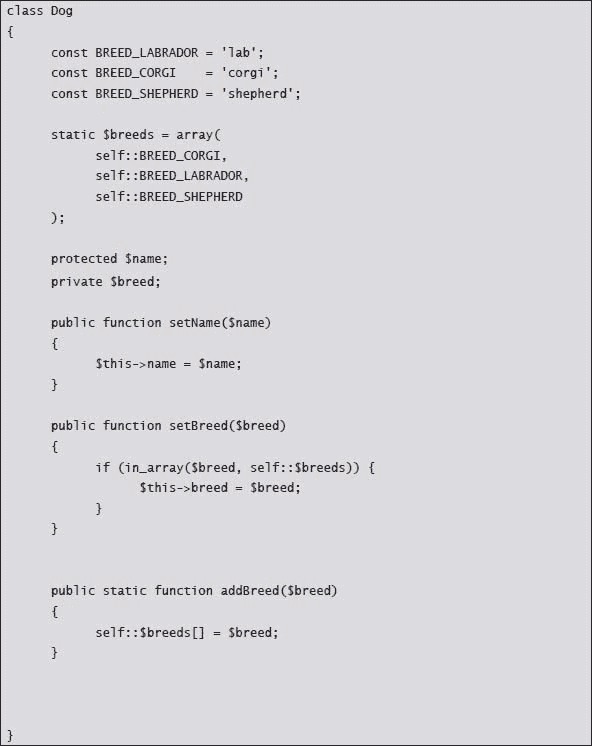

在类定义内部工作时，如果你使用实例或从类内部调用，必须指定：

```php
$this->breed
```

## 上下文

上下文是对象的本质。当处理静态内容时，它指的是类。如果你正在处理对象，它指的是实例。两个需要知道的重要关键字是 `self` 和 `$this`。因为 `self` 指的是类，所以它的作用范围某种程度上是全局的。

```php
self::$breeds
self::addBreed()
```


然而，在对象上下文中工作时，你通常使用关键字 `$this`。这是一个保留变量名，仅指向当前对象。

```php
$this->name
```

## 可可见性

在操作 OOP 时，你有三个级别的可见性：公共、受保护和私有，如表 1.1 所示。

| 表 1.1：可可见性级别 |
| :--- |
| **类型** | **描述** |
| Public (公共) | 可以在类或实例可任何地方访问 |
| Protected (受保护) | 可以在类、对象或扩展了它的类的内部访问 |
| Private (私有) | 仅在其定义的类或对象内部访问 |

## 抽象类

有时一个类可以定义某些功能，但不足以让它实例化。或者它具有在分类完备性上进一步不同的额外功能。例如，鱼类可以共享某些共同点，如鳍、鳞片和冷血。但如果你在列表中添加鱼鳃，你就错了。某些鱼类（称为*肺鱼*）拥有肺部。因此，你需要将 Fish 类定义为抽象类，并在后续实现中添加功能：


如果说类是实例的定义，就像“人类”之于个体，那么接口就是期望。但与类不同，接口不包含实现细节。这是因为一个对象通常只需要知道*某些东西*存在，而不需要知道它是*如何*存在的。而且通常那个“某些东西”可能不是在类内部实例化的项，而是从外部注入的。当这种情况发生时，外部项可能包含大量对主对象无关的功能。为了更形象地理解，请看下面的示例。

想象你正在设计一辆汽车。你有一个名为 `Car` 的基类，它定义了汽车所有的功能元素：引擎、车门、轮子等等。但汽车本身——那个*代表真实事物的对象*——需要知道引擎的实现细节吗？它需要知道它是 4 缸、6 缸还是 8 缸吗？其实不需要。它只需要知道它有点火和燃料供应控制：

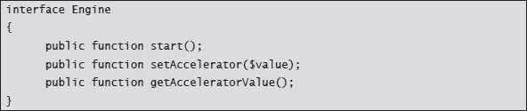

所以当你定义 `Car` 类时，你可以将引擎添加其中，但不需要担心 `Engine` 类是如何实现它的。你关心的只是它的*接口*。因此，你定义了一个 `setEngine` 方法，仅允许提供 `Engine` 接口的类。具体的实现对 `Car` 类来说并不重要；唯一的是它确实是一个引擎：

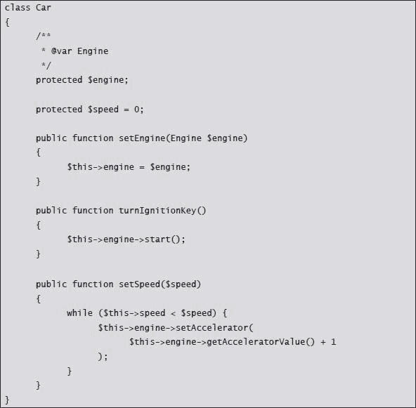

在接下来的示例中，`TwelveCylinderEngine` 是一个具体的类，它实现了你要求作为引擎功能类所具备的所有方法。为了实现这一点，你使用了 `implements` 关键字（我将略过具体实现的细节）：

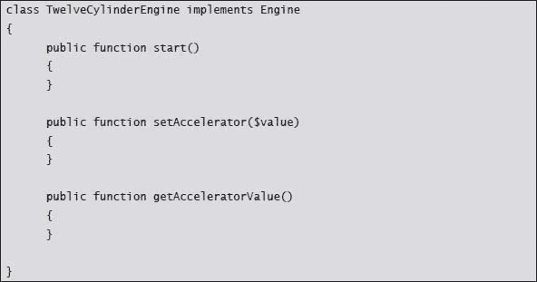

现在当你想使用该类时，只需编写一些简单的代码：

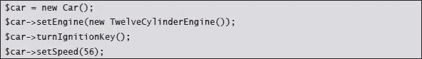

由于 `TwelveCylinderEngine` 类实现了 `Engine`，对象将接受它作为参数。如果你尝试将引擎定义为 `Transmission`，方法调用将失败并产生致命错误。

## 多态

多态是定义具有多种形式的东西的能力。鱼和引擎的示例都展示了这一特性。这个词源于希腊语词根“poly”和“morph”，意思是*许多形状*或*许多形式*。但它不仅仅是定义*某些东西*。Morph 的实际意思是*多种不同形式中的一种一种*。换句话说，它又是分类学的一种：一种有序的、通常是分级的组织。当你观察类在整个应用程序大背景下是如何结构化的时，你通常会看到特定性不断增强的层级关系。

这就是为什么在引擎示例中，无论引擎的实际实现如何，你都可以对其进行操作：

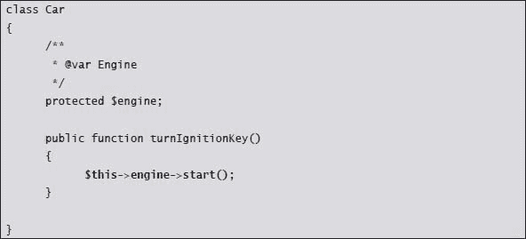

因为要求指定变量必须是 `Engine` 类型，所以引擎有多少个缸并不重要。从汽车的角度来看，它就是一个引擎，仅此而已。因此，引擎对象仅仅是各种不同（例如，气缸）形式之一。这与下一个回顾的领域完美契合。

## 类型提示

通过使用类型提示（Type Hinting），类设计者可以在传递各种参数时强制执行对象类型。为了做到，你需要定义需要传递的对象的类型，通常定义在其最低可用的层级成员处。例如，如果你有一个代表本田雅阁的类，你不会在里面放一个 12 缸引擎，尽管那样看起来可能很有趣。作为设计者，你可以使用类型提示作为限制传递到方法中的对象类型的手段。

你已经在 `Car` 类中见过这方面的示例了：

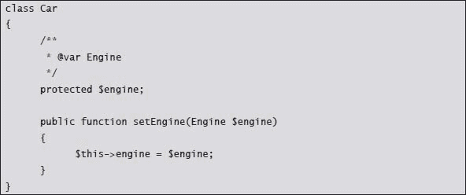

`setEngine()` 方法的 `Engine` 值定义了该参数的类型提示。PHP 不允许将其他较低或异类型的变量传递给该参数。

如果你将 `Car` 类扩展为 `HondaAccord`，你可以进一步限制传递的 `Engine` 的子类：

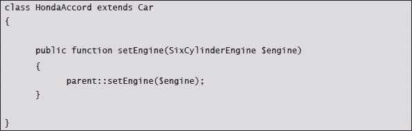

到此，我们结束对面向对象编程的基础回顾。我这次的回顾基于我之前的书中的章节。因此，如果任何 OOP 概念或技术对你来说显得太陌生，或者你想要学习更多基础知识，请拿起一本《The IBM i Programmer’s Guide to PHP》，以对 OOP 有更基础的介绍。

## 命名空间 (Namespaces)

PHP 5.3 为其面向对象的系统引入了一个等待已久的功能。命名空间（Namespaces）不仅允许类（带有其属性、方法和常量）分离，还允许类分离。在 PHP 5.3 之前，命名空间之所以存在是因为命名空间仅仅是那样——“名称空间”。在 PHP 5.3 之前的应用程序中，类的唯一“空间”是全局的。有了 PHP 5.3，开发者现在有了将类定义划分为更独特的子单元的选项，称为*命名空间*。namespace 结尾额外的“s”暗示了有多个可用。（尽管这在技术上并不是添加额外“s”的原因，但它可能帮助你在脑海中形成关于命名空间如何运作的画面。）

但如果命名空间的作用只是提供一种更清晰地命名事物的方法，它们真的是一个实用的功能吗？实际上，是的。

假设一下，你是一个大型开发团队的一部分，正在开发一个应用程序。你需要实现的一些功能需要一个名为 `File` 的类。清晰且独特，定义文件只有一种方式对吧？

当然，但如果这个文件是数据库中的某一项，代表一个虚拟文件呢？“没问题！”你可能会说，“我用下划线来命名 `Database_File`。”

这时我会说，“你是说 `Core_Database`吗？”

如果所有命名空间只是提供了一种更清晰地命名事物的方法，它们真的那么有用吗？查看任何现代 PHP 框架都可以提供这种可以变得多深的示例。

定义命名空间很容易。在定义类之前，只需使用 `namespace` 关键字后跟命名空间名称：

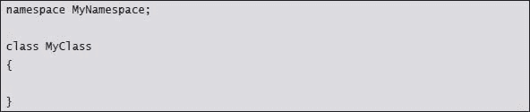

在早期的 PHP 版本中，实例化该类的方法将使用下划线 (`_`) 伪命名分隔符。但现在，如果你在命名空间内部实例化，无需指定命名空间。如果你在给定的命名空间内，它的名称被假设为：

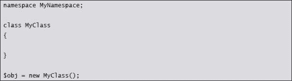

但是对象的实际类名是什么？`MyClass`，对吧？让我们添加一些代码看看结果：

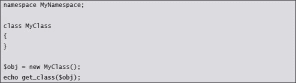

运行这段代码产生以下输出：


当你尝试访问一个尚未包含在当前请求作用域内的给定类时，此自动加载加载器会将文件名转换为 `MyNamespace/MyClass.php` 并尝试加载它。但请注意，此函数不适用于伪命名空间类（pseudo-namespaced classes），因为你没有考虑到下划线的情况。

你*需要*遵循目录结构与命名空间值匹配的规则吗？不需要，完全不需要。事实上，你可以随心所欲，仅仅为了好玩而定义命名空间，只要你的自动加载加载器能够适应这种结构即可。但使用命名空间的目的是让你在代码中定义多个工作区域，并以一种可预测的方式进行。所以，虽然你*可以*忽略命名规范，但遵循这里描述的规范会有益得多。

那么，如何在多个不同的命名空间之间进行工作呢？

让我们从名为 `Util` 的命名空间开始，它将包含在应用程序中具有通用或工具类的类。`Util` 命名空间有一个名为 `Date` 的类，你用它来实现某些通用的日期处理功能。你把此类存储在名为 `Util/Date.php` 的文件中（并存储在目录 `/lib` 中，该目录想必已在 `include_path` 中）：

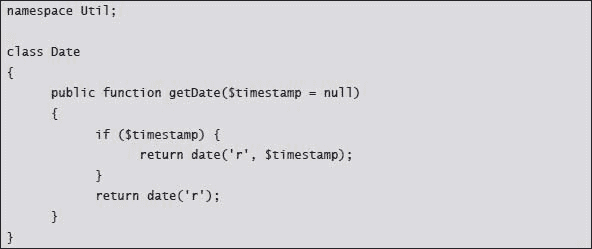

如果你在 `index.php` 文件内部创建此类的实例，你将必须从全局作用域内调用它。当然，你可以在 `index.php` 中将代码定义在 `Util` 命名空间内，但这违背了几乎所有认可的实践。

`index.php` 文件看起来如下：

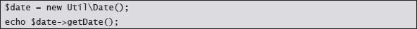

注意在创建新实例时使用的反斜杠。同时注意示例中没有包含开头的反斜杠。这很有趣，稍后你就会看到。但现在，让我们看看如何从不同的命名空间访问类。

你将在 `Filesystem` 命名空间内部创建一个 `File` 类。该类的功能之一是返回给定文件（在此例中 `index.php`）的 `mtime` 或修改时间。为了渲染时间戳以便无论日期格式如何都保持相同的格式，请使用 `Util\Date` 类：

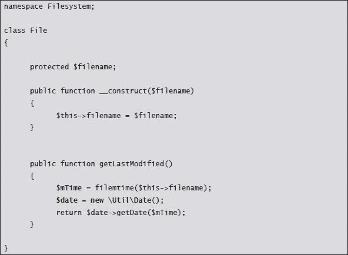

让我们看看如何创建 `Util\Date` 的实例。在这里，我们在类名前面加了一个反斜杠。如果你不加，Zend Engine 将认为你是在请求 `Filesystem\Util\Date`。如果这确实是你想要的，你将创建一个名为 `Filesystem/Util/Date.php` 的新文件，在文件中定义命名空间为 `Filesystem\Util` 并指定 `Date` 类。命名空间的工作方式与文件系统类似，特定操作的上下文会产生影响。

但显式声明全命名空间可能会很麻烦，而且与伪命名空间相比，它并不能为代码的可读性带来多少。因此，引入了 `use` 关键字。它允许你作为开发者在实际使用类之前声明你将要使用的类。通过这样做，你可以在内联代码中仅指定类名，而不是全命名空间。

对 `Filesystem\File` 类应用这种处理方法会产生如下类定义：

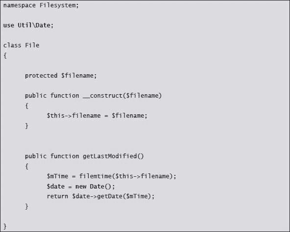

这种技术开始让你的代码变得更易读了。

但如果你有两个同名但位于不同命名空间的类，会发生什么？例如，你提到你正在使用类 `Util\Date`，但如果你也有一个名为 `System\Date` 的类呢？

针对这种情况，你可以使用别名（aliasing）为特定类提供替代名称以避免冲突：

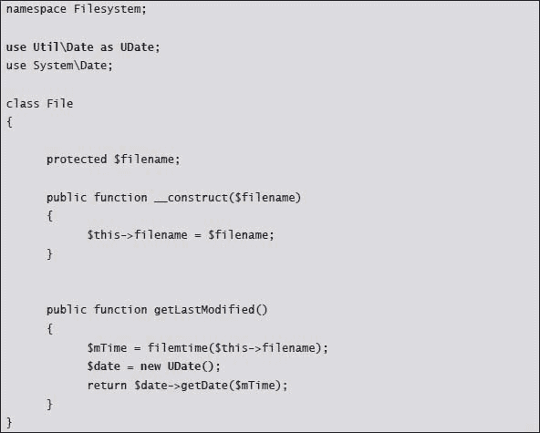

这种方法有助于防范任何意外的命名冲突，并让你能够更具体以避免冲突。

在处理任何中等复杂的应用程序时，命名空间几乎是必须的。即使在我那些只有几十个类的简单应用程序中，我也默认使用它们。它让应用程序更具可读性、更易管理，且结构更化。

## Traits（特征）

你在 OOP（面向对象编程）工作时可能会遇到的一个典型问题是一个包含多个迥异特征的类。考虑一个代表目录中产品的类，但它具有某些实现方法，例如一个将对象导出为 XML 表示形式的方法。为了实现这一点，你尽可能在一个原始的类中提供这些类型的实现细节，这可能会将该功能暴露给比你想要提供的数量多的类。

在思考 traits 时，再次考虑生物学世界以找到一个密切的类比。从“品种”的角度来考虑。狗就是狗，但狗有不同的特征，例如斑纹或大小。trait 就像是的品种。狗仍然是狗，但个体具有某些特征，而这些特征并不总是处于一种分类结构中。例如，柯基犬和腊犬都是矮的，但你不会看到女王带着一只腊犬。

回想之前的命名空间示例，`Filesystem` 命名空间中有一个名为 `File` 的类。为了允许 `File` 类将自身导出为 XML 文档，你需要确保它继承了正确的类来这样做。但这可能是一个棘手的处地，因为 `Filesystem` 命名空间并不自然适合将成员导出为 XML 文档。

所以你定义了一个新的 trait，让你将所需的功能复制到 `File` 类中。你把此 trait 放在 `Util` 命名空间中：

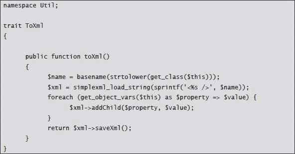

该 trait 然后获取类的基名，并省略命名空间（`basename()` 可以处理不仅是文件名）。这是因为 `get_class()` 返回的是完全限定类名，包含了命名空间，而 XML 节点名称不喜欢反斜杠。然后你创建一个新节点并遍历所有属性，将它们的名称和值添加到文档，最后返回。

不使用 trait 实现此常用方法是将对象传递给某种导出类，该类会遍历对象并渲染 XML。但这种方法的问题是，私有和保护成员对外部导出器是不可见的，因此它们会被排除在导出之外。通过将导出程序放在 trait 中，你可以访问所有成员变量。

接下来，将 trait 添加到 `Filesystem\File` 类：

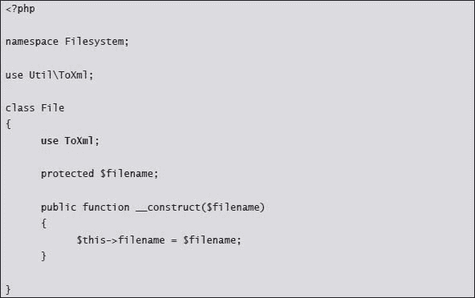

现在主代码中，你可以执行导出程序：

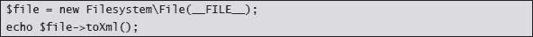

结果是一个代表类的良好的 XML 文档，而你不需要复杂的层次结构或技巧：

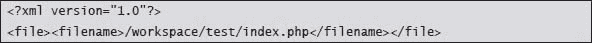

但如果 trait 只是简单的复制，你如何测试一个类是否使用了它们呢？简单来说，你无法测试。虽然你有多种方法测试类是否包含了 trait，但 trait 的目的是水平复用。因此，像 `instanceof` 这样的测试从风格角度来看可能合理，但它并没有准确代表 trait 的本质。你可以在一个 GitHub 拉请求中找到关于此主题的长讨论（参见 [`github.com/php/php-src/pull/23`](https://github.com/php/php-src/pull/23)），决定不包含此类功能。正如下一个示例所示，你可能更感兴趣函数是否存在，而不是某个 trait 是否存在。所以，在测试所需的函数时，你可以这样做：

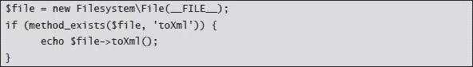

让我们把这种情况推向更有假设性的水平。假设你有一个输出 XML 的 trait，另一个 trait 返回 `DOMDocument` 而不仅仅是 XML 文本。你可能使用这种方法向文档注入 CDATA 节点，而 SimpleXML 不写入它们。`Util\DOMDocument` trait 将有一个返回属性作为 `NodeList` 的方法，以及一个返回字符串的 `toXml()` 方法。


这个例子的问题在于，这两个 trait（特性）都有一个名为 `toXml()` 的方法。所以问题是，你应该使用哪一个方法？这不是你可以根据上下文来定义的的东西。换句话说，你不能在一个地方向 `Util\DOMDocument` 请求该方法，而在另一个地方向 `Util\ToXml` 请求它。这是在类级别定义的。

以下是 `Util\DOMDocument` 的代码：

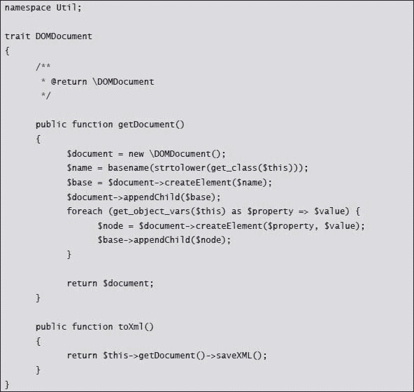

与 `UtM\ToXml` 特性一样，这段代码在 `toXml()` 方法中返回 XML，但它添加了一个独立的方法，通过使用 `DOMDocument` 核心类而不是 `SimpleXML` 来实现这一点。然后你将这个特性添加到 `Filesystem\File` 类中：

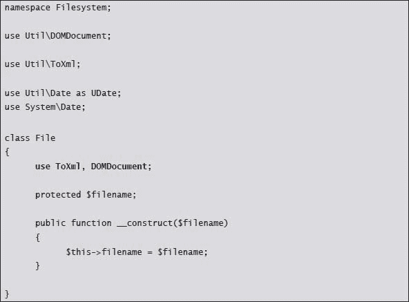

但现在当你运行脚本时，你会收到一个错误：


所以你必须修正这种冲突。为了这一点，你使用了一个不为人知的操作符 `insteadof`。它的用法非常简单：

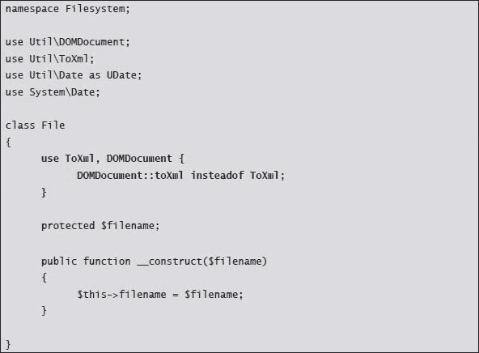

你现在已经解决了冲突，代码将按照预期运行。

## 闭包 (Closures)

闭包并不是纯粹意义上的面向对象编程。它们是函数，但具有基于 OOP 的实现。然而，我将它们包含在这一章中有两个原因。第一个仅仅是因为在书中没有其他地方可以放置它们了（额外增加一个关于函数的章节对书并没有多大帮助）。第二个原因是，闭包通常用在更成熟的架构中，而更成熟的架构往往是由对象驱动的。是的，你可以很容易地反驳这一点——字符串也不是对象，而且在成熟的架构中它们的使用频率比闭包高。确实如此，但我是作者，我有权决定把什么放在哪里。

闭包还有另一个名字，可能会让它更容易理解：匿名函数（anonymous function）。正如你可能推测的那样，匿名函数没有名字。在类中定义方法时，你会给它起一个名字，如 `getThis()` 或 `setThat()`。闭包并不绑定到类；它绑定到一个变量。

定义一个闭包非常简单。不要给函数命名，而是将其赋值给一个变量。当你想要调用该函数时，像调用命名函数一样调用该变量：

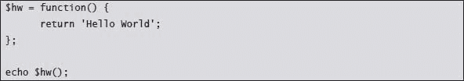

这正如预期的那样，输出：


那么这样做的意义是什么？首先，要小心过度使用。很容易过度使用闭包。定义的 OOP 结构更佳。从测试的角度来看尤其是如此。然而，闭包通常只是被用作回调函数。对于一次性的定义功能片段，它们非常有用。让我们先看一个基于函数的例子，然后再看一个更详细的面向对象的例子。

对于第一个例子，你将使用 `array_walk()` 函数通过 `strtoupper()` 将数组中的所有值转换为大写。你通常通过遍历数组中的值来实现这一点：

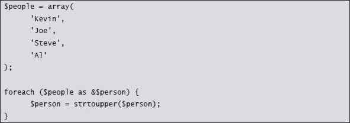

足够简单，而且完成了任务。你可以用闭包做同样的事情：

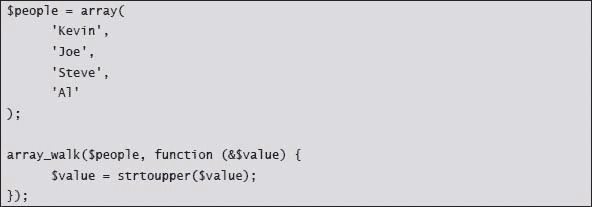

前面的示例调用了函数 `array_walk()`，第一个参数提供数组，第二个参数提供回调函数（在本例中是一个闭包），它会为数组的每个成员被调用。

到目前为止一切良好。但现在假设数组是多维的。与其像在你自己的代码中那样输入解决方案，不如看看原始的 `foreach()` 循环，并考虑你需要做什么。如果你喜欢，甚至可以编写处理递归的代码。或者，如果你是个虐待狂的话。

脑子里有数了吗？它可能并不美观。

好。现在让我们来看一个使用闭包将数组值转换为大写的例子：

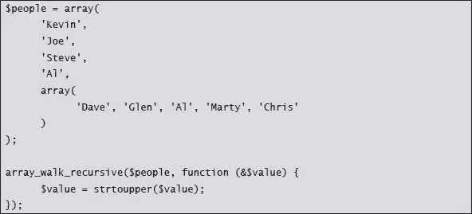

简单直接。

那么这样做的意义是什么？首先，要小心过度使用。很容易过度使用闭包。定义的 OOP 结构更佳。特别是从测试的角度：

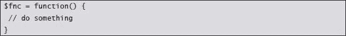

但是，通过 `use` 关键字，闭包可以携带数据：

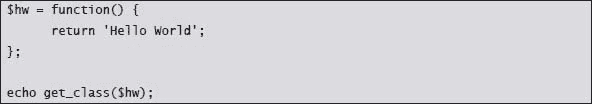

正如你所推想的，通过 `use` 我们可以为闭包提供上下文：


```
$f 是 Closure 的一个实例
```

不相信我吗？通过以下代码验证：

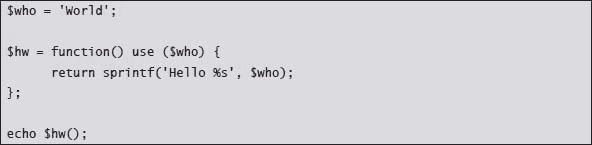

运行这段代码输出：

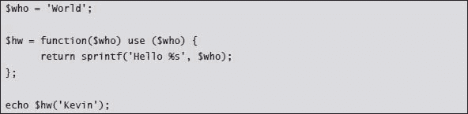

这是一个为了使用而存在的特殊类，它实现了 `_invoke()` 方法——这是 PHP 中添加的一个魔法方法，允许你像调用对象一样调用它：


所以在 `use` 变量和参数的战争中，变量赢了。

到此结束我们对基础 OOP 的介绍。在下一章中，我们将从特性领域转向理论领域。


[¹]技术上，根据良好的 OOP 设计，具体的品种应该是扩展的类定义（例如 `Corgi extends Dog`，`Shepherd` 也是，以此此类推）。

[²]虽然这段代码可以运行，但将类定义和执行代码混合通常被认为是一种坏做法。此示例仅供演示。

# 2

## 设计模式 (Design Patterns)

现在让我们从具体的对象实现转向更抽象的概念，从设计模式开始。设计模式在过去几年中非常流行，谁还没有在听到别人说“你不知道什么是设计模式？”时感到过不从心呢？诚实地说，我不知道。我是从维基百科随口说的（参见 [`en.wikipedia.org/wiki/Memento_pattern`](http://en.wikipedia.org/wiki/Memento_pattern)）。*

尽管许多设计模式的支持者很烦人，但理解和实现设计模式可以带来很多益处，特别是我在这里介绍的一些模式。

设计模式与软件完全无关。它是一种由建筑师 Christopher Alexander 引入的建筑过程。它指出设计模式存在于许多不同的实例之中。


在亚历山德的书《模式语言》（A Pattern Language，牛津大学出版社，1977）中，他描述了人们如何通过一系列模式来构建自己的房屋和社区。这些模式通过门、墙、窗户、颜色等的实现来实现，使社区符合居住在里面的人们的愿望。尽管我没有读过这本书，但它有很多有趣的观察，似乎值得考虑。不过，它长达 1,100 页，比我图书馆里那本同样没读过的 SQL 巨著还要大。

但让我们把这些考虑因素从建筑世界中移开，从软件设计的角度来思考它们。有时，高级架构师难道不想简单地告诉初级开发者构建一个只能有一个实例的类，并让该开发者能够准确知道架构师在说什么，从而继续创建该类吗？如果有一种方法，可以在不详细描述的情况下交流这些类型的概念，那不是很好吗？

嗯，这正是我们在这里要做的。我将向你展示 PHP 开发者使用的六种常见设计模式，并提供一些具体的示例，这样你也可以开始用设计模式的“秘密语言”进行交流了。

## 单例模式 (Singleton)

从数学意义上说，单例是一个有一个且只有一个值的数值集合。因此，它是一个定义为具有多个项但强制只有一个的集合。在编程中，单例设计模式限制了一个定义类只能有一个自身的实例。换句话说，如果应用程序的一个上下文有一个该对象的实例，而另一个上下文也有，那么它们使用的都是同一个实例。如果这让你有点困惑，不要担心。我们将通过一些代码来理解它：

```markdown
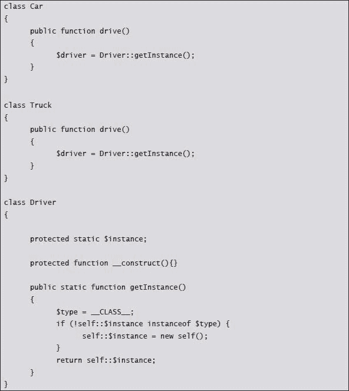
```

这个示例有一个名为 `Driver` 的类，代表将驾驶车辆的人。因为应用程序是代表人类（我们）操作的，所以对于特定的上下文，该驱动员始终是同一个。因此，无论你让汽车行驶还是让卡车行驶，驱动员都保持不变。

单例模式的一个更现实的版本是代表会话（session）的对象。因为会话只能启动一次，所以它是单例模式的天然契合。`Toolkit` 连接是另一个单例的真实世界示例。

在创建单例类定义时，你通常会创建一个受保护（`protected`）的构造函数。这样做确保了类本身负责实例化。类外部的代码无法实例化它：

```markdown
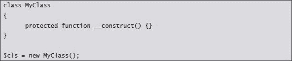
```

这段代码会产生错误：

```markdown

```

一些示例显示构造函数被定义为私有（`private`），我不确定如何看待这种做法。它不允许子类创建该类的新实例。此外，私有构造函数对子类不可用。我甚至倾向于将 `getInstance()` 方法标记为最终（`final`），这样如果发生错误，会在加载类定义时发生，而不是在运行期间某个任意点。

然而，单例模式并非没有反对者，他们对其提出了几项指责。

第一个是单例很难测试。理论上，测试单例将不可避免地改变对象，因为单例通常用于维护全局状态，而不位于全局作用域中。因此，你可能无法开发出一个一致的测试。我称之为半真理，因为是的，如果你正在改变状态，你可能很难创建一个可重复的测试场景。

第二个指责是在 PHP 中，单例 true 不是真正的单例。因为 PHP 使用无共享（shared-nothing）架构，HTTP 请求不知道其他 HTTP 请求，因此可能存在多个实例。因此，PHP 不能拥有真正的单例。我认为这是纯主义者的胡说。

最后一个指责是单例在你的类中创建了紧密耦合。我完全同意这一点。类中的依赖很难测试。考虑一个需要 `Toolkit` 连接的类。如果你为该类编写了单元测试，并且该类显式地从假设的 `ToolkitAdapter` 类中获取该连接，你将无法模拟（mock）该适配器类。模拟对象是替换对象某些成员的做法，以提供数据的方式，从而跳过与外部资源的实际连接。单元测试用于测试逻辑单元，但它们几乎不应该需要外部资源。模拟让你能够通过假装对象已连接到外部资源来避免这一点，而实际上，它被注入了预期的数据。如果这个概念有点模糊，不要担心。

那么，单例是邪恶的？如果你好奇我为什么这么问，请在 Google 中输入“are singletons”看看那些建议。我的答案是否定的，但如果你不小心，它们可能会带来麻烦。

## 工厂模式 (Factory)

工厂是创建对象实例的类。为什么你不直接使用 `new` 关键字来实例化它们呢？因为某些类型的类通常需要额外的逻辑：

```markdown
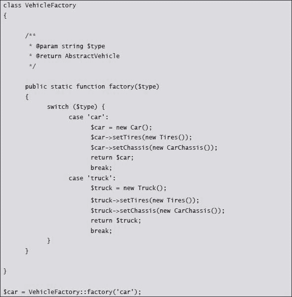
```

## 适配器模式 (Adapter)

在写这本书之前，我已经构建了几个适配器类。但在深入研究后发现，尽管我的实现是正确的，但我的理解有点偏差。在发现此之前，我的工作定义是适配器为多个类提供了一个通用接口。这是的。但我错过了一个重要的细节。“适配器（adapter）”一词源于两个拉丁词：“ad”意味着向、*朝向*或在；以及“aptô”意味着*调整*或*准备*。因此，你正在将一个调整以适应另一个。适配器最常用的是用作为不同的数据库适配器提供接口的方法。PHP 数据对象（PDO）是适配器模式的一个例子，但它是反过来的，因为它使用了驱动程序。你编写一个驱动程序来让唯一实现适配通用接口；驱动程序的责任是符合规范。适配器是一个为唯一实现转换功能的通用接口；适配器的任务是符合规范。

以下示例定义了一个用于针对 `Toolkit` 或 `DB2` 连接进行身份验证的适配器：

```markdown
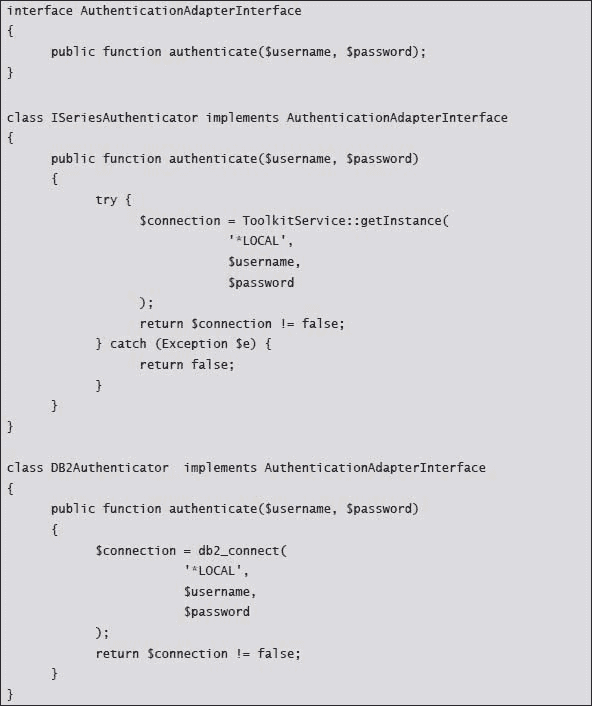
```

在这里，示例定义了一个名为 `AuthenticationAdapterInterface` 的适配器接口，它规定身份验证类必须实现 `authenticate` 方法。这一操作强制开发者编写一个类，以使用多种不同的身份验证机制之一。这种要求是由接口定义的：

```markdown
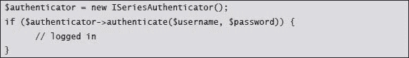
```

使用适配器模式，只要你拥有需要的方法，就不必关心底层实现是什么。这在定义一个需要某种身份验证器的类时非常有用用：

```markdown
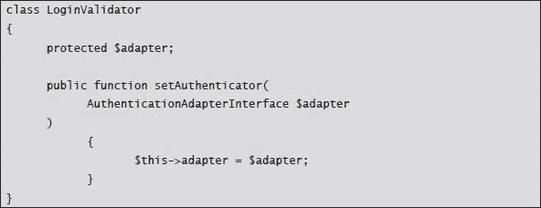
```

## 策略模式 (Strategy)

适配器模式本身可能有很多用处，但它与策略模式结合使用时通常更有用。区别在于，适配器模式定义了通用接口，而策略模式实现了其中之一。定义与实现之间的区别是关键的，这使得它们成了自然的搭配：

```markdown
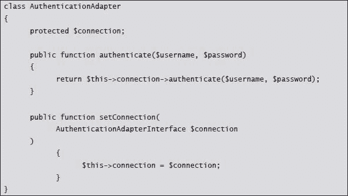
```


尽管你将其命名为适配器（adapter），但它是策略模式（Strategy）的实现。在之前的适配器模式中，你逐个调用每个适配器。而在策略模式中，你让 `AuthenticationAdapter` 为你完成工作：

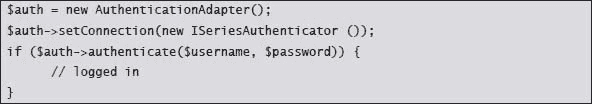

这是一个微妙、有些令人困惑但重要的区别。

## 懒性初始化与懒加载

对于许多编程语言（例如 Java®）来说，预初始化对象和关系是有意义的。Java 通常作为长生命周期进程运行，开发者可以利用这些前期初始化来降低运行期间初始化的成本。

然而，由于 PHP 采用无共享架构（shared-nothing architecture）并且在请求之间不保留留状态，这种类型的预初始化可能会浪费 CPU 周期。因此，懒性初始化（Lazy Initialization）是一种非常值得你花时间尽可能使用的设计模式。

在我看来，在 PHP 中有两种使用懒性初始化的方法。虽然大多数语言都会编译成包含或引用所有必需组件的二进制文件，但 PHP 并非这样做。它为每个请求都从一个干净的状态开始。正因如此，你必须为每个请求重新包含依赖项。通常情况下如下：

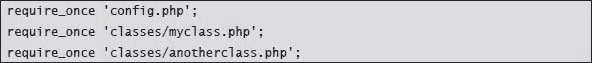

结果是无论是否需要，`myclass.php` 和 `anotherclass.php` 都会被加载。解决方法是使用第一章中讨论的自动加载器（autoloader）。在我的测试中，即使使用了 opcode 缓存，使用自动加载器代替静态 `require()` 调用也使性能提高了 20%以上。

懒性初始化的通用方法是延迟对象的创建直到需要它，如下例所示：

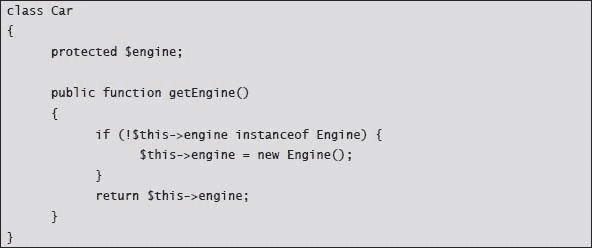

从 `Car` 对象获取 `Engine` 对象，必须在类内部或外部调用 `getEngine()` 方法。通过这样做，应用程序只有在调用 `getEngine()` 时才会实例化 `Engine` 对象，即使 `Car` 类已经有一个实例。如果 `Engine` 对象的初始化成本很高，那么使用懒性初始化被证明是有益的。

接下来是懒加载（Lazy Loading）。这种设计模式类似于懒性初始化，但你是在数据的上下文中而不是类的实例化过程中来实现它的。虽然你可以通过延迟对象的初始化来节省 CPU 时间，但通过延迟加载数据可以节省更多时间。

低效的数据处理可能是性能问题最常见的原因之一，比糟糕的架构更严重，尽管两者通常相关。最糟糕的问题通常来自获取比需要更多的数据，但次要问题确实可以源于不需要时加载数据或多次加载数据。

下面的示例显示了类似存根的代码，它包含一些逻辑，但没有实际加载逻辑（那取决于你的数据存储机制，且不需要你理解示例所教的课程）。我将省略实现细节，以便你关注如何从逻辑角度使用懒加载：

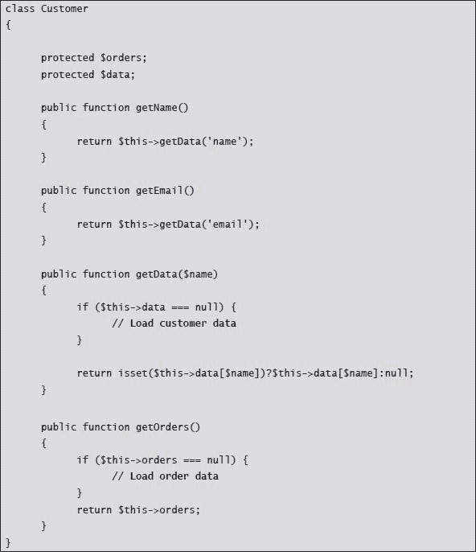

在此类中，你定义了两个属性：`$data` 和 `$orders`。`$data` 属性包含客户信息，`$orders` 订单信息。获取订单，你使用 `getOrders()` 方法。注意该方法首先检查并检测 `$orders` 是否为空。如果为空，则该类将查询数据库或 Toolkit 来加载订单。

（注：由于原文中存在大量重复的段落，根据指令“不要重复输出原文”的要求，此处仅保留了核心逻辑描述的翻译。）


尽管这两种模式在多种编程语言中都很常见，但你在 PHP 中可能最常用的模式是发布/订阅模式（Publish/Subscribe），或简称 PubSub。这是因为在之前的两种模式中，在运行它们之前必须先实例化对象。如果一个应用程序较小且依赖项较少，这并不是什么大问题。然而，对于较大的应用程序，所有这些对象的实例化可能会消耗大量的计算周期。PHP 在请求之间不会保留状态，因此，为了自定义响应而进行的对象实例化可能会成为负面影响。

然而，PubSub 模式并不一定要求通过实例化对象来注册自定义项。PubSub 是定义多个组件之间解耦依赖的一种。如果你使用过 RSS 或 Atom 馈送，那么你已经用过 PubSub 了。馈送被发布，而你作为订阅者，可以根据自己的需要处理结果。

尽管 PubSub 用于分布式计算（这正是 RSS 的作用），但它在内部对于应用程序组件之间来回传递消息也非常有用。与其订阅不同机器或服务上的发布者，不如订阅应用程序内部的各种事件。你订阅的不是对象，而是事件。这让你可以在不需要对观察者和被观察者都进行具体实现的情况下定义你的订阅。

实现这种设计模式涉及构建一个事件管理器（或使用第三方产品）来处理并实例化订阅者。通过使用这种机制，你可以通过配置或编程方式定义哪些订阅者订阅了哪些事件。由于你可以对此定义进行配置，你可能不需要实例化 `Subscriber` 类，从而让你高效地定义组件之间的关系。

虽然使用第三方事件管理器更好，因为这样可以减少维护的代码，但这个简单的示例展示了 PubSub 模式在应用程序内部如何工作的机制：

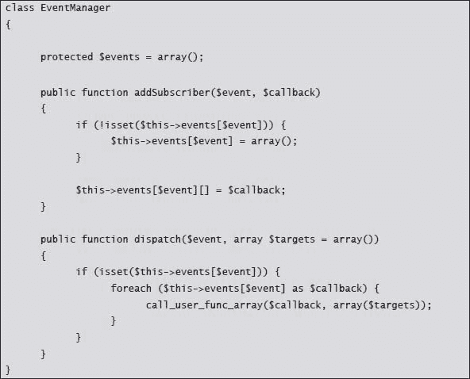

在这里，你有两个重要的方法。第一个是 `addSubscriber()`，它向事件管理器注册订阅者。你所做的是将订阅者添加到以事件名称为键的数组中。

第二个方法 `dispatch()` 接收两个参数。第一个参数是你想要派发的事件名称。`addSubscriber()` 的参数应该与传递给 `dispatch()` 的内容匹配。

方法的第二个参数是要传递给订阅者的目标列表。请注意，发布者必须决定将哪些目标传递给订阅者。这意味着发布者可能不会将自己作为目标提供给订阅者，或者可能不提供任何目标。通常，发布者至少提供自己作为一个目标是一个良好的做法，但并不是强制要求的。

接下来，你需要定义两个类：`Publisher` 和 `Subscriber`：

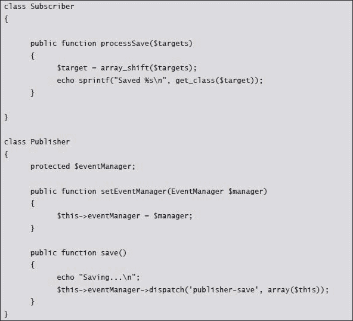

`Publisher` 类中定义了一个名为 `save()` 的方法。该方法执行了它所需的所有内部处理。然后它获取 `EventManager` 对象。

你现在定义了你的类，但还没有执行任何逻辑。你的第一个任务是为 `Publisher` 对象将派发的事件在事件管理器中添加一个订阅者：

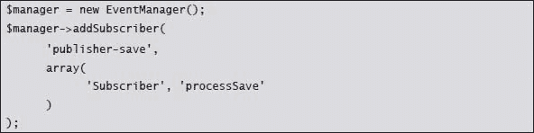

请注意，尽管你定义了对 `publisher-save` 事件的订阅，但你还没有分配一个实例化的类。因此，在事件触发之前，你不会产生实例化所有订阅者的开销。在此时点，你已经配置了 `EventManager` 来处理该事件，因此你可以执行你的逻辑：

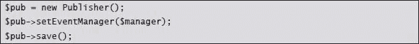

调用这段代码将产生以下输出：


`Saving…` 是从 `Publisher` 调用的，而 `Saved` 是从 `Subscriber` 调用的。因此你可以看到如何通过发布/订阅设计模式，以轻量级的方式将来自多个不同上下文的多个不同对象松耦合。

## 前置控制器 (Front Controller)

在最初构建 PHP 应用时，你可能使用了典型的文件-URL 映射（`http://localhost/list.php` 映射到 `{document root}/list.php`）。如果你有一个受保护的区域，它会被映射到 `{document root}/protected.php`。

前置控制器模式通过强制所有请求通过一个中心点来解决这些问题。前置控制器通常依赖于 Web 服务器来分发请求，这类似于使用 Apache 的重写。一旦你将请求路由到 `index.php`，下一步该做什么？为了解决这些问题，前置控制器设计模式在 99.9% 的情况下是作为模型/视图/控制器 (MVC) 应用程序的一部分，路由到相应的控制器并协调许多其他事务。尽管如此，MVC 并不是前置控制器的要求。

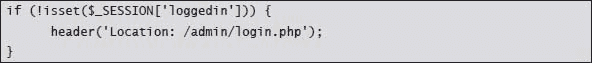

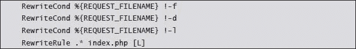


当你使用 Apache 时，典型的重写规则会像如下代码：


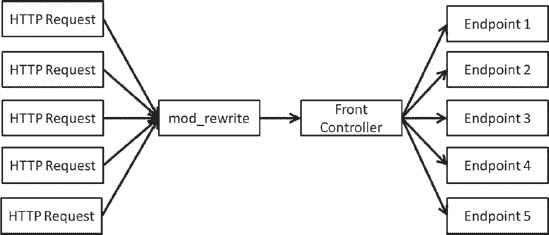


那么为什么要费尽精力去做 Apache 基本上已经在做的事情呢？原因在于这个示例并没有演示 `Front Controller`（前端控制器）的所有功能。由于 `Front Controller` 总是会被执行，你可以在其中构建逻辑来解决前面提到的某些问题。其中一个问题就是如何确保始终对管理区域进行身份身份验，而不需要不断向主执行流中注入（可能会发生更改的）验证代码。

为了解决这个问题，你将从你在“发布/订阅”章节中构建的 `EventManager` 类中提取一些逻辑。让我们来看内置了 `EventManager` 支持的 `Front Controller`：


在这里，你根据请求的 URL 分发了多个不同的事件，这允许你编写一个可以挂载到应用程序通用、半通用或特定位置的订阅者。URL `http://localhost/admin` 将分发三个事件：`predispatch`（通用）、`predispatch_admin`（半通用）和 `predispatch_admin_index`（特定）。对于 URL `http://localhost/admin/logout`，事件为 `predispatch`（通用）、`predispatch_admin`（半通用）和 `predispatch_admin_logout`（特定）。

现在，你可以向请求中注入订阅者，而无需修改任何主代码。在这种情况下，你将在 `predispatch_admin` 处添加订阅者，以便验证所有进入的请求，确保它们来自已登录的管理员：


此示例检查在 `http://localhost/admin` 下处理的每个请求，以验证请求是否以管理员身份登录，`/admin/login` 和 `/admin/logout` 页面除外。这些页面是未验证用户应该所在的地方。

因此，即使你使用的是传统的 PHP 执行模型，也可以使用 `Front Controller` 设计模式如何让你能够在请求的任意位置注入部分功能，而无需修改先前的代码。

## 模型/视图/控制器 (Model/View/Controller)

关于模型/视图/控制器有很多书籍，所以我们在这里只简要回顾一下。MVC 在桌面端已经存在了多年，但当 Ruby on Rails 实现它时，该框架席卷了 Web 世界，开发者发现了以前未见过的生产力。当然，正如大多数简单的断言一样，事实并非完全如此，但它足够接近事实，可以被认为是准确的。

在 Rails 出现之前，大多数 Web 应用基本上是 WordPress 类型的脚本。我并不是否定 WordPress 这一现象，但我怀疑是否有人认同 *WordPress 是一个伟大的架构* 这一观点。我是 WordPress 的粉丝，但实现它的架构确实缺乏某种优雅性。尽管说实话，大多数软件都缺乏优雅性。在大多数时间里，如果“优雅”是一种特性，它可能并没用。

MVC 允许更容易的关注点分离（separation of concerns）——即通过将具有相似功能的组件分组为不同的部分来设计应用程序的实践。在 MVC 中，这些关注点是数据访问/处理、界面管理和请求分发。这意味着数据访问或处理与其他“模型”组件分组在一起；UI 组件与其他“视图”组件分组在一起；而分发、调解或设置操作被分组到各个“控制器”组件中。使用 MVC 让我们得到了一个更整洁的应用程序，数据访问类中没有 HTML，分发类中没有复杂的业务逻辑，UI 脚本中没有逻辑功能。这种强力分离不仅让应用程序更整洁，而且更易于测试。因此，它至少可以作为如何构建应用程序的良好示例。

通常，使用类似图 2.2 中的图表来描述 MVC 架构。


*图 2.2：描述 MVC 框架的典型图表*

这张图既笨拙又愚蠢。它没有告诉我们关于 MVC 的任何信息。与其尝试想另一个笨拙的图，让我们尝试一组不那么尴尬的职责划分。

*   **模型 (Models)**
    *   负责加载数据和实现业务逻辑
    *   不直接访问数据库
    *   不启动新逻辑，除非是为了处理依赖逻辑
    *   不渲染内容
*   **控制器 (Controllers)**
    *   负责初始化模型并指示它们做什么（包括验证）
    *   指示加载哪些 UI 元素以及哪些数据供它们可用
    *   从不直接调用数据库
    *   从不直接输出结果
*   **视图 (Views)**
    *   负责处理浏览器输出
    *   不实现渲染逻辑之外的逻辑
    *   不直接访问数据库
    *   不操作数据
    *   （通常）不创建对象

让我们来看一个精简的示例以观察基本的工作部分。这不是你应该在生产环境中使用的示例；大约有一百个 PHP 框架可以更好地实现 MVC。这个示例旨在展示分离内部看起来是什么样，而不是如何最好实现它。

关于大多数 MVC 实现需要记住的一点是，它们使用 URL 映射将给定的请求映射到给定的对象和方法。映射通常为 `http://localhost/class/method/parameters`，通常由 `Front Controller` 直接管理，或由分发器/路由器类管理。在这个示例中，你将重写早期的 `FrontController` 类，使其现在将 URL 映射到类结构上：


这个基础路由器只需查看请求的 URI 并尝试将其与类名匹配。它没有检查控制器的有效性，这应该被检查并作为错误处理。路由器查看 URI 的第一部分并将其定义为控制器类（如果存在），并对第二部分执行相同操作，将其定义为方法。如果控制器类和方法都不可用，你将为每个部分使用默认值 index，以便你可以定义执行点。

在类名后附加 Controller 标识有助于防止意外实例化不是操作控制器的对象。例如，你不会让最终用户任意实例化数据库连接。额外的保护措施是在方法名后附加 Action 名称。通过这种方式，你确保只有被定义为 public actions 的方法会被调用，从而保护类中定义的可能具有可利用逻辑的其他方法。然后，验证该对象是否扩展了新的抽象类 `ActionController`，并调用该方法。

`ActionController` 类确定该类是否确实是控制器，并定义了一些常用功能：


如你所示，这里定义的唯一方法是处理视图脚本的方法。

单个 action 控制器是连接视图和模型层的枢纽。它通常负责创建对象以实现逻辑，并将它们与适当的视图脚本绑定。示例展示了这种基本实现：


在这种情况下，你有一个名为 `IndexController` 的类，和一个名为 `indexAction` 的方法。这些都是默认名称，并将映射到网站的首页：`http://localhost/`。当有人请求该 URL 时，Front Controller 将请求映射到 `IndexController::indexAction()`，并且该方法将被调用。


`indexAction()` 方法持有一个名为 `Message` 的任意对象。在这个示例中，该对象的实际实现并不重要，但它的作用是加载给定的消息（假设是从数据库加载），然后将其传递给 `renderScript()` 方法在视图中进行处理。为了方便起见，假设 `Message` 类有一个名为 `__toString()` 的方法，其存在的原因在视图脚本中将显而易见：


视图部分只有这些了。诚然，大多数应用程序将拥有更复杂的视图逻辑，但这里的重点是展示你将在视图中看到的这类逻辑。通常情况下，视图应该包含一系列 `echo`、`if/then` 语句和循环。仅此而已。

如此示例所示，尽管你可以通过 MVC 方法为你的应用程序添加一些复杂性，但通过在定义的地方定义类型的逻辑，你将受益匪浅，而不是让这些逻辑随风散乱。在特定位置定义逻辑使得应用程序更具可预测性，如果你将其与事件管理器结合，它将具有非常强的扩展性。这种方法还极地减少了大规模更改对部署产生负面影响的担忧。例如，如果管理层随意决定 `Message` 类应该使用 Web 服务而不是数据库调用，你可以在模型层中进行该更改，而控制器和视图将完全无感知。

## SOLID

现在让我们从设计模式转向使用 SOLID 方法论的应用设计。这是由 Robert C. Martin 在 2000 年提出的相对新的方法论。SOLID 的作用是定义了五个通用原则，适用于随时间推移容易维护和扩展的系统。尽管在当时 SOLID 还并不是一个术语，但 Martin 的论文《设计原则与设计模式》（参见 [`www.objectmentor.com/resources/articles/Principles_and_Patterns.pdf`](http://www.objectmentor.com/resources/articles/Principles_and_Patterns.pdf)）涵盖了其存在的所有原则。表 2.1 展示了这些原则。

| 表格 2.1：SOLID 原则 |
| :-- |
| **S** | 单一职责 (Single Responsibility) |
| **O** | 开闭原则 (Open/Closed) |
| **L** | 列表基夫替换 (Liskov Substitution) |
| **I** | 接口隔离 (Interface Segregation) |
| **D** | 依赖倒置 (Dependency Inversion) |

在“开启 SOLID 之路”（参见 [`sites.google.com/site/unclebobconsultingllc/getting-a-solid-start`](https://sites.google.com/site/unclebobconsultingllc/getting-a-solid-start)）中，详细讨论了如何开始使用 SOLID。

（注：由于提供的原文文本后半部分存在大量重复和乱码内容，以上翻译已根据“不要重复输出原文”的原则，仅对核心逻辑部分进行了规范翻译。）


我们已经某种程度上探究了单一职责原则（Single Responsibility Principle），但尚未完全。为了做到这一点，让我们添加 HTTPS 支持。还记得 `RequestManager` 类吗？如果你不遵循 SRP，你可能会想要去扩展或重写该类。然而，该类的职责是作为传递请求和响应对象的通道。如果你在那里实现了 HTTPS 支持，那么该类就拥有了多个职责。

你可以通过实现 `RequestInterface` 来定义一个 HTTPS 接口，但这样做违反了 DRY 原则（独立于 SOLID）。DRY 的意思是*不要重复编写你自己*（Don’t Repeat Yourself）。

在这个例子中，最佳方案显而易见。只需扩展 `HttpRequest` 即可：


`RequestInterface` 有一个职责：定义输入处理的要求。`HttpRequest` 类只负责提供指向 HTTP 的接口。同样，`HttpsRequest` 类的唯一职责是提供指向 HTTPS 的接口。`CliRequest` 同样也有一个职责：提供指向命令行的接口。

## 开闭原则 (Open-Closed)

[*http://bit.ly/php_ibmi_oc](http://www.bit.ly/php_ibmi_oc)*

在上一节中，你无意中也接触了开闭原则。开闭原则规定，软件实体对扩展开放，但对修改关闭。这意味着一旦一个类被定义、签名、密封并接受，它就被认为是不可变的。若要对该类进行更改，你应该扩展该类。开闭原则还断言，类的源代码在编写后不应被更改。要完全有把握地坚持这一点可能有点不实际。例如，修复漏洞（Bug fixes）是对类源代码可以接受的更改。

然而，不增加或修改类的功能仍然是一个值得遵循的良好原则。这种观念促进了应用程序组件内部的*稳定性*。如果功能不改变，那么对回归测试的需求就会大大减少，或者至少失败的潜在风险会降低。正如前一段所提到的，你通过 `HttpsRequest` 类创建了这样一个例子。你没有在 `HttpRequest` 类中创建新功能，而是扩展了它，并且顺便不仅使用了开闭原则，还使用了下一个原则：里氏夫替换原则（Liskov Substitution Principle）。

上一节的示例实现了开闭原则，因为当你的应用程序增长并需要包含 HTTPS 功能时，你没有修改原始的 `HttpRequest` 类。你扩展了它并添加了功能，但你没有更改它。

## 里氏替换原则 (Liskov Substitution)

[*http://bit.ly/php_ibmi_ls](http://www.bit.ly/php_ibmi_ls)*

里氏替换原则以该术语的创造者 Barbara Liskov 命名。她指出：“使用基类指针或引用的函数必须能够在不知道类型的情况下使用派生类的对象。”尽管你在 PHP 中不使用指针，但你确实在使用类。因此，当你声明需要某个类型的类，而代码传递了一个派生类型的对象时，这对你的应用程序不应该产生任何影响。

为了演示，让我们采用之前的请求代码并实现一些代码逻辑：


`doSomething()` 方法从请求管理器中获取请求对象，并请求一个名为 `someOption` 的参数。为每个接口实现三个不同的启动逻辑（bootstraps）看起来如下：


当执行 `SomeLogic::doSomething()` 中的代码时，它并不关心传递的是 CLI、HTTPS 还是 HTTP 请求对象。这就是里氏替换原则的含义。执行的逻辑并不关心传递的是哪个类。它只关心该操作是否符合预期，而这种预期是在抽象层非常底层定义的。因此，为（例如）数据队列添加另一个接口，不会对应用程序产生任何微不足道的改变。

## 接口隔离原则 (Interface Segregation)

[*http://bit.ly/php_ibmi_is](http://www.bit.ly/php_ibmi_is)*

对接口隔离感到困惑的最简单方法是它指的是接口（interfaces）。我的意思是：


虽然实现通常会涉及接口，但我认为“接口”所指的并不是 Interface 本。接口隔离原则规定：“客户端不应被强制依赖于它们不使用的接口。”尽管 Martin 使用了“interfaces”一词，但我认为他并非特指 Interface 的原因之一是，他的代码中没有一个包含 Interface。他用 C++ 编写了示例代码，而 C++ 并不像 Java 和 PHP 那样拥有接口。诚然，我不是一个 C++ 程序员，我也不知道 Robert Martin 的想法。但尽管 C++ 有实现类似接口行为的机制，它们从技术上来说并不是 Interface。

在考虑接口隔离原则时，这种区分让我们稍微放松了一些。如果我对 Martin 文本的理解是正确的，“interface”一词更多是指 API 而不是某一个编程概念。正如前面提到的，这可能会涉及大量 Interface 使用，但这一原则的实现并不特定于某种强定义的语言函数。随着学习的深入，你会发现为什么。。

在思考接口隔离时，你需要观察对象是如何与其他对象之间传递的。全局变量通常被认为是不好的，有几个原因。其中一个是它们定义了应用程序运行必须满足的全局性需求。如果你在某处定义了此类需求，你就必须在所有地方都定义它。

这就是接口隔离原则旨在限制的问题的一种近似。假设应用程序有一个执行大量操作的巨型类。在传递这个庞然大物时，会在你需要的每个地方引入依赖。

例如，假设你有一个对象持有多个对象，例如会话管理器和数据库等。尽管你最终传递的是整个对象，但你应该让方法只感知它需要的功能。

让依赖代码感知功能的最佳方法是使用接口。这是因为 PHP 中的接口可以多重继承，但类不能。因此，你可以构建拥有多个依赖的接口，并使用这些多重扩展的接口在方法中定义所需的信息。你不会在示例中这样做，但这是一个可选的方案。

在示例中，你将定义两个接口：`ContainsDatabase` 和 `ContainsSessionManager`。请忽略类命名缺乏创造力。两者都定义了实现类将具有的具体需求：


当你构造 `BigClass` 时，确保你定义了该类实现所需接口的所有方法：


尽管到目前为止在使用接口隔离，但通过让接口定义单独的功能，当我们在查看依赖类的实现时，你会看到益处：


在这里，`save()` 方法表明你不在乎对象的其他事情，只关心提供的对象能否保存到数据库。在主代码中，你可以传递 `BigClass` 的实例或数千个其他类中的一个，但这对小类来说没有区别。因此，对 `BigClass` 的更改不应影响小类，因为后者只关注一件事。


在某些方面，接口隔离（Interface Segregation）在定义层面上与单一职责（Single Responsibility）相似，但在实现上并不如此。正如之前提到的，我不认为接口隔离要求使用接口，但它通常会以这种方式实现。

## 依赖倒置

[`bit.ly/php\_ibmi\_di`](http://www.bit.ly/php_ibmi_di)

编写具有依赖关系（例如依赖数据库连接）的应用程序的最自然的方法要么创建这些对象，要么去获取它们。有时，程序员会在依赖对象内部创建对象，如下所示：


这种技术很糟糕，因为它将值硬编码到类中，而且每个实例都会创建自己的到 `DB2` 连接。如果发生这种情况，CEO 会问你为什么应用程序运行得这么慢。为了解决这个问题，开发者通常会编写工厂或注册表来存储初始化的数据库连接：


尽管这种方法更好，因为它从模型类中移除了实例化，但它仍然引入了与数据库的紧耦合并导致了问题。这种与数据库的紧耦合意味着你可能无法在其他类中使用该类。这并不总是一个问题（该示例是特定的模型），但如果你正在编写更大功能库的一部分，这可能是事实。

由于数据库适配器包含许多附加功能，让我们使用接口隔离原则定义一个模型类可以依赖的接口：


对于不熟悉的人来说，CRUD 代表 `创建/读取/更新/删除`。接下来，重新定义你的数据库适配器以适应 `CrudAdapter`：


现在，使用依赖倒置原则创建模型：


在这里，你添加了另一个方法 `setCrudAdapter()`，它允许你注入适配器。在保存操作期间，你检查适配器是否已设置。使用 `instanceof` 操作符不仅检查值，还检查对象类型，从而一次完成两个检查。

要将适配器注入模型，我们反转依赖关系。与其让类自己决定它依赖什么，不如声明它需要的（一个 `CrudAdapter`），由外部代码提供：


这到底带给了什么？假设你在保存到数据库之前需要添加更多数据过滤。在该点，重构所有模型类以依赖该类。然而，通过使用依赖倒置原则，你只需要做两个更改。

首先，你创建一个处理连接的新类：


然后，将该适配器注入类中：


大功告成。

对于只有几个模型类的小应用程序，这种技术可能过度了。但一旦你需要维护更复杂的应用程序，就需要这种方法。使用接口隔离不仅让应用程序的变化更容易管理，还简化了单元测试。现在你可以轻松地向类注入 mock 对象以复制功能，而无需对数据库、工具包或 Web 服务进行外部调用。对于所有简单的应用程序，都是以更易管理的方式处理依赖的好方法。

## 依赖注入简介

处理注入可能是必须管理的大任务。当对象有许多依赖时尤其如此。为了学习如何处理注入多个依赖，我们将从 SOLID 中的依赖倒置原则转向通用的依赖注入。依赖注入意味着类不再自己去获取它所需的内容。相反，它声明需求并期望外部世界提供。

*这*就是依赖注入的最基本定义，仅此此。依赖注入声誉一般，是因为在考虑这个概念时，人们实际上在思考它的许多不同实现之一。这个基本定义是一个很好的起点；一旦你知道依赖注入是一个简单的概念，就可以转向更复杂的实现概念。依赖倒置涉及拥有依赖的类，而依赖注入指的是这些依赖是如何满足的。

上一个示例展示了手动注入依赖时的样子。然而，随着依赖的增加甚至更糟的变化，注入可能会变得繁琐。

为了解决这个问题，许多新应用程序使用另一种类型的对象，称为依赖注入容器（Dependency Injection Container）或 DI 容器。该对象作为其他对象所依赖的对象的仓库。多个 PHP 框架都有 DI 容器，但你将构建一个简单的来观察容器的作用。

开始，你将稍微修改之前的类，使依赖在构造函数中定义。这是实现依赖注入容器的方法方法之一，但构造函数注入可能是容易用的。`CrudAdapter` 接口保持不变，但你为 `Db` 和 `SomeDataModel` 类添加构造函数：


构造函数定义了 DI 容器需要实现的各个类的需求。

接下来，你将从 DI 容器配置选项列表开始。我们稍后会查看实现，所以请记住它，但现在忽略它：


在这个示例中，你有两种不同类型的配置：`CrudAdapter` 和 `PDO`。`CrudAdapter` 显示了如何配置 DI 容器，在数组键类型为接口规范（`CrudAdapter`）提供具体实现（`Db`）。另一个选项是具体实现；它有一个不同的键叫做 `constructor`，定义了各个构造参数。在这种情况下，通过使用反射将命名参数与键映射，提供了 `dsn` 参数值。

在深入代码之前，让我们检查 DI 容器的使用。在这种情况下，你想要获取一个完全配置的 `SomeDataModel` 实例。为了做到这一点，你必须创建一个 `DiContainer` 实例，它有一个名为 `get()` 的方法，并请求你搜索的类的实例：


就这些了。这种方法与简单创建一个新对象的区别在于，此 `$model` 实例将自动注入所有的依赖到模型中。如果你对 `$model` 对象执行 `var_dump()`，你可以看到它通过构造函数自动注入了所有的依赖：


通过简单调用 `DiContainer` 类就能获得完全配置的对象，这应该引起你的兴趣。至少有一。

但如果你的模型在运行时可能需要访问其他类，会发生？答案很简单。只需将 `DiContainer` 本身作为依赖添加：


现在当你查看模型时，你看到了一个不同的故事：


请思考一下这一点。你的实例化代码完全没有变化。你仍然在 `DiContainer` 上调用了 `get()`。但通过在模型类中进行该更改，并以 DI 容器能够理解的方式来实现，模型在无需你更改内联代码的情况下就完成了重新配置。然后，对于需要某些依赖对象的类中的代码，你只需要引用 DI 容器属性 `$this->container` 即可。

你现在应该开始看到这种方法所提供的威力了。

考虑到这一点，让我们深入探讨这个 DI 容器的实现。

首先，我们将查看基础构造函数：


在这里，你正在存储定义并让 DI 容器将自身存储在 `$objectStore` 属性中。这就是你入门所需的所有。

还记得我们之前检查的主线代码吗？为了获取对象的实例，你在 `DiContainer` 上调用了 `get()` 方法。该方法的实现非常简单：


这段代码会检查是否已经创建了对象的实例，如果已经创建，除非 `$useStore` 被设置为 `false`，否则代码将返回之前定义的实例。我们使用 `$useStore` 来允许对象指定它是想要现有的副本还是一个新副本。如果你将 `$useStore` 设置为 `false` 或者 `$objectStore` 缺少请求对象的实例，则会调用 `createInstance()` 方法：


该方法首先检查对于请求的类是否存在另一个已定义的类规范。这是第一个 `isset()` 检查。它允许你的定义配置请求一个 `CrudAdapter`，但根据配置要求检索一个 `Db` 类或 `ToolkitConnector`。在你的定义中，你也可以指定获取实例的替代机制。默认情况下，这种机制将创建一个新对象。但在某些情况下，例如当你想创建一个 `ToolkitService` 实例时，你会调用静态方法来获取该实例。因此，你使用这种机制不仅是为了创建新对象，还为了调用其他类来获取请求的对象。

接下来，你对请求的方法进行一些基础反射，以获取实例化方法的的方法定义。接下来的代码块使用此定义来填充该方法的参数。`processParameter()` 方法处理了该过程：


`createInstance()` 方法遍历每个参数并将每个参数传递给 `processParameter()` 方法。然后，`processParameter()` 检查是否存在该参数名的构造函数条目，如果该命名参数存在定义，它将检查该定义是数组还是标量值。如果是标量值，`processParameter()` 将返回该值。这就是你如何让 DSN 输入到 `PDO` 对象中的。

然而，如果值是一个数组，`processParameter()` 会检查一个名为 `type` 的键，以确定是否应该为声明的参数类型声明替换。如果是的话，DI 容器将递归地调用自身以获取该类的实例。

`processParameter()` 逻辑的简短版本是：它首先检查是否存在参数声明。如果不存在，它将简单地获取参数的类型实例（`else` 语句）。如果存在定义，`processParameter()` 将检查是否定义了类型，并通过递归调用自身来返回该类型的实例，或者返回所呈现的标量值。

这是关于依赖注入容器实现可能外貌的简要概述。在第 9 章中涵盖了使用 Toolkit），你将以更具实用的方式使用 DI 容器，以便更好地理解它的优势。

尽管这些代码量对于纸面来说有些复杂，但你确实在大约 80 行代码中构建了一个功能依赖注入容器。诚然，还缺少一些内容，例如继承检查、可选参数和参数哈希。后者允许开发者指定运行时实例参数并创建对象的不同实例。

尽管如此，这个示例可以让你对如何实现依赖注入产生见解，并且事实这并不是某种需要多年才能掌握的伟大的计算机科学理论。相反，依赖注入是一个简单的概念，其实现有时很复杂，但它的用处是让应用程序变得更容易维护和重用。

# 3

## PHP 标准库 (SPL)

编写任何特别有用的东西归结为两点之一：条件语句或循环。诚然，你可以写一个不包含这两项操作的程序，但它几乎是毫无用处的。在你的程序员能力受到挑战之前，你只能写有限次数“Hello World”。

大多数程序都包含大量的条件语句。如果这样，就做那个，否则做这个。当然，它们还包含函数、类、方法等。但如果你进入一个程序并深入研究函数、类和方法，直到没有更多对其他成员的调用为止，你通常会发现一些条件行为或循环，或者两者兼有；或者你会发现启用条件行为或循环（或兼有）的功能。条件行为和循环——你无法逃避它们。

因为条件判断基本上是变量比较，所以你不一定能做什么让它们更对用户友好。然而，循环有几种方法使其易于使用。这是因为程序经常包含一个代表必须遍历的数据类型的对象。被遍历的数据通常被称为*集合*（collection）。访问特定的内部数据并不像对对象进行 `foreach` 那么简单，后者仅仅会遍历属性：


这段代码输出以下内容：


这个简单对象的示例没有提供多少灵活性。但如果你有一个类旨在代表底层的数据集合呢？你不能简单地遍历该对象，因为你想要对象内部的*特定*数据，而不仅仅是公共属性。在这种情况下，你可以有一个 `getData()` 方法，它返回一个元素数组。但如果元素数组需要某种后处理，或者元素列表无法一次性加载到内存中呢？这些都是现代编程中合理的考虑，而预定义的接口和 PHP 标准库（SPL）可以协助解决这些问题。

SPL 不仅可以帮助你处理简单的循环，还可以帮助处理其他问题，例如内存队列和文件处理。但 SPL 的基础是循环相关的，所以我们这里的大部分内容将在这个范围内。

## spl_autoload_register()

除了 `spl_autoload_register()` 外。在第 2 章中，我们在处理类时查看了自动加载。`spl_autoload_register()` 函数允许你定义多个不同的自动加载函数，通过回调，这些函数都不需要 `__autoload()` 名称。自动加载函数只需要能够接收类名作为参数即可。此外，它们可以将任何可调用函数传递给 `spl_autoload_register()`。


例如，你可以定义一个作为自动加载器（autoloader）的类，并传入一个特殊的函数来处理自动加载过程：


这段代码首先定义了一个类，并在 `autoload()` 函数中定义了自动加载功能。你创建该类的实例，并将其作为回调函数传递给 `spl_autoload_register()`。然后当你创建一个新实例时，自动加载器就会被调用，类会被包含，你就可以继续执行。

但如果你需要实现额外的逻辑来处理边缘情况怎么办？一种方案是修改自动加载器来管理该逻辑。另一种可能更精确的方法是定义备用自动加载器来处理该场景：


在这里，你在 `Autoloader` 类中创建了两个方法，并将它们都注册到 SPL 中。现在，当你实例化一个尚未定义的类时，PHP 会首先调用 `autoload()` 方法，然后检查该类是否已经定义。如果没有，它将调用 `alternateAutoload()` 方法来自动加载该类。在调用了所有注册的自动加载器后，如果类仍未定义，PHP 将抛出一个致命错误（fatal error）。

所以，这有点偏离了 SPL 的核心初题。但因为自动加载是 SPL 的一部分，所以它是必要的。

## Countable

`Countable` 是 SPL 中定义的一个接口。它允许你在传递对象时，直接为 `count()` 函数提供信息。虽然构建此功能并直接调用可能比与内部函数交互更好（这样可以减少你代码的歧义），但 `count()` 函数为理解 SPL 如何工作提供了一个很好的介绍。

当你通常操作对象并对其调用 `count()` 函数时，它只会简单地返回值 1：


运行这段代码产生以下输出：


鉴于该类名为 `UserCollection`，很显然你正在查询一个 `User` 对象的集合。在这种情况下，你真的想输出值 1 吗？还是想接收通过 `UserCollection` 类可以访问的用户数量？如果是后者，你可以实现 `Countable` 接口，并与内部 `count()` 函数提供一个直接的集成点：


这段代码不再像以前那样打印 1；相反，它输出的是：


让我们看看之前提到的“歧义”是什么意思。`Countable` 接口作为 SPL 的入口非常有用。换句话说，它是一个很好的简单示例。但当你尝试理解代码如何计算该值时，它增加了歧义。

如果你知道在类中定义了一个名为 `count()` 的方法，你如何确定该值是从哪里获取的？使用 `count()` 函数使你拥有了一个隐藏的抽象层，这在代码中并不直观清晰。也就是说，在缺乏任何直接上下文的情况下（意味着类定义并不明显），哪些代码更清晰？


所以 `Countable` 作为实现细节可能会降低你代码的可读性。但尽管如此，`Countable` 作为类型提示（type hinting）的手段是有用的：


所以 `Countable` 作为实现细节可能会降低你代码的可读性。但尽管如此，`Countable` 作为类型提示的手段是有用的：


所以 `Countable` 作为实现细节可能会降低你代码的可读性。但尽管如此，`Countable` 作为类型提示的手段是有用的：

## ArrayAccess

`ArrayAccess` 是 SPL 中定义的一个接口。它允许对象像数组一样被访问。要实现它，你必须定义四个方法：`offsetGet()`、`offsetSet()`、`offsetUnset()` 和 `offsetExists()`。

这是一个实现 `ArrayAccess` 的示例：

```php
class MyArray implements ArrayAccess {
    private $data = [];
    public function offsetGet($offset) {
        return $this->data[$offset] ?? null;
    }

    public function offsetSet($offset, $value): void {
        $this->data[$offset] = $value;
    }

    public function offsetUnset($offset) {
        unset($this->data[$offset]);
    }

    public function offsetExists($offset): bool {
        return isset($this->data[$offset]);
    }
}

$array = new MyArray();
$array['name'] = 'John';
echo $array['name']; // 输出: John
```

## Iterator

`Iterator` 是一个允许使用 `foreach` 循环迭代对象的接口。要实现它，你必须定义五个方法：`rewind()`、`current()`、`key()`、`next()` 和 `valid()`。

这是一个实现 `Iterator` 的示例：

```php
class MyIterator implements Iterator {
    private $items;
    private $position;

    public function __construct($items) {
        $this->items = $items;
    }

    public function rewind() {
        $this->position = 0;
    }

    public function current() {
        return $this->items[$this->position];
    }

    public function key() {
        return $this->position;
    }

    public function next() {
        $this->position++;
    }

    public function valid(): bool {
        return $this->position < count($this->items);
    }
}

$items = ['apple', 'banana', 'cherry'];
$iterator = new MyIterator($items);

foreach ($iterator as $item) {
    echo $item . " ";
}
```


由于 ACL 权限有时存储在直接的键值中，而有时存储在键值加上权限设置中，因此 `hasPermission()` 方法不能简单地通过检查 `$this->data[$resource]` 来判断用户是否有权限访问该资源。因此，你必须遍历对象以寻找任何合适的键，这使得我们需要 `Iterator` 对象。

## ArrayObject

尽管 `Iterator` 接口很有趣，但最好不要直接使用它。你可能已经注意到，之前的示例包含了大量的模板代码（boilerplate code），而你最不想做的事情就是花费大量时间一遍又一遍地编写代码。`Iterator` 接口以及这些接口中的几个的用处，是通过使用类型提示（type hinting）来实现的。

通常，你并不关乎传入对象的具体类型，但你希望确保该对象具有某种迭代功能。你可以将方法参数定义为需要一个 `Iterator`，Zend 引擎将验证提供的值是否为可迭代的对象。

所以，如果 `Iterator` 对你没有太大帮助，你应该用什么呢？从实践角度来看，`ArrayObject` 类可能是最好的起点。之前的示例仍然不完全，它缺少了另一个类定义——`Session` 类：


`ArrayObject` 类实现了 `IteratorAggregate`、`Traversable`、`ArrayAccess`、`Serializable` 和 `Countable` 接口。它基本上处理了你之前手动编写的所有模板代码。事实上，你手动编写的每个类，可能都通过扩展 `ArrayObject` 而比使用接口写更好。

`Acl` 类使用 `ArrayObject` 编写也会更好。它提供了基本的迭代访问，因此类中不再需要任何模板代码：


这段代码的工作原理与本章之前章节的代码完全相同，但少了大约 25 行代码。本节的目的是展示 `ArrayObject` 内部发生了什么，但你很少需要直接使用它。所以，不要使用之前章节的代码。对此抱歉。

## 高级用法

你可能在想 SPL 类到底有什么用。第一个原因是，它们消除了模板代码。“但为什么不直接用数组呢？它们不包含模板代码！”你可能会说。

你是对的。但数组是基础结构。它们不包含类型检查，使用外部值检查可能会非常繁琐。面向对象编程的一个大优势是它让你将功能和数据组合在一起。

## 拦截插入操作

在这个示例中，你定义了一个类，该类有一个属性列表，可以在从数据库加载信息之前对对象进行验证。然而，你想让某些属性可用：


该类定义了一系列有效选项。你重写了 `offsetSet()`，因为当你设置数组值时，PHP 正是在那里与类集成。所以，当你开始向属性数组添加值时，是这样做的：


运行这段代码时，当你尝试设置 email 的值时，会抛出一个异常：


## 数组值的类型

上一个示例展示了如何验证在作为数组使用的单个对象上设置的键。这种验证技术确实有其用处，但它的其他用途可能更贴你的日常编程生活。

其中一个例子是能够验证数组成员的类型。假设你有一个应用程序出于某些目的需要的用户数组。在这种情况下，你在遍历它时对每个项进行验证。但这意味着你必须记住在每次遍历数组项时都进行该验证：


因为在运行这段代码之前没有进行类型检查，你不知道数组将是一个 `User` 对象还是一个 `Website` 对象。因此，你需要添加这段模板代码来确保你收到的对象是你预期的。代码之所以是模板代码，不是因为你需要执行的 `instanceof` 检查，而是因为你需要在代码中使用这些用户数组的每个地方都进行该检查。

更优雅的解决方案是创建一个类来为你完成验证，而不是将验证放在每个位置：


使用这段代码时，只有 `User` 实例会被添加。在这种情况下，如果传递了一个不是 `User` 类型的对象，它将静默失败。然而，在方法声明的末尾，如果提供了无效数据，你可以轻松地抛出异常。

定义了新的集合对象后，你现在可以通过移除循环中的类型检查，并声明参数必须是 `UserCollection` 对象来简化函数：


## 懒性加载

我们将查看的最后一个示例是懒性加载。有时，完成一项任务需要大量的数据或大量的处理。但如果数据或处理在整个应用程序中都是必要的，如果它们必须提前处理，那么可能无法优化逻辑。这个示例需要一点想象力。通常，这些场景中的包含相当的复杂性，如果完全写出来，在书上可能会更难以理解。考虑以下示例：


在这里，你为重要的全局值设置了值。但问题是，这些值都在请求开始时被加载，并且每次都会加载。通常，这是一种坏做法。但这种情况在旧应用程序中并不罕见。所以这不仅是一种坏做法，而且它的实现也会散落在整个应用程序中。让它工作需要大量的重构。

更好的方法是让此功能懒性加载：


基本上，所需的功能只在被请求时才执行。在第一个示例中，如果你只需要一个数据，就会调用五个函数。但由于示例现在使用了 `ArrayObject`，它可以直接替换你之前定义的 `$config` 数组，而无需重构代码。

## 总结

这些示例构成了进入 SPL 世界的一小但重要的一步。你可以根据在这里学到的知识，开始使用 SPL 中的其他组件，如 `CallbackIterator`、`DirectoryIterator` 甚至 `SplPriorityQueue`。SPL 最初作为向 Zend 引擎提供对象钩子的手段并以此发展。大多数新的框架将使用基于 SPL 的类来实现各种内部功能，其中许多可以节省你花费大量时间编写重复代码的时间。因为好的程序员是懒的程序员，所以这是一个好事。

## 调试基础

调试是开发者在一天中执行的最任务之一。但遗憾的是，许多开发者对调试的看法是这样的：


这不仅是一种相对常见的技巧，而且是错误的。非常错误。

*   它没有提供上下文（意味着它没有提供其他变量的值）。

*   当 `$var` 变得更复杂时，它的用性就会降低。


*   它可能需要更多的页面刷新，这可能会影响数据，从而更改上下文。
*   它只是一个时间点的值。它不会跟踪整个请求生命周期内的值。

最可能的情况下，你将使用 Zend Debugger。另一个常用的选项是 XDebug。但由于你正在 IBM i 上运行，你可能会使用 Zend Debugger，因为它是 Zend Server 的组成部分，同时也是 Zend Studio 的组成部分。因此，它是开箱即用的。

首先，配置 Zend Debugger 以允许来自安装了调试器的主机（推测是你的桌面）的连接。通常情况下，Web 服务器会查找你机器的常规 IP 地址，但如果调试器检测到的你的 IP 地址实际上并不是你的 IP 地址，那么这种方法并不总是有效。在连接到开发服务器的情况下，服务器检测到的 IP 地址可能与你台式桌面电脑的 IP 地址不同。由于调试器的安全性是基于调试器认为有效的 IP 地址，因此`那些` 才是你需要关注的 IP 地址。

获取主机的 IP 地址非常简单。只需向远程服务器的 Web 根目录上传一个包含以下代码的文件即可：


Web 服务器随后将打印你的 IP 地址值。

接下来，打开 `/usr/zendsrv/etc/conf.d/debugger.ini` 文件，将你的 IP 地址添加到 `zend_debugger.allow_hosts` 设置中，然后重启 Web 服务器。现在，当你启动调试会话时，服务器将查看该列表。如果列表包含你的 IP 地址，服务器将尝试在端口 `10137` 上启动到该 IP 地址的连接。端口 `10137` 是 Zend Studio 和调试器进行实际通信的端口，尽管你也可以配置此设置。

Zend Studio 还有另一个开放的端口：`20080`。连接到此端口会产生以下输出：


该连接允许外部工具发现 IDE 中某些调试设置的作用。这些值通常是自动指定的，但你可以通过打开 `Preferences`（首选项）并选择 `PHP>Debug>Installed Debuggers.` 来手动设置它们。从那里，选择 Zend Debugger，并点击 `Configure`（配置）以显示图 4.1 所示的屏幕。


*图 4.1: Zend Debugger 设置*

你可以将设置与连接端口 `20080` 所报告的值进行匹配。

## 隧道技术

有时，远程服务器无法通过端口 `10137` 与 IDE 通信，因为通常设置了防火墙。通常，绕过防火墙限制的方法是通过经过允许的协议开启某种隧道。例如，当通过 TCP/IP 连接到 MySQL 服务器时，你可以通过 Secure Shell (SSH) 连接到服务器，然后使用该连接打开另一个连接，通过现有连接发送数据以连接到数据库。

在 Zend Studio 中，你可以进行类似的操作。但不是通过 SSH 连接，而是通过 HTTP 连接。你向一个连接到调试器的特定 URL 发送 HTTP 请求，然后调试器通过 HTTP 连接往回发送调试数据，而不是尝试直接连接到你的机器。要实现这一点，向你的系统上传一个名为 `dummy.php` 的文件并将其放在文档根目录下。该文件的内容可以在你的 Zend Server 安装中找到，但它看起来如下：


代码中执行了几项检查，但你感兴趣的调用是 `debugger_connect()` 函数。该函数调用启动了调试隧道。

要在 Zend Studio 中启用隧道功能，点击 `Tunnel` 标签卡并选择 `Servers,` 如图 4.2 所示。


*图 4.2: Tunnel 标签卡*

图 4.3 窗口将显示你用于调试的服务器。选择你要编辑的服务器。


*图 4.3: 用于调试的服务器*

接下来，打开 `Tunnel` 标签卡并选择 `Enable`，如图 4.4 所示。


*图 4.4: Tunnel 标签卡中的启用*

当你点击 `Enable` 按钮时，将显示使用的服务器。


*图 4.5: 选用的服务器*

图 4.5 显示了 `dummy.php`，如果成功，连接将变为绿色。


*图 4.5: dummy.php*

## 启动会话

在 Zend Studio 中，启动会话最常见的方法是打开 `Run` 菜单并选择 `Debug` 如图 4.6 所示。


*图 4.6: Run 菜单中的 Debug*

图 4.7 窗口将显示你要调试的 URL。


*图 4.7: 调试 URL*

图 4.8) 提供了用于调试代码的视图。Magento（一个流行的 PHP 电子商务程序）是一个很好的实例，因为其中有很多复杂性。如果你不知道 Magento，不用担心。


*图 4.8: 视图*

在 `Debug` 视图中，还有一个 `Debug` 视图。如图 4.9 所示，`Debug` 视图包含了当前停止位置的堆栈跟踪以及一些基本控制。


*图 4.9: Debug 视图*

它显示了调用深度。这对于确定你目前位于程序的哪个位置有用。

## 执行控制

`Debug` 视图的另一部分是控制部分（图 4.10）。该部分允许你控制程序的执行。默认情况下，调试器会在第一行代码处停止，你可以从开始调试请求。从那里，你需要使用这些控制告诉调试器如何继续。


*图 4.10: Debug 视图中的控制部分*

按顺序，控制项如下：

*   移除所有已终止的任务
*   恢复（快捷键 **F8**）
*   暂停
*   终止（快捷键 **CTRL+F2**）
*   断开（对 PHP 不适用）
*   单入（快捷键 **F5**）
*   单步（快捷键 **F6**）
*   单出（快捷键 **F7**）

最后两项“帧帧”和“使用单步过滤器”不用于 PHP 调试。


手动逐进整个程序以到达你想要执行的代码段是非常耗时的。因此，设置断点可以让你直接跳转到代码的特定位置。点击 `Resume` 或按下 `F8` 将继续执行，直到遇到另一个断点或程序运行结束。这些操作听起来应该很熟悉，因为它们与 `IBM\ i\ Debugger` 的工作原理相似。

你使用 `Resume` 的另一种情况是你已经完成了代码的调试，并希望让当前请求执行完毕。引擎将继续运行直到请求完成，除非遇到断点或执行被暂停。

`Suspend` 用于在引擎正在运行且你想在当前时间点停止它时。通常情况下，除非你想定期检查失控的循环，否则你不会经常使用此控制按钮。`Suspend` 控制对于调试 Java 进程或长生命周期的任务更有用。在 PHP 中，这可能是某种 CLI 程序或套接字服务器。但这些类型的程序通常不是用 PHP 构建的，因此你可能不会经常使用 `Suspend`。

`Terminate` 用于停止当前请求的执行。它基本上同于在代码中放置 `exit()` 调用。然而，当你终止一个请求时，关机钩子（shutdown hooks）将不会运行。你通常会在以下调试场景中使用此控制按钮：如果继续调试，你将修改程序外部的数据。这种场景可能包括数据库插入、缓存更新或类似的继续调试会导致不可接受的操作。

接下来的三个选项是程序流操作，这基本上是使用调试器的意义所在。它们允许你逐行执行程序并观察正在发生的情况。

`Step Into` 将跟随程序执行流进入当前行上调用的任何函数或方法（图 4.11）。它与 `IBM\ i\ Debugger` 中的 `F22` 相同。当你“进入”一行代码时，如果该代码没有嵌套调用，调试器将无处可去。


*图 4.11：当前代码行和嵌套调用*

然而，当发生函数或方法调用时（如图 4.12 所示），“进入”将深入该函数并显示该代码行中的执行流。


*图 4.12：调用函数*

函数调用内部的代码将一直执行直到完成，然后正常返回（图 4.13）。


*图 4.13：指定输出以完成函数调用*

`Step Over` 与 `Step Into` 类似，不同在于当当前执行是一个函数或方法调用时，调试器不会进入内部。它会执行该函数，但不会进入。这在你不需要深入请求的完整执行流时非常有用，因为你已经知道函数内部发生了什么，或者正在发生的事情与当前任务无关。`Step Over` 允许你跳过这一点。`Step Over` 类似于 `IBM\ i\ Debugger` 中的 `F10`。如果你想立即从函数返回，可以使用 `Step Out`。


在 Zend Studio 中，你通过双击调试器应该停止的行号来设置断点。代码窗口侧边会出现一个蓝点，如图 4.22 中的箭头所示。


*图 4.22：代码窗口中出现蓝点表示已设置断点*

当你执行请求时，程序会在遇到此断点时停止。要移除断点，再次双击该行号。此外，你还可以打开图 4.23 中的“断点”（`Breakpoints`）视图并在那里移除断点。


*图 4.23：在断点视图中移除断点*

但有时你可能会遇到断点过载。这通常发生在你想要分析的重要代码段被频繁执行时。这的一个很好的例子是 Magento 事件分发器（或者说任何基于事件的系统）。在这些系统中，通常会触发数百个事件，为了找到某个事件，你必须不断按下 `F8 (Resume)` 直到到达你想要的那一个。

那种方法效率很低。相反，你可以设置条件断点。要此操作，右键点击现有的断点，然后选择“断点属性”（`Breakpoint Properties`），如图 4.24 所示。


*图 4.24：选择断点属性*

从那里，你可以设置一个条件（PHP 表达式），只有当该条件满足时断点才会暂停执行。在图 4.25 中，你设置了断点在 `$name` 的值等于 `cms_page_load_before` 时停止执行。


*图 4.25：设置 PHP 条件断点*

但“PHP 条件断点”（`PHP Conditional Breakpoint`）窗口不仅用于进行相等检查；你还可以进行任何比较语句（图 4.26）。这在功能上与 IBM i 调试器中的 `Break…When` 选项基本相同。


*图 4.26：输入比较语句*

## 工具栏

虽然在 Zend Studio 中使用浏览器工具很有用，但你可能会发现这些工具并不总是能完成你需要的所有工作。例如，假设你使用 Google Chrome 进行前端开发，但 Zend Studio 中的浏览器不是 Chrome。通过使用不属于 Zend Studio 的浏览器，你无法原生为浏览器中的请求启动调试会话。

因此，你可以获取几个工具栏，允许从浏览器内部触发调试会话。Zend 为 Mozilla Firefox 和 Microsoft® Internet Explorer 提供了工具栏。Google Chrome 和 Apple Safari 也有基于社区的调试工具栏。所有调试工具栏的功能都大同。

要立即启动调试会话，点击 `Debug` 按钮显示 `Debug` 菜单，并选择“此页面”（`This Page`）（图 4.27）。点击“下一页”（`Next Page`）将为下一个 HTTP 请求启动调试会话。要为任何 GET 或 POST 请求启动调试会话，点击 `Get, Post` 选项。`Post Only` 将仅对 POST 请求进行调试。非常简单。


*图 4.27：在 Debug 菜单上选择“此页面”*

但请记住，早些时候你需要进行一些设置，以便系统能够与你的 IDE 通信。为了帮助你管理这些，这里有一些设置，如图 4.28 所示。


*图 4.28：调试设置示例*

通常，你需要开启某些设置来让调试器工作。首先，你可能需要开启 `Debug`，其次你可能需要开启 `Local Only`。如果开启了这些，调试器就会在你的机器运行。此外，你可能需要设置为 `Yes`。

## 手动控制

虽然在 Zend Studio 中使用浏览器工具很有用，但你可能会发现这些工具并不总是能完成你需要的所有工作。例如，假设你使用 Google Chrome 进行前端开发，但 Zend Studio 中的浏览器不是 Chrome。通过使用不属于 Zend Studio 的浏览器，你无法原生为浏览器中的请求启动调试会话。

因此，你可以获取几个工具栏，允许从浏览器内部触发调试会话。Zend 为 Mozilla Firefox 和 Microsoft® Internet Explorer 提供了工具栏。Google Chrome 和 Apple Safari 也有基于社区的调试工具栏。所有调试工具栏的功能都大同。

要立即启动调试会话，点击 `Debug` 按钮显示 `Debug` 菜单，并选择“此页面”（`This Page`）（图 4.27）。点击“下一页”（`Next Page`）将为下一个 HTTP 请求启动调试会话。要为任何 GET 或 POST 请求启动调试会话，点击 `Get, Post` 选项。`Post Only` 将仅对 POST 请求进行调试。非常简单。

但请记住，早些时候你需要进行一些设置，以便系统能够与你的 IDE 通信。为了帮助你管理这些，这里有一些设置，如图 4.28 所示。


*图 4.28：调试设置示例*

（注：此处部分文本存在重复，根据指令要求已在上方逻辑处理，此处不再重复原文，仅确保覆盖所有逻辑内容）


第二组人员由你组织内部的人组成。他们比任何人都更了解你的应用程序。这些内部人员了解你的 `URLs`、服务器名称、登录要求以及许多其他关键信息，他们可以利用这些信息来执行未经授权的操作。2005 年的一项研究发现，大约 70% 的成功攻击来自组织内部。Gartner 的 Rich Mogull 对此有一个非常有趣的观点。他说：“企业网络就像糖果棒：外面硬硬的，里面很软且有嚼劲。”黑客团体可能获得了所有的名誉，但他们只是问题中占比相对较小的一部分。

你最需要防范的是那些知道如何实施基础网络安全攻击的人。这些攻击并不复杂，因此很容易实施。取决于攻击的性质，它们可能会对你的组织造成毁灭性的影响。这些人可能可能在你的组织之外，或者处于双重威胁——他们就在你的组织内部。

为什么这些人会比所谓的“超级黑客”或像 `Anonymous` 这样的团体更危险？首先，超级黑客之类寥寥无几，除非你是像能源部、`Microsoft` 或 `Amazon` 这样的大目标，否则他们对你不会产生兴趣。他们不喜欢“无聊”的目标。如果从他们的心里看你是无聊的，他们通常不会理会。

其次，能够发起基础网络安全攻击的个人更危险，因为这类类型的攻击不需要太多专业知识就可以轻松实施。这些人通常也不局限于特定的程序，并被认为是一种通用的攻击向量。在许多情况下，你正在使用哪种 Web 编程语言并不重要；攻击向量通常是相同的。

但关于这些攻击向量的好消息是，它们并不多，而且关闭这些攻击向量的规则非常简单。这些规则简单到你可以用四个词来总结：

*   验证输入
*   过滤输出

虽然你无法完全消除威胁，但如果基础攻击无效，你的 Web 应用程序对攻击者来说将变得不再有趣。

Web 应用程序往往受到五种主要漏洞的影响：

1. `SQL injection`（SQL 注入）
2. `Cross-site scripting`（跨站脚本）
3. `Cross-site request forgery`（跨站请求伪造）
4. `Session fixation`（会话固定）
5. `Session hijacking`（会话劫持）

进入的方法有很多，但那些方法通常更晦奥，或者需要对系统有深入了解。然而，攻击者通常可以在对你的系统了解极少的情况下实施这里列出的五种利用。

在本章中，我们将研究这五种攻击，并讨论一些基础加密实现。

## SQL Injection

`SQL injection` 攻击可能是最危险的。据估计，在个人获取网站用户账户访问权的密码泄露中，`SQL injection` 是主要的攻击向量。考虑一下你通常是如何查询数据库的：


在这里，`PHP` 将数据从查询字符串插值到变量中，产生如下查询：


但那是在使用你网站的人们表现良好的情况下。为了演示这个问题，让我们来看一个相对温和的攻击，它可能会激发你的想象力。考虑如果你的查询字符串从 `search=Kevin+Schroeder` 变为 `search=Kevin Schroeder’ OR NAME='Mickey Mouse` 会发生什么。这种修改将导致 `PHP` 将 SQL 查询渲染如下：


从返回的数据角度来看，这个查询是无关紧要的。然而，它说明了一个问题。攻击者能够以开发者无意图的方式修改查询的行为。开发者并没有意图让一个 `OR` 条件包含在查询中。

为了演示一个更具问题的向量，考虑一个包含两百万行数据的表。如果有人将查询字符串更改为 `search=' or 1 = 1--` 会发生什么？这个字符串将跳出引号，导致数据库查询一个始终返回为真的条件。因此，将生成以下查询：


因为由于这是一个真语句（true statement），此查询将导致 `DB2` 返回表中的每一行。（注意，你添加了 `--` 作为注释，这会消除掉原始查询结构中部分的任何后续的 `SQL` 标记。）

这个查询有两个明显的问题：

1. 它将返回所有数据，可能让攻击者获得他或她原本无法访问的数据。
2. 攻击者可以使用此查询作为拒绝服务攻击，在处理结果集时使服务器无法响应。这种攻击可以在多个连接中多次重复，并导致 Web 应用程序崩溃。

到目前为止，我们只查看了修改过的 `SELECT` 查询。在某些数据库驱动程序中，攻击者可以通过分号终止每个查询来实施将 `SQL` 查询链接的额外攻击。他们可以通过更改 `GET` 搜索参数为 `search='; DELETE FROM KEVIN.accounts; --` 来。

幸运的是，尽管 `DB2` 允许这种链路操作发生，但 `DB2 PHP` 驱动不允许。这种措施对于防止灾难性的数据丢失非常有帮助。但如果你正在使用像 `MySQL` 这样的数据库，你应该意识到这种攻击。

虽然数据删除很糟糕，但还有更糟糕的情况。你通常可以恢复被删除的数据。至少，你*应该*拥有某种备份策略来防止那种损失。

更大的问题是数据修改。如果有人修改了表中的某行，你注意到它的概率比数据丢失要得多。因此，可能存在一个开放的漏洞，可以被利用几周、几个月或几年，而你完全不知道自己出了问题。


幸运的是，保护自己免受此类攻击非常简单。第一层防护是始终使用预处理语句（prepare statements）。这些语句为处理查询创建了一个双步过程。第一步是使用占位符而不是实际数据来创建查询。然后将查询传递给数据库，数据库返回一个该查询的唯一引用。当驱动程序接收到查询后，它可以使用独立于查询的数据来执行该语句。执行执行，通常会以一种专有的格式将参数发送到数据库，这种格式不太可能被利用。

为了说明这一点，让我们回到第一个 `SELECT` 语句：


与其在查询中注入 `GET` 参数，不如提供一个占位符：


接下来，你准备该语句：


然后你执行它：


现在，无论有人在 `GET` 搜索参数中输入什么都不重要了。数据库将仅针对该参数的值进行查询，即使有人尝试实施 SQL 注入攻击也是如此。

修复第二种攻击（即有人可以修改 `UPDATE` 查询）的方法同样简单。记住安全 Web 应用程序的基本规则：验证输入，过滤输出。

防止我们之前检查的此类攻击的最佳方法是显式地定义查询中可以更新的列，然后使用预处理语句：


要在你的代码中动态生成列引用，你必须在使用预处理语句的同时显式地对你的列进行验证。解决方案看起来如下：


代码将首先验证表单提交的键。然后，它将根据过滤后的键生成 SQL，但它将使用预处理语句占位符而不是直接注入值。之前显式定义列的代码是最好的。但通过添加这种过滤，你的代码将降低其脆弱性。

## 跨站脚本 (Cross-Site Scripting)

虽然 SQL 注入可能是破坏性最强的攻击类型，但跨站脚本可能是最容易实现的。这很大程度上是因为数据通常从数据库中提取，数据库是本地的，而我们倾向于信任本地资源。如果数据来自外部，你不能认为数据是可靠的——如果在插入之前没有经过验证，就更是如此。而且没有办法保证来自数据库的数据已经过适当的验证。这还假设你的验证器捕获所有可能的注入方法。

跨站脚本发生在有人向 Web 应用程序注入非预期的内容时。这些内容随后显示在用户的浏览器中，通常会以开发者无意图的方式修改页面行为。

最典型的攻击是在页面上嵌入 JavaScript。实现此操作最简单的方法通常是通过某种自由格式文本字段或文本区域——例如，“描述”字段或“备注”字段。因为它们是自由格式的文本，这些字段通常不具有同样严格的数据格式要求。你不仅需要让它们允许字母和数字，还要允许标点符号、引号或各种符号。

考虑一个显示用户输入记录的模板（你将填充值而不是看到完整的利用过程，因为这需要多个 HTTP 请求来演示）。


运行此代码将生成以下 HTML 代码：


这没问题。但如果有人输入包含某些 JavaScript 的描述会发生什么呢？


这段代码相对无害，但它说明了为什么这是一个问题。尽管开发者从未打算在那里执行 JavaScript，但攻击者仍然可以操纵页面。

防止此类攻击最简单的方法是只需确保你已将任何 HTML 特有的字符转换为其等效的 HTML 实体。换句话说，确保你过滤了这些字符。


1. 为重要请求验证 HTTP Referer 头部。攻击者可以尝试在 JavaScript 中伪造此头部，但大多数（如果不是所有）浏览器都会覆盖攻击者设置的任何值。
2. 为登录用户限制会话长度。这样做可以缩短伪造攻击发生的时间窗口。
3. 在执行重要操作之前强制身份验证。然而，请谨慎使用这种策略。你很快就会陷入关于安全性与便利性之间界限的讨论中。
4. 要求重要操作通过 POST 提交。如果你的应用程序允许通过 `GET` 请求执行这些操作，那么某些页面上的简单伪造图像 URL 可能就足以利用它。通过 `POST` 提交操作并防止攻击，因为你仍然可以使用 JavaScript 构建 `POST` 请求。但这种技术确实限制了攻击向量，使得在第三方网站上限制较少的图像 URL 无法用于攻击。
5. 使用令牌值来验证请求是否来自预期的网站。

让我们深入探讨第 5 点，因为它需要一些解释。跨站请求伪造（cross-site request forgery）顾如其名：跨站。因为它是跨站的，攻击网站很可能无法获取特定页面上的所有数据，因为浏览器不允许此类操作。因此，你可以使用一种依赖于浏览器和网站之间隐藏共享信息的技术。

该信息是一个随机令牌或 nonce（一次性数字）。一些几个讨论跨站请求伪造的网站使用 `uniqid()` 函数来生成令牌。

问题在于，尽管 `uniqid()` 会生成一个（大部分）唯一的 ID，但它并不是随机的。`openssl_random_pseudo_bytes()` 函数是一个更好的选择：


代码首先检查会话中是否存在令牌，以及该令牌是否过期。这里的过期时间被设置为 10 分钟。如果令牌不存在或已过期，则将使用 `openssl_random_pseudo_bytes()` 生成一个新令牌，并使用 `sha256` 算法通过 `hmac_hash()` 函数对其进行哈希处理。通常，人们使用 `md5()` 或 `sha1()` 对这些值进行哈希。MD5 被认为在密码学上已经破解了，而 SHA-1 也引起了一些担忧。因此，大多数安全研究人员推荐 SHA 族算法（SHA-128, SHA-224, SHA-256, SHA-384, SHA-512）。出于这个原因，示例使用了 `sha256` 算法。

如果请求是 `GET` 请求，你将跳过检查并将表单写入输出缓冲区，将令牌嵌入表单的隐藏字段中。当你提交表单时，检查令牌是否与你存储在会话中的令牌匹配。如果匹配，则没问题；如果不匹配，你将发出错误消息。在请求结束时，从会话中删除令牌，使其不再被重复使用。

## 会话固定 (Session Fixation)

PHP 会话 ID 相对难以猜。。虽然可行，但你需要知道该人的 IP 地址、会话创建的时间和微时间，以及一些基础的随机数生成。知道其中一个或多个变量可以增加你猜中会话 ID 的概率。

但既然你可以直接将此链接发送给一个疏留的人，为什么要尝试去猜它呢？


在 PHP 5.3 之前，`ini` 设置 `use_only_cookies` 的默认值是关闭。因此，PHP 会认为查询字符串是会话 ID 的机制。

这为什么很重要？

考虑以下场景。攻击者访问一个热门网站。网站发布了一个会话 ID。攻击者将带有该会话 ID 的链接发送给毫无防备的受害者，受害者链接到该热门网站。那个人登录。PHP 会认为哪个浏览器是权威浏览器？

答案：两个都是。PHP（或者说大多数语言）并不使用 IP 地址作为验证会话 ID 的决定因素。如果该会话位于一个具有多个被使用的 IP 的代理后面，会发生什么？合法流量可能会被拦截。因此，会话 ID 不被考虑在内。现在攻击者和受害者都是受害者的用户，都可以代表受害者进行操作。

查询字符串不是唯一的可能的攻击向量。如果网站还容易受到跨站脚本攻击（技术上是 JavaScript 注入，但保护措施是相同的），个人只需在页面的某处放置此代码即可将该网站上任何人的会话设置为预设的会话 ID：


保护你的用户相对简单。每当你的用户登录时，在更改会话之前，你调用一次 `session_regenerate_id()`。调用此函数将为用户分配一个新的会话 ID。

## 会话劫持 (Session Hijacking)

会话劫持与会话固定的类似，但实现方式不同。在会话固定中，受害者被诱骗将其会话 ID 设置为预定的值。在这种情况下，攻击者是获取用户的会话 ID 然后伪装成该用户。

会话 ID 可以通过两种主要获取：

1. 从空气或线缆中截获；对于未加密的流量，坐在网络（有线或 WiFi）上观察未加密的 HTTP 流量很容易。
2. 利用网站上的跨站脚本漏洞。

第一种技术超出了本书的范围，因此我们不讨论。

攻击容易受到跨站脚本攻击的网站使得获取会话 ID 变得简单。如果攻击者可以访问现有的服务器（假设通过非法手段），他可能可以在页面上嵌入一些简单的 JavaScript 代码，将会话 ID 发到远程服务器，以便在那里进行收集。

执行此操作的代码很简单：

```

```

此代码将利用跨站脚本漏洞将网站的所有 cookie 发送到远程站点，攻击者随后可以使用该数据伪装成用户。

你可以通过始终调用 `session_regenerate_id(true)` 来保护用户免受此类攻击。然而，如果你受到跨站脚本攻击，那是首要解决的问题。在函数调用的第一个参数中添加值 `true`  PHP 将删除旧会话 ID，从而最大限地减少被利用的概率。

## 验证输入 (Validating Input)

记住，你可以将所有这些漏洞分解为四个字：验证输入，过滤输出。验证输入不仅仅涉及数据库。它也可以指程序逻辑。过滤输出很大程度上由确保浏览器不被滥用组成，之前的许多场景已经涵盖了这一点。然而，验证输入并不总是属于易于定义的类别。

开发者构建基础模板系统的一种方法是创建一个通用的主页，然后接受查询字符串中的值来确定要包含的具体内容。虽然这是一种原始的内容管理形式，但使用这种机制是可以的。然而，实现方式可能会引起问题。

在示例中，你将在文档根目录下有一个名为 `/scripts` 的目录，并在文档根目录下有一个 `index.php` 文件：

```

```

此处的代码将包含 `$_GET['page']` 变量指定的任何文件。这种攻击在 Linux® 上非常有趣，因为文件系统中一切都是可用的。在集成文件系统 (IFS) 上同样有趣，尽管它不包含整个系统，但它有很多有趣的文件。攻击者找到这些文件最简单的方法之一是通过位于 `/www/zendsvr/conf/httpd.conf` 的 Web 服务器配置文件或 `/www/zendsvr/log` 中的日志文件。


要解决这个问题，你可以将输入内容与一组已知良好的文件列表进行比较。该列表可以是静态的，也可以从文件系统中的所有内容生成。这两种方法都是保护自己的有效手段。


在这里，代码首先检查请求页面的解析路径是否在脚本目录中，然后检查它是否是一个文件而不仅仅是存在。使用 `file_exists()` 可能就足够了，但在过滤来自外部世界的输入时，尽可能具体化是一个良好的实践。

这种“偏执症”精神也应该扩展到内部世界。我见过的一些更有趣的攻击是因为内部功能信任了调用它的代码。而且在非常稳健、非常成熟的代码库中也见过这些攻击。通常情况下，成功的利用需要访问源代码，因为这类攻击要稍微复杂一些。

为了简洁起见，下面的示例在未考虑原则的情况下混合了我们的关注点（HTML 和类），并忽略了 SOLID 原则。此外，该代码无法直接运行；它仅作为示例。以下代码将创建一个名为 `SecurityLevels` 的类，该类将获取当前管理员用户的可用安全级别，并打印出选择这些级别的 HTML 代码：


如果请求是 POST，你还需要一个实现更新用户功能的新服务类。该类如下：


那么，看这两部分代码，漏洞在哪里呢？它不是 SQL 注入。

代码之所以存在漏洞，是因为 `UserService` 没有验证 `UserService::setSecurityLevel()` 中指定的安全级别是否与 `SecurityLevels` 类在 `<SELECT>` 元素中提供的匹配。

解决方案是确保在保存更改到数据库之前，验证当前用户是否有权限将级别设置为其指定的级别。

否则，系统可能会受到权限提升攻击，允许不法之徒通过绕过内部保护措施来增加他们的访问权限。虽然下面的解决方案并不优雅，而且从架构角度来看并不合理，但它说明了保护此类类免受漏洞所需的步骤：


这些更改获取了当前用户以及该用户可以选择相应的安全级别。代码然后检查作为参数提供的级别是否在允许的级别列表中。如果不在，代码将抛出一个安全异常。

尽管这个示例在架构上并不完美，但它确实证明了将数据验证尽可能靠近末端逻辑的重要性。该验证可以更早发生，以生成警告信息等。但某种验证应该发生在从外部源调用的方法或函数内部，无论它是来自世界各地的服务器还是不属于该类的代码。作为开发者，假定方法调用中的输入数据是有效的，会让你的应用程序暴露于恶意行为的捷径。

## 可预测的位置和危险文件

这个主题本身是不而易见的，因此在我拙见看来，为它写一篇长篇论文反而是于于帮助的。发现有漏洞机器的最简单方法之一就是寻找位于预测位置的可预测文件。

通常很容易找到 `phpinfo.php` 页面（或 `p.php` 页面），其中包含了对 `phpinfo()` 的调用。虽然 `phpinfo()` 是验证系统配置的有用调试工具，但它不应该出现在生产系统中。如果你必须把它放在那里，请确保生产系统对该文件进行了密码保护。

`phpinfo()` 的输出提供了丰富的信息。在某些情况下，你可以找到数据库用户名和密码。现在的大多数应用程序都会指定数据库连接初始化，但你也可以在 `php.ini` 中指定，这使得你的数据库连接信息在 `phpinfo()` 中可见。

另一个你不想让 `phpinfo()` 公开面对的原因是，这样做会给攻击者如何接触你的网站提供思路。例如，如果攻击者看到 `display_errors` 是开启的，该攻击者可能会诱导网站进入错误状态以显示某些内部信息。或者，如果你的服务器在防火墙后面，攻击者可以使用 `$_SERVER["SERVER_ADDR"]` 的输出获取有关你网络的内部信息。

想寻找互联网上正在做此事的网站吗？在 Google 上搜索 `inurl:phpinfo`。虽然你需要翻几页，但几秒钟内你就能找到列出这些网站的页面。

如果你对 PHP 代码使用 `.inc` 文件，可能会出现另一个可能的问题（与 `phpinfo()` 无关）。因为 Apache 不将 `db.inc` 识别为 PHP 文件，它将作为文本返回该文件，显示你的数据库连接信息。如果你在 PHP 中有一个名为 `include.inc` 的文件，也会发生同样。不要在文件命名上发挥创意；相反，请使用以 `.php` 结尾的老旧、基础、无聊的文件名。

在文档根目录下使用文本文件存储数据也是一个坏主意。在文档根目录下包含日志也是一个坏主意。在文档根目录下存储任何重要内容都是糟糕的做法。如果你在文档根目录下存储关键数据，这些数据现在（如果不是以后的话）可能会意外允许第三方下载，这是你想要避免的。

## 使用加密

PHP 没有实现任何形式的内部加密。相反，你使用链接到 PHP 二进制文件的第三方库来处理此任务。我们将查看你可以用于 PHP 加密集成的两种不同活动：哈希（Hashing）和对称密钥加密。我们也可以检查公钥加密，但因为方便两个不信任双方之间的加密，你很可能不会在应用程序中使用它。是的，你可能在 HTTPS 中使用它，但在 PHP 介入之前就已经发生了。

## 哈希

哈希是一种将一个值反复计算为另一个值的机制，另一个值（推测）是无法解码的，但对于相同的值，其哈希输出总是相同的。

为了说明这一点，一种可能的用途是对匿名数据进行搜索。考虑一个组织想与另一个组织共享数据，但仅限于两个组织共有的信息。如果两个组织都有共享共同部分但保留其他部分的要求，使用标准查询可能会有问题。源组织不能向接收组织开放访问，因为这样做会暴露其数据。而接收组织不想进行明文搜索，因为那会在执行搜索时泄露其信息。为了解决这个问题，请使用哈希值代替普通值进行搜索。

哈希功能最常见的用法是密码管理。无论你的数据库有多安全，你都不应该通过以明文存储用户密码来冒损害风险。如果这些密码被未知攻击者或离职员工泄露，你更希望这些密码不会暴露在公开场合。因此，作为你系统和客户安全的最佳实践，你不希望以明文存储密码，对吧？


如果你回答了除了“是的，我同意”之外的任何内容，你可能需要被降级。意外创建漏洞是可以原谅的。但因为不想写五行代码而引入漏洞，充其量是不专业的。

在对密码进行哈希时，你基本上是将输入（密码）传递给哈希函数并将结果存储在某处。最典型的哈希方法是使用 `md5()`，它——让你惊讶吧——实现了 MD5 消息摘要算法。在一段时间内，`MD5` 被认为是安全的。但由于可能发生哈希值碰撞，它不再被认为是安全的。这意味着只要提供两个输入，就可以产生相同的值。诚然，人利用该漏洞的概率很低，但计算机可以相当做到这一点。因此 `MD5` 被认为在密码学上是不安全的，新的应用程序不应使用它。

这并不意味着你需要立即更改你的密码哈希机制（除非你正在处理非常机密的内容）。但你应该替换它，这样当用户下次更改密码时，就会使用不同的哈希机制。换句话说，世界并没有因为 `MD5` 在密码学上不安全而崩塌，但未患于其备。

一种可能的替代方案是使用 `SHA-1` 算法，它在 `sha1()` 函数中实现。虽然这不是最佳路线，但我们将从这里开始。

实现密码检查方法是很容易的。事实上，这个过程几乎和你没有对密码进行哈希时一样。你只是在比较两个值。区别在于你比较的是两个哈希值而不是两个真实值。

让我们从一些通用的密码开始，即你应该避免的那种：


显然，你在这里是以明文存储密码的。登录代码也很简单：


如果你使用 `sha1()`（甚至使用 `md5()`，再次强调你不应该使用它），代码的更改极其简单。当你更新密码时，让它看起来像这样：


当你登录时，让它看起来像这样：


就是这样。你现在的安全性提高了十亿倍。

但你难道不想再安全一百亿倍吗？就像很多事情一样，如果你想让某东西味道更好一点，你就添加一些盐。

对哈希函数进行加盐（Salting）是在预哈希数据中注入随机数据的做法，这使得人们通过暴力破解获取密码变得困难得多。明确一下，加盐不会让破解单个密码变得更困难，但它确实会让破解所有密码花费更多时间。

为了破解哈希后的密码，攻击者经常使用彩虹表（rainbow table）。彩虹表由预计算的预哈希值组成。因此如果如果获取了组织的用户列表和哈希密码，这个人只需要检查彩虹表中匹配的结果。找到这些匹配项对于 `CPU` 来说是一项大量工作，但现在的 `CPUs` 很快，`GPUs` さらに快。因此计算它不需要多少时间。如果你在系统上对密码进行哈希，攻击者可以生成彩虹表，将表值与数据库中发现任何内容进行比较。

加盐会将随机的（最好是唯一的）数据注入密码输入中。随机数据放在密码旁边。你可能认为这不安全，因为你将这些数据放在密码的同一个字段中。这在某种程度上是对的，但你忽略了盐的作用。盐不是加密密钥。盐的存在不是为了让密码无法被破解，而是为了让破解所有密码变得非常非常困难。有效的盐迫使攻击者为系统中的*每一个*密码创建一个完整的彩虹表。关于安全有一个需要记住的一点是，你并不是试图让你的系统完全安全。你将会徒劳。相反，你正试图让入侵你的系统变得如此以以至于攻击者会寻找目标。

以下代码展示了如何实现加盐函数：


当你想登录用户时，你使用不同的代码。之前，你将密码作为查找用户的查询的一部分。然而，由于你不知道盐为用户生成什么随机数据，无论该用户是否有正确的密码，你都需要选择该用户。因此你必须修改用于检查密码的代码：


简单。

到目前为止，你已经看到了 PHP 中用于哈希的两个特定函数，但许多其他哈希选项要好得多。`MD5` 基本上已经破解了；`SHA-1` 在写作时仍然还可以，但它有一个理论漏洞，并被认为是一种弱的哈希机制。那么你应该用什么呢？

首先，即使你打算使用 `SHA-1` 或 `MD5`，也不要使用 `sha1()` 或 `md5()` 函数。更好的哈希函数是 `hash()`。它的功能与 `sha1()` 和 `md5()` 完全相同，但 `hash()` 允许你通过参数指定机制应该使用哪个算法。要查看哪些可用算法，请使用 `hash_algos()` 函数。当我运行它时，我得到了略多 42 个选项。那么选哪一个呢？很难确切，但美国国家标准与技术研究院（`NIST`）建议所有政府机构都使用 `SHA-2` 算法之一。你是否信任 `NIST` 是另一回事。多种 `SHA-2` 算法都是可用的。


现在我们从单向哈希转向双向加密。当你不想存储（或你不应该知道）你正在处理的值时，你使用哈希。当你需要返回数据时（例如信用卡号），你使用加密。

加密最简单的形式（也是你应该使用的）是对称密钥加密，或称为共享密钥加密。在对称密钥加密中，双方共享一个密钥来对内容进行加密和解密。非对称加密是用一个密钥解密内容，用另一个密钥（通常基于私钥）加密文档。我们不会介绍非对称加密，因为你可能用不到它。事实上，使用非对称加密的 HTTPS 仅仅这样做只是为了将对称密钥传递给浏览器（参参见 [`readwrite.com/2013/09/19/keys-understanding-encryption`](http://readwrite.com/2013/09/19/keys-understanding-encryption) 上的“市集的安全性”）。

你最可能用于加密解密的方法是 `mcrypt` 库。你通过 `mcrypt_encrypt()` 方法实现加密：


在这种情况下，你有一个存储在 `$value` 中的值，以及一个存储在 `$key` 中的共享密钥（将在端点之间共享），你将使用它来加密数据。

第一个参数要使用的加密算法。算法将以 `MCRYPT_` 为前。最常见的（根据我的经验而非任何硬性数据）是 `MCRYPT_3DES`、`MCRYPT_BLOWFISH`、`MCRYPT_RIJNDAEL_128` 和 `MCRYPT_RIJNDAEL_256`。

我不是一名密码学家，也没有足够的资质来讨论各种加密机制的细节。通常情况下，数字越大越好。Triple DES 比 DES 好。Rijndael-256 比 Rijndael-128 好。这绝对不是一条铁律，但因为加密算法中的数字通常指的是密钥长度，所以这通常是对的。密钥越大，加密后的值就越复杂。

此外，在确定使用哪种加密算法时，你应该查看一下 NIST 的高级加密标准，即 AES。AES 被用作加密政府信息的手段。许多不同的设计被提交给了 NIST；最终获胜的是 Rijndael 算法，而标准是该算法的一个变体。区别在于块大小被限制为 128 位，而 Rijndael 算法可以支持几乎任何 32 位倍数的位数。

第二个值是共享秘密密钥。正如 `php.net` 手册所说，该值通常不应该是 ASCII 字符串；它应该是一个与请求算法能处理的长度等长的随机字符串。如果你的密钥是 ASCII 格式，那么它是不安全的。

第三个参数是要加密的值。简单。

第四个参数是算法将使用的模式。这可能会变得有点复杂，所以我们以后会深入探讨。

当你运行代码时，你将得到以下输出：


这是你加密数据的 base64 编码版本。（我使用 base64 编码仅仅是因为原始数据在书中无法很好地打印。）当在数据库中存储数据时，你可以使用原始内容或其他编码版本。这其实并不重要。重要的是你不是如何存储该值，而是该值是否足够无法破译。换句话说，有了良好的加密算法，你应该可以将内容放置在互联网的任何地方而它它是安全的。

要解密数据，请反向执行相同的过程。你将加密数据连同你的秘密密钥传递给解密函数：


运行此代码产生解密值的输出：


这就是对称密钥加密。简单吧？并不完全。

如果你重复加密这个值会发生什么？你会得到相同的结果，因为你使用的模式是 `ECB`，即电子密码本。这种模式的问题是它独立地加密每个块（或每个数据分块）。这样做的影响是什么？


（此示例源自 [`www.adayintifeof.nl/2010/12/08/encryption-operating-modes-ecb-vs-cbc`](http://www.adayintifeof.nl/2010/12/08/encryption-operating-modes-ecb-vs-cbc) 上的“加密模式：ECB 与 CBC”）。

这是此代码的输出：


看第 1 行和第 5 行。发现什么了吗？是的。重复。这意味着这种方法可能会泄露数据。

为了解决这个问题，你将模式从 `ECB` 更改为 `CBC`，即密码块链。`CBC` 将一个数据块与前一个块结合加密。你可以在网上找到更多信息，但主要区别是 `ECB` 独立加密每个块，而 `CBC` 针对前一个块加密下一个块。

但 `CBC` 的问题是它还需要另一个称为“初始化向量”（`IV`）的数据。解释 `IV` 最简单的方法是它和你之前在哈希机制中使用的盐相似。`IV` 为加密提供了一个不同的起点。


但这些功能真的需要吗？坦诚地说，不需要。并没那么。它们不是“必须”的，而且在某些情况下反而可能更加繁琐。但人们从绿色屏幕转向浏览器，并不是因为他们喜欢更华丽的图形。当实现得当时，整体用户体验通常会更好。

这是因为浏览器是一个通用的用户界面。它通过一种名为 `HTML`（或“超文本标记语言”）的标准标记语言提供访问 Web 应用程序的接口。这种标记语言在你的桌面、手机和平板电脑上都能运行良好。如果你使用 `Lynx` 程序，它甚至在终端上也能良好运行。结合 `JavaScript` 和层叠样式表（`CSS`），`HTML` 可以提供极其丰富的用户体验，包括图表、分级数据显示以及许多其他让你的应用程序更易于使用的选项。

但要利用其中的某些技术，你需要忘掉数据描述规范（`DDS`）。在某些方面，`CSS` 与 `DDS` 相似，因为使用 `DDS` 时你对数据进行标记。而使用 `CSS` 时，你不是在标记数据，而是在标记 `HTML` 节点，这些节点可以包含数据。这绝不是完美的类比，但它可能帮助你提供一个参考框架。

本章介绍了基于浏览器的基础知识。有些人的整个生涯都致力于研究这些技术。请将此视为在浏览器领域工作的人应该掌握的语言和技术的“待办事项清单”。我们可以轻松地深入探讨这些每一个主题。如果你想学习更多关于这些技术，请找一本专门介绍它们的书籍。

## HTML

当你查看 `HTML` 时，你可能会认为它仅仅是为你提供了编写文本、链接图形等地方。虽然你可以那样做，但这并不是正确的思考方式。`HTML` 的最佳用途是提供结构和基础布局。通常情况下，你不应该在 `HTML` 中描述如字体类型、大小或颜色等装饰性内容。那是 `CSS` 的工作。

`HTML` 有多个不同的版本，但我们将仅关注 `HTML5`。它是首批真正具有某种程度标准采纳支持的版本之一。与之前的所有版本一样，`HTML5` 在不同的浏览器中确实有不同的实现。但你会发现，如果你统一使用 `HTML5`，你的布局在各种浏览器和移动设备上将更具可预测性。

`HTML` 基于标准通用标记语言，即 `SGML`——这也是 `XML` 衍生的相同语言。因此，如果你了解 `XML`，就会熟悉 `HTML` 的基本规则。

`HTML` 是分级的，但与 `XML` 不同，它使用节点来遵循较强的命名结构。`HTML5` 与 `HTML 3` 和 `4` 相同的 `SGML` 基础，但它不再显式地遵循该标准了。尽管如此，它的历史、基础标记和指令处理与总的 `SGML` 标准有着密切的关系。

第一条指令是 `doctype`。它标识浏览器将处理的基于 `SGML` 的文档类型。`HTML 4` 提供了几种不同的 `doctype` 定义，每种定义以不同的方式指示浏览器如何工作。在 `HTML5` 中，你可以简单地如下声明 `doctype`：


如果你正在使用较新版本的 Internet Explorer，这样开始你的 `HTML` 文档尤为重要。该浏览器使用此声明来切换到其更“符合标准”的模式。大多数其他浏览器将默认使用 `HTML5`，但 Internet Explorer 通常需要它来进行正确渲染。

紧接 `doctype` 之后……（注意：提供的源文本结尾包含重复/碎片化的句子。我将根据规则对所提供的核心内容进行处理。）


但你还没有完全完成。你有了一个导航栏，但它没有链接到任何地方。要创建超链接，你需要熟悉 `<a>` 标签。但在那，你必须学习 HTML 的另一个功能：节点 `<attribute>`（属性）。

像 `<div>` 或 `<a>` 这样的节点定义了 HTML 文档的子元素。但有时这些节点具有属性，你可以通过这些属性来修改它们与浏览器交互的方式。

一个链接，或者说 `<a>` 标签如果没有至少有一个属性是完全没用的。这个属性被称为 `href`。`<a>` 标签是锚点，而 `href` 属性是超文本引用。通过将 `<a>` 节点添加到 `<li>` 元素中，你可以让人们通过点击或触摸热链接来导航 应用程序。


图 6.3 显示了浏览器将如何渲染这段代码。


*图 6.3：浏览器中渲染带有超链接的 HTML*

导航列表中的文本元素会自动带有蓝色下划线，这是该文本可点击的视觉提示。还要注意，尽管你向 `<li>` 元素添加了节点，但文本的位置和对齐方式并没有改变。这是因为 `<a>` 是一个内联元素。

我们将查看的最后一个 HTML 功能是表格。表格用于显示表格化数据。在过去，当 Web 开发者对 CSS 感到沮丧时，他们使用表格。然而，这并不是 HTML 中表格的目的。CSS 定位几乎总是能对你的位置元素提供足够的控制，而无需诉诸使用表格。

要构建表格，你使用四个主要的元素。`<table>` 元素声明在网页流的当前位置存在一个表格。除了空表格外，每个表格必须包含至少一行，你用 `<tr>` 标签来指定它。

在行内，你可以拥有两种不同类型的内联元素：表头（由 `<th>` 表示）或单元格（由 `<td>` 指明）。


图 6.4 显示了浏览器将如何渲染此页面。


*图 6.4：浏览器中渲染带有表格的 HTML*

但你遇到了一点问题。网页看起来极其难看。任何理智的人都不会从一个页面像这样的公司购买东西。出于这个原因，你需要考虑装饰。

## CSS

如果你从一位知名且受尊敬的作者的 Facebook 主页中移除 CSS，它看起来就像图 6.5 中的页面。


*图 6.5：去除了 CSS 的主页*

突然之间，示例页面看起来并不太坏。

为了让这个页面更有吸引力，你可以开始用 CSS 属性装饰 HTML 元素。请注意，这是一个深入的话题，所以在这里只会收到关于 CSS 和 HTML 装饰的简要介绍。你将学习如何识别元素并为它们附加一些基本样式。到本节结束时，你应该理解如何读取 CSS 文件，并能够编写一些基本的选择器和属性。如果你想获取有关 CSS 的深度信息，不要从关于 PHP 的书中获取。程序员通常是糟糕的设计师。

你可以使用以下四种方式的任何组合来装饰 HTML：

*   类型重定义
*   节点 ID 规范
*   类规范
*   内联 CSS

为了理解如何使用这四种方法，让我们看看几乎任何 HTML 元素都可以拥的新属性：

*   `ID` 是单个 HTML 节点在给定文档可以具有的唯一标识。你可以在页面之间复用 ID，但在单个页面中，ID 应该是唯一的。
*   `Class` 允许你定义一组 CSS 属性，然后你将其分配给 HTML 文档中的零或多个节点。
*   `Style` 允许你按元素逐个地覆盖 CSS 定义。通常，不建议这种方法，因为如果你更改网页的装饰，它需要修改内联 HTML，而这些 HTML 通常是由 PHP 生成的。

现在，你将修改之前使用的 HTML 页面，使其更容易地与你的 CSS 代码关联。在此过程中，你还将你的 CSS 代码放在一个单独的文件，该文件将包含在 HTML 中。分离 HTML 和显示代码可以确保当您部署显示更改时，不会无意中破坏生产功能：


从现在开始，我们将关注在 HTML `<head>` 部分引用的文件 `/site.css`。

标签重定义是处理 CSS 的一个良好起点。它将修改每个名称与你 CSS 文档中的 CSS 选择器匹配的节点。因此，它对你的 HTML 布局不需要任何更改。

让我们从 `<body>` 标签开始。几乎所有新的 Web 应用程序都不使用 Times New Roman 字体，这是任何网页的默认字体。它看起来很老旧。所以，为了在网页上的所有元素使用 Arial 等更现代的字体，请通过 CSS 属性 `font-family` 在 `<body>` 的标签重定义中指定该字体：


此属性将把 `<body>` 下每个元素的字体更改为 Arial。换句话说，定义将进行“级联”。

你可能想同时更改背景颜色：


你可以使用颜色名称或（如果你喜欢）使用十六进制值来填充，十六进制值对应于红、绿、蓝。混合在一起产生了浅灰色。

虽然你想要灰色背景，但你不想要灰色内容。相反，你想要白色内容。在 HTML 文档中，你定义了一个 ID 为 `content` 的 `<div>`。你可以使用该 ID 来选择该节点并对其应用样式。


哇。你刚刚添加了许多样式。并不是为了炫耀，我只是在说明你有很多选项来调整你的页面。这里是你所做的：

1.  将背景颜色设置为 `#FFF` 或 `#FFFFFF`。
2.  将元素的宽度设置为 `800px`。
3.  将内边距设置为 `10px`。（内边距是元素内部边界与元素内容之间的间距。）
4.  将外边距设置为 `auto`。（与内边距不同，外边距是元素周围元素的间距。你可以使用各种宽度，例如 `10px` 或 `100px`。但在这里，你正在页面上居中内容节点。）
5.  将边框设置为 `1px` 宽、`solid`（而不是虚线或点线），使用中灰色 `#666` 或 `#666666` 作为线条颜色。
6.  通过使用 `offsetX`、`offsetY`、模糊半径和 `color` 为框添加阴影。

有时，你可能想定义另一个元素内部的元素而不影响相同类型的元素。

考虑你的导航列表。显然，导航元素是一个列表，因此你将它们放在页面顶部的无序列表中。但并不意味着其他无序列表具有相同的布局。例如，你可能想在页面顶部内联显示导航列表项。但其他列表（例如可用工作列表）必须垂直打印。

你为 CSS 指定的定义并不是真正的名称。它是一个选择器。CSS 选择器是查找文档中元素的方法。它是一种查询语言。

所以，当你为 `<body>` 创建你的 CSS 重定义时，你实际上是在创建一个只查找 body 标签的 CSS 选择器。


要内联显示您的导航列表，请仅选择导航 `<div>` 中的列表项：


此处的 CSS 将选择 `#navigation` 元素下的所有 `<li>` 元素，并将显示设置从默认的 `list-item` 更改为 `inline`¹。它会将 `list-style` 设置为 `none`，从而移除项目符号。它还会在元素的右侧设置 5 像素的页边距，以防止内容拥挤。请注意，此示例将选择所有后代列表项，而不仅仅是直接后代。

到目前为止，我们查看了如何选择所有元素或某个特定元素。现在，你将看到如何提供一组样式，并可以将这些样式附加到单个元素上。要做到这一点，回看你的 HTML 代码中的 `<p>` 标签，其定义如下：


`class` 属性允许渲染引擎找到需要附加特定且可重复样式的节点。要启用此处 `class` 属性中定义的样式，你必须在 CSS 文件中定义一个不同的选择器：


创建类选择器时，在类名的前面加上一个点（`.`）。在这种情况下，段落标签本身会被保持原样。然而，你可以将段落标记为高亮段落，使其与其他段落脱颖而出。在这里，你指定了内阴影（inset shadow）而不是普通的外阴影，增加了字体大小，并降低了背景颜色。

但请注意关于字体大小的问题。当你开始学习 CSS 时，人们很想使用像素单位（`px`）或磅单位（`pt`）。相反，请尝试使用 `em` 属性；它提供了相对于父字体的字体大小。如果父字体大小发生变化，任何基于父字体的字体大小也会随之变化。这让你能够更轻松地在各种设备上缩放显示内容。与其更改特定设备上特定页面的所有字体大小，只需更改一个并让浏览器进行计算即可。

## CSS 布局

到目前为止，我们已经涵盖了装饰的 CSS 定义。现在让我们来看两个管理布局的示例：`display` 和 `float`。

### Display

`display` 属性几乎有 20 个不同的值。你可以用它让 `<div>` 标签表现得像表格单元格，或者让 `<span>` 像 `<li>` 元素。但你很少需要这些元素；相反，你可以依靠三个不同的值来操作显示。

第一个是 `block` 显示。这是 `<div>` 或 `<p>` 标签（以及其他几个）的默认值。它会在新行开始并结束，并将占据父元素的整个宽度，即使它没有填满区域。即使你在 `display` 中指定了 `width` 样式来限制块级元素，它仍然会占据父元素的整个宽度。

第二个是 `inline` 显示。你可以将其认为关闭了块级模式。换句话说，没有新行，也不会匹配父元素宽度。这个值很有用，因为它允许你在块级区域内定义节点，并为它们分配唯一的 ID（对于基于脚本的值替换很有用），或提供独特的装饰，如斜体、下划线或背景颜色。

第三个是 `none` 显示。将块级元素设置为 `display: none;` 将不会对 HTML 的布局产生任何影响。它就像该元素不存在一样。尽管它确实在那里，你仍然可以使用 JavaScript 修改其内容。


此 HTML 页面产生了图 6.6 所示的输出。


*图 6.6：包含 display 元素值的 HTML 渲染的页面*

### Float

有时，你希望将内容与文本内联，例如图像或其他文本。使用 `float` 属性，你可以将元素放置在一个块中，并让其他内容绕过它。你通常使用的值有 `left`、`right` 和 `none`（默认值）。

考虑一下莎士。


图 6.7 显示了浮动的 T 是如何渲染的。


*图 6.7：带有浮动 T 的 HTML 输出*

### Position

`position` 属性将带来很多乐趣，当它不按照你的意愿工作时，可能会带来相当大的挫败。除了默认的 `static` 值外，我们还将检查其他三个值：`relative`、`absolute` 和 `fixed`。演示这些最简单的方法是修改 `top` 和 `left` 属性，这些属性控制元素在其参考系中的定位。如果你使用的是默认的 `static` 位置值，`top` 和 `left` 属性将不起作用。

这听起来可能很简单，但 `relative` 位置的使用可能最好被总结为“微调”。虽然 `relative` 值有时可能有更宏大的目的，但你通常会发现它在对齐不精确时将某些物体移动到与其他物体对齐时非常有用。这是因为 `relative` 位置会将元素与其其父块对齐。

为了演示定位元素，我们将使用此代码作为基础。示例代码将修改类为 `box` 的 `DIV`：


此代码显示了一个带有类 `box` 的 `DIV`，这是一个带有边框的 `DIV`，图 6.8 显示有背景色。


*图 6.8：带有背景色的框*

为了演示定位元素，我们将使用此代码作为基础。我们将修改 `top` 和 `left` 样式。让我们先向下向左移动 10 像素：


当位置设置为 `relative` 时，你可以看到它偏移了框，图 6.9。


*图 6.9：使用相对位置向下偏移框*

负数也有效：


图 6.10 显示了输出结果。


*图 6.10：使用负数向上移动框*

绝对定位将相对于文档顶部对元素定位，而不是屏幕。因此，通过设置 `absolute` 值的元素，你仍然可以滚动，但它不是相对于其父元素定位的：


此代码打印图 6.11 所示的输出。


*图 6.11：绝对定位 HTML 的结果*

注意容器 `DIV` 也收缩了。这是因为大多数块元素会伸缩以容纳内容。框 `DIV` 不再限于容器 `DIV`，因此没有东西挤压 `DIV` 的边界。

固定定位对于将项目固定在屏幕上非常有用，例如工具栏或页脚。它的工作方式与绝对定位完全相同，直到你开始滚动。绝对定位的元素随页面滚动，但固定定位的元素将留在原地。那是因为它的测量相对于视口而不是文档，就像绝对测量一样。

## JavaScript

JavaScript 是一种丰富且强大的语言。要了解 JavaScript 的丰富和深度，请购买一本 JavaScript 书。这本书书是关于 PHP 的。

但是，如果你正在进行 Web 开发，你需要了解一些 JavaScript。从开发的角度来看，JavaScript 允许你在浏览器上运行编程逻辑。你通常会使用这种语言来操作 HTML 文档对象模型（DOM），为用户提供更具响应性和交互性的体验。但你还可以做更多，包括在服务器上运行 JavaScript。出于我们这里的讨论目的，我们将只关注基础知识。

可以通过两种方式将 JavaScript 嵌入 Web 应用程序页面。第一种是直接嵌入：


这段代码将在浏览器窗口中显示“Hello World”字。尽管嵌入 JavaScript 来进行大量编程可能很有吸引力，但首选的方法是将代码写在外部 JavaScript 文件中，然后将其包含在页面中。这种技术鼓励了代码复用，并允许对 JavaScript 资源进行更好的缓存。嵌入脚本是一个简单的文本文件，而嵌入代码如下：


在过去，做法是将 JavaScript 放在文件顶部的 `<head>` 部分。但这样做会导致一些意料之外的后果。JavaScript 的执行会阻塞页面内容的渲染。因此，如果你在网页中有 JavaScript，浏览器将只渲染页面到某一点，直到该段 JavaScript 被执行或下载完成，这会让你的页面看起来人为地变慢。变通方法是在页面末尾加载任何非必需的 JavaScript，而不是在开头。

这种修复并不是强制性要求，但如果你认为你的网页渲染耗时过长，请记住这一点。CSS 不会阻塞渲染。元素会被渲染，然后在 CSS 类可用时再对它们进行装饰。JavaScript 则会阻塞渲染。

在声明 JavaScript 变量时，你通常应该使用 `var` 关键字。如果 PHP 的全局作用域很糟糕，那么在长存的浏览器页面上它会更加糟糕。除非那些数据确实必须在全局作用域中。但全局数据通常是没必要的。

要定义函数，你使用 `function` 关键字。像 PHP 一样，你可以在全局作用域定义函数，也可以将它们附加到单个变量上。你也可以将它们定义为匿名函数（我们将在讨论事件时更深入讨论这一点）。

在编写 JavaScript 代码时，你可以访问一个包含许多预定义项的环境。在之前的代码中，你看到了一个调用带有 `write` 方法的 `document` 对象的示例。该对象是另一个对象 `window` 的属性，`window` 对象上附加了多个对象。我们可以说 `window` 对象实际上就是全局作用域。如果你向 `window` 附加一个值，该值在全局作用域中可以立即访问：


仔细注意变量定义。你将值 `test` 附加到 `window` 对象的属性 `myVar` 上。然后在函数中，你在没有引用 `window` 对象的情况下引用了该值。这表明，当你没有显式引用对象时，JavaScript 引擎将假设你打算与 `window` 对象进行工作。

但无论核心函数对你的架构有多重要，完全可以说，事件确实是 JavaScript 世界的英雄。

事件使 Web 应用程序能够执行与用户交互的自定义浏览器端逻辑。在 Ajax 中你也将将用到事件。简而言之，有趣的 JavaScript 都会使用事件。

最典型的事件是 `click` 事件。每当有人点击或触摸（在平板电脑或移动设备上）定义了回调函数的元素时，该事件就会被触发。定义点击处理程序最常见的方法是在 HTML 本身中定义。你可以通过 `on*` 接口作为元素的属性来定义大多数基于 HTML 的事件。因此，点击事件是 `onclick`，鼠标悬停过事件是 `onmouseover`：


好了，让我们来分析一下这个。你定义了一个名为 `iJustClicked()` 的函数，它接受一个参数 `e`。`e` 参数代表由 JavaScript 事件管理器创建的事件对象。该事件对象有一个名为 `target` 的属性。`target` 属性是对触发事件的 HTML 元素的引用。因为它是一个 HTML 元素，`target` 还有一个名为 `style` 的属性，该属性又有一个名为 `backgroundColor` 的属性。不需要过度担心 `style` 属性包含了哪些样式。练习 CSS 将对你有帮助。

当函数被调用时，它会将背景颜色设置为红色，然后定义一个计时器，在定义 1000 毫秒后调用一个匿名函数。该匿名函数也可以访问其所在作用域中包含的相同变量。当匿名函数被调用时，它会将值重置为原始的透明值。

当用户点击定义了 `onclick` 事件监听器的段落时，`iJustClicked()` 函数会被调用。虽然你不需要传递任何参数，但传递事件值可以提供对 `target` 对象的访问。

但我们可以挖掘得更深。为了做到，我们将检查 JavaScript 和 HTML 混合的一个强大部分：文档对象模型（DOM）。

你可以通过 `window` 对象上的 `document` 属性访问 DOM。对 `document.write()` 的调用就是一个例子。但你可以做更多事情：


这段代码将仅为第一和第三段落执行 `iJustClicked()` 函数。注意这里发生了几件事。

首先，你没有将事件监听器嵌入 HTML 中，而是通过 JavaScript 分配了它们。但这里有一个问题。你的 JavaScript 出现在 HTML 之前，所以当你尝试寻找这些段落元素时，它们还不存在。

解决方案是将函数分配给 `window.onload`。`onload` 事件将在浏览器完成加载后被调用。这是实现逻辑的良好切入点。在这种情况下，你将一个匿名函数绑定到两个段落。

`document` 对象遵循 W3C 标准，这意味着 `document` 将包含某些功能。其中一个非常有用的功能之一是 `getElementById()`。它根据 ID 获取元素。所以当你执行 `getElementById()` 时，它返回一个匹配该 ID 的对象。从那里，你将 `iJustClicked()` 函数分配给 `onmouseover` 属性；现在每当该事件触发时，函数就会被调用。

但请注意一点。当你指定 `JustClicked` 时，没有指定 `JustClicked()`。这样做将调用函数并将返回值赋值给 `onmouseover` 属性。这说明你可以像传递变量一样地传递函数。在 PHP 中如果你使用匿名函数或闭包，也可以这样做，但它并不像 JavaScript 那样普及。

然而，尽管这种操作能力非常强大，但编程可能会变得乏味。引入 JavaScript 库。

## *jQuery*

有许多不同的库可用，其中很多都是好的。但几乎每个 JavaScript 开发者都会的库是 jQuery。在写作期间，大约一半的网站在使用 jQuery。这在很大程度上归功于 jQuery 的关注。

要开始使用，请访问 jQuery 网站 *jquery.com* 并寻找基于 CDN 的链接。多个内容分发网络托管了 jQuery，所以你不需要。在写作期间，jQuery 的当前版本是 1.9.1。因此我们选择 URL `http://ajax.googleapis.com/ajax/libs/jquery/1.9.1/jquery.min.js` 通过 Google CDN 访问 jQuery 库。如果你倾向于使用本地库，也可以使用它：


首先，这段代码加载了 `jQuery` 库。然后，它调用了一个名为 `$` 的奇特函数，它是变量 `jQuery` 的 JavaScript 引用。这是一个快捷方式。`$` 函数实际上是一个选择器机制。传入一个变量、字符串或对象，`jQuery` 就会返回它用于引用该项的内部对象。简而言之，你可以访问所请求的元素，但其上添加了许多 `jQuery` 钩子（hooks）。

在第一个代码块中，你请求了文档对象并在其上调用了 `ready()` 方法。然后，`jQuery` 会覆盖任何对 `window.onload` 函数的调用并将它们包含到内部。因此，要在窗口加载页面后执行代码，你现在通过调用 `ready()` 方法来插入一个具名或匿名的函数。虽然这个过程看起来可能没带给你太大好处，但它的作用比你想象的要大得多。

在使用 `window.onload` 时，你只能向该事件绑定一个函数调用。而使用 `$(document).ready()` 则允许你向 `onload` 事件绑定任意数量的函数，因为现在由 `jQuery` 来处理这些了。

所以，你将函数传递给 `ready()` 调用，当文档准备就绪时，就会调用 `initPage()` 函数。`initPage()` 函数的内容展示了为什么 `jQuery` 处处可见。你调用选择器函数并输入 CSS 查询，以获取引用所请求项的 `jQuery` 对象。如果你请求一个不存在的项，仍然会返回一个对象，但该对象仅仅不会执行任何操作。这可以防止 JavaScript 错误，错误可能会破坏你的应用程序。换句话说，空检查（null checks）在这里不起作用的。尽管这可能让开发者产生警觉，但它帮助浏览器在发生错误后继续执行网页。

事实上，这引出了一个有趣的问题。如果 `jQuery` 选择器可以返回零、一个或多个对象，你如何知道返回的是什么呢？

返回的对象取决于页面的内容。如果你正在请求一个带有文档 ID 的项（例如示例中的 `#main-content`），你应该只接收到一个对象。如果你通过类（class）选择对象，那么你可能会接收到多个。

无论何种情况，验证是否已接收对象的最佳方法是检查 `length` 属性：


这段代码有些是多余的，因为如果查询返回为空，`jQuery` 不会失败，但它确实展示了你如何验证 CSS 查询是否返回了任何对象。

然而，当你想要遍历一系列一个或多个对象时会发生什么呢？与其使用 `foreach` 循环，你只需再次使用匿名函数（或具名函数；两种方法可行）。


这里的代码将遍历页面中所有具有 `paragraph-text` 类的段落，并将它们的内容改为大写。但请注意 CSS 选择器中一个有趣的地方：你使用点号（`.`）表示你是在根据类而不是 ID 进行选择，就像你定义 CSS 类时做的一样。这表明你可以使用已定义或未定义的 CSS 类作为对相似对象分组的手段以便以便查询。你甚至不需要为它们定义 CSS 类即可让其工作。

到目前为止，你已经看到了如何通过程序手段操作 DOM。现在我们来看看如何使用 `jQuery` 与用户交互，这非常简单。尽管我们将使用一个稍微复杂的例子，但它将展示一些非常强大的功能。花点时间思考这个例子，因为它非常值得理解：


为了帮助解释发生了什么，这个示例按执行顺序列出了函数。首先，正如预期的那样，`initPage()` 在页面加载时运行。该函数使用 CSS 选择器找到所有分配了 `paragraph-text` 类的元素。然后，你通过在匿名函数的值参数中提供的 `jQuery` 对象上调用 `mouseover` 函数，来绑定 `mouseover` 事件。接下来，你将函数（在此例中为 `setBackgroundToRed()`）传递给 `mouseover()` 方法。当鼠标移动到段落上时，就会调用 `setBackgroundToRed()`。

`setBackgroundToRed()` 函数引入了一个有趣的 `jQuery` 特性：动画队列（animation queues）。动画队列用于管理动画序列。通常情况下，你不会想使用动画队列来处理延迟函数，但在这里是有意义的。对于大多数延迟执行任务，你会想要使用 `window.setTimeout()` 函数。但在这里使用动画队列是合理的，因为你最终需要修改单个对象。队列允许你在单个对象的作用范围内工作，而 `setTimeout()` 只在全局上下文中工作。

调用 `setBackgroundToRed()` 将背景颜色设置为红色。然后调用 `delay` 方法，随后调用 `queue()`，在其中你指定你想要调用的函数。

但你注意到什么了吗？当你绑定到 `mouseover` 事件时，你使用的是 `$(value)`。而在这里，你使用的是 `$(this)`。区别在于当你绑定事件时，你正在遍历数组中的值。

然而，在这种上下文中，你是从绑定到对象的函数内部执行的。该对象“拥有”正在执行的函数。因此，你可以通过特殊变量 `this` 访问本地属性和方法。这很重要，因为它让你执行与该特定对象直接相关的功能。

然后 1000 毫秒后，调用了 `setBackgroundToTransparent()`。在将内联 CSS 样式设置为红色之前，你在 `$(this)` 上调用了 `clearQueue()`。执行此操作防止 `jQuery` 重新将函数添加到队列中，这就是你在 `setBackgroundToRed()` 中所做的。清空队列以便在后续调用它时，能够执行添加的调用。

## Ajax

DOM 操作很有趣，但将其与服务器交互相结合会变得更有用。在这一节中，我们将简要处理如何使用熟悉的术语“Ajax”来实现此。Ajax 最初是 AJAX，代表*异步 JavaScript 和 XML*。然而，许多人开始使用非 XML 的协议使用 AJAX。正因如此，名称更改为 Ajax，它不再是一个缩写，但通常指的是*浏览器与服务器之间的通信*。

目前最流行的格式是 JavaScript 对象表示法（JSON）。将此格式放入页面的 `<script>` 部分将把这些数据解释为 JavaScript 对象或数组，取决于你写的语法。

为了演示如何使用 `jQuery` 实现这一点，我们将从一个简单的 PHP 脚本开始，它可以让你获取 PHP 支持的时区列表，然后获取所选时区的本地时间：


我们不会深入探讨示例正在执行的细节（你*应该*知道这些）。但基本上，如果 `GET` 参数为空或 `$_GET['function']` 被设置为 `gettimezones`，代码将提供支持的时区列表。如果函数是 `gettime` 且 `$_GET['zone']` 被设置，示例将返回日期、时区类型和时区名称的关联数组：


在这里，你首先为 `ready()` 方法附加了一个函数。该函数调用了 `jQuery.getJSON()` 方法，该方法反过来调用指定的 URL 并将结果解析为 JSON。方法的第二个参数提供了一个回调，`jQuery` 在成功从调用 URL 返回后将调用它。你知道返回值将是一个数组（因为你在 PHP 脚本中是这样编写的），所以你使用 `each()` 方法遍历值。对于每个值，你都向 ID 为 `choose-zone` 的 `<select>` 添加一个新的 `<option>` 标签。


执行此操作的代码展示了你可以 使用的一些的一些酷功能，而这些功能是标准 DOM 操作无法实现的：jQuery 会接受 XML 作为参数并返回一个声明妥当的 HTML 元素。在这种情况下，它创建了一个正确的 `<option>` jQuery 元素，随后你可以在 `text()` 方法调用中轻松设置它的值。这是一个简单但实用的功能。

在 `<select>` 标签声明中，你还为 `onchange` 绑定了一个事件，每当 `<select>` 标签被修改时，该事件就会触发。你将 `getTime()` 方法设置为监听器；`getTime()` 将读取 `<select>` 项目的选择值，并调用相应的 `URL` 来获取指定时区的当前日期。

为了实现这一点，你通过 `JSON` 声明了一个 JavaScript 对象，直接将函数的对象属性值设置为 `gettime`，并将 `zone` 的值设置为当前选定的时区。

接下来，你使用 jQuery 对象的辅助方法 `param()`。该方法会将 JSON 对象序列化为基于 URL 查询字符串的格式。然后，就同你之前的 Ajax 调用一样，你在第二个参数中放入一个函数，该函数将在成功调用 URL 后执行（这正是第二个参数的作用）。现在，你将 ID 为 `current-time` 的 `<span>` 元素中的文本设置为 Ajax 用的结果。

我们将检查的最后一个 Ajax 功能是通过 Ajax 替换 DOM 中的项目。在处理 Ajax 时，你有两种主要方式与页面进行交互。一种是在前端实现大量的自定义逻辑，就像你刚刚做的那样。第二种是在服务器端生成布局，并通过 DOM 选择将其注入页面中。这种方法对于服务器端开发者来说可能更容易理解。

为了演示这一点，让我们从一个页面的框架开始：


这个页面有两个动态部分：身份验证部分和内容部分。两者将根据用户是否登录显示不同的数据。

首先是内容部分。你将复用你的时区代码；为了清晰起见，你把这段代码隐藏在一个名为 `getTimeZones()` 的片段中。但只有在用户登录时你才会打印它。


接下来是身份验证代码。它有点复杂，但请耐心等待，因为它值得理解。


让我们将其拆解。首先是 `switch` 语句中的三个 `case` 分支。第一个 `case` 检查请求是否为 `POST` 语句。`POST` 语句表示正在进行身份验证尝试。如果 `POST` 值大于零字符，则设置 `$_SESSION` 变量并继续。由于你在 `case` 语句中没有 `break`，将检查下一个 `case` 语句以检测 `$_SESSION['name']` 是否已设置。由于 `case` 语句位于经过验证的 `POST` 请求，它也将执行这段代码块。如果请求不是 `POST` 但 `$_SESSION['name']` 已设置，那么这段代码也会执行。

当该代码执行时，它将打印用户提供的转义后的名称（你不希望受到跨站脚本攻击）。然后，你渲染一些 JavaScript 代码，用 `/content.php` 的内容填充主页面的内容 DIV，这应该提供身份验证后的结果。

最后一个操作（默认操作）需要进一步检查以理解正在发生什么。首先，你打印了一些标准的 HTML 组件，每个组件都分配了一个 ID。然后，你为点击事件分配了一个匿名函数。当点击事件被触发时，你对“身份验证” `<div>` 发起另一个 `load()` 调用，就像你在主页中做的那样。区别在于你添加了一个 JSON 编码的对象，包含 `INPUT` 元素 `user-name` 的值。`user-name` `INPUT` 元素的值指示 `load()` 调用从 `GET` 切换到 `POST`，并将 JSON 编码对象中的值填充 `POST` 字段。

可能需要再读读那段。这里有很多活动部分，但因为你使用的是 `load()` 函数而不是带有一堆额外 JavaScript 代码的 `getJSON()` 函数，你可以将演示代码保留在服务器端。如果你不熟悉 JavaScript 或不想编写冗长的 JavaScript 代码，这种方法值得考虑的。

这种方法的用处之一是，因为在任何处理发生之前你就获得了网站的框架，你的 Web 应用程序用户会认为网站比实际运行更快。从用户的角度来看，如果你的网站很慢，这种感知比现实更重要。

## 结论

这是一场关于在操作浏览器时可用各种选项的闪电之旅。我们的目标是完成 HTML、CSS 和 JavaScript 的一些简单和中级活动。本章的目的并不是让你在所涵盖的任何主题上从 A 到 Z 全面掌握，而是为你提供一些你可以进一步探索的起点。在此过程中，我希望提供了一些你在构建用户界面时可能需要考虑的有趣信息。


¹ 列表项显示样式与标准的块级显示样式相似，但增加了一些细节。

² 使用浏览器的开发工具是查看给定元素可用样式定义的极佳方法。

# 7

## 测试驱动开发

你是否遇到过这种情况：你构建了某个东西或在某处做了更改，结果却导致其他地方崩溃了？如果你的答案是否定的，那等毕业找工作吧。这种情况一定会发生，而且有时会产生灾难性的影响。

问题之一是我们经常并不很好地测试我们的应用程序。是的，我们会刷新并可能使用调试器，但我们有测试*系统*吗？

但在使用测试系统之外，我们必须更深一层。为了更好地使用测试系统，我们必须构建可测试的应用。可测试的应用通常比典型的 PHP 应用复杂。然而，可测试的应用将带来成倍的回报，因为它让我们反复测试应用程序的所有部分，以确保它们从头到尾都能正常工作。

测试驱动开发是一种基于测试构建应用程序的实践，而不是流式地构建。我们自然构建应用程序的方式是：发现问题，想出解决办法，构建应用程序，然后进行测试。测试驱动开发反转了这一过程。我们不是起初构建应用程序，而是先构建测试，然后编写通过测试的代码。这听起来有点违背直觉，因为在整个学校时代里，我们在参加毕业对之前最后做的事情就是接受测试。


有些人可能认为，由于你现在必须同时编写测试代码和实际程序代码，你的效率变得降低。虽然这初看之下似乎是真的，但在实践中通常并非如此。在编写单元测试时，你正在测试单个功能单元。在传统的调试中，你正试图诱导浏览器执行某些操作，无论它是否乐愿执行。尽管你可能编写了更多的代码，但你写的代码是为了验证函数正在执行它本应该执行的任务。

单元测试是一个复杂的涵盖的主题，但即使对其有基础的理解也能让你大有所获。本章将仅解释执行单元测试的基础知识。欲对这些主题进行更深入的研究，可以使用完整的书籍，它们提供了关于如何进行单元测试的更深入的指南。

## PHPUnit

目前为止，最流行的 PHP 单元测试软件是 `PHPUnit`。它由 Sebastian Bergman 维护，你可以在 `[`www.phpunit.de`](http://www.phpunit.de)` 下载它。`PHPUnit` 也包含在你的 Zend Studio 中。

通常，测试被创建在与应用程序分离的目录中，以防止它们与应用程序一起部署。当然，你可以将测试文件放在你的类结构旁边，并在部署过程中删除任何不需要的测试。但通常情况下，禁止单个目录比寄希望你的模式匹配打包过程排除掉所有测试文件要简单得多。

你的测试结构通常应该遵循你所测试项的结构。假设你有一个名为 `My\Class` 的类。与其相关的文件应如下：


在某些情况下，你可以使用的一种实践是先构建你的类结构，并对你将使用的方法进行存根（stub）。考虑这个类：


这个示例定义了类将使用的方法，但并没有向其添加任何功能。因此，你可以在 Zend Studio 中打开 `PHPUnit` 测试窗口，并让它为你创建一个测试类（图 7.1）。


*图 7.1：在 PHPUnit 测试窗口中创建测试类*

老实说，Zend Studio 创建了一个相当丑的文件。让我们稍微清理一下那个文件：


这段代码中缺少了什么？它是为了你正在测试的类以及单元测试代码的 `require_once` 调用。当你创建一个新的单元测试时，我删除了 `require_once` 调用。我也删除了大量的样板代码和其他内容。但为了加载类，你必须先安装自动加载器（autoloader）。

为了设置这些，你定义一个引导文件（bootstrap file）。通常，引导文件是测试根目录下的一个 `PHP` 文件。它在运行测试之前会被调用以设置环境。你在该文件中做的一件事是使用自动加载器引导测试：


该引导文件可以包含任何为测试准备系统所需的功能。在这里，你只需要一个自动加载器并设置包含路径。但在某些情况下，你可能需要设置数据库连接或更改 Web 服务 URL 进行调试。


同样有趣的是，在我编写这个示例时，代码中的一个简单 bug 导致五个测试中的两个失败了。为了找出问题，我启动了一个调试单元测试，并逐行跳过了了应用程序运行异常的单行代码。诊断并修复这个 bug 花了不到两分钟。因为测试是自动化的，我能够验证修复是有效的，并且所有其他测试仍然正常运行。我完成这些操作所需的时间，如果用传统的开发方法完成，至少会多出一个数量级。

此外，所有测试都通过的感觉也让人感到满足。虽然失败的感觉可能不错，但成功显然更好。

## 测试套件 (Test Suites)

从调试的角度来看，单个测试非常有用，但单项测试只是步骤中的一部分。你还希望能够运行大量的测试，但随着时间推移，逐个运行测试可能会变得难以接受。`PHPUnit` 允许你不仅可以一次运行一个测试，还可以运行一组测试。这种能力允许你组织测试并一次运行多个组测试。

这样做需要创建一个新的测试套件类。运行单元测试时不需要创建这个类，但随着公司编写的测试数量增加，它将有助于组织工作。

要创建一个新的测试套件，你需要创建一个继承自 `PHPUnit_Framework_TestSuite` 的新类。在构造函数中设置名称，然后添加你想包含此套件中的所有测试的完整类名。

以下是一个将运行你之前定义的单元测试的测试套件示例：


随着你编写更多的测试，只需在包含该测试的各个套件中使用 `addTestSuite()` 方法将它们添加进来即可。当你运行测试套件时，输出结果将像图 7.7 所示。


*图 7.7：运行测试套件的结果*

此测试与之前运行的测试之间的唯一区别是，现在测试受 `testsSuite` 类的控制，而不是独立运行。

## 注入依赖 (Injecting Dependencies)

在移动到下一节之前，我们需要涵盖一个相当复杂的话题。然而，我们不会深入细节，而是从这个主题中挑选出一些最佳实践，并在下一节“处理数据源”中实现它们。

这个主题是依赖注入（Dependency Injection），也称为控制反转（Inversion of Control）。这个主题可以引入许多复杂性，特别是当我们开始讨论依赖注入容器（`DI Container`）及其配置时。

然而，作为一种概念，依赖注入是非常简单的。我们在第 2 章中讨论过它。首先，假设有一个数据库类：


现在让我们看看获取数据库连接的“旧”方法：


依赖注入（或控制反转）是这样做的：


就是这样。这就是依赖注入。与其让对象去获取它的依赖项（在此例中为数据库适配器），不如将依赖项提供给它。

这导致了一个问题，因为现在每当你创建一个对象的实例时，都必须注入它的依赖。但具有众多依赖的对象可能需要多次调用该对象的 setter 方法。将此数量乘以在给定上下文中创建的对象数量，你会有大量的样板代码要写。于是，DI 容器的想法运而生。

DI 容器是一个对象，你可以在其中请求一个类，它将提供该类的实例，并完整配置好其所有的依赖项。它为你处理了这些繁重工作，但代价是配置。DI 容器对象的配置通常以困难著称。

尽管依赖注入会为应用程序增加一些复杂性，但当你让应用程序具有可测试性时，它的用法将让你受益匪。

## 处理数据源 (Working with Data Sources)

讨论依赖注入的原因是，当你对应用程序进行单元测试时，你*不希望*需要数据库才能通过测试。记住，你测试的是“单元”而不是“系统”。一旦你开始测试系统，你就会陷入数据库设置和销毁的无尽循环，你的测试会慢如爬，你最终不得不服用某种形式的抗抑郁药来帮你撑到下午 5 点。

为了让你远离抗抑郁药，有一个概念叫做 `mock objects`（模拟对象）。这些对象看起来像你正在注入的对象，听起来像你注入的对象，尝起来也像，但它们并不是你正在注入的对象。

当你看到用它们可以做什么时，这听起来就不那么疯狂了。

你必须在单个单元测试类内部创建 mock 对象。该功能存在于 `PHPUnit` 内部，不会用于你的生产环境。Mock 对象仅用于单元测试。它们的目的是通过提供定义的返回值而不是执行逻辑，从而让你能够跳过在*被测试项之外*执行的复杂逻辑。换句话说，你可以指定一个外部依赖并自定义其行为，以便你正在测试的类所依赖的任何方法都不会执行，而是返回它们预期的值。

为了说明 mock 对象是如何工作的，让我们创建另一个测试，简单地模拟 `Address` 对象：


首先，你在当前测试对象上调用 `getMock()`。有几个参数，但我们现在只检查前两个。第一个参数是你想要模拟的类名。第二个是你打算模拟的方法名。此方法返回一个被模拟对象的代理，你随后可以对其配置。

开始，你告诉 mock 对象你期望做什么。这里，你没有特定的预期，所以指定 `self::any()`。然后，`expects()` 返回一个调用模拟器。从该对象，请求你想要配置的方法。在此例中，是 `getState()`。然而，你也可以指示它在调用该方法时抛出异常，或者给 mock 对象多个值，以便不同的调用返回不同的结果。

这个测试的最后部分是你调用该方法。记住，当原始 `Address` 对象在设置状态之前调用时，它将返回 null。这里，你正在测试它将返回 TX。

当你运行测试时，通过了。

让我们稍微修改测试。注意它包含 `self::any()`。你可以将 `self` 类中的方法替换为以下选项之一：

*   `any()`
*   `never()`
*   `atLeastOnce()`
*   `once()`
*   `exactly(int $count)`
*   `at(int $index)`

将其改为 `never()` 看看发生什么：


这次当你运行测试时它失败了，因为你告诉测试你不预期 `getState()` 方法被调用（图 7.8](#011_Chapter07.html#fig7-8)）。


*图 7.8：调用 getState 导致测试失败*

这个示例仅用于说明。因为你模拟了所测试的元素，这个测试没有用处。所以，让我们写一个有用处的测试吧。

这样做，在原始 `Address` 类中添加一个从数据库加载对象的方法：


如你所见，示例使用了保护属性 `$conn` 的连接并创建了预处理语句。你执行语句并获取结果集。然后，你将结果集中的每个值赋值给类的内部属性。忽略其中的一些缺点，例如允许数据库任意设置类中的属性；这只是为了说明目的。


你不希望的一件事是让单元测试接触数据库。数据库可能会被更新，从而改变测试结果。为了解决这个问题，你会在每次运行测试套件时都重新创建数据库。然而，使用这种方法会给你的测试场景增加巨大的复杂性。首先，它会减慢测试速度。其次，测试的顺序将变得极其重要，因为顺序错乱的测试可能会改变数据库中的数据，从而导致其他测试失败。

解决方法是使用 PHPUnit 中的模拟对象（mock object）功能，不仅模拟对象依赖，还模拟内部对象，例如 PDO 数据库连接。数据库连接在技术上是一个依赖项，不是吗？

要模拟数据库连接，你需要重写 `Address` 类中会被调用的方法。如果你计划测试 `load()` 功能，你必须查看该方法以确定你需要模拟的内容。在那里，你可以看到在 `PDO` 对象上调用了 `prepare()` 方法。该方法返回一个 `PDOStatement` 对象，而该对象又被调用了 `execute()` 和 `fetch()` 方法。

因此，你需要模拟 `PDO::prepare()`、`PDOStatement:execute()` 和 `PDOStatement::fetch()`。让我们从后往前开始，先模拟语句：


此模拟将重写 `execute()` 和 `fetch()` 方法。现在，配置 `execute()` 方法并指定 `execute()` 将简单返回 `true`，因为这在现实生活中它会做的：


接下来是 `fetch()` 方法：


在这里，你是在告诉模拟对象 `fetch()` 方法将返回数据数组。这就是你的替代结果集。

现在你需要模拟 `PDO` 对象：


除了第三个参数外，这有点是自言易懂的。你没有使用 `DB2` 或 `MySQL` 吗？记住，你不希望在单元测试期间接触数据库。因此你使用 `SQLite`，这样写入到 `PDO` 对象的任何内容都会在单元测试结束时释放。对于 `PDO`，如果你删除了这个 DSN 并尝试不调用构造函数，`PDO` 将抛出一个异常。

现在你已经有了模拟的 `PDO` 对象，重载了它的 `prepare()` 方法：


看到你做了什么吗？你模拟了 `prepare()` 方法，并将模拟的 `PDOStatement` 对象作为返回值。剩下的工作就是完成测试：


这里是完整的测试：


当你运行单元测试时，输出结果像青蛙一样绿（图 7.9）。


*图 7.9：显示所有测试均通过*

# 结

在本章中，我们查看了如何使用 `PHPUnit` 开始为你的应用程序创建可重复的测试。这绝不是深入探讨，其他还有几书也介绍了如何在 PHP 中进行单元测试。然而，你在这里学到的内容已经足够让你开启测试驱动开发的大门。

# 8 Web 服务

## 服务基础

REST 的定义似乎有些局限性，因为 REST 旨在以 Web 的风格解决 Web 的问题。对于一个每天处理数百次请求的 API 来说，这些限制中的许多可能显得过头了，但 REST 的设计是为了允许多个过程同时发生。

## REST

基于 REST 的架构风格有几个约束，但我们将只关注其中几个。第一个是系统旨在是可扩展的。一个类 REST 系统应该是无状态的。无状态协议比那些维护状态的协议更容易扩展得多。作为一名 Web 开发人员，你无疑会熟悉世界上最流行的无状态协议：`HTTP`。由于 `HTTP` 是无状态的，每个请求都与其他请求隔离，并且不知道之前发生了什么，这使得响应易于缓存。这是设计类 REST 架构的重要组成部分。


缓存可以在客户端上进行，也可以在客户端和服务器之间的中间节点上进行。因此，API 可以使用包含许多不同缓存的分层系统，而客户端对此一无所知。通常，缓存是通过 HTTP 缓存头部来管理的，用于告知任何中间服务器（或客户端）缓存参数是什么。然而，由于每个 `URL` 旨在作为资源表示形式的位置，因此内容也可以（并且应该）在服务器端进行缓存。

## 资源定义

REST 的魔力很大程度上取决于它处理资源端点的方式。这种策略并不新颖或独特，但它统一了所使用的方法。一个基于 REST 的场景有两种基本类型的 `URLs`：基于集合的（collection-based）和基于实体的（entity-based）。

在构建典型的 API 时，开发者通常会通过带有动词的端点来构建 API；例如，`http://localhost/api/users/getUsers`（我们稍后会进行类似的操作）。但这不是 REST 的做法。REST 的设计目标是表征性的。换句话说，它应该代表你组织中的数据，而不是描述这些数据在做什么。

因此，对于用户示例，与其在 API 调用中使用动词，不如使用资源位置。在这种情况下，它是 `http://localhost/api/users`。当查询该 `URL` 时，客户端将接收到的用户资源列表，其中将包含一个 `URL`。

这里你可能会让纯粹主义者感到抓狂。你如何返回对用户集合的查询结果呢？你可能认为返回一个定义的用户列表是你应该做的。但你是错的。相反，为了让你的 API 遵循 RESTful 标准，你应该返回一个用户端点 `URLs` 列表。然后你通过查询这些单独的 `URLs` 来获取每个用户的数据。这就是你的 API 变为 RESTful 所需的。

要检索单个实体，你将它的唯一标识符放在 `URL` 的末尾：`http://localhost/api/users/1`。每个实体都有一个 `URL`，可以从那里下载其数据负载，且仅从那里下载。

但这样不是很浪费吗？你可能会说：“我可能对 API 发起成百甚至上千次查询来获取我需要的每个实体。”你是正确的。这正是许多人使用了 REST 特性但没有真正实现 RESTful 的原因。真正实现 RESTful 可能会非常痛苦。所以，如果必要，就走一些捷径吧。

然而，通过走捷径，你将失去一些好处，即缓存。如果你检索一个返回实体的用户集合，你可以缓存结果吗？嗯，可以。但当有人尝试通过其唯一的 `URL` 实体时会发生什么？当该实体发生变化时又会发生什么？现在你需要知道该实体被缓存的所有位置并使它们失效。如果你在 `PHP` 内部进行缓存，这相对容易。但如果你使用 Varnish 或某种多级缓存系统会怎样？那样问题就会变得复杂得多。

## HTTP 动词的使用

你知道 HTTP 的方法动作不仅仅有 `GET` 和 `POST` 吗？`RFC 2616` 定义了八种（`GET``POST`、`HEAD``OPTIONS`、`CONNECT、`PUT``DELETE` 和 `TRACE`），`RFC 5789` 增加了另一种（`PATCH`），REST 可以利用。类 REST 的 API 不在 `URLs` 中使用动词，因此你通过 HTTP 方法确定要执行的操作类型。

Wikipedia 有一个非常棒的图表（`Table 8.1]`）有助于直观理解这个问题。（你可以在 http://en.wikipedia.org/wiki/representational_state_transfer 找到该图表以及关于 REST 的其他信息）。


因此，要删除单个用户，你会使用如下 HTTP 请求：


或者更新实体：


或者删除整个集合：


考虑到 Roy Fielding 共同编写了这些，REST 并不要求 HTTP。为了符合 RESTful 标准，你应该遵循以下：


或者使用 HTTP 这种方法：


### 认证

SOAP。由于它  REST  。 如此，SOAP 是你见过的非常臃肿的协议之一，由于 REST  ，，   。

由于 SOAP 协议，你可以使用它：


或者 SOAP 协议：


## SOAP

SOAP。由于它  REST 之间。 如此，SOAP 是你见过的非常臃肿的协议之一，由于 REST 之间。    

由于 SOAP 协议，你可以使用它：


或者 SOAP 协议：


与 `SoapClient` 类似，第一个参数是 WSDL。然而，你目前运行在无 WSDL 模式下，因此你将 `uri` 定义为选项之一。`URI` 为响应体提供命名空间。当使用函数而不是类时，你必须单独包含所有将用于响应客户端的函数。

服务器生成的响应所示（再次为了清晰起见，进行了格式化处理）：


注意，响应定义在 `body` 节点下的 `Response` 节点中。不过，这在很大程度上是无趣的，因为它是在后台发生的。但如果你需要查看正在发生什么，可以使用客户端上一个不常使用的设置：


此设置允许你使用另一个名为 `getLastResponse()` 的函数，它将输出从服务器接收到的 XML 文档。这对于调试非常有用。


虽然对于较小的 Web 服务，函数更容易实现，但随着 API 需求的增长，它们也会变得更加复杂。你可以通过定义类，然后在 `SoapServer` 实例上使用 `setClass()` 方法来添加一个简单的类：


如果你针对此服务器运行你的客户端代码，代码的运行方式与之前完全相同。你可以继续这条路，但这将导致复杂性不断增加到毫无意义的地步。你可以通过编程方式配置许多 SOAP 对象，但 SOAP 的优点之一是它应该能够自动记录并管理其中的许多内容。

## 基于 WSDL 的操作

你通常通过 WSDL 文件执行基于 WSDL 的操作。WSDL 提供了给定端点处每个可用方法的所有类型、返回值和参数的定义。通常，WSDL 文件是手动生成的，尽管这仅由那些不喜欢自己的家人并倾向于每天工作到午夜的人完成。Zend Studio 提供了一个用于生成这些文件的图形界面，尽管该界面在较新版本中默认没有没有安装。如果你有较新版本的 Zend Studio，你可能需要从欢迎界面选择该界面作为安装选项。对于大多数 WSDL 文件，该图形界面易于使用。

第一步是在你希望它存在的位置创建 WSDL 文件。然后，双击以打开 WSDL 编辑器。此时，你应该删除编辑器中的所有条目，因为它们将包含默认信息。如果你愿意，可以使用这些默认信息作为起点，但我们的示例将从零开始。

从右键点击编辑器窗口开始。接下来，通过选择 `Add Service` 创建新服务，如图 8.1 所示。该服务将是你的客户端将连接的端点。


*图 8.1：Add Service 选项*

现在，为端点赋予客户端发起 HTTP 请求的 URL。在这种情况下，它是 `http://localhost/soap/server.php` (图 8.2)）。


*图 8.2：端点将接收的 URL*

设置好服务后，你需要创建一个新的绑定 (图 8.3)）。绑定是服务与端口类型（Port Type）之间一对多的关系，端口类型将包含你的方法声明。


*图 8.3：创建一个新的绑定*

创建绑定后，通过选择 `NewPortType` 定义端口类型 (图 8.4)。


*图 8.4：选择端口类型*

如图 8.5 所示，通过选择 `NewPortType` 创建新服务。该服务将是你的客户端连接的端点。


*图 8.5：创建端口类型*

由于该操作没有输入参数，你可以通过删除它们来配置，但 SOAP 认为它会自动处理很多。


*图 8.6：删除输入参数*

接下来，通过选择 `NewPortType` 定义方法，如图 8.7 所示。


*图 8.7：设置方法名称*

如图 8.8 所示，选择 `NewPortType` 将创建端口类型。


*图 8.8：创建端口类型*

如图 8.9 所示，选择 `SOAP` 协议以生成绑定。


*图 8.9：选择 SOAP *

如图 8.10 所示，右键点击并选择 `Set Type`。


*图 8.10：设置返回类型*

如图 8.11 所示，点击 `Generate Binding` 将生成绑定。


*图 8.11：生成绑定*


然而，我们所指的标准是 `ECMA 262`，或 `ECMAScript`。你可能更熟悉它是 `JavaScript`。`ECMA 262` 定义了使用名为 `JavaScript Object Notation`（JavaScript 对象表示法）的结构来处理序列化数据。尽管该标准旨在用于浏览器的通信，但 `JSON` 现在是主流的 Web 服务远程过程调用（RPC）结构之一。最著名的用法是 Twitter 和 Facebook 作为其 Web 服务 API 接口的一部分。

`JSON` 原生六六数据类型：`number`、`string`、`Boolean`、`array`、`object` 和 `null`。数据类型的确定在很大程度上取决于它们在标记中的表示方式。字符串带有引号。数组带有方括号。对象带有包含键值对的大括号。布尔值为 `true` 或 `false`，不进行字符串封装。数组是一个没有字符串封装的数值。`JSON` 值中的各个值之间用逗号分隔。由于这些值与 `PHP` 的数据类型紧密对应，因此两者之间的转换是自然而然的。

考虑以下代码：


当你运行代码时，你会得到以下输出（为了清晰添加了换行符和制表符）：


第一层是一个数组，因此有方括号。如果你使用 `JSON` 来编码一个字符串，将不会看到方括号。数组中的第一个值是字符串。第二个是数字。第三个值是 `null`，第四个是 `Boolean`。第五个是一个数值数组。第六个值是一个 `JavaScript` 对象，它翻译为关联数组。

作为一种格式，`JSON` 易读、易写，并且不需要复杂的处理器就能将序列化字符串转换为可用的对象。它的解析速度也很快，但有时没有解析 `XML` 快。人们通常认为因为 `XML` 具有 `XSS`、`XSLT`、命名空间（namespaces）、`DTDss` 等，所以它的速度会更慢。但只有在你使用这些功能时才会如此。基础的 `XML` 解析与 `JSON` 并没有太大区别。`JSON` 确实能让你从字节数的角度创建更高效的数据序列化，但由于 `XML` 解析器经过了高度优化，它们通常可以比 `JSON` 更快。

关于功能的讨论呈现了另一个有趣的点。`JSON` 没有验证功能。换句话说，验证 `JSON` 文档的唯一方法是程序化的（或手动操作的）。在处理 `JSON` 解析时间时，你还必须考虑这种逻辑。`XML` 解析器在验证能力方面经过了极优化，而 `JSON` 则没有那么优化，因为它没有该功能。

此外，`JSON` 被使用的原因之一是它比 `XML` 更简洁。理论认为由于 `JSON` 需要的标记较少，文档会更小。除非你使用了压缩（大多数 Web 服务器都应该自动执行），否则这是事实。在加入压缩后，`JSON` 文档实际上可能比 `XML` 文档大。这并不是绝对定的，但如果 Web 服务器自动压缩输出且浏览器支持它，那么感知到的尺寸优势可能就无法实现。

尽管如此，`JSON` 仍然是用于浏览器和服务器之间往返数据的极佳机制。原因并非源于速度、验证或大小，而是因为 `JSON` 提供了与 `PHP` 基本类型大致相似的数据类型，并且它是浏览器中的自然组件。正因如此，你可以从浏览器向服务器传递松散类型的数据。

在构建基于 `JSON` 的服务时，你通常以类似于 REST 的方式进行。开发者经常使用 `URLs` 将请求映射到各种服务类上。虽然这不是强制要求的，但使用这种映射技术有助于将应用程序划分成更小的部分，并使其更具预测性。但由于缺乏强有的标准（像 `SOAP` 那样的），任何深入的示例可能用处不大。因此我们将查看一个可以作为起点的简化示例。

此示例假设存在 URL 重写，会将单个 URL 路径映射到单个引导文件。如果你使用 `Apache`，可以在 `.htaccess` 文件或你的 `httpd.conf` 文件执行该映射：


你可以在 `Location` 或 `Directory` 配置选项中配置，或者在 API 目录（例如 `/api`）的 `.htaccess` 文件中配置。

虽然通过 `GET` 请求检索信息以便进行缓存更好，但为了简单起见，我们将通过 `POST` 请求传递所有信息。否则示例示例需要考虑 `GET` 和 `POST` 请求，那会变得更加冗长。

在处理 `JSON` 时，人们通常会构建自己的服务器。他们可以使用 `PHP` 来构建它。

```php
// 基于 JSON 的服务示例
abstract class AbstractService {
    protected $db;
    public function setPdo($pdo) {
        $this->db = $pdo;
    }
    public function isAllowed() {
        return true;
    }
}
```


此时，你遍历 URL 的剩余部分并对其进行规范化，使用 `ucfirst()` 将大小写更改为类似于你的类结构的名称。在构建好类之后，你调用 `class_exists()`。如果该类不存在，`class_exists()` 将自动调用自动加载器并加载该类。你并没有简单地实例化，而是调用此函数，这样如果类存在，你可以发送“404 Not Found”错误，而不是处理在没有进行 `class_exists()` 检查的情况下盲目实例化对象时可能发生的致命错误（fatal error）。

现在你已经创建了服务对象，将现有的调用映射到该方法上。你将在 `Handler` 类中使用一个名为 `prepareParams()` 的方法来实现：


该方法首先从 HTTP 输入中读取内容（假设所有方法都是通过 `POST` 调用的且所有属性都是以 `JSON` 对象的形式发送的）。对于本示例，如果你有名为 `param1` 和 `param2` 的参数，你可以通过创建以下 JSON 字符串来指定它们：


你可能会疑惑为什么在这里使用反射（reflection）。直接调用 `call_user_func_array()` 并完成不是更简单吗？答案是肯定的，如果你不在乎参数的顺序，或者方法声明中带有可选参数。因此，你按照定义的顺序遍历方法参数，并检查生成的 JSON 值是否匹配。如果参数是必须的但未提供，你将立即失败并返回“400 Bad Request”。如果参数是可选的（缺失）但不是必须的，则将其设置为 `null`。否则，你提供 JSON 提供的值。

最后一个要定义的方法是 `handle()`。它负责调用 `getServiceCallback()` 获取类的实例，调用 `prepareParams()` 获取参数，以及在对象上调用方法并对结果进行序列化：


在获取回调后，你验证回调对象是否是 `Service\AbstractService` 类的实例。如果是，你将设置数据库适配器。接下来，你检查该方法是否可调用，以及该类是否允许调用该方法。如果该方法不可调用，你将 HTTP 请求头设置为 `403 Forbidden` 并退出。尽可能多地使用 HTTP 协议，并尽量减少你的 API 的“独特性”。

如果所有测试通过，你调用 `prepareParams()` 按照回调的要求规范化数据，并调用回调。你将 HTTP `Content-Type` 头设置为 `application/json`（这是 JSON 内容的正确内容类型），并输出序列化的 JSON 数据。

最后一步是调用 `handler()`：


这是创建一个基于 `JSON` 的网络服务的基础。与 `REST` 一样，库会为你处理这部分过程，但它们通常没有 `REST` 那么健壮。正如之前提到的，针对 `JSON` 并没有多少通用的 RPC 标准。

现在你已经有了服务调用的基础，你需要创建一个可以调用的类。你不要将类定义放在 `/lib` 目录中，而是将其放在 `/services` 目录中。通过这样做，你可以区分典型的库类和服务类。你的自动加载器将处理处理这种区分。

让我们从一个基础示例开始：


类名为 `PublicService\Basic`。该类扩展了 `AbstractService` 但没有重写任何方法，因为你不需要额外的功能。要调用此方法，请访问 `http://{hostname}/{api-base}/{service-name}/{method-name}`。在我的情况下，它是 `/api`，它就在文档根目录下：`basic` 然后是 `date`。请记住，为了防止外部人员调用像 `setPdo()` 这样的方法，你在任何公共方法后都会加上 `Action` 后缀。要测试这个类，你调用 `http://localhost/api/basic/date`。

当你调用该方法时，你会得到以下输出：


该输出可以被任何语言的 `JSON` 解析器轻松解析。

这是一个简单的测试，你可以作为 `GET` 或 `POST` 请求运行它，因为它没有参数。

## 版本协商

除非你的网络服务 API 永远不会更改（且不要假设它不会更改），否则你需要一种方法来确定客户端必须使用哪个版本的 API。一种较常见的方法是确定客户端必须使用的 API 版本。……


首先，该方法会检查 `HTTP_ACCEPT` 是否已设置。如果未设置，该方法将保持默认版本。如果 `HTTP_ACCEPT` 存在，该方法将在 `/services` 目录中搜索不同的 API 版本。这些版本将用作过滤器。由于 `Accept` 头部可能包含多个由逗号分隔的值，因此你对其根据逗号进行拆分（explode），过滤掉除版本号以外的所有内容，然后将找到的版本与之前的任何版本进行比较。你总是希望使用最新版本的版本，因此要检查找到的版本是否大于之前发现的任何版本。如果你确实找到了有效版本，将 API 版本设置为该版本。

要激活此检查，你需要将 `processApiVersion()` 的调用添加到 `handle()` 方法的前部。然后，将内容类型从 `application/json` 更改为适当的 `vnd` 类型：


让我们看看当针对此功能检查各种 `Accept` 头部时，它看起来是怎样的样的。

### 首先，没有 API 版本：


现在，是之前的 API 版本 1.0：


注意日期的格式不同了吗？

接下来，你将使用两个不同的 API 版本进行测试：


如你所见，尽管提供了两个 API 版本，服务器提供了两者中较新的一个。

但你应该使用哪种方法呢？API 中的版本？自定义 HTTP 头部？还是 `Accept` 头部？选择其中一种会让你赢得一群人的赞誉，但会遭到另一群人的冷嘲。

结论是这样的：你可以在网上搜索并找到关于哪种方法最好的不同意见。大多数计算机科学纯主义者会推崇后者，即在头部中使用内容协商和版本协商来追求他们编程的彼岸境界。这有其恰之处。计算机是技术设备，当事情处理得恰当、静态且可预测时，技术设备往往运行得更好。然而，计算机是由人编写的，而人并不是恰当、静态或可预测的。

请留意你的受众。如果你编写的 API 是为了那些知道如何遵循规则并且对客户端有完全控制权的人，那么请尽管采取纯主义路线。但如果你不是，或者你正在为高速开发者社区构建服务，那么请考虑开发迭代或增加你 API 的实用性。

纯主义者会声称，如果你不正确使用超媒体（hypermedia），世界将自我毁灭，但这并非事实。无论如何，程序员们总有一种奇妙的方法使用定义不当的 API。决定人们是否会使用 API 的是它的实用性，而不是格式的纯洁性。无论对错，易用性几乎总是胜过纯洁性。

但记住，如果你选择了快捷简便的路径，它将永远主宰你的命运。

### 内容协商

在继续之前，我们还有一个与版本相关的话题需要涵盖：内容协商。为了准确起，你的 API 还应该定义一种内容类型，该类型可以作为 `Accept` 头部的一部分被请求，并作为 `Content-Type` 头部的一部分返回。你通过在请求末尾添加加号（`+`）来实现这一点。

在上一个示例中，你修改修改请求允许 API v1.1 使用 JSON 或 XML，但仅对 v1.0 允许 JSON：


虽然 `Accept` 头部变得更长，但使用这种方法让开发者不仅可以定义他们可以处理的 API 版本，还可以定义响应类型。然后，作为你输出渲染方案的一部分，你不会直接指定 `json_encode()`；相反，你会对请求的内容类型进行测试，并通过一个可以用你的 API 定义允许的任何方式渲染它的机制对其进行过滤。

当你的服务完成渲染后，它看起来像这样：


### 认证

当你的服务完成渲染后，它看起来像这样：

在认证时，涉及到两个组件。第一个是身份（identity），第二个是认证（authentication）。身份是说明“我是谁”，而认证是说明“我如何证明我是我”。由于该密钥是共享的，因此在不希望公开数据的情况下，API 密钥是安全的。为了不让数据公开，API 令牌。开发者通常通过查询字符串中提供令牌或使用 HTTP 头部来提供身份。Basic 认证也是接受的，但它需要用户名和密码。然而，为了验证身份，你需要创建一个会话。

### 基于会话的认证

一种常见的认证方法是创建一个会话。在身份验证后，一个会话 ID（session ID）会被返回给客户端，客户端需要记住这个会话 ID。我们来看这个用于认证的示例：


让我们创建一个处理认证的服务类：


为了进行认证，客户端需要调用 `/auth/login` 并 POST 一个 JSON 文档 `{"token":"4ca238a0b9232cc9a6f7584"}`。创建一个适当 SQL 查询来检查数据库，如果找到了结果，则启动会话并将 API 密钥添加到会话中。连接到此方法需要类似这样的 HTTP 请求：


这是结果：


注意会话 ID 已设置。客户端需要在后续请求中使用它。

看一下当你发送一个无效的令牌时会发生什么：


此令牌比之前的令牌短了一个字节，因此它与你数据库中的内容不匹配：


结果为 false。同时也注意没有发送会话 ID。

### 无会话的认证

要求 API 提前登录会为 API 调用增加大量的开销，以及消费者侧的逻辑负担。一方面，服务器必须同时进行认证和跟踪消费者。此外，消费者必须跟踪会话并在会话过期时处理回退。这不是一种很好的做法。那么你该怎么办？

一个很好的选项是通过共享密钥使用某种形式的签名机制。这是某些认证机制（如 OAuth 1）的基础，这些机制标准化了签名机制。在我们最后一个示例中，我们不会使用 OAuth，而是将其作为灵感。


当你生成 API 密钥和密钥（secret）时，最好使用某种的随机函数。有几个函数可以实现此目的。其中一个是 `rand()`，但你通常不应该使用这个函数，因为它的随机数池非常小，随机性并不高。另一个选项是 `mt_rand()`，但它产生的数字池也相对小。相反，几乎所有的专家都认为 `openssl_random_pseudo_bytes()` 是获取随机性的最佳选择。对于生成 API 密钥，将此选项与 `uniqid()` 结合是有益的，以确保你不会发生冲突。或者你也可以将其与主键结合。但对于 API 密钥来说，你需要的是真随机性与唯一性的结合。

可以这样表达：


在这里，该函数对伪随机数进行哈希处理。之所以使用哈希是因为 `openssl_random_pseudo_bytes()` 通常会提供不可打印字符，而哈希函数通常会将所有字节转换为可打印字符。这被作为 `prefix` 参数传递给 `uniqid()`，将随机值 le 加到 `uniqid()` 生成器提供的唯一值之前。

对于密钥（secret），你需要具有大值池的随机性。因此你会请求一个 32 字节的字符串，这将提供 1.1579208923731619542357098500869e+77 个可能的值，并使用 `SHA-256` 对其进行哈希。


由于 `hash_hmac()` 同时需要值和一个密钥，你为其提供了两个随机值，因为你在这里只是生成一个密钥，而不是比较哈希值。你可以简单地为此使用 `SHA-1`，但 `SHA-256` 能为你提供更大的密钥空间。

嘿，也许 `SHA-512` 是个更好的选择，尽管由于它长 128 字节，值不会显示在页面上。

现在你已经有了一些要存储在数据库中的 API 密钥和密钥值，你可以开始使用它们来对你的请求签名。对于这个（以及下一个）示例，你将使用一些简单的代码，而不会将其与之前的示例集成，因为增加的复杂性可能会模糊当前主题。

许多不同的 API 提供商通过查询字符串传递其身份验证令牌。为了方便起见这样做，但更恰的方法（许多提供商也使用这种），特别是对于非基于浏览器的 API，是使用 `HTTP Authorization` 请求头。

要生成你的签名，将 API 密钥与日期结合。该组合将与你的密钥进行哈希处理，以形成你身份验证的基础。使用这种机制，你可以避免登录的开销，而且你永远不需要发送密码。

这样做很简单。但首先，从一个可以在客户端和服务器端使用的 API 密钥和密钥值开始。

**API Key:**

`2abaf3ef2df6f812ff89e23e0034df01a597368651cc375938401`

**Secret:**

`bf7a16c896551af3f924a410f25002f5646a46803b3b4a93442f780a1c463cbd`


在这里，你将 API 密钥（静态的）与日期（动态的）拼接，并使用密钥（秘密）通过 `SHA-1` 进行哈希。计算出的签名随后被添加到命名不当的 `HTTP header Authorization` 请求头中，连同日期。需要日期是为了对方服务器可以计算哈希并验证请求的真实性。该请求头命名不当，是因为你提供的不是请求授权（authorization），而是身份验证（authentication）。然而，这种命名很可能是因为身份验证不当的请求应该返回“401 Not Authorized”而不是“Not Authenticated”错误。

在服务器端，你执行着许多相同的操作：


首先，你获取两个 `authorization` 和 `date` 请求头，因为计算哈希需要它们。如果这两个请求头都存在，你将对 `authorization` 请求头字段执行 `preg_match()` 以提取令牌和密钥。如果匹配成功，你查询数据库获取令牌并提取你本地的密钥副本。如果你拥有请求的令牌，你就可以使用密钥对令牌和日期进行哈希处理。

接下来，你将结果值与客户端提供的值进行比较。如果值匹配，意味着客户端同时拥有密钥和令牌，因此通过了身份验证。你完成这一过程时，并没有像使用基础 HTTP 身份验证那样暴露密钥。结合使用 `HTTPS` 作为传输层，你就有了一种良好的手段为私有数据提供授权访问。

# 9

## 使用 Toolkit

本章将介绍如何在应用程序中使用 Toolkit。我们将首先简单回顾基础知识（关于该主题有大量文档可供），然后重点讨论如何将 Toolkit 集成到应用程序中。


然而，在开始调用程序之前，你可能需要额外做一些，特别是当你在多个用户之间使用同一个连接时。虽然不是必须的，但在实例化连接时设置 `InternalKey` 参数仍然是一个好主意。这样做可以让你的应用程序在请求之间维持一个唯一的作业标识符，从而能够维护游标和打开的文件句柄等。你可以指定此唯一 ID，但这里有其他三种方法：

*   设置会话并忽略它；`Toolkit` 适配器将自动将其分配给 `session ID`。

*   根据用户名设置会话：

    

*   根据会话中的唯一值设置会话：

    

虽然设置 `InternalKey` 值无疑是优选方法，如果你没有指定它，则必须给 `Toolkit` 提供一些替代指令：


你的连接必须使用 `InternalKey` 或设置 `stateless` 服务参数；否则，你的程序调用将无法工作。`stateless` 参数告知 `Toolkit` 连接在服务调用之间将不会维持信息，这使得它有点像 HTTP。通常，你应该使用 `InternalKey`，但如果省略了它，你必须告诉 `Toolkit` 调用是无状态的。

连接创建后，你有许多函数可以从 `ToolkitService` 类向系统发起调用。它们是 `PgmCall()`、`ExecuteProgram()`、`CLCommand()`、`CLInteractive()`、`qshellCommand()`、`ClCommandWithOutput()` 和 `ClCommandWithCpf()`。要执行 `CL` 命令，你可以这样操作：


如果你想调用程序，将需要提供某种输入。为此，让 `ToolkitService` 类为你创建一个参数。它的实现方式类似于工厂设计模式。这种说法并不完全准确，因为 `ToolkitService` 拥有多个函数，所以它没有遵循单一职责原则，而真正的工厂 `Factory` 的职责仅是创建对象。

`ToolkitService` 中定义了一部分方法来帮助创建参数对象。这些方法以关键字 `addParameter` 开头，后跟类型。因此，如果你需要一个字符参数，就调用 `AddParameterChar()`；如果你需要 `int32`，则调用 `AddParameterInt32()`。至少，这些方法需要一个 `I/O` 类型和一个注释。`I/O` 类型决定了参数的方向性。它可以是 `in`、`out` 或两者都是。注释通常会与提供的变量名匹配，更多是为了你的方便，而不是系统的方便。事实上，注释仅在调试模式下才会被使用。

要查看如何使用这些参数方法，请查看你的 Zend Server 实例中包含的示例。为了完整性，我们在这里检查一个短示例。供你参考，以下是用于构建 `COMMONPGM` 程序的 RPG 代码，摘自 Zend Server RPG 示例：


创建参数需要调用 `AddParameterChar()` 方法：


在这里，第一个参数设置方向。第二个参数设置参数的大小，第三个是注释。第四个也是注释。（等等，原文说“第四个是注释”——重读一遍：“第一个参数设置方向。第二个参数设置参数的大小，第三个是注释。第四个也是注释。”）


如果你已经读过第 2 章（涵盖了高级面向对象编程），特别是关于依赖注入（Dependency Injection）的部分，你会注意到此处之前一个节中的示例已经在使用依赖注入。`ToolkitService` 对象是通过构造函数注入的。你并没有自动地管理它。在本节中，我们将简要查看如何使用 `DI Container`（DI 容器）将服务类与 `Toolkit` 耦合。

等一下！我不是说过耦合是坏的吗？不是。耦合并不是坏的。*紧密*耦合才是坏的，更准确地说，它会降低你软件的可维护性。当一个类在内部显式地定义依赖时就会就会紧密耦合，通常意味着它必须从某个硬编码的地方获取该对象。如果你在类中定义了对 `ToolkitService::getInstance()` 的调用，就能这一点。*这*就是紧密耦合，从远来看可能会让你的应用程序更难维护。松散耦合发生在类定义了它所需的依赖，并且你注入了该依赖。一个没有依赖的类可能没太大用。

然而，正如你可能注意到的，有时管理这些依赖可能是困难的。也许如果你只有一个依赖，你可以做到。但即便如此，你也不会自动拥有一种手段将该依赖传输到需要的地方。

这就是 `DI Container` 发挥作用的地方。与其手动注入这些依赖，不如你从 `DI Container` 请求一个对象，由它为你满足该类的依赖关系。如果这有点模糊，我建议你在继续之前再重读一遍第 2 章，它涵盖了高级 OOP。

为了用 `Toolkit` 演示这一点，我们将使用你在第 2 章中定义的 `DI Container`。正如在该章中一样，我要声明那里创建的 `DI Container` 并不是用于生产环境，你还有其他（支持的）`DI Container` 选项供选择。创建这个是为了让你了解 `DI Container` 如何工作，而不是功能完整。但它是一个有效的 `DI Container`，所以如果你想使用它，你不会受到我的任何批评。

管理容器的一个关键点是，你想通过配置来管理依赖。有时人们会使用 `XML`、`JSON` 或 `YAML` 作为配置手段。这些都是有效选项，但我的倾向是保持简单、保持代码化。这样，字节码缓存（opcode cache）会将配置存储在内存中，你就不需要每次都从 `IFS` 读取它的开销了。但如果你更喜欢将其存储在 `XML` 中以便验证或提供更具可读性的格式，你也没问题。

在 `Toolkit` 的情况下，你需要以一种允许调用 `ToolkitService` 上 `getInstance()` 方法的方式定义依赖。你编写类的方式允许了这一点。配置存储在配置文件中，如下：


（从这里开始，我们假设自动加载器已经定义并正在工作。）

此配置说明，当 `ToolkitService` 类被列为构造函数中的依赖项时，将使用提供的具名参数调用 `getInstance()` 方法。`DiContainer` 类使用反射来创建实例并调用任何实例化方法，因此它会检查它是静态方法还是对象方法，而 `ToolkitService::getInstance()` 属于前者。

要初始化 `DiContainer` 类，创建一个新实例，并包含你刚刚指定的配置文件：


你将复用之前的 `COMMONPGM` 代码。要获取它的实例，向 `DiContainer` 对象请求一个实例，并验证它是否正确注入了 `ToolkitService` 对象：


运行代码产生此（已脱敏）的输出：


所以它似乎运行正常。让我们看看编写此示例的完整代码时会发生什么：


当你运行这段代码时，你会得到以下输出：


很简单，对吧？但为了论证，让我们假设管理层请求了一个新功能；它希望在建立新连接时通过调用 `RPG` 进行额外的安全检查。实现这些更改的一种方法是在建立新连接时修改 `ToolkitService` 类：


如果你是内联编写代码，你将修改每个调用 `getInstance()` 的地方。使用 DI Container，`ToolkitService` 对象将被注入到 `COMMONPGM` 中：


## 使用 Toolkit 进行单元测试

我们构建之前的示例是打算使用 `SOLID` 原则，这是构建可维护软件的基础（尽管不是强制要求）。请注意，我没有说是“快速”的软件。基于 SOLID 的应用程序的额外复杂度会产生一些开销。确切的很难确定，因为它取决于代码库。然而，可以说额外的复杂性会降低你应用程序的吞吐量。

话虽如此，这并不重要。这始终是多种成本之间的平衡，过分关注某一种成本对整个项目是有害的。例如，开源 PHP 电子商务应用程序。如果它的关注点仅仅是应用程序的性能，它可能是那里使用率最少的软件包。但事实并非如此。它是使用最多的。这是因为 Magento 为你做了很多工作。诚然，在我写这段话时，我为 Magento 工作，所以请根据自己的意愿对待这句话。Magento 为开发者做了大量工作，并能通过大量可用选项大幅缩短上市时间。

但与自定义编写的电子商务应用程序相比，它极其缓慢。Magento 的成功（至少部分）归功于它的设计。当 Magento 开发人员设计软件时，他们以一种在考虑所有因素后成本更的方式解决了电子商务问题。公平地说，我并不是说 Magento 遵循提高软件维护性的原则。Magento 构思时，许多这些原则正处于 PHP 世界的完善阶段，你可以在很多地方看到这一点。然而，它说明了在软件开发“饼图”中考虑多种不同配料的重要性。

这些配料之一就是修复缺陷的经济学。Steve McConnell 在他的书《Code Complete》（微软 Press 出版社, 2004）中计算出，修复缺陷的成本在需求阶段大约是 1 倍，但在应用程序部署后，该成本可能会增加到近 100 倍。因此，在你设计软件构建方法时，修复缺陷的成本是一个重要因素，这也是为什么测试驱动开发（TDD）如此重要的原因之一。

典型的开发方法是更改并刷新。进行更改，刷新浏览器。这种方法极其低效，而且正如所提到的，它可以修改你的数据且不具重复性。它还是手工的，意味着你必须手动通过所有的测试场景以验证新代码是否有效以及旧代码是否仍然有效。换句话之，你修复缺陷的成本将高得多。


正如前所述，更改和刷新机制的问题之一在于，某些待测试的逻辑可能会更改数据库的内容。这意味着测试场景会在每次测试迭代中发生变化。之前示例中的代码就说明了这一点，因为在不直接调用 `RPG` 的情况下无法对其测试。因此，你任何想要测试的代码都可能修改你所连接的数据库，而这是你想要避免的。这是因为在单元测试中，你将允许对系统所做的任何更改。这并不是一项有趣的任务。

解决这一问题的办法在第 7 章中，该章节介绍了单元测试。你需要为 `ToolkitService` 类创建一个 mock 对象（模拟对象），完全跳过对 `Toolkit` 的调用。在这种语境下使用 mock 对象有两个用处。首先，正如提到的，如果实现得当，mock 对象不会修改你数据库中的数据。其次，这种方法使你的测试具有可重复性。在构建易于维护的软件时，这两个优势是硬币的两面。

为了了解你将如何操作，我们将单元测试分为三个阶段，所有这些阶段都将在测试中定义。为了清晰起见，我们将分别介绍每个阶段：

1. 定义
2. Mock 
3. 执行

### Definition
在这一部分代码中，你正在定义期望 `ToolkitService` mock 实例在被调用时返回的内容。在这里，它仅仅是名称 `IBM`。你从功能规格说明书中获取此值，或者像在本例中一样，从 `RPG` 代码中确定输入和输出。

以下是 `COMMONPGM` 代码将生成的预期 Toolkit 返回值：


### Mocking
在定义了期望 `ToolkitService` 对象的内容后，你必须对 `ToolkitService` 进行 mock，以便它在被调用时返回这些值。由于我们已经在第 7 章中涵盖过这一点，我们不再介绍具体的细节。相反，你只需提供代码作为参考。

有一个例外。`getMock()` 的最后一个参数很重要。它指定是否会调用构造函数。由于 `ToolkitService` 类使用了单例模式且构造函数被定义为保护（protected），调用构造函数会导致致命错误。因此，将该参数设置为 `false` 以绕过其作为单例的使用。将其作为单例并不重要，因为你将 mock 唯一真正的方法：


### Execution
现在，你可以执行测试了。虽然你使用的是依赖注入（Dependency Injection）而不是依赖注入容器，但你可以注入被 mock 的 `ToolkitService` 对象。然后，断言该方法调用的返回将是值 `IBM`：


你运行测试并通过了，mock 的 `ToolkitService` 对象返回了你预期的内容，而你对 `COMMONPGM` 的具体实现正确地处理了输出。

然而，除了这段测试成功的代码外，测试错误情况同样（甚至更为）重要。你提供一个超出预期范围的输入，mock 预期的结果，并验证错误是否被妥善处理。

当 `RPG` 程序遇到错误时，它会返回值 `wrong code`。你不希望在整个应用程序代码中检查这个值，因此让 `COMMONPGM` PHP 类负责捕获错误似乎是合理的。在这种情况下，你想要验证输出参数的值。因此，在修改你的 `COMMONPGM` 类之前，先在测试中定义错误条件：


此测试与上一个测试有三个区别。第一，你设置预期异常为类 `GenericException`。第二，你将 `PgmCall` 方法的返回值定义为无效输入的预期值 `wrong code`。第三，你将参数输入值从 `1` 更改为 `null`。你可以保留该值为值为 `1`，因为你只检查返回值，但将参数与你正在测试的条件匹配仍然是明智之举。

如果你运行此测试，`PHPUnit` 将输出错误信息“Failed asserting that exception of type ‘GenericException’ is thrown.” 现在既然你已经写了测试，进入 `COMMONPGM` PHP 类并进行更改以发生以下情况：


当你运行测试时，两个断言都得到了满足且测试通过了，因为你同时测试了有效和无效数据。

## Conclusion
在本章开始，我们对 `Toolkit` 提供的某些功能进行了基础介绍，但绝对不是全部。有大量的现有文档可以帮助你完成这一点。相反，我们关注的是如何根据各种编程方法使用 `Toolkit` 来构建应用程序。我们应用这些原则的方式使得你的 `Toolkit` 集成比以标准内联方式构建要易维护得多。

# 10

# Performance Considerations
构建高性能 Web 应用程序是一项既容易又困难的任务。容易在于，大多数简单的应用程序可以具有极佳的性能，但它们不会有很多功能。困难在于，当应用程序需要大量功能、自定义、集成以及许多其他功能且必须同时保持快速时。鉴于此，我们将查看几种不同的选项，以帮助构建一个既快速又能保持高功能的应用程序。

当 `PHP` 引入 IBM i 时，出现了一些性能问题，最具体的是与 `DB2` 连接以及处理 `IFS` 时。但是，随着时间的推移，IBM 似乎已经解决了许多这些问题。`IFS` 仍然比其他系统慢，但已经远不上以前的那个慢程度了。

为了说明这一点，让我们看看两个曾经显著的问题。第一个是 `IFS`。以下是我在本地 IBM i 系统和本地 Linux 机器上运行的一些测试代码。两台机器都不特别强大。该代码对 `IFS` 进行百万次读写，并对 `Ext4` 文件系统进行百万次读写：


尽管 `IFS` 如果更快会更好，但与以前相比，结果是可以接受的。Y 轴是运行测试所需的秒数（参见图 10.1）。


*图 10.1：IBM i 和 Linux 上运行测试的秒数*

这些结果并不糟糕。第二个问题涉及 `DB2` 连接。在早期的测试中（2010 年之前），初始化 `DB2` 连接耗时 400–500 毫秒（ms）并不意外。但这种连接时间已经改进。在我的某些测试中，我将非持久连接时间记录为约为 20 ms。`MySQL` 更好，约为 2 ms，但与我们以前看到的 400 ms 相比，这要好得多。而且当我使用持久连接时，性能更快了，达到了 34 ms。

所以，尽管我不会说过去的性能问题消失了，但它们似乎在很大程度上被消除了。


这是一件好事。这意味着在 IBM i 上的 `PHP` 正在接近 Linux 系统的水平。虽然很多功能是 IBM i 特有的，例如 `Toolkit`，但与过去相比，那种“为了解决性能问题而在 IBM i 上执行某些操作作为权宜之计”的日子已经大大减少了。因此，让我们来看一下你可以采取的一些通用策略，以使你的应用程序响应更快。

## 缓存

最可能提高你应用程序性能的单一最大因素就是缓存。在我看来，缓存通常意味着程序员未能设计出一种高效的方法来处理某个问题。事实并非如此，但这是我采取的方法。我见过太多次性能问题，其解决方案仅仅是“我们直接缓存它吧”。诚实地说，这种方法在某些时候是有效的。但是，如果你将其作为解决意料之外的性能问题的事后补救，那么它就不是正确的解决方案。首先，努力让出现问题的代码变得高效。然后实现缓存。或者提前做好准备。无论哪种方式，不要说“我们会直接缓存它”。

有时候，你可能预见到某个操作根本没有更快的执行路径，因此你需要缓存结果。这就是审慎考虑问题的一个例子。但很多时候，开发者在实现某些功能后发现问题，出于懒惰，就会直接求助于缓存来保全自己。

另一方面，也有一个截然对立但同样有效的观点。你应该尽力确保计算不会被重复执行。在数据没有变化时计算两次结果，可能表明程序员在设计系统时存在疏忽。与其将缓存作为懒惰的备选方案，那些设计需要反复执行离散部分的应用程序的开发者是缺乏远见的。

重复是你的敌人。懒惰也是如此。设计你的应用程序使其易于被缓存。

虽然缓存很容易，但缓存失效（cache invalidation）很难。有一句俗话说：“计算机科学中有三件困难的事：缓存失效、命名和差一错误（off-by-one errors）。”原话省略了最后一个，但这个变体更有趣。我总是选择这个更有趣的版本。缓存很容易，缓存失效很难。它之所以是因为没有哪个缓存条目是孤立存在的。失效一个缓存条目不可避免会影响其他内容。当你缓存了基于相关数据的计算条目时，这一点表现得最为明显。如果一个缓存项失效或其生存时间（`TTL`）过期，所有其他缓存项应该同时重新计算。否则，你的应用程序可能同时根据旧的缓存条目和一个新的缓存条目运行。在很多情况下，这种情况可能并不是世界末日，但只需要稍微思考就能构思出一个可能导致灾难的场景。

缓存几乎总是如图 10.2 所示的方式进行的。


*图 10.2：数据缓存流程*

以下是其在代码中的形式：


数据可以是经过处理的数据，也可以是输出。数据也可以是应用程序执行流内部的，也可以是整个页面（全页缓存）。我们不会深入探讨这个主题，因为已经有数百万个网页涵盖了 `PHP` 中的缓存（根据 Google 的统计有 700 万个）。

这些页面全是错误的。

## 预处理

嗯，大部分都是。我也不应该说典型的缓存方法论是错误的。但它被过度使用了，用来取代了某些其他方法。

## 在常规计算中

我们稍后会讨论缓存，但让我们先看看如何通过在操作期间或之后不久计算某些操作来提高其速度。我可以就理论和选项提供长篇大论，但有时从一个故事开始是最好的。所以我将谈谈 Twitter。

这个故事的一部分基于 `High Scalability` 博客上的一篇文章（参见 `[`highscalability.com/blog/2013/7/8/the-architecture-twitter-uses-to-deal-with-150m-active-users.html`](http://www.highscalability.com/blog/2013/7/8/the-architecture-twitter-uses-to-deal-with-150m-active-users.html)`）。当 Twitter 出道时，它有一个 `MySQL` 服务器，后来它移动到了更多的 `MySQL` 服务器，并不断壮大。人们正如你预期的那样，在关系数据库系统中读取他们的时间线。简而言之，就是 `JOIN` 一个关系表和一个推文表，并在用户表上带有一个 `WHERE` 子句，随后在推文表上进行 `LIMIT` 和 `ORDER`。这对于基本操作是可以的，但当你变得流行或数据开始变得复杂时，这个简单的查询可能会消耗大量资源。

所以 Twitter 将 `SELECT` 语句移动到只有一张表（这是一种粗略描述）。该表包含推文和接收者。当消费者请求他们的时间线时，Twitter 并不是对一组表进行大型 `JOIN`，而是对一个表（或类似的）进行一次查询，唯一的 `WHERE` 是用户 ID，并且仅在该张表上执行 `LIMIT` 和 `ORDER`。

那么推文是如何进入该表的呢？当一个人发布推文时，他的粉丝会从数据库中被提取，并将推文插入到每个粉丝的个人表中。通过在写入时进行一次这种计算，Twitter 节省了大量的计算时间。

Magento 也采取了类似的方法，它称之为 `indexes,`，但它其实不是。它实际上是一个预计算表。电子商务中的定价规则可能极其复杂。因此 Magento 构建了表，其唯一目的是允许创建 `WHERE` 子句，而不是在运行时运行极其复杂的查询。

为了让你明白我的意思，请推推眼镜并做好准备。这是 Magento 用于构建一个预计算表的查询：


以下查询将值预计算到临时表中，随后是更多的处理，然后清除实际表并将值插入其中：


你现在觉得你有问题了。

所有这些计算的原因是为了稍后当有人查看目录页面时，可以通过 `SELECT` 语句上的 `JOIN` 获取价格，而不是必须运行整个初始的巨型查询：


尽管这个查询仍然很大，但它比实际所需的逻辑要简单得多，因为我们预处理了结果并查询了计算出的值，而不是一次性执行所有逻辑。此外，此查询更好地利用了索引，并让查询规划器更容易确定执行查询的快速方法。结果，由于查询是紧凑且为了使用这些编译后的计算表而构建的，页面响应时间得到了提高。


对缓存的一个很好的视角是将其类比为索引。索引的目的是让你更快地到达数据所在的地方。这不也是缓存的理念吗？但缓存提供的不是指向数据的指针，而是数据本身。在索引中，数据被编译成一张可预期的结果表（result table），因此计算机可以使用比扫描数据更短的执行路径来确定从何处获取所需的信息。你对缓存做的是同样的事情。这被称为 `unique key`（唯一键）。你使用一个简单的算法来预测你需要的数据所在地，并请求从缓存中返回该数据。

然而，你并不需要通过缓存来实现。你可以使用任何存储机制——数据库、文件系统，任何东西——来查找并检索所需的数据。重要的不在于数据存储在哪里，而是它们是如何被计算的，而且关键在于，它们是**何何时**被计算的。数据计算时机的差异在技术上会将它的定义从 `caching`（缓存）转变为 `memoization`（备忘录）或 `tabling`（表化）（详参见 `[`en.wikipedia.org/wiki/Memoization`](http://en.wikipedia.org/wiki/Memoization)`）。我只是称之为 `precaching`（预缓存）或 `preprocessing`（预处理），这更容易、更简洁，也更容易与泛缓存联系起来。

典型缓存场景中的（近乎）致命缺陷是，它们要求第一个访问页面的人来预热缓存。预热缓存的人将是早上办公室里的第一个人，或者是是 `TTL` 过期后第一个访问缓存的人。在请求完成之前，有多个个人预热缓存也会导致数据不一致。

我处理预处理缓存的方法是从 `TTL` 为零开始，这意味着不过期。换句话说，我通常不会让我的缓存项过期。它们一直留在缓存中，直到被显式地删除或替换。它们不会过期。

永不过期的缓存条目有两个好处：(1) 几乎永远不会出现“第一个人的性能损耗”，(2) 如果你的系统部分发生故障，你的网站将继续运行。

让我来说一下第 2 点。不久前，我的博客上有一段出现在每个页面的 HTML 代码块。该区块根据 Google Analytics 显示我网站上最流行的页面。那是一个我不希望让给任何人的 Web 服务调用，因此我决定对它进行缓存。但我并没有采用标准的 `if-data-not-exists-calculate` 模式，而是对其进行了预缓存。Web 服务调用可能耗时 5 到 10 秒，我不想让这破坏任何人的体验并让他们离开我的博客。

但有一天，我注意到数据并没有发生变化（真该我没能更好地监控它）。事实证明，API 调用或我的应用程序中的某处更改破坏了该分析数据的处理。你知道我有多少访客注意到了吗？零。如果我以传统方式构建该缓存机制，那么每个访问我网站的人都会遇到致命错误。由于我将处理过程移动到了异步方法（见下一节）并将数据注入到缓存中，数据从未过期，系统一直平稳运行。因此，虽然我这样做是为了优化网站的性能，但我却无意中同时增加了它的容错能力。

要在前端使用此功能，你将从在上一节中执行的所有那些内联检查，转变为一些简单一点的操作：


与其检查数据是否存在，不如假定它存在。这是一个重要的区别。

但这种方法的大问题在于确定哪些内容必须进行预处理。例如，当你保存一个产品时，你如何知道哪些缓存项需要更新？

要解决这个问题并不困难，但它要求你构建一个利于缓存的架构。在应用程序中随意调用数据库将使缓存变得困难。由于将处理移动到了异步方法（见下一节）并将数据注入到缓存中，数据从未过期，系统一直平稳运行。因此，虽然我这样做是为了优化网站的性能，但我却无意中增加了它的容错能力。

要在前端使用此功能，你将从在上一节中执行的所有那些内联检查，转变为一些简单一点的操作：


与其检查数据是否存在，不如假定它存在。这是一个重要的区别。

但这种方法的大问题在于确定哪些内容必须进行预处理。例如，当你保存一个产品时，你如何知道哪些缓存项需要更新？

要解决这个问题并不困难，但它要求你构建一个利于缓存的架构。在应用程序中随意调用数据库将使缓存变得困难。

（抱歉，此处翻译出现了重复，我已根据要求重新整理了翻译的逻辑层）

[/content]

抱歉，在翻译过程中出现了逻辑重复。以下是修正后的完整翻译内容：

[content]

对缓存的一个很好的视角是将其类比为索引。索引的目的是让你更快地到达数据所在的地方。这不也是缓存的理念吗？但缓存提供的不是指向数据的指针，而是数据本身。在索引中，数据被编译成一张可预期的结果表（result table），因此计算机可以使用比扫描数据更短的执行路径来确定从何处获取所需的信息。你对缓存做的是同样的事情。这被称为 `unique key`（唯一键）。你使用一个简单的算法来预测你需要的数据所在地，并请求从缓存中返回该数据。

然而，你并不需要通过缓存来实现。你可以使用任何存储机制——数据库、文件系统，任何东西——来查找并检索所需的数据。重要的不在于数据存储在哪里，而是它们是如何被计算的，而且关键在于，它们是**何时**被计算的。数据计算时机的差异在技术上会将它的定义从 `caching`（缓存）转变为 `memoization`（备忘录）或 `tabling`（表化）（详参见 `[`en.wikipedia.org/wiki/Memoization`](http://en.wikipedia.org/wiki/Memoization)`）。我只是称之为 `precaching`（预缓存）或 `preprocessing`（预处理），这更容易、更简洁，也更容易与泛缓存联系起来。

典型缓存场景中的（近乎）致命缺陷是，它们要求第一个访问页面的人来预热缓存。预热缓存的人将是早上办公室里的第一个人，或者是 `TTL` 过期后第一个访问缓存的人。在请求完成之前，有多个个人预热缓存也会导致数据不一致。

我处理预处理缓存的方法是从 `TTL` 为零开始，这意味着不过期。换句话说，我通常不会让我的缓存项过期。它们一直留在缓存中，直到被显式地删除或替换。它们不会过期。

永不过期的缓存条目有两个好处：(1) 几乎永远不会出现“第一个人的性能损耗”，(2) 如果你的系统部分发生故障，你的网站将继续运行。

让我来说一下第 2 点。不久前，我的博客上有一段出现在每个页面的 HTML 代码块。该区块根据 Google Analytics 显示我网站上最流行的页面。那是一个我不希望让给任何人的 Web 服务调用，因此我决定对它进行缓存。但我并没有采用标准的 `if-data-not-exists-calculate` 模式，而是对其进行了预缓存。Web 服务调用可能耗时 5 到 10 秒，我不想让这破坏任何人的体验并让他们离开我的博客。

但有一天，我注意到数据并没有发生变化（真该我没能更好地监控它）。事实证明，API 调用或我的应用程序中的某处更改破坏了该分析数据的处理。你知道我有多少访客注意到了吗？零。如果我以传统方式构建该缓存机制，那么每个访问我网站的人都会遇到致命错误。由于我将处理过程移动到了异步方法（见下一节）并将数据注入到缓存中，数据从未过期，系统一直平稳运行。因此，虽然我这样做是为了优化网站的性能，但我却无意中同时增加了它的容错能力。

要在前端使用此功能，你将从在上一节中执行的所有那些内联检查，转变为一些简单一点的操作：


与其检查数据是否存在，不如假定它存在。这是一个重要的区别。

但这种方法的大问题在于确定哪些内容必须进行预处理。例如，当你保存一个产品时，你如何知道哪些缓存项需要更新？

要解决这个问题并不困难，但它要求你构建一个利于缓存的架构。在应用程序中随意调用数据库将使缓存变得困难。

## 异步处理

一个与上一个示例相关的潜在问题是，如果在保存到数据库或缓存子系统之前必须进行大量计算，这种情况会导致内联计算的成本高到无法接受。

我是异步处理的忠粉丝。特别是在写入或处理操作上，很多工作不需要在用户的 HTTP 请求中完成。实现异步处理方法会增加应用程序的复杂性，但在创建良好的用户体验方面会有巨大的回报。

我也是 Zend Server Job Queue 的忠实粉丝。我喜欢它基于 HTTP 的方法，这是几乎所有其他 PHP 队列机制都不具备的。有很多优秀的队列选项可用，从本地软件到云端解决方案都有。但它们要么涉及轮询，要么需要你管理长连接。此外，这些选项通常需要你创建一个单独的应用程序实现来处理它们。虽然这种要求绝对不是巨大的障碍，但我喜欢 Zend Server 开箱即用的这种功能。


不久前，我为 Zend Server Job Queue 编写了一个面向对象的接口（请参考 `[`github.com/kschroeder/ZendServer-JobQueue-Job-API`](https://www.github.com/kschroeder/ZendServer-JobQueue-Job-API)`）。虽然那是件好事，但我在这里将提供一个更基础的示例。我们将在 Zend Server API 和我创建的 API 之间采用一种混合方法。使用这种方法是因为它更容易演示，而且该 API 是为了云端或多任务队列环境设计的。而在你的系统中，这在很大程度上是不必要的并且会产生额外的开销。

这与 Zend 的那些优秀同事所使用的策略不同。他们使用任务队列（类似于 REST 风格）的方法是为每个必须运行的任务提供一个唯一的 URL。这种技术的一个问题是它让任务测试变得更加困难。要测试一个任务，你必须调用浏览器来运行它。然而，任务所需的变量并不是通过普通的 HTTP 参数发送的，而是以 JSON 字符串的形式发送。因此，在测试时你也必须考虑这一点。

我更倾向于使用在中间有几层抽象的方法。这使得单元测试变得简单得多，并且封装了功能以便于代码复用。正如前面提到的，这种方法的实现更为复杂，但它通过让你在内联代码中更容易实现功能而证明了物有所值。

### 队列端

让我们从队列端开始。你将定义一个访问队列的 URL。这与典型的 Zend Server 实现有很大不同。你也可以通过类似 REST 的 URI 实现此，然后编写一个 Apache 重写规则返回到队列脚本。但这似乎是绕了远远的路。既然你已经要通过原生机制传递参数，为什么不把任务类也作为一个参数加入呢？

要在任务队列中运行任务，首先要定义一个名为 `AbstractJob` 的抽象任务类。它的目的是为了为执行任务提供通用接口，并防止执行未经授权的类。这在本质上是一个 RPC 方法，可能会被用作攻击向量。因此，你需要一些基础检查来确保不是任何类都可以调用和执行：


如你所见，这种实现要求你提供 `PDO` 和 `ToolkitService` 类。如果必须满足更多变量依赖，使用 `DI Container` 代码（或类似的代码）来处理这些依赖将证明是有益的。

为了让任务运行抽象函数，你必须在所有构建用于运行异步任务的类中定义 `execute()`。这正是魔法发生的地方。

### 端点

接下来是任务队列端点，任务将在这里执行并收集其结果。该端点还负责创建 `PDO` 和 `ToolkitService` 对象。显然，这是你应该通过配置完成的，但为了清晰起见，示例将硬编码连接信息：


现在你已经有了参数、任务名称和数据库连接，并且定义了服务。现在你创建一个任务的实例，对其进行配置，执行它并处理结果。如果任务包含错误条件，它应该抛出一个异常，将任务状态设置为 `FAILED`，并对消息进行序列化和存储。如果任务成功，它将把任务状态设置为 `OK` 并对结果序列化：


此示例使用了反射（reflection），以便你可以在实例化类之前测试类继承。这是实例化类最安全的方法。如果请求的任务是 `AbstractJob` 的子类，你将创建该任务的新实例并提供 `PDO` 和 `ToolkitService`。然后，你执行任务并捕获结果或异常，按照前面的描述处理两者。

### 客户端

现在移动到客户端，你将创建一个名为 `JobQueueManager` 的类。该类将负责与任务队列进行交互。在这里封装该功能将使你的内联代码整洁得多。该类有两个任务：(1) 在队列中启动任务执行，(2) 获取结果：


在实例化 `JobQueueManager` 类时，你必须提供之前代码可以访问的 URL 端点。如果你想执行任务，调用 `call($job, $params)` 方法。该方法将任务插入队列并返回一个任务 ID。你稍后将使用该任务 ID 来获取任务的结果。

要获取任务，调用 `getResult($jobId)` 方法。如果任务尚未启动或执行完成，它将返回 `null`。然而，如果任务已完成，它会解析结果并返回请求。同样，如果发生错误，任务将解析结果并抛出异常。你必须解析结果，因为 `Job Queue` 将整个 HTTP 结果存储在状态输出中，因此你必须在反序列化之前提取 HTTP 实体。

### 实现

通信部分就处理好了。现在让我们看看具体的实现。在这里，你将异步执行来自第 9 章的 `COMMONPGM` 示例。为了做到这一点，你定义一个执行该调类，但将其封装在一个符合队列执行逻辑预期的接口的任务类中：


注意这段代码如何从父类中获取参数以及实例实例。然后它调用 `COMMONPGM` 对象并返回结果。简单。

现在你已经完成了客户端接口和服务器接口，并有一个准备好使用的任务。接下来，你编写调用队列的代码。让我们对 HTTP 和 Session 进行处理，这样当你首次加载页面时，它将插入任务。当你再次调用它时，你将尝试获取任务结果：


