# 高级水文信息学：水资源的机器学习与优化

## 撰稿人名单

### Nicholas G. Aumen
东南地区
美国地质调查局
美国佛罗里达州博因顿海滩

### Biswa Bhattacharya
IHE代尔夫特水教育研究所
荷兰代尔夫特

### Rolando Célleri
水资源与环境科学系
以及工程学院
昆卡大学
厄瓜多尔昆卡

### Gerald A. Corzo Perez
IHE代尔夫特水教育研究所
荷兰代尔夫特

### Vitali Diaz
IHE代尔夫特水教育研究所，荷兰代尔夫特；以及
代尔夫特理工大学
荷兰代尔夫特

### Santiago Duarte
IHE代尔夫特水教育研究所，荷兰代尔夫特；以及
代尔夫特理工大学
荷兰代尔夫特

### Andreas Efstratiadis
水资源与环境工程系
雅典国立理工大学
希腊佐格拉夫

### Mostafa Farrag
水质与生态软件系
Deltares，荷兰代尔夫特；以及
水文处
GFZ德国地球科学研究中心
德国波茨坦；以及
环境科学与地理研究所
波茨坦大学
德国波茨坦


**Jan Feyen**
生物科学工程学院
鲁汶天主教大学
鲁汶，比利时

**Courtney S. I. Forde**
加勒比气象水文研究所
圣迈克尔，巴巴多斯

**Haiting Gu**
水文与水资源研究所
浙江大学
杭州，中国

**Daniel R. Hitchcock**
农业科学系
克莱姆森大学
南卡罗来纳州克莱姆森，美国

**Jiping Jiang**
环境科学与工程学院
南方科技大学
深圳，中国；和
城市水资源与环境国家重点实验室
环境学院
哈尔滨工业大学
哈尔滨，中国

**Andreja Jonoski**
水文信息学与社会技术创新系
代尔夫特水教育国际研究所
代尔夫特，荷兰

**Panagiotis Kossieris**
水资源与环境工程系
雅典国立技术大学
佐格拉夫，希腊

**Li Liu**
水文与水资源研究所
浙江大学
杭州，中国

**Di Ma**
水文与水资源研究所
浙江大学
杭州，中国

**Paul Muñoz**
水资源与环境科学系和工程学院
库恩卡大学
库恩卡，厄瓜多尔

**Suli Pan**
水文与水资源研究所
浙江大学
杭州，中国

**Tianrui Pang**
城市水资源与环境国家重点实验室
环境学院
哈尔滨工业大学
哈尔滨，中国

**Fidel Perez**
圣母与教师宗座天主教大学
圣多明各，多米尼加共和国

**Eric D. Swain**
加勒比-佛罗里达水科学中心
美国地质调查局
卢茨，佛罗里达州，美国

**Ioana Popescu**
水文信息学与社会技术创新系
代尔夫特水教育国际研究所
代尔夫特，荷兰

**Sadegh Sadeghi Tabas**
土木工程系
克莱姆森大学
南卡罗来纳州克莱姆森，美国

**Vidya S. Samadi**
农业科学系
克莱姆森大学
南卡罗来纳州克莱姆森，美国

**Carlos Tami**
胡里奥·加拉维托哥伦比亚工程学院
波哥大，哥伦比亚

**Germán Santos**
胡里奥·加拉维托哥伦比亚工程学院
波哥大，哥伦比亚

**Sijie Tang**
环境科学与工程学院
南方科技大学
深圳，中国

**Bellie Sivakumar**
土木工程系
印度理工学院孟买分校
孟买，印度

**Ioannis Tsoukalas**
水资源与环境工程系
雅典国立技术大学
佐格拉夫，希腊

**Dimitri P. Solomatine**
代尔夫特水教育国际研究所
代尔夫特，荷兰；和
水资源系
代尔夫特理工大学
代尔夫特，荷兰；和
俄罗斯科学院水问题研究所
莫斯科，俄罗斯

**Jose Valles**
代尔夫特水教育国际研究所
代尔夫特，荷兰

**Henny A. J. Van Lanen**
水文学与定量水管理组
瓦赫宁根大学
瓦赫宁根，荷兰

**Jingkai Xie**
水文与水资源研究所
浙江大学
杭州，中国

**Daniel A. Vázquez**
代尔夫特水教育国际研究所
代尔夫特，荷兰

**Yue-Ping Xu**
水文与水资源研究所
浙江大学
杭州，中国

**Han Wang**
中国水利水电科学研究院
北京，中国

**Yunqing Xuan**
Zienkiewicz计算工程中心
斯旺西大学
斯旺西，英国

**Catherine A. M. E. Wilson**
水环境研究中心
工程学院
卡迪夫大学
卡迪夫，英国

**Yi Zheng**
环境科学与工程学院
南方科技大学
深圳，中国

**Na Wu**
环境科学与工程学院
同济大学
上海，中国

**Xingyu Zhou**
上海勘测设计研究院有限公司
上海，中国

## 前言

水文信息学涉及先进的信息技术、数据分析、建模、人工智能（AI）和优化应用于水环境问题，以指导管理。许多这些技术已成为支持全球水资源管理决策的标准工具。然而，技术仍在不断发展，并不断涌现新技术，使其能够应用于更复杂和有趣的问题。环境和水文问题的处理不仅采用基于物理（过程）模型，还采用先进的数据分析工具和机器学习模型，存在多个实例。

机器学习和人工智能的快速发展为水文信息学研究和实践带来了新的可能性。如今，复杂问题是通过识别和解释实测或模拟数据的模式和异常来分析的。随着关于环境的收集数据量不断增加，基于物理的模型越来越多地被数据驱动模型补充（有时甚至取代）。尽管数据驱动模型缺乏基于物理模型解释底层过程物理性的能力，但它们能够发现数据中的隐藏模式，并且通常在预测方面更准确。因此，它们发挥着重要作用。模式识别一直是机器学习解决的主要任务之一，最近由于深度学习的开发和应用而获得了额外的推动，深度学习是机器学习算法和人工智能总体上一个重要的类别。

当数据是多维的，并且需要以协调的方式处理空间和时间维度时，数据分析在水资源中发挥着重要作用。就水资源而言，这两个维度一直很重要，但最近处理大量遥感数据（大数据）的需求变得更加突出。这些发展推动了在预测水文极值方面的新的研究工作，并要求测试时空数据分析和机器学习的新方法。在许多问题中，应用于水文极值的机器学习是在不确定性的背景下研究的。

另一章展示了如何从极端事件聚类的三维视角进行干旱分析，以表征现象在空间和时间上的发展。另一项贡献展示了所谓的复杂网络如何帮助发现水质动态中的遥相关模式。水资源管理决策变得越来越具有挑战性，因此非常适合在不确定性条件下开发和测试各种基于模型的<|message|> 多目标优化方法，本书的这一部分也涉及该问题。

这里介绍的研究成果和经验展示了机器学习以及更广泛的人工智能如何推进数据分析、建模和预测的准确性以及知识发现，以实现在不确定性条件下的更好水资源管理。我们希望本书也能为进一步推进水文信息学研究提供灵感。

我们谨此感谢所有作者的宝贵贡献，以及他们在与审稿人多次互动中表现出的奉献精神和耐心，我们也同样感谢审稿人。本书收录了来自世界各地众多国家研究人员的贡献，他们展示了不同地理和水文气象性质和尺度的广泛有趣问题。我们也感谢我们的家园——荷兰的代尔夫特水教育国际研究所，水文信息学35年前就诞生于此，许多贡献者也在此学习。我们的感谢也给予美国地球物理联合会和威利出版社的工作人员，他们在本书的准备过程中提供了持续支持，发挥了重要作用。

Gerald A. Corzo Perez
代尔夫特水教育国际研究所
荷兰

Dimitri P. Solomatine
代尔夫特水教育国际研究所，和
代尔夫特理工大学
荷兰


## 水文信息学与人工智能和机器学习在水相关问题中的应用

Gerald A. Corzo Perez¹ and Dimitri P. Solomatine¹,²,³

¹ 荷兰代尔夫特国际水教育学院，代尔夫特，荷兰
² 代尔夫特理工大学水资源系，代尔夫特，荷兰
³ 俄罗斯科学院水问题研究所，莫斯科，俄罗斯

近几年来，由于深度学习算法的有效性以及大型数据集的日益可用，机器学习（ML）和人工智能（AI）引起了极大的关注。本章简要概述了人工智能和机器学习技术在水文信息学中的应用，水文信息学是处理先进信息技术、数据分析和建模以进行水生环境管理的领域。数据驱动模型在水资源管理中变得越来越普遍，因为它们能够揭示数据中的隐藏模式，并在某些情况下提供更高的精度。本章强调了时空数据分析、模式识别和优化方法在不确定性条件下水资源管理中的重要性。它并不提供所有方法的全面综述，而是侧重于在水相关问题中广泛使用的选定机器学习技术。此外，本章还讨论了使用机器学习模型相关的挑战，例如黑箱批评，以及混合模型结合机器学习和基于物理过程模型的优势，为水文信息学提供更稳健解决方案的潜力。

### 1.1. 引言

水文信息学涉及先进信息技术、数据分析、建模、人工智能（AI）和优化应用于水生环境问题，以指导管理。许多这些技术已成为支持全球水资源管理决策的标准工具。然而，技术仍在进一步发展，新的技术不断涌现，这使得它们能够应用于更复杂和有趣的问题。人们可以找到多个例子，其中环境和水文问题不仅采用基于物理的（过程）模型处理，而且还使用了先进的数据分析工具和机器学习模型。在地球科学中使用人工智能技术有着悠久的历史。水文信息学由 Abbott（1991）30年前提出，已被定义为计算水力学（CH）和人工智能（AI）的结合（即 HI = CH ∪ AI），在过去三十年中，我们见证了人工智能的更广泛使用，并出现了大量成功的实际应用。例如，这样的发展第一阶段已在编著的文集《Practical hydroinformatics: Computational intelligence and technological developments in water applications》（Abrahart et al., 2008）以及数十本其他书籍和数百篇研究论文中有所涉及，这些论文涵盖了这些新发展。

目前，我们看到机器学习（ML）和人工智能（AI）兴趣的新一波浪潮，这部分可以解释为新一代深度学习算法的可证明有效性以及大型数据集的可用性（参见，例如 Nearing et al., 2021），这为水文信息学研究和实践带来了新的可能性。随着关于环境收集的数据量不断增加，基于物理的模型越来越多地被数据驱动模型补充，有时甚至被取代。数据驱动模型缺乏解释潜在过程物理机制的能力，但它们能够发现数据中的隐藏模式，并且通常更准确，在水资源管理中发挥重要作用。模式识别（例如，卫星图像上洪水区域的自动识别）一直是机器学习解决的主要任务之一，而水资源问题的解释隐藏在所谓的机器学习模型的黑箱中。确实存在一个正确提出问题的挑战：领域知识如何驱动机器学习模型的选型、构建和调优。数据缺乏及其不确定性也使得从业者难以对机器学习模型充满信心。

另一方面，机器学习的优势在于其在数据充足的情况下表示输入和输出之间关系的能力。尽管深度学习的最新进展为使用时空数据开辟了新的途径，同时也激发了从空间模式以及一般所有类型的计算机视觉算法的新算法开发，但并非所有问题都可以用机器学习解决。输入和输出关系可能如此复杂，以至于机器学习技术无法找到隐藏的模式，在这种情况下，需要混合模型，结合机器学习和过程模型的优势（所谓的物理感知人工智能；参见，例如 Jiang et al., 2020）。这类混合方法目前在水文信息学中受到越来越多的关注。

本章无意提供方法的全面综述（这些方法在数百本书和本文引用的文献中有所涵盖），而是侧重于机器学习模型构建的一些重要要素，并介绍几种在解决水相关问题中广泛使用的选定机器学习技术的基础，以便“体会机器学习的精髓”。

### 1.2. 机器学习/水文信息学的关键原则

#### 1.2.1. 人工智能和机器学习定义

人工智能的定义有大量且不断演变，这可以解释为其永久演变、优先事项的转变以及所用数学工具的进步。许多文献资料指出，人工智能一词首次在1956年的达特茅斯会议上被使用，John McCarthy、Alan Turing 以及其他人工智能的奠基人帮助创造了“人工智能”一词。其中一个定义写道：“人工智能是致力于构建人工动物（或至少在适当情境下表现为动物的仿生生物）的领域，对许多人而言，也是构建人工人物（或至少在适当情境下表现为人物的仿生生物）的领域”（《斯坦福哲学百科全书》，2018）。另一方面，维基百科将其定义为“机器所表现出的智能，不同于人类和动物所表现出的自然智能”（Artificial Intelligence, 2022）。还有另一种定义（有时被认为是 IBM 提出的）指出，“人工智能利用计算机和机器模仿人类大脑的问题解决和决策能力。”所有这些定义在细节上有所不同，但在主要思想上非常相似：机器（即编程计算机）被期望模仿某种生命体的行为。

关于人类是否会被机器取代的旧争论在各种公共媒体中被重新引发，尤其是在人工智能的最新发展下，特别是像 ChatGPT 这类平台所实现的生成式人工智能。事实上，人工智能已演变为不同类型，取决于其可能接管人类活动的程度。能够实现的第一种想法是纯粹的反应式，这与计算机科学的开端高度相关，其中人工智能没有任何记忆，这基本上意味着没有初始数据库或过程信息。这一概念可应用于解决狭窄的专业任务。例如，预测仅基于当前情况、有限的历史样本和已知变量进行。进一步发展可以建立记忆，通过收集之前的经验以及更复杂、更庞大的数据并持续添加到记忆中。这类人工智能系统拥有足够的记忆或经验来支持人类执行各种任务，但其能力仍然有限，仍被视为一种辅助工具。例如，它可以根据上下文提供自适应预测，如之前的表现、气候条件、流域类型等。更高层次的人工智能可以解释为心智理论（Premack & Woodruff, 1978），其中人工智能能够理解思想和情感并进行社会互动。这种概念需要整合人工智能的许多组件，开发更复杂的数学装置，因此此类发展仍处于初步阶段。在最高层级，可以考虑这些系统如何获得生命意识甚至自我意识。这一概念与人工智能机器能够创造新知识，同时构建将智能、感知和意识联系起来的内部系统概念的想法相关联。

人工智能的进步众多并应用于各个领域。然而，我们必须承认，在水资源领域，只有少数此类发展被使用，并且这些与特定机器学习技术的应用有关。

图 1.1 展示了机器学习一些关键技术的示意化，并参考了这些方法开始发展的年代。由于人工神经网络（ANN）的广泛应用，该架构将更详细地介绍。相对较新的发展之一是自然语言处理（NLP）；它使用深度学习（DL）来训练模型帮助

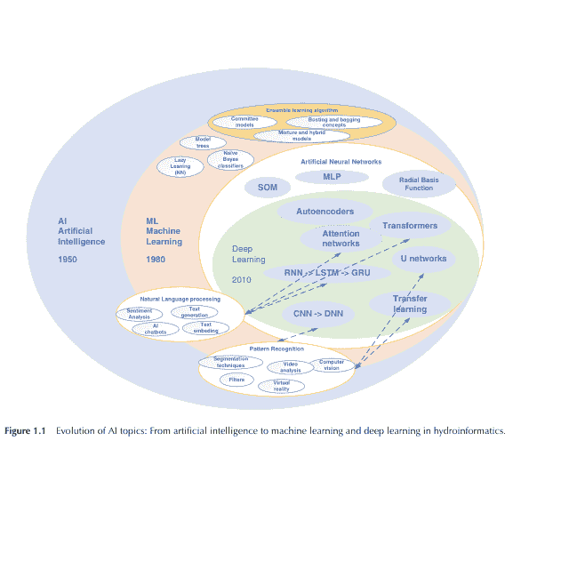

图 1.1 人工智能主题的演变：水文信息学中从人工智能到机器学习和深度学习。

解析文本并使用深度学习的概念进行强化学习。模式识别使用卷积和深度学习，后者发展模式识别以提取特征。最后，元启发式方法为深度学习的新模型提供了基础。以下是在本章中使用的一些概念：

- 1. ML（机器学习）。旨在从数据中表示群体和/或输入-输出关系的数学模型
- 2. NLP（自然语言处理）。语言元素的一般使用，即文本编码为数字及其分析，主要来自文本的转换和处理以解决、复制语义并理解它们
- 3. 模式识别。机器学习可以被表征为一个子领域，探索如何检测数据及其属性（变量或特征）。许多机器学习算法会隐式地检测模式，因此这些领域相互关联。计算机视觉是其应用的重要领域。值得注意的是，许多重要的模式识别数学工具和算法并未明确定位在机器学习领域，例如去噪和滤波程序、图像分割、三维虚拟现实模式、矢量场流动，但它们无疑有助于解决模式识别问题。

#### 1.2.2. 机器学习（ML）

对机器学习进行情境化有多种方式。从计算机科学的角度来看，机器学习的概念可以被视为旨在改变编程范式（图 1.2）。这里的目标是开发一个计算机程序，该程序无需大量分析即可理解如何创建算法以获得特定响应；相反，机器学习算法理论上可以从输入和响应（输出）中学习。

然而，在许多应用中，机器学习并不是被视为生成计算机程序的工具，而是期望通过从数据中学习来帮助构建输入-输出模型，换句话说，是数据驱动模型（见图 1.6）。其用途相当多样，大多数时候其合理性基于这样一种想法：系统可能非常复杂，我们可能无法观察到被建模系统或过程的所有内部状态（例如，在水文建模中，这可能是土壤湿度）。这意味着，如果我们有一个复杂的系统，对自然过程（或任何过程）的驱动变量只有有限的理解，并且我们可以测量事件的后果（即由特定输入产生的输出），那么利用这些信息，就有可能生成机器学习模型（图 1.3）。

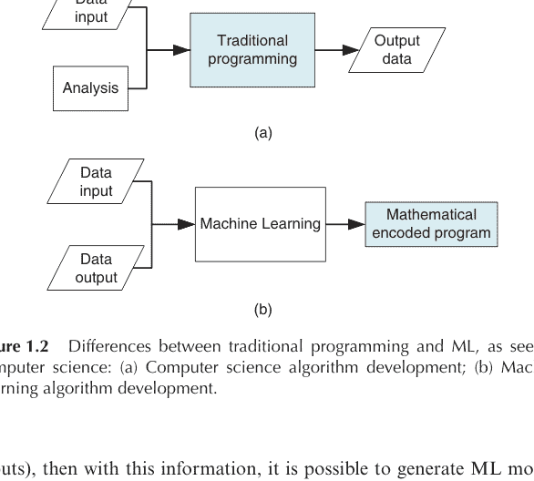

图 1.2 从计算机科学角度看传统编程与机器学习的区别：（a）计算机科学算法开发；（b）机器学习算法开发。

在大多数情况下，机器学习引擎（例如人工神经网络）使用数值（实值）数据，因此实际上是非线性回归模型。如果数据是非数值型的（例如类别、图像或词语），它们必须首先被转换（编码）为数值形式，然后再进行处理。

就地球科学而言，机器学习的广泛采用至少可以说并不迅速，因为许多科学家指出使用这些算法没有明确的理由。他们的理由是，作为现实描述者的模型应基于对过程的科学理解（例如物理学），而不是对数据集的统计封装。水资源在这方面也不例外，机器学习的早期应用受到了批评，因为它们最终会以机器学习抽象地重现本不需要重现的自然问题，这据说往往导致对已知问题的盲目表征。然而，在过去的二十到三十年里，已有许多机器学习成功应用的案例被报道并在决策支持系统中实施。研究表明，在预测中，机器学习方法通常比传统水文模型更准确（见例如 Nearing 等，2021；Arsenault 等，2023）。机器学习还有助于替代复杂的慢速运行的基于物理的模型：机器学习模型在由过程模型生成的数据上进行训练，而这种快速的元模型（替代模型）将取代运营系统中更慢的过程模型，因此可用于实时预测以高效地提供预警。基于机器学习的模式识别算法还可以帮助自动化关键场景的检测，结合物理上不易关联的变量并捕捉数据中隐含的非平凡关系和模式，从而再现复杂现象。因此，机器学习已成为一种强大的分析性和预测性工具。

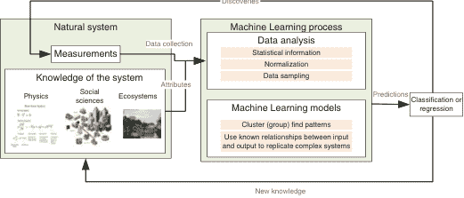

图 1.3 自然系统和过程在机器学习模型中的封装，带反馈。

除机器学习外，人工智能中还有其他值得关注的领域，即自然语言处理和元启发式方法，并且由于它们在水资源管理方面的潜力也被考虑在内。

#### 1.2.3. 自然语言处理（NLP）

互联网使我们能够在人类活动的各个不同领域获取数十亿份文档、图像以及音频和视频资料的访问权限。了解我们是否以及如何利用这些数据解决水资源问题将很有趣。互联网上的数据通常没有结构化，并与各种来源相关联，从组织的网站到社交媒体、新闻、博客、视频等。在许多情况下，有用的数据以文本形式呈现。文本挖掘的想法并不新鲜；然而，互联网上以文本格式提供的海量数据催生了智能工具的开发热潮，被称为自然语言处理（NLP）。NLP 可被定义为计算机程序理解人类口头和书面语言的能力，即自然语言（Sun 等，2022）。它始于处理文本的想法，并发展出解释和再现文本的方法。我们理解写作方式的方法已在文本情感分析、文本生成、文本校正、文本提取以及人工智能助手概念的工具中得到形式化。

NLP 将字母、词语和短语转换为数值表示。这有时以简单的方式完成，例如对短语中的每个词进行编号，并在词重复时重复编号。然而，这种数值表示的结果需要遵循语言的基本原理（Khurana 等，2023）。因此，通常，语言解释过程侧重于五个步骤：

- 1. 词汇（形态）分析：本质上，它是将文本分解为段落、短语和词语。此外，可以在单个词语的层面上理解词素作为词语的最小单位。最后，词汇分析识别词素并使我们能够描述词语并了解其含义，知道其词根形式。此步骤的最终目标是帮助识别词语，通常称为标记，因为原始词语实际上包含一些信息，而对于编程而言，它是代表信息单元的字符序列。
- 2. 句法分析：它允许检查语法以及由此产生的词语在句子中的排列方式。因此，这种顺序使我们能够找到词语应如何正常排列。利用这些信息，可以在它们之间建立关系。知道这一点，就有可能评估句子的各个部分（POS）并根据找到的结构标记这些信息。
- 3. 语义分析：此步骤旨在找到陈述的含义，短语的字面含义。这种理解为拒绝语法有效但不合逻辑的陈述提供了基础。
- 4. 语篇整合：短语使用的上下文可能非常重要，因此此步骤旨在建立不同句子之间的联系，特别是紧邻的前一句。
- 5. 语用分析：这一概念使用一组描述合作对话的规则，如在社交内容中。社交媒体和常见互动中可以找到的内容可以成为规则，有了它我们就可以理解交流的方式。

例如，在营销中，NLP 情感分析已开发出工具，使我们能够根据人们对产品的感受提供基础知识提取或信息提供，并由此在决策和理解人们行为方面开辟了众多可能性。在水资源领域，代尔夫特水教育学院（IHE Delft Institute for Water Education）已开展了多个探索性项目，旨在了解人们如何在社交媒体和报纸上撰写关于其水体的内容（见图 1.4）。这里介绍的概念基于网络媒体信息，即人们如何在媒体中以文本形式表达（分享）感受。这一概念适用于整个社会，而不仅仅是公民本身，其中包括政策制定者和新闻如何也影响媒体从而影响公民。这一循环有两个部分，因为人们倾向于根据媒体信息改变对他人的感受。因此，媒体同时是推动人们的引擎，但它也记录了公民出版物上的所有行为。

NLP 技术的应用导致了人工智能聊天机器人的发展。传统聊天机器人自 1966 年以来不断演进（Weizenbaum，

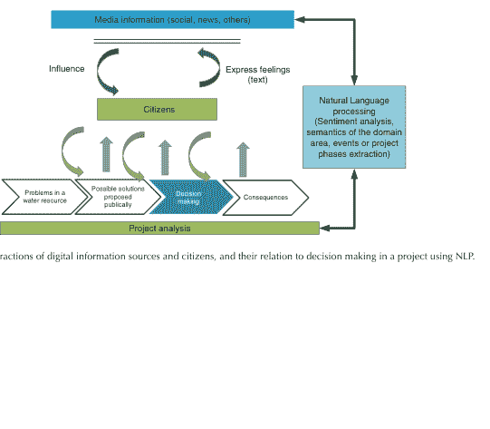

图 1.4 使用 NLP 的项目中数字信息来源与公民的交互及其与决策的关系。

### 1.3. 水相关问题机器学习中的模型构建与输入变量选择

ML 程序在许多书籍中都有详细描述（例如，Haykin, 1999）。关于 ML 在水相关问题中的应用，大多数论文和书籍都提出了相似的建模框架（图 1.5）。例如，Elshorbagy 等人（2010）整理了各种研究中使用的方法学信息，提出了通用框架，并在多个相关水问题案例上进行了测试。类似的框架也可以在更近期的出版物中找到（例如，Potgieter & Dahlberg, 2022）。

在不同领域提出了大量设计数据驱动模型（学习系统）的程序。其中一些程序已被概括化，使其可应用于其他建模方法（Mitchell, 2007；Pyle, 1999；Abraham 等，2008）。Corzo Perez (2009) 提出了表征模型如何纳入基于物理知识的概念。由 Haykin (1999) 等许多作者提出的典型模型构建程序如下：

- 1. 探索问题和解决方案空间，并陈述问题。
- 2. 预期结果是什么以及如何使用？
- 3. 选择输入和输出变量（特征）。
- 4. 指定适当的建模方法并选择工具（软件和算法）。
- 5. 准备并调查数据。将数据划分为训练、验证和测试子集。
- 6. 使用训练和验证子集构建（训练）模型。
- 7. 使用测试子集测试（验证）模型。
- 8. 应用模型并评估结果。

实际上，建模过程不是线性的，而是连续的，带有反馈循环。例如，特定数据的缺乏可能导致所选建模方法的改变。对于这些过程，存在一种清单或黄金法则，被 ML 社区广泛接受，有助于建模者在模型构建过程中的工作。

- 1. 明确定义模型将有助于解决的问题。
- 2. 明确问题的预期解决方案。
- 3. 评估交付的解决方案是否会在实践中被接受和使用。
- 4. 了解问题，收集领域知识，进行分析和理解。


图 1.5 机器学习建模框架中典型的步骤序列。

- 5. 让问题驱动建模工作，包括技术选择、数据准备等。选择最适合工作的工具，而不仅仅是可用工具能完成的工作。
- 6. 明确定义假设和约束，并与领域知识专家讨论。
- 7. 迭代地完善模型（尝试不同的做法，直到模型似乎达到最佳状态）。
- 8. 使模型尽可能简单，但不过于简单。该规则有时以不同方式表述，例如 KISS（保持足够简单）。另一种表述是最小描述长度原则，其指出最佳模型是最小的（包括指定模型形式和参数值的信息）。更一般地，这一思想被广泛称为奥卡姆剃刀原则，由威廉·奥卡姆于 1320 年以以下形式提出：剃除解释中所有不必要的哲学。
- 9. 定义模型的不稳定性和敏感性（输入微小变化导致输出大幅变化甚至模型崩溃的关键区域）。
- 10. 定义模型中的不确定性（模型产生低置信度预测的数据集中的关键区域和范围）。尝试减少此类不确定性。
- 11. 从模型应用中得出结论。

模型训练过程（图 1.6）实际上是在解决一个优化问题：通过更新模型参数（作为该优化问题的决策变量）来最小化实测结果与预测结果之间的差异。

#### 1.3.1. 数据划分

在 ML 中，数据通常划分为三个子集，理想情况下它们在统计上应相似。

- 1. 训练数据：用于计算模型误差的数据，目的是通过更新模型参数使其最小化。
- 2. 验证（或交叉验证）数据：训练过程中各阶段对模型性能进行中间评估所需的数据。这些数据用于调整模型结构或帮助提前停止训练以防止过拟合。常见做法还包括使用所谓的 n 折交叉验证程序（n 通常设为

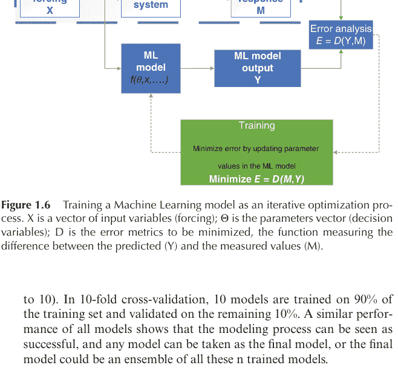

图 1.6 将机器学习模型训练作为迭代优化过程。X 是输入变量（强迫）向量；Θ 是参数向量（决策变量）；D 是待最小化的误差指标，即衡量预测值（Y）与实测值（M）之间差异的函数。

为 10）。在 10 折交叉验证中，10 个模型在训练集的 90% 上训练，并在剩余的 10% 上进行验证。所有模型表现相似表明建模过程可视为成功，任何模型都可作为最终模型，或最终模型可以是这 n 个训练模型的集成。

- 3. 测试（或验证）数据：在模型使用前用于最终性能评估的数据。它需要一个在模型训练期间未使用过的子集。

#### 1.3.2. 输入变量选择（IVS）（特征工程）

确保 ML 模型使用与数据分析或建模目标相关的数据和变量非常重要。

选择相关变量（特征）称为特征工程，或输入变量选择（IVS）。输入变量必须与输出相关，最简单的方法是使用相关性分析或平均互信息（AMI）。相关性分析仅反映线性关系；因此，当过程高度

非线性时，AMI 会是更好的选择。IVS 程序的详细介绍可在 Guyon 和 Elisseeff (2003) 中找到，关于水文建模，可在 Bowden 等 (2005a, 2005b) 和 Galelli 和 Castelletti (2013) 中找到。

ML 中的重要步骤之一是数据的转换、预处理和后处理（Pyle, 1999）。对于某些方法，如多层感知器人工神经网络（MLP ANN），数据转换（归一化）几乎是必须的。其他方法也受益于此，因为它通常会提高性能。

在 ML 中，输入变量的选择非常重要，这一过程与过程式建模中通常使用的方法大不相同。即使拥有大量测量数据，甚至在物理上知道哪些输入变量驱动输出，也不能保证模型的高精度。在大多数情况下，有必要确定（1）何时以及（2）在多大程度上这些输入对模型输出产生贡献。由于 ML 中并非总是可获得关于建模现象的信息，大多数方法依赖统计学和信息论来确定数据驱动模型的适当输入变量。

通常，输入选择过程从关于将被建模过程的所有知识（数据）开始，然后根据更详细的分析缩小选择空间。与水文过程式模型不同，ML 允许纳入任何变量（或其组合），即使是那些不直接驱动现象（径流）的变量。例如，降雨径流模型可能会使用过去的径流来预测当前或未来的径流；然而，它们并不是洪水情况的实际触发因素（关于水文建模，参见例如 Moreido 等，2021 中的讨论）。

为了考虑关于建模现象的过去信息，模型通常需要输入输入变量的先前（滞后）值，或许是聚合后的值。在水文预报的背景下，这些通常是降水和径流，最优滞后。在此背景下，滞后定义为时间序列相对于其当前值、自身（当自相关时）或相对于另一时间序列的对应时间值（当互相关时）所移动的时间步数。表 1.1 展示了构建带滞后降水的输入数据矩阵的示例（假设当前时间为 2015 年 01 月 01 日）。

对延迟输入与输出相关程度的理解用于绘制自相关或互相关变量的比较图（图 1.7）。原则上，所有滞后都可能很重要，以表示系统记忆导致的响应类型。然而，每


## 表 1.1 降雨-径流模型输入矩阵生成的示例（Ourthe河流流域）。

| 日期 | 降水量 (mm) | 滞后降水 1 天 | 滞后降水 2 天 | 滞后降水 3 天 | 滞后降水 4 天 | 流量 (m³/s) |
|---|---|---|---|---|---|---|
| 01/01/2015 | 4.37 |  |  |  |  | 4.37 |
| 02/01/2015 | 11.72 | 4.37 |  |  |  | 11.72 |
| 03/01/2015 | 33.57 | 11.72 | 4.37 |  |  | 33.57 |
| 04/01/2015 | 32.20 | 33.57 | 11.72 | 4.37 |  | 32.20 |
| 05/01/2015 | 8.20 | 32.20 | 33.57 | 11.72 | 4.37 | 8.20 |
| 06/01/2015 | 0.56 | 8.20 | 32.20 | 33.57 | 11.72 | 0.56 |
| 07/01/2015 | 26.41 | 0.56 | 8.20 | 32.20 | 33.57 | 26.41 |
| 08/01/2015 | 28.84 | 26.41 | 0.56 | 8.20 | 32.20 | 28.84 |
| 09/01/2015 | 0.23 | 28.84 | 26.41 | 0.56 | 8.20 | 0.23 |
| 10/01/2015 | 0.77 | 0.23 | 28.84 | 26.41 | 0.56 | 0.77 |
| 11/01/2015 | 10.79 | 0.77 | 0.23 | 28.84 | 26.41 | 10.79 |
| 12/01/2015 | 1.27 | 10.79 | 0.77 | 0.23 | 28.84 | 1.27 |
| 13/01/2015 | 32.60 | 1.27 | 10.79 | 0.77 | 0.23 | 32.60 |
| 14/01/2015 | 37.05 | 32.60 | 1.27 | 10.79 | 0.77 | 37.05 |
| 15/01/2015 | 1.15 | 37.05 | 32.60 | 1.27 | 10.79 | 1.15 |
| 16/01/2015 | 0.16 | 1.15 | 37.05 | 32.60 | 1.27 | 0.16 |

新变量代表了问题自由度的增加以及模型复杂度的不必要增加，并且可能导致过拟合。

在降雨-径流这一问题中，如前所述，流域的规模在决定模型复杂度的预期方面起着重要作用。虽然平均降水量被考虑，但仅在模型中包含一个或两个滞后变量往往是不够的。发生在流量测点附近的降水事件会导致流量在滞后后增加，该滞后可能远小于平均值，而远离该点的事件则会有更大的滞后。这导致了另一种类型的、具有时空性质的问题。

相关系数通常用于确定两个随机变量样本或时间序列之间的数学线性关系。在构建降雨径流模型的情况下，变量为滞后降水和流量。导致高相关性的滞后时间将是作为最终模型最可能候选者采用的滞后时间。

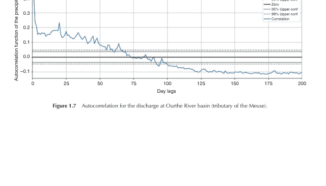

图 1.7 Ourthe河流域（默兹河支流）流量的自相关。

由于如果使用的数据不足，相关系数可能会具有误导性，或者可能存在具有不同相关结构事件，因此采用另外两种分析技术是有用的：（1）分析相关系数随不同数据集大小的变化情况，以及（2）对特定事件分别进行相关性分析，例如流量在特定范围内。

应当指出，许多 ML 模型（例如，循环神经网络；见下文）基于一种架构，其中代表输入变量的整个时间序列（或其部分）被输入到模型中，而先前（滞后）值的选择及其加权则通过模型训练期间的优化过程完成。在这种情况下，IVS 是在选择正确的变量（而非特定的滞后值）方面，而不必过多关注它们在模型中应如何滞后，因为这是自动完成的。

#### 1.3.3. 优化

图 1.5 中显示的第三步是建模过程本身，其原则上称为学习，是一个优化过程，用于选择模型参数和结构以使模型输出拟合到测量的（目标）值。对于此类目的，有许多单目标和多目标优化技术可用，它们通常非常特定于每种技术。不能断言一种技术总能提供比另一种更好的解决方案。这在一定程度上可以由许多算法中存在的随机成分来解释。

#### 1.3.4. 模型评估（测试）

训练过程中的最后一步是评估模型的性能。在模型经过优化并且在进行了一些验证迭代后可能被选定之后，使用模型在测试数据上的误差来评估所得模型的性能。

值得一提的是，在过程性建模中，在数据可用性较差的情况下，并不总是将数据划分为训练、验证和测试子集，因此适当的模型测试可能难以安排。然而，在机器学习练习中，数据划分的程序通常会遵循。

在 ML 模型训练（学习）过程中使用的误差度量（指标）（通常基于均方误差）不应被视为模型性能估计的唯一方式。通常，视觉比较、对极端现象的额外测试（撞击测试）以及基准或参考模型也用于评估模型质量。很难为一个好的模型只选择一个性能度量，因此模型训练也可以被表述为多目标优化问题；关于多目标机器学习，参见例如 Corzo 和 Solomatine（2006）；关于多任务学习，Ruder（2017）给出了一个很好的入门概述。在这种情况下，建模结果最好是与利益相关者进一步讨论，从多目标优化（训练）结果生成的 Pareto 最优模型集中选择单个模型的问题。

#### 1.3.5. 构建模型过程中的不确定性

建模导致了新知识的产生和对所建模过程的新见解，通常涉及渐进的完善和改进的循环，甚至是对初始建模目标的重新表述。建模实验中提出的一些可能问题及其相关循环如图 1.8 所示。这些问题中的每一个都与过程中的一个不确定变量相关。数据中的不确定性不可避免地会传播到模型的输出。数据划分的变化也会导致不同的模型参数化。输入变量集的变化可能导致不同的模型输出，从而性能各异。许多 ML 模型需要参数的随机初始化，因此多次运行可能导致不同的结果。最后，在优化过程中采用一个目标函数，而实际问题通常具有多个目标，使得模型偏向于某个建模目标。例如，为高流量构建的 ML 模型可能对低流量不是最优的，反之亦然。由于没有完美的性能度量，因此在建模过程中选择什么是最优的也存在不确定性。

在 ML 理论和实践中，所有这些问题都已被研究，理解得相当透彻，并且已经开发出适当的技巧。例如，n 折交叉验证用于处理数据划分中的不确定性。如果不使用单个模型，而是构建多个（集成）模型，基于不同的参数（权重）随机化，然后使用（动态）加权进行聚合，则不确定性会降低。所建模系统的多体制问题和季节性问题通过模块化或委员会系统解决（Corzo & Solomatine, 2007b, 2007a; Kayastha et al., 2013）。对于与 IVS 相关的问题，特征工程提供了许多技术（参见 Guyon & Elisseeff 2003; Bowden et al., 2005a, 2005b; Galleli & Castelleti, 2013）。鲁棒性

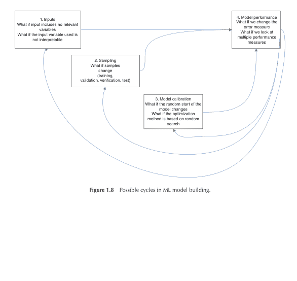

图 1.8 ML 模型构建中的可能循环。

类索引。例如，在洪水预报的情况下，可以训练一个 ML 数值预测模型来预测流量值，但最终结果将以二元类呈现：“无洪水”（如果流量低于预定义阈值），和“洪水”（否则）。

对类别进行编码还有其他方法：数据被转换，问题被表述为具有 N 个二元输出，其中 N 为类别数。例如，在两种可能结果的情况下（如无洪水和洪水），输出向量（实值）将是洪水条件下的（0, 1）或无洪水条件下的（1, 0）。回归 ML 模型被训练以重现实值向量。如果对于新输入，该模型给出的输出向量接近（0, 1），例如（0.11, 0.85），则解释为洪水，如果它接近（1, 0），例如（0.15, 0.91），则解释为无洪水。

然而，在水资源领域，更广泛传播的一种问题类型是回归（数值预测）问题，其旨在预测连续输出，例如河流的流量或水库中的水位。例如，在水资源管理的情况下，ML 模型用于预测水库入流、水需求和水可用性，然后利用预测结果来优化水分配。

本节研究了机器学习技术在水资源中的应用，强调了其相关性和有效性。它首先研究了人工神经网络（ANNs），重点是流行的多层感知器（MLP）ANN。MLP ANN 在水资源研究中很受欢迎，因为它们能够处理复杂的相互作用和大数据集。该部分回顾了 MLP ANN 架构和训练程序，强调其在水资源建模中的适用性。随后，主题转向回归和模型树，以及用于开发集成模型的装袋和提升策略。这些方法提供了模块化解决方案以及提高模型稳定性、准确性和泛化能力的统计工具。在回归和模型树中，决策树与线性模型的结合允许灵活地建模非线性联系，而装袋和提升方法通过组合多个模型来提高性能。该部分还讨论了深度学习兴趣的最新激增，特别是在水资源方面的应用。深度学习，如循环神经网络所示，在处理时间序列数据和捕捉复杂模式方面表现出 exceptional 能力。特别是长短期记忆（LSTM）网络，通过克服长期依赖问题，在水文建模中显示出 considerable 潜力。该部分强调了将深度学习方法纳入水资源管理和预测的重要性。总体而言，这深入

对水资源领域机器学习方法的考察凸显了其潜力及其在推动该领域研究和应用方面的有用性。

#### 1.4.1. 人工神经网络（ANNs）

最广泛使用的 ANN 是多层感知器（MLP）。一个 MLP ANN 由多个相互连接的节点层（神经元；图 1.9）组成，这些节点处理输入向量以产生向量输出（通常是一个单一值）。每一层的节点首先对输入进行线性组合，然后应用非线性函数（sigmoid 或双曲正切）进一步转换输入并将结果传递到下一层，而最后一层产生网络的输出。MLPs 通常通过反向传播进行训练，这是一种逐步调整节点间权重以最小化网络输出与期望输出之间差异的方法；它可以被视为非线性梯度优化的特例。MLP 可能有多个中间（隐藏）层，但最广泛使用的架构仅使用一层。有关细节请参阅，例如 Haykin（1999），以及许多其他书籍和网络资源。

总体而言，MLP ANNs 已被证明能够处理复杂、非线性的关系和大量数据，并能以高精度进行预测。水资源中 ANN 的成功应用有数百个（参见，例如，Abrahart et al., 2012），而 MLP ANN 通常被视为 ML 模型的首选。

#### 1.4.2. 回归树和模型树

遵循建模的模块化方法，数据驱动模型应包含多个子模型。训练集被划分为对应于待建模特定子过程的子集，然后每个模块（图 1.1）在这些不相交的子集上进行训练（实际上，这些子集可以相交，导致某些版本的集成模型，但此处不考虑该选项）。当呈现新的输入向量时，它首先被分类到模块所训练的区域之一（对应于子集），然后仅运行一个模块来生成预测。采用连续渐进分裂的一类此类方法通常被称为树。示例有决策树、回归树（Breiman, 1984），在叶节点中使用零阶模型，即常数；多自适应回归样条（MARS）（Friedman, 1991）；以及 M5 模型树（Quinlan, 1992），在叶节点中使用线性回归模型（图 1.10，摘自 Bhattacharya & Solomatine, 2005）。

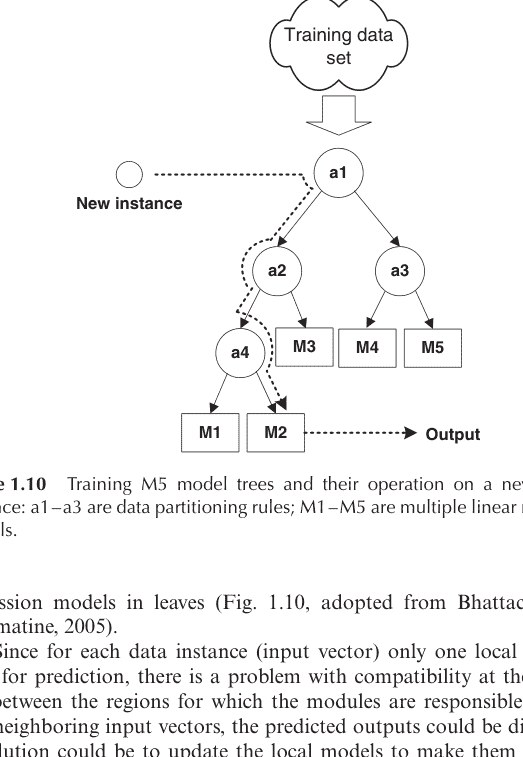

图 1.10 训练 M5 模型树及其对新未见实例的操作：a1–a3 为数据划分规则；M1–M5 为多元线性回归模型。

由于对每个数据实例（输入向量）仅使用一个局部模型进行预测，模块负责的区域边界之间存在兼容性问题。对于两个相邻的输入向量，预测输出可能截然不同。一种解决方案是通过平滑等方法更新局部模型使其在边界处兼容，正如 M5 模型树算法中所做的那样。Wang 和 Witten（1996）提出了基于原始 M5 算法的 M5′ 算法，能够处理枚举属性、处理缺失值并使用不同的分裂终止条件。使用模型树的几个优点是它是一个非黑箱模型，可理解、易于使用和学习、训练速度快、在处理缺失数据时稳健、能够处理大量特征并能够处理非常高维度的任务。研究表明，M5 模型树在水相关应用中的准确性与 MLP ANNs 相似或更高（参见，例如，Bhattacharya & Solomatine, 2005；Solomatine & Xue, 2004）。

总之，M5 模型树是一种机器学习算法，结合了回归树和线性模型的优势，允许在建模非线性关系时具有更大的灵活性。

#### 1.4.3. 构建委员会模型的 Bagging 和 Boosting 技术

### Bagging

两个或多个输出被组合的模型形成一个委员会模型。用于准备构建此类模型数据的统计技术广泛使用 bagging 和 boosting。这些方法用于生成数据的子样本，用于训练多个模型然后在委员会中组合它们。

术语 bagging 来自 bootstrap 聚合（bagging），这是一种用于提高分类和回归模型在稳定性和分类准确性方面的算法。它还降低方差并有助于避免过拟合。Bagging 可以被视为模型平均方法的特例。Bagging 由 Leo Breiman（1984）提出。

给定大小为 n 的标准训练集 D，bagging 通过从 D 中均匀有放回地抽样示例生成 m 个大小为 n' ≤ n 的新训练集 Di。通过有放回抽样，很可能某些示例会在每个 Di 中重复。如果 n' = n，则对于较大的 n，集合 Di 预计具有 D 的 63.2% 的唯一示例，其余为重复。这种样本被称为 bootstrap 样本。m 个模型使用上述 m 个 bootstrap 样本构建，并通过平均输出（回归）或投票（分类）进行组合。由于该方法平均了多个预测器，因此对改进线性模型没有用处。

### 随机森林

一种基于 bagging 并使用数据树状结构化的非常流行的算法是随机森林算法（Breiman, 2001）。它是一种集成方法，结合多个决策树（原始版本中为回归树）进行预测。该方法的基本思想是使用数据的随机子集和特征构建大量决策（回归）树，然后组合这些树的预测以做出最终预测。

随机森林算法首先为每棵决策树选择一个称为 bootstrap 样本的数据随机子集作为训练集。然后，对于每棵树，选择特征的随机子集作为每个节点处的分裂变量。算法然后使用该随机子集的数据和特征生长决策树。该过程重复多次以构建大量决策树，每棵树都有其自身的数据和特征的随机子集。最后，所有树的预测（构成一个集成）被组合以做出最终预测。

随机森林的一个优点是它可以通过平均许多决策树的预测来减少过拟合。该算法还能够处理大量输入变量以及输入变量与目标变量之间的非线性关系，而这是线性回归模型的局限性。

### Boosting

Boosting 也导致 ML 模型的委员会（集成），但它是一种顺序模型，其中每个后续模型都依赖于前一个的结果。Boosting 将弱学习器分配给原始数据集的加权子集。弱学习器预测能力有限，仅略好于随机猜测。之前被错误分类的子集会被赋予更大权重，从而增加被选为后续学习器的概率。因此，集成具有良好的泛化能力。Boosting 的两个广泛使用的版本是梯度提升（Friedman, 2001）和自适应提升 AdaBoost（关于其在回归问题中的实现 AdaBoost.RT，请参见 Shrestha & Solomatine, 2006）。前者的流行实现是 XGBoost（极端梯度提升），这是一个 C++ 库，拥有多种语言的 API（XGBoost, 2023），广泛应用于各种类型的应用中。

#### 1.4.4. 深度学习

就水资源而言，最近人们对所谓的深度学习给予了大量关注，深度学习是基于循环多层神经网络架构的通用术语。特别流行的是长短期记忆（LSTM）、门控循环单元（GRUs；LSTM 的一种版本）和卷积网络。深度学习（DL）通常指具有大量层和具有记忆的复杂节点的模型，例如，能够处理“时间上很深”的时间序列或处理图像。DL 已成为一个时髦的术语，目前被广泛使用，有时甚至（错误地）取代了更通用的术语 ML。


#### 1.4.5. 循环神经网络（RNN）与长短期记忆网络（LSTM）

### RNN

循环神经网络旨在自动学习并理解按顺序提供的输入之间的相互关系。RNN 经常应用于自然语言处理和语音识别，因为它们具有适合处理长时序的序列结构（图 1.11）。在典型的 RNN 中，输出成为一个状态变量（h），并将其用作同一网络在序列中下一个时间步的输入。

### 长短期记忆（LSTM）网络

传统的 RNN 在训练长序列模型时面临困难，尤其是梯度消失或梯度爆炸问题。许多研究都针对这一问题进行了探索，而当今最流行的技术之一是长短期记忆（LSTM）网络，由 Hochreiter 和 Schmidhuber（1997）提出。这一技术及后续发展使得深度学习在时间序列预测中得到了更广泛的应用。

学习输入与输出之间的这种长期依赖关系在水文建模中至关重要，因为水文过程之间的滞时可能从数天到数年不等。例如，在冰川、积雪和地下水过程中可以看到较长的滞时（Kratzert et al., 2019）。由于过去几年深度学习算法的不断发展，人们对在水相关问题中使用机器学习的兴趣明显回升。这些方法已被证明具有较高的精度，例如在洪水预报（如 Kratzert et al., 2019; Kao et al., 2020; Arsenault et al., 2023）和干旱预报（Brust et al., 2021; Dikshit & Pradhan, 2021）中。

Kratzert et al.（2019）利用大型样本研究的流域属性与气象（CAMELS）数据集，研究了 LSTM 在降雨径流水文学中的应用，涉及众多流域。作者还研究了单个 LSTM 模型在多大程度上可以被区域化，即应用于其他流域。结果表明，与参考模型相比，LSTM 能以较高的精度预测流量。最终结论认为，使用 LSTM 可以克服机器学习模型通常被视为黑盒模型的问题，理由如下：在 LSTM 中，单元状态对水文趋势和模式的响应可以在物理上进行解释，例如，通过分析单元状态的融化状态与温度变化的关系来进行解释。因此，当温度较低时，

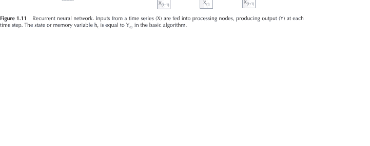

图 1.11 循环神经网络。将来自时间序列（X）的输入送入处理节点，在每个时间步产生输出（Y）。在基本算法中，状态或记忆变量 h_t 等于 Y_t。

单元状态会出现一定程度的上升；当温度超过一定数值时，单元状态开始下降（这模拟了积雪累积和融化过程）。

还可以提及近期在水文气象问题（这些问题的特征是数据集非常大）中应用深度学习的一些例子。Schultz et al.（2021）评估了数值天气预报模式，这类模式对于分析各类水资源问题非常重要。该工作指出，深度学习在数值天气预报（NWP）领域尚未被广泛使用，主要原因在于神经网络缺乏可解释性以及物理约束的不足。他们还提到，许多使用简单神经网络的早期实验未能捕捉天气过程的复杂性。尽管这些限制很重要，但考虑将深度学习用于天气预报问题有三个主要原因。第一，目前可以获得大量数据。第二，已经开发出新的神经网络架构，能够很好地捕捉时间依赖性（RNN）以及空间分布和图像信息，如卷积神经网络（CNN）。第三，训练此类网络所需的计算能力（云上可用的图形处理器和专用处理器）已经容易获得。所有这些使得最新的先进机器学习技术可供水资源领域的建模人员和预报员使用，从而实现最优的水资源管理。

关于人工智能和机器学习在地球系统科学中的应用，读者可参考例如“地球系统科学人工智能”暑期学校（AI4ESS, 2020）的录制讲座，其中介绍了一些方法和令人印象深刻的应用。

### 1.5. 未来方向与挑战

对于有效的水资源管理来说，建模和预报工具的使用不可或缺。传统上，这类模型属于基于过程（物理基础）的模型类别，通常基于水运动微分方程的数值解。在过去三十年中，机器学习技术的进步、计算能力的提高和数据可用性的增加改变了这一格局。水文信息学被视为机器学习等算法经过测试并应用于各种水相关问题的主要领域，并且已被证明是有效补充甚至有时替代物理模型的有用工具。物理表征的改进并不一定能保证传统模型精度和实用性的提高，因此人们在寻求替代方法。本章概述了与本卷相关的机器学习主要方法，多数情况下参考了作者自身的经验，并提供了进一步阅读的资料。

目前，在实际建模人员群体中，对数据驱动模型的态度正在发生重大转变，而当前水文学文献中的讨论就是这一点的体现（例如，参见 Nearing et al., 2021; Beven, 2020）。机器学习不仅提供建模技术，还通过自然语言处理（NLP）和智能聊天机器人增强了普通公民获取并更好地理解建模结果的能力。

我们认为建模技术未来的进展在于更有效地结合各类模型及其混合化（例如，在物理感知人工智能方向上，参见 Jiang et al., 2020）和协同进化（如 Razavi et al., 2022 所述）。根据作者的经验，我们认为以下为主要未来方向：

- 1. **将人工智能和机器学习融入水资源业务管理：** 将人工智能和机器学习模型集成到实时决策支持系统中，以实现高效和自适应水资源管理，是一种潜在方法。这需要创建能够实时适应不断变化的环境条件并改善水资源分配和调度的模型。
- 2. **提高数据可用性和质量：** 机器学习模型需要获取高质量、多样化的数据。未来的工作应侧重于改进数据采集方法、加强数据共享渠道，并创建处理缺失或不完整数据的方法。这将有助于开发更准确、更稳健的机器学习模型。
- 3. **不确定性量化与风险评估：** 解决与机器学习预测相关的不确定性并衡量其风险是主要问题。未来的研究应侧重于创建量化基于机器学习的预测中不确定性的方法，并将风险评估框架纳入其中，以在不确定性下改进决策。
- 4. **机器学习模型的可解释性与可理解性：** 机器学习模型，尤其是深度学习模型，由于其复杂的结构，通常被视为黑盒。提高机器学习模型在水资源应用中的可理解性和可解释性是一个重要的

Abrahart, R. J., See, L. M., & Solomatine, D. P. (编) (2008). 《实用水文信息学：水应用中的计算智能与技术发展》(第68卷). Springer Science & Business Media.

AI4ESS (2020). 2020年地球系统科学人工智能暑期学校. https://www2.cisl.ucar.edu/events/summer-school/ai4ess/2020

Arsenault, R., Martel, J.-L., Brunet, F., Brissette, F., & Mai, J. (2023). 无测站流域的连续径流预测：长短期记忆神经网络明显优于传统水文模型. Hydrology and Earth System Sciences, 27(1), 139–157.

Artificial intelligence (2022, December 2). In Wikipedia. https://en.wikipedia.org/wiki/Artificial_intelligence

Beven, K. (2020). 深度学习、水文过程与地点的独特性. Hydrological Processes, 34, 3608–3613.

Bhattacharya, B., & Solomatine, D. P. (2005). 神经网络与M5模型树在水位-流量关系建模中的应用. Neurocomputing, 63, 381–396.

Bowden, G. J., Dandy, G. C., & Maier, H. R. (2005a). 水资源应用中神经网络模型的输入确定. 第1部分：背景与方法. Journal of Hydrology, 301, 75–92.

Bowden, G. J., Dandy, G. C., & Maier, H. R. (2005b). 水资源应用中神经网络模型的输入确定. 第2部分：案例研究：河流盐度预报. Journal of Hydrology, 301, 93–107.

Breiman, L. (1984). 分类与回归树. Routledge. https://doi.org/10.1201/9781315139470

Breiman, L. (2001). 随机森林. Machine Learning, 45, 5–32.

Brust, C., Kimball, J. S., Maneta, M. P., Jencso, K., & Reichle, R. H. (2021). Droughtcast：美国干旱监测的机器学习预报. Frontiers in Big Data, 4. https://doi.org/10.3389/fdata.2021.773478

Corzo, G., & Solomatine, D. (2007a). 流量预报中模块化人工神经网络建模的基流分割技术. Hydrological Science Journal, 52(3), 491–507.

Corzo, G., & Solomatine, D. (2007b). 水文预报中人工神经网络模型的基于知识的模块化与全局优化. Neural Networks, 20(4), 528–536.

Corzo, G. A., & Solomatine, D. P. (2006). 模块化数据驱动水文模型的基流分割算法优化. Proceedings of the 7th International Conference on Hydroinformatics (HIC 2006). Nice, France.

Corzo, G. A., Diaz Mercado, V., & Laverde Barajas M. (2018). 时空水文分析. International Journal of Hydrology, 2(1), 25–26.

Corzo Perez, G. A. (2009). 水文预报的混合模型：数据驱动与概念建模技术的集成. Taylor & Francis, CRC Press.

Diaz, V., Corzo Perez, G. A., van Lanen, H. A. J., Solomatine, D., & Varouchakis, E. A. (2020). 一种表征时空干旱动态的方法. Advances in Water Resources.

Dikshit, A., & Pradhan, B. (2021). 干旱预报中的可解释人工智能. Machine Learning With Applications, 6, 100192.


- Elshorbagy, A., Corzo, G., Srinivasulu, S., & Solomatine, D. P. (2010). 数据驱动建模技术在水文学中预测能力的实验研究。第1部分，概念与方法论。水文与地球系统科学。
- Friedman, J. H. (1991). 多变量自适应回归样条。统计年刊, 19(1), 1–67. http://www.jstor.org/stable/2241837
- Friedman, J. H. (2001). 贪婪函数逼近：梯度提升机。统计年刊, 29(5), 1189–1232.
- Galelli, S., & Castelletti, A. (2013). 基于树的迭代输入变量选择用于水文建模。水资源研究, 49(7), 4295–4310.
- Guyon, I., & Elisseeff, A. (2003). 变量和特征选择导论。机器学习研究杂志, 3, 1157–1182.
- Haykin, S. (1999). 神经网络与学习机器。Pearson / Prentice Hall.
- Hochreiter, S., & Schmidhuber, J. (1997). 长短期记忆。神经计算, 9(8), 1735–1780.
- Jiang, S., Zheng, Y., & Solomatine, D. (2020). 提高人工智能系统对地球科学知识的认知：物理方法与深度学习的共生整合。地球物理研究快报, 47(13), e2020GL088229.
- Kao, I-F., Zhou, Y., Chang, L-C., & Chang, F-J. (2020). 探索基于长短期记忆的编码器-解码器框架用于多步洪水预报。水文学杂志, 583, 124631.
- Kayastha, N., Ye, J., Fenicia, F., Kuzmin, V., & Solomatine, D. P. (2013). 专用降雨径流模型的模糊委员会：进一步改进与测试。水文与地球系统科学, 17, 4441–4451.
- Khosh nazar, A., Corzo Perez, G. A., & Diaz, V. (2021). 考虑韧性和异质脆弱性因素的时空干旱风险评估：中美洲干旱走廊的莱姆帕跨界河流域。海洋科学与工程杂志, 9(4).
- Khurana, D., Koli, A., Khatter, K., et al. (2023). 自然语言处理：现状、当前趋势与挑战。多媒体工具与应用, 82, 3713–3744.
- Kratzert, F., Klotz, D., Shalev, G., Klambauer, G., Hochreiter, S., & Nearing, G. (2019). 基准测试流域感知长短期记忆网络（LSTM）用于大规模水文建模。水文与地球系统科学讨论, 2019, 1–32.
- Mitchell, T. M. (2007). 机器学习（第1卷）。New York: McGraw-Hill.
- Moreido, V., Gartsman, B., Solomatine, D. P., & Suchilina, Z. (2021). 机器学习模型在没有水文学家的情况下表现如何？应用合理特征选择以改进水文预报。水, 13(12), 1696.
- Nearing, G. S., Kratzert, F., Sampson, A. K., Pelissier, C. S., Klotz, D., Frame, J. M., et al. (2021). 在机器学习时代，水文科学发挥什么作用？水资源研究, 57, e2020WR02809.
- Potgieter, T., & Dahlberg, J. (2022). AWS 上的自动化机器学习：以 AWS 方式快速推进生产就绪机器学习应用的开发。Packt Publishing.
- Premack, D., & Woodruff, G. (1978). 黑猩猩是否有心智理论？行为与脑科学, 1(4), 515–526.
- Pyle, D. (1999). 数据挖掘的数据准备。Morgan Kaufmann, USA.
- Quinlan, J. R. (1992). 连续类别的学习。澳大利亚人工智能联合会议论文集（pp. 343–348）。Singapore: World Scientific.
- Razavi, S., Hannah, D. M., Elshorbagy, A., Kumar, S., Marshall, L., Solomatine, D. P., et al. (2022). 机器学习与基于过程建模的协同进化以革新地球与环境科学：一种观点。水文过程, 36, e14596. https://doi.org/10.1002/hyp.14596
- Ruder, S. (2017). 深度神经网络中多任务学习的概述。https://www.ruder.io/multi-task
- Schultz, M. G., Betancourt, C., Gong, B., Kleinert, F., Langguth, M., Leufen, L. H., et al. (2021). 深度学习能否战胜数值天气预报？皇家学会哲学学报 A, 379(2194).
- Shrestha, D. L., & Solomatine, D. P. (2006). 使用 AdaBoost.RT 的实验，一种改进的回归提升方案。神经计算, 17, 1678–1710.
- Shrestha, D. L., Kayastha, N., & Solomatine, D. P. (2009). 使用神经网络的水文模型参数不确定性分析的新方法。水文与地球系统科学, 13, 1235–1248.
- Solomatine, D. P., & Shrestha, D. L. (2009). 使用机器学习技术估计模型不确定性的新方法。水资源研究, 45, W00B11.
- Solomatine, D. P., & Xue, Y. (2004). M5 模型树与神经网络比较：中国淮河流域上游洪水预报应用。水文工程杂志, 9(6), 491–501.
- Stanford Encyclopedia of Philosophy (2018). 人工智能。https://plato.stanford.edu/entries/artificial-intelligence/
- Sun, T. X., Liu, X. Y., Qiu, X. P., & Huang, X. J. (2022). 自然语言处理中的范式转变。机器智能研究, 19(3), 169–183.
- Varouchakis, E. A., Hristopulos, D. T., Karatzas, G. P., Perez, G. A. C., & Diaz, V. (2021). 结合地面和卫星观测的降水时空地统计分析。水文研究, 52(3).
- Wang, Y., & Witten, I. H. (1996). 归纳模型树用于预测连续类别。
- Wikipedia (2023, March 30). 人工智能。https://en.wikipedia.org/wiki/Artificial_intelligence
- Wani, O., Beckers, J., Weerts, A. H., & Solomatine, D. P. (2017). 使用基于实例学习进行残差不确定性估计及其在水文预报中的应用。水文与地球系统科学, 21, 4021–4036.
- Weizenbaum, J. (1966). ELIZA：研究人与机器之间自然语言交流的计算机程序。ACM 通讯, 9(1), 36–45.
- XGBoost (2023). https://github.com/dmlc/xgboost

## 第一部分：建模水文系统

### 通过随机输入驱动校准提高模型可识别性

Andreas Efstratiadis, Ioannis Tsoukalas, and Panagiotis Kossieris

*水资源与环境工程系，雅典国家技术大学，佐格拉夫，希腊*

长期以来，识别最佳建模结构和/或参数的经典问题遵循校准-验证规范，其源于 Vít Klemeš 的标志性分割样本方案。此类方法的共同特征是其依赖于可用数据的长度和代表性。这引发了若干问题，因为推断出的参数是根据历史数据的特定子集（或子集）选择的，而其余数据用于验证。在此思路下，我们提出了一种概念上简单的方法，由众所周知的随机模拟范式驱动，其建立在利用替代但在概率上一致的合成数据校准模型的思想之上。这样解耦后，可用数据现在成为生成随机输入的基础，也用于模型验证和参数不确定性评估。这使得能够嵌入真实世界驱动因素（降雨、蒸散发）和响应（径流）的随机性，从而体现其水文不确定性。此外，它导致稳定且稳健的模型，因为校准是使用足够长的时间序列进行的，这些时间序列再现了与气候变化相关的重要特性（例如长期持续性），而这些特性通常隐藏在短的历史样本中。以这种方式识别，所得参数不仅对历史数据集最优，而且对所建模过程的任何其他合理实现也最优。

**2.1. 引言**

水文模型是支持水工程和管理决策的重要要素。这些模型通常采用平稳性概念，这使得过程描述和模型参数可以作为时不变处理。在这方面，虽然基于模型的决策涉及本质上不确定的未来，但底层建模方案的识别及其预测能力的评估也是基于流域对已知气象输入集的响应的过去信息。

在一般背景下，特定水文模型的识别受一系列用户决策的制约，其中参数值、过程参数化方程以及整体系统架构之间的相互作用应确保相对于可用信息的最小不确定性（Gharari et al., 2021）。然而，实际应用中提出的问题通常仅限于给定模型结构的參数估计。根据常见的水文实践，这一任务通过众所周知的分割样本检验（Klemeš, 1986）及其变体（例如，Gowda et al., 2012; Arsenault et al., 2018; Nicolle et al., 2021）来形式化。这要求将观测数据分为用于参数调整的校准子集和用于验证的另一子集。验证相对于校准的模型性能出现任何重要下降都可能引发对模型稳健性的质疑，这通常是由于对非代表性校准数据的过拟合。因此，关键决策是分离策略和校准长度，应嵌入多样化的水文气候条件，也包括异常事件（Singh & Bárdossy, 2012），以确保所有模型特征都能得到充分激活。数据数量和质量的重要作用也早已被认识到（Gupta & Sorooshian, 1985），随后成为众多研究的主题（例如，Seibert, 2003; Perrin et al., 2007; Juston et al., 2009;

Andréassian et al., 2009, 2012; Bennett et al., 2013; Jaafar & Bargaoui, 2020; Myers et al., 2021)。在此脉络下，多位研究者指出在校准中利用多源信息的需求，通过硬数据（即，实测数据）和软数据以及专家判断，以提高模型真实性和参数合理性（例如，Seibert & McDonnell, 2002; Efstratiadis & Koutsoyiannis, 2010; Nalbantis et al., 2011; Finger et al., 2015; Mohammed et al., 2021）。

分样本原理的一个明显缺陷在于，所推断的参数集仅基于可用数据的子集进行条件化，从而丢失了可能蕴含在验证期中的重要信息。这促使研究者提出跨滑动窗口的混合校准方案（Coron et al., 2012, 2014; Vormoor et al., 2018）或子时期（Gharari et al., 2013; Thirel et al., 2015a），以便检测随时间表现一致的参数集。采用一种颇具异端色彩的方法，Singh and Bárdossy (2012) 和 Arsenault et al. (2018) 表明在特定条件下完全不顾验证程序，转而使用完整数据集进行参数可识别性。据我们所知，这种做法在实践者中相当常见，他们通常先使用分样本检验获得模型鲁棒性的粗略图景，然后在整个数据集上重新校准模型。Perrin et al. (2008) 还证明，在观测不足的流域中，当可用的径流记录非常短时，应用来自具有令人满意水文相似性的区域的已优化参数，比使用信息过于有限的校准更为可取。另一方面，Razavi and Tolson (2013) 强调了在对长数据校准耗时模型时计算成本的问题，因而提出基于代理的方法，以基于更短的数据来近似模型在全长数据期的表现。

尽管如此，模型若应用于校准所用条件之外时将如何表现的问题仍然悬而未决，这也由气候变化的前提所诱发（Blöschl & Montanari, 2010; Kling et al., 2014; Broderick et al., 2016; Fowler et al., 2016, 2018; Dakhlaoui et al., 2017, 2019; Stephens et al., 2020）。为此，Klemes (1986) 引入了所谓的差分分样本检验 Differential Split Sample Testing, DSST，其中校准和验证子时期的确定被适当安排以涵盖尽可能不相似的水文气候数据，这进而有助于更好地评估模型随时间的迁移能力。然而，与 DSST 研究的共同经验表明模型参数对主导校准期条件的强烈依赖，而是否短期的历史数据能够提供足够类比来代表气候（以及更一般意义上的环境）变化高度不确定预测的合理范围，则值得怀疑（例如，Thirel et al., 2015b, 及其中引用的文献）。多项研究发现，在采用更长的校准期后，在气候条件截然不同的情况下所观察到的模型性能不佳并未得到多少改善（例如，Brigode et al., 2013; Coron et al., 2014; Duethmann et al., 2020）。在这方面，时不变参数的假设受到质疑，一些研究者直接将参数变化与水文气候变率联系起来（例如，Merz et al., 2013; Zhao et al., 2020）。

如果有足够长且确实代表所模拟流域完整体制的数据可用，那么哪种校准方法更为合适的困境可能就不再有意义。为解决此问题，一个众所周知的方法是由随机模型提供，其允许综合水文数据以捕捉广泛的合理水文气候条件。利用水资源规划和管理研究中随机模拟方法的长期经验，我们揭示了随机性在校准水文模型中的一个新应用领域。总体思路非常简单，遵循众所周知的校准-验证范式，其中校准使用合成数据，而验证则针对实际（即观测）数据，后者也用于指导识别所关注过程的随机行为。本章中，我们引入了所谓的随机校准方法，其建立在两种完全不同的建模哲学（即机理和随机）的耦合之上，并揭示了其相对于传统参数估计方法的显著优势。重点放在随机模型的规范上，这是整个程序中最关键的组成部分。该方法通过概念模型对希腊一个真实河流流域的拟合这一概念验证得以展示。

### 2.2. Methodology

设 $\underline{y} = \mathcal{M} (\underline{x}|\theta)$ 为驱动气象过程 $\underline{x}$（降雨、温度等）通过具有给定结构 $\mathcal{M}$ 的确定性水文模型以及给定的参数值集 $\theta$，在流域尺度上向其响应过程 $\underline{y}$（典型情况下为其出口的径流）转换。为方便起见，我们使用下划线记号表示随机量（变量或过程），而非下划线的字体则表示其实现。$\theta$ 的识别通常通过校准进行，考虑一组已实现输入和输出 $x_i$ 和 $y_i$，以及性能函数 $P [y_i, M (x_i | \theta_i)]$，以评估模拟输出与实际输出的接近程度（例如，效率）。我们指出，作为校准的结果，尽管转换函数 $M$ 是确定性的，其参数也可以被视为随机，因为它们是从随机过程 $x$ 和 $y$ 推断出来的。

在经典的分样本方案及其替代方案中，已实现的数据来自观测记录 $x_o$ 和 $y_o$，其中一部分用于校准模型，其余用于在独立数据集上验证其预测能力。如前所述，此类方法的众所周知缺点是历史数据可能缺乏代表性，且无法代表长期水文气候变化（通常但不完全与其长度相关），最终导致参数识别不佳。该问题进一步加剧，因为我们必须保留相当一部分（例如，一半）观测用于验证目的，从而丢失了相关数据子集中可能包含的有价值信息。此外，当观测记录大小不同时，只有其共同部分可在校准和验证中考虑，而非重叠的数据期则被忽略。这种情况经常发生，因为降雨数据作为一种相对易于获取的信息，通常超过径流观测的时期。

在此，我们提出了一种遵循随机模拟范式（Efstratiadis, 2011）的参数估计替代方法，如图 2.1 所示。与经典的分样本方案类似，这也涉及两阶段策略，但校准中使用的是长合成数据（我们用符号 $x_s$ 和 $y_s$ 分别表示合成输入和输出），而验证则针对全部观测数据 $x_o$ 和 $y_o$。除了确定性水文程序 $M$ 和性能函数 $P$ 外，计算程序还需要一个合成时间序列生成器 $G$。理想情况下，它必须重现输入和输出过程 $x$ 和 $y$ 的真实水文体制。此选项由随机模型提供，这些模型通常建立在历史数据所包含的信息之上。在此意义上，合成程序可表示为如下形式的多变量随机转换：

[x_s, y_s] = G[x_o, y_o]. (2.1)

合成数据 [x_s, y_s] 与观测数据 [x_o, y_o] 的随机相似性使得能够利用实质上更长记录来


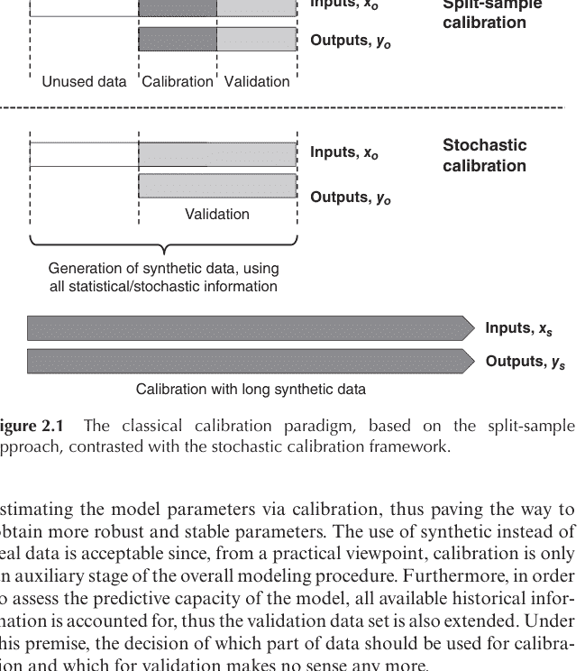

图 2.1 基于分裂样本法的经典校准范式与随机校准框架的对比。

通过校准估计模型参数，从而为获得更稳健、稳定的参数铺平道路。使用合成数据而非真实数据是可以接受的，因为从实际角度来看，校准只是整个建模过程中的一个辅助阶段。此外，为了评估模型的预测能力，所有可用的历史信息都被纳入考虑，因此验证数据集也得到了扩展。在这种前提下，决定哪部分数据用于校准、哪部分用于验证已不再有意义。

使用随机生成的数据代替历史样本，还能解决水文信息代表性的主要问题——模型参数正是从这些信息中推断出来的。历史样本包含的系统输入（降雨）、输出（径流）和状态（蓄水条件）组合相对较少，且显然缺少长期水文气候波动和罕见事件。人们认识到，观测数据仅部分反映了输入和输出过程的实际统计与随机行为，而测量和处理误差又会带来更多的不确定性。在这方面，基于良好随机模型精心设计的合成程序可以改进从现有数据中获取的信息，至少朝向三个关键方向：

1. 提供输入 x 与输出 y 之间更广泛的相依模式；
2. 表征在较短历史样本中很少出现的水文气象极端事件（Singh & Bárdossy, 2012）；以及
3. 描述长期水文气候波动，例如持续的湿润/干旱期，这些波动也可能由气候变化引起。

第 2.3 节简要讨论了我们的随机校准框架中合成数据生成方法的具体要求。

### 2.3. 随机模拟程序的见解

用合成数据替代较短历史记录的想法在水文设计、规划、管理和预报等广泛应用中非常流行，这些应用涉及使用由随机模型提供的合成输入来驱动的确定性模型（例如 Koutsoyiannis & Economou, 2003）。确定性与随机模型的耦合，可以在足够大样本（例如长度为数百年或数千年）的模拟基础上，评估可靠性、恢复力和风险等概率量，以及产量、成本、效益和亏缺等长期性能指标的期望值。另一方面，使用合成数据评估水文模型的长期行为则较少见（例如 Nalbantis et al., 2011; Efstratiadis et al., 2015）。

上述所有方法（属于更广泛的蒙特卡洛模拟家族）的基石是时间序列生成模型，它必须确保对实际过程 x 和 y 的概率与随机结构进行简洁表示。长期以来，这一先决条件被确定为通过低阶矩（通常是均值、方差、偏度）和低阶自相关与互相关（Matalas & Wallis, 1976），在合成数据中保留历史数据的一系列有限统计特征。然而，在随机校准的背景下，这种方法是不够的，因为这些指标仅部分描述了实际过程 x 和 y 的边际特性和相依结构，而且在某些相当常见的条件下，合成数据中可能会出现不真实的相依模式（Tsoukalas et al., 2018b）。

在这方面，我们对数据合成程序提出以下要求，以便在一个一致且稳健的随机校准框架内实施。

1. 通过仔细指定合适的分布，来表示输入和输出过程的完整概率行为。

### 2.4. 概念验证

#### 2.4.1. 数据与模型描述

为了验证我们的框架，我们应用一个集总式概念模型来模拟希腊西部埃维诺斯坝上游的月径流，该径流是雅典供水系统的关键组成部分（Koutsoyiannis et al., 2003）。流域面积为 351.9 km²，可用的水文数据（降水、潜在蒸散发、径流）跨越 50 个水文年（1970 年 10 月至 2020 年 9 月）。表 2.1 汇总了历史降雨和径流数据的关键统计信息（均值、标准差、偏度、自相关和互相关），这些信息将在用于随机校准的合成时间序列中重现。后者通过 anySim 软件包（Tsoukalas et al., 2020）生成，时间跨度为 2000 年。该合成方案确保了生成比观测数据中出现的相依模式（图 2.2）和长期波动（图 2.3）更为广泛的模式。这些模式有望代表流域完整的水文气候状况，而由于观测数据所含信息有限，这种状况可能是隐藏的。事实上，在分裂样本校准方法中，这些信息中只有一半被纳入考虑。

图 2.4 展示了模型及其控制方程的概要。该模型采用典型的桶式结构，由三个相互连接的水箱组成，其输入为月降水量 P 和潜在蒸散发 PET。上层水箱具有无限容量，代表地表的主要水文过程，即直接（地表）径流 Q_D（被视为降水的一部分 κ）和直接蒸散发 ET_D，后者由暂时储存在地面和植被中的多余水分提供。剩余水分入渗到蓄水容量为 S_max 的中间水箱，该水箱在非饱和带进行土壤含水量核算。该过程产生三个通量，即通过土壤的蒸散发损失 ET_S（受蓄水比 S/S_max 和蒸散发亏缺 PET − ET_D 控制）、向地下水水箱的渗漏 W（受退水参数 λ 控制）以及饱和径流 Q_S（表示为从水箱溢出的多余水分）。最后，下层水箱具有无限容量，并在地下水区进行调蓄。具体而言，它接收渗漏量，并通过另一个退水参数 μ 产生基流 Q_B。因此，到达流域出口的径流是三个组成部分之和，即 Q = Q_D + Q_S + Q_B。

表 2.1 希腊埃维诺斯站点观测降雨和径流数据的主要汇总统计特征及其在月尺度和年尺度上的滞后 0 互相关系数。

| 统计量 | 10月 | 11月 | 12月 | 1月 | 2月 | 3月 | 4月 | 5月 | 6月 | 7月 | 8月 | 9月 | 年 |
| --- | --- | --- | --- | --- | --- | --- | --- | --- | --- | --- | --- | --- | --- |
| 降雨量（mm） |  |  |  |  |  |  |  |  |  |  |  |  |  |
| 均值 | 98.5 | 195.5 | 190.5 | 155.9 | 153.0 | 114.8 | 88.4 | 57.7 | 37.2 | 24.6 | 26.7 | 58.1 | 1196.6 |
| 标准差 | 66.0 | 98.3 | 116.2 | 108.3 | 94.4 | 68.6 | 56.7 | 35.4 | 24.8 | 28.7 | 23.9 | 50.7 | 270.5 |
| 偏度 | 0.683 | 0.211 | 0.813 | 0.953 | 0.749 | 0.731 | 1.361 | 0.483 | 0.530 | 2.244 | 1.130 | 1.444 | 0.003 |
| 滞后1自相关 | 0.228 | 0.011 | 0.158 | 0.189 | 0.156 | 0.432 | 0.021 | 0.177 | 0.321 | 0.129 | 0.414 | 0.203 | 0.083 |
| 径流量（mm） |  |  |  |  |  |  |  |  |  |  |  |  |  |
| 均值 | 23.6 | 72.0 | 133.1 | 125.6 | 130.8 | 124.8 | 91.1 | 50.5 | 21.6 | 13.1 | 9.4 | 10.8 | 803.0 |
| 标准差 | 18.2 | 49.8 | 93.3 | 79.6 | 69.2 | 66.4 | 34.0 | 20.5 | 7.5 | 4.4 | 4.7 | 8.8 | 224.0 |
| 偏度 | 1.296 | 1.081 | 1.415 | 0.838 | 0.281 | 1.050 | 0.439 | 0.324 | 0.857 | 0.842 | 2.738 | 3.948 | -0.249 |
| 滞后1自相关 | 0.237 | 0.170 | 0.275 | 0.026 | 0.575 | 0.504 | 0.268 | 0.490 | 0.527 | 0.527 | 0.479 | 0.053 | 0.192 |
| 滞后0互相关 | 0.650 | 0.740 | 0.870 | 0.818 | 0.684 | 0.729 | 0.486 | 0.370 | 0.272 | 0.267 | 0.270 | 0.670 | 0.708 |

注：统计特征 = 均值、标准差、偏度系数、滞后 1 自相关系数；降雨量和径流量数据均以 mm 为单位。


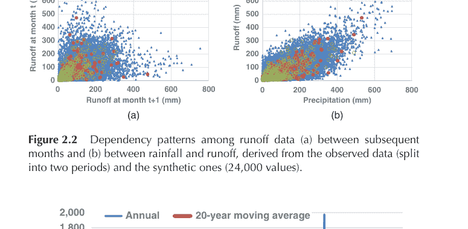

图 2.2 来自观测数据（分为两个时期）和合成数据（24,000 个值）得出的径流数据依赖模式（a）相邻月份之间和（b）降雨与径流之间。

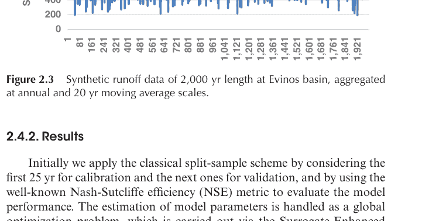

图 2.3 Evinos 流域长 2,000 年的合成径流数据，按年和 20 年移动平均尺度汇总。

#### 2.4.2. 结果

最初我们采用经典的分割样本方案，将前 25 年用于校准，后续年份用于验证，并使用众所周知的纳什-苏特克利夫效率（NSE）指标来评估模型性能。模型参数的估计被处理为一个全局优化问题，通过代理增强进化退火单纯形（SEEAS）算法（Tsoukalas et al.,

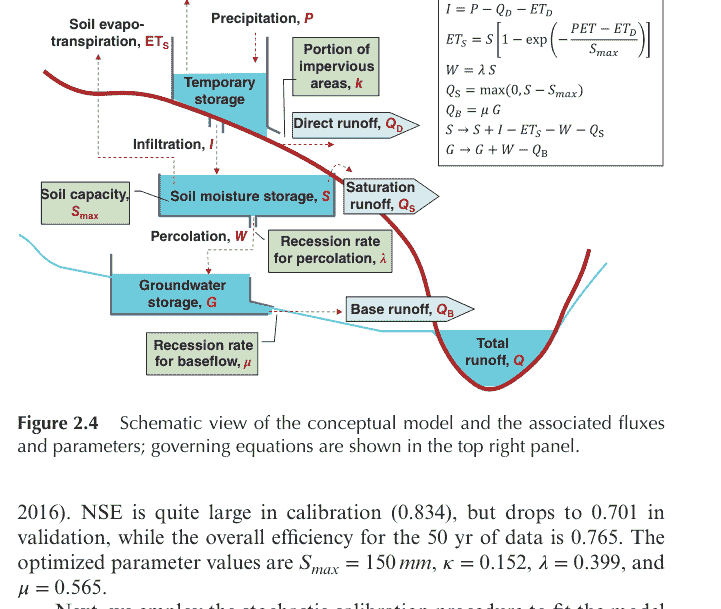

图 2.4 概念模型及其相关通量和参数的示意图；控制方程显示在右上角面板。

```
Q_D = κ P
ET_D = min(PET, P - Q_D)
I = P - Q_D - ET_D
ET_S = S [1 - exp(- (PET - ET_D)/S_max)]
W = λ S
Q_S = max(0, S - S_max)
Q_B = μ G
S → S + I + ET_S - W - Q_S
G → G + W - Q_B
```

2016）。校准中的 NSE 较大（0.834），但在验证中降至 0.701，而 50 年数据的整体效率为 0.765。优化后的参数值为 S_max = 150 mm，κ = 0.152，λ = 0.399，且 μ = 0.565。

接下来，我们采用随机校准程序基于长 2,000 年的合成序列拟合模型，同时使用 SEEAS，然后使用观测值的完整样本进行验证。合成数据的生成针对降雨和径流进行，使用最近推出的 anySim 包（Tsoukalas et al., 2020），其符合第 2.3 节中讨论的规范。关于 PET 输入，我们简单地采用历史样本的月平均值。我们指出，在搜索过程中使用基于代理的方法，由于长合成数据导致计算成本高昂的水文模型，极大地促进了在合理时间内得出良好解。相对于针对历史数据一半进行校准得出的参数，针对合成降雨-径流数据的优化参数值差异很大，即 S_max = 112 mm，κ = 0.220，λ = 0.533，且 μ = 0.511。在此前提下，模型在完整历史数据上的表现略有改善，因为 NSE 值为 0.775。

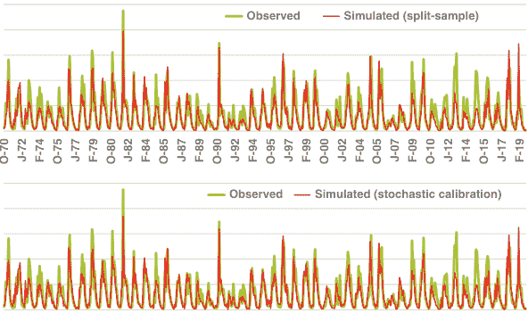

**图 2.5** 使用两种校准方法进行模型拟合（即模拟与观测径流数据）的比较。

尽管仅通过对比模拟数据与观测值（图 2.5）时，两种校准程序的差异并不完全可检测，但随机方法实际上确保了模型在不同水文气候时期下的更稳定性能。如图 2.6 所示，通过将观测数据划分为 10 个长度为 5 年的较小样本，NSE 在子时段间的变异性在使用经典方法得出的参数时明显更大，这表明从随机数据推断出的参数更稳健。这一结果是合理的，因为模型是针对一系列统计上一致的水文气候条件进行拟合的，这些条件捕捉了模型输入和输出（即降雨和径流）之间的所有潜在依赖模式，并且由于赫斯特-科尔莫戈罗夫动力学，它们还包括持续的湿润和干旱年份的集群。

#### 2.4.3. 参数不确定性分析

为了进一步突出随机校准框架的优势，我们通过两种替代方法探索参数不确定性，分别利用历史和合成时间序列。首先，我们采用由 Beven 和 Binley（1992）提出的广义似然不确定性估计（GLUE）方法，并且仍然是

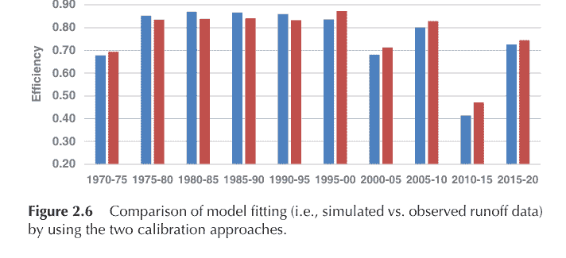

图 2.6 使用两种校准方法进行模型拟合（即模拟与观测径流数据）的比较。

水文领域最受欢迎的不确定性量化方法之一。在我们的案例中，我们通过从 10,000 个均匀分布的参数集合中采样来应用 GLUE 方法，然后将 NSE 阈值设为 0.75 以识别行为与非行为解。最后，我们使用行为子集提取其（后验）经验分布，通过直方图表示（图 2.7a–d）。

第二个分析考虑合成数据集，该数据集被划分为 80 个子集，每个长度为 25 年（即等于数据大小

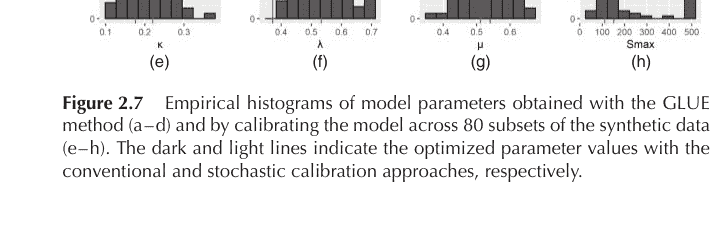

图 2.7 使用 GLUE 方法获得的模型参数经验直方图（a–d）以及在合成数据的 80 个子集上校准模型获得的直方图（e–h）。深色和浅色线分别表示使用常规和随机校准方法优化的参数值。

（常规校准）。接下来，我们针对每个子集校准模型，从而在合成数据的时窗内获得 80 个优化参数集的样本。如 GLUE 方法所做的那样，该样本用于获得四个模型参数的经验分布（图 2.7e–h）。

虽然两种不确定性分析方法的分布图差异很大，但它们都清楚地捕捉到了通过随机校准方法得出的参数值（浅色垂直线）。相比之下，参数 λ（即渗漏的衰减率）的常规最优值（深色垂直线）远离不确定性界限的核心，从而使整个校准是否稳健变得值得怀疑。另一个有趣的观察是，第二种方法（即采用合成数据和子时期校准概念的方法）得出的不确定性界限比 GLUE 方法获得的更窄、更尖锐，从而表明对模型参数不确定性的估计更精确。我们认为，这种行为无疑是未来研究的 promising 课题，可能归因于使用优化算法（而非随机采样）与由合成数据驱动的子时期校准概念的 combined effect。

### 2.5. 结论性说明

针对短期记录进行校准的水文模型可能无法在长期内再现预期的流域行为，而额外的缺点源于为保留验证空间而必须牺牲历史数据。为解决这一问题，我们强调了一种有前景的策略，旨在基于合成降雨-径流数据推断模型参数，并针对观测值的完整历史样本进行验证。所谓的随机校准方案由合成时间序列生成程序驱动，该程序在 R 包 anySim 中实现，利用可用数据表示降雨-径流过程在多个尺度上的概率特性和依赖结构，以及变化气候的长期波动。随机模型的关键要求是对季节和尺度之间的交叉依赖关系的忠实再现，这决定了降雨与径流之间的因果关系，以及对感兴趣过程拟合合适的分布函数，以便再现历史数据中不可能包含的极端条件。从这一观点来看，所提出的方法
实际上允许从短期内提取更多信息。

随机校准相对于传统分割样本方法的优势通过概念验证得以证明，该验证涉及对具有四个参数的集中概念模型的校准。有趣的是，尽管两种方法在效率方面的差异实际上并不那么明显，但优化后的参数值却如此。因此，预计两种模型版本在历史数据中未发现的输入和状态组合下会产生相当不同的响应。鉴于随机校准的模型是在许多扩展的水文气候条件下训练的，预计它能确保更强的可识别性。这也由该版本在不同时间窗口内表现出更稳定的预测能力所表明。另一方面，由于校准数据长度大幅增加而导致的计算工作量明显增加，可以通过全局优化的最新进展来解决，其中机器学习和代理建模技术被嵌入到稳健的进化算法中（例如 Tsoukalas et al., 2016）。

针对大量流域对所提方法的初步分析，并采用不同复杂程度的模型，在月度和日尺度上，均已提供了有关随机校准范式普适性的令人鼓舞的结果（Kourakos et al., 2021）。未来的工作将集中于不确定性方面，旨在提供基于随机生成数据的模型校准和不确定性量化的整体框架。

## 致谢

作者感谢编辑 Dimitri Solomatine 的热情邀请和鼓励性评论，以及两位审稿人 Shervan Gharari 和一位匿名审稿人，他们富有成效的意见和建议帮助改进了我们的章节。

## 参考文献

Andréassian, V., Le Moine, N., Perrin, C., Ramos, M. H., Oudín, L., Mathevet, T., et al. (2012). 金光闪闪未必是金子：水文模型校准的案例。 *Hydrological Processes, 26*, 2206–2210. https://doi.org/10.1002/hyp.9264

Andréassian, V., Perrin, C., Berthet, L., Le Moine, N., Lerat, J., Loumagne, C., et al. (2009). 水文模型标准化评估的碰撞测试。


*水文学与地球系统科学，13*，1757–1764。https://doi.org/10.5194/hess-13-1757-2009

Arseneault, R., Brissette, F., & Martel, J.-L. (2018). *水文模型校准中分裂样本验证的危害性*。*水文学杂志，566*，346–362。https://doi.org/10.1016/j.jhydrol.2018.09.027

Bennett, N. D., Crooks, B. F. W., Guariso, G., Guillaume, J. H. A., Hamilton, S. H., Jakeman, A. J., 等. (2013). *环境模型性能的表征*。*环境建模与软件，40*，1–20。https://doi.org/10.1016/j.envsoft.2012.09.011。

Beven, K. J., & Binley, A. M. (1992). *分布式模型的未来：模型校准与不确定性预测*。*水文过程，6*，279–298。https://doi.org/10.1002/hyp.3360060305

Blöschl, G., & Montanari, A. (2010). *气候变化影响：掷骰子？* *水文过程，24*，374–381。https://doi.org/10.1002/hyp.7574

Brigode, P., Oudin, L., & Perrin, C. (2013). *水文模型参数不稳定性：估算气候变化水文影响时额外不确定性的来源？* *水文学杂志，476*，410–425。https://doi.org/10.1016/j.jhydrol.2012.11.012

Broderick, C., Matthews, T., Wilby, R. L., Bastola, S., & Murphy, C. (2016). *水文模型和集合平均方法在对比气候时段间的可转移性*。*水资源研究，52*，8343–8373。https://doi.org/10.1002/2016WC028850

Coron, L., Andréassian, V., Perrin, C., Bourqui, M., & Hendrickx, F. (2014). *关于水文模型在水均衡模拟方面缺乏稳健性：针对20个山区流域三种复杂度递增模型的诊断方法*。*水文学与地球系统科学，18*(2)，727–746。https://doi.org/10.5194/hess-18-727-2014

Coron, L., Andréassian, V., Perrin, C., Lerat, J., Vaze, J., Bourqui, M., 等. (2012). *在对比气候条件下对水文模型进行碰撞测试：216个澳大利亚流域的实验*。*水资源研究，48*，W05552。https://doi.org/10.1029/2011WR012721

Dakhlaoui, H., Ruelland, D., & Tramblay, Y. (2019). *基于自举的差分分裂样本检验，用于评估概念性降雨径流模型在过去和未来气候变率下的可转移性*。*水文学杂志，575*，470–486。https://doi.org/10.1016/j.jhydrol.2019.05.056

Dakhlaoui, H., Ruelland, D., Tramblay, Y., & Bargaoui, Z. (2017). *评估突尼斯北部气候变率下概念性降雨径流模型的稳健性*。*水文学杂志，550*，201–217。https://doi.org/10.1016/j.jhydrol.2017.04.032。

Duethmann, D., Blöschl, G., & Parajka, J. (2020). *为什么概念性水文模型无法正确预测气候变化引起的流量变化？* *水文学与地球系统科学，24*，3493–3511。https://doi.org/10.5194/hess-24-3493-2020

Efstratiadis, A. (2011). *受随机模拟范式启发的新模型评估见解*。2011年EGU大会。*地球物理研究摘要，第13卷，维也纳，1852*，欧洲地球科学联盟。http://www.itia-ntua.gr/11/6/

Efstratiadis, A., & Koutsoyiannis, D. (2010). *水文建模中多目标校准方法的十年：综述*。*水文科学杂志，55*(1)，58–78。https://doi.org/10.1080/02626660903526292

Efstratiadis, A., Dialynas, Y., Kotsikas, L., & Koutsoyiannis, D. (2014). *一种多变量随机模型，用于在多个时间尺度生成合成时间序列并再现长期持续性*。*环境建模与软件，62*，139–152。https://doi.org/10.1016/j.envsoft.2014.08.017

Efstratiadis, A., Nalbantis, I., & Koutsoyiannis, D. (2015). *时变流域的水文建模：变化的各个方面与信息的价值*。*水文科学杂志，60*(7–8)，1438–1461。https://doi.org/10.1080/02626667.2014.982123

Finger, D., Vis, M., Huss, M., & Seibert, J. (2015). *多数据集校准相对于模型复杂性在提高山区流域水文模型性能中的价值*。*水资源研究，51*，1939–1958。https://doi.org/10.1002/2014wc025712

Fowler, K., Coxon, G., Freer, J., Peel, M., Wagener, T., Western, A., 等. (2018). *在变化气候条件下模拟径流：模型改进框架*。*水资源研究，54*，9812–9832。https://doi.org/10.1029/2018WR023989

Fowler, K. J. A., Peel, M. C., Western, A. W., Zhang, L., & Peterson, T. J. (2016). *在变化气候条件下模拟径流：再议概念性降雨径流模型的一个明显不足*。*水资源研究，52*，1820–1846。https://doi.org/10.1002/2015WC028068

Gharari, S., Gupta, H. V., Clark, M. P., Hrachowitz, M., Fenicia, F., Matgen, P., 等. (2021). *理解模型开发决策层级中的信息内容：从数据中学习*。*水资源研究，57*(6)，e2020WR027948。https://doi.org/10.1029/2020WR027948

Gharari, S., Hrachowitz, M., Fenicia, F., & Savénije, H. H. G. (2013). *一种识别时间一致模型参数的方法：子周期校准*。*水文学与地球系统科学，17*，149–161。https://doi.org/10.5194/hess-17-149-2013

Gowda, P. H., Mulla, D. J., Desmond, E. D., Ward, A. D., & Moriasi, D. N. (2012). *ADAPT：模型使用、校准与验证*。*美国农业与生物工程学会汇刊，55*，1345。https://doi.org/10.13031/2013.42246

Gupta, V. K., & Sorooshian, S. (1985). *数据与水文模型参数估计精度之间的关系*。*水文学杂志，81*(1–2)，57–77。https://doi.org/10.1016/0022-1694(85)90167-2

Jaafar, A. B., & Bargaoui, Z. (2020). *使用降雨径流信息增益对广义分裂样本检验的解释*。*水文工程杂志，25*(1)，04019057。https://doi.org/10.1061/(ASCE)HE.1943-5584.0001868

Juston, J., Seibert, J., & Johansson, P. O. (2009). *北方小流域概念水文模型校准的时间采样策略与不确定性*。*水文过程，23*，3093–3109。https://doi.org/10.1002/hyp.7421

Klemeš, V. (1986). *水文模拟模型的操作测试*。水文科学杂志，31(1)，13–24。https://doi.org/10.1080/02626668609491024

Kling, H., Stanzel, P., & Preishuber, M. (2014). *水资源开发与气候情景对赞比西河流量的影响建模*。*水文学杂志：区域研究，1*，17–43。https://doi.org/10.1016/j.ejrh.2014.05.002

Kossieris, P., Tsoukalas, I., Makropoulos, C., & Savic, D. (2019). *模拟任意精细时间尺度下用水过程的边缘与依赖行为*。*水，11*(5)，885。https://doi.org/10.3390/w11050885

Kourakos, V., Efstratiadis, A., & Tsoukalas, I. (2021). *水文模型的识别性能否得到改善？对随机校准概念的压力测试*。2021年EGU大会，在线，EGU21-11704。https://doi.org/10.5194/egusphere-egu21-11704。欧洲地球科学联盟。

Koutsoyiannis, D. (2013). *水文学与变化*。*水文科学杂志，58*(6)，1177–1197。https://doi.org/10.1080/02626667.2013.804626

Koutsoyiannis, D. (2020). *时间不可逆与可逆过程的简单随机模拟*。*水文科学杂志，65*(4)，536–551。https://doi.org/10.1080/02626667.2019.1705302

Koutsoyiannis, D., & Economou, A. (2003). *水库系统控制的参数化-模拟-优化方法评估*。*水资源研究，39*(6)，1170。https://doi.org/10.1029/2003WR002148

Koutsoyiannis, D., Karavokiros, G., Efstratiadis, A., Mamassis, N., Koukouvinos, A., & Christofides, A. (2003). *雅典水资源系统管理的决策支持系统*。*地球物理与化学，28*(14–15)，599–609。https://doi.org/10.1016/S1474-7065(03)00106-2

Matalas, N. C., & Wallis, J. R. (1976). *合成流量序列的生成*。载于 A. K. Biswas（编），*水资源管理的系统方法*。纽约：麦格劳-希尔。

Merz, R., Parajka, J., & Blöschl, G. (2013). *流域模型参数的时间稳定性：对气候影响分析的意义*。*水资源研究，47*(2)，W02531。https://doi.org/10.1029/2012WR009505

Mohammed, S. A., Solomatine, D. P., Hrachowitz, M., & Hamouda, M. A. (2021). *数据集大小对基于水文模型特征校准的影响*。*水，13*(7)，970。https://doi.org/10.3390/w13070970

Myers, D. T., Ficklin, D. L., Robeson, S. M., Neupane, R. P., Botero-Acosta, A., & Avellaneda, P. M. (2021). *为水文模型选择任意校准期：对水均衡模拟的影响有多大？* *水文过程，35*(2)，e14045。https://doi.org/10.1002/hyp.14045

Nalbantis, I., Efstratiadis, A., Rozos, E., Kopsiafti, M., & Koutsoyiannis, D. (2011). *人为改造水文系统的整体式与单体式水文建模策略*。*水文学与地球系统科学，15*，743–758。https://doi.org/10.5194/hess-15-743-2011

Nicolle, P., Andréassian, V., Royer-Gaspard, P., Perrin, C., Thirel, G., Coron, L., 等. (2021). *技术注释：RAT——用于校准和未校准水文模型的稳健性评估检验*。*水文学与地球系统科学，25*，5013–5027。https://doi.org/10.5194/hess-25-5013-2021


- Perrin, C., Andréassian, V., Mathevet, T., & Le Moine, N. (2008). 水文模型的离散参数化：评估参数集库在超过900个流域上的使用. *Water Resources Research, 44*, W08447. https://doi.org/10.1029/2007WR006579

- Perrin, C., Oudin, L., Andréassian, V., Rojas-Serna, C., Michel, C., & Mathevet, T. (2007). 有限径流资料对降雨径流模型效率和参数的影响. *Hydrological Sciences Journal, 52*, 131–151. https://doi.org/10.1623/hysj.52.1.131

- Razavi, S., & Tolson, B. A. (2013). 面向长时段数据的水文模型校准高效框架. *Water Resources Research, 49*, 8418–8431. https://doi.org/10.1002/2012WR0123442

- Seibert, J. (2003). 模型预测在校准条件之外的可靠性. *Hydrology Research, 34*(5), 477–492. https://doi.org/10.2166/nh.2003.0019

- Seibert, J., & McDonnell, J. J. (2002). 流域水文学中实验者与建模者之间的对话：利用软数据进行多准则模型校准. *Water Resources Research, 38*(11), 23-1–23-14. https://doi.org/10.1029/2001WR000978

- Singh, S. L., & Bárdossy, A. (2012). 基于水文异常事件的水文模型校准. *Advances in Water Resources, 38*, 81–91. https://doi.org/10.1016/j.advwatres.2011.12.006

- Stephens, C. M., Marshall, L. A., Johnson, F. M., Lin, L., Band, L. E., & Ajami, H. (2020). 过去的变率能否作为未来变化的合适代用指标？一项虚拟流域试验. *Water Resources Research, 56*, e2019WR026275. https://doi.org/10.1029/2019WR026275

- Thirel, G., Andréassian, V., & Perrin, C. (2015a). 论在变化条件下检验水文模型的必要性. *Hydrological Sciences Journal, 60*(7–8), 1165–1173. https://doi.org/10.1080/02626667.2015.1050027

- Thirel, G., Andréassian, V., Perrin, C., Audouy, J.-N., Berthet, L., Edwards, P., et al. (2015b). 变化中的水文：研究水文模型如何应对变化流域的评估方案. *Hydrological Sciences Journal, 60*(7–8), 1184–1199. https://doi.org/10.1080/02626667.2014.967248

- Tsoukalas, I., Efstratiadis, A., & Makropoulos, C. (2018a). 从随机周期自回归到任意分布（SPARTA）：具有任意边缘分布的循环平稳过程的建模与模拟. *Water Resources Research, 54*(1), 161–185, WRCR23047. https://doi.org/10.1002/2017WR021394

- Tsoukalas, I., Efstratiadis, A., & Makropoulos, C. (2019). 构建拼图以解谜：一种适用于任意边缘分布和相关结构的多变量随机过程的多尺度分解方法. *Journal of Hydrology, 575*, 354–380. https://doi.org/10.1016/j.jhydrol.2019.05.017

- Tsoukalas, I., Kossieris, P., & Makropoulos, C. (2020). 非高斯相关随机变量、随机过程和随机场的模拟：介绍面向环境应用及其他领域的anySim R软件包. *Water, 12*(6), 1645. https://doi.org/10.3390/w12061645

- Tsoukalas, I., Kossieris, P., Efstratiadis, A., & Makropoulos, C. (2016). 预算有限条件下水资源问题有效且高效优化的代理增强型进化退火单纯形算法. *Environmental

## 复杂分布式水文模型的两阶段代理模型参数校准框架

Haiting Gu、Yue-Ping Xu、Li Liu、Di Ma、Suli Pan、Jingkai Xie

浙江大学水文与水资源研究所，杭州，中国

分布式水文模型因其功能多样性和理论上的合理性而被广泛使用。然而，分布式模型的校准计算成本很高，因为即使采用高效的多目标优化算法，也需要大量模型运行。为减轻计算负担，我们开发了一种两阶段代理模型校准框架，将标准反向传播神经网络与AdaBoost相结合（ADBP），以高效校准一个大型复杂分布式水文模型——可变下渗能力（VIC）模型的参数。第一阶段模型（SM-I）筛选出模拟输出处于关键范围的参数集，第二阶段模型（SM-II）利用SM-I筛选出的参数集精确估计输出值。所提出的代理模型在兰江流域和湘江流域进行了参数校准测试。在使用相似的VIC校准参数集的情况下，与原始VIC模型相比，代理模型在面积大、物理条件复杂的流域中获得了高达20倍的加速。

### 3.1. 引言

分布式水文模型最早由Freeze和Harlan（1969）在流域尺度上得到应用。充分考虑降水与地表状态的空间非均匀性对水文过程影响的模型，在理论上可能优于集总式模型，尽管在实际应用中集总式模型可能表现更好（Carpenter & Georgakakos, 2006; Liu et al., 2018）。如今，随着计算机技术、地理信息系统（GIS）、数字高程模型（DEM）和遥感（RS）的快速发展，不同配置的分布式水文模型已被开发并广泛应用于实践（Abbaspour et al., 2015; Kovalets et al., 2015; Marek et al., 2016; Patil & Ramsankaran, 2017; Sun et al., 2016; Xu et al., 2015; Zhang et al., 2017; Zhao et al., 2009）。它们甚至可以与大数据技术相结合（Guo et al., 2017; Zhang et al., 2016a,b），例如MapReduce框架和Hadoop分布式文件系统。

本研究所使用的可变下渗能力大尺度水文模型（VIC）是一种大尺度模型，超过临界尺度的区域通常取为约10 km × 10 km，且模拟径流在大型流域上与观测资料吻合良好（Maurer et al., 2002）。大量研究成功应用了VIC模型，并在集合径流预报中取得了良好表现（Liu et al., 2017; Mo & Lettenmaier, 2014; Schumann et al., 2013）。它也被用于研究非平稳条件下的水文过程（Chawla & Mujumdar, 2018; Leng et al., 2015）。分布式模型广泛用于水资源评价、水文预报和泥沙输移模拟（Pérez et al., 2017; Xu et al., 2015）。然而，这类模型也有一个局限性：需要在每个网格单元上用数值计算方法求解偏微分方程，因此会耗费大量计算资源和时间。尤其是当分布式模型的参数（Razavi et al., 2012）需要校准时，往往需要数万次模拟。

加速参数校准的一种方法是采用高效的自动校准方法。水文模型的多目标校准策略能够减小模型的异参同效性和参数不确定性，并获得有价值的参数集（Tuo et al., 2018）。

近年来，许多用于水文模型校准的多目标优化算法（MOA）已被开发并应用于水文模型参数校准（Gupta et al., 2009），例如多目标复形进化算法（MOCOM-UA）（Yapo et al., 1998）、强度帕累托进化算法II（SPEA2）（Zitzler et al., 2001）、非支配排序遗传算法II（NSGA-II）（Deb et al., 2002）等。大量研究（De Vos & Rientjes, 2007; Gharari et al., 2013; Guo et al., 2014; Huo et al., 2016; Kollat et al., 2012; Lee et al., 2013; Tang et al., 2005; Yassin et al., 2017）表明，MOA在自动进行水文模型参数校准方面是高效的。

尽管高效的优化算法可以减少复杂模型校准所需的模拟次数，但可能仍需要大量模拟。代理模型（SM）也是提高优化算法效率的重要方法（Maier et al., 2014）。数据驱动模型，如人工神经网络（ANN）（Zhang et al., 2009）、径向基函数（RBF）（Christelis et al., 2016）、支持向量机（SVM）（Asefa et al., 2004; Zhang et al., 2009）和高斯过程回归（GPR或Kriging）（Zhang et al., 2016a,b），通常用于构建物理模型的响应面代理（Razavi et al., 2012）。已有若干研究利用代理模型有效加速优化过程（Behzadian et al., 2009; Gong et al., 2016; Kourakos & Mantoglou, 2009; Yan & Minsker, 2006; Yan & Minsker, 2011; Yazdi et al., 2019）。这类算法被称为*基于元模型的优化器*或*基于代理模型的优化算法*，其中首先选择利用物理模型生成的数据构建代理模型的最佳方法（Santana-Quintero et al., 2010），然后开发一种MOA方案，用代理模型替代物理模型（Maier et al., 2014）。然而，上述大多数研究是针对地下水或水资源配置问题的，因为这些应用通常需要更精细的分辨率和侧向联系。在本研究中，我们主要关注一个大型复杂水文模型的径流校准，并考察基于代理模型的优化算法的性能。

在本研究中，我们旨在克服VIC校准过程中的计算限制。为此，我们提出了一种新的建模校准框架。我们使用ANN构建代理模型，因为ANN在空间插值方面通常表现出更高的精度（Chowdhury et al., 2010; Sivaprasad et al., 2010）。为了进一步提高代理模型的精度，我们采取了两种措施。第一种是使用AdaBoost算法（Kearns & Valiant, 1994），该算法能够提高

提高ANN的精度并使其工作更稳定。第二是构建一个两阶段模型，该模型根据接近最优解的参数范围定制代理模型。此外，更高效的多目标优化算法MOA，ε-NSGA II，也被应用于加速参数率定。我们在此为VIC构建的两阶段代理模型旨在加速率定过程以保证其准确性。该方法还提供了一种校准参数的替代思路，应有助于减轻其他大型复杂水文模型的计算负担。

### 3.2. 方法

#### 3.2.1. 水文模型及其率定

VIC 最初由 Liang 等人于 1994 年、1996 年开发。首先，用户为研究区提供网格数据，其中包括气象数据、数字高程数据、土壤数据、土地覆盖数据等。然后，模型基于每个网格单元的完整水量和能量平衡分别模拟水文过程。作为宏观尺度的分布式水文模型，VIC 模型本身不包含汇流模型。因此，采用基于源汇模型的汇流模型（Lohmann et al., 1998; Lohmann et al., 1996）进行径流和基流汇流。对于本应用，使用的是版本 4.2.2.d 的 VIC 模型。

多目标优化算法涉及一个以上的目标函数同时进行优化。多目标优化算法产生一组 Pareto 解，而不是单一的最优解。ε-NSGA II（Kollat & Reed, 2006）被用作多目标优化算法来率定 VIC 的参数，该算法是在 NSGA-II（Deb et al., 2002）的基础上改进的。与 NSGA-II 相比，ε-NSGA II 具有三个新的特征，它们是 ε-支配归档（Laumanns et al., 2002）、自适应种群规模（Harik & Lobo, 1999）和自发终止（Reed et al., 2003）。ε-NSGA II 是一个有效且稳健的优化算法（Fu et al., 2012; Hadka & Reed, 2012; Hurford et al., 2014; Kollat & Reed, 2007; Wang et al., 2014），并且已成功应用于一些先前的研究（Liu et al., 2017; Liu et al., 2019; Pan et al., 2018）。在此，我们并行运行 ε-NSGA II 算法，使用一种高性能且可广泛移植的消息传递接口（MPI）标准实现 MPICH。

Nash-Sutcliffe 效率（NSE）（Nash & Sutcliffe, 1970）和相对偏差（Bias）被用来数学量化观测径流与 VIC 模拟径流之间的性能，其详细公式定义为

$$NSE = 1 - \frac{\sum_{i=1}^{n}(Q_o(i)-Q_s(i))^2}{\sum_{i=1}^{n}(Q_o(i)-\overline{Q_o})^2}\tag{3.1}$$

和

$$Bias = \left|\frac{\sum_{i=1}^{n}(Q_s(i)-Q_o(i))}{\sum_{i=1}^{n}Q_o(i)}\right|,\tag{3.2}$$

其中 $n$ 是日径流序列的长度；$Q_s(i)$ 和 $Q_o(i)$ 分别是第 $i$ 天的观测和模拟径流；$\overline{Q_o}$ 是观测径流的平均值。NSE 值越接近 1，表示观测流与模拟流的差异越小，而 Bias 值则越接近 0 越好。

随着优化迭代次数的增加，目标函数的值在优化目标附近的范围内收敛。我们将目标函数值收敛的范围定义为关键范围，并将关键范围之外的剩余范围定义为平凡范围。

#### 3.2.2. 响应面代理算法

自适应提升（AdaBoost）是一种提升算法（Freund et al., 1996; Kearns & Valiant, 1994）。该算法将若干弱预测器组合成强预测器，以减少由初始样本权重和 ANN 阈值的随机生成带来的偏差和方差（Schapire, 1990）。在我们的研究中，标准反向传播神经网络（BPNN）被用作 AdaBoost 中的弱学习器。AdaBoost 与 BPNN 结合的算法称为 ADBP。关于 ADBP 的详细信息（Fries & Kerkez, 2018; Zhao et al., 2014）描述如下：

- 1. 初始化训练数据和网络。训练数据首先进行归一化。给出 $N$ 组训练数据，其中 $x_i$（$i=1,2,...,N$）为输入参数，$y_i$ 为训练目标。训练样本 $x_i$ 的初始权重设为 $D_1(i)=1/N$。

- 2. 训练弱学习器并计算弱学习器的权重。这里使用 BPNN 作为弱学习器来预测训练数据的输出。对于 $t=1,...,T$，其中 $T$ 为弱学习器的数量，BPNN 预测误差和弱学习器的权重表示如下：

  $e_t(i) = h_t(\mathbf{x}_i) - y_i$

  $a_t = \frac{1}{2\exp(|Err_t|)}, \text{where } Err_t = \sum_{i=1}^{N} D_t(i), \quad (3.3)$

  其中 $e_t(i)$ 为 BPNN 预测误差；$h_t(x_i)$ 为 BPNN 对 $y_i$ 的预测值；$a_t$ 为弱学习器的权重。

- 3. 更新训练样本的权重。如果 $|e_t(i)|>0.1$，则训练样本的权重按公式（3.4）更新，否则 $D_{t+1}(i)=D_t(i)$，

  $D_{t+1}(i) = 1.1 \times D_t(i). \quad (3.4)$

- 4. 输出最终假设。重复上述步骤，获得 $T$ 个弱学习器及其权重。然后对权重进行归一化，并将 $T$ 个弱学习器组合成强学习器，如下所示：

  $w_t = \frac{a_t}{\sum_{j=1}^{T} a_j}$

  $h_{final} = \sum_{i=1}^{T} w_i h_i, \quad (3.5)$

  其中 $h_{final}$ 为 $T$ 个弱学习器的集成预测值；$w_t$ 为第 $t$ 个弱学习器的归一化权重。SM 的输入为 VIC 的可调参数，输出为目标函数。

#### 3.2.3. 模型率定的代理模型

#### 基于SM的参数率定算法的方法论框架

图 3.1 显示了复杂分布式水文模型的模型率定框架。模型率定框架中的主要步骤总结如下。

- 1. 训练 VIC 的初始两阶段代理模型。AdaBoost 和 BPNN 用于构建 SM。初始化 SM 的详细过程在第 3.2.3.2 节中描述。

- 2. 搜索 SM 的 Pareto 解。SM 的优化使用 ε-NSGA II。在优化中，SM-I 寻找输入参数

在算法中，从步骤 2 到步骤 4 的过程为一次迭代，而从步骤 1 到步骤 5 的整个程序称为一次运行。

#### 初始代理模型训练

本研究提出了一种两阶段模型，以减少关键范围内的局部误差，该范围可能产生关键范围内的样本不足。第一个代理模型（SM-I）模拟近似结果，将一组样本分为两类：平凡范围内的样本和关键范围内的样本。第二个代理模型（SM-II）以高保真度模拟结果，以获得更准确的 Pareto 前沿。为了获取关键范围内的更多样本，样本由优化算法生成，该算法可以将参数范围收敛到关键范围，以确保 SM-I 和 SM-II 训练中样本数量充足。

初始 SM 训练的算法如图 3.2 所示，描述如下：

- **Step 1:** 划分关键范围并生成样本。用 VIC 运行 ε-NSGA II *N* 代来预热程序。用预热数据确定关键范围。输入数据 X = [X₁, X₂, …, Xₖ] 被获取，其中 *k* 为 ε-NSGA II *N* 代中的种群规模，X 是一个 *m* × *k* 矩阵，*m* 为率定参数的数量。输出数据 E = [E₁, E₂, …, Eₖ] 被获取，其中 *k* 为预热数据的初始种群规模，E 是一个 *n* × *k* 矩阵，*n* 为目标函数的数量。

- **Step 2:** 训练 SM-I。剔除步骤 1 中获得的样本的重复项后，对 SM-I 进行训练。这里，我们使用留出交叉验证来验证训练结果，其中通常随机抽取 70% 的样本用于模型训练，其余 30% 用于模型测试。在此阶段，SM 用于筛选关键范围内的参数集。正确分类率比模拟精度更重要。因此，我们采用误分类率（*ER*）来显示模型的性能，如下所示：

$$ER = \frac{e_1 + e_2}{N_e} \times 100\%, \qquad (3.6)$$

其中 *e₁* 是被误解释为关键范围内参数集的数量；*e₂* 是被分配到平凡范围的关键范围内参数集的数量；*Nₑ* 是参数集的数量

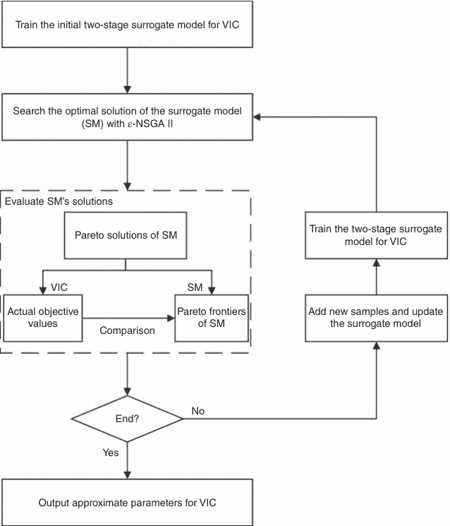

**图 3.2** 初始代理模型训练流程图。

实际上在关键范围内。SM-I 被认为会误分类点，当 SM-I 将关键/平凡范围中的点划分为平凡/关键范围时。

- 第 3 步：训练 SM-II。样本首先从全部样本中筛选出关键范围内的样本。本阶段仍使用留出交叉验证方法。与第 2 步的不同之处在于性能评估。本阶段使用均方根误差 (*RMSE*) 来评估性能。可描述为

$$RMSE=\sqrt{\frac{1}{N}\sum_{i=1}^{N}(S(i)-O(i))^2},\tag{3.7}$$

其中 $S(i)$ 是由 SM 计算的第 $i$ 组参数的 *NSE* 或 *Bias*；$O(i)$ 是由 VIC 计算的第 $i$ 组参数的 *NSE* 或 *Bias*。

如果 SM-I 的 *ER* 值和 SM-II 的 *RMSE* 值均小于用户设定的允许误差，则构建 SM。否则，我们设 $N=N+1$ 并返回第 1 步以获取更多样本来训练 SM-I 和 SM-II，直到 *ER* 和 *RMSE* 值满足要求。

## 代理模型的性能指标

获取 SM 的 Pareto 解，并用 VIC 验证 SM 给出的参数集。两组点之间的中心点距离用于评估 SM 的性能，其中一组为 SM 的 Pareto 前沿，另一组为用 SM 的 Pareto 解在 VIC 中计算得到的目标值点。这里，我们将中心点定义为到所有点距离之和最小的点，表示为

$$\min \sum_i d=\sum_{i}^{n}\lVert x_0-x_i\rVert,\tag{3.8}$$

其中向量 $x_0$ 为中心点的位置，向量 $x_i$ ($i=1, 2, 3, \ldots, n$) 为 $n$ 个 Pareto 最优点的位置；$\lVert\cdot\rVert$ 为向量的范数。如果两个中心点的距离小于指定值，则参数校准完成。否则，SM 将用混合原始样本、上一迭代中使用的样本以及经验证的值的数据进行更新，然后进行下一次迭代。

### 3.3. 研究区与数据

为展示所提代理模型的性能，我们选择了位于中国不同地区的兰江河 (LJR) 流域和湘江河 (XJR) 流域。它们在土地覆盖、主导过程和气象条件方面具有不同特征，用于研究大型复杂水文模型的作用和效率。两流域的位置如图 3.3 所示。

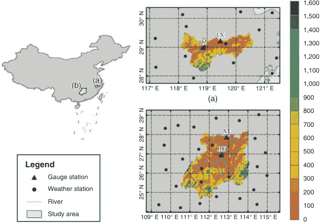

**图 3.3** (a) 兰江河流域和 (b) 湘江河流域的位置。

LJR 位于中国东南沿海、太平洋西岸浙江省钱塘江流域的上游。LJR 流域面积约为 1.8 × 10⁴ km²，由兰溪站控制。流域为湿润地区，年平均降水量约 1,600 mm，年平均气温约 17°C，夏季受海洋气团主导，冬季受大陆气团主导。流域降水集中在春夏之交，高流量出现在 5 月至 7 月的梅雨期。除梅雨外，夏季台风也影响 LJR 流域的水文状况，有时导致灾难性洪水。

XJR 位于中国南方湿润地区，长约 856 km，是长江最大的支流之一。该河流入洞庭湖，即中国中部第二大淡水湖。Xiangtan 站以上流域面积约 8.2 × 10⁴ km²。流域海拔从海平面以上 1 m 到上游山区超过 2,000 m，但湘江流域大部分地区为平原。受副热带高压控制

**表 3.2** VIC 校准参数范围。

| 类型 | 参数 | 描述 | 单位 | 范围 |
|------|-----------|-------------|------|-------|
| 土壤 | b_inf | 可变入渗曲线参数 | – | 0–0.4 |
| 土壤 | Ds_max | 基流最大速度 | mm/day | 0–30 |
| 土壤 | Ds | 非线性基流开始时 Ds_max 的比例 | 比例 | 0–1 |
| 土壤 | Ws | 非线性基流发生时最大土壤湿度比例 | 比例 | 0–1 |
| 土壤 | d2 | 第二层土壤湿度层厚度 | m | 0.1–1.5 |
| 土壤 | d3 | 第三层土壤湿度层厚度 | m | 0.1–1.5 |
| 汇流 | v | 平均流速 | m/s | 0.5–5 |

(Parada et al., 2003; Voisin et al., 2011; Xie et al., 2007)，七个 VIC 参数被选用于校准，其可行范围如表 3.2 所示。一般而言，被选用于校准的参数为第二层和第三层土壤湿度层的厚度 (d2, d3)、非线性基流发生的最大土壤湿度比例 (Ws)、基流最大速度 (Ds_max)、非线性基流开始时 Ds_max 的比例 (Ds) 以及可变入渗曲线参数 (b_inf)。

代理模型和 VIC 参数均通过 ε-NSGA II 并行优化。ε-NSGA II 的初始样本量设为 24。每次运行的最大代数和最大种群数分别指定为 250 和 100,000。为减少 VIC 参数优化的运行时间，当解在 30 代内未改善时程序将被终止。

BPNN 被用作 AdaBoost 中的弱学习器。由于无需训练高精度的弱预测器，根据 Li 和 Liu (2009) 提出的经验公式，如式 (3.9) 所示，选择了三层 BPNN 模型，

$$m = \sqrt{n + l} + a,\tag{3.9}$$

其中 m 为隐层节点数，n 为网络输入层神经元数，l 为输出层神经元数，a 为 0 到 10 之间的数。结构确定为 7-10-1。这些数字表示该 BPNN 模型输入层有 7 个节点，隐层有 10 个节点，输出为 1 个。

这里最大迭代次数和训练率分别设为 100 和 0.01。选择 sigmoid 激活函数来计算每个神经元的输出。Beale et al. (2010) 建议的其他参数弱学习器训练默认值被采用。在本研究中，训练了 10 个弱预测器，然后组装成一个强预测器。为了确保 SM 满足本研究中的精度要求，我们使用留出交叉验证来验证训练结果。在本研究中，当 SM-I 中的 *ER* 值小于 10% 且 SM-II 中的 *RMSE* 值小于关键范围的 5% 时，两阶段代理模型的训练完成。

### 3.5. 结果

#### 3.5.1. 代理模型的基准测试

为表明基于 SM 的算法能够可靠地推断初始使用的参数集，我们选择了 LJR 流域并创建了一组人工基准参数，如表 3.3 所示。人工参数被设为表 3.2 中参数灵活范围的中点。在本例中，LX 和 QZ 的 *NSE* 和 *Bias* 分别可达到 1 和 0，因此 NSE_LX、BIAS_LX、NSE_QZ 和 BIAS_QZ 的关键范围被设为 ≥0.99、≤0.01、≥0.99 和 ≤0.01。ε-NSGA II 中的 50 代种群被用作初始样本。我们将 SM 的最大更新次数设为 15。

图 3.4 分别显示了第五、第十和第十五次迭代中的 Pareto 前沿。在图 3.4 中，最终种群 (FPs) 和最终非支配种群 (FNPs) 分别为优化中最终一代的个体和非支配个体。然后 FPs 和 FNPs 由 VIC 验证，其值也在图 3.4 中显示。第五次迭代中的 FNPs 处于关键范围内。

**表 3.3** 代理模型的基准值和最优解。

| 参数 | d₂ | d₃ | b_inf | Ds | Ds_max | Ws | v |
|---|---:|---:|---:|---:|---:|---:|---:|
| 基准 | 0.75 | 0.75 | 0.2 | 0.5 | 20 | 0.8 | 2.75 |
| 最优解 | 0.7477 | 0.7854 | 0.2029 | 0.4749 | 22.2631 | 0.8457 | 2.6006 |
| 相对误差 (%) | −0.31 | 4.72 | 1.45 | −5.02 | 11.32 | 5.71 | −5.43 |


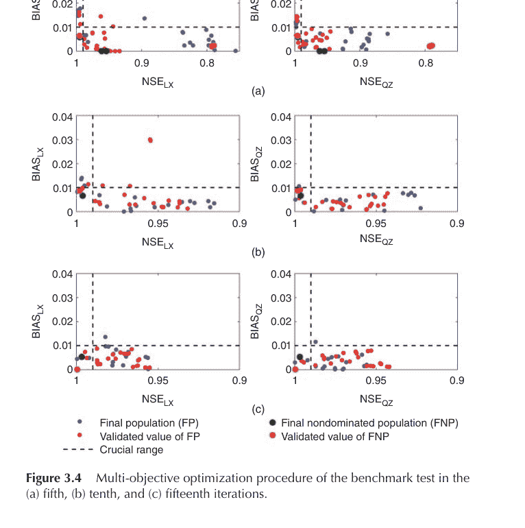

图3.4 基准测试在第（a）五次、（b）十次和（c）十五次迭代中的多目标优化过程。

但是，FNP与其验证值之间存在较大偏差。在第十次和第十五次迭代中，FNP与其验证值之间的偏差减小。如图3.4b和c所示，FNP及其验证值均处于关键范围内，但第十次迭代中FNP的验证值更接近BIAS_LX和BIAS_QZ的分界线。有趣的是，第十五次迭代的偏差略大于第十次迭代。这一现象是由于当模拟目标达到边界时，ANN的边缘误差所致。在实际流域校准模型时通常不会发生这种情况，因为NSE很少达到1，Bias也很少达到0。因此，可以认为图3.4所示的结果是合理且可解释的。

图3.5显示了第十五次迭代中七个校准参数相对于基准值的轨迹图。可以清楚地看到参数收敛于基准值。最终，非支配解非常接近我们设定的基准值。如表3.3所示，SM给出的D2、D3、b_inf、Ds和v的相对误差均小于10%，其中v的相对误差最大，为5.71%。同时，Wsmax的相对误差为11.13%，虽然大于其他参数，但小于最优范围（0到30）的10%。该参数集也在VIC模型中得到了验证，其目标函数NSE_LX、BIAS_LX、NSE_QZ和BIAS_QZ分别为0.9996、0.0001、0.9995和0.0009。

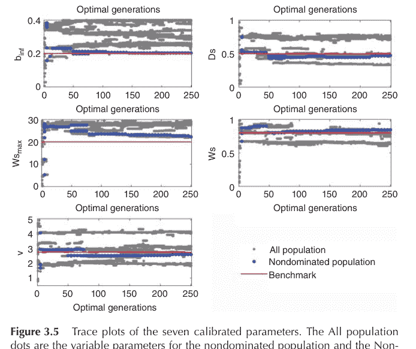

图3.5 七个校准参数的轨迹图。所有种群点（All population dots）是第十五次优化中非支配种群的变量参数，而非支配种群点（Non-dominated population dots）是所有种群的变量参数。基准线是人工设定的基准值。

#### 3.5.2. 代理模型在两个研究区域的帕累托解

为了选择NSE和Bias的关键范围，多目标优化程序运行了20代，然后根据种群的范围选择关键范围。采用ε-NSGA II为四个优化目标选择关键范围。每一代都统计种群的值。在图3.6a中，NSE的范围随着

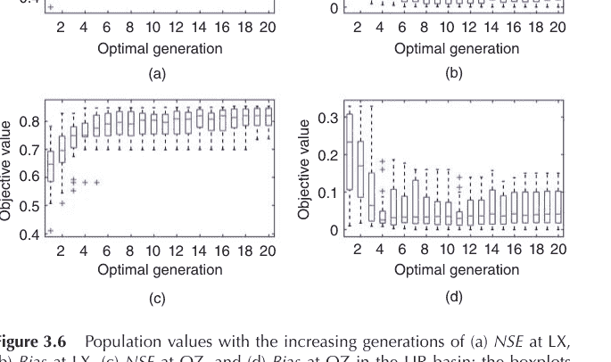

图3.6 LJR流域中（a）LX站的NSE、（b）LX站的Bias、（c）QZ站的NSE和（d）QZ站的Bias随迭代次数增加的种群值；箱线图包含中位数（中间线）、异常值（加号）、25%和75%分位数（箱子的边缘）以及最极端的数据点（须）。

迭代次数的增加而减小。起初，NSE的范围约为0.6到0.8；然后范围逐渐减小，中位数逐渐增加；当迭代次数达到8后，种群的范围稳定在约0.8到0.9的较小范围内。图3.6b–d和图3.7显示了类似的结果。

根据图3.6和图3.7的结果，确定了每个流域各站点目标函数的关键范围。LJR流域和XJR流域的关键范围如表3.4所示。

由于使用了随机算法，多次校准运行得到的校准结果（目标值和参数集）会有所不同。因此，有必要重复使用SM进行独立校准运行。在本研究中，每个研究区域使用SM进行了10次校准运行。SM得到的最优点、相应的验证点以及使用ε-NSGA II估计的LJR流域和XJR流域的帕累托前沿如图3.8

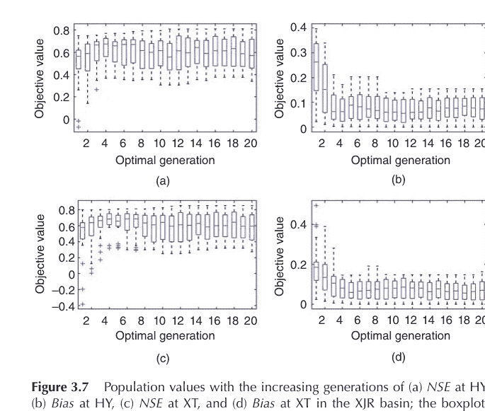

图3.7 XJR流域中（a）HY站的NSE、（b）HY站的Bias、（c）XT站的NSE和（d）XT站的Bias随迭代次数增加的种群值；箱线图包含中位数（中间线）、异常值（加号）、25%和75%分位数（箱子的边缘）以及最极端的数据点（须）。

**表3.4** 各测站*NSE*和*Bias*的关键范围。

| 测站 | 关键范围：*NSE* | 关键范围：*Bias* |
|---|---:|---:|
| 兰溪 | 0.85–1 | 0–0.1 |
| 衢州 | 0.8–1 | 0–0.1 |
| 湘潭 | 0.7–1 | 0–0.15 |
| 衡阳 | 0.7–1 | 0–0.15 |

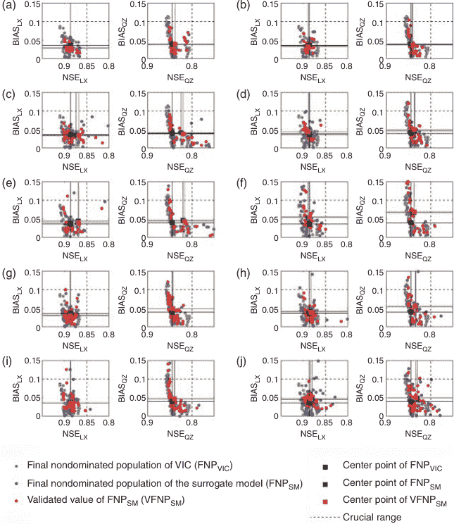

**图3.8** LJR流域10次参数优化（a–j）最后一次迭代中*Bias*与*NSE*的二维帕累托图。

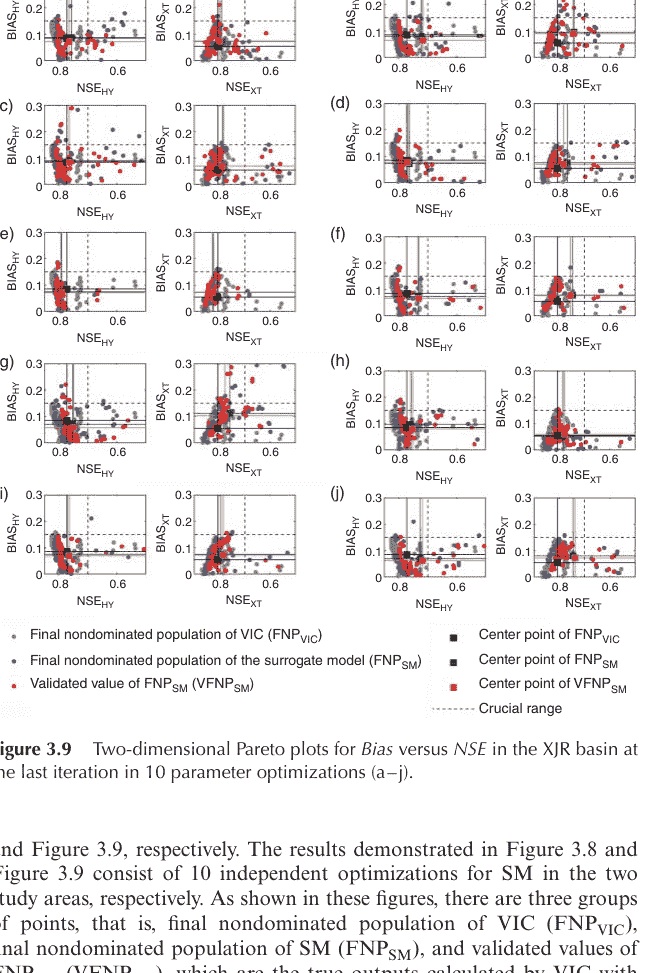

图3.9 XJR流域10次参数优化（a–j）最后一次迭代中Bias与NSE的二维帕累托图。

和图3.9所示。图3.8和图3.9展示的结果分别由两个研究区域中SM的10次独立优化组成。如图所示，有三组点，即VIC的最终非支配种群（FNP_VIC）、SM的最终非支配种群（FNP_SM）以及FNP_SM的验证值（VFNP_SM），后者是由SM给出的参数集通过VIC计算得到的真实输出。FNP_VIC是基线。每个子图中还显示了FNP<sub>VIC</sub>、FNP<sub>SM</sub>和VFNP<sub>SM</sub>的中心点，分别记为CP<sub>VIC</sub>、CP<sub>SM</sub>和CP<sub>VSM</sub>。可以看出，FNP<sub>SM</sub>与VFNP<sub>SM</sub>之间存在误差，但在两个研究区域的每次优化中，CP<sub>SM</sub>和CP<sub>VSM</sub>都很接近。此外，在这些散点图中还比较了CP<sub>SM</sub>和CP<sub>VIC</sub>。由于本研究使用了随机算法，SM的每次优化结果略有不同。从两幅图可以看出，在大多数情况下，CP<sub>SM</sub>非常接近CP<sub>VIC</sub>。在图3.8c和e、图3.9b、f和j中，CP<sub>SM</sub>与CP<sub>VIC</sub>之间的距离相对较大，但在可接受范围内（所有情况下均小于0.1）。

当四个目标函数达到良好权衡时，选择了折衷参数集。两个研究区域中VIC和SM的折衷参数值（归一化）如图3.10所示。图3.10中的黑线是VIC的结果，即

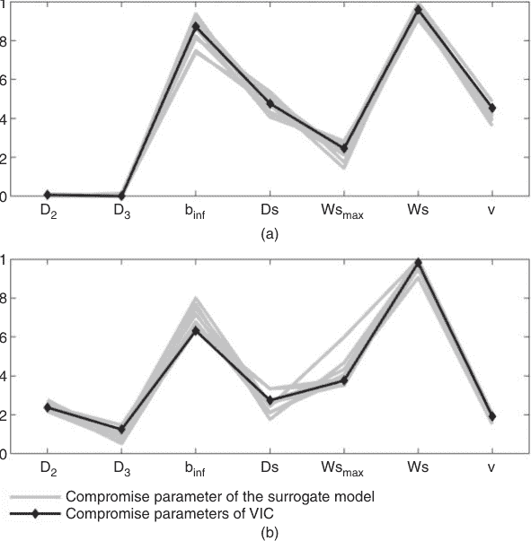

**图3.10** 代理模型和VIC在（a）LJR流域和（b）XJR流域的折衷参数。

这里的基线。灰线是SM的结果。如图3.10所示，SM的10个折衷参数集围绕VIC的参数集分布。使用SM校准得到的最优参数可以非常准确地逼近VIC。在图3.10a和b中，LJR流域的参数集与XJR流域非常相似，因为这两个研究区域受相似的气候条件主导。这两个研究区域中Ws的值较大（Ws是0到1之间的分数），意味着基流既小又稳定（VIC中Ws接近1表明基流生成是线性的且较小）。这一现象与LJR流域和XJR流域的径流以降雨为主的特征相符。

#### 3.5.3. 代理模型在两个研究区域的评估

使用VIC和SM给出的参数集模拟的LJR流域和XJR流域径流的评估指标列于表3.5和3.6中。这里，在计算Bias时，我们移除了绝对值符号，以评估径流是否被高估。使用VIC给出的参数集，LX站在率定期和验证期的NSE值分别为0.8998和0.7744，而Bias值分别为0.0032和−0.1025。SM在LX站10次优化的NSE在率定期和验证期的范围分别为0.8990–0.9040和0.7616–0.7995，而Bias的范围分别为0.0001–0.0560和−0.1659–-0.0965。VIC在率定期和验证期的NSE和Bias均落在LX站SM相应参数的范围之内。类似地，在两个研究区域的所有站点也可以看到相同的结果。

表3.5 LJR流域率定期和验证期使用VIC和SM给出的参数集进行模拟的评估。

| 模型 | 时期 | NSE_LX | BIAS_LX (+/-) | NSE_QZ | BIAS_QZ (+/-) |
|-------|--------|--------|---------------|--------|---------------|
| VIC | 率定期 | 0.8998 | 0.0032 | 0.8465 | 0.0504 |
| VIC | 验证期 | 0.7744 | -0.1025 | 0.7788 | -0.0465 |
| SM | 率定期 | 0.8980–0.9040 | 0.0001–0.0560 | 0.8416–0.8555 | 0.0474–0.0909 |
| SM | 验证期 | 0.7616–0.7995 | -0.1659–-0.0965 | 0.7760–0.7860 | -0.1030–-0.0415 |


## 表3.6 在XJR流域率定和验证期间，由VIC和SM给出的参数集的模拟评估。

| 模型 | 时期 | NSE_HY | BIAS_HY (+/-) | NSE_XT | BIAS_XT (+/-) |
|---|---|---|---|---|---|
| VIC | 率定 | 0.8075 | -0.1059 | 0.8587 | 0.0194 |
| VIC | 验证 | 0.8094 | -0.0542 | 0.8685 | 0.0265 |
| SM | 率定 | 0.8035–0.8156 | -0.1172–-0.0580 | 0.8324–0.8624 | 0.0080–0.0682 |
| SM | 验证 | 0.7917–0.8147 | -0.0731–-0.0008 | 0.8152–0.8652 | 0.0070–-0.0854 |

区域。对于XJR流域，验证期的模型表现比率定期更令人满意。这可能是由于率定期存在相当多的特大洪水。

在以上10组参数集中，性能最优的参数集记为P_SM，由VIC给出的折衷参数集记为P_VIC。在率定期和验证期，LJR流域和XJR流域的模拟日径流与观测值的对比分别显示在图3.11和图3.12中。分别将P_SM和P_VIC模拟的径流与观测值进行了比较。图3.11和图3.12的左侧面板是两个研究区域内研究站的水文过程线，右侧面板显示了每个站点的模拟径流和观测值的经验CDF。以P_VIC模拟的径流作为基线。结果表明，P_SM模拟的经验CDF分布与P_VIC的经验CDF分布非常吻合。与观测值的经验CDF分布相比，P_SM模拟的经验CDF分布在两个研究区域也表现出良好的性能。

图3.13和图3.14分别显示了使用P_SM和P_VIC计算的年平均径流深（左图和中间图）及其差值（P_SM减去P_VIC，右图）。如图3.13a所示，P_SM和P_VIC的径流深几乎相同，P_SM-P_VIC图中的大多数网格单元都在0附近。图3.13b和图3.14与图3.13a相似。这些图表明，通过SM获取的参数集的结果与通过VIC模型获取的参数集的结果吻合良好。

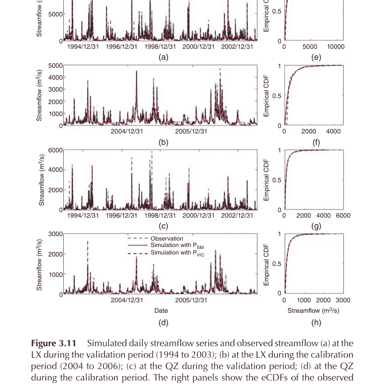

图3.11 模拟日径流序列与观测径流：（a）LX站在验证期（1994年至2003年）；（b）LX站在率定期（2004年至2006年）；（c）QZ站在验证期；（d）QZ站在率定期。右侧面板显示了观测和模拟径流的经验CDF：（e）LX站在验证期；（f）LX站在率定期；（g）QZ站在验证期；（h）QZ站在率定期。此处，P_SM是10组折衷参数集中性能最优的参数集，P_VIC是VIC给出的折衷参数集。

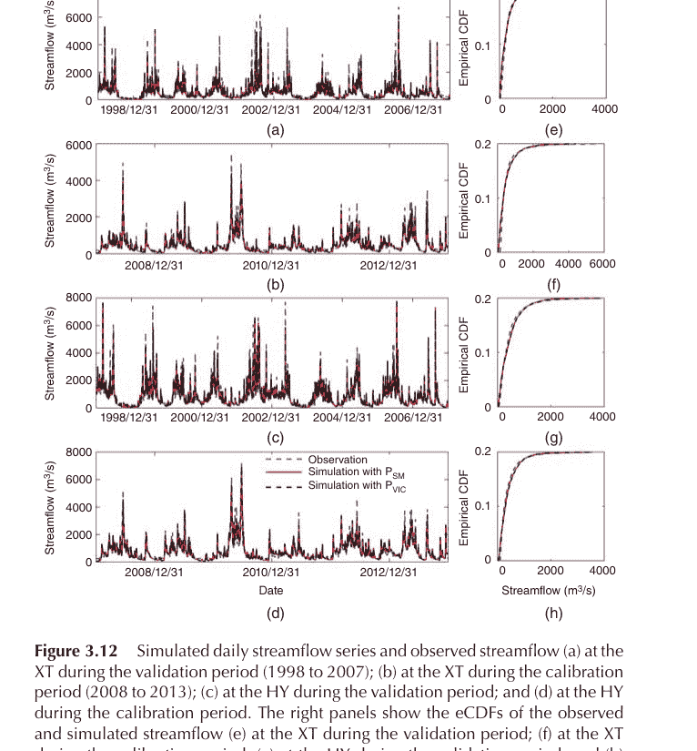

图3.12 模拟日径流序列与观测径流：（a）XT站在验证期（1998年至2007年）；（b）XT站在率定期（2008年至2013年）；（c）HY站在验证期；（d）HY站在率定期。右侧面板显示了观测和模拟径流的经验CDF：（e）XT站在验证期；（f）XT站在率定期；（g）HY站在验证期；（h）HY站在率定期。此处，P_SM是10组折衷参数集中性能最优的参数集，P_VIC是VIC给出的折衷参数集。

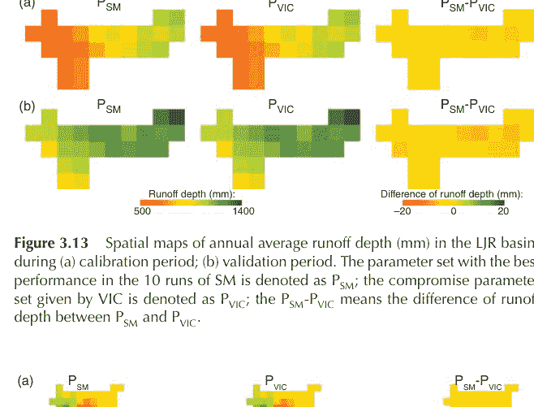

图3.13 LJR流域年平均径流深（mm）的空间分布：（a）率定期；（b）验证期。SM运行10次中性能最优的参数集记为P_SM；VIC给出的折衷参数集记为P_VIC；P_SM-P_VIC表示P_SM与P_VIC的径流深之差。

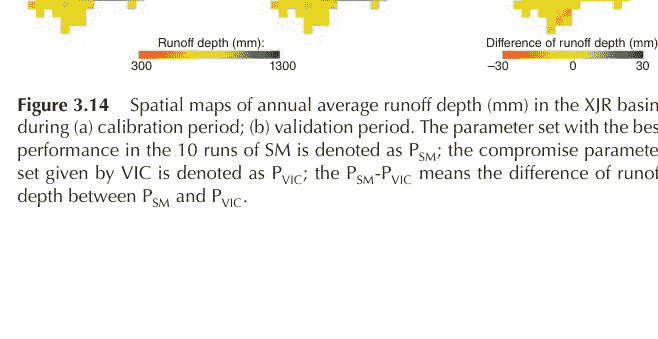

图3.14 XJR流域年平均径流深（mm）的空间分布：（a）率定期；（b）验证期。SM运行10次中性能最优的参数集记为P_SM；VIC给出的折衷参数集记为P_VIC；P_SM-P_VIC表示P_SM与P_VIC的径流深之差。

如果在其他情况下参数收敛缓慢，则需要更长的时间来推导关键范围。在这些情况下，可以根据经验法则或参考以前的工作来设置关键范围。此外，也可以通过先前参数优化的结果来确定或更新关键范围。然而，在本研究中，我们尚未研究ADBP的性能与模型改进次数之间的关系。

在我们的工作中，我们使用FNP_SM的中心点与VFNP_SM的中心点之间的距离作为优化的终止条件，基于这样的假设：当FNP_SM与VFNP_SM相同时，FNP_SM可以用作FNP_VIC。为了在每次迭代中获取FNP_SM，使用了ε-NSGA II，它可以自适应种群大小并自动终止。为了更快地使FNP_SM接近VFNP_SM并减少迭代次数，设计了两阶段代理模型，并使用了一种性能更好的代理方法ADBP。此外，本研究中的样本集是从ε-NSGA II生成的样本空间中选择的，以在关键范围内增加样本。从图3.8和图3.9所示的结果来看，ADBP使用从ε-NSGA II生成的样本空间中选择的不同样本集时表现稳定。这表明ADBP初始训练样本的非均匀性是可以接受的，这可能是因为最优过程中没有使用样本空间中的所有样本，关键范围内的样本比其他样本更重要。

与此同时，与VIC相比，使用SM进行率定所消耗的时间大大缩短。为了加速VIC的参数率定，在24处理器平台上采用了并行计算，而由ADBP构建的SM则采用单线程运行。因此，如果SM和原始模型都在单线程下运行，SM节省的时间将显著增加。此外，SM节省的时间与VIC的运行时间相关。当研究区域更大、物理条件更复杂时，SM带来的效率提升更为显著。

### 3.7. 结论

在本研究中，我们为大型复杂分布式水文模型开发了一个基于代理模型的参数率定框架，以加速VIC的并行自动参数率定。该框架中的两阶段代理模型基于AdaBoost和BPNN。SM-I粗略预测输出，并在关键范围内寻找参数集。SM-II在关键范围内精确模拟输出。该方法成功应用于LJR流域和XJR流域。

分别选择*RMSE*和*ER*作为SM-I和SM-II的评估指标。通过这项研究，我们发现：

- 1. 在基准测试中，通过使用我们基于代理模型的参数率定框架，可以获得与人工参数集误差非常小的参数集。
- 2. 通过基于代理模型的参数率定框架获取的VIC参数集与ε-NSGA II获取的参数集没有显著差异。使用SM参数集模拟的径流与VIC模拟的径流非常吻合。
- 3. 所提出的方法可以显著加快率定过程，但节省的时间与研究区域有关。当研究区域更大、物理条件更复杂时，SM带来的效率提升更为显著。

SM可以节省大量复杂分布式水文模型率定的时间，尤其能改进参数率定的现有技术水平。未来工作可以集中扩展SM以研究变化环境下的水文模型率定，此外，还可以研究不同优化算法的作用。

## 致谢

作者感谢浙江省重点研发计划（2021C03017）、浙江省自然科学基金重点项目（LZ20E090001）和国家重点研发计划“政府间国际科技创新合作”项目（2016YFE0122100）的资助。感谢中国西部环境与生态科学数据中心（WestDC）提供土壤数据和土地覆盖数据（https://westdc.westgis.ac.cn）。我们还要感谢中国气象局为本研究提供气象数据。该数据可从网站 https://data.cma.cn 下载。

## 参考文献

Abbaspour, K. C., Rouholahnejad, E., Vaghefi, S., Srinivasan, R., Yang, H., & Kløve, B. (2015). 欧洲大陆尺度的水文与水质模型：高分辨率大尺度SWAT模型的率定与不确定性。*水文学杂志, 524*, 733–752.

Asefa, T., Kemblowski, M. W., Urroz, G., Mckee, M., & Khalil, A. (2004). 基于支持向量的地下水水头观测网络设计。*水资源研究, 40*(11), 151–175.


- Beale, M. H., Hagan, M. T., & Demuth, H. B. (2010). 神经网络工具箱™用户指南. The MathWorks, 2, 77–81.

- Behzadian, K., Kapelan, Z., Savic, D., & Ardeshir, A. (2009). 使用多目标遗传算法和自适应神经网络的随机采样设计. 环境建模与软件, 24(4), 530–541.

- Carpenter, T. M., & Georgakakos, K. P. (2006). 集总式与分布式水文模型在业务预报尺度上的集合模拟对比. 水文学杂志, 329(1–2), 174–185.

- Chawla, I., & Mujumdar, P. P. (2018). 非平稳模型条件下径流预估中的不确定性划分. 水资源进展, 112, 266–282.

- Chowdhury, M., Alouani, A., & Hossain, F. (2010). 普通克里金法与人工神经网络在地下水砷污染空间制图中的比较. 随机环境研究与风险评估, 24(1), 1–7.

- Christelis, V., Bellos, V., & Tsakiris, G. (2016). 采用替代模型校准二维洪水模拟模型. 全球变化时代的可持续水力学——第四届IAHR大会论文集, 比利时列日.

- Deb, K., Pratap, A., Agarwal, S., & Meyarivan, T. (2002). 一种快速且有精英保留策略的多目标遗传算法：NSGA-II. IEEE进化计算汇刊, 6(2), 182–197.

- De Vos, N. J., & Rientjes, T. (2007). 人工神经网络与概念性降雨径流模型的多目标性能比较. 水文科学杂志, 52(3), 397–413.

- Fischer, G., Nachtergaele, F., Prieler, S., van Velthuizen, H. T., Verelst, L., & Wiberg, D. (2008). 全球农业生态区农业评估（GAEZ 2008）. IIASA, 奥地利拉克森堡，FAO, 意大利罗马.

- Freeze, R. A., & Harlan, R. L. (1969). 基于物理过程的数字模拟水文响应模型蓝图. 水文学杂志, 9(3), 237–258.

- Freund, Y., Schapire, R. E., & Others (1996). 一种新的提升算法的实验. 国际机器学习大会, 意大利巴里.

- Fries, K. J., & Kerkez, B. (2018). 利用传感器数据将大尺度模型动态映射到场地尺度预报：以国家水模型为例的案例研究. 水资源研究, 54(8), 5636–5653.

- Fu, G., Kapelan, Z., Kasprzyk, J. R., & Reed, P. (2012). 基于高维多目标可视化分析的配水系统优化设计. 水资源规划与管理杂志, 139(6), 624–633.

- Gharari, S., Hrachowitz, M., Fenicia, F., & Savenije, H. (2013). 识别时间一致性模型参数的方法：子周期校准. 水文与地球系统科学, 17(1), 149–161.

- Gong, W., Duan, Q., Li, J., Wang, C., Di, Z., Ye, A., et al. (2016). 基于多目标自适应替代模型优化的大型复杂地球物理模型参数估计. 水资源研究, 52(3), 1984–2008.

- Guo, J., Zhou, J., Lu, J., Zou, Q., Zhang, H., & Bi, S. (2014). 用于径流预测的经验水文模型多目标优化. 水文学杂志, 511, 242–253.

- Guo, X., Wang, B., Xiong, W., & Jin, S. (2017). SWAT水文模型与大数据技术. 未来无线网络5G国际会议, 中国北京.

- Gupta, H. V., Kling, H., Yilmaz, K. K., & Martinez, G. F. (2009). 均方误差与NSE性能准则的分解：对改进水文建模的启示. 水文学杂志, 377(1–2), 80–91.

- Hadka, D., & Reed, P. (2012). 高维多目标进化优化中搜索控制与失效模式的诊断评估. 进化计算, 20(3), 423–452.

- Harik, G. R., & Lobo, F. G. (1999). 一种无参数遗传算法. 遗传与进化计算会议论文集（GECCO 1999）, 美国佛罗里达州奥兰多.

- Huo, J., Liu, L., & Zhang, Y. (2016). 流域水文模型参数校准优化算法的比较研究. 科学与工程计算方法杂志, 16(3), 653–669.

- Hurford, A. P., Huskova, I., & Harou, J. J. (2014). 利用高维多目标权衡分析帮助大坝促进经济发展、保护贫困人口和增强生态健康. 环境建模与软件, 38, 72–86.

- Isenstein, E. M., Wi, S., & Ethan Yang, Y. C. (2015). 利用径流和遥感积雪数据校准分布式水文模型. 2015年世界环境与水资源大会, 美国得克萨斯州奥斯汀.

- Kang, D. H., Shi, X., Gao, H., & Déry, S. J. (2014). 积雪对加拿大弗雷泽河流域水文贡献的变化. 水文气象学杂志, 15(4), 1344–1365.

- Kearns, M., & Valiant, L. G. (1994). 学习布尔公式和有限自动机的密码学限制. ACM杂志, 41(1), 67–95.

- Kollat, J. B., & Reed, P. M. (2006). 比较先进的进化多目标算法用于长期地下水监测设计. 水资源进展, 29(6), 792–807.

- Kollat, J. B., & Reed, P. M. (2007). 多目标进化算法在长期地下水监测应用中的计算规模分析. 水资源进展, 30(3), 408–419.

- Kollat, J. B., Reed, P. M., & Wagener, T. (2012). 水文模型中多目标校准权衡何时才有意义？水资源研究, 48(3).

- Kourakos, G., & Mantoglou, A. (2009). 基于进化算法和替代模块化神经网络模型的沿海含水层抽水优化. 水资源进展, 32(4), 507–521.

- Kovalets, I. V., Kivva, S. L., & Udovenko, O. I. (2015). 使用WRF/DHSVM模型链模拟山区极端洪水：乌克兰喀尔巴阡山脉乌日河流域的试点研究. 自然灾害, 75(2), 2049–2063.

- Laumanns, M., Thiele, L., Deb, K., & Zitzler, E. (2002). 进化多目标优化中收敛性与多样性的结合. 进化计算, 10(3), 263–282.

- Lee, G., Yu, W., Jung, K., et al. (2013). 使用空间分布式侵蚀模型进行流域尺度土壤侵蚀和产沙量模拟. 环境地球科学, 70(1), 33–47.

- Leng, G., Tang, Q., & Rayburg, S. (2015). 气候变化对中国气象、农业和水文干旱的影响. 全球与行星变化, 126, 23–34.

- Li, F., & Liu, C. (2009). BP神经网络在股票市场预测中的应用研究. 2009年第九届国际混合智能系统会议, IEEE, 中国沈阳.

- Liang, X., Lettenmaier, D. P., & Wood, E. F. (1996). 两层可变入渗能力模型中降水次网格空间变异的一维统计动力表示. 地球物理研究杂志：大气, 101(D16), 21403–21422.

- Liang, X., Lettenmaier, D. P., Wood, E. F., & Burges, S. J. (1994). 用于大气环流模型的基于水文过程的简单陆面水通量和能量通量模型. 地球物理研究杂志：大气, 99(D7), 14415–14428.

- Liu, G., He, Z., Luan, Z., & Qi, S. (2018). 中国东北挠力河流域径流模拟中集总式模型与分布式模型的比较. 水, 10(8), 1004.

- Liu, L., Gao, C., Xuan, W., & Xu, Y. P. (2017). 基于校准策略和集合方法的中国东南连江流域中期集合洪水预报评估. 水文学杂志, 554, 233–250.

- Liu, L., Xu, Y. P., Pan, S. L., & Bai, Z. X. (2019). 水文集合预报在中国雅鲁藏布江流域洪水及其组分预报中的潜在应用. 水文与地球系统科学, 23(8), 3335–3352.

- Lohmann, D. A. G., Nolte-Holube, R., & Raschke, E. (1996). 与陆面参数化方案耦合的大尺度水平汇流模型. Tellus A辑：动力气象与海洋学, 48(5), 708–721.

- Lohmann, D., Raschke, E., Nijssen, B., & Lettenmaier, D. P. (1998). 区域尺度水文学：I. 与汇流模型耦合的VIC-2L模型的公式化. 水文科学杂志, 43(1), 131–141.

- Maier, H. R., Kapelan, Z., Kasprzyk, J., Kollat, J., Matott, L. S., Cunha, M. C., et al. (2014). 水资源中的进化算法和其他元启发式方法：现状、研究挑战和未来方向. 环境建模与软件, 62, 271–299.

- Marek, G. W., Gowda, P. H., Evett, S. R., Baumhardt, R. L., Brauer, D. K., Howell, T. A., et al. (2016). 使用蒸渗仪数据校准和验证SWAT模型，以预测得克萨斯高地平原灌溉作物日蒸散发量. ASABE汇刊, 59(2), 611–622.

- Maurer, E. P., Wood, A. W., Adam, J. C., Lettenmaier, D. P., & Nijssen, B. (2002). 美国本土长期基于水文过程的陆面通量和状态数据集. 气候杂志, 15(22), 3237–3251.


Mishra, V., Cherkauer, K. A., & Bowling, L. C. (2010). 大湖区能量与水平衡研究中湖泊和湿地的参数化. Journal of Hydrometeorology, 11(5), 1057–1082.

Mo, K. C., & Lettenmaier, D. P. (2014). 使用国家多模式集合对美国本土进行水文预测. Journal of Hydrometeorology, 15(4), 1457–1472.

Nash, J. E., & Sutcliffe, J. V. (1970). 概念模型河流流量预报第一部分：原理讨论. Journal of Hydrology, 10(3), 282–290.

Nijssen, B., Schnur, R., & Lettenmaier, D. P. (2001). 使用可变下渗能力陆面模型对1980–93年土壤湿度的全球回顾性估算. Journal of Climate, 14(8), 1790–1808.

Pan, S., Liu, L., Bai, Z., & Xu, Y. P. (2018). 将遥感蒸散发融入中国湿润地区分布式水文-土壤-植被模型（DHSVM）的多目标校准. Water, 10(12), 1841.

Parada, L. M., Fram, J. P., & Liang, X. (2003). 水文模型的多分辨率校准方法：在半湿润流域的应用. Calibration of Watershed Models, 6, 197–212.

Patil, A., & Ramsankaran, R. (2017). 通过同化遥感土壤水分观测改进SWAT模型的径流模拟和预报性能. Journal of Hydrology, 555, 683–696.

Pérez, F. F., Sweeck, L., Elskens, M., & Bauwens, W. (2017). 用于河网水质评估的不连续有限元悬沙输移模型. Hydrological Processes, 31(9), 1804–1816.

Ran, Y., Li, X., & Lu, L. (2010). 中国地区四种遥感土地覆盖产品的评估. International Journal of Remote Sensing, 31(2), 391–401.

Razavi, S., Tolson, B. A., & Burn, D. H. (2012). 水资源中的替代建模综述. Water Resources Research, 48(7), W7401.

Reed, P., Minsker, B. S., & Goldberg, D. E. (2003). 简化多目标优化：非支配排序遗传算法-II的自动化设计方法. Water Resources Research, 39(7), 1196.

Santana-Quintero, L. V., Montano, A. A., & Coello, C. A. C. (2010). 进化多目标优化中处理高代价函数的技术综述. 见 Y. Tenne & C. Goh（编），昂贵优化问题中的计算智能（第29–59页）. 德国柏林、海德堡：Springer.

Schapire, R. E. (1990). 弱可学习性的强度. Machine Learning, 5(2), 197–227.

Schumann, G., Neal, J. C., Voisin, N., Andreadis, K. M., Pappenberger, F., Phanthuwongpakdee, N., et al. (2013). 首个大规模洪水淹没预报模型. Water Resources Research, 49(10), 6248–6257.

Sivapragasam, C., Arun, V. M., & Giridhar, D. (2010). 一种利用ANN改进降雨空间插值的简单方法. Meteorology and Atmospheric Physics, 109(1–2), 1–7.

Sun, X., Bernard-Jannin, L. E. O., Garneau, C., Volk, M., Arnold, J. G., Srinivasan, R., et al. (2016). 使用SWAT模型改进冲积平原河水与地下水交换的模拟. Hydrological Processes, 30(2), 187–202.

Zhao, Q., Liu, Z., Ye, B., Qin, Y., Wei, Z., & Fang, S. (2009). 耦合WRF和DHSVM的融雪径流预报模型. Hydrology and Earth System Sciences, 13(10), 1897–1906.

Zhao, X., Ning, B., Liu, L., & Song, G. (2014). 基于AdaBoost的短期电离层foF2预测模型. Advances in Space Research, 53(3), 387–394.

Zitzler, E., Laumanns, M., & Thiele, L. (2001). SPEA2：改进强度帕累托进化算法. TIK-Report, 103.

## 概念性分布式模型的模糊委员会

Mostafa Farrag¹²³，Gerald A. Corzo Perez⁴ 和 Dimitri P. Solomatine⁴⁵⁶

- ¹ 荷兰代尔夫特 Deltares 水质量与生态软件部门
- ² 德国波茨坦 GFZ 德国地球科学研究中心水文处
- ³ 德国波茨坦大学环境科学与地理研究所
- ⁴ 荷兰代尔夫特 IHE 代尔夫特水教育研究所
- ⁵ 荷兰代尔夫特代尔夫特理工大学水资源组
- ⁶ 俄罗斯莫斯科俄罗斯科学院水问题研究所

概念性水文模型意味着对水文系统复杂性的简化；然而，它们在再现流域响应的广泛范围方面缺乏灵活性。通常需要进行权衡：牺牲系统行为某一特定方面的准确性，以换取其他方面的准确性。本研究评估了采用模块化方法——“模糊委员会模型”——构建专门模型以再现流域特定响应的益处。我们还评估了利用专门模型预测出的径流来构建模糊委员会模型的适用性。本文研究了带幂参数值的权重方案，并深入探讨了模糊委员会变量（隶属函数和权重方案）之间的关系及其对模型性能的影响。此外，该模糊委员会概念被应用于一个概念性分布式模型，分为两种情况：第一种采用集总流域参数，第二种采用分布式参数。对模糊委员会变量不同组合的比较表明，所有模糊委员会模型均优于单一模型。由分布式模型组成的模糊委员会表现良好，尤其是在捕捉校准数据集中的最高峰值方面；然而，仍需进一步研究模型参数化对模型性能和不确定性的影响。

### 4.1. 引言

概念模型是一种便捷的工具，因为它们提供了对现实复杂性和异质性的简化描述；因此，它们只能产生较窄范围的流域响应，而再现某一特定行为的准确性可能会与再现其他方面的准确性相冲突（Fenicia 等，2007）。使用由单一目标函数校准得到的最优参数集的水文模型，可能无法捕捉所有流量范围内降雨-径流关系的复杂性。

如 Agawa 和 Takeuchi（2016）所述，概念模型中的误差来源在于，即使进行了优化，模型结构在一定程度上仍不正确。此外，用实际测量得到的参数值或由方程估算出的参数值，与能达到最优拟合的参数值并不相同。另外，气候变量和流域特征的空间变化也被忽略了（Beven, 1996）。

降雨-径流关系非常复杂，并具有高度变化的时空特性。根据 Fenicia 等（2007）的研究，流域行为可能表现出不同的状态，这些状态由一些通常可以定性识别但难以定量刻画的现象来表征。其中一些现象包括由植被、土地覆盖和表土变化带来的季节性效应，这些效应会影响截留和入渗等过程。因此，流域响应取决于季节。

此外，流域水文状态是流域响应的主要驱动力。水文状态的变化可能使流域条件从干变湿，或从高流量变为低流量。这些变化还会影响产流区（靠近河流的饱和区域）的产流量，从而导致水文过程作用域发生变化。最后，大多数水文过程具有非线性特征，例如降雨强度、地下水位和土壤水分状况。这些过程反过来又控制着地表径流以及快速和缓慢的径流响应。

降雨-径流模型的校准主要取决于校准过程中使用的目标函数，因此，不同的目标函数会产生不同的参数集。同一流域拥有多组参数违反了模型的物理合理性，因为理想情况下一个流域应只有一组唯一的参数（Oudin 等，2006）。校准对目标函数的这种不可避免的依赖，可以被转化为应对流域响应不同状态的一种解决方案。因此，可以调整目标函数以解决构建该模型所针对的实际问题。

在承认概念模型局限性的基础上，Corzo 和 Solomatine（2007）、Fenicia 等（2007）、Fernando 等（2009）以及 Oudin 等（2006）提出了表征流域行为的方法。与其寻找能代表降雨-径流关系全部范围的最佳模型，不如将径流划分为不同流态，并校准不同模型以再现每种流态（图4.1）。随后可以动态组合这些专门模型，从而对流域过程进行更全面的表征。这种方法被称为模块化方法或多模型方法，被认为是向模型中添加水文知识的一种途径（Corzo & Solomatine, 2007）。多模型方法可以隐式考虑流域响应行为的变异性，而这种变异性在概念模型实现中并未被显式考虑。

模块化方法考虑的是在不同模型之间切换，这些模型分别代表系统行为的不同方面。因此，这些模型必须应对流量过程线的不同范围（Abrahart & See, 2000）或不同季节。基于 Corzo 和 Solomatine（2007）的研究，他们使用三种不同方法对流量过程线进行划分：基于聚类的分类、基流分割和时间分段。Jain 和 Srinivasulu（2006）将流量过程线分解为不同分段，其所依据的概念是不同物理

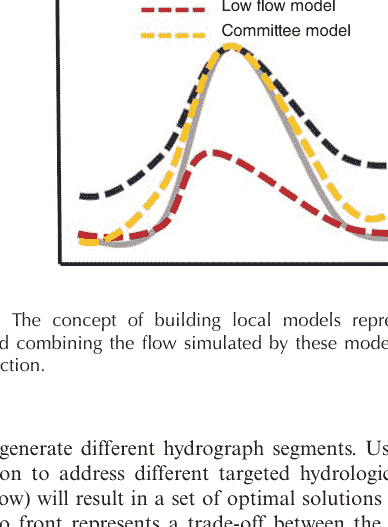

图 4.1 构建代表不同径流状态的局部模型的概念，并使用模糊隶属函数组合这些模型模拟的流量。

过程产生不同的水文过程线段。使用多目标优化来处理不同的目标水文响应（高流量和低流量）将产生一组称为帕累托前沿的最优解。帕累托前沿代表所选目标之间的权衡。没有任何一个优化目标可以在不降低其他目标的情况下得到进一步改进。

为了将这些专业局部模型中包含的水文知识纳入其中，Clemen (1989) 已探索了不同架构来组合模型和预报；Jain 和 Srinivasulu (2006) 在不同时间步长之间使用了直接的模型切换。已提出各种方法来纳入加权系统，其可以非常简单，如 Shamseldin 等人 (1997) 的平均方法，或更复杂的技术 (Ajami et al., 2006; Duan et al., 2007; Shamseldin et al., 1997; Xiong et al., 2001)。贝叶斯模型平均方案 (BMA) (Duan et al., 2007) 利用不同水文模型做出的预测形成概率预测。BMA 根据其概率似然度量对不同模型进行加权。Xiong 等人 (2001) 应用 Takagi-Sugeno 模糊系统 (Takagi & Sugeno, 1985) 来组合来自不同模型的预报流量。专业模型也可以基于隶属函数进行组合。隶属函数根据径流状态为每个模型在每个时间步长赋予不同的权重 (Kayastha et al., 2013)。模型也可以使用从状态变量或气候数据中提取的时间变化季节指数来组合加权专业模型 (Oudin et al., 2006)。

Solomatine (2006) 的模糊委员会方法使用隶属函数来表达两个模型（高流量和低流量模型）输出的可信度差异程度。隶属函数允许模型输出的软组合，并防止模拟系统行为中不切实际的不连续性 (图 4.1)。

本研究通过在加权方案和隶属函数之间构建和组合不同的专业模型，探索了 Solomatine (2006) 首次提出的模糊委员会模型，并由 Fenicia 等人 (2007) 和 Kayastha 等人 (2013) 进一步发展。本章测试了具有不同拟合优度的不同模糊委员会模型设置。如 Kayastha 等人 (2013) 所建议，加权方案考虑幂参数值为 2 和 3。对模糊委员会参数（隶属函数 (γ, δ)、加权方案类型和幂参数）之间的关系及其对模型性能的影响进行了深入研究。模糊委员会概念应用于概念性分布式模型。考虑了两种情况。第一种使用集总流域参数，其中两个专业模型代表整个流域。第二种使用分布式参数，其中每个单元由两个专业模型表示。

### 4.2 案例研究

研究流域是萨尔瓦多中部的 Jiboa 河。流域面积为 432 km²，出口站 Puente Viejo 位于 (13.52° N, 88.98° W) (图 4.2)。流域由四个地形区域组成：

- San Vicente Volcano with an elevation of 2,171 m a.s.l. (above sea level) and very steep slopes;
- the Ilopango Lake (covers an area of 70 km²);
- the Balsamo mountain range area with an elevation of 1,000 m a.s.l.;
- the coastal plain area with elevations ranging from 0 to 100 m a.s.l.

流域配备了 15 分钟时间步长的降雨量遥测系统和流域出口处的水位计。为模型校准，降雨量和水位值被汇总到每小时时间步长，同时水位使用流量-水位关系曲线方程进一步转换为流量。每月潜在蒸散发值使用由 Hargreaves 方法和线性回归得出的潜在蒸散发-海拔关系为每个站点获得 (SNET, 2005)。小时温度估计值使用正弦函数从一个可用的日站点计算，并用于整个流域。湖泊使用蓄量-出流关系进行模拟，其中由于入流、直接降雨和蒸发引起的蓄量变化在每个时间步长更新。湖泊出流使用新计算的蓄量计算。逆平方距离加权方法用于以不同空间分辨率计算水文模拟所需的所有数据（降水、温度、潜在蒸散发）的分布式数据。

### 4.3 方法

构建模糊委员会的第一步是硬划分，其中通过多目标优化创建一组帕累托最优的专业非支配模型。在生成的许多可能模型中，选择那些更好地代表高流量和低流量状态的模型。第一步产生两个专业的高流量和低流量模型，处理它们被构建以再现的流域响应。第二步是使用模糊隶属函数组合第一步中开发的每个模型的模拟流量。模糊隶属函数由两个参数 γ 和 δ 组成，其值通过优化获得；此步骤的结果将是一个模拟流量输出（见图 4.3）。术语 *committee model* 将指使用加权方案结合两个专业低流量和高流量模型，并优化 γ 和 δ 值以最小化 RMSE 值。

#### 4.3.1 模型结构描述

本研究使用 HBV-96 集总概念模型 (Lindström et al., 1997) 来模拟每个单元/子流域的水的垂直运动。基于栅格的分布式模型构建，其中每个单元的径流使用 MAXBAS 函数直接汇流至出口（图 4.4）；每个单元的 MAXBAS 值取决于其汇流路径长度。出口处的流量通过在每个时间步长对所有单元的汇流径流求和获得。仅地表径流（HBV 模型结构中上层区 (UZ) 储库产生的地表径流和层间流）被汇流，而下层区 (LZ) 产生的流量被假设为整个流域的集总（图 4.4）。

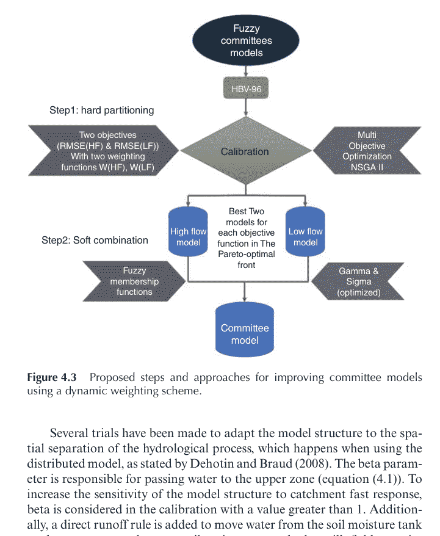

图 4.3 使用动态加权方案改进委员会模型的建议步骤和方法。

已进行多次试验以使模型结构适应水文过程的空间分离，这在使用分布式模型时发生，如 Dehotin 和 Braud (2008) 所指出。β 参数负责将水传递到上层区（公式 (4.1)）。为了提高模型结构对流域快速响应的敏感性，β 在校准中被考虑，值为大于 1。此外，还添加了直接径流规则，当土壤湿度超过土壤田间持水量时，将水从土壤湿度库移动到上层区 (Schumann, 1993)。

```latex
$$\frac{R}{IN} = \left(\frac{SM}{FC}\right)^{\beta} \tag{4.1}$$
```

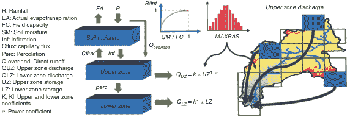

图 4.4 模型结构。

**表 4.1** 高流量均方根误差 (RMSE_h) 和低流量均方根误差 (RMSE_l) 的加权方案。

| WS 类型 | W_h | W_l | 公式 | 图 |
|---|---|---|---|---|
| I | \(h^y\) | \((1-h)^y\) | 4.4 | Figure 4.5a |
| II | \(0 \text{ if } h > a;\ ((1/a)^2)(1-h)^2 - (2/a)(1-h) + 1 \text{ if } h \le a\) | \(1 \text{ if } h > a;\ (h/a)^y \text{ if } h \le a\) | 4.5 | Figure 4.5b |
| III | \(0 \text{ if } h > a;\ ((1/a)^2)(1-h)^2 - (2/a)(1-h) + 1 \text{ if } h \le a\) | \(1 \text{ if } h > a;\ 0 \text{ if } h \le a\) | 4.6 | Figure 4.5c |
| IV | \(0 \text{ if } h > a;\ 1 - (1+h)/a \text{ if } h \le a\) | \(1 \text{ if } h > a;\ 0 \text{ if } h \le a\) | 4.7 | Figure 4.5d |


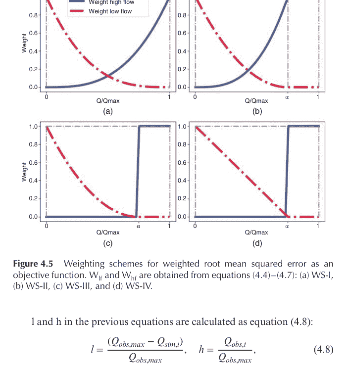

图 4.5 加权均方根误差作为目标函数的加权方案。W_lf 和 W_hf 由公式 (4.4)–(4.7) 得到：(a) WS-I，(b) WS-II，(c) WS-III，(d) WS-IV。

前文公式中的 l 和 h 按公式 (4.8) 计算：

l = (Q_obs,max - Q_sim,i) / Q_obs,max,   h = Q_obs,i / Q_obs,max   (4.8)

其中 Q_obs,max 为最大观测流量值，α 为选择权重的阈值，N 为幂次（见表 4.1）。N 选为 2 和 3，α 的值是特定时间步长计算的径流量与校准数据集中最大径流量值之比（Q_t/Q_obs,max）。α 决定了两个模型共同作用的值范围，以及仅考虑高流量模型径流量值的范围，α 选为 0.75。需要指出的是，RMSE_lf、RMSE_hf 和 RMSE 的值计算方式不同且不可相互比较，因为它们已乘以不同的权重。RMSE_lf 评估低流量的误差，RMSE_hf 评估高流量的误差，而 RMSE 评估一般流量的误差。校准所用数据几乎为 2 年半且时间步长为半小时，校准数据集中使用了两个湿季，验证中使用了一个湿季。

#### 4.3.3. 组合专业化模型

主要目标是利用时变权重在低流量和高流量域均产生高效的流量模拟，如前所述。在所有流量状态下获得一个称职的解非常困难，而在高流量和低流量均使用专业化模型是实现一个总体高效模型更好的方式。

将不同流量状态下构建的不同专业化模型组合起来的挑战在于确定哪个模型会起作用以及如何平滑地从一个模型切换到另一个模型并携带水量平衡信息；在同一时间有多个模型工作时，如何处理边界处的兼容性。

为了避免此类复杂性，使用一种能保证模型之间平滑过渡的加权方案可以是解决方案。每个专业化模型的份额将使用 Fenicia 等 (2007)、Kayastha 等 (2013) 和 Solomatine (2006) 描述的模糊隶属函数确定。

在加权方案中，使用具有两个参数 γ 和 δ 的梯形函数，其中低流量模型的隶属函数在相对流量低于参数 γ 时会给低流量值赋予权重 1（图 4.6c），然后当相对流量值介于 γ 和 δ 之间时开始下降（两个模型共同工作），直到超过参数 δ 的边界后降至零（图 4.6c）。同样，高流量模型的隶属函数以相反的逻辑工作。隶属函数在此处给出（公式 (4.9) 和 (4.10)）。

$M_{lf} = \begin{cases} 1, \text{if } h < \gamma \\ 1 - \left(\frac{h - \gamma}{\delta - \gamma}\right)^N, \text{if } \gamma \le h \le \delta \\ 0, \text{if } h \ge \delta \end{cases}$ (4.9)

$M_{hf} = \begin{cases} 0, \text{if } h < \gamma \\ \left(\frac{h - \gamma}{\delta - \gamma}\right)^{1/N}, \text{if } \gamma \le h \le \delta \\ 1, \text{if } h \ge \delta \end{cases}$ (4.10)

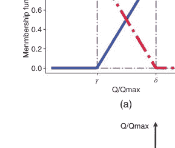

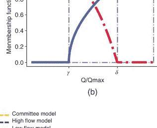

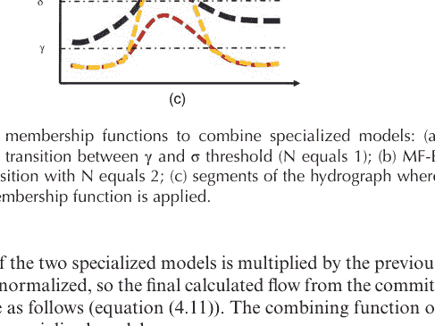

图 4.6 组合专业化模型的模糊隶属函数：(a) MF-A 在 γ 和 δ 阈值之间使用线性过渡（N 等于 1）；(b) MF-B 使用 N 等于 2 的非线性过渡；(c) 隶属函数各部分应用于水文过程线的分段。

两个专业化模型的输出乘以之前的权重然后进行归一化，因此委员会模型计算的最终流量如下（公式 (4.11)）。高流量和低流量专业化模型的组合函数

Q_{C,i} = (M_{lf,i} * Q_{lf,i} + M_{hf,i} * Q_{hf,i}) / (M_{lf,i} + M_{hf,i}), (4.11)

其中 Q_{lf,i} 和 Q_{hf,i} 分别为模拟的低流量和高流量；M_{lf} 和 M_{hf} 分别为低流量和高流量模型的隶属函数；i 为时间步长；γ 和 δ 分别为低流量和高流量的两个阈值。N 为平滑模型过渡的幂值；对于类型 A，N 等于一，对于类型 B，N 等于二（见图 4.6）。

湖泊子流域在所有模型中以相同方式表示，模型之间的唯一区别是 Jiboa 子流域的空间表示。

#### 4.3.5. 评价标准

使用了不同的性能标准来比较和评估每个模型的性能：Nash-Sutcliffe 效率系数 NSE（公式 (4.12)）、对数值的 Nash-Sutcliffe（公式 (4.13)）、均方根误差 RMSE（公式 (4.15)）。

$$\mathrm{NSE(HF)} = 1 - \frac{\sum_t (Q_{obs} - Q_{sim})^2}{\sum_t (Q_{obs} - Q_{avg})^2}. \tag{4.12}$$

由于标准 Nash-Sutcliffe 公式高估高值，因此通过对数值的流量值进行变换（公式 (4.13)）会使高流量变平；峰值和低流量值将相同。因此，低流量值误差的影响占主导，误差值对低流量误差更敏感（Krause 等，2005）。

$$\mathrm{NSE(lf)} = 1 - \frac{\sum_t (\ln(Q_{obs}) - \ln(Q_{sim}))^2}{\sum_t (\ln(Q_{obs}) - \ln(Q_{avg}))^2}. \tag{4.13}$$

累积误差均值衡量模型在正确再现径流总量方面的成功程度（公式 (4.14)）。

$$WB = 100 \times \left(1 - \left|1 - \frac{\sum Q_{sim}}{\sum Q_{obs}}\right|\right). \tag{4.14}$$

$$RMSE = \sqrt{\frac{1}{n}\sum_{i=1}^{n}(Q_{obs} - Q_{sim})^2}. \tag{4.15}$$

Gupta 等 (2009) 表明使用单一误差函数来衡量计算流量的效率存在局限性，并表明 Nash-Sutcliff 效率 NSE 或 RMSE 可分解为三个分量：相关性、可变性和偏差。KGE 指数（公式 (4.16)）将这些信息汇总为一个公式，衡量这些属性的值与理想点的距离。

$$KGE = 1 - \sqrt{(c - 1)^2 + (\alpha - 1)^2 + (\beta - 1)^2}. \tag{4.16}$$

其中 $Q_{obs}$ 为观测流量，$Q_{sim}$ 为模拟流量，$Q_{avg}$ 为观测流量的均值，$c = $ Qobs 与 Qsim 之间的交叉相关，α 衡量数据中的可变性 α = σ_Qsim / σ_Qobs，且 β = mean(Qsim) / mean(Qobs)。

### 4.4. 结果与讨论

HBV 模型中流域响应的概念性表示不允许同时对流域响应的各种行为进行最优表示。因此，采用委员会模型方法来同时捕捉流域行为的不同方面。

对于湖泊子流域，构建了两个专业化模型并在整个研究中未作更改使用，而对于 Jiboa 子流域，使用四种不同的单元分辨率（4 km、2 km、1 km 和 500 m）对不同的空间离散化（集总式和分布式）进行了建模（见图 4.7 和第 4.3.4 节 模型设置）。

对于 Jiboa 子流域的集总式表示，为每个子流域构建了两个专业化模型（湖泊子流域两个模型，Jiboa 子流域两个模型）。表 4.2 显示了不同委员会模型组合的性能汇总。

表 4.1 中 gamma 和 delta 的值进一步在图 4.8 中可视化，以分析加权方案、隶属函数和幂值 N 之间的相互作用。Gamma 和 delta 是决定两个专业化模型共同工作的多少的流量阈值。图 4.8 显示 MF-A 使专业化模型随着从 WS-I 到 WS-IV 的变化而共同工作更多（线段长度从 WS-I 到 WS-IV 增加）。另一方面，MF-B 且 N = 2 时，WS-I 和 II 的专业化模型几乎单独工作（模型仅在 Q/Qmax 在 γ 为 0.24 到 δ 为 0.27 的范围内共同工作），而 MF-B 与 WS-I、WS-II（N = 3）、WS-III 和 IV 使模型大部分时间共同工作（在 Q/Qmax 在 γ = 0.06 到 δ = 0.88 的范围内）。

对隶属函数、加权方案和幂值 N 之间关系的更全面研究表明，MF-B 倾向于使专业化模型要么始终共同工作，要么几乎单独工作，如图 4.8 所示，这导致误差值更高，如图 4.9 所示（点尺寸更大）。MF-A 使专业化模型单独工作和共同工作的时间几乎相等（delta 与 gamma 的差值约为 0.5），这为委员会模型性能提供了更好的结果。


## 表 4.2 不同加权方案与成员函数组合的委员会模型性能

| 模型 | WS 类型 | N | MF | γ | Δ | 低流量 RMSE (lf) 率定 | 验证 | 高流量 RMSE (H) 率定 | 验证 | RMSE 率定 | 验证 | KGE 率定 | 验证 |
|---|---|---|---|---|---|---|---|---|---|---|---|---|---|
| 委员会模型 | I | 2 | A | 0.19 | 0.36 | 0.98 | 0.80 | 0.63 | 0.70 | 1.66 | 1.72 | 0.70 | 0.650 |
| 委员会模型 | I | 2 | B | 0.23 | 0.26 | 0.97 | 0.90 | 0.59 | 0.88 | 1.36 | 1.43 | 0.84 | 0.84 |
| 委员会模型 | I | 3 | A | 0.17 | 0.43 | 0.80 | 0.68 | 0.42 | 0.47 | 1.28 | 1.34 | 0.88 | 0.87 |
| 委员会模型 | I | 3 | B | 0.08 | 0.79 | 0.83 | 0.64 | 0.44 | 0.45 | 1.33 | 1.25 | 0.85 | 0.85 |
| 委员会模型 | II | 2 | A | 0.15 | 0.35 | 0.80 | 0.65 | 0.75 | 0.88 | 1.33 | 1.37 | 0.85 | 0.83 |
| 委员会模型 | II | 2 | B | 0.24 | 0.26 | 0.78 | 0.76 | 0.76 | 0.91 | 1.38 | 1.50 | 0.81 | 0.81 |
| 委员会模型 | II | 3 | A | 0.18 | 0.41 | 0.81 | 0.70 | 0.60 | 0.73 | 1.28 | 1.41 | 0.87 | 0.86 |
| 委员会模型 | II | 3 | B | 0.06 | 0.72 | 0.84 | 0.65 | 0.61 | 0.70 | 1.33 | 1.31 | 0.86 | 0.87 |
| 委员会模型 | III | - | A | 0.16 | 0.57 | 0.82 | 0.67 | 0.35 | 0.29 | 1.31 | 1.28 | 0.87 | 0.87 |
| 委员会模型 | III | - | B | 0.10 | 0.84 | 0.84 | 0.65 | 0.34 | 0.26 | 1.34 | 1.22 | 0.86 | 0.87 |
| 委员会模型 | IV | - | A | 0.19 | 0.61 | 0.83 | 0.85 | 0.31 | 0.24 | 1.32 | 1.24 | 0.86 | 0.90 |
| 委员会模型 | IV | - | B | 0.13 | 0.87 | 1.03 | 0.79 | 0.34 | 0.24 | 1.35 | 1.18 | 0.86 | 0.90 |

| 模型 | WS 类型 | N | MF | 低流量 NSE (ln) 率定 | 验证 | 高流量 NSE 率定 | 验证 | WB 率定 | 验证 |
|---|---|---|---|---|---|---|---|---|---|
| 单一模型 |  |  |  | 0.6 | 0.821 | 0.615 | 0.691 | 99.48 | 85.08 |
| 委员会模型 | I | 2 | A | 0.66 | 0.843 | 0.741 | 0.781 | 98.54 | 89.08 |
| 委员会模型 | I | 2 | B | 0.66 | 0.82 | 0.731 | 0.762 | 99.02 | 89.09 |
| 委员会模型 | I | 3 | A | 0.69 | 0.856 | 0.769 | 0.812 | 99.38 | 93.86 |
| 委员会模型 | I | 3 | B | 0.68 | 0.864 | 0.750 | 0.836 | 99.89 | 87.57 |
| 委员会模型 | II | 2 | A | 0.7 | 0.886 | 0.751 | 0.805 | 99.14 | 87.32 |
| 委员会模型 | II | 2 | B | 0.69 | 0.84 | 0.734 | 0.764 | 97.35 | 85.08 |
| 委员会模型 | II | 3 | A | 0.7 | 0.854 | 0.770 | 0.792 | 98.84 | 93.25 |
| 委员会模型 | II | 3 | B | 0.69 | 0.862 | 0.752 | 0.820 | 97.05 | 91.25 |
| 委员会模型 | III | - | A | 0.68 | 0.887 | 0.759 | 0.830 | 99.07 | 93.15 |
| 委员会模型 | III | - | B | 0.68 | 0.885 | 0.749 | 0.844 | 99.42 | 88.93 |
| 委员会模型 | IV | - | A | 0.66 | 0.893 | 0.755 | 0.833 | 96.23 | 96.48 |
| 委员会模型 | IV | - | B | 0.65 | 0.896 | 0.746 | 0.855 | 95.88 | 93.72 |

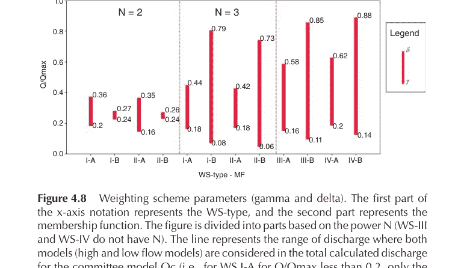

图 4.8 加权方案参数（γ 和 δ）。x 轴标注的第一部分表示 WS 类型，第二部分表示成员函数。该图根据幂指数 N 分为若干部分（WS-III 和 WS-IV 没有 N）。线条表示总计算流量 Qc 中同时考虑两个模型（高流量和低流量模型）的流量范围（例如，对于 WS I-A，当 Q/Qmax 小于 0.2 时，只考虑低流量模型；当 Q/Qmax 大于 0.36 时，只考虑高流量模型；而当 Q/Qmax 介于 0.2 和 0.36 之间时，Qc 中同时考虑两个模型）。

权重 W_lf、W_hf 主要受计算流量与率定期间最大观测流量之比（Q_i/Q_obs,max）的影响。由于 Q_obs,max 取决于所选率定期，并且可能被验证数据集或模型实际运行中的流量数据超过，因此 W_lf 会出现负值。为避免此问题，可采用更宽的流量范围。优化算法得到的参数如图 4.10 所示。

在图 4.10 中，参数值相对于下界和上界进行了归一化，因此所有参数的可行范围可在同一图中显示在 0 到 1 之间。图中的每条线代表一组参数，并指示参数范围与最优解的对应关系以及初始可行参数范围之间的关系。关于参数变异程度的任何观察都缺乏正确的背景，因为该图仅表示 Pareto 最优解集的值（见图 4.15 中的深色方块），而非所有解（图 4.15 中的其他灰色点）。

某些参数的行为可能会在从高流量最佳模型转向低流量最佳模型时呈现某种趋势；这一行为在参数 K（上层（壤中流）的流量系数）和 K1（下层（地下水径流）的流量系数）中尤为明显。正如所料，高流量模型会高估参数 K、K1 和 C-lake 的值，因为该模型的趋势是最大化流量以尽可能接近高流量值，而低流量模型则相反。K1 和 C-lake 系数决定了下层水库的行为，这主导了低流量模拟期间流域的响应。

由于上述行为，原本预期高流量和低流量模型的过程线会包围观测流量过程线（高流量在上，低流量在下），但如 Oudin 等人（2006 年）所解释的那样，这种情况并未发生。这种情况只可能出现在理想情况下，而非大多数情况。原因可能归结于存在一个主导流域下部响应的湖泊，在低流量季节（11 月至 4 月），流域的总流量仅来自该湖泊。

对于概念性分布式模型，已使用加权方案 1（N = 3）为 Jiboa 子流域中的每个单元建立了专门模型。采用成员函数 A 结合先前获得的专门模型，使用以均方根为目标函数优化得到的两个参数 γ 和 δ。分布式模型委员会在率定和验证数据集上的表现非常接近（见图 4.11、表 4.2 和表 4.3），这表明模型的复杂度接近系统复杂度。图 4.11 中的模型从左到右按代表流域响应的模型数量排序。单一模型对整个 Jiboa 子流域使用一个通用模型，而 "Dist-D-C 4 km" 模型对每个单元使用两个模型。此外，性能从单一模型的 RMSE 1.64 m³/s 提高到委员会模型的 1.3 m³/s；所有委员会模型的性能非常接近；使用 MF-A 在空间上以集总方式表示 Jiboa 子流域的委员会模型是性能最好的模型（见图 4.12；模型名称说明见图 4.7）。

进一步检查率定数据集期间的最大洪水事件，发现具有 4 km 空间分辨率的分布式委员会模型 Dist-D-C 4 km（具有分布式参数）能够在正确的时间准确捕捉洪峰，而所有其他委员会模型都高估了洪峰。

图 4.14 和表 4.3 显示了所有模型的性能，并给出了所有指标的归一化值。对于 RMSE、RMSE(LF) 和 RMSE(HF)，最高误差位于图形顶部，值分别为 1.656、1.05 和 0.64，最低值位于图形底部，值分别为 1.282、0.8 和 0.43。而对于 NSE(HF) 和

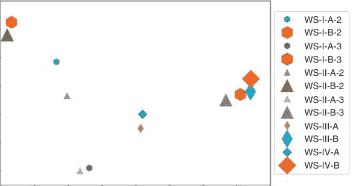

**图 4.9** 委员会组成与委员会模型性能之间的关系。点的标记的第一部分指 WS 类型；第二部分指成员函数（A 或 B）；最后一部分表示幂指数 N（WS-III 和 WS-IV 没有 N）。

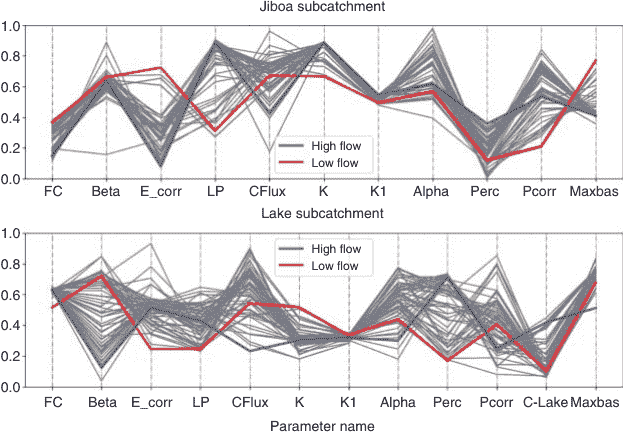

**图 4.10** 归一化参数图（对应 Pareto 最优解的参数）。

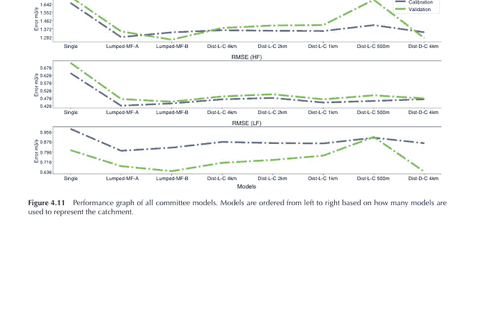

图 4.11 所有委员会模型的性能图。模型从左到右按用于表示流域的模型数量排序。


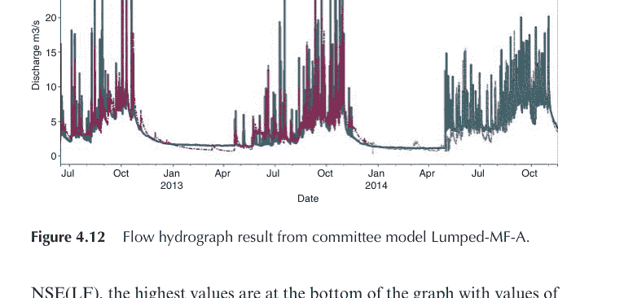

图 4.12 来自委员会模型 Lumped-MF-A 的流量过程线结果。

NSE(LF)，最高值位于图表底部，分别为 0.71 和 0.77，最低值位于图的上部，分别为 0.55 和 0.62。所有单模型（集总式和分布式）出现在图的上部（RMSE 最高、NSE 最低），而委员会模型出现在图表底部（RMSE 最低、NSE 最高），这表明委员会模型在所有性能指标上均优于所有单模型。图 4.13 与图 4.11 显示，分布式模型中单元尺寸的影响非常微弱，这表明有必要对概念性分布式模型进行更多研究。

NSGA-II 找到的最佳 70 种模型参数化在图 4.15 中以最优非支配解的 Pareto 前沿形式呈现。它还说明了所选目标之间的权衡，并表明单模型无法同时匹配流域响应的全部变异性。校准数据集的最优参数集并不优于验证数据集，因此针对校准数据集获得的高低流量最佳专业化模型在验证数据集中并非最佳（在其他 Pareto 最优集中）。

图 4.15 显示，委员会模型比单模型和 Pareto 前沿的所有成员更接近理想点。这确保了委员会模型的性能优于任何其他单模型。校准中的最优模型不一定在验证中也是最好的。然而，校准和验证中的版本必须非常接近。所有委员会模型的组合在校准和验证数据集中均优于所有 Pareto 成员。

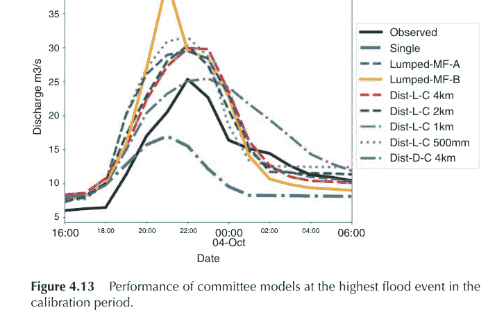

图 4.13 校准期最大洪水事件期间委员会模型的性能。

很容易注意到 RMSE_LF 的值始终高于 RMSE_HF 的值。其原因在于低流量期远长于高流量期，因此可以预期较长时期的误差高于较短时期（低流量值数量多于高流量值），并且加权均方根误差求和公式中的误差除以相同的观测总数，见（图 4.15）。

为再现水文响应特定方面（高低流量模型）而开发的专业化模型委员会，使用模糊隶属函数组合，成功利用了各模型的优势来提高委员会的性能。这使其性能比所有单模型和所有 Pareto 前沿成员更接近理想点，从而确保委员会模型的性能优于任何其他单模型。

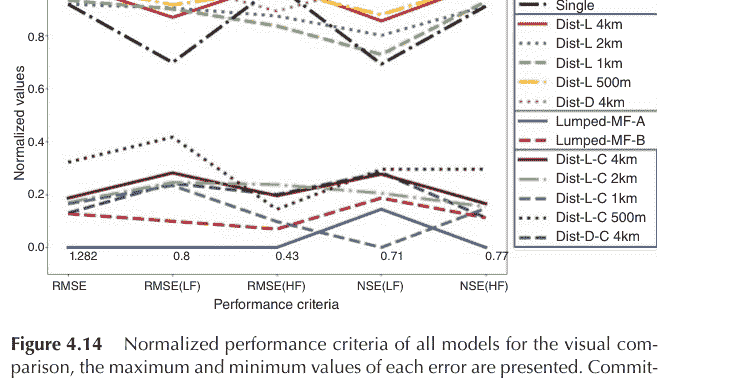

图 4.14 所有模型归一化性能指标用于视觉比较，呈现了每个误差的最大值和最小值。底部的委员会模型具有更低的 RMSE、RMSE(LF) 和 RMSE(HF)，以及更高的 NSE(LF) 和 NSE(HF)；因此，在所有指标上性能均更好。

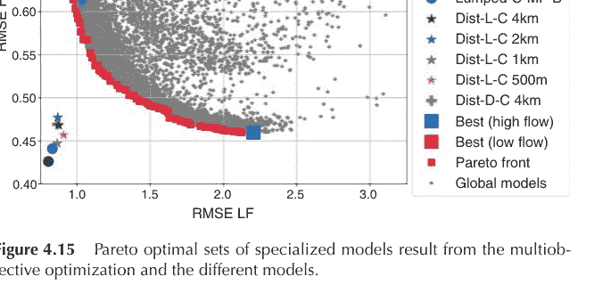

图 4.15 多目标优化和不同模型得到的专业化模型的 Pareto 最优集。

## 致谢

我们感谢萨尔瓦多环境和自然资源部（MARN）提供本研究使用的数据。我们还感谢 Rotary 基金会（TRF）在 Rotary 奖学金框架内提供的资金支持。

## 参考文献

- Abrahart, R. J., & See, L. (2000). 比较神经网络和自回归移动平均技术在两个对比流域提供连续河流流量预报中的应用。 Hydrological Processes, 14(11–12), 2157–2172. https://doi.org/10.1002/1099-1085(20000815/30)14:11/12<2157::AID-HYP57>3.0.CO;2-S
- Agawa, T., & Takeuchi, O. (2016). 重新审视日本 EFL 学习者的心理需求和二语动机：一项访谈研究。 Asian EFL Journal, 89(89), 74–98.
- Ajami, N. K., Duan, Q., Gao, X., & Sorooshian, S. (2006). 水文模拟分析的多模型组合技术：应用于分布式模型互对比项目结果。 Journal of Hydrometeorology, 7(4), 755–768. https://doi.org/10.1175/jhm519.1
- Beven, K. (1996). 地貌建模中的等效性与不确定性。 The Scientific Nature of Geomorphology. Proceeding of the 27th Binghamton Symposium in Geomorphology, September 1996, 289–314.
- Clemen, R. T. (1989). 组合预测：综述与注释书目。 International Journal of Forecasting, 5(4), 559–583. https://doi.org/10.1016/0169-2070(89)90012-5
- Corzo, G., & Solomatine, D. (2007). 用于流量预报模块化人工神经网络建模的基流分离技术。 Hydrological Sciences Journal, 52(3), 491–507. https://doi.org/10.1623/hysj.52.3.491
- Deb, K., Pratap, A., Agarwal, S., & Meyarivan, T. (2002). 一种快速且精英的多目标遗传算法：NSGA-II。 IEEE Transactions on Evolutionary Computation, 6(2), 182–197. https://doi.org/10.1109/4235.996017
- Dehotin, J., & Braud, I. (2008). 分布式水文模型采用何种空间离散化？针对中大型流域的方法论建议及示例。 Hydrology and Earth System Sciences, 12(3), 769–796. https://doi.org/10.5194/hess-12-769-2008
- Duan, Q., Ajami, N. K., Gao, X., & Sorooshian, S. (2007). 使用贝叶斯模型平均的多模型集合水文预测。 Advances in Water Resources, 30(5), 1371–1386. https://doi.org/10.1016/j.advwatres.2006.11.014
- Fenicia, F., Solomatine, D. P., Savenije, H. H. G., & Matgen, P. (2007). 多目标框架下局部模型的软组合。 Hydrology and Earth System Sciences, 11(6), 1797–1809. https://doi.org/10.5194/hess-11-1797-2007
- Fernando, D. A. K., Shamseldin, A. Y., & Abrahart, R. J. (2009). 使用基因表达式编程从常规降雨径流模型输出开发组合径流估算模型。 18th World IMACS Congress and MODSIM09 International Congress on Modeling and Simulation: Interfacing Modeling and Simulation with Mathematical and Computational Sciences, Proceedings, July, 748–754. https://www.scopus.com/inward/record.uri?eid=2-s2.0-80052983135&partnerID=40&md5=73dcd5eba92b4c026dcff2b6bf128f02
- Gupta, H. V., & Sorooshian, S. (1998). 改进水文模型校准：多重且不可通约的信息度量。 Water Resources Research, 34(4), 751–763.
- Gupta, H. V., Kling, H., Yilmaz, K. K., & Martinez, G. F. (2009). 均方误差和 NSE 性能指标的分解：改进水文建模的意义。 Journal of Hydrology, 377(1–2), 80–91. https://doi.org/10.1016/j.jhydrol.2009.08.003
- Jain, A., & Srinivasulu, S. (2006). 使用人工神经网络和概念技术建模分解流量过程线的综合方法。 Journal of Hydrology, 317(3–4), 291–306. https://doi.org/10.1016/j.jhydrol.2005.05.022
- Kayastha, N., Ye, J., Fenicia, F., Kuzmin, V., & Solomatine, D. P. (2013). 专业化降雨径流模型的模糊委员会：进一步改进与测试。 Hydrology and Earth System Sciences, 17(11), 4441–4451. https://doi.org/10.5194/hess-17-4441-2013
- Krause, P., Boyle, D. P., & Bäse, F. (2005). 水文模型评估不同效率标准的比较。 Advances in Geosciences, 5(89), 89–97. https://doi.org/10.5194/adgeo-5-89-2005
- Lindström, G., Johansson, B., Persson, M., Gardelin, M., & Bergström, S. (1997). 分布式 HBV-96 水文模型的开发与测试。 Journal of Hydrology, 201(1–4), 272–288. https://doi.org/10.1016/S0022-1694(97)00041-3
- Oudin, L., Andréassian, V., Mathevet, T., Perrin, C., & Michel, C. (2006). 基于互补模型参数化的降雨径流模型模拟的动态平均。 Water Resources Research, 42(7), 1–10. https://doi.org/10.1029/2005WR004636
- Schumann, A. H. (1993). 概念半分布式水文模型的发展及其参数的 GIS 辅助估计。 Hydrological Sciences Journal, 38(6), 519–528. https://doi.org/10.1080/026266693094926702
- Shamseldin, A. Y., O’Connor, K. M., & Liang, G. C. (1997). 组合不同降雨径流模型输出的方法。 Journal of Hydrology, 197(1–4), 203–229. https://doi.org/10.1016/S0022-1694(96)03259-3
- SNET (2005). 萨尔瓦多的综合动态水量平衡, 109. https://unesdoc.unesco.org/ark:/48223/pf0000228142
- Solomatine, D. P. (2006). 预测环境变量中学习模型的最佳模块化。 Proceedings of the IEMSs 3rd Biennial Meeting, Summit on Environmental Modeling and Software, July. http://www.scopus.com/inward/record.url?eid=2-s2.0-84858682542&partnerID=tZOtx3y1
- Takagi, T., & Sugeno, M. (1985). 系统的模糊辨识及其在建模与控制中的应用。 IEEE Transactions on Systems, Man, and Cybernetics, SMC-15 (1), 116–132. https://doi.org/10.1109/TSMC.1985.6313399
- Xiong, L., Shamseldin, A. Y., & O’Connor, K. M. (2001). 一阶 Takagi-Sugeno 模糊系统对降雨径流模型预报的非线性组合。 Journal of Hydrology, 245(1–4), 196–217. https://doi.org/10.1016/S0022-1694(01)00349-3


## 基于回归的机器学习方法用于日径流模拟

Vidya S. Samadi¹，Sadegh Sadeghi Tabas²，Catherine A. M. E. Wilson³，Daniel R. Hitchcock¹

¹ 美国南卡罗来纳州克莱姆森大学农业科学系
² 美国南卡罗来纳州克莱姆森大学土木工程系
³ 英国卡迪夫大学工程学院水文环境研究中心

计算能力的持续提升推动了机器学习（ML）技术在水文模拟中的重大进展。这些方法专门用于通过实施一种无偏的隐式方法来发现本构关系，从而在大型数据集中捕获未曾预见的模式。本研究应用多种ML方法对美国北卡罗来纳州（NC）一个城乡混合排水系统——东北开普菲尔河流域——进行日降雨-径流模拟。基于从气候和径流测站收集的一组数据，应用了支持向量机（SVM）、贝叶斯Lasso和随机森林（RF）模型等多种ML算法以及萨克拉门托土壤含水量（SAC-SMA）降雨-径流模型，来预测连续的逐日径流记录。分析表明，输入数据对模型性能的影响、强迫数据相关的误差、训练数据量以及数据序列不同属性之间的相关性，都对ML计算有强烈影响。与SAC-SMA相比，贝叶斯Lasso模型能够模拟观测值之间的时间依赖性，从而能够准确地对跨越城乡混合集水区的复杂逐日降雨-径流记录的多变量序列进行建模。该结果为逐日径流模拟的动态过程提供了一种算法信息化的模拟方法，可应用于其他复杂流域和气候条件。

### 5.1. 引言

流域建模有助于理解流域内降雨-径流过程的过去和当前状态，并提供了一种探索管理和规划决策以及强加的外力函数变化（如土地利用和气候）影响的方法。在复杂流域（此处指沿海平原流域）中，基于集总式和基于物理的模拟已经开展了非常重要的建模工作（Amatya & Jha, 2011; Samadi & Meadows, 2017; Samadi et al. 2017, 2020; 等）。然而，测量数据可用性的快速增长促使许多数据驱动方法或机器学习（ML）方法的发展，用于建模和预测降雨-径流动态。事实上，在基于过程的流域水文建模领域，时间序列ML算法最近已被用于改善不同尺度和领域下的短期和长期径流预测（例如，Solomatine & Dulal, 2003; Solomatine & Shrestha, 2009; Corzo et al., 2009; Shrestha et al., 2014; Fang et al., 2017; Kratzert et al., 2018; Shen, 2018; Shen et al., 2018; Wu et al., 2018）。ML算法尝试从输入变量（x）到数值或连续输出变量（y）估计映射函数（f），并能学习数据中隐藏的模式。不同的ML算法对函数的形状和结构以及如何最好地优化近似它的表示方式做出不同的假设。多项研究表明，ML模型能够学习复杂的非线性输入-输出关系（例如，Solomatine & Dulal, 2003; Solomatine & Shrestha, 2009; Shen, 2018）；因此，它们能够作为降雨-径流应用中其他最先进技术的补充替代方案（Yang et al., 2020）。

在各种ML算法中，基于回归的模型，如支持向量机（SVM）、随机森林（RF）、多层感知器（MLP）和决策树（DT），已被广泛应用于不同领域和尺度的降雨-径流模拟。例如，Sivapragasam和Muttil（2005）应用SVM计算美国华盛顿州三个测站的流量-水位关系曲线值。他们的结果表明，与广泛使用的对数和更高阶多项式拟合方法相比，SVM非常适用于流量-水位关系曲线的外推。Bui等人（2016）提出了一种基于神经模糊推理系统和元启发式优化的新型ML方法，用于越南中部Tương Dương县的洪水易发性建模（MONF）。他们发现MONF在洪水易发性制图方面优于其他ML算法，包括MLP和DT。Sadler等人（2018）将RF方法应用于美国弗吉尼亚州的沿海城市雨水预测。他们使用经过质量控制、众包的街道洪水报告（45场暴雨事件中每场事件1至159次报告）来训练和评估RF模型。他们的结果表明，在预测洪水报告数量方面，RF优于其他ML算法（如泊松回归），并且具有较低的假阴性错误率。尽管ML模型在径流模拟中的应用不断扩大，但很少有研究使用先进的ML方法来模拟沿海降雨-径流过程。最接近的工作可能是对美国径流记录进行统计分析，以计算过去几十年高流量和低流量事件的概率以及未来几十年的预计变化（Hidalgo et al., 2009; Campbell et al., 2011; Asadieh & Krakauer, 2017）。

ML方法可分为三大类：（1）监督学习，（2）无监督学习和（3）强化学习。监督学习将观测数据或标记数据集映射到已知输出，并根据输入和输出值生成公式（例如，Simeone, 2018）。另一方面，无监督学习在给定的未标记数据集（未分类数据集）中发现隐含的关系/模式，并找到输入值之间的关联以对数据进行分组。强化学习采用试错法进行每一步预测或动作，没有精确的标签或错误信息（例如，Shrestha & Mahmood, 2019）。本研究旨在使用多种最先进的基于回归的ML模型来预测美国北卡罗来纳州沿海平原流域的逐日径流。沿海平原建模是一项重大挑战，因为这类模拟受到流域特征异质性（低海拔、蒸散发、宽阔的洪泛区等）以及由于广泛的冲积和非冲积森林湿地以及河岸蓄水造成的土壤蓄水能力复杂性（例如，Shirmohammadi et al., 1986; Samadi et al., 2017）的阻碍。本研究使用三种不同的基于回归的ML算法（包括SVM、贝叶斯Lasso和RF）模拟了沿海平原降雨-径流过程。虽然SVM和RF模型已广泛用于降雨-径流模拟（参见Loos & Elsenbeer, 2011; Wang et al., 2015; Yang et al., 2016等），但贝叶斯Lasso很少用于水文建模问题（Das Bhowmik et al., 2018），并且从未用于沿海平原水文模拟。因此，本研究是首次尝试使用贝叶斯Lasso算法，通过后验分布进行模型推断，解决沿海平原降雨-径流模拟问题。除更广泛使用的SVM和RF方法外，这种先进算法还被用于从地理空间数据和天气信息中获取信息，并训练所提出的监督学习模型以进行逐日径流模拟。各种ML模拟结果还与一个著名的概念性降雨-径流模型（即萨克拉门托土壤含水量（SAC-SMA））的模拟结果进行了比较。需要注意的是，本文提出的建模方法是通用的，适用于任何降雨-径流模拟问题，尽管建模诊断的实际解释可能因应用而异。

本章结构如下。第5.2节介绍了ML模型的理论方面及其建模结构、SAC-SMA模型和研究区域。第5.3节概述了结果和发现。第5.4节详细讨论了ML在降雨-径流应用中的潜在用途。

### 5.2. 材料与方法

#### 5.2.1. ML模型

ML算法是强大的模型，因为它们考虑一种学习方式，在训练过程中采用给定数据集的程序。这些方法可以使用模式明确的时间序列数据进行训练。一旦ML模型训练良好，它们就可以快速输出模拟结果，而无需从头开始，这


使以机器学习为中心的方法能够作为任何水文模拟模型的补充替代方案。以下各节将简要讨论每种算法的概念公式和数学概念。

## 支持向量机

SVM 算法由 Vapnik (2013) 提出，是一种二元分类方法。该算法使用了 Vapnik-Chervonenkis (VC) 维度的概念（参见 Vapnik, 2013），它是一个衡量机器容量或复杂性的指标，用于最小化结构风险以实现优化并获得学习和泛化能力。给定一组 N 个样本 {xₖ, yₖ}ₖ₌₁ᴺ, x ∈ Rᵐ, y ∈ R，其中 x 是大小为 m 的输入向量，y 是相应的输出值。回归上的 SVM 估计器 f 可以表示为

$$f(x)=\omega\cdot\phi(x)+b,$$  (5.1)

其中 ω 为权重向量，b 表示偏置。ϕ 表示一种非线性转移函数，将输入向量映射到高维特征空间（例如，Vapnik, 2013）。该模型使用带 ε-不敏感损失函数的凸优化问题来实现优化（公式（5.2））：

$$\begin{aligned}
\min_{\omega,b,\xi,\xi^*}\;&\frac{1}{2}\|\omega\|^2+C\sum_{i=1}^{m}(\xi_i+\xi_i^*)\\
\text{s.t.}\;&\omega\cdot\phi(x_i)+b-y_i\le\varepsilon+\xi_i,\\
&y_i-\omega\cdot\phi(x_i)-b\le\varepsilon+\xi_i^*,\\
&\xi_i,\xi_i^*\ge0;\ i=1,2,\ldots,m.
\end{aligned}$$  (5.2)

其中 ξ 和 ξ* 是松弛变量，用于引入软间隔以处理不可行约束；C 是一个正常数，用于通过损失函数对误差容忍度 ε 之外的训练误差进行惩罚并防止过拟合。在此算法中，过拟合问题通常通过使用对偶理论和拉格朗日乘子并施加 Karush-Kuhn-Tucker (KKT) 最优性条件来解决（参见 Shevade et al., 2000; Smola, 2002）。

## 贝叶斯 Lasso

在经典线性回归设定中，Tibshirani (1996) 提出的原始 Lasso 模型是一种 L1 罚化的最小二乘估计，旨在解决以下优化问题：

$$\min_{\beta}\quad (y-X\beta)^T(y-X\beta)+\lambda\sum_{i=1}^{D}|\beta_i|,$$  
(5.3)

其中 $X$ 是 $N \times D$ 矩阵 of standardized predictors of dimension $D$, $y$ 是均值中心化的响应向量，$\beta$ 表示包含 $D$ 个回归系数的向量，$\lambda$ 是正则化参数，为常数。系数估计是惩罚回归的解，Lasso 模型中的稀疏性之所以能得到，是因为 $\beta$ 中的某些估计参数将为零（参见 Efron et al., 2004; Helgoy & Li, 2019; Tibshirani, 1996）。当系数参数的先验 $p(\beta)$ 为拉普拉斯分布或双指数分布时，Lasso 解也可以解释为贝叶斯后验模式估计，即所谓的马尔可夫链蒙特卡洛 (MCMC) 后验估计（Tibshirani, 1996）。Park 和 Casella (2008) 引入了完全贝叶斯 Lasso，其对 $\beta$ 的条件先验形式为 $p(\beta|\sigma^2, \lambda)$。系数参数的后验概率分布可使用 Gibbs 采样器计算。Park 和 Casella (2008) 的贝叶斯 Lasso 在贝叶斯设定下的参数和超参数估计方面具有若干吸引人的特性，即 $\beta$ 和 $\sigma^2$ 的联合后验分布通常只有一个模式而不是多个后验模式（Helgoy & Li, 2019）。在对 $\sigma^2$ 进行贝叶斯计算条件化时，保证单峰全后验很重要（参见 Park & Casella, 2008）。如果没有这一点，后验可能不是单峰的，并且收敛可能变慢，使得真实分布意义不大。读者可参考 Tibshirani (1996) 和 Park and Casella (2008) 获取更多信息。

## 随机森林

RF 由 Breiman (2001) 提出，是回归问题中最受欢迎的机器学习技术之一。这些模型由大量作为集成运行的单个决策树组成。RF 中的每个单独树输出一个类别（或组）预测，得票最多的类别成为模型预测。良好的 RF 性能的前提包括
- 时间序列数据中存在一些实际信号，使得利用这些信号构建的决策树模型性能优于随机猜测
- 个别树所做的预测需要彼此相关性较低

决策树对数据集非常敏感，训练数据的细微变化可能导致显著不同的树结构。然而，RF 利用了这一缺陷，允许每个单独的树从数据集中有放回地随机采样，从而产生不同的树结构。这一过程被称为自助聚合。随机森林中的每棵树仅使用随机特征子集构建。这一潜在限制使模型中各棵树之间产生更多变异，最终导致树间相关性降低且多样性增加。然而，回归树的主要问题之一是它们在训练期间容易过拟合，因此在面对未见数据时在验证中表现不佳（例如，Murphy, 2012）。过拟合发生在模型具有灵活性和很高的容量来记忆和学习训练数据中的实际关系以及数据集中存在的任何噪声时。RF 模型可以通过学习随训练数据而显著变化的决策树结构来克服这一缺陷。不是在分割节点时搜索最重要的特征，RF 在随机特征子集中搜索最佳特征。这导致了广泛的多样性，通常带来更好的性能，从而避免模型对训练数据集的过拟合。用户可以通过为每个特征使用随机阈值而不是搜索最佳阈值来使树更随机。

## 输入结构和校准设置的确定

输入变量的先验值可被视为代表机器学习模型中的集水区特征（Solomatine & Xue, 2004; Tongal & Booij, 2018）。本研究中使用了降水 ($P$)、最高和最低气温 ($T^{\mathrm{max}}$ 和 $T^{\mathrm{min}}$)、太阳辐射 ($Srad$) 和湿度 ($H$) 的组合，加上前一日径流 ($Q^s_{t-1}$) 来构建降雨-径流模拟。前一日径流使用前馈神经网络 (FFNN) 计算。在对训练数据集进行多次旨在寻找最相关输入的实验后，选择了以下通用输入结构：

$Q^s_t = f(P_t, \ldots, P_{t-3}, T^{\mathrm{max}}_t, T^{\mathrm{min}}_t, Srad_t, H_t, Q^s_{t-1})$. (5.4)

在模型开发之前，对所有输入变量进行了归一化处理，如下所示

$X_{norm} = \frac{X_0 - \mu_x}{\sigma_x}$. (5.5)

其中 $X_{norm}$ 和 $X_0$ 分别表示缩放后和原始数据。$\mu_x$ 和 $\sigma_x$ 分别表示原始数据的均值和标准差。对于本研究中使用的每种机器学习方法，最优模型参数是通过使用训练和校准数据集最大化目标函数（均方误差；MSE）来选择的。模型在训练数据集上使用一系列参数值进行开发，并在校准期计算目标函数值。然后使用最优模型参数对验证期进行径流模拟。在本研究中，参数值的范围是通过检查若干水文模拟研究确定的，例如 Shortridge et al. (2016)、Deka (2014)、Kumar et al. (2016)、Naghibi et al. (2017)、Worland et al. (2018)、Tongal and Booij (2018) 和 Fotovatikhah et al. (2018)。

## SAC-SMA 模型

SAC-SMA 模型由美国国家气象局 (NWS) 开发，是一种概念性水文模拟模型。该工具利用水分核算系统来表示集水区蓄水能力。SAC-SMA 将流域划分为不同深度的下层和上层土壤区，并通过一组参数 (Burnash, 1995) 在这两个区域中定义水分分布，即张力水组分（由蒸散发和扩散驱动）和自由水组分（由重力驱动）。该模型使用气候变量，如降水和温度，以及土壤湿度状态和流域相对渗透性参数，来估计进入、储存在流域中并离开流域的水量。因此，该模型计算了若干关键水文过程，如蒸散发、渗漏、层间流以及流域的不同形式的径流。这些包括
- 来自永久性和临时性不透水区域的直接径流
- 地表径流，由于降水速率快于渗漏和层间流的发生，当两个上层蓄水均已满时
- 由临时自由水蓄水的侧向排水产生的层间流
- 补充基流
- 主要基流 (Burnash, 1995)
尽管如此，SAC-SMA 的正确应用需要在物理上合理的方式下对主要降雨-径流机制（降水、蒸散发和土壤湿度）进行解释。这些特征中的任何一种失真都可能导致另一要素的补偿性失真。这种失真在拟合期间可能看起来能产生有效的径流模拟，但会降低模型性能，尤其是在高流量和低流量事件期间。

本研究中使用了若干性能指标用于模型基准测试，如纳什-苏特克利夫效率 (NSE; Nash & Sutcliffe, 1970)、Kling-Gupta 效率 (KGE; Gupta et al. 2009) 以及 Box-Cox 变换均方根误差 (TRMSE; Box & Cox, 1964)。此外，流量持续曲线有三种不同的特征

流量历时曲线（FDC）被用于评估特定流量模拟区间的表现。参照Yilmaz等人（2008）的研究，我们将FDC划分为三个不同区间：（1）高流量区间（0–0.02流量超概率），表征流域对重大降水事件的响应；（2）中流量区间（0.2–0.7流量超概率），由中等规模降水事件产生的流量所定义，并与流域系统的中期主次基流消退响应相关；（3）低流量区间（0.7–1.0流量超概率），与流量的长期可持续性相关，受基流与河岸蒸散发（ET）在长期干旱期相互作用的控制。中段FDC的陡坡表明流域具有快速或急促的响应（由于土壤蓄水容量小，因此地表径流所占比例较大），而较平缓的中段坡降则与流域对降水事件较慢且持续的响应相关。

#### 5.2.2 研究区域与数据

研究区域是美国北卡罗来纳州的东北开普菲尔河流域（以下简称NE-CFB），HUC编号03030007，其流域面积1,714.70平方英里（4,441.1平方公里），属于开普菲尔河流域（CFRB）。CFRB是完全位于北卡罗来纳州境内的四条河流流域之一。该河由迪普河、罗基河和霍河汇合而成，这三条河在查塔姆县B. Everett Jordan水坝下游汇合。河流最终在绍斯波特附近的3.2万英亩河口处结束。CFRB是北卡罗来纳州最大的河流，流域面积达9,000平方英里，包括流经该州100个县中29个县的溪流。该流域内居住着约27%的州人口，并拥有数十个市镇（包括格林斯伯勒、伯灵顿、教堂山、桑福德、费耶特维尔、邓恩、克林顿、华沙、伯高和威尔明顿），是北卡罗来纳州工业化程度最高的地区之一。这些城市和其他城镇依赖这条河流及其支流获取淡水、交通、娱乐、自然栖息地和其他用途。CFRB在恐惧角附近流入大西洋，并因此得名。本研究使用了Newman等人（2015）和Addor等人（2017）描述的CAMELS（大样本研究的流域属性与气象）数据集。CAMELS是一个流域尺度的水文气象驱动数据，覆盖美国本土（CONUS）的671个流域。该数据集提供了来自三个数据集的每日气象强迫数据：Daymet（Thornton等人，2012）、Maurer（Maurer等人，2002）和NLDAS（Xia等人，2012），以及来自美国地质调查局（USGS）的每日径流观测数据。本研究使用的气象强迫数据包括每日最高和最低气温、逐日降水量、太阳辐射和饱和水汽压差。使用NE-CFB数据集开展本研究并预测每日径流记录。图5.1展示了所提出建模研究的概念框架。如图所示，NE-CFB径流记录使用多种机器学习（ML）方法进行了校准。随后使用多种性能指标将建模结果与SAC-SMA模拟结果进行了比较。

### 5.3 结果

本研究使用2000年1月1日至2009年12月31日共10年的日径流记录作为训练数据集，并将其后4年（2010年1月1日至2013年12月31日）作为独立测试期。训练期对于获得合理可靠的模拟结果至关重要，因为训练期数据集的细小划分会导致过拟合。还将ML结果与SAC-SMA模拟进行了比较，以确定建模成功的程度。随后计算了多种性能指标，并在表5.1中展示了校准和验证性能评估结果。SAC-SMA和多种ML模型的NSE和KGE值表明，贝叶斯Lasso方法在校准期和验证期均表现良好。这表明，具有独立拉普拉斯（即双指数）先验分布的回归模型能够处理沿海平原排水系统中高流量和低流量波动的复杂性。如表5.1所示，贝叶斯Lasso甚至优于SAC-SMA水文模拟。此外，SVM的表现与SAC-SMA相当，而RF在降雨-径流模拟中表现更好。在不同指标中，KGE似乎是评估观测与模拟沿海平原径流记录一致性的更好指标。KGE是相关性、流量变异性度量和偏差的非线性组合；因此，它似乎是评估流量变异性对模拟结果影响的合适指标。就FDC区间而言，贝叶斯Lasso成功捕捉到高流量和低流量的波动，而大多数ML模型在校准中等径流记录或表征FDC（0.2–0.7流量超概率）方面不太成功。这可能反映出流域对中等降水事件的响应随时间变化很大，取决于时机（例如月份、季节）以及降水深度和持续时间随地貌空间的变化。

### 表5.1 ML和SAC-SMA模型的性能指标

| 模型 | NSE | KGE | TRMSE | FDC高流量区间 | FDC中流量区间 | FDC低流量区间 |
|---|---|---|---|---|---|---|
| 校准 |  |  |  |  |  |  |
| SAC-SMA | 0.79 | 0.82 | 3.88 | -13.14 | -10.68 | 27.19 |
| SVM | 0.82 | 0.78 | 1.88 | -24.31 | -6.99 | -208.41 |
| Bayesian Lasso | 0.95 | 0.96 | 3.21 | -4.23 | -8.62 | -158.52 |
| RF | 0.98 | 0.97 | 0.7 | -2.64 | -2.47 | 19.21 |
| 验证 |  |  |  |  |  |  |
| SAC-SMA | 0.77 | 0.79 | 4.07 | -17.88 | -0.89 | 39.20 |
| SVM | 0.77 | 0.76 | 3.07 | -26.99 | -15.48 | 44.77 |
| Bayesian Lasso | 0.84 | 0.88 | 2.87 | -8.43 | -11.03 | -26.31 |
| RF | 0.81 | 0.87 | 2.456 | -8.69 | -9.012 | 67.23 |

图5.2展示了校准和验证期间使用ML和SAC-SMA方法得到的观测与模拟日径流量。如图所示，贝叶斯Lasso模型表现良好，尤其是在高流量事件（洪水事件）期间。另一方面，RF表现令人满意，而SVM和SAC-SMA表现出相似的性能。然而，所有模型都无法模拟由异常降水事件引起的极高径流记录。

图5.3展示了校准和验证期间ML、SAC-SMA和观测的FDC。如图所示，SAC-SMA成功校准了中等流量，但有些低估，并高估了高流量和低流量事件。此外，与贝叶斯Lasso模型相比，SAC-SMA明显低估了峰值流量。SAC-SMA模型采用集总方式校准土壤湿度状态和流域的相对渗透性。这些状态作为流域的若干关键参数输入模型，例如壤中流、蒸散发和渗流。看来，诸如（茂密植被导致的）损失和土壤湿度等水文变量对研究区域的降雨-径流过程和机制有很强的控制作用。这些因素决定了流域湿润条件和蒸散发过程。因此，当流域初始截留阈值被超过时，径流量可能会突然增加。分析表明，流域对降雨的响应时间在不同季节和年份有所差异，在峰值流量期间表现为急促响应，而在……期间表现为缓慢响应。

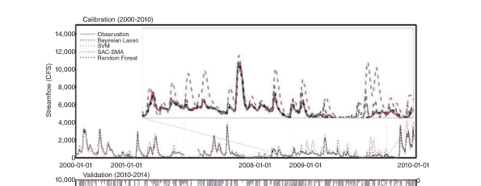

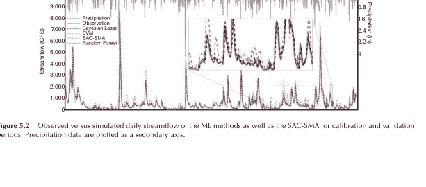

图5.2 校准和验证期间机器学习方法以及SAC-SMA的观测与模拟日径流对比。降水数据以次坐标轴绘制。


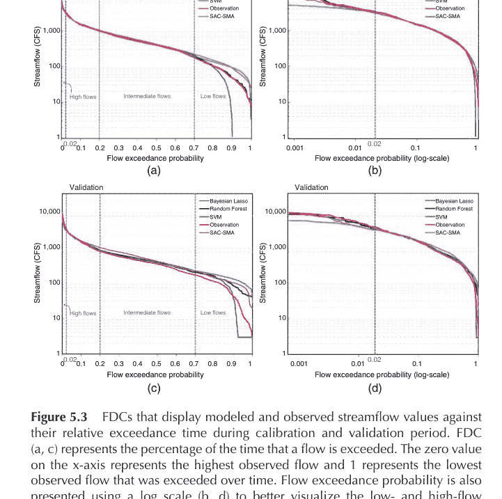

图 5.3 在校准和验证期间显示模拟和观测径流值与其相对超额时间的流量历时曲线。FDC（a、c）表示流量被超过的时间百分比。x 轴上的零值代表观测到的最高流量，1 代表随时间推移被超过的最低观测流量。流量超额概率还使用对数尺度（b、d）呈现，以更好地可视化低流量和高流量的变异性。

中等至低降雨事件。因此，降雨与径流之间的关系可能与降雨量及其分布的动态和时机有关。总体而言，在本研究中使用的各种模型中，贝叶斯 Lasso 为 NE-CFB 降雨-径流模拟提供了有前景的结果。在贝叶斯框架下，Lasso 估计可以解释为具有独立同分布拉普拉斯先验的系数后验模式估计，适用于建模顺序发生的时序数据。

### 5.4. 结论与未来工作

基于回归的机器学习模型可以用作概念性和物理性水文模拟模型的补充。然而，人们仍然担心其提供熟练预测性能的能力，部分原因在于它们需要更多训练数据来生成水文过程、数据中不同程度的噪声以及过拟合，这些都可能转化为建模结果中大量的误差和不确定性。我们认为，机器学习模型在沿海平原排水系统日径流模拟方面的潜在益处只能通过制定稳健而严格的贝叶斯 Lasso 接口来实现，该接口作为后验模式估计，非常适合评估顺序径流时间序列数据的输入-输出行为（行为一致性）。

一个明显的方法来减少障碍并提高机器学习保真度是使用预处理方法（例如，奇异谱和小波分析；参见 Vautard et al., 1992），在大量数据中寻找复杂模式，改进序列到序列学习，并计算噪声方差，然后通过监测噪声分量来捕捉异常值。增强机器学习对时间序列记录中极端观测的建模能力也很重要，需要进一步关注。此外，物理参数（和过程相互作用）可以数学地公式化并纳入机器学习模型，以确保模型输入-输出行为与可用数据和流域特性之间保持适当的一致性。因此，我们的研究小组致力于开发与流域尺度水文模拟模型相当的适当机器学习模型。然而，我们提出的机器学习方法的局限性在于其庞大的计算时间和成本，以及过拟合，使其成为某种程度上较差的预测器。我们正在进行的工作探索开发更先进且计算成本更有效的机器学习算法，例如循环神经网络（RNN），以整合可从网络的循环/结构和数学公式中提取的信息与流域物理属性和观测。始终如一地，我们邀请对这些和相关机器学习模型模拟主题感兴趣的其他人进行对话。

## 致谢

本工作部分得到美国国家科学基金会（NSF）工程局在资助号 CBET 1901646 下的支持。

本研究中表达的任何意见、发现和讨论均为作者本人，并不一定反映 NSF 的观点。感谢克莱姆森大学在 Palmetto 集群上慷慨分配的计算时间。

## 参考文献

- Addor, N., Newman, A. J., Mizukami, N., Clark, M. P. (2017). CAMELS 数据集：大样本研究的流域属性和气象学. Hydrology and Earth System Sciences, 21, 5293–5313.
- Amatya, D. M., & Jha, M. K. (2011). 评估南卡罗来纳州沿海低梯度森林流域的 SWAT 模型. Transactions of the ASABE, 54(6), 2151–2163.
- Asadieh, B., & Krakauer, N. Y. (2017). 21 世纪气候变化下径流极值的全球变化. Hydrology and Earth System Sciences, 21, 5863.
- Box, G. E. P., & Cox, D. R. (1964). 变换分析. Journal of the Royal Statistical Society, Series B, 26, 211–243.
- Breiman, L. (2001). 随机森林. Machine Learning, 45, 5–32.
- Bui, D. T., Pradhan, B., Nampak, H., Bui, Q.-T., Tran, Q.-A., & Nguyen, Q.-P. (2016). 基于神经模糊推理模型和元启发式优化的混合人工智能方法，用于利用 GIS 在高频热带气旋区域进行洪水易发性建模. Journal of Hydrology, 540, 317–330.
- Burnash, R. J. C. (1995). NWS 河流预报系统-流域建模. In V. Singh (Ed.), 流域水文的计算机模型. Water Resources Publications, Colorado, 311–366.
- Campbell, J. L., Driscoll, C. T., Pourmokhtarian, A., & Hayhoe, K. (2011). 美国新罕布什尔州哈伯德布鲁克实验林气候过去和预测未来变化的径流响应. Water Resources Research, 47.
- Corzo, G., Solomatine, D., Hidayat, H., Werner, M., Uhlenbrook, S., et al. (2009). 流量模拟中半分布式过程模型与数据驱动模型的结合：默兹河流域案例研究. Hydrology and Earth System Sciences, 13, 1619–1634.
- Das Bhowmik, R., Seo, S., & Sahoo, S. (2018). 使用多元线性样条的贝叶斯回归进行径流模拟以估计未来变化. Water, 10(7), 875. https://doi.org/10.3390/w10070875
- Deka, P. C. (2014). 水文领域支持向量机应用：综述. Applied Soft Computing, 19, 372–386.
- Efron, B., Hastie, T., Johnstone, I., & Tibshirani, R. (2004). 最小角回归. The Annals of Statistics, 32, 407–499.
- Fang, K., Shen, C., Kifer, D., & Yang, X. (2017). 使用深度学习神经网络将 SMAP 延长至美国大陆时空无缝覆盖. Geophysical Research Letters, 44, 11–30.
- Fotovatikhah, F., Herrera, M., Shamshirband, S., Chau, K., Faizollahzadeh Ardabili, S., & Piran, M. J. (2018). 计算智能作为大洪水管理基础的综述：挑战、研究方向和未来工作. Engineering Applications of Computational Fluid Mechanics, 12, 411–437.
- Gupta, H. V., Kling, H., Yilmaz, K. K., & Martinez, G. F. (2009). 均方误差和 NSE 性能标准的分解：改进水文建模的意义. Journal of Hydrology, 377, 80–91.
- Helgøy, I. M., & Li, Y. (2019). 一种抗噪快速稀疏贝叶斯学习模型. arXiv preprint arXiv:1908.07220.
- Hidalgo, H. G., Das, T., Dettinger, M. D., Cayan, D. R., Pierce, D. W., Barnett, T. P., et al. (2009). 美国西部径流时机变化对气候变化的检测和归因. Journal of Climate, 22, 3838–3855.
- Kratzert, F., Klotz, D., Brenner, C., Schulz, K., & Herrnegger, M. (2018). 使用长短期记忆（LSTM）网络的降雨-径流建模. Hydrology and Earth System Sciences, 22, 6005–6022.
- Kumar, D., Pandey, A., Sharma, N., & Flügel, W.-A. (2016). 使用机器学习方法的日悬移质模拟. Catena, 138, 77–90.
- Loos, M., & Elsenbeer, H. (2011). 森林中地表径流生成的地形控制：集成树方法. Journal of Hydrology, 409, 94–103.
- Maurer, E. P., Wood, A. W., Adam, J. C., Lettenmaier, D. P., & Nijssen, B. (2002). 美国本土长期水文基础的地表通量和状态数据集. Journal of Climate, 26(23), 9384–9392. https://doi.org/10.1175/JCLI-D-12-250508.1
- Murphy, K. P. (2012). 机器学习：概率视角. MIT Press.
- Naghibi, S. A., Ahmadi, K., & Daneshi, A. (2017). 支持向量机、随机森林和遗传算法优化随机森林模型在地下水潜力制图中的应用. Water Resources Management, 31, 2761–2775.
- Nash, J. E., & Sutcliffe, J. V. (1970). 通过概念模型进行河流流量预测 第一部分：原理讨论. Journal of Hydrology, 10(3), 282–290. https://doi.org/10.1016/0022-1694(70)90255-6
- Newman, A. J., Clark, M. P., Sampson, K., Wood, A., Hay, L. E., Bock, A., et al. (2015). 美国本土大样本流域尺度水文气象数据集的开发：数据集特征和水文模型性能区域变异性评估. Hydrology and Earth System Sciences, 19, 209–223. https://doi.org/10.5194/hess-19-209-2015
- Park, T., & Casella, G. (2008). 贝叶斯 Lasso. Journal of the American Statistical Association, 103, 681–686.
- Sadler, J. M., Goodall, J. L., Morsy, M. M., Spencer, K. (2018). 使用泊松回归和随机森林从众包洪水报告建模城市沿海洪水严重程度. Journal of Hydrology, 559, 43–55.
- Samadi, S., Pourreza-Bilondi, M., Wilson, C., & Hitchcock, D. B. (2020). 具有固定和灵活先验的贝叶斯模型平均：降雨-径流建模的理论、概念和校准实验. Journal of Advances in Modeling Earth Systems, 12, e2019MS001924.
- Samadi, S., Tufford, D. L., & Carbone, G. J. (2017). 评估浅层含水层主导的半分布式水文模型的参数不确定性

- 环境系统。*美国水资源协会水资源学报*, 53, 1368–1389.
- Samadi, S. Z., & Meadows, M. E. (2017). 陆地水平衡组分在不确定性和非平稳性下的可转移性：美国东南部沿海平原流域的案例研究。*河流研究与应用* 33, 796–808.
- Shen, C. (2018). 深度学习研究的跨学科综述及其对水资源科学家的相关性。*水资源研究*, 54, 8558–8593. https://doi.org/10.1029/2018WR022643
- Shen, C., Laloy, E., Elshorbagy, A., Albert, A., Bales, J., Chang, F.-J., et al. (2018). HESS 观点：作为一个社区培育深度学习驱动的水文科学进展。*水文学与地球系统科学*, 22.
- Shevade, S. K., Keerthi, S. S., Bhattacharyya, C., & Murthy, K. R. K. (2000). SVM 回归 SMO 算法的改进。*IEEE 神经网络与学习系统汇刊*, 11, 1188–1193.
- Shirmohammadi, A., J. M. Sheridan, & L. E. Asmussen (1986). 南部沿海平原流域冲积河道水文。*美国农业工程师学会汇刊*, 29(1), 135–142.
- Shortridge, J. E., Guikema, S. D., & Zaitchik, B. F. (2016). 经验径流模拟的机器学习方法：季节性流域中模型精度、可解释性和不确定性的比较。*水文学与地球系统科学*, 20.
- Shrestha, A., & Mahmood, A. (2019). 深度学习算法和架构综述。*IEEE Access*, 7, 53040–53065. https://doi.org/10.1109/ACCESS.2019.2912200
- Shrestha, D.L., Kayastha, N., Solomatine, D., & Price, R. (2014). 各种预测机器学习模型对参数不确定性统计的封装：MLUE 方法。*水信息学杂志*, 16 (1), 95–113.
- Simeone, O. (2018). 机器学习的简要介绍及其在通信系统中的应用。*IEEE 认知通信与网络汇刊*, 4(4), 648–664.
- Sivapragasam, C., & Muttil, N. (2005). 流量测算曲线扩展：一种新方法。*水资源管理*, 19, 505–520.
- Smola, A. (2002). 支持向量机、正则化、优化及其以外的研究。
- Solomatine, D. P., & Dulal, K. N. (2003). 模型树作为降雨径流建模中神经网络的替代方案。*水文学科学杂志*, 48(3), 399–411.
- Solomatine, D. P., & Shrestha, D. L. (2009). 一种利用机器学习技术估计模型不确定性的新方法。*水资源研究*, 45, W00B11, https://doi.org/10.1029/2008WR006839
- Solomatine, D. P., & Xue, Y. (2004). M5 模型树和神经网络：中国淮河上游洪水预报的应用。*水文工程杂志*, 9, 491–501.
- Thornton, P. E., Thornton, M. M., Mayer, B. W., Wilhelmi, N., Wei, Y., & Cook, R. B. (2012). Daymet：北美 1 公里网格的日地表气象数据（1980–2012）。Oak Ridge National Laboratory Distributed Active Archive Center.
- Tibshirani, R. (1996). 通过 lasso 进行回归收缩和选择。Journal of the Royal Statistical Society, Series B, 58, 267–288.
- Tongal, H., & Booij, M. J. (2018). 利用与基流分离耦合的机器学习模型模拟和预测径流。Journal of Hydrology, 564, 266–282.
- Vapnik, V. (2013). 统计学习理论的本质。Springer Science & Business Media.
- Vautard, R., Yiou, P., & Ghil, M. (1992). 奇异谱分析：短噪声和混沌信号的工具箱。Physica D, 58, 95–126.
- Wang, Z., Lai, C., Chen, X., Yang, B., Zhao, S., & Bai, X. (2015). 基于随机森林的洪水灾害风险评估模型。Journal of Hydrology, 527, 1130–1141.
- Worland, S. C., Farmer, W. H., & Kiang, J. E. (2018). 利用机器学习改进未设站流域水文低流量指数的预测。Environmental Modeling & Software, 101, 169–182.
- Wu, Y., Liu, Z., Xu, W., Feng, J., Palaiahnakote, S., & Lu, T. (2018). 用于洪水预测的上下文感知注意力 LSTM 网络。24th International Conference on Pattern Recognition (ICPR), Beijing, China, 2018. https://doi.org/10.1109/ICPR.2018.8545385
- Xia, Y., Mitchell, K., Ek, M., Sheffield, J., Cosgrove, B., Wood, E., et al. (2012). 北美陆地数据同化系统项目第二阶段（NLDAS-2）的大陆尺度水和能量通量分析与验证：1. 模型产品的相互比较与应用。Journal of Geophysical Research, 117(D3), D03109. https://doi.org/10.1029/2011jd016048
- Yang, S., Yang, D., Chen, J., Santisirisomboon, J., Lu, W., & Zhao, B. (2020). 一种物理过程与机器学习相结合的水文模型，用于观测数据有限的大流域日径流模拟。Journal of Hydrology, 590, 125206.
- Yang, T., Gao, X., Sorooshian, S., & Li, X. (2016). 利用分类与回归树算法结合洗牌交叉验证方案模拟加州水库运行。Water Resources Research, 52, 1626–1651.
- Yilmaz, K. K., Gupta, H. V., & Wagener, T. (2008). 基于过程的模型评估诊断方法：应用于 NWS 分布式水文模型。Water Resources Research, 44, 1–18. https://doi.org/10.1029/2007WR006716

## 利用近实时卫星降水数据和机器学习改善极端径流建模

Paul Muñoz¹,², Gerald A. Corzo Perez³, Dimitri P. Solomatine³,⁴,⁵, Jan Feyen⁶, and Rolando Célleri¹,²

¹ 水资源与环境科学系，Cuenca 大学，厄瓜多尔 Cuenca
² 工程学院，Cuenca 大学，厄瓜多尔 Cuenca
³ IHE Delft 水教育学院，荷兰代尔夫特
⁴ 代尔夫特理工大学水资源系，荷兰代尔夫特
⁵ 俄罗斯科学院水问题研究所，俄罗斯莫斯科
⁶ 生物科学工程学院，鲁汶天主教大学，比利时鲁汶

极端径流建模受制于缺乏足够且相关的地面信息以及基于物理模型的可靠性较低。本章提出结合降水遥感（RS）产品、机器学习（ML）建模和水文气象知识以改善极端径流建模。用于改善降水表示的方法是基于对象的连通分量分析（CCA），该方法能够对降水进行分类并将其与极端径流事件关联。随机森林（RF）被用作 ML 模型。使用了厄瓜多尔热带安第斯山脉某流域出口处长达两年半的近实时逐小时 RS 降水数据，数据源自 PERSIANN-CCS 和 IMERG-early run 数据库，以及径流数据。所开发的模型显示出对长持续时间降水事件的极端径流模拟能力，无论其空间范围如何，纳什-萨特克利夫效率均高于 0.72。相反，对于短持续时间且空间范围广的降水事件组合，模型性能不可接受。所开发 ML 模型的优势/劣势归因于表示复杂降水-径流响应的能力/难度。

### 6.1. 引言

水管理中使用的基于物理的降水-径流模型通过使用平衡和守恒方程来描述系统中（流域）发生的物理过程（Clark et al., 2017）。然而，这些模型需要大量数据，且可能存在过度参数化问题，限制了其操作价值（Mosavi et al., 2018; Young, 2002）。作为解决方案，在过去几十年中，使用机器学习（ML）技术的数据驱动方法在水文学家中间变得流行（Solomatine et al., 2009; Bontempi et al., 2013; Chang et al., 2019; Galelli & Castelletti, 2013; Mosavi et al., 2018）。兴趣日益增长的一个重要原因是，ML 利用可获得且相关的信息（例如降水、过去径流）来寻找与目标变量（即径流）的关系，而无需了解潜在的物理过程。然而，除了提供准确的水文过程线模拟外，利用 ML 导出水文系统内过程的推断也受到了相当大的批判性关注（Beven, 2020; Herath et al., 2021; Moreido et al., 2021; Nearing et al., 2021; Solomatine & Ostfeld, 2008）。有人认为，对系统中强迫过程的概念化和理解将使 ML 模型能够在训练数据范围之外模拟水文响应，甚至将模型转移到相似的无资料流域（Beven, 2020）。一些用于获得理解的策略（也称为特征工程）可以通过为训练任务添加质量和能量平衡方程来实现，或通过使用土壤类型、土地利用、地形、停留时间分布等额外输入数据对额外过程进行假设检验来实现（Huang & Lee, 2021）。

在 ML 技术中，随机森林（RF）算法被水文学家优先用于径流建模（包括与低概率发生相关联的极端径流量）（Li

et al., 2020; Mosavi et al., 2018; Muñoz et al., 2021, 2018; Orellana-Alvear et al., 2020; Papacharalamous & Tyralis, 2018）。这是因为随机森林模型具有简单性（需要校准的参数较少），且与其他机器学习技术（如支持向量机和人工神经网络）相比精度更高，同时具备模型鲁棒性，以及处理小样本和复杂数据结构的能力（Biau & Scornet, 2016; Breiman, 2001; Contreras et al., 2021; B. Li et al., 2016; Liu et al., 2020; Muñoz et al., 2018, 2021; Papacharalamous & Tyralis, 2018; Tyralis et al., 2019; Wang et al., 2015）。

在数据可用性方面，许多地区的地面降水观测网络要么不存在，要么十分稀少，即便存在，其面密度也极低。这一问题在山地地区尤为突出，例如热带安第斯山脉，由于研究区域地处偏远以及监测机构的预算限制，精确的降水-径流模型的发展受到制约。幸运的是，遥感（RS）产品的持续发展，例如天基卫星，极大地提升了面降水观测的数量（时空分辨率）和质量。然而，由单一传感器（卫星）获取的遥感降水很难提供精确的估算（Hong et al., 2019）。这促使了多卫星降水产品的发展，例如NASA的全球降水测量（GPM）综合多卫星检索（IMERG）（Huffman et al., 2015），以及利用人工神经网络从遥感信息估算降水（PERSIANN）（Hsu et al., 1997）。IMERG和PERSIANN产品具有准全球覆盖、免费获取、高时空分辨率和持续更新的特点（Tang et al., 2016）。鉴于上述优势，这两种遥感产品如今被广泛应用于水文气象领域，包括降水异常追踪（Nguyen et al., 2014; Sakib et al., 2021）、降水预警系统（Sorooshian et al., 2014）以及洪水预报和制图（Belabid et al., 2019; Nguyen et al., 2015）。尤其值得关注的是，如何为特定研究区域确定最优的遥感产品、是否需要组合两种或多种遥感产品，甚至融合遥感数据库以改进降水表征并最小化降水不确定性（Soo et al., 2020; Yin et al., 2021; Yu et al., 2020）。

一旦解决了数据可用性问题，随之而来的研究问题是：（1）遥感数据能否很好地表征降水？（2）在极端径流机器学习模型的背景下，遥感降水的同化能否得到改进？第一个研究问题在需要提供精确降水估算的场景下是必须回答的。这可以通过将遥感产品与地面降水估算进行验证来实现，例如Laverde-Barajas等人（2019）和Li的研究。

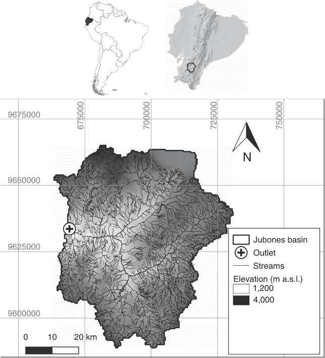

**图6.1** 南美洲厄瓜多尔热带安第斯山脉的Jubones流域（UTM坐标）。

位于Minas-San Francisco水电站大坝上游，海拔在1250至3920米之间。由于安第斯山脉、信风以及来自太平洋的洋流的影响，该流域的气候变化极大。至少可以区分出四个降雨区域，其中包括一个半干旱区域。流域气候从湿润到干旱不等，年均降雨量在空间上从350毫米到1170毫米之间变化。

#### 6.2.2. 数据集

数据集包括覆盖Jubones流域的每小时卫星降水数据，以及在流域出口处水文站收集的每小时径流数据。径流在Minas-San Francisco水电站大坝入口处测量，尽管测量值易受水坝振荡不确定性的影响，但预计通过使用随机森林算法可以吸收/补偿这些影响。此外，由于大坝于2018年完工，研究期约为2.5年，从2018年11月18日至2021年3月31日。

### 遥感降水产品

降水信息来自两个近实时多卫星数据源：IMERG早期运行产品（IMERG-early run）和PERSIANN云分类系统（CCS）降水子产品。数据以每小时为间隔获取。两种降水来源的主要区别在于空间分辨率。PERSIANN-CCS拥有该地区最高的空间分辨率（0.04° × 0.04°），它是利用人工神经网络对红外图像进行处理和云分类的结果（Hong et al., 2004）。而IMERG早期运行产品则是对多种微波降水估算进行插值，并以0.1° × 0.1°的空间分辨率提供数据。

图6.2显示了由PERSIANN-CCS（728.5毫米）和IMERG早期运行（727.2毫米）降水卫星子产品测得的Jubones流域年均降水量。绘制此图时，我们使用了2019年和2020年的每小时信息（另见图6.3中的降水图）。我们发现，PERSIANN-CCS和IMERG早期运行子产品获得的平均年降水量之间的差值为1.3毫米，最大年降水量之间的差值为116毫米。这归因于各卫星子产品的空间分辨率差异和测量原理不同。

### MSF水电站大坝入口处的径流

Jubones流域出口处的每小时径流时间序列数据来自厄瓜多尔电力公司（CELEC EP，https://www.celec.gob.ec/）的服务器，该公司负责管理Minas-San Francisco水电站大坝。图6.3描绘了研究期的径流信息。图6.3a显示每小时时间序列，而图6.3b显示相应的超越概率，基于超阈值法（peak-over-threshold）从中选取了55个近乎独立的峰值流量事件（图6.3a中的深色圆点）。峰值流量

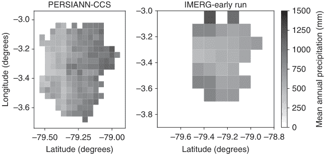

**图6.2** PERSIANN-CCS和IMERG早期运行降水卫星子产品测得的年均降水量（2019年和2020年，单位：毫米）。

事件的选择是使用WETSPRO工具完成的（Willems, 2009）。超越概率分析显示，在研究期内，径流量超过103.5和159.4 m³·s⁻¹的概率分别为10%和5%。这些概率分别对应90%和95%分位数，用于确定极端水文径流事件，以开发极端降水-径流模型。

### 6.3. 方法论

#### 6.3.1. 近乎独立的峰值水文事件的确定

根据完整的径流时间序列，应用以下两个标准来提取极端水文事件：（1）极端水文事件必须超过90%分位数值（98.8 m³·s⁻¹）；（2）此类事件必须近乎独立。为同时满足这两个独立性标准，我们使用了WETSPRO时间序列工具（Willems, 2009），该工具采用超阈值方法将径流序列分割为近乎独立的峰值和低流量事件。WETSPRO有两个需要校准的参数：事件间隔时间和峰值高度。总之，我们选取的极端水文事件其独立性定义由两个连续径流事件的退水时间和峰值高度差控制。

Python 3.7版本的软件包（van der Walt et al., 2014）。该方法包括以下步骤（另见图6.4）：

- 1. 将降水影像裁剪至Jubones流域范围（图6.4a）。
- 2. 识别和定位降水对象（纬度、经度，见图6.4b）。为此我们定义了一个降水阈值

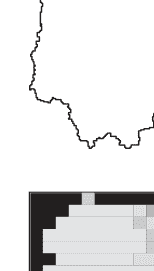


图6.4 基于对象的连通域分析的降水识别 展示了PERSIANN-CCS 2021年12月25日05:00 UTC影像的处理过程：（a）Jubones流域裁剪，（b）从PERSIANN-CCS影像中识别降水量（单位：毫米），（c）通过CCA分析初步识别出七个降水对象，（d）根据对象大小过滤和形态学闭合选取两个降水对象。


体积为 0.5 mm，即与降水量小于 0.5 mm 的降水对象被剔除。此操作是在试错法基础上进行的，并以随机选取的降水事件中观测到的降水对象进行验证。目标是从降水影像中去除噪声，仅保留降水影像中的清晰降水对象（图 6.4c）。

3. 根据尺寸标准对已识别的降水对象进行过滤。同样，我们采用了像素数阈值为 6 的方法，根据与步骤 2 相同的目标进行的试错程序确定。

4. 已识别并过滤的降水对象通过形态学闭合进行处理，作为最终步骤，应用膨胀-腐蚀算法来细化降水对象（图 6.4d）。

5. 从步骤 4 中定义的降水对象中提取物理属性（质心和扩展面积）和水文气象属性（降水量、最大强度、降水持续时间）。对于降水的持续时间，我们定义当两个降水对象出现时间间隔小于 2 小时时，它们被视为连续的（即属于同一事件）。该阈值是在试错法基础上校准的。

此外，还使用了模块化降水方法来分析降水影像。对于 PERSIANN-CCS 子产品未观测到降水的情形，我们将降水数据源切换为 IMERG-early 影像，采用简单的空间欠采样技术。这意味着 IMERG-early 运行单元的尺寸为 0.1° x 0.1° 被直接划分为约 6.4 个分辨率为 0.04° x 0.04° 的单元，与 PERSIANN-CCS 子产品的分辨率相匹配。这种模块化方法确保所有极端水文事件都以存在的降水信号进行训练，减少噪声并提高进一步开发的径流模型的学习过程。

#### 6.3.3. 与极端水文事件相关的降水事件分类

CCA 分析得出的水文气象属性用于对降水事件及其相关的径流响应进行分类。为此我们使用了以下两个标准，分别是降水对象的范围（局部和空间广泛）以及降水事件的持续时间（短和长）。结果，通过定义范围和持续时间阈值，我们可以建立四个降水事件类别：（1）局部和短时极端事件（LSE），（2）局部和长持续时间极端事件（LLE），（3）空间广泛极端事件（SEE），以及（4）空间广泛且长持续时间极端事件（SLE）。

#### 6.3.4. 基于事件的径流建模

我们为每个降水事件类别开发了一个径流模型，以及一个不进行降水区分的模型（基准模型）。为此，我们使用了名为随机森林（RF）的机器学习回归技术。RF 在小节 6.3.4.1 中描述。此外，每个模型的输入特征空间由逐小时降水和径流以及所属降水类别的指示符构成。除了当前时刻的降水和径流信息外，我们还使用了滞后信息，该信息根据统计相关性分析确定：径流的偏相关和自相关函数，以及降水的互相关函数。输入特征空间的构建遵循 Muñoz 等人（2018）开发的方法论，目的是仅向模型添加相关信息并提高其效率。

### 回归的随机森林

随机森林（RF）是一种监督学习机器学习技术，其主要思想是构建多个去相关的树（模型），其中输入特征空间通过依次应用一组层次化组织的条件与输出相关联（Breiman, 2001）。RF 算法的关键是从输入特征空间中随机选择重采样数据集（袋装技术），从而确保随机形成的模型之间去相关。

我们通过 Python 3.7 版本的机器学习包 scikit-learn 实现 RF 径流模型（Pedregosa 等人，2011）。RF 算法的完整解释可在 Breiman（2001）中找到，可概括如下：

- 1. 通过从输入特征空间中随机选择若干自助样本来构建每个决策树。一种称为袋外（OOB）的过程用于形成每个自助样本，大约包含三分之二的输入特征空间。一方面，OOB 过程用于获得回归的无偏估计，另一方面，它允许估计特征空间中每个特征（预测因子）在树构建过程中的重要性。

**表 6.1** RF 径流模型的搜索空间（网格）。

| Hyperparameter | Domain |
|---|---|
| n_trees* | 40;800;10* |
| max_features | n_features, n_features^(1/2), log₂ (n_features) |
| max_depth* | 40;800;10* |

*域由最小值、最大值和增量定义。

- 2. 在每棵树的每个节点上对步骤 1 中选择的数据进行最优分割。这是通过从特征空间中的全部预测因子中确定用于最佳分割的最大特征数量来实现的。这也通过确保多样性和不存在重复模型来避免过拟合。

- 3. 使用步骤 2 中定义的分割来生长步骤 1 中构建的所有树，直到由最大深度参数或最终节点预期最小样本数定义的大小。控制树的深度旨在减少模型的结构复杂性，从而实现模型简约性和噪声降低。

- 4. 将模型的输出确定为所有回归树的平均响应。

根据 Contreras 等人（2021）的研究，水文预报应用中最具影响力的 RF 超参数是森林中树的数量（n_trees）、用于分割数据的最大特征数（max_features）以及用于剪枝的最大深度（max_depth）。对于所有径流模型，我们通过随机网格搜索程序确定了超参数的最佳组合，该程序采用 10 折交叉验证过程以防止过拟合。一致性度量根据训练子集的模拟与观测之间的决定系数（R²）进行评估。表 6.1 展示了所选超参数的域，构成了优化任务的搜索空间。

### 模型评估

我们使用了四个拟合优度指标来评估四个径流模型的效率。Nash-Sutcliffe 效率（NSE）系数被设为衡量和比较整体模型精度的参考。为补充分析，我们依赖 Kling-Gupta 效率（KGE）、百分比偏差（PBIAS）和均方根误差（RMSE）指标。使用了以下方程：

NSE = 1 - [ Σ_{i=1}^n (Q_s(i) - Q_o(i))^2 ] / [ Σ_{i=1}^n (Q_o(i) - \overline{Q_o})^2 ]  (6.1)

KGE = 1 - sqrt( (r - 1)^2 + (α - 1)^2 + (β - 1)^2 )  (6.2)

PBIAS = [ Σ_{i=1}^n (Q_o - Q_s) ] / [ Σ_{i=1}^n Q_o ]  (6.3)

and

RMSE = sqrt( (1/n) Σ_{i=1}^n (Q_s - Q_o)^2 )  (6.4)

其中 n 为实例数，Q_s 为模拟径流，Q_o 为观测径流，\overline{Q_o} 为观测径流均值，\overline{Q_s} 为模拟径流均值，r 为 Q_s 与 Q_o 之间的相关系数，α = σ_s / σ_o 为变异比，β = \overline{Q_s} / \overline{Q_o} 为偏差比，σ 为标准差。

NSE 无量纲，范围在 −∞ 至 1.0 之间，NSE = 1 为最佳值。NSE 的局限性在于低估峰值流量和高估低流量；在这种情况下，建议使用 KGE（Gupta 等人，2009），KGE = 1 为最佳值。此外，PBIAS 的最佳值为 0，正值表示模型低估偏差，负值表示高估偏差。最后，RMSE 衡量模拟与观测之间最佳拟合的模型残差分布情况，RMSE = 0 为最佳值。

### 6.4. 结果

#### 6.4.1. 近似独立峰值水文事件的确定

Jubones 流域的 WETSPRO 工具使用以下参数进行校准：事件间时间 120 小时（即连续极端水文事件必须至少间隔 5 天），以及径流下降的最大比率为 0.6（即径流 q 在两个连续事件之间下降的比率 q_min / q_max < 0.6）。此外，我们仅考虑超过径流时间序列 90% 分位数值的事件（98.8 m³.s⁻¹）。根据这些标准，我们获得了 55 个近似独立的峰值水文事件（见图 6.3a）。


2019年7月13日20:00至2019年7月14日20:00（UTC）的事件中，与IMERG早期运行子产品获得的降水相比，PERSIANN-CCS子产品的最高分辨率似乎能够带来更清晰的降水-径流关系。而在2019年10月7日16:00至2019年10月8日16:00（UTC）的事件中则相反，PERSIANN-CCS的信号几乎不存在，因此使用IMERG早期运行信号来建立降水与径流的关联。

此外，针对46个极端水文事件中的每一个，对使用CCA算法识别出的降水对象进行了追踪。从该分析中获取了以下信息：降水对象的数量、位置（质心）和范围、降水持续时间、总降水体积以及最大降水强度。这些信息汇总于图6.6，并用于推断持续时间和范围阈值，分别为7小时和50平方公里。这些阈值在下一小节中用于对降水事件进行分类。


图6.6 从46个极端水文事件中获取的气象降水信息：(a) 最大强度，(b) 持续时间，(c) 总体积，以及 (d) 最大面积。


图6.7 与Jubones流域极端水文事件相关的降水对象质心（点）位置。

关于Jubones流域内降水对象的位置，质心的出现似乎不受任何可推导的流域物理属性（如海拔、土地利用等）的影响。有意思的是，在Jubones流域没有检测到降水发生热点（见图6.7）。这表明，例如，不存在明显的地形降水增强效应，径流产生过程更多是由降水转化为径流前的入渗和饱和机制驱动的。

#### 6.4.3. 与极端水文事件相关的降水事件分类

7小时和50平方公里的持续时间与范围阈值共同定义了四类降水。我们确定了LSE降水类24个极端水文事件、LLE类5个、SEE类7个、SLE类10个。图6.8展示了降水类别之间的视觉区分，从中可以明显看出，大多数极端水文事件是由短历时、空间局地性（LSE）降水事件以及长历时、空间广阔性（SLE）事件引起的。


**图6.8** 与极端水文事件相关的降水类别：局地短历时极端事件（LSE）、局地长历时极端事件（LLE）、空间广阔极端事件（SEE）以及空间广阔且长历时极端事件（SLE）。

#### 6.4.4. 基于事件的径流模拟

首先，我们将所有极端径流模型的输入特征空间维度定义为当前时刻降水、过去降水以及影响当前径流的过去径流数据的组合。在这方面，径流的偏自相关和自相关函数结果表明，应使用从1到12的过去滞时（小时），两种相关函数的置信水平均为95%。同样，降水的互相关函数确定了13个过去滞时（小时）的降水，相关系数高于0.2。这些结果与Jubones流域的汇流时间一致，该汇流时间通过Giandotti、Johnstone和美国陆军工程兵团方程（推荐用于该流域面积的方程，见de Almeida等人，2014年）得到的汇流时间取平均，估算为11小时。

一旦定义好输入特征空间，我们为每个降水类别和基础模型构建了RF模型。对于每个模型的训练和测试，我们将70%的事件用于训练，其余30%用于测试。例如，None降水类别有46个事件；因此，我们分配32个事件进行训练，14个进行测试。此外，由于目标是模拟每个事件对应的水文过程线，我们使用了峰现事件前后24小时的时间框架。关于RF超参数设置，表6.2列出了每个径流模型的优化超参数组合。每个模型训练子集的模拟与观测之间的决定系数始终高于0.91。

**表6.2** 极端径流模型的RF超参数设置。

| 超参数 | None | LSE | LLE | SLE | SEE |
|---|---:|---:|---:|---:|---:|
| n_trees* | 300 | 280 | 250 | 300 | 300 |
| max_features | 2100^(1/2) | log₂ (2100) | n_features^(1/2) | 2100^(1/2) | log₂ (2100) |
| max_depth* | 200 | 200 | 150 | 180 | 200 |

表6.3总结了用于开发极端径流模型的事件数量，以及各降水类别和基础模型所得NSE系数的比较。从该表可以明显看出，LSE尤其是SEE降水事件导致总体NSE值0.83下降（另见图6.9b和d）。令人惊讶的是，LSE占极端水文事件的大多数，而且看起来矛盾的是，对于LSE事件，用于训练的更多事件数量并没有产生更高的NSE。这表明输入特征空间中存在一些未被充分表示的物理过程，干扰了RF模型的学习过程，这一点将在后文进一步讨论。

**表6.3** 针对不同降水事件专门开发的径流模型在测试子集上的事件数量和效率。

| 降水类别 | 事件总数（测试） | NSE | KGE | PBIAS | RMSE |
|---|---:|---:|---:|---:|---:|
| None | 46 (14) | 0.83 | 0.85 | 4.49 | 55.38 |
| LSE | 24 (7) | 0.67 | 0.71 | −1.45 | 35.00 |
| LLE | 5 (2) | 0.72 | 0.74 | −23.94 | 41.76 |
| SEE | 7 (3) | −1.93 | −0.48 | −61.44 | 60.44 |
| SLE | 10 (3) | 0.90 | 0.94 | −2.72 | 69.09 |

从图6.9中的数据，我们可以推断出每个降水类别模拟的径流幅度范围。图6.9中各子图引人注目的是，无论空间范围如何，短历时降水事件（LSE和SEE类）在Jubones流域出口处引起的极端径流幅度最低。


图6.9 极端径流观测与模拟的散点图：(a) 无降水事件分类，(b) LSE事件，(c) LLE事件，(d) SEE事件，(e) SLE事件。

降水-径流响应可能会误导RF模型的学习过程。这解释了LSE事件（NSE = 0.67）与SLE（0.90）和LLE（0.72）事件相比模型效率较低的原因。在长历时和空间广阔事件（SLE）的情况下则相反，这些事件与最极端的径流幅度相关。对于此类事件，即使可用事件数量不到LSE的一半，模型效率却达到了最大值（NSE = 0.90）。SLE径流模型针对极端径流幅度进行了优化（KGE = 0.94）。从物理上讲，这是因为当流域大部分区域饱和后，RF学习过程变得直接，任何额外的降水量都会直接转化为径流。主要困难来自于对由空间广阔且短历时降水事件（SEE）触发的极端径流的模拟。

已开发和测试模型的效率凸显了开发专用极端径流模型的优势，但也揭示了需要纳入有关前期土壤饱和状态及其随极端水文事件动态变化的额外信息。这对于短历时降水事件（SEE和LSE）尤其必要，因为这些事件的径流产生过程受流域前期饱和状态控制。这就是为什么短历时且非极端的降水强度也能触发极端水文事件的原因。鉴于此，我们鼓励采用Massari等人（2018）使用的方法，即利用卫星土壤湿度观测来改进极端径流预报。此外，揭示Jubones流域径流模拟的局限性，为未来专注于探索其他机器学习算法研究开辟了道路。例如，我们建议探索其他机器学习算法来模拟LSE和SEE事件，并构建一个由专用径流模型集成而成的更优模型。

### 6.6. 结论

本研究探索了使用两种近实时卫星降水资料（未经地面验证）为一个3,391平方公里的流域开发智能极端径流模型的可能性。智能模型的特点是在水文气象准则下，使用机器学习算法并辅以先验数据同化增强。为应对复杂的降水-径流响应并优化径流模型效率，采用了一种直接了当的特征工程方法。本研究得出的主要发现是，改进

降水表征使得极端径流模型的效率最大化。此外，降水区分还揭示了误导RF极端模型学习过程的降水-径流情景。

总的来说，我们发现当降水事件持续时间较长时，其空间范围在RF模型学习过程中没有显著差异。这些特定事件在流域出口产生了最高的径流量。从物理上讲，模拟此类降水事件的成功归因于一个清晰的降水-径流信号，该信号源于降水转化为径流之前的逐渐土壤饱和过程。这一信号通过减少噪声和最大化模型效率，有助于改善RF模型的学习过程。

在输入数据方面，本研究特意使用并测试了两种近实时降水卫星来源，即PERSIANN-CCS和IMERG早期运行子产品。我们使用了一种模块化的降水数据采集框架，该框架移除了40%几乎没有或根本不存在降水信号的降水事件。

这项工作的自然进展是在其他水文条件相似的研究区域测试所提出的方法。本研究的贡献在于让机器学习模型了解水文系统的运作。因此，在有地下水补给的水文系统中必须谨慎；在此，可能需要额外的分析来构思和实施适当的特征工程策略。

总而言之，从流域运作中获得的知识、所提出的特征工程方法以及对近实时卫星降水来源的评估，为水文学家提供了未来开发实时径流预测模型的工具。此外，这项研究可用于协助决策者进行洪水预报、水资源管理、水电发电优化等领域的工作。

## 参考文献

- Belabid, N., Zhao, F., Brocca, L., Huang, Y., & Tan, Y. (2019). 基于卫星降水产品的近实时洪水预报. 遥感, 11(3), 252. https://doi.org/10.3390/rs11030252
- Beven, K. (2020). 深度学习、水文过程与地点的独特性. 水文过程, 34, 3608–3613. https://doi.org/10.1002/HYP.13805
- Biau, G., & Scornet, E. (2016). 随机森林指南. Test, 25, 197–227. https://doi.org/10.1007/s11749-016-0481-7
- Bontempi, G., Ben Taieb, S., & Le Borgne, Y. A. (2013). 时间序列预测的机器学习策略. 见 M. A. Aufaure 和 E. Zimányi (编), 商业智能. eBISS 2012. 商业信息处理讲义, 138. 柏林, 海德堡: Springer. https://doi.org/10.1007/978-3-642-36318-4_3
- Breiman, L. (2001). 随机森林. 机器学习, 45, 5–32. https://doi.org/10.1023/A:1010933404324
- Chang, L.-C., Chang, F.-J., Yang, S.-N., Kao, I.-F., Ku, Y.-Y., Kuo, C.-L., 等. (2019). 构建区域洪水淹没预警系统的智能水信息集成平台. 水, 11, 9. https://doi.org/10.3390/w11010009
- Cisty, M., & Soldanova, V. (2018). 使用机器学习算法的流量预测与流量模拟. 见 P. Perner (编), 模式识别中的机器学习与数据挖掘. MLDM 2018. 计算机科学讲义, 10935. Springer, Cham. https://doi.org/10.1007/978-3-319-96133-0_28
- Clark, M. P., Bierkens, M. F. P., Samaniego, L., Woods, R. A., Uijlenhoet, R., Bennett, K. E., 等. (2017). 基于过程的水文模型的演变：历史挑战与对物理现实性的集体追求. 水文与地球系统科学, 21, 3427–3440. https://doi.org/10.5194/hess-21-3427-2017
- Contreras, P., Orellana-Alvear, J., Muñoz, P., Bendix, J., & Célleri, R. (2021). 随机森林超参数化对安第斯山脉流域短期径流预报的影响. 大气, 12, 238. https://doi.org/10.3390/atmos12020238
- Davis, C., Brown, B., & Bullock, R. (2006). 基于对象的降水预报验证. 第一部分：方法论及其在中小尺度雨区的应用. 每月天气评论, 134, 1772–1784. https://doi.org/10.1175/MWR3145.1
- de Almeida, I. K., Almeida, A. K., Anache, J. A. A., Steffen, J. L., & Alves Sobrinho, T. (2014). 流域地表径流汇流时间估算：综述. Geociências, 33, 661–671.
- Galelli, S., & Castelletti, A. (2013). 评估基于随机树的集成模型在径流模拟中的预测能力. 水文与地球系统科学, 17, 2669–2684. https://doi.org/10.5194/hess-17-2669-2013
- Gupta, H. V., Kling, H., Yilmaz, K. K., & Martínez, G. F. (2009). 均方误差与NSE性能准则的分解：对改进水文模拟的启示. 水文学杂志, 377, 80–91. https://doi.org/10.1016/j.jhydrol.2009.08.003
- Gutiérrez-Jurado, K. Y., Partington, D., Batelaan, O., Cook, P., & Shanafield, M. (2019). 在地中海气候的缓坡流域中，是什么触发了间歇性河流和季节性溪流的径流？ 水资源研究, 55, 9926–9946. https://doi.org/10.1029/2019WR025041
- Herath, H. M. V. V., Chadalawada, J., & Babovic, V. (2021). 水文信息驱动的机器学习用于降雨-径流模拟：走向分布式模拟. 水文与地球系统科学, 25, 4373–4401. https://doi.org/10.5194/HESS-25-4373-2021
- Hong, Y., Hsu, K.-L., Sorooshian, S., & Gao, X. (2004). 利用人工神经网络云分类系统从遥感图像估算降水. 应用气象与气候学杂志, 43, 1834–1853. https://doi.org/10.1175/JAM2173.1
- Hong, Y., Tang, G., Ma, Y., Huang, Q., Han, Z., Zeng, Z., 等. (2019). 遥感降水：传感器、反演、验证与应用. 生态水文过程的观测与测量, 107–128. https://doi.org/10.1007/978-3-662-47871-4_4-1
- Hsu, K., Gao, X., Sorooshian, S., & Gupta, H. V. (1997). 利用人工神经网络从遥感信息估算降水. 应用气象与气候学杂志, 36, 1176–1190. https://doi.org/10.1175/1520-0450(1997)036<1176:PEFRSI>2.0.CO;2
- Huang, P. C., & Lee, K. T. (2021). 地形特征和河网结构对水文响应空间分布的影响. 水文学杂志, 603, 126856. https://doi.org/10.1016/j.jhydrol.2021.126856
- Huffman, G. J., Bolvin, D. T., Braithwaite, D., Hsu, K., Joyce, R., Xie, P., 等. (2015). NASA全球降水测量计划（GPM）的集成多卫星反演（IMERG）. 算法理论基础文档（ATBD）版本4.4, 26.
- Laverde-Barajas, M., Corzo, G., Bhattacharya, B., Uijlenhoet, R., & Solomatine, D. P. (2019). 利用基于对象的方法对极端降雨事件进行时空分析. 见《极端水文事件的时空分析》(第95–112页). Elsevier. https://doi.org/10.1016/B978-0-12-811689-0.00005-7
- Laverde-Barajas, M., Pérez, G. A. C., Chishtie, F., Poortinga, A., Uijlenhoet, R., & Solomatine, D. P. (2020). 分解洪水估算中基于卫星的降雨误差：使用时空对象验证方法的水文响应. 水文学杂志, 591, 125554. https://doi.org/10.1016/j.jhydrol.2020.125554
- Li, B., Yang, G., Wan, R., Dai, X., & Zhang, Y. (2016). 随机森林与其他统计方法在湖泊水位预测中的比较：以中国鄱阳湖为例. 水文研究, 47, 69–83. https://doi.org/10.2166/nh.2016.264
- Li, J., Hsu, K.-L., AghaKouchak, A., & Sorooshian, S. (2016). 基于对象的卫星降水产品评估. 遥感, 8, 547. https://doi.org/10.3390/rs8070547
- Li, M., Zhang, Y., Wallace, J., & Campbell, E. (2020). 估算森林变化响应的年径流量：一种基于随机森林的统计方法. 水文学杂志. https://doi.org/10.1016/j.jhydrol.2020.125168
- Liu, D., Fan, Z., Fu, Q., Li, M., Faiz, M. A., Ali, S., 等. (2020). 基于鲸鱼优化算法的区域洪水灾害韧性随机森林回归评估模型. 清洁生产杂志, 250, 119468.
- Massari, C., Camici, S., Ciabatta, L., & Brocca, L. (2018). 利用基于卫星的地表土壤湿度进行地中海地区洪水预报：状态更新与降雨校正. 遥感, 10(2), 292. https://doi.org/10.3390/rs10020292


...[/content]. The original already has [content] at the start and [/content] at the end. We'll replace the content with our translation.

Let's write the full translation.

One thing: The original has a blank line between each reference. We'll keep that.

Also, the original has "## Part II" and "## Forecasting Water Resources" as separate lines. We'll keep them.

Let's double-check the reference translations for accuracy.

Reference 1: "How well can machine learning models perform without hydrologists? Application of rational feature selection to improve hydrological forecasting." -> "没有水文学家，机器学习模型能表现得多好？应用理性特征选择改进水文预报。" Good.

Reference 2: "Flood prediction using machine learning models: Literature review." -> "使用机器学习模型进行洪水预测：文献综述"

Reference 3: "Application of a machine learning technique for developing short-term flood and drought forecasting models in tropical mountainous catchments." -> "机器学习技术在热带山区流域短期洪水和干旱预报模型开发中的应用"

Reference 4: "Flash-flood forecasting in an Andean mountain catchment-development of a step-wise methodology based on the random forest algorithm." -> "安第斯山区流域山洪预报——基于随机森林算法的逐步方法开发"

Reference 5: "What role does hydrological science play in the age of machine learning?" -> "机器学习时代，水文科学扮演什么角色？"

Reference 6: "Satellites track precipitation of super typhoon Haiyan." -> "卫星追踪超强台风海燕的降水"

Reference 7: "Flood forecasting and inundation mapping using HiResFlood-UCI and near-real-time satellite precipitation data: The 2008 Iowa flood." -> "利用HiResFlood-UCI和近实时卫星降水数据进行洪水预报与淹没制图：2008年爱荷华州洪水"

Reference 8: "Assessment of native radar reflectivity and radar rainfall estimates for discharge forecasting in mountain catchments with a random forest model." -> "基于随机森林模型评估山区流域流量预报中的本地雷达反射率与雷达降雨估算"

Reference 9: "Evaluation of random forests and the prophet for daily streamflow forecasting." -> "随机森林与Prophet模型在日径流预报中的评估"

Reference 10: "Scikit-learn: Machine learning in Python." -> "Scikit-learn：Python中的机器学习"

Reference 11: "Object-based crop identification using multiple vegetation indices, textural features and crop phenology." -> "基于多植被指数、纹理特征和作物物候的面向对象作物识别"

Reference 12: "Performance evaluation of IMERG GPM products during tropical storm Imelda." -> "热带风暴伊梅尔达期间IMERG GPM产品的性能评估"

Reference 13: "Data-driven modeling: Some past experiences and new approaches." -> "数据驱动建模：过去的一些经验与新方法"

Reference 14: "Data-driven modelling: Concepts, approaches and experiences." -> "数据驱动建模：概念、方法与经验"

Reference 15: "Precision of raw and bias-adjusted satellite precipitation estimations (TRMM, IMERG, CMORPH, and PERSIANN) over extreme flood events: Case study in Langat River basin, Malaysia." -> "极端洪水事件中原始与偏差校正卫星降水估算（TRMM、IMERG、CMORPH和PERSIANN）的精度：马来西亚兰加特河流域案例研究"

Reference 16: "Satellite-based remote sensing estimation of precipitation for early warning systems." -> "基于卫星的降水遥感估算用于预警系统"

Reference 17: "Systematic anomalies over inland water bodies of High Mountain Asia in TRMM precipitation estimates: No longer a problem for the GPM era?" -> "TRMM降水估算中亚洲高山内陆水体的系统性异常：GPM时代不再是问题？"

Reference 18: "A brief review of random forests for water practitioners and their recent history in water resources." -> "面向水务从业者的随机森林简要综述及其在水资源领域的近期历史"

Reference 19: "Scikit-image: Image processing in Python." -> "Scikit-image：Python中的图像处理"

Reference 20: "An object-based image analysis approach to assess irrigation-water consumption from MODIS products in Ethiopia." -> "基于对象的图像分析方法评估埃塞俄比亚MODIS产品灌溉用水量"

Reference 21: "Estimation of biomass in wheat using random forest regression algorithm and remote sensing data." -> "利用随机森林回归算法和遥感数据估算小麦生物量"

Reference 22: "Deep learning of subsurface flow via theory-guided neural network." -> "基于理论引导神经网络的地下水流深度学习"

Reference 23: "Flood hazard risk assessment model based on random forest." -> "基于随机森林的洪水灾害风险评估模型"

Reference 24: "A time series tool to support the multi-criteria performance evaluation of rainfall-runoff models." -> "支持降雨径流模型多准则性能评估的时间序列工具"

Reference 25: "Uncertainties of machine learning in predicting the hydrological responses of LID practices." -> "机器学习在预测LID措施水文响应中的不确定性"

Reference 26: "Blending multi-satellite, atmospheric reanalysis and gauge precipitation products to" -> "融合多卫星、大气再分析和雨量计降水产品以"

Now, for the chapter title, we need to be careful with the word "COMPLEMENT" - it means "补充". So "利用机器（深度）学习补充美国大沼泽地南部数值模拟的水位预报" - but the original order is "FORECASTING WATER LEVELS USING ... TO COMPLEMENT NUMERICAL MODELING". So the main action is forecasting water levels using ML to complement numerical modeling. In Chinese, we can say "使用机器（深度）学习进行水位预报，以补充美国大沼泽地南部的数值模拟". That might be clearer. Let's use: "使用机器（深度）学习预报水位，以补充美国大沼泽地南部的数值模拟". But the original title is in all caps, we can translate as a title. I'll go with "利用机器（深度）学习补充美国大沼泽地南部数值模拟的水位预报" - this is a bit awkward. Better: "使用机器（深度）学习进行水位预报，以补充美国大沼泽地南部的数值模拟". Let's use that.

Now, the abstract: "An exact analytical solution to water level may not be possible" - "水位的精确解析解可能无法获得" - good.

"The results showed that rainfall forecasts from weather models could improve water-level forecasts if the accuracy and performance of the weather models can be improved." - "结果表明，如果天气模型的准确性和性能能够提高，来自天气模型的降雨预报可以改善水位预报。" Good.

"The ML models presented here improve water-level predictions from a historical hydrologic model for a 24 hour forecast horizon." - "本文提出的ML模型在24小时预报范围内改进了历史水文模型的水位预测。" Good.

Now, the introduction: "Water level is widely used in flood risk management, monitoring of ground and surface water, and ecosystem and habitat monitoring and restoration in wetland environments (Forde, 2020)." - "水位广泛用于洪水风险管理、地下水和地表水监测，以及湿地环境中的生态系统和栖息地监测与恢复（Forde, 2020）。" Good.

"The Florida Everglades is considered one of the most significant wetland ecosystems in the world, particularly within Everglades National Park (ENP), the southern-most part of the Greater Everglades (Haman & Svendsen, 2006) established in 1947, which was designated as an International Biosphere Reserve in 1976, a World Heritage Site in 1979, and a Ramsar Convention Wetland of International Importance in 1987 (Maltby & Dugan, 1997)." - This is a long sentence. We need to translate carefully. "佛罗里达大沼泽地被认为是世界上最重要的湿地生态系统之一，尤其是在大沼泽地国家公园（ENP）内，该公园是大沼泽地最南端的部分（Haman & Svendsen, 2006），成立于1947年，并于1976年被指定为国际生物圈保护区，1979年被列为世界遗产地，1987年被列为拉姆萨尔公约国际重要湿地（Maltby & Dugan, 1997）。" Good.

"Prior to large-scale alterations of south Florida’s watershed, water flowed unhindered from the Kissimmee River into Lake Okeechobee, which periodically overflowed its southern bank during the wet season and drove sheet flow of surface water through the Everglades into the Gulf of Mexico, Florida Bay, and Biscayne Bay (Ingebritsen et al., 1999) (Fig. 7.1)." - "在对南佛罗里达流域进行大规模改造之前，水流从基西米河无阻碍地流入奥基乔比湖，该湖在雨季定期漫过其南岸，并驱动地表水通过大沼泽地形成片流，流入墨西哥湾、佛罗里达湾和比斯坎湾（Ingebritsen et al., 1999）（图7.1）。" Good.

Next paragraph: "After severe flooding from hurricanes, a levee was constructed around almost all of Lake Okeechobee to prevent the overflow of water and avoid further flooding." - "在遭受飓风引发的严重洪水之后，奥基乔比湖几乎整个周边修建了堤坝，以防止湖水溢出并避免进一步洪水。" Good.

"A network of canals, levees, water control structures, and pumps was built throughout south Florida to provide water supply and flood protection to an ever-increasing population." - "南佛罗里达各地修建了由运河、堤坝、水控制建筑物和泵组成的网络，以向不断增长的人口提供供水和防洪保护。" Good.

"Improvements and expansion of channel networks, development of the historical Everglades wetlands into surface reservoirs called Water Conservation Areas, and the construction of water-control structures further altered the watershed." - "渠道网络的改善和扩建、历史上的大沼泽地湿地被开发为称为“水保护区”的地表水库，以及水控制建筑物的建设，进一步改变了流域。" Good.

"As a result, the natural environment significantly deteriorated due to altered hydrodynamics as it relates to flow, water level, seasonal timing, and spatial distribution (Light & Dineen, 1994)." - "结果，由于与水流、水位、季节时序和空间分布相关的水动力条件改变，自然环境显著恶化（Light & Dineen, 1994）。" Good.

"The altered flows resulted in shifts in vegetation composition, as well as dramatic reductions in wading bird numbers due to habitat loss and reduced aquatic production, both of which were a result of ecosystem degradation and shortened hydroperiods (Light & Dineen, 1994)." - "水流改变导致植被组成发生变化，同时由于栖息地丧失和水生生产力下降，涉禽数量急剧减少，这两者都是生态系统退化和水文周期缩短的结果（Light & Dineen, 1994）。" Good.

Now, we need to ensure the output is exactly within [content]...[/content]. We'll include the tags.

Let's write the final output. We'll preserve the blank lines between references and sections.

One more thing: The original text has "## Part II" and "## Forecasting Water Resources" - these are Markdown headings. We should keep the "##" and translate the text. So "## 第二部分" and "## 水资源预报".

Also, the chapter title is not a heading in Markdown, but we can keep it as a plain line.

Now, let's produce the final answer.[content]

Moridi, V., Gartsman, B., Solomatine, D. P., & Suchilina, Z. (2021). 没有水文学家，机器学习模型能表现得多好？应用理性特征选择改进水文预报. Water, 13, 1696. https://doi.org/10.3390/w13121696

Mosavi, A., Ozturk, P., & Chau, K.W. (2018). 使用机器学习模型进行洪水预测：文献综述. Water (Switzerland), 10, 1–40. https://doi.org/10.3390/w10111536

Muñoz, P., Orellana-Alvear, J., & Célleri, R. (2021). 机器学习技术在热带山区流域短期洪水和干旱预报模型开发中的应用. In 灾害风险综合研究 (pp. 11–35). Springer. https://doi.org/10.1007/978-3-030-55563-4_2

Muñoz, P., Orellana-Alvear, J., Willems, P., & Célleri, R. (2018). 安第斯山区流域山洪预报——基于随机森林算法的逐步方法开发. Water (Switzerland), 10. https://doi.org/10.3390/w10111519

Nearing, G. S., Kratzert, F., Sampson, A. K., Pelissier, C. S., Klotz, D., Frame, J. M., et al. (2021). 机器学习时代，水文科学扮演什么角色？ Water Resources Research, 57. https://doi.org/10.1029/2020WR028091

Nguyen, P., Sellars, S., Thorstensen, A., Tao, Y., Ashouri, H., Braithwaite, D., et al. (2014). 卫星追踪超强台风海燕的降水. Eos, Transactions American Geophysical Union, 95, 133–135. https://doi.org/10.1002/2014EO160002

Nguyen, P., Thorstensen, A., Sorooshian, S., Hsu, K., & AghaKouchak, A. (2015). 利用HiResFlood-UCI和近实时卫星降水数据进行洪水预报与淹没制图：2008年爱荷华州洪水. Journal of Hydrometeorology, 16, 1171–1183. https://doi.org/10.1175/JHM-D-14-0212.1

Orellana-Alvear, J., Célleri, R., Rollenbeck, R., Muñoz, P., Contreras, P., & Bendix, J. (2020). 基于随机森林模型评估山区流域流量预报中的本地雷达反射率与雷达降雨估算. Remote Sensing, 12, 1986. https://doi.org/10.3390/rs12121986

Papacharalampous, G. A., & Tyralis, H. (2018). 随机森林与Prophet模型在日径流预报中的评估. Advances in Geosciences, 45, 201–208. https://doi.org/10.5194/adgeo-45-201-2018

Pedregosa, F., Varoquaux, G., Gramfort, A., Michel, V., Thirion, B., Grisel, O., et al. (2011). Scikit-learn：Python中的机器学习. Journal of Machine Learning Research, 12, 2825–2830.

Peña-Barragán, J. M., Ngugi, M. K., Plant, R. E., & Six, J. (2011). 基于多植被指数、纹理特征和作物物候的面向对象作物识别. Remote Sensing of Environment, 115, 1301–1316. https://doi.org/10.1016/j.rse.2011.01.009

Sakib, S., Ghebreyesus, D., & Sharif, H. O. (2021). 热带风暴伊梅尔达期间IMERG GPM产品的性能评估. Atmosphere, 12(6), 687. https://doi.org/10.3390/atmos12060687

Solomatine, D., & Ostfeld, A. (2008). 数据驱动建模：过去的一些经验与新方法. Journal of Hydroinformatics, 10(1), 3–22. doi: https://doi.org/10.2166/hydro.2008.015

Solomatine, D., See, L. M., & Abrahart, R. J. (2009). 数据驱动建模：概念、方法与经验. In R. J. Abrahart et al. (Eds.), *实用水文信息学*. Berlin, Heidelberg: Springer. https://doi.org/10.1007/978-3-540-79881-1_2

Soo, E. Z. X., Jaafar, W. Z. W., Lai, S. H., Othman, F., Elshafie, A., Islam, T., et al. (2020). 极端洪水事件中原始与偏差校正卫星降水估算（TRMM、IMERG、CMORPH和PERSIANN）的精度：马来西亚兰加特河流域案例研究. *Journal of Water and Climate Change*, 11, 322–342. https://doi.org/10.2166/WCC.2020.180

Sorooshian, S., Nguyen, P., Sellars, S., Braithwaite, D., AghaKouchak, A., & Hsu, K. (2014). 基于卫星的降水遥感估算用于预警系统. In *极端自然灾害、灾害风险与社会影响* (pp. 99–112). Cambridge University Press.

Tang, G., Long, D., & Hong, Y. (2016). TRMM降水估算中亚洲高山内陆水体的系统性异常：GPM时代不再是问题？ *IEEE Geoscience and Remote Sensing Letters*, 13(12), 1762–1766. https://doi.org/10.1109/LGRS.2016.2606769

Tyralis, H., Papacharalampous, G., & Langousis, A. (2019). 面向水务从业者的随机森林简要综述及其在水资源领域的近期历史. *Water (Switzerland)*. https://doi.org/10.3390/w11050910

van der Walt, S., Schönberger, J. L., Nunez-Iglesias, J., Boulogne, F., Warner, J. D., Yager, N., et al. (2014). Scikit-image：Python中的图像处理. *PeerJ Computer Science*, 2, e453. https://doi.org/10.7717/peerj.453

Vogels, M. F. A., de Jong, S. M., Sterk, G., Wanders, N., Bierkens, M. F. P., & Addink, E. A. (2020). 基于对象的图像分析方法评估埃塞俄比亚MODIS产品灌溉用水量. *International Journal of Applied Earth Observation and Geoinformation*, 88, 102067. https://doi.org/10.1016/j.jag.2020.102067

Wang, L., Zhou, X., Zhu, X., Dong, Z., & Guo, W. (2016). 利用随机森林回归算法和遥感数据估算小麦生物量. *Crop Journal*. https://doi.org/10.1016/j.cj.2016.01.008

Wang, N., Zhang, D., Chang, H., & Li, H. (2019). 基于理论引导神经网络的地下水流深度学习. *Journal of Hydrology*, 584. https://doi.org/10.1016/j.jhydrol.2020.124700

Wang, Z., Lai, C., Chen, X., Yang, B., Zhao, S., & Bai, X. (2015). 基于随机森林的洪水灾害风险评估模型. *Journal of Hydrology*, 527, 1130–1141. https://doi.org/10.1016/j.jhydrol.2015.06.008

Willems, P. (2009). 支持降雨径流模型多准则性能评估的时间序列工具. *Environmental Modelling & Software*, 24, 311–321. https://doi.org/10.1016/j.envsoft.2008.09.005

Yang, Y., & Chui, T. (2020). *机器学习在预测LID措施水文响应中的不确定性*. Proceedings of the 22nd IAHR-APD Congress. Sapporo, Japan.

Yin, J., Guo, S., Gu, L., Zeng, Z., Liu, D., Chen, J., et al. (2021). 融合多卫星、大气再分析和雨量计降水产品以

## 第二部分

## 水资源预报

使用机器（深度）学习进行水位预报，以补充美国大沼泽地南部的数值模拟

Courtney S. Forde¹, Biswa Bhattacharya², Dimitri P. Solomatine²,³,⁴, Eric D. Swain⁵, 和 Nicholas G. Aumen⁶

¹加勒比气象与水文学研究所，圣迈克尔，巴巴多斯
²代尔夫特IHE水教育研究所，代尔夫特，荷兰
³水资源系，代尔夫特理工大学，代尔夫特，荷兰
⁴俄罗斯科学院水问题研究所，莫斯科，俄罗斯
⁵加勒比-佛罗里达水科学中心，美国地质调查局，卢茨，佛罗里达州，美国
⁶东南地区，美国地质调查局，博因顿海滩，佛罗里达州，美国

水位是水资源管理和湿地生态系统的重要指标，定义了水文学中最基本的过程之一。本研究旨在探讨用机器学习（ML）模型补充数值模拟，以预报美国佛罗里达州大沼泽地南部的每日水位的可能性。水位的精确解析解可能无法获得，但利用ML提供的计算方法，可以增强传统的数值技术，以生成更稳健、可扩展的预测。选择了五个地点来应用时间延迟神经网络（TDNN）和长短期记忆递归神经网络（LSTM-RNN）ML模型，这些模型以1天的模拟步长构建，用于估计1、2、3、7和10天的水位预报。结果表明，如果天气模型的准确性和性能能够提高，来自天气模型的降雨预报可以改善水位预报。本文提出的ML模型在24小时预报范围内改进了历史水文模型的水位预测。

### 7.1. 引言

水位广泛用于洪水风险管理、地下水和地表水监测，以及湿地环境中的生态系统和栖息地监测与恢复（Forde, 2020）。佛罗里达大沼泽地被认为是世界上最重要的湿地生态系统之一，尤其是在大沼泽地国家公园（ENP）内，该公园是大沼泽地最南端的部分（Haman & Svendsen, 2006），成立于1947年，并于1976年被指定为国际生物圈保护区，1979年被列为世界遗产地，1987年被列为拉姆萨尔公约国际重要湿地（Maltby & Dugan, 1997）。在对南佛罗里达流域进行大规模改造之前，水流从基西米河无阻碍地流入奥基乔比湖，该湖在雨季定期漫过其南岸，并驱动地表水通过大沼泽地形成片流，流入墨西哥湾、佛罗里达湾和比斯坎湾（Ingebritsen et al., 1999）（图7.1）。

在遭受飓风引发的严重洪水之后，奥基乔比湖几乎整个周边修建了堤坝，以防止湖水溢出并避免进一步洪水。南佛罗里达各地修建了由运河、堤坝、水控制建筑物和泵组成的网络，以向不断增长的人口提供供水和防洪保护。渠道网络的改善和扩建、历史上的大沼泽地湿地被开发为称为“水保护区”的地表水库，以及水控制建筑物的建设，进一步改变了流域。结果，由于与水流、水位、季节时序和空间分布相关的水动力条件改变，自然环境显著恶化（Light & Dineen, 1994）。水流改变导致植被组成发生变化，同时由于栖息地丧失和水生生产力下降，涉禽数量急剧减少，这两者都是生态系统退化和水文周期缩短的结果（Light & Dineen, 1994）。


EDEN 生成的值随后被水资源科学家和管理人员用于开展研究，评估对 CERP（Telis et al., 2015; Conrads et al., 2014）及其他修复和管理工作的生态响应。关于水深，以及由此延伸到大沼泽地的水位而言，一个重要方面是水的时间、空间分布和体积与作为湿地生态系统健康指标的若干物种种群健康之间存在密切关系（Brandt et al., 2016）。此类物种的例子有鳄鱼（Fujisaki et al., 2009）和几种涉禽（Frederick et al., 2009; Lantz et al., 2010），它们直接或间接受湿地水位影响，无论是通过猎物可获得性、觅食习性还是筑巢栖息地（Forde, 2020）。大沼泽地水位的重要性也在 Telis (2006) 和 SFWMD (2021) 中得到强调。

机器学习现已广泛应用于建模的许多方面，其中计算机模型学习大型数据集中模式和关系，并能够对这些数据集进行可泛化的评估，通过识别、利用和测试各种计算方法获得洞察、知识和预测能力（Alpaydin, 2009）。这类模型也称为数据驱动模型，能够解决难以数值描述的复杂系统中的复杂问题。机器学习已被用于解决水文学和水力学中的各种问题，例如见 Solomatine and Dulal (2003)、Bhattacharya and Solomatine (2005)、Kasiviswanathan et al. (2016)、Xiang et al. (2020)、Kao et al. (2020) 和 Moreido et al. (2021)。Abrahart et al. (2012) 提供了人工神经网络 (ANN) 用于水文预报的历史概述。此外，使用 ML 进行水位预报的例子也不胜枚举（例如，Zhu et al., 2020）。Cruz et al. (2018) 成功使用多层 ANN（Aggarwal, 2018）在利用实时降雨、水位和土壤湿度数据预测水位。Amaranto et al. (2018) 展示了使用 ANN（多层感知器）进行地下水位预报的应用。Ma et al. (2019) 的另一项研究使用基于 LSTM 网络的模型显示出有希望的结果，用于研究德国莱茵河流域水位预报的准确性是否可以提高。LSTM 网络是循环神经网络的一种形式，是一种深度学习架构，包含可在长时间内存储信息的记忆单元，已知是预测时间序列、语音识别、文本预测等序列的最优当代网络架构（Kratzert et al., 2018）。与自回归积分滑动平均 (ARIMA) 等传统时间序列预报方法不同，LSTM 能够适应数据特征，如季节性（Siami-Namini, 2018）。此外，LSTM 可以利用更多超参数，并且由于短期记忆的范围可以定义，LSTM 通常优于 SARIMA（季节性 ARIMA）。

我们仅能找到两篇已发表的研究论文，呈现了大沼泽地中明确的水位建模。第一项是 Conrads and Roehl (2007) 的研究，其中使用 ANN 进行水位回溯预报。第二项更适用于本研究，重点关注 A.R.M. Loxahatchee 国家野生动物保护区——即残余大沼泽地最北端的预测边界和非线性水文水位数据的预报（Park et al., 2005）。开发了一个 ANN 模型，利用仅 2 年的训练数据对 16 年期间的水位进行预报，预报时效为 1、2、8 和 14 天。该模型与预报水位的线性模型进行了比较，结果显示 ANN 模型优于线性模型，尤其在更长的提前期更为明显。本研究中未应用用于评估机器学习模型的额外方法，例如可视化工具。

除这些例子外，目前用于预报水位的模型是数值模型，它们模拟整个或大沼泽地特定部分的整体区域水文条件，并由水资源管理者使用。其中一个模型是区域模拟模型 (RSM)，这是一个地表水-地下水模型，用于在自然（排水系统前）条件以及受控条件（如水控制结构的运行）下求解水位和水流。RSM 量化了地下水位、地下水和地表径流以及湿地水文周期等变化（SFWMD, 2006）。RSM 求解于不规则三角网格，被认为是对南佛罗里达水资源管理模型 (SFWMM) 的改进，后者网格为 3.2 x 3.2 km 的正方形网格（SFWMD, 2008）。SFWMM 模拟从奥基乔比湖到佛罗里达湾的水文和水资源系统管理，是评估南佛罗里达复杂水资源管理系统运营变化的工具（SFWMD, 2005）。

另一个区域模拟模型，也是本研究中用于比较的模型，是比斯坎和南大沼泽地沿海输运 (BISECT) 模型，该模型模拟各种情景下的水文条件（Swain et al., 2019）。该模型使用动态方程，使地表水得到充分表示，使其适合在本研究中进行比较。BISECT 以及可能其他区域模型的一个缺点是每个网格单元对输入和输出进行平均，这降低了预测中峰值和谷值的程度。因此，BISECT 模型更适合于长期区域水文条件的分析，而非局部短期预测（Swain et al., 2019）。

许多 ML 模型在预报中使用实时数据，但在与使用数值天气预报 (NWP)（Pu & Kalnay, 2019）进行更长预报时效预测相关的研究仍缺乏。此外，从上述数值模型的特征以及水资源管理者和生态学家面临的问题来看，改进的预报可以帮助运营水资源管理和生态评估，特别是在 CERP 框架下。

本研究的主要目标是应用和测试 ML 模型，以期补充传统的数值模型，从而改善南大沼泽地的水位预报。实现这一目标涉及选择适合预报水位的预测因子。测试了两种用于预测水位的 ML 模型架构，用于各种预报时效并与数值模型进行了比较。本研究的一个新颖之处在于分析 NWP 对水位预测准确性的影响。

### 7.2. Methods

南大沼泽地是一个重要资源，因为 ENP 是大沼泽地仅存的自然部分之一。塔米亚米小径以南的区域（图 7.2）被确定为水位预报将有益的区域。由于在自然生态系统中恢复水文条件是 CERP 的主要目标，水位预报对于指导和帮助修复工作以及水资源管理至关重要。

该区域选定了五个站点（图 7.2）。站点 P33 被确定为指数站点，被认为代表穿过 ENP 的主要排水通道、一个低洼区域——鲨鱼沼泽中的水位和水文周期。站点 NP201 是根据其相对于塔米亚米小径的相对邻近性从 EDEN 网络地图（https://sofia.usgs.gov/eden）中选出，站点 BCA11 也是如此（还选定以沿小径提供空间代表性）。最后，选择了受控制结构 S12A_T 和 S12D_T 影响的两个站点（图 7.2），以便考虑水控制结构的排放。

对于每个站点，均可获得降雨、蒸散发和水位数据，而控制结构 S12A 和 S12D（垂直升降闸门）的排放数据也可获得，所有数据均为日分辨率。对于所有站点，降雨、蒸散发和水位数据的记录期分别为 18 年（2002 年 1 月 1 日至今）、23 年（1995 年 6 月 1 日–2018 年 12 月 31 日）和 30 年（1990 年 1 月 1 日至今）。例外的是 BCA11，其水位记录从 1990 年 12 月 28 日至今。


图7.2 研究区域地图，显示佛罗里达州大沼泽地南部的研究区域以及本研究所用的测站。水流总体方向为由北向南。水利控制建筑物S12A和S12D分别位于测站S12A_T和S12D_T的上游。站名中的T表示尾水（建筑物下游）。测站BCA11、NP201和P33不受建筑物直接影响。NPS = 国家公园管理局；WCA = 水资源保护区（地图改编自Forde（2020）；版权归Courtney Forde 2020所有；经许可使用）。

（“至今”指2020年2月22日）。BCA11站水位记录长度的差异对本研究无实质影响，因为降雨记录始于2002年，我们仅考虑2002年以来的水位记录。降雨预报的数据记录从2006年10月至今，空间分辨率为0.5°×0.5°，最小时间分辨率为6小时。模型的时间分辨率选定为每日。

### 7.3. 工作流程

#### 7.3.1. 数据获取与处理

所使用的数据包括来自USGS EDEN（https://sofia.usgs.gov/eden/eve/index.php）的降雨和水位数据、来自SFWMD DBHYDRO数据库（https://www.sfwmd.gov/science-data/dbhydro）的流量数据，以及来自欧洲中期天气预报中心（ECMWF）（https://apps.ecmwf.int/datasets）的降雨预报数据。各负责采集数据的机构对数据实施了广泛的质量保证措施。流量数据集是唯一存在缺失值的数据集，我们使用SFWMD和美国陆军工程兵团采集的另外两个流量时间序列对缺失值进行了填补。USGS的流量时间序列最为全面，被选用于机器学习模型，但它也存在一些缺失值。为填补USGS流量的缺失值，我们使用另外两个时间序列的值来填补USGS时间序列的缺失部分。由于每个流量时间序列都代表同一位置的数据，数值相似，有些情况下完全相同，这证实了这种替代方法是适当的。

当降雨、水位和流量数据连续无缺失值后，我们对每个时间序列绘图以观察趋势和季节模式。随后对每个测站进行了与降雨的互相关分析和自相关分析，此外还对受建筑物影响的测站进行了与流量的互相关分析，以确定建筑物泄流量对水位的影响。我们发现过去降雨与未来水位之间的相关性不是很高（图7.3a和图7.4a）。由于降雨的随机性以及控制建筑物运行的影响，水位与降雨之间的关系是非线性的，不一定能用相关系数等线性统计量来捕捉。

过去与未来水位之间的高自相关是预期的，因为过去的水位在很大程度上影响未来的水位（图7.3b和图7.4b）。对受控制建筑物影响的测站进行的过去泄流量与未来水位之间的额外互相关分析显示相关系数较高，表明泄流量对附近测站的水位有较大影响（图7.4c）。这些结果表明，过去和当前的水位以及流量（如适用）是预测未来水位的主要因素。然而，从降雨和水位峰值的观测来看，降雨输入可能有助于辅助水位预测，尤其是对事件的预测。


图7.3 三个不受控制建筑物影响的测站的相关性分析：（a）互相关分析（过去降雨–未来水位）；（b）自相关分析（过去水位–未来水位）。


图7.4 受控制建筑物影响的测站的相关性分析：（a）互相关分析（过去降雨–未来水位）；（b）自相关分析（过去水位–未来水位）；（c）互相关分析（过去建筑物泄流量–未来水位）。

任何机器学习工作中的一个重要步骤是将数据划分为训练集、交叉验证集和测试集。数据划分有多种方法，从随机抽样等简单方法，到旨在优化最终模型的更复杂方法（例如遗传算法、自组织映射；Bowden等，2002）。最广泛使用且最简单的方法是随机抽样，本研究对时间延迟神经网络（TDNN）模型使用了该方法。每个子集由从整个数据集中随机选择的样本填充，这避免了模型性能的高偏差（Reitermanova，2010）。LSTM模型的数据划分将在后面章节中说明。

NWP降雨数据来自交互式全球大集合数据集，并从ECMWF（https://apps.ecmwf.int/datasets/）下载。该下载使用Python脚本和应用程序接口（API）完成，API允许连接到ECMWF服务器并下载所需数据。脚本指定了首选的数据类别、数据集类型、所需日期、网格大小、所需参数、所需时间步长以及用于选择目标区域的特定网格坐标。数据以网格格式存储，这些文件使用Panoply软件处理，Panoply是由美国国家航空航天局开发的数据查看工具，可以实现网络通用数据格式（NetCDF）、二进制形式的一般规则分布信息（GRIB）及其他数据集的可视化。

为构建机器学习模型，使用了谷歌的TensorFlow（Abadi等，2016a；Abadi等，2016b）。TensorFlow因其深度学习能力而被广泛使用，高级API Keras（Chollet，2015）使构建和评估机器学习模型变得容易。本研究使用的机器学习技术是ANN，并开发了两种模型架构：多层感知器（MLP）TDNN（Luk等，2001）和LSTM（Sherstinsky，2020）网络。两种架构均设计为单隐藏层（节点数见实验设置），以生成单一输出，每个研究地点各开发一种架构。用于评估模型的性能指标是均方根误差（RMSE）和决定系数（R²）。Python是使用的主要编程语言。

### 7.4. 实验设置

#### 7.4.1. 选择模型输入与数据准备

基于相关性分析以及降雨作为预测因子之一的有效性，我们进行了一系列试验以确定最合适的预测因子组合及其滞后。模型初始运行时使用的输入包括降雨（简称R）（[R_{t-1}, R_t]）、水位（简称WL）（[WL_{t-1}, WL_t]、[WL_{t-2}, WL_{t-1}, WL_t]和[WL_{t-3}, WL_{t-2}, WL_{t-1}, WL_t]的组合）以及流量（简称FLOW）（如适用，组合为[FLOW_t]和[FLOW_{t-1}, FLOW_t]）。因变量为[WL_{t+1}]。与相关性分析类似，使用WL输入的试验提供了最佳结果，并作为进一步实验的基础。对于不受水利控制建筑物影响的测站，将降雨输入添加到最初测试的WL输入组合中，得到组合[R_{t-1}, R_t, WL_{t-1}, WL_t]、[R_{t-1}, R_t, WL_{t-2}, WL_{t-1}, WL_t]和[R_{t-1}, R_t, WL_{t-3}, WL_{t-2}, WL_{t-1}, WL_t]。首先对不受水利控制建筑物影响的测站进行测试，然后将表现最佳的模型组合用于受水利控制建筑物影响的测站测试，并添加额外的流量输入。这里测试的组合为[R_{t-1}, R_t, WL_{t-2}, WL_{t-1}, WL_t, FLOW_t]和[R_{t-1}, R_t, WL_{t-2}, WL_{t-1}, WL_t, FLOW_{t-1}, FLOW_t]。表7.1显示，在大多数预见期，随着降雨输入的加入，模型性能有所提高。这种提高体现在表7.1的RMSE值中。所有试验均使用TDNN模型架构进行。

此外，还进行了其他输入的实验，如降雨的7天移动平均和水位变化，但未带来模型性能的提升，因此未进一步考虑。最终输入组合是根据试验结果确定的。不受控制建筑物直接影响的测站模型（每个测站位置一个模型）使用预测因子[R_{t-1}, R_t, WL_{t-2}, WL_{t-1}, WL_t]进行训练。对于受控制建筑物泄流量影响的测站，使用的预测因子为[R_{t-1}, R_t, WL_{t-2}, WL_{t-1}, WL_t, FLOW_t]。表7.2显示了本研究中每个预测预见期的输入。所使用的测量预测因子为R_{t-1}, R_t, WL_{t-2}, WL_{t-1}, WL_t以及所有FLOW预测因子。所有剩余预测因子


## 表7.1 示例模型的均方根误差。

| 预报时效 | 输入变量：WL | 输入变量：降雨量与WL |
|---|---|---|
| 1天 | 0.02 | 0.02 |
| 2天 | 0.04 | 0.03 |
| 3天 | 0.07 | 0.04 |
| 7天 | 0.11 | 0.07 |
| 10天 | 0.13 | 0.09 |

注：示例模型在测站NP201仅使用水位预测因子以及水位与降雨预测因子选定组合测试时的均方根误差。平均水位为1.8 m。TDNN = 时延神经网络；WL = 水位。

## 表7.2 短期与中期预报时效的详细信息。

| 预报时效 | 不受建筑物影响的测站 | 受建筑物影响的测站 | 输出 |
|---|---|---|---|
| 1天 | R_{t-1}, R_t, WL_{t-2}, WL_{t-1}, WL_t | R_{t-1}, R_t, WL_{t-2}, WL_{t-1}, WL_t, FLOW_t | WL_{t+1} |
| 2天 | R_{t-1}, R_{t+1}, WL_{t-1}, WL_t, WL_{t+1} | R_t, R_{t+1}, WL_{t-1}, WL_t, WL_{t+1}, FLOW_{t+1} | WL_{t+2} |
| 3天 | R_{t+1}, R_{t+2}, WL_t, WL_{t+1}, WL_{t+2} | R_{t+1}, R_{t+2}, WL_t, WL_{t+1}, WL_{t+2}, FLOW_{t+2} | WL_{t+3} |
| 7天 | R_{t+5}, R_{t+6}, WL_{t+4}, WL_{t+5}, WL_{t+6} | R_{t+5}, R_{t+6}, WL_{t+4}, WL_{t+5}, WL_{t+6}, FLOW_{t+6} | WL_{t+7} |
| 10天 | R_{t+8}, R_{t+9}, WL_{t+7}, WL_{t+8}, WL_{t+9} | R_{t+8}, R_{t+9}, WL_{t+7}, WL_{t+8}, WL_{t+9}, FLOW_{t+9} | WL_{t+10} |

注：短期预报时效（1–3天）和中期预报时效（7天和10天）的详细信息。表中的数值天气预报输入带有下划线，预报水位变量以粗体显示，其余变量为实测值。R = 降雨量；WL = 水位。

更远期的时间步长对应的是预报值。如预测因子表所示，每次预测都被用作后续预报时间步预测的输入。换言之，1天预报时效的水位预测被用作2天预报时效预测的输入，依此类推，直至10天。所评估的五个预报时效被分为短期预报（1–3天）和中期预报（7天和10天）。在1天预报之后的每个预报时效中，均使用了来自数值天气预报（NWP）的降雨预报。实测流量用于

### 7.5. 实测降雨与数值天气预报（NWP）降雨预报的对比

欧洲中期天气预报中心（ECMWF）的降雨预报被用作本研究构建模型的预测因子，而其准确性（即，能在多大程度上代表实际降雨）是一个重要问题。由于降雨的随机性，降雨预报容易出现误差，尤其是在热带地区，那里高温以及地球科里奥利力在这些纬度上对大气环流影响的减弱，给天气预报带来了挑战（Sobel, 2012）。尽管每日预报降雨量存在误差，但季节平均值可以让我们了解预报降雨与实测降雨之间的可比性。图7.5中的地图显示，实测降雨与预报降雨之间的平均降雨量差异并不显著。本研究所用测站的旱季（约11月至次年4月）降雨总量（各站总和）在2008–2010年3年预报期的旱季时段为3,883毫米。覆盖测站大致位置的4个ECMWF网格单元的预报降水总量为3,725毫米（图7.5b）。在湿季（约5月至10月），测站降雨总量为15,972毫米，而4个预报网格单元的降水总量为14,316毫米（图7.5d）。

除了降雨预报的固有误差外，预报值是在约50×50 km的网格上平均得到的，而测站记录的是单点降雨。用作模型预测因子的每日降雨量误差对水位预测的影响将予以分析，但预计随着预报时效的增加，误差会更大。

#### 7.5.1. 模型开发

TDNN模型的结构是一个多层感知器前馈网络。输入层的节点具有降雨和水位的输入特征，此外还有将这些相同输入延迟一个或多个时间步的版本。关于TDNN的更多细节可参见Lingras等人（2008）。LSTM模型架构与标准循环神经网络（RNN）相似，但区别在于LSTM中存在记忆块，使其能够存储长期信息并在之后访问这些信息。在这些记忆块中，有称为门的乘法单元，它们有助于长期信息的存储和访问（Xiang等，2020）。关于LSTM网络和记忆单元的进一步描述可参见Hochreiter和Schmidhuber（1997）以及Graves（2012）。


图7.5 2008–2010年研究区旱季和湿季的平均降雨量（毫米）。该图展示了（a）研究区旱季93个测站的插值平均降雨量；（b）覆盖研究区的欧洲中期天气预报中心（ECMWF）网格化降雨预报各网格单元的旱季平均值；（c）湿季93个测站的插值平均降雨量；（d）ECMWF网格化降雨预报各网格单元的湿季平均值。


图7.6 针对每个研究测站，比较各数据驱动模型在每个预报时效下水位（WL）预测均方根误差的图。图（a）、（b）和（c）对应不受控水建筑物影响的测站；（d）和（e）对应受控水建筑物影响的测站。TDNN = 时延神经网络模型；LSTM = 长短期记忆模型；L-regression = 线性回归模型；Naive = 朴素模型。

对于TDNN和LSTM模型，隐藏层均使用非线性双曲正切函数作为激活函数，输出层则使用线性传递函数作为激活函数。在LSTM模型中，循环激活使用sigmoid函数。TDNN的隐藏节点数通过试错法确定，以最小化交叉验证误差为标准，最终得到6个隐藏节点。对LSTM模型的隐藏层分别使用6、8、16和32个节点进行了试验。根据所进行的试验，BCA11和NP201的LSTM模型隐藏层有32个节点，其余测站的LSTM模型则有8个节点。本研究使用均方根传播（RMSProp）优化器，损失（误差）函数为均方误差。该优化器是一种梯度下降优化算法，将梯度除以均方根梯度的移动平均值，首次在名为“Neural Networks for Machine Learning”的在线课程中提出并解释（Tieleman & Hinton, 2012），并被认为最早由Graves（2013）使用。最近，它被用于一项关于随机优化的研究，并被证明对MLP人工神经网络有益，尽管它通常用于循环神经网络（Huk, 2020）。

LSTM的构建方式与TDNN类似，使用相同数量的隐藏层节点、相同的优化器和相同的激活函数。模型训练所用历史序列的长度为10天。对5、7、10和20天的序列窗口长度进行了试验。

交叉验证使用Keras的*EarlyStopping* “回调”（https://www.tensorflow.org/api_docs/python/tf/keras/callbacks/EarlyStopping）功能进行，该功能监测交叉验证子集上的误差（损失），当误差在连续多个训练循环或轮次后不再改善时终止训练。为确保训练不会在误差最小化之前停止，指定了100轮的“耐心”值。该“耐心”值意味着，在交叉验证集误差没有改善的情况下，需要连续经过100轮，训练才会终止。设置该回调是为了确保在训练完成后恢复产生最低交叉验证误差的权重。

配置完成后，可对每个模型进行训练，指定的训练总轮数为500。训练完成后，首先使用随机选择的测试集对TDNN模型进行测试，随后进一步测试其预测3年连续时间序列的能力。LSTM模型仅在3年连续时间序列上进行了测试。这些模型的模拟时间步长为24小时。为了预报7天和10天的时效，需要分别预报4–6天和8–9天的时效，以获得表7.2所示的必要WL输入。

为了进行模型比较，采用了两种基准模型：线性回归模型和朴素模型。针对每种情况，使用相同的输入和损失函数建立了线性回归模型。还基于朴素法进行了随机游走预报。这种类型的预报假设


即在每一点上，从前一步随机走一步，且步长的分布是独立的（Pwasong & Sathasivam, 2015）。本研究中使用的随机游走预测类型为无漂移随机游走，即步长的均值为零。简而言之，该预测假设下一个值与当前值相同。将这些基准模型的性能与机器学习模型的性能进行了比较。

### 7.6. 结果与讨论

#### 7.6.1. 所有数据驱动模型的性能

在比较所有数据驱动模型（TDNN、LSTM、线性回归和朴素模型）时，机器学习模型总体上优于较简单的模型（线性回归和朴素模型）（图 7.6）。对于 BCA11 站点，TDNN 模型在每个所研究的预见期的水位预测中表现最佳。这一观察结果同样适用于 NP201 站点，但 10 天水位预测除外，在该预测中朴素模型的表现优于 TDNN 模型。与 BCA11 站点类似，P33 站点的 TDNN 模型在每个预报预见期均优于其他模型。其余两个站点的图表显示出相似的特征。TDNN 模型在短期预报中的表现与朴素模型相当或更好，同时在中期预报中也表现更好。对于每个站点的每个预见期预测，线性回归模型均不如 TDNN 模型和朴素模型，而 TDNN 模型总体上表现更好。除 S12D_T 外，LSTM 模型在每个站点的中期预报范围预测中均优于线性回归模型。对于 BCA11 和 P33 站点，LSTM 模型也优于朴素模型。然而，LSTM 模型的中期预测结果，尤其是 TDNN 模型的结果，表明机器学习在本研究中是有用的。

#### 7.6.2. 短期预报

以 NP201 站点为例来展示水位预报的结果。TDNN 模型在 3 年连续测试数据上准确预测了提前 1 天的水位，RMSE 为 0.017 m（平均水位 = 1.8 m），R² 为 0.997。在 3 年预测的前 200 天中，水位的峰值和连续变化得到了很好的预测，尤其是标记为 1 和 2 的峰值（图 7.7c）。在长达 3 天的预见期内，这些峰值在时间上和量级上都得到了很好的预测，并且可以与这些点的准确预报降雨量相关联（图 7.7a）。峰值 3 的预测不如峰值 1 和 2 准确，这是由于预报降雨量的微小差异，尤其是 2 天预测的情况。预报降雨量中的这种误差导致了较小的滞后，随后该滞后传播到 3 天预测中。这些观察结果显示了降雨预测因子的影响，但更重要的是，展示了改进的降雨预报如何能够带来更准确的预测。

2 天和 3 天预见期的整体预测 RMSE 分别为 0.027 m 和 0.037 m，两种情况下的 R² 均大于 0.98。在图表末尾（图 7.7c）的预测存在一些滞后，导致在第 143 天和第 149 天的 3 天预测中，实测水位与预测值之间的差异达到 0.25 m 和 0.20 m。考虑到所用预报降雨量的误差，可以解释这一误差。此外，1 天预报中的小预测误差会增大 2 天预测的误差，同时高度自回归的水位输入作为这些预报中的主要预测因子也会产生影响。

在第 505 天，37.8 mm 的降雨峰值导致了水位预测中的峰值，但实测数据中并未观察到该峰值（图 7.7d）。当水位指示旱季时（图 7.7c 和 d 中的最低值），降雨峰值对水位预测的影响似乎比雨季水位较高时（图 7.7b 中三个最高时期所示）更大。这一观察结果还表明，观测到的降雨被自然系统吸收，导致实测水位没有显著上升。系统有多种机制可以在接收降雨的同时不经历水位上升。水控制结构旨在调节水位，且向海岸的排水量会随季节变化。3 年预测中的主要低谷在图 7.7d 中被放大，表明了一段特别干旱的时期，这得到了美国国家气象局天气预报办公室与国家海洋和大气管理局（NOAA）联合发布的《2009 年南佛罗里达天气年度回顾》报告（National Weather Forecast Office, 2009）的证实。该报告指出，2009 年冬季（1 月至 4 月）是截至当时有记录以来最干旱的旱季。

在 3 天水位预测中，第 503 天和第 504 天的水位被高估，高估幅度分别为 0.45 m 和 0.38 m。这种高估可能是由于第 502 天和第 503 天的降雨预报分别为 30.2 mm 和 27.8 mm，导致了两个连续的峰值。注意，在 2008 年旱季（大约第 0 至 130 天），降雨不多时，系统对降雨事件反应更大，水位变化也相应成比例。而在雨季，情况并非如此（图 7.7b）。旱季降雨输入对水位的这种更大影响在训练数据中很可能也存在，这可以解释为什么模型可能在实测没有峰值的地方预测出水位峰值（图 7.7d）。鉴于长期的前期条件影响对降雨的响应，代表 2009 年旱季的水位是呈现给模型的最低值，而先前描述的旱季期间系统响应的特征可能是导致高估的原因。除了预测中的这一异常值外，2009 年旱季的每一次预报都很好，尤其是在捕捉第 514 至 519 天进入雨季的水位上升方面（图 7.7d）。


**图 7.7** NP201 站点的短期预报。(a) 水位预测中使用的降雨量：R_t 为实测降雨量；R_{t+1} 和 R_{t+2} 为预报降雨量；(b) TDNN 模型的三年水位预测；(c) 前 200 天放大图；(d) 第 400–600 天放大图。

LSTM 模型的结果显示，在 1 天预报范围的水位预测中存在滞后。随着后续每个预见期的增加，滞后也在增大，这表明自回归水位预测因子在 LSTM 模型的预测中占主导地位。这一观察结果具体出现在图 7.8b 中第 150 天左右。LSTM 模型对 TDNN 模型结果中分析的三个峰值的预测准确度较低，但与实测数据相比，峰值 1 和 2 的时间在每个短期预报预见期都是相同的，尽管存在滞后。由于仅为 LSTM 模型寻找合适的隐藏节点数量进行了四次试验，对模型参数进行更广泛的优化可能会提高水位预报的准确性。在 LSTM 模型的预测中观察到了与 TDNN 模型预测中类似的特征。


图 7.8 NP201 站点的短期预报。(a) LSTM 模型的三年水位预测；(b) 前 200 天放大图；(c) 第 400–600 天放大图。

#### 7.6.3. 中期预报

正如预期的那样，随着预报范围的延长，7 天和 10 天水位预测的准确性显著降低。与 2 天和 3 天预报类似，中期预测水位中的峰值可以与降雨预报中的峰值相关联。用于预测两个预报范围的降雨预报误差，加上每个预见期预测的误差传播，可能导致这些预见期出现更大的误差。两个中期预报的 RMSE 值分别为 0.069 m 和 0.094 m，R² 分别为 0.94 和 0.89。尽管后两个峰值存在一定的高估（图 7.9b），实测数据的总体模式在预报中仍然得以保留。

即使在如此长的预见期下，由于降雨预报点相当准确，一些峰值仍然得到了很好的预测。对于 7 天水位预测，峰值 1 与实测数据相比有所延迟。表 7.3 表明没有预报降雨量来驱动峰值按时预测，因此该峰值延迟出现。峰值 2 延迟一天出现，这与预报降雨量峰值的预报延迟一天相吻合。峰值 3 得到了很好的预测，因为预报降雨量的时间准确且量级与实测降雨量相当（表 7.3）。从第 139 天到第 200 天，存在显著滞后，导致第 143 天附近的点误差高达 0.35 m（图 7.9c）。在实测水位上升的点上，预报降雨量非常少，导致模型未能预测该点的上升。这一误差从 2 天预报范围就开始累积，因为该预见期在实测数据中没有对应的预报降雨峰值。随着每个预见期的推进，由于降雨预报不准确导致的预测误差，以及更长预见期预报固有的预测误差，水位预测中的相应误差会不断增大。

2009 年旱季预测中的异常峰值误差在每个时间步长中传播，导致预测水位最大峰值出现处的点预测误差高达 0.70 m，该点恰好在实测水位开始上升之前（图 7.9d 中的 7 天水位预报）。有两个降雨峰值，导致了观察到的两个预测峰值。然而，这一误差始于 1 天预测，并不仅仅是由降雨预报造成的。

10 天预测在 7 天预测所指出的区域表现出进一步的误差，原因类似（图 7.9c 和 d）。此外，前 200 天的预报变异性明显大于同期


图 7.9 站点 NP201 的中程预报。 (a) 用于水位预测的降雨量； (b) TDNN 模型的三年轻水位预测； (c) 前 200 天放大； (d) 第 400–600 天放大。

由于预报降雨量更多，短期预报的时间段 (图 7.9c)。

LSTM 模型的中程水位预报在预测中显示出更大的变异性（也在 LSTM 的短期预报中观察到），这可能是由于该模型复杂性或与 TDNN 相比的模型超参数所致。然而，TDNN 模型预测中观察到的总体趋势也在 LSTM 模型的预测中可以看到（图 7.10）。

**表 7.3** 实测与预报的降雨量和水位。

| 天数 | t + 6 时降雨量 (mm) — 实测 | t + 6 时降雨量 (mm) — 预报 | t + 7 时水位 (m) — 实测 | t + 7 时水位 (m) — 预测 | 峰值 |
|---:|---:|---:|---:|---:|---:|
| 37 | 0.0 | 0.0 | 1.49 | 1.49 | 1 |
| 38 | *19.6* | 5.3 | *1.63* | 1.51 | |
| 39 | 18.0 | 1.9 | 1.65 | 1.54 | |
| 40 | 0.0 | 0.6 | 1.65 | 1.6 | |
| 76 | 0.0 | 1.1 | 1.33 | 1.36 | 2 |
| 77 | *25.9* | 4.6 | *1.58* | 1.38 | |
| 78 | 4.3 | *19.1* | 1.59 | *1.65* | |
| 79 | 0.0 | 21.4 | 1.58 | 1.53 | |
| 80 | 0.0 | 0.0 | 1.57 | 1.54 | |
| 91 | 0.0 | 0.0 | 1.52 | 1.49 | 3 |
| 92 | *26.7* | *30.0* | *1.66* | *1.60* | |
| 93 | *39.4* | *46.3* | *1.66* | *1.66* | |
| 94 | 0.0 | 13.1 | 1.66 | 1.60 | |

*注：* 对应 7 天预测中水位峰值的实测与预报降雨量和水位。带下划线的值显示高降雨数据点及相应的水位峰值。带阴影的值显示预报降雨峰值及相应的水位峰值，除峰值 1 外。


**图 7.10** 站点 NP201 的中程预报。 (a) LSTM 模型的三年轻水位预测； (b) 前 200 天放大； (c) 第 400–600 天放大。

由于两个 ML 模型基于数据划分具有不同的训练集，两者之间的引用并不代表真正的比较。由于研究的重点是将其与数值模型进行比较而不是相互比较，所做的引用是为了讨论两个模型的性能，而不是确定哪个 ML 模型更好。

在站点 NP201 的短期和中程水位预报结果中观察到的特征也在其他站点的结果中观察到。这些模型的性能在附录表 7.A1 和 7.A2 中给出。

#### 7.6.4. 与数值模型的 ML 模型比较

BISECT 模型 (Swain & Lohmann, 2019) 以 10 分钟时间步长模拟地表水，因此本研究中使用日平均水位预测进行比较。比较每个模型的逐日水位预测时，结果在南大沼泽的水位预报方面是有希望的。ML 模型能够比数值模型更好地预测峰值和谷值（图 7.11）。BISECT 模型水位预测中与实测数据图中谷值相对应的部分似乎被压平了。谷值的这种压平是因为仅考虑了 BISECT 模型的地表水成分进行比较，因为 ML 模型也完全基于地表水。无论如何，峰值由 ML 模型更准确地预测，这表明，如果加入 BISECT 模型的地下水成分，其整体性能将得到改善；但 ML 模型可能仍能更准确地预测。BISECT 模型的水位可能存在偏差，这因站点而异，例如图 7.11 中站点 NP201 所见的整体平均值偏低。其中一些偏差的原因未知，但其他偏差来自数值网格公式的不确定性，其中一个位置的模型拟合良好可能对应于另一个位置的拟合不良。ML 模型代表彼此独立的位置，因此对一个位置进行更好的拟合调整不会影响其他位置。BISECT 模型能够捕捉总体季节性变化和水位波动，然而由于前面所述的数值模型的特性以及其输入和输出的处理方式，其精度低于 ML 模型。


**图 7.11** 站点 NP201 处 ANN 与 BISECT 模型输出与实测水位的 24 小时水位预报比较。

在将 BISECT 模型的输出与所调查的其余四个站点的 ML 水位预测进行比较时，观察到相似的特征。在每种情况下，ML 模型在预测提前 1 天的水位方面都优于 BISECT 模型。

在南大沼泽这样存在庞大水控制系统的地区，改善水位预报可能具有重要意义。ML 模型被证明在所调查的每个地点预测提前 1 天的水位方面都优于 BISECT 模型，并且可以补充 BISECT 模型监测和分析该地区的水文。需要水位预报的应用可以从这些更准确的局部预报中受益，提高生态研究和评估的质量和准确性，并有助于 CERP。

### 7.7. 结论与未来方向

以下列出了结论和未来方向。

- 1. 机器学习是南大沼泽用于预测水位从而为水资源管理者和生态研究提供水文期的常规数值模型的良好补充。与现有数值模型相比，两个 ML 模型的水位预测准确性均有所提高。

- 2. 对影响水位的预测因子的合理选择对 ML 模型的性能产生了积极贡献。此外，水位输入是预测中最具影响力的变量。
- 3. 将数值模型的天气预报作为 ML 模型的输入纳入其中改善了水位预报，尤其是在更大的提前期（7 天和 10 天）下。数值天气预报模型的技能和准确性是实现水位预报准确性的限制因素。
- 4. 将水控制结构的水量排放纳入 ML 模型（在适用情况下）对水位预报的准确性产生了积极影响。

未来重点关注提高天气预报模型的准确性或选择在降雨预报方面表现良好的天气预报模型可能是有益的。基于 Weather Research and Forecasting (WRF) 代码 (https://www.mmm.ucar.edu/weather-research-and-forecasting-model) 的南佛罗里达本地模型可以提高降雨预报的准确性，因为这是一个中尺度模型，因此其分辨率高于全球 ECMWF 模型。WRF 模型的降雨预报可以通过不同方法使用实测数据进行校正。此外，在每个预报时段使用未来计划的排放量而不是实测排放量可以通过基于预测更好地调整这些排放量来改善系统管理。最后，中程预报可以探索使用集合（委员会）模型的使用，如 Fenicia et al. (2007)、Kayastha et al. (2013) 和 Zhang et al. (2022) 所使用。集合模型可以通过将水位分为若干类别（例如低、中、高），训练多个 ML 模型，每个模型负责其自己的数据类别，然后使用动态加权方案将它们组合起来（Zhang et al., 2018; Zhang et al, 2022, equation (6)）来创建。这种方法通常会导致由具有不同优势和劣势的许多 ML 模型组成的组合集合的性能更高。

## 免责声明

任何对贸易、公司或产品名称的使用仅用于描述目的，并不意味着美国政府的认可。


## 附录

表7.A1 所研究的各站点特定TDNN模型的性能指标。

| 提前期（小时） | BCA11 R2 | BCA11 RMSE（米） | NP201 R2 | NP201 RMSE（米） | P33 R2 | P33 RMSE（米） | S12A_T R2 | S12A_T RMSE（米） | S12D_T R2 | S12D_T RMSE（米） |
|---|---|---|---|---|---|---|---|---|---|---|
| 24 | 0.994 | 0.021 | 0.997 | 0.017 | 0.994 | 0.012 | 0.993 | 0.021 | 0.997 | 0.022 |
| 48 | 0.981 | 0.039 | 0.991 | 0.027 | 0.986 | 0.019 | 0.977 | 0.038 | 0.990 | 0.039 |
| 72 | 0.968 | 0.051 | 0.983 | 0.037 | 0.979 | 0.024 | 0.964 | 0.047 | 0.981 | 0.052 |
| 168 | 0.892 | 0.093 | 0.940 | 0.069 | 0.944 | 0.039 | 0.933 | 0.065 | 0.939 | 0.094 |
| 240 | 0.835 | 0.115 | 0.888 | 0.094 | 0.897 | 0.052 | 0.907 | 0.076 | 0.903 | 0.119 |

表7.A2 所研究的各站点特定LSTM模型的性能指标。

| 提前期（小时） | BCA11 R2 | BCA11 RMSE（米） | NP201 R2 | NP201 RMSE（米） | P33 R2 | P33 RMSE（米） | S12A_T R2 | S12A_T RMSE（米） | S12D_T R2 | S12D_T RMSE（米） |
|---|---|---|---|---|---|---|---|---|---|---|
| 24 | 0.977 | 0.043 | 0.989 | 0.030 | 0.985 | 0.020 | 0.978 | 0.038 | 0.988 | 0.042 |
| 48 | 0.958 | 0.058 | 0.979 | 0.041 | 0.978 | 0.024 | 0.962 | 0.049 | 0.974 | 0.061 |
| 72 | 0.941 | 0.069 | 0.968 | 0.050 | 0.970 | 0.028 | 0.946 | 0.058 | 0.961 | 0.075 |
| 168 | 0.851 | 0.109 | 0.915 | 0.082 | 0.919 | 0.046 | 0.909 | 0.076 | 0.890 | 0.126 |
| 240 | 0.819 | 0.121 | 0.870 | 0.102 | 0.873 | 0.058 | 0.895 | 0.082 | 0.812 | 0.164 |

注：在各提前期的预测期内，各站点的平均水位为：BCA11 = 1.00米；NP201 = 1.80米；P33 = 1.44米；S12A_T = 2.14米；S12D_T = 2.22米。

## 参考文献

Abadi, M., Agarwal, A., Barham, P., Brevdo, E., Chen, Z., Citro, C., et al. (2016a). TensorFlow：异构分布式系统上的大规模机器学习. ArXiv, abs/1603.04467. https://doi.org/10.48550/arXiv.1603.04467

Abadi, M., Barham, P., Chen, J., Chen, Z., Davis, A., Dean, J., et al. (2016b). TensorFlow：一个用于大规模机器学习的系统. 第12届USENIX操作系统设计与实现研讨会, OSDI '16（第265–283页）, 美国佐治亚州萨凡纳, 2016年11月2–4日. https://dl.acm.org/doi/10.5555/3026877.3026899

Abrahart, R. J., Anctil, F., Coulibaly, P., Dawson, C. W., Mount, N. J., See, L. M., et al. (2012). 二十年的无政府状态？神经网络河流预报的新兴主题与突出挑战. *自然地理学进展：地球与环境, 36*（4）, 480–513. https://doi.org/10.1177/0309133312444943

Aggarwal, C. C. (2018). 神经网络导论. 载于*神经网络与深度学习*（第1–51页）. 瑞士：施普林格，Cham.

Alpaydin, E. (2009). *机器学习导论*（第2版）. 麻省理工学院出版社.

Amaranto, A., Munoz-Arriola, F., Corzo, G., Solomatine, D. P., & Meyer, G. (2018). 灌溉农田中使用多种数据驱动模型的半季节性地下水预报. *水信息学杂志, 20*（6）, 1227–1246. https://doi.org/10.2166/hydro.2018.002

Bhattacharya, B., & Solomatine, D. P. (2005). 神经网络和M5模型树在水位流量关系建模中的应用. *神经计算, 63*, 381–396. https://doi.org/10.1016/j.neucom.2004.04.016

Bowden, G. J., Maier, H. R., & Dandy, G. C. (2002). 水资源应用中神经网络模型数据的优化划分. *水资源研究, 38*（2）, 2–1–2–11. https://doi.org/10.1029/2001WR000266

Brandt, L. A., Beauchamp, J. S., Jeffery, B. M., Cherkiss, M. S., & Mazzotti, F. J. (2016). 波动的水深影响美国佛罗里达州大沼泽地美洲短吻鳄（*Alligator mississippiensis*）的身体状况. *生态指标, 67*, 441–450. https://doi.org/10.1016/j.ecolind.2016.03.003

Chollet, F. (2015). *Keras，GitHub仓库*. https://github.com/keras-team/keras

Conrads, P. A., & Roehl, E. A., Jr. (2007). 使用人工神经网络模型扩展大沼泽地水深估算网络（EDEN）中水位数据的水文记录，2000–2006. 美国地质调查局开放文件报告 2007-1350. https://doi.org/10.3133/ofr20071350

Conrads, P. A., Petkewich, M. D., O’Reilly, A. M., & Telis, P. A. (2014). *大沼泽地水深估算网络（EDEN）中水位数据的水文记录扩展，1991–99*. 美国地质调查局科学调查报告 2014–5226. https://doi.org/10.3133/sir20145226

Cruz, F. R. G., Binag, M. G., G. M. R. G., & Uy, F. A. A. (2018). 在带有雨量计、水位、土壤湿度传感器的监测系统中使用多层人工神经网络进行洪水预测. *TENCON 2018–2018 IEEE第10区会议*, 韩国济州（*南*）, 2018年. https://doi.org/10.1109/TENCON.2018.8650387

Eesa, A., & Arabo, W. (2017). 一种用于反向传播的归一化方法：比较研究. *扎胡大学科学杂志, 5*（4）, 319–323. https://doi.org/10.25271/2017.5.4.381

Fenicia, F., Solomatine, D. P., Savenije, H. H. G., & Matgen, P. (2007). 多目标框架中局部模型的软组合. *水文与地球系统科学, 11*（6）, 1797–1809. https://doi.org/10.5194/hess-11-1797-2007

Forde, C. S. (2020). 利用人工神经网络预测水位以支持水资源管理和生态系统恢复：涉禽成功案例研究. *秃鹫, 112*（3）, 460–469. https://doi.org/10.1525/cond.2010.090167

Light, S. S., & Dineen, J. W. (1994). 大沼泽地的水控制. 载于S. M. Davis和J. C. Ogden（编）, *大沼泽地：生态系统及其恢复*（第47–84页）. 佛罗里达州博卡拉顿：CRC出版社.

Lingras, P., Zhong, M., & Sharma, S. (2008). 进化回归与缺失值的神经网络插补. 载于*工业中的软计算应用*（第151–163页）. 柏林，海德堡：施普林格. https://doi.org/10.1007/978-3-540-77465-5_8

Luk, K. C., Ball, J. E., & Sharma, A. (2001). 人工神经网络在降雨预报中的应用. *数学与计算机建模, 33*（6–7）, 683–693. https://doi.org/10.1016/S0895-7177(00)00272-7

Ma, Y., Matta, E., Meißner, D., Schellenberg, H., & Hinkelmann, R. (2019). 机器学习能否提高内河航运水位预报的准确性？案例研究：德国莱茵河流域. 第38届IAHR世界大会巴拿马城2019论文集，水—连接世界，巴拿马城，巴拿马，2019年9月1–6日. https://doi.org/10.3850/38WC092019-0274

Maltby, E., & Dugan, P. J. (1997). 湿地生态系统的保护、管理和恢复：国际视角. 载于S. M. Davis和J. C. Ogden（编）, *大沼泽地：生态系统及其恢复*（第29–46页）. 佛罗里达州博卡拉顿：CRC出版社.

Moreido, V., Gartsman, B., Solomatine, D. P., & Suchilina, Z. (2021). 没有水文学家，机器学习模型能表现得多好？应用理性特征选择改进水文预报. *水, 13*（12）, 1696. https://doi.org/10.3390/w13121696

国家天气预报办公室（2009）. 2009年南佛罗里达天气年度回顾. https://www.weather.gov/media/mfl/news/2009WeatherSummary.pdf

Park, J., Obeysekera, J., & VanZee, R. (2005). 非线性水文水位数据的预测边界与预报. *水文学杂志, 312*（1–4）, 79–94. https://doi.org/10.1016/j.jhydrol.2005.02.022

Perry, W. B. (2008). 南佛罗里达的大沼泽地恢复与水质挑战. *生态毒理学, 17*（7）, 569. https://doi.org/10.1007/s10646-008-0240-y

Pu, Z., & Kalnay, E. (2019). 数值天气预报基础：模式、数值方法和数据同化. 载于Q. Duan等（编）, *水文气象集合预报手册*（第67–97页）. 柏林海德堡：施普林格. https://doi.org/10.1007/978-3-642-39925-1_11

Pwasong, A. D., & Sathasivam, S. (2015). 带漂移随机游走与前馈神经网络模型的预报性能. *国际智能系统与应用杂志（IJISA）, 7*（9）, 49–56. https://doi.org/10.5815/ijisa.2015.09.07

Reitermanova, Z. (2010). 数据分割. WDS’10会议论文汇编，第1部分，捷克共和国布拉格，2010年6月1–4日. extension://elkiechiabook.pmcefcocjdjgjcadp/viewer.html?pdfurl=https%3A%2F%2Fwww.mff.cuni.cz%2Fveda%2Fkonference%2Fwds%2Fproc%2Fpdf10%2FWDS10_105_il_Reitermanova.pdf&clen=155228&chunk=true


Sherstinsky, A. (2020). 循环神经网络（RNN）和长短期记忆（LSTM）网络的基础. Physica D: Nonlinear Phenomena, 404, 132306. https://doi.org/10.1016/j.physd.2019.132306

Siami-Namini, S., Tavakoli, N., & Namin, A. S. (2018). ARIMA与LSTM在时间序列预测中的比较. 2018 17th IEEE International Conference on Machine Learning and Applications (ICMLA), 17–20 December 2018. https://doi.org/10.1109/ICMLA.2018.00227

Sobel, A. H. (2012). 热带天气. Nature Education Knowledge, 3(12), 2. https://www.nature.com/scitable/knowledge/library/tropical-weather-84224797/

Solomatine, D. P., & Dulal, K. N. (2003). 模型树作为降雨径流建模中神经网络的替代方案. Hydrological Sciences Journal, 48(3), 399–411. https://doi.org/10.1623/hysj.48.3.399.45291

South Florida Water Management District (SFWMD) (2005). 南佛罗里达水管理模型第5.5版的文档. https://www.sfwmd.gov/sites/default/files/documents/sfwmm_final_121605.pdf

South Florida Water Management District (SFWMD) (2006). 区域模拟模型（RSM）事实表. https://www.sfwmd.gov/sites/default/files/documents/rsmsplash_2006june1.pdf

South Florida Water Management District (SFWMD) (2008). 区域模拟模型（RSM），模型概述. https://www.sfwmd.gov/sites/default/files/documents/rsm_module_1_0.pdf

South Florida Water Management District (SFWMD) (2021). 2020年全州关于总最大日负荷、流域管理行动计划、最小流量或最低水位以及恢复或预防策略的年度报告. https://fdep.maps.arcgis.com/apps/MapSeries/index.html?appid=07030d938813467a538ad7455b3029

Swain, E. D., & Lohmann, M. A. (2019). 用于评估南佛罗里达半岛水文系统拟议的海平面上升响应和水资源管理计划的FTLOADDS（结合SWIFT2D地表水模型和SEAWAT地下水模型）模拟器，用于比斯坎湾和南部大沼泽地沿海输运（BISECT）模型. U.S. Geological Survey Data Release. https://doi.org/10.5066/P9MDUQPK

Swain, E. D., Lohmann, M. A., & Goodwin, C. R. (2019). 南佛罗里达半岛的水文系统：比斯坎湾和南部大沼泽地沿海输运（BISECT）模型的开发与应用. U.S. Geological Survey Scientific Investigations Report 2019–5045. https://doi.org/10.3133/sir20195045

Telis, P. A. (2006). 支持生态和生物评估的埃弗格莱兹深度估计网络（EDEN）. U.S. Geological Survey Fact Sheet 2006–3087. https://doi.org/10.3133/fs20063087

Telis, P. A., Xie, Z., Liu, Z., Li, Y., & Conrads, P. (2015). 埃弗格莱兹深度估计网络（EDEN）地表水模型，第2版. U.S. Geological Survey Scientific Investigations Report 2014–5209. https://doi.org/10.3133/sir20145209

Tieleman, T., & Hinton, G. (2012). Lecture 6.5-rmsprop: 用其近期幅度的运行平均值除梯度. COURSERA: Neural Networks for Machine Learning, 4(2), 26–31.

Xiang, Z., Yan, J., & Demir, I. (2020). 基于LSTM序列到序列学习的日降雨径流模型. *水资源研究*, 56, e2019WR025326. https://doi.org/10.1029/2019WR025326

Zhang, C., Brodylo, D., Rahman, M., Rahman, M. A., Douglas, T. A., & Comas, X. (2022). 使用基于对象的机器学习集成方法将来自亚热带湿地涡度协方差塔测量的蒸散发进行上推. *环境科学总论*, 831, 154969. https://doi.org/10.1016/j.scitotenv.2022.154969

Zhang, C., Denka, S., Cooper, H., & Mishra, D. R. (2018). 利用基于对象的集成分析和Landsat数据量化沿海大沼泽地sawgrass沼泽地上部生物量. *遥感与环境*, 204, 366–379. https://doi.org/10.1016/j.rse.2017.10.018

Zhu, S., Hrnjica, B., Ptak, M., Choiński, A., & Sivakumar, B. (2020). 使用机器学习模型预测多个温带湖泊的水位. *水文学杂志*, 585, 124819. https://doi.org/10.1016/j.jhydrol.2020.124819

## 在萨尔瓦多水文预报中应用多层感知器人工神经网络（MLP-ANN）

Jose Valles

*荷兰代尔夫特水教育国际研究所，代尔夫特，荷兰*

萨尔瓦多的格兰德德圣米格尔流域几乎每年都会发生洪水，造成交通基础设施、房屋和农田的重大损失，并导致人员撤离。为了预测洪水状况，自2001年以来在当地居民、民防部门和国家水文气象服务部门的合作下建立了早期预警系统（EWS），但该流域尚未实施降雨径流预报模型来预测这些洪水事件。本研究提出了一种多层感知器人工神经网络（MLP-ANN）模型，作为该流域的业务洪水预报模型，以应对短期洪水预报。模型结果显示，对于不超过4小时的提前期，性能优异；对于5至9小时的提前期，结果良好；但对于12小时的预报提前期，结果不令人满意，因为模型低估了一些高流量事件。

### 8.1. 引言

萨尔瓦多自1998年飓风米奇造成影响以来一直实施洪水早期预警系统。经过这次水文气象事件后，许多政府和非政府组织认识到该国洪水脆弱性以及缺乏合适的洪水水文气象监测系统。因此，安装了许多自动水文气象观测站，实施了洪水应急计划，并建立了洪水预报中心，以便监测和预测洪水影响。

早期预警系统的一个主要组成部分是世界气象组织（WMO，2018）所述的监测和洪水预报，这有助于预测其影响并减少财产损失和人员伤亡。洪水预报系统的基础是水文模型。因此，已建立了许多水文模型来预测萨尔瓦多重要流域的水文响应。例如，Häggström和Lindström（1990）将概念性HBV模型校准到中美洲的六条河流，其中包括萨尔瓦多的格兰德德圣米格尔流域。他们发现该模型对格兰德德圣米格尔流域的校准并不令人满意，尽管该模型成功模拟了大部分洪峰。2004年，萨尔瓦多国家水文服务局（2004）报告了莱姆帕流域的降雨径流模型用于预报目的，该流域包括干流上的四个水力发电水库。此外，Riverside Technology（2012）在伊洛潘戈湖和希博阿流域实施了半分布式Sacramento降雨径流模型，该模型以Delft-FEWS独立版本实施，并将其与实时和预报数据集成。在本研究中，提出实施多层感知器人工神经网络（MLP-ANN）技术作为业务预报模型，以应对格兰德德圣米格尔河流域的短期水文洪水预报。该流域几乎每年都会产生洪水，造成交通基础设施、房屋、农作物区和人员撤离的重大损失。该流域没有可操作的降雨径流预报模型，使当地预报员、利益相关者和决策者能够预见洪水状况并为位于洪水易发地区的社区增加响应时间。

在格兰德德圣米格尔流域实施MLP-ANN预报模型的概述如下。第8.2节提供了数据驱动建模的一般介绍，特别是多层感知器人工神经网络（MLP-ANN）技术。第8.3节描述

神经元之间单向流动的连接称为前馈网络。这种流动方向从输入层出发，经过包含神经元的隐藏层，到达输出层（见图 8.1）。在降雨径流建模中，许多作者使用过两种前馈网络类型：多层感知器（MLP）和径向基函数（RBF）。Solomatine 和 Wagener（2011）将 MLP 定义为由若干层相互连接的神经元组成的装置，它使用多参数非线性变换对输入进行转换，使得 resulting model 能够逼近复杂的输入-输出关系。训练过程的目标是使用试错程序优化网络所应用的神经元数量和隐藏层数量（Shamseldin, 1997）。如果隐藏层中的神经元太少，人造神经网络可能无法再现输出函数。相反，如果神经元太多，ANN 可能会过拟合输出函数，从而失去泛化能力（Dawson & Wilby, 2001）。径向基函数是一种前馈 ANN，其拓扑结构与 MLP 相似（Fernando & Jayawardena, 1998），它试图通过其他函数 F(x,σ) 的叠加来逼近函数 y = f(x)，其中 σ 是表征函数在输入空间中宽度的参数（Solomatine & Wagener, 2011）。通常，Gaussian 函数用作 RBF 函数。有关 RBF 网络的更多细节可参见 Dayhoff（1990）、Fernando 和 Jayawardena（1998）、Dawson 和 Wilby（2001）、Sudheer 和 Jain（2003）以及 Solomatine 和 Wagener（2011）。

#### 8.2.2. 数据划分

数据分析和准备是开发水文模型中的重要程序。特别是，DDM 降雨径流模型要求完整的数据集应分为三个不同的数据集：训练（即校准）、交叉验证和验证。DDM 模型中的这种特定数据划分与概念性和物理性模型中校准的标准程序大不相同，因为数据被分为两个数据集：校准和验证。交叉验证数据集用作一个小型测试集，可避免函数过拟合并停止训练过程。验证数据集用作测试集，可让人们看到如果向模型输入新数据，模型将如何表现。然而，Lachtermacher 和 Fuller（1994）指出了三数据集划分中的以下问题。

- 1. 在数据有限的情况下创建三个独立数据集存在困难。在水文学中，很难将数据划分为独立且统计相似的数据集，因此建模者应努力确保分布的相似性。
- 2. 模型结果可能受划分方法的影响。
- 3. 使用交叉验证数据集时，并不总是清楚模型何时开始学习数据的噪声。

#### 8.2.3. 模型输入变量的选择

数据清洗和适当输入变量的选择是 DDM 中的另一个重要步骤，其花费的时间和精力比建模部分更多。现实生活中的数据通常包含大量错误、噪声或缺失数据。此外，异常值也可能构成问题，因为它们可能是极端事件或错误测量的指标。因此，在构建任何水文模型之前，建模者应能够识别这些异常值（即异常值）。

另一个重要步骤是选择模型变量，该选择应考虑底层过程的物理性。在 DDM 中，物理性是通过选择有助于预测输出值的相关输入变量引入的。Bowden 等人（2005）指出，许多 DDM 建模者经常列出大量输入并依赖网络来识别输入。这种建模过程中的缺陷会增加复杂性，降低学习过程和模型性能。

在文献中，Bowden 等人（2005）提出了 DDM 建模中输入确定的五种方法：（1）依赖于先验知识的方法，（2）基于线性互相关的方法，（3）利用启发式方法的方法，（4）从训练好的 ANN 中提取知识的方法，以及（5）上述四种方法的组合。

在本研究中，用于预测未来径流量的最合适输入是使用线性相关和平均互信息（AMI）估计的，正如 Solomatine 和 Dulal（2003）以及 Corzo 等人（2009）所做的那样。

平均互信息（Shannon, 1948）用于研究时间序列变量之间的线性和非线性关系以及滞后效应。它是已知另一组数据时从一组数据中获得的信息量。换句话说，它表示在已知另一数据集（Y）的情况下可以从一个数据集（X）中学到的信息量。

```
AMI = Σ_{i,j} P_{XY}(x_i,y_j) log₂ [ P_{XY}(x_i,y_j) / (P_X(x_i) P_Y(y_j)) ] . (8.3)
```

公式（8.3）给出了平均互信息公式，其中 P_X(x) 和 P_Y(y) 分别是 X 和 Y 的边缘概率密度函数；P_XY(x,y) 是 X 和 Y 的联合概率密度函数。AMI 的高值表明两个变量之间存在强依赖性。相反，如果 X 完全独立于 Y，则 AMI 等于零。

识别相关输入变量的另一种方法是分析预测径流量与输入变量之间的线性相关性。相关性分析仅衡量线性依赖，其中值 +1 表示完全正线性相关，0 表示两个变量之间不存在线性关系，-1 表示完全负线性关系。总体而言，在数据驱动模型的实验设置中，应选择与输出具有高相关性和平均互信息（AMI）的输入变量。这些指标是检测 DDM 中输入变量的良好指标。（Solomatine, 2016）。

### 8.3. Grande de San Miguel 流域的特征

Grande de San Miguel 河是萨尔瓦多最重要的河流之一。它位于萨尔瓦多东部（见图 8.2），介于太平洋和 Tecapa 与 Chinameca 山脉之间。在流域上游，遇到许多快速流动的溪流。这些溪流汇合形成 Grande de San Miguel 河，该河将水注入 Bahia de Jiquilisco，即太平洋中的一个红树林河口（Häggström & Lindström, 1990）。流域总排水面积为 2,397 km²，包括两个湖泊：Olomega 湖（24.2 km²），其对河流水流具有阻尼影响，以及面积为 2.8 km² 的 Jocotal 湖。河流从源头到太平洋的长度约为 120 km，主要支流为 San Francisco、Yamabal 和 Yaguabar 河。

近年来，Grande de San Miguel 河产生的洪水影响因多种因素而增加：城市化加剧和土地利用变化、渗透能力低、侵蚀、水管理薄弱或不存在以及降雨时空分布变化（Servicio Hidrologico Nacional, 2004）。

流域内有降雨数据（见图 8.2），由萨尔瓦多环境和自然资源部（MARN，其西班牙语缩写）提供。此外，La Canoa 站的水位和流量数据也可获得。该


图 8.2 Grande de San Miguel 流域的降雨和水位站。


**表 8.1** 潜在蒸散发-海拔关系。

| 月份 | 回归方程 y = Pₑ (mm)，x = 海拔 (m) |
|---|---|
| 一月 | y = −7E−06x² − 0.0170x + 152.95 |
| 二月 | y = −8E−06x² − 0.0164x + 156.04 |
| 三月 | y = −1E−05x² − 0.0171x + 190.42 |
| 四月 | y = −9E−06x² − 0.0202x + 194.52 |
| 五月 | y = −7E−06x² − 0.0237x + 186.89 |
| 六月 | y = −7E−06x² − 0.0181x + 165.79 |
| 七月 | y = −9E−06x² − 0.0127x + 175.28 |
| 八月 | y = −8E−06x² − 0.0122x + 170.12 |
| 九月 | y = −8E−06x² − 0.0126x + 150.42 |
| 十月 | y = −1E−05x² − 0.0094x + 149.56 |
| 十一月 | y = −9E−06x² − 0.0119x + 142.18 |
| 十二月 | y = −7E−06x² − 0.0168x + 144.91 |

*来源：* 改编自 SNET (2005)。

蒸散发数据是通过使用表 8.1 中所示的蒸散发-海拔关系来估算的。这些关系是使用 Hargreaves 方法和线性回归方程确定的。对于本研究，我们为流向 La Cañoa 站的流域部分训练了一个 MLP-ANN 降雨-径流预报模型，该流域面积为 900 km²。该站用于利益相关者和决策者监测洪水情况。

### 8.4. 方法论

#### 8.4.1. 数据探索

在本研究中，采用具有一个隐藏层且使用 sigmoid 函数、输出层为线性模型的多层感知器人工神经网络 (MLP-ANN) 架构来预测 Grande de San Miguel 流域在不同提前期内的流量。研究的第一个部分与数据清洗和探索有关。在数据驱动模型中，这是一个重要步骤，因为任何错误数据都可能在模型中产生噪声；因此，使用 MATLAB 代码审查数据以检测异常值并删除错误数据。对异常值进行评估，以确定是否应将其删除用于模型训练。例如，如果雨量计记录到 150 mm/hr 的降雨强度，则将其与最近雨量计的值进行比较，以确定降雨强度是否应从分析中删除或保留在模型构建中。此后，使用逆距离加权 (IDW) 方法在流域内对降雨点数据进行平均。此外，La Cañoa 站的水位数据集也被审查以检测尖峰、噪声或可疑值。经过此过程后，所有水位数据点均使用 MARN 提供的流量-水位关系曲线方程转换为流量值。最后，由于流域的集流时间以小时计，因此将流量和降雨值汇总为小时时间步长。

#### 8.4.2. 输入变量选择

在研究的第二部分中，根据使用观测降雨和流量可以预测的最大时间定义了最大预报时效。对于本研究，对流域的物理特征进行了分析，以确定流域内的平均响应时间。经过此过程后，使用相关系数和平均互信息 (AMI) 对降雨、蒸散发和流量之间的相互依赖性进行了分析。此过程的目的是估计哪些过去的降雨 (RF)、蒸散发 (ET) 和流量 (Q) 值对模型输出有较大影响。因此，主要预报公式可表示如下：

$$
Q_{(t+i)} = f(RF_t, RF_{t-1}, RF_{t-2}, \ldots, RF_{t-L}, Q_t, Q_{t-1}, Q_{t-2}, \ldots, Q_{t-N}, ET_t, ET_{t-1}, ET_{t-2}, \ldots, ET_{t-M}), \tag{8.4}
$$

其中，降雨的最优滞后 L、潜在蒸散发的 M 以及流量的 N 是通过针对不同预报提前期 (i) 的模型优化获得的。

#### 8.4.3. 数据划分与模型开发

可用数据被划分为训练、交叉验证和验证。训练数据集的目的是减少观测流量与模拟流量之间的差异。此过程以确保每个输入变量的最大值和最小值都包含在训练数据集中以减少可能的 extrapolation 的方式执行。所有不同提前期的 MLP-ANN 模型均使用 Levenberg-Marquardt 优化算法 (Levenberg, 1944; Marquardt, 1963) 进行训练，学习率为 0.1，一个隐藏层使用 sigmoid 函数，输出层使用线性函数。不同提前期的 ANN-MLP 模型已使用交叉验证数据集进行优化，这使得可以停止训练过程、使用试错优化确定神经元（即节点）数量并避免过拟合（即模型试图拟合所有训练数据点）。最后，验证数据集允许查看模型对从未见过的数据的性能。

每个训练好的不同提前期的 MLP-ANN 预报模型的结果使用拟合优度函数和观测流量与模拟流量之间的目视检验分析进行评估。以下误差函数用作观测流量 (Q_obs) 与模拟流量 (Q_sim) 之间的拟合优度函数。

#### 平均误差 (ME)

平均误差函数使用观测 (Q_obs) 与模拟流量 (Q_sim) 之间的平均差值计算。与此误差相关的问题是它可能显示出较低的值以及较低的准确性和精确度。

$$
ME = \frac{\sum (Q_{sim} - Q_{obs})}{n} \tag{8.5}
$$

#### Nash-Sutcliffe 效率 (NSE)

Nash-Sutcliffe 效率 (1970) 定义为模拟值与观测值之间绝对平方差之和除以观测值方差的归一化值减一。NSE 范围从 −∞ 到 1，其中值为 1 表示观测流量与模拟流量之间完美再现。相反，如果 NSE 值等于或小于 0，则意味着模型不如平均观测流量 (Q̅_obs) 具有更好的预测能力。在文献中，大于 0.6 的值表示模型性能令人满意 (Gupta et al., 1998)。该拟合优度函数的主要缺点由 Legates 和 McCabe (1999) 以及 Krause 等人 (2005) 指出，即 NSE 值高估较大值而忽视较小值。

$$
NSE = 1 - \frac{\sum (Q_{sim} - Q_{obs})^2}{\sum (Q_{obs} - \overline{Q}_{obs})^2} \tag{8.6}
$$

#### 均方根误差 (RMSE)

均方根误差 (RMSE) 是验证水文模型性能的广泛使用的拟合优度函数，确保最大似然估计 (MLE)。该误差函数惩罚较大偏差，这通常在高流量中发现，但偏差和形状可能未被考虑 (Corzo Perez, 2009)。

$$
RMSE = \sqrt{\frac{\sum (Q_{sim} - Q_{obs})^2}{n}} \tag{8.7}
$$

#### 归一化均方根误差 (NRMSE)

归一化均方根误差 (NRMSE) 将经典 RMSE 与测量值的标准差 (σ_obs) 进行比较。该误差函数可用于比较不同时间序列 (Corzo Perez, 2009)。

$$
NRMSE = \frac{RMSE}{\sigma_{obs}} \tag{8.8}
$$

#### Kling-Gupta 效率 (KGE)

Kling-Gupta 效率 (KGE) 由 Gupta 等人 (2009) 提出。它基于 Nash-Sutcliffe 效率的分解为三个不同的分量，表示线性相关 (r)、变异偏差 (α) 和均值偏差 (β)。

$$
KGE = 1 - \sqrt{(r - 1)^2 + (\alpha - 1)^2 + (\beta - 1)^2} \tag{8.9}
$$

公式 (8.9) 可用以下公式表示：

$$
KGE = 1 - \sqrt{(r - 1)^2 + \left(\frac{\sigma_{sim}}{\sigma_{obs}} - 1\right)^2 + \left(\frac{\mu_{sim}}{\mu_{obs}} - 1\right)^2} \tag{8.10}
$$

其中 σ_obs 为观测值的标准差，σ_sim 为模拟值的标准差，μ_sim 为模拟均值，μ_obs 为观测均值。与 NSE 类似，KGE 值等于 1 表示观测流量与模拟流量之间完全一致。

不同提前期的 MLP-ANN 预报模型与朴素基准模型进行了比较，这使得可以基准模型性能并评估复杂的预报模型 (MLP-ANN) 基于简单自回归模型在多大程度上改善了结果。


图 8.3 构建 MLP-ANN 模型的整体方法。

预报模型。朴素参考模型是一种简单模型，它假设预见期 i 的预报流量等于最近可用的观测流量（见公式 (8.11)）。

$Q_{(t+i)} = Q_t.$
(8.11)

总而言之，图 8.3 展示了在格兰德德圣米格尔流域构建多层感知器人工神经网络（MLP-ANN）所采用的前述步骤的整体方法。

### 8.5. 实验设置

#### 8.5.1. 输入变量选择的数据分析

MLP-ANN 预报模型的目标是概括输入（过去的降雨、潜在蒸散量和流量）与输出（不同预见期的流量）之间的关系。首要任务之一是确定最大预报时域，即能够使用观测数据预测流量的范围。这通过分析流域的物理特征来实现，从而识别反应时间或响应时间。图 8.4 展示了拉卡诺阿站在一次高流量事件中的观测平均面降雨量和流量。可以得出结论，降雨事件（11月20日 15:00）与流量峰值（11月21日 03:00）之间的时间为 12 小时。当然，这种响应或反应时间在不同的高流量事件中可能有所不同，因为它取决于降雨的空间分布或土壤湿度。尽管如此，降雨量被视为整个流域的平均计算结果。因此，将训练不同的 MLP-ANN 模型来预测提前 1、2、3、4、5、6、9 和 12 小时的流量。

在 MLP-ANN 水文预报中，模型输入的选择极其重要。另一个重要任务是选择合适的滞时，因为流域的动态可以通过一组相对于输出流量进行适当离散化和滞后的变量来近似（Solomatine & Dulal, 2003）。在本研究中，影响拉卡诺阿站预测流量的水文气象变量包括降雨、蒸散量和流量本身。然而，需要指出的是，并非所有这些变量都对输出流量产生实质性影响。变量间的相互依赖性分析有助于识别对输出预测有重大影响的水文气象变量和滞时。由此，图 8.5 展示了提前 1 小时流量与降雨、蒸散量和流量本身之间的相关系数（CoC）和平均互信息（AMI）分析。可以看出，过去流量在滞后 1 小时时提供最大的 AMI 和 CoC，然后开始下降，这意味着过去流量对预测流量本身有重大影响。此外，降雨变量的 AMI 和 CoC 在滞后约 10 小时时开始上升，然后在滞后约 14 小时时开始下降；这种行为意味着过去 10 到 14 个时间步的降雨数据可以用作模型输入。此外，


图 8.4 基于流域物理特征的响应时间。


图 8.5 预测流量（Qt +1）与降雨（RF）、潜在蒸散量（ET）和流量（Q）本身的相关系数（a）和 AMI（b）分析。

**表 8.3** 训练、交叉验证和验证流量数据集的统计特性。

| 统计特性 | 训练 | 交叉验证 | 验证 |
|---|---:|---:|---:|
| 数据点（小时） | 15,058 | 6,453 | 5,000 |
| 最大值（m³/s） | 167.17 | 163.87 | 157.75 |
| 最小值（m³/s） | 0.84 | 1.78 | 1.36 |
| 平均值（m³/s） | 14.45 | 14.12 | 12.64 |
| 标准差（m³/s） | 21.05 | 23.11 | 19.15 |

**表 8.4** 训练、交叉验证和验证降雨数据集的统计特性。

| 统计特性 | 训练 | 交叉验证 | 验证 |
|---|---:|---:|---:|
| 数据点（小时） | 15,058 | 6,453 | 5,000 |
| 最大值（mm） | 28.23 | 20.67 | 19.07 |
| 最小值（mm） | 0.00 | 0.00 | 0.00 |
| 平均值（mm） | 0.14 | 0.18 | 0.16 |
| 标准差（mm） | 0.88 | 1.03 | 0.93 |

并使用线性模型作为输出层，在萨尔瓦多的格兰德德圣米格尔河流域预测流量，最大预报时域为 12 小时。每个训练好的 MLP-ANN 模型都通过目视检查和拟合优度函数（上文已介绍）与观测数据进行了比较，同时也与朴素参考模型进行了比较。

图 8.6 展示了验证数据集中预见期为 1 小时的观测流量与模拟流量之间的结果。这些结果表明，拉卡诺阿站的高流量和低流量均得到了极佳的呈现，并证实了 MLP-ANN 能够预测提前 1 小时的流量。

解释 MLP-ANN 预报模型如何对其输入进行加权也至关重要。图 8.7 显示了预见期为 1 小时的输入变量与 MLP-ANN 模型中每个隐藏节点或神经元的最终权重之间的关系。该图显示，流量在网络中的权重大于降雨，因为过去的流量对预报模型有重大影响。


图 8.6 验证数据集中预见期为 1 小时的观测与模拟（MLP-ANN）之间的（a）散点图和（b）流量过程线比较。


图 8.7 预见期为 1 小时的 MLP-ANN 预报模型中模型输入与每个节点或神经元的最终权重之间的关系。

与朴素参考模型相比，结果表明两种模型均能够重现提前 1 小时的预测流量。从图 8.8a 可以看出，MLP-ANN 和朴素模型均能够重现验证期内的高流量和低流量。此外，图 8.8b 展示了单次高流量事件的结果，两种模型都重现了拉卡诺阿站的峰值流量，但朴素模型在流量峰值出现时间上存在延迟。

表 8.5 和图 8.9 展示了不同预报预见期（3、6、9 和 12 小时）下预测与观测流量过程线之间的性能指标和散点图。这些结果表明，随着预见期的增加，模型性能逐渐下降，尤其是 RMSE、NRMSE、NSE 和 KGE 值。对于大于 2 小时的预见期，朴素参考模型的平均误差（ME）优于 MLP-ANN 模型。这些结果基本上意味着朴素参考模型的平均模型误差低于 MLP-ANN 模型，但平均误差公式并未衡量误差的大小。还应注意，当预报预见期为 12 小时时，


**图 8.8** 验证数据集中连续记录期（a）和高流量事件（b）内观测流量、朴素模型和 MLP-ANN 对 $Q_{t+1}$ 的比较。

**表 8.5** 验证数据集上 MLP-ANN 和朴素预报模型的拟合优度函数汇总。

| 模型 | ME（m³/s） | NSE（−） | RMSE（m³/s） | NRMSE（−） | KGE（−） |
|---|---:|---:|---:|---:|---:|
| $Q_{t+1}$ Naïve | 0.001 | 0.971 | 3.282 | 0.171 | 0.985 |
| MLP-ANN | 0.033 | 0.993 | 1.578 | 0.082 | 0.996 |
| $Q_{t+2}$ Naïve | 0.001 | 0.896 | 6.164 | 0.322 | 0.948 |
| MLP-ANN | 0.071 | 0.957 | 3.957 | 0.207 | 0.977 |
| $Q_{t+3}$ Naïve | 0.002 | 0.799 | 8.588 | 0.448 | 0.899 |
| MLP-ANN | −0.015 | 0.901 | 6.021 | 0.314 | 0.943 |
| $Q_{t+4}$ Naïve | 0.003 | 0.693 | 10.616 | 0.554 | 0.846 |
| MLP-ANN | 0.056 | 0.843 | 7.596 | 0.397 | 0.914 |
| $Q_{t+5}$ Naïve | 0.003 | 0.586 | 12.318 | 0.643 | 0.793 |
| MLP-ANN | −0.154 | 0.787 | 8.382 | 0.461 | 0.86 |
| $Q_{t+6}$ Naïve | 0.004 | 0.484 | 13.757 | 0.718 | 0.742 |
| MLP-ANN | −0.137 | 0.766 | 9.263 | 0.484 | 0.836 |
| $Q_{t+9}$ Naïve | 0.006 | 0.22 | 16.91 | 0.883 | 0.61 |
| MLP-ANN | −0.482 | 0.679 | 10.855 | 0.567 | 0.761 |
| $Q_{t+12}$ Naïve | 0.008 | 0.042 | 18.749 | 0.979 | 0.521 |
| MLP-ANN | −0.487 | 0.576 | 12.467 | 0.651 | 0.682 |


图8.10 朴素模型与MLP-ANN预报模型在不同预见期下的性能比较。

表8.6 MLP-ANN预报模型中的隐藏节点（神经元）数量。

| 输入变量 | 输出变量 | 隐藏节点 |
|---|---|---|
| RF_t-14, RF_t-13, RF_t-12, RF_t-11, RF_t-10, Q_t-2, Q_t-1, Q_t | Q_t+1 | 7 |
| RF_t-13, RF_t-12, RF_t-11, RF_t-10, RF_t-9, Q_t-2, Q_t-1, Q_t | Q_t+2 | 7 |
| RF_t-12, RF_t-11, RF_t-10, RF_t-9, RF_t-8, Q_t-2, Q_t-1, Q_t | Q_t+3 | 6 |
| RF_t-11, RF_t-10, RF_t-9, RF_t-8, RF_t-7, Q_t-2, Q_t-1, Q_t | Q_t+4 | 7 |
| RF_t-10, RF_t-9, RF_t-8, RF_t-7, RF_t-6, Q_t-2, Q_t-1, Q_t | Q_t+5 | 7 |
| RF_t-9, RF_t-8, RF_t-7, RF_t-6, RF_t-5, Q_t-2, Q_t-1, Q_t | Q_t+6 | 6 |
| RF_t-6, RF_t-5, RF_t-4, RF_t-3, RF_t-2, Q_t-2, Q_t-1, Q_t | Q_t+9 | 7 |
| RF_t-3, RF_t-2, RF_t-1, Q_t-2, Q_t-1, Q_t | Q_t+12 | 7 |

### 8.7. 业务化MLP-ANN预报模型

经过训练的MLP-ANN模型可结合实时观测数据，为Grande de San Miguel流域的洪水形势提供指导。许多预报系统可用作环境决策支持系统，以组织实时的复杂数据采集过程，并将模型与这些水文气象数据联系起来。

根据Werner等人（2013）的定义，预报系统可分为两类：模型中心法和模块化方法。前者基本上意味着模型或所用数据的任何变化都可能需要对系统进行重新设计和重新开发。后者是一种更灵活的方法，能够适应建模要求和数据转换方面的变化。在训练并验证MLP-ANN之后，决定采用模型中心法将所开发的MLP-ANN模型投入业务化运行，因为萨尔瓦多环境和自然资源部没有任何模块化预报平台（如Delft-FEWS）。预报系统的概念设计如图8.11所示，其中Grande de San Miguel流域的所有实时降雨量和水位均通过MATLAB例程从MARN数据库导入。随后，另一个MATLAB例程用于预处理实时观测数据，以删除错误数据、检测异常值、将水位转换为流量单位，并将水文气象数据从15分钟的时间步长聚合为1小时。随后，逐小时降雨量和流量数据用于


图8.11 Grande de San Miguel流域业务化MLP-ANN预报的概念设计。

## 致谢

我要感谢萨尔瓦多环境和自然资源部（MARN）提供本研究使用的数据。

## 参考文献

- Abrahart, R. J., & See, L. (2000). Comparing neural network and autoregressive moving average techniques for the provision of continuous river flow forecasts in two contrasting catchments. *Hydrological Processes*, 14(11–12), 2157–2172.
- Abrahart, R. J., & See, L. M. (2007). Neural network modeling of non-linear hydrological relationships. *Hydrology and Earth System Sciences*, 11(5), 1563–1579.
- Ahani, A., Shourian, M., & Rad, P. R. (2018). Performance assessment of the linear, nonlinear and non-parametric data driven models in river flow forecasting. *Water Resources Management*, 32(2), 383–399.
- Badrzadeh, H., Sarukkalige, R., & Jayawardena, A. W. (2015). Hourly runoff forecasting for flood risk management: Application of various computational intelligence models. *Journal of Hydrology*, 529, 1633–1643. https://doi.org/10.1016/j.jhydrol.2015.07.057
- Bowden, G. J., Dandy, G. C., & Maier, H. R. (2005). Input determination for neural network models in water resources applications. Part 1, Background and methodology. *Journal of Hydrology*, 301(1–4), 75–92. https://doi.org/10.1016/j.jhydrol.2004.06.021
- Chacon-Hurtado, J. (2012). *Streamflow forecast for hydropower generation-a data assimilation approach* (PhD Thesis). Unesco-IHE.
- Corzo, G. A., Solomatine, D. P., de Wit, M., Werner, M., Uhlenbrook, S., & Price, R. K. (2009). Combining semi-distributed process-based and data-driven models in flow simulation: A case study of the Meuse River basin. *Hydrology and Earth System Sciences*, 16.
- Corzo Perez, G. A. (2009). *Hybrid models for hydrological forecasting: Integration of data-driven and conceptual modeling techniques*. IHE Delft Institute for Water Education.
- Coulibaly, P., Anctil, F., & Bobée, B. (2000). Daily reservoir inflow forecasting using artificial neural networks with stopped training approach. *Journal of Hydrology*, 230 (3–4), 244–257.
- Dawson, C. W., & Wilby, R. L. (2001). Hydrological modeling using artificial neural networks. *Progress in Physical Geography: Earth and Environment*, 25(1), 80–108. https://doi.org/10.1177/030913330102500104
- Dayhoff, J. E. (1990). *Neural network architectures: An introduction*. Van Nostrand Reinhold Co.
- Fernando, D. A. K., & Jayawardena, A. W. (1998). Runoff forecasting using RBF networks with OLS algorithm. *Journal of Hydrologic Engineering*, 3(3), 203–209.
- Govindaraju, R. S., & Rao, A. R. (2013). *Artificial neural networks in hydrology* (Vol. 36). Springer Science & Business Media.
- Gupta, H. V., Kling, H., Yilmaz, K. K., & Martinez, G. F. (2009). Decomposition of the mean squared error and NSE performance criteria: Implications for improving hydrological modeling. Journal of Hydrology, 377(1–2), 80–91. https://doi.org/10.1016/j.jhydrol.2009.08.003
- Gupta, H. V., Sorooshian, S., & Yapo, P. O. (1998). Toward improved calibration of hydrologic models: Multiple and noncommensurable measures of information. Water Resources Research, 34(4), 751–763. https://doi.org/10.1029/97WR03495
- Häggström, M., & Lindström, G. (1990). Application of the HBV model for flood forecasting in six Central American rivers. SMHI. http://urn.kb.se/resolve?urn=urn:nbn:se:smhi:diva-2454
- Hsu, K., Gupta, H. V., & Sorooshian, S. (1995). Artificial neural network modeling of the rainfall-runoff process. Water Resources Research, 31(10), 2517–2530.
- Hu, T., Wu, F., & Zhang, X. (2007). Rainfall-runoff modeling using principal component analysis and neural network. Hydrology Research, 38(3), 235–248.
- Krause, P., Boyle, D. P., & Bäse, F. (2005). Comparison of different efficiency criteria for hydrological model assessment. Advances in Geosciences, 5, 89–97. https://doi.org/10.5194/adgeo-5-89-2005
- Lachtermacher, G., & Fuller, J. D. (1994). Backpropagation in hydrological time series forecasting. In Stochastic and statistical methods in hydrology and environmental engineering (pp. 229–242). Springer.
- Legates, D. R., & McCabe, G. J. (1999). Evaluating the use of “goodness-of-fit” measures in hydrologic and hydroclimatic model validation. Water Resources Research, 35(1), 233–241. https://doi.org/10.1029/1998WR900018
- Levenberg, K. (1944). A method for the solution of certain problems in least squares. Quarterly of Applied Mathematics, 2, 164–168. https://doi.org/10.1090/qam/10666
- Maier, H. R., & Dandy, G. C. (1996). The use of artificial neural networks for the prediction of water quality parameters. Water Resources Research, 32(4), 1013–1022.
- Marquardt, D. W. (1963). An algorithm for least-squares estimation of nonlinear parameters. Journal of the Society for Industrial and Applied Mathematics, 11(2), 431–441.
- Minns, A. W., & Hall, M. J. (1996). Artificial neural networks as rainfall-runoff models. Hydrological Sciences Journal, 41(3), 399–417.
- Nash, J. E., & Sutcliffe, J. V. (1970). River flow forecasting through conceptual models, part I: A discussion of principles. Journal of Hydrology, 10(3), 282–290.
- Rajurkar, M. P., Kothyari, U. C., & Chaube, U. C. (2002). Artificial neural networks for daily rainfall-runoff modeling. Hydrological Sciences Journal, 47(6), 865–877.
- Riverside Technology (2012). Development and implementation of a regional Flash Flood Guidance and Early Warning System: Lake Ilopango/Rio Jiboa, El Salvador. Technical Report, Riverside Technology, Colorado, USA.
- Servicio Hidrologico Nacional (2004). Sistema de alerta temprana por inundaciones. Experiencia en El Salvador. Technical Report, Servicio Nacional de Estudios Territoriales (SNET), San Salvador, El Salvador.


沙姆塞尔丁，A. Y.（1997）。神经网络技术在降雨径流模拟中的应用。《水文学杂志》，199（3–4），272–294。

香农，C. E.（1948）。通信的数学理论。《贝尔系统技术杂志》，27（3），379–423。

SNET（2005）。《萨尔瓦多综合动态水平衡》。技术报告（第118页），国家领土研究服务局，圣萨尔瓦多，萨尔瓦多

索洛马廷，D.（2016）。数据驱动建模：机器学习、数据挖掘与知识发现。讲义，联合国教科文组织-水教育学院，代尔夫特，荷兰

索洛马廷，D.，和翁，T.（2011）。2.16 水文建模，24。载于 P. 维尔德雷（主编），《水科学论》（第2卷，第435–457页）。牛津：学术出版社。

索洛马廷，D. P.，和杜拉尔，K. N.（2003）。模型树作为降雨径流模拟中神经网络的一种替代方法。《水文科学杂志》，48（3），399–411。https://doi.org/10.1623/hysj.48.3.399.45291

索洛马廷，D. P.，和西克，M. B.（2006）。预测自然现象中的模块化学习模型。《神经网络》，19（2），215–224。

索洛马廷，D. P.，马斯凯，M.，和什雷斯塔，D. L.（2008）。实例学习与水文预报中其他数据驱动方法的比较。《水文过程：国际杂志》，22（2），275–287。

苏迪尔，K. P.，和贾因，S. K.（2003）。用于水位流量关系曲线建模的径向基函数神经网络。《水文工程杂志》，8（3），161–164。

王，W.，范格尔德，P. H. A. J. M.，弗里吉林，J. K.，和马，J.（2006）。使用混合人工神经网络模型预测日径流量。《水文学杂志》，324（1–4），383–399。

沃纳，M.，谢勒肯斯，J.，海斯贝斯，P.，范戴克，M.，范登阿克，O.，和海纳特，K.（2013）。Delft-FEWS流量预报系统。《环境建模与软件》，40，65–77。https://doi.org/10.1016/j.envsoft.2012.07.010

世界气象组织（WMO）（2018）。多灾种早期预警系统：一份清单。第一次多灾种早期预警会议成果（第20页）。世界气象组织。

吴，C. L.，和周，K.-W.（2010）。用于月径流时间序列预测的数据驱动模型。《人工智能工程应用》，23（8），1350–1367。

## 9 人工神经网络中基于小波分析的噪声滤波器（NOWANN）用于流量时间序列预测

**丹尼尔·A·巴斯克斯¹，杰拉尔德·A·科尔索·佩雷斯¹，以及迪米特里·P·索洛马廷¹,²,³**

*¹ 荷兰代尔夫特IHE水资源教育研究所，代尔夫特，荷兰*  
*² 代尔夫特理工大学水资源系，代尔夫特，荷兰*  
*³ 俄罗斯科学院水问题研究所，莫斯科，俄罗斯*

一种被称为信号处理领域“小波分析”的数据预处理技术被用来增强人工神经网络（ANN）模型，通过解决其主要缺陷，特别是非平稳性和噪声。小波变换非常适合处理受非平稳特征污染的时间序列，并能在各种时间序列频率上提取相关信息。为了提高模型性能，ANN校准加权方案为有代表性的子序列分配更大的权重，并减少噪声数据对其余部分的影响。应用噪声滤波技术（软/硬单阈值）来处理子序列，进一步增强模型的预测能力。这种方法促成了人工神经网络中的小波分析噪声滤波器（NOWANN）方案的诞生。为了确定最佳模型，采用了基于模型的方法进行输入变量选择，采用k折交叉验证来确定消除冗余输入，并采用遗传算法来确定最有影响的输入。

随后，必须确定合适的模型类别。最常见的是反向传播神经网络（BPNN）、径向基函数网络（RBFN）和自组织特征图（SOFM）。关于BPNN（最常见的一种），沙姆塞尔丁等人（1999）评估了选择传递函数类型以预测河流流量的重要性。根据他的经验，逻辑函数在测试的函数中表现出优越性。基西和奇吉佐卢（2005）比较了所有这些预测河流流量的技术，发现基于性能标准RBF更优。

接下来要考虑的是选择合适的数据集，以避免在校准过程中出现局部最小值或泛化能力的丧失。阿洛特和塞利斯（2010）提供了根据所涉问题特征选择最佳交叉验证程序的指南。模型构建过程中的另一个重要因素是在网络训练步骤中。阿布拉哈特等人（2004）提到了一些在校准过程中防止过拟合的技术。例如，早期停止方法指出（库利巴利等人，2000），如果在预定义的轮次内验证检查未能降低其性能，则训练停止。第二种替代方法是权重衰减，它惩罚大权重以产生更平滑的输入-输出映射。

如前所述，关于这一主题的文献内容广泛，在水文学中的应用范围也很广。仅举几例：什雷斯塔等人（2009）用人工神经网络模拟蒙特卡洛（MC）模拟，以加速对模型参数不确定性的评估；张等人（2009）通过将定量降水预报输入人工神经网络模型来预测每日水库入库流量。此外，库利巴利等人（2000）使用早期停止训练方法以避免实时水库入库流量预报中的模型过拟合。巴塔查里亚等人（2007）对泥沙输运的复杂机制进行了建模，并报告了比现有传统模型更好的结果。

然而，在本研究中，前述所有问题都在一定程度上得到了解决，并且特别关注了数据预处理，这被认为是人工神经网络发展中的重中之重。一种来自信号分析领域的新兴技术受到了检验。小波变换（WT）是众多数学变换方法之一，早期用于地震信号分析，现在广泛应用于许多其他领域。本研究使用WT，因为它能够变换任何类型的信号（我们所关注的降雨和流量时间序列），从中获取时频信息，而这些信息在原始状态下是无法获得的。这项技术对数据驱动模型形成了补充，因为它能够分析受噪声、趋势、非周期性或其他形式的非平稳性污染的信号，而数据驱动模型（DDM）无法很好地处理这些信号。

关于小波与人工神经网络相结合的文献可供读者查阅（阿达莫夫斯基和孙，2010；阿达莫夫斯基，2008；坎纳斯等人，2005；哈利勒等人，2012；奥坎，2012；奥坎和塞尔贝斯，2013；帕塔尔，2008）。推荐的文章是将建模工具与高度灵活的数据预处理技术相结合的努力，具有不同的目的，例如喜马拉雅径流预报、用于融雪洪水的短期河流流量预报、河流流量预测、短期总溶解固体预测以及水库入库流量预测。

从经济学和金融学等其他领域获得的知识（这些领域对这种方法的建立要好得多）为发展概念和把握方法的局限性做出了很大贡献。一些用于小波变换分析的算法可能会出现一些不易察觉的不良行为。一个缺点是使用了来自未来但位于当前时间步的信息；这违反了模型不能使用尚未见过信息的限制。这可能会造成对看似非常有希望的结果的错误期望。另一个问题是某些算法的时变特性，以及信号边界处的误差和假设。这个问题将在下一节中讨论。表9.1展示了该领域的研究工作，重点是使用小波神经网络。表9.1是本研究相关的文献综述，其中识别了所使用的（与小波方法相关的）模型和过程的类型。在制定此处所遵循的方法时，已考虑其中大部分工作。

### 9.2 材料

#### 9.2.1 小波变换

小波分析的基本思想是使用波状函数，当这些函数与信号卷积时，可以提取重要信息并以更有用的形式表达出来。这些函数以两种方式运作：它们可以在信号的所有离散位置进行平移，也可以被拉伸或压缩，从而研究信号的不同频率。结果，信号有两种表示（近似和细节）。反过来，近似部分的每个元素又可以被分解回最粗的分辨率（多分辨率表示）。经过这种“询问”之后，小波变换空间指示了所选小波函数对信号的表示程度如何。现在，人工神经网络模型决定哪些信息最相关。以下概念已

**表 9.1（续）**

| 作者 | 模型 | 预测变量 | IVS | 分解算法 | 母小波 | 分解次数 | 数据集划分方法 | 停止准则 | 误差 |
|---|---|---|---|---|---|---|---|---|---|
| Maheswaran & Khosa, 2012 | Wavelet Volterra | (B) 提前1个月（流量预测） (C) 提前1天（流量预测） | 未说明 | A-trous 小波变换 | Haar, Db2, Db3, Db4, Sym4, Spline-B3 | 目视检查（例如，执行分解直到细节表示中的残差分量被消除） | (B) 70% 校准，30% 验证 (C) 3年校准，2年验证 | 无信息 | MAE; RMSE; NSC |
| Okkan & Serebes, 2013 | ANN; WANN-MLR; WMLR | 时间 t 的月度（径流预测） | 无模型：交叉、自身和偏自相关 | DWT-Mallat Haar 算法（梯形法则） |  | 最佳3层（通过试错）通过使用所有回归方法并评估 Mallows Cp 系数来防止共线性，无效子序列被消除 | 50% 校准，50% 验证 | 最佳训练结果 | MSE; RMSE; R²; Mann-Whitney test |
| Kisi & Cimen, 2011 | ANN; MLR; AR; WANN | 提前1个月（径流预测） | 未说明 | DWT | 未提及 | 5个分辨率层级（无说明）输入（子序列）与输出之间的相关值提供了确定有效子序列的信息 | 均值、标准差、偏度以及滞后1、2、3自相关 (A) 80% 校准，20% 验证 (B) 80% 校准，20% 验证 | 100个 epoch，误差收敛到某一值 | MSE; MARE; MAE; R; ANOVA t-test |
| Paresh Chandra Deka et al | ANN; WANN | 多个提前期，最长达4天（流量预测） | 基于模型：输入组合由过去4天的滞后数据组成 | DWT | Haar Db2 Coif1 | 试错（从1到6层），测试集最佳RMSE | 对每个数据集的统计行为进行分析（均值、标准差、Cxx、最小值和最大值）2/3用于校准，1/3用于验证 | 提前停止 | RMSE; CE; MRE |
| Partal, 2008 | ANN (3 types) WANN (3 types) | 提前1个月（径流预测） | 基于模型：许多输入数据组合在滞后时间最长达5个月的情况下分别进行评估 | DWT- Mallat 算法（梯形法则） | 未提及 | 8层（无说明）无效子序列通过自相关确定，后续从输入神经元中移除 | 情况A）80%校准，20%验证 情况B）80%校准，20%验证 |  | MSE; R; RMSE |
| Adamowski 2008 | ANN; WANN | 提前1天径流预测 | 基于模型 | A-trous WT | 未提及 | 4层（直到较低分辨率） | 10折交叉验证 | 无信息 | R²; RMSE; SEE |
| Venkata et al. | MARS; ANN; WANN AR | 提前1个月降雨预测 | 基于模型 | DWT | Db; Morlet | 3层（穷举搜索） | 前60%用于校准，40%数据用于验证 | 执行了交叉验证 | RMSE; R; COE |
| Cannas et al., 2005 | ANN; WANN1 WANN2 | 提前1个月径流预测 | 启发式程序 | CWT, DWT | DB4 | 1层（穷举搜索） | 前40年用于校准，第二9年用于验证，最后20年用于测试 | 交叉验证用作停止准则 | NSE; RMSE; MAE; M4E |

已采用自 Addison (2010) 的工作，他对小波变换提供了极好的描述。

#### 9.2.2 连续小波变换（CWT）

连续信号的小波变换对于小波函数定义为

T(a, b) = w(a) ∫_{−∞}^{∞} x(t) ψ*((t − b)/a) dt Addison (2010). (9.1)

通常 w(a)（加权函数）在小波能量意义上归一化为 1/√a，且卷积是在信号 x(t) 与小波函数 ψ 之间进行的。在小波中，伸缩由伸缩参数 a 控制，而移动由平移参数 b 控制。母小波的平移和伸缩版本记为 ψ[(t − b)/a]。归一化小波函数通常更紧凑地写为 ψ_{a,b}(t) = 1/√a ψ((t − b)/a)；因此小波变换可写为 T(a, b) = ∫_{−∞}^{∞} x(t) ψ*_{a,b}(t) dt；T(a, b) = ⟨x, ψ_{a,b}⟩。小波与信号的乘积在类小波函数的窗口长度上积分称为卷积。

#### 9.2.3 离散小波变换（DWT）

a 和 b 参数可以用 a 尺度的对数离散化进行采样，然后通过使 b 与 a 成比例来以离散步长移动，ψ_{m,n}(t) = 1/√(a₀^m) ψ((t − n b₀ a₀^m)/a₀^m)。当离散小波参数 a₀ 和 b₀ 分别选为 2 和 1 时，该排列称为二进网格，ψ_{m,n}(t) = 1/√(a₀^m) ψ((t − n b₀ a₀^m)/a₀^m) = 1/√(2^m) ψ((t − n 2^m)/2^m)。

离散小波变换值在索引 m、n 的尺度位置网格上给出，被称为细节系数，其表达如下 T_{m,n} = ∫_{−∞}^{∞} 1/√(2^m) ψ((t − n 2^m)/2^m) x(t) dt。尺度函数与信号的平滑相关，其形式与小波相同，由 φ_{m,n}(t) = 1/√(2^m) φ((t − n 2^m)/2^m) 给出。当尺度函数与信号卷积时，会产生近似系数；S_{m,n} = ∫_{−∞}^{∞} 1/√(2^m) φ((t − n 2^m)/2^m) x(t) dt。我们可以通过逆过程来表示原始信号 x(t)，通过使用近似和细节系数进行联合级数展开：

$$x(t) = \sum_{n=-\infty}^{\infty} S_{m_0,n}\,\phi_{m_0,n}(t) + \sum_{m=-\infty}^{m_0} \sum_{n=-\infty}^{\infty} T_{m,n}\,\psi_{m,n}(t),\quad (9.2)$$

Addison (2010)，其中信号细节定义为 $d_m(t) = \sum_{n=-\infty}^{\infty} T_{m,n}\,\psi_{m,n}(t)$。如果我们将某一尺度的信号细节加到信号近似上，我们会得到分辨率提高的信号近似；这被称为多分辨率表示。

然而，也可以通过其系数向量重建近似和细节本身。通过利用多分辨率分解算法，该算法只需知道前一尺度的系数即可生成任意尺度的所有系数。

$$S_{m+1,n} = \frac{1}{\sqrt{2}} \sum_k c_k S_{m,2n+k} = \frac{1}{\sqrt{2}} \sum_k c_{k-2n} S_{m,k}\quad\text{Addison (2010)},\quad (9.3)$$

$$T_{m+1,n} = \frac{1}{\sqrt{2}} \sum_k b_k S_{m,2n+k} = \frac{1}{\sqrt{2}} \sum_k b_{k-2n} S_{m,k}.\quad (9.4)$$

对于这些公式的推导，读者应参考 Addison (2010)。这里解释的许多概念均取自上述著作。

现在在双通道子带编码算法中，存在一个分解步骤，该步骤保留两个系数中的一个（下采样）称为抽取（无信息重复）。上述算法适用于压缩目的，然而系数中冗余的缺乏会产生一个输出显式依赖于时间（时变系统）的系统，这对于预测问题来说是不期望的属性。

选择算法时还会出现另一个问题，即众所周知的锥形影响。极限区域（尤其是在右边界）的误差会在分解（近似和细节系数）中传播，其比例与所选尺度在锥形区域内成比例。这对于预测目的来说是一个问题，其中在每个时间步，新的条目被放置在边界的右侧。

为了可视化该问题，在图 9.1 中分析信号的一个片段。当小波函数沿时间轴在位置和尺度（二进系统）上探测信号时，并在到达信号末端时，问题就出现了。假设是必要的，以关闭带通滤波器的分析（对于高通滤波器和低通滤波器也是如此）。为克服该问题，必须对未来点进行插值。如果我们使用信号的未来值，我们就违反了模型的测试阶段（未来数据在该


图 9.1 边界限制和传统延拓方法。(a) 第一尺度的 小波位置（伸缩 2^1）；(b) 第二尺度的 小波位置（伸缩 2^2）；(c) 第三尺度的 小波位置（伸缩 2^3）；(d) 第四尺度的 小波位置（伸缩 2^4）；以及 (e) 扩展信号右侧或左侧的延拓方法。

#### 9.2.4 The A-trous Wavelet Transform

同时，如果进行插值，小波变换和近似系数会受到在右侧边界应用的延拓方法带来的杂质污染。水文领域常见的误差可参考 Du et al. (2017)、Maheswaran and Khosa (2012) 以及 Quilty and Adamowski (2018)。

不同作者以多种名称称呼 a-trous 算法，即冗余小波变换、平稳小波变换、a-trous 算法、平移或移不变算法，或未抽取小波变换。通过算法提供的冗余性，以更大的存储容量为代价，实现了时间不变性。该方法的另一个特点是小波系数仅由先前时间获得的数据计算得出，适用于有向（时变）数据流。读者可参考以下文献获取更多细节：Aussem et al. (1998)、Kozakevicius and Schmidt (2013)、Renaud et al. (2002)、Renaud et al. (2003) 以及 Shensa (1992)。

下面我们将使用冗余 Haar 简要展示 a-trous 算法。第一个近似分辨率层，φ(1)，由 φ(0)（原始信号）通过下式获得，其中 c_k = (1/2, 1/2) 为满足以下伸缩方程的尺度系数：

$$
\varphi(t) = \sum_k c_k \varphi(2t - k) \tag{9.5}
$$

而对于第一个分辨率，我们从不使用未来值。这对有向（时变）数据流是有效的，见下文：

$$
S_{m+1,n} = \sum_k c_k S_{m,n-2^k} \tag{9.6}
$$

得到

$$
S_{1,1} = c_1 S_{0,1-2^0} + c_2 S_{0,1-2^1} = c_1 S_{0,0} + c_2 S_{0,-1} = \frac{1}{2}(S_{0,0} + S_{0,-1}).
$$

注意与抽取形式 $S_{m+1,n} = \frac{1}{\sqrt{2}} \sum_k c_k S_{m,2n+k}$（DWT 算法）的区别，其中滤波器选为 c = (1, 1)；在这种情况下，考虑了未来值（在测试阶段不允许），并且在每次分解时我们跳过两个位置（2n 和 2n + 1），因此发生了抽取。Renaud et al. (2002) 定义细节或小波变换，在此情况下仅为两个连续分辨率之间的信号差，

$$
T_{m,n} = S_{m-1,n} - S_{m,n} \tag{9.7}
$$

或者，小波函数可通过以下关系计算：

$$
\frac{1}{2}\psi\left(\frac{t}{2}\right) = \varphi(t) - \frac{1}{2}\varphi\left(\frac{t}{2}\right). \tag{9.8}
$$

在卷积完成后 $T_{m,n}=\langle x(t),\psi((t-b)/a)\rangle$，预期得到相同的结果。由于不同层级分解之间的联系，多分辨率算法可构造为

$$
S_{0,n}=S_{M,n}+\sum_{m=1}^{M}T_{m,n}.
$$

#### 9.2.5 Artificial Neural Networks

人工神经网络是一种成熟的方法。它起源于阈值逻辑模型（McCulloch & Pitts, 1943），该模型为现今已知的 ANN 铺平了道路。它在机器学习领域发展起来，很快被接受，并在无法建立物理模型的应用中得到确立。ANN 通常被表述为相互连接的“神经元”系统，它们像人类一样从经验中学习。Zijderveld (2003) 提供了全面的文献，读者若对 ANN 不甚熟悉可查阅以深入细节。上述作者将神经网络解释为由节点、突触连接和互连激活构成的有向图，具有四个特征：

1. 每个神经元由一组线性突触连接和外部施加的偏置表示。
2. 神经元的突触连接对其各自的输入信号进行加权。
3. 输入信号的加权和定义了相关神经元的诱导局部场。
4. 激活函数将神经元的诱导局部场压缩以产生输出。

神经网络的组成部分为加权因子、求和、传递、缩放、输出、误差和学习函数。一旦网络准备就绪并为特定任务做好准备，下一步就是学习过程。在此过程中有两种方法（监督式和非监督式）。在第一种方法（我们关注的）中，输入序列和输出序列都呈现给模型，学习过程通过比较进行。优化通过将目标函数设为模拟值与观测值之间的差异来进行。在此过程中，反向传播算法负责调整节点间的权重以找到目标函数的最佳近似。

#### 9.2.6 Other Data-Driven Models: Least Median Square, Linear Regressions, Pace Regression, and Model Tree

同样的思路将用其他数据驱动模型进行测试，其中一些模型相对于 ANN 建模工具具有优势。ANN 的一个缺点是由于模型（黑箱）的性质，无法提取额外信息。此外，如果更简单的模型可以完成任务，就没有必要使用复杂的模型。本研究不寻求对小波与其他 DDM 进行详尽分析，而是表明相同的程序也可适用于其他建模技术。本工作中使用的模型为 (1) LeastMedSq: 使用中位数而非均值的稳健回归；(2) LinearRegression: 标准线性回归；(3) PaceRegression: 使用 Pace 回归的线性回归模型；以及 (4) M5P: 模型树。读者可参考 Witten and Frank (2006) 了解上述方法的细节；本节中模型使用 Weka 软件开发（http://www.cs.waikato.ac.nz/ml/weka/）。

### 9.3 Methodology

#### 9.3.1 Sequence of Experiments

实验数量众多；它们被概括为以下序列：

- 输入变量选择 (IVS)
  - 基于模型：向前选择
    - model1 = P(t), Q(t)
    - model2 = P(t), P(t-1), Q(t)
    - model3 = P(t), P(t-1), P(t-2), Q(t)
    - model4 = P(t), P(t-1), P(t-2), P(t-3), Q(t)
  - 无模型：相关性和平均互信息
    - model5 = model2 = P(t), P(t-1), Q(t)
- 最佳 IVS（model2）的数据划分
  - K 折交叉验证；k = 10
  - 交叉验证（数据前 85%），最后 15% 用于测试模型
- 开发两种模型：ANN & WANN
  - 对于 ANN 方法（model1a(1-20)-model4a(1-20)），共 80（20 × 4）个模型
    - 使用原始时间序列
    - 对隐藏节点数 [1, 20] 进行穷举搜索
  - 对于 WANN 方法（model1b(1-220)-model4b(1-220)），共 880（220 × 4）个模型
    - 对原始时间序列执行 a-trous 小波变换
    - 对隐藏节点数 [1, 20] 和分解数 [1, 11] 进行穷举搜索
- 评估模型性能（model1a-model4a 和 model1b-model4b）
- 误差指标 RMSE, Cor, NSE, PERS, 和其他
- 在 model1、model2、model3 和 model4 模型中为 ANN 和 WANN 模型选择最佳折
- 一旦选择最佳模型，通过优化对最佳 WANN 模型应用阈值去噪
  - 通过优化为所有细节系数找到单独的阈值，目标函数设为最小 RMSE

#### 9.3.2 Input Variable Selection (IVS)

采用向前选择、相关性和平均互信息来选择最合适的变量。前者采用线性增量搜索策略，变量一次增加一个，直到性能不再提升。该方法被认为较慢，因为需要执行模型。无模型方法采用一些依赖度量（输入与目标之间的线性和非线性）来找到合适的变量，在计算工作量方面具有吸引力，因为无需运行模型。如 9.3.1 节所述的模型 2（等同于相关性和 AMI 建议的模型 5）被选中，因为它显示出最佳性能值。出于本研究的实用目的，作者未详细阐述该过程的开发，因为所分析案例的特定条件（快速反应流域和日数据）导致变量选择空间受限，这妨碍了对所分析 IVS 方法优缺点的客观评估。有关输入变量选择可用方法的更多细节，建议参考 May et al. (2011)。


#### 9.3.3. k折交叉验证

k折交叉验证背后的基本思想是减少与所选训练集和剩余样本相关的偏差。为此，选择k个大小相等的子集（随机或连续选择）。在每个模型中，划分由k-1个子集用于训练，一个子集用于验证。验证集被轮转k次，使得k个子集恰好使用一次；因此，构建了k个不同的模型（折）。在本研究中，前85%的数据用于10折交叉验证，其余用于测试。对每个模型，使用早停准则以避免过拟合。

#### 9.3.4. 小波分解作为人工神经网络的输入预处理器

对输入数据集应用了a-trous小波变换算法；得到的时间序列替换了原始序列。图9.2和图9.3分别显示了传统ANN和小波-ANN的示意图。在后一种中，简单的信号分解过程已经为模型性能带来了好处。

ANN模型为包含更多与建模目的相关信息的子序列分配更大的权重。这是通过在训练过程中为每个子分量分配不同权重来实现的。


图9.2 传统ANN方法。


图9.3 WANN方法。为了创建这个模型，我们使用时间序列信号的多分辨率表示：每个输入数据集被分解为其平滑（平均）版本，称为近似（第一个序列）；以及其细节，在此示意图中，展示了以Haar小波为母小波的二级分解（最后两个序列）。

#### 9.3.5. 分解层级和ANN结构作为优化例程中的决策变量

由于可以使用多分辨率算法以迭代过程进行分解分析，因此可以在任何期望的分解层级上进行。然而，出于实际原因，只能持续到某个细节值覆盖整个样本为止。此外，建模者可以根据信号的性质或熵等准则选择适当的层级数。如果对执行上述操作的知识了解甚少，可以通过密集搜索优化分解层级数和隐藏节点数来克服这一困难（见9.5.2节）。这之所以可行，是因为决策变量空间有限（分解层级 × 隐藏节点）。

#### 9.3.6. 小波分解作为其他数据驱动模型的输入预处理器

这里遵循与上述相同的程序，但现在使用不同的数据驱动模型（DDM）。为了进行模拟，使用由怀卡托大学开发的数据挖掘软件Weka（http://www.cs.waikato.ac.nz/ml/weka/）被认为是方便的。借助该软件，可以使用一系列机器学习技术，并且由于Corzo Perez的研发，这些技术可以在Matlab中执行。

#### 9.3.7. 小波分析中的噪声滤除过程

另一种选择是对信号去噪。一旦对信号进行分解，就可以根据我们的需要改变这些生成的系数。文献中推荐了几种方法，如Universal Threshold、Visu Shrink、Sure Shrink、Bayes Shrink、Normal Shrink等。有关详细信息，读者可参阅Ruikar和Doye（2011）以及Donoho和Johnstone（1994）。在本研究中，阈值通过优化获得，并对每个分解层级以及ANN模型中的每个输入序列应用软阈值，因此计算了（分解层级 × ANN输入）个阈值系数。

然后，计算出的阈值可以在细节表示中按如下方式处理。在软阈值中，所有低于某个阈值的系数被设为零，而那些幅度大于阈值的系数按该阈值收缩。这种方法认识到系数同时包含信号和噪声，并试图将它们分离。

$$W_i^{soft} = \begin{cases} 0 & |W_i| < \lambda \\ sign(W_i)(|W_i| - \lambda) & |W_i| > \lambda \end{cases} \quad (9.9)$$

相比之下，硬阈值只保留高于阈值的值，并被认为对应于信号的相干部分。其余部分对应于信号的随机或噪声部分（Addison, 2010）。滤除效果的图示见图9.4。

$$W_i^{hard} = \begin{cases} 0 & |W_i| < \lambda \\ W_i & |W_i| > \lambda \end{cases} \quad (9.10)$$


图9.4 用于信号源去噪的软阈值和硬阈值（http://nl.mathworks.com/help/wavelet/ref/wthresh.html）。

一些作者（Okkan, 2012; Okkan & Serbes, 2013）认为某些子序列无效，必须移除以提高模型的泛化能力。相反，Adamowski和Sun（2010）使用完整子序列作为ANN模型的输入，指出仅对某些子序列进行平均或优化选择可能会产生不期望的结果。后者认为所有子序列同等重要，并包含原始信号的一些信息。对于当前工作，根据ANN的运行方式（在训练过程中为每个输入序列分配不同权重），可以说ANN本身正在选择哪些子序列比其他更重要。在用细节系数进行处理时，某种程度上正在进行噪声消除过程。对于本研究，不同作者先前所做的陈述被认为是部分正确的。每个子序列都包含信号的一些重要信息，并且与模型相关（没有子序列被丢弃）。然而，许多因素会在我们的测量中引入误差（仪器误差、人为误差等）。即使经过质量检查，数据中仍存在一些误差，因此这些噪声也可以被消除。

为了说明阈值去噪的工作原理，下面简要介绍。让我们从这样一个基础开始：噪声存在于细尺度（细节子序列）上，这与时间序列的趋势或主体（相干部分）相反，后者可以在近似子序列中看到。滤除仅在细节子序列上进行。阈值界限被故意选择得较大，以说明信号如何变换（见图9.5）。在实践中，并且对于本研究而言，这些值的幅度要小得多；因此，当重构信号（逆小波变换）时，得到的时间序列与原序列不会有太大差异（请记住，这是通过优化获得的）。这遵循一个关键思想，即在过程中不会移除重要信息。


图9.5 信号细节中的去噪过程。

简要分析：

细节子序列的阈值：

- 段1：如果沿着该段[140, 260]观察原始信号，流量因某处的降雨而增加。在此期间更有可能出现误差，且幅度更大。现在需要定义阈值（故意设高），在此范围内的内容将被解释为噪声并消除。

- 段2：在低流量和零流量期间，噪声较低，也反映在细节中，阈值准则会发现很少或没有噪声要消除。

#### 9.3.8. 误差指标

没有一种最佳误差指标可以评估模型性能。有些指标比其他指标更适合特定情况。在我们的案例中，捕捉峰值和高流量被认为很重要，因此使用RMSE来惩罚大方差。尽管如此，其他误差指标也被计算和评估，并列出如下。

- 1. 均方根误差（RMSE）：RMSE是残差（预测与观测之差）的标准差。


在所有样本中

$$RMSE = \sqrt{\frac{\sum_{i=1}^{n} (O_i - P_i)^2}{n}}.$$

它是一个非负指标，没有上限，对于完美模型，结果为零 (Dawson et al., 2007)。该方法由于残差误差中的平方分量而对较大误差更敏感，随后计算均值和平方根以使误差与预测值的单位相同。

- 2. Nash-Sutcliffe efficiency (NSE): 它用于评估水文模型的预测能力，定义为

$$NSE = 1 - \frac{\sum_{i=1}^{n} (O_i - P_i)^2}{\sum_{i=1}^{n} (O_i - \bar{O})^2}.$$

NSE 可介于 1.0（模拟径流的完美匹配）与 $-\infty$ 之间。如果 NSE 为零，则表示模型预测与平均观测数据的准确性相同。当低于零时，表示观测时间序列的平均值将比模型更具预测性 (Krause et al., 2005)。

- 3. Persistence Index (PERS): 持久性指数关注模型性能与朴素模型性能之间的关系，朴素模型假设预测值与当前值相同。

$$PERS = 1 - \frac{SSE}{SSE_{naive}};\text{ where } SSE_{naive} = \sum_{i=1}^{n} (O_{t+L} - O_t)^2.$$

还计算了其他误差指标，例如平均绝对误差 (MAE)、归一化均方根误差 (NRMSE)、相关系数 (Cor)、StdT、StdP、MuT、MuP、RMSEN、NRMSEN、MARE。

### 9.4. 案例研究

在本研究中，正在分析 Bagmati 流域。位于尼泊尔中部的一条主要河流，集水面积约为 3,640 km²。泉水和季风降雨促进了径流。流域起源于加德满都谷地的北部，向下游流向恒河平原（见表 9.2）。

## 表 9.2 分析的案例研究描述。

| 流域名称 | Bagmati |  |
| 位置 | Nepal |  |
| 地形 | Mixed |  |
| 河流长度 (km) | 170 |  |
| 面积 (km²) | 3,500 |  |
| 数据集 | 3-Jan-1988 until 30-Dec-1995 |  |
| 交叉验证 | 3-Jan-1988 until 19-Oct-1994 | 85% |
| 测试 | 19-Oct-1994 until 30-Dec-1995 | 15% |
| 时间步长 | Daily |  |
| 输出变量 | (t+1) 1 day ahead |  |
| 输入变量 | Pt, Pt-1, Pt-2, Qt, Qt-1 |  |

### 9.5. 结果与讨论

#### 9.5.1. 独立 ANN 模型

对于独立 ANN 方法，共开发了 200 个模型。这些是变量空间（隐藏节点数 (HN) 和 k 折）穷举搜索的结果。图 9.6 显示了找到最佳模型的步骤的伪代码，结果序列显示在图 9.7 和 9.8 中。

概括来说，我们将子集分为三部分：校准、验证（交叉验证）和测试集。后者是为了确保测试划分的独立性，从而避免选择偏差问题。

```
cv = cvpartition (Data_ANN,'kfold',k); %Divide data set in k folds k=1,..,10. Keep test set separated, (cvpartition is a built in function in MATLAB that divides the data in k folds)
for HN=1:20 %number of hidden nodes tried
for k=1:10 %10 folds
Run ANN → f (HN, k)%use all subset but k for the training set and k for the validation set
Store RMSE{HN, k} for train, val & test sets
bar (1:10, [RMSE_train{HN, k} RMSE_val{HN, k} RMSE_test{HN, k}]
% the figure is only showing HN=20
end
ANN_BestFoldperHN{HN}=min( (RMSE_train{HN,:}+RMSE_val{HN,:})/2 )
%best fold per hidden node
plot (HN, ANN_BestFoldperHN);
end
ANN_Bestfold=min(BestFoldperHN{HN}) %best fold among all hidden nodes
```

图 9.6 ANN 穷举的伪代码。


**图 9.7** HN = 20 时所有 10 折的 RMSE 结果。


**图 9.8** 每个 HN 的最佳折 RMSE 结果。

对于所有 k 折之间的交叉验证，我们使用了早期停止方法以避免过拟合。常见做法是对用于从 ANN 模型（本例中为 HN）中选择最佳结构的所有折的整个验证集的性能进行平均。这是为了模拟随机性并因此代表统计独立性。平均值默认情况下会由于平均效应而降低未来测试中出现较差结果的可能性。但它也会降低获得最佳结果的机会。然而，在本研究的示例中，测试集从未提交给该过程，也未被考虑以保证最佳结果。选择了最佳折，随后我们在测试划分中评估了获得的参数。为了保持以下实验（WANN 和无噪声 WANN）的相同条件，仅使用了第三折（ANN 结构中的最佳折）。通过这样做，预期的改进不会反映其他因素，例如子集匹配更好。因此，改进可以归因于所选的建模方法。

图 9.7 显示了训练过程中根据特定数据选择或折的行为如何不同，突出了 k 折交叉验证程序的重要性。相同的图表已为其余 19 个 HN 构建，但此处仅显示最佳结果（HN = 20）。尽管图 9.8 突出显示节点 9–11、15 和 17 对测试集提供了较差的结果，但建模者不允许使用该集合来选择最佳模型。最佳模型是通过最佳交叉验证集选择的。表 9.3 显示了最佳 ANN 模型（HN = 20 的第三折）的统计和误差度量摘要，见第 9.5.3 节。训练集给出的 RMSE 值为 91.81 m³/s，对案例研究而言被认为良好；验证集给出了更好的结果 84.79 m³/s。在测试集中，获得了轻微可接受的结果（112.44 m³/s）。所有数据集的观测值与模拟径流之间均发现了高度相关性，所有情况均大于 0.9。

#### 9.5.2. 小波 ANN 模型

图 9.10、9.11 和 9.12 中的结果描绘了每个分解层级和隐藏节点数的单个最佳折。图 9.9 显示了 WANN 结构使用的伪代码。在模型性能的变量空间中没有观察到明显的模式，但在通过交叉验证找到最佳组合后，性能明显改善。在此过程中，训练数据集 RMSE 降低了 16.1%，从 91.8114 m³/s (ANN) 降至 77.0193 m³/s (WANN)。验证集的性能略有下降，1.6%

```
cv = cvpartition (Data_ANN,'kfold', k);%Divide data set in k folds k=1,10. Keep test set separated, (cvpartition is a built-in function in MATLAB that divides the data in k folds)
for HN=1:20 %number of hidden nodes tried
  for DL=1:11 %number of decomposition levels tried
    for K=1:10 %10 folds – these was only done for visualization purposes
      Run ANN → f (HN, DL, k) %use all subsets but k for the training set and k for the validation set
      Store RMSE(HN, DL)(k) for train, val & test sets
    end
    ANN_BestFoldperHNperDL(HN, DL)=Same fold as Figure 8
    Identify the indexes for ANN_BestFoldperHNperDL(HN, DL) % so as to keep track of the best fold
  end
end
Use the identified indexes to generate the RMSE contour for the train, val and test
ANN_Bestfold=min(RMSE(HN,k))      %best fold among all hidden nodes and decomposition levels
```

图 9.9 WANN 穷举的伪代码。

## 表 9.3 所有 HN 中的最佳折：独立 ANN 模型；所有 HN 和 DL 中的最佳折：WANN 模型；最佳优化折：去噪 WANN 模型。

|  | 训练 | 验证 | 测试 |
|---|---|---|---|
| RMSE | 91.81 | 84.79 | 112.45 |
| NSE | 0.90 | 0.83 | 0.77 |
| Cor | 0.95 | 0.92 | 0.91 |
| NRMSE | 32.38 | 40.75 | 48.12 |
| MAE | 39.01 | 41.85 | 54.64 |
| StdT | 283.58 | 208.09 | 233.68 |
| StdP | 266.88 | 202.20 | 251.02 |
| MuT | 157.21 | 137.03 | 121.12 |
| MuP | 157.33 | 137.46 | 156.09 |
| PERS | 0.78 | 0.79 | 0.72 |
| RMSEN | 196.49 | 184.42 | 211.34 |
| NRMSEN | 69.28 | 88.50 | 90.35 |
| MARE | 0.31 | 0.42 | 1.04 |
| K 折=3 |  |  |  |

|  | 训练 | 验证 | 测试 |
|---|---|---|---|
| RMSE | 77.02 | 86.50 | 90.89 |
| NSE | 0.93 | 0.83 | 0.85 |
| Cor | 0.96 | 0.91 | 0.93 |
| NRMSE | 27.16 | 41.57 | 38.89 |
| MAE | 36.96 | 43.36 | 41.51 |
| StdT | 283.58 | 208.09 | 233.68 |
| StdP | 267.28 | 194.05 | 245.26 |
| MuT | 157.21 | 137.03 | 121.12 |
| MuP | 157.98 | 130.57 | 135.45 |
| PERS | 0.85 | 0.78 | 0.81 |
| RMSEN | 196.49 | 184.42 | 211.34 |
| NRMSEN | 69.28 | 88.50 | 90.35 |
| MARE | 0.34 | 0.43 | 0.36 |
| K 折=3 |  |  |  |

|  | 训练 | 验证 | 测试 |
|---|---|---|---|
| RMSE | 76.99 | 81.16 | 82.12 |
| NSE | 0.93 | 0.85 | 0.88 |
| Cor | 0.96 | 0.92 | 0.94 |
| NRMSE | 27.15 | 39.00 | 35.14 |
| MAE | 40.92 | 43.46 | 43.08 |

*(续)*


**表9.3**（续）

|  | 训练 | 验证 | 测试 |
|---|---|---|---|
| StdT | 283.58 | 208.09 | 233.68 |
| StdP | 267.78 | 196.31 | 239.86 |
| MuT | 157.21 | 137.03 | 121.12 |
| MuP | 157.24 | 133.46 | 132.83 |
| PERS | 0.85 | 0.81 | 0.85 |
| RMSEN | 196.49 | 184.42 | 211.34 |
| NRMSEN | 69.28 | 88.50 | 90.35 |
| MARE | 0.53 | 0.59 | 0.59 |
| K-fold=3 |  |  |  |


**图9.10** 穷举搜索的训练集RMSE。

从84.7939 m³/s到86.4985 m³/s，现在测试集从112.44 m³/s（ANN）提升到90.88 m³/s（WANN），提升了21.64%。在相关性方面，训练集、验证集和测试集分别获得了0.96、0.91和0.93的值。这些结果与Adamowski和Sun（2010）的研究一致，该研究指出，使用完整子序列而不省略或平均子序列作为输入，应能提高ANN模型的性能。


**图9.11** 穷举搜索的测试集RMSE。


**图9.12** 穷举搜索的验证集RMSE。

注意：为了在模型潜在改进方面进行公平比较，已决定保持校准、验证和测试子集固定。换句话说，先前找到的最佳折（fold）用于后续使用Wavelet-ANN组合以及带噪声滤波的模型进行测试。通过这样做，预期的改进不会反映其他因素，例如子集的更好匹配或通过随机选择子集内特定值而带来的更好匹配。

为了解决右侧的边界问题，使用了a-trous小波算法。这不会在该边界引起失真；相反，接近左边界的情况则不同。有多种扩展方法。如图9.1e所示，我们使用symw方法（参见 https://de.mathworks.com/help/wavelet/ref/wextend.html）。实际上，分解层数越大，2^x就是带宽，因此应假定更多的数据。在图9.11中，我们可以看到边界失真如何影响最高分解层；但在图9.9和图9.10中则不是这样（值得研究）。这可能是因为测试子集要小得多（测试仅占15%，交叉验证占85%）。优化结果显示理想的六层分解，这反映在2^6（带宽）上，在三千多条可用记录中，仅64个值（受影响）。

#### 9.5.3 去噪小波ANN模型

前文所示的同一模型通过对输入时间序列进行去噪而得到进一步改进。应用了软阈值，并通过优化找到阈值。为此使用了GODLIKE（各种基于群体的全局优化方案的泛化）（http://nl.mathworks.com/matlabcentral/fileexchange/24838-godlike-a-robust-single-multi-objective-optimizer）。目标函数在交叉验证过程中设置为RMSE；然而，任何其他统计或误差度量也可以设置为目标函数。与WANN模型相比，训练集略微提高了0.03%（从77.01 m³/s到76.98 m³/s），与独立ANN模型相比提高了16.1%（从91.81 m³/s到81.1604 m³/s）。对于验证集，相对于WANN和ANN模型，分别实现了6.2%和4.3%的改进。至于测试集，与WANN模型相比性能提高了9.6%，与独立ANN模型相比提高了约27%。对于本研究案例，结果被认为是高度准确的；然而，如果在参数微调方面投入更多精力，可以实现更高的精度。在此练习中，基于WANN模型的最佳结果，隐藏节点数和分解层数被设置为固定值，唯一需要优化的变量是阈值。此外，优化器以较小的种群和适中的迭代次数运行；因此，如果有更大的计算资源可用，相信可以取得优异的结果。

在图9.13中，对时间序列的目视检查显示流量估计值的稳定最佳顺序为：第一是去噪小波ANN（浅色），第二是小波ANN（灰色），第三是独立ANN（深色）。在残差误差图中，很明显WANN模型比ANN模型能更准确地捕获洪峰流量；然而，去噪WANN甚至更好。即使对于其他流量状态（中流量和低流量），WANN模型也优于ANN模型，其中残差中的灰色尖峰在绝对幅度上几乎总是小于深色尖峰。对于WANN和去噪WANN，这些其他状态表现出相似的行为。

#### 9.5.4 其他数据驱动模型：最小中位平方、模型树（M5P）、Pace回归和线性回归

测试了四种不同的DDM，分别是（1）最小中位平方，（2）模型树（M5P），（3）Pace回归，以及（4）线性回归。结果可以在图9.14和图9.15中看到。图表按所有分解层分为训练集、验证集和测试集。可以看出，对于不同的DDM，使用小波分析进行数据预处理总是能提高模型技能，但仅限于某些分解层。这表明小波子序列可以在建模过程中发挥重要作用，这反映在改进的结果上，但必须谨慎地在分解空间中寻找，并以更大的计算资源为代价。在这些模型中，耦合的小波-M5P（DDM 2）似乎始终提供最佳结果，并且与前一节中完成的耦合WANN模型的性能相当。其次是方法（3）和（4）以小波作为预处理器，在所有数据集上表现出相似的性能。最后，方法（1）在所研究的模型中性能最低，清楚地表明要解决的问题不能假设为线性行为，并且小波子序列对其改进可忽略不计。

图9.16描绘了所有提出的DDM在测试阶段的模拟流量。如前所述，小波模型树（WM5P）在所有状态（低流量、中流量和高流量）下都优于其他模型。然而，该方法设法克服（或接近）100 m³/s的RMSE障碍（被认为是良好的），但仍未优于WANN模型（表9.4）。


**图9.13** 测试数据集：ANN、WANN和去噪WANN的模拟（上图）和残差误差（下图）。


**图9.14** 使用原始时间序列的数据驱动模型：训练数据集、验证数据集、测试数据集。


**图9.15** 使用小波作为预处理器的数据驱动模型：训练数据集、验证数据集、测试数据集。


**图9.16** 测试数据集：最小中位平方、模型树（M5P）、Pace回归和线性回归（均以小波为预处理器）的模拟流量（上图）和残差误差（下图）。

**表9.4** WM5P模型结果；WANN模型结果。

|  | 训练 | 验证 | 测试 |
|---|---|---|---|
| RMSE | 93.97 | 80.60 | 102.75 |
| NSE | 0.89 | 0.85 | 0.81 |
| Cor | 0.94 | 0.93 | 0.91 |
| NRMSE | 33.14 | 38.74 | 43.97 |
| MAE | 39.97 | 38.46 | 37.13 |
| StdT | 283.58 | 208.09 | 233.68 |
| StdP | 259.31 | 171.49 | 245.43 |
| MuT | 157.21 | 137.03 | 121.12 |
| MuP | 156.72 | 125.92 | 132.37 |
| PERS | 0.77 | 0.81 | 0.76 |
| RMSEN | 196.49 | 184.42 | 211.34 |
| NRMSEN | 69.28 | 88.47 | 90.35 |
| MARE | 0.28 | 0.32 | 0.25 |

|  | 训练 | 验证 | 测试 |
|---|---|---|---|
| RMSE | 77.02 | 86.50 | 90.89 |
| NSE | 0.93 | 0.83 | 0.85 |
| Cor | 0.96 | 0.91 | 0.93 |
| NRMSE | 27.16 | 41.57 | 38.89 |
| MAE | 36.96 | 41.36 | 41.51 |
| StdT | 283.58 | 208.09 | 233.68 |
| StdP | 267.28 | 194.05 | 245.26 |
| MuT | 157.21 | 137.03 | 121.12 |
| MuP | 157.98 | 130.57 | 135.45 |
| PERS | 0.85 | 0.78 | 0.81 |
| RMSEN | 196.49 | 184.42 | 211.34 |
| NRMSEN | 69.28 | 88.50 | 90.35 |
| MARE | 0.34 | 0.43 | 0.36 |

### 9.6 结论

小波与ANN的耦合被证明具有很大的价值且易于应用，是所有测试模型中最优的。到目前为止，许多研究人员得出了同样的结论；然而，本工作的贡献在于使用优化工具引入了去噪技术。结果最终优于最佳的WANN模型。这是意料之中的，因为过滤时间序列中的噪声应能减少这些误差对结果的传播。未来的相关工作可能会在不同流域条件下测试这些程序。其他可探索的建议如下：


- Aussem, A. 等（1998）。基于小波的特征提取与分解策略在金融预测中的应用。《计算智能金融杂志》，6(2)，5–12。
- Bhattacharya, B. 等（2007）。泥沙输运建模的机器学习方法。《美国土木工程师学会水利工程杂志》，133(4)，440–450。
- Bowden, G. J. 等（2005）。水资源应用中神经网络模型的输入确定。第2部分，案例研究：河流盐度预测。《水文学杂志》，301(1–4)，93–107。https://doi.org/10.1016/j.jhydrol.2004.06.020
- Cannas, B. 等（2005）。使用神经网络和小波分析的河流流量预测。在《地球物理研究摘要》会议上宣读。
- Coulibaly, P. 等（2000）。采用停止训练方法的人工神经网络进行每日水库入流预测。《水文学杂志》，230(3–4)，244–257。https://doi.org/10.1016/S0022-1694(00)00214-6
- Dawson, C. W. 与 Wilby, R. L.（2001）。使用人工神经网络进行水文建模。《自然地理学进展》，25(1)，80–108。https://doi.org/10.1177/030913330102500104
- Dawson, C. W. 等（2007）。HydroTest：用于水文预报标准化评估的基于网络的评估指标工具箱。《环境建模与软件》，22(7)，1034–1052。
- Donoho, D. L. 与 Johnstone, I. M.（1994）。从基库中选出的标准正交基上的理想去噪。《法国科学院报告——I系列——数学》，319(12)，1317–1322。
- Du, K., Zhao, Y. 与 Lei, J.（2017）。混合模型中奇异谱分析和离散小波变换在预测水文时间序列中的错误使用。《水文学杂志》，552，44–51。https://doi.org/10.1016/j.jhydrol.2017.06.019
- Khalil, B. 等（2012）。用于尼罗河三角洲排水系统总溶解固体短期预测的小波神经网络混合模型的开发。https://www.researchgate.net/publication/230600536_Development_of_a_wavelet_neural_network_hybrid_model_for_Total_Dissolved_Solids_short-term_forecasting_in_the_Nile_Delta_drainage_system https://www.academia.edu/24910680/Trous_Transform_Using_Wavelet_Extrapolation; https://www.academia.edu/19214235/Kalman_type_Filtering_using_the_Wavelet_Transform
- Kisi, O. 与 Cimen, M.（2011）。用于月径流预测的小波-支持向量机连接模型。
- Kozakevicius, A. 与 Schmidt（2013）使用小波外推的Trous变换。https://www.researchgate.net/publication/230600536_Development_of_a_wavelet_neural_network_hybrid_model_for_Total_Dissolved_Solids_short-term_forecasting_in_the_Nile_Delta_drainage_system https://www.academia.edu/24910680/Trous_Transform_Using_Wavelet_Extrapolation; https://www.academia.edu/19214235/Kalman_type_Filtering_using_the_Wavelet_Transform; https://doi.org/10.1016/j.jhydrol.2010.12.041
- Krause, P. 等（2005）。水文模型评估中不同效率标准的比较。《地球科学进展》，5，89–97。
- Maheswaran, R. 与 Khosa, R.（2012）。水文预报中不同小波的比较研究。《计算机与地球科学》，46(0)，284–295。https://doi.org/10.1016/j.cageo.2011.12.015
- May, R. 等（2011）。*人工神经网络输入变量选择方法综述*。INTECH开放获取出版社。
- McCulloch, W. S. 与 Pitts, W.（1943）。神经活动中内在思想的逻辑演算。《数学生物物理学通报》，5(4)，115–133。
- Okkan, U.（2012）。用于水库入流预测的小波神经网络模型。《伊朗科学》，19(6)，1445–1455。https://doi.org/10.1016/j.scient.2012.10.009
- Okkan, U. 与 Ali Serbes, Z.（2013）。小波变换与黑箱模型在水库入流建模中的联合使用。《水文学与水力机械学杂志》，61，112。
- Quilty, J. 与 Adamowski, J.（2018）。针对实际应用中基于小波的水文与水资源预报模型错误使用的纠正：最佳实践与新的预报框架。《水文学杂志》，563，336–353。https://doi.org/10.1016/j.jhydrol.2018.05.003
- Partal, T.（2008）。使用不同人工神经网络算法和小波变换的河流流量预测。《加拿大土木工程杂志》，36(1)，26–38。
- Renaud, O. 等（2002）。*基于小波的短记忆与长记忆时间序列预测*：日内瓦大学/经济社会科学学院。
- Renaud, O. 等（2003）。使用小波变换的卡尔曼型滤波。https://www.researchgate.net/publication/230600536_Development_of_a_wavelet_neural_network_hybrid_model_for_Total_Dissolved_Solids_short-term_forecasting_in_the_Nile_Delta_drainage_system https://www.academia.edu/24910680/Trous_Transform_Using_Wavelet_Extrapolation; https://www.academia.edu/19214235/Kalman_type_Filtering_using_the_Wavelet_Transform
- Ruikar, S. D. 与 Doye, D. D.（2011）。基于小波的图像去噪技术。《IJACSA，国际高级计算机科学与应用杂志》，2(3)。
- Shamseldin, A. Y. 等（1999）。用于河流流量预测的多层前馈神经网络方法不同形式的比较。《水文学与地球系统科学》，6(4)，671–684。https://doi.org/10.5194/hess-6-671-2002
- Shensa, M.（1992）。离散小波变换：结合a trous与Mallat算法。《IEEE信号处理汇刊》，40(10)，2464–2482。
- Shrestha, D. 等（2009）。一种使用神经网络进行水文模型参数不确定性分析的新方法。《水文学与地球系统科学》，13(7)，1235–1248。
- Zhang, J. 等（2009）。将定量降水预报与人工神经网络模型相结合进行每日水库入流预测。《水文学与地球系统科学讨论》，6(1)，121–150。
- Zijderveld, A.（2003）。*水文信息学中的神经网络设计策略与建模*。博士论文，代尔夫特理工大学。http://resolver.tudelft.nl/uuid:0c44f94c-58ad-4634-b5f2-13049a636577

## 第三部分：知识发现与优化

近年来关于马格达莱纳河流域的新闻以及与极端事件的一些相关性，但情绪与实测物理变量之间的比较并不具有结论性。这可能是因为难以从获取的新闻中筛选出相关主题，以及难以精确确定事件的空间位置和时间范围。未来，可以使用自然语言处理技术分析新闻文章，为流域层面的决策提供额外信息。

### 10.1 引言

综合水资源管理（IWRM）旨在让所有利益相关者参与并提供信息，从而做出明智的决策。在过去十年中，数字媒体隐性地增加了人类大部分社会活动的基于数据的信息（Nielsen，2015）。水资源、极端条件和水文气象事件也不例外。例如，与洪水相关的数字媒体信息在过去几十年中已被收集，从推文（Murthy & Longwell，2013）到社交媒体（Rossi等，2018），并被用于为智能洪水风险管理（L. Smith等，2017）和改进政策（A. Smith等，2017）提供信息。然而，利益冲突所带来的挑战并不容易解决（Giupponi & Gain，2017）。在利益相关者提供IWRM支持的情况下，水资源管理决策问题基于多个标准。虽然多个参与者参与水文学，但公民科学参与水文学的可能性已经增加，Nardi等（2020）对此进行了详细阐述，其中提出了解决公民科学与水文学问题的框架。公民提供的信息与极端事件之间的关系似乎显而易见，但在实践中，这些技术需要整合，并且这种关系需要验证。从当地观测到众包（Le Coz等，2016），直接或间接测量的公民数据（Kam等，2019），如今已成为决策过程中的新数据库。在此背景下，IWRM中的决策过程基于历史、文档以及过去和当前决策的关键要素（Pires等，2017）。在Avellaneda等（2020）的研究中，关于志愿者校准数据的众包信息改善了水文模型结果。同样，对影响巴西巴拉那沿海地区的历史水文灾害事件进行媒体（数字和模拟）分析，得出对洪水和泥石流的理解和特征描述有所改进的结论（Picanço等，2017）。


图 10.2 期刊文章显示紧急情况（from Tiempo, 2018）。

2016 年至 2020 年。平均最小和最大河流水位值分别为 200.40 和 493.82 厘米。该信息来自 IDEAM（哥伦比亚水文、气象和环境研究研究所）数据库。

同样，ERA5 在分析期间以 0.25° x 0.25° 的分辨率提供的月度降水和温度数据被用于比较结果。该信息通过 Google Earth Engine 获得。在马格达莱纳河流域期间，平均降水量为 233.59 毫米，平均最大降水量为 1,805.38 毫米。在同一时期，马格达莱纳河流域的平均气温、最高气温和最低气温分别为 23.65 °C、30.83 °C 和 9.68 °C。

在多种数字公民信息来源（例如 Facebook、Twitter、新闻、短信）中，本研究仅选择了数字报纸。根据 Prensa（2015 年 12 月 17 日）：

> 哥伦比亚的报纸渗透率为 78%，地方报纸和大众报纸发挥着重要作用。虽然似乎没有关于哥伦比亚人阅读报纸花费时间的调查，但最新研究显示，哥伦比亚的报纸读者人数在 2013 年达到 630 万，而 2012 年为 610 万。截至 2015 年，仅有 4 家报纸具有全国发行量。付费、大众和免费报纸之间约有 90 种不同的地方报纸。

此外，Perdomo（2022）发现：

> 哥伦比亚媒体历史上一直由与政治和商业精英关系密切的出版商和广播公司主导。这种影响似乎正在转移到数字世界，但新参与者和社交媒体正在明显改变消费趋势。“El Tiempo”报纸网站是使用最广泛的新闻网站（40%），其次是“El Espectador”和“Caracol TV”的在线版本（27%）。但一些数字原生媒体的重要性正在增长。（1 月 5 日，第 121 页）

### 10.3. 方法论

图 10.3 显示了应用、评估和验证 NLP 在水资源问题与数字新闻映射中使用的主要任务。这些步骤使我们能够从与水体相关的报纸文章中提取、检测和分析定性和定量信息。

#### 10.3.1. 第 1 步（数字公民信息来源搜索）

在本研究中，数字报纸被选为数字公民信息的来源。在此意义上，数字新闻信息提供了与水相关的事件（环境、极端气候事件、供应）的文本记录。首先，确定了所有可用的开放信息来源（数字报纸）。分析中未考虑记者博客、通讯或与水无关的报纸。数字报纸来源的选择标准如下：空间覆盖范围（区域或全国）、数字信息可用性、网络访问权限和文章数量。尽管由于本研究的探索性质，报纸选择有限，并未使用所有可用的报纸。仅选择了靠近马格达莱纳河流域的省份。每个省份挑选了两家地方报纸，并使用了四家全国性报纸。


**图 10.3** 方法论流程。

一旦确定了报纸来源，就获取了每家报纸的统一资源定位符（URL）。对于所有选定的数字报纸网站，可用的信息类型（文章、照片、视频和纪录片）进行了研究。因此，新闻文本部分被确定，以便仅从每篇文章的作者处获取信息。未分析照片或视频。

尽管该国最具代表性且最古老的报纸自 1990 年甚至更早以来就提供了数字信息，但这些信息大多质量较差，主要与社会政治问题有关，而非水资源。相比之下，我们研究的目的是检验水资源事件及其相关问题能否与新闻信息关联的假设。因此，时间范围被缩小；数字新闻搜索仅包括 2016 年 1 月 1 日至 2020 年 5 月 31 日的新闻文章。

#### 10.3.2. 第 2 步（水体和关键词）

接下来，确定了流域中最重要的水体（河流、水库、湖泊和沼泽）。随后对马格达莱纳河流域的水体进行了分析。分析的特征为：（1）规模（面积或长度）；（2）对该地区的重要性（环境、经济和社会）；（3）来自数字公民来源的信息可用性。该分析使我们能够识别和优先考虑要素。因此，这些信息使我们能够选择当地的数字信息来源。

理解流域是许多社区发展中的基本且横向要素后，进行了过滤过程以省略不相关或无关的新闻。然后，制定了一套用于新闻搜索过程和与主要事件相关的过滤的关键词，以及


图 10.4 数据挖掘流程。

关键词过滤了有关水资源主要事件和问题的信息。在此意义上，我们的搜索排除了任何不相关或无关的新闻，例如，“Soccer match on the banks of the Medellin River。”在这种情况下，虽然新闻可能会提及水体，但主要文章的重点与其它社会话题相关。时间段的选择使我们能够根据其数字发布日期过滤信息以供进一步分析。

图 10.4 总结了第 4 步至第 7 步开发的数据挖掘和分析流程。

#### 10.3.4. 第 4 步（数据提取和预处理）

作为第 3 步的结果，对于与每个水体相关的每篇报纸文章，均通过网络爬取过程获取了 URL。随后一步是基于第 1 步获得的每个报纸网站的参数执行网页抓取。在此过程中，信息被过滤、下载并从 HTML 格式处理为逗号分隔值（CSV）文件作为非结构化数据。使用了带有 Googleapiclient、BeautifulSoup 和 Pandas 库的 Python 脚本来下载、提取和转换数字新闻。这些脚本可在 GitHub 仓库 https://github.com/sduarte09/buscandoelmagdalena 中获得。

接下来，非结构化数据被转换为结构化数据格式，因此提取了每篇文章的文本、标题、日期以及新闻网站的 ID。然后使用这些信息过滤新闻文章，以删除重复项、空网页、音乐/视频链接或图片库，如图 10.5 所示。

一旦结构化数据被过滤，数据就被清理，检查重音符号，将大写字母改为小写字母，并删除文本中间的广告。同样，为了实现 NLP 技术，需要停用词过滤。在 NLP 上下文中，


独特的报纸文章

图 10.5 新闻过滤流程。

#### 10.3.5. 第 5 步（文本向量化-分词）

随后，特征文本识别或分词从词嵌入开始，应用 Word2Vec 函数，该函数为词嵌入提供概念（Goldberg & Levy, 2014）。Word2Vec 方法识别文本映射，然后创建模型以重现此类映射从而生成“word embedding”（给定文本语料库），即把词语映射到向量空间以实现统计和概率运算的过程。该方法最重要的目标是保持词语之间的关系，即最小化相似上下文中向量之间的距离。例如，通过分词，可以将文本语料库 X 中的单词 flood 表示为 [0,0,0,0,0,0,1,0,0,0,0,0]，将单词 drought 表示为 [0,0,1,0,0,0,0,0,0,0,0,0]，其中向量大小等于文本语料库中的词汇量，这些向量并不能显示 flood 和 drought 词语含义之间的任何关系，两者都是水文循环中极端事件的对立面。


图10.6 CBOW模型和Skip-gram模型的图形表示（来自Mikolov等人，2013年）。

此外，大规模数据（例如大数据语料库）可能会对计算带来挑战（Mikolov等人，2013）。在这种意义上，Word2Vec 函数会寻找在相似上下文中出现的单词，使其具有相似的嵌入表示，即代表该词的含义，例如：

波哥大河洪水引发了哥伦比亚政府的紧急响应。

波哥大河干旱引发了哥伦比亚政府采取的补救措施。

由于上下文相似，flood 和 drought 会具有相似的词向量。根据上下文来表示单词“含义”的两种架构/算法被广泛使用：CBOW（连续词袋，Continuous Bag of Words）（从词袋上下文预测目标词）和 Skip-gram（给定目标词预测上下文词）（Jang等人，2019）。两种实现都使用神经网络，如图10.6所示，其中 w(t) 表示被分析的单词，w(t±s) 表示句子上下文中距离为 s 的词。

例如：

句子：“马来西亚瓜拉登嘉楼的多个地区因持续降雨而被洪水淹没。”

距离：−8  −7  −6  −5  −4  −3  −2  −1  0  1  2  3  4

如果 w(t)=flood，那么 w(t+1)=waters，w(t-2)=inundated，并且 w(t+4)=rain。在实践中，当单语数据较小时，Skip-gram 能提供更好的词表示。然而，CBOW 更快，更适合较大的数据集（Mikolov等人，2013）。在 Skip-gram 方法中，神经网络的目标是在给定当前中心词的情况下，最大化任何上下文词的概率，其数学公式如下：

$F.O. = \frac{1}{T} \sum_{t=1}^{T} \left( \sum_{\substack{j=-k \\ j \neq 0}}^{k} \log p\left(w_{t+j}|w_t\right) \right)$

其中 k 表示训练窗口的大小（可以是中心词的函数），p(w_{t+j}|w_t) 表示在给定 w(t) 时，单词 w(t+j) 的概率：

$p\left(w_{t+j}|w_t\right) = \frac{\exp\left(u_w^T * v_{wj}\right)}{\sum_{n=1}^{N} \exp\left(u_n^T * v_{wn}\right)}$

其中 N 表示词汇表中的单词数量。

#### 10.3.6. 第6步（NLP分析）

在文本完成分词并应用 Word2Vec 函数将单词嵌入向量后，使用 NLP 工具为每个水体创建词云，以便将每篇文章关联的主要词汇以图形形式呈现。这使我们能够更好地了解与每个水体相关的最具代表性的要素（社会、经济、环境和气候）。该过程使用了自然语言工具包（NLTK）、Scipy 和 Word Cloud 库。

统计每个时间步长和每个水体的新闻数量，以及识别每个水体的主要主题，也是本研究的一部分。通过这些信息，可以探索极端事件与数字新闻之间的模式。随后，这些信息按月和年两个层级进行聚合。然而，大多数免费 NLP 库仅适用于英文文本，或者对非英语语言有段落字数限制（因为隐含着第三方翻译过程）。这使得 NLP 在非英语地区的应用变得困难。尽管如此，一些公共包和库支持对西班牙语文本进行 NLP 分析。

#### 10.3.7. 第7步（情感分析）

NLP 工具可以派生出的一个重要分析是情感分析。情感分析展现了作者在撰写文章时的感知，并使用介于 0（负面情感）和 1（正面情感）之间的数值来解释这种情感。为此，构建了一个神经网络，通过数值对作者的情感进行分类；相关过程的概要如下所示。这需要统计数据抽样、数据归一化、输入变量选择、训练和验证。

### 算法10.1 情感分析伪代码

```
Input: x=[x₁, . . . , xₙ], xₜ ∈ Rᵐ and s=[s₁, . . . , sₙ], xₜ and sₜ ∈ [0,1]
Initialize parameters: w=[w₁, . . . , wⱼ], wₜ ∈ Rⁿ
for t=1, . . . , n do
  Calculate y=w•x
  Update w
  Calculate error(y,s)
end for
Output: sₙ₊₁ ∈ [0,1]
```

在本研究中，我们使用了 spanish_sentiment_analysis 库（Hofman，2017/2021），其开源版本已经过训练和测试。该库使用了以下网站用户的近一百万条评论进行校准和验证：Trip Advisor、PedidosYa、Apestan、QuejasOnline、MercadoLibre、SensaCine、OpenCine、TASS 和 Twitter（西班牙语版）。TensorFlow 和 Marisa-trie 库用于构建情感神经网络。在此过程中，模型对网站的用户评论及其对应的 0 到 5 分（网站的 5 星评论）进行了回归。然后，该信息以 0 到 1 之间的数值表示，其中 5 星评论代表情感值为 1。这个校准后的模型被用于预测马格达莱纳河流域的新闻情感。

spanish_sentiment_analysis 包是一个基于 Python 的 scikit-learn 和 NLTK 构建的开源库。该模型作为一个简单的流水线工作，包括一个向量化器（TfidfVectorizer）、一个特征选择器（SelectKBest）和一个分类器（MultinomialNB）。特征选择器会减少向量化器生成的特征数量。所选择的特征选择函数是 scikit-learn 中的 SelectKBest，通过检查特征的相关性来判断是否保留。使用的分类器模型是多项式朴素贝叶斯，最佳参数 alpha = 0.03。该流水线的参数和超参数是通过 GridSearch K 折交叉验证确定的，其中 K = 10。此外，还使用了 Marisa-trie 库来实现静态内存高效结构。该模型被应用于每篇文章的数字新闻信息。结果按月和年聚合层级进行汇编。此外，该模型还使用 eltenedor、decathlon、filmaffinity 和 ebay 页面的西班牙语用户评论进行了测试，使用了两个数据集（正面和负面），每个数据集包含 50,418 条评论，并使用平均绝对误差（MAE）进行评估。

#### 10.3.8. 第8步（验证）

作为验证过程的一部分，将 NLP 分析获得的结果与实测物理变量（如河流水位流量）和观测事件（社会和环境紧急情况）进行了比较。这种比较对于验证事件与数字公民媒体之间的关系是必要的。为此，验证了不同的参数，如下所列。

- 1. 情感指数与伊图安戈水坝和波哥大河（吉拉尔多特）附近的月河流水位变幅的对比。月河流水位变幅被用作河流流量突然变化的简单表示（例如，伊图安戈紧急情况）。
- 2. 月气候变量与情感指数的相关性。相关性分析使用了在所有时间范围内（每月至少一篇文章）有信息的水体的月度情感指数。此外，气候事件被提取为水体空间区域内降水和温度的最大值和最小值。
- 3. 由气候变量（降水和温度）识别的极端事件与随时间变化的文章数量的混淆矩阵。极端事件被识别为月值小于所选气候变量范围值的5%。同样，超过所选时间序列95%的月份被归类为极端。对于此分析，选择了年度时间范围。

#### 10.3.9. 第9步（地理可视化）

最后，这些结果被整合到使用 Google Earth 搜索引擎的交互式地图中，其中展示了所获得的大部分信息。这允许通过可视化地理参考数据和对该地区水体随时间变化的变化分析，进行第二次验证。

### 10.4. 结果

#### 10.4.1. 第1步

最初，在搜索该国各省出版的报纸后，确定了81家数字报纸。然而，只选择了42家报纸。报纸来源列表如表10.2所示。

表10.2 按地区分组的所选报纸来源。

| 省份 | 报纸 |
|---|---|
| 全部 | El Tiempo - El Espectador - Publimetro - La República - Semana |
| 安蒂奥基亚省 | El Colombiano - El Mundo |
| 大西洋省 | Al día - El Heraldo |
| 玻利瓦尔省 | El Universal - El Bolivarense |
| 博亚卡省 | El Diario - Siete días Boyacá |
| 卡尔达斯省 | La Patria - Eje21 |
| 卡克塔省 | Florencianos - Diario del Caquetá |
| 考卡省 | El Nuevo Liberal - Diario del Cauca |
| 塞萨尔省 | El Pilón - Diario del Cesar |
| 科尔多瓦省 | El Meridiano de Córdoba - Tu Prensa Digital |
| 昆迪纳马卡省 | Extra - Periodismo Público |
| 乌伊拉省 | La Nación - Opanoticias |
| 拉瓜希拉省 | Diario del norte |
| 马格达莱纳省 | Hoy diario del Magdalena - Seguimiento |
| 北桑坦德省 | La Opinión - Así es Cúcuta |
| 金迪奥省 | La crónica del Quindío - El Quindiano |
| 里萨拉尔达省 | El Diario - El Expreso |
| 桑坦德省 | Vanguardia Liberal |
| 苏克雷省 | El Meridiano de Sucre |
| 托利马省 | El Nuevo Día - El Olfato |
| 考卡山谷省 | El País - Diario Occidente |


#### 10.4.2 步骤 2

总共识别并分布了 207 个水体，如图 10.7 所示。由于每种地区报纸来源的地域规模和覆盖范围所限，在预期时间检索范围内，针对小型流域找到的信息很少或根本没有。

我们对报纸发行规模（覆盖区域）与水体的延伸范围进行了考察。关于最大水体的新闻文章从更多来源报道了更多信息，而关于小型水体的新闻则在地方层面提供了最准确的信息。此外，由于网站限制或财产法限制，某些报纸无法访问。

#### 10.4.3 步骤 3

数字公民媒体搜索的结果是，共找到 2016 年 1 月至 2020 年 7 月期间的 19,490 篇报纸文章。在分析的水体类型中，文章数量最多的是马格达莱纳河（4,405 篇），其次是伊图安戈大坝（2,600 篇）、圣玛尔塔大沼泽（沼泽，621 篇）和富克内湖（94 篇）。


图 10.7 207 个水体的分布。


图 10.8 网页抓取简化流程。


新闻网站的文本部分

图 10.9 从报纸网站（https://www.elespectador.com）提取信息的示例。


图 10.10 文章分布（百分比）。

attended, civil, defense, informed, situation, generated, overflow, river, streams, Toro, Naranjal

- **_分词向量（词：“overflow”）。该结果是给定段落作为语料库，对每个词计算得出的：_** [1.61e-03, -1.59e-03, -4.26e-03, -4.87e-03, -1.46e-03, 1.09e-03, -3.36e-03, -1.99e-03, 8.40e-04, -2.99e-03, 2.48e-03, -3.71e-03, 2.06e-03, 2.68e-03, -1.53e-03, 4.51e-03, 4.11e-03, 2.23e-03, -2.47e-03, 1.03e-03, -4.58e-03, 3.82e-03, -4.65e-03, 9.20e-04, 2.32e-03, -2.91e-03, 4.91e-03, -4.60e-04, -4.42e-03, 3.40e-03, -3.38e-03, -2.47e-03, -3.05e-03, 2.19e-03, 2.48e-03, -2.50e-03, -3.09e-03, 2.98e-03, 2.23e-03, -1.60e-03, -3.25e-03, -2.60e-04, 6.70e-04, -4.09e-03, -6.20e-04, 4.08e-03, -3.78e-03, 1.33e-03, 4.60e-04, 2.55e-03, 1.01e-03, -8.60e-04, 4.79e-03, 3.01e-03, 2.06e-03, -1.76e-03, 9.10e-04, 1.79e-03, -3.66e-03, 3.73e-03, 9.90e-04, 2.00e-05, 1.19e-03, -4.63e-03, -1.30e-04, -1.81e-03, -2.02e-03, 3.05e-03, 1.33e-03, 2.33e-03, 2.49e-03, -1.82e-03, 7.40e-04, 1.96e-03, -3.34e-03, 1.90e-04, 1.42e-03, 1.86e-03, 4.70e-04, 3.95e-03, -2.77e-03, 1.17e-03, 1.88e-03, 4.19e-03, 2.70e-03, -3.21e-03, -4.90e-04, -4.94e-03, -4.49e-03, -3.90e-04, 2.70e-03, 4.70e-03, 4.92e-03, -3.30e-03, 3.32e-03, 3.54e-03, -1.27e-03, -3.43e-03, 3.16e-03, -3.77e-03]

- **_与 “overflow” 最相似的三个词，根据向量距离（最小距离）：_**
  1. affected——距离：0.275
  2. township——距离：0.183
  3. rains——距离：0.135

#### 10.4.6 步骤 6（NLP 分析）

随时间推移，对每个水体的主要词汇进行了识别，并以词云图像呈现。图 10.11 显示了 Quebrada el Carmen 的词云图像，其中包含 *Ecopetrol* 一词，这是哥伦比亚最大且最主要的石油公司。在词云中，我们还识别出单词 *derrame*，意为“石油泄漏”，说明了该地区与河流相关的主要问题。

我们还发现，研究期最后几年发表的报纸文章数量有所增加（图 10.12），是 2016 年至 2019 年文章数量的三倍。

#### 10.4.7 步骤 7（情感分析）

应用情感分析使我们能够了解社会对水体的感知。就本案例而言，我们测试了经过训练的 *spanish_sentiment_analysis* 模型，发现关于正面评价和负面评价的 MAE 值分别为 0.068 和 0.198。这些值表明该模型在正面评价方面的性能有所提升。这是校准数据来源的逻辑结果，因为这些网站上的正面评价更为常见。例如，我们分析了随时间推移对水体（伊图安戈水库）的情感。这种情感显示了新闻作者的观点，在紧急情况发生后下降，


Quebrada El Carmen

图 10.11 Quebrada el Carmen 的词云图像，代表关于构成马格达莱纳河流域的水体（河流）的新闻文章。


图 10.12 关于构成马格达莱纳河流域的各河流的报纸文章数量。

与此前数月相比，如图 10.13 所示。这一结果表明，由于该紧急情况，主流舆论对该项目持负面态度。图 10.13 中的 y 轴数值仅限于伊图安戈水库中存在的数值，而水平线旨在清晰表示紧急情况前后情感的变化。


图 10.13 情感随时间的变化：伊图安戈。

#### 10.4.8 步骤 8（验证）

- *情感指数与伊图安戈大坝及波哥大河附近月水位变幅的对比。* 图 10.14 显示了与 2018 年 4 月伊图安戈大坝紧急事件相关的考卡河各测站（位于大坝附近）月水位变幅与情感指数之间对比的图形结果。同样，波哥大河随时间变化的情感结果通过河口的一处水位站得到了验证，如图 10.15 所示。

在这两种情况下，较大的月水位变幅都与对水体的情感下降有关（深色虚线，图 10.14 和图 10.15）。然而，由于每个水体的特征、相关问题和主要物理变量，无法推断对水体的情感与流量/水位变化之间存在直接关系。这表明需要对每个水体进行详细研究，以理解社区与水体之间的联系。

- *气候事件与情感指数的相关性。* 由于缺乏覆盖完整时间范围的可用新闻，本次分析仅使用了波哥大河、考卡河和马格达莱纳河。气候变量（降水和温度）与情感指数之间的相关性结果如表 10.3 所示。


图 10.14 考卡河 Puerto Valdivia 站的月水位变幅（实线）与伊图安戈情感（虚线）的对比。


图 10.15 拉坎皮纳站的月水位变幅（实线）与波哥大河情感（虚线）的对比。

### 表 10.3 月情感指数与月气候数据的相关性

| 河流 | 最低降水量 | 最高降水量 | 最低温度 | 最高温度 |
|---|---|---|---|---|
| 波哥大河 | -0.050 | 0.010 | 0.038 | 0.023 |
| 考卡河 | 0.032 | -0.099 | -0.006 | -0.130 |
| 马格达莱纳河 | -0.101 | -0.217 | 0.018 | -0.197 |

### 表 10.4 阿亚佩尔沼泽的混淆矩阵结果，显示降水量（Pr.）和温度（Temp.）的高值与低值对比情感指数

|  | 真阴性 | 假阳性 | 假阴性 | 真阳性 |
|---|---|---|---|---|
| 降水量最小值 | 34 | 15 | 1 | 2 |
| 温度最小值 | 35 | 17 | 0 | 0 |
| 降水量最大值 | 33 | 16 | 2 | 1 |
| 温度最大值 | 35 | 17 | 0 | 0 |

这些结果可以用以下事实解释：要从获得的与气候条件（例如高温和降水）相关的新闻中筛选出该主题存在困难。这是一个重要的论断，因为大多数报纸文章包含无法通过物理变量轻易衡量的内容。同样，对事件的空间位置和时间范围的精确识别仍然是一个挑战。

这些结果表明，空间分布、信息量、时间范围以及多主题整合是在 IWRM（综合水资源管理）中使用数字新闻信息的关键组成部分。

- 3. 气候变量（降水和温度）识别出的极端事件与随时间变化的文章数量之间的混淆矩阵。

表 10.4 和表 10.5 展示了两个混淆矩阵应用的示例。第一个涉及马格达莱纳河流域北部地区的阿亚佩尔沼泽。同时还给出了贝塔尼亚水库的结果。该水库位于河流上游区域。

虽然由于气候、社会或环境等多重变量都可能影响新闻文章，混淆矩阵的结果并不具有决定性，但仍然可以分析“真（True）”所对应的模式。


**表10.5** 贝塔尼亚水库的混淆矩阵结果，展示了降水量（Pr.）和温度（Temp.）的高值与低值对应情感指数的情况。

|  | 真负类 | 假正类 | 假负类 | 真正类 |
|---|---:|---:|---:|---:|
| 降水量最小 | 42 | 7 | 1 | 2 |
| 温度最小 | 40 | 9 | 3 | 0 |
| 降水量最大 | 40 | 9 | 3 | 0 |
| 温度最大 | 42 | 7 | 1 | 2 |

展示了正类区域。第一种情况下，月降水量的低值和高值都表明了阿亚佩尔沼泽运行与降水变量之间的关系和依赖性；相比之下，温度变量则不那么相关。相反，在第二种情况下，低降水量和高温恰好与影响水库运行的模式相吻合。低降水量可能与水资源短缺有关，而高温值与水的蒸发过程相关。同样重要的是，随着时间推移，文章数量的增加是混淆矩阵的一个非常重要的参数。拥有最多文章的最近几年无法与早年直接比较，因此可用信息较少。因此，将文章数量作为混淆矩阵中的一个变量，应在进一步分析中加以检验。

#### 10.4.9. 步骤9（地理可视化）

最后，通过 Google Earth 搜索引擎，我们能够呈现水体（沼泽、水库、湖泊和河流）的索引及其随时间的相应情感。地图可在 https://santiagoduarte09.users.earthengine.app/ 查看。图10.16显示了2016年至2019年间河流流域情感变化的一个示例。

还可以将同一时期ERA5信息（降水和温度）的情感变化与空间分布同时可视化，如图10.17中的降水所示。


图10.16 马格达莱纳河流域在（a）2016年与（b）2019年之间的空间情感变化。


图10.17 马格达莱纳河流域情感与气候变量的空间对比（降水，2018年）（深灰 = 湿润；浅灰 = 干燥）。

### 10.5. 结论

对数字公民信息的分析使我们能够理解社区与水体之间的现有关系，以及它们的文化归属。我们发现，对社区产生显著影响的水体物理变化可以通过新闻文章和自然语言处理（NLP）随时间进行分析。识别报纸文章中关于水体的主要主题，可以展现一个地区水资源问题的全貌，如卡门溪（Quebrada el Carmen）所示。在这种情况下，数字新闻代表了部分人群的数字公民信息，即记者，他们描述了在特定空间和时间范围内与水相关话题的主流观点。这种主流观点在伊图安戈（Hidroituango）应急分析中得到了清晰的体现。在这里，数字公民信息通过一个或少数几个人的记录被间接捕获，并以数字新闻格式与社区共享。此外，我们还观察并总结了编辑偏见对使用NLP的数字新闻结果的影响。换句话说，新闻作者的政治或环境倾向可能会扭曲所记录信息的意图，因此建议在未来的开发中纳入主观性分析。其他作者也在其关于报纸的研究中发现并分析了这种偏见（Gangula et al., 2019; Valdeavilla & Pulido, 2019）。在这项工作中，作者的主观性没有被测量，然而，预期使用多个数字报纸来源以及使用知名报纸社论的信息可以减少个人政治和环境偏见。此外，在新闻搜索步骤中过滤了与政治相关的主题新闻。同样，鉴于本研究的目标和活动，可以推断（如地理可视化步骤中的地图所示）大多数新闻与紧急情况和水相关问题有关。这些负面报道和重大影响事件使我们能够识别综合水资源管理（IWRM）中的挑战。此外，这还意味着报道偏见，因为记者倾向于报道负面事件。在评估决策过程的积极效果以及将NLP输出应用到更广泛的背景中时，应进一步研究这种偏见。尽管存在这些缺点，报纸文章仍然充分反映了水体重大变化（例如伊图安戈）的影响。

水体情感与物理变量之间的比较对于更好地理解水-能源-粮食纽带关系中的联系至关重要。伊图安戈大坝和波哥大河的情感指数与月河水位范围的比较使我们能够很好地识别随时间的剧烈情感变化。从气候事件与情感指数的相关性中，我们得出两个主要结论。首先，有必要改进地理定位方法。源自水体的空间定位表明，在分析长河时这是不够的，因为点位新闻不容易定位到河流中。其次，研究发现，在数据来源较少的小型水体中，报纸文章的发布日期并不代表水文事件发生的时间。在这些情况下，发布日期表示水文事件成为社区主流话题的时间步长。尽管如此，地理参考情感分析结果的可视化已被证明是理解水体随时间空间变化的有用工具。此外，极端事件混淆矩阵的结果提供了关于将物理变量与数字媒体联系起来时复杂性的新认识，因为外部因素可能影响与水文事件相关的情感指数。在报纸NLP分析的背景下，其他作者提出存在一系列假设，这些假设意味着情感分析结果的解释会因研究领域而不同（Puschmann & Powell, 2018），而Baccarella等人（2018）则展示了社交媒体和假新闻的风险。这些陈述强调了将数字新闻过滤流程用于水资源主题报纸数据库的相关性。因此，本讨论提出，在分析数字新闻的观点以及我们对其的理解时，应进行更深入的分析。最后，我们得出结论：基于马格达莱纳河流域水体的数字新闻信息，报纸文章的NLP分析可以为流域层面的决策提供额外信息；然而，在实施行动计划时，应与物理变量进行核对，并在空间和时间分辨率上加以改进。

可以预见，关于极端水文事件的其他信息源可以通过NLP进行探索（例如Twitter）。此外，强烈建议使用基于水资源管理的专业语料库以获得更好的结果。此外，NLP应用中应纳入更多的水循环组成部分，如含水层、地下水流和湿度。在未来的工作中，数字公民信息与实测物理变量之间更深层次的地理空间分析可以为决策过程提供额外工具。我们还建议探索用于水资源领域NLP的新机器学习方法，因为新进展可以改善其结果。此外，虽然新的机器学习发展可能带来新结果，但在将工作成果应用于社区发展的决策过程以及作为水资源管理更广泛学术研究中的新方法论时，也会出现新的额外挑战。


## 参考文献
Avellaneda, P. M., Ficklin, D. L., Lowry, C. S., Knouft, J. H., & Hall, D. M. (2020). 利用众包数据同化改进水文模型. Water Resources Research, 56(5), e2019WR026325. https://doi.org/10.1029/2019WR026325

Baccarella, C. V., Wagner, T. F., Kietzmann, J. H., & McCarthy, I. P. (2018). 社交媒体？这很严肃！理解社交媒体的阴暗面. European Management Journal, 36(4), 431–438. https://doi.org/10.1016/j.emj.2018.07.002

Badham, J., Elsawah, S., Guillaume, J. H. A., Hamilton, S. H., Hunt, R. J., Jakeman, A. J., et al. (2019). 综合水资源管理的有效建模：分阶段、分步骤的情境实践指南及未来机遇. Environmental Modelling & Software, 116, 40–56. https://doi.org/10.1016/j.envsoft.2019.02.013

Bai, H., Yu, H., Yu, G., & Huang, X. (2020). 基于中国微博的新型应急态势感知机器学习方法评估洪水灾害风险. Neural Computing and Applications. https://doi.org/10.1007/s00521-020-05487-1

Bello, H. J. (2020). Sentiment-analysis-spanish: 西班牙语句子的情感分析 (Version # 0.0.24) [Python; OS Independent]. Hugo Bello. https://github.com/sentiment-analysis-spanish/sentiment-spanish

Borja-Vega, C., de Groot, K., & Serrano, H. A. (2020). 哥伦比亚，扭转潮流：复苏与可持续增长的水安全. 快照（西班牙语）. 水安全诊断，第一卷. 报告 152351. 华盛顿特区：世界银行集团. http://documents.worldbank.org/curated/en/212231615975980795/Snapshot

Cambria, E., Poria, S., Gelbukh, A., & Thelwall, M. (2017). 情感分析是一个大行李箱. IEEE Intelligent Systems, 32(6), 74–80. https://doi.org/10.1109/MIS.2017.4531228

Chowdhury, G. G. (2003). 自然语言处理. Annual Review of Information Science and Technology, 37(1), 51–89. https://doi.org/10.1002/aris.1440370103

Gangula, R. R. R., Duggenpudi, S. R., & Mamidi, R. (2019). 利用标题注意力检测新闻文章中的政治偏见. 2019年ACL研讨会《BlackboxNLP：分析和解释神经网络用于自然语言处理》论文集, 77–84. https://doi.org/10.18653/v1/W19-4809

Garvey, C., & Maskal, C. (2020). 对人工智能的新闻媒体情感分析不支持人工智能存在负面偏见的说法. OMICS: A Journal of Integrative Biology, 24(5), 286–299. https://doi.org/10.1089/omi.2019.0078

Giupponi, C., & Gain, A. K. (2017). 用于气候变化适应的综合水资源管理（IWRM）. Regional Environmental Change, 17(7), 1865–1867. https://doi.org/10.1007/s10113-017-1173-x

Goldberg, Y., & Levy, O. (2014). Word2Vec 解释：推导 Mikolov 等人的负采样词嵌入方法. ArXiv:1402.3722 [Cs, Stat]. http://arxiv.org/abs/1402.3722

Hirschberg, J., & Manning, C. D. (2015). 自然语言处理的进展. *科学, 349*(6245), 261–266. https://doi.org/10.1126/science.aaa8685

Hofman, E. A. (2021). aylliote/senti-py [Python]. Elliot Hofman. https://github.com/aylliote/senti-py (原作发表于2017年).

Jang, B., Kim, I., & Kim, J. W. (2019). 用于新闻文章和推文分类的 Word2Vec 卷积神经网络. *PLOS ONE, 14*(8), e0200976. https://doi.org/10.1371/journal.pone.0200976

Kam, J., Stowers, K., & Kim, S. (2019). 通过 Google Trends 监测干旱意识：2011–17 年加州干旱案例研究. *天气、气候与社会, 11*(2), 419–429. https://doi.org/10.1175/WCAS-D-18-0085.1

Kankanamge, N., Yigitcanlar, T., Goonetilleke, A., & Kamruzzaman, M. (2020). 通过社交媒体分析确定灾害严重程度：以昆士兰东南洪水推文测试方法. *国际灾害风险减少期刊, 42*, 101360. https://doi.org/10.1016/j.ijdrr.2019.101360

Keegan, B. J., & Rowley, J. (2017). 社交媒体营销中的评估与决策. *管理决策, 55*(1), 15–31. https://doi.org/10.1108/MD-10-2015-0450

Le Coz, J., Patalano, A., Collins, D., Guillén, N. F., García, C. M., Smart, G. M., et al. (2016). 用于洪水水文的众包数据：阿根廷、法国和新西兰近期公民科学项目的反馈. *水文杂志, 541*, 766–777. https://doi.org/10.1016/j.jhydrol.2016.07.036

Mikolov, T., Le, Q. V., & Sutskever, I. (2013). 利用语言间的相似性进行机器翻译. *ArXiv:1309.4168* [Cs]. http://arxiv.org/abs/1309.4168

Mishev, K., Gjorgjevikj, A., Vodenska, I., Chitkushev, L., & Trajanov, D. (2020). 金融领域情感分析的评估：从词表到转换器. *IEEE Access*. https://doi.org/10.1109/ACCESS.2020.3009626

Murthy, D., & Longwell, S. A. (2013). Twitter 与灾害：2010 年巴基斯坦洪水期间 Twitter 的使用. *信息、传播与社会, 16*(6), 837–855. https://doi.org/10.1080/1369118X.2012.696123

Nardi, F., Cudennec, C., Abrate, T., Allouch, C., Annis, A., Assumpção, T., et al. (2020). 公民与水文（CANDHY）：概念化应对水文挑战的公民科学跨学科框架. *水文科学杂志, 0*(0), 1–18. https://doi.org/10.1080/02626667.2020.1849707

Nielsen, R. K. (2015). *地方新闻业：报纸的衰落与数字媒体的兴起*. 布卢姆斯伯里出版.

Perdomo, V. (2022). *哥伦比亚*. 路透社新闻研究学院. https://reutersinstitute.politics.ox.ac.uk/digital-news-report/2021/colombia

Picanço, J., Mesquita, M. J., & Soares, L. F. (2017). 巴西南部塞拉杜马尔山脉历史调查中的水文灾害. In M. Mikos, B. Tiwari, Y. Yin, & K. Sassa (Eds.), *与滑坡共存文化的推进* (pp. 1017–1026). Springer International Publishing. https://doi.org/10.1007/978-3-319-53498-5_115

Pires, A., Morato, J., Peixoto, H., Botero, V., Zuluaga, L., & Figueroa, A. (2017). 综合水资源管理指标的可持续性评估. Science of the Total Environment, 578, 139–147. https://doi.org/10.1016/j.scitotenv.2016.10.217

Prensa (2015年12月17日). 媒体属于谁. https://www.monitoreodemedios.co/panoramaprensa/

Puschmann, C., & Powell, A. (2018). 将文字转化为消费者偏好：研究和新闻媒体中情感分析的框架. Social Media + Society, 4(3), 2056305118797724. https://doi.org/10.1177/2056305118797724

Rossi, C., Acerbo, F. S., Ylinen, K., Juga, I., Nurmi, P., Bosca, A., et al. (2018). 利用社交媒体流对天气引发洪水的早期检测和信息提取. International Journal of Disaster Risk Reduction, 30, 145–157. https://doi.org/10.1016/j.ijdrr.2018.03.002

Smith, A., Porter, J. J., & Upham, P. (2017). “我们不能再让这种情况发生”：针对2014年萨默塞特沼泽洪水逆转英国洪水政策. Journal of Environmental Planning and Management, 60(2), 351–369.

Smith, L., Liang, Q., James, P., & Lin, W. (2017). 利用实时建模框架评估社交媒体作为洪水风险管理数据源的效用. Journal of Flood Risk Management, 10(3), 370–380. https://doi.org/10.1111/jfr3.12154

Tiempo, C. E. E. (2018年5月17日). Hidroituango 新紧急情况使12个市镇陷入紧张. El Tiempo. https://www.eltiempo.com/colombia/medellin/causas-de-la-nueva-emergencia-en-hidroituango-218440

Valdeavilla, D., & Pulido, M. (2019). 菲律宾报纸存在偏见？2017年马拉维战役的报纸情感分析. 第4届物联网、大数据与安全国际会议论文集, 408–413. https://doi.org/10.5220/0007752104080413

Watts, G. (2016). 具有影响力的水文学：水文科学如何为决策者提供信息？ Hydrology Research, 47(3), 545–551. Scopus. https://doi.org/10.2166/nh.2015.044

Yu, Y., Zhu, Y., Wan, D., Zhao, Q., Shu, K., & Liu, H. (2019). 社交媒体在水信息学中的应用：综述. arXiv:1905.03035 [cs]. http://arxiv.org/abs/1905.03035


一种用于干旱三维特征化的最优聚类尺寸滤波器计算方法。还分析了不同干旱指标阈值对干旱计算的影响。该方法在南美洲进行了测试，使用的是1950–2017年拉丁美洲洪水和干旱监测数据。还包括对最极端干旱的空间轨迹和特征的分析。计算得到的干旱与国家尺度报告的信息进行了比较，发现吻合度相当好。

### 11.1. Introduction

近几十年来，干旱计算方法越来越多地将这一现象视为在空间和时间上特征化的事件（Andreadis et al., 2005; Corzo Perez et al., 2011; Diaz et al., 2020a, 2020b; Herrera-Estrada & Diffenbaugh, 2020; Lloyd-Hughes, 2012; Sheffield et al., 2009; van Huijgevoort et al., 2013; Vernieuwe et al., 2020）。每个干旱事件的计算都考虑了不同的特征，例如持续时间、空间范围和位置。对干旱的更好特征化提高了对其行为及其对不同经济和环境部门可能影响的分析（世界气象组织（WMO），2006）。将干旱视为具有空间范围的事件也使得提出新的监测和预测方法成为可能（Diaz et al., 2018, 2020a）。

用经度、纬度和时间三个维度计算干旱的方法经历了一个逐步发展的过程。最早考虑具有空间范围（面积）的干旱的工作之一是 Yevjevich（1967）。他使用了空间分布的合成降水数据来定义干旱区。干旱区的时序使他能够计算干旱的开始、结束、持续时间和强度。另一项在将干旱作为具有空间扩展的现象进行计算方面具有划时代意义的关键工作是 Andreadis 等人（2005）的研究。他们引入了一种干旱聚类计算方法。在他们的方法中，干旱区在空间上是连续的。在给定区域，例如一个国家，同一时间可以区分一个或多个干旱区。不同的区域（2-D 聚类）是使用聚类技术计算的。后来，这种基于 2-D 聚类的方法被扩展到三个维度（即纬度、经度和时间）。Corzo Perez 等人（2011）和 Lloyd-Hughes（2012）的研究是干旱被计算为 3-D 物体（即体素的连续群组）的最早例子之一。体素是代表 3-D 空间中值的立方体，类似于 2-D 空间中单元的像素（图 11.1）。Corzo Perez 等人（2011）和 Lloyd-Hughes（2012）在干旱特征化中加入了新的特征，如体积（体素数量）和位置。位置定义为 3-D 聚类的质心。随后，干旱的质心被用于构建空间轨迹（即干旱追踪）。在 Diaz 等人（2020a, 2020b）、Herrera-Estrada 等人（2017）以及 Herrera-Estrada 和 Diffenbaugh（2020）等研究中，计算了干旱的空间轨迹，用于分析干旱的动态。干旱的 3-D 特征化为干旱监测和预测开辟了其他可能性。除了预测干旱持续时间和强度外，其空间范围、位置和轨迹也可以被预测（Diaz et al., 2018, 2020a）。

研究空白在 3-D 干旱特征化主题中仍然存在。在计算 3-D 干旱聚类时，此后也仅称为聚类，常见做法是应用聚类尺寸滤波器以去除由方法本身而非干旱本身产生的小聚类。在大多数情况下，聚类尺寸滤波器的选择是任意的，或者这种选择通常由过去的工作或经验驱动。另一个通常被任意选择的參數是干旱指标阈值（第 11.2.1 节）（即水文气象变量的值被视为干旱的值）。尽管对后者已有大量研究，但其与聚类尺寸滤波器的联合效应尚未得到充分分析。

本研究提出了一种用于干旱三维特征化的最优聚类尺寸滤波器计算方法。干旱是使用不同的聚类尺寸滤波器和干旱指标阈值，通过 3-D 聚类技术计算的。还介绍了分析期内最极端干旱的分析。该方法在南美洲进行了测试，使用的是拉丁美洲洪水和干旱监测站（LAFDM）（Sheffield et al., 2014; Wood et al., 2016）的 1950–2017 年数据。

### 11.2. Methods and Data

#### 11.2.1. Drought Calculation

在该方法中，干旱由 3-D 聚类表示。数据必须组织在网格系统中，其中每个体素都有地理参考（纬度和经度）。这些地理空间数据体素的排列可以概括为一个立方体，其边分别为纬度、经度和时间（图 11.1）。每个 3-D 干旱聚类由指示干旱的体素组成（图 11.1）。基于 3-D 聚类的方法考虑三个主要步骤：（1）干旱指标的计算，（2）体素的干旱分类，（3）3-D 聚类的计算（图 11.1）。计算干旱后，其特征化按第 11.2.2 节所述进行。

### Step 1
干旱指标（DI）计算

### Step 2
分类

### Step 3
聚类


### Step 2
指示干旱的单元

### Step 3
聚类


### Step 2
指示干旱的体素

### Step 3
3-D 干旱聚类


图 11.1 3-D 干旱聚类计算方法的示意概述：干旱指标计算（步骤 1）、体素干旱分类（步骤 2）和 3-D 聚类计算（步骤 3）。中间和底部面板分别提供每个时间步（t）的 2-D 和 3-D 视图。注意，当我们提到 2-D 空间时，我们使用术语“单元”，而在 3-D 空间中，我们使用“体素”。

### Step 1. Drought Indicator Calculation

干旱指标是利用水文气象数据计算的。该指标通过使用统计量来定义数据中的异常（图 11.1，顶部面板）。例如，标准化干旱指标对水文气象变量的值进行标准化。利用这些标准化值，干旱是通过与统计值相关联的阈值来识别的，该统计值将异常定义为干旱。低于阈值的值被视为干旱。其他指标使用直接应用于整个分析期或移动时间窗口的水文气象变量的阈值。在这种第二种方法中，低于阈值的值也被视为干旱。

### Step 2. Classification of Voxels in Drought

在干旱指标计算后，利用干旱指标数据来指示体素处于干旱状态。为了指示体素处于干旱状态，采用二元分类（即使用 1 和 0；图 11.1，顶部面板）。这样，干旱用 1 表示，非干旱用 0 表示，如公式（11.1）所示。当干旱指标（DI）低于选定的阈值（T）时，一个单元处于干旱状态。在公式（11.1）中，D_s 代表干旱状态（即干旱（1）或非干旱（0））。

$$D_S(t)=\begin{cases}1 & \text{if } DI(t)\leq T \\ 0 & \text{if } DI(t)>T\end{cases} \tag{11.1}$$

本研究还分析了阈值（T）对干旱（3-D 聚类）计算的影响。测试了 0、−1、−1.5 和 −2 的阈值。需要注意的是，在标准化干旱指数中，等于或低于零的值表示“干旱”。公式（11.1）应用于每个时间步（t）中的每个体素。

### Step 3. 3-D Clusters Calculation

第三步是 3-D 聚类的计算。按照 Corzo Perez 等人（2011）的方法应用一种聚类方法来提取干旱事件。干旱事件对应于计算得到的 3-D 聚类


**图 11.2** 计算最优聚类大小过滤器的方案。角度 C 由三个连续点构成的三角形的边长 a、b、c 计算得出（局部放大视图）。

在“聚类大小过滤器与 3-D 聚类数量”曲线中，聚类数量稳定（即，随着聚类大小过滤器的持续增加，聚类数量不发生显著变化；图 11.2）的点。该点定义为曲线的顶点（图 11.2）。为识别该点，我们开发了一种基于曲线“聚类大小过滤器 vs. 3-D 聚类数量”的两个连续线段之间形成的角度 C 的方法（图 11.2）。我们使用余弦定理（公式 (11.2)）计算该角度 C，该定理考虑由三个连续点坐标（即点 (x₁, y₁)、(x₂, y₂) 和 (x₃, y₃)）构成的三角形的边长 a、b、c（图 11.2）。针对每组三个点，计算角度 C。顶点对应于所有计算得到的 C 中的最小角度。针对每个干旱指标阈值计算最优聚类大小过滤器。

$$\cos C = \frac{a^2 + b^2 - c^2}{2ab}. \tag{11.2}$$

#### 11.2.2. 干旱特征描述

在识别出 3-D 干旱聚类后，采用与 Diaz 等人（2020a）类似的方法，为每场干旱（3-D 聚类）计算了其在时间上的开始和结束、持续时间以及严重程度（量级）。

干旱持续时间（*dd*）和量级（*ds*）分别由公式 (11.3) 和 (11.4) 计算获得。时间 *ti* 和 *tf* 分别为每场干旱的开始时间和结束时间。DV 是干旱聚类体积，以体素数量计算。对每个 3-D 聚类分别应用公式 (11.3) 和 (11.4)。

$$dd = tf - ti + 1, \tag{11.3}$$

$$ds = \sum_{t=ti}^{tf} DV(t). \tag{11.4}$$

针对每场干旱，还计算了其空间轨迹。这些轨迹是根据 Diaz 等人（2020a）的方法，由每个时间步（$t$）干旱区域质心的并集构成。对最大事件轨迹的分析方式与 Diaz 等人（2020a, 2020b）和 Hosseini 等人（2021）类似。

#### 11.2.3. 数据

对于干旱识别，我们使用了从拉丁美洲洪涝与干旱监测系统（LAFDM）获取的标准化降水指数（SPI）数据（https://platform.princetonclimate.com/PCA_Platform/lafdmLanding.html）。在 LAFDM 中，SPI 基于降水计算，以数值指示水分异常的量级，范围从 -3 到 3。SPI 低于零表示干旱状况，高于零则表示湿润状况（McKee 等，1993）。SPI 中 6 个月的聚合期（记为 SPI6）被认为是监测地表（即径流和土壤湿度）干旱状况的良好指标，与农业活动的潜在影响更为相关（WMO，2012）。因此，在干旱计算中采用了 SPI6 数据。分析时段为 1950 年至 2017 年（共 816 个月），时间分辨率为月。空间分辨率为 0.25°。

### 11.3. 结果与讨论

#### 11.3.1. 干旱计算

图 11.3 和图 11.4 展示了每个干旱指标阈值和聚类大小过滤器下的持续时间、量级（体素数量）和 3-D 干旱聚类数量（nc）。图 11.3 给出了所有持续时间和量级的结果。


图 11.3 针对不同干旱指标（DI）阈值和聚类大小过滤器计算得到的 3-D 聚类数量（nc）。图中标注了持续时间（月）和量级（体素数）。注意，第一个阈值的体素数量高达 10 × 10⁶，而其余阈值的体素数量高达 10 × 10⁵。

为了更直观地显示结果，绘制了图 11.4，该图展示了持续时间不超过 20 个月且体素数量不超过 10,000 的干旱。结果表明，对于阈值 0，干旱数量最少（图 11.3 和图 11.4）。这些聚类在数量上较少，但其结构由比其他阈值更多的体素组成，如图 11.7 所示。随着干旱指标阈值从 0 递减到 −2，识别出更多的聚类，


图 11.6 与图 11.5 类似，但持续时间不超过 20 个月且大小不超过 10,000 个体素。

图 11.7 显示了不考虑持续 1 个月的聚类情况下的干旱面积百分比（PDA）。PDA 的计算方法为：每个 3-D 聚类在每个时间步的干旱面积单元数除以该区域的总单元数（24,877）。

该图有助于直观比较每个阈值下事件的持续时间和量级（此处以干旱面积百分比表示）。图 11.7 显示，当阈值为 0 时，存在一个持续时间几乎等于分析时段的干旱事件。这一结果表明，即使在这个大研究区域内，也存在时间上连续的干旱区域，至少占总研究面积的 20%，它们相互连接并形成持久的 3-D 聚类。对于阈值 0，聚类大小过滤器的使用未显示任何显著差异。


**图 11.7** 针对每个 3-D 聚类计算的干旱面积百分比。给出了每个干旱指标（DI）阈值和聚类大小过滤器的结果。干旱面积展示时段为 1950—2017 年。五个最大的干旱以阴影标示。

在其他阈值下，观察到更多持续时间较短、面积较小的事件。总体而言，随着阈值降低（表示干旱更为严重），事件的量级（大小）和持续时间也变小。结果还表明，2010—2020 这十年中，出现了更多量级可观的事件，指示了严重和极端干旱。

基于这些结果，不建议在干旱计算中使用 0 这一阈值。

#### 11.3.2. 干旱特征描述

共识别出 399 场干旱事件。图 11.9 显示，持续时间和量级（单元数）的分布主要集中在持续时间小于 20 个月、单元数小于 10,000 的范围内。持续约 24 个月或更长的少量事件也有出现。持续时间与量级之间的线性相关系数为 R² = 0.89，表明这两个特征之间几乎呈线性关系。


图 11.9 (a) 1950—2017 年期间干旱的持续时间（月）和量级（体素数量）。(b) 持续时间不超过 20 个月且体素数量不超过 10,000 的干旱细节。

每个 3-D 聚类的质心如图 11.10a 所示。质心按持续时间分为四个区间：2 至 6 个月、7 至 12 个月、13 至 24 个月以及 24 个月及以上。实际在整个研究区域内都可以观察到持续 2 至 6 个月的聚类质心，7 至 12 个月事件的质心也是如此。持续时间在 13 至 24 个月的质心也可以看到，但密度较低。持续时间大于 24 个月的 3-D 聚类质心大多数位于研究区域的中部，不过有两个质心位于该区域之外，一个在南部，一个在北部。图 11.10b 显示了每个单元中计数的 3-D 聚类数量。总体上，有 14 个或更多聚类


图 11.10 (a) 1950–2017 年期间 3-D 聚类的质心。质心按聚类持续时间（月）分类。(b) 3-D 聚类的发生情况：每个单元表示 1950–2017 年期间在该处发生的 3-D 聚类数量。

在研究区域内有观测到，除亚马逊盆地的一些地区、哥伦比亚上马格达莱纳河流域、乌拉圭北部、阿根廷西北部和智利南部外。发生次数最少的地区之一是靠近河口的亚马逊下游盆地。

以下段落介绍了三种最极端干旱的结果：1957–1972 年、2006–2017 年和 1984–1994 年的干旱。持续时间最长的干旱显示在图 11.11 中。该干旱从 1957 年 5 月持续到 1972 年 9 月（185 个月）。3-D 聚类显示在图 11.11a 中。可以观察到该聚类完全覆盖了该区域（图 11.11a,b）。然而，其随时间的空间分布变化显著，主要集中在亚大陆的北部和南部。图 11.11b 显示了研究区域中每个单元持续时间的分布。该图显示了在本次特定干旱期间每个单元处于干旱的时间长短。一般来说，中部、北中部和南中部地区干旱时间最长。该干旱的空间轨迹显示在图 11.11c 中。可以观察到每个干旱区域的质心遵循一种模式，轨迹从东北向南、西北，然后返回东北，大多呈顺时针方向，尽管在最后 2 年方向为逆时针。


图 11.11 (a) 1957 年 5 月至 1972 年 9 月的干旱。(b) 持续时间百分比：每个单元显示相对于所指示干旱持续时间的干旱时间百分比。(c) 每年的月度干旱轨迹；每年的干旱轨迹开始和结束由圆圈表示。

第二长的干旱显示在图 11.12 中。该干旱从 2006 年 12 月持续到 2017 年 9 月（130 个月）。3-D 聚类显示在图 11.12a 中。该事件主要集中在南美洲西南部和南部海岸以及巴西的一些地区（图 11.12a,b）。图 11.12c 中展示的该干旱的轨迹显示出与之前显示的干旱（图 11.11c）不同的动态。最初几年的轨迹几乎呈对角线，从西南向东北。后来，轨迹更集中在中心，然后再次延伸至西南和东北。在持续时间结束时，区域海岸上的轨迹更多。


体素数=627,072
开始 =2006/12
结束 =2017/9
持续时间 = 130 个月

图 11.12 (a) 2006 年 12 月至 2017 年 9 月的干旱。(b) 持续时间百分比：每个单元显示相对于所指示干旱持续时间的干旱时间百分比。(c) 每年的月度干旱轨迹；每年的干旱轨迹开始和结束由圆圈表示。

第三长的干旱显示在图 11.13 中。3-D 聚类几乎覆盖整个研究区域，尽管它主要集中在亚大陆的西北部和南部（图 11.13a,b）。最大范围出现在 1988 年至 1991 年期间（图 11.13a）。该干旱的轨迹显示出三种主要模式（图 11.13c）：在最初几年从东北向南运行，然后从北向南变化，最后位于北部。


**图 11.14** 在 EMDAT 和 CAZALAC 中报告的干旱（左）。为每个国家计算的干旱面积百分比（右）。

为每个国家计算的干旱面积百分比也在图 11.14（右）中显示。结果显示，一般来说，计算得到的干旱发生情况与报告的信息一致。结果表明 1960 年代、1980 年代、1990 年代、2000 年代和 2010 年代存在一些重要的干旱事件。在最近的几十年（2000 年代和 2010 年代），巴西、玻利维亚、巴拉圭、智利和阿根廷经历的干旱比该时期其余时间更多。干旱面积百分比显示干旱范围在一年下半年增加，并在下一年的上半年结束，与该地区各种作物的生长期相吻合。这些干旱可能损害作物所需的最佳土壤湿度条件。根据 EMDAT，巴西是分析期间因干旱遭受最大经济损失的国家之一。图 11.12 中展示的从 2006 年持续到 2017 年的干旱事件主要涵盖玻利维亚、巴拉圭、智利、阿根廷以及巴西的一部分，如图 11.14（右）中干旱面积百分比所示。2010–2017 年期间智利和阿根廷的超级干旱（Garreaud et al., 2020）也被捕捉到。

### 11.4. 摘要与结论

本研究介绍了一种计算 3-D 干旱表征最优聚类大小滤波器的方法。聚类大小滤波器与不同干旱指标阈值计算干旱的综合效应也被提出。该方法在南美洲使用拉丁美洲洪水和干旱监测（LAFDM）1950–2017 年的数据进行了测试。

以下结论得出：

- 1. 测试了干旱指标阈值 0、−1、−1.5 和 −2。一般来说，−1.5 和 −2 阈值产生的干旱事件更多，持续时间更短，强度（大小）更小，而 −1 阈值则不同。0 阈值产生一次长期干旱事件和一些小事件。根据结果，该阈值不建议作为计算 3-D 干旱聚类的方法。
- 2. 最优聚类大小滤波器取决于数据的空间分辨率和使用的阈值。
- 3. 持续时间和强度（体素数）主要集中在 20 个月以下和 10,000 个体素以下。持续约 24 个月或更长的事件很少。发现这两种特征之间存在线性关系（R² = 0.89）。

南美洲的主要发现如下：

- 1. 2 至 6 个月的干旱几乎在整个研究区域都有观测到，以及 12 个月干旱。
- 2. 一些地区干旱发生较少，例如亚马逊盆地、哥伦比亚上马格达莱纳河流域、乌拉圭北部、阿根廷西北部和智利南部。发生次数最少的地区之一是靠近河口的亚马逊下游盆地。
- 3. 1957–1972 年、2006–2017 年和 1984–1994 年的干旱是最极端的。

一般来说，计算得到的干旱发生情况与报告的信息一致。1960 年代、1980 年代、1990 年代、2000 年代和 2010 年代是干旱较多的时期。

Advances in Water Resources, 137, 103512. https://doi.org/10.1016/j.advwatres.2020.103512

Diaz, V., Corzo Perez, G. A., Van Lanen, H. A. J., Solomatine, D., and Varouchakis, E. A. (2020b). 过去干旱动态的表征. Science of The Total Environment, 718, 134588. https://doi.org/10.1016/j.scitotenv.2019.134588

Garreaud, R. D., Boisier, J. P., Rondanelli, R., Montecinos, A., Sepúlveda, H. H., and Veloso-Aguila, D. (2020). 中部智利超级干旱（2010–2018）：气候动力学视角. International Journal of Climatology, 40(1), 421–439. https://doi.org/10.1002/joc.6219

Guha-Sapir, D. (2019). EM-DAT: The Emergency Events Database - Université catholique de Louvain (UCL) - CRED. Retrieved from www.emdat.be

Haralick, R. M., and Shapiro, L. G. (1992). 计算机与机器人视觉，第一卷. Addison-Wesley.

Herrera-Estrada, J. E., and Diffenbaugh, N. S. (2020). 陆地降落干旱：从海洋到陆地的全球水分赤字追踪. Water Resources Research, 56(9). https://doi.org/10.1029/2019WR026877

Herrera-Estrada, J. E., Satoh, Y., and Sheffield, J. (2017). 全球干旱的时空动态. Geophysical Research Letters, 2254–2263. https://doi.org/10.1002/2016GL071768

Hosseini, A., Ghavidel, Y., and Farajzadeh, M. (2021). 使用 S-TRACK 方法表征伊朗干旱动态. Theoretical and Applied Climatology, 145(1–2), 661–671. https://doi.org/10.1007/s00704-021-03656-3

Lloyd-Hughes, B. (2012). 基于时空结构的干旱表征方法. International Journal of Climatology, 32(3), 406–418. https://doi.org/10.1002/joc.2280

McKee, T. B., Doesken, N. J., and Kleist, J. (1993). 干旱频率和持续时间与时间尺度的关系. AMS 8th Conf. Appl. Climatol., 179(January), 179–184. https://doi.org/citeulike-article-id:10490403

Montini, T. L., Jones, C., and Carvalho, L. M. V. (2019). 南美低层急流：新的气候学、变率和变化. Journal of Geophysical Research: Atmospheres, 124(3), 1200–1218. https://doi.org/10.1029/2018JD029634

Sheffield, J., Andreadis, K. M., Wood, E. F., and Lettenmaier, D. P. (2009). 二十世纪后半叶的全球和大陆干旱：严重程度-面积-持续时间分析及大规模事件的时间变率. J. Clim., 22(8), 1962–1981. https://doi.org/10.1175/2008JCLI2722.1

Sheffield, J., Wood, E. F., Chaney, N., Guan, K., Sadri, S., Yuan, X., ... Ogallo, L. (2014). 用于撒哈拉以南非洲水资源和粮食安全的干旱监测和预测系统. Bulletin of the American Meteorological Society, 95(6), 861–882. https://doi.org/10.1175/BAMS-D-12-00124.1

UNESCO and CAZALAC (2018). Atlas de sequías en America Latina y El Caribe. (J. Núñez Cobo & K. Verbist, Eds.). Retrieved from http://unesdoc.unesco.org/images/0026/002658/265894s.pdf

van Huijgevoort, M. H. J., Hazenberg, P., van Lanen, H. A. J., Teuling, A. J., Clark, D. B., Folwell, S., ... Uijlenhoet, R. (2013). 二十世纪后半叶径流干旱的全球多模式分析. Journal

《水文气象学》，14(5), 1535–1552. https://doi.org/10.1175/JHM-D-12-0186.1

Vernieuwe, H., De Baets, B., and Verhoest, N. E. C. (2020). 一种用于时空干旱事件定性探索的数学形态学方法。国际气候学杂志, 40(1), 530–543. https://doi.org/10.1002/joc.6226

Wood, E. F., Fisher, C., Sheffield, J., and Chaney, N. (2016). 拉丁美洲和加勒比洪水与干旱监测系统（LACFDM）概述。伊瓜苏瀑布，巴西。检索自 https://www.cazalac.org/mwar_lac/fileadmin/imagenes2/Remote_Sensing/Princeton_Day1_Overview_and_Station_Merging_light.pdf

世界气象组织（WMO），（2006）。干旱监测与预警：概念、进展与未来挑战。WMO-No. 1006。日内瓦，瑞士。检索自 http://www.droughtmanagement.info/literature/WMO_drought_monitoring_early_warning_2006.pdf

世界气象组织（WMO），（2012）。标准化降水指数用户指南。WMO-No. 1090。日内瓦，瑞士。检索自 https://library.wmo.int/doc_num.php?explnum_id=7768

Yevjevich, V. (1967). 大陆水文干旱定义与研究的客观方法。水文论文 23（第 23 卷）。科罗拉多州福特柯林斯。检索自 https://dspace.library.colostate.edu/bitstream/handle/10217/61303/HydrologyPapers_n23.pdf

(CNN)通常需要大量数据集进行训练，这些数据集应全部预先分类到不同的标签/类别中。这如果手动完成显然需要大量时间和劳动。为解决这些问题，我们将一种无监督聚类技术 K-means 方法整合到现有的基于网格数据的空间随机采样工具箱中（SRS-GDA 工具箱；Wang & Xuan, 2020）。SRS-GDA 工具箱可以帮助大幅降低训练采样数据的开销；并且机器学习组件的加入使得能够从大型环境观测数据集中分类和提取时空特征。增强后的工具箱使用从 GEAR 数据集（Tanguy et al., 2016）中提取的日降雨图像进行测试，该数据集是覆盖大不列颠（700 × 1,250 网格）1898–2010 年期间的日降雨基于网格的数据集（1 km × 1 km）。日降雨量是指从报告日的上午 9 点到次日上午 9 点 24 小时期间的总降雨量。所选数据集具有许多其他大型环境建模结果和观测的特征，例如气候再分析和预测，如 ERA40（Uppala et al., 2005）、CMIP5（Taylor et al., 2012）。因此，本章中给出的示例可以很容易地扩展到许多其他类似情况。

用于量化变量（本研究中为日降雨量）模式的三个主要指标为：（1）地理位置，（2）模式大小，（3）方向。英国（GB）过去一个世纪的降雨模式首先使用该工具箱自动提取，然后分别在英格兰、威尔士和苏格兰识别出若干显著模式。工具箱在深度学习中的有效性通过训练 CNN 模型从 GB 中 1,166 个日降雨的测试集中自动识别降雨模式来证明。

本章其余部分组织如下：第 12.2 节描述工具箱及模式识别与提取；第 12.3 节展示了 GB 百年间分类的降雨模式以及 CNN 的模式识别。最后，第 12.4 节给出了结论和进一步研究的建议。

### 12.2. 工具箱

#### 12.2.1. 基于网格数据分析的空间随机采样工具箱（SRS-GDA）

基于网格数据分析的空间随机采样工具箱（SRS-GDA）最初由 Wang 和 Xuan（2020）设计，用于从基于网格的水文气候数据集中生成任意感兴趣区域（ROIs），旨在解决量化随位置和尺度变化的水文气候响应的需求。采样 ROI 的特征可以随机设定，也可以根据形状、大小、位置、主导方向和分辨率等多种约束进行自定义。采样过程在存在有效记录的边界内进行，针对由三个主要参数定义的 ROI：定义地理位置的质心坐标、ROI 大小，以及形状参数 sp 定义为南北方向 D_NS 与东西方向 D_WE 之间的比率（ sp = D_NS / D_WE ）。

在本研究中，我们继续使用前两个参数来定义 ROI，但将 sp 改进为长轴与短轴的比率（而不是南北与东西）。还新增了一个参数 ω 来定义该 ROI 的方向，即 ROI 长轴与正北方向之间的角度。

#### 12.2.2. 降雨数据的模式识别与特征提取

原始 SRS-GDA 工具箱不具备直接支持基于网格环境数据集深度学习的能力。本研究实现了新的带特征标注的模式识别。增强后的 SRS-GDA 工具箱结构如图 12.1 所示。其改进之处在于，现在可以通过无监督聚类算法从输入图像或数据集中提取重要特征/属性。

如图 12.1 所示，工具箱有两种不同类型的输入：图像或数据集。如果输入为降雨图像，则在检测降雨模式前会进行转换。图像的颜色标尺在图像处理中通常由 RGB（红、绿、蓝通道）表示，这存在一些缺点，因为它产生非线性和不连续的空间，因此受光照变化影响。本研究应用了一种转换，将颜色从 RGB 空间转换为 CIELab 颜色空间（Tkalcic & Tasic, 2003），其中颜色由三个值指定：L 表示从黑色（0）到白色（100）的亮度；a 从绿色到红色；b 从蓝色到黄色。CIELab 颜色空间的使用有助于提高工具箱量化颜色视觉差异的性能。

输入到工具箱的数据以三维数组格式组织，其第三维设为时间参考。因此，这些数组的二维切片代表水文气候变量的空间分布（二 维图像），在本例中为日降雨量。示例中所示为

示例输入（例如日降雨图像）

示例输入（例如日降雨数据集）

聚类分析（例如 K-means）

- 1. 量化不同颜色之间的视觉差异（例如使用 CIELAB）。
- 2. 指定聚类数 = 3。
- 3. 通过先打乱数据然后随机选择 K 个数据点作为质心（不放回）来初始化质心。
- 4. 迭代 3 次以确保质心无变化。


基于网格的数据集

定义阈值 x

提取网格降雨高于 x 的区域并突出显示

检测每个区域的边界

如果存在聚类 3/区域？是 / 否

提取有效模式

输出：
无属性

提取降雨区域特征

- 第 1 步：检测边界
- 第 2 步：将边界内的（通常）不规则区域分割成许多较小相对规则的区域，如矩形、三角形。然后将它们全部相加得到面积大小 A。
- 第 3 步：计算区域的质心：计算每个区域质心与 x/y 轴之间的距离，乘以每个规则大小得到 Ax 和 Ay，然后使用公式 Cx 或 y = Σ Axi 或 yi/A 计算质心。
- 第 4 步：计算 ω，即主轴与正西方向的角度。
- 第 5 步：根据已知的质心 C 和 ω 绘制该区域的主轴。使用外接矩形限制主轴和次轴的长度。
- 第 6 步：将属性转换到 GEAR 地图并汇总为输出。

示例输出

位置属性：C（东向 288km，北向 208km）
大小属性：大小 267.1 km²
形状属性：sp = 1.23 且 ω = 169.3°

如果输入为数据集，则统计属性（例如最大面/点降雨量）

图 12.1 为新 SRS-GDA 工具箱设计的新聚类分析与模式分割组件。


在图12.1中，数据集带有边界，即英国（GB）的陆地面积。基于K均值（K-means）的聚类分析被应用于每一幅图像，通常会生成三个聚类：（1）聚类1表示边界外的区域（无数据或无效数据）；（2）聚类2（边界内但低于某一阈值（如零降雨量）的有效数据）；（3）聚类3为有效降雨模式。

如果输入是降雨数据集，则仅使用从数据集中提取的降雨量进行模式识别。在这种情况下，需要提取降雨量高于给定阈值x的区域。具体做法是：在检测每个网格聚类的外边界（闭合边界）之前，使用工具箱自动高亮显示降雨量超过x的网格。每个边界的信息（例如边界网格的坐标）会被单独记录并存储。图12.1的右侧面板给出了一个示例，其中识别出七个不同的模式，这些模式的网格降雨量均高于阈值x，且每个模式都位于闭合边界内，被视为一个独立的降雨事件。

每个降雨模式（例如由聚类3表示的模式），无论是从图像中提取的，还是从基于网格的数据集中检测到的七个区域，都会使用工具箱提供的原始函数进行多边形化处理。由此产生的降雨多边形（区域）通常较大且不规则。然后将其分割成小的规则形状，以计算复合形状的质心和矩。最后，为分割后的形状（区域）生成三个属性：位置属性、大小属性和形状属性。形状属性包括sp和主轴角ω，其中ω表示东向坐标与主轴（北向；见图12.2中的箭头）之间的夹角，取值范围为0°到180°。这三个属性随后用于标记和分类降雨模式。此外，当输入为数据集时，除了三个空间属性外，还可以从检测到的区域中提取其他感兴趣的统计属性用于定量分析（例如，提取区域边界内的最大面雨量或点雨量）。

### 12.3. 识别英国的具体降雨模式

随后，使用增强后的工具箱分别识别并确认英格兰、威尔士和苏格兰在1898年至2010年间的每日降雨模式。对于跨越政治边界的降雨模式，利用检测到的几何质心来确定其归属国家。例如，一个模式就被认定为英格兰模式。


**图12.2** 英格兰、威尔士和苏格兰每日降雨模式数量相对于sp和ω在三种规模（C1、C2和C3）下的直方图，以不同颜色显示。每个类别中最大出现次数以颜色条顶部的深色表示，具体为：C1（英格兰）：45°~75°、135°~165°和sp: 1~1.2；C1（威尔士）：0°~15°和sp: 1~1.4；C1（苏格兰）：15°~45°和sp: 1~1.6；C2（英格兰）：15°~45°、45°~75°和sp: 1~1.6、1.4~1.8；C2（威尔士）：135°~165°和sp: 1~1.4；C2（苏格兰）：15°~45°和sp: 1~1.4；C3（英格兰）：135°~165°和sp: 1.6~2.6；C3（威尔士）：105°~135°和sp: 1~1.2；C3（苏格兰）：60°~80°和sp: 1.4~1.6。

不同尺度降雨系统的动态。小尺度降雨分布可能由局地对流风暴驱动，其形状通常更为规则。大尺度降雨系统可能由锋面系统造成，因此呈窄带状。另一个非常有趣的特征是强降雨通常发生在小区域内。英格兰的中等尺度两种典型模式通常位于湖区及其附近，而面积大于500 km²的模式通常横跨整个英格兰南部。

在威尔士，小于250 km²类别的典型模式更为圆润，且略呈东西走向（ω ≤ 15°）；而中等尺度的模式则呈东北偏东走向，圆润度较低，通常由于地形效应而在西北方向存在凹陷，且该模式的位置相对固定，位于加的夫（Cardiff）西北部、威尔士与英格兰边界附近（位置指数为东向350公里、北向250公里）。面积大于500 km²的模式也常见L形，几乎横跨威尔士北部和南部。需要注意的是，基础数据集实际上被陆地边界所掩蔽；因此，大尺度模式（C3）受陆地形状的人为限制。

在苏格兰，小于125 km²的模式同样更为圆润，通常位于湖区以北、英格兰与苏格兰边界附近。中等尺度的模式，其走向与较小降雨模式相同，有两个常见位置：一个在湖区以北，另一个在高地（Highlands）以北。面积超过500 km²的模式呈西北走向，通常覆盖整个高地的北部和西部。

为了呈现上个世纪降雨模式的时间变化，将整个时段划分为五组。表12.2列出了英格兰、威尔士和苏格兰在三种不同尺度下各组的主导每日降雨模式，其中括号中的百分比表示模式的比例数量。

在英格兰，C2类模式的比例保持稳定，而C1类在1947年后下降，C3类上升。对于C1类模式，其形状从较圆润略微变为椭圆形，且1922年后走向从东北偏东转为西北偏北。对于C2类模式，其形状和走向均保持稳定，sp在1到1.8之间，走向为西北。对于C3类模式，其形状更加细长，1997年后走向从东北偏东转为西北。

在威尔士，检测到一种非常不同的时间变化。首先，不同尺度类别中模式的比例几乎保持不变。其次，对于单个尺度组，模式在

**表12.2** 三个国家三种尺度类别中特定降雨模式的时间变化。

| 国家 | 类别 | 1898–1922 | 1923–1947 | 1948–1972 | 1973–1997 | 1998–2010 |
|---|---|---|---|---|---|---|
| 英格兰 | C1 | (89.2%)<br>sp: 1 ~ 1.2<br>ω: 135° ~ 165° | (90.6%)<br>sp: 1 ~ 1.2<br>ω: 45° ~ 75° | (89%)<br>sp: 1.2 ~ 1.4<br>ω: 45° ~ 75° | (89%)<br>sp: 1.2 ~ 1.4<br>ω: 45° ~ 75° | (88.9%)<br>sp: 1.2 ~ 1.4<br>ω: 45° ~ 75° |
| 英格兰 | C2 | (8.2%)<br>sp: 1.6 ~ 1.8<br>ω: 15° ~ 45°<br>ω: 45° ~ 75° | (7.8%)<br>sp: 1.6 ~ 1.8<br>ω: 45° ~ 75° | (7.9%)<br>sp: 1 ~ 1.4<br>ω: 45° ~ 75° | (8%)<br>sp: 1.2 ~ 2.0<br>ω: 15° ~ 45° | (7.1%)<br>sp: 1.6 ~ 1.8<br>ω: 15° ~ 45° |
| 英格兰 | C3 | (2.4%)<br>sp: 2.4 ~ 2.6<br>ω: 135° ~ 165° | (1.6%)<br>sp: 1 ~ 2.8<br>ω: 75° ~ 165° | (3.1%)<br>sp: 1.6 ~ 1.8<br>ω: 135° ~ 165° | (3.2%)<br>sp: 1 ~ 1.2<br>ω: 105° ~ 135° | (3.2%)<br>sp: 1.4 ~ 1.6<br>ω: 45° ~ 75° |
| 威尔士 | C1 | (77.2%)<br>sp: 1.2 ~ 1.4<br>ω: 0° ~ 15° | (80.1%)<br>sp: 1.2 ~ 1.4<br>ω: 0° ~ 15° | (79.8%)<br>sp: 1.2 ~ 2.0<br>ω: 0° ~ 45° | (80.3%)<br>sp: 1.2 ~ 2.0<br>ω: 0° ~ 15°<br>sp: 1.4 ~ 1.6<br>ω: 45° ~ 75° | (80.6%)<br>sp: 1.2 ~ 2.2<br>ω: 0° ~ 15°<br>sp: 1.4 ~ 2.2<br>ω: 15° ~ 45° |
| 威尔士 | C2 | (17.6%)<br>sp: 1 ~ 1.2<br>ω: 135° ~ 165° | (16.2%)<br>sp: 1.2 ~ 1.4<br>ω: 135° ~ 165° | (13.7%)<br>sp: 1.2 ~ 1.4<br>ω: 105° ~ 135°<br>sp: 2.2 ~ 2.4<br>ω: 0° ~ 15° | (13.8%)<br>sp: 1.6 ~ 1.8<br>ω: 135° ~ 165° | (14%)<br>sp: 1 ~ 1.2<br>ω: 105° ~ 135° |
| 威尔士 | C3 | (5.2%)<br>sp: 1 ~ 1.2<br>ω: 105° ~ 135° | (5.8%)<br>sp: 1 ~ 1.2<br>ω: 105° ~ 135° | (6.5%)<br>sp: 1 ~ 1.2<br>ω: 105° ~ 135° | (5.9%)<br>sp: 1 ~ 1.2<br>ω: 105° ~ 135° | (5.4%)<br>sp: 1 ~ 1.2<br>ω: 15° ~ 45°<br>sp: 1 ~ 1.2<br>ω: 75° ~ 135° |
| 苏格兰 | C1 | (74.2%)<br>sp: 1 ~ 1.2<br>ω: 165° ~ 180° | (76.8%)<br>sp: 1.2 ~ 1.4<br>ω: 15° ~ 45° | (83.8%)<br>sp: 1.4 ~ 1.6<br>ω: 15° ~ 45° | (83.8%)<br>sp: 1.4 ~ 1.6<br>ω: 15° ~ 45° | (83.8%)<br>sp: 1.2 ~ 1.4<br>ω: 135° ~ 165° |
| 苏格兰 | C2 | (12.6%)<br>sp: 1 ~ 1.2<br>ω: 15° ~ 45° | (11.9%)<br>sp: 1 ~ 1.2<br>ω: 15° ~ 45° | (8.9%)<br>sp: 1 ~ 1.2<br>ω: 45° ~ 75° | (8.8%)<br>sp: 1.4 ~ 1.6<br>ω: 45° ~ 75° | (8.9%)<br>sp: 1.4 ~ 1.6<br>ω: 45° ~ 75° |
| 苏格兰 | C3 | (13.2%)<br>sp: 1.2 ~ 1.4<br>ω: 30° ~ 60° | (11.3%)<br>sp: 1.5 ~ 1.8<br>ω: 60° ~ 90° | (7.3%)<br>sp: 1.5 ~ 1.8<br>ω: 60° ~ 90° | (7.4%)<br>sp: 1.2 ~ 1.5<br>ω: 60° ~ 90° | (7.3%)<br>sp: 1.2 ~ 1.8<br>ω: 60° ~ 90° |


C1类模式变得越来越拉长，而其主方向仍保持为西北偏西；C2类模式在拉长形状上变化不大，但其方向从东北偏东转向东北偏北。对于C3类模式，所有模式均具有相似的形状和方向（如表12.1所示），并且不随时间变化。同样，前述的边界影响可能是造成这种行为的原因。

在苏格兰，百分比情况与英格兰所示正好相反。C1类模式的百分比增加，而C2和C3类的百分比均下降，尤其是在1947年之后。C1类模式的形状从较圆形变为矩形，这与英格兰的情况相似，但方向从西北偏西变为东北偏东。对于C2类模式，其形状似乎越来越拉长，并且在1947年后方向从西北偏西转为西北偏北。与威尔士一样，C3类模式的形状和方向在此期间几乎不变。

### 12.4 生成用于深度学习研究的训练集

SRS-GDA工具箱新增的综合分类能力使其能够从数以万计的大规模环境图像中自动生成带标签的训练集，用于特征识别和预测中的深度学习应用。在此过程中，诸如空间特征（位置、大小和方向）等属性可以被快速识别，从而将数据或图像预分类为不同的标签/类别。为展示这一点，构建了一个卷积神经网络（CNN）的Alexnet模型，利用增强版SRS-GDA工具箱自动标记的训练集，演示对英国（GB）每日降雨模式的自动识别过程。该测试使用了四个标签：（1）无降雨（L0）、（2）同心模式（L1）、（3）拉长模式（L2）和（4）复合模式（L3），如图12.3所示。

由于计算开销较大（例如，超过40,000幅每日降雨图像），构建了Alexnet（一种CNN）进行训练，因为它能够减少过拟合，并支持多GPU训练，从而缩短训练时间（Krizhevsky等，2012）。Alexnet模型共有八层，前五层为卷积层，卷积核大小分别为11 × 11、5 × 5和3 × 3，后三层为全连接层。其结构为：第一个卷积层（11 × 11）后接一个重叠最大池化层，连接到第二个卷积层（5 × 5），该层后也接一个重叠最大池化层。其余三个卷积层

Krizhevsky, A., Sutskever, I., & Hinton, G. E. (2012). Imagenet classification with deep convolutional neural networks. Adv. Neural Inf. Process Syst., 25, 1097–1105.

Lin, F.-R., Wu, N.-J., & Tsay, T.-K. (2017). Applications of cluster analysis and pattern recognition for typhoon hourly rainfall forecast. Advances in Meteorology.

Liu, Y., Racah, E., Correa, J., Khosrowshahi, A., Lavers, D., Kunkel, K., et al. (2016). Application of deep convolutional neural networks for detecting extreme weather in climate data sets. arXiv:1605.01156.

O'Gorman, P. A., & Dwyer, J. G. (2018). Using machine learning to parameterize moist convection: Potential for modeling of climate, climate change, and extreme events. Journal of Advances in Modeling Earth Systems, 10(10), 2548-2563.

Petersik, P. J., & Dijkstra, H. A. (2020). Probabilistic Forecasting of El Niño Using Neural Network Models. Geophysical Research Letters, 47(6), e2019GL086423.

Qiu, M., Zhao, P., Zhang, K., Huang, J., Shi, X., Wang, X., & Chu, W. (2017). A short-term rainfall prediction model using multi-task convolutional neural networks. Paper presented at the 2017 IEEE International Conference on Data Mining (ICDM).

Tanguy, M., Dixon, H., Prosdocimi, I., Morris, D. G., & Keller, V. D. J. (2016). Gridded estimates of daily and monthly areal rainfall for the United Kingdom (1890–2015) [CEH-GEAR]. NERC Environmental Information Data Centre.

Taylor, K. E., Stouffer, R. J., & Meehl, G. A. (2012). An overview of CMIP5 and the experiment design. Bulletin of the American Meteorological Society, 93(4), 485–498.

Tkalcic, M., & Tasic, J. F. (2003). Colour spaces: perceptual, historical and applicational background (Vol. 1). The IEEE Region 8 EUROCON 2003. Computer as a Tool. Ljubljana, Slovenia, 2003 (pp. 304–308). https://doi.org/10.1109/EURCON.2003.1248032

Uppala, S. M., Kållberg, P. W., Simmons, A. J., Andrae, U., Bechtold, V. D. C., Fiorino, M., . . . Kelly, G. A. (2005). The ERA-40 re-analysis. Quarterly Journal of the Royal Meteorological Society, 131(612), 2961–3012.

Urdiales, D., Meza, F., Gironás, J., & Gilabert, H. (2018). Improving stochastic modeling of daily rainfall using the ENSO index: Model development and application in Chile. Water, 10(2), 145.

Wang, H., & Xuan, Y. (2020). SRS-GDA: A spatial random sampling toolbox for grid-based hydro-climatic data analysis in environmental change studies. Environmental Modeling & Software, 124, 104598.

Wang, H., & Xuan, Y. (2021). Spatial variation of extreme rainfall observed from two century-long data sets. Geophysical Research Letters, 48(8). https://doi.org/10.1029/2020GL091933

Yan, Z., Bate, S., Chandler, R. E., Isham, V., & Wheater, H. (2002). An analysis of daily maximum wind speed in northwestern Europe using generalized linear models. Journal of Climate, 15(15), 2073–2088.

Yunus, R. M., Hasan, M. M., Razak, N. A., Zubairi, Y. Z., & Dunn, P. K. (2017). Modeling daily rainfall with climatological predictors: Poisson-gamma generalized linear modeling approach. International Journal of Climatology, 37(3), 1391–1399.

（ENSO）对区域降雨的影响（Agarwal, 2019; Ferster et al., 2018）、大西洋经向翻转环流（AMOC）对地表气温的影响（Agarwal et al., 2019）、主导气候模态（Agarwal et al., 2018; Halverson & Fleming, 2015）、指示水文相似性的流域分类（Fang et al., 2017）、降雨的短/长程空间联系（Agarwal et al., 2018; Boers et al., 2014, Jha et al., 2015）以及时空水文模式（Halverson & Fleming, 2015; Konapala & Mishra, 2017; Sivakumar & Woldemeskel, 2014）。

河流水质参数的变异性是环境因子（外部因子）和区域特征（内部因子）复杂非线性影响的结果，因此，连接是理解水质动态的关键。在这方面，CN提供了坚实的理论基础和新思路，有助于水环境规划与管理。随着数据密集型研究成为新的科学发现范式，CN的概念将极大提升我们对水质和河流系统进行建模、预测和管理的能力。

本研究在众多水质监测站收集了密集的水质数据，并利用网络指标来探索典型水质参数之间的连接与遥相关。选择淮河流域作为大型流域尺度研究区域，选择覆盖中国东部的大江大河作为大型区域尺度研究区域。基于站点间的线性相关，计算了度中心性和聚类系数，以表征水质CNs的统计特征，并揭示水质过程中潜在的遥相关。

### 13.2 研究区域与方法

#### 13.2.1 研究区域与监测活动

本研究研究了中国两种尺度的水质系统：流域尺度和国家尺度。流域尺度选取淮河为代表，国家（或大区域）尺度选取中国主要河流为代表。两者都受到人类活动的显著影响。

### 淮河流域

淮河流域（30°55′～36°36′N，111°55′～121°25′E）位于中国东部（图13.1），地处长江流域和黄河流域之间。流经中国五个省份，即

湖北、河南、安徽、山东和江苏。它是中国第七大流域，流域面积约为 270,000 km²。流域内居住人口为 1.65 亿。流域年平均降水量约为 894 mm，其中超过 70% 发生在 6 月至 10 月的汛期。降水的空间分布相当不均，从南部山区 1,400 mm 递减至黄河附近北部地区不足 700 mm。尽管流域年平均径流量约为 230 mm，但由于气候变化，其时空分布高度不均。

## 中国主要河流

大区域尺度（或国家尺度）研究区包括中国共计 63 个主要河流系统，如图 13.1 所示。其中包括黄河、长江、珠江、海河、淮河、黑龙江、辽河、太湖、巢湖和滇池。

#### 13.2.2. 监测活动与数据处理

本研究的水质数据来自中国国家环境监测中心，该中心在中国各地运营 148 个自动水质监测站，其中 91 个可用且有效，如图 13.1 中深色点所示。分析中使用每周监测值。监测的水质参数包括 pH、溶解氧（DO）、总有机碳（TOC）、高锰酸盐指数（COD_Mn）和氨氮（NH3-N）。其中，本研究主要关注 DO、COD_Mn 和 NH3-N。大多数本研究考虑的站点位于黑河-腾冲线以东的经济发达地区。

91 个活跃站点的數據用于国家尺度研究，时间跨度为 2004 年 1 月 1 日至 2016 年 6 月 2 日。淮河流域研究使用 25 个站点，尽管实际存在 27 个。所考虑数据的時間跨度为 2008 年第 29 周至 2016 年第 22 周。对于任何缺失数据，其值通过插值前后 3 周的连续监测结果来估计。如果这些周的数据不可用，则取前后年份相同周的平均值。

### 13.3. 复杂网络理论

#### 13.3.1. 网络概念

基本来说，网络是一组点和线，其中各种类型的节点或顶点可以通过各种类型的链路或边连接起来。一系列指标被引入来表征 CN 的模式，包括度中心性、聚类系数、平均最短路径长度、度分布和介数。这些简单统计量可用于量化网络的特性并定义其类型（例如，正则图、随机图、小世界网络和无标度网络）。

例如，图 13.2 所示的网络可以表示为 G = {P, E}，其中 P 是 6 个节点的集合，E 是 7 条链路的集合，即 P = {1,2,3,4,5,6} 且 E = {{1,2},{1,6},{2,6},{3,6},{4,6},{5,6},{3,4}}。图 13.2a 显示了网络的最简单形式，其中包含相同的节点和链路；然而，网络可能具有不同类型的节点和/或链路（图 13.2b）。节点和链路可能具有多种属性，例如权重（图 13.2c）；并且连接可能是有向的，指向一个方向（图 13.2d）。此外，更具体的特征，如多重链路、自链路和超链路，也存在于更多真实系统的 CN 中。


图 13.2 不同网络：（a）具有相同节点和链路的无向网络；（b）具有一种以上类型节点和链路的网络；（c）具有加权节点和链路的网络；以及（d）有向网络（改编自 Sivakumar, 2015）。


图 13.4 基于线性相关特定 CT 值的水质监测网络在淮河流域中三种典型水质参数的度中心性模式。

节点的度中心性不一定与空间邻近性相关：即使地理位置相近的站点也可能具有完全不同的度中心性，反之亦然。尽管一些度中心性高的站点靠近二级支流，但没有令人信服的分布特征证据。此外，DO 网络的度中心性相对高于 COD_Mn 和 NH3-N，与线性相关结果一致。

### 聚类系数分析

与度中心性分析结果类似，站点的聚类系数也有助于理解水质动态的遥相关。站点空间位置与聚类系数无关，如图 13.5 所示。对于三种水质参数，平均聚类系数随着 CT 值的增加而下降，除少数特定站点聚类系数略有增加外。此外，聚类系数最高仍为 DO 网络，其次为 NH3-N。

#### 13.4.2. 中国主要河流的遥相关分析

### 线性相关分析

对淮河数据进行的相同程序被实施以探究国家尺度水质网络内的遥相关。结果因不同水质指标而大不相同，如图 13.6 所示。


图 13.5 基于线性相关特定 CT 值的水质监测网络在淮河流域中三种典型水质参数的聚类系数模式。


图 13.6 基于线性相关特定 CT 值的水质监测网络在中国主要河流中三种典型水质参数的拓扑结构。

对于 COD_Mn，只有 30 对站点（占总对数的 0.73%）的相关性被认为在 CT = 0.4 时存在链路。其中大多数来自同一或同源流域，其气候、水文和 COD_Mn 污染状况相近。对于 NH3-N，相关性更为明显，有 264 对站点（6.45%）的值大于 0.4，23 对（0.56%）的值大于 0.6。需要注意的是，这 23 对中有 10 对是跨流域对。因此，高相关值可归因于其相似的排放和降解条件。基于 DO 数据的相关系数最为显著，平均有 1,184 对站点（28.91%）的值大于 0.5，36 对（0.88%）的值大于 0.8。在这 36 对中，20 对位于太湖流域和鄱阳湖流域，这意味着大型湖泊可能在地表水系统的 DO 动态中发挥重要作用。尽管如此，总体而言，国家尺度水质监测网络中的遥相关并不明显，且站点越近相关性通常越强。

### 度中心性分析

由于链接过少的简单网络，通常发生在高阈值时，会削弱 CN 分析的有效性，因此 CT 值取 0.2、0.3、0.4 和 0.5 进行度中心性分析。再次，DO 监测数据的平均度中心性大于 COD_Mn 和 NH3-N，如图 13.7 所示。当 CT = 0.2 时，COD_Mn 网络中大多数节点的度中心性小于 0.5，而 DO 网络中大于 0.75。即使 CT 高达 0.5，后者仍可约为 0.25~0.75，而 COD_Mn 网络的度中心性下降至几乎为 0。NH3-N 网络介于两者之间。

### 聚类系数分析

从图 13.8 可以看出，国家尺度水质监测网络的聚类系数模式与


图 13.7 基于线性相关特定 CT 值的水质监测网络在中国主要河流中三种典型水质参数的度中心性模式。


图13.8 基于三种典型水质参数线性相关CT值，中国主要河流水质监测网络的聚类系数模式。

淮河流域。COD_Mn的遥相关不明显，当CT = 0.5时，仅有松花江流域的三个站点具有聚类系数值，这是由于上游污染排放的区域差异所致。与此同时，当CT = 0.5时，NH3-N网络中有18个站点的聚类系数大于0.5。其中黄河流域和长江流域各有2个站点，松花江流域和淮河流域各有1个站点，其聚类系数大于0.75，可视为NH3-N控制的关键站点。对于DO，即使当CT = 0.5时，约90%的节点的聚类系数也大于0.75。

### 13.5. 不同尺度与参数间遥相关特征的比较

尽管前述结果表明，平均度中心性和聚类系数的数值远小于流域或跨大区域径流系统（Sivakumar & Woldemeskel, 2014; Halverson & Fleming, 2015; Fang et al., 2017）的相应数值，但在这个阶段仍有一些有趣的观测结果值得报告。流域尺度分析显示，水质指标的度中心性和聚类系数排序为：DO > NH3-N > COD_Mn，而COD_Mn的排序非常低。这是合理的，因为COD受人类活动（尤其是在城市地区）影响更大，且更具局地性，导致远距离站点之间的相关性较低。正如预期的那样，它在一些远距离站点呈现出相似的度和聚类特征，而在一些邻近站点则存在不少差异。然而，NH3-N更多与暴雨引发的面源污染有关，导致上下游关系更强。DO网络中的高遥相关可能归因于地表水系统的整体连通性和DO的强扩散性。在全国尺度上，所有参数也呈现类似的度中心性和聚类系数分布模式。对全国尺度结果中淮河流域范围的详细检查（图13.3与图13.6对比）表明，NH3-N在淮河流域中度中心性和聚类系数较高的重要节点仍倾向于在全国尺度网络中发挥关键作用。但DO的模式在两种尺度之间即使在同一河流中也存在差异，这反映了不同参数之间遥相关的驱动因素不同。

### 13.6. 研究局限与未来工作

我们采用CN方法分析了水质监测网络中的遥相关关系。然而，从CN的角度来看，本研究所考虑的站点数量可能不足以提供强有力的解释和结论。例如，站点数量少导致节点和链接数量少，无法产生准确的CN指标，尤其是在遥相关模式背景下。然而，需要指出的是，水环境正受到政府和公众越来越多的关注。智慧城市等概念需要大型在线监测网络进行实时管理。水质监测技术和仪器的快速发展使水质大数据成为可能，从而促使CN方法得到更广泛的应用。

此外，上下游站点之间的水质动态应存在时间滞后。然而，在本研究中，我们忽略了上游水质过程的驱动因素，这可能会掩盖局部相关性，并夸大跨流域/区域的遥相关。

遥相关分析当然有助于我们理解水质动态的直观规律。然而，需要引入更基本和内在的规律来阐明对归因分析的依赖，以进一步提高本工作的合理性。CN结果的物理成因，尤其是其空间差异，应进一步讨论。通常，水质主要受流域地理条件控制，包括气候条件、土壤特征、地质条件、土地利用/覆盖，以及许多

## 基于鲁棒优化和相似性选择的中国淮河流域蓄滞洪区管理概率分析及其实时调度

Xingyu Zhou¹, Andreja Jonoski², Ioana Popescu², and Dimitri P. Solomatine²,³,⁴

- ¹ 上海勘测设计研究院有限公司，上海，中国
- ² 代尔夫特IHE水教育学院水文信息学与社会技术创新系，代尔夫特，荷兰
- ³ 代尔夫特理工大学水资源系，代尔夫特，荷兰
- ⁴ 俄罗斯科学院水资源研究所，莫斯科，俄罗斯

中国南方的大型流域经常遭受洪涝问题，蓄滞洪区通常用于最大限度地降低下游洪水风险，但这反过来又会对这些区域内的经济活动造成损害。即使这常常与降低下游洪水风险的主要目标相冲突，也需要将这些损害降到最低。这一问题在淮河流域中游尤为突出。以往的研究侧重于使用遗传算法与水力模型耦合来解决这一多目标优化问题。本研究进一步利用鲁棒优化和基于相似性的


图14.1 (a) 淮河流域（改编自Wu et al., 2015）和 (b) 案例研究区域示意图（Jonoski et al., 2019）。

损害。在运行期间，这种损害也预期被最小化，即使这与降低蚌埠市洪水风险的主要目标相冲突。

以往的研究调查了该研究区域蓄滞洪区闸门运行的最优策略。Jonoski等人（2018）使用耦合的多目标优化算法和水力模型确定了最优解，而Jonoski等人（2019）更新了目标函数公式和水力模型的几何设置（以包括洪水的二维分析），以使耦合的模拟-优化模型更加现实。这两项以往研究均基于2007年6月24日至9月7日的一次特定洪水事件。本文所述研究建立在现有研究的基础上，并通过考虑入流不确定性进一步发展了蓄滞洪区运行策略。

在处理洪水不确定性时，通常会考虑两类方法。一种有效的方法是开发能够应对广泛不确定性条件的鲁棒解，仍然产生相对较小或可控的影响。另一种方法是，当预测到一定的致洪入流时，就行动策略（例如蓄滞洪区闸门运行）做出实时决策，这可以保证所选策略对给定情况是有效的，甚至是最优的。

鲁棒性是指系统在遇到不确定性条件时继续发挥其功能的能力（Jen, 2003）。鲁棒性优化旨在识别能够最大程度提高系统鲁棒性的解。Taguchi（1986）是最早通过最小化给定设计目标的均方差来估计不确定性以优化鲁棒性的人之一。这种正则化原始函数（例如，在某个解附近的目标准则值的均值或方差）的方法后来被广泛用于鲁棒性优化研究，甚至在水相关领域（Andricevic & Kitanidis, 1990; Babayan et al., 2005; Hollinshead & Lund, 2006; Malekmohammadi et al., 2009）。另一种流行的方法是为解决多目标问题而优化两个不同的目标函数，当这些目标相互冲突时，通常会引入帕累托最优方法（Beyer & Sendhoff, 2007）。例如，Jung等人（2013）提出了三个量化隧道压力鲁棒性的公式，分别与一个特定的经济成本函数耦合，以找出描述系统鲁棒性的最合适方式。作者比较了三个帕累托前沿，并确定表示节点压力鲁棒性指数之和的函数是产生最不易受损解的最佳函数。上述鲁棒优化方法解决了给定的标准优化问题，但无法呈现不确定性的影响（Marquez-Calvo & Solomatine, 2019）。为解决此问题，Solomatine（2012）提出了一种通过生成多个帕累托前沿来明确呈现多目标优化问题中不确定性影响的方法，即所谓的鲁棒优化与鲁棒性概率分析（ROPAR）。Marquez-Calvo和Solomatine（2019）进一步开发了这种方法，以便可以根据不确定性分析做出决策。这是一种相当新的方法论，需要在更多实际案例研究中应用以进一步确认其价值。

另一个日益重要的领域是实时操作。在过去几十年中，许多研究人员将优化与实时操作相结合，以寻求实时最优解，这也被引入水资源管理领域。在实时系统中使用优化方法有两类主要方式。第一类是将优化算法与实时模拟模型集成，在这种情况下通常会引入预报模型（Shamir & Salomons, 2008; Fallah-Mehdipour et al., 2012; Che & Mays, 2015; Odan et al., 2015）。通过这种方法，决策基于当前观测和未来可能情况来确定。然而，这种涉及先进预报和上游条件建模的实时操作往往会带来额外的不确定性。第二种方法是


基于利用一组现有的最优解，这些解来自对历史事件的分析（通常可从某些数据库中获得），并依据某些准则从中选择实时决策。例如，Malekmohammadi等人（2009）为伊朗的巴赫蒂亚里和迪兹河-水库系统建立了水动力模型，利用遗传算法从历史洪水中推导最优解。当实时观测到来时，K最近邻（K-NN）算法会找到相似事件及对应的最优解。然而，这类考虑实时运行的研究大多与水库调度或配水系统运行相关，而考虑蓄洪区管理的研究尚属空白。据我们所知，本研究是首个同时研究蓄洪区实时运行与鲁棒优化以制定运行策略的工作。

本章针对所考虑的蓄洪区多个闸门的运行，提出了鲁棒优化策略和近实时运行方法。在策略制定开始之前，分析了入流的不确定性，通过对合成过程线进行采样实现，生成了100条具有不同严重程度特征的可能的入流过程线。为了产生鲁棒策略，使用了ROPAR方法，并推导了所考虑蓄洪区的淹没概率。为了开发潜在的实时运行方法，将这些采样过程线及其对应的最优解作为一组预先存在的解集，在实际策略选择和提取时加以考虑。为了识别最相似的入流条件，提出并测试了四种方法。测试使用了三条放大过程线（视为实时运行中的实际过程线），这些过程线按中国采用的标准方法推导，代表不同重现期。最后，将鲁棒策略与实时决策进行比较，以评估不同方法的适用性。蓄洪区运行分析有望为当地管理部门提供建议，旨在降低蚌埠市的洪水风险，同时减少蓄洪区损失。

### 14.2. 材料与方法

#### 14.2.1. 可用数据与模型

由于本研究是Jonoski等人（2018）和Jonoski等人（2019）前期工作的延续，这里需要简要介绍他们的一些方法和结果。这些前期研究以及本研究都使用了水动力模型和耦合模拟-优化模型，如下所述。

#### 14.2.2. HEC-RAS水动力模型

水动力模型使用HEC-RAS软件构建，覆盖整个研究区域，从上游鲁台子站到下游蚌埠市，包括四个主要蓄洪区。该模型模拟过程线从鲁台子传播到蚌埠，提供蚌埠市和四个蓄洪区的水位结果。这些结果取决于上游过程线以及控制蓄洪区使用的进、出口闸门的特定运行方式。在前期研究中，入流过程线来自2007年6月24日至9月7日的实测流量（图14.2）。

#### 14.2.3. 耦合模拟-优化模型

通过使用非支配排序遗传算法II（NSGA II）将HEC-RAS模型嵌入优化过程，建立了耦合模拟-优化。


图14.2 2007年6月24日至9月7日鲁台子站的入流过程线。

该优化问题中的决策变量X是河流与蓄洪区之间的水位差，在HEC-RAS中，这些水位差触发控制闸门的开启/关闭。这些值实际上决定了闸门的运行策略。为了降低优化复杂度，仅考虑了四个蓄洪区进水闸门的运行。（出水闸门的水位差设定为开启0.1 m、关闭0 m，因为出水闸门只在洪峰过后使用。）对于每个进水闸门，开启水位差是一个绝对值，而关闭水位差使用一个变量，该变量是一个（0到1）的分数，乘以开启水位差的值（以确保关闭水位差始终小于开启水位差）。因此，总共有八个决策变量（X = (X1, X2, X3, X4, X5, X6, X7, X8)）（四个蓄洪区的四个进水闸门，每个闸门有一个开启和一个关闭的水位差值）。

相互冲突的目标由两个目标函数描述：蚌埠市位置的下游洪水风险（Obj1）和蓄洪区损失指数（Obj2）。第一个目标由三个部分组成：（子目标1）蚌埠水位高于预定警戒水位（HW，20.3 m）的持续时间，该时间应尽可能短；（子目标2）最高水位与警戒水位之差，该差值应尽可能小；（3）由于蚌埠水位应严格低于预定保证水位（HS，22.3 m），因此通过引入惩罚函数成为优化问题中的约束。第一个目标的函数为

Min F1(X) = w1 · O1(h(X), HW) + w2 · O2(h(X), HW)
          + P(h(X), HS),          (14.1)

O1(h(X), HW) = T(h(X) > HW),          (14.2)
O2(h(X), HW) = max(h(X)) − HW.          (14.3)
P(h(X), HS) = 10^{17 max(h(X)−HS)},          (14.4)

其中，F1(X)为下游洪水风险；X为决策变量向量；h(X)为蚌埠市的水位过程线；HW为警戒水位（20.3 m）；HS为保证水位（22.3 m）；O1为子目标1（单位：天）；O2为子目标2（单位：分米）；P为惩罚函数；w1和w2分别为子目标1和2的权重（均等于0.5）。T为水位h(X)高于HW的持续时间。

子目标1和2的计算如图14.3所示，以2007年蚌埠市的一条水位过程线为例。


图14.4 四个蓄洪区的损失曲线（Jonoski等人，2019）。

给定参数（水位差），水动力模型提供水位信息，从而计算目标函数。NSGA II算法继续此过程以获得改进的目标函数值，直到最终识别出最优解的Pareto解集（图14.5）。图14.6展示了采用一种最优策略的实际运行情况以及应用该策略的结果。图14.6左上角子图显示了蓄洪区的最大淹没范围，右上角显示了使用和不使用该策略时蚌埠的下游水位。最后四个子图显示了四个蓄洪区的闸门运行情况。

#### 14.2.4. 方法

基于先前的工作和所得结果，本研究的方法由三个部分组成。第一部分是不确定入流的确定。提出了与先前使用的实际过程线（来自2007年）具有相似特征的合成过程线，并对这些过程线


图14.5 耦合模拟-优化模型的Pareto前沿示例。

执行了拉丁超立方采样（LHS）。获得的结果用于开发鲁棒策略以及一种用于实时运行的基于相似性的选择方法。使用同倍比放大法（HME）生成过程线以验证所述方法。第二部分是使用鲁棒优化与鲁棒性概率分析（ROPAR）方法开发鲁棒策略。最后一部分提出了四种相似性选择方法，作为选择实时最优策略的途径，这些方法最终将在相同洪水条件下与ROPAR的结果进行比较。

#### 14.2.5. 入流不确定性分析

由于研究区域可用的入流数据有限，决定使用参数函数对合成过程线进行采样，而不是分析历史记录。该函数为


预计会呈现不同的洪峰和形态，从而具有不同的严重程度。大量研究已对水文过程线的参数函数进行了研究。例如，Gądek 等 (2017) 的研究表明，Strupczewski 方法 (Strupczewski, 1964) 相较于同样广泛使用的方法 UPO ERR Gamma 函数，在有资料和无资料站点上均具有更好的适用性 (Baziak & Gądek, 2019)。然而，这两种函数结构复杂。它们各有五个参数，其中一些难以确定。三角形函数也在水文过程线不确定的区域得到研究 (Gama, 2012)。这种方法的缺点是图形形状受限且对真实水文过程线的表现不佳，尽管其参数更少且更易理解。相反，四参数的类 Gamma 函数形状良好，在抽样时能够生成不同的峰值、峰现时间、偏态和基流。该函数为

```
$Q_t = Q_b + (Q_p - Q_b) \times \left(\frac{t}{T_p}\right)^{\frac{1}{S_k - 1}} \times \exp\left(\frac{1 - \left(\frac{t}{T_p}\right)}{S_k - 1}\right), \quad (14.6)$
```

其中，$Q_t$ 为时间 $t$ 时的计算流量；$t$ 为时间（从 0 开始计数，单位为时间步长）；$Q_b$ 为基流；$Q_p$ 为峰值流量；$T_p$ 为峰现时间（从水文过程线开始到峰值时间的间隔）；$S_k$ 为偏态因子。然而，一个类 Gamma 函数只能有一个峰值，这对于许多洪水事件来说并不现实。2007 年水文过程线的可用数据（图 14.1）表明可能存在两个连续的洪峰。因此，提出了一种替代方法，为不同时段分配不同的参数值，以在一条水文过程线内形成两个峰值（图 14.7）。在该方法中，每个参数（基流 $Q_b$、峰值 $Q_p$、峰现时间 $T_p$ 和偏态 $S_k$）均抽样两次，因此一条水文过程线总共有八个参数：$Q_{b1}$、$Q_{b2}$、$Q_{p1}$、$Q_{p2}$、$T_{p1}$、$T_{p2}$、$S_{k1}$ 和 $S_{k2}$。

抽样中的另一个关键要素是参数所选的概率分布，它影响抽样结果的多样性。此处的目标是生成的洪水过程线尽可能多样化，但仍与真实洪水过程线有足够相似性。换句话说，抽样的洪水过程线应涵盖未来可能发生的条件，这实际上代表了不确定性。根据这些要求，基流和峰现时间被设计为集中于特定值（使用正态分布），而峰值流量


图 14.7 类 Gamma 函数生成的 (a) 单峰和 (b) 双峰水文过程线。

和偏态则被选为均匀分布（因为它们可以是任意值，仍与河流、降水等的自然特征相关）。所选分布的参数和边界的确定基于可用数据（2007 年的水文过程线），最终选择如下：

```
Q_{b1} = N(597,25); Q_{b2} = N(1340,25); (14.7)
Q_{p1} = Q_{p2} = U(6850,7950); (14.8)
T_{p1} = N(422,25); T_{p2} = N(589,25); (14.9)
S_{k1} = U(1.07, 1.20); S_{k2} = U(1.01, 1.20); (14.10)
```

其中，N 表示正态分布；U 表示均匀分布；其他术语与式 (14.6) 相同。洪水过程线的时段与历史记录相同，从 6 月 24 日至 9 月 8 日。

本研究使用的抽样方法为拉丁超立方抽样 (LHS) (Swiler & Wyss, 2004)，与蒙特卡洛抽样等常用方法相比，在相同抽样数量下能够更多样地抽样参数 (Kapelan et al., 2005; Kang et al., 2009; Jung et al., 2013)。由于每个水文过程线的多目标优化实验大约需要 1 天，考虑到节省时间，样本数量需要相对较小但仍足以覆盖不确定性范围。本研究将其设为 100 个样本。

在 LHS 之后，进行了额外操作，将每个洪水过程线的洪水量修改为与可获得的真实洪水过程线（来自 2007 年）大致相同的值。这是通过改变偏态参数的值实现的。引入该操作的主要原因是分析中需要将相同的洪水量分配到四个蓄滞洪区和干流。变化过大的模式（包括洪水量的变化）会导致一些不切实际的水文过程线形状，并给分析合成水文过程线参数对结果的影响带来困难 (Zhou, 2019)。这意味着本研究中研究的不确定性被限制在所考虑时段内所有抽样洪水过程线的洪水量相同这一条件下（这一限制可在未来研究中解决）。

这 100 条抽样的洪水过程线用于开发鲁棒策略和实时运行的相似性选择方法，相关内容将在后续章节详细阐述。然而，对如此产生的策略在不同条件下的性能评估需要使用与抽样不同的洪水过程线，并具有不同的严重程度特征。为此，采用了均匀

多倍放大法，该方法常用于生成设计洪水过程线 (Yue et al., 2002; MWR, 2006; Xiao et al., 2009; Tan et al., 2017; Yin et al., 2018; Rizwan et al., 2019)。该方法首先需要选择一条典型洪水过程线，其流量将用乘数放大，该乘数计算为特定重现期洪水量或峰值流量与典型洪水过程线的比值。通常，体积比用于蓄滞洪区。考虑到本研究中四个蓄滞洪区的使用可能持续一个月，体积选择为连续 30 天最大流量的总和，因此乘数的公式为

$$K = \frac{V_{30,R}}{V_{30,T}}\tag{14.11}$$

其中，$K$ 为乘数；$V_{30,R}$ 和 $V_{30,T}$ 分别为特定重现期和典型年份的 30 天体积。

为数据可得性考虑，典型洪水过程线选为 2007 年的。生成的洪水过程线与 2007 年形状相同，但洪水量根据重现期不同而不同。在中国历史上发现了两个最严重的记录，分别为 1954 年和 2003 年，重现期分别为 30 年和 60 年（见表 14.1）。它们的洪水量用于计算乘数。需要注意的是，采用这种方法，最优策略将使用与抽样产生的水文过程线非常不同的洪水过程线进行测试。这些放大的洪水过程线在第 14.3.1 节中呈现。

#### 14.2.6. 采用 ROPAR 的鲁棒优化

鲁棒优化与鲁棒性概率分析 (ROPAR) 是一种开发最优解并识别

表 14.1 临淮岗站历史最严重洪水记录及计算乘数。

| 年份 | 30 天洪水量 (10⁹m³) | 重现期 (年) | 乘数 K |
|------|-------------------|-------------|--------|
| 1954 | 22.02 | 60 | 1.54 |
| 1956 | 14.62 | 20 | 1.03 |
| 1968 | 11.95 | 7 | 0.84 |
| 1991 | 12.99 | 9 | 0.91 |
| 2003 | 15.10 | 30 | 1.06 |
| 2007 | 14.26 | 12 | 1.00 |

*注:* 临淮岗站严重洪水记录引自 Lu et al. (2016)。

优化选项中的鲁棒解 (Marquez-Calvo & Solomatine, 2019)。在本研究中，该方法用于在特定下游风险水平下开发蓄滞洪区运行的鲁棒最优策略。其执行步骤如下：在第 14.2.5 节所述量化入流不确定性的条件下，首先通过将洪水过程线提供给仿真-优化模型并进行优化，识别每条可能洪水过程线的最优策略。该步骤产生 100 个 Pareto 前沿，具有最小下游风险和最小蓄滞洪区损失两个维度，对应 100 条入流。将所有这些前沿汇集到一个坐标系中时，会形成一个散点图，其中每个点包含最优策略（闸门操作）和对应洪水过程线的信息；然后根据一定标准挑选一组点，本研究中标准为它们具有相同的下游风险。风险可以是一个谱系（例如跨度为 1），所包含的点构成潜在鲁棒策略的均值；可以通过收集这些点的蓄滞洪区损失构建概率密度函数 (PDF)，表示在所选风险水平下蓄滞洪区淹没损失的概率；在 order to find out the most robust one among these optimal strategies, each of these potential optimal strategies is simulated with 100 sampled hydrographs. 为了找出这些最优策略中最鲁棒的一个，每个潜在最优策略均用 100 条抽样洪水过程线进行模拟。为选出最优者计算两个标准。它们是 (1) 最坏情况和 (2) 期望值。函数为

$$E(X_i)=\frac{1}{n}\sum_{j=1}^{n}Obj_2(X_i,HG_j), \tag{14.12}$$

$$W(X_i)=\max[Obj_2(X_i,HG_j)], \tag{14.13}$$

其中，$E$ 为期望值；$W$ 为最坏情况；$X_i$ 为第 $i$ 个解；$HG_j$ 为第 $j$ 条洪水过程线；$Obj_2$ 为蓄滞洪区损失指数的值（目标 2）；$n$ 为抽样数量（$n = 100$）。

可以理解，最坏情况选择标准指的是 100 次模拟结果中的最大损失，而期望值选择标准是相同结果的平均损失。因此，每个最优策略都有两个标准来估计其鲁棒性。最鲁棒策略的选择是通过选择最坏情况最小或期望值最小者来完成的。在许多情况下，两种不同标准会选择出相同的鲁棒策略，这意味着该策略无论按平均值还是最大值计算，都能在不同洪水条件下导致最小损失。

#### 14.2.7. 实时运行的相似性选择方法

在开发实时运行的情况下，提前期是一个重要考虑因素。根据 Pan (2002)，预报方案为

已被淮河委员会使用，能够利用 Muskingum 方法从上游站点 Hengpaitou 站预测 Lutaizi 站的流量条件（水文过程线）。从 Hengpaitou 到 Lutaizi 的传播时间为 36 小时（Pan, 2002），在本研究中可视为实时运行的提前时间。如 Jonoski 等（2018）所述，蓄水区闸门运行的优化取决于模拟水位结果，而这些结果是通过输入近 3 个月径流水文过程线（图 14.2）的模拟模型获得的。因此，未采用随 incoming 实时数据实施优化过程的做法，而本研究采用的是先前预分析（使用历史数据）获得的最优策略。

利用从采样水文过程线（已使用 ROPAR 开发）获得的最优策略数据库，所实施的决策是根据该数据库中最接近预期真实水文过程线的最相似水文过程线来做出的，这被称为 *similarity selection*。如前所述，鉴于其持续时间非常长，对整个水文过程线进行预报实际上是不可能的，因此相似性评估仅限于水文过程线峰值附近的区域。采用 $Q_0$ 的阈值 5,500 m³/s，且相似性评估中仅考虑超过该值的流量。提出用于估计该相似性的标准如下：

- 1. 第一个标准比较洪峰体积，其中流量大于 5,500 m³/s（$Q > Q_0$）。提出该方法是因为水文过程线上部体积是影响下游洪水严重程度的最关键因素之一。如果将该体积的一部分分配给蓄水区，则下游（蚌埠市）的洪峰将减小。选择最相似水文过程线的标准为

$$\min FV = \left|V^R_{Q>Q_0} - V^S_{Q>Q_0}\right|,$$  
(14.14)

其中，$FV$ 表示洪水体积法的概念；$V_{Q>Q_0}$ 为大于 $Q_0$ 的流量洪水体积；$Q_0$ 为阈值（5,500 m³/s）；上标 $R$ 和 $S$ 分别表示真实水文过程线和采样水文过程线。

- 2. 第二个标准使用 Nash-Sutcliffe 效率系数（NSE），该系数给出两个水文过程线之间接近程度的指标。NSE 越大表示匹配越好。同样仅关注水文过程线的上部，用于相似性评估的方程为

$$\max NSE = 1 - \frac{\sum_{t=t_1}^{t_2}\left(Q^S_{t,Q>Q_0} - Q^R_{t,Q>Q_0}\right)^2}{\sum_{t=t_1}^{t_2}\left(Q^R_{t,Q>Q_0} - \overline{Q^R_{Q>Q_0}}\right)^2},$$  
(14.15)

其中，*NSE* 为 Nash-Sutcliffe 效率系数；$Q_t$ 为时间 $t$ 时的流量；$\overline{Q_{Q>Q_0}^R}$ 为真实水文过程线中大于 $Q_0$ 的流量的平均值；$t_1$ 和 $t_2$ 分别为流量大于 $Q_0$ 的起始和结束时间；其他术语与式（14.13）相同。

- 3. 第三个标准也使用一个相似性指标，即加权均方根误差（wRMSE）。在每个时间步中加入权重，该权重由时间 $t$ 的流量占所有考虑时间步流量总和的比例决定，这是一种对较高流量赋予更高重要性（权重）的方法。所使用的方程也关注水文过程线的上部，为

$$\min wRMSE = \sqrt{\frac{1}{t_2 - t_1}\sum_{t=t_1}^{t_2} w_t \left(Q_t^S - Q_{t,Q>Q_0}^R\right)^2}, \tag{14.16}$$

$$w_t = \frac{Q_{t,Q>Q_0}^R}{\sum_{t=t_1}^{t_2} Q_{t,Q>Q_0}^R}, \tag{14.17}$$

其中，$wRMSE$ 为加权均方根误差；$w_t$ 为时间 $t$ 的权重；其他术语与式（14.14）相同。

- 4. 最后一个标准考虑影响下游风险和蓄水区损失的因素。根据两个目标函数（见第 14.2.1.2 节），下游风险受洪水历时（水位大于警戒水位的时间）和峰值（最大水位与警戒水位之差）影响，而蓄水区损失是根据内部水位计算的，而内部水位很大程度上受水文过程线峰值的影响。同样，最后一个标准是比较两个水文过程线的历时和流量峰值。阈值流量与之前定义相同。每个项均进行归一化，使用以下方程：

$$\min PD = nor(PD_1) + nor(PD_2) + nor(PD_3) \tag{14.18}$$

$$nor(PD_i) = \frac{PD_i^j - \min\left(PD_i^j\right)}{\max\left(PD_i^j\right) - \min\left(PD_i^j\right)}, \tag{14.19}$$

$$PD_1^j(Q^R, Q^{S,j}) = \left|Q_{p1}^R - Q_{p1}^{S,j}\right|, \tag{14.20}$$

$$PD_2^j(Q^R, Q^{S,j}) = \left|Q_{p2}^R - Q_{p2}^{S,j}\right|, \tag{14.21}$$

$$PD_3^j(Q^R, Q^{S,j}) = \left| D\left(Q_{Q>Q_0}^R\right) - D\left(Q_{Q>Q_0}^{S,j}\right) \right|, \tag{14.22}$$

其中，*PD* 表示峰值和历时法的概念；*nor* 为归一化函数；*D* 为流量大于 \(Q_0\) 的历时；\(Q_{p1}\) 和 \(Q_{p2}\) 分别为第一和第二峰值；\(j\) 表示第 \(j\) 个采样水文过程线；\(i\) 表示 *PD* 中的第 \(i\) 项（\(i = 1, 2, 3\)）；其他符号与式（14.14）相同。

根据上述四个标准将选择一些相似的水文过程线，需要为实时运行确定相应的最优策略。对于每个入流水文过程线，存在多个不同的策略（表示在 Pareto 前沿），需要首先选择下游风险的某一水平，然后选择相应的策略作为最终实施方案。

需要指出的是，即使通过相似性选择消除了优化这一耗时过程（如上所述），流量大于 5,500 m³/s 的历时仍然非常长（约 20 天），远大于可用的 36 小时提前时间。因此，为了生成有关真实水文过程线顶部的信息（用于相似性评估），需要额外的工作，例如利用流域上游部分的降水信息以及相关的降雨-径流模拟。本文提出的方法基于能够进行此类分析的假设。

### 14.3. 结果与讨论

#### 14.3.1. 可能的上游水文过程线

通过两种开发可能上游水文过程线的方法，生成了两个相应的结果。

采样水文过程线如图 14.8 所示，具有峰值和偏度各异但洪水体积相同的特征，后续将在 ROPAR 方法和实时运行的策略选择中使用。需要指出的是，尽管通过为类 Gamma 函数设置不同参数创建了两个峰值，避免了与 2007 年水文过程线的形状差异，现实中可能出现单峰或多峰。由于缺乏真实记录作为参考，本研究未讨论这些现象，可在未来研究中加以解决。

用于测试的放大水文过程线如图 14.9 所示。由于 1954 年的放大系数远大于其他年份，1954 年的水文过程线具有更高的峰值，后续分析中将命名为极端条件。值得一提的是，水文过程线的名称仅用于表示计算放大系数所使用的年份，而非该特定年份的实际水文过程线。


图 14.8 使用 LHS 的一百条采样水文过程线。


图 14.9 使用均质多重放大的放大水文过程线。

#### 14.3.2. ROPAR 得到的稳健策略

对于三个选定的下游风险值 10、11 和 12，找到了相应的蓄水区损失的概率分布函数（PDFs）（图 14.10）。可以看出，下游风险越高，小蓄水区损失的可能性越大。这意味着在决定淹没蓄水区时，应考虑蚌埠下游城市所期望的风险大小。

如前所述介绍 ROPAR 方法时，对于确定稳健最优策略，对应于某一下游风险值的策略已使用每个可能的上游入流进行模拟，并计算了选择标准。一个示例结果如图 14.11 所示，针对下游风险为 10 的情况。平均损失（期望值）最小值的解用 × 标记，而最大损失（最坏情况）最小值的解用 + 标记。可以观察到，导致期望值较小且最坏情况较小的策略往往是相同的，形成星号标记，在这种情况下，稳健最优策略往往被识别为与所用标准无关。

不同风险水平的稳健策略的最终决策列于表 14.2。当下游风险为 10 或 12 时，两个标准导致相同的策略选择，而下游风险为 11 时则识别出两种不同的稳健策略。

表 14.2 中的四个稳健策略使用三个放大水文过程线（图 14.9）的入流进行测试，通过计算两个目标函数（见第 14.2.1.2 节）。值得一提的是，为防止

表 14.2 不同下游风险水平下的稳健策略。

| 下游风险 | 判据类型 | 策略 ID |
|---|---|---|
| 10 | 期望值 | S70 |
| 10 | 最坏情况 | S70 |
| 11 | 期望值 | S93 |
| 11 | 最坏情况 | S96 |
| 12 | 期望值 | S40 |
| 12 | 最坏情况 | S40 |


图 14.10 某一下游风险下蓄滞洪区损失的概率密度函数。


图 14.12 采用放大水文过程线测试鲁棒策略。


图 14.14 测试水文过程线与相似水文过程线的帕累托前沿比较。

用于在不同情况下识别出相同的最相似水文过程线。NSE 的定义包含对流量大值敏感性，而 wRMSE 也对大流量赋予较高权重，这导致这两个准则在水文过程线相似性方面给出相似且相当合理的结果。最后，峰值和历时准则导致选择一个更严重相似的水文过程线。其原因是，与放大水文过程线相比，后者具有较尖锐的形状，见图 14.13，具有相同峰值和历时的采样水文过程线由于其圆润的峰值形状，在水文过程线的上部具有更大的洪水体积，很大程度上影响蓄滞洪区的利用和下游风险水平。总之，在准确性方面，NSE 和 wRMSE 是更推荐的准则。同时，出于安全考虑，峰值和历时方法也可考虑使用。

从已识别相似水文过程线的帕累托前沿中，通过将下游风险固定在 11 的值上选择了一个点。同样，这些可用于实时运行的所选策略的结果如图 14.15 所示。

通过观察测试结果，图 14.15 和帕累托前沿，图 14.14，可以看出，在下游风险水平固定的情况下，导致下游风险较小，对蚌埠市更安全的策略是从潜在策略的上部簇中选择的，见图 14.14。然而，这些安全策略显然会造成更大的蓄滞洪区损失。因此，为了确保蚌埠市不被淹没，最好选择一个更有可能淹没蓄滞洪区的策略。此外，如果遇到极端情况，例如 1954 年，另一种有效的方法是在做出实时决策时固定更小的下游风险，例如 9 或 10。

最后，值得再次提及，所提出的实时运行完全基于在实施前有足够提前期，约 20 天的假设。所提出方法的可行性仍需研究。需要进一步研究，例如通过增加提前期或利用对水文过程线顶部较小部分的可靠知识来做出决策。

#### 14.3.4. ROPAR 策略与相似性选择策略的比较

两个策略集的比较，图 14.16 显示，在大多数情况下，相似性选择方法的策略更有效地降低下游风险。尤其是对于 HG1954，其中一种实时策略导致更小的洪水风险以及更少的蓄滞洪区损失。


图 14.15 三条放大水文过程线实时策略的测试。


### 使用 HG1954 测试
### 使用 HG2003 测试
### 使用 HG2007 测试

图 14.16 鲁棒策略与相似性选择方法的比较。

然而，尽管相似性选择表现更好，但在大多数情况下仍会产生更大的蓄滞洪区损失，而鲁棒策略也能防止蚌埠市被淹没，峰值水位远低于安全警戒水位，同时不会损害蓄滞洪区的土地和财产。从这个意义上说，鲁棒策略在大多数洪水情况下已足够好；当入流极有可能导致蚌埠市洪水，例如某些极端入流时，更适合使用相似性选择。再次需要指出的是，在 HG1954 的情况下，鲁棒方法和相似性选择方法都无法保护蚌埠市。这意味着在极端条件下，这两种方法都不适合使用。其原因之一是采样水文过程线的多样性较差，因为 Gamma 类函数参数的设置限制了产生像 HG1954 这样极端洪水事件的可能性。因此，进一步研究可以扩大采样水文过程线的范围，例如通过修改合成水文过程线的参数，或选择另一种方法，该方法不需要采样水文过程线具有相同洪水体积的限制。然而，在任何情况下，由于现有基础设施的限制，极端条件仍可能导致洪水，无论识别出何种最优策略。

### 14.4. 结论

在淮河中游，保护蚌埠市免受洪水侵害与减少防洪蓄滞洪区损失之间存在冲突问题。以往研究开发了一种用于制定蓄滞洪区闸门运行策略的仿真-优化方法，但未考虑不确定性。基于以往研究的模型，本研究分析了入流水文过程线的不确定性，并提出了鲁棒最优策略和基于相似性的选择方法用于潜在的实时运行。对于鲁棒优化，采用了新开发的 ROPAR 方法。实时运行考虑的方法是从可能水文过程线的数据库中选择相似的入流条件及其最优策略。结论如下：

- 1. 考虑入流不确定性时最优策略结果的分布显示，当预期下游风险较小时，即使采用最优策略，大蓄滞洪区损失的可能性也会更高。ROPAR 开发的鲁棒策略在不同重现期的三条放大水文过程线下表现不同。策略 S40 在大多数情况下很好地最小化蓄滞洪区损失，但为了蚌埠市的安全，建议使用 S93。

- 2. NSE 和 wRMSE 准则可以最准确地估计水文过程线之间的相似性，因此建议在做出实时决策时使用。从另一个角度看，峰值和历时准则也可以使用，因为它们通常为下游提供更安全的策略，即使在某些情况下可能导致更大的蓄滞洪区损失。确定相似水文过程线后，可以选择具有更大蓄滞洪区损失的策略进行实施，因为它更有效地降低下游风险。

- 3. 对于相同的上游入流水文过程线，相似性选择策略通常导致下游洪水风险更低，但与鲁棒策略相比蓄滞洪区损失更大，而鲁棒策略在遇到极端洪水时对蚌埠的安全性更好。然而，在大多数情况下，鲁棒策略也能有效保护蚌埠市。

在本研究中，不确定性分析受到一定限制，因为采样水文过程线的洪水体积几乎保持相同。然而，它们之间仍可识别出不同的严重程度，在这种情况下，使用鲁棒策略或相似性选择策略开发的策略在大多数情况下能有效保护蚌埠市，除极端条件外，例如 60 年重现期。为了改进最优策略的分析和开发，进一步研究可以尝试设置不同参数值或不限制洪水体积变化的更多样化的采样水文过程线。在任何情况下，采样水文过程线的形状应是真实的。另一个需要注意的问题是，所提出的实时运行基于实施前有足够提前期的假设。此处的建议之一是将当前水力模型与淮河上游的水文预报方案集成，该方案由 Cheng 2019 开发，以大幅延长提前期。第二个建议是未来可以建立一个数据驱动模型，给定策略和入流水文过程线参数的输入，可快速生成下游洪水风险和蓄滞洪区损失。鉴于鲁棒策略开发过程中已产生大量数据，该模型开发是可行的。采用数据驱动模型，优化的耗时可大幅缩短，水动力模型将不再必要，在这种情况下，最优策略可在实时中识别。


## 参考文献

- Andricevic, R., & Kitanidis, P. K. (1990). 不确定性条件下含水层修复中抽水方案的优化. *水资源研究, 26*(5), 875–885.
- Babayan, A., Kapelan, Z., Savic, D., & Walters, G. (2005). 需求不确定性下供水管网的最低成本设计. *水资源规划与管理杂志, 131*(5), 375–382.
- Baziak, B., & Gądek, W. (2019). 用于描述参数化流量过程线的皮尔逊IV型分布函数. *地球物理学报, 67*(5), 1419–1433.
- Beyer, H.-G., & Sendhoff, B. (2007). 鲁棒优化——综合评述. *应用力学与工程中的计算方法, 196*(3–4), 3190–3218.
- Che, D., & Mays, L. W. (2015). 河流-水库系统实时防洪控制的优化/模拟模型开发. *水资源管理, 29*(11), 3987–4005.
- Cheng, C. (2019). *机器学习能否降低分布式水文模型的不确定性？以 Dapoling-Wangjiaba 流域为例。* 硕士论文，IHE Delft.
- Cheng, C., & Chau, K.-W. (2002). 水库防洪中的三人多目标冲突决策. *欧洲运筹学杂志, 142*(3), 625–631.
- Dittmann, R., Froehlich, F., Pohl, R., & Ostrowski, W. (2009). 以防洪和生态为重点的多目标水库最优运行. *自然灾害与地球系统科学, 9*(6), 1973.
- Fallah-Mehdipour, E., Bozorg Haddad, O., & Mariño, M. A. (2012). 基于遗传编程的水库系统实时运行. *水资源管理, 26*(14), 4091–4103.
- Gądek, W., Baziak, B., & Tokarczyk, T. (2017). 无测站断面参数化设计过程线的 Strupczewski 方法. *水利工程与环境力学档案, 64*(1), 49–67.
- Gama, M. C. (2012). *水库运行与洪水推演模型的开发：以黄河为例。* 硕士论文，Unesco-IHE.
- Hollinshead, S. P., & Lund, J. R. (2006). 不确定性条件下环境用水购买的优化. *水资源研究, 42*(8).
- Jen, E. (2003). 短文与评论：稳定还是鲁棒？有何区别？ *复杂, 8*(3), 12–18.
- Jonoski, A., Popescu, I., & Zhe, S. (2018). 利用耦合 HEC-RAS 河流模型和 NSGAII 全局优化算法优化淮河洪水蓄滞区运行. 见 G. L. Loggia 等（主编），*EasyChair*（第 1004–1012 页）. HIC 2018，第13届水信息学国际会议.
- Jonoski, A., Popescu, I., Zhe, S., Mu, Y., & He, Y. (2019). 结合全局优化算法的一维和二维河流模拟模型分析淮河洪水蓄滞区运行. *地球科学, 9*(12), 509.
- Jung, D., Kang, D., Chung, G., & Kim, J. H. (2013). 三种不同形式下供水系统基于鲁棒性的优化设计比较. *水信息学杂志, 15*(4), 1425–1436.
- Kang, D. S., Pasha, M. F. K., & Lansey, K. (2009). 供水系统不确定性分析的近似方法. *城市水杂志, 6*(3), 233–249.
- Kapelan, Z. S., Savic, D. A., & Walters, G. A. (2005). 不确定性条件下供水系统的多目标设计. *水资源研究, 41*(11), 97–116.
- Lu, C., Liu, B., Sun, Q., Li, C., Li, H., & Lu, C. (2016). 淮河中游北岸地区内外洪遭遇分析. *自然灾害学报, 25*(1), 19–25.
- Luo, J., Chen, C., & Xie, J. (2015). 基于偏好选择的多目标免疫算法用于水库防洪调度. *水资源管理, 29*(5), 1447–1466.
- Maier, H., Kapelan, Z., Kasprzyk, J., Kollat, J., Matott, L., Cunha, M., et al. (2014). 水资源中的进化算法与其他元启发式算法：现状、研究挑战与未来方向. *环境建模与软件, 62*, 271–299.
- Malekmohammadi, B., Zahraie, B., & Kerachian, R. (2009). 河流-水库系统洪水管理的实时运行优化模型. *自然灾害, 53*(3), 459–482.
- Marquez-Calvo, O. O., & Solomatine, D. P. (2019). 鲁棒多目标优化与概率分析方法：ROPAR 算法. *水信息学杂志, 21*(3), 427–440.
- MWR (2006). 水利水电工程设计洪水计算规范. 载于*中国电力出版社*，中国水利水电出版社，北京.
- Odan, F. K., Ribeiro Reis, L. F., & Kapelan, Z. (2015). 供水系统运行的实时多目标优化. *水资源规划与管理杂志, 141*(9), 04015011.
- Pachauri, R. K., Allen, M. R., Barros, V. R., Broome, J., Cramer, W., Christ, R., et al. (2014). *2014年气候变化：综合报告*. 政府间气候变化专门委员会第五次评估报告第一、第二和第三工作组的贡献. IPCC.
- Pan, G. (2002). *淮河流域淮河水系实用水文预报方案*. 黄河出版社.
- Rizwan, M., Guo, S., Yin, J., & Xiong, F. (2019). 基于 Copula 函数推求设计洪水过程线：以巴基斯坦为例. *水资源管理, 43*(8), 1531.
- Saghafian, B., Ghermezcheshmeh, B., & Kheirkhah, M. M. (2010). 等洪水严重度制图：分布式洪水来源识别的新工具. *自然灾害, 55*(2), 557–570.
- Shamir, U., & Salomons, E. (2008). 使用简化模型的城市供水系统实时优化运行. *水资源规划与管理杂志, 134*(2), 181–185.
- Solomatine, D. (2012). 允许显式分析鲁棒性的多目标鲁棒优化方法. https://www.un-ihe.org/sites/default/files/solomatine-ropar.pdf
- Strupczewski, W. (1964). 洪水波峰方程. Wiadomosci Sluzby Hydrologicznej i Meteorologicznej, 2(57), 35–58.
- Swiler, L. P., & Wyss, G. D. (2004). 桑迪亚拉丁超立方采样软件用户指南：LHS UNIX 库/独立版本. 桑迪亚国家实验室.
- Taguchi, G. (1986). 质量工程导论：将质量设计到产品和过程中. 东京：亚洲生产力组织.
- Tan, Q. F., Wang, X., Liu, P., Lei, X.-H., Cai, S.-Y., Wang, H., et al. (2017). 考虑库容补偿调度和洪水空间格局不确定性的汛限水位动态控制域. *水资源管理, 31*(1), 143–158.
- Wu, Y., Zhong, P.-A., Zhang, Y., Xu, B., Ma, B., & Yan, K. (2015). 综合洪水风险评估与分区方法：以中国淮河流域为例. *自然灾害, 78*(1), 635–651.
- Xiao, Y., Guo, S., Liu, P., Yan, B., & Chen, L. (2009). 基于多特征综合指标法的设计洪水过程线. *水文工程杂志, 14*(12), 1359–1364.
- Yin, J., Guo, S., Wu, X., Yang, G., Xiong, F., & Zhou, Y. (2018). 结合历史信息的多元设计洪水分位数估计的元启发式方法. *水文研究, 50*(2), 526–544.
- Yue, S., Ouarda, T. B., Bobée, B., Legendre, P., & Bruneau, P. (2002). 描述洪水过程线统计特性的方法. *水文工程杂志, 7*(2), 147–153.
- Zhou, X. (2019). 中国淮河洪水风险削减蓄滞区优化管理的概率分析. 硕士论文，IHE Delft.

## 基于机器学习模型的水库运行策略多目标优化：以多米尼加共和国哈蒂略水库为例

Carlos Tami¹, Gerald A. Corzo Perez², Fidel Perez³, and Germán Santos¹

¹ 哥伦比亚胡利奥·加拉维托工程学院，哥伦比亚波哥大
² 荷兰代尔夫特 IHE 水教育研究所，荷兰代尔夫特
³ 圣多明各母亲与导师宗座天主教大学，多米尼加共和国圣多明各

在多用途水库中，平衡相互冲突的利益是决策者面临的重要挑战。本研究评估了使用不同计算工具来获得多米尼加共和国哈蒂略大坝最优水库运行的效果。将多目标优化方法应用于模拟水库运行的模型，并采用三种不同的机器学习（ML）模型来学习系统的实际运行方式。提出了一个用于模拟日水库运行（2009-2019年）的通用模型，该模型整合了水量平衡、大坝各组成部分的物理约束以及机器学习模型，后者用于定义每日控制泄流量。在优化过程中，机器学习参数作为决策变量，而评估的目标

是灌溉、水力发电和防洪。将结果与水库的实际运行情况进行了比较。研究发现，防洪目标相比水库的实际运行具有很大的改进空间，并且发现了若干解决方案可以针对所提出的三个目标改进实际运行。在本案例研究中，多层感知机模型往往能产生最佳结果，而非支配排序遗传算法（NSGA II）优化器产生了最佳优化结果。

### 15.1. 引言

水库优化是水资源系统领域中最相关的研究方向之一（Momtahen & Dariane, 2007）。随着气候变化、人口增长和流域动态的影响，水库的优化运行在水资源管理中具有更重要的意义。

多用途水库通常用于满足生活、工业、灌溉、环境、水力发电和防洪等多种需求（Sun et al., 2018）。因此，考虑到水库运行决策中可能存在的不同利益以及这些利益之间可能出现的相互冲突，要找到所有相关方都能接受的运行策略并非易事。例如，对于防洪目标，水库中的水量越少越好，以便在汛期蓄积大量额外水量（Zhou et al., 2018），而水库中的水量越多则越有利于灌溉（Scola et al., 2014）。在水力发电方面，水库中的蓄能随水位上升而逐渐增加（Jansen et al., 2013），出流可能支持灌溉，但也有众所周知的案例表明水力发电会减少灌溉用水的可获性（Ruijie et al., 2017）。因此，寻找使用多目标方法将决策重点转向利益平衡的最优运行策略，对于提高水库的综合利用具有重要意义。为了实现管理目标，处理多个目标之间的权衡至关重要（Myo Lin & Rutten, 2016）。

文献中提到了解决多目标优化问题的不同方法。其中许多方法旨在搜索反映在决策空间或帕累托前沿中的非支配解集。传统方法旨在将多目标问题简化为几个可通过标准优化算法处理的单目标问题（Miettinen, 1999）。例如，加权法通过分配主观权重将目标转换为标量值（Labadie, 2004），或者 ε-约束法（Haimes et al., 1971）将所有目标转化为约束，只保留一个目标并对其应用标准优化方法，从而简化问题。这两种方法在水库优化中得到了广泛应用（参见 Heydari et al., 2016; Ko et al., 1992; Khattab & Al-Mohseen, 2020）。另一种方法，目标达到法（Gembicki & Haimes, 1975），是为与一组目标相关联的一组特定目标值进行定义，这些目标值可能未达到或超额完成，并由一组加权系数向量控制（Loucks & van Beek, 2017）。在水库优化中，Khattab 和 Al-Mohseen（2020）以及 Basu（2004）已采用了这种方法。然而，当问题复杂度增加时（例如，目标函数、决策变量或约束条件数量增多），所有这些方法都会受到限制。

得益于计算资源、更好的技术和更强大的设备的进步，元启发式技术在水资源领域越来越受欢迎。进化算法（EA）就是这样的例子，它利用达尔文物种进化机制（参见 Câmara, 2015; Loucks & van Beek, 2017）。当应用于多目标优化时，EA 因其能够解决涉及不连续性、多模态、非连通可行空间和函数评估噪声等复杂问题而高效（Ma et al., 2015）。这些算法旨在生成帕累托近似解集，作为多准则问题决策的参考（参见 Kollat et al., 2011; Giuliani et al., 2014）。在这些 EA 中，非支配排序遗传算法 II（NSGA II）（Deb et al., 2002）和基于分解的多目标进化算法（MOEA / D）（Zhang & Li, 2007）尤为突出。一些作者已使用这些算法来优化多用途水库。Castelletti 等人（2012）使用 NSGA II 优化了越南沱江上的和平水库，目标涉及水力发电、供水和防洪。Myo Lin 等人（2020）也在多目标模型预测控制范围内使用 NSGA II，用于缅甸锡当河流域多水库系统的实时运行。类似地，Ma 等人（2015）应用 MOEA / D 优化了中国安康水库的防洪。

近年来流行的一种方法是直接策略搜索（DPS），该术语由 Rosenstein 和 Barto（2001）提出。这个概念在水资源文献中也被称为参数化-模拟-优化，如 Koutsoyiannis 和 Economou（2003）所引用。根据这种方法，优化器直接应用于模拟水库运行的近似函数或模型（Ritter, 2016; Ritter et al., 2020）。随着人工智能技术的进步，一些近期研究采用了近似函数或机器学习（ML）模型，利用人工神经网络（ANN）来表示水库运行（例如，Ehsani et al., 2016; Zhang et al., 2018）。Giuliani 等人（2014）使用径向基网络（RBN）和多目标进化算法（MOEA）来获得多用途水库的最优运行策略。DPS、近似函数和 MOEA 的结合形成了一种名为进化多目标直接策略搜索（EMODPS）的方法，该方法由 Giuliani 等人（2016）开发，并用于改进多用途水库的运行策略。

基于 EMODPS 方法，本研究旨在开发一种使用 ML 模型获取最优水库运行策略的方法。也就是说，设计能够定义某时间间隔内必须释放水量的 ML 模型，并通过多目标优化学习满足特定目标的最优运行（最优策略）。为此，我们采用了三种不同的机器学习（ML）模型，即多层感知机（MLP）、径向基网络（RBN）和线性函数（LF），以及两种 EA：NSGA II 和 MOEA / D。以多米尼加共和国的哈蒂约水库作为案例研究，该水库具有三个相互冲突的目标：水力发电、灌溉和防洪。本案例研究的主要目标是针对这三个拟议目标，找到改进水库实际运行（分析期为 2009-2019 年）的最优策略。以下各节将介绍案例研究和拟议方法，随后展示研究结果和结论。

### 15.2. 案例研究

#### 15.2.1. 哈蒂约水库

哈蒂约水库位于多米尼加共和国的尤纳河流域（图 15.1），距圣多明各东北约 113 公里。该水库一直用于灌溉、水力发电和减轻下游洪水。尤纳河流域集水面积 5,498 平方公里，向下游延伸约 210 公里。它是多米尼加共和国第二重要的河流；其河口平均流量为 91 立方米/秒（水库入口处为 35.4 立方米/秒），是流量最大的河流。流域年平均降水量（按空间


图 15.1 Yuna 河流域图。

variation) 在 1,080 至 3,120 mm 之间，降水最大的区域位于水库上游的山区。多米尼加共和国大部分年降雨量发生在 4 月底至 10 月底之间，呈现双峰趋势，峰值出现在 5 月和 8 月底至 10 月左右 (CEPAL, 2020; Jury et al., 2007)。由于其地理位置，该国暴露于飓风、气旋和热带风暴等极端天气事件。飓风季节始于 6 月，结束于 11 月，8 月至 10 月底为发生频率最高的时期 (Jesús Encarnación, 2019)。

在持续降雨期间，Yuna 河下游流域经常发生洪水。降雨导致河流流量增加，进而溢出并影响水库下游的低洼人口。Yuna 河下游平原总体上易受洪水影响，其特征是坡度低、地势平坦广阔、河流曲折。


图 15.2 Yuna 河下游流域的洪泛区。

已报告多起洪水事件，例如 2007 年 10 月因诺埃尔热带风暴引发的洪水。该事件影响了整个多米尼加领土，造成损失超过 4.39 亿美元 (CEPAL, 2008)。另一起较近期的事件是 2016 年 11 月至 2017 年 4 月的洪水季节，造成损失 8.6237 亿美元，影响公共工程、供水和污水处理、农业和住房等多个部门 (MEPyD, 2017)。另一方面，长时间干旱也影响该地区，减少水力发电并危及 Yuna 河下游灌溉区的水源供应。

目前，仅有 26% 的流域面积由水库调蓄。Hatillo 是其中最具代表性的，调蓄了流域总面积的 23%（1,192 km²）。该水库是多米尼加共和国最大的地表水体，平均面积为 27.4 km²。该系统建有一座高 50 m 的土石坝。

水库总库容为 4.41 亿 m³，最大长度为 15 km。最低运行水位为海平面平均高度以上 70 m（MAMSL）。溢洪道堰顶高程为 86.5 MAMSL，对应最大运行水位，而特大洪水位为 100.75 MAMSL。大坝的主要组成部分见图 15.3。水库设有无闸门的溢洪道（即无闸门，仅自由溢流），最大泄流能力为 650 m³/s；底部设有两个空心喷射阀，每个最大泄流能力为 82 m³/s。装有弗朗西斯水轮机的发电厂装机容量为 8 MW，年发电量为 40 GWh；涡轮机的最大流量为 30 m³/s。Hatillo 的装机容量与多米尼加共和国其他水电站相比较低。其他电站的例子包括 Tavera（96 MW）、Valdesía（54 MW）和 Aguacate（52 MW）。Hatillo 下游，Yuna 河下游流域的大面积土地用于农业，主要为水稻种植，水稻是多米尼加共和国的主要粮食作物 (Moquete, 2004)。水库为约 27,000 公顷农作物提供灌溉用水。

该大坝由多米尼加水电发电公司（EGEHID）和多米尼加水资源研究所（INDRHI）运营。在正常情况下，水库运行包括全天通过涡轮机排放 26 m³/s 的水；该水返回 Yuna 河并用于灌溉。然而，在紧急情况下，例如在强降雨季节或飓风季节，国家大坝委员会（COPRE）确定水库运行的措施。当由于防洪策略或灌溉需求需要释放更多水时，会通过空心喷射阀进行泄放。不幸的是，水库运行规则的信息不可用，目标水位、发电目标和灌溉排放量等信息也不可用。尽管如此，EGEHID 提供了 2009–2019 年期间的日入库量、溢流、涡轮机排放、阀门排放和总流出量数据。从这些数据可以看出，水库出流的 54% 通过溢流，45% 通过涡轮机，1% 通过底部阀门。事实上，大多数水库泄放未受控制（即通过溢洪道），这使我们假设防洪目标可以得到改善。

需要指出的是，鉴于缺乏水库运行规则，本研究试图使用机器学习（ML）模型模拟实际运行（2009–2019），其描述见第 15.3 节。此外，由于缺乏目标水位、发电目标、灌溉需求和水库的具体目标，提出了一个运行模型（见第 15.2.3 节），通过应用三个目标对其进行优化，以模拟水库运行的利益。


图 15.3 大坝组成部分：（a）大坝位置，（b）运行水位，（c）大坝组成部分示意图。

#### 15.2.2. Data

案例研究的分析期根据水库运行可获得的信息确定；对应于 2009 年至 2019 年，时间步长为日。这些数据包括水库的入库、库位和出库序列（图 15.4），此外还有库容-高程曲线、面积-高程曲线和蒸发损失。在机器学习模型中（在第 15.3 节中开发），数据的归一化或标准化通常是可取的。在本研究中，数据使用标准评分方法进行标准化：$X_n = (X - \mu)/\sigma$，其中 $X$ 为未标准化变量的值，$\sigma$ 为标准差，$\mu$ 为时间序列的平均值。

#### 15.2.3. Reservoir Operation Model

根据分析期的数据建立了水库运行模型。该模型整合了水量平衡、大坝组件的物理特性以及由机器学习模型集成的泄水决策组件（将进一步讨论）。水量平衡确定每个时间步 $t$ 的水库库容，水位和表面积分别通过应用库容-高程曲线和面积-高程曲线计算。水量平衡方程如下：

$S_{t+1} = S_t + I_{N_t} - Q_{spill,t} - Q_{c,t} - EVP_t$  (15.1)

其中 $S_{t+1}$（受 $S_{t+1} \geq 0$ 约束）和 $S_t$ 分别对应于下一时间步 $(t+1)$ 和当前时间步 $t$ 的水库库容；$I_{N_t}$ 对应于当前时间步 $t$ 的水库入库，采用入库时间序列；$EVP_t$ 对应于当前时间步 $t$ 的蒸发损失，根据水库表面积和年份月份计算；$Q_{spill,t}$ 对应于当前时间步 $t$ 的溢流体积，根据溢洪道堰顶以上高度计算；$Q_{c,t}$ 对应于当前时间步 $t$ 的水库受控出流。在每个时间步（即每天），模型计算水量平衡。


图 15.4 分析期实际数据：（a）水库入库和出库，（b）水库水位。

在干旱期间，涡轮机在白天排放最小流量。不幸的是，没有关于低于该阈值会产生重大环境影响的关键流量阈值的信息。Berge 等人（2003）提出大坝下游的最小流量为 3 m³/s，以具有必要的污染物承载能力并支持水生生物。然而，在本研究中，最小流量是基于水库出流的历史数据假设的，采用统计上 95% 时间被超过的流量（7.5 m³/s）。

另一方面，提出了一个最大库容水位值（87.5 m.a.s.l），从该水位可以释放涡轮机的最大流量。所以：

$$Q_{c,t} = \begin{cases} Q_{cmin} & \text{if } S_t \le S_{min} \\ Q_{tbmax} & \text{if } S_t \ge S_{max} \\ Q_{ml,t} & \text{if } S_{min} < S_t < S_{max} \end{cases}\tag{15.2}$$

其中 $Q_{c,t}$ 为 $t$ 时刻水库的受控排放；$S_t$ 为 $t$ 时刻水库的库容；$S_{min}$ 为建议的最小阈值库容；$S_{max}$ 为建议的最大阈值库容；$Q_{cmin}$ 为最小排放量（7.5 m³/s）；$Q_{tbmax}$ 为通过涡轮机的最大排放量（30 m³/s）。当水位在定义的库容阈值范围内（$S_{min} < S_t < S_{max}$）时，排放量由机器学习模型 $Q_{ml,t}$ 定义，其描述见第 15.3 节。

一旦确定了受控排放量，水库水位将与溢洪道堰顶高程进行核对。如果超过，则溢洪道泄流量根据堰顶以上高度计算。Hatillo 水库溢洪道的特定流量曲线见 Viparelli（1983）。在确定所有出流（即受控和不受控）后（包括蒸发损失 $EVP_t$），通过水量平衡（公式（15.1））获得下一时间步的水库库容 $S_{t+1}$，重新开始该过程，循环继续直至分析期结束。流程图（图 15.5）中阴影的路径对应于该建议模型中的主要运行路径（即当库容在定义阈值范围内时），其中分段矩形突出显示了机器学习模型的组件，其将在第 15.3 节中描述。

### 15.3. Methodology

首先，第 15.3.1 节提供了所用机器学习模型的简要概述。建议的方法分为两个总体部分。在


图 15.6 所提方法框架示意图。

第 1 部分（第 15.3.2 节）构建机器学习模型，用于模拟分析期（2009—2019 年）内水库的运行过程，即学习真实运行规律。第 2 部分（第 15.3.3–15.3.5 节）将机器学习模型纳入水库运行模型（已在第 15.2.3 节中描述），并通过多目标优化，针对第 15.3.4 节中定义的三个目标学习最优运行策略。最后，第 15.3.5 节描述了优化过程及一些计算细节。图 15.6 概括了本研究所提出的方法，后续章节将对此展开详细说明。

#### 15.3.1. 机器学习（ML）模型

水库的日放水量运行规律可以通过数学函数进行参数化，这些函数根据定义它们的模式或形状进行调整。为此，一些人工智能技术或机器学习模型，尤其是人工神经网络（ANN），已被证明是有效的；其中一些甚至被归类为通用逼近函数（Tikk 等，2003）。多位学者已展示了这些函数在水库运行分析中的优势。它们不仅能学习和复现真实运行行为（Ehsani 等，2016；Zhang 等，2018），还能适应优化问题中因目标实现而引入的人工行为（Momtahen & Dariane，2007；Giuliani 等，2016）。本研究提出两种类型的 ANN 作为逼近函数：MLP 和 RBN，此外还有线性逼近函数（LF）。

### MLP

图 15.7a 展示了 MLP 的一般结构。进入网络的信息通过具有不同值或权重的连接向前传播。MLP 有一个输入层，数据在此输入，并在隐藏层的神经元中通过激活函数进行处理，最终到达输出层并生成结果。具有 $M$ 个输入值的单隐藏层 MLP 的输出值 $y_t$ 定义为：

$y_t = c + \sum_{i=1}^{N} v_i f_i(I_t \cdot w_i + b_i), \quad (15.3)$

其中 $N$ 是带有激活函数 $f_i(\bullet)$（如 sigmoid 函数）的神经元数量；$I_t$ 是网络的 $M$ 维输入向量；$w_i$ 是表示输入层与隐藏层之间连接的 $M$ 维向量；$v_i$ 是隐藏层与输出层之间连接的 $N$ 维向量；$b_i$ 是隐藏层神经元的 $N$ 维偏置向量；$c$ 是输出层的偏置值。该网络的参数数量为 $p = N(M + 2) + 1$。


图 15.7 ANN 架构：(a) MLP，(b) RBN。

MLP 中常用的激活函数是 sigmoid 函数，其表达式为：

$f_i = \frac{1}{1 + \exp[-(I_t \cdot w_i + b_i)]}. \quad (15.4)$

对于此 MLP 函数，输出层没有激活函数，因为数据使用标准评分方法进行了标准化（见第 15.2.2 节）。

### RBN

这类网络使用高斯函数进行数据处理，其中包含处理单元（在 MLP 中称为神经元，此处称为基）的中心和半径参数。图 15.7b 展示了 RBN 的一般示意图。RBN 所表示的函数如下：

$y_t = \sum_{i=1}^{N} w_i g_i(I_t), \quad (15.5)$

$g_i(I_t) = \exp\left[ - \sum_{j=1}^{M} \frac{[(I_t)_j - c_{j,i}]^2}{r_{j,i}^2} \right], \quad (15.6)$

其中 $y_t$ 是输出值；$N$ 是带有高斯函数 $g_i$ 的基的数量；$M$ 是输入变量的数量；$w_i$ 是隐藏层与输出层之间的 $N$ 维权向量；$I_t$ 是网络的 $M$ 维输入向量；$c_{j,i}$ 和 $r_{j,i}$ 分别是第 $i$ 个基的中心和径向 $M$ 维向量。RBN 的参数数量为 $p = N(2M + 1)$。

### LF

这些是用于寻找具有线性趋势的变量之间关系的数学函数。与前述函数不同，它们无法精确复现复杂模式。如果 $y_t$ 是因变量，$I_t$ 是自变量（输入值），则该函数可表示为：

$y_t = b + \beta_1 I_{t,1} + \beta_2 I_{t,2} + ... + \beta_M I_{t,M}, \quad (15.7)$

其中 $y_t$ 是输出值；$I_{t,1}, I_{t,2}, ... I_{t,M}$ 是输入值；$M$ 是输入值的数量；$\beta_1, \beta_2, ... \beta_M$ 是输入值的权重系数；$b$ 是函数的偏置。参数数量为 $p = M + 1$。

#### 15.3.2. 构建真实水库运行的 ML 替代模型

如第 15.2.1 节所述，本案例研究中未获得水库运行规则的相关信息。因此，使用 ML 替代模型来模拟水库运行，即通过从水库真实数据中学习的模型来表示每个时间步必须释放的水量。这种模型从已知输出数据或示例中学习的方法称为监督学习（Cunningham，2008）。

首先，针对分析期寻求水库实际放水量 $Q_t$ 的参数化表达，期间测试了三种 ML 模型：MLP、RBN 和 LF。输出 $Q_t$ 对应总放水量（即水轮机放水、阀门放水和溢洪道泄水）。

考虑到相关系数通常用于确定两个随机变量样本或时间序列之间的数学线性关系，本研究采用相关性分析来选择 ML 模型的输入，类似于 Corzo（2009）的做法。因此，对每个时间步 $t$ 的放水量与其他时间序列（即入流、水库蓄水位和前期放水量）进行了相关性分析。相关性分析表明，入流 $IN$、蓄水位 $S$ 和前期放水量 $Q$ 各自采用 1 天和 2 天的滞后时间（$IN_{t-1}, IN_{t-2}; S_{t-1}, S_{t-2}; Q_{t-1}, Q_{t-2}$）时，与放水量 $Q_t$ 的相关性值最高（图 15.8）。


图 15.8 用于选择 ML 输入的相关性分析：入流与放水量之间、水位与放水量之间，以及放水量的自相关。

使用这六个输入作为所有 ML 模型的输入，通过改变神经元（MLP）或基（RBN）的数量，测试了 MLP 和 RBN 的不同配置。MLP 和 LF 模型使用 Scikit-learn Python 库（Pedregosa 等，2011），RBN 则使用 Keras（Chollet，2015）。在所有 ML 模型中，80% 的数据用于训练，20% 用于测试。ML 模型的最终配置通过试错法确定。对于 MLP，测试了具有多个层和不同神经元数量的配置；然而，在本案例中，通过增加更多隐藏层和神经元来增加网络复杂度并未改善结果，反而增加了参数和决策变量（权重和偏置）的数量。因此，选择了单隐藏层且隐藏层最多 7 个神经元的简单配置。同样，对于 RBN，使用了最多 7 个基的配置。ML 模型的最终配置如下：

- 1. 三种 MLP 配置：6-7-1、6-6-1 和 6-4-1（即 6 个输入 - 隐藏层中的 $N$ 个神经元 - 1 个输出层），使用方程（15.3）的参数，并应用 sigmoid 激活函数（方程（15.4））。
- 2. 三种 RBN 配置：6-7-1、6-6-1 和 6-4-1（即 6 个输入 - $N$ 个基 - 1 个输出层），使用方程（15.5）和（15.6）的参数。
- 3. 最后，提出一个 LF，使用方程（15.7）的参数。

6-7-1 MLP 配置的测试运行产生了最佳性能指标（RMSE 5.17 和 MAE 2.97）。

表 15.1 显示了每种 ML 模型测试运行的性能指标，并与一个简单预测模型进行了比较。可以看出，在所有使用的性能指标中，MLP 和 RBN 模型在测试运行中表现最佳，尤其是在 RMSE 方面，该指标会惩罚较大误差。然而，对于其他指标，与 LF 和朴素模型相比没有非常大的差异。这可能归因于系统的惯性，即在实际运行条件下，水库的日放水量在一天之间不会发生显著变化。例如，在没有溢洪道泄水时，正常条件下的日流出量为 26 m³/s，如第 15.2 节所述，并在图 15.9 中 2018 年 6 月至


表 15.1 机器学习模型测试运行的性能指标。

| 指标 | MLP |  |  | RBN |  |  | LF | 朴素 |
|---|---|---|---|---|---|---|---|---|
|  | 6-7-1 | 6-6-1 | 6-4-1 | 6-7-1 | 6-6-1 | 6-4-1 |  |  |
| 均方根误差 | 5.17 | 5.33 | 5.25 | 5.19 | 5.47 | 5.48 | 6.22 | 6.89 |
| 平均绝对误差 | 2.97 | 3.27 | 3.14 | 2.92 | 3.32 | 3.20 | 3.60 | 3.38 |
| 相关系数 | 0.988 | 0.987 | 0.988 | 0.988 | 0.987 | 0.987 | 0.982 | 0.978 |
| Nash-Sutcliffe 效率系数 | 0.976 | 0.974 | 0.975 | 0.976 | 0.973 | 0.973 | 0.965 | 0.957 |


图 15.9 用于模拟实际水库运行的 6-7-1 MLP 配置的测试运行。

2019 年 7 月。这意味着该时期水库的实际运行可以非常预测任何模型。

#### 15.3.3. 将机器学习模型纳入水库运行模型

上一节构建的每个机器学习模型都与第 15.2.3 节所述的水库运行模型耦合，以在每个时间步长 t 定义受控排放量 Q_{c,t}。机器学习模型被集成到水释放决策组件中（参见图 15.5 中的虚线分段矩形）。因此，在水库运行模型内部，机器学习模型的输出 Q_t 被重新定义为 Q_{ml,t}，如公式 (15.2) 所示。表 15.2 和图 15.10 总结了机器学习模型的主要组成部分。

第 15.2.3 节所述的水库运行模型通过耦合机器学习模型得以完成。简而言之，构建了七种不同的机器学习模型配置，每一种都用 Python 阐述。机器学习模型的参数是第 15.3.5 节所述的优化过程的决策变量。


图 15.10 针对运行模型提出的 (a) MLP 和 (b) RBN 的配置。

表 15.2 机器学习模型的参数和配置汇总。

| 模型 | 配置 | 输入 | 输出 | 参数 | 范围 | 参数数量 |
|---|---|---|---|---|---|---|
| MLP | 6-7-1 | $IN_{t-2}, IN_{t-1}, S_{t-2}, S_{t-1}, Q_{t-2}, Q_{t-1}$ | $Q_t$ | $w_i, b_i$ | $[-1, 1]$ | 57 |
| MLP | 6-6-1 | $IN_{t-2}, IN_{t-1}, S_{t-2}, S_{t-1}, Q_{t-2}, Q_{t-1}$ | $Q_t$ | $v_i, c$ | $[-1, 1]$ | 49 |
| MLP | 6-4-1 | $IN_{t-2}, IN_{t-1}, S_{t-2}, S_{t-1}, Q_{t-2}, Q_{t-1}$ | $Q_t$ |  | $[-1, 1]$ | 33 |
| RBN | 6-7-1 | $IN_{t-2}, IN_{t-1}, S_{t-2}, S_{t-1}, Q_{t-2}, Q_{t-1}$ | $Q_t$ | $c_i, r_i$ | $[-10, 10]$ | 91 |
| RBN | 6-6-1 | $IN_{t-2}, IN_{t-1}, S_{t-2}, S_{t-1}, Q_{t-2}, Q_{t-1}$ | $Q_t$ | $w_i$ | $[-10, 10]$ | 78 |
| RBN | 6-4-1 | $IN_{t-2}, IN_{t-1}, S_{t-2}, S_{t-1}, Q_{t-2}, Q_{t-1}$ | $Q_t$ |  | $[-10, 10]$ | 52 |
| LF | – | $IN_{t-2}, IN_{t-1}, S_{t-2}, S_{t-1}, Q_{t-2}, Q_{t-1}$ | $Q_t$ | $b, \beta_1, \beta_2, \beta_3, \beta_4, \beta_5, \beta_6$ | $[-5, 5]$ | 7 |

#### 15.3.4. 目标函数

优化过程使用水库运行模型来识别机器学习模型的参数代表最佳解（即非支配解）。有三个目标：洪水控制、灌溉用水供应和水力发电。

### OF1. 洪水控制

目标是最小化 $Q_{f,t}$，该值在每个时间步长 $t$ 从条件方程 (15.9) 获得，其中 $(Q_t - \bar{q})^2$ 表示超额流量的平方，$Q_t$（m³/s）为水库的日排放量，$\bar{q}$ 为提出的限制洪水流量。以下函数定义了整个分析期 $T$ 的 OF1：

$OF1 = \sum_{t=1}^{T} (Q_{f,t})$,  (15.8)

$Q_{f,t} = \begin{cases} 0 & \text{if } Q_t \le \bar{q} \\ (Q_t - \bar{q})^2 & \text{otherwise} \end{cases}$.  (15.9)

在本研究中，提出了一个流量限制，优化器寻求惩罚排放量。与 Saavedra 等人（2010）类似，该限制流量被设定为超过序列平均排放流量 ($Q_{mean}$) 的水库日排放值 ($Q_t$) 的平均值。因此，


图 15.11 水库下游的灌溉需求。

使用公式 (15.10)，可获得流量限制 q̄，其中 N = 超过序列平均排放流量的记录数。

q̄ = Σ_{i=1}^{N} Q_i / N ; Q_i > Q_mean. (15.10)

### OF2. 灌溉用水供应

目标是在每个时间步长 t 从水库的日排放量 Q_t（m³/s）相对于灌溉用水需求 d_t 最小化灌溉供水 Q_ir,t 的赤字。以下函数定义了整个分析期 T 的 OF2：

OF2 = Σ_{t=1}^{T} (Q_ir,t) (15.11)

Q_ir,t = { 0 if Q_t > d_t ; (d_t - Q_t)^2 otherwise } (15.12)

灌溉需求是使用 CROPWAT 程序（Smith, 1992）获得的。考虑到水稻种植需求的水量最大，并且在下游 Yuna 地区覆盖的作物面积最大，灌溉需求计算是根据水稻种植的需求和周期进行的。多米尼加共和国的水稻每年有两个播种期：（1）12 月至 4 月，以及（2）6 月、7 月和 8 月（Moquete, 2004）。气候数据（温度、湿度、风速、日照时数）和降雨数据由 INDRHI 提供（分析期采用月平均数据）。根据种植面积，计算了分析期（2009–2019）的月平均需求，如图 15.11 所示。

### OF3. 水力发电（总计）

目标是最大化整个分析期 T 从每个时间步长产生的功率 P_t 产生的功率（KW）。以下函数定义 OF3：

$$OF3 = \sum_{t=1}^{T} P_t, \tag{15.13}$$ $$P_t = \eta \gamma H_t q_{turb,t}, \tag{15.14}$$ $$\eta = f(q_{turb,t}), \tag{15.15}$$

其中 γ 是水的比重量；H_t 是水头，取决于水库水位和涡轮轴的海拔；η 是涡轮效率，作为排放量的函数；q_{turb,t} 是通过涡轮的排放量（m³/s）。需要提到的是，在本研究中，在优化器内对 OF3（公式 15.13）应用了 -1 的转换因子，因为程序使用的模块（JMETALPY）仅适用于最小化目标（Benitez-Hidalgo et al., 2019）。

在水电站中，还有其他重要指标，如保证能量，可据此评估系统的能源安全。由于 Hatillo 水电站的装机容量与多米尼加共和国的大型水电站相比较低，本研究中仅考虑总能量。这简化了优化过程；然而，在获得的结果中评估了保证能量指标（第 15.4 节）。

#### 15.3.5. 优化与计算细节

优化是在分析期（2009–2019）的水库运行模型上执行的，使用机器学习模型的参数作为决策变量。该方法属于直接搜索策略（DPS）方法，其中优化器作用于代表运行策略的函数的参数，即机器学习模型。表 15.3 总结了每个模型的优化参数数量。目标函数在第 15.3.4 节中定义。

使用了两种 EA 来优化运行模型：NSGA II 和 MOEA / D。还使用了 JMETALPY（Benitez-Hidalgo et al., 2019），这是一个多目标优化环境（用 Python 开发），包含不同多目标和单目标优化算法的模块集。有了 JMETALPY，使用了一组问题来评估优化算法。运行模型被插入到 JMETALPY 中作为浮点问题的子类。

表 15.3 优化过程的参数。

| 参数 | MLP 6-7-1 | MLP 6-6-1 | MLP 6-4-1 | RBN 6-7-1 | RBN 6-6-1 | RBN 6-4-1 | LF |
|---|---|---|---|---|---|---|---|
| 配置 | 6-7-1 | 6-6-1 | 6-4-1 | 6-7-1 | 6-6-1 | 6-4-1 |  |
| 权重 ($w_i$, $v_i$) | 42+7 | 36+6 | 24+4 | 7 | 6 | 4 | – |
| 偏置 ($b_i$) | 7+1 | 6+1 | 4+1 | – | – | – | 1 |
| 半径 ($r_{j,i}$) | – | – | – | 42 | 36 | 24 | – |
| 中心 ($c_{j,i}$) | – | – | – | 42 | 36 | 24 | – |
| LF 系数 | – | – | – | – | – | – | 6 |
| 总计 | 57 | 49 | 33 | 91 | 78 | 52 | 7 |

算法中种群大小和个体参数的值在很大程度上取决于优化问题（Ritter, 2016）。通过使用各种种群范围进行试验和错误测试来选择种群大小。对于 NSGA II，种群大于 100 个个体不会改善结果并增加了计算时间。对于 MOEA / D，种群被定义为 300 个个体。对于其他参数，使用小种群（最多 50 个个体）进行试验和错误测试，以便程序能够快速收敛。算法的默认值被用作基础。

优化过程由一台具有 16 GB RAM 和八个 2.6 GHz 内核的计算机开发。代码通过实现 Multiprocess Evaluator 模块来执行，这使得计算更快，并且同一代中的不同个体可以并行计算。平均而言，程序在 10,000 次评估过程中报告了每个运行模型在 8 小时后收敛。

使用 JMETALPY 显示模块，获得了每次程序执行的 Pareto 前沿。对于每个模型，生成了一个 3-D Pareto 前沿，已由 NSGA II 算法和 MOEA / D 优化。总共模拟了 14 个模型。如上所述，决策变量是机器学习模型的参数。因此，MLP 的优化参数为权重 ($w_i$, $v_i$) 和偏置 ($b_i$)。在 RBN 模型中，它们是中心 ($c_{j,i}$)、半径 ($r_{j,i}$) 和权重 $w_i$。对于 LF，系数为 $\beta_1$, $\beta_2$, … $\beta_M$，偏置为 ($b_i$)。参数汇总在表 15.3 中。

### 15.4. 结果

在汇总优化器生成的 Pareto 前沿后，获得了非支配解。这些代表不同的水库


## 图 15.12 统一帕累托前沿：（a）所有调度模型；（b）调度模型 OF1-OF2；（c）调度模型 OF1-OF3；（d）调度模型 OF2-OF3。

以日下泄量计的调度。图 15.12 展示了汇总了水库调度模型所有最优解的三维帕累托前沿。每个图点对应优化器获得的一个不同水库调度方案（运行策略）。MLP 构建的解最接近理想最优解（黑点）。分析期内的实际水库调度以浅灰色点表示；阴影矩形表示在三个目标方面达到或改进实际调度的水库调度决策空间。对于目标函数 OF3（最大化函数），使用转换因子 -1 将其转换为最小化函数；因为本研究中 JMETALPY 使用的模块仅适用于最小化目标。

图 15.13 展示了通过模拟图 15.12 中所有水库调度方案生成的水文过程线包络线。水位包络线也以相同方式展示。


图 15.13 优化所得全部水库调度方案生成的水文过程线包络线：（a）流量和（b）水位。整个种群水库调度的平均值以深灰色显示，渐变色显示五分位数。

虚线表示系统实际运行情况；这里，水文过程线的峰值接近包络线的最大值，与优化水库调度的平均值相比，保持了较高的运行水位。这可能是由于实际调度更优先考虑 OF2 和 OF3，它们与水库高水位更相关。注意，在干旱时期，例如 2014 年年中到 2016 年年底之间，大多数所得解在特定时间接近水库规定的最低水位（海拔 75 米）。这可以理解为为了满足灌溉需求（OF2）而泄水的结果，此外也是为了有更大库容缓冲下一个雨季（OF1）的水量。在本研究中，分析期是整体评估的，没有区分干季和湿季。因此，优化器通过统筹整个分析期来寻找最佳解。未来工作可以根据分析期的季节对水库采用不同的调度方式。

图 15.14 显示了三个目标不同解的对比值（平行图）。此外，还添加了每个水库调度方案在整个时间序列中产生的最大洪峰流量和保证电能指标。保证电能（*F. E*）的计算考虑了在统计上有 95% 的时间可以超过的日发电量，换言之，即所有日发电量的第五百分位数：*F. E* = *PCTL*₉₅(*P*ₜ,₁, *P*ₜ,₂, …, *P*ₜ,ₜ)。黑色分段线反映了分析期内水库实际运行在三个目标加上保证电能和洪峰流量方面的评估结果。如水文过程线和水位包络线（图 15.13）所示，图 15.14 也反映了这一点，实际水库调度旨在满足目标 OF2 和 OF3（即灌溉用水和水力发电），但在防洪 OF1 方面留有相当大的改进空间。注意，随着发电量（OF3）增加，保证电能也更大，呈现相关性；然而，观察到某些水库调度方案会显著降低保证电能。这可能与以下事实有关：在干旱时期水库水位较低时，这些方案产生的下泄流量极小。


**图 15.14**  所有水库调度方案在三个目标、保证电能和洪峰流量方面的结果比较。

图 15.15 展示了不同组的解：图 15.15a 表示相对于实际水库调度，达到或改进所提出的三个目标中每一个的所有水库调度方案。可以看出，这些方案也改善了保证电能；然而，有些方案的洪峰流量超过了实际调度的峰值。因此，图 15.15b 展示了同时改善三个目标、保证电能和洪峰流量的水库调度方案。

考虑到对于实际水库调度，防洪是改进空间最大的目标，正如图 15.14 所示，在另一组解中可以观察到，通过减少水电生产，OF1 获得了更大的效益。图 15.15c 显示了发电量减少 200 万千瓦的水库调度方案。注意，这一减少可以在不影响保证出力和灌溉的情况下显著改善防洪。最后，对于另一组解，可以观察到，通过同时影响灌溉和水电生产，可以在不影响保证电能的情况下获得更好的防洪调度，如图 15.15d 所示。上述做法将 OF2 提高到 50,000 (m³/s)²，并将 OF3 降低到 2600 万千瓦。

基于超体积指标（表 15.4）和汇总的帕累托前沿（图 15.12），人工神经网络（ANN）模型总体上提供了最佳结果。显然，MLP 模型倾向于生成最佳结果

表 15.4 优化模型的超体积指标。

| 调度模型 | 超体积（10¹⁹） | |
|---|---|---|
| | NSGA II | MOEA/D |
| 线性函数 | 1.06 | 1.03 |
| MLP 4N | 1.33 | 1.26 |
| MLP 6N | 1.31 | 1.26 |
| MLP 7N | 1.34 | 1.26 |
| RBN 4B | 1.26 | – |
| RBN 6B | 1.27 | – |
| RBN 7B | 1.19 | – |


图 15.15 平行图：（a）相对于实际调度，改善所提出的三个目标的水库调度方案；（b）相对于实际调度，改善三个目标、保证电能和洪峰流量的水库调度方案；（c）通过减少水电生产来改善 OF1 的水库调度方案；（d）通过同时影响灌溉和水电生产来改善 OF1 的水库调度方案。


## 图 15.16 采用 MLP 和 NSGA II 优化器的模型的帕累托前沿。

对于本案例研究（图 15.16）。这可能是因为 RBN 模型使用了更多参数（决策变量），这意味着优化难度更大。无论每个 ML 模型使用何种设置，结果都相似。6-7-1 结构的 MLP 总体上结果最好，且使用 NSGA II 算法时更好。对于 RBN，6-6-1 结构（使用相同算法）产生了最佳结果。比较两种优化器时，MLP 函数之间的结果相似，NSGA II 的结果更好。这可能是因为本研究的决策空间没有面向特定的偏好区域；然而，通过缩小决策空间可以改进 MOEA / D 的结果（Ma 等，2015）。将帕累托前沿偏向特定区域，通过覆盖感兴趣的区域可以实现更好的收敛。对于 RBN 函数，MOEA / D 优化器未收敛。对于 LF（线性函数），根据超体积指标，结果明显较低，这表明该函数不能以最佳方式模拟水库调度。

为了评估其性能，选择并模拟了所获得的一些水库调度方案。图 15.17


图 15.17 所选最优水库运行的放大帕累托前沿：（a）OF1-OF2；（b）OF1-OF3；（c）所选解的平行图。

图 15.17 详细展示了帕累托前沿 OF1-OF2 和 OF1-OF3，其中阴影矩形表示在三个目标方面等于或超过水库实际运行的解的决策空间。位于决策空间内部和外部的一些点被模拟并与实际运行进行比较：图 15.15b 中显示的四个水库运行被模拟（MLP_7N_23；MLP_7N_37；MLP_7N_41；MLP_7N_72），以及图 15.15c 中显示的两个解（MLP_7N_40；MLP_7N_43），和图 15.15d 中显示的两个解（MLP_7N_40；MLP_7N_43）。图 15.17c 显示了所选解的平行图。

结果如图 15.18 所示，证实了可以降低实际运行水文图的峰值，因为它们在帕累托前沿中更靠左。MLP_7N_77 水库运行如预期般在降低参考水文图（实际运行）所有峰值方面取得了最佳结果，其次是 MLP_7N_73。然而，这一效应对灌溉和发电产生了负面影响，同时保持了稳定能量。诸如 MLP_7N_40 和 MLP_7N_43 之类的水库运行位于 OF1 和 OF2 的阴影矩形内（图 15.17），允许通过略微影响总功率（OF3）来降低峰值流量，同时改善灌溉目标并保持稳定能量。最后，MLP_7N_23、MLP_7N_37、MLP_7N_41 和 MLP_7N_72 解位于三个目标的阴影矩形内，尽管其峰值流量降低能力不如前者，但仍成功降低了参考水文图，同时增加了发电量并保证了灌溉用水的供应。图 15.19 显示了分析期最潮湿部分所选水库运行的水文图，该时期从 2016 年 11 月持续到 2017 年 5 月。

请注意，所有选定的运行在防洪和稳定能量方面均改善了实际运行；然而，如预期，具有最佳防洪性能的运行（即 MLP_7N_77 和 MLP_7N_73）在干旱时期发电和灌溉方面表现出一定的间歇性（即存在最小值），如图 15.18 所示，例如 2010 年 2 月至 3 月和 2014 年 7 月至 9 月。MLP_7N_40 和 MLP_7N_43 解在这些方面比之前的解表现出更少的间歇性，甚至改善了灌溉目标并在防洪方面取得了显著改善（见图 15.19）。关于位于图 15.17a 和 b 中阴影矩形内的解，它们在发电和灌溉的间歇性方面显著改善了实际运行，同时也改善了防洪目标，尽管改善程度不如之前的解 MLP_7N_40 和 MLP_7N_43。

水库。该方法可普遍应用于多用途水库，尽管运行模型必须针对每个案例进行调整。

值得注意的是，水库实际运行的防洪目标被发现有很大的改进空间。获得了若干水库运行政策，可降低水库的泄流峰值（在 2016 年 11 月至 2017 年 5 月的湿润期得到证实），与实际运行相比，灌溉和水力发电的目标持平甚至有所改善（例如 MLP_7N_23；MLP_7N_37；MLP_7N_41；MLP_7N_72）。其他水库运行政策，如 MLP_7N_77，显著降低了大坝的泄流峰值，且仅轻微影响其他用途。

总体而言，这些结果表明，水库运行可使用诸如 ANN 的 ML 模型进行参数化，这些模型能够准确复制支配水库运行的模式和政策。使用 NSGA-II 优化器的 6-7-1 MLP 配置总体上取得了最佳结果。MLP 模型倾向于为本案例研究生成最佳结果。这可能是由于 RBN 模型使用更多参数，使得优化过程更加困难。无论为每个 ML 模型使用何种设置（即改变神经元数量），结果都相似。比较两种优化器时，MLP 函数的结果相似，其中 NSGA-II 的结果更好。这可能是因为本研究中的决策空间未朝向特定的偏好区域；然而，通过缩小决策空间可以改善 MOEA/D 的结果（Ma et al., 2015）。就 LF 而言，根据超体积指标，结果明显较低，这表明水库运行政策未能充分适应线性模式。

信息缺乏是本研究开发的主要限制之一，尽管可以获得 2009–2019 年期间的水库数据。对于基于数据的模型，如本研究中的模型，希望拥有更长的时间序列。不幸的是，水库运行规则以及目标水位、电力生产目标和灌溉排放量均不可用，这些本可作为编制水库运行模型和定义优化目标的参考，从而减少一些假设。

建议在该领域开展未来工作，以评估不同的多目标优化器和 ML 模型。对于 Hatillo 水库，可以纳入新的目标，例如稳定能量或大坝下游的流量制度改变。此外，如果有必要的信息则

Chollet, F. K. (2015). *Keras*. GitHub. https://github.com/fchollet/keras

Corzo Perez, G. A. (2009). *用于水文预报的混合模型：数据驱动与概念建模技术的整合*. IHE Delft Institute for Water Education.

Cunningham, P., Cord, M., & Delany, S. (2008). 监督学习. In Cord, M., Cunningham, P. (eds) *多媒体的机器学习技术：认知技术* (pp. 21–49). Berlin, Heidelberg: Springer. https://doi.org/10.1007/978-3-540-75171-7_2

Deb, K., Pratap, A., Agarwal, S., & Meyarivan. (2002). 一种快速且精英的多目标遗传算法：NSGA-II. *IEEE 进化计算汇刊*, 6(2), 182–197. https://doi.org/10.1109/4235.996017

Ehsani, N., Fekete, B. M., Vörösmarty, C. J., & Tessler, Z. D. (2016). 基于神经网络的通用水库运行方案. *随机环境研究与风险评估*, 30(4), 1151–1166. https://doi.org/10.1007/s00477-015-1147-9

Gembicki, F., & Haimes, Y. (1975). 性能与灵敏度多目标优化方法：目标 attainment 方法. *IEEE 自动控制汇刊*, 20(6), 769–771. https://doi.org/10.1109/TAC.1975.1101105

Giuliani, M., Castelletti, A., Pianosi, F., Mason, E., & Reed, P. M. (2016). 诅咒、权衡与可扩展管理：推进进化多目标直接策略搜索以改善水库运行. *ASCE 水资源规划与管理学报*, 142, 04015050-1–04015050-17. https://doi.org/10.1061/(ASCE)WR.1943-5452.0000570

Giuliani, M., Herman, J. D., Castelletti, A., & Reed, P. (2014). 多目标水库政策识别与改进以减少水管理中的政策惯性与短视. *水资源研究*, 50, 3355–3377. https://doi.org/10.1002/2013WR014700

Haimes, Y. Y., Lasdon, L. S., & Wismer, D. A. (1971). 关于集成系统辨识与系统优化问题的双准则表述. *IEEE 系统、人与控制论汇刊*, 1(3), 296–297. https://doi.org/10.1109/TSMC.1971.4308298

Heydari, M., Othman, F., & Taghieh, M. (2016). 利用矩阵结构优化多重和多用途水库系统运行（案例研究：卡伦和德兹水库大坝）. *PLOS ONE*, 11(6), e0156276. https://doi.org/10.1371/journal.pone.0156276

Jansen, L., Lariyah, S., Mohamed, D., & Pierre, J. (2013). 用于防洪的水电水库：马来西亚金马伦高原林吉特水库案例研究. *洪水工程学报*, 4(1), 87–109.

Jesús Encarnación, A. (2019). *尼扎奥水库群（多米尼加共和国）应急计划的提出，应对极端气候现象*. Valencia: Universitat Politècnica de València.

Jury, M., Malmgren, B., & Winter, A. (2007). 加勒比海次区域降水气候及其与 ENSO 和 NAO 的关系. *地球物理研究杂志*, 112, D16107. https://doi.org/10.1029/2006JD007541

Khattab, M., & Al-Mohseen, K. (2020). 不确定性下的规划与决策（摩苏尔水库最优运行政策，案例研究）.

Al-Rafidain Engineering Journal, 25, 85–96. https://doi.org/10.33899/rengi.2020.126885.1032

Ko, S.-K., Fontane, D. G., & Labadie, J. W. (1992). 水库系统运行的多目标优化. Water Resources Bulletin, 28(1), 111–127. https://doi.org/10.1111/j.1752-1688.1992.tb03158.x

Kollat, J. Reed, P., & Maxwell, R. (2011). 利用偏差感知集合卡尔曼滤波、进化优化和可视分析进行多目标地下水监测网络设计. Water Resources Research, 47, W02529. https://doi.org/10.1029/2010WR009194

Koutsoyiannis, D., & Economou, A. (2003). 评估参数化-模拟-优化方法用于水库系统控制. Water Resources Research, 39(6), 1170. https://doi.org/10.1029/2003WR002148

Labadie, J. W. (2004). 多水库系统的优化运行：现状综述. Journal of Water Resources Planning and Management, 130(2), 93–111. https://doi.org/10.1061/(ASCE)0733-9496(2004)130:2(93)

Loucks, D., & van Beek, E. (2017). 数据拟合、进化与定性建模. In 水资源系统规划与管理. Gewerbestrasse, Switzerland: Springer. https://doi.org/10.1007/978-3-319-44234-1_5

Ma, X., Liu, F., Qi, Y., Li, L., Jiao, L., Deng, et al. (2015). 受用户偏好启发的带偏置权重调整的 MOEA/D 及其在多目标水库防洪问题中的应用. Soft Computing, 20(12), 4999–5023. https://doi.org/10.1007/s00500-015-1789-z

MEPyD (2017). 2016年11月至2017年9月自然现象造成的损失. Santo Domingo: 经济、规划和发展部.

Miettinen, K. (1999). 非线性多目标优化. Springer, Boston, MA.

Momtahen, S., & Dariane, A. (2007). 使用遗传算法优化水库运行策略的直接搜索方法. ASCE, Journal of Water Resources Planning and Management, 133(3), 202–209. https://doi.org/10.1061/(ASCE)0733-9496(2007)133:3(202)

Moquete, C. (2004). 水稻种植概论. Santo Domingo: IDIAF.

Myo Lin, N., & Rutten, M. (2016). 多用途水库网络的最优运行：综述. Procedia Engineering, 154, 1376–1384. https://doi.org/10.1016/j.proeng.2016.07.504

Myo Lin, N., Tian, X., Rutten, M., Abraham, E., Maestre, J. M., & van de Giesen, N. (2020). 多水库系统实时运行的多目标模型预测控制. Water, 12(7), 1898. https://doi.org/10.3390/w12071898

Pedregosa, F., Varoquaux, G., Gramfort, A., Michel, V., Thirion, B., Grisel, O., et al. (2011). Scikit-learn：Python 中的机器学习. Journal of Machine Learning Research, 12(2011), 2825–2830.

Ritter, J. (2016). 针对发电、防洪风险和径流制度改变的水电大坝梯级运行优化，使用运行建模：Nechí流域案例研究. Delft: UNESCO-IHE.

Ritter, J., Corzo, G., Solomatine, D. P., & Angarita, H. (2020). 多水库系统中基于物理的运行规则的多目标直接策略搜索. Journal of Water Resources Planning and Management, 146(4), 05020002. https://doi.org/10.1061/(ASCE)WR.1943-5452.0001159

Rosenstein, M., & Barto, A. (2001). 通过直接策略搜索的机器人举重. Seventeenth International Joint Conference on Artificial Intelligence, 2, 839–844.

Ruijie, Z., Cai, X., Ringler, C., & Zhu, T. (2017). 水电与灌溉：全球模式分析. Environmental Research Letters, 12, 034006. https://doi.org/10.1088/1748-9326/aa5f3f

Saavedra, O. C., Koike, T., Yang, K., & Yang, D. (2010). 利用分布式水文模型和启发式算法进行汛期大坝优化运行. Journal of Hydrologic Engineering ASCE, 15(7), 580–586. https://doi.org/10.1061/(ASCE)HE.1943-5584.0000212

Scola, L., Takahashi, R. H., & Cerqueira, S. (2014). 多用途水库管理：一种进化多目标优化方法. Mathematical Problems in Engineering, 2014(638259), 14. https://doi.org/10.1155/2014/638259

Smith, M. (1992). CROPWAT：灌溉规划与管理的计算机程序. Rome: Food and Agriculture Organization of the United Nations.

Sun, X., Luo, J., & Xie, J. (2018). 考虑引水和发电目标的水库运行多目标优化. Water, 10, 1540. https://doi.org/10.3390/w10111540

Tami, C. (2020). 基于运行模型的水库防洪最优运行规则识别。案例研究：多米尼加共和国尤纳河流域. Bogotá D.C.: Escuela Colombiana de Ingeniería. https://repositorio.escuelaing.edu.co/handle/001/1290

Tikk, D., Kóczy, L., & Gedeon, T. (2003). 软计算技术中通用逼近及其局限性的综述. International Journal of Approximate Reasoning, 33(2), 185–202. https://doi.org/10.1016/S0888-613X(03)00021-5

Viparelli, R. (1983). 多用途水库的溢洪道，用于调节坝段可用的径流和控制洪水. International Conference on the Hydraulics Aspects of Floods & Flood Controls. London, England: City, University of London.

Zhang, D., Lin, J., Peng, Q., Wang, D., Yang, T., Sorooshian, S., et al. (2018). 使用人工神经网络、支持向量回归、深度学习算法对水库运行进行建模与仿真. Journal of Hydrology, 565, 720–736. https://doi.org/10.1016/j.jhydrol.2018.08.050

Zhang, Q., & Li, H. (2007). MOEA/D：一种基于分解的多目标进化算法. IEEE Transactions on Evolutionary Computation, 11(6), 712–731. https://doi.org/10.1109/TEVC.2007.892759

Zhou, C., Sun, N., Chen, L., Ding, Y., Zhou, J., Zha, G., et al. (2018). 多下游区域防洪的梯级水库优化运行：长江上游流域案例研究. Water, 10, 1250. https://doi.org/10.3390/w10091250

## INDEX

### A
加速参数校准 64
AdaBoost (ADBP) 30, 63, 65–68, 75, 91
Alexnet 模型 353, 354
氨氮 (NH₃-N) 361, 369
anySim 软件包 49, 52
应用程序编程接口 (API) 188, 293
面积-高程曲线 417
人工智能 (AI) 1, 2, 34, 287, 421
  概念 5
  定义 4–5
  道德且负责任 35
  在水文信息学中 6
  NLP 技术在 11, 13
人工神经网络 (ANN) 25, 26, 65, 151, 182, 215–217, 344, 412, 422
  优点 242
  应用 242
  缺点 242
  输入变量选择 257
  k 折交叉验证 258
  分解层级 258–260
  属性 255
  伪代码 265
  实验序列 256–257
  独立方法 265–267, 269–270
  测试数据集 274
  小波分解作为输入预处理器 258, 261
大西洋经向翻转环流 (AMOC), 359
a-trous 小波变换 254–255, 257
自动校准方法 64
自回归积分滑动平均 (ARIMA) 182
平均互信息 (AMI) 17, 218–219, 222, 227

### B
反向传播神经网络 (BPNN) 67, 68, 75, 243
自助聚合 29, 135
基流分离 101
Bayesian Lasso 132–134, 138, 140, 142, 143
贝叶斯模型平均方案 (BMA) 102
大数据 3, 64
Biscayne 和南大沼泽海岸输运 (BISECT) 模型 183, 203–204
ML 模型的黑箱 4, 31
提升 30
自助样本 29
Box-Cox 变换均方根误差 (TRMSE) 136

### C
校准-验证范式 44
大样本研究流域属性与气象 (CAMELS) 137
ChatGPT 5
气候事件与情感指数 307
基于聚类的分类 101
聚类系数分析 365, 367–369
簇大小滤波器 321, 324, 325, 328, 339
海岸平原建模 131–132
复杂性 358
复杂网络 (CN) 358
  概念 362
  指标 363
  遥相关分析 363–364
综合大沼泽地恢复计划 (CERP) 181, 182, 184
计算水力学 (CH) 1
模糊委员会的概念分布式模型 99–125
  beta 参数 106
  组合专业模型 111–113
  分布参数 103
  评价标准 114–115
  实验模型设置 113–114, 116
  流量水文图 101, 120, 123
  集中流域参数 103
  隶属函数 103
  方法论 102–115
  模型校准和构建专业局部模型 108–111
  模型结构描述 105–107
  归一化参数 118, 119, 125
  一个集中模型 113
  专业模型的 Pareto 最优集 125
  性能 121, 122, 124
  研究区域 103–105
  加权方案 117, 118
概念模型 100
  局限性 101
  误差来源 100
连通分量分析 (CCA) 152, 156, 162
连通分量标记方法 324
连续词袋 (CBOW) 模型 296, 297
连续小波变换 (CWT) 251
卷积 251, 255
卷积网络 24, 30
卷积神经网络 (CNN) 33, 344–345, 353, 354
相关系数 (CoC) 19, 20, 186, 188, 227, 424
相关阈值 (CT) 363
耦合仿真-优化模型 378–382
COVID-19 288


## D
- 数据分析 2, 3
- 数据同化 152, 169
- 数据收集 2
- 数据驱动模型（DDM） 2, 7, 14, 18, 34, 65, 130, 182, 194, 196, 243–244, 404
  - 应用 215–216
  - 人工神经网络 216–217
  - 校准 217
  - 模型输入变量的选择 218–219
  - 数据划分 217–218
  - 定义 215
  - 缺点 215
  - 最小中位数平方 256, 273, 277
  - 线性回归 256, 273, 277
  - 模型树 256, 273, 277
  - 步进回归 256, 273, 277
  - 使用原始时间序列 275
  - 验证 217
  - 以小波作为预处理器 276
- 数据挖掘过程 3, 294
- 数据划分 228
  - 在机器学习中 16–17
  - 与模型开发 222–225
  - 问题 217–218
  - 测试/验证数据 17
  - 训练数据 16
  - 验证/交叉验证数据 16–17
- 数据质量 42–43
- 数据数量 42–43
- 数据变换 18
- 抽取 252
- 决策制定 374
- 决策过程 286, 287, 314, 315
- 决策树（DT） 26, 131, 134–135
- 深度学习（DL） 2–4, 25, 30, 182, 344 另见 基于网格数据分析的空间随机采样工具箱（SRS-GDA）工具箱
  - 应用 33
  - 挑战 344–345
  - 特征描述 24
  - 在水信息学中的应用 6
  - 局限性 33
  - 模式识别 7
  - 训练集 353–355
- 度中心性 363–365, 367, 369
- 去噪小波人工神经网络模型 263, 272–274
- 差分分裂样本测试（DSST） 43
- 数字高程模型（DEM） 64
- 数字新闻媒体中的自然语言处理 287, 288
  - 案例研究 288–291
  - 混淆矩阵 299, 310, 311
  - 数据提取与预处理 294–295
  - 数字公民的媒体搜索 293–294, 301
  - 数字公民对信息来源的搜索 291–292
  - 期刊文章分布 304
  - 地理可视化 300, 311, 313
  - 方法论 291
  - 新闻过滤 295
  - 按地区分组的报纸来源 300
  - NLP分析 297–298, 305, 306
  - 情感分析 298–299, 305–307, 312

## 索引
- 数字新闻媒体中的自然语言处理（续）
  - 文本向量化（分词） 295–297, 302, 305
  - 验证 299, 307–311
  - 水体与关键词 292–293, 301
  - 网络爬虫简化流程 303
- 直接蒸散发 49
- 直接策略搜索（DPS） 411, 430
- 话语整合 11
- 离散小波变换（DWT） 251–254
  - 边界限制 253
  - 多分辨率分解算法 252
  - 参数 251
  - 传统扩展方法 253
  - 双通道子带编码算法 252
- 溶解氧（DO） 361, 369
- Dist-D-C 4 km 模型 120
- 分布式水文模型 64
- 分布模型 47–48
- 下采样方法 355
- 降尺度方法 355
- 下游风险 380, 388, 390, 393, 394, 400, 404
- 干旱指标（DI）
  - 计算 321–333
  - 阈值 321, 328, 331, 339
- 对偶理论 133
- 二进网格 251

## E
- 早停训练方法 243
- 预警系统的组成部分 214
- ε-约束方法 411
- 厄尔尼诺-南方涛动（ENSO） 358–359
- 能量平衡方程 150
- 熵 258
- 欧洲中期天气预报中心（ECMWF） 186, 188, 192
- 蒸散发（ET） 49, 136, 137, 140, 184, 227
- 进化算法（EA） 411
- 进化方法 3
- 进化多目标直接策略搜索（EMODPS） 412
- 极端径流模拟 152
  - 数据集 154–155
  - 基于事件的径流模拟 159–161, 165–168
  - 极端水文事件与降水事件 158–159, 164–165
  - 方法论 155–161
  - 模型评估 160–161
  - 近似独立的峰值水文事件 155–156, 161
  - 基于对象的连通成分分析 156–158, 162
  - 遥感降水 154
  - 用于回归的随机森林 159–160
  - 随机森林的超参数化 166
  - MSF水电站大坝入口径流 154–155
  - 研究区域 152–153

## F
- 前馈网络 217
- 前馈神经网络（FFNN） 135, 217
- 最终非支配种群（FNPs） 76
- 最终种群（FNPs） 76
- 第一代理模型（SM-I） 70, 71
- 防洪 428–429
- 洪量法 389
- 流量历时曲线（FDC） 136–137, 142
- 水位预报，见 水位预报
- 概念分布式模型的模糊委员会 99–125
  - beta 参数 106
  - 组合专门模型 111–113
  - 分布式参数 103
  - 评估标准 114–115
  - 实验模型设置 113–114, 116
  - 流量过程线 101, 120, 123
  - 集总流域参数 103
  - 隶属函数 103
  - 方法论 102–115
  - 模型校准与构建专门局部模型 108–111
  - 模型结构描述 105–107
  - 归一化参数 118, 119, 125
  - 单一集总模型 113
  - 专门模型的帕累托最优集 125
  - 性能 121, 122, 124
  - 研究区域 103–105
  - 加权方案 117, 118

## G
- 类伽马函数 384, 385, 391, 403
- 门控循环单元（GRUs） 24, 30
- 高斯函数 216, 217, 423
- 高斯过程回归（GPR） 65
- 广义似然不确定性估计（GLUE）方法 53–55
- 广义线性模型（GLM） 344
- 二进制形式通用规则分布信息（GRIB） 188
- 遗传算法 377
- 地理信息系统（GIS） 64
- 吉布斯采样器 134
- 拟合优度函数 223, 229, 232
- 基于梯度的非线性优化 3
- 国内生产总值（GDP） 287
- 地下水位预报 182

## H
- Hargreaves 方法 103
- Hatillo 水库 412
- HBV-96 集总概念模型 105
- HEC-RAS 水动力学模型 378
- 异质性 100, 132
- 同质多重放大（HME） 382, 386–387, 392
- Hurst-Kolmogorov 动力学 48, 53
- 杂交 34
- 混合模型 4, 35
- 水文气候波动 46, 47
- 水文气候变率 44
- 水动力学模型 375, 377, 378, 380, 381, 404
- 水文模型 41, 42, 44, 48, 66–67, 101, 136
- 水文变换 48
- 水文-水力 HiResFlood-UCI 模型 168
- 水文模拟模型 133, 136
- 水文学 64, 182, 183, 204, 216, 217, 243, 254, 286, 358
- 水文气象过程 48
- 水力发电 410, 430
- 双曲正切函数 216

## I
- 输入变量选择（IVS） 17–21, 222, 226–228, 257
- GPM 综合多卫星检索（IMERG） 151
- 综合水资源管理（IWRM） 286, 310
- 反距离加权（IDW）方法 74, 222

## J
- Jiboa 子流域 113–115, 120

## K
- Karush-Kuhn-Tucker（KKT）最优性条件 133
- k 折交叉验证 258, 267
- Kling-Gupta 效率（KGE） 136, 138, 160, 161, 224
- K 均值方法 345, 348
- K 最近邻（K-NN）算法 377

## L
- 拉格朗日乘子 133
- 湖泊子流域 113–115
- 拉丁美洲洪水与干旱监测系统（LAFDM） 326, 339
- 拉丁超立方采样（LHS） 382, 386
- 最小中位数平方 256, 273, 277
- Levenberg-Marquardt 优化算法 223
- NLP 中的词法（形态）分析 10–11
- 线性近似函数（LF） 421, 424, 425
- 线性相关 219, 224, 364–367
- 线性函数（LF） 412
- 线性回归 133, 195, 256, 273, 277
- 局地长历时极端事件（LLE） 159
- 局地短时极端事件（LSE） 159, 164, 168, 169
- 长短期记忆网络（LSTM） 24, 25, 30, 31, 33, 182, 183, 191
  - 开发 192–196
  - 中期预报 201–202
  - 性能 196, 206
  - 短期预报 199
- 长期持续性 48

## M
- 机器学习（ML） 2, 7, 56, 130, 150, 182, 261, 344, 415
  - 应用 7–8
  - 人工神经网络 26
  - 装袋 29
  - 贝叶斯 Lasso 132–134
  - 黑箱 4
  - 提升 30
  - 类别 131
  - 模型构建的检查清单/黄金法则 14, 16
  - 数据可用性与质量 34
  - 数据划分 16–17


- 自然系统和过程的封装 9
- 可解释性和可解释性 34–35
- 流量历时曲线 136–137, 142
- 未来方向与挑战 33–35
- 在水信息学中 6
- 输入结构和校准设置的确定 135–136
- 输入变量选择 (IVS) 17–21
- 关键原则 4–13
- 局限性 143
- 映射函数 130
- 材料与方法 132–137
- 模型评估（测试） 21–22
- 建模框架 14, 15
- 水库运行策略的多目标优化 409–442
- 神经模糊推理系统 131
- 观测值与模拟的日径流 141
- 优化 21
- 参数和配置 428
- 模式识别 2, 7, 10, 13
- 性能指标 140, 425
- 物理参数 143
- 随机森林 134–135
- 随机森林 (RF) 29–30, 150, 151
- 循环神经网络 (RNNs) 31, 32
- 回归与模型树 26–29
- 纳入水库运行模型 426–428
- SAC-SMA 模型 136–137
- 优势 4
- 研究区域和数据 137–138
- SVM 算法 133
- 训练过程 16, 17
- 模型构建中的不确定性 22–24
- 与数值模型对比，水位预报中 203–204
- 与传统编程对比 8
- 在水相关问题中 14–24
- 水资源应用中的技术 24–33
- 以模型为中心的方法 234
- 模型树 256, 273, 277
- 模型树 25–29
- 模块化方法 101, 234
  - 流量过程线 101
- 模块化降水方法 158, 162
- 蒙特卡洛采样 386
- 蒙特卡洛 (MC) 模拟 3, 24, 47, 243
- 多适应回归样条 (MARS) 26
- 多层感知器 (MLP) 26, 131, 188, 217, 412, 422–423, 425, 427, 432, 437
- 多层感知器人工神经网络 (MLP-ANN) 18, 25–27, 195
  - 交叉验证 229
  - 数据分析 226–228
  - 数据探索 221–222
  - 数据划分 222–225, 228
  - 实验总结 228
  - Grande de San Miguel 河流表征 219–221
  - 隐藏节点/神经元 234
  - 实现 214
  - 输入变量选择 222, 226–228
  - 模型开发 222–225
  - 观测流量 223, 225, 232, 233
  - 运行 MLP-ANN 预报模型 235–236
  - 潜在蒸散发-高程关系 221
  - 降雨数据集 229
  - 训练的统计特性 229
  - 验证 229, 231
- 多模型方法 101
- 多目标复杂进化方法 (MOOCM-UA) 65
- 多目标进化算法 (MOEA) 412
- 基于分解的多目标进化算法 (MOEA/D) 411
- 多目标机器学习 22
- 多目标优化 21, 22, 374, 375, 386
- 多目标优化算法 (MOAs) 65, 66, 75, 77, 79, 90, 105, 108
- 水库运行策略的多目标优化 409–442
  - 数据 417, 418
  - 过程线的包络 433
  - 防洪 428–429
  - Hatillo 水库 412–417
  - 水力发电 430
  - 优化模型的超体积指标 435
  - 机器学习 (ML) 421–423
  - 方法 420–431
  - 实际水库运行的 ML 代理模型 424–426
  - 目标函数 428–430
  - 优化和计算细节 430–431
  - 灌溉用水供应 429
- 多进程评估模块 431
- Muskingum 方法 389

## N

- 朴素参考模型 224, 225, 231–234
- Nash-Sutcliffe 效率 (NSE) 51–53, 67, 76, 78–82, 84, 114, 136, 138, 223, 233, 264, 400
  - 定义 223
- Nash-Sutcliffe 效率 (NSE) 系数 114, 160, 161, 389–390
- 对数值的 Nash-Sutcliffe 效率 114
- 自然语言处理 (NLP) 3, 5, 7, 12, 34, 287
  - 应用 11, 13
  - 应用 287
  - 定义 10
  - 语篇整合 11
  - 极端水文气象事件在数字新闻媒体中 285–315
  - 解释 10–11
  - 词汇（形态）分析 10–11
  - 语用分析 11
  - 语义分析 11
  - 句法分析 11
- 自然语言处理，在数字新闻媒体中 287, 288
  - 案例研究 288–291
  - 混淆矩阵 299, 310, 311
  - 数据提取和预处理 294–295
  - 数字公民媒体搜索 293–294, 301
  - 数字公民信息来源搜索 291–292
  - 期刊文章分布 304
  - 地理可视化 300, 311, 313
  - 方法 291
  - 新闻过滤 295
  - 按地区分组的报纸来源 300
  - NLP 分析 297–298, 305, 306
  - 情感分析 298–299, 305–307, 312
  - 文本向量化（分词） 295–297, 302, 305
  - 验证 299, 307–311
  - 水体和关键词 292–293, 301
  - 网页抓取简化流程 303
- n 折交叉验证程序 16, 22
- 近实时卫星降水数据 149–170
- 网络通用数据格式 (NetCDF) 188
- 新闻过滤流程 295
- 节点度 363
- 噪声消除过程 262
- 人工神经网络中的小波分析噪声滤波器 (NOWANN) 241–279
  - 案例研究 264–265
  - 去噪过程 263
  - 误差指标 263–264
  - 软阈值和硬阈值 261, 262
- 非支配排序遗传算法 II (NSGA II) 65, 66, 108, 123, 378, 381, 411, 437
- 非线性回归模型 8
- 归一化小波函数 251
- 归一化均方根误差 (NRMSE) 224, 264
- 数值天气预报 (NWP) 33, 184, 188, 190, 192–196

## O

- 基于对象的连通分量分析 156–158, 162
- 基于对象的方法 152
- 奥卡姆剃刀原理 16
- 运行 MLP-ANN 预报模型 235–236
- 最优聚类大小 324–325, 339
- 优化问题 16, 133, 134, 376, 379, 410, 421, 431
- 袋外 (OOB) 159

## P

- 套索回归 256, 273, 277
- 参数化方程 42
- 参数不确定性 243
- Pareto 前沿 102, 123, 124, 376, 382, 388, 391, 396, 399, 400, 410, 431, 432, 437–439
- Pareto 最优方法 22, 376
- Pareto 解 66, 69, 72, 79–84
- 句子成分 (POS) 11
- 模式识别 (PR) 2, 3, 7, 13, 346–348
- 干旱面积百分比 (PDAs) 330, 331, 338
- 百分比偏差 (PBIAS) 160, 161
- 性能函数 45, 48
- 高锰酸盐指数 361
- PERSIANN-云分类系统 (CCS) 降水 154–156, 158
- 持续性指数 (PERS) 264
- 物理基础模型 2, 3, 8, 34, 168, 255
- 物理感知 AI 4
- 泊松分布 363
- 泊松回归 131
- 潜在蒸散发 49
- 幂律分布 363
- 语用分析 11
- 降水 152, 311
  - 极端水文事件 158–159
  - 基于对象的连通分量分析识别 156–158
  - 来自遥感的 154
- 利用人工神经网络从遥感信息估计降水 (PERSIANN) 151
- 降水-径流模型 150, 151
- 主要降雨-径流机制 136
- 洪水蓄水区的概率分析
  - 耦合仿真-优化模型 378–381
  - 数据和模型 377–378
  - 期望值 388, 395
  - HEC-RAS 水动力模型 378
  - 方法 381–382
  - 实时运行 376–377, 388–391
  - ROPAR 的稳健优化 387–388, 393–395
  - 实时运行的相似性选择方法 388–391
  - 径流不确定性分析 382–387
  - 上游水文过程线 391–393
  - 体积比 387
  - 最坏情况选择准则 388, 395
- 概率量 47
- 概率密度函数 (PDF) 388
- 概率分布 134, 384
- 概率分布函数 (PDFs) 393, 394

## Q

- 定量分析 348
- 定量降水 152, 243

## R

- 径向基函数 (RBF) 65, 217
- 径向基函数网络 (RBFN) 243
- 径向基网络 (RBNs) 412, 423, 427
- 随机森林 (RF) 29–30, 131, 132, 140, 159
  - 近实时卫星降水数据 150, 151, 154
  - 用于回归 159–160
- 随机采样 55, 188, 191
- 基于栅格的分布式模型 105
- 流量曲线方程 103, 222
- 实际水库运行的 ML 代理模型 424–426
- 实时运行 386, 401, 404
  - 实时运行的相似性选择方法 388–391, 397–400
- 循环神经网络 (RNNs) 31, 32, 143, 182
- 冗余 Haar 小波 260, 279
- 区域模拟模型 (RSM) 183
- 感兴趣区域 (ROIs) 345, 346
- 回归型机器学习方法。见机器学习 (ML)
- 回归模型 24, 131
- 回归树 25–29
  - 问题 135
- 强化学习 131
- 相对偏差 67
- 遥感 (RS) 64, 151, 152
  - 来自遥感的降水 154
- 水库运行 417, 419–420
  - 数据 417, 418
  - 过程线的包络 433
  - 防洪 428–429
  - Hatillo 水库 412–417
  - 水力发电 430
  - 优化模型的超体积指标 435
  - 机器学习 421–423, 426–428
  - 方法 420–431
  - 实际水库运行的 ML 代理模型 424–426
  - 水库运行的多目标优化 409–442
  - 目标函数 428–430
  - 优化和计算细节 430–431
  - 灌溉用水供应 429
- 水库优化 410, 411
- 风险评估 34
- 风险管理 180, 287
- Riverside Technology 214
- 稳健优化 376, 377, 397
  - ROPAR 的稳健优化 387–388, 393–395
- 稳健优化与稳健性概率分析 (ROPAR) 376, 377, 387–388, 391, 393–395, 400–403
- 根均方传播 (RMSProp) 195
- 均方根误差 (RMSE) 72, 108, 110, 114, 160–161, 189, 190, 197, 224, 263–264


-   随机模拟方法 44
-   蓄水-高程曲线 417
-   蓄水-出流关系 105
-   强度帕累托进化算法 II (SPEA2) 65
-   Strupczewski 方法 384
-   监督学习 131, 255, 424
-   支持向量机 (SVM) 65, 131–133, 151
-   基于代理的方法 52, 56
-   代理增强进化退火单纯形 (SEEAS) 算法 51, 52
-   代理模型 (SM)。另见两阶段基于代理的模型
-   基于代理模型的优化算法 65
-   语法分析，自然语言处理 11
-   合成数据 47
-   分析 54
-   自相关和交叉依赖 48
-   输入和输出过程 47–48
-   多尺度一致性 48
-   用于降雨和径流 52, 55
-   规范 47
-   合成水文过程线 381, 386, 403
-   合成时间序列生成器 45, 55

## T
-   3D 虚拟现实模式 7
-   Takagi-Sugeno 模糊系统 102
-   水质动态中的遥相关 357–370
-   中国主要河流 361, 365–368
-   聚类系数分析 365, 367–368
-   复杂网络 362–364
-   度中心性分析 364–365, 367
-   尺度与参数之间的特征 368–369
-   淮河流域 359–361, 364–365
-   局限性与未来工作 369–370
-   线性相关分析 364–367
-   监测活动与数据处理 361
-   研究区域与监测活动 359–361
-   时间分割 101
-   10 折交叉验证 17
-   三维聚类，在干旱特征分析中 319–340
-   聚类大小滤波器 321, 324, 325, 328
-   数据 326
-   干旱计算 321–333
-   干旱特征分析 325–326, 333–337
-   干旱指标计算 323
-   干旱指标阈值 321, 328, 331
-   与报道的干旱比较 337–339
-   空间分布 334
-   合成降水数据 320
-   3-D 聚类计算 323–325
-   体素分类 323
-   3-D 聚类 326
-   计算 323–325
-   中心点 333, 334
-   数量 327, 329
-   时延神经网络 (TDNN) 模型 188, 189, 191
-   开发 192–196
-   中期预报 201
-   性能 196, 206
-   均方根误差 190
-   短期预报 199
-   时间不可逆性 48
-   分词 295–297, 302, 305
-   总有机碳 (TOC) 361
-   变换函数 45
-   试错法 131, 158, 223, 295, 431
-   图灵，艾伦 4
-   两种校准程序 53
-   2-D 聚类 320, 324
-   两阶段基于代理的模型 65, 90–91
-   AdaBoost 算法 30, 63, 65–68, 75, 91
-   响应面代理算法 67–68
-   基准测试 76–79
-   折中参数 83
-   效率 89–90
-   评估 84–88
-   实验设置 74–76
-   水文模型及其校准 66–67
-   初始代理模型训练 70–72
-   用于模型校准 68–72
-   多目标基于代理的参数校准 69
-   Pareto 解 79–84
-   性能指标 72
-   基于 SM 的参数校准算法 68–69
-   研究区域和数据 72–74

## U
-   不确定性
-   分析方法 53–55
-   入流分析 382–387
-   在模型构建中 22–24
-   量化 34
-   统一资源定位符 (URL) 292
-   无监督聚类技术 345
-   无监督学习 131–132, 225

## V
-   Vapnik-Chervonenkis (VC) 维数 133
-   可变入渗能力 (VIC) 模型 63, 64, 90–91
-   响应面代理算法 67–68
-   基准测试 76–79
-   校准参数 75
-   折中参数 83
-   评估 84–88
-   实验设置 74–76
-   水文模型及其校准 66–67
-   初始代理模型训练 70–72
-   用于模型校准 68–72
-   多目标基于代理的参数校准 69
-   Pareto 解 79–84
-   性能指标 72
-   基于 SM 的参数校准算法 68–69
-   研究区域和数据 72–74

## W
-   水量平衡方程 417
-   水蒸发过程 311
-   水位预报 182
-   自相关分析 186–188
-   互相关分析 186–188
-   数据获取与处理 186–189
-   数据驱动模型 196
-   实测降雨与数值天气预报降雨预报 192–196
-   中期预报 200–203, 205
-   方法 184–186
-   机器学习模型 vs. 数值模型 203–204
-   模型输入与数据准备 189–191
-   均方根误差 194
-   短期预报 196–199
-   研究区域 185
-   水资源管理 2, 183, 376
-   水质监测技术 369
-   水资源管理 3, 10, 287
-   其中的机器学习技术 3
-   自然语言处理情感分析 11
-   流域建模 130
-   灌溉用水供应 429
-   小波人工神经网络模型 260, 267–272
-   伪代码 268
-   结果 278
-   实验序列 257
-   测试数据集 274
-   小波变换 (WT) 243, 244, 251
-   网页爬取过程 293, 294, 302
-   网页抓取简化过程 303
-   加权均方根误差 (wRMSE) 390, 400
-   加权方案 (WStype) 108, 110, 111, 117, 118
-   WETSPRO 工具 155, 161
-   最坏情况选择准则 388

## X
-   XGBoost 30

## Z
-   零阶模型 26
-   Z 分数 191

## WILEY END USER LICENSE AGREEMENT
访问 www.wiley.com/go/eula 以获取 Wiley 电子书 EULA。
