# 复杂金融应用高级机器学习算法

 

|  ||

## 宗旨

在不断变化的经济和商业环境中，考虑国际以及个人组织和环境中的财务变化是重要的。理解这些变化以及影响它们的因素对于准备我们的财务未来以及确保经济可持续性和增长至关重要。

《金融、会计与经济学进展》(AFAE) 图书系列旨在出版经济理论、金融和会计所有领域的全面且具有信息量的著作，以促进这些动态领域的进步。

## 范围

*   银经济学
*   行为经济学
*   应用会计
*   国际贸易
*   比较会计
*   投资
*   环境与社会会计
*   实证研究

---

如需提交卷书提案，请通过电子邮件 `acquisitions@igi-global.com` 联系 IGI Global 或访问 `http://www.igi-global.com`。

## 编辑委员会

*   Shilpa Deo（印度 MIT 世界和平大学）和 A.V. Senthil Kumar（印度 Hindusthan 艺术学院）
*   Renuka Sharma（印度 Chitkara 大学 Chitkara 商学院）和 Kiran Mehta（印度 Chitkara 大学 Chitkara 商学院）
*   Miraj Ahmed Bhuiyan（广东财经）和 Isidora Beraha（塞尔维亚经济科学学院）
*   Abdul Rafay（巴基斯坦管理技术大学）
*   Sandeep Kautish（尼泊尔佛佛基金会）和 Guneet Kaur（英国独立研究员）
*   S. L. Gupta（印度诺伊比拉理工学院）、Pooja Kansra（印度可爱专业大学 Mittal 商学院）和 Gagan Kukreja（巴林林大学工商管理学院）
*   Shivani Inder（印度 Chitkara 大学 Chitkara 商学院）、Amandeep Singh（印度 Chitkara 大学 Chitkara 商学院）和 Sandhir Sharma（印度 Chitkara 大学 Chitkara 商学院）
*   Nadia Mansour（突尼斯苏斯大学 & 西班牙萨拉曼卡大学）和 Salha Ben Salem（突尼斯蒙纳斯提尔大学）
*   Teresa Eugénio（葡萄牙莱利亚理工学院管理与经济应用研究中心 (CARME)）、Graça Azevedo（葡萄牙维塞罗大学）和 Ana Fialho（葡萄牙埃沃拉大学 CEFAGE）
*   Orlando Lima Rua（葡萄牙波尔图学院）
*   Şahin Akkaya（土耳其伊斯坦布尔大学）和 Başak Ergüder（土耳其伊斯坦布尔大学）
*   Patricia Ordóñez de Pablos（西班牙奥维埃多斯大学）、张希（中国天津大学）和 Mohammad Nabil Almunawar（文莱威亚洲大学）
*   Suleman Sherali Kamwani（阿曼 A'Sharqiyah 大学）、Elisabete S. Vieira（葡萄牙维塞罗大学）、Mara Madaleno（葡萄牙维塞罗大学）和 Graça Azevedo（葡萄牙维塞罗大学）
*   Abdul Rafay（巴基斯坦管理技术大学）
*   André de Waal（荷兰财务职能研发中心 BV & 荷兰 HPO 中心 BV）、Eelco Bilstra（荷兰财务职能研发中心 BV）和 Jacques Bootsman（荷兰财务职能研发中心 BV）
*   Anita Medhe（澳大利亚昆士大学）、Sreeparna Saha（澳大利亚昆士大学）和 Farooq Haq（迪联大学）
*   Leonilde Reis（葡萄牙塞图巴尔理工学院）、Luísa Carvalho（葡萄牙塞图巴尔理工学院 & 葡萄牙埃沃拉大学 CEFAGE）、Duarte Xara（葡萄牙塞图巴尔理工学院）
*   Danilo Piaggesi（美国知识经济发展）、Helena Landazuri（美国知识经济发展）和鲍佳（中国清华大学）
*   Brian W. Sloboda（美国马里兰全球大学）和 Yaya Sissoko（美国宾夕法尼亚大学）
*   Mara Madaleno（葡萄牙维塞罗大学）、Elisabete Vieira（葡萄牙维塞罗大学）和 Nicoleta Bărbuță-Mișu（罗马尼亚加拉察伊大学）
*   Patrick Collins（日本独立研究员）
*   Ruchika Gupta（印度阿米特大学）、Priyank Srivastava（印度阿米特大学）、Shiv Ranjan（印度阿米特大学）和 M. Affan Badar（美国印第安纳州立大学）
*   Cristina Raluca Gh. Popescu（罗马尼亚布加勒斯特大学 & 罗马尼亚布加勒斯特经济研究大学 & 罗马尼亚国家环境保护研究与发展研究所 (INCDPM) & 罗马尼亚燃气轮机国家研究发展协会 (COMOTI)）
*   Yahaya Alhassan（英国伦敦桑德兰大学）和 Uzoechi Nwagbara（英国苏格兰西西部大学 & 英国卡迪夫大都会区大学）
*   Md Mashiur Rahman（孟加拉亚洲银行有限公司），Richa Goel（印度诺伊达阿米蒂大学），Anthony P. Gomes（美国 TeamPeople）以及 Md Almas Uzzaman（澳大利亚，独立研究员）
*   Muhammad Anshari（布莱尼达鲁萨大学），Mohamad Nabil Almunawar（布莱尼达鲁萨大学）和 Masairol Masri（布莱尼达鲁萨大学）
*   Anita Medhekar（澳大利亚中央昆士兰大学）和 Harpreet Kaur（澳大利亚中央昆士兰大学）
*   Ibrahim Yasar Gok（土其苏莱曼·德米雷尔大学 & 德国柏林自由大学）
*   Patricia Ordóñez de Pablos（西班牙奥维耶多大学）
*   Odunayo Magret Olarewaju（南非德班科技大学）和 Idris Olayiwola Ganiyu（南非夸祖鲁-纳塔尔大学）
*   Ionica Oncioiu（罗马尼亚提图·马约雷大学）
*   Ahu Coşkun Özer（土耳其马马拉拉大学）
*   Nuno Crespo（葡萄牙 ISCTE – 里斯本大学学院）和 Nadia Simoes（葡萄牙 ISCTE – 里斯本大学学院）
*   Nuno Miguel Teixeira（葡萄牙塞图巴尔理工学院商科学学院商科学学院，商务与行政研究中心）和 Inês Lisboa（葡萄牙莱里达理工学院管理与技术学院，CARME）
*   David J. Finch（加拿大皇家皇家大学）和 David Legg（加拿大皇家皇家大学）
*   Torben Larsen（丹麦 DEAL 在线协作平台）
*   Salina Kassim（马来西亚国际伊斯兰大学，伊斯兰银行与金融学院），Anwar Hasan Abdullah Othman（马来西亚国际伊斯兰大学，伊斯兰银行与金融学院）和 Razali Haron（马来西亚国际伊斯兰大学，伊斯兰银行与金融学院）
*   Abdul Rafay（巴基斯坦管理大学）
*   Joaquín Enríquez-Díaz（西班牙科鲁尼亚大学），Laura Castro-Santos（西班牙科鲁尼亚大学）和 Félix-Guillén（西班牙科鲁尼亚大学）
*   Olga Ivanovna Pilipenko（俄罗斯总统学院），Zoya Andreevna Pilipenko（俄罗斯总统学院）以及 Andrey Igorevich Pilipenko（俄罗斯总统学院）
*   Abdul Rafay（巴基斯坦管理大学）
*   Elisabete S. Vieira（葡萄牙奥维罗大学），Mara Madaleno（葡萄牙奥维罗大学）和 Graça Azevedo（葡萄牙奥维罗大学）
*   Bad Narayanan Gopalakrishnan（美国华盛顿大学），Taranjeet Duggal（印度阿米蒂大学）以及 Tavishi Tewary（印度贾伊普尔管理学院）
*   Amira Sghari（突尼斯法斯大学，经济与管理学院）和 Karim Mezghani（沙特阿拉伯伊玛目穆罕默德伊斯兰大学 & 突尼斯法斯大学）
*   Yilmaz Bayar（土耳其班德尔马奥尼九月大学）
*   Pantelis C. Kostis（希腊雅典国立及德德斯特大学）
*   Stylianos Papadakis（希腊，希腊地中海大学）、Alexandros Garefalakis（希腊，希腊地中海大学）、Christos Lemonakis（希腊，希腊地中海大学）、Christiana Chimonaki（英国，波特茅斯大学）以及 Constantin Zopounidis（希腊克里特理工大学生产工程与管理学院 & 法国 Audencia 商学院）
*   Ahmad Alqatan（英国，波特茅斯大学）、Khaled Hussainey（英国，波特茅斯大学）和 Hichem Khlif（突尼斯，斯法克斯大学）
*   Tihana Škrinjarić（克罗地亚，扎格布大学）、Mirjana Čižmešija（克罗地亚，扎格布大学）以及 Bryan Christiansen（英国，全球培训集团有限公司）
*   Iustina Alina Boitan（罗马尼亚，布加勒斯特经济研究大学）和 Kamilla Marchewka-Bartkowiak（波兰，波兹南经济商务大学）
*   Puja Singhal（印度，国家学校领导力中心-NIEPA）和 Rosy Kalra（印度，阿米提北方普拉什邦大学）
*   Yousif Abdullatif Albastaki（巴哈林，阿赫利亚大学）、Anjum Razzaque（巴哈林，阿赫利亚大学）以及 Adel M. Sarea（巴哈林，阿赫利亚大学）
*   Burcu Adıgüzel Mercangöz（土耳其，伊斯坦布尔大学）
*   Archana Shrivastava（印度诺伊达，Jaypee 商学院，JIIT）、Geetika Jain（印度诺义达，阿米提大学 FMS）以及 Justin Paul（波多黎各，波多黎各大学）
*   Susana Serrano Rodrigues（葡萄牙，莱利亚理工学院）、Paulo Jorge Almeida（葡萄牙，莱利亚理工学院）以及 Nuno Miguel Castaheira Almeida（葡萄牙，莱利亚理工学院）
*   Brian W. Sloboda（美国，马里兰大学）和 Yaya Sissoko（美国，印第安纳大学）
*   Luís Farinha（葡萄牙，贝伊拉内陆大学）和 João Sebastião（葡萄牙，卡斯泰洛布兰科理工学院）
*   Begoña Álvarez-García（西班牙，科鲁尼亚尼亚大学）和 José-Pablo Abal（西班牙，科鲁尼亚尼亚大学）
*   Constant Zopounidis（希腊，克里特理工大学 & 法国 Audencia 商学院）、Dimitris Kenourgios（希腊，国家卡波多尼亚大学）和 George（希腊，国家卡波多尼亚大学）
*   Abdul Rafay（巴基斯坦，技术大学）和 Mohammad Almunawar（布莱，技术大学）
*   Buerhan Sait（土耳其，伊斯坦布尔梅迪奥尔大学）和 Adel Sarea（巴哈林，阿赫利亚大学）
*   Hasan Dinçer（土耳其，伊斯坦布尔梅迪奥尔大学）和 Serhat Yüksel（土耳其，伊斯坦布尔梅迪奥尔大学）以及 Vasilii Erokhin（中国，哈尔滨工程大学）
*   Fatima Zohra Lebbah（阿尔利亚，奥兰电气与能源高等学院），RI-SBA（阿尔利亚，斯迪贝斯计算机高等学院），CIS（阿尔利亚，斯迪贝斯计算机高等学院）
*   Maria Lagutina（俄罗斯，圣彼得堡州大学）
*   Thaisaiyi Zephania Opati（尼亚，里亚拉大学）和 Martin Kang'ethe Gachukia（尼亚，里亚拉大学）
*   Yilmaz Bayar（土耳其，班德尔马尼尼九月大学）
*   Vardan Mkrttchian（澳大利亚，HHH 大学）、Leyla Gamidullaeva（俄罗斯，彭萨克州大学）以及 Ekaterina Aleshina（俄罗斯，彭萨克州大学）
*   Ulas Akkucuk (乌沙克大学)
*   Ilkben Akansel (土耳其巴尔廷大学)
*   Ilkben Akansel (土耳其巴尔廷大学)
*   Sebastiano Patti (意大利卡塔尼亚大学) 和 Giampiero Trizzino (意大利环境与领土委员会)
*   Bogdan Nogalski (波兰格但斯克 WSB 大学), Agnieszka Anna Szpitter (波兰格但斯克大学), Adam Jabłoński (波兰波兹南 WSB 大学)  same Marek Jabłoński (波兰波兹南 WSB 大学)
*   Nader Naifar (沙特阿拉伯伊玛目穆哈默德·本·苏德大学 & 突尼斯斯法克斯大学)
*   Dharmendra Singh Rajput (印度 VIT 大学), Ramjeevan Singh Thakur (印度马哈哈尔·马拉纳·阿扎德国立技术学院) 和 Syed Muzamil Basha (印度斯里·克里希工程与技术学院)
*   Iviane Ramos de Luna (西班牙加泰罗尼亚开放大学), Àngels Fitó-Bertran (西班牙加泰罗尼亚开放大学), Josep Lladós-Masllorens (西班牙加泰罗尼亚开放大学) 和 Francisco Liébana-Cabanillas (西班牙格拉纳达大学)
*   Denis Ushakov (泰国宣善信达拉差帕大学)
*   Muhammad Anshari (莱达文莱亚洲大学), Mohammad Nabil Almunawar (莱达文莱亚洲大学) 和 Masairol Masri (莱达文莱亚洲大学)
*   Ahu Coşkun Özer (土耳其马马拉拉大学)
*   Ionica Oncioiu (Titu Maiorescu 大学), Gary Cokins (Analytics-Based Management LLC), Sorinel Căpuşanu (Titu Maiorescu 大学) 和 Dan Ioan (罗马尼亚德切斯特)
*   Ramesh Chandra Das (印度维亚萨加)
*   Cristi Sp (罗马尼亚康斯坦察)
*   Augusta Ferreira (葡萄牙), Rui Marques (葡萄牙) 和 Helena Santos (葡萄牙)
*   Anna Vizi (希腊) 和 张 (中国天津)
*   Hasan Dinçer (土耳其托卡特加齐奥斯曼沙) 和 Doğan Boz (土耳其伊斯坦布尔梅迪波尔)
*   Tripti Tripathi (印度吉瓦贾 J) 和 Gaurav Agrawal (印度信息学院)
*   Jonas da Silva Oliveira (葡萄牙 ISCTE-IUL), Graça Maria do Carmo Azevedo (葡萄牙) 和 Augusta da Conceição Santos (葡萄牙)
*   Ionica Oncioiu (比利时地区学院)
*   Rui Pedro Marques (葡萄牙), Carlos Santos (葡萄牙) 和 Helena Inácio (葡萄牙)
*   Harish C. Chandan (美国阿贡西大学) 和 Bryan Christiansen (美国全球研究协会, LLC)
*   Abdul Rafay (巴基斯坦管理与技术大学)
*   Ulas Akkucuk (乌沙克大学)
*   Halil Sarıaslan (土耳其巴斯肯大学)

## 相关出版物

### 商业科学参考 • 版权 2019 • 338 页 • 平装本 (ISBN: 9781522576969) • 美元 215.00 (我们的价格)

Abhishek Behl（印度孟买理工学院，印度）和 Sushma Nayak（辛西西国际大学（认定大学），印度）

### 商业科学参考 • 版权 2019 • 377 页 • 平装本 (ISBN: 9781522572084) • 美元 265.00 (我们的价格)

#### 预算与财务现代化的全球趋势

#### 全球经济中的企业破产法与破产改革

Amit Kashyap（印度尼尔玛大学，印度）

### 商业科学参考 • 版权 2019 • 261 页 • 平装本 (ISBN: 9781522555414) • 美元 185.00 (我们的价格)

#### 作为补充经济系统的时间银行：新兴研究与机遇

Lukas Valek（捷克赫拉德茨克拉洛夫大学，捷克）和 Vladimir Bures（捷克赫拉德茨克拉洛夫大学，捷克）

Ahmet Salih Ikiz（土耳其穆格拉斯特基·科奇曼大学，土耳其）

### 工程科学参考 • 版权 2019 • 305 页 • 平装本 (ISBN: 9781522542032) • 美元 195.00 (我们的价格)

#### 共同制造与新经济范式

### 商业科学参考 • 版权 2019 • 217 页 • 平装本 (ISBN: 9781522570899) • 美元 185.00 (我们的价格)

Ramesh Chandra Das（印度维迪亚萨加大学，印度）

### 商业科学参考 • 版权 2019 • 452 页 • 平装本 (ISBN: 9781522552406) • 美元 275.00 (我们的价格)

Bryan Christiansen（美国全球研究学会，美国）Irina Sysoeva（独立研究员，俄罗斯）Alexandra Udovikina（独立研究员，俄罗斯）以及 Anna Ketova（俄罗斯哈巴罗夫斯克州经济与法律学院，俄罗斯）

Alexander Troussov（俄罗斯总统国立经济与公共管理学院，俄罗斯）和 Sergey Maruev（俄罗斯总统国立经济与公共管理学院，俄罗斯）

### 商业科学参考 • 版权 2019 • 351 页 • 平装本 (ISBN: 9781522555865) • 美元 205.00 (我们的价格)

#### 企业财务与会计的视角、趋势与应用


# Ramesh Chandra Das（印度维迪亚萨加大学，印度）

## 商业科学参考 • 版权 2018 • 385 页 • 平装本 (ISBN: 9781522552130) • 美元 245.00 (我们的价格)

### 小企业中可持续会计系统的维持

Luísa Cagica Carvalho（葡萄牙开放大学 & 葡萄牙埃沃大学，葡萄牙）和 Elisa Truant（意大利都灵大学，意大利）

Augustine Odinakachukwu Ejiogu（尼日利亚伊莫州大学，尼日利亚）

## 商业科学参考 • 版权 2018 • 236 页 • 平装本 (ISBN: 9781522530596) • 美元 195.00 (我们的价格)

### 金融危机后恢复全球稳定

## 商业科学参考 • 版权 2018 • 383 页 • 平装本 (ISBN: 9781522540267) • 美元 215.00 (我们的价格)

Samir Amine（加拿大魁北大学，加拿大）

## 商业科学参考 • 版权 2018 • 301 页 • 平装本 (ISBN: 978152254134) • 美元 195.00 (我们的价格)

### 预测资产与危机的分形方法

### 新兴经济体的监管与结构

Denis Ushakov（泰国宣善信达哈帕大学，泰国）

## 商业科学参考 • 版权 2018 • 238 页 • 平装本 (ISBN: 9781522549666) • 美元 145.00 (我们的价格)

Ioana Dragu（罗马尼亚，巴贝斯-波利亚尼亚大学，罗马尼亚）

Venkataramana Malepa（印度，斯里文纳塔萨瓦大学，印度）和 C. Mangala（埃塞俄比亚，贡达大学，埃塞俄比亚）

## 商业科学参考 • 版权 2018 • 315 页 • 平装本 (ISBN: 9781522530268) • 美元 215.00 (我们的价格)

Marianne Ojo（美国，乔治梅森大学，美国）

## 商业科学参考 • 版权 2018 • 385 页 • 平装本 (ISBN: 9781522541318) • 美元 225.00 (我们的价格)

### 全球竞争力的经济改革

Denis Ushakov（泰国宣善信达哈帕大学，泰国 & 俄罗斯国立经济与公共管理学院-南部，俄罗斯）

Narela Spaseski（波斯尼亚黑黑哥，萨拉窝国际大学，波斯尼亚黑黑哥）

## 商业科学参考 • 版权 2018 • 333 页 • 平装本 (ISBN: 9781522532590) • 美元 175.00 (我们的价格)

### 全球市场绩效排名与效率

Benjamen Franklen Gussen（澳大利亚南昆士兰大学 & 澳大利亚法律经济协会，澳大利亚）

Atsede Woldie（英国，南威尔士份大学，英国）和 Brychan Thomas（英国，南威尔士份大学，英国）

## 商业科学参考 • 版权 2018 • 304 页 • 平装本 (ISBN: 9781522527008) • 美元 225.00 (我们的价格)

### 技术整合作为工业发展与经济增长的催化

# Ramesh Chandra Das (印度，卡特瓦学院)

George M. Korres（希腊爱琴海大学），Elias Kourliouros（希腊爱琴海大学）和 Maria P. Michailidis（塞浦路斯尼科大学）

商业科学参考 • 版权所有 2017 • 440 页 • 平装本 (ISBN: 9781522524588) • 美元 $255.00 (我们的售价)

Vibha Kaw Raina（印度，比尔拉理工学院）

## 经济增长的、健康与环境基础设施

Ramesh Chandra Das（印度，卡特瓦学院）

Grigorii Pushnoi（俄罗斯，独立研究员）

商业科学参考 • 版权所有 2017 • 162 页 • 平装本 (ISBN: 9781522521709) • 美元 $135.00 (我们的售价)

Tomasz Dorożyński（波兰，洛兹大学）和 Anetta Kuna-Marszałek（波兰，洛兹大学）

## 当代经济中可持续发展与绿色投资测量

Mihai Mieila（罗马尼亚，瓦拉恰特尔戈维什大学）

Füsun Yenilmez（土耳其，埃斯基谢尔奥斯曼加齐大学）和 Esin Kılıç（土耳其，埃斯基谢尔奥斯曼加齐大学）

商业科学参考 • 版权所有 2017 • 474 页 • 平装本 (ISBN: 9781522520085) • 美元 $245.00 (我们的售价)

Nilanjan Ray（印度，内塔吉马哈维迪亚拉学院）

## 应用行为经济学研究与趋势

Rodica Ianole（罗马尼亚，布加勒斯特大学）

## 资本市场会计信息的价值相关性

Marianne Ojo（美国，乔治梅森大学）和 Jeanette Van Akkeren（澳大利亚，QUT 会计学院）

Abdulkadir Isik（土耳其，纳米克·凯梅大学）

商业科学参考 • 版权所有 2017 • 429 页 • 平装本 (ISBN: 9781522508564) • 美元 $310.00 (我们的售价)

Iustina Alina Boitan（罗马尼亚，布加勒斯特经济研究大学）

Jelena Stanković（塞尔维亚，尼什大学），Pavlos Delias（希腊，东马多尼亚与色雷基理工学院），Srđan Marinković（塞尔维亚，尼什大学）和 Sylvie Rochhia（法国，蔚维尔海岸大学，CNRS，GREDEG）

## 国际业务中的企业间谍、地缘政治与外交

Bryan Christiansen（美国，PryMarke, LLC）和 Fatmanur Kasarcı（土耳其，PryMarke）

Abdulkadir Isik（土耳其，纳米克·凯梅大学）

商业科学参考 • 版权所有 2017 • 397 页 • 平装本 (ISBN: 978152250826) • 美元 $265.00 (我们的售价)

Ramesh Chandra Das（印度，卡特瓦学院）

Vasily Erokhin（中国，哈滨大学）

José Manuel Saiz-Álvarez（墨西哥，蒙特雷大学大学）

Anandajit Goswami（印度，能源资源研究所）和 Arabinda Mishra（尼泊尔，ICIMOD）

商业科学参考 • 版权所有 2016 • 388 页 • 平装本 (ISBN: 9781522500940) • 美元 $210.00 (我们的售价)

Amit K. Kashyap（印度，尼尔玛大学）和 Anjani Singh Tomar（印度，古吉拉特大学）

## 国际财务报告的影响

Efobi Uchenna（尼日利亚，契约大学），Matthias Nnadi（尼日利亚，河流州科技大学），Sailesh Tanna（英国，肯特大学）和 Francis Iyoha（尼日利亚，契约大学）

Saurabh Sen（印度，阳光女子学院），Anshuman Bhattacharya（印度，阳光女子学院）和 Ruchi Sen（印度，阳光女子学院）

商业科学参考 • 版权所有 2016 • 288 页 • 平装本 (ISBN: 9781522599083) • 美元 $175.00 (我们的售价)

Norhayati Zakaria（马来西亚，北方大学），Asmat-Nizam Abdul-Talib（马来西亚，北方大学）和 Nazariah Osman（马来西亚，北方大学）

## 经济与管理科学中的关系方法论与认识论

Lucio Biggiero（意大利，阿尔奎拉大学），Pier Paolo Angelini（意大利，可持续发展研究中心 (CIRPS)），Mario Basevi（意大利，国家统计局），Nunzia Carbonara（意大利，巴里理工大学），Antonio Mastrogiorgio（意大利，可持续发展研究中心 (CIRPS)），Eliano Pessa（意大利，帕维亚大学），Enrico Sevi（意大利，阿尔奎拉大学）和 Marco Valente（意大利，阿尔奎拉大学）

Augusta da Conceição Santos Ferreira（葡萄牙，维罗亚大学），Graça Maria do Carmo Azevedo（葡萄牙，维罗亚大学），Jonas da Silva Oliveira（葡萄牙，里斯本理工学院 (ISCTE-IUL)）和 Rui Pedro Figueiredo Marques（葡萄牙，维罗亚大学）

信息科学参考 • 版权所有 2016 • 510 页 • 平装本 (ISBN: 9781522598031) • 美元 $225.00 (我们的售价)

M. Mustafa Erdoğdu（土耳其马马拉拉大学）和 Bryan Christiansen（美国 PryMarke, LLC）

Business Science Reference • 版权 2016 • 514 页 • 平装本 (ISBN: 9781466694842) • 美元 $265.00 (我们的价格)

# 土耳其的比较经济与区域发展

Bryan Christiansen（美国 PryMarke, LLC）和 M. Mustafa Erdoğdu（土耳其马马拉拉大学）

Business Science Reference • 版权 2016 • 410 页 • 平装本 (ISBN: 9781466687455) • 美元 $220.00 (我们的价格)

Susanne Moore（澳大利亚性别经济与创新中心）

Business Science Reference • 版权 2015 • 381 页 • 平装本 (ISBN: 9781466687202) • 美元 $205.00 (我们的价格)

Isabel Lourenço（葡萄牙里斯本学院）和 Maria Major（葡萄牙里斯本学院）

Business Science Reference • 版权 2015 • 413 页 • 平装本 (ISBN: 9781466682597) • 美元 $210.00 (我们的价格)

# 全球化、投资与治理对增长的影响研究

Ramesh Chandra Das（印度 Katwa College）

Andrei Jean-Vasile（罗马尼亚普洛耶什石油大学）、Ion Raluca Andreea（罗马尼亚布加勒斯特经济大学）、Turek Rahoveanu（罗马尼亚布加勒斯特农学与医学大学）

Business Science Reference • 版权 2015 • 336 页 • 平装本 (ISBN: 978146662191) • 美元 $195.00 (我们的价格)

# 金融业中的行为金融与投资策略研究手册

Zeynep Copur（土耳其哈切特佩大学）

Business Science Reference • 版权 2015 • 525 页 • 平装本 (ISBN: 978146667484) • 美元 $245.00 (我们的价格)

Business Science Reference • 版权 2015 • 439 页 • 平装本 (ISBN: 978146667526) • 美元 $225.00 (我们的价格)

# 外国收购的国内决定因素及其影响研究

Evans Osabuohien（尼日利亚合约大学与德国德国研究所）

Özlem Olgu（土耳其 Ko 大学）、Hasan Dinçer（土耳其伊斯坦布尔迪迪波尔大学）以及 Ümit Hacıoğlu（土耳其伊斯坦布尔梅迪波尔大学）

Business Science Reference • 版权 2015 • 433 页 • 平装本 (ISBN: 978146667288) • 美元 $235.00 (我们的价格)

# 区域经济整合与全球金融系统

Engin Sorhun（土耳其伊斯坦布尔 5 月 9 日大学）、Ümit Hacıoğlu（土耳其伊斯坦布尔梅迪波尔大学）以及 Hasan Dinçer（土耳其伊斯坦布尔梅迪波尔大学）

Business Science Reference • 版权 2015 • 355 页 • 平装本 (ISBN: 978146667308) • 美元 $200.00 (我们的价格)

Information Science Reference • 版权 2015 • 317 页 • 平装本 (ISBN: 9781466673281) • 美元 $215.00 (我们的价格)

Ulas Akkucuk（土耳其乌沙克大学）

Business Science Reference • 版权 2014 • 504 页 • 平装本 (ISBN: 978146662247) • 美元 $295.00 (我们的价格)

Lloyd G. Aduah（加纳合约大学与加纳）

Business Science Reference • 版权 2014 • 477 页 • 平装本 (ISBN: 978146665148) • 美元 $325.00 (我们的价格)

# 阿拉世界的知识型政策发展

Ahmed Driouchi（摩洛哥阿尔阿哈纳大学）

Information Science Reference • 版权 2014 • 358 页 • 平装本 (ISBN: 9781466647237) • 美元 $245.00 (我们的价格)

# 新兴市场的经济行为、游戏理论与技术

Bryan Christiansen（美国 PryMarke, LLC）和 Muslum Basilgan（土耳其乌卢达大学）

Hasan Dinçer（土耳其贝肯特大学）以及 Ümit Hacioğlu（土耳其贝肯特大学）

Business Science Reference • 版权 2014 • 497 页 • 平装本 (ISBN: 9781466646353) • 美元 $225.00 (我们的价格)

# 分析经济发展的计量经济学方法

Peter V. Schaeffer（美国西弗吉尼亚大学）和 Eugene Kouassi（科特迪瓦科科迪大学）

Business Science Reference • 版权 2014 • 339 页 • 平装本 (ISBN: 9781466643291) • 美元 $185.00 (我们的价格)

# 技术与金融危机的经济与分析视角

Ali Serhan Koyuncugil（土耳其资本市场委员会）和 Nermin Ozgulbas（土耳其巴斯肯特大学）

Business Science Reference • 版权 2013 • 321 页 • 平装本 (ISBN: 9781466630062) • 美元 $185.00 (我们的价格)

# 计算金融与经济学中的仿真：工具与新兴应用

Biliana Alexandrova-Kabadjova（墨西哥银行，墨西哥）Serafin Martinez-Jaramillo（墨西哥银行，墨西哥）Alma Lilia Garcia-Almanza（墨西哥银行，墨西哥）以及 Edward Tsang（英国埃塞克斯大学）

商业科学参考出版社（Business Science Reference）• 版权所有 2013 • 378 页 • 精装本（ISBN: 9781466620117）• 185.00 美元（我们的售价）

*全球金融市场市场信息系统：新兴发展与影响*

Alexander Y. Yap（美国埃隆大学）

商业科学参考出版社 • 版权所有 2012 • 436 页 • 精装本（ISBN: 9781613501627）• 185.00 美元（我们的售价）

*支付系统技术与功能：创新与发展*

Masashi Nakajima（日本丽策大学）

商业科学参考出版社 • 版权所有 2011 • 242 页 • 精装本（ISBN: 9781615206452）• 195.00 美元（我们的售价）

*微型金融解决方案与挑战的先进技术*

Arvind Ashta（法国迪戎勃艮第商学院）

商业科学参考出版社 • 版权所有 2011 • 398 页 • 精装本（ISBN: 9781615209934）• 180.00 美元（我们的售价）


701 E. Chocolate Ave., Hershey, PA 17033

访问 [`www.igi-global.com`](http://www.igi-global.com/) 在线订或拨打 717-533-8845 x100

如需定期订购本系列发布的书籍，请联系：Acquisitions@igi-global.com

周一至周五 上午 8:30 - 下午 5:00（东部时间），或每日 24 小时通过传真 717-533-8661 联系

* Mohammad Irfan
  印度 CMR 技术学院

* Mohamed Elhoseny
  阿联酋阿联酋大学

* Salina Kassim
  马来西亚马来国际伊斯兰大学，马来西亚

* Noura Metawa
  阿联酋谢沙大学，阿联酋

金融对于机器学习的应用至关重要。诸如投资决策、宏观经济分析、资产信用评估等多个复杂问题在金融领域广泛存在。机器学习（ML）被许多金融公司使用，对金融服务业产生了重大影响。随着金融交易流程的复杂性增加，ML 可以通过流程自动化降低运营成本，从而实现重复性任务的自动化并提高生产力。此外，ML 可以分析大量的历史数据并做出更好的交易决策以增加收入。

AI/ML（涵盖计算智能、深度学习、强化学习）已成为一种新现象，并其惊人的成功和前所未有的准确性让几乎所有领域的研究人员感到惊讶。AI/ML 的复兴如此普遍，以至于它几乎可以以惊人的结果解决任何领域的任何问题，无论是理论性的还是经验性的。它非常接近人类智能和认知，在某些情况下甚至超越了人类专家。银行、金融和保险（BFSI）行业也是这一现代海啸的例外。在这里，这些技术包括基于传统机器学习的预测分析、计算智能、深度学习、强化学习以及深度强化学习。


# 金融科技、人工智能与机器学习在金融领域的应用

金融科技，特别是人工智能（`AI`）和机器学习（`ML`）的进步，显著影响了如今金融服务的提供和采纳方式。在金融领域，如投资决策、宏观经济分析和信用评估等重要金融决策变得日益复杂。`ML` 被许多金融公司使用，对金融服务业产生了重大影响。随着金融交易流程的复杂性增加，`ML` 可以通过流程自动化降低运营成本，从而实现重复性任务的自动化并提高生产力。此外，`ML` 可以分析大量的历史数据并做出更好的交易决策以增加收入。

本书的主要目的是全面概述 `AI` 和 `ML` 算法在金融部门中的作用，特别关注大数据环境下的金融风险管理等复杂的金融应用。此外，它旨在提供一系列高质量的研究工作，解决金融领域 `AI` 在理论和应用方面的广泛挑战。我们邀请同事贡献原创的书籍章节，以激发对 `ML` 算法的持续努力，从而解决复杂的银行和金融环境中大数据处理的问题。我们也欢迎开发算法、系统和应用的从业人员提供想法和贡献，以分享他们的成果、想法和经验。

**目标读者群**：研究人员、学者、工业家、投资者、监管机构、热衷专家、受启发的创新者以及深思熟虑的传统者。

## 章节提交的重要性

### 1. 人工智能与机器学习在金融领域的机遇与挑战

### 2. 用于安全可持续发展的区块链与智能合约

机器学习在金融领域的应用是至关重要的。在金融领域，有许多复杂的问题需要解决，包括资产信用评估、宏观经济分析和投资决策。许多金融公司使用机器学习（`ML`），这正对金融服务业产生巨大影响。由于金融交易流程变得日益复杂，机器学习（`ML`）可以通过自动化重复性程序和提高生产力来降低运营成本。此外，`ML` 还可以分析海量的历史数据并改进交易决策以增加利润。

### 3. 加密货币与印度货币体系

加密货币和区块链是当前全球背景下一个具有重要意义的话题，因为它们是全球去中心化交易的手段。向由金融服务数字化日益增加的经济系统转型，需要强大的货币框架来提供支持。理解管理此类金融系统运行的底层算法是制定货币政策的关键。目前，印度储备银行不承认加密货币是安全的数字交易手段。印度政府也正在评估各种模型及其影响。除了现有的全球加密货币外，印度储备银行（`RBI`）正在分阶段在批发和零售领域实施央行数字货币（`CBDC`），`CBDC` 将是一种主权背书的数字货币。本章概述了数字算法、加密货币的使用和应用以及对印度货币体系可能的影响。读者将对印度银行体系的运作及其提供的金融服务有更深入的理解。

### 4. 人工智能在银行业网络威胁对抗中的理论视角

如今，现代企业中使用设备和程序的用户数量大幅增加，生成了大量数据，其中许多是敏感或机密的。因此，网络安全的重要性凸显出来，因为在这个时代，针对这些系统的数据窃取仍在增长。网络攻击者通过许多攻击技术使用的数量增加和方法更加复杂化，制造了更多问题。在不断演变的威胁格局中，维护网络安全对所有组织都是一个挑战。在传统的反应性方法中资源被用于保护系统免受最大的已知威胁，而较少知的威胁则不受防御，这不再是一种充分的策略。为了跟上不断的安全风险，需要一种更主动、适应性的方法。有几个关键的网络安全咨询组织提供了良好的指导。例如，如果我们采用持续监控并进行实时评估，作为风险评估框架的一部分，这可以帮助我们在任何已知和未知威胁发生时进行防御，这也得到了美国国家标准技术研究院（`NIST`）的认可。因此，本章试图强调人工智能领域的网络威胁问题。

### 5. 技术在提高个人财务管理财务咨询质量中的作用

财务咨询是当务之急。本章试图探索技术在财务咨询中的重要性与个人财务管理（特别参考）之间的关系。研究重点在于描述当前技术的使用、改进领域以及对个人财务管理中财务建议质量的影响。在个人财务管理中，财务顾问采用技术有充分的理由，这种做法也需要扩展到农村地区。作者旨在通过这项研究成果，为金融服务提供者、监管机构、金融科技参与者和个人投资者增加价值。进一步研究的建议包括对投资者和财务顾问采用技术的情况进行研究。尽管益处已得到证明，但仍希望对技术采用率较低的原因进行更多研究。

### 6. 医疗保健行业中的区块链：流程与应用

本章有助于加强对医疗保健领域区块链的学习。回顾了各种研究文章，有助于提高章节的内容和质量。本章展示了区块链如何工作以及如何帮助医疗保健部门。本章还提到了区块链在医疗保健中的应用。关于什么是区块链、区块链的特征以及它如何维护用户数据隐私一直是关注的重点，这些主题在本章中都得到了涵盖。

### 7. 加密货币指数是否为 MSCI 世界指数和 MSCI 新兴市场指数提供多元化机会？加密货币与投资组合多元化

本研究试图调查 `MSCI World Index` 和 `MSCI Emerging Markets Index` 与 `Bitwise 10 Crypto Index Fund (BITW)` 之间的溢出效应，以便确定加密货币是否能提供多元化机会。此外，动态条件模型的结果显示，从 `MSCI Emerging Markets Index` 到 `BITW` 没有显著的短期波动传递。然而，发现了从 `MSCI World Index` 到 `BITW` 的显著短期证据。因此，在投资 `MSCI Emerging Markets Index` 时，存在利用 `BITW` 进行多元化的机会。这项研究对于所有相信投资加密货币和股票市场的利益相关者来说非常重要。它将为政策制定者投资者提供见解，即在投资这些新兴市场指数时，基于技术的资产可以被视为多元化资产。

### 8. AI 在 HOPCOMS 农鲜产品库存管理中的作用

全球化在近年来增加了供应链管理的关联性。在当前的商业环境中，供应链管理作为一种战略性、战术性和运营性策略，对于在包括客户、供应商和合作伙伴在内的跨组织过程中实现转型是必要的。库存管理对于维持供应链管理的效率至关重要。本研究侧重于位于班加罗尔的合作社 `HOPCOMS` 的人工智能（`AI`）驱动的水果蔬菜库存管理。对库存估值方法的缺乏会导致订货决策不当，影响采购计划、销售计划和产品规划。在 `HOPCOMS` 零售店实施 `AI` 驱动的需求预测作为库存管理的一部分，是提高客户满意度的重要驱动因素。因此，本书章节帮助农民、批发商和零售商通过技术干预规划其库存，从而实现个人、组织和社会目标。

### 9. 加密货币的兴起与数字金融格局：批判

疫情引发的新常态现实导致了金融部门的根本性变革，金融业正经历着巨大的数字化转型。在此背景下，本研究的目的是概念化加密货币的作用及其对印度及全球数字金融（`DiFi`）格局的影响。它导致了颠覆性的技术创新，并加速了金融体系的变化。基于此，本研究试图强调不同发达国家和发展中国家所采取的各种数字化倡议及其相关的优缺点。本研究将作为一份入门指南，展示数字化和技术赋能倡议对加密货币的影响，并旨在概述驱动数字金融模型采纳的限制和促进因素，以及在我们迈入新金融格局时政府的混合角色。

### 10. 机器学习在金融领域的应用、挑战与用途的探索性研究

`AI` 在全球范围内改变了金融服务业。机器学习是一种自动化、流线化且优化的过程，旨在提高工作效率并降低成本和时间。当 `AI` 进入金融领域时，它可以预测贷款风险、交易、股票营销、销售预测、投资预测和信用评分。它还能减少洗钱行为。机器学习算法在通过检查数百万个数据点来发现交易欺诈方面表现卓越。欺诈检测工具通过分析客户行为并跟踪分配，因此可以快速检测并防止任何异常活动。`AI` 为金融公司提供了通过 `RPA` 完全替代人工工作以增强业务生产力的可能。流程优化的目标是降低运营成本，并驱动前端和后端活动的盈利。

`AI` 提供了许多工具，就如何让客户满意提供解决方案。以下是说明 `AI` 在金融行业重要性的几点。在此之后我们只能说，现在 `AI` 是金融行业不可或缺的一部分，没有它，我们无法想象金融服务。这项技术为我们的服务提供了更好、更紧凑且更准确的方法。

### 11. 通过 IoT 和 AI 赋能架构识别 COVID-19 购物者

新型冠状病毒（`COVID-19`）正像大流行一样蔓延，隔离有助于阻止其。然而，全球范围内限制人员的缺失引起了极大关注。本研究利用定性概念研究方法，考察了人工智能方法在零售业务中的影响。看到零售业在受到 `Covid-19` 影响后稳步回归正轨，令人鼓舞。研究表明，营销人员生活中许多枯燥重复的任务已经可以被 `IoT` 和 `AI` 技术所取代。我们设计的这种手环设备可以轻松剔除新冠影响。人员在 5 米半径内被识别，并通过震动发出警告。

### 12. 金融领域数据建模的挑战

关于金融建模及其挑战的章节基于已出版的著作。该章节表明，新的定量方法在极高技术计算能力的辅助下，利用 `AI`、`ML` 等最新算法提供了卓越的能力。然而，当代工具的采用可能会带来某些挑战，包括熟练的人力资源。定量和定性方法都有各自的挑战。尽管使用 `AI`、`ML` 和增加计算能力的数据科学创造了热潮，但金融业在充分理解局限性或挑战之后，正在谨慎地采取步骤采用复杂的机器学习工具。

### 13. 印度工业供应链管理中的机器学习技术综述：未来研究议程

尖端技术日益增长的重要性意味着 IT 赋能系统将在塑造经济未来方面发挥日益重要的作用。现代经济气候下的公司对其当地社区有着深厚的承诺，并渴望改善世界。数字技术的普及影响了现实世界运营的每一个方面，从采购、生产到分销和客户服务。目前，从商界到学术界，广泛范围内都在讨论机器学习。在过去的二十年里，连接 `ML` 与 `SCM` 的学术工作非常匮乏。直到现在，关于印度钢铁行业在供应链管理中使用 `ML` 的研究尚未进行系统分析。本文对用于 `SCM` 的 `ML` 方法进行了详尽评估，可以作为未来研究的有用资源。本文通过关注信息的自由流动和思想交换如何塑造未来的市场，提供了当今行业的真实图景。

### 14. 良好的公司治理对印尼伊斯兰股票指数上市公司财务困境的影响：机器学习方法

良好的公司治理（`GCG`）是显著影响公司可持续性的因素之一。因此，有必要关注影响 `GCG` 性能以最小化破产风险的因素。通过使用两种研究方法（作为传统统计工具的面板数据回归和作为现代工具的机器学习），本研究的结果回答了一直困扰与管理 `GCG` 相关公司的问题。通过使用几个外部变量（独立董事和机构所有权）和内部变量（管理层所有权和董事会委员会），本研究可以提供有关管理 `GCG` 相关公司的概述。从投资者角度来看，这一结果可以作为考虑公司 `GCG` 实施情况的投资偏好的评估。面板数据方法和机器学习之间的不同结果显示，这两种方法是互补的。在面板数据研究中，研究结果可以指示变量的重要性方向。同时，机器学习可以减少研究模型中的误差以确定理想模型。然而，结果显示两者都支持代理理论，即公司需要从外部和内部方面关注 `GCG` 的实施，以最小化破产风险。未来的研究可以增加独立变量，或关注特定行业公司的案例研究。

# 结论

本书有潜力在金融科技、人工智能、区块链、机器学习、大数据、数据科学和数据挖掘领域提供新的参考来源。在金融和技术颠覆性创新的时代，工程、管理、数据科学和云计算各领域的知识进步被备受渴，以确保公司保持竞争优势并能够在新时代实现可持续性。这本书可以作为高等教育机构和提供及讨论这些问题的培训机构的主要参考来源。

本书章主要讨论了人工智能（`AI`）和机器学习（`ML`）在金融领域的各种应用及其历史发展，特别是从印度资本市场的视角来看。`AI` 和 `ML` 是独特的技术，可应用于多个领域。对于金融领域而言，它们带来了许多优势，例如：减少人类偏见；更快地解决问题；比人工更廉价；更广泛的覆盖范围和影响力；增加客户参与度以及减少欺诈活动。它还讨论了各种挑战，并勾勒了 `AI` 和 `ML` 应用的未来展望。在未来时期，`AI` 和 `ML` 将继续对金融业产生日益增长的影响。

# 金融行业中的 AI 与 ML

从 20 世纪 90 年代初开始，金融业经历了巨大的进化。由于在线和移动银行技术的出现，该行业深受数字化的显著影响。在当今世界，速度和效率是每个业务中最重要的竞争优势。

千禧一代和 Z 世代正在成为劳动人口的主要组成部分，他们倾向于通过简单的手机和设备操作来在线获取信息、购买商品和获取服务。因此，该行业变得越来越具有活力和竞争性。企业必须跟上新的创新进展以在竞争压力中生存。

人工智能（`AI`）及其子集机器学习（`ML`）是帮助组织通过自动化任务来更好地服务客户的技术。专家认为，到 2030 年，`AI` 和 `ML` 可能为金融机构节省约 1 万亿美元。

根据研究，目前超过 35% 的机构正在利用 `AI` 来提高响应能力、个性化程度，以及识别语音和预测性数据建模。公司正在学习将 `AI` 技术应用于其独特的目标，预计将出现极具前景的各个领域。

应用 `AI` 技术来增强客户满意度是技术领域高潜力的进展之一。某些以客户为中心的解决方案（如聊天机器人）正变得常见。同时，随着公司强调其提供的价值，计算分析、活动机械化和自动化系统在银行业变得越来越普遍。

尽管使用机器人自动化流程遵循的是一套规则而非智能方法，但它经常与由 `AI` 驱动的技术结合使用。与 `AI` 相比，机器学习是一种更流行的形式，因为它对整个银行业和金融业的发展做出了关键贡献。

在广泛的应用中，机器学习到目前已展示了巨大的前景，而银行业也不例外。`ML` 在银行业务中的主要优势包括获取、分析和组织海量数据的能力。在基于 `ML` 的方法中，人类的干预极少甚至完全没有。

计算机可以查看历史信息，发现相关性，并应用此类推理来检索具有潜力的信息。此类算法还可以结合多个变量和信息来构建预测模型。

当提到 `AI` 技术时，“机器学习”和“自动化”这两个术语被频繁使用。此类人工智能应用确实非常有价值，它们可以迅速产生极佳的结果，让访问者立即评估近期创新的益处以及投资回报。然而，人工智能可能还有一些不那么明显但同样惊叹的方面。

由于技术的进步，银行业业务近期发生了显著进化。这种进化已经持续了多年，但增长速度突然加速。金融科技行业利用此类解决方案，通过提高客户满意度和颠覆长久的客户获取策略，向大型企业发起挑战。

帮助金融业运行的后端和中间办公室应用都将是下一代金融技术的关注重点。只有少数知名领先者意识到，这种新兴金融技术的使用在前端客户体验中非常亮眼，但通常仍通过旧的基础设施提供支持。

由于过去几年金融服务后端缺乏创新，金融科技蓬勃发展的潜力受到了阻碍。尽管如此，这种情况正在改善。

在不久的未来，银行和金融科技领域将通过机器学习发生变革，而 `AI` 的影响将在未来得到更大的重视。

许多企业，特别是银行机构拥有海量的客户、交易和收入数据。此类创新可能从两个方面受益：更好的客户处理和互动，以及无缝的后端流程。

# 人工智能与机器学习的深度理解

机器学习和自动化经常被提及。此类人工智能应用非常有价值，并且在计算机科学中由于它们有助于做出管理决策而日益受欢迎。

尽管它们是相互关联的技术，但其应用领域和用途不同。为了简单起见，我们可以这样区分人工智能和机器学习：

> “人工智能是一个全面的概念，旨在产生能够模拟人类思维的智能计算机。”

另一方面，`ML` 是人工智能的一个类型、部分或分支，它使计算机能够理解给定数据并从中学习，而无需反复编码或重新编程。以下是人工智能和机器学习的一些区别，以及对 `AI` 和 `ML` 的解释。

## 人工智能

人工智能是一个技术领域，旨在创建能够“思考”并执行任务的计算机或设备。人工智能是通过使用两个词语构建的：“人工”意味着人类制造，“智能”指的是大脑思维过程。

> “机器学习（`ML`）是人工智能技术的一个分支，它允许计算机不断学习，而无需通过先验信息或事件进行专门教学。”

它们不需要为了自我升级或“学习”而进行特定的重新编码，相反，机器学习允许计算机设备根据过去的数据生成估算或得出结论。机器学习利用了大量的非结构化和部分结构化数据，对其进行清洗和组织，以便 `ML` 模型对其进行分析、识别模式和相关性、从中学习，并根据其学到的知识表现得更好。

人工智能使用 `ML` 来创建智能机器或设备。人工智能的范围更广，因为它考虑了机器如何与环境交互、它们消耗或记录数据的不同形式（例如使用语音识别、视觉输入等），最后，人工智能将这些数据转换为简化的数据集，然后由机器学习进行组织和分析，以升级软件，并让机器及其类脑智能随着时间的推移变得更加聪明，能够更高效地处理其环境。

`ML` 基于一个利用以往数据进行自我学习的系统。`ML` 的局限性在于，只有当提供特定类型的数据作为输入时，系统才能运行；例如，设计人员必须为 `ML` 系统开发复杂的代码来识别鸟类照片，一旦编码，该软件将能够解释鸟类图片，但无法分析或理解其他类型的图像（例如汽车图片）。

因此，要么代码必须足够复杂以分析不同类型的数据，要么通过使用人工智能或手动方法将数据集转换为 `ML` 软件可以轻松解释的形式。

`ML` 被应用于各种领域，包括数字推荐系统、Google 或其他网络搜索引擎、通过过滤器拦截垃圾邮件，以及社交媒体自动检测我们朋友的面部以提供标签建议等。

它被分为 3 类：监督学习、强化学习或无监督机器学习。

## 表 1. 人工智能与机器学习（ML）之间的主要区别

| 人工智能 (Artificial Intelligence) | 机器学习 (Machine learning) |
| --- | --- |
| AI 是一种利用技术让计算机模仿人类思维和解决问题的技术。 | `ML` 是人工智能的一部分，使计算机能够从先验数据中理解并自我进化，而不需要手动重新编程。 |
| 人工智能的一个主要目标是创建能够解决复杂挑战的智能机器/设备。 | 机器学习的目标限于让计算机能够分析数据并持续学习以变得更高效。 |
| 人工智能帮助创建复杂的计算机，这些可以像人类一样与环境交互以检索数据。 | 在机器学习中，我们使用数据训练计算机如何更好地执行某活动以产生可靠的结果。 |
| 人工智能的两个主要子类是机器学习和“深度学习”。 | `ML` 的唯一主要子类是“深度学习”。 |
| 它正试图开发一种能够执行各种挑战性活动的先进机器。 | 它构建了具有完整代码的设备，但仅实现其被编程时的功能。 |
| Cortana（带有聊天机器人的客户端服务）、智能系统、虚拟视频游戏、智能仿生机器人和其他 AI 设备是最常见的。 | `ML` 用于像 Netflix 这样的在线推荐工具、优化 Google 搜索引擎以获得个性化结果，以及社交媒体自动检测朋友面部以提供标签建议等。 |
| 根据其功能，它可以分为三类：弱人工智能、通用人工智能和强人工智能。 | 监督学习、无监督学习和强化学习是 `ML` 的三个主要类别。 |
| 与环境交互、收集数据、学习和进化都是其组成部分。 | 每当面对新事实时，它都会结合分析和自我改进。 |


| 有组织的数据、部分组织的数据和无组织的数据都能处理。 | 它只能处理已组织或部分组织的数据。 |

## 人工智能与机器学习的优势

银行和金融服务公司可以使用机器学习和人工智能更好地理解公司客户和企业垂直领域。例如，许多公司正利用 `ML` 为金融产品提供个性化并为关系维护团队提供客户互动线索。它整合了机密信息，例如任何人如何管理债务、信用评分或未偿债务，然后推荐符合每个用户需求的商品。

在卡片和支付处理方面，贷款机构开始使用机器学习和人工智能对客户模式、购买偏好或异常欺诈识别生成预测模型。提供个人贷款和数字支付选择的银行和金融机构可以使用人工智能系统来确定异常使用情况，并在被盗后锁定卡片，这得益于更好的防欺诈。

这可以整合系统信息、`IP address`、地理区域和活动模式，然后将这些内容与“正常”单一客户的基准进行评估。`Machine /人工智能` 公司允许创新银行和金融科技与最新技术竞争。以前，只有大型信用机构提供此类创新。

通过使用自动化流程，人工智能提供了大规模客户支持，计算机随着时间的推移不断进化。公司可以通过消除人工智能服务对客户体验的干扰，将整体购买成本和其他客户 KPI 降至最低。

人工智能驱动的技术（如客户支持查询）可以根据上下文自动重定向问题。组织可以避免使用工单管理员，并将查询路由到适当的垂直领域，或利用算法快速响应。

使用人工智能和机器学习来增强预测模型而非仅依赖人力的金融机构，可以分析海量数据集、增强操作程序并防止欺诈行为。总结来说，这些是 `ML` 策略应用于金融领域以确保客户满意并推动业务发展的一些实例：

### 优势 1：更少的人类偏见

偏见会在我们的行动中无意识地产生。个人可能会选择性地利用事实，并根据对他人态度、性格、行为或其他多个因素的直觉做出判断。在大多数情况下，机器的行为在判断失误上比我们少。但这不能排除 AI 在完全客观性方面出现行动失误的可能性。当机器学习代码在持续有缺陷的数据上进行教学时，它会产生偏见和倾斜的结果。（Vargas, 2021）

### 优势 2：更快解决问题

由于算法在瞬间之间即可在所有连接设备上进行修改，即使并非实时的，人工智能/机器学习的速度也比人类操作员更快。任何配备了此类更新算法的计算机，一旦将其整合到自动分析和决策机制中，就能根据需求在片刻内准确地预测数千名客户的行为（Vargas, 2021）。

相比之下，如果此类预测机制仍然保持由人类控制的人工形式，那么要通过频繁更新整个算法并通知所有利益相关者来做出类似的决策，创建可比的处理能力将变得极其昂贵。在采取艰难的商业行动时，这些优势将非常有用。

### 优势 3：比人工更廉价

由于预测分析即使与传统的金融专业人士相比也能生成更快速、更准确且成本更低的结论，技术正在与专业人士合作，帮助我们节省时间、金钱和精力，但很快可能会完全取代传统人才。由于改进是通过机器学习程序而非人工处理的，人工智能/机器学习的实施成本远低于以人为中心的工作流程。与聘佣高技能人类专业人士的价格相比，资本支出和经常性费用都更便宜。

### 优势 4：更大的覆盖范围和影响力

人工智能/机器学习可以处理海量数据集。通过 AI 技术将客户细分为小的分段，打破了由传统细分过程形成的大消费者群体，使企业能够以日益个性化和定制化的方式与客户建立联系。这种细分意味着更优质的潜在客户索和更精准的广告（Vargas, 2021）。

### 优势 5：增加客户参与度

可以通过利用人工智能来进一步了解客户，通过利用实时更新算法的优势进行先进且深度的分析，从而增加客户的参与度。例如，服务建议算法已被证明能够在为客户提供定制化内容的同时增加收入。服务推荐系统是人工智能的一种，它根据各种特征（如之前的行为、互动期间活动、产品定价以及具有相似人口统计特征客户的兴趣和习惯）为每位客户提供推荐。（Vargas, 2021）

### 优势 6：减少欺诈活动

在全球范围内，网络犯罪的增长速度快于银行机构消除它的速度。虽然人工智能和机器学习不能立即解决所有问题，但它们可以帮助开发算法，通过机器学习识别不同的活动和行为来尽早发现恶意尝试，并立即对此类尝试进行冻结、报告和发出警报。尽早识别此类活动并在脆弱设备上触发警报是传统的人类方法无法做到的（Vargas, 2021）。

此外，人工智能/机器学习可以显著减少需要个人评估的欺诈案例数量。在实际编制一个需要适当评估的“高度可疑”案例数据库之前，系统可以先准确地分类并拒绝大量实际上并非犯罪尝试的情况。这样做让其用户对银行系统的保护产生更强的信任感（Vargas, 2021）。

### 优势 7：更快速地解决问题

人工智能预测系统可以对客户的信誉评级进行实时评估，使客户服务代表能够提供定制化的建议。这种方法通过加速总贷款风险评估程序，提高了建议的有效性。

上述列出的示例只是在工作场所使用 AI/机器学习的众多可能性中的极少数。只要使用得当，它们就可以被用于通过人类知识改进传统的评估。人工智能和机器学习在未来将继续对金融行业产生日益增长的影响。

归结底，目前此类创新更倾向于为金融专业人士提供工具，使用户能够高效或更成功地完成任务，而不是创建自我功能的创新，因为创建具有公信力的创新可能还需要几年时间（Vargas, 2021）。

## 2025 年 AI 和 ML 的潜在应用

2020 年新冠疫情的爆发和持续的封锁为 2020 年 AI 和 ML 的未来虚拟解决方案带来了新机会。在金融领域，多年来一直迫切需要创新解决方案，目前需求日益增长。在可见的未来，从银行机构到中小型贷款机构，客户都要求快速、高效地采用 ML 和 AI，以创建可靠、准确和定制的解决方案。

近期，AI 和 ML 是银行业最热门的话题。企业通过实施明智措施应对不断变化的行业格局，在竞争对手中获得了显著优势。人工智能允许企业更好地掌握客户需求，同时也强化了企业运营。对于动态环境，企业可以迅速优化和增强现有的营销计划。

人工智能技术的国际市场价值超过 300 亿美元。仅人工智能在金融技术领域的应用在 2019 年价值约为 70 亿美元，预计到 2025 年将增加到约 230 亿美元。预计金融技术行业到 2025 年的复合年增长率（CAGR）将保持 24% 左右，多种因素加速了扩张。因此，现在是研究金融技术发展以确保一个伟大时代的最佳时机。以下是几个具有增长潜力的应用领域：

### 过程控制与优化 (PCO)

过程控制和优化是金融技术行业常用的方法论，它们将是未来几年公司公司的一项关键业务资产。PCO 帮助公司减少或消除体力劳动任务。它提高了公司运营的效率和速度，以及生产力。服务公司和营销部门利用 PCO，通过将培训课程数字化来改进员工培训，并允许更快的金融交易。

这些技术在未来几年将变得非常流行，推动更多过程趋向自动化。AI 金融应用能够相对快速地响应消费者，提供准确的洞察并分析海量数据（Dmitry, 2021）。

## 客户服务

如果您能提供更好的客户体验，公司将更有利。自然地，在一方出现一系列失败后，客户可能会转向竞争对手。为了避免此类错误，公司正在转向人工智能和机器学习，这解决了两个主要问题：快速响应和定制化服务。

客户无需等待很长时间（只需片刻）即可获得解决方案。当客户获得他们渴望并快速获得的解决方案时，企业达成交易的可能性更高。集成人工智能和机器学习的聊天机器人将在几毫秒内响应。随着行业竞争的加剧，及时的用户满意将比任何其他事情都重要（Dmitry, 2021）。

通过技术还可以获得对客户喜好和厌恶的洞察。由于评估的数据量庞大，可以创建更具定制化的客户体验。AI 确实可以在聊天框中回复客户，但还可以从在线平台获取信息、评估在线网页、为目标受众创建个性化邮件以供输入，等等（Dmitry, 2021）。

## 信用评分与客户流失预测

大多数现有的信用评级系统已经过时。它们的判断取决于人口趋势、年龄、关系状态以及预测客户群的可能兴趣。结果是，系统并没有收集真实数据，而是识别潜在客户。另一方面，较新的信用评级和客户流失预测工具处理的是分析真实客户的问题（Dmitry, 2021）。

每一位申请抵押贷款的消费者都将被人工智能/机器学习流失预测所考虑。在银行业未来的几天里，你将获得一种基于真实消费者需求的绝佳广告策略，然后你将知道在发生流失情况时如何触达客户。使用人工智能进行流失预测可以减少 45% 的流失客户，并整体提升广告和销售力度（Dmitry, 2021）。

基于人工智能和机器学习的信用评级确实是管理贷款相关风险的解决方案，尽管目前仅以基础形式存在，已经可以使用。为了帮助客户做出提供信用的决策，技术将根据先前的贷款活动、债务、关系状态、客户财务状况等检查过去的信息。人工智能信用评级可能会使不良贷款减少多达 53%，同时增加收入 37%。得益于人工智能和机器学习，组织将降低风险并将判断阶段从几周缩短到几天。

## 机器人顾问

客户支持将从机器人顾问的使用中极大获益。在没有人类干预的情况下，它们实现了资产管理的自动化和定制化产品建议。AI/ML 顾问收集有关客户当前财务状况和抱负的数据，然后提供指导并无缝地调整销售策略。然而，关于软件的道德和效率存在许多争论，其需求在未来几年内将继续扩大。最新的人工智能技术系统可以根据关系状态、收入和资产为客户提供建议，例如建议现在就开始储蓄财富，为 10 年后的学生未来提供资金。（Dmitry, 2021）

## 安全

由于网络攻击变得更加复杂且范围更广，网络安全必须保持警惕以预测风险并消除它们。AI 可以协助人类无法处理的问题。根据统计，个人错误占了 95% 的安全问题和信息泄露。

每年网络攻击的总体率都在增加。根据 Experian 的数据，55% 的企业声称遭受过网络犯罪，这一数字预计到 2025 年将达到 60%。贷款行业中造假非常频繁。金融领域的人工智能使用户能够检测安全漏洞并调查可能的方案。它能够检查账户创建的文件、识别用户账户的问题等。

## 如何适应 ML 和 AI？

随着技术的演进，金融领域的 AI 和 ML 将变得更加技术精通并更适用于业务运营。在为组织选择技术创新时，最好从一个部分开始，弄清楚它，然后再进行。检查你的公司运营，识别任何问题，并从那里开始。考虑到人工智能和机器学习仍然是发展中的技术。对于任何寻求发展并获得领先地位的机构来说，这些技术在未来至关重要。（Forbes, 2021）

## 挑战 - 清洁数据是 ML/AI 的基础

讨论此类技术较容易，但将其付诸实践可能困难。在进行分析之前，强大且高效的机器学习/人工智能需要组织的数据集。可以将其比作在学习阅读之前先背诵字母表（Forbes, 2021）。

金融技术正在引入机器学习和人工智能，然而金融部门在探索机器学习/人工智能之前，必须首先解决严重的数据问题。首先解决数据集问题的人将产生良好的数据，他们的工作在未来将变得更轻松。遗憾的是，有效的实施涉及几个步骤，其中最关键的一点是准确清晰的数据（Forbes, 2021）。

多年来，金融部门一直与这一问题作斗。涉及到数据集，有一句老话说：“垃圾进，垃圾出（trash in, garbage out）。”机器学习和人工智能的结果也是类似的。如果用户在糟糕的数据集上开发模型，AI 技术将产生负面或意想不到的结果。这就像使用错误的笔记准备考试一样（Forbes, 2021）。

因此，任何机器学习/人工智能方法的第一步都应该是对整个数据进行清洗和归一化，以确保系统持续强大。定义聚合连接是金融部门组织将采取的最重要的数据归一化选择。第二阶段是确保数据集包含成功训练系统的大部分信息，并找到所需的特征、输出或发现。这要求我们的员工彻底了解并理解人工智能系统创建的特定结果或任务，以及它需要的数据集。虽然有跨越各种规模业务、经济因素和社会行为的高度综合数据集，但仍需要“领域专家”（`SMEs`）来为正在执行的机器学习/人工智能操作选择合适的数据集。越早引入 `SMEs`，企业就能越早地节省时间和费用（Forbes, 2021）。

一旦你发现了并并标准化了大型数据集，确保信息安全就至关重要。这意味着你需要预先定义的流程和法规，以确保你公司中的每个人都遵循准确的数据准则。此外，你真的需要一种“质量控制”（`QC`）机制以及一定程度的人工。。，人工智能的一个重要用途是信息的系统化和文档的质量控制；与人类相比，机器人完成这些更快更成功（Forbes, 2021）。

最后，高效使用机器学习和人工智能工具可能是金融领域企业的显著区别因素。这些技术使该行业能够精简和自动化后台活动，并提供更针对性的消费者体验。总结来说，它可以节省运营费用、改进交叉销售并增加客户获取。另一方面，有效的机器学习/人工智能计划需要深思熟虑的计划和干净的数据集。传统银行组织、金融科技公司以及支持他们的技术组织，必须专注于构建人工智能策略，以在不断变化的市场中进行竞争（Forbes, 2021）。

## 1. 数据孤岛：机器学习运营 (MLOps) 和数据操作，类似于应用程序开发中的 DevOps，现在正被用于区分数据孤岛。另一方面，金融机构海量的离散数据使得一致性和实用性面临着严峻的挑战。

## 2. 多类利益相关者：参与人工智能计划的多个个人包括科学家、数据分析师和 IT 工程师，每个人对技术工具及其运行方式都有各自的意见。考虑到工具、系统和人工智能技术的巨大多样性，银行机构很难建立出一种能够帮助所有人的一致策略（DqIndia, 2021）。

## 3. 处理现有基础设施：僵化的基础设施、标准化的缺乏以及不断演进的技术阻碍了部署人员和 MLOps 专家的工作，要求在整个银行技术过程中进行持续的重新封装和整合（DqIndia, 2021）。

## 4. 万千流程：数据摄入、评估、转换、验证、模型构建、识别与跟踪，以及记录和指导，给信息技术带来了沉重的负担，使其必须整合前瞻性的数据中心或多云技术，以适应不断变化的数据科学客户和流程（DqIndia, 2021）。

这种困难可能会阻碍人工智能的大规模应用，并增加从部署到获得满意投资回报率（ROI）之间的时间周期。作为结果，高层推动者和组织领导者可能缺乏全局观，并对项目失去信任。

# 金融行业从 AI 中获取最大价值的卓越方法

银行需要基于分领域的良好实践来应对各种业务部署挑战，包括：

### 数据架构

– 识别和保留经过验证和过滤的信息对于人工智能项目是必要的，因为高质量的信息有助于机器学习算法更易运行，从而实现更快速的交付（DqIndia, 2021）。

### 混合云

 银行机构同时采用本地和云端服务，因此多云策略是至关重要的。在许多 IT 场景下，容器和 Kubernetes 方法对于处理人工智能和机器学习是有利的（DqIndia, 2021）。

### 基础设施

– 基础设施验收必须具有前瞻性，以提供增长、生产力、更快的供应和信息保护（DqIndia, 2021）。

### MLOps

– 银行机构可以通过克服障碍、整合流程、提供数据组合并使用可用工具和框架，利用寻求机器学习和人工智能运行的企业服务来提高部署率和解决方案的使用率（DqIndia, 2021）。

银行机构可以使用 AI 和 ML 来降低风险、增强客户体验，并通过规模化使用数据库系统来实现关键程序的自动化。另一方面，银行需要克服重大挑战并在整个 IT 基础设施中实施最佳实践，以有效地从传统向创新进行转型。

技术进步是不可避免的现象，将它们有机地整合可以带来上述的多重益处；然而，对于像 SEBI 这样的机构来说，以监管的方式进行管理变得至关重要，以确保公平交易行为并创建一个公平的环境，为小额投资者等所有利益相关者提供平等机会，同时遵守法律法规。

务必将这些挑战视为阶脚石，或必须由投资者、经纪人、政府甚至像 SEBI 这样的监管机构解决的问题，而不是产生怀疑和完全规避它们的理由。印度资本市场在没有印度社会和经济若干部门参与的情况下，就持有着超过 2 万亿美元的财富。它的发展可以帮助释放印度许多企业的价值，甚至在长期内作为国家 GDP 发展的推动力。

## 未来展望

SEBI 计划获取软件来控制社交媒体网站上的资本市场相关数据，因为这些网站被广泛用于市场操纵（Tyagi, SEBI, 2020）。他们还构想了一个“数据湖”，使用数据分析（DA）、人工智能（AI）和机器学习（ML）以原始和未清洗的方式存储数据集，以维护用于监控和挖掘目的的数据库。即使在经过过滤和分析后，这些原始数据仍会被保留（IBM, 2021）。

交易员和经纪人已表现出使用和应用 ML 和 DA 技术来寻找低估股票，并通过评估风险、可能的回、识别模式和重复来获得决策洞察，以开发自动化模型，这些模型目前尚未给出理想结果，但随着它们的发展和复杂化，具有巨大的前景。以下是金融行业使用 AI/ML 的预期增长领域：

## 客户服务

聊天机器人和虚拟助手变得日益流行。企业可以使用来自多个领域的全球聊天系统，但针对银行业的特定软件已经可用。这种技术可以帮助客户快速进行计算和预算评估（IBM, 2021）。

此外，语音识别使银行机构能够以最舒适的方式提供帮助。那些提供快速交互和咨询的银行将吸引那些需要客户登录金融平台、搜索主要功能和相关数据的传统银行。

## 增强的安全规范

在不久的将来，凭据、用户 ID 和安全问题在金融行业可能会过时。金融行业主要是安全至关重要，因为大多数消费者宁愿社交媒体配置被黑，也不愿银行详情被盗。

结果是，金融行业倾向于实施 AI 驱动的安全控制，以确保没有任何可以访问其客户信息（978-1-6684-4483-2.ch001.xhtml#r4）。

如前，`AI` 可以识别异常行为。银行机构可能提高安全水平，甚至使用语音识别、人脸识别和生物识别等更有效的方法替代密码。

## 指南

目前有自动化的金融销售技术，但大多数并没有使用机器学习。大多数时候它们是指导方法。另一方面，自动化系统可以提供个性化建议。例如，虚拟助手目前可以提供组合调整的建议，并可以进一步研究提供保险服务的多个网站，帮助客户选择符合其目标的选项。个性化在人工智能应用中变得越来越重要，但定制化建议不再仅仅是人类的技能或专业知识（IBM, 2021）。

# 结论

技术的增长是一种不可避免的现象，在未来必须将其整合，以最大化地提高印度 `Capital Markets` 等价值系统的输出和效率。从历史角度看，技术的整合带来了丰厚的回报，例如 `NSE` 实现的电子交易和证券无纸化。因此，如 `SEBI` 等监管机构对资本市场中的技术表现出了积极且包容的态度。

总之，未来的计划应该是利用技术进步，并创造性地执行其应用，以使资本市场繁荣，并作为新冠疫情后复苏的刺激剂，同时也成为我们实现 5 万亿美元经济梦想的跳板。

## 参考文献


# 参考文献

Agarrwal, K. (2021, May 22). AI 和机器学习帮助投资者在投资中获得“优势”。Money Control. [`www.moneycontrol.com/news/business/markets/ai-machine-learning-help-investors-gain-edge-while-investing-6922331.html`](https://www.moneycontrol.com/news/business/markets/ai-machine-learning-help-investors-gain-edge-while-investing-6922331.html)

Dolgorukov, D. (2021). AI 和机器学习将如何改变银行和金融。Finextra. [`www.finextra.com/blogposting/19774/how-ai-and-ml-will-be-transforming-banking-and-finance`](https://www.finextra.com/blogposting/19774/how-ai-and-ml-will-be-transforming-banking-and-finance)

DqIndia. (2021). 克服金融领域 AI 部署的挑战。DqIndia. [`www.dqindia.com/overcoming-challenges-ai-deployment-financial-sector/`](https://www.dqindia.com/overcoming-challenges-ai-deployment-financial-sector/)

IBM. (2021). 金融的人工智能：机遇与挑战 IBM. [`community.ibm.com/community/user/datascience/blogs/stephen-crenshaw/2021/11/14/artificial-intelligence-in-finance-opportunities-a`](https://community.ibm.com/community/user/datascience/blogs/stephen-crenshaw/2021/11/14/artificial-intelligence-in-finance-opportunities-a)

Lappetito, C. (2021). AI 和机器学习可以改变金融服务，但行业必须先解决数据问题。Forbes. [`www.forbes.com/sites/forbesfinancecouncil/2021/10/13/ai-and-ml-can-transform-financial-services-but-industry-must-solve-data-problem-first/?sh=1eb612a96ea3`](https://www.forbes.com/sites/forbesfinancecouncil/2021/10/13/ai-and-ml-can-transform-financial-services-but-industry-must-solve-data-problem-first/?sh=1eb612a96ea3)

Research and Markets. (2018, June 18). 全球算法交易市场 2018-2022，由 Citadel、Optiver、Tower Research Capital、Two Sigma Investments 和 Virtu Financial 主导。GlobeNewswire. https://www.globenewswire.com/news-release/2018/06/18/1525672/0/en/Global-Algorithmic-Trading-Market-2018-2022-with-Citadel-Optiver-Tower-Research-Capital-Two-Sigma-Investments-Virtu-Financial-Dominating.html

Rout, D. (2021). 首席执行官洞察。.CEO Insights. [`www.ceoinsightsindia.com`](https://www.ceoinsightsindia.com)

Tyagi, S. E. B. I. (2020, Jan 23). AI/ML 在金融服务业的 7 大优势。The Hindu Business Line. [`www.thehindubusinessline.com/markets/social-media-key-tool-for-market-manipulation-ajay-tyagi/article30633275.ece`](https://www.thehindubusinessline.com/markets/social-media-key-tool-for-market-manipulation-ajay-tyagi/article30633275.ece)

Vargas, R. (2021). AI/ML 在金融服务业的 7 大优势。Encora. [`www.encora.com/insights/7-benefits-of-ai-in-financial-industry`](https://www.encora.com/insights/7-benefits-of-ai-in-financial-industry)

# 第 2 章

## Sunil Kumar

- 印度 AURO 大学

## Rohit Singh

- 印度 阿萨姆王室全球大学

### 摘要

智能合约在无需中介的情况下简化业务和贸易方面发挥着重要作用。由于连接在分布式账本上，它还带来了透明度。在本章中，作者将探索区块链在不同领域的潜力，如供应链、保险、抵押贷款等。

# 引言

在 21 世纪，我们可以看到技术正在渗透生活的方方面面。我们知道每项技术都有其特性和特定用途，但隐私是技术世界中的一个巨大威胁。因此，我们需要一种能够提供防篡改且高度安全且成本极低的技术。1991 年，一组研究人员首次提出了一个概念框架，最初旨在对数字文档进行时间标记，以便在创建后无法进行追溯日期。然而，在第一个区块链（比特币）背后的名字 Satoshi Nakamoto 再次提到它之前，它在大部分没有被使用。正如我们在过去十年中看到的，比特币已经变得流行，其底层技术变得更加流行。此外在过去的几年里，我们看到加密货币不仅引起了行业的关注，也引起了发达和发展中国家政府的高度关注。现在，每个人都想知道这种数字货币为什么增长得如此快。由于某些技术问题，一些国家不允许其作为法定货币，但他们准备接受被称为加密货币骨干的区块链。

## 区块链技术概述

### 动机

对于人类来说，几千年来我们一直有货币和工作的概念。在货币出现之前，还有其他东西，而且方式非常原始，我们过去是狩猎、进食，然后睡觉。第二天，醒来再次感到饥饿时再狩猎。看起来狩猎是有利的，如果是群体狩猎的话，因为如果他们独自狩猎，成功率和收益就不会太高。人类是智能生物，所以他们发现当群体狩猎时，更有机会快速捕获。当群体中的某人生病无法工作一个月时，你会表现出一些耐心并提供贷款，这并不是书面合同；而是一种预期。因此，这种不完全合同就产生了。如果借款人违反了该合同，那个人会被称为骗子。现在，一些作者以简单的方式定义信任：当合同没有被履行时，信任就被违背了。合同基本上有两种类型：完全和不完全的。在完全合同中，我们可以列出所有的条款和条件，而在不完全合同中，只存在预期。世界上我们的大部分工作都是不完全合同，比如在餐厅吃食物或在商店购买物品，因为所有主将货物交付给客户并等待付款。互联网上的情况有所不同，我们可以发现，如果音乐文件或某些数字内容被交付了而我们没有付款。我们可能见过某些业务寻求第三方帮助来执行他们的合同。例如，在某些酒店或食堂，当某人在吃完食物后不付款时，一些强壮的人会作为执行代理来收取金额。

同样，在我们目前的社会和互动中，可以很容易找到一些第三方的例子。例如银行、购物网站、信用评级机构、支付网关、证书权威机构、社交网络网站（Facebook、Linked-in 或 Instagram）等。如果这些著名的第三方中的任何一个开始对客户行为不当。例如，如果信用评级机构变成骗子，那么你将在没有实际验证的情况下获得贷款。是否有任何保证他们不会为了自己的利益或金将我们的数据提供给他人？他们是值得信任的第三方吗？我们也知道证书权威机构（`CA`）是我们安全互联网的重要组件，但我们从未检查它是否安装在我们的网页浏览器中。`CA` 是所有在线电子商务交易的一部分，因为它帮助我们的浏览器获取正确信息。因此，我们无法完全信任任何第三方。所以，区块链是一种使用点对点（`P2P`）网络的技术，被视为一种开放账本，所有的在线交易都记录在其中，并且允许每个人连接、发送或验证交易。它维护了各方之间的隐私、透明度和信任。

### 定义

我们可以在互联网上找到许多关于区块链的定义。对于外行人士来说，区块链是一个维护记录的账本；这些记录被称为“区块”，并且它们之间安全地连接在一起。对于技术技术人员来说，它是一个维护记录的数字系统，根据一组规则或协议记录所有交易，以防止未经授权的访问和干扰。

根据 (Zheng, 2016) 的定义，区块链被定义为一种整合去中心化、分布式计算、非对称加密、时间戳和共识算法的技术。它提供了一个分布式账本，通过加密技术简化账户结算程序，并能够通过去中心化管理大量数据。它还能提高数据处理效率，并提供具有数据安全保障的数据共享功能。因此，与传统技术相比，(Nguyen, 2016) 讨论了区块链技术具有兼容性、可持续性、数据共享和互连互通的力量。区块链已经显示出降低成本的潜力，并可以为我们生活的所有领域带来重大变化。(Yu et al., 2018) 讨论了区块链的应用开启了一个充满绝佳机会的新纪元，商业的繁荣和竞争需要发生改变，特别是它对商业模式的转型以及在金融活动中的应用步骤，将是企业可持续发展的战略准备。

### 区块链的主要优势

(Simom, 2017) 解释说将区块链作为去中心化账本的使用，为低成本和透明的支付基础设施设计了一种技术模型，这对全球金融市场产生了关键影响。一些主要优势如下：

*   可以使用区块链创建智能合约，这提高了股票市场支付和交易的生产力。与其他金融服务相比，它提供了更便宜、更快速的服务，因此现在它是一个成熟且强大的工具，使金融保持一致。

*   它具有大幅减少外汇交易费和信用卡交易费的潜力。例如，据估计每年将节省 140 亿美元，相当于交易费的三分之一。银行的资本需求可以减少 120 亿美元。与全球“传统渠道”的 7.7%相比，汇款成本将下降约 1%。

*   信息自动记录并在交易处理期间可以被监控，提高了透明度并防止了洗钱等金融犯罪。

*   记录的数字化减少了跟进流程并节约纸。它还针对银行和其他监管机构提供了保护和隐私。

*   提升了效率、执行速度并优化了交易完成的时间。

### 区块链架构与组件

(Chuen, 2015) 建议区块链是区块的集合，每个区块都包含交易列表（`Tx`），就像传统的公共账本。图 1 展示了区块链的示例。

区块由两个部分组成，如图 2 所示，区块头和区块体。

区块头包含以下组件：

*   i) 区块版本：包含一组区块验证规则。

*   ii) Merkle 根哈希：存储区块中所有交易的哈希值。

*   iii) 时间戳：证明区块链上何时发生了什么事。它表示自 1970 年 1 月 1 日以来的当前时间（秒）。

*   iv) `nBits`：包含目标阈值。

*   v) Nonce：存储一个 4 字节值，从 0 开始并在每次哈希计算后增加。

*   vi) 父区块哈希：存储一个指向前一个区块的 256 位哈希值。

而区块体存储交易计数器和交易数量。区块链使用数字签名机制来验证和确认交易。

#### Merkle 树在区块包装交易中的作用是什么？

Merkle 树是一种分层数据结构，用于比特币等区块链解决方案中的交易组织。它是一种树形结构，通过在叶节点中存储交易哈希值构建，根节点用于存储其所有子节点的哈希值，如图 3 所示。Merkle 树是一种防篡改数据结构，因为如果任何入侵者试图对树的任何层进行篡改，将很难更改整棵树的所有哈希值。它还维护了交易顺序的完整性。Merkle 树提供了一种高效的方法，仅需 `log(n)` 时间即可找到并验证交易是否属于某个区块。我们还可以在许多流行的数据库应用中（如 NoSQL 数据库 Cassandra、BitTorrent、Apache Wave 等）找到 Merkle 树的用例。

### 区块链的类型

区块链有以下三种类型：

#### i. 私有区块链

它也被称为许可链区块链，加入该区块链网络必须获得许可。所有交易都将保持私密，并且比公有区块链更具中心化。

#### ii. 公有区块链

在此类区块链中，加入网络不需要许可，因此交易详情对网络中的任何人都可见。它是开源的，允许所有人作为开发者、用户或矿工参与，并且完全去中心化。比特币是公有区块链的最佳示例。

#### iii. 混合区块链

它是私有区块链和公有区块链的结合。它帮助业务人员获得更高的透明度和安全性。混合区块链允许网络的多链概念。

为了更好地理解所有特性，下表表 1。

#### 表 1. 区块链的类型

| 特性 | 私有区块链 | 公有区块链 | 混合/联盟链 |
| --- | --- | --- | --- |
| 去中心化程度 | 部分 | 完全 | 部分 |
| 共识过程（读和写） | 需要许可 | 无需许可 | 需要许可 |
| 控制权 | 由单一完全信任的组织控制。 | 由网络中的每个节点控制。 | 由少数预定义的节点控制。 |
| 使用的共识算法 | PoET, RAFT, PBFT | PoW | PoET, RAFT, PBFT |
| 奖励 | 无 | 每个节点将获得奖励。 | 可以获得奖励 |
| 防御机制 | 不需要，因为是许可的 | 拜占庭容错 (BFT) | BFT |
| 用例 | 适用于组织区块链，因为它们需要完全控制。 | 几乎所有行业。适用于创建加密货币。 | 在银行、金融、物联网、供应链中有效。 |
| 示例 | Ripple, Corda, Monax, Multichain | Bitcoin, Ethereum, Litecoin | XDC, Hyperledger |

### 区块链框架

区块链框架提供了一个平台，以提供简化的技术业务解决方案，该解决方案经历了复杂业务问题的定义、开发和部署。这里有一些著名的区块链框架：

#### 1. 以太坊

与比特币一样，以太坊是今天可用的另一种成熟区块链平台，由 22 岁的俄罗斯加拿大男孩维塔利克·布特林（Vitalik Buterin）创立。它是一个公有区块链，以其健壮的智能合约设计哲学、灵活性功能性而闻名。以太坊广泛应用于许多领域，如电子投票、土地注册、股票交易、首次币发行。以太坊框架中最具吸引力的特性是，它构建了一个抽象基础层来为开发者隐藏复杂性，并为不同的应用程序在所有以太坊节点上运行提供了灵活性，运行在其上的所有应用程序都必须向矿工支付交易费，以实现自给足的网络。

#### 2. Hyperledger Fabric

Hyperledger fabric 是一种许可级分布式账本技术（DLT），允许开发者创建企业级应用程序，并为许多私有部门提供可行解决方案，如房地产、金融、供应链、物联网（IoT）、制药以及政府部门（如土地登记、农业等）。沃尔玛已在其食品供应链中成功使用 Hyperledger fabric，以提高透明度并建立客户信任。Hyperledger 的另一个用途是由 Change Healthcare 公司完成的，用于改进其保险理赔生命周期。

#### 3. R3 Corda

Corda 是一种开源的对点平台，可以在其上构建高度扩展、安全的应用程序，通过使用智能合约为客户建立信任。Corda 已证明其在金融、保险、资本市场等领域提供良好支持。

#### 4. Ripple

Ripple 是一个基于区块链的对点数字支付平台，拥有自己的加密货币 XRP，允许美元、欧元等货币形式的无缝传输。与比特币相比，它使用共识协议验证账户和交易，消耗能量更少。

#### 表 2. 不同区块链框架的对比

| 特性 | 比特币 | 以太坊 | Hyperledger Fabric | R3 Corda | Ripple |
| --- | --- | --- | --- | --- | --- |
| 状态 | 无状态 | 有状态 | 有状态 | 无状态 | |
| 支持转向 | 否 | 是 | 是 | 否 | |
| 共识 | 工作量证明 (PoW) | 工作量证明 (PoW) | 插件式框架 | 插件式框架 | 投票共识 |
| 加密货币 | BTC | Ether | 无 | 无 | XRP |
| 行业关注点 | 金融 | 跨行业 | 跨行业 | 金融 | |
| 账本类型 | 无许可 | 无许可 | 许可 | 许可 | |
| 智能合约功能 | 是 | 是 | 是 | 是 | 否 |

# 区块链与智能合约

## 概述

在一段时间内，区块链技术引起了学术界和从业人员的日益增长的关注，涵盖了银行、保险、贸易和医疗等领域。智能合约是区块链框架中重要且不可或缺的组成部分。通常，智能合约是存储在区块链上的简单计算机程序，专门设计用于满足买卖双方的预设需求，并在买卖双方满足条款时自动执行。

智能合约方便互联网用户在不需要任何中介机构或人工干预的情况下进行交易。它在信任环境中提供了交易的可追溯性。

### 智能合约的生命周期

为了确保智能合约的完整性和实施，我们必须依赖分布式数字账本即区块链技术。Sillaber（2017）解释了智能合约的生命周期，由四个阶段组成：创建、部署、执行和完成，如图 4 所示。

## 核心优势

智能合约有几个优势，如下：

### 透明度与信任

由于发送者和接收者之间不需要引入第三方，并且所有交易在共享给其他参与者之前都会加密，因此所有参与者对共享信息都有信任且具有透明度。

### 效率、准确性和速度

因为一旦满足所需条件，智能合约就会以数字方式自动执行。手动执行相同的过程，就不需要花费额外的时间。

### 安全性


为了防止黑客篡改交易记录，所有交易都将被加密以提供机密性。此外，每个由交易记录组成的区块都将相互连接，以维护分布式账本的一致性，因此，如果黑客试图对任何区块进行单项更改，他将必须修改整个区块链。

## 无中间介

由于智能合约消除了对任何中间介处理交易的需求，而且不会产生相关的延迟。

## 智能合约与区块链应用

智能合约在区块链中的应用不仅限于金融领域，还可以轻松地部署在广泛的政府和私营部门，如下：

### i) 供应链管理 (SCM)

一些知名的私营制造公司开始在其供应链管理系统中使用区块链服务，为客户提供透明度和信任。

### ii) 土地登记

政府机构正在使用区块链服务维护土地登记记录，为相关方之间提供透明度和信任。

### iii) 农业保险

如今，一些政府和私营保险机构开始使用区块链来提高农业保险的透明度。

### iv) 数字证书

区块链能够为全球任何类型的数字证书提供保护和透明度，一些国家现在已在该领域使用区块链。

### v) 金融交易

`Mastercard®` 作为一家注册的金融服务公司，目前在使用区块链在全球范围内安全地管理大量资金。他们为此目的使用了公有区块链。

### vi) 食品行业

`沃尔玛（Walmart）` 是食品行业的知名品牌，现在他们开始使用区块链服务在全球范围内追踪其食品。由于他们为客户提供了保证，使其成为该领域最受信赖的公司之一。

### vii) 医疗健康

区块链在医疗健康领域潜力巨大。美国、英国或加拿大等发达国家已采用区块链技术保护患者的数字健康记录。例如：总部位于英国的 `Medicalchain` 的区块链正在维护健康记录的完整性，以建立单一事实来源。

### viii) 电子商务

得益于区块链的关键特性，电子商务行业正将其纳入自己的系统中，以维护信任和透明度。

### ix) 交易

根据 `Singh, 2018)`，交易中必须保持所有交易的安全和隐私性。在区块链去中心化和自动化的帮助下，这项工作可以轻松完成。日本金融厅已允许将区块链作为其核心交易基础设施，2015 年，纳斯达克已允许区块链技术记录私有证券交易。

### x) 运输

`FedEx®` 是第一家使用区块链技术追踪其高价值货物的运输公司。其他运输机构现在开始在他们的系统中实施区块链。

## 主要挑战

尽管区块链具有巨大的潜力，但仍然存在一些限制其使用的挑战。一些主要挑战如下：

### i) 可扩展性

在数字时代，交易日益增加，而区块链每秒只能处理七次交易。因此，它无法以现实的方式管理数百万交易。因此，人们提出了许多努力来解决区块链的可扩展性问题。

### ii) 隐私泄漏

`(Kosba, 2016)` 了区块链如何通过公钥维护大量的隐私。

### iii) 自私挖矿

根据 `Eyal et al., 2014`，区块链仍然容易受到矿工合谋的影响。

# 结论

在本章中，我们尝试分析区块链的一些重要领域，尽管仍存在未解决的问题。我们涵盖了未来的许多挑战。

## 参考文献

- `Abideen, S.` (2017). `Blockchain - Future`. `3rd International Conference on Green Technology`.

- `Eyal, I.` (2014). `Majority is not`. `IEEE Symposium on Financial Security`.

- `Kosba, J.` (2016). `Blockchain of transactions`. `IEEE`.

- `Lee, K.` (2015). `Handbook of Digital Currency`. `Elsevier`. `ISBN:978-1-6684-4483-2`.

- `Nakamoto, S.` (2008). `Bitcoin: A peer-to-peer cash system`.

- `Nguyen, Q.` (2016). `Blockchain - Sustainable Development`. `International Conference on Sustainable Development`.

- `Sill, J.` (2016). `The End of Big Banks`.

- `Singh, S. S.` (2018). `How blockchain will change the way you trade in stock markets`. `Economic Times`. `https://economictimes.indiatimes.com/markets/stocks/news/how-blockchain-will-change-the-way-you-trade-in-stock-markets/articleshow/6216110.cms?from=md`

- `Susan, A.` (2015). `5 ways digital currencies will change the world`. `World Economic Forum`.

- `Zheng, Z., Xie, S., Dai, H., Chen, X., & Wang, H.` (2017). `An Overview of Blockchain Technology: Architecture, Consensus, and Future Trends`. `International Congress on Big Data (BigData Congress)`.

- `Yu, S., Lv, K., Shao, Z., Guo, Y., Zou, J., & Zhang, B.` (2018). `A High Performance Blockchain Platform for Intelligent Devices`. `1st International Conference on Hot Information-Centric Networking (HotICN)`.

“变化是唯一不变的，”古希腊哲学家爱费所斯的赫拉克利特曾写道。在当今世界，最大的变化之一就是货币性质的不断演变。随着世界拥抱全范围内高速互联网服务的便捷访问性，交换媒介正在从法币向虚拟货币和加密货币转型。加密货币的交易很大程度上取决于专业人士的投机以及处理巨额资金的机构投资者。在过去的几年中，加密货币在全球的采用率增加，去年的交易量同比增长了 880%，反映了新兴市场对加密货币使用的接受度提高。印度在整体加密货币采纳指数中位列第二，这表明印度投资者对加密货币市场日益增长的兴趣。本文的主要重点是关于数字和加密货币过渡的下一阶段及其对货币政策的影响，特别关注印度的货币体系。

# 引言

梅兰妮·斯万（Melanie Swan）在其著作《区块链：新经济的蓝图》一书中，对数字货币及其可能的应用进行了详尽阐述。斯万声称，开发 21 世纪的数字货币包含三个不同的组成部分：数字货币本身（例如 `Bitcoin`）、交易软件，以及记录所有交易的底层账本。货币本身是数字货币栈“顶层”上的一串代码。该代码识别货币对象，并包含加密保护，以保护个人用户和整个系统免受黑客的侵害。也可以想象，货币的代码可能包含额外信息。当涉及到名称中带有“数字”字样的事物时，需要强大的技术基础。因此，即使是数字货币，区块链也引入了一种新的范式。区块链是一种用于创建只添加日志的共识系统（对于 `Bitcoin` 而言，即交易账本），随后可用于建立可审计的数据库（在 `Bitcoin` 中，关于谁拥有哪些硬币的记录）。该数据库由一组可能信任或不信任的人构建，并使用加密技术进行保护，以便每个条目都可以经过审计和验证。结果是基于共识的实时交易记录，具有广泛的可能用途，包括非货币价值和数据传输。（区块链变革的催化剂 | VOX, CEPR Policy Portal, 2018）。除了私有加密货币外，国际结算银行正与七家中央银行（加拿大银行、英格兰银行、日本日本银行、欧洲中央银行、联邦储备银行、瑞典国家银行和瑞士国家银行）合作，调查面向公众的中央银行数字货币（`CBDCs`，“通用”或“零售”CBDC）。随着对加密货币市场兴趣的增加，现在需要政策制定者和监管机构研究实施何种法规，以保护消费者利益，并为加密货币交易所提供平等的平台，而不是禁止受印度中央银行监管的金融机构和实体使用虚拟和加密货币。另一个长期挑战是，加密货币是否可以作为日常交易的传输手段。过去几个月，许多因素影响了加密货币使用的增加，本文讨论了这些因素。此外，本文还关注加密货币是否能更深入地渗透印度市场，以及如果这种转变在近期发生，需要进行哪些变化。2009 年首批主要加密货币之一 `Bitcoin` 的出现引发了金融系统的革命性变化。`Bitcoin` 被定义为一种点对点的电子现金版本，允许在线支付直接从一方发送到另一方，而无需通过金融机构 (Nakamoto, 2008)），它由中本·聪（Satoshi Nakamomoto）首次在名为《比特币：点对点电子现金系统》的论文中提出。这种去中心化的系统启发了许多基于区块链技术的类似加密货币的创建。`Litecoin`、`ethereum` 和 `Tether` 是当今市场上一些流行的挖掘加密货币。

# 理解加密货币背后的技术

此类去中心化货币的底层技术是 `DLT` 或分布式账本技术。`DLT` 指通过相关过程和技术，使网络（或安排）中的节点能够安全地提议、验证并记录对分布在网络节点上的同步账本的状态更改（或更新）。(Townsend, 2020)。因此，支付系统不需要任何中央机构来监督通过这些安全网络进行的交易。交易。`DLT` 侧重于建立的特定协议和程序，旨在通过加密代码确保这些网络的安全。在 `DLT` 系统下，区块链系统被专门用作 `Bitcoin` 等加密货币的底层技术。区块链使用加密代码和算法，矿工需要解决这些算法以获得加密货币的访问权限。这一过程也被用于验证不断增长的、只添加的数据结构，该结构以所谓的“交易块”链的形式存在——区块链——它起着账本的功能。(Krause et al., 2017)。

# 当前金融体系与加密货币带来的冲击

在当前的金融体系中，家庭和个人进行的支付和交易是通过由中央机构（即给定银行系统中的中央银行）监督和记录的支付网关进行的，这些中介还会收取交易手续费。另一方面，使用 `DLT` 加密货币技术作为支付系统消除了对金融中介的需求。由于所有交易都在账本上自动实时记录，银行等金融机构的作用减少了。

技术的支持者强调其通过以下方式转型金融和服务市场：（i）降低复杂性；（ii）提高端到端处理速度，从而实现资产和资金的去中心化可用；（iii）减少多个记录基础设施之间对账的需求；（iv）增加交易记录的透明度和不可篡改性；（v）通过分布式数据管理提高网络韧性；以及（vi）降低运营和财务风险 (Mills et al., 2016)。这些因素在促进加密货币的使用方面起了关键作用。

# 加密货币进入印度市场

2013 年加密货币交易所 `Unocoin` 的推出为印度交易者提供了通过 `bitcoin` 交易访问加密市场的机会 (Srivastav, 2021)。然而，`RBI` 在 2013 年 12 月 24 日的发布稿中警告用户不要交易加密货币。他们强调了使用 `bitcoin` 等加密货币的风险，原因在于其波动性、缺乏监督交易的中央机构、加密货币缺乏底层资产支撑，以及由于黑客攻击、密码丢失或恶意软件攻击带来的风险（印度储备银行, 2013）。但这并没有阻止人们投资加密货币，估计印度有 1500 万人口投资了加密货币。

# 印度市场加密货币分析

自 2013 年引入以来，印度对加密货币的兴趣呈指数级增长。除了 `Unocoin` 之外，还有超过 350 家位于印度的加密货币交易所(BI India Bureau, 2021)，自 2017 年以来，这些钱包的加密货币交易量显著增加。

如前所述，`RBI`自 2013 年加密货币引入印度以来一直不支持加密货币，印度中央银行至今仍坚持这一立场。在 2018 年 4 月 6 日的一份公告中，`RBI`发布了禁止交易包括`bitcoin`在内的虚拟货币的指令，并规定“受印度储备银行监管的实体不得从事`VCs`的交易，或为任何个人或实体交易或结算`VCs`提供服务。此类服务包括维护账户、注册、交易、结算、清算、提供虚拟代币的贷款、接受其作为押品、为交易此类货币的交易所开设账户，以及与买卖`VCs`相关的账户的资金转入/接收。”（印度储备银行，2018 年）。印度最高法院根据“印度互联网和移动协会”提交的令状申请撤销了 2018 年 4 月 6 日的公告，该协会代表了在线和数字服务行业的利益、几家运营在线加密资产交易平台的公司、其股东/创始人以及一些个人加密资产交易者（2018 年民事诉讼第 528 号，INTERNET AND MOBILE ASSOCIATION OF INDIA 原告诉 RESERVE BANK OF INDIA 被告，附 2018 年民事诉讼第 373 号）。这一判决对于在印度运营加密货币交易所的能力至关重要，为更多个人在加密货币交易所注册并交易加密货币铺平了道路。

2020 年 3 月因新冠肺炎导致的封锁也促进了印度加密货币市场的交易。尽管印度经济在整个疫情期间持续挣扎，但加密货币市场一直保持韧性。全球市场 24/7 互动的可用性和可用性增加，加上居家办公带来的额外闲暇优势，为数字货币和金融市场爱好者创造了理想的环境。在加密货币采用方面，印度在整体加密采用指数排名中位列第二。（2021 年全球加密采用指数，2021）。Finder 的一份报告表明，`bitcoin`是印度最流行的加密货币，其次是`Ethereum`、`Ripple`、`Litecoin`和`Bitcoin Cash`等。（加密货币采用率，2021。）

`WazirX`作为印度最流行的加密货币之一，截至 2021 年 8 月 25 日的交易量达到了 1.5269 亿美元。（WazirX Exchange，2018）。在过去的几个月里，加密货币的价值创了历史新高，但随后对其价值进行了回调。

| 图 1. 比特币价格历史（美元）从 2021 年 4 月 1 日至 2021 年 8 月 31 日 |

| --- |

| 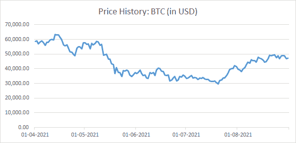 |

| --- |

| *来源：比特币历史数据 - Investing.com, 2021* |

| 图 2. 比特币交易量历史（千））2021 年 4 月 1 日至 2021 年 8 月 31 日 |

| --- |

| 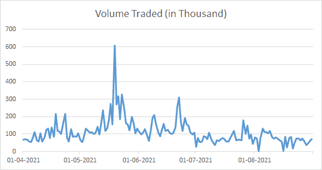 |

| --- |

| *来源：比特币历史数据 - Investing.com, 2021* |

| 图 3. 以太坊价格历史（美元）从 2021 年 4 月 1 日至 2021 年 8 月 31 日 |

| --- |

| 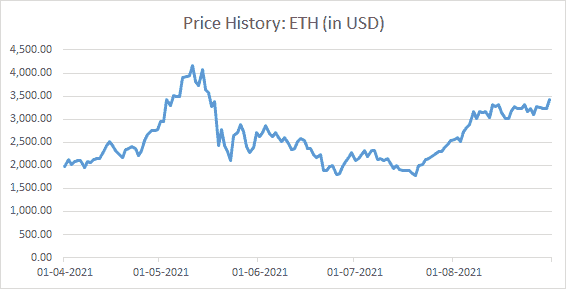 |

| --- |

| *来源：比特币历史数据 - Investing.com, 2021* |

| 图 4. 以太坊交易量历史（美元）从 2021 年 4 月 1 日至 2021 年 8 月 31 日 |

| --- |

| 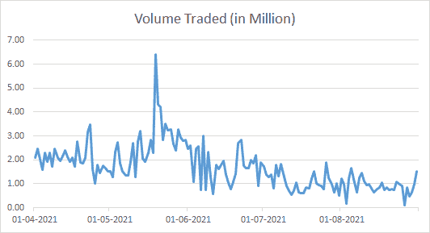 |

| --- |

| *来源：比特币历史数据 - Investing.com, 2021* |

| 图 5. 个人汇入金额（当前美元） |

| --- |

| 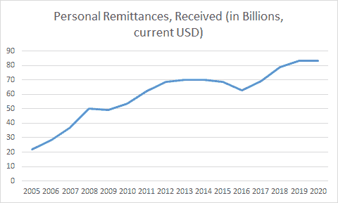 |

| --- |

| *来源：比特币历史数据 - Investing.com* |

## 加密货币网络在跨境交易中的作用

加密货币除了作为投资来源，还作为跨境传输的媒介。印度被认为是南亚最大的接收国，2020 年收收了 831 亿美元（Data，2021）。跨境交易包括`B2B`、`B2P`、`P2B`和`P2P`。`国际金融系统`（IFS）平台`通用邮政`（UPU）通常用于邮政渠道。此外，还有两种接收汇款的渠道，即`卢比安排`（RDA）和`货币传输服务计划`（MTSS）是最常见的（印度储备银行，2017）。由于银行中间机构的存在，这些交易带有巨大的成本，平均成本为 5.4%（Data，2011）。使用加密货币进行此类交易，由于缺少中间环节，成本将大幅降低。根据最近的调查，跨境交易中使用区块链的技术可以降低高达 60%的成本(2018)）。由于加密货币交易在安全的点对点网络中进行，这有助于防止国际欺诈。除了成本，所需的时间也大大缩短。

然而，由于印度大部分地区缺乏加密货币的意识和获取，将加密货币作为汇款形式具有一定的劣势。

## 印度货币政策分析

货币政策是指中央银行（在本例中为印度储备银行）为了控制其管辖范围货币工具而引入的政策。`RBI`的这一责任是由《1934 年印度储备银行法》授权的。

印度的货币政策框架旨在保持价格稳定的同时，考虑到增长目标，从而实现可持续增长。修订后的《RBI 法》明确授予了储备银行运作货币政策框架的立法授权。该框架的目标是设定回购利率并调节流动性条件，将货币市场利率锚定在回购利率附近。回购利率的变化通过货币市场传导至整个金融体系，进而影响总需求——这是通胀和增长的关键因素（印度储备银行，2016）。此外，`RBI`与印度政府合作，是印度货币的唯一发行机构。他们负责纸币的设计、生产和供应。印度政府是硬币的发行机构，并向`RBI`供应硬币。`RBI`代表中央政府投放硬币流通。

## 加密货币时代货币体系面临的挑战

正如印度货币政策体系中所讨论的，印度储备银行（RBI）的角色之一是监控经济中的通货膨胀，并根据未来对利率的调整来做出决策。该体系目前仅考虑印度的法定货币——卢比。但任何其他具有不同汇率的私有货币（即加密货币）的广泛采用，将导致货币体系的复杂化。（IMF F&D 杂志，2018 年）。


目前，加密货币被视为一种投资资产而非交易介质。作为一种投机性投资，加密货币容易产生泡沫。加密货币泡沫的破灭可能会对一个国家的整个金融体系产生影响。央银行将面临双重风险：首先是来自可能不受监管的加密货币债务市场对其所监管的金融机构稳定性的威胁；其次是由于经济体的去杠和违约对实体经济的影响对价格稳定的威胁。（加密货币与货币政策，2018 年）

# 结论

由于对加密货币能否有效高效地作为货币以及可能破坏现有货币和支付体系存在严重疑虑，加密货币未来的作用和价值仍然非常模糊。支持者认为，加密货币将成为一种常见的支付机制，促进经济效率、隐私以及对中心化机构和权威的独立。世界银行继续认为，加密货币仅仅是投机性资产。全球决策制定者仍在试图理解加密货币的各个方面，分析加密货币在经济中广泛应用相关的风险，而央银行正致力于根据加密货币的底层原理引入其自己的央行数字货币（`CBDC`）。央银行可能或愿意开发基于区块链的支付系统，其程度无疑将根据这些政府实体目前已拥有可靠数字支付系统这一事实进行评估。由于这些因素，尚不清楚 `CBDCs` 将采取何种形式；它们可能具有多种特征和属性。考虑到其巨大的收益，同时对加密货币的滥用采取充分措施，央银行、决策制定者和政府需要找到一条在经济中纳入加密货币的路径。

## 参考文献

- Benigno, P. (2019). 加密货币世界中的货币政策。Voxeu.org. [`voxeu.org/article/monetary-policy-world-cryptocurrencies`](https://voxeu.org/article/monetary-policy-world-cryptocurrencies)

- BI India Bureau. (2021, 7, 28). 根据财政部说法，印度加密货币交易所的对等税将不适用于投资者。Business Insider India. [`www.businessinsider.in/cryptocurrency/news/the-indian-government-has-no-data-on-how-many-crypto-exchanges-and-investors-working-on-cryptocurrency/articleshow/84821709.cms#:~:text=In%20addition%20to%20exchanges%2C%20India,owned%20by%20crypto%20giant%20Binance`](https://www.businessinsider.in/cryptocurrency/news/the-indian-government-has-no-data-on-how-many-crypto-exchanges-and-investors-working-on-cryptocurrency/articleshow/84821709.cms#:~:text=In%20addition%20to%20exchanges%2C%20India,owned%20by%20crypto%20giant%20Binance)

- Bordo, M., & Levin, A. (2017). 央行数字货币与货币政策的未来。Hoover. https://www.hoover.org/sites/default/files/bordo-levin_bullets_for_hoover_may2017.pdf

- Carstens, A. (2021). 数字货币与货币体系的未来：Agustín Carstens 的演说。国际结算银行。[`www.bis.org/speeches/sp210127.pdf`](https://www.bis.org/speeches/sp210127.pdf)

- ChainAnlysis Team. (2021). 2021 年全球加密货币采用指数。Chainalysis.com. [`blog.chainalysis.com/reports/2021-global-crypto-adoption-index`](https://blog.chainalysis.com/reports/2021-global-crypto-adoption-index)

- Chiu, J., & Koeppl, T. V. (2017). 加密货币经济学：比特币及其他。Electronic Journal. doi:[10.2139/ssrn.3048124](https://doi.org/10.2139/ssrn.3048124)

- Claeys, A., Demertzis, M., & Efstathiou, K. (2018). 加密货币与货币政策。ECON 委员会。https://www.europarl.europa.eu/cmsdata/150000/BRUEGEL_FINAL%20publication.pdf

- Coin Ranking. (2018). WazirX 交易所。Coinranking. [`coinranking.com/exchange/W9qIIHDJ_+wazirx`](https://coinranking.com/exchange/W9qIIHDJ_+wazirx)

- Congressional Research Service. (2018). 加密货币：货币经济学与选定政策问题。CRS 报告 httpshttps://fas.org/sgp/crs/misc/R45427.pdf](https://fas.org/sgp/crs/misc/R45427.pdf)

- NDTV Gadgets 360. (2021). 印度今日加密货币价格 (2021 年 8 月 24 日)。NDTV Gadgets 360. [`gadgets.ndtv.com/finance/crypto-currency-price-in-india-inr-compare-bitcoin-ether-dogecoin-ripple-litecoin`](https://gadgets.ndtv.com/finance/crypto-currency-price-in-india-inr-compare-bitcoin-ether-dogecoin-ripple-litecoin)

- 普华永道审计事务所。(2015). 了解不断演变的加密货币市场：PwC。PwC。 [`www.pwc.com/us/en/industries/financial-services/library/cryptocurrency-evolution.html`](https://www.pwc.com/us/en/industries/financial-services/library/cryptocurrency-evolution.html)

- 印度储备银行。(2013). 新闻稿。Rbi.org.in。 [`www.rbi.org.in/Scripts/BS_PressReleaseDisplay.aspx?prid=30247`](https://www.rbi.org.in/Scripts/BS_PressReleaseDisplay.aspx?prid=30247)

- 印度储备银行。(2016). 职能货币政策。Rbi.org.in。 [`m.rbi.org.in/scripts/FS_Overview.aspx?fn=2752`](https://m.rbi.org.in/scripts/FS_Overview.aspx?fn=2752)

- 印度储备银行。(2017). 常见问题解答。Rbi.org.in。 [`m.rbi.org.in/scripts/FS_FAQs.aspx?Id=112&fn=5`](https://m.rbi.org.in/scripts/FS_FAQs.aspx?Id=112&fn=5)

- 印度储备银行。(2018). 通知。Rbi.org.in。 [`www.rbi.org.in/scripts/FS_Notification.aspx?Id=11243&fn=2&Mode=0`](https://www.rbi.org.in/scripts/FS_Notification.aspx?Id=11243&fn=2&Mode=0)

- Srivastav, S. (2021, 6 月 29 日). 印度加密货币市场历史。CNBCTV18。 [`www.cnbctv18.com/photos/cryptocurrency/history-of-the-cryptocurrency-market-in-india-9816081-5.htm`](https://www.cnbctv18.com/photos/cryptocurrency/history-of-the-cryptocurrency-market-in-india-9816081-5.htm)

- Statista。(2021). (2021). 2021 年印度最流行的加密货币 App。Statista。 [`www.statista.com/statistics/1209741/most-popular-cryptocurrency-wallets-india/`](https://www.statista.com/statistics/1209741/most-popular-cryptocurrency-wallets-india/)

- 世界银行。(2021). 个人汇款收入（现美元）- 印度 [数据集]。Worldbank.org。 [`data.worldbank.org/indicator/BX.TRF.PWKR.CD.DT?locations=IN`](https://data.worldbank.org/indicator/BX.TRF.PWKR.CD.DT?locations=IN)

- 世界银行。(2011)。向特定国家发送汇款的平均交易成本 (%) - 印度 [数据集]。Worldbank.org。 [`data.worldbank.org/indicator/BX.TRF.PWKR.CD.DT?locations=IN`](https://data.worldbank.org/indicator/BX.TRF.PWKR.CD.DT?locations=IN)

- 民事诉讼申请 2018 年 528 号 互联网与移动协会申请人诉 印度储备银行被申请人，附带民事诉讼申请 2018 年 373 号。[`main.sci.gov.in/supremecourt/2018/19230/19230_4_1501_21151_Judgement_04-Mar-2020.pdf`](https://main.sci.gov.in/supremecourt/2018/19230/19230_4_1501_21151_Judgement_04-Mar-2020.pdf)

# 第 4 章

- **Diksha Verma**，钱加尔学院集团，印度

- **Pooja Kansra**，罗布尔大学，印度

- **Sarabjit Kaur**，钱加尔工商管理学院，印度

### 摘要

随着新知识和技术的进步，非法人员利用各种网络中心来增加网络相关犯罪。为了缓解这些数字犯罪和网络威胁，银行和金融机构正在实施人工智能技术。人工智能技术提供了多种途径，有助于银行增加财富。根据各种文献的观察，网络犯罪的支出大约为 45 美元。

# 引言

随着新知识和技术的进步，非法人员利用各种网络中心来增加网络相关犯罪。为了缓解这些数字犯罪和网络威胁，银行和金融机构正在实施人工智能技术。人工智能技术提供了多种途径，有助于银行增加财富。根据各种文献的观察，网络犯罪的支出大约为 45 美元。

网络安全和信息安全是两个可以通用的术语。这两个术语都被认为包含了人类因素的输入（Thakur 等，2015）。在新冠肺炎（COVID-19）爆发后，全球范围内出现了伪造、恶意软件骚扰、虚假链接以及各种垃圾邮件等案例，这些已足够导致近期网络威胁的广泛扩散（Khan 等，2020）。在上述所有网络威胁中，最常见的威胁是`恶意软件`，它基本上利用了各种专有技术。因此，需要一个网络安全系统（Jaccard & Nepal, 2014）。

## 银行业部门的网络安全威胁

如今，各种网络安全盗窃行为变得流行，且在实践中更为常见。盗窃是所有威胁中非常常见的一种。它基本上是指在他人不知情的情况下，利用他人的资金和私有数据以进行非法活动。当银行的机密性遭到破坏时，客户信息通常会被非法组织和其他网络罪分子在暗网上进行买卖。

如今一种非常流行的新型网络威胁是`钓鱼攻击`。在这种做法下，黑客或攻击者会生成一个与原始银行网站相似的网站。有时客户误以为是原始网站，分享了他们的价值信息。客户在假网站上提交的这些信息随后会被黑客迅速获取，以便日后进行利用或出售。

银行通常使用聊天机器人和客户关系管理软件等第三方工具，这些基本上是为银行提供服务的外包公司。这些外包公司可能不网络安全，并以某种方式影响银行和客户（Musthafa, 2021）。

如今存在的另一种网络威胁不是盗取数据，而是更改数据。被更改的数据与新数据并行，因此如果真的发生了，识别黑客的攻击将变得困难。有时，被恶意软件感染的电脑和手机也会对银行生成的计算机安全构成危险。敏感数据被共享后，如果客户系统中安装了甚至缺乏适当保护的恶意软件，它可能会攻击银行的网络。

## 银行业部门的人工智能

数字挑战、高度连接的环境和对立关系增加了银行业对升级和创新的需求，因此人工智能是导致银行进行重构任务的工具之一（Anbalagan, 2017）。欺诈识别、反洗钱、类聊天机器人界面、消除人为错误、风险管理、日志分析、垃圾邮件等都是人工智能在每个领域（特别是银行业部门）执行的各种任务（Meghani, 2020）。

根据一项调查，不同金融和银行业组织约 70%的首席执行认为网络安全对其业务构成了威胁。与其他业务部门相比，金融服务业受这些网络威胁的影响更大。因此，开发安全计划以减少甚至防御这些网络威胁变得至关重要，特别是在银行业。因此，人工智能是实现上述目标所遵循的路径。当银行尝试汇总客户数据时，统计分析、回归、相关性、决策树等是银行使用的工具，这些工具降低了银行客户的信贷风险，因为它们提供了帮助客户偿还贷款的各种方法。银行利用人工智能技术来缓解不良资产的危险。在人工智能的监控下，银行选择了最合适的还款安排（Soni, 2019）。

### 用于对抗银行业部门网络威胁的人工智能技术

本文进一步讨论了作为人工智能一部分的、用于对抗银行业网络或数字威胁的多种类型技术。为了提供客户体验和外质量的进步，人工智能技术变得日益流行。基于人工智能的聊天机器人是银行业使用的技术之一。它赋予了 24*7 的服务，并对客户的疑问和疑惑提供准确回复，最终吸引了客户对其服务的关注，优化了质量并提升了银行在行业内的品牌价值。

通过全渠道，银行业正在为其客户提供更具个性化的服务。借助 `ML` 算法的移动应用程序能够监管服务用户的行为和生活方式，最终提升了银行人员向客户提供的服务的卓越性。因此，约 70%的银行正排队在移动银行应用中整合人工智能，迈向拥抱银行业人工智能的美好前景。

银行业的人工智能可以专业地执行事实汇编和分析过程。人工智能工具需要经过证明的数据集来评估数据。人工智能驱动的移动银行应用程序积累并生成适当的教育实践以增强普通消费者的认知。在对数据进行适当调查后，消费者体验可以变得更加个性化。

## 人工智能在银行业部门的应用

### 降低运营成本及风险

将人工智能与银行业结合的主要优势或优点是 AI。尽管银行业已变成一个创新领域，但仍然面临基于人工流程的挑战，这些有时会导致工作或任务延迟，最终增加运营成本。机器人流程自动化软件是银行作为人工智能元素使用的一种技术，它消除了大量耗时且易错的工作。

### 增强客户熟悉度

涉及人工智能的新型技术克服了客户以前面临的传统问题。能够为终端用户提供 24*7 服务且无需任何额外努力的聊天机器人已让客户对银行问题日益满意。此外，银行也更新了让客户了解具有最新利益的额外产品和新服务，这被称为推销。

借助人工智能技术的帮助，银行在存款、贷款等各项任务中都能表现得更好。尽管如此，银行有时仍会遇到与客户信誉状况、客户信用评分相关的问题。基于人工智能的贷款决策系统和机器学习算法会对客户的行为和原型特征进行监控，以得出结论：过去信誉不足的客户实际上是否可能产生良好的信用评分，以及哪些客户的原型特征可能会增加违约的概率。

## 用于投资组合管理的人工智能

通过人工智能，可以更有效地进行财富和投资组合管理。人工智能帮助了那些无法经常往银行的消费者。在通过在线银行应用程序进行资金交易时，人工智能技术会触发并向消费者发送即时交易信息。如果生成了任何可疑交易，AI 机器会立即警告消费者。因此，人工智能确保了交易和投资的安全性。

## 用于威胁监控的人工智能

这是应用于高效银行业服务的一个值得关注的回报。例如，财务状况审查、身份验证和发放贷款对银行家来说都是具有风险的活动。在银行业中利用人工智能和机器学习可以明智地完成这些任务。

| 图 1. |

| --- |

| 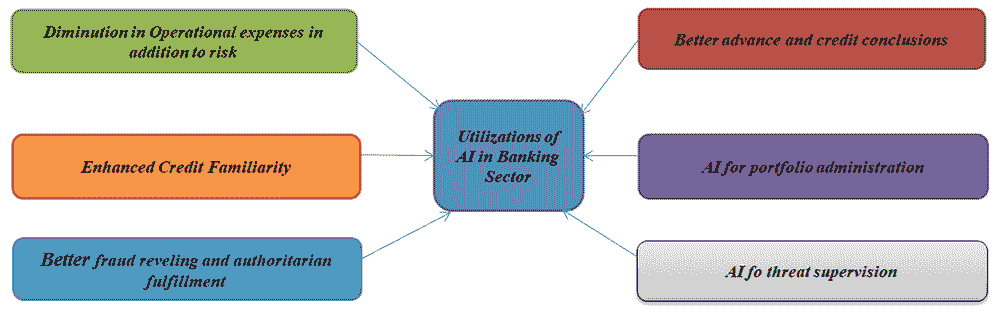 |

| --- |

| *来源：作者基于文献综述的编制模型* |

## 人工智能在银行业中的局限性

由于其局限性以及应用时间尚短，新兴知识是危险的。使用 AI 的风险伴随着系统发育迅速这一事实。除了在银行业中使用人工智能的优势外，该行业还必须考虑并应对以下威胁：

### 人工智能偏见

由于人类开发了用于人工智能技术的模型和算法，因此偏见和假设始终存在。这些最终会导致令人困扰的结果。这段对机器学习偏见的描述阐明了可能无意中影响算法的不同偏见，以及公司为消除这些错误需要采取的步骤。

### 能力与道德价值观

银行公司在法律范围内运行，法律要求它们向潜在客户对其贷款发放决定做出解释。这使得通过深度学习神经网络制作的人工智能工具和技术变得复杂，因为这些网络通过成千上万个变量之间的微妙关联工作，而这些关联在人类思维中是无法理解的。

### 客户怀疑

除了遵守法律法规外，银行公司在使用人工智能工具时还必须注意客户的信任。聊天机器人因其便利性而受到重视的技术之一，如果犯了错误，会导致客户兴趣的丧失。

### 成本

算法形成与安装之间通常存在时间间隔，仅仅是因为使用它的成本过高。但即使是广泛采用的算法，也可能太贵而无法有效使用。


### 数据篡改

通过使用被盗取的客户信息，攻击者可以使用计算机登录凭据非法进入客户的财务记录。窃取的数据随后被用于连续猛击银行的在线门户，试图访问在线提供的重要银行资源。存在一种自动系统，攻击者可以轻松登录多个密码和用户名，然后窃取数据并进一步出售用于自己的目的。数据篡改是一个随着时间推移一定会出现并扩大的过程，导致未来几年数据和账户泄露的增加。

### 云端威胁

随着云端存在大量数据，黑客攻击银行客户以及其他领域客户的开放信息库变得异常容易。`Pegasus` 是一种具有此类特征的软件，用于劫持大量的可用数据。通常被称为 `APT 10` 的攻击者会黑入银行客户的账户，而公司认为他们的数据和信息存储得安全并受保护。

### 钓鱼骚扰

网络钓鱼是一种常见的虚拟攻击，经常窃取银行客户的数据以及登录凭证、借记卡和信用卡号。但最近，针对银行家的网络钓鱼攻击有所增加。攻击可能对公司产生痛苦的后果——特别是像银行这样的金融机构。网络钓鱼可用于作为高级攻击的一部分，例如高级持续性威胁（`APT`）事件中的 foothold。在这种情况下，员工正在谈判以寻找绕过安全的方法、在拥堵的环境中分配恶意软件，或扩展信任的联系人以获取安全保护的数据。通过访问银行家的电子邮件帐户，攻击者可以研究并翻译银行的私有信息，代表银行发送电子邮件，侵入银行账户并扩展范围到内部凭据以及买方财务信息，导致数百万货币的损失。

### 恶意软件

这种软件基本上会加密银行客户的数据，除非支付金额的赎金，否则银行家几乎无法访问该数据。2017 年 3 月，`WannaCry` 病毒遍布 Microsoft Windows 设备的端到端网络，最终对成千上万系统造成了严重负面影响，最后导致总计 327 笔金额为 $130,700 的支付。银行是网络犯罪分子易于攻击的首要目标。

| 图 2. |
| --- |
| 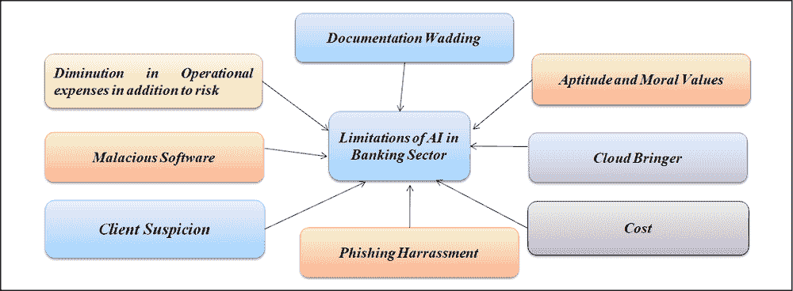 |
| --- |
| *来源：作者基于文献综述的编制模型* |

# 结论

* **利益冲突**：作者声明他们没有利益冲突。
* **伦理批准**：本研究为基于批判性的综述，因此不包含任何基于动物的报告。
* **资助**：无

## 参考文献

Acharya, S., & Joshi, S. (2020). 网络攻击对印度银行机构的影响：安全机制与预防措施研究。Palarch’s Journal of Archaeology of Egypt/Egyptology, 17(6), 4656-4670.

Anbalagan, G. (2015). 印度银行业的技术变革。International Journal of Scientific Research and Management, 5(9), 7016–7021.

Bamrara, A., Bhatt, M., & Singh, G. (2013). 印度的网络攻击与防御策略：银部门的实证评估。International Journal of Cyber Criminology, 7(1), 49–61. doi:`[10.2139/ssrn.2488413]`(https://doi.org/10.2139/ssrn.2488413)

Cocco, L., Marchesi, M., & Pinna, A. (2017). 区块链银行：益于区块链技术的成本节省。Future Internet, 9(25), 1–20. doi:`[10.3390/fi9030025]`(https://doi.org/10.3390/fi9030025)

Digalaki, E. (2019). 人工智能在银行业的影响以及 AI 在 2020 年的的使用。Business Insider。 `https://www.businessinsider.in/finance/news/the-impact-of-artificial-intelligence-in-the-banking-sector-how-ai-is-being-used 2020/articleshow/72860899.cms`(https://www.businessinsider.in/finance/news/the-impact-of-artificial-intelligence-in-the-banking-sector-how-ai-is-being-used2020/articleshow/72860899.cms)

Gunjan, V. K., Kumar, A., & Avdhanam, S. (2013, 9 月 21-22). 印度网络犯罪调查。`[论文演示]`. 第 15 次高级计算技术国际会议 (ICACT), 印度拉贾佩特。 doi:`[10.1109/ICACT.2013.6710503]`(https://doi.org/10.1109/ICACT.2013.6710503)

Jaccard, J. J., & Nepal, S. (2014). 网络安全新兴威胁调查。Journal of Computer and System Sciences, 80(5), 973–993. doi:`[10.1016/j.jcss.2014.02.005]`(https://doi.org/10.1016/j.jcss.2014.02.005)

Kaya, O., & Schildbach, J. AG, D. B., & Schneider, S. (2019). 银行业中的人工智能：迄今实施有限的盈利杠杆。EU Monitors Global financial markets。`https://www.dbresearch.com/PROD/RPS_ENPROD/PROD0000000000495172/Artificial_intelligence_in_banking%3A_A_lever_for_pr.pdf?undefined&realload=VhsiDhBWr~jzgZ~OD9X1XXylwp5O2UH6Q/fscdzc1KSVG4FsZDR0MPXIR1rxXSk2`

Khan, N. A., Brohi, S. N., & Zaman, N. (2020). COVID-19 疫情期间的十大网络安全威胁。TechRxiv Powered by IEEE. `file:///C:/Users/DELL/Downloads/Ten%20Deadly%20Cyber%20Security%20Threats%20Amid%20COVID-19%20Pandemic.pdf`

Khurshid, A. (2020). 为什么银行需要人工智能？Wipro。`https://www.wipro.com/business-process/why-banks-need-artificial-intelligence/`(https://www.wipro.com/business-process/why-banks-need-artificial-intelligence/)

Kunt, A.D., Klapper, L., Singer, D., Ansar, S., & Hess, J. (2017). 全球 Findex 数据库：衡量金融普惠与金融科技革命。World Bank Group。`file:///C:/Users/DELL/Downloads/9781464812590.pdf`

Kutub, T., Meikang, Q., Gai, K., & Ali, M. L. (2015, 11 月 3-5). 网络安全威胁与安全模型调查。`[论文演示]`. IEEE 第 2 次网络安全与云计算国际会议，纽约。

人均收入的增加、寿命的延长、家庭从大家庭向核心家庭的转变，以及稳健社会保障体系的缺失，许多人需要改变个人财务管理模式。因此，对财务咨询的需求日益增长。本章尝试探讨技术与财务咨询中的重要性之间的关系，特别针对个人财务管理。研究重点关注目前技术的使用情况、改进领域以及对个人财务管理中财务建议质量的影响。随着机器学习和人工智能在个人手中普及（去民主化），财务咨询领域也正在见证技术带来的颠覆。虽然大量信息触手可及，但在实现财务普惠、财务独立、财务成熟和财务稳定目标方面，顾问的作用将始终发挥至关重要的作用。

# 引言

## 个人财务管理的必要

金融服务业正受到技术的颠覆，为通以客户为中心的产品和解决方案的未来铺平了道路。如果传统金融机构希望在这个新环境中保持竞争力，并应对初创数字竞争对手（即 `FinTech`）带来的竞争挑战，它们将需要快速创新。理解金融服务的未来、通过重塑与竞争对手的竞争来掌握趋势、利用新兴机会以及为动荡时期制定获胜策略，对于在数字颠覆的世界中蓬勃发展都将起着重要作用。

作为这项研究的一部分，理解财务规划的需求非常重要。对于财务自由，个人财务管理在提高生活质量和心理状况方面起着重要作用。在我们人生的每一步中规划和管理资金是至关重要的。规划不当会导致缺乏约束，不知道如何脱身，而且无法充分地支付账单。靠薪水度日的生活被证明非常有压力。因此，具备足够的个人财务管理技能可以帮助我们管理好金钱，确保拥有更光明的财务未来。一个人可能根据定义是有素养的，但了解金钱的各个方面、其心理状态以及改善当前财务状况并实现预期目标的各种工具和技术是至关重要的。

像印度这样的发展中经济体表现出卓越的财务表现，这反映在股票市场指数中。这为人们改善财务状况提供了巨大机会。但知识、技术和技能的缺乏可能导致在追赶增长之车的过程中损失资本。因此，财务素养和个人财务规划起着非常重要的作用，提升了人们对生活的预期。人们需要利用、应用和提高个人财务知识以变得更加精通。

## 印度零售投资者规模的增长

随着收入水平的提高、对财务规划的意识和需求的增加，甚至在当前的疫情时代之前零售投资一直在上升。封锁居家办公为年轻投资者提供了更多动力，积极参与各种金融市场，以探索、体验和检验他们的财务素养。政府关于财务普惠的举措也为此发生起了领先作用。尽管与机构投资者相比，零售投资者的贡献微不足道，但它们在推动对合格且经验丰富的财务顾问的需求方面发挥着重要作用。正如 HDFC Securities 董事兼首席执行官 Dhiraj Relli 先生指出的，投资模式发生了重大转变，在 2020 年疫情后尤为明显。活跃管理资金的人在 `FY21` 增加了 1420 万，其中 `CDSL` 开了 1225 万个账户，`NSDL` 开了 190 万个账户。

## 财务咨询服务的必要

长期以来，印度对财务规划的兴趣基本上一直在发展；可能已经持续了 15 年以上。正确管理投资和做出正确的财务决策需要时间、技能和努力。忙碌的业务高管、初创创始人、职场父母和照顾者有很多要务，没精力积极关注自己的财务状况。花时间对财务问题进行研究、评估各种选择并执行决策需要花费时间。因此，`Do-It-Yourself`（`DIY`）很容易变成“无人执行”。财务顾问的能力使其值得让投资者保持良好轨道，并主动识别财务风险和机会。财富管理师可以帮助对投资决策进行鉴定和量化。

需求因素如更高的可支配收入、定制化的财务解决方案，以及供给因素如现有市场的新服务提供者、新的财务解决方案和产品等，推动了印度金融服务业的增长。各种共同基金、养老基金、保险公司、股票经纪、财富管理师、财务咨询公司和商业银行——从小型本土企业到大型跨国公司——正在涌而出，以服务投资者的不同方面。印度政府还作为财务普惠体制的一部分，推出了各种旗舰计划，从 `Jan-Dhan Yojana` 到 `Jan-Suraksha Yojana`。

| 图 1. |
| --- |
| 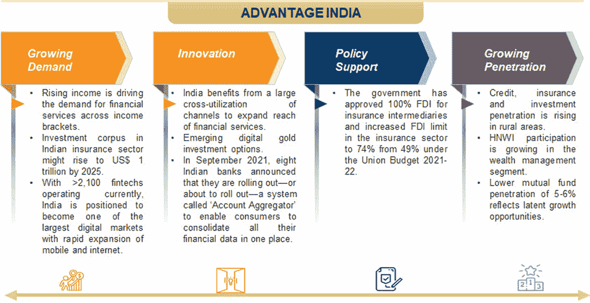 |
| --- |
| 改自 [`www.ibef.org/industry/financial-services-india.aspx`](https://www.ibef.org/industry/financial-services-india.aspx) |

## 技术在财务咨询服务中日益增长的作用

在过去的十年里，金融服务部门利用数字技术进行了革新，这通常被称为 `Fintech`。为了创建 `robo-advisory` 平台，利用了大数据和人工智能 (`AI`)，以极少的人工干预和成本效益的方法提供更好的投资建议。虽然这对于顾问来说是一个担忧，但这是一个新常态。行业正在以这种方式进化，客户将获得传统建议和 `robo-advice` 的混合。因此，财务顾问和机器人顾问将共存。

无论如何，财务顾问已经使用基于计算机的财务模型一段时间了，所以 `robot-advisors` 不会产生直接威胁。顾问与客户之间的人机互动方面在这里起着核心作用。

在某种程度上，技术很难捕捉客户的想法和情感，因此无法获得其状况的真实画面。

然而，财务顾问并没有选择。拥抱技术或面临倒闭的风险。

一旦顾问收集了相关信息（无论是定性的还是量的），就可以将其输入合适的技术工具，这些工具将为客户提供适当的投资建议并协助持续提供服务。这将有助于顾问增强为客户提供的价值，加强与现有客户的关系，并获得更多业务。

人口结构的变化将影响未来顾问如何与客户互动，以及他们在他们在关键生命阶段能够提供的建议类型。

农村地区接受个人财务的趋势

印度是全球最大且增长最大的数字消费者市场之一。2021 年，其互联网用户已超过 7 亿，且正以飞快的速度增长。尽管这种数字化的实质性增长最初是由地区消费者推动的，但在政府对金融包容倡议的推动下，印度农村也开始拥抱数字经济。根据 `TRAI` 报告，截至 2021 年 3 月，农村互联网用户已占该国总用户数的 40%以上，高于 2017 年 3 月的约 32%。

尽管印度农村互联网用户数量不断增加，但基础设施的缺乏和意识不足两个因素限制了技术的渗透。为了克服这一问题，印度政府启动了“数字印度”（Digital India）计划，目标是改善数字基础设施，特别是农村地区。如 `Bharatnet` 等计划旨在通过光纤网络为超过 250,000 个 `Gram Panchayats`（村委会）提供宽带接入。建立了公共服务中心（`CSC`）以提供与 `电子治理` 相关的服务。正在提供移动设备的普及接入，以增加村庄的覆盖率。此外还启动了邮局数字化，以改善对储蓄和贷款的获取。为了提高数字意识，印度政府启动了“总理农村数字素养计划”（Pradhan Mantri Gramin Digital Saksharta Abhiyan）。政府的这些举措预计对印度农村的数字化产生积极影响。

## 文献综述

本文开展了广泛的文献综述，以了解该领域已进行的研究。文献综述基于时间线进行，以便对评估技术在改进财务咨询服务实施方面的效率、效能和效果的研究方向形成意见。

### 个人财务管理的增长

Bashir, I., & Qureshi, I. H. (2022) 该研究对各种出版物和高影响期刊进行了系统性的文献综述。研究表明，财务健康需要分别从定性和定量两个方面进行理解。由于财务健康是一个主观概念，技术的实施在增加个人财务管理增长方面发挥着至关重要的作用。

`Ozturan, M et al. (2021)` 揭示了金融业在疫情流行期间采用技术以提高效率的准备情况。疫情引发的问题导致人们寻找替代性的财务手段。结果，数字交易随着金融服务数字化的提高而同步增长。

印度是一个拥有最高青年人口的国家。财务目标存在性别差异，这要求对财务规划的所有组成部分采取不同的方法。

Goel, I., & Khanna, S. R. (2014) 建议财务意识使投资者具备认知、监控和有效利用财务资源的能力，以增强个人、家庭和业务的福祉和经济安全。这种意识可以通过技术的帮助更有效地建立。理解技术在培养对财务产品、策略和知识意识方面的作用和范围至关重要。

`Mahapatra et al. (2017)` 描述道，财务规划术语几年来一直是研究关注的领域。个体的认知因素在财务规划中普遍存在。已根据风险态度、财务态度和财务知识，研究了各种因素对财务规划的影响。

`Munohamy, Thulasimani (2015)` 观察到关于如何管理资金的知识完全没有跟上步伐（`Maura Fogarty, 2012`）。财务顾问和投资者之间达成共识对于工作至关重要。理解投资者的准备情况比理解顾问的能力更为重要。

`Kwela H (2015)` 指出财务管理教育侧重于推荐的实践，但很少有人实际上执行这些实践。理解并体验复利的魔力至关重要。此外，在进行长期投资时，投资意图也很重要。

`Murphy et al. (2010)` 关注了 MBA 学生的财务规划态度。研究还表明，少于 13%的人准备了全面的财务计划。受访者的感知需求是希望他们的财务规划师会将他们的需求放在首位。独立性的标志是对财务规划师的依赖减少。在此期间，情况开始变得糟糕，观察到受访者开始寻找财务规划师。

### 财务咨询服务与个人财务管理

Khasanah & Irawati, (2022) 财务素养水平是财务咨询服务的一个重要参数。素养水平的提高应该是金融服务提供者的目标。金融科技和财务态度可以作为增加参与和有效财务管理的补充。Law, K. K., & Zuo, L. (2022) 这篇文章阐明了经济状况对财务咨询服务组成部分的影响。与通胀趋势相比，衰退趋势期间的服务更具增价值。经济条件影响着财务顾问类型的形成。

`Kassem et al (2021)` 关注将移动技术作为便携和方便财务咨询服务的重要工具。特别是具有农业背景的人可以从这种设备中获益，并利用咨询服务造自己。它还提到了农民对他们所掌握信息的处理方式。

Palmie et al. (2020) 指出印度近期在金融包容生态系统中经历了巨大变化。虽然金融包容是让个人脱贫困的切入点，但对全方位金融服务的更高利用本身就可以通往繁荣的路径。同样重要的是，仅有服务的范围将无法满足金融包容的目的。


研究结果促使人们使用财务管理行为量表来评估这一个人能力特质，从而支持金融教育计划和信贷机构的营销规划。Bharucha (2019) 解释说，这项调查的目的是研究究竟哪些因素决定了印度金融中心青年的个人金融素养水平。理解农村人口在金融素养中的作用同样重要。资金的可用性和资金的应用需要并行不，特别是在农村地区。Saurabh 等人 (2019) 解释说，这项调查的目的是研究金融社会化和金融知识对具有财务风险态度的人员财务满意度的影响，并将其作为中介变量，特别关注印度的二线城市。财务满意度在规划和长期投资中起着重要作用。

Begina 等人 (2018) 解释说，已经创建了经过经验证的金融心理学工具用于财务规划领域。然而，一些财务规划师不愿将此类工具整合到与客户的工作中，因为他们担心自己没有胜任。`Klontz` 金钱脚本修订版 (`KMSI-R`) 已经过经验证，能够识别可能影响财务行为的金钱观念。

Mahapatra 等人 (2017) 研究发现，“财务规划”这一术语几年来已一直是研究兴趣的领域。调查强调了各种认知因素对个人财务决策的影响。行为金融学为此奠定了基础，而金融治疗将在改善研究结果方面发挥至关重要的作用。在开始财务规划之前，设定目标是重要的。

Asebedo (2016) 展示了一个来自调解专业广为人且被广泛使用的冲突解决框架，并展示了如何将该框架应用于金钱争端。Klontz 等人 (2016) 指出，财务规划师拥有独特优势，可以提供工具、知识和流程来帮助客户减轻财务压力，从而改善客户的心理健康、身体健康、职业功能和人际关系。在提出帮助客户实现平衡且健康财务生活的新模型时，这被称为“整合财务规划”。它将财务的内部、情感方面与外部财务知识相结合，并为顾问提供了一套扩展工具，用于与客户合作制定并维护财务健康。它侧重于回答“为什么”而不是“如何”。如果“为什么”的答案很清楚，那么“如何”的答案就会变得更有成果。技术使其变得简单，但对于那些知道为什么要使用它的人来说。Xiao 等人 (2016) 解释说，权威资源汇总了跨学科的消费者金融研究现状，以便专家发现关于——以及增强——消费者经济健康的策略。需要从整体上理解消费者金融，以帮助有需要的消费者利用它并避免过度使用。Delgadillo (2016) 指出，尽管财务咨询在长期内保持了相对稳定，但住房咨询行业正在发生新变化，包括新的认证和要求。Patel 等人 (2016) 研究发现，财务产品日益复杂的，使得个人在管理个人财务时寻求专家意见变得非常重要。

Archuleta 等人 (2011) 解释了研究人员和从业人员在谈论财务规划和咨询作为一个研究和实践领域时，通常是指什么。它还关注了财务规划和咨询的过程和理论基础。文中还介绍了婚姻与家庭治疗历史发展的回顾。最后，介绍了一个新兴的研究型领域，即金融治疗。

Agarwal 等人 (2010) 在他们的研究中报告了基于印度财务咨询计划的金融素养和财务规划行为结果。研究人员发现，绝大多数受访者根据他们对利率（计算能力）、通货膨胀和多元化/风险问题的回答，似乎具有金融素养。然而，在不同人口统计和和社会经济群体之间发现了差异。

## 财务咨询服务与技术角色

Rose Jill 等人 (2021) 关注财务结构和技术的快速变化。传统的实体经营银行模式正迅速受到冲击。纯数字初创公司利用技术并提供产品或服务以增强整个生态系统。

Bharadwaj S (2021) 从文中揭示，银行和金融部门是全球人工智能应用的前五个领域之一。由于印度似乎已经意识到人工智能的潜力，本文涵盖了印度人工智能行业的发展情况。

PWC 金融服务技术 2020 及以后 (2020) 这篇文章提到，技术正以多种方式影响着金融服务。金融机构正在寻找 IT 组织的解决方案，以应对个人财务规划变化的步伐。金融科技正在增长，以将财务规划过程产品化。Khan, Khurram Ajaz 等人 (2020) 这项研究旨在解决几个研究问题，例如最初探索个人财务焦虑、财务建议与 `EPS`（电子支付系统使用）之间的相关性，探索男性女性之间的感知差异，并回答性别不平等是否在印度 Z 世代中仍然普遍。Maximilian Palmié, 等人 (2020) 这项研究关注生态系统中的破坏性创新。该研究定义了破坏性创新生态系统，并说明了金融科技 (`FinTech`) 生态系统对颠金融服务行业的影响。

Mostanu, N. R. (2020) 在该报告中显示，AI 是金融行业的未来。AI 正让客户的财务流程变得简单，它很快将取代人类，并提供更快、更高效的解决方案。理解用户的认知状况以评估此类决策的价值同样重要。Business Wire India (2019) 阐明了人类不喜欢与机器交流。这是做财务决策的一个重要因素。因此，通过提高 AI 能力来提高客户满意度有助于实现目标。Ayn, D. J. (2019) 阐明了机器人顾问（Robo-advisors）是提供自动化、基于算法的财务规划服务的数字平台，几乎或没有人工监督。Ashish Anantharaman, (2019) 指出人工智能 (`AI`) 正在金融科技领域引起巨大的轰动。AI 展现了潜力，能够以更优、更快、更廉的方式让每个人都能获得金融服务。印度金融科技市场预计在未来五年内以 22% 的复合年增长率增长，交易价值到 2020 年超过 730 亿美元并持续增长。

从文献综述中可以看出，有必要评估财务顾问对当前个人理财管理（PFM）领域技术应用的满意度，并评估 PFM 中技术使用的各个待改进领域，同时感知技术的使用是否会影响与 PFM 相关的财务建议质量。基于此，本文开发了以下研究问题：

* `RQ1` - 财务顾问对当前 PFM 领域的现有技术应用是否满意？
* `RQ2` - 技术在使用方面有哪些待改进领域？
* `RQ3` - 技术会影响与个人理财管理相关的财务建议质量吗？

为了测试这些，开发了以下假设：

* `H01`：个人理财咨询中当前技术的使用与其没有关系。
* `H02`：技术在财务咨询服务中没有作用。
* `H03`：技术的使用不会影响个人理财管理中财务建议的质量。

# 方法论

## 总体与样本

全印度执业的财务顾问是本研究的总体。Mint（2021，页）报告称，印度大约有 2000 名认证理财师。他们的详细信息从印度证券交易委员会（SEBI）获得。我们向他们邮寄了问卷。参考标准样本量表如 `Krejcie and Morgan (1970)`，在 95% 置信水平和 5% 置信区间范围内，2000 人总体的样本量为 322。共收到了 356 份符合样本量要求的回复。对 10 位高级财务顾问进行了个人访谈。

## 问卷设计

问卷被设计并托管在 Google Forms 上。它包含以下部分：

* 个人信息
* 第一部分——当前技术的使用
* 第二部分——改进领域
* 第三部分——对财务建议质量的影响

这些部分的设计旨在收集测试三个假设所需的信息，每个部分包含十个陈述。采用 5 点李克特量表收集回复。根据 `Menold and Bogner (2016)` 的建议，通过将“无法说”作为回复列表中的第一个选项，为受访者提供了“不知道”过滤器（`DK Filter`）。

问卷三个部分每部分的十个陈述见表 1。

**表 1. 构成问卷第一部分的陈述**

| 序号 | 陈述 | 非常同意 (5) | 同意 (4) | 无法说 (3) | 不同意 (2) | 坚决不同意 (1) |
| --- | --- | --- | --- | --- | --- | --- |
| I | 当前技术的使用 | | | | | |
| 1 | 技术在投资者的规划阶段得到了合理使用 | 5 | 4 | 3 | 2 | 1 |
| 2 | 技术为投资者寻求其目标提供了多种方案 | 5 | 4 | 3 | 2 | 1 |
| 3 | 与客户的交易是全自动的 | 5 | 4 | 3 | 2 | 1 |
| 4 | 使用自动化的中央客户数据库 | 5 | 4 | 3 | 2 | 1 |
| 5 | 技术为我们提供了与 moneycontrol.com 等主要投资门户连接的支持 | 5 | 4 | 3 | 2 | 1 |
| 6 | 技术为我们提供了客户投资组合调整的解决方案 | 5 | 4 | 3 | 2 | 1 |
| 7 | 技术帮助我们提高了与客户的沟通 | 5 | 4 | 3 | 2 | 1 |
| 8 | 客户可以获得投资组合的实时更新 | 5 | 4 | 3 | 2 | 1 |
| 9 | 与客户交易结算是由技术驱动的 | 5 | 4 | 3 | 2 | 1 |
| 10 | 技术提供了诸如 IPO 投资等应用程序 | 5 | 4 | 3 | 2 | 1 |
| II | 改进领域 | | | | | |
| 11 | 为客户提供不同的目标寻求选项 | 5 | 4 | 3 | 2 | 1 |
| 12 | 带有收益详情的投资组合历史 | 5 | 4 | 3 | 2 | 1 |
| 13 | 跟踪一段时间内单只股票的表现 | 5 | 4 | 3 | 2 | 1 |
| 14 | 根据市场预测规划投资组合的情景 | 5 | 4 | 3 | 2 | 1 |
| 15 | 根据市场预测规划单只股票的情景 | 5 | 4 | 3 | 2 | 1 |
| 16 | 为投资提供风险评估 | 5 | 4 | 3 | 2 | 1 |
| 17 | 为投资组合绘制风险-收益特征 | 5 | 4 | 3 | 2 | 1 |
| 18 | 提供更新的市场信息 | 5 | 4 | 3 | 2 | 1 |
| 19 | 执行交易的安全网关 | 5 | 4 | 3 | 2 | 1 |
| 20 | 提供所得税资本利得计算所需的细节 | 5 | 4 | 3 | 2 | 1 |
| III | 对建议质量的影响 | | | | | |
| 21 | 技术将改进规范性分析 | 5 | 4 | 3 | 2 | 1 |
| 22 | 技术将改进预测性分析 | 5 | 4 | 3 | 2 | 1 |
| 23 | 技术将增强科学决策 | 5 | 4 | 3 | 2 | 1 |
| 24 | 投资者的投资偏见和偏见将减少 | 5 | 4 | 3 | 2 | 1 |
| 25 | 顾问的投资偏见和偏见将减少 | 5 | 4 | 3 | 2 | 1 |
| 26 | 实时数据将提高投资决策的时机 | 5 | 4 | 3 | 2 | 1 |
| 27 | 将出现客观理决策 | 5 | 4 | 3 | 2 | 1 |
| 28 | 投资者的信心将增加 | 5 | 4 | 3 | 2 | 1 |
| 29 | 投资者将充分意识到他们所承担的风险 | 5 | 4 | 3 | 2 | 1 |
| 30 | 投资者也将意识到他们应该预期的收益 | 5 | 4 | 3 | 2 | 1 |

## 假设检验方法

所有陈述的得分在 5 点李克特量表上取平均值。应用这些权重，计算出 356 份受访者的平均同意和不同意百分比。将两者中的最大值（同意/不同意），即样本平均值，与代表偶然同意/不同意的 50% 百分比进行比较，以确定同意/不同意是否具有统计学意义。然后应用 t 检验，通过比较样本平均值与总体平均值在 95% 置信水平下测试统计显著性。例如，在第一部分，首先计算每个陈述的回复，并对 356 份受访者的回复取平均值。

## 问卷的效度和可靠性

问卷的效度和可靠性进行了测试，如下：

**效度测试**——假设、假设检验方法、问卷等经过了领域专家验证，以确保测量在预期方向是充分且准确的。

**表 2. Brown 等人 (2015) 验证检查清单的应用**

| 步骤编号 | 步骤 | 行动 |
| --- | --- | --- |
| 1 | 建立表面效度 | 问卷已由专家小组进行了表面效度验证。 |
| 2 | 清洗收集的数据 | 数据是通过 Google Forms 使用回复选项收集的，因此没有收集到无效数据。 |

### 使用主成分分析 (PCA)

由于研究中仅包含三个变量，即技术的当前使用情况、改进领域以及对财务建议质量的影响，因此未应用 PCA。

### 检查内部一致性

这是通过 Cronbach's Alpha 完成的。

来源：Brown 等 (2015) 验证清单

**信度测试** – 对问卷应用了 `Cronbach’s Alpha` 及其他测试，结果汇总如下：

**表 3. Cronbach Alpha 分数**

| 序号 | 章节 | Cronbach Alpha |
| --- | --- | --- |
| 1 | 技术当前使用情况 | 0.762 |
| 2 | 改进领域 | 0.742 |
| 3 | 对建议质量的影响 | 0.851 |
| 4 | 整个问卷 | 0.767 |

由于 `Cronbach’s alpha` 分数大于 0.70，该问卷被认为是可靠的。

# 数据分析与解释

## 描述性分析

356 名受访者中有 347 名为男性，9 名为女性。86 名受访者年龄小于 30 岁，99 名属于 30-39 岁年龄组，93 名属于 40-49 岁年龄组，78 名大于 50 岁。36 名受访者工作经验小于 5 年，98 名受访者来自 5-10 年工作经验组，222 名受访者工作经验超过 10 年。112 名受访者报告平均客户规模小于 100，131 名报告在 100-200 之间，另有 113 名报告平均客户规模大于 200。356 名受访者中有 311 名以个体户形式经营，42 名以合伙企业形式经营，3 名以公司形式经营。

## 推断性分析

### 第 1 个假设的检验

`H01`：个人财务咨询中的技术当前使用情况之间没有关系。

第一部分的响应频数如下所示：

**表 4. 响应频数（频数分布）**

| 序号 | 陈述 | 强烈同意 | 同意 | 无法说 | 反意 | 强烈反对 | 总计 |
| --- | --- | --- | --- | --- | --- | --- | --- |
| 1 | 投资者在规划阶段合理地使用了技术 | 81 | 20 | 5 | 225 | 25 | 356 |
| 2 | 技术为投资者寻求目标提供了多种方案 | 93 | 19 | 2 | 209 | 33 | 356 |
| 3 | 与客户的交易是全自动化 | 88 | 28 | 1 | 209 | 30 | 356 |
| 4 | 使用自动化的中央客户数据库 | 76 | 27 | 7 | 216 | 30 | 356 |
| 5 | 技术为我们提供了连接 moneycontrol.com 等主要投资门户的支持 | 92 | 27 | 3 | 203 | 31 | 356 |
| 6 | 技术为我们提供了客户组合调整的解决方案 | 59 | 27 | 8 | 226 | 36 | 356 |
| 7 | 技术帮助我们提高了与客户的沟通 | 83 | 29 | 13 | 204 | 27 | 356 |
| 8 | 客户可以获得投资组合的实时更新 | 60 | 42 | 1 | 220 | 33 | 356 |
| 9 | 与客户的交易结算是技术驱动的 | 68 | 36 | 2 | 224 | 26 | 356 |
| 10 | 技术提供了如投资 IPO 等应用程序 | 52 | 33 | 11 | 222 | 38 | 356 |
| 11 | 为客户提供不同的目标寻求选项 | 99 | 179 | 4 | 60 | 14 | 356 |
| 12 | 带有收益详情的投资组合历史 | 120 | 177 | 4 | 42 | 13 | 356 |
| 13 | 跟踪一段时间内的单股表现 | 115 | 175 | 4 | 47 | 15 | 356 |
| 14 | 根据市场预测规划投资组合情景 | 88 | 177 | 11 | 71 | 9 | 356 |
| 15 | 根据市场预测规划单只股票情景 | 86 | 187 | 10 | 54 | 19 | 356 |
| 16 | 为投资提供风险评估 | 106 | 179 | 4 | 49 | 18 | 356 |
| 17 | 投资组合的风险-收益特征 | 113 | 176 | 5 | 54 | 20 | 356 |
| 18 | 投资组合的风险-收益特征 | 109 | 168 | 5 | 58 | 20 | 356 |
| 19 | 投资组合的风险-收益特征 | 109 | 168 | 5 | 58 | 20 | 356 |
| 20 | 投资组合的风险-收益特征 | 86 | 187 | 10 | 54 | 19 | 356 |
| 21 | 为客户提供不同的目标寻求选项 | 99 | 179 | 4 | 60 | 14 | 356 |
| 22 | 为客户提供不同的目标寻求选项 | 99 | 178 | 4 | 40 | 15 | 356 |
| 23 | 为客户提供不同的目标寻求选项 | 115 | 175 | 4 | 47 | 15 | 356 |
| 24 | 为客户提供不同的目标寻求选项 | 88 | 177 | 11 | 71 | 9 | 356 |
| 25 | 为客户提供不同的目标寻求选项 | 86 | 187 | 10 | 54 | 19 | 356 |
| 26 | 为投资提供风险评估 | 106 | 179 | 4 | 49 | 18 | 356 |
| 27 | 投资组合的风险-收益特征 | 113 | 176 | 5 | 54 | 20 | 356 |
| 28 | 投资组合的风险-收益特征 | 109 | 168 | 5 | 58 | 20 | 356 |
| 29 | 投资组合的风险-收益特征 | 109 | 168 | 5 | 58 | 20 | 356 |
| 30 | 投资组合的风险-收益特征 | 86 | 187 | 10 | 54 | 19 | 356 |

该假设通过比较样本均值（356 人的平均意识得分）与假设的总体均值 5（作为 0-10 分值的中点）进行了测试。结果显示，样本均值（x̄）为 81%。同样，将其与假设的总体均值 5.0 进行了比较。样本标准差为 0.911。考虑到样本量为 356，t 统计量为 6.48，其 p 值为 `<0.0001`。因此拒绝了该假设。

# 结果讨论

## 第一部分，当前技术的使用情况


发现平均反对意见比例为 61%。对于“投资者在规划阶段合理使用技术”的观点，60%的人表示反对；“技术为投资者寻求目标提供了多种方案”的反对意见比例为 57%；“与客户的交易完全自动化”的反对意见比例为 57%；“使用自动化的中央客户数据库”的反对意见比例为 61%；“技术为我们提供了与如`moneycontrol.com`等主要投资门户连接的支持”的反对意见比例为 56%；“技术为我们调整客户组合提供了解决方案”的反对意见比例为 67%；“技术帮助我们提高了与客户的沟通”的反对意见比例为 57%；“客户可以获得其投资组合的实时更新”的反对意见比例为 64%；“与客户的交易结算是由技术驱动的”的反对意见比例为 62%，以及“技术提供了诸如投资 IPO 之类的应用程序”的反对意见比例为 69%。在所有十种情况下，反对意见均高于同意意见（而同意意见低于 50%）。该部分回答的标准差为 0.80393，最大反对意见为 69%，最小反对意见为 56%。

### 第二部分，改进领域

发现平均同意比例为 80%。将“为客户提供不同的目标寻求选项”作为改进领域获得了 81%的受访者同意；“跟踪带有收益详情的投资组合历史”的同意比例为 86%；“跟踪一段时间内的单只股票表现”的同意比例为 84%；“根据市场预测投资组合情景”的同意比例为 80%；“根据市场预测单只股票情景”的同意比例为 80%；“为投资提供风险评估”的同意比例为 82%；“绘制投资组合的风险-收益曲线”的同意比例为 83%；“提供更新的市场信息”的同意比例为 80%；“执行交易的安全网关”的同意比例为 70%，以及“提供所得税资本利得计算所需的详细信息”的同意比例为 74%。在所有十种情况下，同意意见均高于反对意见（而反对意见低于 50%）。该部分回答的标准差为 0.92411，最大同意意见为 86%，最小同意意见为 70%。

### 第三部分，对财务建议质量的影响

发现平均同意比例为 81%。对于“技术将改进规范性分析”这一陈述，对其质量影响的同意比例为 81%；对于“技术将改进预测性分析”的同意比例为 86%；“技术将增强科学决策”的同意比例为 83%；“投资者的投资偏见和成见将减少”的同意比例为 79%；“顾问的投资偏见和成见将减少”的同意比例为 78%；“实时数据将提高投资决策的时机”的同意比例为 83%；“客观理性的决策将会出现”的同意比例为 83%；“投资者信心将增加”的同意比例为 81%；“投资者将充分意识到他们所承担的风险”的同意比例为 81%，以及“投资者也将充分意识到他们应该预期的收益”的同意比例为 78%。在所有十种情况下，同意意见均高于反对意见（而反对意见低于 50%）。该部分回答的标准差为 0.91147，最大同意意见为 86%，最小同意意见为 78%。

## 总结

总之，十次访谈表明，财务咨询领域正经历着技术颠覆，这得益于机器学习和人工智能向个体的民主化。大量信息触手可及，但在实现财务包容、财务独立、财务成熟和财务稳定目标方面，顾问的作用将是至关重要的。专家们认为，虽然机器学习和人工智能在个人财务管理领域具有巨大的潜力，但目前在印度的应用处于早期阶段。投资者和顾问在实践中采用这些技术进步都需要一段时间。这对于那些并非在国家大城市经营的财务顾问来说，尤其如此。

# 结论

明确得出了三个结论。

第一，财务顾问目前对技术的使用远未达到满意。在与投资相关的各个领域，技术的使用未达到预期。在投资规划方面，技术的使用并不理想。在与客户进行交易时也是如此。在与`moneycontrol.com`等外部联系网站的界面中观察到了技术鸿沟。存在某些阻碍了投资者和财务顾问对技术的采用。考虑到技术进步已经可用，这是一个非常奇特的案例，值得进一步调查。正如 Ashish 所言，Ashish `Anantharaman, (2019))`，技术需要在实践中被采用和利用。随着互联网使用的快速普及，获取技术的途径在近年来得到了改善。然而在实践中，实际的利用率仍然滞后。

第二个结论是，存在良好的改进空间，这得到了财务顾问的认可。这是一个积极信号，它传达了顾问的一种信念，即使用技术可以获得预期的收益。对改进领域的认可表明了财务顾问的乐观态度。正如 Abad-Segura 等人（2021）指出的，顾问认为技术在提供更好的股票和组合管理方面发挥着作用。此外，他们可以更好地了解与投资相关的风险收益状况。顾问还认为，通过保持最新的市场信息具有改进潜力。

研究的第三个结论是，技术可能会对个人财务建议的质量产生深远影响。他们认为技术通过改进规范性和预测性分析以及转向科学理性决策来影响质量。他们还看到了消除投资偏见和成见的空间。

总的来说，财务顾问在个人财务管理中采用技术具有充分理由。专家小组建议，在个人财务管理领域应用机器学习和人工智能也具有充分理由。然而，目前这些技术的渗透仅限于国家的特定城市地区。

农村印度也是国家经济的重要部分。但在金融科技实施方面，城乡之间存在巨大差距，这主要源于两个因素——基础设施和意识的缺乏。随着“数字印度”计划的启动，印度政府正试图弥补这一差距，将农村部门引入主流金融科技。正如`Mohanta, G., & Dash, A. (2022)`报告中所发现的，政府于 2014 年启动了普拉总理詹丹民计划（PMJDY）计划，旨在让所有印度人都能拥有银行账户。该计划直接提高了印度的银普及率，为该国的金融服务部门扩大了市场。

进一步研究的建议包括对投资者和财务顾问技术采纳领域的研究。希望进行更多研究来探讨尽管技术效益已得到证实，但技术采纳率较低的原因。研究人员还可以探索在个人财务管理领域更快速应用机器学习和人工智能的方法。

## 启示

本研究结果对财务顾问有几点启示。其一，他们必须提高目前个人理财管理中技术的应用水平。必须做出自觉努力，在个人理财管理的各个维度加强技术应用。正如 `PWC Financial Services Technology 2020 & beyond` (2020) 中提到的，他们在这一尝试工作中必须带上投资者共同努力。研究结果的另一个启示是，在财务顾问看来，仍有相当大的改进空间。这是一个积极的发现，尽管目前的技术应用水平较低，但它为未来增添了某种乐观情绪。另一项与发现相关的启示是，投资者对财务建议质量的期望在未来将会增加。正如 `Nofie Iman et al` (2020) 所出的，他们将期望顾问在个人理财管理领域提供更高质量的建议，因为技术将为该行业管理方式带来范式转移。

## 参考文献

Abad-Segura, E., González-Zamar, M.-D., Meneses, E., & Vázquez-Cano, E. (2020). Financial Technology: Review of Trends, Approaches and Management. Mathematics., 8, 951. doi:doi:[10.3390/math8060951](https://doi.org/10.3390/math8060951)

Agarwal, S., Amromin, G., Ben-David, I., Chomsisengphet, S., & Evanoff, D. (2010). Financial Literacy and Financial Planning: Evidence from India. Journal of Housing Economics, 27. doi:doi:[10.2139/ssrn.1728831](https://doi.org/10.2139/ssrn.1728831)

Alt, R., Beck, R., & Smits, M. T. (2018). FinTech and the transformation of the financial industry. Electronic Markets, 28, 235–243. https://doi.org/10.1007/s12525-018-0310-9

Anantharaman, A. (2019). How artificial intelligence is enabling financial inclusion in India. YourStory. [`yourstory.com/2019/05/artificial-intelligence-enabling-financial-inclusion`](https://yourstory.com/2019/05/artificial-intelligence-enabling-financial-inclusion)

Archuleta, K. L., Britt, S. L., & Klontz, B. T. (2016). Financial therapy. In Handbook of consumer finance (pp. 73–82). [`link.springer.com/chapter/10.1007/978-319-28887-6`](https://link.springer.com/chapter/10.1007/978-319-28887-6)

Archuleta, K. L., & Grable, J. E. (2011). The future of financial planning and counselling: An introduction to financial therapy. In Financial planning and counselling (pp. 33–59). [`link.springer.com/chapter/10.1007/978-1-4419-6908-3`](https://link.springer.com/chapter/10.1007/978-1-4419-6908-3)

Ariwala, P. (2019). 5 Ways ai is transforming the finance industry. Maruti Techlabs. maritech.com/ways-transforming-finance/

Asbedo, S. D. (2019). Psychosocial Attributes and Financial-Efficacy Among Older Adults. Journal of Financial Therapy, 10(1), 2. doi:[10.4148/1944-9771.1196](https://doi.org/10.4148/1944-9771.1196)

Ayn, D. J. (2019). Robo-advisors and Artificial Intelligence – Comparing 5 Current Apps. Emerj. [`emerj.com/ai-comparisons/robo-advisors-artificial-intelligence-5-current-apps/`](https://emerj.com/ai-comparisons/robo-advisors-artificial-intelligence-5-current-apps/)

Barik, R., & Sharma, P. (2019). Analysing the progress and prospects of financial inclusion in India. Journal of Public Affairs, 19(4), e1948. [`onlinibrary.wiley.com/doi/abs/10.1002/pa.1948`](https://onlinibrary.wiley.com/doi/abs/10.1002/pa.1948)

Bashir, I., & Qureshi, I. H. (2022). A Systematic Review of financial inclusion in Journal of Financial,, 11111. doi:[10.4148/1944-9771.1196](https://doi.org/10.4148/1944-9771.1196)

... (注：由于原文部分存在重复且乱码，此处已按要求格式处理)

# Das, S. C. (2016). 印度千禧一代的金融素养及其对理财行为和态度的反思：一项解释性研究。《印度商业杂志》， 69(4)。[`www.researchgate.net/publication/320009228_Financial_Literacy_among_Indian_Millennial_Generation_and_their_Reflections_on_Financial_Behaviour_and_Attitude_An_Explanatory_Research_By`](https://www.researchgate.net/publication/320009228_Financial_Literacy_among_Indian_Millennial_Generation_and_their_Reflections_on_Financial_Behaviour_and_Attitude_An_Explanatory_Research_By)

# Delgadillo, L. M. (2016). 财务咨询与财务健康。收录于 Xiao, J. (编)，《消费者金融研究手册》。Springer 出版社。doi:[10.1007/978-3-319-28887-1_7](https://doi.org/10.1007/978-3-319-28887-1_7)

# Goel, I., & Khanna, S. R. (2014). 金融教育作为实现金融素养的工具。《ZENITH 国际多学科研究期刊》，4(12), 73–81。

# Iman, N. (2020). 金融技术的兴起：利、弊与最终判决。《Cogent 商业与管理》，7(1), 1725309。

# Iman, N. (2020) 金融技术的不断兴起：利、弊与最终判决。《Cogent 商业与管理》，7(1)。doi:doi:[10.1080/23311975.2020.1725309](https://doi.org/10.1080/23311975.2020.1725309)

# 金融科技生态系统导论：技术与法律 69 司法部《联邦法律与实务期刊》，2021。(2021，3 月 8 日)。HeinOnline; heinonline.org。[`heinonline.org/HOL/LandingPage?handle=hein.journals/usab69&div=36&id=&page=`](https://heinonline.org/HOL/LandingPage?handle=hein.journals/usab69&div=36&id=&page=)

# Kassem, H. S., Alotaibi, B. A., Ghoneim, Y. A., & Diab, A. M. (2021). 用于可持续农业的移动端咨询服务：评估农民的信息行为。《信息发展》，37(3), 483–495。https://doi.org/10.1177/0266666920967979

# Kee, D. M. H., Syazwan, M. A., Rusydi, M. D., Anwar, M. A., Islah, M. H., Khan, Y. F., & Ganatra, V. (2021). 马来西亚科学大学本科生之间的信任、感知支持与组织行为。[APJME]。《亚太管理与教育期刊》，4(3), 49–60。

# Khan, K. A., Akhtar, M. A., Dey, S. K., & Ibrahim, R. (2020). 金融焦虑、理财建议与电子支付使用：Z 世代男女之间的关系与感知差异。《批判性评论期刊》，7(18)。[`www.jcreview.com/index.php?mno=96289`](https://www.jcreview.com/index.php?mno=96289)

# Khasanah, U. & Irawati, Z. (2022, 6 月 13 日). 金融素养、金融态度以及金融科技的使用对中小企业财务管理的影响。亚特兰蒂斯出版社。[`www.atlantis-press.com/proceedings/icoebs-22/1259751`](https://www.atlantis-press.com/proceedings/icoebs-22/1259751)

# Klontz, B., Zutphen, N., & Fries, K. (2016). 财务规划师作为疗愈者：最大财务健康的作用。《财务规划期刊》，29, 52–59。

# Krejcie, R. V., & Morgan, D. W. (1970). 确定研究活动中的样本量。《教育与心理测量》，30(3), 607–610。

# Kwela, H. A. (2015). 个人财务管理对皮得梅特斯堡地区农村发展与土地改革部员工健康的有效性[博士论文，南非普勒托利亚大学]。

# Law, K. & Zuo, L. (2022). 公众对移民的关注以及对财务顾问的投诉。《管理科学》，68(11), 8464–8482。doi:[10.1287/mnsc.2021.4283](https://doi.org/10.1287/mnsc.2021.4283)

# Law, K. & Zuo, L. (2022, 6 月 1 日). 经济如何塑造财务咨询？《管理科学》。doi:[10.1287/mnsc.2020.3655](https://doi.org/10.1287/mnsc.2020.3655)

# Mahapatra, M., & De, A. (2017). 金融认知对印度家庭财务规划的影响。《财务规划相关学科学术研讨会。[`ssrn.com/abstract=304087 or doi:10.2139/ssrn.304087`](https://doi.org/10.2139/ssrn.304087)

# Menold, N., & Bogner, K. (2016). 问卷量表设计（2.0 版本）。doi:[10.15465/gesis-sg_en_015](https://doi.org/10.15465/gesis-sg_en_015)


# 参考文献

- Mohanta, G., & Dash, A. (2022). 金融顾问对储蓄有调节作用吗？针对印度人口的研究。《Cogent 经济与金融》，10(1)。
- Mosteanu, N. R. (2020). 人工智能与网络安全：防御网络攻击的管理工具——欧洲国家案例。《成功》，21(175)。
- Munohamy, T. (2015). 个人财务管理。
- Murphy, D., & Yetmar, S. (2010). 个人财务规划态度：针对研究生的初步研究。《管理回顾》，33, 811–817。doi: [10.1108/014091711406517](https://doi.org/10.1108/014091711406517)
- Ozturan, M., Atasu, I., & Soydan, H. (2019). 银行业区块链技术准备水平评估：土耳其案例。《国际商业营销与管理期刊 (IJBMM)》，4(12), 01-13。
- Pal, A., Sharma, S. S., & Gupta, K. P. (2021). 分析与机器人咨询在投资者财务决策和风险管理中的作用：全球危机后的文献回顾。《国际商业分析期刊 (IJBAN)》，8(2), 46–62。https://doi.org/10.4018/IJBAN.202104104
- Palmie, M., Wincent, J., Parida, V., & Caglar, U. (2020). 金融科技生态系统的演变：生态系统破坏性创新的未来研究议程。《技术预测与社会变革》，151。
- Patel, A & Kumar, S. (2016). 投资者对财务规划的意识与态度。《Paripex-印度研究期刊》。
- Phimolsathien, T. (2021). 金融科技（Fintech）使用的决定因素。《拉丁美洲乌托邦与实践》，苏利尔大学，26(2)。[`www.redalyc.org/articulo?id=27965140`](https://www.redalyc.org/articulo?id=27965140)
- PwC. (2020). 2020 年金融服务：拥抱变革。[`www.pwc.com/gx/en/financial-services/assets/pdf/technology2020-and-beyond.pdf`](https://www.pwc.com/gx/en/financial-services/assets/pdf/technology2020-and-beyond.pdf)
- Rose, J. W., Andrews, K., & Kenny, K. (2021). 金融科技生态系统导论。《司法部联邦法律与实务期刊》，69, 23。
- Saurabh, K., & Nandan, T. (2019). 金融知识、金融社会化和金融风险态度对印度财务满意度的影响。《印度文化与商业国际期刊》，Inderscience Ltd, 18(1), 104–122。doi: [10.1504/IJICBM.2019.096925](https://doi.org/10.1504/IJICBM.2019.096925)
- Schwabe.MatterP. (2009). 为什么信息技术没有用于财务咨询？第 17 届欧洲信息系统会议，1524-1535。ECIS。
- Singhvi, S. (2021). 理解机器人咨询的崛起角色和重要性：案例研究法。收录于：Al Mawali N.R., Al Lawati A.M., S A. (编)，《第四次工业革命与商业动态》。Palgrave Macmillan 出版社。doi: [10.1007/978-981-16-3250-1_3](https://doi.org/10.1007/978-981-16-3250-1_3)
- Stars, D. (2019). 金融服务中人工智能的 6 个示例。DJangostars。[`djangostars.com/blog/6-examples-ai-financial-services/`](https://djangostars.com/blog/6-examples-ai-financial-services/)
- Thornton, G. (2020). 印度农村地区的金融包容性。Grant Thornton。[`www.vakrangee.in/pdf/reports_hub/financial-inclusion-in-rural-india-28-jan.pdf`](https://www.vakrangee.in/pdf/reports_hub/financial-inclusion-in-rural-india-28-jan.pdf)
- Veiga, R. T., Avelar, C., Moura, L.C., & Higuchi, A. K. (2019). 研究个人财务管理的量表验证。Revista Brasileira de Gestão de Negócios, 21(2), 332-348. doi: [10.7819/rbgn.v21i2.3976](https://doi.org/10.7819/rbgn.v21i2.3976)

# 第 6 章：流程与应用

**Vedica Awasthi**


印度爱情专业大学 (Lovely Professional University, India)

**Pooja Kansra**

印度爱情专业大学 (Lovely Professional University, India)

## 摘要

区块链最早于 2008 年提出，但随着比特币的出现而风靡。区块链是一种记录交易且排除任何第三方的数字账本。它具有透明性、安全性、隐私性、准确性、可靠性和去中心化等许多特点。在本研究中，讨论了区块链在医疗保健领域的流程和应用，以及区块链如何以及在何方面有助于医疗行业。研究表明，区块链有助于生成用于使用的私钥，只有该密钥可以访问，从而确保隐私和安全。区块链可以记录和管理患者数据，提高医患互动的准确性。它还可以通过帮助流行病学家跟踪任何即将发生的疾病爆发，并帮助申请健康保险理赔，这对双方（即保险公司和被保险人）都有益处。最后，它可以帮助追踪和保护医疗用品，防止任何欺诈或操纵，通过保护权利延长产品生命周期。

## 引言

区块链是由 Satoshi Nakamoto 在 2008 年构想的技术和架构平台，并于 2009 年作为比特币推出。本质上，它是记录交易且排除任何中间人或经纪人的数字账本。其独特的去中心化结构确保了双方之间的信任，因为它不涉及任何第三方 (Nakamoto, 2008; Patel, 2019; Revanna, 2020)。区块链通过将信息存储在去中心化分布在区块链基础设施的所有计算设备记录账本中工作。区块链技术促进了去中心化的氛围，不需要中央权威机构 (Hölbl et al., 2018; Khezr et al., 2019; Singh, 2020)。由于加密技术的使用，交易既安全又可靠。医疗保健领域的区块链技术可以通过提高患者健康数据的安全性和机密性改变整个局面 (Li et al., 2018; Wang & Song, 2018; Wong et al., 2018)。最近，区块链技术也被证明对医疗保险领域有所帮助。由于其透明性，它有助于识别伪造数据 (Nugent et al., 2016; Arora and Nabi, 2022)。区块链医疗领域有许多应用，通过监控和积累电子病历（EMRs）可以改进移动健康应用 (Angraal et al., 2017; Griggs et al., 2018)。加密货币只是区块链的一个例子 (Hölbl et al., 2018)。常规电子数据结构依赖于作为管理者的管理员。如果有人溜入管理员，他可以无限期地访问完整信息 (Singh, 2020)。区块链技术转向确定的转换。它是链链在一起的数据块，并且具有双方之间的数据透明度。医疗区块链可以消除假药的威胁 (Khez et al., 2019)。目前，区块链被用于医疗数据管理、记录和健康记录安全 (El-Gazzar & Stendal, 2020)。

### 区块链与数据库的区别

数据库是存储在计算机系统上的信息集合，设计用于存储大量用户可以快速访问和过滤的信息。相比之下，区块链收集信息在一起，被称为区块。区块链与数据库的另一个区别是区块链以去中心化的方式工作，即不涉及任何第三方，而数据库以中心化的方式存储数据。此外，可以编辑存储在数据库中的信息，但在区块链情况下，一旦区块加入链中就无法编辑或删除。

## 文献综述

本节通过回顾在国家和国际范围内开展的文章和文献，概述了区块链在医疗保健领域的各种应用。研究主要涵盖了电子病历、数据安全、保险理赔和医疗用品。

### 表 1 基于医疗应用的文献综述

| 序号 | 作者 (年份) | 电子病历 | 数据安全 | 保险理赔 | 医疗用品 |
| :--- | :--- | :--- | :--- | :--- | :--- |
| 1 | Agbo et al., 2019 | ✓ | ✓ | | |
| 2 | Cichosz et al., 2018 | ✓ | | | ✓ |
| 3 | Ehrenstein et al., 2019 | ✓ | ✓ | | |
| 4 | Guo et al., 2018 | ✓ | | | |
| 5 | Hussein et al., 2018 | ✓ | | | |
| 6 | Kaur et al., 2018 | ✓ | | | |
| 7 | Kuckreja et al., 2021 | | | | ✓ |
| 8 | Li et al., 2018 | | ✓ | | |
| 9 | Lowery, 2020 | | ✓ | | |
| 10 | Mishra, 2021 | | | | ✓ |
| 11 | Oberoi and Kansra, 2021 | | | | ✓ |
| 12 | Pandey et al., 2021 | | ✓ | | |
| 13 | Patel, V., 2019 | ✓ | | | |
| 14 | Roehrs et al., 2017 | ✓ | | | |
| 15 | Rudd and Beidas, 2020 | | ✓ | | |
| 16 | Senbekov et al., 2020 | | | | ✓ |
| 17 | Shi et al., 2020 | | ✓ | | |
| 18 | Sun et al., 2020 | ✓ | | | |
| 19 | Thenmozhi et al., 2021 | | | | ✓ |
| 20 | Thomas, 2021 | | | | ✓ |
| 21 | Usman et al., 2020 | ✓ | | | |
| 22 | Zhang et al., 2018 | ✓ | | | |

来源：基于作者汇编

## 医疗保健领域区块链模型的特征

1. **去中心化**：没有第三方参与。(Agbo et al., 2019; Hussein et al., 2018; Kaur et al., 2018; Zhang et al., 2018; Sun et al., 2020; Usman et al., 2020; Hussein et al., 2021)
2. **数字账本**：它是一种交易的数字记录器，将数据分布在整个网络中 (Ratta et al., 2021)
3. **透明性**：区块链提供了完全的透明度，因为它是有效且可审计的 (Saranya and Murugan, 2021)
4. **准确性**：智能合约比手动合约更准确。
5. **安全性**：区块链技术通过密码学提供了交易和数据的安全性。
6. **隐私性**：由于没有第三方参与且数据通过密码学受到保护，因此数据一旦输入就无法被篡改。

| 图 1. 区块技术的特征 |
| :--- |
| 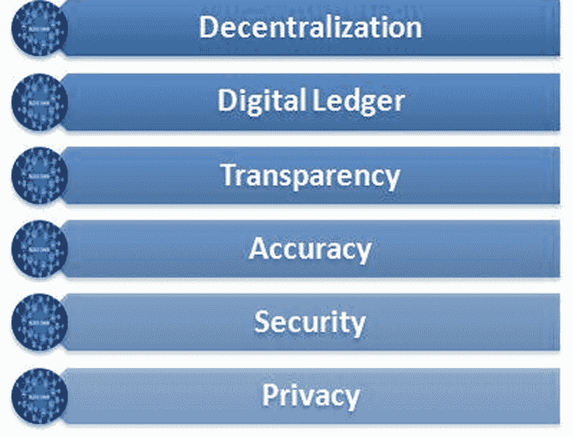 |

医疗保健中的区块链模型

| 图 2. 医疗保健行业的区块链模型 |
| :--- |
| 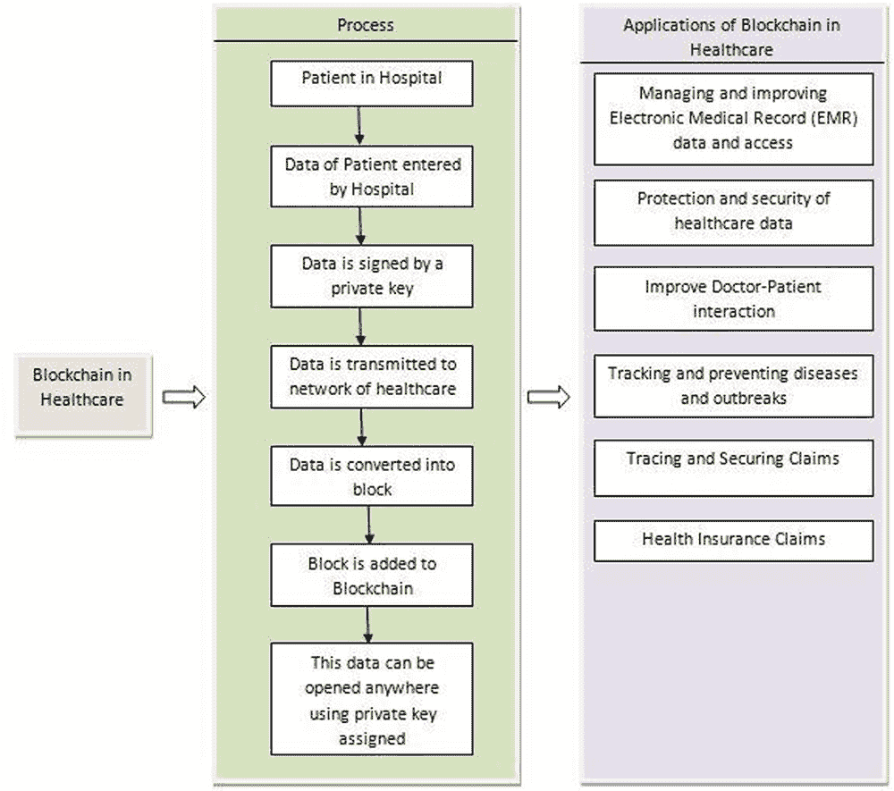 |

## 医疗保健中的区块链流程

区块链的流程从第一步开始，即患者去医院进行任何检查或治疗。在检查症状并获得有关疾病的信息后，第二步是由医院或任何医疗机构输入患者数据，换句话说就是生成了一个交易。输入数据后，将为该交易分配一个 `private key`，并将数据传输到医疗网络。然后，数据被转换为区块，该区块被添加到区块链中。该数据可以通过互联网在任何地方访问，但只能通过 `private key` 访问以确保安全隐私。

## 区块链在医疗保健中的应用

1. **管理和改进电子病记录 (EMR)**：电子病记录 (`EMR`) 是患者记录的电子描述。`EMR` 包括患者的医疗和治疗史 (Garrett and Seidman, 2011)。随着信息技术的发展，医疗领域也选择了卫生福利部 (`MoH&FW`, 2016) 印度的电子健康记录 (`EHR`) 标准。2013 年 9 月，在全球范围内选用了这些标准。它将帮助记录患者数据，识别患者的人口统计、药物和症状 (Roe et al., 2017; Ehrenstein et al., 2019)。但主要的关注点是医疗记录的隐私安全。记录共享具有挑战性，因为信息可能会被第三方干扰或暴露，而区块链技术可以解决这个问题 (Cichosz et al., 2018; Kaur et al., 2018; Hussein et al., 2018; Zhang et al., 2018; Agbo et al., 2019; Sun et al., 2020; Usman et al., 2020)。

2. **医疗保健数据的保护与安全**：隐私是健康信息技术 (`HIT`) 未来持续的问题。伦理健康研究和隐私保护都给社会带来了巨大的益处。健康研究对于改善人类健康和医疗保健至关重要。保护研究患者免受伤害对于伦理研究至关重要。保护隐私的主要理由是保护个人利益（美国医学学院健康研究与隐私委员会，2009）。防止来自网络攻击者的数据保护是电子记录的主要挑战。区块链技术在生成时提供 `private key`。只有通过该 `private key` 才能访问数据，这有助于隐私和安全 (Engelhardt, 2017; Agbo et al., 2019; Lowery, 2020; Rudd & Beidas, 2020; Shi et al., 2020; Pandey et al., 2021)。

3. **改善医患互动**：医疗服务的质量取决于医生与患者之间的互动，这包括数据如何记录、存储、共享和保护 (Fan et al., 2018; TKEY, 2019)。一个微小的错误对双方来说可能都是非常昂贵的。区块链已成为解决医患互动中产生障碍和不信任问题的通用补方法。兼容性的缺乏不仅会导致医疗不准确，还可能导致行政错误。此外，患者必须多次回忆自己的病史，这非常耗时，而且可能因为信息不全而导致困惑和误解 (Vazirani et al., 2020)。因此，如果可以访问病史，就可以改善医患互动。医患之间更好的信息共享可以提供准确的诊断、更有效的治疗，并整体提高医疗机构提供成本效益服务的能力 (Sharma, 2017)。因此，区块链有助于改善医患互动。

4. **追踪和预防疾病及暴发**：流行病学家面临收集数据的挑战，通过这些数据他们可以研究和观察任何流行病，而这在任何近期都是不可避免的。区块链具有去中心化的特征，这意味着不需要第三方参与就能增强安全感和可靠性 (Marbouh et al., 2020)。区块链可以更安全的方式帮助当地、国家和国际卫生管理部门（如世界卫生组织 WHO）观察健康数据。如果识别出任何传染或非传染疾病患者，将更容易共享和诊断准确的数据 (Chang & Park, 2020; icommunity)。

5. **医疗保险理赔**

根据 FICCI 2020 年的一份报告，“在印度，虽然私人医疗保险行业正经历强劲增长，健康保险公司承保的直接保费收入同比增长 15%，达到 2018-19 年的 4490 亿卢比，但由于其 13.4 亿人口和不断增长的医疗需求，在扩大覆盖方面面临着巨大挑战。”2017 年，全球保险行业的保费总额为 4.8 万亿美元 (Oberoi & Kansra, 2021; Oberoi & Kansra, 2022)。

区块链可以通过提高理赔过程的透明度、减少保险理赔欺诈以及加速理赔流程来帮助医疗保险理赔。区块链具有验证公司与再保险公司之间覆盖范围来自动执行理赔功能的能力。它不需要任何第三方，因此将降低成本。此外，区块链将建立理赔过程的透明度，并帮助减少欺诈 (Lounds, 2020; Kuckreja et al., 2021; Mishra, 2021)。当患者在医院接受治疗时，数据（即产生的费用）将保存到服务器后端并与保险公司共享，以实现更快、更透明的理赔 (Thenmozhi et al., 2021)。

6. **医疗用品的追踪与安全**

来自全球的数据计算，所有医疗支出中约有 6% 用于区块链技术 (Clauson et al., 2018)。区块链还可以帮助追踪和保障医疗用品的安全，并以完全透明的方式对成本检查 (Thomas, 2021)。区块链可以确保信息是准确、安全、透明且私密的 (McNew, 2020; Senbekov et al., 2020)。它将有助于与维护人员共享信息，通过保护权利来延长产品寿命。此外，它还将协助收集和审查患者及设备的数据。信息可以防止任何形式的操纵和伪造 (Global Data Healthcare, 2021)。

## 结论


# 区块链技术在医疗领域的应用与优势

区块链技术正获得几乎所有范围内个人和组织的合理考虑。区块链技术预计将重新设计医疗网络。其去中心化的特征和不涉及第三方的特性确保了信任和可靠性。流程将是安全且清晰的，质量将在合理的成本得到提升。医生可以完全安全地与其他医生共享临床数据以参考。患者有权访问数据并决定谁可以访问数据。区块链在医疗行业有许多优势，例如它可以以透明、安全和隐私的方式管理和记录健康数据；由于不涉及任何第三方，可以在双方之间建立信任；通过电子健康记录帮助流行病学家追踪任何地方发生的新疾病；它可以在不违反双方权利的情况下帮助医疗保险，从而增加其产品寿命。因此，可以说区块链是一种应该嵌入医疗保健领域的技术。

## 参考文献

- Agbo, C. C., Mahmoud, Q., & Eklund, J. (2019). 医疗保健中的区块链技术。Healthcare，7(2)。

- Angra, S., Krumholz, H., & Schulz, W. (2017). 区块链技术：医疗保健中的应用。Circulation，10(9)，e003800。[10.1161/CIRCOUTES.117380](https://doi.org/10.1161/CIRCOUTES.117380)

- Arora, S., & Nabi, T. (2022). 银行系统中的区块链：福还是祸？银行与保险中区块链技术的应用、挑战与机遇（pp. 19-42）。IGI Global。[10.4018/978-1-6684-4483-2.ch002](https://doi.org/10.4018/978-1-6684-4483-2.ch002)

- Chang, M. C., & Park, D. (2020). 在 COVID-19 等流行病期间区块链如何帮助人们？Journal of Medical Systems，44(5)，1–2。[10.1007/s10916-020-01578](https://doi.org/10.1007/s10916-020-01578)

- Chen, H. S., Jarrell, J. T., Carpenter, K. A., Cohen, D. S., & Huang, X. (2019). 医疗保健中的区块链：以患者为中心的模型。Biomedical Journal of Scientific & Technical Research，20(3)，15017。

- Cichosz, S. L., Stausholm, M. N., Kronborg, T., Vestergaard, P., & Hejlesen, O. (2019). 如何使用区块链进行糖尿病数据和访问管理：运营概念。Journal of Diabetes Science and Technology，13(2)，248–253。[10.1177/193229681879021](https://doi.org/10.1177/193229681879021)

- Clauson, K. A., Breeden, E. A., Davidson, C., & Mackey, T. K. (2018). 利用区块链技术增强医疗供应链管理：医疗供应链挑战与机遇的探索。今天的区块链。

- Culinda. (2022). 区块链上的医疗设备追踪。Culinda。https://www.culinda.io/wp-content/uploads/2020/10/Medical-devices-Blockchain.pdf

- Ehrenstein, V., Kharrazi, H., & Lehmann, H. (2019). 从电子健康记录获取数据。见 Gliklich RE, Leavy MB, Dreyer NA (编)。注册库互操作性工具与技术，患者结果注册库：用户指南（第 3 版）。医疗研究与质量机构。[`www.ncbi.nlm.nih.gov/books/NBK55187/`](https://www.ncbi.nlm.nih.gov/books/NBK55187/)

- El-Gazzar, R., & Stendal, K. (2020). 医疗保健中的区块链：希望还是炒作？Journal of Medical Internet Research，22(7)，e17199。[10.2196/17199](https://doi.org/10.2196/17199)

- Engelhardt, M. A. (2017). 将医疗保健挂钩到链上：医疗领域区块链技术介绍。Technology Innovation Management Review，7(10)，22–34。[10.22215/timreview/1111](https://doi.org/10.22215/timreview/1111)

- Fan, K., Wang, S., Ren, Y., Li, H., & Yang, Y. (2018). Medblock: 通过区块链进行高效安全的医疗数据共享。Journal of Medical Systems，42(8)，1–11。[10.1007/s10916-018-09377](https://doi.org/10.1007/s10916-018-09377)

- FICCI. (2020). 通过区块链和智能合约重塑印度的医疗保险部门。PwC。[`www.pwc.in/assets/pdfs/healthcare/revamping-indias-health-insurance-sector-with-blockchain-and-smart-contracts.pdf`](https://www.pwc.in/assets/pdfs/healthcare/revamping-indias-health-insurance-sector-with-blockchain-and-smart-contracts.pdf)

- Garrett, P., & Seidman, J. (2011) EMR 与 EHR – 有什么区别？Health IT。[`www.healthit.gov/buzz-blog/electronic-health-and-medical-records/emr-vs-ehr-difference`](https://www.healthit.gov/buzz-blog/electronic-health-and-medical-records/emr-vs-ehr-difference)

## 参考文献

- Global Data Healthcare. (2021). 区块链在医疗设备和医疗健康行业中的潜力。Medical device Network [[`https://www.medicaldevice-network.com/comment/blockchain-medical-device-healthcare-industries/`](https://www.medicaldevice-network.com/comment/blockchain-medical-device-healthcare-industries/)

- Griggs, K. N., Ossipova, O., Kohlios, C. P., Baccarini, A. N., Howson, E. A., & Hayajneh, T. (2018). 使用智能合约的医疗保健区块链系统用于安全自动化远程患者监测。Journal of Medical Systems, 42(7), 1–7. doi:`[10.1007/s10916-018-0982-x`](https://doi.org/10.1007/s10916-018-0982-x)

- Guo, R., Shi, H., Zhao, Q., & Zheng, D. (2018). 电子健康记录系统中用于区块链的多权威机构安全属性基签名方案。IEEE Access: Practical Innovations, Open Solutions, 6, 11676–11686. doi:`[10.1109/ACCESS.2018.2801266`](https://doi.org/10.1109/ACCESS.2018.2801266)

- Hölbl, M., Kompara, M., Kamišalić, A., & Nemec Zlatolas, L. (2018). 区块链在医疗保健领域使用的系统性述。Symmetry, 10(10), 470. doi:`[10.3390/sym10100470`](https://doi.org/10.3390/sym10100470)

- Hussein, A. F., ArunKumar, N., Ramirez-Gonzalez, G., Abdulhay, E., Tavares, J. M. R. S., & de Albuquerque, V. H. C. (2018). 由遗传算法和离散小波变换支持的医疗记录管理与安全区块链系统。Cognitive Systems Research, 52, 1–11. doi:`[10.1016/j.cogsys.2018.05.004`](https://doi.org/10.1016/j.cogsys.2018.05.004)

- Hussien, H. M., Yasin, S. M., Udzir, N. I., Ninggal, M. I. H., & Salman, S. (2021). 医疗保健行业中的区块链技术：趋势与机会。Journal of Industrial Information Integration, 22, 100217. doi:`[10.1016/j.jii.2021.100217`](https://doi.org/10.1016/j.jii.2021.100217)

- icommunity. (2022). 用于预防冠病毒等流行病的区块链技术。iCommunity. [`https://icommunity.io/en/blockchain-technology-for-the-prevention-of-pandemics-such-as-the-coronavirus/`](https://icommunity.io/en/blockchain-technology-for-the-prevention-of-pandemics-such-as-the-coronavirus/)

- Institute of Medicine (US) Committee on Health Research and the Privacy of Health Information. (2009). HIPAA 隐私规则；Nass SJ, Levit LA, Gostin LO, (编.), 超 HIPAA 隐私规则：通过研究增强隐私，改善健康。National Academies Press (US); [`https://www.ncbi.nlm.nih.gov/books/NBK9579/`](https://www.ncbi.nlm.nih.gov/books/NBK9579/)

- Kaur, H., Alam, M. A., Jameel, R., Mourya, A. K., & Chang, V. (2018). 云环境中基于区块链的异构医疗数据的提出的解决方案和未来方向。Journal of Medical Systems, 42(8), 1–11. doi:`[10.1007/s10916-018-1007-5`](https://doi.org/10.1007/s10916-018-1007-5)

- Khezr, S., Moniruzzaman, M., Yassine, A., & Benlamri, R. (2019). 医疗保健中的区块链技术：综述与未来研究方向。Applied Sciences (Basel, Switzerland), 9(9), 1736. doi:`[10.3390/app9091736`](https://doi.org/10.3390/app9091736)

- Kuckreja, J., Nigde, P., & Patil, P. (2021). 使用区块链的健康保险理赔。International Research Journal of Engineering and Technology, 8(5), 2406–2409.

- Li, H., Zhu, L., Shen, M., Gao, F., Tao, X., & Liu, S. (2018). 基于区块链的医疗数据保护系统。Journal of Medical Systems, 42(8), 1–13. doi:`[10.1007/s10916-018-0997-3`](https://doi.org/10.1007/s10916-018-0997-3)

- Lounds, M. (2020). 区块链对保险的影响。Munich Re. [`https://www.munichre.com/us-life/perspectives/underwriting/blockchain-implications`](https://www.munichre.com/us-life/perspectives/underwriting/blockchain-implications)

- Lowery, C. (2020). 什么是数字健康，我需要了解什么？Obstetrics and Gynecology Clinics, 47(2), 215–225. doi:`[10.1016/j.ogc.2020.0211`](https://doi.org/10.1016/j.ogc.2020.0211)

- Marbouh, D., Abbasi, T., Maasmi, F., Omar, I., Salah, K., Jayaraman, R., & Ellah, S. (2020). 用于 COVID-19 的区块链：回顾、机会与信任系统。Arabian Journal for Science and Engineering, 45(12), 1–17. doi:`[10.1007/s13369-020-04950-4`](https://doi.org/10.1007/s13369-020-04950-4)

- New, S. (2020). 区块链如何解决今天的供应链缺陷并应对危机。Forbes. [`https://www.forbes.com/sites/forbescouncil/2020/04/29/how-blockchain-can-solve-todays-supply-chain-flaws-and-improve-responses-for-crises`](https://www.forbes.com/sites/forbescouncil/2020/04/29/how-blockchain-can-solve-todays-supply-chain-flaws-and-improve-responses-for-crises)

- Ministry of Health & Family. (2016). 标准。MOHFW. [`https://main.mohfw.gov.in/sites/default/files/EMR-EHR_Standards_for_India_notified_by_MOHFW_2016_0`](https://main.mohfw.gov.in/sites/default/files/EMR-EHR_Standards_for_India_notified_by_MOHFW_2016_0)

- Mishra, A. S. (2021). 基于区块链的医疗保险理赔研究。Asian Conference on Innovation in Technology (ASIANCON), 1-4. doi:`[10.1109/ASIANCON51346.2021.95492`](https://doi.org/10.1109/ASIANCON51346.2021.95492)

- Nakamoto, S. (2008). 比特币：点对点电子现金系统。Decentralized Business Review.

- Nugent, T., Upton, D., & Cimpoesu, M. (2016). 使用区块链智能合约提高临床试验的数据透明度。F1000 Research, 5, 5. doi:`[10.12688/f1000research.9756.1`](https://doi.org/10.12688/f1000research.9756.1)

- Oberoi, S., & Kansra, P. (2021). 保险行业区块链技术的驱动因素与后果。Blockchain Technology and Applications for Digital Marketing (pp. 276–285). IGI Global. doi:`[10.4018/978-1-7998-8081-3.ch017`](https://doi.org/10.4018/978-1-7998-8081-3.ch017)

- Oberoi, S., & Kansra, P. (2022). 保险行业中的区块链技术。Applications, Challenges, and Opportunities of Blockchain Technology in Banking and Insurance (pp. 160-172). IGI Global. doi:`[10.4018/978-1-6684-4133-6.ch009`](https://doi.org/10.4018/978-1-6684-4133-6.ch009)

- Pandey, M., Agarwal, R., Shukla, S. K., & Verma, N. K. (2021). 使用区块链的医疗保健数据安全。Survey (London, England), 1–40.


# 参考文献

- Patel, V. (2019). 通过区块链进行医疗数据安全共享框架。Health Informatics Journal, 25(4), 1398–1411. doi:`[10.1177/14604582187699](https://doi.org/10.1177/14604582187699)`

- Ratta, P., Kaur, A., Sharma, S., Shabaz, M., & Dhiman, G. (2021). 区块链与物联网在医疗保健和医疗领域的应用：应用、挑战与未来方向。Journal of Food Quality, 2021(1), 1–20. doi:`[10.1155/2021/760296](https://doi.org/10.1155/2021/760296)`

- Senbekov, M., Saliev, T., Bukeyeva, Z., Almabayeva, A., Zhanaliyeva, M., Aitenova, N., Toishibekov, Y., & Fakhradiyev, I. (2020). 数字技术在医疗保健领域的进展与应用：综述。《International Journal of Telemedicine and Applications》， 2020, 2020. doi:`[10.1155/2020/8830200](https://doi.org/10.1155/2020/8830200)`

- Sharma, U. (2017). 医疗健康区块链患者收益及更多。IBM。https://www.ibm.com/blogs/blockchain/2017/10/blockchain-in-healthcare-patient-benefits-and-more/

- Shi, S., He, D., Li, L., Kumar, N., Khan, M. K., & Choo, K. K. R. (2020). 区块链在确保电子健康记录系统安全与隐私方面的应用：综述。《Computers & Security》， 97, 101966. doi:`[10.1016/j.cose.2020.101966](https://doi.org/10.1016/j.cose.2020.101966)`

- Singh, M. H. (2020). 基于区块链的电子健康记录系统研究。《International Journal of Advanced Research in Science & Technology》，5(5), 75–81.

- Sun, J., Ren, L., Wang, S., & Yao, X. (2020). 一种具有细粒度访问控制的电子医疗记录共享区块链框架。《PLoS One》，15(10), e0239946. doi:`[10.1371/journal.pone.0239946](https://doi.org/10.1371/journal.pone.0239946)`

- Thenmozhi, M., Dhanalakshmi, R., Geetha, S., & Valli, R. (2021). 医院医疗保险理赔处理区块链技术的实现。《Materials Today: Proceedings》。doi:`[10.1016/j.matpr.2021.02.776](https://doi.org/10.1016/j.matpr.2021.02.776)`

- Thomas, D. L. (2021). 医疗保健中的区块链应用。News Medical Life Sciences [`www.news-medical.net/health/Blockchain-Applications-in-Healthcare.aspx`](https://www.news-medical.net/health/Blockchain-Applications-in-Healthcare.aspx)

- Vazirani, A. A., O’Donoghue, O., Brindley, D., & Meinert, E. (2020). 用于高效医疗记录管理的区块链工具。《NPJ Digital Medicine》，3(1), 1–5. doi:`[10.1038/s41746-019-0211-0](https://doi.org/10.1038/s41746-019-0211-0)`

- Wang, H., & Song, Y. (2018). 使用基于属性的加密系统和区块链的安全云端 EHR 系统。《Journal of Medical Systems》，42(8), 1–9. doi:`[10.1007/s10916-018-0994-6](https://doi.org/10.1007/s10916-018-0994-6)`

- Wong, M. C., Yee, K. C., & Nøhr, C. (2018). 医疗保健中使用区块链技术的社会技术考虑。收录于《数据海洋中构建知识大陆：共同创建电子健康的未来》(pp. 636–640)。IOS Press。

- Zhang, P., White, J., Schmidt, D. C., Lenz, G., & Rosenbloom, S. T. (2018). FHIRChain: 应用区块链安全且可扩展地共享临床数据。《Computational and Structural Biotechnology Journal》，16, 267–278. doi:`[10.1016/j.csbj.2018.07.004](https://doi.org/10.1016/j.csbj.2018.07.004)`

# 第 7 章：加密货币与投资组合多元化

- **Miklesh Prasad Yadav**（印度阿米提大学）
- **Sudhi Sharma**（印度 FIIB 德里）
- **Babita Parmar**（印度 CHRIST 大学（认定））

## 摘要

本研究扩展了关于将 `Bitcoin` 作为股票市场多元化资产的持续讨论。一些研究分析了加密货币作为多元化资产，也有少数研究对此提出了挑战。在动荡时期，进一步评估至关重要。因此，本研究重新审视了基于 `MSCI` 的多元化机会。

## 引言与背景

作者开展这项研究的动机取决于投资者对加密货币作为新兴资产的着迷。本研究是对关于加密货币持续讨论的另一项贡献。

少数研究分析了加密货币作为多元化资产（`Stensas et al. 2019`、`Kliber et al. 2019`、`Bouri et al. 2020`、`Klein et al. 2018`）。若干研究对此提出了挑战（`Shahzad et al. 2020`、`Wang et al. 2019`、`Susilo et al. 2020`、`Naeem et al. 2020`）。

随着自由化的出现，`crypto` 市场有所增加。在第四次工业革命期间，`crypto` 市场巨大增长。预计全球加密货币市场从 `2019` 年到 `2025` 年将以 `56.4%` 的复合增长率增长。导致 `crypto` 起的关键因素包括分布式账本技术。主导且交易量最大的加密货币是 `Bitcoin`、`Litecoin`、`Ethereum` 等。

本研究探讨了投资发达国家和新兴国家的投资者在加密市场中的多元化机会。因此，本研究在方法论上通过应用 `Diebold and Yilmaz Spillover Index (2012)` 以及其他对称和非对称动态条件波动率模型，对现有文献做出了贡献。因此，本研究在范围和方法论上均做了贡献。结果提供了深入证据，证明 `BITW` 是一个隔离指数，它既没有吸收其他国家的波动率，也没有对其他国家的波动率传递做出贡献。此外，结论认为 `BITW` 是多元化资产，仅次于 `MSCI Emerging Markets Index`，其次是 `MSCI World Index`。研究结果为讨论替代性技术资产重要性的决策者和投资者提供了更广泛的见解。

论文分为几个部分；研究的下一部分涉及文献综述而非研究方法，最后致力于实证分析。该研究应用了统计和计量经济学模型。分析包括描述性分析，随后通过 `granger causality` 寻找样本变量之间的因果关系。为了分析波动率传递和杠杆效应，分别应用了`动态条件相关广义自回归条件异方差模型 (DCC GARCH 1, 1)`、`动态条件相关阈值广义自回归条件异方差模型 (DCC TGARCH 1, 1)` 和 `动态条件相关指数广义自回归条件异方差模型 (DCC EGARCH 1, 1)`。最后，为了捕捉溢出效应的详细证据，应用了 `Diebold and Yilmaz Spillover Index (2012)`。

## 文献综述

关于 `Bitcoin` 作为多元化资产已有若干研究，但少数研究挑战了这一观点。加密货币是否被视为一种优越、安全且多元化的资产是一个持续的争论。本研究进一步审视了疫情期间投资股票市场时加密市场作为多元化资产的作用。该研究通过捕捉整个加密市场扩大了范围，并通过应用 `DY (Diebold & Yilmaz, 2012)` 结合对称和非对称动态条件波动率模型在方法论上做出了贡献。文献综述分为两个小节进行，以确定进一步分析的必要性。第一部分讨论加密市场作为股票市场的多元化资产，随后是加密市场作为与其他资产类别的多元化资产。

### 第 1 节：加密市场作为股票市场的多元化资产

已有若干项关于加密货币作为一种基于技术的资产进行的研究，以寻找多元化机会。然而，一些研究挑战了这一观点。

#### 支持将加密货币作为股票市场对冲工具的研究

Qin 等人 (2021) 捕捉到活跃交易的加密货币 `Bitcoin` 在全球不确定性期间充当了安全投资。该研究应用了 `自助滚动格兰杰因果检验` 并得出结论：`Bitcoin` 收益对全球经济政策不确定性的正向因果影响，从而为投资者提供了对冲作用。`Bouri 等人 (2020)` 进行的紧密研究识别了发达国家和新兴股票指数与各种传统及非传统资产之间的多元化机会。该研究应用了 `小波相干性` 方法，得出所有投资工具与股票的相关性均较弱。最后发现 `Bitcoin` 是所有资产中更好的多元化资产。在相同背景下，`Mizerka et al. (2020)]` 的研究应用了 `比特币用户图` 来寻找主要的比特币参与者。研究得出 `Bitcoin` 在新兴市场中起着对冲者的作用，但对发达市场被认为是弱对冲。`Conlon (2020)` 在疫情背景下对讨论做出了贡献。因此认为三种主要的加密货币是 `Bitcoin`、`Tether` 和 `Ethereum`。最后，通过应用 `风险价值 (VaR)` 和 `条件风险价值 (CVAR)` 得出，其中 `Tether` 被认为是国际市场中最安全的投资。`Xunfa 等人 (2020)` 检查了加密货币市场与新兴股票市场之间的动态因果关系。该研究应用了两种因果技术，即 `Granger 因果` 和 `Liang 因果分析`。`Granger` 结果最初捕捉到市场之间不存在因果关系。然而，`Liang 因果` 捕捉到了从加密市场到新兴市场的短期单向因果关系，以及从新兴市场到加密市场的长期单向波动。研究捕捉到了若干结构性断点以及它们之间的动态因果关系。研究得出，两个市场在初始阶段是独立的。但在剧烈的市场波动期间，两者均呈单向运动。然而，在剧烈波动后，两个市场均趋于稳定并相对变得相互独立。另一项支持加密货币作为股票市场安全投资的研究是 `Stensas 等人 (2019)`，其应用 `DCC GARCH (1, 1)` 发现 `Bitcoin` 是七个发达市场和六个新兴市场的多元化资产。然而，该研究限于特定国家和将 `Bitcoin` 作为加密资产。`Kliber 等人 (2019)` 也研究了 `Bitcoin` 作为五个国家的多元化资产。该研究应用了 `DCC GARCH (1, 1)`，发现基于技术的投资工具存在对冲机会的微弱证据。然而，很少的研究发现在脆弱时期 `Bitcoin` 是一种韧性资产。`Goodell 等人 (2021)` 通过应用 `小波相干性` 分析了 `Bitcoin` 作为这一时期更安全的资产。在相同背景下，`Guo 等人 (2021)`、`Disli (2021)`、`Su 等人 (2020)`、`Tiwari 等人 (2021)` 以及 `Bouri 等人 (2017)` 也捕捉到 `Bitcoin` 在全球不确定性期间充当了安全投资。

另一方面，一些研究反驳了加密货币作为股票市场安全投资的持续争论。`Jiang 等人 (2021)` 在新冠肺炎期间重新审视了不同分位数和频率下加密货币与股票市场之间的关系。研究发现加密货币与代表性股票指数之间存在显著依赖关系。然而，在大多数情况下，很少发现任何负相关的微弱证据。这表明它不能被认为是股票市场的对冲工具。`Goodell 等人 (2021)` 分析了新冠肺炎对六种加密货币及 `比特币期货` 与 `VIX` 和 14 股票指数配对共同运动的影响。分析显示，在新冠肺炎期间，股票与加密货币之间的共同运动逐渐增加。因此，没有证据表明在疫情期间通过加密货币存在多元化机会。

### 第 2 节：加密市场与其他资产类别的多元化

Le 等人 2021 年的研究表明，在新冠肺炎疫情期间，比特币和金融科技指数等创新资产不能被视为避险资产，因为它们是波动溢出最大的接收者。然而，相对于比特币，黄金是更佳且更稳定的对冲工具。相比之下，Chemkha 等人 2021 年得出结论，在疫情期间比特币是优于黄金属的资产类别。Shahzad 等人 2020 年也记录了黄金对比比特币作为 G7 国家的对冲工具。Susilo 等人 2020 研究了五种加密货币、股票指数和 iShares - MSCI 世界 ETF 之间的关系。研究得出结论，加密货币化的是夏普比率而非对冲。他们的研究表明，大商品证明是东南亚新兴市场更好的对冲工具。Trabelsi (2018) 捕获了加密货币与其他金融资产之间的溢出效应。该研究捕捉到的溢出证据较低，因此加密货币与全球金融资产的相关性较弱。然而，Klein 等人 2018 年的一项研究发现，比特币与 `MSCI EM50` 指数的相关性最低，但与黄金、标普 500 和 MSCI 世界指数呈轻微正相关。

上述研究涉及关于加密货币市场作为多元化资产的持续争论。然而，分析显示，大多数研究局限于比特币。大多数研究应用了 `Granger Causality` 结合动态条件波动模型。该研究进一步考虑了在经济脆弱时期寻找多元化机会的紧迫性，并试图通过更严谨的证据重新审视以整个加密货币市场寻找多元化机会。因此，本研究扩大了范围，并在方法论上对现有文献做出了贡献。

# 数据与计量经济模型

本研究分析了整个加密货币市场，以便在发达和新兴国家投资时捕捉多元化机会。该研究扩展了关于作为股票市场多元化和对冲资产的技术型资产的持续讨论。为了捕捉加密、新兴和发达市场，本研究考虑了相应的代理指标：`Bitwise 10 Crypto Index (BITW)`、`Morgan Stanley Capital International Emerging Markets Index (MSCI Emerging Markets Index)` 以及 `Morgan Stanley Capital World Markets Index (MSCI World Index)`。`BITW` 追踪 `Bitwise 10 Crypto Index`，这是一个基于加密货币市值的多元化指数。该指数由基于流动性、托管和其他风险的十种加密货币组成，并进行重新平衡以确保一致性。它代表了加密加密市场的 80%。因此，它被视为代表整个加密货币市场的近似代理。`MSCI Emerging Markets Index` 包含了跨区域的新兴国家。自 1988 年以来，新兴市场的格局已经发生变化，并产生了对机构投资者极吸引力的独特资产类别。`MSCI World Index` 代表发达国家大中股的表现。本研究捕捉了它们从 2016 年 10 月 31 日至 2021 年 8 月 31 日之间的溢出效应。每日调整收盘价从彭博获取，并进一步转换为每日对数收益。每日对数收益计算如下：

```
Rit = log (Pit / Pit-1)
```

其中 `Ri, t` 是时间 `t` 的对数收益，`Pi, t–1` 和 `Pi, t` 是交易所的两个连续收盘价。

# 计量经济模型

本文中应用了多种方法来分析加密货币与股票指数之间的波动溢出。研究采用了 `Granger causality test`、对称和非对称条件相关（`DCC`）。应用标准 `DCC-GARCH(1,1)` 来检查对称动态链接，而应用 `DCC TGARCH(1,1)` 和 `DCC EGARCH(1,1)` 来检查 `BITW`、`MSCI Emerging Market Index` 和 `MSCI World Index` 之间的非对称溢出。此外，为了捕捉更细微的溢出碎片，应用了 `Diebold and Yilmaz Spillover Index (2012)`。对称和非对称 `DCC` 用于检查组成序列之间的短期和长期溢出。

## 对称与非对称动态条件相关


为了检查从 `MSCI Emerging Markets Index` 和 `MSCI World Index` 到 `BITW` 的波动溢出，研究应用了对称和非对称 `DCC-GARCH`。对于对称 `DCC-GARCH`，我们应用了 `standard GARCH`，而应用 `Exponential GARCH` 和 `Threshold GARCH` 来捕捉非对称波动。通常，时间序列之间的波动链接通过随时间变化的条件相关性和条件方差来捕捉。`Standard GARCH` 或 `Generalized GARCH` 由 Bollerslev (1986) 开发，其中条件方差取决于其滞后项。它无法捕捉非对称和杠杆效应。因此，研究应用了 `E GARCH` 和 `T GARCH`。`E GARCH` 基于条件变异性的对数表达式计算，由 Nelson (1991) 开发，用于检查序列是否存在杠杆效应。同样，`T GARCH` 是 Zakoian (1994) 开发的捕捉非对称效应的另一种方法。它有助于检查以冲击形式存在正收益和负收益中的利消息的影响。Engle (2002) 给出了动态模型来捕捉研究两个变量收益的动态相关性。在研究中，`rt` 是由 n x1 向量组成的资产收益，可以表示为：

```
rt = a+a1rt-1+εt
```

在该方程中，`a` 是常数，`a1` 是滞后收益的系数，`εt = Ht(1/2) zt`，其中 `Ht` 是资产收益的协方差矩阵，`zt` 是独立同分布 (iid) 扰差的 n x1 向量。模型分两层进行估计。首先，确定 `GARCH` 的参数，然后识别条件相关性。该模型表示为：

```
Ht= DtRtDt
```

其中，`Ht` 表示条件相关性的估计器。`Dt` 可以表示为 `diag (h1t1/2, ..., h1/2nt)`。`Dt` 是条件标准差，是一个 n x n 对角矩阵，并从 `GARCH` 中提取，而 `Rt` 是条件相关性。`Rt` 所示：

```
Rt = Qt\*-1Qt Qt\*-1
```

该模型基于条件变异性的对数表达式。可以对杠杆效应的存在进行检验，且该模型能够找到最佳模型，该模型能够捕捉股市的对称性 (Nelson 1991)，并据此得出以下方程：

```
ln(σ2 t) = ω + β1ln(σ2 t-1) + α1 εt-1 σt-1 - π² - γ εt-1 σt-1
```

左侧是条件方差的对数。系数 `γ` 被称为非对称性或杠杆项。杠杆效应的存在可以通过假设 `γ < 0` 进行检验。如果 `γ = 0`，则影响是对称的。

为了细致地捕捉溢出流，本文应用了 Diebold 和 Yilmaz 溢出指数法 (2012)，它是 Diebold 和 Yilmaz (2009) 的扩展。`Diebold and Yilmaz Index` 基于向量自回归（`VAR`）框架来检查内部及双向波动率传递。该指数由 Diebold, F.X. 和 Yilmaz, K. (2012) 开发，用于捕捉跨波动率，从而帮助发现更精细的多元化机会。它以方差分解分析（`Pesaran, M.H. and Shin, Y., 1998`）的形式提供了溢出幅度和溢出方向。事实上，现有的溢出模型考虑了分布的均值并使用 `OLS` 来确定 `VAR`，这低估了变量之间的溢出影响。在该模型中，`H`-`step` 预测误差方差分解可以归因于变量的冲击，所示：

 (2)

上述方程 `å` 被称为向量自回归模型给定误差分量的估计方差，`σij` 表示第 `i` 个方程的标准差。预测误差方差分解可以按照下面一行的之和进行归一化：

\=N (3)

变量的跨方差有助于计算总连通性，其表现为由于 `Yj` 的冲击导致 `Yi` 预测 `H` `step` 的比例。通过其他向量 `J` 获得的向量 `i` 冲击由方向连通性确定，净连通性通过区分从其他地方获得的冲击与对其他市场或经济体贡献的冲击计算。

# 实证分析

## 初步分析结果

初步分析通过 `Table` 1.1 所示的描述性统计完成。研究报告了基于技术的对数收益率（即 `Crypto Index` (`BITW`)）以及非传统资产类别（即 `MSCI Emerging Markets Index` 和 `MSCI World Index`）的描述性统计结果。关于结果，`BITW` 实现的最大均值收益率为 (0.002)，其后是 `MSCI Emerging Markets Index` (0.001) 和 `MSCI World Index` (0.000)。最大无条件标准差出现在 `BITW` (0.050)，其后是 `MSCI Emerging Markets Index` (0.010) 和 `MSCI World Index` (0.009)。这些结果与公认的理论一致，高风险伴随着高收益。但描述性统计中衡量的波动率是评估波动的传统方法，而非传统的时变波动率通过时变条件模型捕捉。为了进行相同分析，研究采用了动态波动模型。所有市场时间序列的偏度均为负偏，反映了获得负收益的概率。`MSCI World Index` 的偏度负值 (-1.586) 高于 `MSCI Emerging Markets Index` (-0.717)，其后是 `BITW` (-0.026)。这推导出加密市场获取收益的概率低于指数。显然，所有市场的峰度都大于阈值水平 3，这推断时间序列的尾部比正态分布更厚，因此该序列是尖态的。最后，`Jarque Berra test` (`JB Test`）的结果得出所有序列都偏离了正态性。但基本假设是时间序列应该是平稳的。为此，应用了 `Augmented Dickey-Fuller` (`ADF`) 检验。在应用波动模型之前，应该存在波动聚集和 `ARCH` 效应的证据。波动聚集表现为大变化后是大变化，小变化后又是小变化。图 1.1 证实了波动聚集的存在。同样，从 `LM test` 获得的结果证实存在 `ARCH` 效应。

| 图 1. 收益率时间序列图 - BITW 日收益率图、MSCI 新兴市场指数日收益率图和 MSCI 世界指数日收益率图 |

| --- |

| 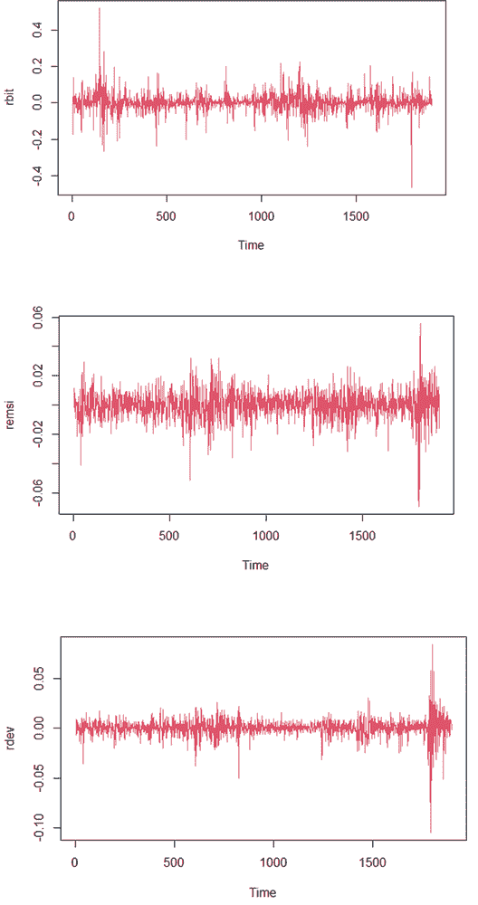 |

| --- |

表 1. 描述性统计结果

| | `R_BITW` | `R_MSCI Emerging` | `R_MSCI World` |

| --- | --- | --- | --- |

| 观测值 | 1897 | 1897 | 1897 |

| --- | --- | --- | --- |

| 最小值 | -0.465 | -0.069 | -0.104 |

| 最大值 | 0.521 | 0.056 | 0.084 |

| 均值 | 0.002 | 0.001 | 0.000 |

| 标准差 | 0.050 | 0.010 | 0.009 |

| 偏度 | -0.026 | -0.717 | -1.586 |

| 峰度 | 13.620 | 5.993 | 26.964 |

| JB 检验 | 0.000*** | 0.000*** | 0.000*** |

| ADF 检验 | 0.01*** | 0.01*** | 0.01*** |

| LM 检验 | 0.000*** | 0.000*** | 0.000*** |

注：\*5% 显著性水平；\*\*1% 显著性水平；\*\*\* 0.01% 显著性水平

此外，研究应用了 `Granger test`、`Dynamic Correlation` (`DCC`) 波动模型以及 Diebold 和 Yilmaz 溢出指数（2）。在 `Granger test` 结果中，观察到发达国家和新兴市场之间存在双向因果关系。`MSCI World Index` 收益是 `MSCI Emerging Markets` 的 Granger 因果，显著性水平为 0.01。新兴市场收益是发达国家的 Granger 因果，显著性水平为 0.05。然而，`BITW` 与 `MSCI Emerging` 和 `MSCI World Index` 之间未捕捉到因果关系。因此，从初步分析来看，`BITW` 不受 `MSCI Emerging Markets Index` 和 `MSCI World Index` 波动率的影响。这些结果对于寻求对新兴和发达市场头寸进行对冲的外国投资者是有用的。这些结果需要通过更复杂的模型进一步验证。

表 2. Granger 检验结果

| 原假设 | 系数 | 概率 |

| --- | --- | --- |

| `R_BITW → R_MSCI Emerging` | 1.1409 | 0.3198 |

| --- | --- | --- |

| `R_MSCI Emerging → R_BITW` | 2.3731 | 0.09347 |

| `R_BITW → R_MSCI World` | 0.4298 | 0.6507 |

| `R_MSCI World → R_BITW` | 2.812 | 0.06034 |

| `R_MSCI Emerging → R_MSCI World` | 57.799 | < 2.2e-16*** |

| `R_MSCI World→ R_MSCI Emerging` | 3.5524 | 0.02885 * |

注：\*5% 显著性水平；\*\*1% 显著性水平；\*\*\* 0.01% 显著性水平

`DCC-GARCH` 模型的结果提供了关于均值 (`µ`)、常数项 (`Ꞷ`)、ARCH 项 (`α`)、GARCH 项 (`β`)、`DCCα` 和 `DCCβ` 的各种参数。`DCC-GARCH(1, 1)` 的结果为所有资产类别的短期和长期波动率提供了显著证据。然而，最高的短期（alpha 1`）波动率出现在 `MSCI World Index` (0.212)，其次是 `BITW` (0.160)，然后是 `MSCI Emerging Markets Index` (0.104)。另一方面，最高的长期波动率 (`beta1`）出现在 `MSCI Emerging Markets Index` (0.867)，其次是 `BITW` (0.805)，然后是 `MSCI World Index` (0.763)。整体最大时变波动率（`alpha1+beta1`）在 `MSCI World Index` (0.975) 中捕获，其次是 `MSCI Emerging Markets Index` (0.971)，然后是 `BITW` (0.967)。从一个资产类别到另一个资产类的短期和长期波动溢出分别被 `dcca1` 和 `dccb1` 捕获。显然，从 `MSCI Emerging Markets Index` 到 `BITW` 没有显著的短期波动率传递，但有显著证据表明从 `MSCI World Index` 到 `BITW` 存在短期波动率传递。因此，在投资新兴国家时，存在利用 `BITW` 进行投资组合多元化的机会。然而，从新兴市场和发达市场到 `BITW` 存在显著的长期波动溢出。总波动传递（`dcca1+dccb1`）方面，从 `MSCI World Index` 到 `BITW` (0.966) 高于 `MSCI Emerging Markets Index` 到 `BITW` (0.945)。从双变量 `GARCH` 模型中得出的结果对投资组合经理和对冲基金非常重要。

## DCC T-GARCH & DCC- EGARCH 的结果

研究报告了表 3 中 `DCC E-GARCH` 和 `T GARCH` 的结果。在非对称 `GARCH` 中，`ARCH` 和 `GARCH` 的显著性与对称 `GARCH` 相似，而 `gamma` 表示杠杆效应。当负面消息比正向消息更容易发生。如果 `gamma` 为负且显著，则表明负面影响的大小大于正向消息，反之亦然。`E-GARCH` 和 `T-GARCH` 的结果与标准 `GARCH` 一致，`ARCH` 和 `GARCH` 是显著的，这证实了波动的持续性。两个模型中的 `gamma` 均显著且为正，表明正向冲击的影响大于负面消息。在两种非对称 `GARCH` 中，`alpha` 和 `beta` 之和小于 1，表明波动持续性的衰减。考虑到从 `DCC E-GARCH` 和 `T-GARCH` 得出的从 `MSCI Emerging Markets Index` 到 `BITW` 的波动溢出，不存在短运行波动溢出（`DCC a` 大于 0.05），但存在长期波动溢出（`DCC b` 小于 0.05）。从 `MSCI World Index` 到 `BITW` 存在短期和长期波动溢出，因为 `DCC a` 和 `DCC b` 均显著的。

## 表 3. DCC-MGARCH, DCC-T GARCH & DCC-EGARCH 结果

| RMSCI | Symmetric DCC | Assymetric – DCC | Assymetric – DCC EGARCH |

| --- | --- | --- | --- |

| Emerging to RBITW | T GARCH | | |

| | Estimate | p-value | Estimate | p-value | Estimate | p-value |

| `[remsi].mu` | 0.000 | 0.070 | 0.000 | 0.425 | 0.000 | 0.520 |

| `[remsi].omega` | 0.000 | 0.241 | 0.000 | 0.005 | -0.236 | 0.000 |

| `[remsi].alpha1` | 0.104 | 0.000 | 0.003 | 0.736 | -0.086 | 0.000 |

| `[remsi].beta1` | 0.867 | 0.000 | 0.917 | 0.000 | 0.975 | 0.000 |

| `[remsi].gamma1` | | | 0.108 | 0.000 | 0.123 | 0.000 |

| `[rbitw].mu` | 0.001 | 0.127 | 0.001 | 0.148 | 0.002 | 0.130 |

| `[rbitw].omega` | 0.000 | 0.014 | 0.000 | 0.005 | -0.236 | 0.000 |

| `[rbitw].alpha1` | 0.160 | 0.001 | 0.154 | 0.001 | -0.020 | 0.618 |

| `[rbitw].beta1` | 0.805 | 0.000 | 0.805 | 0.000 | 0.975 | 0.000 |

| `[rbitw].gamma1` | | | | | | |

| `[Joint]dcca1` | 0.018 | 0.050 | 0.018 | 0.036 | 0.019 | 0.040 |

| `dccb1` | 0.931 | 0.000 | 0.929 | | | |

| RMSCI | Symmetric DCC | Assymetric – DCC | Assymetric – EGARCH |

| World to RBITW | T GARCH | | |

| | Estimate | p-value | Estimate | p-value | Estimate | p-value |

| `[remsi].mu` | 0.000 | 0.070 | 0.000 | 0.425 | 0.000 | 0.520 |

| `[remsi].omega` | 0.000 | 0.241 | 0.000 | 0.005 | -0.236 | 0.000 |

| `[remsi].alpha1` | 0.104 | 0.000 | 0.003 | 0.736 | -0.086 | 0.000 |

| `[remsi].beta1` | 0.867 | 0.000 | 0.917 | 0.000 | 0.975 | 0.000 |

| `[remsi].gamma1` | | | 0.108 | 0.000 | 0.123 | 0.000 |

| `[rbitw].mu` | 0.001 | 0.127 | 0.001 | 0.148 | 0.002 | 0.130 |

| `[rbitw].omega` | 0.000 | 0.014 | 0.000 | 0.016 | -0.421 | 0.033 |

| `[rbitw].alpha1` | 0.160 | 0.001 | 0.154 | 0.001 | -0.020 | 0.618 |

| `[rbitw].beta1` | 0.805 | 0.000 | 0.805 | 0.000 | 0.975 | 0.000 |

| `[rbitw].gamma1` | | | | | | |

| `[Joint]dcca1` | 0.018 | 0.050 | 0.018 | 0.036 | 0.019 | 0.040 |

| `dccb1` | 0.931 | 0.000 | 0.929 | | | |

“净（Net）”显示了“来自”和“去向”非常清晰的含义，捕捉了来自他人波动率传输的净效应以及对他人波动率传输的贡献。正净值反映了从他人传输的波动率大于其对他人波动率的贡献。这一结果来源于`MSCI World Index`（世界指数）值为负（-0.97），表明发达市场在波动率传输中的贡献更大，特别是在新兴国家。结果与基于结构性联系的理论一致。另一方面，`MSCI Emerging Markets Index`（新兴市场指数）的净值为正（0.94），这意味着新兴国家受他人波动率的影响更大，特别是来自发达市场的影响。结果进一步加强了关于结构性联系的推论。最后，`BITW` 显示出低水平的正值（0.04），反映了对技术型资产的细致洞察。它显示其受他人波动率的影响最小，且对他人的波动率贡献微乎其微。因此，在投资样本指数时，技术型资产可以被视为一种多元化资产。


最后，参考非对角线值，注意到比特币作为一种技术资产具有高度波动性，结果与描述性统计保持一致，其次是`MSCI World Index`，然后是`MSCI Emerging Markets Index`。非对角线值提供了从一个资产/指数到另一个的溢出传输线索。研究捕捉到 `MSCI World Index` 对 `MSCI Emerging Markets Index` 贡献了最大的溢出传输（34.29）。这一致地加强了结构性联系理论。此外，`MSCI Emerging Markets Index` 显示对 `MSCI World Index` 有波动率传输（31.49）。结果提供了两个指数之间的双向波动率传输。从 `BITW` 到 `MSCI World Index` 和 `MSCI Emerging Markets Index` 的波动率传输分别为 1.07 和 0.42。另一方面，`MSCI Emerging Markets Index` 对 `BITW` 波动性的贡献较小，分别为 0.41 和 1.17。据证明，`BITW` 是给定样本中多元化的合适资产类别，特别是相对于 `MSCI Emerging Markets Index`，其次是 `MSCI World Index`。

### 表 4. 使用 Diebold-Yilmaz (2012) 计算比特币、EMSI 新兴市场和 EMSI 发达市场之间的波动率溢出

|  | `R_BITW` | `R_MSCI Emerging` | `R_MSCI World` | FROM |
| --- | --- | --- | --- | --- |
| `R_BITW` | 98.42 | 0.41 | 1.17 | 0.53 |
| `R_MSCI Emerging` | 0.42 | 65.30 | 34.29 | 11.57 |
| `R_MSCI World` | 1.07 | 31.49 | 67.45 | 10.85 |
| TO | 0.49 | 10.63 | 11.82 | 22.95 |
| GROSS | 1.02 | 22.2 | 22.67 |  |
| NET | 0.04 | 0.94 | -0.97 |  |

# 结论

本研究扩展了关于加密货币作为股票市场多元化资产的持续讨论。很少有研究分析将加密货币作为多元化资产 (Stensas et al. 2019; Kliber et al. 2019; Bouri et al. 2020; Thomas et al. 2020)。然而，有若干研究挑战了这一观点（Shahzad et al. 2020; Naeem et al. 2020)）。当前研究进一步分析了矛盾性论点，并发现它们在脆弱时期至关重要。大多数文献集中在比特币或少数加密货币。本研究考虑了整个加密市场（`BITW`）、发达市场（`MSCI Emerging Markets Index`）和新兴市场（`MSCI World Index`）的代理。因此，研究从更广泛的视角重新审视了当前的争议，并在方法论上做出了贡献。研究考虑了广泛的方法和模型。寻找多元化机会从形式描述性和格兰杰因果关系的初步分析开始，随后应用动态多变量对称和非对称波动率模型以及 Diebold Yilmaz (2012) 模型。

研究从初步分析发现，`BITW` 捕捉到的最大收益和风险最高，其次是 `MSCI Emerging Markets Index`，然后是 `MSCI World Index`。从格兰杰因果结果发现，`BITW` 不受股票指数波动率的影响，被视为避险投资。

此外，动态条件模型的结果没有捕捉到从 `MSCI Emerging Markets Index` 到 `BITW` 的显著短期波动率传输。然而，从 `MSCI World Index` 发现了显著的短期证据。因此，在投资 `MSCI Emerging Markets Index` 时，`BITW` 存在多元化机会。然而，从新兴市场和发达市场到 `BITW` 存在显著的长期波动率溢出。对称动态模型的结果支持了结论。非对称波动模型的结果提供了杠杆效应。动态波动模型的结论得到了 Diebold Yilmaz 的进一步加强。

此外，本研究通过 Diebold Yilmaz 的应用发现了波动率溢出，并捕捉到了深入的结果。结果发现 `MSCI World Index` 在波动率传输中的贡献最大，其次是 `MSCI Emerging Markets Index`，然后是 `BITW`。结论认为 `BITW` 是一种韧性资产。

研究结果为讨论替代性技术资产重要性的政策制定者和投资者提供了见解。

### 未来研究范围

本研究限于加密市场，未来通过纳入更多技术性和非传统资产（如绿色基金、能源基金和金融科技）提供了寻找多元化机会的空间。

## 参考文献

Alahmari, S. A. (2020). 使用支持向量回归方法预测加密货币价格。《连续体力学与数学科学杂志》，15(4), 313–322. doi:[10.26782/jmcms.2020.04.00023](https://doi.org/10.26782/jmcms.2020.04.00023)

Bouri, E., Gupta, R., Tiwari, A. K., & Roubaud, D. (2017). 比特币能对冲全球不确定性吗？基于小波的分位数在分位数回归的证据。《金融研究报》，doi:[10.1016/j.frl.2017.02.009](https://doi.org/10.1016/j.frl.2017.02.009)

Bouri, E., Shahzad, S. J. H., & Roubaud, D. (2020). 加密货币作为美国股票板块的避险工具和避风港。《经济与金融季度回顾》，75, 294–307. doi:[10.1016/j.qref.2019.05.001](https://doi.org/10.1016/j.qref.2019.05.001)

Chemkha, R., BenSaïda, A., Ghorbel, A., & Tayachi, T. (2021). COVID-19 期间的对冲与避险属性：来自比特币和黄金的证据。《经济与金融季度回顾》。

Conlon, T., Corbet, S., & McGee, R. J. (2020). 加密货币是股票市场的避风港吗？来自新冠肺炎肺炎疫情的国际视角。《国际商业与金融研究》，54, 101248. doi:[10.1016/j.ribaf.2020.101248](https://doi.org/10.1016/j.ribaf.2020.101248)

Disli, M., Nagayev, R., Salim, K., Rizkiah, S. K., & Aysan, A. F. (2021). 新冠肺炎疫情期间寻找避风港资产：不同类型投资者的实证分析。《国际商业与金融研究》，58, 101461. doi:[10.1016/j.ribaf.2021.101461](https://doi.org/10.1016/j.ribaf.2021.101461)

Dyhrberg, A. H. (2016). 比特币、黄金与美元——GARCH 波动率分析。《金融研究报》，16, 85–92. doi:[10.1016/j.frl.2015.10.008](https://doi.org/10.1016/j.frl.2015.10.008)

Ferreira, P., Kristoufek, L., & Pereira, J.D.A.E. (2020). 加密货币市场的 ADCCA 和 DMCA 相关性。《物理学 A》，545(C). .doi:[10.1016/j.physa.2019.123803](https://doi.org/10.1016/j.physa.2019.123803)

Gkillas, K., & Katsiampa, P. (2018). 极值理论在加密货币中的应用。《经济快报》，164, 109–111. doi:[10.1016/j.econlet.2018.01.020](https://doi.org/10.1016/j.econlet.2018.01.020)

Goodell, J. W., & Goutte, S. (2021). 新冠肺炎期间利用加密货币实现股票多元化。《国际金融分析评论》，76, 101781. doi:[10.1016/j.irfa.2021.101781](https://doi.org/10.1016/j.irfa.2021.101781)

Guiso, L., Jappelli, T., Padula, M., & Pagano, M. (2004). 欧盟的金融市场整合与经济增长。《经济政策》，19(40), 524–577. doi:[10.1111/j.1468-0327.2004.0131](https://doi.org/10.1111/j.1468-0327.2004.0131)

Guo, X., Lu, F., & Wei, Y. (2021). 捕获比特币的传染网络：来自新冠肺炎肺炎期间的证据。《国际商业与金融研究》，58, 101484. doi:[10.1016/j.ribaf.2021.101484](https://doi.org/10.1016/j.ribaf.2021.101484)

Habiba, U., Peilong, S., Zhang, W., & Hamid, K. (2020). 国际股市整合与波动率溢出动态：来自全球危机的证据。《亚洲业务研究》，14(5), 779–794. doi:[10.1108/JABS-03-2019](https://doi.org/10.1108/JABS-03-2019-)

Jiang, Y., Lie, J., Wang, J., & Mu, J. (2021). 重新审视加密货币在股市中的作用：位数一致性。《经济建模》，95, 21–34. doi:[10.1016/j.econmod.2020.1202](https://doi.org/10.1016/j.econmod.2020.1202)

Kim, S.-J. (2005). 亚太股市的信息领先：来自美国和日本的收益、波动率与溢出。《日本国际经济》，19(3), 338–365. doi:[10.1016/j.jjie.2004.0302](https://doi.org/10.1016/j.jjie.2004.0302)

Klein, T., Thu, H., & Walther, T. (2018). 比特币不是黄金——波动率、相关性和组合的比较。《国际金融分析评论》，59, 105–116. doi:[10.1016/j.irfa.2018.0710](https://doi.org/10.1016/j.irfa.2018.0710)

Kliber, A., Marszałek, P., Musiałowska, I., & Świerczyńska, K. (2019). 比特币：避风港、对冲工具还是多元化工具？国家经济背景下的比特币认知。《物理 A》，524, 246–257. doi:[10.1016/j.physa.2019.0415](https://doi.org/10.1016/j.physa.2019.0415)

Le, L.-T., Yarovaya, L., & Nasir, M. A. (2021). 新冠肺炎改变了金融科技与其他资产类别之间的溢出模式吗？《国际与金融研究》，58, 101461. doi:[10.1016/j.ribaf.2021.101461](https://doi.org/10.1016/j.ribaf.2021.101461)

Mizerka, J., Stróżyńska-Szajek, A., & Mizerka, P. (2020). 比特币在发达市场和新兴市场的作用——基于比特币用户图分析。《金融研究报》，35, 101489. doi:[10.1016/j.frl.2020.101489](https://doi.org/10.1016/j.frl.2020.101489)

Naeem, M. A., Hasan, M., Arif, M., & Shahzad, S. J. H. (2020). 比特币在投资风格上比黄金更闪光吗？《SAGE Open》，10(2). doi:[10.1177/215824402092658](https://doi.org/10.1177/215824402092658)

Ødegård, A. T., & Volden, T. M. (2020). 加密货币进入未知领域：对加密货币需求机制及比特币避险能力的结合研究（硕士论文）。

Qin, M., Su, C. W., & Tao, R. (2021). 比特币：一个新的“鸡蛋篮子”？《经济建模》，94, 896–907. doi:[10.1016/j.econmod.2020.0203](https://doi.org/10.1016/j.econmod.2020.0203)

Shahzad, S. J. H., Bouri, E., Roubaud, D., Kristoufek, L., & Lucey, B. (2019). 比特币是比黄金和商品更好的避险投资吗？《国际金融分析评论》，63, 322–332. doi:[10.1016/j.irfa.2019.0710](https://doi.org/10.1016/j.irfa.2019.0710)

Statista. (n.d.). 比特币价格指数获取自 `https://www.statista.com/statistics/263543-bitcoin-price-index/`

Stensas, A., Nygaard, F., & Treepczyuna, K. (2019). 比特币可以作为多元化工具、对冲工具或避风港吗？《协作经济与金融》，7(1), 159302. doi:[10.1080/23322039](https://doi.org/10.1080/23322039)

Xunfa, L. U., Liu, S. K., San Liang, X., Zhang, Z., & Hairong, C. U. I. (2020). 加密货币与新兴股市之间的断点依赖因果关系。《经济计算与经济控制学研究与研究》，54(4), 203–216. doi:[10.26782/jmcms.2020.04.00023](https://doi.org/10.26782/jmcms.2020.04.00023)

---

# 印度，克里斯蒂大学（从等大学）

### 摘要

库存管理对于维持供应链管理的效率至关重要。水果和蔬菜具有易腐败性，必须进行库存管理，以避免因过度积货和缺货情况导致的浪费和损失。本研究重点关注了在班加罗尔成立的一家合作社 HOPCOMS，人工智能（AI）驱动的水果蔬菜库存管理的作用。在满足客户的道路上，该协会有必要制定不同的策略来管理库存，其中零售商面临过度积货和缺货的情况，这将影响协会的利润。因此，通过结构化问卷调查对班加罗尔 HOPCOMS 门店的 122 名零售商进行了研究。研究结果表明，库存估值方法对 AI 驱动的需求预测和客户订单履行有积极影响，且 AI 驱动的需求预测与客户订单履行呈正相关。

# 引言

水果和蔬菜含有丰富的营养、矿物质、维生素、碳水化合物、蛋白质和其他健康益处，促进了健康生活方式的趋势 (Halder & Pati, (2011))。尽管生产和需求增加，商品产生的浪费不容忽视。有必要关注影响水果蔬菜质量和新鲜度的因素。大量中间人的存在和基础设施的落后需要关注 (Sandeep, 2013))。易腐商品的主要特征之一是“货期”。水果和蔬菜受限于保质期，预计在期限内被消费 (Bhat et al., (2017); Negi, (2014)) 强调了温度、湿度等易腐商品的特征。为了避免浪费，必须根据情况对水果蔬菜进行保护。为了获得质量和新鲜度，提供冷链设施至关重要。虽然，为了提供冷链设施，零售商需要通过“直销营销”（direct marketing）来满足客户。面对过度积货或缺货的情况，零售商需要采取一种有组织的库存管理系统，以满足水果蔬菜的增长。私营经营者引入了卡纳塔罗克邦的 HOPCOMS 合作社，以救助农户 (Chandrashekar, 2018))。由于私营经营者的加入，HOPCOMS 需要灵活，以适应环境并应对竞争 (Bharadwaj, 2015))。未能有效利用人工智能，HOPCOMS 需要通过更强的管理来解决问题 (Krishnamoorthy & Narayanan, n.d. (2008))。

HOPCOMS 合作社的供应链作为中间人，为了触达终端用户，需要零售商对水果蔬菜分级。零售商需要高质量的水果蔬菜，以满足客户。为了避免农户的损失，需要对水果蔬菜进行分级。这里的损失表现为百分比。作为影响，零售商向医院、酒店等大买家出售剩余商品。然而，由于冷藏设施的限制，零售商承受了 3% 的损失 (HOPCOMS, 2018))。

库存管理对于维持供应链管理的效率至关重要。水果和蔬菜具有易腐败性，必须进行库存管理，以避免因过度积货和缺货情况导致的浪费和损失。本研究重点关注了 HOPCOMS 合作社人工智能（AI）驱动的水果蔬菜库存管理的作用。根据 Sabir & Farooqui, (2017) 和 Sabir, (2016))，库存估值方法对 AI 驱动的需求预测和客户订单履行有积极影响，且 AI 驱动的需求预测与客户订单履行呈正相关。管理具有确定保质期的库存是一项挑战。不当的订单决策可能会导致缺货或积货。虽然，零售商为了满足客户往往忽视了实际需求 (Bhat et al., (2017)) 强调了水果蔬菜的易腐性，这需要有效的库存管理，因为客户选择新鲜且优质的商品。

管理库存的缺点之一是“订购多少以及何时订购”，(Sharma, (2016)) 表明，零售商是受预测驱动的，并遵循手动订购，即他们根据经验进行进货。客户味味和偏好的变化应该让零售商意识到在进货前理解需求的必要性。HOPCOMS 的零售商在管理库存方面的知识和经验有限，这影响了整体利润。

## 文献综述与假设开发


# 零售商在供应链中的关键作用

零售商是供应链中至关重要的部分。作为唯一与客户接触的人，社会对零售商寄予厚望。Rao (2018) 发现 `HOPCOMS` 缺乏为其成员提供培训和能力建设，以增加销售额。零售商在网点商品备货方面缺乏培训和知识，导致了库存积压和缺货情况的发生。`HOPCOMS` 在全州拥有广泛的零售网点，应该重点关注与消费者直接接触的零售阶段。客户对于合作社的增长至关重要，但由于有多种营销渠道可供，合作社应当培训并教育零售商，以便在市场中立足 (G. Nethravati, 2014)。

在零售阶段，库存管理是果蔬供应链的关键部分。对于具有时效性的商品，库存管理是必需的。零售商在网点订购和备货商品时必须意识到这一点。在缺乏知识的情况下，零售商在满足客户的道路上盲目备货，导致了库存积压和缺货状况 (Baron, Berman, & Perry, 2010)。

## 研究变量

根据收集到的库存管理信息，本研究解释了将用于研究的变量。

### 库存评估方法

考虑的第一个变量是库存评估方法。库存评估方法对于确定公司的实际销售额和期末库存价值是必要的 (Simeon & John, 2018)。选择合适的评估方法至关重要。库存管理与库存评估方法的类型之间存在关系。存在不同类型的库存估值方法，包括 `FIFO`、`LIFO` 和加权平均法 (Gu, 2013)。`FIFO` 指先采购的商品先销售。大多数研究建议在对时效性商品进行估值时采用 `FIFO` (Gu, 2013; Ionescu & Berger, 2018)。

### 高效的基础设施

研究确定的下一个变量是高效的基础设施。商品受温度和保质期的限制 (Raha, 2018)，因此应提供高效的基础设施以维持其在到期前的质量 (Arivazhagan, Geetha, Parthasarathy, Weatherspoon, & Oehmke, 2012)。因素分析识别出可以提高易腐商品质量的不同因素，即运输方式、分销渠道数量、冷藏设施和包装。Murthy, Gajanana, Sudha, & Dakshinamoorthy (2009) 探讨了 `HOPCOMS` 果蔬供应链中发生的浪费。该合作社缺乏高效的基础设施和冷藏设施，导致了商品腐烂、损坏、变质和不新鲜的损失 (Singh, Md, Zaman, & Meher, 2014)。结果是大量的果蔬被浪费，影响了合作社的利润 (Raha, 2018)。因此，主要处理易腐商品的 `HOPCOMS` 应该引入冷藏设施以延长其保质期 (Balraj, 2016)。Murthy et al. (2009) 建议合作社扩大冷藏设施，以提高果蔬的质量，保持其新鲜度和营养价值。

### 最优订货政策

最优订货政策对于短保质期商品的良好质量管理至关重要 (Sabir & Farooquie, 2017)。考虑的下一个变量是最优订货政策。订购是库存管理的重要部分；零售商在零售网点备货之前应该对需求有高效的了解，并且在有需求时进行采购。零售商对订货政策的决策为管理库存和增加利润提供了依据 (Sabir & Farooquie, 2018)。

### 履行客户订单

客户是任何供应链至关重要的元素。合作社的最终目标是通过履行订单来满足客户 (Sohail & Sheikkh, 2018)。研究考虑的最后一个变量是履行客户订单。零售商在向客户销售果蔬方面起着重要作用。在满足客户的道路上，零售商往往会导致商品积压超过需求，或者备货不足而导致缺货状况 (Sabir & Farooquie, 2018)。

## 研究假设

### H2：库存估值方法与高效基础设施

下一个假设是关于库存估值方法与高效基础设施之间的关系。在这里，库存采购的决策基于库存估值方法 (Chen, Hsueh, & Chang, 2009)，任何错误的决策都会导致库存积压 (Afolabi, Onifade, & F, 2017)。水果蔬菜本质上具有易腐性，且对温度有要求 (Sabir & Farooquie, 2017; Sabir, 2016; Sabir & Farooquie, 2018)。基础设施设施对于维持库存的新鲜度和质量至关重要 (Singh et al., 2014)。因此，假设如下：

- **H2：库存估值方法与高效基础设施之间显著正相关。**

### H3：库存估值方法与履行客户订单

用于评估商品的库存方法影响着客户订单的履行。由于水果蔬菜具有时效性，评估库存的方法使用了 `FIFO` 先进先出、`LIFO` 后进先出和加权平均法 (Gu, 2013)。任何市场的主要目标都是存储库存以满足客户 (Sohail & Sheikkh, 2018)。有考虑正确的估值方法，以规划销售并在不积压的情况下增加客户满意度 (Latha, 2017; Sabir, 2016; Sabir & Farooquie, 2017)。公司为了避免浪费和吸引客户，预计会提供折扣 (Sabir, 2016)。同样，需要最佳订单政策和高效的基础设施设施来防止客户选择其他供应商。基于此，第三个假设设定如下：

- **H3：库存估值方法与履行客户订单显著正相关。**

### H4：最优订货政策与履行客户订单

零售商在备货期间采取的采购决策旨在满足客户的需求 (Sabir & Farooquie, 2017; Sabir, 2016; Sabir & Farooquie, 2018)。对商品实际需求的清晰认识将使零售商避免库存过多和缺货状况。这一决策关乎在竞争性市场中的生存 (Shah, 2014)。预计零售商通过理解用户的实际需求和需求来防止缺货。因此，有必要检查采购决策与履行客户订单之间的关系 (Sabir & Farooquie, 2017)。

- **H4：最优订货政策与履行客户订单显著正相关。**

### H5：AI 驱动的需求预测与履行客户订单

易腐商品需要基础设施设施来维持新鲜度和质量 (Gundewadi et al., 2013)。客户需求是波动的 (Christopher, 2000)，满足任何季节性的不可预测需求是零售商的责任。大多数库存管理系统缺乏渠道特定性，无法预测需求。在这种背景下，人工智能 (`AI`) 驱动的需求预测将为营销人员提供救援。因此，为了验证 `AI` 驱动的需求预测与履行客户订单之间的关系，最后一个假设描述如下：

- **H5：`AI` 驱动的需求预测与履行客户订单显著正相关。**

本研究陈述的假设以概念模型的形式在图 1 中所示。

**图 1. 研究的假设模型**

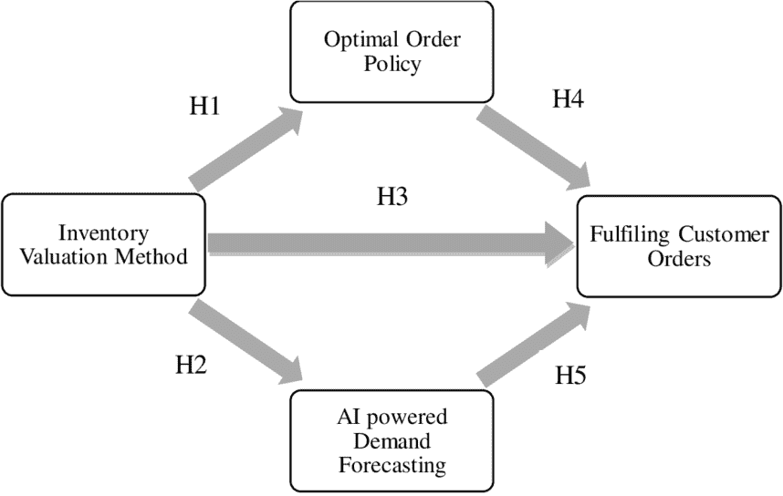

## 研究理由

`HOPCOMS` 的`零售阶段`需要关注如何克服库存浪费和损耗以提升质量。因此，由于网点销售的易腐商品货架期有限，理解库存管理对它们至关重要。在满足 `HOPCOMS` 消费者的过程中，`零售阶段`以回报为代价采取了措施。结果是，零售商面临积压和缺货状况，影响了社会的利润。一种 `AI` 驱动的自主库存解决方案是一种智能替代方案，帮助零售商和酒店公司自动检测并主动避免短缺问题。目前缺乏关于零售商通过 `AI` 驱动系统管理库存所面临问题的研究，因此本研究有助于填补这一空白。因此，通过最合适的方法评估库存以促进 `HOPCOMS` 的增长非常重要。

## 研究方法

进行了一项描述性研究，以寻求关于班加罗合作社 `HOPCOMS` 库存管理问题的答案。受访者包括与客户直接接触的零售商。随后，在有文献支持的基础上，通过便利抽样法使用英语和坎纳达语进行了问卷调查，以确保零售商在提供信息时更加方便。结构化问卷分发给了班加罗城市和农村地区的 265 名 `HOPCOMS` 零售商。收到了 122 名零售商的回复，响应率为 46%。研究于 2020 年 7 月和 2020 年 11 月期间进行。通过结构方程模型 (`SEM`) 得出的统计结果（包括可靠性分析、项目统计和假设检验）是通过 `SPSS version 21` 和 `SPSS AMOS` 软件完成的。

## 结果与讨论

零售商的人口统计细节见表 1，包括年龄组、经验以及采购中心距离零售店的距离。根据调查显示，大多数零售商属于 20-29 岁年龄组，占比 28%；然而，有 15% 的受访者来自 30-39 岁年龄组。同时，在 `HOPCOMS` 工作的零售商最高经验为 6-10 年，占比 41%；只有 2% 的零售商经验超过 15 年。大多数零售商的采购中心到零售店的距离在 1-20 公里之间，只有 8% 的零售店位于 60 公里以外。

### 表 1. 受访者的人口统计细节

| 变量 | 类别 | 受访者人数 | 百分比 (%) |
| --- | --- | --- | --- |
| 年龄（岁） | 少于 20 岁 | 26 | 21 |
| | 20-29 岁 | 34 | 28 |
| | 30-39 岁 | 18 | 15 |
| | 40-49 岁 | 22 | 18 |
| | 49 岁以上 | 22 | 18 |
| | **总计** | **122** | **100** |
| 经验（年） | 少于 1 年 | 36 | 29 |
| | 1-5 年 | 21 | 17 |
| | 6-10 年 | 50 | 41 |
| | 11-15 年 | 13 | 11 |
| | 超过 15 年 | 2 | 2 |
| | **总计** | **122** | **100** |
| 采购中心距离 | 少于 1 公里 | 36 | 29 |
| | 1 公里-20 公里 | 40 | 33 |
| | 21 公里-40 公里 | 18 | 15 |
| | 41 公里-60 公里 | 18 | 15 |
| | 超过 60 公里 | 10 | 8 |
| | **总计** | **122** | **100** |

表 2 显示了零售商从采购中心运往其各自网点采购的商品数量。其中，根据需求，29% 的零售商每周采购 5 – 50 公斤水果蔬菜，而仅有 9% 的零售商采购超过 200 公斤。

### 表 2. 零售商采购的水果蔬菜数量

| 采购数量 | 受访人数 | 百分比 (%) |
| --- | --- | --- |
| 5-50 公斤 | 35 | 29 |
| 51-100 公斤 | 33 | 26 |
| 101-150 公斤 | 13 | 19 |
| 151-200 公斤 | 21 | 17 |
| 200 公斤以上 | 10 | 9 |
| **总计** | **122** | **100** |

为了验证本研究中所用工具的效度，进行了验证性因子分析 (`CFA`)，结果显示效度良好。研究中使用的所有 20 个项目的 `Cronbach Alpha` 均值为 0.899（表 3），远高于 0.7 的可接受值。这表明收集的数据更可靠，且更适用于进一步的统计分析。表 4 提供了所有 20 个项目的项目统计数据及其描述。表 5 提供了四个变量细分的 `Cronbach alpha` 详细信息，分别为：`INVM` – 库存估值方法、`OOP` – 最优订货策略、`ADF` – AI 驱动的需求预测、`COF` – 客户订单履行。表中的所有值均高于可接受值 0.7。

### 表 3. 所有 20 个项目的信度统计量

| Cronbach's Alpha | 项目数量 |
| --- | --- |
| .899 | 20 |

来源：`SPSS V.21` 输出

### 表 4. 验证性因子分析 (CFA)

| 变量 | 描述 | 载荷 | t 值 |
| --- | --- | --- | --- |
| INVM1 | HOPCOMS 使用最有效的方法来计算每日所需的库存。 | .718 | 固定 |
| INVM2 | HOPCOMS 的零售商使用 FIFO（先进先出）和 LIFO（后进先出）库存估值方法。 | .758 | 9.13 |
| INVM3 | 我们就水果蔬菜的信息和价格提供及时的帮助。 | .737 | 10.45 |
| INVM4 | 采取了措施避免零售网点水果蔬菜缺货、过货和断货情况。 | .685 | 11.28 |
| INVM5 | 零售网点遵循 HOPCOMS 制定的伦理标准 | .817 | 10.56 |
| OOP1 | 为避免缺货情况，水果蔬菜被过度库存。 | .760 | 固定 |
| OOP2 | 我们预见客户的期望。 | .630 | 11.56 |
| OOP3 | 我们与客户进行诚实的沟通 | .792 | 11.29 |
| OOP4 | 我们与客户保持频繁联系。 | .686 | 10.49 |
| ADF1 | 零售网点针对多种水果蔬菜的 AI 驱动需求预测。 | .700 | 固定 |
| ADF2 | HOPCOMS 采购中心严格遵守 AI 集成分类和分级。 | .791 | 10.32 |
| ADF3 | 使用现代 AI 驱动技术对水果蔬菜进行称重和计费 | .808 | 10.67 |
| ADF4 | HOPCOMS 采购中心的冷藏和仓库设施通过 AI 算法管理 | .756 | 11.39 |
| ADF5 | HOPCOMS 将水果蔬菜从生产点转移到采购中心的运输设施是 AI 集成的。 | .703 | 11.2 |
| COF1 | 为客户提供广告、折扣等促销活动 | .834 | 固定 |
| COF2 | 零售商的态度影响在 HOPCOMS 购买水果蔬菜的情况 | .806 | 10.29 |
| COF3 | 易于访问 HOPCOMS 的零售网点 | .818 | 11.02 |
| COF4 | 节日期间提供水果蔬菜的折扣和优惠。 | .774 | 11.37 |
| COF5 | 允许根据需求提出建议以增加质量和数量。 | .732 | 11.25 |
| COF6 | 零售商在水果蔬菜称重和定价过程中不参与任何违规行为。 | .834 | 固定 |

### 表 5. 四个变量的 Cronbach alpha

| 序号 | 变量名称 | 项目数量 | Cronbach α |
| --- | --- | --- | --- |
| 1 | 库存估值方法 | 22 | .890 |
| 2 | 客户订单 | 22 | .701 |
| 3 | 最优订货策略 | 22 | .738 |
| 4 | AI 驱动的需求预测 | 22 | .849 |

来源：`SPSS V.21` 输出

### 表 6. 平均值、标准差和相关性

| 变量 | 平均值 | S.D. | 1 | 2 | 3 | 4 |
| --- | --- | --- | --- | --- | --- | --- |
| 库存估值方法 | | | | | | |
| 客户订单 | | | | | | |
| 最优订货策略 | | | | | | |
| AI 驱动的需求预测 | | | | | | |

*(注：源自表数据不完整)*

为了测试假设，使用了 `AMOS V21` 进行结构方程模型 (`SEM`)。图 2 显示了标准化权重。

### 图 2. SEM 模型

`表 7` 给出了假设框架的结果以及关键比例和假设状态。

### 表 7. SEM 结果

| 假设 | 标准化系数 | S.E. | C.R. | P 值 | 结论 |
| --- | --- | --- | --- | --- | --- |
| H1: INV → OOP | -.003 | .067 | -.043 | .966 | 不支持 |
| H2: INV → ADF | .573 | .058 | 9.857 | *** | 支持 |
| H3: INV → COF | .362 | .061 | 5.966 | *** | 支持 |
| H4: OOP → COF | -.101 | .061 | -1.653 | .098 | 不支持 |
| H5: ADF → COF | .516 | .071 | 7.316 | *** | 支持 |

`χ²/d.f. = 3.087/1=3.087; CFI=.990; IFI=.990; TLI=.940; RMSEA=.031`

`*** p < 0.001`

`INV` – 库存估值方法、`OOP` – 最优订货策略、`ADF` – AI 驱动的需求预测、`COF` – 客户订单履行

## 管理启示

如 SEM 结果所示，库存估值方法与最优订货策略之间没有显著关系。因此，零售商从采购中心采购时并未考虑估值方法。然而，发现库存估值方法与 AI 驱动的需求预测以及客户订单履行之间正相关。结果也证明了 AI 驱动的需求预测与客户订单履行之间的关系是正向显著的，支持了该假设。

# 货物管理

库存管理是实现供应链管理效率的关键部分。水果蔬菜在本质上具有时间依赖性和易腐变性。客户倾向于购买质量高、新鲜的商品。因此，零售商应确保满足客户的需求。`HOPCOMS` 的缺点之一是基础设施设施。季节性水果蔬菜依赖于冷链设施。作为一家国有企业，政府应当介入提供必要的冷链设施，以在竞争环境中增加销售额。冷链设施的限制会导致商品腐变、腐烂和萎缩，从而影响社会利润。

## 订货与库存估值

零售商的订货决策起着至关重要的作用，因为商品是每天采购的。根据以往的销售知识，他们购买商品并储存在门店。如果不实际考虑客户的需求，采购的商品将导致库存积压或缺货。实施库存估值方法可以为零售商提供客户所需的商品实际细节和需求。水果蔬菜的时间依赖性建议使用 `FIFO` 来评估实际需求并进行商品库存。`FIFO` 通过先销售采购的商品，并按当前市场价格销售后的商品来增加利润。

此外，零售商应该通过促销商品来增加销售。他们应该提供如折扣之类的促销活动来销售商品，以避免损失。总体而言，库存管理将通过减少浪费和损失影响 `HOPCOMS` 的供应链。

# 结论

本研究强调通过解决影响零售店水果蔬菜质量和新鲜度的各种问题，填补 `HOPCOMS` 库存管理方面的空白。研究结果表明，库存估值方法对 `AI powered Demand Forecasting` 以及客户订单履行有积极影响，且 `AI powered Demand Forecasting` 与客户订单履行之间正相关。该机构实施的估值方法类型应该是清晰的并符合商品特性。库存估值方法描述了实际需求以及相对于冷链设施需要采购的水果蔬菜数量，以在商品到达客户手中之前保持新鲜度和质量。此外，适当的库存评估方法计算满足客户的实际需求。`AI powered Demand Forecasting` 是易腐商品的必需，因为它能维持其寿命。季节性水果需要冷链设施。为了满足客户，该机构应该更多关注 `AI powered Demand Forecasting` 以增加客户订单。


这些发现意味着，可以通过使用 `AI powered Demand Forecasting` 通过适当的方法计算实际需求来实现库存管理，其目标是通过履行订单和增加销售来满足客户。结果还表明，零售商意识到冷链设施的重要性及其在保持新鲜方面的重要作用。在 `HOPCOMS` 零售店将 `AI powered Demand Forecasting` 作为库存管理的一部分，是增加客户满意度的重要驱动力。

## 参考文献

- Afolabi, O. J., & Onifade, M. K., & F, O. O. (2017). Evaluation of the Role of Inventory Management in Logistics Chain of an Organisation. `doi:[10.1515/logi-2017-0011](https://doi.org/10.1515/logi-2017-0011)`

- Arivazhagan, R., Geetha, P., Parthasarathy, R., Weatherspoon, D. D., & Oehmke, J. F. (2012). Analysis of Sources of Fruit Wastages in Retail outlets in Chennai, Tamilnadu, India. Academic Press.

- Balraj, N. (2016). Issues and Challenges in the Supply Chain of Fruits &amp; Vegetables Sector in India: A Review. Splint International Journal of Professionals, 3(8), 113–118. `doi:[10.5121/ijmvsc.2015.6205](https://doi.org/10.5121/ijmvsc.2015.6205)`

- Baron, O., Berman, O., & Perry, D. (2010). Continuous review inventory models for perishable items ordered in batches. Mathematical Methods of Operations Research, 72(2), 217–247. `doi:[10.1007/s00186-010-0318-1](https://doi.org/10.1007/s00186-010-0318-1)`

- Bharadwaj, K. V. (2015, january 27). Retrieved from The Hindu: `[`www.thehindu.com/news/cities/bangalore/the-rise-and-fall-of-hopcoms/article6826063.ece`](https://www.thehindu.com/news/cities/bangalore/the-rise-and-fall-of-hopcoms/article6826063.ece)`

- Bhat, S. A., Khan, F. A., & Narayan, S. (2017). Storage Methods for Fruits and Vegetables. Retrieved from `[`www.researchgate.net/publication/317014767\_Storage\_Methods\_for\_Fruits\_and\_Vegetables`](https://www.researchgate.net/publication/317014767_Storage_Methods_for_Fruits_and_Vegetables)`

- Chandrashekar, H. M. (2018). Farmers Participatory Approach towards Role of the `HOPCOMS` Development of Agribusiness Management in Karnataka. Academic Press.

- Chen, H.-K., Hsueh, C.-F., & Chang, M.-S. (2009). Production scheduling and vehicle routing with time windows for perishable products. Computers & Operations Research, 36(7), 2311.

- Christopher, M. (2000). The Agile Supply Chain. Industrial Management, 29(1), 37–44.

- Halder, P., & Pati, S. (2011). A need for paradigm shift to improve supply chain. Asian Journal of Rural Development, 1(1), 12–21.

- Ionescu, L., & Berger, G. (2018). Applied Analysis of the Impact of Inventory Valuation Methods on the Financial Situation, 9(1), 67–76.

- Kolady, D., Krishnamoorthy, S., & Narayanan, S. (2018). Small-scale producers in modern agrifood marketing cooperatives: A case study of `HOPCOMS`.

- Krishna, K. M., & Mokshapathy, S. (2013). Performance and Prospects of `HOPCOMS` in Karnataka—A Direct Link between Farmers and Consumers. International Journal of Research in Commerce, Economics and Management, 3(2), 114–117.

- Latha, L. (2017). Inventory valuation methods in Indian manufacturing sector SMES - an empirical study. Abhinav National Monthly Refereed Journal of Research, 6(12).

- Murthy, D. S., Gajanana, T. M., Sudha, M., & Dakshinamoorthy, V. (2009). 水果的营销与收获后损失：对供应和经济的影响。 学术出版社。

- Naik, D. S. (n.d.). 卡纳塔克邦 Hopcoms 员工调查。引言。研究方法论, 2(12), 249–257.

- Negi, S. (2014). 供应链效率：印度果蔬菜部门的洞察。运营与供应链管理杂志, 7(2), 154. `doi:[10.12660/joscmv7n2p154-167](https://doi.org/10.12660/joscmv7n2p154-167)`

- Negi, S., & Anand, N. (2015). 印度果蔬菜部门供应链的问题与挑战。RE:view, 6(2), 47–62. 提前在线出版。 `doi:[10.5121/ijmvsc.2015.6205](https://doi.org/10.5121/ijmvsc.2015.6205)`

- Nethravathi, K. G. A. T. O. (2014). 班加罗尔农村和城市选营销机构购买果蔬菜的消费者偏好分析。学术出版社。

- RahaR. (2018, 9 月 4 日). [冷链设施的缺乏限制了 Hopcoms 的利润](https://thesoftcopy.in/2018/09/04/lack-of-cold-storage-facility-hinders-hopcoms-profit/) (https://thesoftcopy.in/2018/09/04/lack-of-cold-storage-facility-hinders-hopcoms-profit/)

- Rao, N. H. (2018). 印度农业发展实施信息通信技术的框架。 `doi:[10.1016/j.techfore.2006.02.002](https://doi.org/10.1016/j.techfore.2006.02.002)`

- Sabir, L. B. (2016). 果蔬菜库存管理：零售研究。SAJMMR。

- Sabir, L., & Farooquie, J. A. (2017). 果蔬菜库存管理不同维度对零售店盈利能力的影响：一项实证研究。Sage (亚特兰大，佐治亚州), 19(1), 99–110. `doi:[10.1177/0972150917713278](https://10.1177/0972150917713278)`

- Sabir, L., & Farooquie, J. A. (2018). 果蔬菜库存管理不同维度对零售店盈利能力的影响：一项实证研究。全球商业评论 19(1), 99–110. `doi:[10.1177/0972150917713278](https://10.1177/0972150917713278)`

- Sandeep Sachdeva, T. R. (2013). 增加果蔬菜消费：挑战与机遇。印度社区医学杂志, 38(4), 192–197. `doi:[10.4103/0970-0218.120146](https://doi.org/10.4103/0970-0218.120146)`

- Shah, N. H. (2014). 需求依赖库存且存在临时折扣时的库存管理订货策略。学术出版社。

- Sharma, P. K. (2016). 易腐库存系统：2006 年以来文献综述。国际应用研究杂志, 2(9), 150–155.

- Simeon, E. D., & John, O. (2018). 库存估值方法选择对利润的影响。税收与结存库存., 3(07), 1639–1645. `doi:[10.31142/afmj/v3i7.05](https://doi.org/10.31142/afmj/v3i7.05)`

- Singh, V., Md, H., Zaman, P., & Meher, J. (2014). 果蔬菜收获后技术。概述., 02(02), 124–135.

- Sohail, N., & Sheikkh, T. H. (2018). 库存管理系统研究案例研究。学术出版社。

# 第 9 章：评述

*   **Nidhi U. Argade**

    商学院，巴罗达马哈哈拉特·萨亚吉拉奥大学，沃达达拉，印度

*   **Parag Shukla**

    

    商学院，巴罗达马哈哈拉特·萨亚吉拉奥大学，沃达达拉，印度

*   **Madhvendra Pratap Singh**

    

    管理学院，卡姆拉·内赫卢物理与社会科学学院，印度

### 摘要

疫情引发的新常态现实导致了金融部门的根本性转型，该部门正经历着剧剧的数字化变革。在此背景下，本研究的目的是概念化加密货币的作用及其对印度及全球数字金融 (`DiFi`) 格局的影响。这导致了破坏性的技术创新并加速了金融体系的变革。基于此，本研究试图突出不同发达国家和发展中国家所采取的数字化倡议。

（注：原文中摘要部分存在大量重复段落，根据“不要重复输出原文”的原则，此处仅翻译首段核心内容。）

本研究报告将作为入门指南，旨在展示数字化和技术赋能倡议对加密货币的影响，并旨在总结驱动数字金融模型采用的限制因素和促进因素，以及在我们迈入新金融格局时政府所扮演的混合角色。

# 引言：加密货币概述

正如斯图特·布兰德（Stewart Brand）正确所说：“一旦一项新技术向你压过来，如果你不是压路机的一部分，你就是路的一部分。”直到十年前，现金仍允许企业在物理世界中与中央机构进行货币交换，而此前在技术上还没有同等的交易方式。大卫·查姆（David Chaum）在 1982 年提出了一种基于盲签的匿名电子现金系统，并于 1990 年建立了名为 `DigiCash` 的电子现金公司。在 1997 年至 1998 年间，`DigiCash` 以及开发了电子货币系统的银行相继破产，因此在 1998 年至 2008 年间没有实施任何电子现金系统。2008 年 10 月 30 日，一位自称中本聪聪（Satoshi Nakamoto）的人发表了一篇名为《比特币：一种对点电子现金系统》的论文，详细介绍了一种名为“比特币”的数字货币。电子现金是一种支付系统，它允许互联网支付直接从一个人传输到另一个人，无需中间机构或银行系统的干预，因为它是完全对点的。比特币网络于 2009 年 1 月 3 日启动，价格为每比特币 0.0008 美元，到 2022 年 1 月已上涨至每比特币 42,500 美元（Best, 2022）。

几年前，数字货币在在线视频游戏世界之外鲜为人知，但它们现在已被广泛使用（Themistocleous et al., 2020a）。虚拟货币已成为一种大多数人意识到的全球现象。与由黄金或银支撑的传统货币不同，加密货币是由公共网络而非政府创建的数字货币，它利用加密来确保支付的发行和接收的安全。从技术角度来看，加密货币被定义为“一种使用密码学创建和维护货币的数字货币，通常与工作量证明方法相结合”。政府或银行在中心化系统下发行新货币，而加密货币从一开始就广为人知，使其免受政治干扰。这些交易要安全得多，密码学为这些交易提供了安全性。交易记录在公共账本中，矿工验证并保护这些交易以换取特定数量的比特币，从而允许向系统添加新货币。上述资金的创建和传输验证是通过对点的分布式计算机节点网络完成的，这些节点是同步的并是主网络的一部分。Ametrano（Ametrano, 2016）提供了一个更具实践性的定义，加密货币“可以使用互联网基础设施和加密安全在任何两个双方之间立即且安全地交换，无需信赖的第三方，其价值不由任何政府或机构保证”。Wiatr（Wiatr, 2014）也将加密货币定义为“一种现代贸易手段”。

大多数加密货币的创建目的是为了提供具有有限价值的新单位。由于其去中心化的发行和对点协议，加密货币变得日益流行。截至 11 月 21 日，全球已有超过 10000 种加密货币可用（Investopedia, n.d.）。在任何时候，都可以生成新的加密货币。由于市值的原因，比特币、以太坊、比特币现金、莱特币和瑞等等货币近年来已成为迷人的现象。作为世界最大的加密货币，比特币于 2009 年启动，从那时出现了一系列被称为“代币”的其他加密货币。随着其热度的飙升，它们也与争议联系在一起。

总结来说，我们基本上遵循了 Spenkelink（Spenkelink, 2014）的指导，发现了加密货币的四个关键属性。首先，比特币运行在分布式网络上，这意味着它不受外部监管的影响。它采用稳健的对点策略，确保资金直接从一方传输到另一方，无论交易类型是 B2B、B2C 还是 C2C。比特币利用了互联网的公共网络，它更快、更高效并提供了可扩展性。它依赖公钥加密来确保金融交易的安全。

所谓的山寨币（Altcoins）可以被视为比特币或莱特币的“分叉”，因为它们使用相同类型的算法。Feathercoin、ChinaCoin 和 Dogecoin 只是几个例子。尽管比特币在理论上可以被挖掘（由任何人生产），但比特币系统提供了某些特性。首先，比特币是稀缺的——限制在 2100 万个，这保持了低通膨胀。其次，它使用公钥和私钥来确保最高水平的安全。在注册成为比特币提供者后，个人将收到一个数字加密货币钱包，该钱包有一个标识的数字或 ID，并在个人传输比特币时公开显示。区块链跟踪之前的所有交易。第三，比特币传输非常简单，只需要一个移动比特币应用程序或钱包以及所需的比特币（你可以通过比特币交易所或 ATM 机获得）。无论距离远近，传输所需时间非常短，只需几分钟。

尽管加密货币具有这些优点，由于其现代技术的特性，也存在一些非常基础且固有的局限性以及担忧。尽管支撑网络货币的 `blockchain` 技术前景广阔，但大多数加密货币并没有内在价值。它们目前的价值基于一种假设：未来会有人愿意为它们支付更高的价格。与此同时，印度政府无意监管或开发加密货币行业；相反，他们打算引入一项关于受控货币的法案和央行数字货币（`CBDT`）。这将通过修改 `RBI Act 1934` 来实施，将银行券的范围扩大到国家中央银行支持的数字货币。除了其他优点外，它将免受通常与私人加密货币相关的波动影响。政府最严重的担忧可能是，在缺乏监管的情况下，加密货币世界将沦化为“法外之地”，加密货币成为毒品交易、洗钱、恐怖主义融资等非法活动的载体。另一方面，将加密货币视为一种资产类别并进行监管，将允许政府监控交易活动、对投资者的资本利得征税，并执行某些透明度和行为准则。Facebook 提出的稳定币 `Diem` 与美元挂钩，但其支持机制并不透明，且无法符合监管规定。加密货币可能被称为货币，但它们并不适合货币的三种功能之一：价值储藏、计价单位或交换媒介。它们是没有内在价值且不支付股息的资产；相反，资产的收益取决于他人持有它的意愿，这增加了其价值。由于其波动性，它们作为交换媒介是不恰的。

本章试图强调加密货币的重要特征、与其相关的各种担忧，并重点介绍作为这些加密货币基础的 `blockchain` 技术。

## 研究的意义/相关性

通常，在经历了最初的技术触发以及爱好者和远见者（被放大的）预期峰值后，务实主义者现在需要交付基于加密货币的实际应用，并将其转化为盈利的业务。这可能并不容易。作为第一个问题，在加密货币获得广泛的消费者采用之前，需要解决哪些关键挑战？以下是五个使我们提出的研究更具意义和相关性的特定问题：


## 核心要素

*   i. 对服务提供者的信任。
*   ii. 价格稳定性。
*   iii. 技术性能。
*   iv. 清晰的监管。
*   v. 具有吸引力的利益。

在这些明显的内在问题之外，还有一个与风险和监管相关的重要元素。

一个关键问题是加密货币服务提供者何时以及如何受到监管。虽然 `Bitcoin` 的原始支持者一些表达了“自由意志主义”观点，并主要反对任何中央机构的干预，但许多加密货币服务提供者和利益集团现在正寻求更好地了解监管环境，并对他们认为合适的监管形式进行游说和倡导。若干 `Bitcoin` 服务提供者已经聘请了首席首席官，并寻求专业人士提供服务，因为他们深知，如果希望实现广泛的采用和商业成功，消费者信心和风险管理至关重要。同时，对加密货币风险的理解正在不断演变并日益文献记录。在这篇研究论文中，也将尝试进行同样的研究。

## 文献综述

### 作为加密货币的比特币

Raymaekers (2014) 专注于 `Bitcoin` 作为一种支付手段。该研究的目标是强调重要的障碍、重大风险、杀手级应用以及基本的加密货币问题。根据论文，短期来看，`Bitcoin` 可能无法取代传统的支付系统，但银行应该关注其底层技术，作为传输财富所有权的潜在通用新手段。Baur (2015) 在最早的出版物之一将数字货币视为一种潜在的破坏性支付方式，重点关注 `Bitcoin`。在与来自三个不同小组的 13 个人的深度访谈中，讨论了易用性、实用性和主观标准等使 `Bitcoin` 成为游戏改变者的决定因素。结果显示，感知的易用性较差，感知的有用性取决于参与者的身份。Ram(2018) 试图确定 `Bitcoin` 能否成为独特且特殊的资产类别。这将为个人将 `Bitcoin` 作为多元化和投资的选项提供见解。分析显示 `Bitcoin` 具有独特的属性。`Bitcoin` 拥有许多投资机会和充足的市场市值。

### 区块链是分布式账本技术

Fanning and Centers (2016) 介绍了关于 `blockchain` 的基础信息，它是 `bitcoin` 的基础。他们在文中解释了区块、挖矿、加密货币、`blockchain` 及其对金融服务业务的影响。

Sapczyski (2019) 试图回答诸如 `blockchain` 这样在许多公共生活领域日益普及的新技术对消费者是否安全，以及对国家立法是否有影响。Joo, Nishikawa 和 Dandpani (2019) 试图识别 `blockchain` 技术在金融领域的应用和局限性，以及该技术对支付系统产生更大影响的部门。Majuri (2019) 使用 `blockchain` 技术提出了一种基于 `Ethereum` 的解决低收入社区经济停滞的方案。研究为当地货币系统以及利用 `blockchain` 技术提高系统效率的研究做出了贡献。Tang 等人 (2019) 试图建立一个概念框架，将区块链伦理研究划分为三个层面：微观层面（区块链技术栈）、中观层面（区块链应用）和宏观层面（区块链治理）（对机构和社会的影响）。对于每个方面，都对基本原则和关键伦理影响进行了深入检查。研究人员希望提高对 `blockchain` 技术伦理挑战的认识，同时也为该领域的未来研究奠定基础。Jayawardhana 和 Colombage (2020) 研究了 `blockchain` 技术如何解决可持续性问题。他们将定性研究集中在可持续性的两个维度：问责和治理，以及它们与 `blockchain` 和加密货币的关系。他们提出了一个连接 `blockchain`、加密货币和长期可持续性的定义。

## 易用性

通过将控制、内在动机和情感引入技术接受模型（TAM），Venketash (2000) 创建并测试了一个基于锚定和调整的理论模型，用于确定特定系统感知易用性的决定因素。在三个月的时间里，他对 246 名员工测试了该模型，以观察计算机的使用有多简单。Alqaryouti 等人 (2020) 试图在比特币的使用与消费者感知收益及行为之间建立联系。他们利用技术接受模型研究了三个因素：易用性、感知优势和使用行为。他们发现易用性与加密货币的使用之间存在正相关关系，但感知收益与使用行为之间并没有显著关系。

## 什么是加密货币？

在关于加密货币最早的研究论文之一，Acuna 和 Pullas (2016) 试图阐明加密货币的四个方面：确定正确的定义、互联网在过程中的作用、数字货币与电子商务的联系以及监管问题。Reza (2018) 在其论文中以比特币为主要案例，强调了专家应对措施，并努力澄清当前密码学在全球范围内应用中是如何运作的。Lipton, Hardjono, and Pentland (2018) 为构建由资产支持的以交易为导向的加密货币提供了可行机制。他们通过将新的技术进展与成熟的对冲策略相结合创建了 `DTC`（数字贸易币）。他们得出结论，`DTC` 可以作为法币的关键平衡力量，并在完全开发后发挥促进国际业务的跨国货币的作用，允许小国群体构建自己的可行性货币。Yuneline (2019) 从货币特征、法律视角、经济视角和伊斯兰教法视角考察了加密货币的本质。Majumder, Routh, and Singha (2019) 研究了加密货币的一个非常不同但重要的方面，即加密货币与恐怖主义融资的联系。研究发现，比特币经济在全球范围内变得如此流行，以至于在国家或区域规则之外产生了一种替代性的虚拟经济。通过向量误差修正模型（`VECM`）发现，在 2010 年至 2016 年的 12 个国家面板中，恐怖事件与比特币交易/流通之间存在统计学意义上的长期关系。然而，对其业务实践及与恐怖主义融资的潜在联系存在广泛担忧。在七年的时间里，Othman, Alhabshi, and Haron (2019) 使用多种 GARCH 系模型研究了对称和非对称信息对比特币货币每日市场收益波动结构的影响。由于条件方差方程中 `ARCH (a)` 和 `GARCH (b)` 的参数在所有 GARCH 模型中在 1% 的水平上具有统计学显著性，结果显示对称信息线性影响比特币市场收益。Capar (2020) 研究并辩论了加密货币和交易在医疗旅游行业中的使用。在医疗旅游这一高附加值且仍是较新的领域，加密货币的使用和交易具有高度的新性和前沿性，这表明它既是一个技术密集型也是劳动力密集型部门。该研究的发现认为引发了医疗机构和提供医疗旅游服务的国家关于是否在运营中使用加密货币的辩论。可以合理假设，比特币的使用和交易以及其他重要变量从今起将成为潜在医疗游客的选择标准之一。

## 研究设计/方法论/途径

本研究将利用文献审查法，从多个国家关于金融领域技术入侵的方面提供有意义的见解，并考虑到加密货币和数字金融，试图演变成一种考虑到所有受益者的利益相关者视角。

我们的研究将涵盖这些方面，以界定金融领域技术干预的优缺点。此外，将解决以下关键问题：

*   技术在加密货币交易中的作用？是促进作用还是限制作用？
*   数字金融的出现是以投资者为中心还是以技术为中心？
*   数字化倡议是增强了金融素养还是导致了混乱？
*   在金融数字技术治理方面，利益相关者扮演什么角色？
*   使用 AI/ML 及其他数字化倡议在保护投资者利益方面有多有效和安全？

## 担忧

2017 年，Facebook 宣布了一种名为“Libra”的加密货币，后来被更名为 `Diem`，并由美元等储备资产支持。`Diem` 的支持加上 Facebook 数十亿的用户将使其具有影响力，将支付从本国货币引向其自己的 `Diem`，这将损害中央银行的权权。储备支持可能会赋予稳定币足够的权重，将交易从国家货币吸引到其自身的媒介中，使中央银行排除在经济活动之外。反过来，中央银行将失去设定利率、校准货币供应量和控制通胀的能力。另一个令人担忧的情况是，大多数稳定币可能会挂钩美元（即主导储备货币）。美国实际上可能将此视为一种优势，因为它将加强美元的影响力，因此不倾向于监管它们。在这样的情况下，什么能防止此类在监管视野之外运行的稳定币脱离储备挂钩，成为独立的货币创造者，并损害新兴和发展中国家的国内政策呢？管理与其通胀目标一致的资本账户对于像印度银行 `RBI` 这样的新兴经济体央银行来说已经是一项复杂的挑战。在这种情况下，通过加密货币进行的资本外逃将加剧这一挑战。

## 比特币波动性与金融稳定

比特币的价值已从 2017 年的 1000 美元波动到近期接近 70,000 美元，加密货币价值的这种波动可能会导致金融动荡。当暴露于这种不稳定性中时，银行会变得脆弱；当然，目前的交易量很小，但考虑到加密货币交易爆炸式的增长率，这是一个令人担忧的问题。

政府和 `RBI` 共同担心的是铸币税收入的可能损失。当 `RBI` 购买资产（如政府证券）时，它通过印刷货币来支付——这实际上是凭空创造货币。`RBI` 在资产上获得的收益包含了铸币税收入，这些收入最终归政府所有。加密货币可以通过使货币供应本身成为一种低效的政策工具来吞噬这部分收入。加密货币可能被称为货币，但它们并没有具备货币的三大功能——由于其波动性，它们不适合作为交换媒介；它们没有基本价值，也没有储值功能。如果加密货币投资从少数知情投资者的小众市场转向缺乏知识的投资者，将成为政府和中央银行关注的问题。这些投资者受日内波动带来的快钱可能吸引吸引被保护，不仅是为了他们自己，也是为了防止更广泛的金融不稳定连锁反应。价值的剧烈波动可能会对金融系统产生溢出效应。国内货币可能会因通胀损失部分价值，但加密货币可能会崩盘。

### 货币政策与监管

大规模退出本货币会减少货币基础和货币政策的有效性。政府的铸币税收入将会下降。去中心化和分散的货币供应无法满足和响应国内周期的需求。由于发行货币的收益将归私人参与者，它们不会被用于创造公共物品。交易所只是中介，监管加密货币是不够的，该技术本身基于分布式账本。加密货币的初始发行掌握在非常不透明结构内的匿名人士手中。虽然这是加密货币的独特卖点（USP），但监管这样的人或系统可能的？同样，当投资者发生中断或损失时，监管机构将向谁追究？

在缺乏任何加密货币相关法规的情况下，从政府的角度来看，最大的威胁可能是加密货币成为洗钱、毒品交易、恐怖主义融资和欺骗容易投资者等非法活动的渠道。另一方面，将加密货币承认为资产类别并对其进行监管将允许政府监控交易活动、对投资者的资本利得征税，并执行某些透明度和行为准则。

### CBDC 与金融科技倡议

正如我们尊敬的总理纳伦德拉·莫迪在 2021 年启动 Infinity 论坛时说的，“现在是时候将这些金融科技倡议转化为金融科技革命——引入 CBDC 革命。这是一场有助于实现国家每一位公民金融赋权的革命。”`CBDC` 的引入具有提供巨大的潜力，例如减少对现金的依赖、由于交易成本带来的更高的铸币税以及降低结算风险。`CBDC` 的引入可能会导致一种更稳健、高效、受信任、受监管且基于法定货币的支付选择。在印度，`Garg committee` 提出了除了少数例外外禁止所有私有加密货币的建议。现在的问题是，全球有超过 6000 种加密货币，在印度有二三个更受欢迎。政府将根据什么依据允许特定的加密货币？

## 区块链技术与加密货币

获取点对网络的概念是区块链运行的基础步骤。具有去中心化和分布式架构的计算机网络被称为点对点（`P2P`）。这意味着网络上的每台计算机和设备都有独特的份额。没有中央管理员，因此所有网络连接（即 `hosts`）拥有平等的权利。`hosts` 之间就 `P2P` 网络中所有数据的可用性进行通信，而不使用中央服务器；如所述，该网络的主要目标是允许网络设备直接相互连接。

在互联网上，`P2P` 网络用于通过 `hosts` 同时发送和接收数据来收发文件。这种技术通过去中心化和所有用户参与交易验证过程提供了重大的优势。这些用户以民主的方式批准了某项活动，而没有任何来自中央服务器的控制或监控。这项技术的关键特征是，它同时使用多个去中心化站点分块下载材料，而不是从单一的中心位置。

### 分布式账本技术 (DLT)

所谓的分布式账本技术（`DLT`）也值得考虑。它是分布在网络上的数据库或信息记录。`DLT` 的访问可能会被授予或拒绝。区块链是由点对点连接的计算机的数据集合，是许多分布式注册的类型之一。与比特币不同，区块链技术可以存储各种数据（与交易和支付无关）。在此，通过加密格式通过网络传输数据允许交易保持安全。每个区块都有一个指向前一个区块的唯一标识符（`hash`），这将区块按顺序绑定在一起。

在 `Bitcoin` 的情况下，区块由所谓的“矿工”制造，他们通过验证区块获得 `Bitcoins` 或如 `Ethereum` 等其他加密货币作为报酬。为了验证区块，矿工们使用“挖掘机”，这是一种特殊的计算设备。“加密货币挖掘”是整个过程的术语。`Bitcoin` 的示例强调了区块链原理如何改变货币的交换方式。在不久的未来，银行业的许多流程将被区块链技术取代，从而极大增强支付流程。信用卡支付需要几个小时，但通过区块链，这些支付可以通过通用账本调整进行实时结算，因此现在不再需要等待几个小时（Glaser, 2017）。

`Blockchain` 以安全、成本效益且透明的方式自动执行交易和合约，因此它有改变传统交易流程的能力（Fairfield, 2014）。`N. Szabo` 提出了“智能合约”的概念，它将计算机协议与用户界面相结合以执行合约条件（Szabo, 1997）。由于区块链系统能够利用区块更快地创建智能合约，它们正变得越来越流行。根据作者的说法，这种独特的方法可以消除律师和银行参与资产协议签约过程的需求。智能合约可用于处理有形和无形资产的所有权（Fairfield, 2014）。

`Ethereum` 是由 `Buterin` 提出的一个去中心化系统，是区块链技术的典范，它以上述概述模型的方式处理智能合约（Szabo, 1997）。`Ethereum` 是 `Bitcoin` 区块链的分叉，允许更广泛的用途。根据 Fairfield 的说法，区块链技术允许使用密码学建立合约，而无需公证处等第三方的参与；`Ethereum` 作为 `Buterin` 的去中心化系统，是区块链技术的卓越示例，以上述所述述模型方式处理智能合约（Szabo, 1997）。`Ethereum` 是一个 `Bitcoin` 衍生品，能够实现更广泛的应用。根据 Fairfield 的说法，区块链技术允许使用密码学制定合约，而无需使用传统上建立信任至关重要的第三方（如公证处）。

加密术（或密码学）让世界各地的人通过互联网上的点对点网络相互信任并共享许多类型的资源。`M. Crosby` 将金融和非金融区块链应用区分开来，在他看来，这两者都具有改变金融交易性质的潜力，并对日常生活的其他部分产生影响。英国歌手 `Imogen Heap` 通过区块链出售她所有的歌曲（Buterin, 2014）。另一方面，区块链技术用途广泛。然而，由于缺乏公共信任机构提供的管理和监控，预计最大的影响将出现在那些传统上依赖第三方服务的地区。根据 `M Atzori` 的说法，区块链具有重塑整个政治和社会的能力（Crosby et al., 2016）。

如果社会开始通过去中心化平台进行管理和保护，许多机构功能可能会过时。根据 `M. Atzori` 的观点，通过认证的区块链区块实现政府服务的去中心化既是可能的，也是理想的，因为它可能会显著改善公共行政的运作（Crosby et al., 2016）。社会转型对于发展中国家至关重要。使用区块链更好地保护财富。当当地政府试图征收土地所有者的财产时，证明所有权可能是具有挑战性的。将土地权与区块链相结合可以缓解这些问题。然而，正如 `F. Glaser` 指出的，数字世界与物理世界之间的相互作用可能是一个弱环节，侵蚀区块链系统建立的数字信任（Glaser, 2017）。

科学界仍在讨论基于区块链的加密货币是否能履行与传统货币相同。根据 `W. J. Luther` 和 `L.H. White` 的说法，加密货币很少作为交换手段（Luther & White, 2014）。另一方面，`F. Glaser` 提供了实证证据表明 `Bitcoin` 被用作投机资产（Crosby et al., 2016）。如果企业家采用加密货币代替传统货币，买卖资产将变得容易得多。

结果，区块链具有彻底改变人们在现实世界支付方式的潜力。例如，在购买物业时，购房者现在承担大量的交易费用。根据 `Goldman Sachs` 的说法，通过减少错误和人工劳动，区块链可以降低保险价格并在美国节省 20 到 40 亿美元。当 IT 专家关注区块链面临的技术和密码学挑战时，IT 工程系统和其他学科正在探索市场设计、信任和隐私问题，以及如何适应和部署新技术以更好地服务社会。此外，这种改变游戏规则的创新具有颠覆和开发新业务模式的能力，甚至影响整个行业。因此，研究人员正在对业务模式、技术和市场的交汇点进行研究。区块链技术一直在不断改进，证明了系统的有效性和可用性。对于数字生态系统，刚刚引入了新的架构组件和用于区块链系统影响分析的框架（Crosby et al., 2016）。

正如前所述，加密货币充满争议，因为它们绕过了银行和金融机构等传统金融系统，这些机构提供现金和非现金交易。这些机构认为加密货币存在损失资金的风险，因为它们依赖于转率来产生收入。对于因传统交易税而可能损失资金的国家也是如此。另一个关键法律考量是交易的匿名性，以及由于缺乏收集个人资金流动数据的单一发行者和中介而导致对现金流的控制缺失。

参与实体即使具有中等的改变和管理流程的能力，但由于对整个过程缺乏监督或控制，这种现象被称为“匿名性”。在区块链技术方面，只有少数法规规定了如何监控和修改活动。尽管法律要求组织注册其在营业额中的参与情况，但无法确定所有公司都会遵守这一要求，也无法确保交易是可访问的。因此，从法律角度来看，这种系统对于国家和个人而言是否安全存在争议。在许多国家，多个政府实体正在积极反对此类解决方案的合法性。另一方面，由于无法追溯源头（即提供服务的公司），禁止与加密货币移动相关的行为将极其困难。只有注册为企业者以使其业务合法化的服务提供商才能被识别。作为各国货币政策的一部分，管理本国货币市场的政府和中央银行也面临风险。政府担心这些漏洞，因为加密货币可能用于洗钱或资助非法活动。包括金融法、商法、银行法、经济法、民法和刑法在内的许多法律领域受到加密货币交易的影响。全球立法者正试图适应因区块链技术日益普及而出现的新现实。

## 加密货币与去中心化金融 [DEFI] 中的技术驱动变革 - 接口

在下一节中，作者试图简要强调加密货币和数字金融出现时的技术突破，这些突破改变了印度及世界其他地区的金融格局。


加密生态系统的快速增长带来了新的契机。技术创新正在开启一个新时代，使得支付和其他金融服务更廉价、更快速、更易获取，并允许它们快速跨境流动。加密资产技术作为更快速、更便宜的跨境支付工具具有潜力。银行存款可以转换为稳定币，允许即时访问数字平台上的大量金融产品，并允许即时货币兑换。去中心化金融可能成为更具创新性、包容性和透明性的金融服务的平台。

加密货币代表了技术驱动市场新阶段的开始，这种市场具有颠覆传统市场策略、长期业务实践和既定监管观点，从而造福消费者和更广泛的宏观经济效率。加密货币具有突破性的潜力，允许消费者接入全球支付系统，该系统定义了“随地、随地”的概念，其参与限制仅限于对技术的获取，而不是取决于信用记录或银行账户等因素。加密货币和区块链产生了一系列全新的“去中心化金融”或 `DeFi` 业务和项目。`DeFi` 旨在为人们提供金融服务——借贷、贷款和交易——而无需银行和经纪公司等传统机构，这些机构通常收取高额佣金和其他费用。相反，“智能合约”在满足特定条件时自动执行交易。`DeFi` 的人气正在迅速飙升，投资者向该领域投入了数百亿美元。加密货币也为政府带来了一系列需要应对的新挑战。加密货币的匿名性和可携带性性使其对犯罪集团、恐怖组织和流氓国家等坏恶分子具有吸引力。对于新兴金融技术的监管处理也存在不确定性。此外，加密货币挖掘可能消耗大量的电力，这引发了对其环境影响的担忧。同时，`DeFi` 和加密支付的兴起引发了关于消费者保护、市场波动以及中央银行执行货币政策能力的问题。加密货币和 DeFi 企业的快速崛起意味着数十亿美元的交易现在正发生在一个相对不受监管的领域，引发了人们对欺诈、逃税、网络安全以及更广泛的金融稳定性的担忧。如果加密货币成为全球支付的主导形式，它们可能会限制中央银行（特别是小国家的中央银行）通过控制货币供应来制定货币政策的能力。

在此背景下，加密货币的技术前沿是一个备受关注的事题。

## 近期主导加密货币的主要趋势

2021 年的亮点是用户对加密货币及相关方案的采用和接受。今年涌现了两只独角兽创业公司——`CoinDCX` 和 `CoinSwitchKuber` 以十亿美元的估值惊艳登场。行业预计印度有 1500 万到 2000 万加密货币用户，总资产超过 60 亿美元，政府对加密货币的态度明显软化。尽管最新报告显示加密法案尚未议会冬季会议上提交，但监管不确定性仍然存在。尽管存在监管不确定性，加密生态系统在未来似乎还将进一步增长。过去一年加密货币的用户数量至少增长十倍。我们没有理由在 2022 年再次增长 10 倍。今年最大的加密热潮是围绕 `NFT`（非同质化代币），阿米塔布·巴强根和萨尔曼·坎汗等宝莱坞偶像推出了他们的虚拟收藏。有趣的是，不仅是 `totality corp`、`NFTically`、`KoinArth` 和 `Bollycoin` 等初创公司进入该领域——像 MG 汽车这样的公司也在寻求利用这一趋势。Web 游戏公司 `Totality Corp` 进一步进了一步，正在基于印度神话人物开发标签 `NFT`。

加密货币保持了其作为最大且最知名代币的地位，尽管面临着许多接踵而来的挑战。比特币在 1 月 12 日后下跌超过 20%，此前曾在 4 月创下了近 65,000 美元的纪录。推动其增长的是来自机构投资者的资金浪潮、`Tesla` 和 `MasterCard` 等大型企业的认可度提高，以及华尔街银行日益增加的投入，这激发了投资者的兴趣。比特币据称具有抗通胀特性——其供应量有上限——尽管打破纪录的刺激计划推高了价格。然而，该代币依然波动不断，它在 5 月下跌了 35%，随后在 11 月飙升至 69,000 美元的历史新高。尽管比特币仍是进入加密货币投资者的首选，但各种新型（有人称之为笑话）代币也进入了该领域。

迷因币（Memecoins）——一系列松散的代币，从 `Dogecoin` 和 `Shibalnu` 到 `Squid game`，它们植根于网络文化——通常没有太大的实际用途。`Degacoin` 于 2013 年作为比特币的衍生品推出，在 5 月飙升了超过 12000%达到历史新高，随后在 12 月旬跌了近 80%。迷因币现象与“华尔街赌场”运动有关，零售交易者在网上协调集体买入股票 `game stop corp`，挤压了对冲基金的空头头寸。随着资金流入加密货币，监管机构对其可能实现的洗钱功能以及对全球金融稳定的威胁表示担忧。长期以来，加密货币的观察者要求对该领域拥有更多权力，一些人还警告消费者注意波动性。当北京在 5 月对加密货币实施限制时，比特币下跌了近 50%，拖累了整个市场下行。

## 讨论

加密货币被誉为有望在全球范围内开启金融包容新时代并简化金融服务基础设施的工具。然而，到为止，它的高关注度更多源于其作为潜在价值存储的地位，而非金融交换手段。这种脱节正在迅速演变，货币当局和私营机构都在发行稳定加密货币，作为可行的主流支付工具。与此同时，多个私营稳定加密货币——通常被称为 `stablecoins`——在国家支持的渠道之外出现，作为旨在增强日益增长的加密生态系统流动性并简化结算工作的一部分。

尽管这一跨越敏捷金融科技公司、财力雄厚的现有者以及（主要是政府任命的）中央银行的广泛活动结果仍远未确定，但其对既有金融流程产生重大破坏的潜力显而易见。在此背景下，本章作者试图提供关于抵押加密货币宇宙的事实入门指南、概述几种可能的未来场景（包括潜在收益和障碍），以及今日金融生态系统参与者可以考虑的以定位自己的短期行动。各种公开声明表明，中央银行将 `CBDCs` 视为是传统纸币的数字原生版本。除了解决扩大金融包容性的挑战外，一些政府还将 `CBDCs` 视为可编程货币——货币和社会政策的工具，可以将它们的使用限制在基本需求、特定地点或特定时间内。

实现此类功能将是一项复杂且多层次的任务。同时，中央银行面临着引入及时 `CBDC` 模型的挑战，这至少要与私营创新者的数字产品水平相当，以便通过这些努力建立信誉并实现采用。印度目前的金融基础设施状况将在决定 `CBDCs`、`stablecoins` 或非稳定加密货币采用的速度和程度方面发挥关键作用。目前能力有限的国家是“跨越式”事件的理想候选者，类似于撒哈拉以南非洲 `M-Pesa` 作为支付工具的快速出现，或中国的 `Alipay`。在拥有现有的实时支付网路的发达经济体中，如果金融机构不愿意投资必要的额外基础设施，那么 `CBDCs` 缩短（即使是瞬时）结算时间带来的短期增益可能有限。在这些情况下，取决于具体的 `CBDC` 实现方式，`stablecoins` 的独特优势（例如它们与 `smart contracts` 交互的能力）从长期来看可能是一个更具吸引力且可防御的用例。主权货币缺乏历史稳定性的国家居民是加密货币作为交换手段最活跃的采用者，特别是当它们被认为比可用替代品风险低时。除了数字货币可能为缺乏传统银行服务的公民促进金融包容性（使用通用数字钱包而非传统的货币账户），这种环境也可以作为市场准备好迎接潜在跨越式事件的指标。

## 政策必要性

### 引言

许多政府最初对加密货币采取不干预态度，但其快速崛起和演变，加上去中心化金融（DeFi）的兴起，迫使监管机构开始为这一新兴制定规则，这可能需要多年时间。全球监管差异巨大，有些政府拥抱加密货币，而另一些则完全禁止。监管机构面临的挑战是制定出既能限制传统金融风险，又不扼杀创新的规则。需要稳健且全球一致的标准来缓解金融稳定风险。在尚未制定标准的情况下，监管机构需要利用现有工具来控制风险，并为加密资产实施灵活的框架。

加密资产日益增长的系统性影响在某些国家确实可能需要立即采取监管行动。监管机构必须关注高风险领域（如钱包、交易所和金融机构的风险敞口），并利用现有措施和国际标准。执法部门应确保监管框架具有足够的灵活性，以便未来能够根据即将发布的国际标准进行调整。应当采取临时措施，包括明确的消费者警告和投资者教育计划，特别是在加密货币采用较快速的地区，例如某些新兴市场和发展中经济体。

### 监管挑战与协调

各国监管机构应加强跨境监管和执法行动的协调。例如，由于难以实施和执行充分的监管框架，一些机构采取了强措施，如禁止未经监管的加密资产活动。虽然禁止会对加密货币交易所的业务产生直接影响，但个人仍可能通过替代手段交易和交换加密资产。因此，司法管辖区应积极与相关部门和国际标准制定机构协调，以最大限度地提高执法行动的有效性并减少监管套利。

更深入的跨境合作可以加强执法行动，但此类执法所需的资源可能给新兴市场和发展中经济体带来更大的挑战。迅速解决数据缺口是制定政策决策的核心。更高的数据标准化可以对新事态提供更好的监管，对风险有更准确的理解，并支持对加密资产市场进行比例监管。在这方面，应该制定一项关于数据共同最小原则的国际协议。全球一致的分类法有助于数据标准化和合作。在为了监管和公共政策目的对私公司数据源进行汇总和共享方面，也有国际协调的空间。

### 创新与政策制定

金融科技创新（包括加密生态系统）具有通过更好的金融服务和更高的金融包容性来改善宏观经济基础方面的潜力，特别是在新兴市场和发展中经济体。政策制定者需要一方面在促进金融创新、加强竞争以及对开放、自由和可竞争市场的承诺，与另一方面应对金融完整性、消费者保护和金融稳定的挑战之间取得平衡。作为第一步，监管机构和监督部门需要能够监测快速发展及其产生的风险。根据各国情况，可能会采用各种形式的加密资产，其经济功能可能有所不同。在匿名平台上运行的加密资产对金融完整性存在较高风险，但对于某些稳定币，是可以解决的。

## 不确定的格局：前行之路

显然，这些技术考量、监管行动和市场动态对银行业和支付行业具有重大的系统性影响。单纯的监管极不可能抑制对数字货币的需求，创新者将继续通过开发新的用途和分发模型来满足需求和立法要求，突破边界。最可能的情况是某种形式的共存。在这个连续体中，我们可能会看到由地理位置、私营机构的市场主导地位或行业决定的特征。虽然市场尚于幼嫩，无法确信地预测结果，但支付生态系统的各个角落的成员可以采取宝贵的步骤，为地平线上不可避免的变化做好准备。

### 政策必要性

政策必要性应涵盖以下方面：

- 金融服务基础设施提供者应持续监测其设计选择对于未来与数字货币操作的适用性。
- 零售银行、商户和支付服务提供商可能考虑成功实施加密货币可能需要的基础设施投资水平。
- `CBDCs` 对私营银行的影响可能取决于其采用速度。政府、中央银行和监管机构的任务则相对直接：在某种程度上，他们的决定将决定其他方的行动，尽管市场中稳定币解决方案所展示的任何吸引力将不可会纳入央行者的考量。

### 市场演变与治理

由于使用或可能使用各种形式加密货币的各个群体需求迥异，显而易见没有任何货币能满足所有人的相对需求。随着对加密货币可行性的认可和接受增加了各个群体的需求，它们可能会在现有和新兴市场蓬勃发展——尽管不太有一种货币能够满足所有使用群体的需求。这可能会导致新加密货币的产生，或对现有货币进行调整，以使其目标群体获得前进所需的满意和信心。这些发展涉及的动态将决定市场是否足够灵活以满足这些需求，以及随而来的波动性。

在前进的过程中；加密货币仍处于开发和采用的初步阶段，引发了其他尚未完全解决或回答的挑战。关于传统市场加密货币的监管和治理有许多问题。例如，在当前的加密货币税收结构中，财产税或资本利得税是否适用于货币？当用于交易时，是否应该征收销售税以及如何纳入？此外，虽然 `smart contracts` 通过将支付条件设置为区块链中的代码来消除了中间环节，但合同代码的漏洞或不可预状况可能会产生何种风险？在不知道参与方身份的情况下，使用加密货币的机构如何缓解被恶意者利用的合同缺陷？资金将如何追回，或者是否能追回？随着加密货币试图在传统市场和机构中证明其有效性，这类问题将继续出现；这是一个需要进一步审查的领域。然而，到目前为止的进展表明，加密货币将继续拥有增长的影响，需要政府、机构和消费者准备将其纳入未来。

加密货币在印度的未来似乎尚不明朗，但这并没有阻止印度年轻人拥抱所谓的第四次工业革命世界。在这个世界中，互联性和智能自动化（很大程度上依赖 `blockchain technology`）驱动着人类文明。印度储备银行行长多次警告宏观经济不稳定，并称如果加密货币成为主流，甚至可能导致严重后果。该国家的货币当局希望像中国一样对 `Crypto` 实施全面禁令，甚至不允许这些货币被视为投资品。印度现在拥有全球最多的加密货币投资者。专家表示，尽管存在普遍的不确定性，加密货币在该国将继续增长。

## 参考文献

- 一点对点的电子现金系统。(n.d.) 检索于 2022 年 12 月 13 日，来自 [`bitcoin.org/en/bitcoin-paper`](https://bitcoin.org/en/bitcoin-paper)

- Alqaryouti, O., Siyam, N., Alkashri, Z., & Shaalan, K. (2020a). 加密货币的使用对感知收益和用户行为的影响。In Themistocleous, M., & Papadaki, M. (Eds.), 信息系统。EMCIS 2019. 商业信息处理讲义集 (Vol. 381)。 doi:[10.1007/978-3-030-44322-1_10](https://doi.org/10.1007/978-3-030-44322-1_10)

- Alqaryouti, O., Siyam, N., Alkashri, Z., & Shaalan, K. (2020b). 用户使用加密货币的知识与动机。信息系统商业信息处理讲义集，381, 113–122。 doi:[10.1007/978-3-030-44322-1_9](https://doi.org/10.1007/978-3-030-44322-1_9)

- AmetranoF. M. (2016). 哈耶克货币：加密货币价格稳定解决方案。社会科学研究网络。

- Atzori, M. (2015). 区块链技术与去中心化治理：国家仍然必要吗？工作论文。可用地址：[`nzz-filesprod.s3-website-eu-west1.amazonaws.com/files/9/3/1/blockchain+Is+the+State+Still+Necessary_1.186899311.pdf`](http://nzz-filesprod.s3-website-eu-west1.amazonaws.com/files/9/3/1/blockchain+Is+the+State+Still+Necessary_1.186899311.pdf)

- Baur, A. W., Bühler, J., Bick, M., & Bonorden, C. S. (2015). 加密货币是一种颠覆吗？关于比特币等货币用户采纳和未来潜力的实证发现。In 计算机科学讲义集：Vol. 9373。开放与大数据管理与创新。I3E 2015。Springer。 doi:[10.1007/978-3-319-25013-7_6](https://doi.org/10.1007/978-3-319-25013-7_6)

- Best, R. (2022, 12 月 13 日). 比特币价格历史 2013 年 4 月-2022 年 12 月 12 日。检索于 2022 年 12 月 13 日，来自 [`www.statista.com/statistics/326707/bitcoin-price-index/`](https://www.statista.com/statistics/326707/bitcoin-price-index/)

- ButerinV. (2014). 下一代智能合约和去中心化应用平台。可用：[`www.intgovforum.org/cms/wks2015/uploads/proposal_background_paper/SSRN-id2580664.pdf`](https://www.intgovforum.org/cms/wks2015/uploads/proposal_background_paper/SSRN-id2580664.pdf)

- Çapar, H. (2021). 医疗旅游中的加密货币和交易。经济与行政科学杂志，37(4), 677–693。 doi:[10.1108/JEAS-07-2019-0080](https://doi.org/10.1108/JEAS-07-2019-0080)

- Crosby, M., Pattanayak, P., Verma, S., & Kalyanaraman, V. (2016). 区块链技术：超越比特币。应用创新评论。可用 [`j2-capital.com/wp-content/uploads/2017/11/AIR2016-Blockchain.pdf`](https://j2-capital.com/wp-content/uploads/2017/11/AIR2016-Blockchain.pdf)

- Fairfield, J. (2014). 智能合约、比特币机器人与消费者保护。[`scholarlycommons.law.wlu.edu/cgi/viewcontent.cgi?article=1003&context=wlulr`](https://scholarlycommons.law.wlu.edu/cgi/viewcontent.cgi?article=1003&context=wlulr)

- Fanning, K., & Centers, D. (2016). 区块链及其对金融服务的未来。公司会计与财务杂志，27(8 月)，53–57。 doi:[10.1002/jcaf.2219](https://doi.org/10.1002/jcaf.2219)

- Finanse. (2018). 税务门户。可用：[`www.finanse.mf.gov.pl/c/document_library/get_file?uuid=589b1960-46fd-41f2-bf17-3`](https://www.finanse.mf.gov.pl/c/document_library/get_file?uuid=589b1960-46fd-41f2-bf173)


# 参考文献

- Glaser, F. (2017). 数字基础设施的普遍去中心化：一种区块链支持的系统和用例框架。In 第 50 届夏威夷国际系统会议 (HICSS)。可用：[`pdfs.semanticscholar.org/859d/0535e16095f274d69df5494b2158a3.pdf`](https://pdfs.semanticscholar.org/859d/0535e16095f274d69df5494b2158a3.pdf)

- Hashemi Joo, M., Nishikawa, Y., & Dandapani, K. (2020). 加密货币：区块链技术的成功应用。管理金融，46(6), 715–733。 doi:[10.1108/MF-09-2018-0451](https://doi.org/10.1108/MF-09-2018-0451)

- Investopedia. (n.d.). https://www.investopedia.com/tech/

- Jayawardana, A., & Colombage, S. (2020). 区块链驱动可持续性吗？一项探索性综述。在全球贸易与可持续性中。 doi:[10.1108/S2043-202000](https://doi.org/10.1108/S2043)

- Lipton, A., Hardjono, T., & Pentland, A. (2018). 数字稳定货币。皇家学会开放科学，5(7)。

- Luther, W., & White, L. (2014). 比特币能成为主要货币吗？工作论文。可用：[`bahler.co/wp-content/uploads/2016/11/Can-Become-a-Currency.pdf`](http://bahler.co/wp-content/uploads/2016/11/Can-Become-a-Currency.pdf)

- Majumder, A., Routh, M., & Singha, D. (2019). 关于加密货币兴起与恐怖主义融资联系的概念性研究。在恐怖主义对经济发展的影响中。 doi:[10.1007/978-3-319-25013-7_6](https://doi.org/10.1007/978-3-319-25013-7_6)

- Majuri, Y. (2019). 使用编程货币克服低收入社区的经济停滞。风险金融杂志，20(5), 594–610。 doi:[10.1108/JRF-0](https://doi.org/10.1108/JRF-0)

- Othman, A. H., Alhabshi, S., & Haron, R. (2019). 对称和不对称信息对加密货币市场波动结构的影响：以比特币为例。金融经济政策杂志，11(3), 432–450。 doi:[10.1108/JFEP-10-2018-0147](https://doi.org/10.1108/JFEP-10-2018-0147)

- Ram, A. J. (2019). 比特币作为一种新资产类别。Meditari 会计研究，27(1)。

- Reza, T. (2018). 关于数字货币的研究：未来货币的安全性。JurnalTransparansi，1(1), 134–139。 doi:[10.31334/trans.v1i1.145](https://doi.org/10.31334/trans.v1i1.145)

- Słapczyński, T. (2019). 区块链技术与加密货币——法律与税务方面。ASEJ-别尔斯斯科金融学院科学期刊，23(1)。 doi:[10.5604/01.3001.0013.2653](https://doi.org/10.5604/01.3001.0013.2653)

- Spenkelink, H. (2014). 加密货币的采用过程。从多方利益相关者的视角识别影响加密货币采用的因素。Google 学术。

- Tang, Y., Xiong, J., Becerril-Arreola, R., & Iyer, L. (2020). 区块链伦理：技术、应用、影响及研究方向框架。《Information Technology & People*, 33(2), 602–632. doi:[10.1108/ITP-10-2018-0491](https://doi.org/10.1108/ITP-10-2018-0491)

- Venkatesh, V. (2000). 感知易用性的决定因素：将控制、内在动机和情绪整合到技术接受模型中。《Information Systems Research*, 11(4), 342–365. doi:[10.1287/isre.11.4.342.11872](https://doi.org/10.1287/isre.11.4.342.11872)

- Wiatr, M. (2014). 比特币作为现代金融工具。 [`rep.polessu.by/bitstream/123456789/5570/1/30.pdf`](https://rep.polessu.by/bitstream/123456789/5570/1/30.pdf)

- Yuneline, M. H. (2019). 从四个维度分析加密货币的特征。《亚洲商业与经济研究杂志》， 26(2), 206–219. doi:[10.1108/JABES-12-2018-0107](https://doi.org/10.1108/JABES-12-2018-0107)

# 第 10 章

## 作者

Tripti Pal, RATM, 印度

## 摘要

人工智能（AI）和机器学习（ML）通过在各个领域的应用已成为我们生活中不可或缺的一部分。人工智能是一种允许机器表现得像人类的技术。机器学习是人工智能的一个分支，它帮助机器从过去的数据中自动学习，以获得更准确的预测结果。在今天的生活中，特别是在 COVID-19 大流行期间，我们的生活在网上运行，几乎所有工作都在线上完成，如办公工作、教育、购物、医疗设施等；金融领域也有许多使用机器学习案例，例如金融监控、投资预测、流程自动化、安全交易、风险管理、财务咨询、客户数据管理、决策制定、业务分析以及客户服务水平的提升。

## 引言

在当今数字化时代，在技术进步上保持现代化是企业战胜竞争对手并实现业务增长的必经之路。

金融领域的机器学习现在已成为某些金融服务和应用中的关键因素，用于评估风险因素、为贷款和信用卡审批计算信用分、决策制定、资产管理以及当大量数据存储在计算机系统中时进行数据预测 (Murugesan & Manohar, 2019)。机器学习算法被用于检测和预防欺诈、预测即将到来的机会、自动化的交易活动，(Milojević and Redzepagic, 2021)研究业务案例、投资组合管理并为投资者提供财务咨询服务。本研究提取了相关因素，将帮助研究人员在金融领域推动机器学习的发展。

### 图 1. 机器学习简介

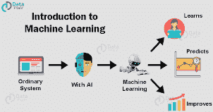

*来源: - https://data-flair.training/blogs/machine-learning-tutorial*

如今，金融行业（包括银行、交易和投资公司）正在快速将机器学习算法应用到其运营中，以自动化耗时且平庸的流程，并提供更加流化的流程、降低的风险和个性化的客户体验 (Milojević and Redzepagic, 2021)。

## 文献综述

本研究探讨了人工智能对银行业行业的影响以及银行业行业使用的 AI 应用。在这项研究中，他们提供了一些支付研究的报告。Business Insider Intelligence 识别了银行使用 AI 应用节省成本的三个主要渠道：前台、中台和后台。我们还讨论了金融机构迄今为止成功的 AI 策略，并对银行如何最好进行 AI 驱动的数字化转型提供了建议。

本研究分析了目前印度银行在客户满意度、数字化流程、欺诈检测、欺诈预防以及最重要的提供数据隐私和安全方面对 AI 应用的使用。他们给出了银行聊天机器人应用的示例，例如印度国家银行的 `SIA`、HDFC 银行的 `Eva` 和 ICICI 银行的 `iPal`。现在，银行将带有 AI 算法的新业务模式整合到系统化计划中，以进行分析并提高客户满意度。

Kou, G., Chao, X. 的分析指出，金融系统性风险已成为金融领域和市场的一个大问题。许多机器学习算法被开发用于检测、发现和识别。

### 机器学习是如何工作的？

机器学习通过从原始数据中提取重要信息来工作。这些信息随后用于解决复杂问题 (Milojević and Redzepagic, 2021)。此外，这些机器学习算法具备从数据中学习并为投资者提供财务咨询的能力 (Donepudi, 2017)。

### 为什么在金融领域使用机器学习？

- 通过自动化降低运营成本
- 通过提高生产力增加收入
- 增强合规性

### 金融公司在实施机器学习时面临的挑战

机器学习是一项关键技术，超过 50% 的企业目前在使用或计划使用 (Donepudi, 2017)。然而，在实施机器学习解决方案时，您的企业可能会看到好的方面，但也面临多种机器学习挑战，如下所示：

#### 缺乏对 KPI 理解

金融行业希望部署这项伟大技术，但由于预期不切实际以及对 AI 和机器学习工作原理缺乏清晰认识，他们往往会失败。这可能是因为这是一个新兴领域缺乏经验，或者仅仅是因为没有专门的部门。因此，市场竞争异常激烈。

#### 高昂的研发成本

金融服务公司通常面临数据管理问题，数据数据存储在不同的地方，例如报告软件、区域数据中心、`CRM` 等 (ALEXANDRE, M. (2021))。为数据科学项目准备这些数据是一项既耗时又昂贵的任务。

#### 缺乏机器学习专家

虽然在机器学习旅程中存在开发者，但缺乏熟练且开发的 `ML` 专家仍然是最大的机器学习挑战 (Alexandre et, 2021)。您可能无法找到能够解决您问题的开发者。

#### 昂贵的部署

大多数机器学习问题是业务中昂贵的部署。机器学习的实施需要数据科学家、项目经理和具有专业技术知识的开发者 (Y, S. (2021))。以负担得起的价格招聘技能专家是困难的。另一方面，由于机器学习算法与大量数据工作，这些对实施提出了额外的基础设施需求。在没有适当基础设施的情况下，测试将变得困难。

### 金融领域的机器学习用例

以下是金融领域可以使用或正在使用机器学习算法的一些用例。

### 图 2. 金融领域的机器学习应用

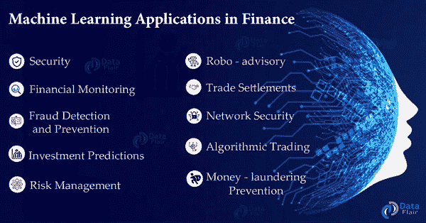

*来源: - https://data-flair.training/blogs/machine-learning-in-finance/*

## 流程自动化

流程自动化是商业世界中最令人兴奋的技术之一。机器学习让金融公司通过机器人流程自动化（`RPA`）完全取代人工工作，以提高业务生产力。RPA 曾通过添加聊天机器人作为客户额外界面来改善客户体验，例如印度国家银行的 SIA、HDFC 的 Eva 以及 ICICI 的 iPal（Balakrishna, D. R. (2020) Banking on AI）。聊天机器人、纸质自动化和员工培训是金融领域中使用机器学习进行流程自动的一些常见示例。这使得金融公司能够增强客户体验、降低成本并扩大服务（Donepudi, 2017）。这一过程可以轻松地收集和访问数据、解释结果、遵循并识别模式。这些数据或历史数据被用于客户支持系统。它还可以从过去的经验中学习，并用于敏锐的分析和预测任务完成的时间线。

## 安全交易

机器学习算法非常适合通过检查人类无法发现的数百万数据点来发现交易欺诈。它还帮助发现许多安全问题，例如分析账户注册的文档、检测账户内问题等（Y, S. (2021)）。机器学习解决方案还可以扫描分析数百万次法律和法规内容，包括法律文件、法律指南、法律判例、评论，以发现更多适用要求。此外，ML 有助于捕获拒绝交易并提高实时批准的精确度。这些模型是根据客户在互联网上的行为和交易历史设计的（Sadgali et al, 2019）。机器学习算法能够非常快速且高精度地评估这些交易。这种速度有助于实时防止欺诈。它还能以高精度发现可疑账户持有人或人员，并在犯罪发生前进行实时阻止。

根据研究，欺诈损失每损失 1 美元，金融机构承担的追回成本接近 2.92 美元。信用卡欺诈检测是机器学习在银行中的最佳应用之一。跟踪进行金融交易的可疑人员的 IP 地址，有助于防止折扣券欺诈，并识别欺诈意图。

## 欺诈检测与预防

机器学习算法能够实时分析数千个数据点并标记任何可疑的欺诈交易（Sadgali et al, 2019），从而在过程中阻止许多欺诈客户。欺诈检测工具可以分析客户行为、跟踪分配并确定购买习惯，因此它们可以快速检测到任何异常活动（S, F., & M, R. (2021)）。它还被用于检测支出行为中的异常从而预防。机器学习驱动的欺诈分析可以处理客户账户交易，甚至整合特殊数据以发现看似无关且仅被人类数据分析师忽略的模式。基于机器学习的软件帮助银行访问预测范围以立即分析无数的事实，从而节省成本并使流程变得快得多。

欺诈是银行和金融服务公司面临的巨大问题，每年导致数十亿美元的损失（Sadgali et al, 2019）。这就是为什么金融领域引入机器学习的首要原因之一。根据彭博社的报告，2015 年全球发行的所有信用卡、借记卡和预付通用及私有标志卡在金融行业遭受的损失金额高达 167. 亿英镑（218 亿美元）。

旧的欺诈检测系统是基于一套规则和法规设计的，欺诈者很容易破解。因此，今天大多数行业都购买机器学习算法来防止欺诈性金融交易。

全球支付系统 Payoneer 在全球范围内提供金融服务和在线转账。相应的，该公司的客户数据库估计达数百万。由于该公司是全球注册的万事达提供商，如果没有银行业的机器学习用例，交易安全将会失败。

机器学习具有潜力通过分析资金转账金额、来源、目的地和转账性质以及发送者与银行的关系，来揭露洗钱活动。

## 投资预测

交易服务使用 ML 技术来理解高级市场的事实。在机器学习的帮助下，基金经理比传统投资模型更早预测市场变化（Alexandre et al, 2021）。ML 技术辅助交易公司通过智能算法最大化其投资机会，这些算法知道买卖股票的最佳时机（Song, X. H. (2014)）。即使现在，有效的投资软件也能帮助用户在股票达到最高价时执行预设指令或在每股价格跌至某个数字时卖出。它还根据市场交易的自动分析预测数据。但是，如果你认为通过投资预测你的风险将降到最低，那么这种情况永远不会发生。

摩根通、美国银行和摩根士丹利等知名公司已经开发了运行在机器学习上的自动化投资顾问，以增强他们的利润。但如果你认为这样你的风险就会降到最低，那永远不会发生。

### 投资组合管理 - 机器人投顾

投资组合是根据个人的收入、预算、时间框架、风险承受能力对债券、股票、共同基金、股票和现金等投资工具的集合。

投资组合管理是根据投资者的收入、预算、年龄和风险承受能力提供的自动化财务建议（Kou et al, 2019）。投资组合管理是三个要素要素的：投资时间、投资的变化以及承担风险的能力。投资组合管理是根据财务状况建议最佳且独特投资政策的艺术与科学。机器人投顾是金融领域非常常见的应用。该应用使用算法和统计自动分配、管理客户投资，并在实时市场上优化客户资产（ALEXANDRE, M. (2021)）。AI 力量工具可以帮助交易者简化开户流程，并建议他们扩大投资组合，这包括财务规划、购房计划建议、退休、保护需求、资产规划等。ML 可以根据价格和从哪个渠道处理得更快来优化交易。

这些服务比人类财务顾问更便宜。机器人投顾需要的账户最低金额较低。

定制的智能聊天机器人可用于简化 TDS 客户服务流程，自动解决简单的客户请求，并根据情感对其他工单进行排序，以便将其路由到合适的处理环节。

### 运营成本降低

机器学习算法处理大量数据，从而提高了数学计算的效率、准确性和速度，导致降低了运营成本。

### 信贷决策

通过 AI，银行可以分析手机活动、社交媒体使用情况等获取数据，从而对信誉状况进行更准确的评估（Alexandre et al, 2021），这将带来更快速、更廉价的信用评分，并最终让大量人群能够获得优质的贷款评估。（Farheen, S. and Raghuwanshi, M., 2021）。它还被用于通过趋势机器学习分析大量的财务或非财务数据，以比传统方法更高的准确率预测信用违约者。

### 交易与财富管理

银行越来越多地使用 ML 算法来获取新的交易和投资策略。它们可以更快地分析海量数据，而且算法的预测要准确得多，因为它们可以分析大量的历史数据（S, F., & M, R. (2021)）。它还可以分析特定投资者的长期和短期目标，提供强有投资组合建议。预测数据能力的交易 AI 策略有助于发现人类理解范围之外的新趋势和潜在的盈利趋势，也有助于发现价格波动的新信号，以做出更快速的交易决策（Alexandre et al, 2021）。ML 算法可以对与股市相关的结构化和非结构化数据进行快速分析，能够快速决策。

### 营销与客户服务

使用各种机器学习解决方案，如情感分析、关键词匹配、事件提取等（Kou et al, 2019）。我们可以回答诸此类问题：我如何才能保持客户满意？人们对我评价如何？谁对我的产品感兴趣？我的电脑怎么了？

## 结论

机器学习与 AI 在金融领域的应用已成为当今时代的重要工具。ML 算法比以往更准确、更高效、更有效。它们主导了金融领域，没有它们我们什么也做不了，因为它们提供了所有流程的自动化和计算的准确性。ML & AI 为满足客户需求提供了一种新方法，客户希望有一个智能、安全、便捷且流程来储蓄、消费和投资资金，并点击一下即可获取所有更新。ML 算法防止欺诈、检测欺诈、寻找信用评分、风险因素等。因此，这项技术已成为现代金融领域的重要组成部分。

## 参考文献


# 参考文献

- Alexandre, M., Silva, T. C., Connaughton, C., & Rodrigues, F. A. (2021). The drivers of systemic risk in financial networks: A data-driven machine learning analysis. *Chaos, Solitons, and Fractals*, 153, 111588.
- Donepudi, P. K. (2017). Machine learning and artificial intelligence in banking. *Engineering International*, 5(2), 83–86. doi:[10.18034/ei.v5i2.490](https://doi.org/10.18034/ei.v5i2.490)
- Kou, G., Chao, X., Peng, Y., Alsaadi, F. E., & Herrera-Viedma, E. (2019). Machine learning methods for systemic risk analysis in financial sectors. *Technological and Economic Development of Economy*, 25(5), 716–742. doi:[10.3846/tede.2019.8740](https://doi.org/10.3846/tede.2019.8740)
- Milojević, N., & Redzepagic, S. (2021). Prospects of artificial intelligence and machine learning application in banking risk management. *Journal of Central Banking Theory and Practice*, 10(3), 41–57. doi:[10.2478/jcbtp-2021-0023](https://doi.org/10.2478/jcbtp-2021-0023)
- Murugesan, R., & Manohar, V. (2019). AI in Financial Sector–A Driver to Financial Literacy. *Shanlax International Jou*, 66-70.
- S, F., & M, R. (2021). Performance of Machine Learning Techniques in the Prevention of Financial Frauds. *International Journal of Computer Sciences and Engineering*, 27-29.
- Sadgali, I., Sael, N., & Benabbou, F. (2019). Performance of machine learning techniques in the detection of financial frauds. *Procedia Computer Science*, 148, 45–54. doi:[10.1016/j.procs.2019.01.007](https://doi.org/10.1016/j.procs.2019.01.007)
- Song, X. H., Hu, Z.-H., Du, J.-G., & Sheng, Z.-H. (2014). Application of Machine Learning Methods to Risk Assessment of Financial Statement Fraud. *Journal of Forecasting*, 33(8), 611–626. doi:[10.1002/for.2294](https://doi.org/10.1002/for.2294)
- Y, S. (2021). Machine Learning Applied in the Financial Industry. *Financial Forum*, 239.

# 综述

冠状病毒（COVID-19）疫情最初于 2019 年 12 月下旬发现于中国武汉，世界卫生组织（WHO）于 2020 年 3 月将其宣布为全球大流行。应对疫情的真正创新来自后端，高阶人工智能算法为新老客户和现有消费者提供建议。尽管许多人对其并不了解，但人工智能在我们的生活中无处不在。人工智能具有显著改进的潜力。它始终从考虑客户对购买体验的期望开始。数据收集、数据传输、数据分析和数据存储是物联网（IoT）的四大功能组件。可以使用安装的传感器进行数据采集；终端移动硬件（如手机、机器人和健康监测仪）配备了传感器。将采集的数据传输到中央云服务器进行数据分析和决策，例如是否需要为了避免未来的未知故障而进行设备维护，或是否需要进行患者检查 [6–8]。物联网系统在医疗行业的部署已形成智能传感器、医疗设备、大数据、云计算、远程医疗、临床信息系统以及其他多种应用形态。为了对抗新冠肺炎，医疗保健行业的物联网技术可以根据其应用用于多种目标，如远程患者监测、接触网络追踪和基于传感器的洗手监测设备。由于通过各种数据收集技术获得了大量且多样化的数据集，进一步在零售领域整合物联网应用（特别是在新冠肺炎期间），有望带来更快、更准确的反应和更好的整体医疗服务。本文介绍了一项使用概念性定量研究方法的探索性研究结果，基于人工智能与物联网混合技术以及物联网位置智能解决方案提供商——提供低功耗广域网（WAN）网络解决方案的公司正在推出多种解决方案，在不同阶段应对新冠肺炎，并使用了各种地理定位技术。

本文涵盖了人工智能和物联网最重要的组件，以及采用的方法、研究结果的分析与讨论以及该研究的结论。

# 人工智能与物联网在零售领域的重要性

新冠肺炎正严酷地将日常业务转变为未来的超市。由于供应链中断，它们必须适应所有新的杂货购物行为，从恐慌性购买到配送和自提替代方案。杂货店以不同的方式做出：有些正在减少销售商品数量，有些跳过批发商直接联系产品生产者，而有些则对其实体店面进行全面的数字化改造。语音识别、图像识别和手写建议——这些在今天的智能手机上均可可用——都是人工智能在个人和企业日常生活中的例子。根据 Kietzmann, Paschen, and Treen (2018)，对于营销人员来说，存在极具价值的人工智能系统来增加对消费者决策理解，无论采取何种行动，人工智能零售解决方案将极大改善零售运营。

## 人工智能

根据 Russell and Norvig (2016)，计算机系统通过捕捉数据来履行智能个体的职责，以增加其成功概率。**强人工智能（通用人工智能）**指的是拥有意识、头脑以及在多个领域具有智能的机器。**弱人工智能（窄人工智能）**专注于专门任务（自动驾驶汽车源于弱人工智能）。此外，一些作者推测计算机可能比人类更优秀或更聪明，产生一个被称为“人工智能超级智能”的新 AI 术语，但这仍属于推测。

根据 Rosenberg (2018) 基于星座的研究，到 2025 年，人工智能的年价值将超过 1000 亿欧元，而 2015 年仅为 20 亿。营销行业也不会是例外，随着人工智能投资的增加，作者 Chui 等人 (2018) 根据麦肯锡公司对 19 个行业和 9 个业务职能 400 多个人工智能用例的审查发现，营销与销售、供应链管理和生产对人工智能使用的潜在价值影响最大。

人工智能帮助零售商分析客户数据并改变客户互动。此外，人工智能有助于预测产品需求，允许零售商更好地管理库存，并确保热门商品始终有货。论文通过示例了如何使用消费者数据来修改促销（例如每日优惠定制）可以显著提升销售额。

## 零售中的物联网

零售领域的物联网（IoT）是一个连接设备网络，协同工作以减轻零售环境的压力，并帮助零售商数字化和优化其实体店。由于能够实时追踪库存并通过互动智能镜子等设备增加互动，连接设备可以使运营更高效，让客户获得更好的零售体验。

在零售行业实施物联网最大的益处是物流和供应链变得更易于管理。通过智能货架和射频识别（RFID）标签实时追踪库存，因此缺货的情况几乎不可能发生。零售商对店内发生的情况有更深入的了解。互动自助机、销售人员平板电脑、数字标牌、移动销售终端（POS）和其他其他创新都提升了零售商的专业能力，从而为客户提供了更好的店内体验。

物联网还可以提供许多尚未被发现的可能性。自助结账柜和虚拟货架已在部分商店试运行，零售商意图充分利用这些功能来改善购物体验和自身能力。

### 受益于物联网与人工智能结合使用的四个领域

#### 门店库存控制

可以实时追踪库存，减少商品缺货的概率。预测分析可以帮助企业储备客户需求量商品，并减少店内无用商品的数量。库存规划、追踪和预测都将从数据洞察中受益。

#### 物流与供应链

借助人工智能提供的数据支持，物联网驱动的解决方案可能帮助自动化并改进整个物流和供应链。当物品接近预设的下限时，理想的供应链管理系统会自动安排它们。

#### 个性化购物

零售商可以利用人工智能和物联网获取的数据来实现个性化广告促销、提供产品推荐以及创建数字标牌内容等。该技术还可以检测客户的语气，使其能够判断采取何种方法回应评论、问题和投诉。

#### 成本优化

如果定价没有竞争力，就不可能创造理想的购物环境。从人工智能系统和连接设备网络获取的数据可用于根据需求和供应情况帮助决定何时降低商品价格以及何时涨价。

AI 和物联网（IoT）是正在发展的技术，已被全球多家零售巨头采用。亚马逊和沃尔玛已经在其零售店中部署了这些技术，其效果对公众是可见的。亚马逊正在为其杂货店开发一种新技术，将利用人工智能为客户提供免结账的体验；而沃尔玛则致力于引入智能购物车，帮助买家在商店内导航并从智能货架上选择他们想要购买的商品。

# 方法论

本工作是对单一概念的描述性和探索性调查。研究方法是定性的，最重要的是描述性的。本研究关注在混合 AI 与物联网技术领域工作的公众的观点，这些技术基于 AI 与物联网技术的实用框架构建，并以智者的意见提供，尽管客户由于与这些技术的持续接触，在调查中不断将自己视为事实的收集和组织者。

由于这是一项实验性和描述性研究，目标是了解利用 AI 的公司的策略、益处、障碍、伦理考量以及这些活动对财务的影响。

## 研究目标

调查结果是积极的。

1. 了解零售商利用物联网和 AI 减少新冠肺炎感染客户的方法。
2. 了解物联网设备和 AI 为企业带来的益处和问题，以及伦理问题和财务影响。
3. 理解这种物联网设备如何减少新冠肺炎感染购物者，防止他们进入商店并传播病毒……
4. 本研究将帮助公司支持并执行成功的物联网和 AI 技术以挽救生命。

## 零售运营的变化

世界卫生组织（WHO）将大流行定义为“新型疾病在全球范围传播”。大流行被定义为“在全球范围内或大区域发生的、跨越国际边界、且通常影响大量人的流行病”。

世界卫生组织于 2020 年 3 月 11 日宣布新型冠状病毒（n CoV 或 COVID-19 或 SARS-CoV-2）为大流行，截至北京 2020 年 4 月 21 日下午 5 点（印度标准时间），确诊病例超过 210 万例，确诊死亡 13 万例，遍及 213 个国家、地区或地区。多项与 COVID-19 相关的研究使用了指数增长函数对感染人数进行数值估算。如果不对感染或接触人员采取隔离和隔离等预防措施，可能会引发冠状病毒感染爆发。

### 图 1. IoT-Q-Band 系统架构

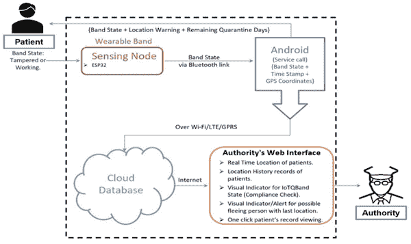

隔离（以及隔离和社交距离）在限制感染传播方面起着重要作用，世界卫生组织将其定义为“对未患病但可能接触传染病原体或疾病的人员限制活动或分离，以监测其症状并确保早期发现”。在疾病爆发初期实施隔离程序时，疾病传播会变慢，一个国家的流行病高峰也会推迟。

COVID-19 阳性患者主要通过手机应用程序（如 Aarogya Setu）进行追踪。该程序自 2020 年 4 月 21 日起基于众包概念运行。根据用户评价，向附近用户的通知功能有限，因为它假设每个拥有智能手机的人都安装了此应用。

用户还对输入应用程序中的数据的有效性表示担忧，意味着需要一个验证或批准机构。虽然基于移动 App 的追踪似乎并不充分，基于视觉指示的追踪方法也是如此。结果，讨论的两种技术似乎都无法有效检测超市中受新冠肺炎影响的购物者，而且在某些方面侵犯了受试者的隐私。根据各种医疗研究，例如使用可穿戴设备使患者更听从医疗常规和限制；因此，在这种情况下，可穿戴带是一种合适的解决方案。

因此，我们创建了一个可穿戴手带，它与手机 App 结合可以实时检测和监控逃避隔离的对象。这种可穿戴手带仅供零售商场购物期间使用，结束后必须返回零售客户服务台（CSD），那里会对设备进行消毒并为下次使用充电。相关的 CSD 团队有权控制追踪系统，并负责初始受试者注册，减少隐私担忧并确保数据的合法性。

### 图 2. 监控机制

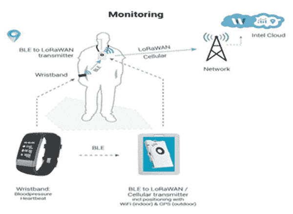

追踪技术创建实时通知，并通过基于 GPS 的地理围帮助当局实时识别进入商店购物的新冠肺炎患者。在活跃购物模式期间，移动 App 还会检测任何对可穿戴手带的取下或篡改。我们将原型设计得尽可能简单，以便减少维护。考虑到接触过 COVID-19 阳性患者的人的健康和财产，我们选择了可穿戴带组件，有助于从 5 米外检测 COVID-19 阳性患者，并通过消息和震动提醒佩戴手带的人。由于在流行环境下通常会防止重复使用污染设备，

### 图 3. IoT 手带系统数据流图

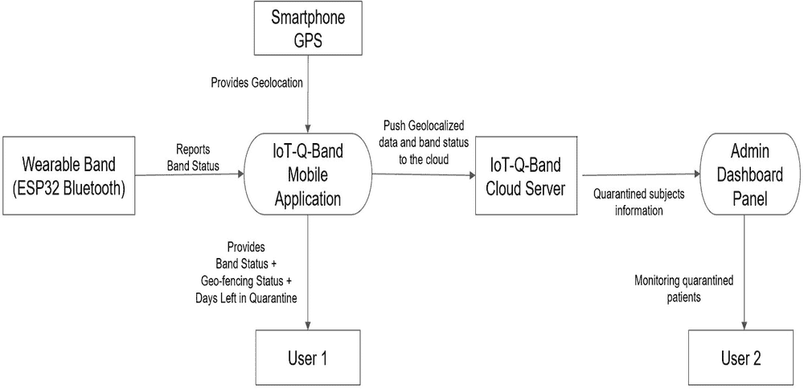

# 软件与应用

## 数据采集

物联网产生大量数据：从连接在机器部件上的传感器或环境传感器。采集软件用于过滤、保护和测量这些海量数据，同时也用于将数据分发到各种设备。这意味着物联网是大数据分析项目的重要驱动力，因为它允许公司创建海量数据集并对其进行分析。

## 设备集成

该软件确保设备能够绑定并连接到网络以建立信息共享。确保多个设备之间有稳定的协作和通信。

## 实时分析

物联网分析通过对各种类型的物联网数据运行数据分析程序或过程来实现。使用物联网分析，可以从海量数据集中提取有价值的信息，然后可以用于改进流程、应用程序、业务流程和生产，同时实现自动化并提高生产力。

## 应用与流程扩展

这些应用是任何物联网系统的关键组件，因为它们扩展了现有系统和软件的范围，允许形成更广泛、更有效的系统。它们能够为特定目的集成预定义的设备。这些软件支持生产力的提高和更准确的数据采集。

# 系统概述

图中所示 IoT-Q-Band 系统的架构。我们设计可穿戴带时，组件尽可能少，以便它可以运行时间较长，并重用了多个智能手机功能（如互联网和 GPS 访问），因为可穿戴带由电池供电且应当轻便以便舒适佩戴（如我们之前的工作）。隔离对象将可穿戴带佩戴在手、手臂或腿上，通过蓝牙无线连接连接到移动应用程序。

手环的处理单元（`ESP32`）会定期检测手环是否被篡改。在感应后，手环每隔两分钟向移动应用程序发送一次状态更新（一个字节的数据）。只有相关的零售机构会将主体注册到 `IoT-Q-Band` 系统，并由他们负责确定隔离时长和验证信息。机构的监管作用消除了有害数据进入跟踪系统的风险，同时也保护了隔离对象的隐私。在整个注册过程中，隔离位置的 GPS 坐标也会随个人信息一起被保存。

移动应用程序演示可穿戴手环是在运行中还是已被篡改、主体是否在注册隔离地的 50 米半径（`geo-fencing`）内，以及隔离还剩多少时间。移动应用程序根据早期的记录设定，每隔两分钟向云服务器发送一个 JavaScript 对象表示（`JSON`）数据包，其中包含可穿戴手环的状态（被篡改或正常）、时间戳和 GPS 坐标（经纬度）。指定人员可以通过网络界面跟踪每个隔离案例，该界面可以调出所有活动案例并以易读的格式显示。数据流从可穿戴手环开始，结束于一对一护理网络界面（管理仪表板面板）。

# 实现与设计规范

IoT 架构由不同的支持技术层组成，这些层之间相互依赖，以实现不同场景下 IoT 部署的可扩展性、模块化和配置。下面简述了每一层的功能。

## 智能设备/传感器层

底层由集成了传感器的智能对象组成。这些设备由各种模块组成，如能量模块、电源管理模块、RF 模块和传感模块。大多数传感器需要连接到传感器网关。这可以是局域网（`Ethernet` 和 `Wi-Fi` 连接）或个人局域网（`ZigBee`、`Bluetooth` 和超宽带）的形式。

对于不需要连接到传感器聚合器的传感器，可以使用广域网（如 `GSM`、`GPRS` 和 `LTE`）提供到后端服务器/应用程序的连接。使用低功耗和低数据速率连接的传感器通常形成无线传感器网络。`WSNs` 越来越受欢迎，是因为它们能够容纳更多的传感器节点，同时保持电池寿命并覆盖更广泛的区域。

## 网关与网络

由于传感器产生了大量数据，需要一个健壮且高性能的有线/无线网络基础设施来实现高效传输。目前的网络通常与非常不同的协议绑定，已用于支持机机网络及其相应的应用，但需要服务更广泛的 IoT 服务和应用程序，例如高速交易服务、情感知应用。具有各种技术和访问协议的多个网络需要在非常异构的配置中相互工作。这些网络可以是私有、公共或混合模型的形式，并为了支持延迟、带宽或安全性的通信需求而构建。

## 管理服务层

管理服务通过分析、安全控制、流程建模和设备管理使处理成为可能。管理服务层的重要功能之一是业务和流程规则引擎。IoT 以事件或上下文数据的形式提供信息（例如货物温度、当前位置、交通数据）。其中某些事件需要对即时情况做出响应（例如对患者健康状况的紧急情况做出反应），而另一些则需要过滤或路由到后处理系统（例如周期性传感器数据的捕获）。规则引擎支持决策逻辑制定并触发交互和自动化流程，以实现更有响应性的 IoT 系统。各种分析工具用于从海量原始数据中提取相关信息，并以快得多的速度处理。通过管理服务层的数据管理，可以对信息进行访问、集成和控制。高层应用可以免于处理不必要的数据，并降低数据源隐私泄露的风险。

## 应用层


IoT 架构层当然基于两个基础组件：硬件和软件。IoT 硬件包括广泛的设备，如路由设备、桥器、传感器等。这些 IoT 设备管理关键任务和功能，如系统激活、安全、操作规范、通信以及支持特定目标和动作的检测。IoT 硬件组件可以从低功耗到高功耗板不等。

## IoT 软件

IoT 中常用的操作系统是 `Linux` 或类 `UNIX` 操作系统，如 `Ubuntu Core` 或 `Android`。IoT 使用的编程语言非常非常常见，如 `C++` 或 `Java`，但 IoT 软件涵盖了广泛的软件和编程语言。随着大数据相关技术的发展，`Python` 是 IoT 中最常用编程语言的新兴竞争者之一。

# 零售中心新冠患者分析中的 IoT 系统

在新冠肺炎疫情期间，我们设计了一个利用 IoT 系统检测新冠病毒患者的系统规范。

| 图 4. 新肺炎期间的 IoT 系统 |
| --- |
| 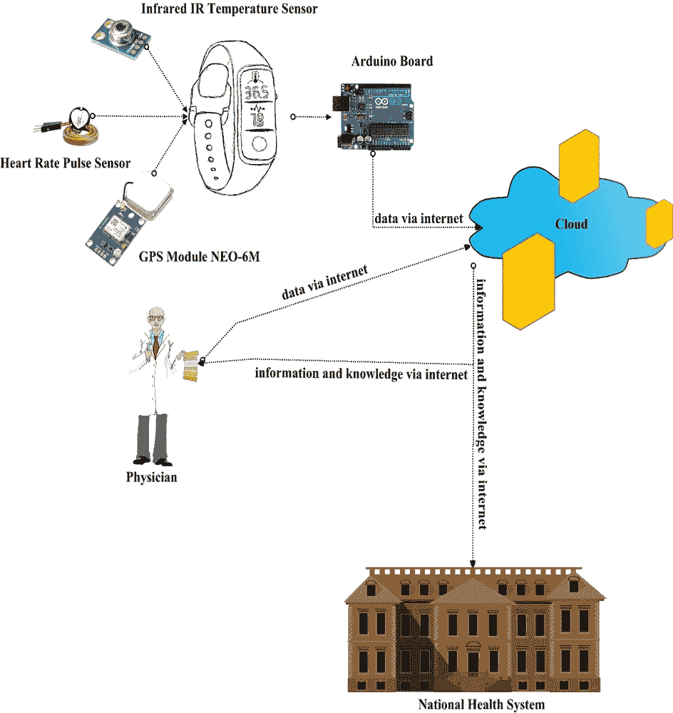 |

IoT 系统在远程医疗方面具有多优势：对易发心脏发病的人进行预防和急救、监测癫痫发作、监测酒精依赖者、筛选新冠患者，这仅是最糟糕的情况之一。

# 结论

结论认为，`IoT-Q-Band` 结合移动应用程序和云端监控系统，提供了一种扩展、低成本的解决方案，用于实时检测和跟踪逃的新冠隔离对象。可穿戴手环的组件、其运行模式和电池选择确保了它们在整个隔离期间保持运行，这通过功耗研究得到了证实。由于污染风险，可能会避免重复使用 `IoT-Q-Band`；因此通过重用各种智能手机特性保持原型的低成本。

将远程零售的优势整合到 IoT 系统（例如通过软件访问零售记录的能力以及支持零售商与消费者之间的电子通信通道），将我们的系统升级为不仅适用于当前危机而且适用于长期零售管理系统的系统。

`IoT-Q-Band` 可以作为世界低收入地区跟踪隔离对象的成本效益选择。对于零售商来说，这是一本新的策略，鼓励他们从零售自动化转向零售定制化。

这一想法具有潜在的吸引力。随着人工智能营销的出现，传统的自动化营销方法已被推后，取而个性化、语音和图像识别、聊天机器人、流失预测、动态定价以及更多消费者分析进入了视野。零售商必须理解并支持这一项目或概念，以确定其是否最符合他们的业务目标和收入增长，即使这需要少量的投资。

## 未来工作

为了深入了解人工智能和物联网（IoT）技术对零售超市业务的影响，这项研究必须结合业务管理层的证言，以提供关于人工智能影响更明确的描述。在考虑封锁状况的情况下，采用了远程协作来构思和构建原型机。2020 年 3 月 24 日，印度进入了全面封锁，并持续到 2020 年 4 月 14 日（随后又延长至 2020 年 5 月 3 日）。这严重阻碍了组件的供应和国内交通。因此，原型机的当前状态为研究人员开启了许多新可能性。

使用连接到 `IoT-Q-Band` 的生物传感器数据和机器学习来估计个人突破隔离的可能性将是正确的方向。此外，研究设备电源优化和适当的电池研究也是一个主意。最后，我们使用电子表作为设备的可能骨架，使可穿戴设备足够舒适以便跨手臂佩戴；另一方面，通过将此设备提供给访问零售超市的逛街者，我们观察了手环将如何运作，这是一个成功的实验，正如本文所证明的，购物者持续存在，而理解其对生活的影响在未来的工作中至关重要。

## 致谢

作者感谢技术创造者和技术人员使班加罗尔理工学院 ECS 部门（CMR – Institute of Technology, Bangalore department of ECS）的远程协作对本研究做出的重要贡献。作者是可穿戴技术的坚定信者，但仅出于人道考虑。任何通过移动设备侵犯个人隐私的行为都是不符合伦理的，并受到强烈谴责。

## 参考文献

- Aghenta, L. O., & Iqbal, M. T. (2019) Low-Cost, Open Source IoT-Based SCADA System Using Thinger. IO and `ESP32` Thing. Electronics, 8(8), 1-24.

- Boillat, T., Rivas, H., & Wac, K. (2018). “Healthcare on a Wrist”: Increasing Compliance Through Checklists on Wearables in Obesity (Self-) Management Programs. Digital Health. Health Informatics, 65-81.

- Brannon, E., Cushing, C., Crick, C., & Mitchell, T. (2016) the promise of wearable sensors and ecological momentary assessment measures for dynamical systems modeling in adolescents: a feasibility and acceptability study. Translational Behavioral Medicine, 6(4), 558–565.

- Breakfast, S. (2020). KwaZulu-Natal COVID-19 patient charged after absconding quarantine. News, The South African.

- Caruso, G. D. (2016) Free will skepticism and criminal behavior: A public health-quarantine model. Southwest Philosophy Review, 32(1), 25-48.

- Deekshith, M. (2020). Covidiots everywhere: Cases of foreign returnees flouting home quarantine in rise. Nation, Current Affairs, Deccan Chronicle.

- DiGiovanni, C., Conley, J., Chiu, D., & Zaborski, J. (2004). Factors influencing compliance with quarantine in Toronto during the 2003 SARS outbreak. Biosecurity and bioterrorism: Biodefense strategy, practice, and science, 2(4), 265-272.

- Eden, A., Steinhart, E., Pearce, D., & Moor, J. (2012). Singularity Hypotheses: An Overview. Springer., doi:[10.1007/978-3-642-32560-1](https://doi.org/10.1007/978-3-642-32560-1)

- Espressif Systems. (2020). `ESP32` Series Datasheet. Datasheet. Author.

- Fitzsimmons, C. (2020). They haven’t listened: Medical professionals skipped quarantine and flew interstate. News, The Sydney Morning Herald.

- Indiatimes. (2020). Coronavirus suspects under home quarantine to have their left hand stamped in Maharashtra. News, The Economic Times.

- Ivanov, D. (2020). Predicting the impacts of epidemic outbreaks on global supply chains: A simulation-based analysis on the coronavirus outbreak (COVID-19/SARSCoV-2) case. Transportation Research Part E: Logistics and Transportation Review, 136, 1-14.

- Kietzmann, J., Paschen, J., & Treen, E. (2018). Artificial intelligence in advertising: How marketers can leverage artificial intelligence along the consumer journey. Journal of Advertising Research, 58(3), 263–267. doi:[10.2501/JAR-2018-035](https://doi.org/10.2501/JAR-2018-035)

- Liu, T. (2020) Transmission dynamics of 2019 novel coronavirus (2019-nCoV). DOI:doi:[10.1101/2020.01.25.919787](https://doi.org/10.1101/2020.01.25.919787)

- LoosJ. R.DavidsonE. J. (2016). Wearable health monitors and physician-patient communication: the physician’s perspective. Proceedings of 2016 49th Hawaii International Conference on System Sciences (HICSS), 3389-3399. doi:[10.1109/HICSS.2016.422](https://doi.org/10.1109/HICSS.2016.422)

- Mahale, A. (2020). Coronavirus | Western Railway deboards 17 passengers bearing home quarantine. News, The Hindu.

- Maier, A., Sharp, A., & Vagapov, Y. (2017). Comparative analysis and practical implementation of the `ESP32` microcontroller module for the internet of things. In Proceedings of 2017 Internet Technologies and Applications (ITA) (pp. 143–148). IEEE. doi:[10.1109/ITECHA.2017.8101926](https://doi.org/10.1109/ITECHA.2017.8101926)

- MajumderM.MandlK. (2020). Early Transmissibility Assessment of a Novel Coronavirus in Wuhan, China. doi:[10.2139/ssrn.3524675](https://doi.org/10.2139/ssrn.3524675)

- Makridakis, S. (2017). The forthcoming Artificial Intelligence (AI) revolution: Its impact on society and firms. Futures, 90, 46–60. doi:[10.1016/j.futures.2017.03.006](https://doi.org/10.1016/j.futures.2017.03.006)

- Singh, V.K., Chandna, H., & Upadhyay, N. (2019). SmartPPM: 基于物联网的智能头盔，用于路洼设计与空气污染监测。EAI Endorsed Transactions on Internet of Things, 5(18), 1-9.

- Sohrabia, C., Alsafib, Z., O’Neilla, N., Khanb, M., & Kerwanc, A. (2020). 世界卫生组织宣布全球紧急状态：2019 年新型冠病毒（COVID-19）综述。International Journal of Surgery, 76(4), 71–76. doi:[10.1016/j.ijsu.2020.02.034](https://doi.org/10.1016/j.ijsu.2020.02.034)

- Sung, M., Marci, C., & Pentland, A. (2005). 用于康复的穿戴式反馈系统。Journal of NeuroEngineering and Rehabilitation, 2(17). doi:[10.1186/1743-0003-2-17](https://doi.org/10.1186/1743-0003-2-17)

- Wilder-Smith, A., & Freedman, D.O. (2020). 隔离、检、社交距离和社区控制：新型冠病毒（2019-nCoV）爆发中旧式公共卫生措施的关键作用。Journal of Travel Medicine, 27(2), 1–4.

- Ye, Z., Zhang, Y., Wang, Y., Huang, Z., & Song, B. (2020). 2019 新型冠病毒肺炎（COVID-19）的胸部 CT 表现：影像综述。European Radiology, 30(8), 4381–4389. doi:[10.1007/s00330-020-06801-0](https://doi.org/10.1007/s00330-020-06801-0)

- Zhao, S. (2020) 2019 年至 2020 年中国新型冠病毒（2019-nCoV）基本传染数的初步估计：疫情早期阶段的数据驱动分析。International Journal of Infectious Diseases, 92, 214-217.

- Zhong, R. Y., Xua, X., Klotz, E., & Newmanc, S. T. (2017). 工业 4.0 背景下的智能制造：综述。Engineering, 3(5), 616–630. doi:[10.1016/J.ENG.2017.05.015](https://doi.org/10.1016/J.ENG.2017.05.015)

# 第 12 章

*   Prasanth Kumar Ra
    
    海得拉巴大学，印度

*   Santosh Kumar
    PNC 金融服务，美国

*   Vikas Singh
    印度政府消费者事务部，印度

### 摘要

本章旨在引起读者关注金融建模中的挑战。在高科技计算能力的辅助下，新的定量方法通过使用 `AI`、`ML` 等最新算法提供了非凡的能力。然而，采用最新的工具和技术也面临许多挑战，这些挑战受限于人力资源和金融行业的细微差别。与科技行业中基于推荐的模型不同，金融行业涉及的是真金白银。因此，在不理解继承风险的情况下直接接受定量方法的结果并不十分稳妥。尽管数据科学家制造了热度，但金融行业在经过尽职调查后谨慎地采用了这些复杂的学习工具，因为这涉及到投资者和股东的资金，而且专家希望根据数据模型的输出来制定金融决策策略。此外，本章还介绍了金融模型的主要亮点。

# 引言

定量方法长期以来一直应用于金融决策中。然而，随着数学研究和计算能力的进步，定量方法的应用迅速加速。使用定量方法进行金融建模为提高金融机构的效率和风险管理能力提供了许多机会。但在金融领域开发和部署金融模型时，它也面临着挑战。

本章讨论了为金融机构构建模型时遇到的各种挑战。需要注意的是，金融建模最近经历了快速演变，挑战不仅限于本章列出的问题。每种新方法以及使用新算法对模型进行调优都有其独特的挑战。本章描述了最常见的问题。

### 数据挑战

构建模型的第一步是从多个来源收集数据。

#### 数据数量

金融机构长期以来一直在收集数据。然而，在构建模型所需的数据集时，需要考虑许多因素。在计算机技术进步之前，只有几十年的数据是可读的格式。为了建模目的，金融机构在收集数据方面经历了演变。此外，某些金融产品定义随时间发生了变化。因此，某些金融机构没有足够的数据来进行建模。对于那些拥有专业业务组合的银行来说，往往缺乏足够的违约数据来进行建模（Kiefer, N., 2009）。

#### 数据质量

数据的质量对于构建稳健的模型至关重要。由于多种原因，历史数据的质量受到了损害，不适用于建模。第二个问题可能是收集数据时的控制不当。输入数据可能是被错误输入的。另一个关键问题可能是由于业务原因数据定义随时间发生了变化，因此数据的适用性存疑。需要采用替代建模过程来克服这些问题（Bansal, A., Kauffman, R., & Weitz, R., 1993）。

#### 数据可用性

金融机构通常没有用于特定场景建模的数据。当银行和金融机构推出新型金融产品时，匹配需求是一项困难。有必要从外部来源寻找数据以进行此类操作。另一个问题可能是银行从现有产品中收集的数据有限，现在银行需要在模型中加入更多属性。金融建模可能需要内部和外部数据的结合。对于极端情况（如大衰退或大平缓），构建模型是具有挑战性的（Keen, S., 2013）。

#### 数据排除

在建模过程中，人们可能希望使用所有收集的历史数据。然而，在大多数情况下，在开始开发模型之前需要排除某些数据。排除可能是收集错误，或者投资组合随时间发生了变化。某些组件不再反映当前或预期的未来。另一个关键问题可能是某些群体缺少多个关键属性，因此排除是有必要的。


#### 经济周期

理想情况下，建模数据应包含足够的变异性，以便参数估计能够捕捉关键因素的本质。为了确保金融数据具有足够的变异性，它必须包含多个衰退期的完整周期。由于经济衰退很少，每十年最多只有一到两次，在数据中拥有多个衰退期是挑战性的。如果建模不包含任何衰退期的数据，那么其在不利经济形势下的可用性将大大降低（Panoš, J., Polák, P., 2019）。

数据分析是模型训练前至关重要的步骤。分析从包含某些离群值的数据分布开始。数据中的离群值可能导致模型设定错误（Ané, T., Ureche-Rangau, L., Gambet, J. B., & Bouverot, J., 2008），因此需要根据真实值的范围进行封顶（`capped`）和封底（`floored`）。在此过程中裁剪底部和顶部百分位数以使其更加合理。

## 缺失数据处理

数据处理的另一个步骤是评估缺失数据。选项包括删除包含缺失信息的观测值，或插值临时值，后者可能无法提供高效且无偏的参数估计（Kofman, P., & Sharpe, I. G., 2003）。缺失数据可以分配零值或源自同一借款人邻近数据点的其他合理值，因为借款人画像在短期内预计不会发生剧变。模型应确保独立变量的趋势和关系保持完整，从而因缺失插值过程产生无偏结果。

## 数据趋势分析

在构建模型之前，会对独立变量进行单独分析。绘制的变量分布和趋势使我们能够进行视觉化检查，并进行多次测试以评估变量的适用性。其中一种测试是寻找变量的平稳性。如果独立变量不是平稳的，可能会应用某些变换来实现平稳性。

## 变量变换

原始形式的独立变量更容易解释。然而，对输入变量进行某些数据变换有利于从模型开发中获得最有价值的输出。由于变换包含了领先、滞后、移动平均、平方、立方和对数，数据量会剧增，为模型选择过程带来更多挑战。经济数据中的领先滞后关系对于许多经济主体（如政策制定者、金融市场交易员和其他市场参与者）至关重要（Funashima, Y., 2017）。

### 与目标变量的关系

对独立变量与目标变量进行测试以理解它们之间的关系。关系趋势应该显示出直观的模式，并可以通过业务逻辑和过去的经验证明其合理性。此外，关系应符合模型中提出的数学算法的要求；例如，线性回归应使用与目标变量具有线性关系的因素变量。如果独立变量不符合算法要求，则需要使用适当的方法对变量进行变换。

## 分段与聚类

建模群体可能混合多个细分，每个细分都有独特的特征；例如，中型市场业务组合可能混合多个行业。聚类分析有助于更好地理解数据趋势，并根据每个分的独特特征在不同子群体间变化。研究表明，金融资产收益的时间序列往往表现出波动聚集性，这意味着价格的显著变化往往聚集在一起（Cont, R., 2007）。这种行为数据分析有助于解决问题并获得更优的解决方案。

## 算法选择

数学方法一直在系统性地改进，随着计算技术可用性的增加，大多数方法都可以根据数据大小进行测试。需要注意的是，某些算法对计算要求很高，而另一些则需要更多的数据以避免过拟合。然而，取决于数据集，某些算法可以比其他算法更好的结果。此外，并非所有算法在解释结果方面具有相同的透明度和可解释性。金融风险分析中使用的两种主要模型训练方法是监督和无监督学习算法。事实证明，监督学习可以实现高准确性，当数据没有预定义的类别标签时，它可能没有帮助。另一种技术，即无监督学习方法，可以在无标记数据中发现底层结构（Kou, G., Peng, Y., & Wang, G., 2014）。

## 最终模型选择

最终模型的选择是一项非常有挑战的任务，因为它需要考虑多个维度，这些将在测试部分进行详细说明。在接受模型之前，预测试是不可重要的。性能指标（可能是基于数学函数的多个维度）只是挑战之一。挑战的另一个方面是输入因素的选择。这些因素是最关键的因素吗？它们是否有足够的贡献？另一个重要的考虑因素是因素的稳定性。在压力情的情况下，这些因素在不同期间的表现是否稳定？

研究人员已经证明，受限贝叶斯模型平均（BMA）方法在进行压力测试练习时可能解决若干困难：(a) 测试严峻但合理的预测情景；(b) 为任何额外的事后专家级调整进行推理；以及 (c) 随着每个新数据点进行模型设定调整（Panoš, J., & Polák, P., 2019）。

## 性能指标挑战

### 细分性能

模型在群体的各个细分中应表现良好。

#### a. 跨行业细分的性能

例如，为中型市场构建的模型应该合理地预测，贡献中型市场组合的所有行业都是具有挑战性的，因为某些群体可能太小无法进行测试。

#### b. 样本外和时间外群体

模型在样本外群体上应具有良好的性能。模型估计基于样本群体，以达到良好表现。然而，在部署到生产环境之前，模型会在样本外（`Out-of-Sample`）和时间外（`Out-of-Time`）数据集上进行广泛测试以验证（Aggarwal, V., & Rej, S. 2015）。

#### c. 跨经济时期的性能

模型在衰退前、衰退和衰退后期间应表现良好。由于建模数据包含经济周期的不同阶段，模型应根据经济周期阶段在群体的所有细分中表现良好。

### 时间序列性能

模型在时间序列数据集上应表现良好。最直观的视觉分析显示，模型在历史数据期间的平均群体上表现良好。随着经济周期随时间变化，模型很难匹配观测特征的峰值和谷。此外，某些模型希望更加稳定，而不是捕捉经济周期的波动。事实证明，金融时间序列预测是许多金融分析师和决策者面临的最挑战性且关键的问题之一（Khashei, M., & Hajirahimi, Z., 2017）。

### 拟合度检验

`Hosmer-Lemeshow (HL)` 卡方拟合度检验估计了估计概率的分组值。它将按顺序排序的预测概率划分为 k 组（基于十分法），计算皮尔逊卡方统计量以比较预测和观测的违约频率（Gurny, M. 2015）。

### ROC 检验

在金融模型中，模型应对高风险借款人分配更高的风险分。此类模型需要经过测试以满足这一要求。`ROC`（接收者操作特征）曲线是用于量化模型评估信用违约预测能力的最强大的工具之一。`ROC` 曲线将 II 型错误与 1 减 I 型错误绘制在一起（Gurny, M., 2015）。

## 因子稳定性测试

模型因子在不同时期和跨时间样本中应保持稳定，以便在良好和恶劣的市场条件下可用。旨在防止过拟合的传统统计技术（如留出法/`hold-out`）往往不可靠且不准确。较新的方法如使用 k 折交叉验证技术可以测试模型的稳健性（Bailey, D. H., Borwein, J., Lopez de Prado, M., & Zhu, Q. J., 2016）。

## 因子敏感性测试

模型输出应对输入因子的变化敏感，且输出应随着输入因子的合理变化而发生充分的变化。银行通常需要估计在各种宏观经济场景下的损失。用于损失估计的定量模型根据宏观经济敏感性进行测试，以评估银行在困难宏观经济形势下的脆弱性（Camara, B., Pessarossi, P., & Philippon, T., 2016）。

## 模型压力测试

在多个因子同时恶化的压力市场条件下，模型应表现良好并评估其对输出的影响。压力测试通过保守的校准来高估风险，以确保在不利冲击发生时有足够的缓冲（Gersl, A., & Seidler, J., 2012）。

## 模型输出稳定性测试

构建的模型预测了可未来可能的输出。然而，未来可能是 1 个季度、1 年、5 年或更久。根据业务需求，如果模型输出需要保持稳定以满足预测期，则应对模型输出进行测试。

## 因子贡献

模型输出应来自不同关键输入因子的充分贡献。此外，贡献的分布应符合业务预期。挑战在于由于多种方法导致贡献衡量的困难，而且业务预期具有主观性。

## 基于额外信息的业务判断

由于定量模型依赖于输入因子，它捕获的信息非常有限。由于信息可用性存在延迟，模型输出并非每日生成。组合评估在公司发布季度财务报表时进行。宏观经济数据等信息在季度结束后可用，而像新冠或破产之类的事件可能在季度中的任何时候发生。在这种情况下，投资组合经理被赋予灵活性，可以根据标准化规则输入因子之外的额外信息对债务人进行降级。

金融数据建模的关键要点如表 1 所示。

### 表 1. 数据建模的关键要点

| 金融主题 | 人工智能 |
| --- | --- |
| 机器学习技术 | |
| 监督学习 | 无监督学习 |
| 目的 | 目的 |
| 模式识别 \| 分类 \| 预测 \| 优化 | 模式识别 \| 分类 \| 预测 \| 优化 |
| 算法交易 | 隐马尔可夫模型[i] \| 马尔可夫决策过程 (`MDP`)、线性逆反向强化学习 (`LIRL`) 和高斯过程 IRL (`GPIRL`)、分层聚类[ii] \| 强化学习、`K-NN`、随机森林、支持向量机、高斯朴素贝叶斯、逻辑回归、生成对抗网络 \| `Robbins–monro` 算法[iii] \| NLP (语义分析算法) |
| 套利交易交易策略 | \| \| 支持向量回归器 (`SVR`)、轻量级梯度提升 (`LGB`)[iv] \| `Holt–Winters` 平滑和集成学习[v]、长短期记忆网络 (`LSTM`)[vi] \| \| \| \| 基于密度的应用空间聚类 (`DBSCAN`)、t-分布随机邻域嵌入 (`t-SNE`)[vii] |
| 资产定价 | \| \| 循环神经网络、`LSTM` \| \| \| \| 自动编码器神经网络[viii] \| \| |
| 资产收益 | \| \| \| \| \| \| \| \| \| \| \| |
| 破产 | \| \| \| \| \| \| \| \| \| \| \| \| |
| 信用评级 信用评分 信用风险 违约预测 | \| \| \| \| \| \| \| \| \| \| \| \| |
| 贷款/信贷 | \| `朴素贝叶斯分类器`、多层感知器神经网络、极端学习机、支持向量机[ix]、决策树、(脉冲极端学习机 (`SELM`)、Q-广义极端学习机、径向基神经网络[x])、一类分类驱动的动态集成学习[xi] \| 二次无约束二进制优化 (`QUBO`)、循环神经网络、(决策树、梯度提升[xii])、(逻辑回归和神经网络[xiii])、(随机森林和人工神经网络[xiv]) \| \| \| \| `K-最近邻域`、`k-means`^(ix)、模糊 c 均值 (`fcm`)[xv] \| NLP \| |
| 衍生品定价 对冲 | \| \| \| \| \| \| \| \| \| \| \| \| \| |
| 特征选择 | `PCA` \| \| 二次无约束二进制优化 (`QUBO`) \| \| \| NLP \| \| \| |
| 金融危机 财务困境 | \| \| \| \| \| \| \| \| \| \| \| \| \| |
| 金融包容 金融化 | \| \| \| \| 图论[xvi] \| 逻辑回归和支持向量机 (`SVM`)[xvii]、图神经网络 (图卷积网络、`GraphSage`、注意力网络、拓扑适应图卷积网络)[xviii] \| \| \| \| \| \| |
| 外汇 | \| \| `ANN` \| \| \| \| \| \| \| |
| 欺诈检测 | \| \| 玻尔兹曼机 \| \| \| \| \| \| NLP \| |
| 隐含波动率 | \| \| 深度量子神经网络 \| \| \| \| \| \| |
| 期权定价 期权交易 | \| \| 量子生成对抗网络、 \| \| \| \| \| \| \| \| |
| 投资组合管理 投资组合优化 投资评估 | \| \| `Lasso` 回归 \| \| \| \| \| \| \| |
| 预测分析 | \| \| 岭逻辑回归、`Lasso` 逻辑回归、决策树、朴素贝叶斯、支持向量机 \| \| \| \| \| \| |
| 风险管理 | `Boruta` 算法[xix] \| \| `K` 最近邻域 (`KNN`)、支持向量机 (`SVM`)、回归树、线性回归、随机梯度提升. 随机森林 (`RF`)[xx]、深度神经网络[xxi] \| \| \| \| \| 支持向量数据描述 (`SVDD`)[xxii] \| |

[i] (Wu & Siwasarit, 2020); [ii] (Yang et al., 2015); [iii] (Cont & Kukanov, 2017); [iv] (Carta et al., 2021); [v] (Park et al., 2019); [vi] (Chang et al., 2021); [vii] (Tronvoll & Andersen, 2018); [viii] (Gu et al., 2021); [ix] (Pandey et al., 2018); [x] (Kuppili et al., 2020); [xi] (Li et al., 2021); [xii] (Kokate & Chetty, 2021); [xiii] (Ashofteh & Bravo, 2021); [xiv] (Óskarsdóttir et al., 2018); [xv] (Pang et al., 2021); [xvi] (Roa et al., 2022); [xvii] (Akinnuwesi et al., 2020); [xviii] (Roa et al., 2022); [xix] (Shakhovska et al., 2022); [xx] (Shakhovska et al., 2022); [xxi] (Rönnqvist & Sarlin, 2017); [xxii] (Dionne, 2018).

# 结论

量化建模为金融领域提供了巨大的机会。最新的分析算法和技术在金融领域尤为相关，因为数字和数据处理一直驱动着金融业。金融机构可以利用其数据来提高运营效率并降低风险。金融机构还利用分析工具来扩大业务并创造新机会。然而，涉及的量化方法和技术非常复杂，需要专业且经过培训的人员。建模过程并非为了拟合曲线，而是涉及开发的完整生命周期。开发过程包括数据准备、变量分析、算法选择、模型选择、在多个样本上对最终选择模型进行测试，最后是模型的部署和监控。理解这些方面并克服这些挑战有助于创建有价值且稳健的模型。适当的金融模型将允许机构在同类机构中获得优势，并在竞争激烈的全球金融行业中竞争。

## 参考文献

Aggarwal, V., & Rej, S. (2015). 零售信用风险模型验证：性能与稳定性方面。Academic Press。

Akinnuwesi, B. A., Fashoto, S. G., Metfula, A. S., & Akinnuwesi, A. N. (2020). 机器学习在埃斯瓦尼金融包容数据治理中的实验应用。计算机科学讲义（包括人工智能讲义和生物信息学讲义的子系列）：第 12067 卷 LNCS。Springer International Publishing. doi:[10.1007/978-3-030-45002-1_36](https://doi.org/10.1007/978-3-030-45002-1_36)

Ané, T., Ureche-Rangau, L., Gambet, J. B., & Bouverot, J. (2008). 亚太股票指数收益的稳健离群值检测。国际金融市场、机构和货币杂志，18(4), 326–343. doi:[10.1016/j.intfin.2007.03.001](https://doi.org/10.1016/j.intfin.2007.03.001)

Ashofteh, A., & Bravo, J. M. (2021). 在线评分的保守方法。专家系统。专家系统，176，3 月。doi:[10.1016/j.softwa.2021.14835](https://doi.org/10.1016/j.softwa.2021.14835)

Bailey, D., Borwein, J., Lopez, M., & Zhu, Q. (2016). 基于机器学习的组合资产概率回测。计算金融杂志，2016 年。doi:[10.2134/JCF.322](https://doi.org/10.2134/JCF.322)

Bansal, A., Kauffman, R., & Weitz, R. (1993). 比较回归和神经网络对数据的价值。管理杂志，10(1)，11–32。doi:[10.1080/0742122](https://doi.org/10.1080/0742122)

Camara, S., Philippon, N., & Stanciu, S. (2021). 组合策略的概率回测。金融创新，9。doi:[10.1009/ACCESS.3059](https://doi.org/10.1009/ACCESS.3059)

Chang, V., Xiu, X., & Hsu, C. (2021). 基于自编码器的资产定价。经济学杂志，2021 年。

Cont, R., & Kukanov, A. (2017). 2017 年。金融市场中的波动率。在金融讲义中，289–309。Springer。

,,,,,,,,,,3000000.........003,02028.doi:[10.1007/978-3-030-45002.8](https://doi.org/10.1007/978-3-030-45002.8)

Dionne, G. (2018). 埃斯瓦尼大衰退。埃斯瓦尼大学。

Gurny, S. (2013). 埃斯瓦尼大衰退。埃斯瓦尼大学。

Khashei, M., & Hajirahimi, Z. (2017). 使用小波变换的并行策略评估。金融创新，3(1)，1–24。doi:[10.1186/s40854-4](https://doi.org/10.1186/s40854-4)

Kiefer, N. M. (2009). 低违约组合的估计。实证金融杂志，16(1)，164–173.doi:[10.1016/j.empfin.4](https://doi.org/10.1016/j.empfin.4)

Kokate, S., & Chetty, M. S. R. (2021). 使用投票分类集成机器学习模型对商业银行贷款人进行信用风险评估。国际安全与安全杂志，11(5)，565–572.doi:[10.18280/ijsse.11058](https://doi.org/10.18280/ijsse.11058)

Kou, G., Peng, Y., & Wang, G. (2014). 使用 MCDM 方法对金融风险分析的聚类算法进行评估。信息科学，275，1–12.doi:[10.1016/j.ins.2014](https://doi.org/10.1016/j.ins.2014)


# 参考文献

Kuppili, V., Tripathi, D., & Reddy Edla, D. (2020). 基于脉冲极值学习机的信用评分分类。《Computational Intelligence*, 36(2), 402–426. doi:[10.1111/coin.12242](https://doi.org/10.1111/coin.12242)

Li, H., Qiu, H., Sun, S., Chang, J., & Tu, W. (2021). 由单类分类驱动的动态集成学习信用评分。《The Journal of the Operational Research Society*, 0(0), 1–10. doi:[10.1080/01605682.2021.1944824](https://doi.org/10.1080/01605682.2021.1944824)

Óskarsdóttir M., Sarraute C., Bravo C., Baesens B., Vanthienen J. (2018). 良性信用评分：通过基于智能手机的微贷款增强金融包容性。《2018 年信息系统国际会议, ICIS 2018*, 1–14.

Pandey T. N., Jagadev A. K., Mohapatra S. K., Dehuri S. (2018). 使用机器学习分类器的信用风险分析。《2017 年能源、通信、数据分析与软计算国际会议, ICECDS 2017*, 1850–1854. doi:[10.1109/ICECDS.2017.8389769](https://doi.org/10.1109/ICECDS.2017.8389769)

Pang, P. S., Hou, X., & Xia, L. (2021). 借款人信用评分模型及应用，基于极值学习机的违约判别分析。《技术预测与社会变革*, 165(11 月). doi:[10.1016/j.techfore.2020.120462](https://doi.org/10.1016/j.techfore.2020.120462)

Panoš, J., & Polák, P. (2019). 如何改进压力测试框架下的模型选择程序。捷克国家银行，经济研究部。

Park, M., Kim, J., Won, D., & Kim, J. (2019). 基于机器学习的负载预测技术开发用于成本最小化的两阶段 ESS 调度模型。《Processes (瑞士巴塞尔)*, 7(6), 370. 在线优先出版. doi:[10.3390/pr7060370](https://doi.org/10.3390/pr7060370)

Roa, L., Rodríguez-Rey, A., Correa-Bahnsen, A., & Arboleda, C. V. (2022). 利用图机器学习和超级应用备选数据支持金融包容。《网络与系统讲义*, 295, 216–230. doi:[10.1007/978-3-030-82196-8_16](https://doi.org/10.1007/978-3-030-82196-8_16)

Rönnqvist, S., & Sarlin, P. (2017). 新闻中的银行困境：通过深度学习描述事件。《Neurocomputing*, 264, 57–70. doi:[10.1016/j.neucom.2016.12.110](https://doi.org/10.1016/j.neucom.2016.12.110)

Shakhovska, N., Melnykova, N., Chopiyak, V., & Gregus Ml, M. (2022). 用于医疗保险成本预测任务的集成方法。《Computers. Materials and Continua*, 70(2), 3969–3984. doi:[10.32604/cmc.2022.019882](https://doi.org/10.32604/cmc.2022.019882)

Tronvoll, H., & Andersen, H. (2018). 机器学习实现的统计套利交易。学术出版社。

Wu, P., & Siwasarit, W. (2020). 使用隐马尔可夫模型捕捉订单流不平衡：以 SET50 和 KOSPI50 为例。《亚太金融市场*, 27(1), 115–144. doi:[10.1007/s10690-019-09285-1](https://doi.org/10.1007/s10690-019-09285-1)

Yang, S. Y., Qiao, Q., Beling, P. A., Scherer, W. T., & Kirilenko, A. A. (2015). 基于高斯过程的算法交易策略识别。《定量金融*, 15(10), 1683–1703. doi:[10.1080/14697688.2015.1011684](https://doi.org/10.1080/14697688.2015.1011684)

# 第 13 章：未来研究议程

## 作者

- Rashmi Ranjan Panigrahi - Siksha ‘O’Anusandhan, 印度
- Meenakshee Dash - Rajdhani College of Engineering and Management, 印度
- Zakir Hossen Shaikh - [Orcid Image](https://orcid.org/0000-0003-4733-4166) - 巴林培训学院，巴林
- Mohammad Irfan - CMR 科技学院，印度

## 摘要

技术进步加强了 `IT` 在演进未来路径中的作用。当前行业对采购、组装和供应归属感和重要性感受到了席卷世界的数字化变革的影响。机器学习现在是学者和业内人士的热门领域。二十年前，关于机器学习和供应链管理（`SCM`）的文献在印度行业尚未得到充分研究。因此，本研究分析了从 2010 年 1 月到 2020 年 12 月期间主要数据库中的文章。对 112 篇入选文章的定量分析表明该领域尚未形成足够的力量。对 `SCM` 中使用的机器学习的研究有助于未来研究。本章真实反映了现状，并对未来行业做出贡献。

# 引言

行业的成功很大程度上取决于供应链。它是具有独特技术和资源的不同业务部门的复杂整合。尽管供应链效率取决于多种因素，但设计一个能够快速响应市场需求的通用平台似乎很困难。近年来，世界进入了被称为“第四次工业革命”的时代，其特征是数字化、信息化、机器人、通信技术以及 `人工智能`。在这个时代，机器人已经变得足以取代人类做出判断。这些技术被称为机器学习（`ML`），该领域关注能够通过过去的使用进行“学习”的自动化系统。由于过去几十年机器处理大量数据的能力提高，且某些计算机能够发现隐藏的路径和复杂的关系，从而在人类无法或不愿处理的问题上做出正确可靠的决策，机器学习诞生了。根据研究，在广泛的决策范围内，机器人能够比人类提供更准确的结果。

机器学习及其基础组件的使用可以提高供应链管理（`SCM`）性能。学习算法的预测、深度学习和优化算法都贡献了机器学习不断寻求供应链性能提升因素的能力。第四，在供应链（`SC`）网络上使用视觉化机器学习时，`ML` 可能会检查物理资产管理和物理检查中广泛的应用。

尽管机器学习的应用具有许多优势，尽管某些研究已经显示 `ML` 已经进入了供应链管理（`SCM`），包括仓库管理 (Makkar et al., 2020; Ni et al., 2020)、神经网络 (Golmohammadi et al., 2009; Ni et al., 2020)、支持向量机 (Ni et al., 2020; Prahathish et al., 2020)、逻辑回归 (H. Ma et al., 2018; Ni et al., 2020)、决策树 (Estelles-Lopez et al., 2017) 以及极端学习机 (Martínez et al., 2020; Ni et al., 2020)，一项研究发现仅有 15% 的企业实施了 `ML`，包括一个或多个供应链功能。供应链中机器学习的使用不足，可能是由于对 `ML` 如何实施缺乏认识、企业文化中的接受程度较低，以及无法获得适当的数据 (Ni et al., 2020)。需要进行紧迫的系统性研究，以定量地检查最新的研究趋势，调查在供应链管理中经常使用的机器学习算法，并识别最适合 `ML` 的 `SCM` 任务 (Sharma et al., 2021)。

由于注意到缺乏关于使用决策支持系统进行涉及 `MI` 的供应链管理（`SCM`）调查的研究，我们选择了此项研究。大多数研究使用了模糊集理论、经验和理解系统、多准则方法和情境优化作为主要方法，我们认为这些是不够的。然而，尽管日益复杂的人工智能技术如“机器学习”、“深度学习”和“图像/文本处理”是当今供应链不可缺的组成部分，但在研究其应用方面，文献仍然落后于行业。同时，我们的研究显示了人工智能（`AI`）研究存在重要的碎片化，强调了分类系统的必要性，该系统可以指导运营和供应链研究人员拓宽他们的知识。

在实践中，人与机之间一直存在着隐含的分工。随着自动化的进入场景，这种明确的任务分工正变得越来越模糊 (Patel et al., 2017)。在制造自动化方面，过去的 100 年里，重点一直是活动的自动化，但现在机器学习（`ML`）正在进入一个决策（思考）被自动化的新时代。机器学习和其他机器学习技术正在以一种人类历史上前所未有的方式改变制造业。知识库必须以新的方式进行组织，必须识别理解上的差距，并必须合成新信息，以充分实现新范式的意义。机器学习以及其他智能机器正在从根本上改变制造业。新范式在范式转移内完全理解、发现知识差距、指导未来的研究和实践，并合成新信息，是很常的 (Sharma et al., 2021)。

这是一次思维的重大转变，引发了 `ML` 如何影响印度制造业的问题。到目前为止，文献中钢铁行业对 `ML` 应用的研究关注不多。研究结果基于对 2010 年 1 月至 2020 年 12 月发表的文章的综述。这反过来导致了问题：

- `RQ 1`：使用机器学习制造可能吗？
- `RQ 2`：制造业中的机器学习有哪些？
- `RQ 3`：供应链管理中的机器学习有哪些方向？

总结来说，制造业的机器学习面临双重挑战：缺乏详尽的文献评估；缺乏指导性的框架。本研究通过整合一个概念性步骤讨论了这些挑战。

## 近期文献回顾

广泛的研究领域受益于系统性文献评价（`SLRs`） ([Arksey & O’Malley, 2005]；Ni et al., 2020)。`SLRs` 最初是在医学领域开发的。后来，([Tranfield et al., 2003]) 开发了定制化的 `SLRs` 以满足特定目标和特征 (Durach et al., 2017) 以及 `SCM` 研究的需求 (Sawyerr & Harrison, 2020)。这些修改是必要的，因为每个领域都有自己的一套标准和特征 (Durach et al., 2017)。然而，在机器学习学科中，关于其应用的发展还没有深入综述。

由于客户购买和行为的数字化，现在的购物比以前任何时候都具有破坏性和不连续性。为了保持竞争力，企业需要跟上这些发展，以减少需求的不确定性和财务风险 (Ni et al., 2020)。在当今动态业务环境中，组织获取、转换和交付供应链的能力至关重要 (He et al., 2020)。许多领先企业可能会与其供应链合作伙伴交换数据（例如库存、销售数据），以提高供应链的可视性。意识到数据在供应链中日益增长的重要性，`SCM` 学术界和从业者已尝试一切方法来增强数据管理 (Wu et al., 2019)。它是这些已经使用了一段时间的工具之一，但在供应链管理中尚未发挥其全部潜力。根据福布斯 (Makkar et al., 2020) 的一份报告，采用机器学习已被证明是测试公司中 61% 最关键的选择。

- 预测性 `ML` 需求与销售 (Feizabadi, 2020)。
- 针对每个客户定制的产品建议 (Xiao & Benbasat, 2018)。
- 最大收益的定价和营销技术 (Campbell et al., 2020)。
- 正确库存水平的库存优化 (Caggiano et al., 2009; Duan & Liao, 2013)。
- 仓库吞吐量优化系统 (Makkar et al., 2020; Silva et al., 2017)。
- 钢铁供应链可持续性 (Goyal & Routroy, 2021)。
- 获得改进的环境可持续性 (Goyal & Routroy, 2021; R. Kumar et al., 2021)。
- 认知服务可以帮助我们获得关键的客户洞察（如情感分析、偏好和社交倾听）。
- 车间良率优化最优库存水平被用于优化库存 (Caggiano et al., 2009; Ni et al., 2020)。
- 在制造中，使用了预防性设备维护 (Carvalho et al., 2019; Kaparthi & Bumblauskas, 2020)。
- 预测性提前期索评分有助于资质认证、优先级排序和获取 (L. Ma & Sun, 2020)。
- 辅助智能工作区设计 (Kaparthi & Bumblauskas, 2020)。

## 现有供应链存在的问题

传统的供应链管理对企业的效率有负面影响。由于责任制和透明度的缺乏，传统的供应链管理成为一种高风险实践。由于市场趋势的变化，供应链中每一步的价格范围可能会扩大。在典型的供应链管理系统中，物流估算的效率较低，导致了高昂的管理成本。包含许多路线的供应链可能会导致复杂的供应链结构 (A. Kumar et al., 2020)。近期，同时管理电子商务供应链和线下供应链需要适应许多供应链技术 (Bressanelli et al., 2019)。因此，需要对各种渠道和底层渠道进行适当管理，以维持库存控制的准确性。糟糕的库存管理可能会对客户服务质量产生负面影响。市场供需的波动会导致高风险场景出现。在高需求市场中，供应链管理必须迅速 (Bressanelli et al., 2019; Burga & Rezania, 2017; Wisner et al., 2021)。由于供应链管理无法准确预测，其服务的质量可能会受到影响。传统的供应链管理在某些方面存在问题 (Wisner et al., 2021)。钢铁供应链的可持续性是目前关注的重点 (Goyal & Routroy, 2021)。为了提高企业的响应和灵活性，这种方法已被广泛接受，但目前对印度中小型企业（`SMEs`）的关注较少。

## 研究方法

### 选择文献综述的最佳方法

有效的文献综述由研究的具体目标引导，并对现状进行总结 (Makkar et al., 2020; Sandelowski et al., 2007)，通过叙述来证明研究的合理性 (Kumar et al., 2014)，通过叙述来发现不同的研究流 (Kusiak, 2020)，为了发现和合成不同的研究，必须使用主题分析 (Ni et al., 2020)，为讨论建立基础 (Sharma et al., 2021)。

我们的文献研究有两个目标：进行文献综述，然后为制造业中的学习开发一个框架。由于这些目标需要不同的方法，因此对文献采用了混合策略。使用描述性文献综述法是因为需要对出版物进行深入研究和分析，以获得更细致的理解 (Sharma et al., 2021)。

框架合成方法被用于合成和扩展现有知识。识别一个先验概念模型，并将其用于识别和组织相关文献 (Sharma et al., 2021)。概念模型的修改是文献研究的结果，并基于编码的结果。这种方法的结果是“一个可能包含初始模型中未预期的元素和额外因素的更新模型” (Dixon-Woods, 2011)。

### 检索论文和工作论文

利用了 `ScienceDirect`、`Emerald`、`WOS`、`Wiley` 和 `Scopus` 数据库进行文献检索。搜索中使用的术语是为了说明制造业中广泛的可能性。因此，在搜索结果列表中除了制造业外，还包含了维护、质量控制、机械加工和增材制造等术语。这些关键词的选择是基于对文献的初步评估以及我们自己的观察和结论。由于制造业领域的跨度很大，搜索限制在 2010 年 1 月至 2020 年 12 月之间出版的出版物。

此外，搜索仅限于综述性文章。设定这些限制是为了控制结果的数量。特别是描述性文献综述方法，在彻底阅读和解释每篇出版物方面需要大量的时间和精力。

### 表 1：2010 年 1 月和 2020 年 12 月多个数据库的检索结果数量

| 数据库 | 搜索项目 | 结果计数（千） |
| --- | --- | --- |
| ScienceDirect | 综述 + 制造业 + 维护 + 供应链管理 | 1,19,500 |
| Emerald | 综述 + 质量控制 + 机械加工 | 1,42,500 |
| WOS | 综述 + 增材制造 + 质量控制 | 52,500 |
| Wiley | 综述 + 供应链管理 制造业 + 维护 | 18,500 |
| Scopus | 综述 + 制造业 + 维护 + 质量控制 + 机械加工 + 供应链管理 | 9,500 |

如果我们考虑维护领域，我们的搜索词组合包含了“综述”、“制造业”、“维护”、“质量控制”、“机械加工”、“供应链管理”等术语。在其他工业领域中也使用了类似的搜索短语组合以寻找类似的结果。表 1 显示了每个搜索词组合的首批结果数量以及结果总数。

### 图 1：DLR 的方法论

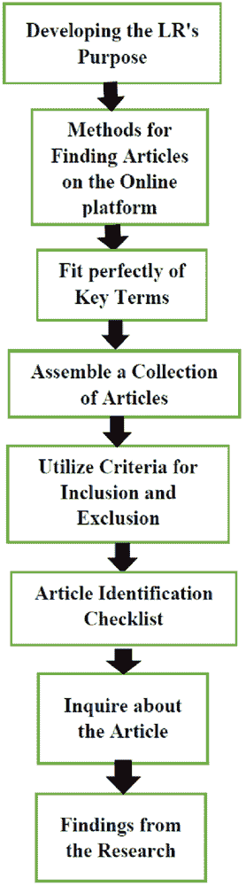

### 研究论文和工作论文的纳入与排除标准

根据 `DLR` 对文章相关性的强调，从每个领域中选取了相关性最高的 100 个结果。从这 165 篇综述文章中，每个主题选取了引用次数最多的 25 篇论文。这导致在检查的 `ML` 制造领域中总共发现了 165 篇综述论文。随后这 112 篇综述论文中的每一篇都进行了彻底检查，并进行了追溯检索，以发现其他与我们的研究相关的出版物。此外，如果几篇文章被判断为符合本综述的范围，它们也会通过人工流程纳入。最终总共产生了 500 篇文章。（图 2）。

### 图 2：研究论文和工作论文的选择方法论


| --- |

| 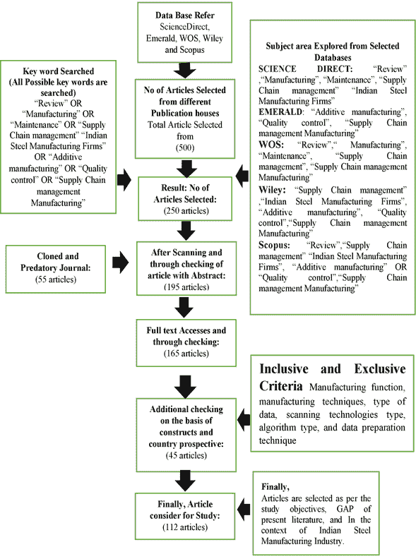 |

| --- |

# 研究论文和工作论文的最终评估

我们的最终结果集包含 112 篇论文，每篇论文都针对“制造功能、制造技术、数据类型、扫描技术类型、算法类型和数据准备技术”等多种变量进行了彻底分析和编码。在完成开发活动后，对机器学习如何应用于制造业进行了深入调查，之后，我们将阐述我们研究的重要发现（图 2）。

# 研究发现

## DLR 的重要发现

关于制造业中机器学习的现有文献主要三个视角之一：可用的视角包括：(a) 以任务为中心的视角、(b) 数字视角或 (c) 制造视角。第一种视角被称为“工作”，具有不同程度的覆盖范围(Sharma et al., 2021)。这些水平分别是“任务导向”、“过程导向”、“功能导向”和“行业导向”，并按照范围增加的递减顺序列在（表 2）。在任务级研究单个任务是重要的，这使得研究能够集中在目标上，例如挤出件表面的预测（W. Zhang, 2021），而不是使用监测的 `ML` 来发现生产效率低的问题(Alexopoulos et al., 2020)。根据过程级研究，机器学习（`ML`）可用于改进制造结构，如机械加工(Kim et al., 2018)、增材制造(Kim et al., 2018)。一些过程级研究尝试涵盖比特定制造过程更广泛的话题(Razvi et al., 2019)(Weichert et al., 2019)。在制造过程优化中应用机器学习(Escobar & Moralesendez, 2018)以及可持续供应链管理的预测维护(Köksal et al., 2018)。机器学习可能用于改进性能。此外，行业级的研究研究了机器学习在特定领域的应用(Chen et al., 2018; Sharma et al., 2021)。

### 表 2. 关于制造业供应链机器学习的综述重要发现

| 研究强度 | 功能 | 相关文章 |

| --- | --- | --- |

| (a) 以任务为中心的视角 | 行业导向 | 在过程行业和汽车行业中的机器学习。在过程行业中，机器学习被利用(Chen et al., 2018; Sharma et al., 2021)。 |

| 功能导向 | 在质量控制、维护和生产计划等制造操作中的机器学习。为了提高质量(Wisetsri et al., 2021)。 |

| 过程导向 | 在铸造、成型和增材制造等制造过程中的机器学习研究。机械加工行业(Kim et al., 2018)。 |

| 任务导向 | 在特定应用（如缺陷识别、供应链复杂性、表面粗糙度预测）中的机器学习技术综述。预测挤出表面粗糙度(W. Zhang, 2021)。 |

| (b) 数字视角 | 特别技术 | 在特定技术背景下的机器学习研究(Bramley & Ouzman, 2019; Tirkolaee et al., 2021)。 |

| 技术创新 | 单项技术在专门领域中的适用性综述。用软计算改进机械加工性能(Kim et al., 2018)。 |

| ML 在先进供应链中 | 进供应链管理综述。与 IT 启用系统相结合的供应链(Feizabadi, 2020; Huo et al., 2014; Tirkolaee et al., 2021)。 |

## (c) 制造视角

### 行业转型

研究制造业中发生的重大变革。利用机器学习上下文智能的供应链网络学科（Jose & Shanmugam, 2019; Pahwa, 2020）。

### 制造业技术

制造业技术回顾。工业 4.0 及其相关技术回顾（Buer et al., 2021; Valente & Neto, 2017）。

## 机器学习在印度钢铁行业供应链中的适用性

### 提升钢铁行业竞争力的工业工程

集成炼钢工艺涵盖了从炼铁到最终钢铁分类和成型的所有环节，其本身就是一个复杂的工业系统。此外，决策者必须对运营管理、流程执行、风险关注和物料处理等多个领域有深入理解，以便做出明智的决策。解决方案策略需要考虑权衡、不确定性，以及多个阶段、多目标、众多决策因素和限制条件。文献中介绍了多种工业工程方法，如多目标优化、启发式算法、遗传算法、仿真、精益六西格玛等，以解决钢铁行业中的复杂问题（如集成生产计划）。

### 印度钢铁行业障碍优先级的 AHP 和模糊 AHP 方法

识别印度钢铁供应链的威胁并对其优先级排序。该研究分析了 11 种可能的重大障碍。印度钢铁行业可能面临进一步挑战。本研究同时使用 `AHP` 和 `FAHP` 对识别出的障碍进行评分。

### 机器学习在生产计划与控制中增强 SCP

由于其跨职能的性质，改进 `PPC` 运营可以对整个公司的生产过程产生连锁反应。随着 `Industry 4.0` 丰富数据、高计算能力和大容量存储的引入，`ML` 技术已成为解决工业难题的极具吸引力的答案。

### 资本投资周期的数字化

钢厂需要工程知识、灵活性生产力来改变其 `EBITDA` 轨迹。钢厂的资本投资周期在设计和实施方面都是复杂的。这些风险增加了项目融资风险溢价，并降低了生命周期现金流。这推高了资本成本，降低了可持续的 `EBITDA` 利润率和资本回报率。在面对市场和原材料不确定性时考虑工厂的灵活性，可能会使工厂能够改变产品组合、替代原材料，并平衡铁、钢及下游单元的规模经济。实物期模型结合市场不确定性建模可以产生具有更好预期价值和更低风险的现实场景。

### 区块链助力新冠期间的稳健钢铁供应链

新冠肺炎引发了影响几乎所有制造商、零售商和分销商的供应链中断，影响了各种生产流程。钢铁作为一个能源密集型行业，建议利用数字化技术来优化和维持生产。为了应对这种情况，行业有机会推动供应链向可持续性发展。

### 机器学习算法的供应链分布

通过分析 `SCM` 中 `ML` 应用的发展模式以及 `SCM` 中最常用的 `ML` 方法，似乎 `ML` 在解决复杂问题和检索数据方面的潜力尚未被完全挖掘。

在销售、需求和必要库存量方面，机器学习算法能够提高预测和预测的准确性。`ML` 算法对历史数据准确性的依赖程度低于“移动平均、指数平滑、时间序列方法”和“Box-Jenkins 方法”等其他传统方法，这使其成为供应链管理 (`SCM`) 中需求和规划的替代方案而受到推广。

客户对低成本、高质量且快速交付的产品的满意是每家公司采购和供应管理成功的基石。供应商评估和选择是供应链管理机器学习应用执行的主要功能。由于场景的动态性和复杂性，支持向量机等 `ML` 方法经常被用于帮助完成以下场景的决策过程。

`SC` 库存管理 (`SCIM`) 和存储都是极其昂贵的工作。`SCIM` 的重要目标是扩大产品多样性、提高客户服务和降低成本等。另一方面，传统的决策规则主要依赖于库存经理自身的判断和专业知识，难以准确地估计、预测和收集实现所有这些目标所需的信息。因此，仓库经常面临不确定的库存输入，这需要建立能够帮助人们克服这种不可预测性的系统。`ML` 算法能够寻找与仓库数据集中相似的输入模式，这使其成为数据挖掘的理想选择。

## 研究局限性

尽管我们在混合文献综述中使用了严谨且成熟的研究方法，但本出版物在方法方面仍然存在显著局限性。由于制造业是一个如此巨大的研究领域，必须使用纳入和排除标准来限制研究材料的数量。因此某些论文可能被遗漏，这在文献综述中是常见现象。尽管如此，我们认为手动纳入和对进一步相关论文的反向检索已在很大程度上减少了重要工作被忽略的可能性。其次，尽管我们的研究采取了系统且彻底的方法来识别相关文献，但不能排除最终文章列表反映某些隐性偏差的可能性。因此，每位作者对最终文章进行了彻底评估，以确保其相关性。

## 未来研究方向

我们的重点是制造业、供应链管理问题和机器学习算法。这些模型可以用于未来的供应链管理研究。本研究侧重于为印度工业中 `ML` 在供应链中功能的学术研究开发一个概念框架。它试图回答一个问题，即在印度背景下，不同的 `ML` 应用对于支持供应链管理以及运营灵活性有多重要。

## 研究结论

今天，出于各种原因，公司必须改进其供应链，包括获取市场份额、吸引新客户、建立品牌等。本文中的信息展示了各行业如何充分利用其能力。在这方面，机器学习是卓越的解决方案之一，因为它可能为企业带来实形和无形的利益。文章介绍了不同的机器学习算法（`ML Algorithms`）在印度钢铁行业供应链管理（`SCM`）中的适用性，并描绘了机器学习在制造业中的重要性。机器学习允许所有利益相关者朝着共同目标努力，同时考虑到他们各自的优劣势。它还辅助了风险管理、供需估算、跨多个供应渠道的有效网络构建以及稳定供应链的发展。从本质上说，使用先进技术提高了利润率和竞争优势。总而言之，数字革命和机器学习已被证明是极有利的。

## 参考文献

- Alexopoulos, K., Nikolakis, N., & Chryssolouris, G. (2020). Digital twin-driven supervised machine learning for the development of artificial intelligence applications in manufacturing. International Journal of Computer Integrated Manufacturing, 33(5), 429–439. doi:[10.1080/0951192X.2020.1747642](https://doi.org/10.1080/0951192X.2020.1747642)

- Arksey, H., & O’Malley, L. (2005). Scoping studies: Towards a methodological framework. International Journal of Social Research Methodology, 8(1), 19–32. doi:[10.1080/1364557032000119616](https://doi.org/10.1080/1364557032000119616)

- Baryannis, G., Validi, S., Dani, S., & Antoniou, G. (2019). Supply chain risk management and artificial intelligence: State of the art and future research directions. International Journal of Production Research, 57(7), 2179–2202. doi:[10.1080/00207543.2018.1530476](https://doi.org/10.1080/00207543.2018.1530476)

- Bramley, R. G. V., & Ouzman, J. (2019). Farmer attitudes to the use of sensors and automation in fertilizer decision-making: Nitrogen fertilization in the Australian grains sector. Precision Agriculture, 20(1), 157–175. doi:[10.1007/s11119-018-9589-y](https://doi.org/10.1007/s11119-018-9589-y)

- Bressanelli, G., Perona, M., & Saccani, N. (2019). Challenges in supply chain redesign for the Circular Economy: A literature review and a multiple case study. International Journal of Production Research, 57(23), 7395–7422. doi:[10.1080/00207543.2018.1542176](https://doi.org/10.1080/00207543.2018.1542176)

- Buer, S. V., Semini, M., Strandhagen, J. O., & Sgarbossa, F. (2021). The complementary effect of lean manufacturing and digitalisation on operational performance. International Journal of Production Research, 59(7), 1976–1992. doi:[10.1080/00207543.2020.1790684](https://doi.org/10.1080/00207543.2020.1790684)

- Burga, R., & Rezania, D. (2017). Project accountability: An exploratory case study using actor–network theory. International Journal of Project Management, 35(6), 1024–1036. doi:[10.1016/j.ijproman.2017.0501](https://doi.org/10.1016/j.ijproman.2017.0501)

- Caggiano, K. E., Jackson, P. L., Muckstadt, J. A., & Rappold, J. A. (2009). Efficient computation of time-based service levels in a multi-item, multi-echelon supply chain: A practical approach. European Journal of Operational Research, 199(3), 744–749. doi:[10.1016/j.ejor.2008.082](https://doi.org/10.1016/j.ejor.2008.082)

- Campbell, C., Sands, S., Ferraro, C., Tsao, H.-Y., & Mavrommatis, A. (2020). From data to action: How marketers can leverage AI. Business Horizons, 63(2), 227–243. doi:[10.1016/j.bushor.2019.120](https://doi.org/10.1016/j.bushor.2019.120)

- Carvalho, T. P., Soares, F. A. M., Vita, R., Basto, J. P., & Alcalá, S. G. (2019). A systematic review of machine learning methods applied to predictive maintenance. Computers & Industrial Engineering, 137, 106224. doi:[10.1016/j.cie.2019](https://doi.org/10.1016/j.cie.2019)

- Chen, N. C., Drouhard, M., Kocielnik, R., Suh, J., & Aragon, C. (2018). Using machine learning to support coding in social science. ACM Transactions on Intelligent, 8(2). doi:[10.1145/3185](https://doi.org/10.1145/3185)

- Dixon-Woods, M. (2011). Using framework-based synthesis. BMC Medicine, 9(1). doi:[10.1186/7015](https://doi.org/10.1186/7015)

- Duan, Q., & Liao, T. W. (2013). A new age-based replenishment policy for highly perishable products. International Journal of Production Economics, 145, 65–71. doi:[10.1016/j.ijpe](https://doi.org/10.1016/j.ijpe)

- Durach, C., Kembro, J., & Wieland, A. (2017). Analyzing literature reviews in supply chain. The Journal of Supply Management, 53(4). doi:[10.1111/jscm.1214](https://doi.org/10.1111/jscm.1214)

- Escobar, C. A., & Morales-Menendez, R. (2018). Machine learning techniques for quality control. Advances in Mechanical Engineering, 10(2), 168–181. doi:[10.1177/2053](https://doi.org/10.1177/2053)

- Estelles, L., Ropodi, A., & Panagou, E. (2017). Using spectral imaging for meat spoilage. Food Research, 99, 206–215. doi:[10.1016/j.foodres](https://doi.org/10.1016/j.foodres)


# 参考文献

- Feizabad, D. (2020). Machine learning demand forecasting in supply chain. *International Journal of Logistics and Applications*, 17–24. doi:[10.1080/136756](https://doi.org/10.1080/136756)

- Goyal, S., & Routroy, S. (2021). Environmental sustainability enablers for Indian steel manufacturing. *Journal of Engineering, Design and Technology*, ahead-of-p. doi:[10.1108/JEDT-0321](https://doi.org/10.1108/JEDT-0321)

- Guzzo, R., Jette, R., & Katzell, R. A. (1985). The effects of psychologically based programs on worker productivity: A meta-analysis. *Personnel Psychology*, 38(2), 275–291. doi:[10.1111/1744-6570.195](https://doi.org/10.1111/1744-6570.195)

- Hartley, J. L., & Sawaya, W. J. (2019). Tortoise, not the hare: Digital transformation of supply chain processes. *Business Horizons*, 62(6), 707–715. doi:[10.1016/j.bushor.2019.120](https://doi.org/10.1016/j.bushor.2019.120)

- He, P., He, Y., & Xu, H. (2020). Buy-online-and-deliver-from-store strategy for a dual-channel supply chain considering retailer’s location. *Transportation Research Part E: Logistics and Transportation Review*, 144, 10227. doi:[10.1016/j.tre.2020.102](https://doi.org/10.1016/j.tre.2020.102)

- Hugo, B., Qi, Y., Wang, Z., & Zhao, X. (2014). The impact of supply chain integration on firm performance: The moderating role of competitive strategy. *Supply Chain Management*, 19(4), 369–384. doi:[10.1008/SCM-032013-096](https://doi.org/10.1008/SCM-032013-096)

- Jose, A., & Shanmugam, P. V. (2019). Supply chain issues in SME food sector: a systematic review. In *Journal of Advances in Management Research* (Vol. 17, Issue 1, pp. 19–65). doi:[10.1108/JAMR-022019-010](https://doi.org/10.1108/JAMR-022019-010)

- Kaparthi, S., & Bumblauskas, D. (2020). 基于决策树的机器学习技术的预测性维护系统设计。《国际质量与可靠性杂志》， 37(4), 659–686. doi:[10.1108/IJQRM-04-2019-0131](https://doi.org/10.1108/IJQRM-04-2019-0131)

- Kim, D.-H., Kim, T. J. Y., Wang, X., Kim, M., Quan, Y.-J., Oh, J. W., Min, S.-H., Kim, H., Bhandari, B., Yang, I., & Ahn, S.-H. (2018). 使用机器学习的智能加工过程：对加工业的展望与展望。《国际精密工程与制造-绿色技术杂志》， 5(4), 555–568. doi:[10.1007/s40684-018-0057-y](https://doi.org/10.1007/s40684-018-0057-y)

- Köksal, D., Strähle, J., & Müller, M. (2018). 服装供应链中的社会可持续性——发展中国家采购中间商的角色。《可持续性》， 10(4), 1039. doi:[10.3390/su10041039](https://doi.org/10.3390/su10041039)

- Kumar, A., Liu, R., & Shan, Z. (2020). 区块链是供应链管理的灵丹妙药吗？技术挑战与研究机会。《决策科学》， 51(1), 8–37. doi:[10.1111/deci.12396](https://doi.org/10.1111/deci.12396)

- Kumar, R., Tiwari, S., & Kansara, S. (2021). 印度钢铁行业供应链的障碍优先级排序：应用 AHP 和模糊 AHP 方法。《展望：商业视角杂志》。在线优先出版。 doi:[10.1177/09722629211065687](https://doi.org/10.1177/09722629211065687)

- Kumaraguru, S., Kulvatunyou, B., & Morris, K. C. (2014). 智能制造系统中的实时分析与持续性能管理集成。 doi:[10.1007/978-3-662-44733-8_22](https://doi.org/10.1007/978-3-662-44733-8_22)

- Kusiak, A. (2020). 制造业中的卷积和生成对抗神经网络。《国际生产研究杂志》， 58(5), 1594–1604. doi:[10.1080/00207543.2019.166233](https://doi.org/10.1080/00207543.2019.166233)

- Ma, H., Wang, Y., & Wang, K. (2018). 使用机器学习自动检测假报警读数。《专家系统与应用》， 91, 442–451. doi:[10.1016/j.eswa.2017.0921](https://doi.org/10.1016/j.eswa.2017.0921)

- Ma, L., & Sun, B. (2020). 营销中的机器学习与人工智能——连接力量与人类洞察力。《国际营销研究杂志》， 37(3), 481–504. doi:[10.1016/j.ijresmar.2020.0405](https://doi.org/10.1016/j.ijresmar.2020.0405)

- Makkar, S., Devi, G. N., & Solanki, V. K. (2020). 机器学习技术在供应链优化中的应用。ICICCT 2019 – 系统可靠性、质量控制、安全、管理 (pp. 861–869)。Springer. doi:[10.1007/978-981-13-8461_58](https://doi.org/10.1007/978-981-13-8461_58)

- Martínez, A., Schmuck, C., Pereverev, S., Pirker, C., & Haltmeier, M. (2020). 非合同设定下客户预测的机器学习框架。《欧洲运筹学杂志》， 281(3), 588–596. doi:[10.1016/j.ejor.2018.0434](https://doi.org/10.1016/j.ejor.2018.0434)

- Ni, D., Xiao, Z., & Lim, M. K. (2020). 供应链管理中机器学习研究趋势的系统综述。《国际机器学习与网络学杂志》， 11(7), 1463–1482. doi:[10.1007/s13042-019-0150](https://doi.org/10.1007/s13042-019-0150)

- Pahwa, A. (2020). 农科技——迈向农业转型。安永道 LLP，8, 1–53.

- Patel, B. S., Samuel, C., & Sharma, S. K. (2017). 供应链敏捷性评估：一个印度制造组织的案例研究。《制造技术管理杂志》， 28(2), 212–231. doi:[10.1108/JMTM-09-2016-0125](https://doi.org/10.1108/JMTM-09-2016-0125)

- Pournader, M., Ghaderi, H., Hassanzadegan, A., & Fahimnia, B. (2021). 供应链管理中的人工智能应用。《国际生产经济杂志》， 241, 108250. doi:[10.1016/j.ijpe.2021.10250](https://doi.org/10.1016/j.ijpe.2021.10250)

- Prahathish, K., Naren, J., Vithya, G., Akhil, S., Dinesh Kumar, K., Sai Krishna Mohan, S. (2020). 供应链预测的系统机器学习方法。 doi:[10.1007/978-3-030-39033-4_15](https://doi.org/10.1007/978-3-030-39033-4_15)

- Razvi, S. S., Feng, S., Narayanan, A., Lee, Y.-T., & Witherell, P. (2019, August 18). 增材制造中的机器学习综述。第 39 届计算机与工程会议。 doi:[10.1115/DETC2019-9415](https://doi.org/10.1115/DETC2019-9415)

- Sandelowski, M., Voils, C. I., & Barroso, J. (2007). 研究合成的可比较性工作。《社会科学与医学》， 64(1), 236–247. doi:[10.1016/j.socimed.2006.0841](https://doi.org/10.1016/j.socimed.2006.0841)

- Savy, E., & Harrison, C. (2020). 开发韧性供应链。《供应链管理》(Vol. 25, Issue 1, pp. 77–100)。Emerald Group Publishing. doi:[10.1108/SCM-09-2018-0329](https://doi.org/10.1108/SCM-09-2018-0329)

- Sharma, A., Zhang, Z., & Rai, R. (2021). 制造业的解释性模型：研究议程。《国际生产研究》， 59(16), 4960–4994. doi:[10.1080/00207543.2021.1930](https://doi.org/10.1080/00207543.2021.1930)

- Silva, J. C., Carvalho, T. F., Basso, M. F., Deguchi, W., Pereira, A., Sobrinho, R. R., Brustolini, O. J., Dal-Bianco, M., Santos, A., Zerini, F. M., Cerqueira, F. R., & Fontes, E. P. (2017). 机器学习方法增强的基因组数据仓库。《生物信息学》， 18(1), 240. doi:[10.1186/s12859-017-646](https://doi.org/10.1186/s12859-017-646)

- Thakkar, J., Kanda, A., & Deshmukh, S. (2012). 印度中小企业的供应链问题：六个案例研究的启示。《制造技术管理杂志》， 23(5), 634–664. doi:[10.1108/17410381223444](https://doi.org/10.1108/17410381223444)

- Tirkolaee, E., Sadeghi, S., Moosloo, F. M., Vandchali, H. R., & Aeini, S. (2021). 机器学习在供应链管理中的应用：主要领域的概述。《工程中的数学问题》， 2021, 1–14. doi:[10.1155/2021/147603](https://doi.org/10.1155/2021/147603)

- Toorajipour, R., Sohrabpour, V., Nazarpour, A., Oghazi, P., & Fischl, M. (2021). 供应链管理中的人工智能：系统文献综述。《工商研究杂志》， 122, 502–517. doi:[10.1016/j.jbusres.2020.0909](https://doi.org/10.1016/j.jbusres.2020.0909)

- Tranfield, D., Denyer, D., & Smart, P. (2003). 通过系统综述开发证据支持的管理知识的方法论探索。《英国管理杂志》， 14(3), 207–222. doi:[10.1111/1467-8551.0375](https://doi.org/10.1111/1467-8551.0375)

- Valente F. J. Neto, A. C. (2017). 使用 IoT / RFID 的智能钢铁库存追踪。2017 IEEE RFID 技术与应用国际会议，RFID-TA 2017, 158–163. doi:[10.1009/RFID-TA-2017.809863](https://doi.org/10.1009/RFID-TA-2017.809863)

- Weichert, D., Link, P., Stoll, A., Rüping, S., Ihlenfeldt, S., & Wrobel, S. (2019). 生产工艺优化的机器学习综述。《先进制造技术杂志》， 104(5–8), 1889–1902. doi:[10.1007/s00170-019-03988-5](https://doi.org/10.1007/s00170-019-03988-5)

- Wisetsri, W., Donthu, S., Mehbodniya, A., Vyas, S., Quiñonez-Choquecota, J., & Neware, R. (2021). 数字化革命和机器学习对供应链管理的影响调查。《材料今日：进展》。在线优先出版。 doi:[10.1016/j.matpr.2021.09.367](https://doi.org/10.1016/j.matpr.2021.09.367)

- Wu, H., Cao, J., Yang, Y., Tung, C. L., Jiang, S., Tang, B., Liu, Y., Wang, X., & Deng, Y. (2019). 使用区块链进行供应链数据管理: 挑战与案例研究. 2019 第 28 届国际计算机通信与网络会议 (ICCCN), 1–8. doi:[10.1109/ICCCN.2019.8846964](https://doi.org/10.1109/ICCCN.2019.8846964)

- Xiao, B., & Benbasat, I. (2018). 偏偏个性化产品推荐对消费者决策结果影响的实证研究. 决策支持系统, 110, 46–57. doi:[10.1016/j.dss.2018.03.005](https://doi.org/10.1016/j.dss.2018.03.005)

- Zhang, W. (2021). 机器学习预测表面粗糙度. 物理学论文丛, 1856(1), 012040. doi:[10.1088/1742-6596/1856/1/012040](https://doi.org/10.1088/1742-6596/1856/1/012040)

- Zhang, X.-D. (2020). 机器学习. 收于人工智能的矩阵代数方法 (pp. 223–440). 新加坡 Springer 出版社. doi:[10.1007/978-981-15-2770-8_6](https://doi.org/10.1007/978-981-15-2770-8_6)

# 第 14 章：机器学习方法

*   Sylva Alif Rusmita (印度尼西亚艾尔兰加大学)
*   Moh.Saifin Ami An-Nafis (印度尼西亚艾尔兰加大学)
*   Indria Ramadhani (印度尼西亚艾尔兰加大学)
*   Mohammad Irfan (印度 CMR 技术学院)

### 摘要


本研究旨在探讨良好的公司治理（`GCG`）对印度尼西亚伊斯兰股票指数上市公司财务困境的影响。研究采用目的抽样法，获得了 23 个符合标准的样本。使用面板回归和机器学习对假设进行检验。结果显示，`GCG`变量包括机构股权（`IO`）、管理股权（`MO`）、监事委员会规模（`BoC`）和独立监事员比例（`PI`），同时影响财务困境，其中`BoC`和`PI`是部分最显著变量。机器学习方法表明`extra trees`是分析财务困境的最佳模型。模型显示最显著变量是 `IO`，其次是 `BoC` 和 `PI`。根据结果，伊斯兰发行人应通过减少 `BoC`、`IO` 的数量并增加 `PI` 的比例来管理其 `GCG`，以最大限度地减少财务困境的发生。

# 引言

良好的公司治理通常被称为公司治理。良好的公司治理是公司实施控制的规定，有助于为公司及其利益相关者增加价值。这可以通过良好的公司治理来实现，它可以形成一种管理绩效模式，使管理变得廉洁、透明和专业（Effendi, 2009）。

根据亚洲开发银行 2013 年的数据，印度尼西亚排名第 5（54.55），远高于排名第一的泰国（75.39），马来西亚排名第二（71.69），新加坡排名第三（71.68）。此外，菲律宾排名第四（57.99），而越南排名第六（33.87）（亚洲开发银行，2014 年）。随着宏观规模财务问题的出现，良好的公司治理被认为越来越至关重要。此外，根据财政部的数据，国有企业面临着财务困境的威胁，例如 `PT. Dirgantara Indonesia` (-0.84)、`PT. Pindad` (1.02)、`PT Indosutri Kereta Api` (0.92)、`PT. Barata Indonesia` (0.83)、`PT. Krakatau Steel` (0.47)、`PT. Doc and Kodja Bahari` (-1.72)、`PT. Dock and Shipping Surabaya` (-1.23)、`PT Industri Kapal Indonesia` (0.89)、`PT PAL Indonesia` (-0.1)（Santoso & Kurniawan, 2019）。各种问题的出现进一步加强了应用良好公司治理的重要性。

公司治理的理念旨在促进实现对财务报表使用者更加开放的治理。因此，从长期来看，良好的公司治理的实施可以影响公司的业绩，公司的业绩将与财务表现挂钩。如果财务表现出现问题，可能会损害公司的稳定性，从长期来看，可能导致破产状况（Ananto et al., 2017）。

破产的征象可以通过进行破产分析来识别。如果能尽早发现这些征象，管理层可以更好地减少破产。财务困境是一个公司的基本问题。根据 Platt & Platt (2002)，财务困境是一个关键阶段。

本研究探讨了印度尼西亚伊斯兰股票指数（ISSI）上市公司 `GCG` 对财务困境的影响。研究选择 `ISSI` 样本是因为其考虑因素较为复杂。伊斯兰资本市场对于规避非伊斯兰股票的投资者具有独特魅力。由于 `ISSI` 有超过 350 家发行人，因此作者对此进行了这项研究。此外，`ISSI` 成员每年筛选两次，由印尼金融监管局（OJK）决定，不符合伊斯兰组合；不仅如此，发行人的财务比率小于 45%，利息比例低于 10%。根据这些标准，上市公司必须实施良好的公司治理。本研究分析了 2011-2019 这九期间。本研究还为了确保自变量之间一致结果的正确性。论文的写作从引言开始。第二部分是研究背景，描述相关理论。接下来是研究问题陈述，包括之前的研究、问题陈述和假设的发展。第四部分是解决方案和建议。然后是未来的研究方向。最后是结论。

## 背景

### 代理理论

代理涉及人们意图授权他人为自己提供服务时产生的问题，这是管理层与股东之间的一种合同（Jensen & Meckling, 1976）。代理理论认为公司治理可以减少代理冲突。利润管理的产生可以通过代理理论来解释。作为代理人，管理人员有责任优化所有者的利润，并根据合同获得报酬。因此，公司内部存在不同的利益，双方都努力实现或维持理想的繁荣。

根据 Jensen & Meckling (1976)，公司的所有权和管理控制权越高，其代理成本就越低。这是因为股东和管理层之间存在共同的目标。代理问题的产生源于以下因素的存在：(1) 信息不对称，(2) 管理层通过接受能产生高回报的高风险项目，从债权持有人向股东实施的潜在利益转移，(3) 接受具有正净现值的项目并消耗剩余利润的错误。

### 财务困境

财务困境是财务状况恶化的阶段，作为破产或清算的信号出现（Platt & Platt, 2002）。财务困境体现为公司无法支付到期债务或缺乏支付债务的资金。可以使用财务困难预测数学模型来识别行业财务状况的程序（Altman, 1968）。

Altman 将财务困境分为四个部分：

1. **经济失败**：公司收入无法涵盖其总成本（包括资本成本）的状态。公司的可持续性取决于债人是否愿意提供资金，以及所有者是否愿意接受低于市场的收益率（`rate of return`）。

2. **经营失败**：由于无法产生利润而发生。换句话说，如果不能为支出提供现金流，业务将会失败。

3. **技术破产**：如果公司无法履行义务，即使资产价值超过债务金额（临时），也可能发生破产。当债务价值超过资产市场价值并导致业务停止时，也会发生破产。

4. **法律破产**：这种情况更为正式，如果根据法律提起了正式诉讼，公司可以被宣布法律破产。

财务困境可能源于公司内部因素（内部）或公司外部因素（外部）。Effendi (2009)指出，导致公司内部财务困境的因素更为微观，这些因素包括资金困难、债务数额以及公司经营活动中的损失。

如果公司能够克服或涵盖上述三点，并不能保证公司能避免财务困境。因为仍然存在导致财务困境的公司外部因素。根据 Effendi (2009)，公司的外部因素更为宏观，范围更广泛。这些外部因素之一是政府政策，它可能会增加公司承担的业务负担。此外，贷款利率上升的政策也导致公司承担的利息支出增加。

### 良好公司治理 (GCG)

GCG 是基于法律法规和商业伦理的公司治理流程和机制的基础原则。经济合作发展组织（OECD）分享了良好管理的基本原则，包括四个方面：公平、透明、问责和责任。印尼公司在国家治理政策委员会（KNKG）的监督下监控良好公司治理的实施。KNKG 发布了《印尼良好公司治理通用指南》，作为公司良好管理的参考，这进一步被称为 GCG 指南。

根据 Agrawal 和 Knober (1996) 在 (Al-Najjar, 2010) 中的观点，良好的公司机制分为内部和外部机制，例如机构所有权（即机构、业务实体或组织拥有的公司股份比例）、管理所有权（公司经理拥有的公司股份）、监事会作为公司机构集体负责监督并向董事会提供建议，确保公司实施 GCG，以及由关联方通过股东大会决定的独立董事事比例。

## 面板回归

本研究中使用 Eviews 9 软件对多个研究样本的同一时期面板数据进行回归分析。使用该模型将导致每家公司每个时期产生不同的截距和斜率系数，因此可能会出现以下情况（Gujarati & Porter, 2009）：

1. 假设截距和斜率随时间固定，个体（公司）以及截距和斜率的差异由离散变量解释。

2. 假设斜率固定，但个体之间的截距不同；假设斜率固定，但在时间和个体之间截距均不同。

3. 假设个体之间的截距和斜率均不同。

4. 假设截距和斜率在时期和个体之间均不同。

根据 Gujarati & Porter (2009) 估计面板数据回归模型有几种技术，包括：

### OLS（普通最小二乘法）

OLS 回归模型或称为共同效应估计法，通过结合时间序列和横截面数据计算，而不考虑时间上的差异。OLS 模型的方程可以写如下：

```
978-1-6684-4483-2.ch014.m01
```

### 固定效应

固定效应模型反驳了公司之间任何时间截距和斜率都相同的假设，因为在实践中，这与实际情况相去甚远。为了克服截距的变化，该模型使用虚拟变量技术捕捉公司之间的差异。以下是固定效应模型的相似之处：

```
978-1-6684-4483-2.ch014.m02
```

### 随机效应

随机效应模型通过误差值观察公司之间和时间之间的差异。该方法考虑了在整个时间序列和横截面中可能相关的误差，数学上该方程可以表述如下：

```
978-1-6684-4483-2.ch014.m03
```

在估计面板数据回归模型时，需要一种测试方法，分为三种：

#### Chow 检验

为了观察固定效应面板数据回归技术是否优于不带虚拟变量固定效应模型或 OLS 模型，可以使用 Chow 检验。Chow 检验的假设为：

- H0 = 如果 alpha > 0.05 使用共同效应模型
- H1 = 如果 alpha < 0.05 使用固定效应模型

#### Hausman 检验

该测试用于比较固定效应模型和随机效应模型。如果 Chow 检验结果接受 H1，则必须进行 Hausman 检验。Hausman 检验的假设为：

- H0 = 如果 alpha > 0.05 使用随机效应模型
- H1 = 如果 alpha < 0.05 则使用固定效应模型

#### 拉格朗日乘数检验 (LM)

该检验旨在确定在 `OLS` 或随机效应之间使用的确切模型，`LM` 观察以独立变量数量为自由度的卡方分布值。`LM` 检验的假设为：

- H0 = 如果 alpha > 0.05 则使用共同效应模型
- H1 = 如果 alpha < 0.05 则使用随机效应模型

## 机器学习

机器学习方法由几个阶段组成，即：

### 1. 树类方法

决策树和森林分类与回归树 (`CART`) 是一种模型，通过根据每个独立变量的值对数据进行划分，以观察每个独立变量对其因变量的影响有多强，从而获得可作为预测值的有用决策。（(Athey & Imbens, 2019; Chen, 2021; Putra, 2019; Zurada et al., 2011)

### 2. 偏差与方差的权衡

为了提高 `CART` 模型的准确性，必须关注偏差与方差之间的比较。高偏差值的存在可能会影响样本忠实方差值的降低。不需要在偏差和方差之间进行权衡，因为不可能同时达到可能的偏差和方差值。提供的权衡解决方案是寻找低偏差低方差的模型，以便在数据欠拟合（最低方差）和过拟合（最高方差）之间达到理想的平衡。（(Athey & Imbens, 2019; Chen, 2021; Putra, 2019; Zurada et al., 2011)。为了减少偏差，应该遵循以下几个步骤：

- 超参数调优

可以通过可以调整数值的超参数测试，在偏差值和方差之间寻找良好的平衡。如何通过网格搜索和随机搜索自定义超参数。（(Athey & Imbens, 2019; Chen, 2021; Putra, 2019; Zurada et al., 2011)

- 训练、验证和测试数据

在调整超参数时，可能会消耗所有可用数据。需要大量数据是因为将数据划分为训练数据、验证和测试子测试是有用的，这以后有助于寻找偏差和方差之间的最佳平衡。（(Athey & Imbens, 2019; Chen, 2021; Putra, 2019; Zurada et al., 2011)

### 3. 集成和提升方法

在此阶段，将同时使用作为模型形状的训练数据和用于测试模型的测试数据对模型测试。在机器学习中有几种可以使用的模型，即：

- Bagging 和自助 (pasting)

通过训练数据和测试数据之间的多样化可以确定最合适的 `CART` 值。训练数据可以被替换也可以不替换。不替换的训练数据可以作为对先前未观测数据 cart 值确定的额外验证。对于进行了替换/bagging 的训练数据可以提高训练数据和 `CART` 的性能。（(Chen, 2021)

- 随机森林和极端树

在模型模型中，`Random forest` 和 `extra trees` 用于决策。（(Chen, 2021)

- 自适应和梯度

`AdaBoost` 是一个依赖于单一 `XGBoost` 用于变量的模型。（(Chen, 2021)

- 支持机和神经网络

`Support vector machines` 和 `neural networks` 是两种方法。（(Chen, 2021)

### 4. 模型选择

在选择多种模型后，可以进行数据处理以寻找训练和测试之间的比较。可以通过 `R2` 看到精度最高的模型。（(Chen, 2021)

## 章节重点

### 问题、争议

有几项之前的研究讨论了 GCG 的实施：

- `Helena & Saifi (2018)`978-1-6684-4483-2.ch014.xhtml#r12)
- `Hussein & Al-Tamimi (2012)`978-1-6684-4483-2.ch014.xhtml#r13)
- `Li et al. (2008)`978-1-6684-4483-2.ch014.xhtml#r17)
- `Pramudena (2017)`978-1-6684-4483-2.ch014.xhtml#r23)
- `Wardhani (2006)`978-1-6684-4483-2.ch014.xhtml#r31)

Wardhani 提到 GCG 的成分对财务困难有影响。然而，在 `Widhiastuti et al. (2019)` 研究中，GCG 没有直接或间接影响。`Helena & Saifi (2018)` 和 `Pramudena (2017)` 指机构股权对财务困境也有影响。同时，在 `Widhiastuti et al. (2019)` 和 `Yudha & Fuad (2014)` 的分析中，机构股权作为 GCG 变量对财务失败没有影响。管理股权对财务风险有影响。`Wardhani (2006)` 研究说管理股权对财务失败有负面影响。管理股权对财务失败没有影响（`Widhiastuti et al., (2019)`）。

监事会的规模会影响破产概率(Helena & Saifi, 2018; Wardhani, 2006)。同时，根据 Mafiroh & Triyono (2016) 以及 Yudha & Fuad (2014) 的观点，监事会对破产崩溃没有影响。根据 Helena & Saifi (2018); Pramudena (2017); Yudha & Fuad (2014) 的研究，独立监事占比例对财务失败有影响。而，Fathoni 等人 (2014) 的研究表明，独立监事人的比例对财务困境的发生有显著影响。

在研究中，Murhadi 等人 (2018) 认为 `size` 变量影响财务困境。然而，Santoso 等人 (2018) 的研究表明，规模并不影响财务失败的预测。杠杆影响财务困境的可能性，正如 Mafiroh & Triyono (2016) 以及 Shahwan (2015) 的研究所示。Mafiroh & Triyono (2016) 表示，杠杆率对财务危机的可能性有显著的正向影响。

各种结果描述了这些变量在财务困境分析中的不一致性，这促使研究人员重新审视公司治理（GCG）对机构股权、管理层股权、监事会规模、独立监事会、规模和杠杆这六项指标的影响。研究人员选择这些变量的原因是根据以往研究中的若干理论，已经说明了导致财务困境的变量。

本研究考察了在印尼西亚伊斯兰股票指数（ISSI）上市的集团 GCG 对财务困境的影响。研究人员对从 ISSI 选取样本感兴趣是因为其考虑的标准更为复杂。伊斯兰资本市场对于希望避开运营不符合伊斯兰法股票的穆斯林投资者来说具有其独特的魅力。由于投资者发展非常快，这一对象极具吸引力。

### 假设一：机构股权对财务困境的影响

机构股权对财务困境有正向影响(Fathonah, 2016)。如果你想增加公司的价值，鼓励机构所有者向管理层提供贷款，这旨在持续提高他们的绩效 (Sujoko, 2007)。Classens 等人 (1999) 在 Wardhani (2006) 的研究中指出，公司所有权的存在可以降低企业破产水平。然而，当财产归集中所有时（换句话说，由大股东持有），董事会更有可能开展可以带来个人利益的研究。在这种情况下，假设的表述如下：

*   `H0`: 机构股权对财务困境没有影响。
*   `H1`: 机构股权对财务困境有显著影响。

### 假设二：管理层股权对财务困境的影响

具有良好管理层股权的公司可以增加公司价值，因为大量的管理股权可以有效监控公司活动 (Jensen & Meckling, 1976)。Michelberger (2016) 也得出了相同的结论，即公司股权结构的重要性。克服代理成本的解决方案之一是增加管理层股权，因为当管理层股权增加时，它可以使管理者的利益与股东的利益保持同步 (Jensen & Meckling, 1976)。

*   `H0`: 管理层股权对财务困境没有影响。
*   `H2`: 管理层股权对财务困境有显著影响。

### 假设三：监事会规模对财务困境的影响

对最佳外部关系的需求越高，治理的需求就越高 (Wardhani, 2006)。同时，增加管理人员的数量也会增加协调和沟通问题，这会导致管理人员行使控制能力下降，并引发代理问题 (Jensen, 1993)。那么假设：

*   `H0`: 监事会规模对财务困境没有影响。
*   `H3`: 监事会规模对财务困境有显著影响。

### 假设四：独立监事比例对财务困境的影响

独立监事的比例越高可以提高对绩效的监控和控制 (Salancik & Pfeffer, 1978)。假设的表述为：

*   `H0`: 独立监事比例对财务困境没有影响。
*   `H4`: 独立监事比例对财务困境有显著影响。

## 解决方案与建议

本研究采用的方法是定量法，经济分析与实验的结合，并被分为特定类别以便分析。统计计算使用了计算机应用程序。数据取自印尼交易所 (`www.idx.co.id`)、印尼金融监管局 (`OJK`) 以及各公司的年度报告。本研究的总体是 2011-2019 年期间在印尼伊斯兰股票指数（ISSI）上市的所有公司。

本研究通过两种方法处理数据。第一种方法是面板数据回归，以识别自变量对因变量的同时或部分影响。另一种方法是机器学习，选择这种方法是因为它可以识别多种模型，包括传统统计和机器学习模型。

## 回归结果与讨论


该测试旨在确定自变量对因变量的影响。面板回归使用了固定效应模型（FEM）：

**表 1. 面板回归 (FEM) 结果**

| 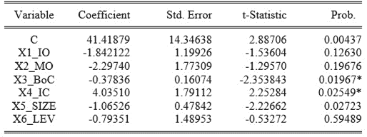 |

| --- |

来源：数据处理，2022

多元线性回归模型方程可以重写为：

```
Financial Distress = 41.41879 -1.842122 IO -2.29740MO -0.37836BoC + 4.03510IC -1.06526SIZE -0.79351LEV + e
```

根据 `Altman z score` 理论，`Z-Score` 值越高，财务困境的可能性越小。根据上述结果，系数为 `-1.84`、概率水平为 `0,12` 的机构所有权 (`X1_IO`) 描述了机构所有权与 Z 分数之间存在负相关。机构所有权每增加 1 个单位，`Z-Score` 值将减少 `-1.84`，这意味着财务困境将增加。因此，机构所有权的增加会导致公司陷入财务困境。这一结果与 Adityaputra (2017) 的观点一致，他认为机构所有者是临时所有者，更关注短期利润；如果这些利润被认为盈利能力，来自其他公司的投资者将出售大量股票。此类行为会影响股票价值，从而导致公司未来面临财务困难。印度尼西亚公司治理论坛（FCGI）指出，股权结构集中的公司（如持有大量股份的机构所有权）可以反映机构的实力。这种状况允许机构干预公司运营，其干预目的是实施欺诈/违规，这会导致公司效率下降，进而引发财务困难。

其次，变量管理所有权 (`X2_MO`) 的系数为 `-2.297`，概率水平（显著性）为 `0.19`，表明在 5% 的水平下显著。管理所有权对 `Z.Score` 有负面影响。管理所有权每增加 1 个单位，`Z-Score` 值将减少 `-2.297` 单位。`Z-Score` 值越高，财务困境的可能性越小。因此可以得出，管理所有可能会增加财务困难。这项研究与 Fathoni 等人 (2014)、Pramudena (2017) 以及 Yudha & Fuad (2014) 的观点一致，他们认为管理所有权具有财务困境的可能性。

监事委员会 (`X3_BoC`) 的系数为 `-0.378`，概率水平（显著性）为 `0.019` 或小于 5% (`0.05`)，因此在统计学上，独立监事委员会与 `Z-Score` 有负相关关系且在 5% 以下具有显著影响。独立监事委员会每增加 1 个单位，`Z-Score` 值将增加 `-0.378` 单位。高 `Z-Score` 表示财务困境的可能性较低，因此可以得出，监事会规模对财务困境具有显著的负面影响可能性。董事会有全权指导公司的经营活动，董事会成员可以根据分配的职责和权力履行其职责。董事会的能力影响决策质量，从而间接影响公司的收入规模。获得的收入越高，出现财务困难的可能性越低（Radifan & Yuyetta, 2015）。遗憾的是，结果显示董事会规模可能会导致破产风险，这解释了公司内部人员有时会做出非中立的决策，且对公司政治的助长这符合代理理论。

下一个变量是独立监事（比例 (`X4_IC`)，显示系数为 `4.035`，概率水平（显著性）为 `0.025` 或小于 5%，因此在统计学上，独立监事的比例对 `Z-Score` 有影响。这意味着独立监事的比例对财务问题具有显著的正向影响。这表明，公司中独立监事的人数，财务困难的可能性可以减少财务困境。这些结果与 Helena & Saifi (2018) 和 Wardhani (2006) 一致。根据 Helena & Saifi (2018)，独立监事比例与公司财务困境状况之间的显著关系表明，独立监事的存在仍然能够进行有效的监督，防止公司陷入财务困境。

另一个控制变量公司规模 (`X6_SIZE`) 的系数为 `-1.065`，概率水平（显著性）为 `0.027`。统计学上，独立监事的所有权与 `Z-Score` 有负相关关系，并在 5% 以下具有显著影响。独立监事委员会每增加 1 个单位，`Z-Score` 值将减少 `-1.065` 单位。低 `Z-Score` 值表示财务困境的可能性较高。可以得出，规模对财务困境具有显著的正向影响。这可能是因为公司越大，现金流越高，且公司规模越大也会导致代理问题，可能发生的代理问题是自由现金流。

杠杆 (`X7_LEV`) 作为控制变量，显示系数为 `-0,79`，概率水平（显著性）为 `0.59`，表明该变量不显著。换句话说，杠杆每增加 1 个单位将减少 Z 分数。因此，可以得出，杠杆会引发财务问题。这项研究与 Miglani (2014) 和 Murhadi et al. (2018) 一致，他们表明公司杠杆水平越高，违约概率越大，并会增加财务困境。

## 机器学习结果与讨论

本研究中的机器学习结果使用了 8 个模型，还与传统的统计模型以及 7 个机器学习模型进行了比较，如下表所示：

### 表 2. 机器学习结果

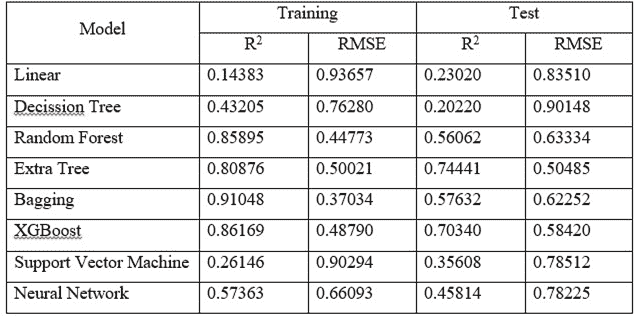

*来源：数据处理，2022*

结果显示，描述经典统计的线性模型并不是合适的模型。要确定最佳模型，需要查看 R2 最高且 RMSE 最低的测试结果。R2 解释了模型对研究数据的准确程度，因此为了了解更好的模型，应选择 R 平方最高的。而 RMSE 指模型中发生的误差，应选择值最小的。根据上表，Extra Tree 模型是本研究可以使用的最佳模型。额外树模型通过使用平均基尼减少（mean decrease gini）可以指示最显著的变量（Chen, 2021）。以下是研究中每个变量的分析结果：

### 图 1. Extra Trees 模型

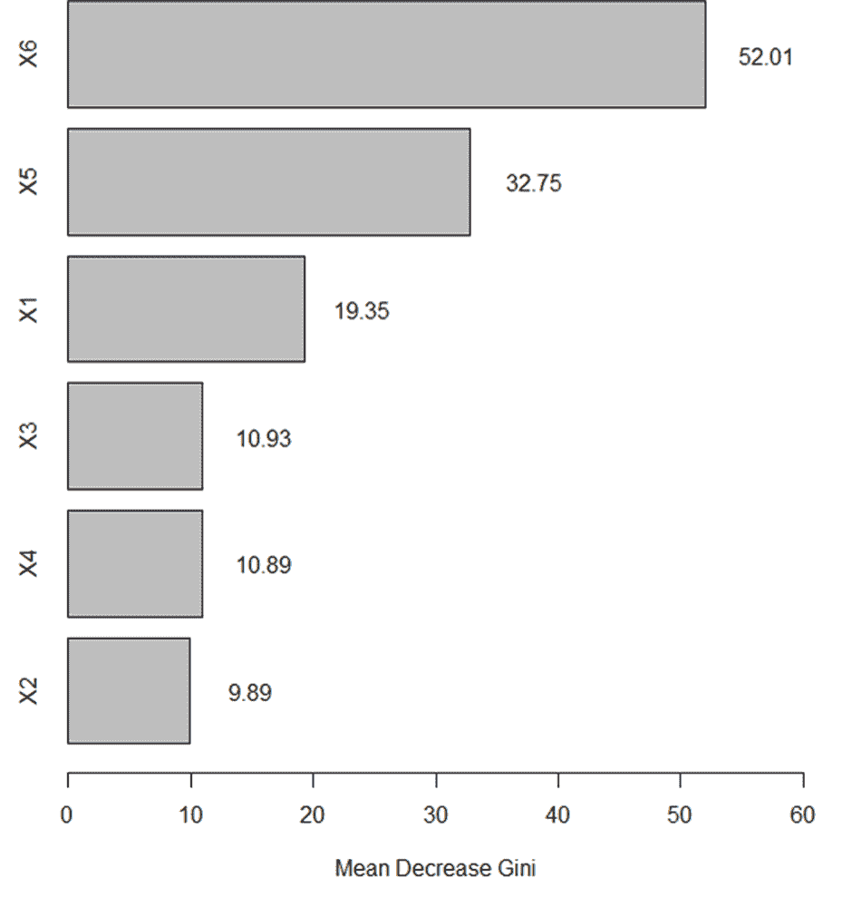

从图中可以看出机构所有权 (`X1`) 变量是对财务困境影响最大的 GCG 变量，其次是监事委员会规模 (`X3`) 和独立监事比例 (`X4`)。然而，管理所有权 (`X2`) 变量与其他三个 GCG 变量相比，影响最弱。这表明，伊斯兰公司关注这四个变量的比例非常重要，特别是具有影响最大的机构所有权。

## 未来研究方向

未来的研究可以使用不同的独立变量作为 `GCG` 的代理，由于本文仅使用了 4 个独立变量，代表比例为 43%，这意味着有 57% 的因素未被本文纳入且对 `GCG` 产生了影响。此后，后续研究可以关注特定的行业部门或其他国家。在机器学习领域，诸如 `extra trees` 等方法适用于经济和金融研究，但目前仍然较少被讨论。

# 结论

面板数据回归方法与使用 `extra trees` 模型的机器学习之间存在不同的结果。在回归中，面板数据发现 `BoC` 变量具有显著的负面影响，而 `IC` 具有显著的正向影响。面板数据结果表明，为了最小化破产风险，伊斯兰公司可以通过减少董事事会成员人数并增加独立董事的比例来调整 `GCG` 的结构。这一结果表明，独立董事的功能对公司的可持续性具有良好效果，因为他们可以为公司的可持续发展提供中立建议，这与通常来自公司内部的董事事会职职责不同。`BoC` 的负面影响表明，`BoC` 比例的增加实际上可能导致破产风险。这可能表明公司内部存在政治利益。

`extra trees` 方法的其他结果显示，机构所有权变量极大影响企业破产风险，其影响高于 `BoC` 和 `IC` 变量。机器学习模型无法指示显著性的方向，因此需要与面板数据回归方法结合，以观察变量的正负影响。两种模型均表明 `io` 呈负向，意味着较高的机构持股比例会导致破产风险的降低。本研究结果显示，由 `IO`、`BoC` 和 `IC` 组成的 `GCG` 变量对伊斯兰公司的财务困境影响最为显著。

## 参考文献

Adityaputra, S. A. (2017). The Effect of Corporate Governance Implementation on Financial Difficulties (Empirical Study on Manufacturing Companies Listed on the Indonesia Stock Exchange). Jurnal ULTIMA Accounting, 9(2), 50–64. doi:[10.31937/akuntansi.v9i2.729](https://doi.org/10.31937/akuntansi.v9i2.729)

Al-Najjar, B. (2010). Corporate Governance and Institutional Ownership: Evidence from Jordan. Corporate Governance, 10(2), 176–190. doi:[10.1108/14720701011035693](https://doi.org/10.1108/14720701011035693)

Altman, E. I. (1968). Financial Ratios, Discriminant Analysis, and the Prediction of Corporate Bankruptcy. The Journal of Finance, 23(4), 589–609. doi:[10.1111/j.1540-6261.1968.tb00843.x](https://doi.org/10.1111/j.1540-6261.1968.tb00843.x)

Ananto, R. P., Mustika, R., & Handayani, D. (2017). The Effect of `GCG`, Leverage, Profitability and `UP` on Consumer Goods Listed on the Indonesia Stock Exchange. Jurnal Ekonomi Bisnis Dharma Andalas, 19(1), 92–105.

they, S., Imb, G. W. (2019). Machine Learning Methods That Economists Should Know. Annual Review of Economics, 11(1), 685–725. doi:[10.1146/annurev-econ-08105343](https://doi.org/10.1146/annurev-econ-08105343)

Chen, J. M. (2021). An Introduction to Machine Learning for Panel Data. International Advances in Economic Research, 27(1), 1–16. Advance publication. doi:[10.1007/s11294-021-0815](https://doi.org/10.1007/s11294-021-0815)

Effendi, M. A. (2009). The Power of Good Corporate Governance: Theory dan Implementations. Salemba Empat.

Etikan, I., Musa, S., Alkassim, R. (2016). Comparison of Convenience Sampling and Purposive Sampling. Journal of Theoretical and Applied Statistics, 5(1), 1–5. doi:[10.11648/j.ajtas.20160501](https://doi.org/10.11648/j.ajtas.20160501)

Fathonah, A. N. (2016). The Effect of Good Corporate Governance Implementation on Financial Distress. Jurnal Iliah Akuntansi, 1(2), 133–150.

Fathoni, A., & Haryetti, W. E. (2014). The Effect of Good Corporate Governance Mechanism, Financial Distress on Earning Management: Empirical Study in Property and Infrastructure in Indonesian Stock Exchanges. Jurnal Ekonomi, 22(1), 1–16.

Gujarati, D. N., & Porter, D. C. (2009). Basic Econometrics (5th ed.). McGraw-Hill.

Helena, S., & Saifi, M. (2018). The Impact of Corporate Governance Toward Financial Distress (Case Study: Companies Registered at Indonesia Stock Exchange 2013-2016). Jurnal Administrasi Bisnis, 60(2), 143–152. administrasibisnis.student.ac.id/143

Hussein, A., & Al-Tamimi, H. (2012). The Effects of Corporate Governance on Performance and Financial Distress: The Experience of UAE National Banks. Journal of Financial Regulation and Compliance, 20(2), 169–181. doi:[10.1108/135819812121815](https://doi.org/10.1108/135819812121815)

Improving Lives Throughout Asia and The Pacific. (2014). [`www.adb.org/sites/default/files/institutional-document/158032/adb-annual-report-2014.pdf`](https://www.adb.org/sites/default/files/institutional-document/158032/adb-annual-report-2014.pdf)

Jensen, M. C. (1993). The Modern Industrial Revolution, Exit, and the Failure of Internal Control Systems. The Journal of Finance, 48(3), 831–880. doi:[10.1111/j.1540-6261.1993.tb04022.x](https://doi.org/10.1111/j.1540-6261.1993.tb04022.x)

Jensen, M. C., & Meckling, W. H. (1976). Theory of The Firm: Managerial Behavior, Agency Costs, and Ownership Structure. Journal of Financial Economics, 3(4), 305–360. doi:[10.1016/0304-405X(76)90026-X](https://doi.org/10.1016/0304-405X(76)90026-X)

Li, H.-X., Wang, Z.-J., & Deng, X.-L. (2008). Ownership, Independent Directors, Agency Costs and Financial Distress: Evidence from Chinese Listed Companies. Corporate Governance, 8(5), 622–636. doi:[10.1108/14720700810913287](https://doi.org/10.1108/14720700810913287)

Mafiroh, A., & Triyono. (2016). The Effect of Financial Performance and Corporate Governance Mechanisms on Financial Distress (Empirical Study on Manufacturing Companies Listed on the Indonesia Stock Exchange). Riset Akuntansi Dan Keuangan, 1(1).

Michelberger, K. (2016). Corporate Governance Effects on Firm: A Literature Review. Regional Formation and Development Studies, 20(3).

Murhadi, W. R., Tanugara, F., & Sutejo, B. (2018). The Influence of Good Corporate Governance on Financial Distress. Advances in Social Science, Education and Humanities, 186. doi:[10.2991/insyma-2018.19](https://doi.org/10.2991/insyma-2018.19)


# 参考文献

Pramudena, S. M. (2017). The Impact of Good Corporate Governance on Financial Distress in the Consumer Good Sector. *Journal of Finance and Banking Review*, 10(1), 46–55. [`journal.perbanas.id/index.php/jkp/article/view/192`](http://journal.perbanas.id/index.php/jkp/article/view/192).

Putra, J. W. G. (2019). The Introduction of Machine Learning and Deep Learning Consepts. *Computational Linguistics and Natural Language Processing Laboratory*.

Radifan, R., & Yuyetta, E. N. A. (2015). 良好的公司治理对财务困境的影响。*Diponegoro Journal of Accounting*, 4(3), 1–11。

Salancik, G. R., & Pfeffer, J. (1978). 工作态度与任务设计的社会信息处理方法。*Administrative Science Quarterly*, 23(2), 224–253. doi:[10.2307/2392563](https://doi.org/10.2307/2392563)

Santoso, G. A. P., Yulianeu, & Fathoni, A. (2018). 良好的公司治理、财务绩效和公司规模对印尼证券交易所（BEI）2012-2016 年物业和房地产公司财务困境的影响分析。*Journal of Management*, 4(4)。

Santoso & Kurniawan. (2019). 易破国企业清单。*Kontan*. [`nasional.kontan.co.id/news/ini-dia-daftar-bumn-yang-rentan-bangkrut`](https://nasional.kontan.co.id/news/ini-dia-daftar-bumn-yang-rentan-bangkrut)

Shahwan, T. M. (2015). 公司治理对财务绩效和财务困境的影响：来自埃及的证据。*Corporate Governance*, 15(5), 641–662. doi:[10.1108/CG-11-2014-0140](https://doi.org/10.1108/CG-11-2014-0140)

Sujoko. (2007). 所有结构、多元化战略、杠杆、内部因素和外部因素对公司价值的影响（雅加达交易所上市制造业和非企业的实证研究）。*Ekuitas*, 11(2), 236–254。

Wardhani, R. (2006). 财务困境型企业的公司治理机制。*Simposium Nasional Akuntansi 9 Padang*, 23–26。

Widhiastuti, R., Nurkhin, A., & Susilowati, N. (2019). 财务绩效在良好的公司治理对财务困境影响中的中介作用。*Journal of Economics*, 15(1), 34–47。

Yudha, A., & Fuad. (2014). 公司治理机制实施对公司面临财务困境状况的影响分析（印尼证券交易所 2010-2012 年上市制造业企业的实证研究）。*Diponegoro Journal of Accounting*, 3(4), 1–12。

Zurada, J., Levitan, A. S., & Guan, J. (2011). 大规模估值背景下回归方法与人工智能方法的比较。*Journal of Real Estate Research*, 33(3), 349–387. doi:[10.1080/10835547.2011.120911](https://doi.org/10.1080/10835547.2011.120911)

# 核心术语与定义

- **监事会（Board of Commissioners）**：公司部分共同负责监督和建议董事会，并确保公司实施良好治理。
- **极端树（Extra Trees）**：一种机器学习技术，通过结合多个互不相关的“森林”的结果来产生分类。
- **机构持股（Institutional Ownership）**：机构或组织拥有的股份比例。
- **伊斯兰发行人（Islamic Issuers）**：在交易所上市并符合伊斯兰法（财务报表）的公司。
- **管理股（Managerial Ownership）**：公司经理拥有的股份。
- **面板回归（Panel Regression）**：结合时间序列和横截面数据的定量研究方法，适用于同时了解变量之间的关系。
- **独立监事比例（Proportion of Independent Commissioners）**：根据股东大会（GMS）确定的与总裁、董事成员或其他成员相关的成员。
- **破产风险（Risk of Bankruptcy）**：公司运营失败的风险，可由内部和外部因素引起。

# 附录 1：面板回归结果

## 表 3：Chow 检验

```
Effects | Statistic | d.f. | Prob.
--- | --- | --- | ---
Cross-section | 5.727878 | 22 | 0.0000
Cross-section Chi-square | 110.84608 | 22 | 0.0000
```

## 表 4：Hausman 检验

```
Test Summary | Chi-Sq. Statistic | Chi-Sq. d.f. | Prob.
--- | --- | --- | ---
Cross-section random | 18.180449 | 6 | 0.0058
```

## 表 5：固定效应模型

```
Effects: Cross-section fixed (dummy variables)
Dependent Variable: Y
Method: Panel Least Squares
Date: 03/07/22 Time: 13:02
Sample: 2011 2019
Periods included: 9
Cross-sections included: 23
Total panel (balanced) observations: 207

Variable | Coefficient | Std. Error | t-Statistic | Prob.
C | 41.41879 | 14.3463 | 2.887056 | 0.0044
X1 | -1.842122 | 1.199263 | -1.536045 | 0.1263
X2 | -2.297394 | 1.773089 | -1.295702 | 0.1968
X3 | -0.378360 | 0.160742 | -2.353838 | 0.0197
X4 | 4.035091 | 1.791116 | 2.252836 | 0.0255
X5 | -1.065265 | 0.478423 | -2.226616 | 0.0272
X6 | -0.793505 | 1.489530 | -0.532722 | 0.5949

R-squared | 0.509787 | Mean dependent var | 3.116935
Adjusted R-squared | 0.432675 | S.D. dependent var | 2.425207
S.E. of regression | 1.826690 | Akaike info criterion | 4.172146
Sum squared resid | 593.9495 | Schwarz criterion | 4.639049
Log likelihood | -402.8171 | Hannan-Quinn criter. | 4.360957
F-statistic | 6.610987 | Durbin-Watson stat | 1.055236
Prob(F-statistic) | 0.000000
```

# 附录 2：机器学习模型结果

## 结果 1：线性模型

### 线性方法

```r
reg11=lm(Y~X1+X2+X3+X4+X5+X6,data=training1)
yhat=predict(reg11,newdata=test1)
```

### 训练集 R²

```r
rsq(training1[,1],fitted(reg11))
```

## 结果 2：决策树模型

### 决策树

```r
tree1 = rpart(Y~.,data = training,method = "anova")
yhat.tr=predict(tree1,newdata=training)
yhat=predict(tree1,newdata=test)
```

### 训练集 R²

```r
rsq(training1[,1],fitted(tree1))
```

## 结果 3：随机森林模型

### 随机森林

```r
rf1= randomForest(Y~.,data = training,mtry=5,importance =TRUE)
yhat1.tr=predict(rf1,newdata=training)
yhat1=predict(rf1,newdata=test)
```

### 训练 R² 值

```r
rsq(training[,1],yhat1.tr)
```

### 训练 RMSE 值

```r
rmse(training[,1],yhat1.tr)
```

### R² 值

```r
rsq(test[,1],yhat1)
```

### RMSE 值

```r
rmse(test[,1],yhat1)
```

```r
df1=data.frame(o=c(training[,1],test[,1]),e=c(yhat1.tr,yhat1),group=c(rep("train",nrow(training)),rep("test",nrow(test))))
```

### 散点图

```r
par(mar=c(5,4,4,8))
colors <- c("#66BD63", "#F46D43")
plot(df1$o, df1$e,xlab="Observed Value",ylab="Expected Value",
pch = 19,
col = colors[factor(df1$group)],main="Random Forest")
lines(c(-1.1,max(training1[,1])+1),c(-1,max(yhat1.tr)+0.6),type="l",lty=2)
legend("topleft",
legend = levels(factor(df1$group)),
pch = 19,
col = colors)
legend("topleft",legend=c("Train:",expression(paste(r²,"= 0.85895")),"RMSE=0.44773","",
"Test:",expression(paste(r²,"= 0.56062")),"RMSE=0.63334"),
inset=c(1,0), xpd=TRUE, bty="n")
```

## 结果 4：Extra Trees 模型

### 极端树 (Extra Tree)

```r
et <- ranger(Y~.,data = training,mtry=5,importance = "impurity",
splitrule="extratrees",num.random.splits=5)
yhat1.tr=predict(et,training)
yhat1=predict(et,test)
```

### 训练 R² 值

```r
rsq(training[,1],yhat1.tr$predictions)
```

### 训练 RMSE 值

```r
rmse(training[,1],yhat1.tr$predictions)
```

### R² 值

```r
rsq(test[,1],yhat1$predictions)
```

### RMSE 值

```r
rmse(test[,1],yhat1$predictions)
```

```r
df1=data.frame(o=c(training[,1],test[,1]),e=c(yhat1.tr$predictions,yhat1$predictions),group=c(rep("train",nrow(training)),rep("test",nrow(test))))
```

### 散点图

```r
par(mar=c(5,4,4,8))
colors <- c("#66BD63", "#F46D43")
plot(df1$o, df1$e,xlab="Observed Value",ylab="Expected Value",
pch = 19,
col = colors[factor(df1$group)],main="Extra Tree")
lines(c(-1.4,max(training1[,1])+1),c(-1.2,max(yhat1.tr$predictions)+0.6),type="l",lty=2)
legend("topleft",
legend = levels(factor(df1$group)),
pch = 19,
col = colors)
legend("topleft",legend=c("Train:",expression(paste(r²,"= 0.80876")),"RMSE=0.50021","",
"Test:",expression(paste(r²,"= 0.74441")),"RMSE=0.50485"),
inset=c(1,0), xpd=TRUE, bty="n")
```

## 结果 5：Bagging

### Bagging

```r
bag = bagging(
Y~.,data = training,
nbagg = 100,
coob = TRUE,
control = rpart.control(minsplit = 2, cp = 0)
)
yhat3.tr=predict(bag,newdata=training)
yhat3=predict(bag,newdata=test)
```

### 训练 R² 值

```r
rsq(training[,1],yhat3.tr)
```

### 训练 RMSE 值

```r
rmse(training[,1],yhat3.tr)
```

### R² 值

```r
rsq(test[,1],yhat3)
```

### RMSE 值

```r
rmse(test[,1],yhat3)
```

```r
df1=data.frame(o=c(training[,1],test[,1]),e=c(yhat3.tr,yhat3),group=c(rep("train",nrow(training)),rep("test",nrow(test))))
```

### 散点图

```r
par(mar=c(5,4,4,8))
colors <- c("#66BD63", "#F46D43")
plot(df1$o, df1$e,xlab="Observed Value",ylab="Expected Value",
pch = 19,
col = colors[factor(df1$group)],main="Bagging")
lines(c(-1.4,max(training1[,1])+1),c(-1.2,max(yhat3.tr)+0.6),type="l",lty=2)
legend("topleft",
legend = levels(factor(df1$group)),
pch = 19,
col = colors)
legend("topleft",legend=c("Train:",expression(paste(r²,"= 0.91048")),"RMSE=0.37034","",
"Test:",expression(paste(r²,"= 0.57632")),"RMSE=0.62252"),
inset=c(1,0), xpd=TRUE, bty="n")
```

## 结果 6：XGBoost

### XGBoost

```r
xgb <- xgboost(data = data.matrix(training,-1),
label = training[,1],
eta = 0.1,
max_depth = 15,
round=25,
subsample = 0.5,
colsample_bytree = 0.5,
seed = 123)
yhat4.tr=predict(xgb,newdata=data.matrix(training,-1))
yhat4=predict(xgb,newdata=data.matrix(test,-1))
```

### 训练 R² 值

```r
rsq(training[,1],yhat4.tr)
```

### 训练 RMSE 值

```r
rmse(training[,1],yhat4.tr)
```

### R² 值

```r
rsq(test[,1],yhat4)
```

### RMSE 值

```r
rmse(test[,1],yhat4)
```

```r
df1=data.frame(o=c(training[,1],test[,1]),e=c(yhat4.tr,yhat4),group=c(rep("train",nrow(training)),rep("test",nrow(test))))
```

### 散点图


```r
par(mar=c(5,4,4,8))
colors <- c("#66BD63", # Orange "Blue")
plot(df1$o, df1$e,xlab="Observed Value",ylab="Expected Value",
pch = 19,
col = colors[factor(df1$group)],main="XGBoost")
lines(c(-1.3,max(training1[,1])+0.2),c(-0.9,max(yhat4.tr)+0.2),type="l",lty=2)
legend("topleft",
legend = levels(factor(df1$group)),
pch = 19,
col = colors)
legend("topleft",legend=c("Train:",expression(paste(r²,"= 0.86169")),"RMSE=0.48790","",
"Test:",expression(paste(r²,"= 0.70340")),"RMSE=0.58420"),
inset=c(1,0), xpd=TRUE, bty="n")
```

# 结果 7 支持向量机

## SVM (支持向量机)

```r
svm1 = svm(Y~.,data = training)
yhat5.tr=predict(svm1,newdata=training)
yhat5=predict(svm1,newdata=test)
```

### 训练 R² 值

```r
rsq(training[,1],yhat5.tr)
```

### 训练 RMSE 值

```r
rmse(training[,1],yhat5.tr)
```

### R² 值

```r
rsq(test[,1],yhat5)
```

### RMSE 值

```r
rmse(test[,1],yhat5)
```

```r
df1=data.frame(o=c(training[,1],test[,1]),e=c(yhat5.tr,yhat5),group=c(rep("train",nrow(training)),rep("test",nrow(test))))
```

### 散点图

```r
par(mar=c(5,4,4,8))
colors <- c("#66BD63", # Orange "Blue")
plot(df1$o, df1$e,xlab="Observed Value",ylab="Expected Value",
pch = 19,
col = colors[factor(df1$group)],main="Support Vector Machine")
lines(c(-1.2,max(training1[,1])-1),c(-1.2,1),type="l",lty=2)
legend("topleft",
legend = levels(factor(df1$group)),
pch = 19,
col = colors)
legend("topleft",legend=c("Train:",expression(paste(r²,"= 0.26146")),"RMSE=0.90294","",
"Test:",expression(paste(r²,"= 0.35608")),"RMSE=0.78512"),
inset=c(1,0), xpd=TRUE, bty="n")
```

# 结果 8 神经网络

## 神经网络

```r
nn <- neuralnet(Y~.,data = training,hidden = 5,linear.output = TRUE)
yhat6.tr = compute(nn, training[2:7])
yhat6 = compute(nn, test[2:7])
```

### 训练 R² 值

```r
rsq(training[,1],yhat6.tr$net.result)
```

### 训练 RMSE 值

```r
rmse(training[,1],yhat6.tr$net.result)
```

### R² 值

```r
rsq(test[,1],yhat6$net.result)
```

### RMSE 值

```r
rmse(test[,1],yhat6$net.result)
```

```r
df1=data.frame(o=c(training[,1],test[,1]),e=c(yhat6.tr$net.result,yhat6$net.result),
group=c(rep("train",nrow(training)),rep("test",nrow(test))))
```

### 散点图

```r
par(mar=c(5,4,4,8))
colors <- c("#66BD63", # Orange "Blue")
plot(df1$o, df1$e,xlab="Observed Value",ylab="Expected Value",
pch = 19,
col = colors[factor(df1$group)],main="Neural Network")
lines(c(-1.3,max(training1[,1])-1),c(-2.3,2.3),type="l",lty=2)
legend("topleft",
legend = levels(factor(df1$group)),
pch = 19,
col = colors)
legend("topleft",legend=c("Train:",expression(paste(r²,"= 0.57363")),"RMSE=0.66093","",
"Test:",expression(paste(r²,"= 0.45814")),"RMSE=0.78225"),
inset=c(1,0), xpd=TRUE, bty="n")
```

# 参考文献

Afolabi, O. J., & Onifade, M. K., & F, O. O. (2017). 库存管理在组织物流链中的作用评估。doi:[10.1515/logi-2017-0011](https://doi.org/10.1515/logi-2017-0011)

Agarrwal, K. (2021, 5 月 22 日). AI、机器学习帮助投资者在投资时获得“优势”。Money Control. [`www.moneycontrol.com/news/business/markets/ai-machine-learning-help-investors-gain-edge-while-investing-6922331.html`](https://www.moneycontrol.com/news/business/markets/ai-machine-learning-help-investors-gain-edge-while-investing-6922331.html)

Agarwal, S., Amromin, G., Ben-David, I., Chomsisengphet, S., & Evanoff, D. (2010). 财务素养与财务规划：来自印度的证据。《住房经济学杂志》， 27. doi:doi:[10.2139/ssrn.1728831](https://doi.org/10.2139/ssrn.1728831)

Agbo, C. C., Mahmoud, Q. H., & Eklund, J. M. (2019). 医疗保健中的区块链技术：系统性述。《医疗保健》， 7(2), p. 56.

Aggarwal, V., & Rej, S. (2015). 零售信贷风险模型验证：性能与稳定性方面。学术出版社。

Aghenta, L. O., & Iqbal, M. T. (2019) 使用 Thinger IO 和 `ESP32` Thing 设计低成本、开源基于 IoT 的 SCADA 系统。《电子》， 8(8), 1-24.

Akinnuwesi, B. A., Fashoto, S. G., Metfula, A. S., & Akinnuwesi, A. N. (2020). 机器学习在埃斯瓦尼治理中金融包容数据中的实验性应用。《计算机科学讲义（包括人工智能讲义和生物信息学讲义子系列）》第 12067 卷 `LNCS`。Springer 国际出版社。doi:[10.1007/978-3-030-45002-1_36](https://doi.org/10.1007/978-3-030-45002-1_36)

Alahmari, S. A. (2020). 使用支持向量回归方法预测加密货币价格。《连续力学与数学科学杂志》， 15(4), 313–322. doi:[10.26782/jmcms.2020.04.00023](https://doi.org/10.26782/jmcms.2020.04.00023)

Alexandre, M., Silva, T. C., Connaughton, C., & Rodrigues, F. A. (2021). 金融网络中系统性风险的驱动因素：数据驱动的机器学习分析。《混沌、孤子与分形》， 153, 111588。

Alexopoulos, K., Nikolakis, N., & Chryssolouris, G. (2020). 数字孪生驱动的监督机器学习用于制造业中人工智能应用的发展。《国际计算机集成制造杂志》， 33(5), 429–439. doi:[10.1080/095192X.2020.174762](https://doi.org/10.1080/095192X.2020.174762)

Al-Najjar, B. (2010). 公司治理与机构所有权：来自约旦的证据。《公司治理》， 10(2), 176–190. doi:[10.1108/147207010103563](https://doi.org/10.1108/147207010103563)

Alqaryouti, O., Siyam, N., Alkashri, Z., & Shaalan, K. (2020a). 加密货币使用对感知收益的影响。在 Themistocleous, M., & Papadaki, M. (编)，《信息系统。《EMCIS 2019. 信息处理讲义》第 381 卷。Springer。doi:[10.1007/978-3-030-44322-1_10](https://doi.org/10.1007/978-3-030-44322-1_10)

Alqaryouti, O., Siyam, N., Alkashri, Z., & Shaalan, K. (2020b). 用户对加密货币的认知和动机。《信息系统信息处理讲义》， 381, 113–122. doi:[10.1007/978-3-030-44322-1_9](https://doi.org/10.1007/978-3-030-44322-1_9)

Altman, E. (1968). 财务比率、判别分析与破产预测。《金融杂志》， 23(4), 589–609. doi:[10.1111/j.1540-6261.1968.tb0843](https://doi.org/10.1111/j.1540-6261.1968.tb0843)

Alt, R., Beck, R., & Smits, M. (2018). 金融科技与金融业的转型。《电子市场》， 28, 235–243. https://doi.org/10.1007/s12525-018-0310

Ametrano, F. M. (2016). 哈耶货币：加密货币价格稳定性。社会科学网络。

Anantharaman, A. (2019). 人工智能如何实现印度金融包容。YourStory. [`yourstory.com/2019/05/artificial-intelligence-enabling-inclusion`](https://yourstory.com/2019/05/artificial-intelligence-enabling-inclusion)

Ananto, R. P., Mustika, R., & Handayani, D. (2017). 公司治理（GCG）、杠杆率、盈利能力对印尼交易所上市消费品的影响。《Jurnal Ekonomi Bisnis Andalas》， 19(1), 92–105.

Anbalagan, G. (2015). 印度银业的技术变革。《国际科学研究与管理杂志》， 5(9), 701–721.

Ané, T., Ureche-Rangau, L., Gambet, J., & Bouverot, J. (2008). 亚太股市收益的稳健离群值检测。《国际金融市场、机构与货币杂志》， 18(4), 326–343. doi:[10.1016/j.intfin.2007.0301](https://doi.org/10.1016/j.intfin.2007.0301)

Angraal, S., Krumholz, H. M., & Schulz, W. L. (2017). 区块链技术：医疗保健中的应用。《循环：心血管质量与结果》， 10(9), e00380. doi:[10.1161/CIRCOUTES.117.00380](https://doi.org/10.1161/CIRCOUTES.117.00380)

Archuleta, K. L., Britt, S. L., & Klontz, B. T. (2016). 财务治疗。在《消费者金融研究手册》（第 73–82 页）。Springer. [`link.springer.com/chapter/10.1007/978-3-319-28887_6`](https://link.springer.com/chapter/10.1007/978-3-319-28887_6)

Archuleta, K. L., & Grable, J. E. (2011). 财务规划与咨询的未来：财务治疗简介。在《财务规划与咨询量表》（第 33–59 页）。Springer. [`link.springer.com/chapter/10.1007/978-3-319-28887_6`](https://link.springer.com/chapter/10.1007/978-3-319-28887_6)

Arsey, H., & O’Malley, L. (2005). 范围性研究：一种方法论框架。《国际社会研究杂志》， 8(1), 19–32.

Arora, S., & Nabi, T. (2022). 区块链在银行系统中的应用：是福是祸？在银行与保险中的区块链技术的应用与挑战（第 19–42 页）。I Global. doi:[10.4018/978-1-6849-3550](https://doi.org/10.4018/978-1-6849-3550)

Asebedo, S. D. (2019). 老年人的心理社会属性与财务效能。《财务治疗杂志》， 10(1), 2. doi:[10.4148/1944-771.196](https://doi.org/10.4148/1944-771.196)

Ashofte, A., & Bravo, J. (2021). 在线信用评分的保守方法。《专家系统与应用》， 176(March), 114835.

Ayn, D. J. (2019). 机器人投顾与人工智能——比较 5 个当前应用。Emerj.

Ayn, D. J. (2019). 机器人投顾顾问与人工智能——对比 5 个当前应用。Emerj。

Bailey, D. H., Borwein, J., Lopez de Prado, M., & Zhu, Q. J. (2016). 回测过拟合的概率。《计算金融期刊》(Journal of Computational Finance)。在线优先出版。doi:[10.21314/JCF.2016.322](https://doi.org/10.21314/JCF.2016.322)

Balraj, N. (2016). 印度果蔬供应链面临的问题与挑战：综述。《Splint 专业人士期刊》(Splint International Journal of Professionals), 3(8), 113–118. doi:[10.5121/ijmvsc.2015.6205](https://doi.org/10.5121/ijmvsc.2015.6205)

Bamrara, A., Bhatt, M., & Singh, G. (2013). 印度网络攻击与防御策略：银行业实证性评估。《国际网络犯罪期刊》(International Journal of Cyber Criminology), 7(1), 49–61. doi:[10.2139/ssrn.2488413](https://doi.org/10.2139/ssrn.2488413)

Bansal, A., Kauffman, R. J., & Weitz, R. R. (1993). 数据质量变化时回归分析与神经网络建模性能的比较：一种业务价值方法。《管理信息系统期刊》(Journal of Management Information Systems), 10(1), 11–32. doi:[10.1080/07421222.1993.11517988](https://doi.org/10.1080/07421222.1993.11517988)

Barik, R., & Sharma, P. (2019). 印度金融包惠的进展与展望。《公共事务期刊》(Journal of Public Affairs), 19(4), e1948. [`onlinelibrary.wiley.com/doi/abs/10.1002/pa.1948`](https://onlinelibrary.wiley.com/doi/abs/10.1002/pa.1948)


## 参考文献

Baron, O., Berman, O., & Perry, D. (2010). 批量订购易腐物品的连续盘货库存模型。《运筹数学方法》(Mathematical Methods of Operations Research), 72(2), 217–247. doi:[10.1007/s00186-010-0318-1](https://doi.org/10.1007/s00186-010-0318-1)

Baryannis, G., Validi, S., Dani, S., & Antoniou, G. (2019). 供应链风险管理与人工智能：现状与未来研究方向。《国际生产研究期刊》(International Journal of Production Research), 57(7), 2179–2202. doi:[10.1080/00207543.2018.1530476](https://doi.org/10.1080/00207543.2018.1530476)

Bashir, I., & Qureshi, I. H. (2022). 个人财务健康系统性文献综述：与 2030 年关键可持续发展目标的联系。《FIIB 评论》(FIIB Business Review). doi:[10.1177/23197145221106862](https://doi.org/10.1177/23197145221106862)

Baur, A. W., Bühler, J., Bick, M., & Bonorden, C. S. (2015). 加密货币是颠覆吗？关于比特币等用户采纳及未来潜力的实证发现。在《计算机科学讲义》(Lecture Notes in Computer Science): 第 9373 卷。开放与大数据管理与创新。I3E 2015。Springer. doi:[10.1007/978-3-319-25013-7_6](https://doi.org/10.1007/978-3-319-25013-7_6)

Begina, , & M. A, ., Hickingbottom, J., Luttrull, E. G., McCoy, M., & Klontz, B. (2018). 识别与理解客户的“金钱脚本”：使用 KMSI-R 的框架。《财务计划期刊》(Journal of Financial Planning), 31(3), 46–55.

Benigno, P. (2019). 加密货币世界的货币政策。Voxeu.org. [`voxeu.org/article/monetary-policy-world-cryptocurrencies`](https://voxeu.org/article/monetary-policy-world-cryptocurrencies)

Best, R. (2022, 12 月 13 日). 比特币价格历史 2013 年 4 月至 2022 年 12 月 12 日。源自 https://www.statista.com/statistics/326707/bitcoin-index/

Bharadwaj, K. V. (2015, 1 月 27 日). 源自《印度教报》(The Hindu): https://www.thehindu.com/news/cities/bangalore/the-rise-and-fall-of/article68263

Bharadwaj, R. (2019). 印度金融领域的人工智能——现状与挑战。源自 https://emerj.com/ai-sector-overviews/ai-indian-financial-sector-traction/

Bharadwaj, S., & Deka, S. (2021, 12 月). 投资意向：创新扩散与技术接受模型的整合。《Forum Scientiae Oeconomia》，9(4), 137-159.

Bharucha, J. P. (2019). 青少年的金融素养。在 Ordoñez de Pablos, P (编), 《亚洲全球化的动态视角》(Dynamic Perspectives on Globalization, 第 154–167 页)。IGI Global. doi:[10.4018/978-1-5225-7095.0010](https://doi.org/10.4018/978-1-5225-7095.0010)

Bhat, S., Khan, F. A., & Narayan, S. (2017). 果蔬菜的储存方法。源自 https://www.researchgate.net/publication/31701476_Storage_Methods_for_Vegetables

Bhatia, A., Chandani, A., & Chhateja, J. (2020). 机器人投顾及其解决投资者偏差的潜力：印度研究。《行为与实验金融期刊》(Journal of Behavioral and Experimental Finance), 25, 100281, ISSN 2214-6350, doi:[10.1016/j.jbef.2020.100281](https://doi.org/10.1016/j.jbef.2020.100281)

Bhatia, A., Chandani, A., Atiq, R., Mehta, M., & Divekar, R. (2021). 金融服务中的人工智能：发现机器人投顾服务的定性研究。《金融市场定性研究》(Qualitative Research in Financial Markets), 13(5), 632-654. doi:[10.1108/QRFM-10-2020-0199](https://doi.org/10.1108/QRFM-10-2020-0199)

BI India Bureau. (2021, 7 月 28 日). 根据财政部长，印度加密交易所均衡税不适用于投资者。《印度商业内幕》(Business Insider India)。 [`www.businessinsider.in/cryptocurrency/news/the-indian-government-has-no-data-on-how-many-crypto-exchanges-and-investors-working-on-cryptocurrency/articleshow/84821709.cms`](https://www.businessinsider.in/cryptocurrency/news/the-indian-government-has-no-data-on-how-many-crypto-exchanges-and-investors-working-on-cryptocurrency/articleshow/84821709.cms)

Boillat, T., Rivas, H., & Wac, K. (2018). “腕上的医疗”：通过（自）管理中的可穿戴设备清单提高合从性。《数字健康信息》，65-81.

Borate, N. (2021). 印度仅有 2000 名认证理财规划师：Rajesh Krishnamoorthy。《Mint》。[`www.livemint.com/money/personal-finance/india-has-just-around-2-000-certified-financial-planners-rajesh-krishnamoorthy-116166009573.html`](https://www.livemint.com/money/personal-finance/india-has-just-around-2-000-certified-financial-planners-rajesh-krishnamoorthy-116166009573.html)

Bordo, M., & Levin, A. (2017). 中央银行数字货币与货币政策的未来。Hoover。https://www.hoover.org/sites/default/files/bordo-levin_bullets_for_hoover_may2017.pdf

Bouri, E., Gupta, R., Tiwari, A. K., & Roubaud, D. (2017). 比特币能对冲全球不确定性吗？基于小波的分位数中分位数回归的证据。《金融期刊》(Finance)。 doi:[10.1016/j.frl.2017.02.009](https://doi.org/10.1016/j.frl.2017.02.009)

Bouri, E, Shahzad, S. J. H., & Roubaud, D. (2020). 加密货币作为美国股票板块的对冲工具和避险资产。《经济与金融季度评论》(The Quarterly Review of Economics and Finance), 75, 294–307. doi:[10.1016/j.qref.2019.05.001](https://doi.org/10.1016/j.qref.2019.05.001)

Bramley, R. G. V., & Ouzman, J. (2019). 农民对在肥料决策中使用传感器和自动化技术的态度：澳大利亚谷物部门的氮肥施。《精准农业》，20(1), 157–175. doi:[10.1007/s11119-018-9589-y](https://doi.org/10.1007/s11119-018-9589-y)

Brannon, E., Cushing, C., Crick, C., & Mitchell, T. (2016) 穿戴式传感器和生态瞬时评估测量在青少年动力学系统建模中的前景：一项可行性与接受度研究。《转化行为医学》，6(4), 558–565.

Breakfast, S. (2020). 夸祖鲁-纳塔尔尔省的一名 COVID-19 患者在逃离隔离后被指控。《南非人报》。

Bressanelli, G., Perona, M., & Saccani, N. (2019). 循环经济下供应链重新设计的挑战：一项文献综述与多案例研究。《国际生产研究》，57(23), 7395–7422. doi:[10.1080/00207543.2018.1542176](https://doi.org/10.1080/00207543.2018.1542176)

Brown, . (2015). 强化监护病室入院幸存者中内山区患者质量感知 (PPQ) 调查的有效性：一项回顾性验证研究。《质量、性能、安全与结果》。BMC 健康服务研究》，15(1), 155.

Buer, S. V., Semini, M., Strandhagen, J. O., & Sgarbossa, F. (2021). 精益生产与数字化对运营性能的互补效应。《国际生产研究》，59(7), 1976–1992. doi:[10.1080/00207543.2020.1790684](https://doi.org/10.1080/00207543.2020.1790684)

Burga, R., & Rezania, D. (2017). 项目责任制：一项基于行动者网络理论的探索性案例研究。《国际项目管理》，35(6), 1024–1036. doi:[10.1016/j.ijproman.2017.05.001](https://doi.org/10.1016/j.ijproman.2017.05.001)

Buterin V. (2014). 下一代智能合约和去中心化应用平台。获取自：[`www.intgovforum.org/cms/wks2015/uploads/proposal_background_paper/SSRN-id2580664.pdf`](https://www.intgovforum.org/cms/wks2015/uploads/proposal_background_paper/SSRN-id2580664.pdf)

Caggiano, K. E., Jackson, P. L., Muckstadt, J. A., & Rappold, J. A. (2009). 多物种、多级供应链中基于时间的客户服务水平高效计算：库存优化的实用方法。《欧洲运筹杂志》，199(3), 744–749. doi:[10.1016/j.ejor.2008.0802](https://doi.org/10.1016/j.ejor.2008.0802)

Camara, B., Pessarossi, P., & Philippon, T. (2016). 银行压力测试。纽约大学商学院。

Campbell, C., Sands, S., Ferraro, C., Tsao, H.-Y., & Mavrommatis, A. (2020). 从数据到行动：营销人员如何利用人工智能。《商业视界》，63(2), 227–243. doi:[10.1016/j.bushor.2019.1202](https://doi.org/10.1016/j.bushor.2019.1202)

Çapar, H. (2021). 医疗旅游中的加密货币与交易。《经济与行政科学》，37(4), 677–693. doi:[10.1108/JEAS-07-2019-0080](https://doi.org/10.1108/JEAS-07-2019-0080)

Carstens, A. (2021). 数字货币与货币体系的未来：阿格斯汀·卡斯滕言言。国际结算银行。[`www.bis.org/speeches/sp210127.pdf`](https://www.bis.org/speeches/sp210127.pdf)

Carta, S. M., Consoli, S., Podda, A. S., Recupero, D. R., & Stanciu, M. (2021). 用于风险控制套利的集成学习与动态资产选择。《IEEE Access》，9(i), 2994–2999. doi:[10.1109/ACCESS.2021.305917](https://doi.org/10.1109/ACCESS.2021.305917)

Caruso, G. D. (2016) 自由意志与犯罪：公共卫生隔离模型。《西南评论》，32(1), 25-48.

Carvalho, T. P., Soares, F. A. M., Vita, R., Francisco, R., Basto, J. P., & Alcalá, S. G. (2019). 预测维护的机器学习方法综述。《计算机与工业工程》，137, 10624. doi:[10.1016/j.cie.2019.10624](https://doi.org/10.1016/j.cie.2019.10624)

ChainAnalysis Team. (2021). 全球采用率指数。Chainalysis.com。[`blog.chainalysis.com/reports/2021-global-crypto-index`](https://blog.chainalysis.com/reports/2021-global-crypto-index)

Chandorkar, A., & Misra, K. (2019). 印度金融服务如何进行人工智能改造。获取自：[`www.financialexpress.com/industry/financial-services-india-set-ai-makeover/172386/`](https://www.financialexpress.com/industry/financial-services-india-set-ai-makeover/172386/)

Chandrashe, H. M. (2018). 农业企业管理的参与方法。学术出版社。

Chang, M. C., & Park, D. (2020). 在 COVID-19 等流行病期间区块链如何帮助人们？医疗系统杂志》，44(5), 1–2. doi:[10.1007/s10916-020-0157-8](https://doi.org/10.1007/s10916-020-0157-8)

Chang, V., Man, X., Xu, Q., & Hsu, C. H. (2021). 基于机器学习的不同投资组合交易。《专家系统：知识工程与神经网络国际期刊》，38(3), doi:[10.1111/exsy.12649](https://doi.org/10.1111/exsy.12649)

Chatterjee, S., & Fan, L. (2021). 成人的生活满意度：寻求财务建议和人格特征的作用。《金融治疗杂志》，12(1), https://doi.org/10.4148/1944-9771.12.1.53

Chemkha, R., Benïda, A., Ghorbel, A., & Tayachi, T. (2021). COVID-19 期间的对冲和避险属性：来自比特币和黄金的证据。《经济与金融季度评论》。

Chen, H. S., Jarrell, J. T., Carpenter, K. A., Cohen, D. S., & Huang, X. (2019). 医疗保健中的区块链：以患者为中心的模型。《生物医学科学期刊》。

Cocco, L., Marchesi, M., & Pinna, A. (2017). 银行与区块链：得益于区块链技术的成本节。*Future Internet*, 9(25), 1–20. doi:[10.3390/fi9030025](https://doi.org/10.3390/fi9030025)


## 参考文献

- Coin Ranking. (2018). WazirX 交易所。Coinranking. [WazirX 交易所排名与数据](https://coinranking.com/exchange/W9qIIHDJ_+wazirx)

- 美国国会研究局 (2018)。加密货币：货币经济学与选定的政策问题。CRS 报告。[`fas.org/sgp/crs/misc/R45427.pdf`](https://fas.org/sgp/crs/misc/R45427.pdf)

- Conlon, T., Corbet, S., & McGee, R. J. (2020)。加密货币是股票市场的避风港吗？来自 COVID-19 疫情的国际视角。*Research in International Business and Finance*, 54, 101248. doi:[10.1016/j.ribaf.2020.101248](https://doi.org/10.1016/j.ribaf.2020.101248)

- Cont, R. (2007)。金融市场中的波动聚集：实证事实与基于代理的模型。载于《经济学中的长期记忆》(pp. 289–309)。Springer。 doi:[10.1007/978-3-540-34625-8_10](https://doi.org/10.1007/978-3-540-34625-8_10)

- Cont, R., & Kukanov, A. (2017)。限价订单市场中的最优订单执行。*Quantitative Finance*, 17(1), 21–39. doi:[10.1080/14697688.2016.1190030](https://doi.org/10.1080/14697688.2016.1190030)

- Crosby, M., Pattanayak, P., Verma, S., & Kalyanaraman, V. (2016)。区块链技术：超越比特币。*Applied Innovation Review*。可用 [`j2-capital.com/wp-content/uploads/2017/11/AIR2016-Blockchain.pdf`](https://j2-capital.com/wp-content/uploads/2017/11/AIR2016-Blockchain.pdf)

- Culinda. (2022)。区块链上的医疗设备追踪。Culinda。https://www.culinda.io/wp-content/uploads/2020/10/Medical-devices-Blockchain.pdf

- Das, S. C. (2016)。印度千禧一代的金融素养及其对财务行为和态度的反思：一项解释性研究。*The Indian Journal of Commerce*, 69(4)。[印度千禧一代的金融素养及其反思研究](https://www.researchgate.net/publication/320009228_Financial_Literacy_among_Indian_Millennial_Generation_and_their_Reflections_on_Financial_Behaviour_and_Attitude_An_Explanatory_Research_By)

- Deekshith, M. (2020)。处处不在的新冠疫情：外国人员回国案例。*Current Affairs, Deccan Chronicle*。

- Delgadillo, L. M. (2016)。金融咨询与健康。载于 Xiao, J (编)，《消费者金融手册》。Springer。 doi:[10.1007/978-3-319-28887_7](https://doi.org/10.1007/978-3-319-28887_7)

- Digalaki, E. (2019)。人工智能在银行业的影响及其在 2020 年的使用情况。*Business Insider*。[银行业的人工智能影响](https://www.businessinsider.in/finance/news/the-impact-of-artificial-intelligence-in-banking-sector-how-ai-is-used2020/articles/7286089.cms)

- DiGiovanni, C., Conley, J., Chiu, D., & Zaborski, J. (2004)。2003 年 SARS 爆发期间遵守隔离的因素。*生物安全与生物恐怖主义：策略、实践与科学*，2(4), 265-272。

- Dion, G. (2018)。机器学习与风险管理。Academic Press。

- Disli, M., Nagayev, R., Riziah, S., & Aysan, A. (2021)。COVID19 疫情期间寻找避风港：不同类型的实证分析。*Research in International Business and Finance*, 58, 101461. doi:[10.1016/j.ribaf.2021.101461](https://doi.org/10.1016/j.ribaf.2021.101461)

- Dixon-Woods, M. (2011)。使用框架合成进行定性研究。*BMC Medicine*, 9(1), 39. doi:[10.1186/1741-7015-9](https://doi.org/10.1186/1741-7015-9)

- Dolgorukov, D. (2021)。AI 和机器学习如何转型银行与金融。*Finextra*。[AI 和机器学习如何转型银行与金融](https://www.finextra.com/blogposting/19774/how-ai-and-ml-be-transforming-banking-finance)

- Doneudi, P. K. (2017)。银行业中的机器学习与人工智能。*Engineering*, 5(2), 83–86. doi:[10.18034/ei.v5i2.490](https://doi.org/10.18034/ei.v5i2.490)

- DQIndia (2021)。克服金融部门部署 AI 的挑战。[`www.dqindia.com/overcoming-challenges-ai-deployment-financial-sector/`](https://www.dqindia.com/overcoming-challenges-ai-deployment-financial-sector/)

- Duan, Q., & Liao, T. W. (2013)。一种用于易腐产品供应链库存优化的基于年龄的新补货策略。*国际生产经济学杂志 (International Journal of Production E-cononmics)*, 145(2), 658–671. doi:[10.1016/j.ijpe.2013.0520](https://doi.org/10.1016/j.ijpe.2013.0520)

- Durach, C. F., Kembro, J., & Wieland, A. (2017)。供应链管理中系统文献综述的新范式。*供应链管理杂志 (The Journal of Supply Chain Management)*, 53(4), 67–85. doi:[10.1111/jscm.12145](https://doi.org/10.1111/jscm.12145)

- Dyhrberg, A. H. (2016)。比特币、黄金与美元——GARCH 波动分析。*金融研究快 (Finance Research Letters)*, 16, 85–92. doi:[10.1016/j.frl.2015.10008](https://doi.org/10.1016/j.frl.2015.10008)

- Economic Times. (2021, 5 月 20)。尽管有疫情加密货币仍在上涨并预计将持续。*经济时报 (The Economic Times)*。[尽管有疫情加密货币仍在上涨并预计将持续](https://economictimes.indiatimes.com/markets/cryptocurrency/cryptocurrency-has-risen-despite-the-pandemic-is-expected-to-continue/articleshow/82800680.cms?from=mdr)

- Espressif Systems. (2020)。`ESP32` 系列数据表。数据表。作者。

- Estelles-Lopez, L., Ropodi, A., Pavlidis, D., Fotopoulou, J., Gkousari, C., Peyrodie, A., Panagou, E., Nychas, G.-J., & Mohareb, F. (2017)。用于多光谱成像和代谢谱预测肉类腐败的回归模型自动排名平台。*食品研究国际 (Food Research International)*, 99, 206–215.

- Etikan, I., Musa, S. A., & Alkassim, R. S. (2016). 便利抽样与目的性抽样的比较。《美国理论与应用统计学杂志》，5(1), 1–5。doi:[10.11648/j.ajtas.20160501.11](https://doi.org/10.11648/j.ajtas.20160501.11)

- Eyal I. Sirer E. G. (2014). 多数派并不足够：比特币挖矿容易受到攻击。收于金融密码学与数据安全国际会议论文集，第 436– 454 页。IEEE。

- Fairfield, J. (2014). 智能合约、比特币机器人与消费者保护。[`scholarlycommons.law.wlu.edu/cgi/viewcontent.cgi?article=1003&context=wlulr-online`](https://scholarlycommons.law.wlu.edu/cgi/viewcontent.cgi?article=1003&context=wlulr-online)

- Fan, K., Wang, S., Ren, Y., Li, H., & Yang, Y. (2018). Medblock: 通过区块链实现高效安全的医疗数据共享。《医疗系统杂志》，42(8), 1–11。doi:[10.1007/s10916-018-0993-7](https://doi.org/10.1007/s10916-018-0993-7)

- Fanning, K., & Centers, D. (2016). 区块链及其对金融服务的未来影响。《企业会计与财务杂志》，27(8 月), 53–57。在线优先出版。doi:[10.1002/jcaf.22179](https://doi.org/10.1002/jcaf.22179)

- Fathonah, A. N. (2016). 公司治理实施对财务困境的影响。《会计科学杂志》，1(2), 133–150。

- Fathoni, A. F., & Haryetti, W. E. Y. M. (2014). 公司治理机制、财务困境对盈余管理行为的影响：印尼证券交易所产产与基础设施行业的实证研究。《经济杂志》，22(1), 1–16。

- Feizabadi, J. (2020). 机器学习需求预测与供应链性能。《国际物流研究与应用杂志》，1–24。doi:[10.1080/13675567.2020.1803246](https://doi.org/10.1080/13675567.2020.1803246)

- Ferreira, P., Kristoufek, L., & Pereira, J.D.A.E. (2020). 加密货币市场的 ADCCA 与 DMCA 相关性。《物理学 A》，545(C)。 .doi:[10.1016/j.physa.2019.12380](https://doi.org/10.1016/j.physa.2019.12380)

- FICCI. (2020). 利用区块链和智能合约重塑印度医疗行业。普华永道 (PwC)。[`www.pwc.in/assets/pdfs/revamping-indias-health-sector-with-smart-contracts.pdf`](https://www.pwc.in/assets/pdfs/revamping-indias-health-sector-with-smart-contracts.pdf)

- Finanse. (2018). 税务。可用：[`www.finanse.mf.gov.pl/c/document_library/get_file?uuid=589b1960-46fd-41f2-bf17-0adf96ee13&groupId=76404`](https://www.finanse.mf.gov.pl/c/document_library/get_file?uuid=589b1960-46fd-41f2-bf17-0adf96ee13&groupId=76404)

- Finder. (n.d.). 加密货币采用。Finder 报告。[`dvh1deh6tagwk.cloudfront.net/finder-us/wp-uploads/sites/2021/06/Crypto_Adoption_final-compressed.pdf`](https://dvh1deh6tagwk.cloudfront.net/finder-us/wp-uploads/sites/2021/06/Crypto_Adoption_final-compressed.pdf)

- Fitzsimmons, C. (2020). 他们没有听取：医疗专业人员跳过检查并飞行。《新闻，《悉尼晨早报》。

- Flore, M. (2018). 区块链技术如何颠覆移民汇款：初步评估。[`core.ac.uk/download/pdf/18640943.pdf`](https://core.ac.uk/download/pdf/18640943.pdf)

- Funashima, Y. (2017). 使用连续小波变换分析跨频率的时变领先与滞后关系。《经济模型》，60, 24–28。doi:[10.1016/j.econmod.2016.08024](https://doi.org/10.1016/j.econmod.2016.08024)

- Gallo, A. (2021, 5 月 25 日). 央行数字货币将解决糟糕政策。彭博社。[`www.bloomberg.com/opinion/articles/2021-05-25/central-bank-digital-currencies-will-fix-bad-monetary-policy`](https://www.bloomberg.com/opinion/articles/2021-05-25/central-bank-digital-currencies-will-fix-bad-monetary-policy)

- Garrett, P., & Seidman, J. (2011) EMR 与 EHR – 有什么区别？健康 IT。[`www.healthit.gov/buzz-blog/electronic-health-and-records/emr-vs-ehr-difference`](https://www.healthit.gov/buzz-blog/electronic-health-and-records/emr-vs-ehr-difference)

- Gillas, A., & Seidler, J. (2018). 应用极值理论分析加密货币。《经济学快报》，6, 109–111。doi:[10.1016/j.econlet.2018](https://doi.org/10.1016/j.econlet.2018)

- Glaser, F., & Katsilla, P. (2017). 基于区块链的分布式去中心化基础设施：第 50 届夏威国际科学会议。可用：[`pdfs.semanticscholar.org/859d/05351609f274d69df549b2158a`](https://pdfs.semanticscholar.org/859d/05351609f274d69df549b2158a)


# 参考文献

FICCI. (2020). 利用区块链和智能合约重塑印度医疗行业。《医疗设备网络》[`www.medicaldevice.com/comment/blockchain-medical-healthcare`](https://www.medicaldevice.com/comment/blockchain-medical-healthcare/)

Goodel, S., & Gout, S. (2021). 加密货币期间的股票多元化。《国际金融分析》，76。doi:[`10.1016/j.irfa.2021`](https://doi.org/10.1016/j.irfa.2021)

Goyal, S., & Rout, S. (2021). 印度制造业供应链的环境因素分析。《工程设计与技术杂志》，在线出版。doi:[`10.1108/JEDT-03`](https://doi.org/10.1108/JEDT-03)

Griggs, K., Ossipova, O., Kohli, C., Hayaj, T. (2018). 用于区块链电子健康记录的安全属性基签名方案。《IEEE Access：实用创新与解决方案》，6, 11676–11686。

Guiso, L., Jappelli, T., Padula, M., & Pagano, M. (2004). 欧盟金融市场整合与经济增长。《经济政策》，19(40), 524–577。doi:[`10.1111/j.1468-0327.2004.0131`](https://doi.org/10.1111/j.1468-0327.2004.0131)

Gujarati, D. N., & Porter, D. C. (2009). 《基础计量经济学》（第 5 版）。麦格荷尔。

Gundewadi, B. B., Storage, K. C., Campus, R., Shivajinagar, N., Maharashtra, S. (2013). 冷链库在印度农业中的作用与性能。

- Gurny, M. (2015). 信用风险管理中的违约概率：估计、模型校准与回测 [博士论文]。麦考里大学商与经济学院。

- Gu, S., Kelly, B., & Xiu, D. (2021). 自动编码器资产定价模型。《计量经济学杂志》(Journal of Econometrics), 222(1), 429–450. doi:[`10.1016/j.jeconom.2020.07.009`](https://doi.org/10.1016/j.jeconom.2020.07.009)

- Guzzo, R. A., Jette, R. D., & Katzell, R. A. (1985). 基于心理学的干预计划对员工生产力的影响：一项元分析。《人员心理学》(Personnel Psychology), 38(2), 275–291. doi:[`10.1111/j.1744-6570.1985.tb00547.x`](https://doi.org/10.1111/j.1744-6570.1985.tb00547.x)

- Habiba, U. E., Peilong, S., Zhang, W., & Hamid, K. (2020). 国际股市整合与美国与南亚市场之间的波动溢出动态：全球金融危机的证据。《亚洲商业杂志》(Journal of Asia Business Studies), 14(5), 779–794. doi:[`10.1108/JABS-03-2019-0071`](https://doi.org/10.1108/JABS-03-2019-0071)

- Halder, P., & Pati, S. (2011). 印度果蔬供应链管理范式转移的需求。《亚洲农业与农村发展杂志》(Asian Journal of Agriculture and Rural Development), 1(1), 1–21. [`search.proquest.com/docview/1416221058?accountid=13771`](http://search.proquest.com/docview/1416221058?accountid=13771)

- Hartley, J. L., & Sawaya, W. J. (2019). 乌龟而非兔子：供应链业务流程的数字化转型。《商业视界》(Business Horizons), 62(6), 707–715. doi:[`10.1016/j.bushor.2019.07.006`](https://doi.org/10.1016/j.bushor.2019.07.006)

- Hashemi Joo, M., Nishikawa, Y., & Dandapani, K. (2020). 加密货币：区块链技术的成功应用。《管理财务》(Managerial Finance), 46(6), 715–733. doi:[`10.1108/MF-09-2018-0451`](https://doi.org/10.1108/MF-09-2018-0451)

- Helena, S., & Saifi, M. (2018). 公司治理对财务困境的影响（案例研究：2013-2016 年在印度尼西亚证券交易所注册的运输公司）。工商管理杂志 (Jurnal Administrasi Bisnis), 60(2), 143–152. administrasibisnis.studentjournal.ub.ac.id%0A143

- He, P., He, Y., & Xu, H. (2020). 考虑零售商位置优势的双通道供应链“线上购买门店送货”策略。《交通研究 E 部分：物流与交通综述》(Transportation Research Part E, Logistics and Transportation Review), 144, 102127. doi:[`10.1016/j.tre.2020.102127`](https://doi.org/10.1016/j.tre.2020.102127)

- Hölbl, M., Kompara, M., Kamišalić, A., & Nemec Zlatolas, L. (2018). 医疗保健领域区块链使用的系统综述。《对称》(Symmetry), 10(10), 470. doi:[`10.3390/sym10100470`](https://doi.org/10.3390/sym10100470)

- Holtmeier, M., & Sandner, P. (2019). 加密货币对发展中国家的影响。法兰克福学院中心。http://explore-ip.com/2019/The-Impact-of-Currencies-on-Developing-Countries

- HOPCOMS. (2018). 报告。HOPCOMS。

- Huo, B., Qi, Y., Wang, Z., & Zhao, X. (2014). 供应链整合对性能的影响：竞争战略的调节作用。《供应链管理》(Supply Chain Management), 19(4), 369–384. doi:[`10.1108/SCM-03-2013-0096`](https://doi.org/10.1108/SCM-03-2013-0096)

- Hussein, A., Kumar, N., Ramirez-Gonzalez, G., Tavares, J. M., & Albuquerque, V. H. (2018). 由遗传算法和离散变换支持的医疗记录管理系统。《认知系统》(Cognitive Systems), 52, 1–11. doi:[`10.1016/j.cogsys.2018.0504`](https://doi.org/10.1016/j.cogsys.2018.0504)

- Hussein, A., & Al-Tamimi, H. (2012). 公司治理对财务困境的影响：阿联酋银行经验。《金融监管与合规杂志》(Journal of Financial Regulation and Compliance), 20(2), 169–181. doi:[`10.1108/135819812115`](https://doi.org/10.1108/135819812115)

- Hussien, H. M., Yasin, S. M., Udzir, N. I., Ninggal, M. H., & Salman, S. (2021). 医疗保健行业的区块链技术：趋势与机会。《工业信息杂志》(Journal of Industrial Information), 22, 100217. doi:[`10.1016/j.ii.2021.10217`](https://doi.org/10.1016/j.ii.2021.10217)

- Hypersonix. (2021). 库存管理中的人工智能：利用 AI 优化库存。[`hypersonix.ai/resources/ai-in-inventory/`](https://hypersonix.ai/resources/ai-in-inventory/)

- IBM. (2021). 金融领域的人工智能：机会与挑战。[`community.ibm.com/user/datascience/blogs/stephen-crenshaw/2021/11/14/artificial-intelligence-in-finance-a`](https://community.ibm.com/user/datascience/blogs/stephen-crenshaw/2021/11/14/artificial-intelligence-in-finance-a)

- icommunity. (2022). 用于预防新冠肺炎等疫情的区块链技术。iCommunity。[`icommunity.io/en/blockchain-technology-for-the-prevention-of-pandemics/`](https://icommunity.io/en/blockchain-technology-for-the-prevention-of-coronavirus/)

- Iman, N. (2020). 金融技术的兴起：利、弊与定论。(Cogent Business & Management), 7(1). doi:[`10.1080/23311975.2020.172509`](https://doi.org/10.1080/23311975.2020.172509)

- Iman, N. (2020). 金融技术的兴起：利、弊与定论。(Cogent Business & Management), 7(1), 172509.

- 亚洲及太平洋地区生活的改善。(2014).[`www.adb.org/sites/default/files/institutional-document/158032/adb-annual-report-2014.pdf`](https://www.adb.org/sites/default/files/institutional-document/158032/adb-annual-report-2014.pdf)

- Indiatimes. (2020). 马哈拉施拉邦居家隔离的新冠疑似感染者手部盖章。《经济时报》(The Economic Times)。

- 美国医学研究院健康研究与健康信息隐私委员会。(2009). HIPAA 隐私规则；Nass SJ, Levit LA, Gostin LO, (编)。超越 HIPAA 隐私规则：增强隐私，通过研究改善健康。美国科学院出版社 (美国)。[`www.ncbi.nlm.nih.gov/books/NBK9579/`](https://www.ncbi.nlm.nih.gov/books/NBK9579/)

- 国际货币基金。(2018). 加密货币时代的央行货币政策——IMF F&D 杂志，55(2)。Imf.org。[`www.im.org/external/pubs/ft/fandd/2018/06/central-bank-monetary-policy-and-cryptocurrencies/he.htm`](https://www.im.org/external/pubs/ft/fandd/2018/06/central-bank-monetary-policy-and-cryptocurrencies/he.htm)

- 金融科技生态系统介绍技术与法律 69 司法部联邦法律与实践杂志 2021。(2021 年 3 月 8 日)。HeinOnline; heinonline.org。[`heinonline.org/HOL/LandingPage?handle=hein.journals/usab69&div=36&id=&page=`](https://heinonline.org/HOL/LandingPage?handle=hein.journals/usab69&div=36&id=&page=)

- Investing. (2021). 比特币历史数据。Investing.com。[`www.investing.com/crypto/bitcoin/historical-data`](https://www.investing.com/crypto/bitcoin/historical-data)

- Investopedia. (n.d.). https://www.investopedia.com/tech/most-important-cryptocurrencies-other-than-bitcoin/#:text=One%20reason%20for%20this%20is,communities%20of%20backers%20and%20investors

- Jaccard, J. J., & Nepal, S. (2014). 网络安全中新兴威胁综述。《计算机与系统科学杂志》，80(5), 973–993. doi:[`10.1016/j.jcss.2014.02.005`](https://doi.org/10.1016/j.jcss.2014.02.005)

- Jayawardhana, A., & Colombage, S. (2020). 区块链技术驱动可持续性吗？探索性回顾。《治理与可持续发展》。Emerald 出版有限公司。 doi:[`10.1108/S2043-0523202000000150002`](https://doi.org/10.1108/S2043-0523202000000150002)

- Jensen, M. C. (1993). 现代工业革命、退出与内部控制系统的失效。《金融杂志》，48(3), 831–880. doi:[`10.1111/j.1540-6261.1993.tb0422`](https://doi.org/10.1111/j.1540-6261.1993.tb0422)

- Jensen, M. C., & Meckling, W. H. (1976). 企业理论：管理行为、代理成本与所有权。《金融经济杂志》，3(4), 305–360. doi:[`10.1016/0304-405X(76)90026`](https://doi.org/10.1016/0304-405X(76)90026)

- Jiang, Y., Lie, J., Wang, J., & Mu, J. (2021). 重新审视加密货币在股市中的作用：分位数协调性。《经济模型》，95, 21–34. doi:[`10.1016/j.econmod.2020.12002`](https://doi.org/10.1016/j.econmod.2020.12002)

- Jose, A., & Shanmugam, P. V. (2019). 中小企业部门供应链问题：系统性回顾。《管理进展杂志》（第 17 卷，第 1 期，第 19–65 页）。 doi:[`10.1108/JAMR-02-2010`](https://doi.org/10.1108/JAMR-02-2010)

- Kaparthi, S., & Bumblaus, D. (2020). 基于决策树的机器学习设计预测性维护系统。《国际质量与可靠性管理杂志》，37(4), 659–686. doi:[`10.1108/IJQRM-04-2031`](https://doi.org/10.1108/IJQRM-04-2031)

- Kassem, H., Alotaibi, B. A., Ghoneim, Y. A., & Diab, A. M. (2021). 基于移动的可持续农业咨询服务：评估农民的信息行为。《信息发展》，37(3), 483–495. [10.1177/0266669209679](https://doi.org/10.1177/0266669209679)

- Kaur, H., Alam, M. A., Jameel, R., Mourya, A., & Chang, V. (2018). 云环境中基于区块链的异构数据的解决方案及未来方向。《医学系统杂志》，42(8), 1–11. doi:[`10.1007/s10916-018-007-5`](https://doi.org/10.1007/s10916-018-007-5)

- Kaya, O., Schildbach, J. D. B., & Schneider, S. (2019). 银行业中的人工智能：迄为止实施有限的盈利杠杆。欧盟监测，全球金融市场。https://www.dbresearch.com/PROD/RPS_EN/PROD000000000495172/Artificial_intelligence_in_banking%3A_A_lever_for_pr.pdf?undefined&realload=VhsiDhWr~jzgZ

- Khashei, M., & Hajirahimi, R. (2017). 用于时间序列预测的策略与并行策略。《金融创新》，3(1), 1–24. doi:10.1186/s40854-017


## 参考文献

- Kiefer, N. M. (2009). 使用多重插补分析不完整数据。《实证金融杂志》，16(1), 164–173. doi:10.1016/j.empfin.2008
- Klibard, A., Marszałek, P., Świerka, I. (2018). 比特币不是黄金——波动性、相关性和组合的比较。《国际金融分析评论》，59, 105–116. doi:10.1016/j.irfa.2018
- Kolady, D., Krishnamoorthy, S., & Narayanan, S. (2008). 现代农产品市场中的小规模生产者：新零售背景下的合作社营销——HOPCOMS 案例研究。学术出版社。

- Kosba A.Miller, A. Shi, E. Wen, Z. Papamanthou C. (2016). Hawk: 用于密码学和隐私保护智能合约的区块链模型。IEEE 安全与隐私会议 (SP) 论文集 (pp. 839–858). IEEE.
- Kou, G., Chao, X., Peng, Y., Alsaadi, F. E., & Herrera-Viedma, E. (2019). 金融领域系统性风险分析的机器学习方法. 经济与技术发展, 25(5), 716–742. doi:[10.3846/tede.2019.8740](https://doi.org/10.3846/tede.2019.8740)
- Kou, G., Peng, Y., & Wang, G. (2014). 使用 MCDM 方法进行金融风险分析的聚类算法评估. 信息科学, 275, 1–12. doi:[10.1016/j.ins.2014.02.137](https://doi.org/10.1016/j.ins.2014.02.137)
- Krause, S. K., Natarajan, H., & Gradstein, H. L. (2017). 分布式账本技术 (DLT) 与区块链. 在世界银行. 世界银行., [`documents1.worldbank.org/curated/en/177911513714062215/pdf/122140-WP-PUBLIC-Distributed-Ledger-Technology-and-Blockchain-Fintech-Notes.pdf`](https://documents1.worldbank.org/curated/en/177911513714062215/pdf/122140-WP-PUBLIC-Distributed-Ledger-Technology-and-Blockchain-Fintech-Notes.pdf)
- Krejcie, R. V., & Morgan, D. W. (1970). 研究活动的样本量确定. 教育与心理测量, 30(3), 607–610.
- Krishna, K. M., & Mokshapathy, S. (2013). HOPCOMS 在卡纳塔克州的性能与前景——农民与消费者之间的直接链接. 国际商业、经济与管理研究期刊, 3(2), 114–117. [`search.proquest.com/docview/1373419092?accountid=13042%5Cnhttp://oxfordsfx.hosted.exlibrisgroup.com/oxford?url_ver=Z39.88-2004&rft_val_fmt=info:ofi/fmt:kev:mtx:journal&genre=article&sid=ProQ:ProQ:econlitshell&atitle=Performance+and+Prospects+of+HOP`](http://search.proquest.com/docview/1373419092?accountid=13042%5Cnhttp://oxfordsfx.hosted.exlibrisgroup.com/oxford?url_ver=Z39.88-2004&rft_val_fmt=info:ofi/fmt:kev:mtx:journal&genre=article&sid=ProQ:ProQ:econlitshell&atitle=Performance+and+Prospects+of+HOP)
- Kuckreja, J., Nigde, P., & Patil, P. (2021). 基于区块链的健康保险理赔. 国际工程与技术研究期刊, 8(5), 2406–2409.
- Kumar, A., Liu, R., & Shan, Z. (2020). 区块链是供应链管理的灵药吗？技术挑战与研究机会. 决策科学, 51(1), 8–37. doi:[10.1111/deci.12396](https://doi.org/10.1111/deci.12396)
- Kumaraguru, S., Kulvatunyou, B., & Morris, K. C. (2014). 智能制造系统中集成实时分析与持续性能管理. doi:[10.1007/978-3-662-44733-8_22](https://doi.org/10.1007/978-3-662-44733-8_22)
- Kumar, R., Tiwari, S., & Kansara, S. (2021). 印度钢铁行业供应链的障碍排序：应用 AHP 和模糊 AHP 方法. 愿景：商业展望期刊. 在线优先出版. doi:[10.1177/09722629211065687](https://doi.org/10.1177/09722629211065687)
- Kunt, A.D., Klapper, L., Singer, D., Ansar, S., & Hess, J. (2017). 全球 Findex 数据库：衡量金融包性与金融科技革命. 世界银行集团. `file:///C:/Users/DELL/Downloads/9781464812590.pdf`
- Kuppili, V., Tripathi, D., & Reddy Edla, D. (2020). 使用脉冲学习机的信用评分分类. 计算智能, 36(2), 402–426. doi:[10.1111/coin.12242](https://doi.org/10.1111/coin.12242)
- Kusiak, A. (2020). 制造业中的卷积和生成对抗网络. 国际生产研究期刊, 58(5), 1594–1604. doi:[10.1080/00207543.2019.166233](https://doi.org/10.1080/00207543.2019.166233)
- Kutub, T., Meikang, Q., Gai, K., & Ali, M. (2015, November, 3-5). 网络安全威胁与模型研究. IEEE 第二届网络安全与云计算会议, 纽约. doi:[10.1109/CSCloud.2015.71](https://doi.org/10.1109/CSCloud.2015.71)
- Kwela, H. (2015). 皮特马茨堡地区农村发展与土地改革部的个人财务管理计划有效性. 普勒托利亚大学博士论文, 南非.
- Lappetito, C. (2021). AI 和 ML 可以改变金融服务，但无法解决数据问题. 福布. [www.forbes.com/sites/forbescouncil/2021/10/13/ai-ml-can-transform-financial-services-solve-data-problem](https://www.forbes.com/sites/forbescouncil/2021/10/13/ai-ml-can-transform-financial-services-solve-data-problem)
- Latha, L. (2017). 印度制造业的库存估值方法—— 国家研究期刊, 6(12).
- Law, K. & Zuo, L. (2022, June). 经济如何塑造财务顾问行业? 管理科学, 68(10). doi:[10.1287/mnsc.2020.3655](https://doi.org/10.1287/mnsc.2020.3655)
- Law, K., & Zuo, L. (2022). 关于移民和客户投诉的公众关注. 管理科学, 68(11), 8464–8482. doi:[10.1287/mnsc.2021.4283](https://doi.org/10.1287/mnsc.2021.4283)
- Kuo Chuen, D. (2015). 数字货币手册 (第 1 版). Elsevier. [`EconPapers.repec.org/RePEc/eee:monogr:9781464812590`](http://EconPapers.repec.org/RePEc/eee:monogr:9781464812590)
- Le, L.-T., Yarovaya, L., & Nasir, M. (2021). COVID-19 改变金融科技与其他资产类别之间的溢出模式吗? 国际商业与金融研究, 58, 101441. doi:[10.1016/j.ribaf.2021.101441](https://doi.org/10.1016/j.ribaf.2021.101441)
- Li, H., Qiu, H., Sun, S., Chang, J., & Tu, W. (2021). 单类分类驱动的集成学习信用评分. 运筹学会期刊, 0(0), 1–10. doi:[10.1080/01605682.2021.194424](https://doi.org/10.1080/01605682.2021.194424)
- Li, H.-X., Wang, Z.-J., & Deng, X.-L. (2008). 所有权、独立董事、代理成本与财务困境：来自中国上市公司的证据. 公司治理, 8(5), 622–636. doi:[10.1108/1472070081093287](https://doi.org/10.1108/1472070081093287)
- Li, H., Zhu, L., Shen, M., Gao, F., Tao, X., & Liu, S. (2018). 基于区块链的医疗数据保护系统. 医疗系统期刊, 42(8), 1–13. doi:[10.1007/s10916-018-9973-3](https://doi.org/10.1007/s10916-018-9973-3)
- Lipton, A., Hardjono, T., & Pentland, A. (2018). 数字贸易：迈向更稳定的数字货币. 皇家学会开放, 5(7), 180155. doi:[10.998/rsos.180155](https://doi.org/10.998/rsos.180155)
- Luther, W., & White, L. (2014). 比特币能成为主要货币吗？工作论文。获取自：[`bahler.co/wpcontent/uploads/2016/11/Can-Bitcoin-Become-a-Major-Currency.pdf`](http://bahler.co/wpcontent/uploads/2016/11/Can-Bitcoin-Become-a-Major-Currency.pdf)
- Mafiroh, A., & Triyono. (2016). 财务绩效和公司治理机制对财务困境的影响（对印尼证券交易所 2011-2014 年上市制造业公司的实证研究）。《印尼会计与财务研究》， 1(1), 46–53。
- Ma, H., Wang, Y., & Wang, K. (2018). 使用机器学习算法自动检测 RFID 假阳读数。《专家系统与应用》，91, 442–451. doi:[10.1016/j.eswa.2017.09.021](https://doi.org/10.1016/j.eswa.2017.09.021)
- Mahale, A. (2020). 冠状病毒 | 西印度铁路遣返了 17 名带有居家隔离印章的乘客。《印度教报》。
- Mahapatra, M., & De, A. (2017). 财务认知对印度家庭个人财务规划的影响研究。财务规划及相关学科学术研究研讨会。https://ssrn.com/abstract=3040807 或 doi:[10.2139/ssrn.3040807](https://doi.org/10.2139/ssrn.3040807)
- Maier, A., Sharp, A., & Vagapov, Y. (2017). 用于物联网的 `ESP32` 微控制器模块的对比分析与实际实施。收录于 2017 年互联网技术与应用 (ITA) 会议集 (pp. 143–148)。IEEE. doi:[10.1109/ITECHA.2017.8101926](https://doi.org/10.1109/ITECHA.2017.8101926)
- Majumder, A., Routh, M., & Singha, D. (2019). 关于加密货币经济出现及其与恐怖主义融资关系的概念研究。收录于全球恐怖主义对经济和政治发展的影响。Emerald Publishing Limited. doi:[10.1108/978-1-78769-919-9201910122](https://doi.org/10.1108/978-1-78769-919-9201910122)
- Majumder M. Mandl K. (2020). 中国武汉新型冠状病毒的早期传播性评估。doi:[10.2139/ssrn.3524675](https://doi.org/10.2139/ssrn.3524675)
- Majuri, Y. (2019). 用可编程货币克服低收入社区的经济停滞。《风险金融杂志》，20(5), 594–610. doi:[10.1108/JRF-08-2019-0145](https://doi.org/10.1108/JRF-08-2019-0145)
- Makkar, S., Devi, G. N., & Solanki, V. K. (2020). 机器学习在供应链优化中的应用。收录于`ICICCT 2019` – 系统可靠性、质量控制、管理 (pp. 861–869)。Springer. doi:[10.1007/978-981-13461_98](https://doi.org/10.1007/978-981-13461_98)
- Makridakis, S. (2017). 即将到来的人工智能(`AI`)革命：对社会和企业的影响。《未来》，90, 46–60. doi:[10.1016/j.futures.2017.0306](https://doi.org/10.1016/j.futures.2017.0306)
- Ma, L., & Sun, B. (2020). 营销中的机器学习与`AI` – 连接力量与洞察。《国际营销研究杂志》，37(3), 481–504. doi:[10.1016/j.ijresmar.2020.0405](https://doi.org/10.1016/j.ijresmar.2020.0405)
- Malali, A., & Gopalakrishnan, S. (2020). 人工智能及其驱动技术在印度银业的应用：概述。《人文科学杂志》，25(4), 55–60.
- Marbouh, D., Abbasi, T., Maasmi, F., Omar, I., Debe, S., Jayaraman, R., & Ellahham, S. (2020). 用于`COVID-19`的区块链：回顾、机会与信任系统。《阿拉伯科学与工程杂志》，45(12), 1–17. doi:[10.1007/s13369-020-0450-4](https://doi.org/10.1007/s13369-020-0450-4)
- Martínez, A., Schmuck, C., Pereverzyev, S., Pirker, C., & Haltmeier, M. (2020). 非合同环境下客户购买的机器学习框架。《欧洲运筹学杂志》，281(3), 588–596. doi:[10.1016/j.ejor.2018.04034](https://doi.org/10.1016/j.ejor.2018.04034)
- McNew, S. (2020). 区块链如何解决当前的医疗供应链缺陷并改进未来的应对。《福布斯》。https://www.forbes.com/sites/forbesdevelopmentcouncil/2020/04/29/how-blockchain-can-solve-todays-medical-supply-chain-flaws-and-improve-responses-for-future-crises/?sh=1f475ee9750ahttps://www.forbes.com/sites/forbesdevelopmentcouncil/2020/04/29/how-blockchain-can-solve-todays-medical-supply-chain-flaws-and-improve-responses-for-future-crises/)
- Meghani, K. (2020). 银行业的人工智能与区块链的使用：对印度计划商业银行的研究。《印度应用杂志》，10(8), 1–4.
- Menold, N., & Bogner, K. (2016). 问卷中的量表设计（版本 2.0）。doi:[10.15465/gesis-sg_en_015](https://doi.org/10.15465/gesis-sg_en_015)
- Michelberger, K. (2016). 公司治理对企业绩效的影响：文献综述。《区域形成与发展研究》，20(3), 84–95.
- Miglani, S. (2014). 财务困境与健康企业的自愿审计委员会特征：对`ASX`公司治理委员会建议效力的研究。《公司所有权与控制》，12(1)。


## 参考文献

Mills, D., Wang, K., Malone, B., Ravi, A., Marquardt, J., Chen, C., Badev, A., Brezinski, T., Fahy, L., Liao, K., Kargenian, V., Ellithorpe, M., Ng, W., & Majumder, A. (2019). 关于加密货币经济出现及其与恐怖主义融资关系的概念研究。收录于全球恐怖主义对经济和政治发展的影响。Emerald Publishing Limited. doi:[10.1108/978-1-78769-919-920191012](https://doi.org/10.1108/978-1-78769-919-920191012)

Mohanta, G., & Dash, A. (2022). 财务顾问对储蓄行为有调节作用吗？对印度农村人口的研究。《Cogent 经济与金融》，10(1), 2131230.

Mosteanu, N. R. (2020). 人工智能与网络安全——作为防御网络攻击的风险业务管理工具——欧洲国家案例。《质量访问成功》，21(175)。

Mu-chun, S., & Kao, E. (2020). 6 名嫌疑越南偷渡者逃离隔离。《焦点台湾》。

Munohsamy, T. (2015). 个人财务管理。

Murhadi, W. R., Tanugara, F., & Sutejo, B. S. (2018). 公司治理对财务困境的影响。《社会科学、教育与人文研究进展》，186. doi:[10.2991/insyma-18.2018.19](https://doi.org/10.2991/insyma-18.2018.19)

Murphy, D., & Yetmar, S. (2010). 个人财务规划态度：针对研究生的一项初步研究。《Management Research Review》， 33, 811–817. doi:[10.1108/01409171011065617](https://doi.org/10.1108/01409171011065617)

Murthy, D. S., Gajanana, T. M., Sudha, M., & Dakshinamoorthy, V. (2009). 水果的营销与采后损失：对可用性和经济的影响。Academic Press.

Murugesan, R., & Manohar, V. (2019). 金融领域的 AI——金融素养的驱动力。《Shanlax International Jou》， 66-70.

Musthafa, M. (2021). 需关注的银行业网络威胁。Claysys. [`www.claysys.com/blog/cyber-threats-to-the-banking-sector/`](https://www.claysys.com/blog/cyber-threats-to-the-banking-sector/)

Naeem, M. A., Hasan, M., Arif, M., & Shahzad, S. J. H. (2020). 比特币在投资风格上比黄金更闪耀吗？《SAGE Open》， 10(2). doi:[10.1177/2158244020926508](https://doi.org/10.1177/2158244020926508)

Naik, D. S. (n.d.). 卡纳塔克邦 Hopcoms 员工调查。引言。《Research Methodology》， 2(12), 249–257.

Nakamoto, S. (2008). 比特币：一种点对点的电子现金系统。Bitcoin。

Nakamoto, S. (2008). 比特币：一种点对点的电子现金系统。Bitcoin.org. [`bitcoin.org/bitcoin.pdf`](https://bitcoin.org/bitcoin.pdf)

NDTV Gadgets 360. (2021). 今日印度加密货币价格（2021 年 8 月 24 日）。NDTV Gadgets 360. [`gadgets.ndtv.com/finance/crypto-currency-price-in-india-inr-compare-bitcoin-ether-dogecoin-ripple-litecoin`](https://gadgets.ndtv.com/finance/crypto-currency-price-in-india-inr-compare-bitcoin-ether-dogecoin-ripple-litecoin)

Negi, S. (2014). 供应链效率：来自印度果蔬菜部门的洞察。《运营与供应链管理杂志》， 7(2), 154. doi:[10.12660/joscmv7n2p154-167](https://doi.org/10.12660/joscmv7n2p154-167)

Nethravathi, K. G. A. T. O. (2014). 班加罗尔农村和地区地区定营销机构购买果蔬菜的偏好分析。Academic Press.

Nguyen, Q. K. (2016). 区块链——面向未来可持续发展的金融技术。第三届绿色技术与可持续发展国际会议 (GTSD), (pp. 51-54)。IEEE. doi:[10.1109/GTSD.2016.22](https://doi.org/10.1109/GTSD.2016.22)

Ni, D., Xiao, Z., & Lim, M. K. (2020). 供应链管理中机器学习趋势的系统综述。《机器学习与控制论国际杂志》， 11(7), 1463–1482. doi:[10.1007/s13042-019-00](https://doi.org/10.1007/s13042-019-00)

Nugent, T., Upton, D., & Cimpoesu, M. (2016). 使用智能合约提高临床试验的数据透明度。《F1000 Research》， 5. doi:[10.12688/f1000research.9756.1](https://doi.org/10.12688/f1000research.9756.1)

Oberoi, S., & Kansra, P. (2022). 保险业中的区块链技术。《银行与保险区块链的应用、挑战与机遇》(pp. 160-172)。IGI Global. doi:[10.4018/978-1-6684-4133.ch009](https://doi.org/10.4018/978-1-6684-4133.ch009)

Oberoi, S., & Kansra, P. (2021). 保险业区块链技术的驱动因素与后果。《数字营销中的区块链技术应用》(pp. 276–285)。IGI Global. doi:[10.4018/978-1-7998-8081.ch017](https://doi.org/10.4018/978-1-7998-8081.ch017)

Ødegård, A. T., & Volden, T. M. (2020). 加密货币进入未知领域：对加密货币机构需求机制的演绎与归纳研究（硕士论文）。

Óskarsdóttir M, Sarraute C., Bravo C., Vanthienen J. (2018). 良好的信用评分：通过基于手机的贷款增强普惠金融。2018 年信息系统国际会议，`ICIS 2018`, 1–14.

Othman, A. H., Alhabshi, S. M., & Haron, R. (2019). 对称与非对称信息对加密货币市场波动结构的影响：比特币案例研究。《金融经济政策杂志》(`JFEP`), 11(3), 432–450. doi:[10.1108/JFEP-10-2018-1](https://doi.org/10.1108/JFEP-10-2018-1)

Ozturan, M., Atasu, I., & Soydan, H. (2019). 银行业区块链准备就评估。《国际商业营销与杂志》(`IJBMM`), 4(12), 01-13.

Pahwa, A. (2020). 农业科技——转型印度农业。安永集团，8–53.

Pal, A., Sharma, S., & Gupta, K. P. (2021). 分析和机器人顾问在投资者财务决策中的作用：全球金融危机回顾。[`IJBAN`], 8(2), 46–62. https://doi.org/10.4018/IJBAN.2021.0404

Pal, M., Wincent, J., Parida, V., & Caglar, U. (2020). 金融科技生态系统的演变：颠覆性创新的介绍和未来研究议程。《技术预测与社会变化》，151, 11979. doi:[10.1016/j.techfore.2019.11979](https://doi.org/10.1016/j.techfore.2019.11979)

Pandey, A. (2020). 印度新冠病毒：被盖隔离章的人在塞昆达巴德火站被捕。今日印度新闻。

Pandey, M., Agarwal, R., Shukla, S. K., & Verma, N. K. (2021). 使用区块链的医疗数据安全。调查（英国伦敦），1–40.

Jagadev, A. K., Mohapatra, S. K., Dehuri, S. (2018). 使用机器学习分类器进行信用风险分析。2017 年能源、数据分析与软计算国际会议，`ICECDS 2017`, 1850–1854. doi:[10.1109/ICECDS.2017.8389769](https://doi.org/10.1109/ICECDS.2017.8389769)

Pang, P. S., Hou, X., & Xia, L. (2021). 借款人信用质量评分模型及应用，基于极端学习机的违约分析。《技术预测与社会变化》，165. doi:[10.1016/j.techfore.2020.12](https://doi.org/10.1016/j.techfore.2020.12)

Panoš, J., & Polák, P. (2019). 压力测试框架下模型选择的改进。捷克国家银行，经济部门。

Park, M., Kim, J., Won, D., & Kim, J. (2019). 基于机器学习的成本最小化的两阶段 ESS 调度模型。《Processes》（瑞士），7(6), 370. doi:[10.3390/pr706370](https://doi.org/10.3390/pr706370)

Pournader, M., Ghaderi, H., Hassanzadegan, A., & Fahimnia, B. (2021). 供应链管理中的人工智能应用。《国际生产经济杂志》 (*International Journal of Production Economics*), 241, 108250. doi:[10.1016/j.ijpe.2021.108250](https://doi.org/10.1016/j.ijpe.2021.108250)

Prahathish, K., Naren, J., Vithya, G., Akhil, S., Dinesh Kumar, K., & Sai Krishna Mohan Gupta, S. (2020). 使用机器学习方法进行供应链预测的系统框架。 doi:[10.1007/978-3-030-39033-4_15](https://doi.org/10.1007/978-3-030-39033-4_15)

Pramudena, S. M. (2017). 良好的公司治理对消费品行业财务困境的影响。《金融与银行评论》 (*Journal of Finance and Banking Review*), 10(1), 46–55. [`journal.perbanas.id/index.php/jkp/article/view/192`](http://journal.perbanas.id/index.php/jkp/article/view/192). doi:[10.35609/jfbr.2017.2.4(6)](https://doi.org/10.35609/jfbr.2017.2.4(6))

普华永道会计师 (2015)。理解演变中的加密货币市场：普华道 (PwC)。普华道。[`www.pwc.com/us/en/industries/financial-services/library/cryptocurrency-evolution.html`](https://www.pwc.com/us/en/industries/financial-services/library/cryptocurrency-evolution.html)

美联联社 (PRNewswire). (2018)。尽管热度很高，消费者对 AI 的广泛能力仍缺乏认知。[`www.prnewswire.com/news-releases/despite-the-buzz-consumers-lackawareness-of-the-broad-capabilities-of-ai-300458237.html`](https://www.prnewswire.com/news-releases/despite-the-buzz-consumers-lackawareness-of-the-broad-capabilities-of-ai-300458237.html)

Putra, J. W. G. (2019)。机器学习与深度学习概念介绍。计算语言学与自然语言处理实验室。[`www.researchgate.net/publication/323700644`](https://www.researchgate.net/publication/323700644)

普华道 (PwC). (2020)。金融服务技术 2020 及以后：拥抱颠覆。普华道。[`www.PwC.Com/gx/en/financial-services/assets/pdf/technology2020-and-beyond.Pdf`](https://www.PwC.Com/gx/en/financial-services/assets/pdf/technology2020-and-beyond.Pdf)

Qin, M., Su, C. W., & Tao, R. (2021)。比特币：一个新的鸡蛋篮子吗？《经济建模》 (*Economic Modelling*), 94, 896–907. doi:[10.1016/j.econmod.2020.02.031](https://doi.org/10.1016/j.econmod.2020.02.031)

Radifan, R., & Yuyetta, E. N. A. (2015)。良好的公司治理对财务困境可能性的。《尼波戈罗会计杂志》 (*Diponegoro Journal of Accounting*), 4(3), 1–11.

Raghvan, A. R., & Partibhan, L. (2014)。网络犯罪对银行财务的影响。《国际当前研究与学术评论》 (*International Journal of Current Research and Academic Review*), 2(2), 173–178.

Raha R. (2018, 9 月 4 日).[`thesoftcopy.in/2018/09/04/lack-of-cold-storage-facility-hinders-hopcoms-profit/`](https://thesoftcopy.in/2018/09/04/lack-of-cold-storage-facility-hinders-hopcoms-profit/)

Ram, A. J. (2019)。作为一种新资产类的比特币。《麦迪里会计研究》 (*Meditari Accountancy Research*), 27(1), 147–168. doi:[10.1108/MEDAR-11-2017-0241](https://doi.org/10.1108/MEDAR-11-2017-0241)

Rao, N. H. (2018)。印度农业发展中实施信息和通信技术的框架。 doi:[10.1016/j.techfore.2006.02.002](https://doi.org/10.1016/j.techfore.2006.02.002)

Ratta, P., Kaur, A., Shabaz, M., & Dhiman, G. (2021)。医疗保健领域中区块链和物联网的应用：挑战与未来展望。《食品质量杂志》 (*Journal of Food Quality*), 2021(1), 1–20. doi:[10.1155/2021/76026](https://doi.org/10.1155/2021/76026)

Rayma, W. (2015, 3 月)。加密货币：颠覆与机遇。《支付杂志》 (*Journal of Payments*), 9(1).

Razvi, S., Feng, S., Narayanan, A., Lee.-T., & Witherell, P. (2019, 8 月)。增量制造中机器学习的应用。《计算机与信息工程》 (*Computers and Information Engineering*), 139.（原文显示为 139，但通常后面会有页码）。10.1115/DETC2019-9841


# 参考文献

Research and Markets. (2018, 6 月 18 日)。全球算法交易市场 2018-2022 以及 Citadel, Optiver, Two Sigma, Virtu。[`www.globenewswire.com/news-release/2018/06/18/152567/0/Global-Algorithmic-Trading-Market-2018-2022-with-Citadel-Optiver-Research-Two-Sigma-Investments-Virtu-Dominating`](https://www.globenewswire.com/news-release/2018/06/18/152567/0/Global-Algorithmic-Trading-Market-2018-2022-with-Citadel-Optiver-Research-Two-Sigma-Investments-Virtu-Dominating)

印度储备银行 (2013)。新闻稿。Rbi.org.in。[`www.rbi.org.in/Scripts/BS_PressRelease.aspx?prid=30247`](https://www.rbi.org.in/Scripts/BS_PressRelease.aspx?prid=30247)

印度储备银行 (2016)。功能性。Rbi.org.in。[`m.rbi.org.in/scripts/FS_Overview.aspx?fn=2752`](https://m.rbi.org.in/scripts/FS_Overview.aspx?fn=2752)

印度储备银行 (2017)。常见问题。Rbi.org.in。[`m.rbi.org.in/scripts/FS_FAQs.aspx?id=112&fn=5`](https://m.rbi.org.in/scripts/FS_FAQs.aspx?id=112&fn=5)

印度储备银行 (2018)。通知。Rbi.org.in。[`www.rbi.org.in/Scripts/FS_Notification.aspx?Id=11243&fn=2&Mode=0`](https://www.rbi.org.in/Scripts/FS_Notification.aspx?Id=11243&fn=2&Mode=0)

Revanna, N. (2020)。医疗保健中的区块链。《国际工程与技术研究杂志》 (*International Research Journal of Engineering and Technology*), 7(4), 3218–3224.

Reza, T. (2018)。数字货币研究：未来货币的安全。《透明杂志》 (*Jurnal Transparansi*), 1(1), 134–139. doi:[10.31334/trans.v1i1.145](https://doi.org/10.31334/trans.v1i1.145)

Roa, L., Rodríguez-Rey, A., Correa-Bahnsen, A., & Arboleda, C. V. (2022)。图机器学习和超级应用替代数据支持金融包含。《网络与系统讲集》 (*Lecture Notes in Networks and Systems*), 295, 216–230. doi:[10.1007/978-3-030-82196-8_16](https://doi.org/10.1007/978-3-030-82196-8_16)

Roehrs, A., Da Costa, C. A., & da Rosa Righi, R. (2017)。OmniPHR：整合个人健康记录的分布式架构模型。《生物医学信息杂志》 (*Journal of Biomedical Informatics*), 71, 70–81. doi:[10.1016/j.jbi.2017.05.012](https://doi.org/10.1016/j.jbi.2017.05.012)

Rönnqvist, S., & Sarlin, P. (2017)。新闻中的银行困境：通过深度学习描述事件。《神经计算》 (*Neurocomputing*), 264, 57–70. doi:[10.1016/j.neucom.2016.12.110](https://doi.org/10.1016/j.neucom.2016.12.110)

Salancik, G. R., & Pfeffer, J. (1978). 工作态度与任务设计的社会信息处理方法。《行政科学季刊》， 23(2), 224–253. doi:[10.2307/2392563](https://doi.org/10.2307/2392563)

Sandeep Sachdeva, T. R. (2013). 增加果蔬摄入：挑战与机遇。《印度社区医学杂志》， 38(4), 192–197. doi:[10.4103/0970-0218.120146](https://doi.org/10.4103/0970-0218.120146)

Sandelowski, M., Voils, C. I., & Barroso, J. (2007). 研究合成研究中的可比性工作与差异管理。《社会科学与医学》， 64(1), 236–247. doi:[10.1016/j.socscimed.2006.08.041](https://doi.org/10.1016/j.socscimed.2006.08.041)

Santoso & Kurniawan. (2019). 易破产的国有企业列表。Kontan。[`nasional.kontan.co.id/news/ini-dia-daftar-bumn-yang-rentan-bangkrut`](https://nasional.kontan.co.id/news/ini-dia-daftar-bumn-yang-rentan-bangkrut)

Santoso, G. A. P., Yulianeu, & Fathoni, A. (2018). 良好公司治理、财务表现和公司规模对 2012-2016 年印尼交易所上市房地产与地产公司财务困境的影响分析。《管理杂志》， 4(4)。

Saranya, R., & Murugan, A. (2021). 医疗保健系统中区块链赋能系统综述：分析、现状、挑战与未来方向。《今日材料：论文集》。doi:[10.1016/j.matpr.2021.07.105](https://doi.org/10.1016/j.matpr.2021.07.105)

Sarjerao, B. S., & Prakasarao, A. (2018). 使用 REST API 和 ESP32 的低成本智能污染测量系统。2018 年第 3 届技术融合国际会议(I2CT)论文集》，1-5. doi:[10.1109/I2CT.2018.8529500](https://doi.org/10.1109/I2CT.2018.8529500)

Saurabh, K., & Nandan, T. (2019). 财务知识、财务社交和财务风险态度对印度个人财务满意度的影响。《印度文化与商业国际杂志》，Inderscience Enterprises, 18(1), 104–122. doi:[10.1504/IJICBM.2019.096925](https://doi.org/10.1504/IJICBM.2019.096925)

Sawyerr, E., & Harrison, C. (2020). 开发韧性供应链：来自高可靠性组织的教训。在《供应链管理》（第 25 卷，第 1 期，第 77–100 页）。Emerald Group Publishing. doi:[10.1108/SCM-09-2018-0329](https://doi.org/10.1105/2023020)

Schmelzer, R., & Tucci, L. (2021 年 6 月). 银行和金融领域 AI 的 5 大优势。TechTarget。[`searchenterpriseai.techtarget.com/feature/AI-in-banking-industry-brings-improvements`](https://searchenterpriseai.techtarget.com/feature/AI-in-banking-industry-brings-improvements)

Schwabe G. Matter P. (2009). 为什么信息技术未用于财务咨询。第 17 届欧洲系统会议(ECIS)，1524-1535.

Senbekov, M., Saliev, T., Bukeyeva, Z., Almabayeva, A., Toishekov, Y., & Fakhradiev, I. (2020). 数字技术在医疗领域的最新进展与应用。《远程医疗与应用杂志》，2020. doi:[10.1155/2020/88320](https://doi.org/10.1155/2020/88320)

Sethi & Sarangi (2017). 物联网：架构、协议与应用。《电气与计算机工程杂志》，2017(1), 1–25.

Shah, N. H. (2014). 需求波动时的订货策略。Academic Press。

Shahwan, T. M. (2015). 公司治理对财务困境的影响：来自埃及的证据。《公司治理》，15(5), 641–662. doi:[10.1108/CG-11-2014-0140](https://doi.org/10.1108/CG-11-2014-0140)

Shahzad, S. J., Bouri, E., Roubaud, D., Kristouf, L., & Lucey, B. (2019). 比特币是商品更好的避险港吗？《金融分析国际评论》，63, 322–330. doi:[10.1016/j.irfa.2019.0102](https://doi.org/10.1016/j.irfa.2019.0102)

Shakhovska, N., Melnykova, N., Chopiyak, V., & Gregus, M. (2022). 医疗保险成本的集成方法。《计算机与连续体》，70(2), 3969–3984. doi:[10.32604/cmc.2022.01982](https://doi.org/10.32604/cmc.2022.01982)

Sharma, U. (2017). 医疗保健中的区块链：患者及更多。IBM。[`www.ibm.com/blogs/2017/10/blockchain-in-healthcare-patient-benefits-and-more/`](https://www.ibm.com/blogs/2017/10/blockchain-in-healthcare-patient-benefits-and-more/)

Sharma, A., Zhang, Z., & Rai, R. (2021). 制造业的解释性模型：制造业机器学习的理论框架和研究议程。《国际生产研究杂志》，59(16), 4960–4994. doi:[10.1080/00207543.2021.193024](https://doi.org/10.1080/00207543.2021.193024)

Sharma, P. K. (2016). 易腐库存系统：2006 年以文献综述。《国际应用研究杂志》，2(9), 150–155.

Shi, S., He, D., Li, L., Kumar, N., Khan, M. K., & Choo, K. K. R. (2020). 区块链在确保电子健康记录系统安全性和隐私方面的应用：调查。《计算机与安全》，97, 101966. doi:[10.1016/j.cose.2020.101966](https://doi.org/10.1016/j.cose.2020.101966)

Siau, K. L., Yang, Y. (2017). 人工智能、机器人和机器学习对销售与营销的影响。第十二届中西部信息系统协会会议，18–19.

Sillaber, C., & Waltl, B. (2017). 区块链生态系统中智能合约的生命周期。《Datenschutz Datensich》，41, 497–500. doi:[10.1007/s11623-017-0819-7](https://doi.org/10.1007/s11623-017-0819-7)

Silva, J. C., Carvalho, T. F., Basso, M. F., Deguchi, M., Pereira, W. A., Sobrinho, R. R., Vidigal, P. M., Oliveira, O. J., Fontes, R. L., Santos, A. A., Zerini, F. (2017). 物联网：架构、协议与应用。《电气与计算机工程杂志》，2017(1), 1–25.

Simeon, J. (2016). 大银行的终结。Project sandicate.

Singh, S., & Aggarwal, L. (2019). 印度银行业人工智能的优缺点。[论文报告]。第 14 届印日通过近期创新与进步促进经济和工业增长国际会议，印度斋浦。

Singhvi, S. (2021). 理解机器人投顾的兴起角色与重要性：案例研究法。收录于 Al Mawali N.R., Al Lawati A.M., S A. (编) 第四次工业革命与商业动态。Palgrave Macmillan. doi:[10.1007/978-981-16-3250-1_3](https://doi.org/10.1007/978-981-16-3250-1_3)

Słapczyński, T. (2019). 块链技术与加密货币——法律与税务方面。ASEJ - 比尔斯科-比亚拉金融法律学院科学期刊，23(1)。 doi:[10.5604/01.3001.0013.2653](https://doi.org/10.5604/01.3001.0013.2653)

Sohail, N., & Sheikkh, T. H. (2018). 货管理系统案例研究。学术出版社。

Sohrabia, C., Alsafib, Z., O’Neilla, N., Khanb, M., & Kerwanc, A. (2020). 世界卫生组织宣布全球紧急状态：2019 年新型冠病毒 (COVID-19)综述。《国际外科杂志》，76(4), 71–76。 doi:[10.1016/j.ijsu.2020.02.034](https://doi.org/10.1016/j.ijsu.2020.02.034)

Song, X. H., Hu, Z.-H., Du, J.-G., & Sheng, Z.-H. (2014). 机器学习方法在财务报表欺诈风险评估中的应用。《预测杂志》，33(8), 611–626。 doi:[10.1002/for.2294](https://doi.org/10.1002/for.2294)

Spenkelink, H. (2014). 加密货币的采用过程。从多利益相关者的角度识别影响加密货币采用的因素。Google Scholar。

Srivastav, S. (2021, 6 月 29 日). 印度加密货币市场历史。CNBCTV18。 [`www.cnbctv18.com/photos/cryptocurrency/history-of-the-cryptocurrency-market-in-india-9816081-5.htm`](https://www.cnbctv18.com/photos/cryptocurrency/history-of-the-cryptocurrency-market-in-india-9816081-5.htm)

Stars, D. (2019). 金融服务中人工智能的 6 个示例。DJangostars。[`djangostars.com/blog/6-examples-ai-financial-services/`](https://djangostars.com/blog/6-examples-ai-financial-services/)

Statista. (2021). (2021). 2021 年印度最受欢迎的加密货币应用。Statista。. [`www.statista.com/statistics/1209741/most-popular-cryptocurrency-wallets-india/`](https://www.statista.com/statistics/1209741/most-popular-cryptocurrency-wallets-india/)

Statista. (n.d.). 获取自 [`www.statista.com/statistics/326707/bitcoin-price-index/`](https://www.statista.com/statistics/326707/bitcoin-price-index/)

Stensas, A., Nygaard, M. F., Kyaw, K., & Treepongkaruna, S. (2019). 比特币可以作为多元化、对冲或避险工具吗？《Cogent 经济与金融》，7(1), 1593072。 doi:[10.1080/23322039.2019.1593072](https://doi.org/10.1080/23322039.2019.1593072)

Sujoko. (2007). 所有权结构、多元化战略、杠杆、内部因素和外部因素对公司价值的影响（对雅加达证券交易所制造业和非制造业公司的实证研究）。Ekuitas，11(2), 236–254。

Sung, M., Marci, C., & Pentland, A. (2005). 用于康复的可穿戴反馈系统。《神经工程与康复杂志》，2(17)。 doi:[10.1186/1743-0003-2-17](https://doi.org/10.1186/1743-0003-2-17)


# 参考文献

- Sun, J., Ren, L., Wang, S., & Yao, X. (2020). 基于区块链的细粒度访问控制的电子医疗记录共享框架。PLoS One，15(10), e0239946。 doi:[10.1371/journal.pone.023994](https://doi.org/10.1371/journal.pone.023994)
- Susan, A. (2016). 数字货币改变世界的 5 种方式。世界经济论坛。
- Susilo, D., Wahyudi, S., Pangestuti, I., Nugroho, B., & Robiyanto, R. (2020). 加密货币：来自东南亚市场的对冲机会。SAGE Open，10(4), 21582440。 doi:[10.1177/215824097](https://doi.org/10.1177/215824097)
- Szabo, N. (1997). 智能合约：公链上的关系形式化与安全。获取自 [`firstmonday.org/article/548`](https://firstmonday.org/article/548)
- Tang, Y., Xiong, J., Becerril-Arola, R., & Iyer, L. (2020). 区块链伦理：技术、应用与研究方向。《信息技术与人类》，33(2), 602–632。 doi:[10.1108/ITP-2018-0491](https://doi.org/10.1108/ITP-2018-0491)
- Thakkar, J., Kanda, A., & Deshmukh, S. (2012). 印度制造业的供应链问题：六项案例研究的启示。《制造管理杂志》，23(5), 634–664。 doi:[10.1108/174103821134](https://doi.org/10.1108/174103821134)
- 世界银行 (2021). 个人汇款（现行美元）[数据集]。Worldbank.org。[`data.worldbank.org/indicator/BX.TRF.PWKR.CD.DT?locations=IN`](https://data.worldbank.org/indicator/BX.TRF.PWKR.CD.DT?locations=IN)
- Thenmozhi, M., Dhanalakshmi, R., Geetha, S., & Valli, R. (2021). 在医院实施用于医疗保险理赔的区块链技术。《今日材料：论文集》。 doi:[10.1016/j.matpr.2021.02776](https://doi.org/10.1016/j.matpr.2021.02776)
- Thomas, D. L. (2021). 医疗保健中的区块链应用。News Medical Life。[`www.news-medical.net/health/Blockchain-Applications-in-Healthcare.aspx`](https://www.news-medical.net/health/Blockchain-Applications-in-Healthcare.aspx)
- Thornton, G. (2020). 印度农村金融普惠。永道。[`www.vakrangee.in/pdf/reports_hub/financial-inclusion-in-rural-india-28-jan.pdf`](https://www.vakrangee.in/pdf/reports_hub/financial-inclusion-in-rural-india-28-jan.pdf)
- Tirkolaee, E. B., Sadeghi, S., Mooseloo, F. M., Vandchali, H. R., & Aeini, S. (2021). 机器学习在供应链管理中的应用：主要领域的全面概述。《工程数学问题》，2021, 1–14。 doi:[10.1155/2021/1476043](https://doi.org/10.1155/2021/1476043)
- Toorajipour, R., Sohrabpour, V., Nazarpour, A., Oghazi, P., & Fischl, M. (2021). 供应链管理中的人工智能：系统性综述。《商业研究杂志》，122, 502–517。 doi:[10.1016/j.jbusres.2020.09009](https://doi.org/10.1016/j.jbusres.2020.09009)
- Trabelsi, N. (2018). 加密货币与广泛交易的资产类别之间是否存在波动溢出效应？《风险与金融杂志》，11(4), 66。 doi:[10.3390/jrfm11040066](https://doi.org/10.3390/jrfm11040066)
- Tranfield, D., Denyer, D., & Smart, P. (2003). 一通过系统综述开发基于证据的管理知识的方法论。《英国管理杂志》，14(3), 207–220。
- Tronvoll, H., & Andersen, H. (2018). 实施机器学习的统计套利交易。学术出版社。
- Tyagi, S. E. B. (2020, 1 月 23 日). 金融行业中 AI/ML 的 7 大益处。印度商业日报。[`www.thehindusiness.com/markets/social-media-key-tool-for-manipulation-ajay-tyagi/article306325`](https://www.thehindusiness.com/markets/social-media-key-tool-for-manipulation-ajay-tyagi/article306325)
- Vargas, R. (2021). 金融服务中 AI/ML 的 7 大益处。Encora。[`www.encora.com/insights/7-benefits-of-ai/ml-in-the-financial-services/`](https://www.encora.com/insights/7-benefits-of-ai/ml-in-the-financial-services/)
- Vazirani, A. A., O’Donoghue, O., Brindley, D., & Meinert, E. (2020). 用于高效医疗记录管理的区块链载体。NPJ Digital Medicine，3(1), 1–5。 doi:[10.1038/s41746-019-0211-0](https://doi.org/10.1038/s41746-019-0211-0)

## 参考文献（续）

- Veiga, R. T., Avelar, C., Moura, L.C., & Higuchi, A. K. (2019). 个人财务管理研究量表的验证。Revista Brasileira de Gestão de Negócios, 21(2), 332-348. doi:[10.7819/rbgn.v21i2.3976](https://doi.org/10.7819/rbgn.v21i2.3976)
- Venkatesh, V. (2000). 感知易用决定因素：将控制、内在动机和情绪整合到技术接受模型。Information Systems Research, 11(4), 342–365. doi:[10.1287/isre.11.4.342.11872](https://doi.org/10.1287/isre.11.4.342.11872)
- Wang, H., & Song, Y. (2018). 使用基于属性的加密系统和区块链的安全云端电子健康系统。Journal of Medical Systems, 42(8), 1–9. doi:[10.1007/s10916-018-0994-6](https://doi.org/10.1007/s10916-018-0994-6)
- Wang, P., Zhang, W., Li, X., & Shen, D. (2019). 加密货币是国际指数的对险工具还是避风港？全面的动态视角。Finance Research Letters, 31, 1–18. doi:[10.1016/j.frl.2019.04.031](https://doi.org/10.1016/j.frl.2019.04.031)
- Wardhani, R. (2006). 财务困困企业的公司治理机制。Simposium Nasional Akuntansi 9 Padang, 23–26.
- Weichert, D., Link, P., Stoll, A., Rüping, S., Ihlenfeldt, S., & Wrobel, S. (2019). 机器学习优化生产过程综述。International Journal of Advanced Manufacturing Technology, 104(5–8), 1889–1902. doi:[10.1007/s00170-019-03988-5](https://doi.org/10.1007/s00170-019-03988-5)
- Wiatr, M. (2014). 作为现代金融工具的比特币。[`rep.polessu.by/bitstream/123456789/5570/1/30.pdf`](https://rep.polessu.by/bitstream/123456789/5570/1/30.pdf)
- Widiastuti, R., Nurkhin, A., & Susilowati, N. (2019). 财务绩效在调节良好公司治理对财务困境影响中的作用。Journal of Economics, 15(1), 34–47.
- Wilder-Smith, A., & Freedman, D.O. (2020). 隔离、检、社交距离和社区控制：新型冠病毒（2019-nCoV）爆发中旧式公共卫生措施的关键作用。Journal of Travel Medicine, 27(2), 1–4.
- Wisetsri, W., Donthu, S., Mehbodni, A., Vyas, S., Quiñonez-Choquota, J., & Neware, R. (2021). 数字革命和机器学习对供应链管理的影响研究。Materials Today: 在线出版。doi:[10.1016/j.matpr.2021.09.367](https://doi.org/10.1016/j.matpr.2021.09.367)
- Wong, M. C., Yee, K., & Nøhr, C. (2018). 医疗保健领域区块链技术的社会技术考量。在《数据大陆：医疗健康的未来》中（第 636–640 页）。IOS Press.
- Worldbank. (2011). 向特定国家汇款的平均成本（%）。Worldbank.org. [`data.worldbank.org/indicator/SI.RMT.COST.IB?locations=IN`](https://data.worldbank.org/indicator/SI.RMT.COST.IB?locations=IN)
- 诉讼（民事）528/2018 印度互联网移动协会诉印度银行。诉讼（民事）373/2018。[`main.sci.gov.in/supremourt/2018/19230/19230_4_1501_21151_Judgement_04-Mar-2020`](https://main.sci.gov.in/supremourt/2018/19230/19230_4_1501_21151_Judgement_04-Mar-2020)
- Wu, H., Cao, J., Yang, Y., Tung, C., Jiang, S., Tang, B., Liu, Y., Wang, X., & Deng, Y. (2019). 使用区块链进行数据管理：案例研究。2019 年第 28 届国际计算机与网络会议（`ICCCN`），1–8。doi:[10.1009/ICCCN.2019.8864](https://doi.org/10.1009/ICCCN.2019.8864)
- Wu, P., & Siwasarit, W. (2020). 使用隐马尔可夫模型捕捉不平衡：`SET50`和`KOSPI50`案例。亚洲太平洋市场，27(1), 115–144.doi:[10.1007/s10690-019-0285-1](https://doi.org/10.1007/s10690-019-0285-1)
- Wu, W., Tiwari, A., Gozgor, G., & Leping, H. (2021). 经济政策不确定性影响加密货币市场？基于推特的证据。国际商业与金融研究，58, 101478.doi:[10.1016/j.ribaf.2021.101478](https://doi.org/10.1016/j.ribaf.2021.101478)
- Xiao, B., & Benbasat, I. (2018). 偏向推荐对消费者决策影响的实证检验。决策支持系统，110, 46–57.doi:[10.1016/j.dss.2018.03005](https://doi.org/10.1016/j.dss.2018.03005)
- Xunfa, L. U., Liu, S., San Liang, X., Zhang, Z., & Hairong, C. U. (2020). 加密货币与新兴股市之间依赖断点的因果关系。经济计算与经济网络学研究，54(4), 203–216.doi:[10.24818/1842324/54.4.13](https://doi.org/10.24818/1842324/54.4.13)
- Y, S. (2021). 机器学习在金融业的应用。Financial Forum，239。
- Yang, S. Y., Qiao, Q., Beling, P. A., Scherer, W. T., & Kirilenko, A. A. (2015). 基于高斯过程的算法交易识别。Quantitative Finance, 15(10), 1683–1703.doi:[10.1080/14697688.2015.101184](https://doi.org/10.1080/14697688.2015.101184)
- Ye, Z., Zhang, Y., Wang, Y., Huang, Z., & Song, B. (2020). 新型冠病毒（2019 年肺炎）的胸 CT 表现：综述。欧洲放射学，30(8), 4381–4389.doi:[10.1007/s00330-020-0681-0](https://doi.org/10.1007/s00330-020-0681-0)
- Yu, S., Lv, K., Shao, Z., Guo, J., & Zhang, B. (2018). 用于安全可扩展数据共享的高性能区块链平台。第一届热信息中心网络会议（HotICN），260-261.doi:[10.1109/HOTICN.2018.8617](https://doi.org/10.1109/HOTICN.2018.8617)
- Zheng Z., Xie S., Dai H., Chen X., Wang H. (2017). 区块链技术概述：架构、共识与未来趋势。国际大数据大会（`BigData Congress`），557-564。IEEE.doi:[10.1109/BigDataCongress.2017.85](https://doi.org/10.1109/BigDataCongress.2017.85)
- Zurada, J., Levitan, A. S., & Guan, J. (2011). 大规模评估背景下回归分析与人工智能方法的比较。《Journal of Real Estate Research》, 33(3), 349–387. doi:[10.1080/10835547.2011.12091311](https://doi.org/10.1080/10835547.2011.12091311)

# 编辑简介

## Mohammad Irfan

Mohammad Irfan 目前担任班加罗尔 `CMR Institute of Technology` 的副教授。在加入 `CMRIT` 之前，他曾在古吉拉特邦苏拉特的 `AURO University` 的 `School of Business` 工作了五年。他拥有 `MBA（金融与营销）`和 `M.Com（会计与法律）`学位。Irfan 博士在 `Central University of Haryana` 获得 `Ph.D.` 博士。他通过了管理学 `UGC-SRF/NET` 和商学 `UGC-NET` 考试。Irfan 博士还通过了 `NSEs (NCFM)` 和 `BSEs` 认证。他在`财务管理`、`投资组合管理`、`业务数据分析`、`金融工程`、`金融分析`、`金融科技`、`Excel 金融建模`、`绿色金融`和`替代金融`领域拥有十五年的经验。他在 `Scopus` 收录期刊上发表了多篇研究论文。他多家国内外期刊的编辑委员会成员/审稿人。Irfan 博士曾在 `IIM-A`、`IIM-C`、`IIM-Indore`、`IIM-Shillong`、`IIT-Roorkee` 以及印度尼西亚、马来西亚、尼日利亚、瑞士过过。`976b9338-18f2-4711-b7c2-5e5ffe338789`

## Mohamed Elhoseny

`90006372-bab9-4150-93b7-360aabecab0b`

## Salina Kassim


# Salina Kassim

Salina Kassim 对撰写伊斯兰银行和金融各领域的学术文章有浓厚兴趣。她在学术期刊上发表了大量文章，在其感兴趣领域发表了近 200 篇学术论文。她还出版了多本主要涉及伊斯兰金融的书。由于其作为学科专家的动态角色，她被任命为多家知名国际和本地期刊的编辑委员会成员。目前，她正在指导（曾指导）近 80 名 `博士` 和 `硕士` 级别的研究生。此外，她还担任了多所大学 `硕士` 和 `博士` 论文的内外评审，并被任命国内外多所大学和学院的 `兼职教授`、`访问研究员` 和培训师。

# Noura Metawa - 编

# Raghavendra A N - 贡献

Raghavendra A. N. 目前担任班加罗尔 `CHRIST (Deemed to be University)` `School of Business and Management` 的副教授。他于 1999 年毕业于 `班加罗尔大学` 获得人力资源管理专业的 `工商管理硕士 (MBA)` 学位。他于 2011 年通过了讲师资格考试（`UGC-NET`）。他于 2017 年 11 月在贝尔加姆的 `Visvesvaraya Technological University (VTU)` 完成了 `博士` 学位，论文课题为“印度 IT 行业高效供应链实践的外派人员部署模型再工程”。他撰写了 20 多项出版物，包括国内外知名期刊和电子期刊的研究论文和文章。他具备 `EXCEL`、`SPSS`、`SAS`、`AMOS`、`TABLEAU`、`PYTHON` 和 `R` 软件的操作知识，并为 `MBA` 学生和教师举办了多次研讨会/培训课程。

# Saifin An-Nafis - 贡献

# Dr NIDHI U ARGADE - 贡献

# Sooraj Arora - 贡献

# Vedica Awasthi - 贡献

# Meenakshee Dash - 贡献

Meenakshee Dash 在浦纳的 `Vishwakarma University` 工作。她教过 `本科` 和 `研究生` 学生。

# Omvir Gautam - 贡献

Omvir Gautam 在浦纳的 `Vishwakarma University` 担任助理教授。

# Mahammad Habeeb - 贡献

# Babita Jha - 贡献

Babita Jha 在 `Christ University` 工作。

# Ranjana Kamath - 贡献

Ranjana Kamath 在 `Inderscience` 工作。

# Niranjan Kulkarni - 贡献

Niranjan Kulkarni 在浦纳的 `Vishwakarma University` 担任助理教授。

# Santosh Kumar - 贡献

Santosh Kumar 在 `Scopus` 工作。

# Sunil Kumar - 贡献

Sunil Kumar 在苏拉特的 `AURO University` 担任助理教授。

# Mohan N - 贡献

Mohan N 目前担任班加罗尔 `CMR Institute of Technology` 的副教授。

# Tripti Pal - 贡献

Tripti Pal 在 `FMS` 工作。

# Rashmi Panigrahi - 贡献

Rashmi Ranjan Panigrahi 是 `FMS`、`IBCS`、`SOA-DU` 的研究助理。

# 贡献作者

- **Prasanth Ra** - 贡献作者
- **Indria Ramadhani** - 贡献作者 | Indria Ramadhani 于印度尼亚兰阿大学（Airlangga University）获得学士学位。主伊斯兰经济学，辅修金融，研究兴趣包括伊斯兰资本市场、伊斯兰金融管理和清真产业经济。
- **Sylva Rusmita** - 贡献作者 | Sylva Alif Rusmita 是印度尼亚兰阿大学经济与商学院的助理教授。她拥有马来西亚伊斯兰金融学院（INCEIF）硕士学位，目前正在马来亚大学（Universiti of Malaya）攻读博士。她的研究重点是伊斯兰金融机构和伊斯兰资本市场。她还担任《伊斯兰经济与商业杂志》（JEBIS）的执行编辑以及伊斯兰经济学系的讲师。
- **Amalanathan S** - 贡献作者
- **Ruchi Sawwalakhe** - 贡献作者
- **Swapnil Shah** - 贡献作者 | Swapnil Shah 是印度马哈拉哈特拉邦浦那纳 FinoGlobin Financial Services Pvt. Ltd. 的董事。他自 2006 年以来一直从事金融服务领域，处理过跨越产品线的大企业、家庭和高净值人士的投资。
- **Zakir Shaikh** - 贡献作者 | Zakir Hossen Shaikh 自 2015 年起在巴林林王国教育部下商业研究部的伊斯兰银行与金融教学院任职。在此之前，他在商业和学术界工作了超过 15 年。他在核心期刊上发表了大量文章，并在国内外各类会议上发表了多篇论文，专门涵盖会计、管理以及伊斯兰银行与金融等领域。他还参加了各种研讨会、论坛、工作坊和国际会议。他于 2018 年在印度获得了博士学位（伊斯兰银行与金融）。他的博士论文从伊斯兰视角探讨了创业现象，并论证了利润分担（`PLS`）合同作为传统基于利息融资工具的可行替代方案。他拥有商业、工商管理与金融控制硕士学位。他是马来西亚特许伊斯兰金融专业人员协会（`CIIF`）、印度会计协会、印度奥里萨商会协会的成员，并与巴林林伊斯兰金融机构会计与审计组织（`AAOIFI`）相关。
- **Sudhi Sharma** - 贡献作者 | Sudhi Sharma 担任 FIIB 德里的助理教授。
- **Parag Shukla** - 贡献作者 | Parag Shukla（`M.Com`、`PGDM`、`UGC-NET`）是巴罗达马哈拉大学（`M.S. University`）的助理教授。他拥有 `PhD` 学位，并获得巴罗达 `S.K. University` 的 `M.B.A`（营销与系统）以及 `S.V. University` 的 `M.Sc`（心理学）。他通过了 `UGC-NET`（2019 年）和 `APSET`（2012 年）。他的研究重点是市场营销和消费者行为。他在知名期刊上发表了多篇论文，并在各类国内外会议上做过报告。
- **Madhvendra Singh** - 贡献作者 | Madhvendra Pratap Singh 在苏尔坦普尔（北方邦拉邦）的 `KNIP` 学院担任助理教授。他的研究兴趣涵盖业务、营销和消费者行为等广泛领域。他拥有十年的教学经验，并在知名期刊上发表了多篇论文。
- **Prof. Rohit Singh** - 贡献作者 | Rohit Singh 目前于古瓦哈提皇家全球大学（Royal Global University）担任副校长。
- **T. P. Singh** - 贡献作者
- **Vikas Singh** - 贡献作者
- **Sanjeev Thalari** - 贡献作者 | Sanjeev Thalari 是一位拥有 20 多年丰富经验的成果导向型专业人士，包括 17 年的本科和研究生教学经验以及 3 多年的行业经验。他目前是班加罗 `CMR Institute of Technology` 的副教授。于 2021 年在 `SK University` 获得 `PhD` 学位，题目为“特定门店的人力资本管理实践对员工表现的影响”。他拥有 `S.K.University`（2005 年）的 `M.B.A`（营销与系统）以及 `S.V.University`（2009 年）的 `M.Sc`（心理学）。他通过了 `UGC-NET`（2019 年）和 `APSET`（2012 年）。他是 `Bodhi Training Solutions Pvt Ltd` 认证大师培训师、`Scoopin Trainers Academy` 认证在线培训师以及 `Globerena Technologies Pvt Ltd` 认证软技能培训师。他参加过国家和国际级会议，并参加了由 `UGC` 和 `AICTE` 赞助的各种 `FDP`、`SDP` 和 `STTP` 项目。
- **Diksha Verma** - 贡献作者
- **Miklesh Yadav** - 贡献作者 | Miklesh Prasad Yadav 是 Amity 商与金融学院的助理教授。他拥有 12 年的工作经验，并在 `ABDC-A`、`ABS3*` 和 Scopus 索引期刊上发表过广受赞誉的作品。他还是《公共部门绩效管理国际期刊》（Scopus 索引）的客座。
