# 数据科学中的高级数学应用


前言
序言
作者名单

## 结论性评述
[`../Text/9789815124842-C13.html#sigil_toc_id_322`]

## 参考文献
[`../Text/9789815124842-C13.html#sigil_toc_id_323`]


# 数据科学中的高级数学应用

## 编者

**Biswadip Basu Mallik** *基础科学与人文系* *工程学院与管理学院，科尔卡塔* *西孟加拉邦，印度*

**Kirti Verma** *工程数学系* *拉克什米·纳兰技术学院，贾巴尔普尔* *中央邦，印度*

**Rahul Kar** *数学系* *卡利亚尼学院，卡利亚尼* *西孟加拉邦，印度*

**Ashok Kumar Shaw** *基础科学与人文系* *布奇·布奇技术学院* *布奇·布奇，科尔卡塔* *西孟加拉邦，印度*

&

**Sardar M. N. Islam (Naz)** *ISILC，维多利亚大学* *墨尔本，澳大利亚*

## BENTHAM SCIENCE PUBLISHERS LTD.

### 终端用户许可协议（非机构、个人使用）

这是您与 Bentham Science Publishers Ltd. 之间的协议。在使用图书/电子章节/电子期刊（**“作品”**）之前，请仔细阅读本许可协议。您使用作品即表示您同意本许可协议中规定的条款和条件。如果您不同意这些条款和条件，则不应使用作品。

Bentham Science Publishers 同意根据以下条款和条件授予您一项非独占的、不可转让的有限许可来使用作品。本许可协议仅适用于非图书馆、个人使用。有关作品的图书馆/机构/多用户许可，请联系：permission@benthamscience.net。

### 使用规则：

1. 保留所有权利：作品受版权保护，Bentham Science Publishers 要么拥有作品（及其版权），要么被许可分发作品。未经 Bentham Science Publishers 事先书面许可，您不得以任何形式或任何方式复制、再现、修改、移除、删除、扩充、添加、出版、传输、销售、转售、从中创建衍生作品，或以任何方式利用作品，或使作品可供他人进行上述任何行为，全部或部分，除非本许可协议另有规定。
2. 您可在一台个人电脑（包括平板电脑、笔记本电脑、台式电脑或其他此类设备）上一次性下载作品的副本。您可以制作一份备份副本以防丢失。
3. 未经授权使用或分发受版权保护或其他专有内容是非法的，可能使您承担巨额金钱损害赔偿责任。您应对因您不当使用作品或违反本许可协议而造成的任何损害承担责任，包括您侵犯版权或专有权利的行为。

#### 免责声明：

Bentham Science Publishers 不保证作品中的信息无误，也不保证其满足您的要求或对作品的访问不会中断或无误。作品按“原样”提供，不提供任何形式的保证，无论是明示、暗示还是法定的，包括但不限于适销性和特定用途适用性的暗示保证。有关作品结果和性能的全部风险由您承担。Bentham Science Publishers 及其员工、编辑和/或作者不对因产品责任、疏忽或其他原因，或因使用或操作作品中包含的任何方法、产品说明、广告或思想而造成的任何人身伤害和/或财产损失承担任何责任。

#### 责任限制：

在任何情况下，Bentham Science Publishers 及其员工、编辑和/或作者均不对因使用或无法使用作品而直接或间接产生的任何损害承担责任，包括但不限于特殊、偶然和/或间接损害以及因数据和/或利润损失而产生的损害。Bentham Science Publishers 的全部责任应限于您实际支付给作品的金额。

### 一般条款：

1. 因本许可协议或作品而产生或与之相关的任何争议或索赔（包括非合同争议或索赔）均受新加坡法律管辖并按其解释。双方同意，新加坡州法院对因本许可协议或作品而产生或与之相关的任何争议或索赔（包括非合同争议或索赔）拥有专属管辖权。
2. 如果您在任何时候违反本许可协议的任何条款，您在本许可协议下的权利将自动终止，无需通知且无需法院命令。Bentham Science Publishers 在执行您遵守本许可协议方面出现的任何延迟或未能执行，均不构成其任何权利的放弃。
3. 您确认已阅读本许可协议并同意受其条款和条件约束。在 Bentham Science Publishers 任何网站上提出的任何其他条款和条件与本许可协议中规定的条款和条件冲突或不一致的范围内，您承认本许可协议中规定的条款和条件应优先。

| **Bentham Science Publishers Pte. Ltd.**  
80 Robinson Road #02-00  
新加坡 068898  
新加坡  
电子邮件：subscriptions@benthamscience.net ||  |
| --- | --- |

## 前言

需要提供一份新的、最新的、全面和创新的发展综述，以展示、整合、综合并提供数据科学中高级数学应用的未来研究方向。因此，本书通过提供关于数学、统计学和计算机科学之间相互关系的系统综述，为文献做出了宝贵的贡献。

数据科学是本世纪最重大的进步之一。它涉及数据的收集、准备、分析、可视化、管理以及保存——既包括结构化数据也包括非结构化数据。数据科学结合了多种技术和学术学科，以发现、提取、编译、处理、分析、解释和可视化数据。它包括数学、统计学、计算机科学与编程、统计建模、数据库技术、信号处理、数据建模、人工智能、机器学习、自然语言处理、可视化和预测分析。

数学在数据科学领域非常重要，因为数学中的概念有助于识别模式并协助创建算法。理解各种统计学和概率论概念是数据科学中实现此类算法的关键。

本书全面介绍了数据科学中高级数学应用的领域。它涵盖了数据科学和数学在一些关键领域中的许多重要问题、方法和应用，例如数据科学中数学的作用、数据科学中的数学建模、人工智能和大数据的数学算法、数据科学中的软计算、数据分析：架构、机遇与开放研究挑战、线性回归、逻辑回归、神经网络以及数据科学技术综述。

本书对数据科学建模和许多现实生活应用具有启示意义。许多读者，包括本科大学生、夜校学习者以及参加在线数据科学课程的学习者，都将从本书中受益。

我向所有对数据科学技术、数学建模和应用感兴趣的人推荐本书。

**S.B. Goyal**  
信息技术学院  
城市大学  
马来西亚巴生谷，佩塔林再也，46100

## 序言


# 数据科学中的高级数学应用

我们本书的标题是《数据科学中的高级数学应用》。本书特别涉及数据分析——大数据挖掘与分析、数据科学中的数学建模、人工智能与大数据的数学算法、利用传感器和物联网设备的大数据进行 MATLAB 分析、大数据与数学建模之间的关系、物联网大数据分析、架构、机遇与开放性研究挑战、数学在数据科学中的作用、线性回归、逻辑回归、神经网络、决策树、线性代数在数据科学中的应用、大数据与大数据分析、概念、类型与技术、数据科学基础、数据科学五十周年、健康银行——数据科学在医疗保健应用中的世界健康、射频识别、数据科学的新机遇、面向数据的系统构建议程、数据科学的语义表示恰当、数据科学技术综述、大数据：医学影像中信息与数据科学的下一个时代、数据科学与医疗保健、数据科学中的软计算、私有、公平和稳健数据科学的基础、数据科学基本原理、精算任务的实用数据科学 *etc*。

本书的范围不仅限于上述重点领域，还远不止于此。如今我们大家都知道，大多数决策和营销策略都是数据驱动的。因此，该领域的研究对于任何日常决策和营销策略 *etc* 来说都非常重要且有用。最后，我们要感谢 Bentham Science 出版社给予我们探索这一领域的机会。

## 编辑

**Biswadip Basu Mallik**  
基础科学与人文系  
工程与管理学院  
加尔各答，西孟加拉邦  
印度  

**Kirti Verma**  
工程数学系  
Lakshmi Narain 科技学院  
贾巴尔普尔，中央邦  
印度  

**Rahul Kar**  
数学系  
Kalyani Mahavidyalaya, Kalyani  
西孟加拉邦，印度  

**Ashok Kumar Shaw**  
基础科学与人文系  
Budge Budge 科技学院，Budge Budge  
加尔各答，西孟加拉邦  
印度  

&  

**Sardar M. N. Islam (Naz)**  
ISILC，维多利亚大学  
墨尔本，澳大利亚  

## 贡献者名单

| **Armel Djangone** | 达科他州立大学，商业分析与决策支持，华盛顿大道北，麦迪逊，美国 |
| --- | --- |
| **Arnob Sarkar** | 国家大气研究实验室，空间部，安得拉邦，印度政府 |
| **Agus Tri Wibowo** | 消费者服务部，印尼电信 PT，雅加达，印度尼西亚 |
| **Andi Chaerunisa Utami Putri** | 消费者服务部，印尼电信 PT，雅加达，印度尼西亚 |
| **Bhim Singh** | 基础科学系，Sardar Vallabh Bhai Patel 农业与技术大学，Meerut（北方邦），印度 |
| **Charanarur Panem** | 网络安全与数字取证系，国家法医科学大学特里普拉校区，特里普拉，印度 |
| **J. Vijaylaxmi** | PVKK 学士与研究生学院，安纳塔普尔，安得拉邦，印度 |
| **Jayaraj Ramasamy** | 信息技术系，博托大学，哈博罗内，博茨瓦纳 |
| **M. Varalakshmi** | Marudhar Kesari Jain 女子学院，Vaniyambadi，Tirupattur（区），泰米尔纳德邦，印度 |
| **Meetu Luthra** | 物理系，Bhaskaracharya 应用科学学院，德里大学，德里，印度 |
| **Maheswari** | 计算机应用系，Fatima 学院，马杜赖，印度 |
| **Muhammad Reza Tribosnia** | 消费者服务部，印尼电信 PT，雅加达，印度尼西亚 |
| **M. Mujiya Ulkhaq** | 工业工程系，Diponegoro 大学，Semarang 市，印度尼西亚；经济与管理系，布雷西亚大学，布雷西亚 BS，意大利 |
| **Neha Bhardwaj** | 数学系，基础科学与研究学院，Sharda 大学，诺伊达，北方邦，印度 |
| **Nitin Jaglal Untwal** | 马哈拉施特拉理工学院，奥兰加巴德，印度 |
| **I. P. Thulasi** | Marudhar Kesari Jain 女子学院，Vaniyambadi，Tirupattur（区），泰米尔纳德邦，印度 |
| **Priya Panneer** | 数学系，Marudhar Kesari Jain 女子学院数学系，Vaniyambadi，Tirupattur，泰米尔纳德邦，印度 |
| **Prerna Sharma** | 基础科学系，Sardar Vallabh Bhai Patel 农业与技术大学，Meerut（北方邦），印度 |
| **Rashmi Singh** | 应用科学学院，阿米蒂大学，诺伊达，北方邦，印度 |
| **R. N. Ravikumar** | 计算机工程系，Marwadi 大学，古吉拉特邦，印度 |
| **Revalda Putawara** | 消费者服务部，印尼电信 PT，雅加达，印度尼西亚 |
| **Sardar M. N. Islam (Naz)** | ISILC，维多利亚大学，墨尔本，澳大利亚 |
| **Sathiyapriya Murali** | 数学系，Marudhar Kesari Jain 女子学院数学系，Vaniyambadi，Tirupattur，泰米尔纳德邦，印度 |
| **Srinivasa Rao Gundu** | 数字取证系，Malla Reddy 大学，Dhulapally，海得拉巴，特伦甘纳邦，印度 |
| **S. Shitharth** | 计算机科学系，Kebri Dehar 大学，Kebri Dehar，埃塞俄比亚 |
| **Soma Das** | 生命科学，B.Ed. 系，Syamaprasad 教育与培训学院，加尔各答，印度。荣誉客座教师，体育科学系，加尔各答大学，加尔各答，印度 |

## 数学在数据科学中的作用：方法、算法和计算机程序

**Rashmi Singh^(1, \*)**, **Neha Bhardwaj^(2)**, **Sardar M. N. Islam (Naz)^(3)**  
¹ 应用科学学院，阿米蒂大学，诺伊达，北方邦，印度  
² 数学系，基础科学与研究学院，Sharda 大学，诺伊达，北方邦，印度  
³ ISILC，维多利亚大学，墨尔本，澳大利亚  

### 摘要

数据科学领域在很大程度上依赖于数学分析。对于已经从事该领域或计划未来进入该领域的数据科学家来说，某些数学分支的坚实基础是必不可少的。无论我们关注哪个领域，数据科学、机器学习工程、商业智能开发、数据架构或其他专业领域，审视各种数学先决条件和见解以及它们在数据科学领域的应用方式都很重要。机器学习算法、数据分析和分析需要数学。数学并不是数据科学教育和职业的唯一资格，但通常是最重要的。将业务困难识别并转化为数学问题是数据科学家工作流程中的一个关键阶段。在本研究中，我们描述了数据科学中使用的不同数学领域，以便共同理解数学和数据科学。

**关键词：** 贝叶斯定理，分类，计算机程序，数据科学，线性代数，机器学习，矩阵，正态分布，优化，回归，线性方程组，向量。

* * *

^(\*) **通讯作者 Rashmi Singh：** 应用科学学院，阿米蒂大学，诺伊达，北方邦，印度；电子邮件：rsingh7@amity.edu

### 引言


为了进行决策分析，“数据科学”结合了数学/统计学和计算工作的不同子领域以实现这一目标。对“科学”一词的使用表明相关学科遵循系统化的程序以得出可验证的发现。

该学科利用源自数学和计算机科学领域的思想，因为以下问题的解决方案可以在通过下面给出的种类列实现的发现中找到。这样的过程：为 Netflix 提供电影推荐、公司的财务预测、房屋价格可以通过将其与相似规模和质量的其他房产进行比较来估算，比较因素包括房间数量和建筑面积、为 Spotify 播放列表提供歌曲推荐，如讨论所述 \[1, 2, 3, 4\]。因此，数学在这里如何发挥作用？在本章中，我们提供了证据证明数学和统计学至关重要，因为它们提供了在数据中发现模式的手段。此外，来自其他领域的数据科学新手可以从熟悉数学中获益匪浅。

## DATA SCIENCE

数据科学使用现有的工具和方法来发现模式、生成有意义的信息并为企业做出决策。数据科学使用机器学习构建预测模型。

如讨论所述 \[5\]，数据可以以多种格式存在，但将其视为不可预测实验的结果，其结果有待解释是有用的。在许多情况下，使用表格或电子表格记录随机实验的结果。为了便于数据分析，变量（也称为特征）通常表示为列，而项目本身（或单元）则表示为行。为了进一步理解此类电子表格的实用性，有助于考虑下面给出的三种不同类型的列：
● 在大多数表格中，第一列用作标识符或索引，其中为每一行分配特定的标签或数字。
● 其次，可以通过识别给定单元属于哪个实验组来在列（特征）的内容中反映实验设计。这些列中的数据通常是确定性的，这意味着即使重复实验它们也会保持不变。
● 实验的观测数据显示在其他列中。通常，这样的测量不稳定；重新运行实验会产生不同的结果 \[6\]。

许多数据集可以在网上和各种软件程序中找到。

数据科学研究可分为如下：
1\. 使用与数据捕获相关的这些关键词获取、输入、接收和提取信号和数据中的信息。在此阶段，我们以原始形式收集结构化和非结构化数据。
2\. 数据架构、数据处理、数据分期、数据清洗和数据仓库都需要定期维护。此时，原始数据将被获取并转换为下一阶段可利用的格式。
3\. 数据处理包括数据挖掘、数据汇总、聚类和分类、数据整理、数据建模、*等*。一旦数据准备就绪，数据科学家通过寻找模式、范围和偏差来评估其预测分析的潜力。
4\. 一些分析/分析方法为探索性、验证性、预测性、文本挖掘和定性。在此阶段，数据将以多种方式进行分析。
5\. 在数据报告、数据展示、商业智能和决策制定等多个领域需要沟通。流程的最后一步涉及分析师以易于理解的格式生成研究结果，例如图表、图形和报告。

在数据科学中应用此类算法需要熟悉众多主题，从数学、概率论和统计学。然而，今天数据科学方法几乎每一个主题，包括机器学习，都植根于严格的数学。

## MAIN MATHEMATICAL PRINCIPLES AND METHODS IMPORTANT FOR DATA SCIENCE

### Linear Algebra

数据科学和机器学习领域可以从使用线性代数这一数学分支中获益匪浅。学习线性代数是任何对机器学习感兴趣的人最重要的数学能力。绝大多数机器学习模型都可以写成矩阵形式。数据集本身经常表示为一个矩阵。线性代数用于数据预处理、数据转换和模型评估（参见 \[4, 5, 7, 8\]）。

#### Matrices

数据科学的构建元素是矩阵。它们以多种语言形式出现，从 Python 的 `NumPy` 数组到 R 的数据框再到 MATLAB 的矩阵。

在最基本的形式中，矩阵是一组以矩形或类似数组的形式排列的数字。这可用于象征图像、网络或其他类型的抽象组织。实际上，矩阵在神经网络和图像处理领域也提供了帮助。

几乎每一种机器学习算法，从 `KNN`（K 近邻算法）到随机森林，都严重依赖矩阵来执行其核心功能。

矩阵是将相关项目分组以便轻松操作并根据我们的需要进行操作的方法。在训练不同算法时，它经常在数据科学领域用作信息存储介质，例如人工神经网络中的权重 \[9, 10, 11\]。

#### System of Linear Equations

线性相关性与线性方程解之间的关系是实质性的。由于主题是线性方程组，让我们重新从方程开始：

| 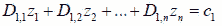 |
| --- |
| 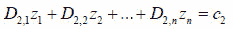 |
| --- |
| 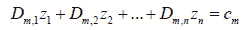 |
| --- |

我们将 `D` 和 `c` 视为常数项，需要求 `z`。

该系统等价于形式为的矩阵方程：

`D * z = c`

其中 `A` 是系数 `m` x `n` 矩阵，`x` 和 `b` 是列向量。该方程对应于：

| 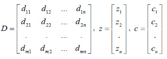 |
| --- |

#### The Number of Solutions

线性方程组 `D z = c` 解的数目可以用三种情况表示。
1\. 无解
2\. 恰好 1 个解
3\. 无穷多个解

这是因为我们处理的是线性系统：两条直线不能相交超过一次。这三种情况在图（**1**）中进行了说明。这里，第一种显示直线平行但不相同（无解），第二种，直线在一点相交（一个解），第三种描绘直线相同（无穷多个解）。

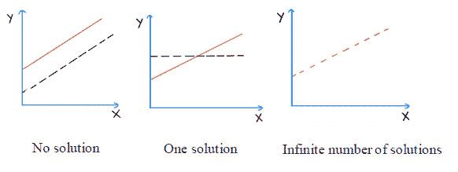**图（1）**  
解的数目。

#### Vectors

在数据科学中，矢量用于数学上和简便地表达对象的属性，这些属性是数值特征。矢量在机器学习和模式识别的众多领域中不可或缺。

矢量在机器学习中经常被使用，因为它们提供了一种简单的数据组织方法。将数据矢量化通常是开发机器学习模型的最早步骤之一。


它们也被频繁用作各种机器学习方法的基础。支持向量机是一个具体的例子。支持向量机检查 `n` 维空间中的向量以确定给定数据集的最优超平面。图（**2**）显示了用蓝色线表示的最优超平面，它将两类实例：正方形和圆形分开。然而，其他线并不是正确的超平面，因为它们无法正确分类对象。深色填充的实例称为支持向量。本质上，支持向量机将寻求识别两类数据集之间距离最大的线。由于间隔更大，未来数据点可以得到更确定的分类。

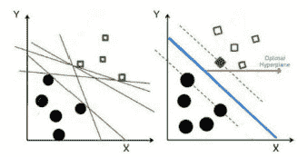**图（2））**  
给定数据集的最优超平面通过蓝线显示。

以下部分将描述线性代数可以应用于数据科学领域的各种方式。

## Linear Algebra
线性代数是机器学习优化的关键组成部分。一些重要应用包括：

### Loss Function
损失函数
损失函数用于计算我们的预测与预期输出的差异程度。
向量范数可以在线性代数中用于创建损失函数。向量的范数可以从向量的大小推导出来。让我们考察 L1 范数：当唯一允许的方向与空间轴平行时，L1 范数被测量为原点与向量之间的距离。如图（**3**）所示，L1 范数是原点 (0,0) 与目标点 (4,5) 之间的距离，类似于一个人穿越街区到达目的地的方式，在本例中为 9。

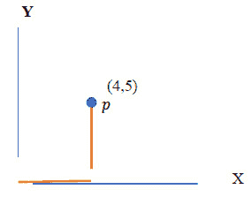**图（3））**  
向量 `p` 的 L1 范数 = `9`。
向量 `p` 的 L1 范数 = (`p1`, `p2`, ..., `pn`)，由下式给出

| 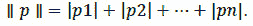 |
| --- |

### Regularization
正则化
在数据科学领域，正则化的概念极其重要。它是一种阻止模型对其数据过拟合的策略。事实上，正则化是范数的另一种应用。
过拟合是在数据科学、机器学习和统计学中，统计模型完全拟合模型所使用的所有训练数据的情况。这样的模型对新数据的表现不佳，因为它学习了训练数据中的一切，甚至包括噪声。它无法泛化从未遇到过的知识。正则化是一种通过在成本函数中加入权重向量的范数来惩罚过于复杂模型的技巧。鉴于我们希望使成本函数尽可能小，我们需要使该范数尽可能小。这会导致权重向量中不必要的分量减小到零，并防止生成过于复杂的预测函数。

### Support Vector Machine Classification
支持向量机分类
支持向量机（`SVM`）是一种算法，它是一种判别分类器，因为它找到决策面，并且是一种监督机器学习算法。
在 `SVM` 中，数据项表示为 `n` 维空间中的点以表示 `n`（特征数）。每个特征的值是某个坐标的值。然后，我们通过定位区分两类最明显的超平面来实现分类，即具有最大间隔的超平面，在本例中为 `C`，如图（**4**）所示，

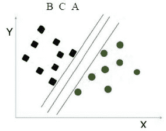**图（4））**  
超平面的间隔对于 `C` 是最大的。
当维度比其相关向量空间少时，则该子空间称为超平面。因此，超平面对于 2D 向量空间是一条直线，对于 3D 向量空间是 2D 平面，对于 4D 向量空间是 3D 平面，依此类推。此外，使用向量范数计算间隔。

## Statistics
统计学

### Probability Theory
概率论
概率论是数学/统计学的一个分支，专注于研究随机事件。处理受偶然影响的数据的数据科学家需要具备这种能力 \[12, 13\]。
鉴于偶然性存在于每种情况中，应用概率论以理解偶然性的运作是必要的。目标是确定特定事件发生的可能性。这通常通过使用 0 到 1 的数值尺度来实现，其中“0”表示不可能，“1”表示绝对确定。

### Normal Distribution
正态分布
以均值（`μ`）和标准差（`σ`）为参数，随机变量“`x`”在概率密度函数如下时呈正态分布：

| 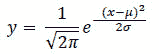 |
| --- |

正态分布，有时也称为钟形曲线，在图（**5**）中用蓝色曲线显示。它关于中间黑线对称，均值、中位数和众数重合，50% 的数据值位于黑线的左侧，50% 位于右侧。

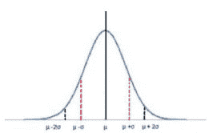**图（5））**  
标准正态分布曲线。
由于所有可能概率的总和为 1，曲线下的总面积为 1。因此，在两个方向上，均值周围的概率以相似的方式移动。这就是为什么均值的正态分布完全相似的原因。
根据数据的分散程度，分布可能会略有变化。如果与均值的差异足够大，当数据的范围和标准差非常高时，正态分布曲线会更平坦 \[6, 14\]。
此外，如果与均值的偏差更大，数据的概率会降低，越接近均值。同样，假设标准差较低，这表明大多数值接近均值。在这种情况下，样本均值接近均值的可能性很大，并且分布会更瘦，如图（**6**）中黑色线所示。而粉色和红色曲线更厚更平，这表明标准差更大。

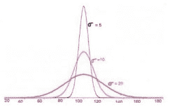**图（6））**  
标准正态曲线随标准差的变化。
*   随机变量落入该区间内的概率由概率密度函数下方的面积给出。
*   正态分布的样本均值表示随机样本是从总体数据中抽取的等大小样本。

样本均值更接近数据的实际均值而不是更远的可能性更大。标准差更大的正态分布比标准差更小的正态分布更平坦。
对于数据科学中的模型开发，满足正态分布的数据是有利的。它简化了数学。根据假设，无论是双变量分布还是正态分布，诸如 `LDA`、`Gaussian Naive Bayes`、`logistic regression`、`linear regression`、*等* 的模型都被明确开发。此外，当数据呈正态分布时，`Sigmoid` 函数与数据自然表现。
世界上许多自然现象，如金融数据和预测数据，表现出对数正态分布。根据一项研究 \[15\]，我们可以通过采用转换技术将数据转换为正态分布。此外，许多过程遵循正态性原则，包括实验中的若干测量错误、经历扩散的粒子的位置、*等*。


在拟合模型之前，因此最好在拟合模型前对每个变量的数据及其潜在分布进行批判性审视。

## Z分数

在许多情况下，我们需要确定数据小于或大于特定值的概率。该值不等于均值的 1 或 2 个标准差。

标准分数或 Z 分数衡量观测值与均值之间以标准差为单位的距离。如果 Z 分数大于零，则表示记录值的标准差高于均值。如果 Z 分数为负，则表示该值低于均值。

观测值为 `µ+zσ`，其中 `µ` 是均值，`σ` 是标准差。

使用 Z 表，可以确定特定 Z 表的概率。无需计算正态曲线下的面积。在 Z 表中，Z 表的行具有十位数的 Z 分数，列具有百分位小数。该值等于曲线下用绿色阴影显示的面积减去 Z 分数。

对于给定的 Z 分数，我们可以查看 Z 表以找到低于该分数的概率值。它可能是负数或正数。例如，如果我们查找 1.47，我们会发现 93% 的数据低于该值。Fig. (`7`)，用绿色描绘了钟形曲线下 `z= μ+2σ` 左侧的面积。

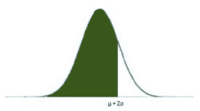`Fig. (7))`
使用 Z 分数计算的正态曲线下面积。

## 中心极限定理

当数据量很大时，可能很难理解它所表示的全部含义。很难把握表面之下正在发生的事情。为了弄清如何解决这个问题，我们调查了可用数据中的一小部分。为了确保结论的准确性，我们会考虑基于多个因素的结果。另一方面，处理如此庞大的数据量是一项极具挑战性的工作。为了处理它，我们确定了 40 到 50 个不同人的数据的平均值。

反复选择大约五十人的样本并计算平均值有助于我们实现目标。定期这样做也有帮助。现在可以开始绘制这些样本的平均值。这些样本均值代表高度对称的频率分布。实际数据的频率在均值附近最大，并且随着我们向任一侧远离它而稳步减少。

概率可以很容易地从频率中推导出来。我们可以通过将一个箱的频率（如 200 到 300）除以观测中数据点的总数来计算每个箱的可能性。因此，概率分布现在复制了频率分布的形状。

当用于确定均值的样本量非常大时，概率分布变得越来越对称。随着样本量接近，概率分布趋于完全对称，总体均值集中在曲线上。所得到的曲线代表正态分布。

## 其他统计方法

在数据科学中广泛使用的其他统计方法如下：

### 偏度

在实时案例研究中，数据偏度是数据科学家经常面临的重要问题之一。在正态分布中，数据是对称分散的。对称分布的偏度为零，因为所有集中趋势度量都居中 (`Mean=Median=Mode`)。

在正偏数据中，均值高于中位数，结果偏向底部，如 Fig. (`8`) 所示。中位数是中间值，众数始终最高。均值大于中位数。

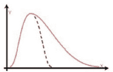`Fig. (8))`
正偏态：`Mean > Median > Mode`。

极度正偏态对于分布目的是不期望的，因为它可能导致误导性结果。数据转换技术有助于规范化偏态数据。正偏态分布的知名转换是对数转换。对数转换建议对数据集中每个值进行自然对数计算。

在负偏数据中，均值小于中位数，如 Fig. (`9`) 所示。负偏分布是指分布的均值、中位数和众数为负而不是正或零的分布。

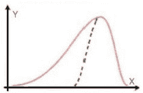`Fig. (9))`
负偏态：`Mode > Median > Mean`。

可以对数据进行多种转换，以便在绘制数据于对称曲线下时保留其信息。尽管这种转换是由数据的特征决定的，但以下过程用于数据转换：

1. 对每个数据点取平方根后重新绘制每个数据点。
2. 对每个数据点取立方根并重新绘制结果。
3. 计算对数后重新绘制每个数据点。
4. 取倒数后重新绘制每个数据点。

### 峰度

分布中异常值的存在程度由峰度衡量。

在统计学和概率论中，超额峰度用于将峰度系数与正态分布进行比较。由于正态分布的峰度为 3，超额峰度是通过从 3 中减去峰度计算得出的。有三种可能性：超额峰度可以为负（Platykurtic）、正（Leptokurtic）或接近零。

较高的峰度值通常表明分布的尾部比正态分布的尾部具有更极端的值。这可能导致长度距离均值六或七个标准差。同样，如果峰度值极低，分布的尾部将比正态分布的尾部更短。

峰度的高值通常被认为风险更大，因为应用于任何机器学习算法的数据往往会产生离均值更远的异常值。Fig. (`10`) 表明峰度的类型，leptokurtic 由于存在许多异常值而具有长尾，platykurtic 由于异常值较少而具有短尾。

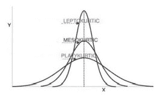`Fig. 10)`
峰度类型：Leptokutic、Mesokurtic 和 Platykurtic。

## 通过机器学习算法在数据科学中统计学的应用

通过机器学习算法在数据科学中统计学的应用将在下面几节中讨论：

### 回归

统计学中称为回归的领域可用于基于现有数据集进行预测。简单线性回归、多元回归、多项式回归、分位数回归、probit 回归和逻辑回归是回归分析的不同形式 [10, 11, 16]。我们可能想看看延长学生的教学时间是否会影响他们的考试成绩，或了解某种生活方式需要多少钱。回归可以帮助回答这些问题。线性回归是通过确定最佳直线来表示因变量和自变量之间的联系，从而预测响应的统计方法。假设你有一个数据集（训练集），描绘了平均温度为 `x` 的日子里冰淇淋的销量 `y`。使用训练数据，回归模型学习权重 `w`，以实现对 `y` 的准确预测。

学习回归线权重的目标是实现尽可能接近完美的准确性。

| 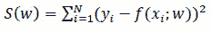 |
| --- |


为了计算 `S(w)` 的导数并找到导数为零的解，可以使用闭式解来最小化 `S(w)`，这本质上是同样的事情。因此，我们将得到使回归线与训练数据之间距离最短的权重。

# 使用主成分分析进行机器学习的降维

主成分分析（`PCA`）是一种用于提取特征的统计技术。`PCA` 用于高度相关且高维的数据。如图 (**11**) 所示，`PCA` 的基本概念是将特征的原始空间转换为主成分空间 [4]。

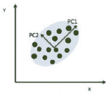**图 (11))**  
`PCA` 算法显示从旧特征空间到新特征空间的转换，从而消除特征相关性。

`PCA` 变换实现以下目的：
1. 通过集中于解释数据集中大部分方差的分量，减少最终模型中使用的特征数量。
2. 消除特征之间的关联。

## PCA 的数学基础

考虑一个具有四个特征和 n 个观测值的高相关特征矩阵，如表 **1** 所示。

表 1 **具有 4 个变量和 n 个观测值的特征矩阵。**  
| 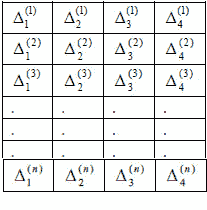 |
| --- |

我们可以创建散点图来可视化特征之间的相关性。我们可以使用以下方程计算协方差矩阵来量化属性之间连接的程度：
| 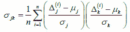 |
| --- |

其中 `µ[j]` 和 `σ[j]` 分别是特征 `∆[4]` 的均值和标准差。

协方差矩阵可以写成 4 x 4 对称矩阵的矩阵形式。
| 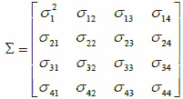 |
| --- |

通过进行酉变换（`PCA` 变换），该矩阵可以对角化以得到以下结果：
| 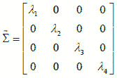 |
| --- |

由于矩阵的迹在酉变换下保持不变，我们观察到对角矩阵特征值的总和等于特征 `∆[1]`、`∆[2]`、`∆[3]` 和 `∆[4]` 的总方差。因此，可以定义以下量：
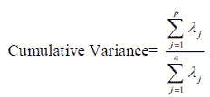

请注意，当 `p = 4` 时，累积方差如预期等于 1。

## 分类

分类是一种用于对数据集进行分类以做出准确预测并进行全面分析的方法 [17]。在使用分类技术时，我们会得到一个已存在的 数据集，并被告知特定实例所属的类别；有了这些信息，随后可以构建预测模型来解决以下问题：确定将添加到数据集中的每个新实例，该特定实例属于哪个类别。

最大熵算法、K 近邻算法和朴素贝叶斯算法都是分类算法的例子 [18]。

与前面描述的回归思想相反，回归涉及学习权重来预测连续值，而最大熵方法，也称为逻辑回归，涉及学习权重来预测分类值。

### K 近邻

当前示例与过去的数据点进行比较，分类决策是基于新案例与之前案例的匹配程度做出的。

### 朴素贝叶斯

贝叶斯定理是朴素贝叶斯算法的基础，这是一种分类过程，其中所有分类特征彼此独立，无论它们的关系如何。贝叶斯定理为朴素贝叶斯算法提供了基础。

我们可以在数据分析中找到朴素贝叶斯算法的精彩示例，使系统运行起来看起来如此简单。

一些分类应用是：识别电子邮件是否被视为垃圾邮件。识别特定照片中描绘的是猫还是狗的过程。按类别组织 YouTube 视频。

## 微积分

对于大多数数据科学家来说，理解微积分原理以及它们如何影响各种模型至关重要。

例如，理解函数的导数给出其变化率，这就解释了为什么当函数图像变平坦时变化率趋近于零。

反过来，这将帮助数据科学家通过找到函数的局部最小值来理解梯度下降的工作原理。此外，它还将证明经典梯度下降仅适用于具有单一最小值的函数。如果存在多个最小值（或鞍点），梯度下降可能会找到局部最小值而无法找到全局最小值，除非使用多个位置作为起点。

在考虑解决数据科学问题的方法时，除了上述讨论的内容之外，还有许多不同的数学子领域也可能有所帮助。

*图论* 可用于解决特定类型的困难。例如，无论是尝试优化运输系统的路线还是开发欺诈检测系统，基于图的方法有时可以优于传统方法。

由于有限数量的“位”可用于表示任何给定数字，随着计算机在数学中的使用变得更加广泛，离散数学领域变得越来越重要。此外，离散数学有许多基本概念可以以两种方式使用：首先，作为限制，其次，作为潜在问题解决方案的灵感来源。

## 优化或运筹学方法

优化或运筹学（O.R.）方法见 [19] 在数据科学的不同领域被广泛使用：数据分析、机器学习、*等*。它被称为更好的科学。在数据科学中，现实生活中的问题被建模为数学形式。OR/优化技术以及数据分析、计算算法和计算机程序被采用以更好地解决这些问题。

优化方法或数学规划旨在通过优化算法找到使目标函数（在非约束优化的情况下）达到最优值的变量值。

数据科学中优化建模工作的阶段如下（遵循 [20]）：
* 定义建模问题，
* 开发数据科学模型，
* 通过一些合适的算法和计算机程序数值计算数据科学模型，
* 分析或应用模型结果对行动或规划的影响。

一些主要技术如下：静态优化、动态优化和随机优化。

数据科学中的静态模型可以是线性、非线性或整数规划模型。线性规划是一种常用的优化模型或数学规划方法，具有线性目标函数，并受线性等式、线性不等式约束和非负约束的限制。

下面给出了一个静态优化模型（线性规划模型）的例子：

`MIN C = c[1] X + c[2] Y + c[3] Z` 目标函数
`(Y, X, Z)`
s.t.
`X = bY` 指的是流量和平衡约束，
`Z ≥ Z*` 是需求约束，
`X ≤ X*` 是容量约束，
`Z = aX` 是流量和平衡约束，
`Y ≤ Y*` 资源约束，
`Y, X, Z ≥ 0` 是非负约束，
`c’s = the costs of nodes,`
`Y, X, Z = the vectors of decision variables.`


## 动态优化模型

以下是一个动态优化模型，其中动态系统在系统约束条件下进行优化，参见 [21]。

|  |
| --- |
| 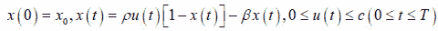 |
| --- |
| 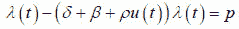 |
| --- |

`T` = 时间，`x(t)` = 状态函数，`u(t)` = 控制函数，`t` 是规划时域。模型的其余参数由其他符号表示。

## 随机优化方法

在随机优化中，随机变量用于构建优化问题并找到解。

`MIN C = c[1]Xs + c[2]Ys + c[3]Zs` 目标函数

(`Ys`,`Xs`,, `Zs`)

受约束于

`Xs = bsYs` 指主要物流和供应链流量及平衡约束，

`Zs * Zs` 为需求约束，

`Xs * Xs` 为容量约束，

`Z = aX` 为流量和平衡约束，

`Ys * Ys` 资源约束，

`Ys, Xs, Zs * 0` 为非负约束。

`cs`’s = 不同情景下节点的成本*，

`Ys, Xs,, Zs` = 不同情景 `s = 1, 2. ….S` 下的决策变量向量。

优化方法/运筹学在数据科学中的应用将在下面几节中讨论：

在实践中，优化提高了系统的有效性。它被广泛应用于众多领域，如数据科学、计算机科学、医院、医学、供应链、金融、政府、物理学、经济学、制造业、交通运输、人工智能、机器学习、*等*。在优化模型中，目标可以是最小化流程、活动或系统的成本。在医院中，目标可能是减少患者在急诊室等待就诊的时间。在营销中，目标可能是通过在资金和运营的约束下瞄准合适的客户来最大化利润。通过设计最优路线，人道主义行动的目标是尽可能到达尽可能多受影响的人，以提供衣物、住所、食物、水和医疗支持。此外，它还充当数据科学算法的基础。它是数据科学中使用的绝大多数机器学习和统计方法的基础 [22, 23, 24]。

它有助于找到问题的最小误差或最优解。例如，在回归中，误差计算如下：

| 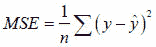 |
| --- |

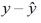 是实际值与预测值之间的差异。

优化有助于确定机器学习算法的最小损失函数值。

再考虑另一个例子：

如果我们想在 `y` 和 `x` 之间拟合一个函数，并且我们有 `y` 和 `x` 的数据，我们可以断言 `y` 等于 `a[1]` 加上 `a[2]` 乘以 `x`。我们有许多不同的 `x` 和 `y` 样本，用符号 (`x[1]`,`y[1]`)、(`x[2]`,`y[2]`) 等表示。这可以推广如下：`yn=a[1]+a[2]*x[n]`。很明显，有 `n` 个方程，但只有 2 个变量可供使用。所有这些方程都能求解的可能性极小。以下是我们如何定义误差函数：`e=y[1]-a[1]-a[2]*x[1]`

一般来说，`e[n]=y[n]-a[1]-a[2]*x[n]`

如果选择变量的可能取值没有限制，则优化问题是无约束的。这是一种常见的线性回归问题。它通常被称为函数逼近问题，并在数据科学中经常使用。

### 其他一些方法

博弈论、集合论和混沌理论是数据科学理论和应用中使用的一些常见数学方法。

### 计算机程序

有很多计算机程序可以数值实现上述讨论的数学方法。然而，数据科学中一些流行的计算机程序如下：`PYTHON`, `JAVA`, `R`, `C`, `GAMBIT`, `GAMUT`, `NECTAR`, `EXCEL`, `GAMS`, `MATLAB`, `MATHEMATICA`, `MINOS`, `SAS`, `STATA`。

## 结论性说明

前述对数学和统计的功能及影响的分析使我们得出以下结论：数学和统计在数据科学领域的作用极其重要。这是因为它们揭示的思想和它们所提供的工具。

具体来说，对于数据科学领域，使用数学技术、计算算法和统计推理将极大地帮助获得在科学上充分的结果，以及基于适当程序的在科学上充分的结果。最终，在数据科学中获得良好解决方案的唯一途径是确保数学与统计之间的和谐互动。

## 参考文献

|  ||  |
| --- | --- |
| \[1\] || Peyré G., Cuturi M.. Computational optimal transport: With applications to data science.Foundations and Trend. Mach. Learn.115-6355607201910.1561/2200000073 |
| \[2\] || M.P. Deisenroth, A.A. Faisal, and C.S. Ong, "Mathematics for Machine Learning". Cambridge University Press, 2020, pp. 1-398.. 10.1017/9781108679930 |
| \[3\] || G. James, D. Witten, T. Hastie, and R. Tibshirani, "An Introduction to Statistical Learning Application in R. 2^(nd)". Springer: New York, NY, 2021, pp. 1-607.. 10.1007/978-1-0716-1418-1 |
| \[4\] || Hou J. R., Nerur S., Zhang J. J.. Applying data science on structureal equations modelling(SEM): An exploratory study.Ess. vis. eff. onl. hum. deci.mak. data. sci. appl.1141272019 |
| \[5\] || Graham R.L., Knuth D.E., Patashnik O., Liu S.. Concrete mathematics: A foundation for computer science.Comput. Phys.35106107198910.1063/1.4822863 |
| \[6\] || T. Hastie, R. Tibshirani, and J. Friedman, "The Elements of Statistical Learning. 2^(nd)". Springer, 2011.. |
| \[7\] || Wolf M.M., Berry J.W., Stark D.T.. A task-based linear algebra building blocks approach for scalable graph analytics.IEEE High Perform. Ext.Comp. Conf. (HPEC), 15-17 September 2015 , Waltham, MA, USA. 16201510.1109/HPEC.2015.7322450 |
| \[8\] || Peyré G., Cuturi M.. Computational optimal transport: With applications to data science.Found.Tren.272201910.1561/2200000073 |
| \[9\] || Udell M., Townsend A.. Why are big data matrices approximately low rank?SIAM J. Math. Data. Sci.11144160201910.1137/18M1183480 |
| \[10\] || Brijder R., Gyssens M., Van den Bussche J.. On matrices and K-relations.Int. Symp. Found. Inform. Knowl. Syst.4257SpringerCham2020 |
| \[11\] || Joshi J., Saxena S.. Regression analysis in data science.J. Appl. Anal. Comput1462020 |
| \[12\] || R.V. Hogg, E.A. Tanis, and D.L. Zimmerman, "Probability and statistical inference". vol. 993. Macmillan: New York, 1977.. |
| \[13\] || D. Koller, and N. Friedman, "Probabilistic graphical models: Principles and techniques". MIT press: Cambridge, 2009.. |
| \[14\] || A. Field, J. Miles, and Z. Field, "Discovering statistics using r sage publications", 2012.. |
| \[15\] || Olhede S.C., Wolfe P.J.. The future of statistics and data science.Stat. Probab. Lett.1364650201810.1016/j.spl.2018.02.042 |
| \[16\] || Koenker R.. Quantile regression.Econom. Soc. Monog.38262010 |
| \[17\] || Jajuga K., Sokolowski A., Bock H.H.. Classification, clustering, and data analysis: Recent advances and applications.Rec. Adv. Appl.SpringerBerlin, Heidelberg15082012 |
| \[18\] || S. Boyd, and L. Vandenberghe, "Introduction to applied linear algebra: Vectors, matrices, and least squares". Cambridge university press: Los Angeles, 2018, pp. 1-474.. 10.1017/9781108583664 |
| \[19\] || B.D. Craven, and S.M. Islam, "Optimization in economics and finance: some advances in non-linear, dynamic, multi-criteria and stochastic models". vol. 7. Springer Science & Business Media, 2005.. |
| \[20\] || H.A. Taha, "Operations research: an introduction". 8^(th) Edition, Asoke K. Ghosh, Prentice Hall of India, Delhi, 1992.. |


| \[21\] || B.D. Craven, and S.M. Islam, "运筹学方法：相关生产、分销和库存管理应用". ICFAI University Press, 2006.. |
| \[22\] || Craven B.D., Islam S.M., Huang X.X.. 资本预算的运筹学模型：一些新方法与模型.Adv. Quanti. Anal. Fin. Accoun.122152282014 |
| \[23\] || Rojas F., Wanke P., Leiva V., Huerta M., Martin-Barreiro C.. 库存成本节约和供应链成功因素建模：一种混合稳健折中多准则方法.Mathematics10162911202210.3390/math10162911 |
| \[24\] || Amodio P., De Giosa M., Iavernaro F., La Scala R., Labianca A., Lazzo M., Mazzia F., Pisani L.. 铁路线附近异常检测：一个案例研究.J. of Comput. Math. and Data Sci.1000522022 |

# 卡尔曼滤波：数据建模与预测

**Arnob Sarkar^(1)****,** **Meetu Luthra^(2, \*)**  
¹ 国家大气研究实验室，空间部，安得拉邦，印度政府  
² 物理系，巴斯卡拉查里亚应用科学学院，德里大学，德里，印度  

## 摘要

这里我们对卡尔曼滤波进行了分析，卡尔曼滤波在实验和观测领域有广泛应用。卡尔曼滤波是一种数据融合算法或基于估计理论的数学工具。它本质上是一组数学方程，为评估具有噪声数据的离散过程的状态提供了一种计算机制。事实上，观测和数据分析是所有理论的非常关键的方面。在任何一组数据中，要使其有用，必须通过考虑各种方面来最小化误差/噪声，如估计值（理论值）、测量值、实验误差和估计误差。我们在此展示了如何使用卡尔曼滤波技术来完成此操作。卡尔曼滤波是一种工具，可以获取观测数据并改进它，以识别所涉及参数的最佳可能值。卡尔曼滤波及其变体如扩展卡尔曼滤波在通信领域有广泛应用，主要例如在 GPS 接收机（全球定位系统接收机）、用于从笔记本电脑触控板输出中滤波和去除噪声的无线电设备、图像处理、人脸识别等。

**关键词：** 加速度，大数据，数据科学，扩展卡尔曼滤波，GPS，卡尔曼滤波，数学建模，噪声，信号，速度，不确定性。  

* * *

^(\*) **通讯作者 Meetu Luthra：**物理系，巴斯卡拉查里亚应用科学学院，德里大学，德里，印度；电子邮件：meetu.luthra@bcas.du.ac.in  

## 引言

### 为什么使用卡尔曼滤波？

当我们有一组大型数据时，高效的参数估计仍然是最重要的任务之一 \[1\]。有许多方法可以实现数据估计或预测算法以获得适当的结果。出现噪声存在于信号中的情况。这些噪声是不需要的信号，负责产生不正确和不期望的输出 \[2\]。

有各种方法可以去除噪声并获得适当的结果。这些包括：线性曲线拟合、二次曲线拟合和其他次数的曲线拟合。

线性曲线拟合，完全依赖于最小二乘曲线拟合，对于少量数据点是最佳的。但随着连续的噪声数据输入和未定义的总数据点数量，需要一种合适的算法，其中在每个连续时间间隔输入包含噪声，并估计或预测合适的路径。此任务可由最优滤波器完成。

有各种最优滤波器来实现此目的并获得适当的预测结果。其中一种滤波器是卡尔曼滤波器。使用卡尔曼滤波器，可以抵消具有未知总数据点数量的不需要的信号或数据输入，并对所需变量进行预测。卡尔曼滤波器并不是唯一可以做到这一点的滤波器。其他滤波器如 *扩展卡尔曼滤波器*、*无迹卡尔曼滤波器* 和 *粒子滤波器* 也执行相同的任务，但效率更高且更实用。虽然这些滤波器更好，但计算成本通常高于卡尔曼滤波器的计算成本。

卡尔曼滤波器最初由 Rudolf E. Kalman 在 1960 年的论文中开发，他打算将状态空间方法应用于较早已知的 Wein's Filter \[3\]。

## 理解卡尔曼滤波

### 什么是卡尔曼滤波？

卡尔曼滤波是一种机制，通过一组方程和连续的数据值，可以通过 *迭代过程* 估计数量的真实值（*例如*，物体的速度、位置等）。所测量的值包含某种或另一种不可预测的或 *随机的* 误差，并且数据中还存在固有的不确定性或变化。

卡尔曼滤波是一个 *两步* 过程，由滤波器和光滑器组成。它从第一步开始，对下一步所需的变量进行预测。*状态方程* 和 *误差矩阵* 得到更新。此过程称为滤波。在滤波过程之后，估计值没有任何关于先前估计值的信息。一旦感兴趣的变量被滤波，它随后会被平滑。

### 状态空间方法

存在依赖于时间并且可能随时间改变行为的系统。这种系统被称为 *动态系统*¹。其中一种动态系统是线性动态系统，其中系统随时间线性变化。

预测系统在给定时间后的行为非常重要。这可以通过多种方式实现，其中一种已在下面讨论：

对于线性动态系统²，使用状态空间方法。对于这种状态空间方法，应该有一个特定问题的有限维表示 \[4\]。

设 `x` 为具有 `N` x1 维的状态向量。此状态向量 `x` 的变化等于常数矩阵 `φ` 乘以状态向量 (`x`) 本身。变化可采用两种形式：

a) **Flow**: 系统随时间 (`t`) 连续变化

| 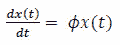 || (1) |
| --- | --- |

b) **Discrete**: 系统在离散间隔（..., `m` − 1, `m`, `m` + 1,）处改变其状态。

| 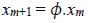 || (2) |
| --- | --- |

这里，`m` 是一个整数，表示时间步 `t[m]`。

#### 均方误差

以下各节建立了卡尔曼滤波方程的基础。³

描述线性动态系统的一般方法是：

| 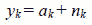 || (3) |
| --- | --- |

`y[k]` 是随时间变化的观测变量，
`a[k]` 是增益项
`x[k]` 是承载信息的变量
`n[k]` 是加性噪声

主要任务是估计 `x[k]`。定义一个新术语称为 *误差*，表示为：

`f(e[k])`，它解释了 `x[k]` 的估计值 *即* `x*[k]` 与 `x[k]` 本身之间的差异。

| 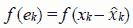 || (4) |
| --- | --- |

`f(e[k])` 的形状很大程度上取决于特定的应用。但大多数情况下，该函数应为正且单调递增 \[5\]。表现出这种行为的函数被称为平方误差函数。

| 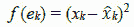 || (5) |
| --- | --- |


由于我们需要滤波器在一段时间内预测海量数据的程度，因此有必要定义误差函数的期望值：

| 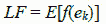 || (6) |
| --- | --- |

其中，

`LF`: 损失函数

`E` [`f` (`e[k]`)] : 期望误差

均方误差 (`MSE`) 函数中的结果定义为：

| 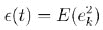 || (7) |
| --- | --- |

`x[k]` 的估计以最小化损失函数 `LF` 的方式进行。

### 卡尔曼滤波器方程

我们首先写下所考虑的任何过程的状态方程：

| 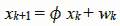 || (8) |
| --- | --- |

其中，

`x[k:]` 是表示过程在时间 k 的状态向量，其维度为 (`nx1`)。

`phi`: 是从状态 k 到连续状态 `k+1` 的过程状态转移矩阵。

该状态假定相对于时间是平稳的，其维度为 (`nxm`)。

`w[k]`: 是与过程相关的白噪声，其协方差值已知。

该变量的观测值可以用以下方程建模：

| 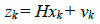 || (9) |
| --- | --- |

`z[k]`: 是时间 k 时 x 的实际测量值，其维度为 (`mx1`)。

`H`: 是状态与无噪声测量向量之间的联系，相对于时间平稳，其维度为 (`mxn`)。

`v[k]`: 是与过程相关的测量误差，我们将其视为与过程噪声无交叉相关的白噪声。其维度为 (`mx1`)。

两个噪声模型的协方差假定相对于时间平稳，给出如下：

| 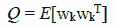 || (10) |
| --- | --- |

| 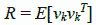 || (11) |
| --- | --- |

均方误差 (`MSE`) 函数由下式给出：

| 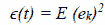 || (12) |
| --- | --- |

这等价于：

| 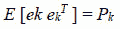 || (13) |
| --- | --- |

`P[k]` : 时间 k 处的误差协方差矩阵⁴。

(2.13) 的展开式为：

| 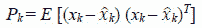 || (14) |
| --- | --- |

设 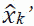 为 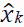 的先验估计，可通过已知所考虑的系统而得。我们可以将旧估计与测量数据结合起来，写出新估计的更新方程。因此，

| 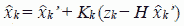 || (15) |
| --- | --- |

`K[k]` : 为卡尔曼增益。

`z[k]` – `H` `x^[k]`: 称为创新或测量残差。

对于当前估计，由方程 (15) 可得：

| 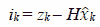 || (16) |
| --- | --- |

将方程 (9) 代入方程 (15)，我们得到：

| 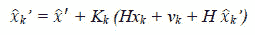 || (17) |
| --- | --- |

将方程 (2.29) 代入方程 (2.14)，我们得到：

| 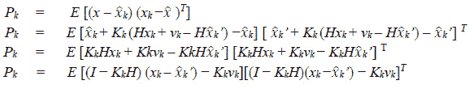 || (18) |
| --- | --- |

先验估计的误差为 (`x^*[k]` – `x^*[k]‘*`)，它显然与测量噪声不相关，因此期望可以写为：

| 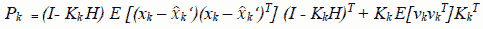 || (19) |
| --- | --- |

将方程 (2.11) 和方程 (2.14) 代入方程 (2.19)：

| 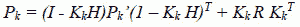 || (20) |
| --- | --- |

这里，`P[k]`^’ 是 `P[k]` 的先验估计。

方程 (2.20) 是误差协方差更新方程。均方误差包含在此协方差的对角线中，如下所示：

| 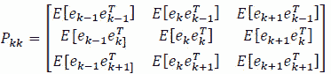 || (21) |
| --- | --- |

矩阵的迹定义为其对角线元素的和。因此，上矩阵 `P[kk]` 的迹必须最小化，才能使均方误差最小。

我们首先对矩阵 `P[kk]` 的迹关于 `K[k]` 求导，然后将输出设为零以得到极小值。展开 (2.20) 得：

|  || (22) |
| --- | --- |

由于矩阵的迹等于其转置的迹，因此：

|  || (23) |
| --- | --- |

其中 `T[M]` 表示矩阵 M 的迹。

由于 `P[k]’` = (`P[k] ‘) ^T`，为对称矩阵，且

(`K[k]HP[k]’`) ^T = `P[k]’ ^T H^T K[k]^T` = `P*[k]’H^T K[k]^T`

因此，

|  || (24) |
| --- | --- |

对 `K[k]` 求导

|  || (25) |
| --- | --- |

为极小值，设其为零并重新排列项，得：

|  || (26) |
| --- | --- |

求解 `K[k]`：

|  || (27) |
| --- | --- |

这是卡尔曼增益的方程。

与之相关的测量预测协方差由下式给出：

|  || (28) |
| --- | --- |

将方程 (27) 代入方程 (22)，我们得到：

|  |
| --- |

因此，我们有：

|  || (29) |
| --- | --- |

因此，我们得到具有最优增益的误差协方差矩阵方程。

方程 (15)、方程 (27) 和方程 (29) 共同给出状态变量 `x[k]` 的估计。

下式给出状态预测：

|  || (30) |
| --- | --- |

我们需要一个方程将误差协方差矩阵投影到下一个时间间隔 `k+1`，以完成递归。为此，我们首先写出先验估计的表达式，

|  || (31) |
| --- | --- |

现在我们将方程 (2.14) 扩展到时间 `k + 1`：

|  || (32) |
| --- | --- |

由于噪声 `w[k]` 存在于 k 与 k+1 之间，`e[k]` 与 `w[k]` 的互相关为零，而误差 `e[k]` 对应于时间 k 的误差。

因此，

|  |
| --- |

这完成了递归滤波器。

总结卡尔曼滤波器过程的主要方程

**状态** 方程：

|  || (33) |
| --- | --- |

|  || (34) |
| --- | --- |

|  || (35) |
| --- | --- |

测量输入方程：

|  || (36) |
| --- | --- |

卡尔曼增益方程：

|  || (37) |
| --- | --- |

状态矩阵更新方程：

|  || (38) |
| --- | --- |

过程协方差矩阵更新方程：

|  || (39) |
| --- | --- |

从上述方程可知，矩阵 `H` 和 `C` 用于将另一个矩阵转换为合适的维度。矩阵 `I` 表示单位矩阵。

### 卡尔曼滤波器的一般应用

卡尔曼滤波器有许多应用。以下列出其中一些：

1. 全球定位系统 (G.P.S.) 接收机。
2. 使用合适的雷达跟踪飞机。
3. 区域天气预报。
4. 先进驾驶辅助系统 (A.D.A.S.)。
5. 虚拟现实，用于预测性步骤。
6. 计算机图像处理。

### 一维卡尔曼滤波器方程

为了清晰地理解卡尔曼滤波器，我们在一维情况下对其进行了分析。之前考虑的方程是针对 N 维情况的推广。当维度减少到仅一维时，方程会略有调整。

方程中使用的缩写如下：

`K`: 卡尔曼增益。

`EST[k]`: 当前估计值。

`EST[k][-1]`: 前一次估计值。

`E[EST]`: 估计值误差。

`MEA`: 时间 `k` 的测量输入值。

`E[MEA]`: 时间 `k` 的测量输入值误差。

使用这些，一维情况下的方程如下所示：

卡尔曼增益方程：

|  || (40) |


### 估计更新方程

|||(41)|

### 估计更新方程中的误差

|||(42)|

方程 **(40)** 确定了卡尔曼增益 (`K`)，它取决于 `E[EST]` 和 `E[MEA]`。`K` 的值限制在 0 到 1 之间。这可以通过考虑以下两种情况来证明：

1. `E[EST]``E[MEA]` 则 **(40)** 近似为 `K` ≈ 1。
2. `E[EST]``E[MEA]` 则 **(40)** 近似为 `K` ≈ 0。

方程 **(41)** 更新估计值。以下两种情况说明了两种理想情况。

1. `E[EST]``E[MEA]` 且 `K` ≈ 1，则新的估计值 (`EST[k]`) 与前一个值 (`EST[k]`[−1]) 相比变化更大。
2. `E[EST]``E[MEA]` 且 `K` ≈ 0，则新的估计值 (`EST[k]`) 与前一个值 (`EST[k]`[−1]) 相比变化不大。

方程 **(42)** 更新估计值中的误差。以下两种情况说明了两种理想情况。

1. `E[EST]``E[MEA]` 且 `K` ≈ 1，则估计值误差 `E[ESTk]` 几乎保持不变。
2. `E[EST]``E[MEA]` 且 `K` ≈ 0，则估计值误差 `E[ESTk]` 减小，使估计更准确。

卡尔曼滤波过程的基本算法如图 (**1**) 所示。

**图 (1))**  
一维算法。

我们在此给出一些非常简单的例子，以帮助读者了解卡尔曼滤波器的使用。

## 示例 1：寻找温度的真实值

考虑一个温度没有剧烈变化的房间。主要目的是使用温度传感器找出实际或 *真实* 值，*即* 72^◦*C*。每秒记录一次温度。直到观测次数达到较大值。

设矩阵 `M` 表示测量值，其中 `M` = \[75, 71, 72, 75, 68, 73, 69*, ....*\] 单位为^◦*C*（摄氏度），测量误差 `E[MEA]` = 2^◦*C*。所考虑的初始值为：

初始估计 `EST[o]` = 68^◦*C*

估计的初始误差 `E[ESTo]` = 2^◦*C*

### 第一次迭代

||

### 第二次迭代

||

继续进行迭代，最终估计值 (`EST[k]`) 会达到真实值。数据点越多，最终结果（最终估计）就越准确。

## 示例 2：寻找重力加速度的真实值

卡尔曼滤波可用于找出可测量量的真实值。物理系统中使用了许多常数，如 *重力加速度*、*普朗克常数*、*玻尔兹曼常数*、*等*。但要找出它们的精确值或真实值，不应仅限于一两次实验结果，因为这可能不准确。为克服这一问题，会进行大量观测（最好使用多种类型的仪器测量单一参数）。在本例中，记录了单摆的 *周期* 的各种观测值。然后利用这些观测值找出单摆（有限长度）的周期的真实值，从而求出重力加速度的值。该真实值是使用卡尔曼滤波技术求得的。

重力加速度 (`g`) 的值由此使用公式计算：

|||(43)|

`T`：使用卡尔曼滤波求得的周期的真实值（单位为秒）。

`l`：单摆的长度（单位为米）。

`N`：观测总数。

所用参数的值为：`l` = 1.04m，`N`= 126

周期实验值在下表 **1** 中给出：

表 1 **周期实验值（秒）。**  

| 2.021 || 2.041 || 2.036 || 2.024 || 2.054 || 2.044 || 2.051 |
| --- | --- | --- | --- | --- | --- | --- |
| 2.043 || 2.043 || 2.047 || 2.04 || 2.045 || 2.053 || 2.042 |
| --- | --- | --- | --- | --- | --- | --- |
| 2.035 || 2.025 || 2.058 || 2.047 || 2.046 || 2.042 || 2.04 |
| 2.057 || 2.037 || 2.041 || 2.033 || 2.057 || 2.061 || 2.065 |
| 2.05 || 2.038 || 2.042 || 2.036 || 2.038 || 2.04 || 2.048 |
| 2.045 || 2.036 || 2.044 || 2.047 || 2.042 || 2.051 || 2.04 |
| 2.047 || 2.043 || 2.035 || 2.058 || 2.064 || 2.042 ||  |
| 2.044 || 2.045 || 2.052 || 2.041 || 2.036 || 2.023 ||  |
| 2.056 || 2.064 || 2.044 || 2.042 || 2.043 || 2.034 ||  |
| 2.042 || 2.042 || 2.046 || 2.053 || 2.025 || 2.052 ||  |
| 2.041 || 2.043 || 2.03 || 2.044 || 2.047 || 2.04 ||  |
| 2.02 || 2.054 || 2.041 || 2.035 || 2.041 || 2.044 ||  |
| 2.044 || 2.057 || 2.043 || 2.036 || 2.032 || 2.066 ||  |
| 2.035 || 2.036 || 2.025 || 2.047 || 2.053 || 2.038 ||  |
| 2.048 || 2.045 || 2.037 || 2.048 || 2.044 || 2.043 ||  |
| 2.037 || 2.042 || 2.038 || 2.061 || 2.045 || 2.055 ||  |
| 2.052 || 2.024 || 2.036 || 2.042 || 2.056 || 2.037 ||  |
| 2.044 || 2.04 || 2.043 || 2.061 || 2.037 || 2.04 ||  |
| 2.046 || 2.047 || 2.045 || 2.042 || 2.048 || 2.029 ||  |
| 2.03 || 2.033 || 2.042 || 2.043 || 2.055 || 2.04 ||  |

图 (**2**) 中的图显示了实验得到的数据点。X 轴显示样本空间，Y 轴表示单摆的 **周期**（秒）。

**图 (2))**  
实验观测。

下面的程序使用基本的 MATLAB 命令。

||

图 (**3**) 显示输出屏幕。

卡尔曼滤波过程后 **周期** 的估计值为 2.0432 *秒*。使用方程 (3.1)，地球的 **重力加速度** (`g`) 的值被计算出来，等于 9.8248 *ms*^(−2)

图 (**4**) 显示了 *估计值*（实线）的图，最终收敛到特定的真实值。尽管结果可能因空气阻力、可伸长弦、带质量的弦等外部因素而不准确。但这些因素已被忽略。散点显示实验数据值，而实线显示估计值。

**图 (3))**  
输出屏幕。 **图 (4))**  
带卡尔曼滤波估计值的实验观测。

## 示例 3：验证哈勃定律

哈勃定律由哈勃于 1929 年在其文章（PNAS）中提出。它是星系退行速度与其距离之间观测到的关系。该定律是观测宇宙学的一个里程碑，观测宇宙学研究的是据认为近 140-180 亿年的浩瀚宇宙 [6]。

如果没有适当的分析和评估以使其与理论模型相符的观测，宇宙的研究将完全不完整 [7, 8]。

设 `V[r]` 为 **退行速度**，单位为 *kms*^(−1)，`D` 为从观测者（本例中为地球）出发的 **距离**，单位为百万秒差距 *Mpc*。哈勃定律指出：

|||(44)|

其中，`H[o]` 称为 **哈勃常数**，它表示由时空本身的伸展引起的宇宙膨胀的恒定速率。哈勃定律现已在局部宇宙中得到很好的确立（`V[r]` < 30,000*kms*^(−1)）[9]。


# 星系数据与卡尔曼滤波分析

来自 24 个不同星系的数据获得⁵并列于表 2 中。距离 `D` 使用 Tully-Fisher 关系测量。退行速度 `V[r]` 使用红移方法测量。⁶

## 表 2 星系数据

| 星系 | `D` (`Mpc`) | `V[r]` (`kmps`) | `D` 的误差 | `V[r]` 的误差 |
|---|---|---|---|---|
| NGC 7814 | 12 | 1050 | 2.881 | 4 |
| NGC 0157 | 16.226 | 1652 | 5.014 | 5 |
| NGC 0578 | 18.282 | 1628 | 4.774 | 3 |
| NGC 0063 | 18.6 | 1160 | 0.164 | 3 |
| NGC 0289 | 19.162 | 1629 | 3.627 | 2 |
| NGC 0150 | 19.291 | 1584 | 4.242 | 4 |
| NGC 0584 | 20.4 | 1802 | 4.463 | 3 |
| NGC 0596 | 21.452 | 1876 | 4.385 | 11 |
| NGC 0514 | 25.669 | 2472 | 3.975 | 1 |
| NGC 0524 | 26.43 | 2403 | 4.171 | 5 |
| NGC 0448 | 27.12 | 1908 | 7.246 | 5 |
| NGC 0274 | 27.525 | 1750 | 12.522 | 10 |
| VV 730 | 33.3 | 2700 | 10.203 | 2 |
| NGC 0470 | 34.726 | 2374 | 6.828 | 3 |
| NGC 0632 | 38.525 | 3168 | 5.843 | 6 |
| NGC 0048 | 41.967 | 1776 | 17.431 | 8 |
| MCG -01-02-001 | 44.5 | 3709 | 9.173 | 4 |
| UGC 12914 | 50.8 | 4371 | 11.02 | 8 |
| UGC 00139 | 55.605 | 3963 | 7.843 | 4 |
| NGC 0536 | 60.69 | 5189 | 10.593 | 5 |
| NGC 0523 | 62.725 | 4758 | 8.049 | 4 |
| NGC 0452 | 62.946 | 4962 | 4.613 | 5 |
| UGC 01087 | 63.275 | 4485 | 8.578 | 1 |
| NGC 0494 | 65.187 | 5462 | 6.595 | 10 |

测量值的图示见图 (5)。

 图 (5)

测量值。

X 轴表示距离 (`D`)，单位为 *Mpc*，Y 轴表示径向速度 (`V[r]`)，单位为 *kms*^(−1)。

⁵数据收集自：[`ned.ipac.caltech.edu/level5/NED1D/ned1d.html`](https://ned.ipac.caltech.edu/level5/NED1D/ned1d.html)

⁶参见附录了解更多。

## 卡尔曼滤波过程

卡尔曼滤波过程根据方程 (34)、(35)、(36) 按照以下考虑进行：

### 1. 状态矩阵的获取
`D` 定义了星系距离地球的距离，单位为 *Mpc*，`V[r]` 表示径向速度，单位为 *kms*^(−1)。

|  | (45) |
|---|---|
|  | (46) |
|---|---|

### 2. 状态方程的获取
`H[o]` 表示哈勃常数⁶的值，等于 73 *kms*^(−1)*Mpc*^(−1)。

|  | (47) |
|---|---|
|  | (48) |
|---|---|

[7]哈勃常数值来源于 [`ned.ipac.caltech.edu/`](https://ned.ipac.caltech.edu/)

### 3. 使用从数据获得的测量值

|  | (49) |
|---|---|

其中，`V[rm]` 表示径向速度测量值，`D[m]` 表示距离测量值。

使用方程 (37)、(38) 和 (39)，进行卡尔曼滤波以估计距离 `D` 和径向速度 `V[r]` 的值。矩阵 `H`、`C` 和 `I` 均为 2x2 单位矩阵。

下面的代码片段使用简单的 MATLAB 命令计算估计状态。

```
clc ;
clear ;
format long ;
set (0, ' defaulttextinterpreter ','Latex ');
S =\[ Inf, Inf \];
% Initial Estimated State Matrix
v = 100;
d = 1;
X = \[v;d\];
disp (X);
Ho = 73;
A = \[0 Ho ;0 1\];
disp (A);
H = eye (2, 2);
C = eye (2, 2);
I = eye (2, 2);
% Initial Estimated Process Covariance matrix
dv2 = 5;
dd2 = 0.25;
dvd = dv2 \*dd2;
ddv = dd2 \*dv2;
P = \[dv2 dvd ;ddv dd2 \];
% Measurement Values
file\_vm = fopen ('velocity . txt ', 'r');
file\_dm = fopen ('distance . txt ','r');
file\_vm\_err = fopen (' velocity\_error . txt ', 'r');
file\_dm\_err = fopen (' distance\_error . txt ','r');
format\_vm = '%d';
format\_dm = '%f';
format\_vm\_err = '%d';
format\_dm\_err = '%f';
size\_vm = \[1, Inf \];
size\_dm = \[1, Inf \];
size\_vm\_err = \[1, Inf \];
size\_dm\_err = \[1, Inf \];
vm = fscanf (file\_vm, format\_vm, size\_vm);
dm = fscanf (file\_dm, format\_dm, size\_dm);
vm = vm ';
v = 100;
d = 1;
X = \[v;d\];
disp (X);
Ho = 73;
A = \[0 Ho ;0 1\];
disp (A);
H = eye (2, 2);
C = eye (2, 2);
I = eye (2, 2);
% Initial Estimated Process Covariance matrix
dv2 = 5;
dd2 = 0.25;
dvd = dv2 \*dd2;
ddv = dd2 \*dv2;
P = \[dv2 dvd ;ddv dd2 \];
% Measurement Values
file\_vm = fopen ('velocity . txt ', 'r');
file\_dm = fopen ('distance . txt ','r');
file\_vm\_err = fopen (' velocity\_error . txt ', 'r');
file\_dm\_err = fopen (' distance\_error . txt ','r');
format\_vm = '%d';
format\_dm = '%f';
format\_vm\_err = '%d';
format\_dm\_err = '%f';
size\_vm = \[1, Inf \];
size\_dm = \[1, Inf \];
size\_vm\_err = \[1, Inf \];
size\_dm\_err = \[1, Inf \];
vm = fscanf (file\_vm, format\_vm, size\_vm);
dm = fscanf (file\_dm, format\_dm, size\_dm);
vm = vm ';
```

图 (6) 显示了使用卡尔曼滤波计算得到的径向速度 (`V[r]`)（单位为 *kms*^(−1)）与距离 (`D`)（单位为 *Mpc*）之间的关系图。

 图 (6)

卡尔曼滤波图。

从图中得到的斜率等于哈勃常数，计算结果为：72.3 *kms*^(−1)*Mpc*^(−1)。

根据宇宙的 Milne 模型 [10]，哈勃常数 (`H[o]`^(−1)) 的倒数给出宇宙年龄（以秒为单位），等于：

|  | (50) |
|---|---|

约等于 135.3 亿年。

## 卡尔曼滤波的局限性

虽然高效且具有诸多优点，卡尔曼滤波技术仍存在一些局限性：

1. 卡尔曼滤波只能用于线性系统。虽然它比其他曲线拟合方法更快，但与某些其他滤波器相比仍可能更慢。
2. 在一维情况下，如果所有测量值均低于或高于真实值，则使用卡尔曼滤波技术永远无法获得真实值。

## 其他滤波器

存在各种其他滤波器，它们更快、更高效，并且能够滤除非线性系统，但可能需要较高的计算成本。这些包括：

1. 扩展卡尔曼滤波器
2. 无迹卡尔曼滤波器
3. 粒子滤波器

## 未来展望

1. 卡尔曼滤波可用于大气缪子中微子的轨迹重建。

如图 (7) 所示，印度基于中微子观测站 (INO) 的铁量能器用于研究涉及大气缪子中微子和反中微子的相互作用。探测器测量动量和方向以追踪缪子。探测器需要轨迹重建。使用卡尔曼滤波，轨迹估计很容易完成 [11]。

 图 (7)

INO 铁量能器位于 VECC。

2. 使用卡尔曼滤波在 GLAST 中重建电子轨迹 - 卡尔曼滤波可用于估计航天器的路径。
3. 根据非线性应用修改卡尔曼滤波。大量实际应用涉及非线性动力学。在这种情况下，卡尔曼滤波无法对变量进行适当的估计。因此，对卡尔曼滤波方法进行修改，使其对非线性系统也适用。

## 结论性评论- 卡尔曼滤波概览

我们已在两种情况下使用卡尔曼滤波：

1. 分析大量简单摆周期观测数据，找出其周期的真实值，并利用该结果计算地球上重力加速度的实际值。


### 估计径向速度与其对应的径向距离并验证哈勃定律，通过考虑测量值和理论值，使用多个观测来获取各种星系的径向速度和径向距离（表2）。

从 `Kalman Filter` 方法得出的主要结论是：
* `Kalman Filter` 与输入的总数量无关。这意味着不必提及输入的总数量。由于这一优势，可以实现对感兴趣变量的动态输入。
* 随着数据点数量的增加，估计值也会得到改善。
* 与其他曲线拟合方法（如 `Linear Fitting`）相比，`Kalman filter` 更高效、速度更快。
* 与其他可能在计算效率和速度方面更有用的滤波器相比，使用该方法涉及的计算成本非常低。但它们巨大的计算成本使其不太受欢迎。

## 附录 – 基本概念

### A.1. 线性动态系统
线性动态系统是具有 *线性* 评估函数的动态系统。由方程 (2.1) 可知：
|  || (A.1) |
| --- | --- |
设 `a(t)` 和 `b(t)` 为上述方程的两个不同解。对于线性动态系统，这些解的 *线性组合* 也将是一个解。设 `α` 和 `β` 为非零常数，则：
|  || (A.2) |
| --- | --- |
则 `c(t)` 也将是方程 (A.1) 的解。

### A.2. 误差协方差矩阵
**方差和协方差**
设 `N` 为观测总数，其中 `N` 很大。
设 `X[i]` 为第 `i` 次测量。
设 `X¯` 表示测量的平均值。
与平均值的偏差为：`X¯ − X[i]`。偏差的平方：`(X¯ − X[i])²`。
**方差** 由下式给出：
|  || (A.3) |
| --- | --- |
**协方差** 由下式给出：
|  || (A.4) |
| --- | --- |
**标准差** 由下式给出：
|  || (A.5) |
| --- | --- |
|  || (A.6) |
| --- | --- |
这类矩阵始终是 *对称* 的。
**方差：** 与标准差相比，方差的展开程度更大；

**协方差：** 它考虑了两个变量之间测量/估计的误差；`σ[X]σ[Y]` 和 `σ[Y] σ[X]`。

### A.3. 费舍尔关系
Tully 和 Fisher \[12\] 表明，中性氢 (HI) 宽度以对数尺度表示时，与绝对星等呈线性相关，且无需任何额外参数。
|  || (A.7) |
| --- | --- |
其中，`M`：绝对星等 `a` 和 `b` 为常数。`W[HI]` 为 21 cm 谱线宽度。
根据 virial 定理，距离 `D`（单位为 `Mpc`）与绝对星等 `M` 之间的关系可由方程 (A.7) 使用以下表达式计算：
|  || (A.8) |
| --- | --- |
其中，`m`：视星等。

### A.4. 红移和退行速度
测量的多普勒红移给出星系的退行速度。设 `z` 表示波长位移。因此：

其中，`v` 给出星系的退行速度（`V[r]`）。
**注释**
¹ 属性随时间变化的系统。
² 具有线性评估函数的动态系统。更多内容请参阅附录。
³ 引用自 [www.tina-vision.net](http://www.tina-vision.net)；文章：卡尔曼滤波的似然解释。
作者 N. A Thacker, A.J. Lacey。
⁴ 有关协方差矩阵的更多细节，请参阅附录。

## 参考文献
|  ||  |
| --- | --- |
| \[1\] || Koller D., Friedmann N.. Probabilistic graphical models: Principles and techniques adaptive computation and machine learning.The MIT Press2009 |
| \[2\] || B. Carter, and R. Mancini, "Op-amps for everyone". Texas Instruments, 2009, pp. 10-11.. |
| \[3\] || Kalman R.E.. A new approach to linear filtering and prediction problems.J. Basic. Eng.8213545196010.1115/1.3662552 |
| \[4\] || M.S. Grewal, and A.P. Andrews, "Kalman filtering theory and practice using matlab". 2^(nd). Wiley & Sons, 2001.. |
| \[5\] || R.G. Brown, and P.Y.C. Hwang, "Introduction to random signals and applied kalman filtering". 2^(nd). Wiley, 1992, pp. 1-400.. |
| \[6\] || Bahcall N.A.. Hubble’s Law and the expanding universe.Proc. of. N.A.S11211317331752015 |
| \[7\] || Riess A.G., Filippenko A.V., Challis P., Clocchiatti A., Diercks A., Garnavich P.M., Gilliland R. L., Hogan C.J., Jha S., Kirshner R.P.. Observational evidence from supernovae for an accelerating universe and a cosmological constant.A.J.116310091038199810.1086/300499 |
| \[8\] || Perlmutter S., Aldering G., Goldhaber G., Nugent R.A. K. P.. Supernovae cosmology project.measurements of omega and lambda from 42 high-redshift supernovae.A.J.51725655861999 |
| \[9\] || Paturel G., Teerikorpi P., Baryshev Y.. Hubble law: Measure and interpretation.Found. Phys.47912081228201710.1007/s10701-017-0093-4 |
| \[10\] || E.A. Milne, "Relativity, gravitation and world structure". vol. 135. Oxford University Press, 1935, pp. 635-636.. |
| \[11\] || Ghosh T., Chattopadhyay S. Track fitting by kalman filter method for a prototype cosmic ray muon detector.arxiv09080851v12009 |
| \[12\] || Tully R.B., Fisher J.R.. A new method of determining distances to galaxies.Astron. Astrophys.546616731977 |

# 数学和统计在数据科学领域的作用及其应用

**Sathiyapriya Murali^(1, \*)****,** **Priya Panneer^(1)**  
¹ 数学系，Marudhar Kesari Jain 女子学院数学系，Vaniyambadi，Tirupattur，Tamilnadu，印度  

## 摘要
数学是科学存在时发生的一切的坚如磐石的基础，在数据科学领域也极其重要，因为数学思想有助于发现模型并促进算法的开发。但是，它们所呈现的概念和所支持的工具是统计学和算术对数据科学如此至关重要的唯一原因。除了微积分、离散数学和线性代数的基础之外，还需要一种特定的数学推理来理解数据。对于在数据科学中实现此类算法，透彻理解概率和统计的各种原理是必不可少的。机器学习是众多现代数据科学技术之一，具有坚实的数学基础。本章中提出证据支持我们之前的论断，即数学和统计学是提供从数据中提取结构的最伟大工具和方法的领域。对于来自其他职业的新手来说，数学熟练程度进入数据科学至关重要。

**关键词：** 医学科学应用，贝叶斯定理，二项式，伯努利，计算机视觉，微积分，机器学习中的微积分，高斯正态，线性代数，损失函数，均方误差，平均绝对误差，非参数统计方法，回归。  

* * *

^(\*) **通讯作者 Sathiyapriya Murali：** 数学系，Marudhar Kesari Jain 女子学院，Vaniyambadi，Tirupattur，Tamilnadu，印度；电子邮件：sathiyamathvlr@gmail.com  

## 引言

### 数据科学


“数据科学”将许多统计学科与计算机技术相结合，以阐明数据作为决策因素的重要性。“科学”一词意味着它是一个依赖系统化过程以实现可检验结果的领域。由于机器学习是一个需要算术来完成分析和在寻找数据洞察过程中进行的过程，数据科学领域需要具备数学的实际知识。数学通常是最重要的学科之一，即使它可能不是你在数据科学学术和职业道路上最渴望的学科。数据科学家沟通中最重要的方面之一是建立并理解工作大胆，并将他人引导至数学方向。无论是数据科学家、专攻机器学习的工程师、了解商业智能的开发者、数据架构师还是其他行业专家；我们可能仍然不完全了解数据科学职业将如何组织。尽管如此，各种数学技术以及数据科学使用它们的用途都应被考虑。我们最终可能更好地遵循教授数学的选择，因为我们将对知识和关注有更深入的理解。

## 数据科学中的数学

学习数据科学或机器学习的理论基础可能会令人沮丧，因为它们包括广泛的数学学科和大量的网络资源。本文的目的是提供资源，以提升数据科学实践/研究活动所需的数学基础。
数据科学在很大程度上依赖于数学，因为数学概念对于理解设计和创建算法至关重要。理解概率论和统计学中的各种概念对于在数据科学中使用这些算法至关重要。回归、最大似然估计、对分布（`Binomial`、`Bernoulli`、`Gaussian`（`Normal`））的了解以及 `Bayes' Theorem` 都包含在此课程中 [1]。

## 数学与数据科学教育

对于数据科学家而言，无论他们的商业职业未来发展如何，数学都是至关重要的教育优势。它确保你能够帮助企业更快地解决问题和增长、改进模型展示，并将复杂数据成功整合到业务风险管理中 [2]。
应确保利用像 Easy to learn 这样的大型在线工作坊提供商来培养必要的数学知识和技能。他们提供数据科学认证课程，指导学生掌握从事数据科学职业所需的一切知识，包括数学相关课程和应用。

## 数学中的数据科学类型

### 线性代数

能够在不同且多样的数据科学流程和应用中使用线性代数。我们已将这些应用归类为几个领域，在这些领域中线性代数将被用于成为一名强大的数据科学家。基本机器学习的维度保持属性。计算机视觉、自然语言处理和降维 [2]。
首先，最重要的是了解线性代数和深度学习技术。展示了线性代数的两个相关数据科学应用，以及基本线性代数预期用途最有价值的产品。简单来说，我们可以将线性代数称为“向量的数学”和矩阵的“数学”。`Principal Component Analysis` 是线性代数在数据科学和机器学习中用于减少可处理数据量的一个例子。深度学习、神经网络、自然语言处理和其他应用也使用线性代数。
根据《大英百科全书》，线性代数是一种数学控制，与向量和矩阵相关联，更通常与向量空间和线性变换相关。用数字的二维（或矩形）数组来定义矩阵是一种方法。如果数据科学是蝙蝠侠，线性代数将扮演罗宾的角色。人们常常忽视这个真正的副手。尽管如此，它实际上推动了数据科学的重要领域，例如计算机视觉和自然语言处理。

## 线性代数在数据科学中的应用

### 损失函数

最有效的机器学习算法收集数据，对其进行分析，然后使用各种方法（`linear regression`、`logistic regression`、`decision tree`、`random forest`、*等*）构建副本。他们在发现解决方案后即可估计潜在的数据查询 [2]。

### 均方误差

均方误差（`MSE`）易于理解，并且通常在大多数回归问题中被完全确定，几乎可以肯定是使用最频繁的下降误差指标。数据研究得到了 Mass Python Athenaeum 的帮助，`Scikit`、`Tens` 或 `Flow` 各自都内置了 `MSE` 功能的实现。尽管如此，它们都使用相同的公式而遇到困难。

|  |
| --- |
其中 `P` 是通知和预测值中数据点的数值。

## 平均绝对误差

平均绝对误差（`MAE`）和均标准误差（`MSE`）在各方面都相同；然而，我们计算安全数据和不安全数据之间的整体对比 [2]。

|  |
| --- |

## 计算机视觉

被称为“计算机视觉状态”的人工智能和技能主题通过使用深度学习模型、照片和视频教会计算机如何解释和理解视觉信息。通过这样做，算法将能够精确地建立和表征一个对象，或者换句话说，它们将具有可视化数据的能力。线性代数在计算机视觉中用于诸如图像识别、某些与事实方法相似、图像复杂性以及将图像描述为张量或向量等任务，正如我们过去所称的那样 [1]。

## 微积分

微积分涵盖的数学组成部分，最恰当地称为分析，包括物体的长度、面积和体积，以及数量变化的速率（由曲线的斜率解释）。中级数据科学算法需要扎实的入门微积分基础。该短语分别指多元微积分和微分。随机微积分知识将很有用，当我们进入更复杂的算法时 [2]。

## 机器学习中的微积分

线性回归中的梯度下降算法是微积分在机器学习（和神经网络）中最强大的应用。在线性回归中，数据用于识别最适合数据的直线，然后用于根据另一个变量估计一个变量的值。从分数创建简单的神经网络是学习数据科学和机器学习数学的最关键方法之一。我们将使用微积分来评估网络，并使用线性代数对其命名 [2]。

## 医学科学中的应用

微分 calculus 在医学科学中最常被使用。它用于计算细菌培养物的无近似增长。更高层面的信息被提出，在这一点上，微积分的应用在脑海中变得清晰无比 [3]。

## 工程中的应用


我们在建筑方面采用积分来测量材料的精确数量。微积分主要在电气工程的材料中用于通过积分确定精确长度。粗壮的钢丝绳将长度与功率连接起来。尽管如此，在规划他们重要且漫长的任务时，飞行工程师仍选择微积分 \[3\]。

## 研究分析中的应用
研究分析师仔细研究应用以了解各种类型的级数。它在提高生产率、运营和其他因素方面效果良好。微积分也负责提高产量和股息 \[3\]。

## 物理学中的应用
没有积分，物理学就只是不完整的。它可以计算质心、重心和其他事物，在许多方面使其永恒。微积分被用于许多不同的领域，例如商业规划、信用卡付款记录和解决复杂的几何问题 \[3\]。

## 统计学
它被数据科学家和分析师用来检查重要的全球趋势。此外，统计学有能力从数据中获取重要信息。统计学提供了不同的函数、原理和技术。它是一种将统计学、数据分析、机器学习及其类系统付诸实践以理解和分析现实世界数据的理论 \[4\]。

研究统计学涉及收集数据、深入研究、扩展、呈现并沿特定路径组织数据。测度论概率论、微分方程、随机分析、数学分析和线性代数理论是一些已经用于各种分析但仍相对较新的数学技术示例。统计学与收集、分类、以系统方式排列和显示数值数据有关。这使得人们能够把握问题的多个答案并预测许多情况的更大适用性。数值数据的构型是统计学从细节、观察和细节中接管的时候。在统计学的帮助下，我们足够聪明地识别了多种中位数偏差的度量以及各种值与中心的分离。统计学充当了理解数据和行动以取得胜利解决方案的渠道。统计学的力量不仅仅在于能够理解数据；它还提供评估我们直觉成功程度的方法、获得解决同一问题的不同方法，以及为事实得出适当的数学近似值。

### 数据科学中的统计类型
描述性统计和推断性统计是统计学的两种类型。与使用数据来解释描述性类型的推断性统计相比，描述性统计以总结的方式用文字对数据或集合进行全面说明。这两者都被广泛使用。在统计学的另一类别中，描述性数据被转化为推断性数据。大多数统计学被分为双重崇拜者组。

#### 描述性统计
细节在描述性统计中得以说明，这表明居民的代表使用完全无关的限制如平均值或方差完成了大纲。对数据集合进行组织、论证和论证的最简单方法是使用描述性统计，它使用图表、图形和描述性估计。通常使用显示直方图、饼图、条形图或散点图等具体内容的表格或图形来组织和显示数据。描述性统计仅旨在说明性，因此它们不需要对数据的各个方面采取集体行动。

#### 推断性统计
我们倾向于尝试在推断性统计中解释说明性统计的必要性。在数据收集、检查和总结之后，推断性统计被用来解释数据的含义是什么。在推断性统计的帮助下，我们可以确定研究样本中发现的趋势是否通常适用于代表所抽取的庞大总体。推断性统计用于从示例中得出结论和推断以获得概括值。

### 统计学在研究领域的应用
统计学家是机器学习的核心。因此，如果没有关于应用数学基础的足够数据，我们将无法使用机器学习来解决现实世界问题。实际上，有一些关键事实使得理解统计学具有挑战性。我们讨论的是数学方程、希腊符号和其他非常明确的概念，这使得激发对该主题的强烈兴趣变得困难。我们将用简单易懂的解释、恰到好处的课程和互动实验室来命名这些问题，以使用应用数学方法解决这些问题。统计学在识别所有主要企业和国家的问题方面发挥了基础作用，从原始信息分析到开发假设检验调查 \[3\]。

任何想要很好地理解机器学习的人都应该研究应用数学如何为回归和分类算法奠定基础。然而，统计学也使美国能够理解信息以及它如何帮助从未标记数据中提取意义。

## 开始掌握的重要统计思想
矩形和非矩形信息格式是可以理解的，位置计算、固定模式计算、信息分布、二元和分类信息、相关性以及各种类型数据之间的关系也是如此。

## 数据点的分布
大数定律、中心极限定理、常见错误等等，高斯分布、t 分布、伯努利分布、卡方分布、F 分布、泊松和指数分布，以及抽样偏差、选择偏差、抽样分布、自助法和置信区间只是可以抽样的分布中的几个例子 \[1\]。

## 应用数学实验和显著性检验
A/B 测试、有组织的假设检验（Null/Alternate）、重采样、应用算术功效、置信区间、p-value、alpha、t-tests、自由度和 ANOVA 的重要值 \[3\]。

## 非参数统计方法
秩数据、正态性分析、数据标准化、秩相关、秩物质分析、事实分析。

## 统计学在数据科学分析与分类数据中的应用
当我们开始一个新的数据科学项目时，我们使用来自多个来源的数据。信息可能来自先前操作与推导、来自天气传感器、来自照片或视频的影响，或者它可能只是通过语音或消息渠道提供的一些文本。原始数据的缺点是结构不清晰且难以解释。因为计算机擅长在结构化数据中定位模式并处理结构化数据，所以我们必须将非结构化原始数据转换为结构化数据，以便对其进行各种操作。

## 数值数据与分类数据


数值可以采取两种形式之一：未解释的，如温度、时间或湿度，或离散的，如事件发生次数的数量 \[3\]。分类数据，仅仅包含一组没有近似值的值，例如一周中各天的名称、具有特定内容的国家，*等*。二进制数据，只能取值为 0 或 1，是或否，或真或假，是分类数据的两种类型之一。无条件数据的第二种系统是正常数据，其中类别是分类。数值分类是此的说明（1、2、3、4 或 5）。

# 探索性知识分析

在知识研究中，探索性知识分析（`EDA`）是一种用于组织数据的生产方法。它主要涉及清除并旨在识别数据；这样做，目的是要么获得护理学学士所需的商品，要么为解读未来建模的结果建立直觉。`EDA` 用于收集有关数据的多种类型信息，对数据进行采样，完成空白值并观察信息中的模式。

# 显著性检验

显著性检验的目的，也称为假设检验，是确定事件的结果是否随机。它们经常用于历史应用数学分析。

为了进行检查，我们通常收集变量 `A` 和 `B` 的信息，以便 `A` 和 `B` 之间确定的任何差异应导致以下两种情况之一：

`B` 的变化是任意的且独立于 `A`。

`A` 和 `B` 实际上相互依赖。

一个不规则的实验会受到应用数学假设检验的检验，以确定随机可能性是否可能作为阐明两个变量之间差异的更便宜的手段。应用数学理论可能作为防止研究人员落入随机可能性的保障。假设有两种不同类型：

## 零假设

两个分类变量平方测量自由（它们的值之间没有关系，任何相关性都是由于偶然）。

## 备择假设

两个类别变量是相关的。还有几种其他类型的显著性检验；然而，在本文中，我们将重点关注最常使用的三种：`chi-squared test`、`student's t-test` 和方差分析检验（`ANOVA`）。

# 卡方检验

`chi-squared test` 通过发明一个价格“`p`”来确定两个类别变量是否相关或独立，该价格表示两个变量独立的可能性。此检查仅适用于分类信息（属于若干类别之一的数据），例如性别或颜色，而不适用于身高或体重等数值信息。

# 学生 t 检验

`t-test` 显示变量之间差异的显著性程度；换句话说，它可以帮助您确定此类差异是否可能是由于偶然造成的。每个样本中的数据必须通常分布并且必须具有相同的方差，`t-test` 才有效。

# 方差分析检验 (ANOVA)

为了评估实验结果的重要性，方差分析检验可能有所帮助。换句话说，它们帮助美国确定是否接受备择假设或拒绝零假设。为了查看测试样本之间是否存在差异，我们经常测量它们。方差分析检验有两种类型：单向和双向：

## 单向

单向有一个变量数量，例如大米的种类。

## 双向

双向有 2 个自由变量。例如，大米的种类和卡路里。

# 保留与预测

能够到达是使用统计数据在知识科学中的主要理由。简单回归、后勤回归、多项式回归、分步回归、岭回归、套索回归和弹性互联网回归只是各种回归类型中的几种。然而，我们经常在知识科学应用中使用后勤和线性回归。

## 线性回归

在简单回归中，变量数量是连续的，而变量通常是不同的或连续的。使用连接各个点的最佳工作线，简单回归建立了变量数量与一个或多个自由职业变量之间的关系。术语“回归线”通常指的是该工作线。

## 逻辑回归

为了确定事件成功或失败的几率，使用了逻辑回归。当需要预测的变量是二进制（0/1、True/False、Yes/No）时，通常使用逻辑回归。为了有效执行，通常用于分类问题的后勤回归，有时需要过大的样本量。

# 统计学中知识科学的分类

知识科学家在处理需要更高水平机器驱动认知的问题时经常很直率。考虑促销电子邮件是否合法或垃圾邮件，或帖子是否可能被点击。这些问题被称为分类挑战。也许最基本的预测类型是分类；通常，我们希望将数据分类为二进制类甚至大量序分类。几种分类方法，包括天真数学家、随机梯度下降、调用树、随机森林和支持向量机，经常用于后勤回归。让我们以 `Naive Mathematician` 和 `K-nearest neighbor` 算法为例，讨论分类算法。

## 朴素贝叶斯

天真数学家的分类器是基于 `Bayes' Theorem` 的行动算法的子集。它是一组算法，每一个都为共同的底层真理做出贡献。数学算法程序的基本原则是每个变量对每个变量数量都有同等影响。与许多微妙策略相比，此算法软件非常快速，并且需要少量训练知识。尽管如此，天真数学家的估计不准确是众所周知的 \[3\]。

## K 近邻

尽管 `k-nearest neighbors` 算法程序只保存教练知识的值并在分类方法中使用这些值，但它并不打算建立全面的内部模型。每个创建的 k 个最近相邻的大投票用于从长远向前进行分类。此算法程序是少数可使用的方法之一，在教练知识方面可靠，如果教练知识很重要则很有帮助。

# 概率

对于预测，应用数学非常有用。预测和估计在知识科学中发挥着重要作用。我们经常借助应用数学技术为任何分析创建估计。因此，大多数应用数学策略都依赖于机会的概念。机会可能是知识研究的一个关键数学概念；它用于解码机器学习输出和验证假设等。在本段中，我们将讨论机会的一些基本概念。

# 频数表

它处理如何在极端分布中描绘一个类别的计数。考虑以下五个彩色球的分布：红、红、绿、蓝和红在随后（表 **1**）。从中可以看出频数表。表 **1** 中的球的数量表示为频数，以及球的颜色。

表 1 **频率表。**  

| **颜色** || **频率** |

| --- | --- |

| 红 || 3 |

| --- | --- |

| 绿 || 1 |

| 蓝 || 1 |


# 概率
让我们先对一些与概率相关的术语有一个初步了解：

## 实验
它是一种尝试，具有一组明确定义的输出。

## 结果
它是实验的可实现结果。

## 事件
来自一个实验的结果集合。

概率可以被定义为某事件发生的可能性。该概率值介于零和一之间。一个实验中所有可能事件发生的概率总和为一。概率的公式为：
`Probability(event) = variety of desired outcomes / variety of total outcomes.`

## 示例
下面列出了抛一枚公平硬币的实验结果。可能有两个结果：一个是正面朝上，另一个是反面朝上。得到正面或反面的概率相等，为 0.5，因为硬币是公平的，不像《Sholay》里用的那枚。设期望结果为正面。因此，在此情景下期望结果的数量为一。只有两种可能结果：正面或反面；可使用公式计算。
`P(heads) = ½.`
得到反面的事件概率以非常相似的方式计算。

# 直方图
条形图用于描述连续变量的分布。Wikipedia 将条形图描述为无限变量的概率分布的估计。{我们将|我们会|我们将要} 在本文后面看到连续变量和概率分布是什么。下面是一个条形图示例，我们绘制的是商店中物品的频率图。分布用于决定在 `n` `Bernoulli` 试验中的成功次数。设 `p`, 为成功的概率和 q 为 Bernoulli 试验失败的概率。设 `x` 为一次试验中的成功次数。失败的总次数为 `n-x`。概率分布公式为：
`P(X) = n c(x) * p(x) * (q)n — x` 目前我们都知道失败的概率 = 1 - 成功概率。因此，我们也可以将 q 写为 `1-p`。 `P(X) = n C(x) * p(x) * (1 — p) n — x` 我们可以将此分布的值绘制为概率质量函数。

# 连续随机变量
连续随机变量是可以取特定范围内任意值的变量。例如，某个壶中的水量可以在零和壶的容量之间取任意数字，包括小数。正如我们之前看到的，无限概率变量在图表上表示为概率分布函数。

# 偏态分布
数据以多种不同的方式分散。如下面所示，我们将使用直方图或密度曲线检查分布的不对称性。通过绘制图形可以持续监控分布的不平衡。

## 右偏分布
分布图右侧尾部较长即为右偏分布。对于右偏分布：
`Mode < Median < Mean.`

## 左偏分布
分布图左侧尾部较长即为左偏分布。对于左偏分布 `Mode > Median > Mean.`

# 正态分布
具有双侧对称结构 *即* 不偏向左右的分布就是一种分布。它也被称为钟形曲线，因为它像钟。对于标准分布，`Mode = Median = Mean.` `Gaussian Distribution`（正态分布）以其钟形而闻名，是科学中最常用的分布之一。此外，许多现实世界现象，如个人身高、机器制造物品尺寸、测量误差、压力水平和考试成绩，都呈现这种分布。

# 指数分布
指数分布是对常规分布的推广。因此它也被称为广义分布。然而，指数分布有许多参数，如 `λ` 表示正尺度参数（压缩或拉伸分布）和 `κ` 表示正形状参数（改变分布的形状）。指数分布不提供对称数据，所以它是一种偏态分布。

# 均匀分布
均匀分布，也称为矩形分布，是一种概率恒定的概率分布，如抛硬币或掷骰子。这种分布有两种类型。初等统计中最常见的类型是连续均匀分布（形成矩形形状）。

# 泊松分布
`Poisson distribution` 可见于多种现象，如先天性残疾和基因突变、交通事故、交通流量以及一页上的拼写错误数量。此外，泊松分布也被商人用来预测特定日期或一年中特定季节的顾客数量或销售额。在商业中，如果商品未售出，过量库存通常意味着损失。同样，库存不足会导致业务机会的损失，因为无法最大化销售。通过使用这种分布，商业人士可以预测需求高峰时，以便购买更多库存。

# 信息科学的重要性
数据很有价值，解读它的科学也很有价值。数十亿字节的信息正在产生，其价值目前已超过石油。数据科学家的角色对多个领域的组织而言现在和将来都具有主导重要性。

# 数据而非知识科学
数据必须被浏览和分析。这凸显了需要高质量信息和理解来浏览它并做出数据驱动的发现。

# 数据可以产生更高的客户专业知识
对于产品和商品，知识科学将投资于机器学习的能力，以改变公司生产和制造客户喜爱的产品。例如，对于一家电子商务公司，一个良好的推荐系统可以通过检查其购买历史来帮助他们发现客户画像。

# 数据在各垂直领域的使用
数据科学并不仅限于商品贸易、学校或医疗。从银行和运输到制造，利用知识科学优化业务流程的需求将会很高。因此，任何想成为数据科学家的人都将拥有一个全新的机会世界。未来是知识。

# 信息科学的力量
数据科学对企业至关重要，因为它帮助了令人惊叹的解决方案和信息选择，在许多商业领域中发挥作用。使用智能机器收集大量信息、分析行为并进行开发的革命性方法令人惊叹。这可能是科学知识快速增长的原因。

# 信息科学的未来


目前，企业能够访问庞大的数据库，这得益于对所有客户互动的记录。信息科学在研究和创建由这些数据支持的机器学习模型方面发挥着至关重要的作用。这经常发生，因为这些数据库旨在产生有洞察力的数据。随着分析和机器学习能力的进步，信息科学需求将会增加是合理的预测。随着该领域的发展，应该会有更多的工作机会，因为分析需要许多信息科学家。信息科学在所有行业都有广泛的应用。计算机科学是信息科学未来的关键组成部分。在我看来，信息科学家未来很可能需要努力应对的最强大的技术是人工智能。换句话说，知识科学的长期发展可以随着时间的推移使其不断提升。计算机科学已经在帮助企业创造选择并保持平稳运营。当计算机科学应用于现实世界问题时，它可以采用自动化方法筛选海量数据并找到模式，帮助当前企业做出更好的决策。

## 数据科学在贸易中
数据的创建和使用可能是礼品世界中的关键经济活动。信息科学使其成为可能，因为它能够从海量知识中提取数据。数据技术通过快速有效地收集和处理大量数据，使我们的生活更轻松，能够在数小时内而非数天或数周内提供结果 \[1\]。

## 知识科学的益处
数据科学在银行和金融领域被广泛用于欺诈检测和个性化货币推荐。例如，交通供应商使用信息科学来提升客户的出行体验，伦敦交通局绘制客户出行路线，提供个性化交通信息并管理突发情况和利用。

## 统计信息
数据科学使企业能够利用社交媒体内容追踪媒体材料的长期消费趋势。这有助于企业构建针对目标受众的内容、实时内容表现，并推广按需内容。

## 数据科学在现代世界中非常重要
任何企业对信息的使用都至关重要。它将提升任何使用其信息的公司的价值，并帮助企业领导者基于事实、数学应用的统计、模式和趋势做出决策。信息科学整合编程、数学和统计领域的专业知识，以创造洞察和知识理解。知识科学学科具有极高的盈利潜力。众多企业正在雇用信息科学家来加强其分析团队。

## 数据个体
数据个体是指联合国机构收集、分析和解释的海量数据，以帮助企业提升销售和改善运营的人。知识科学的合格专家创建复杂的分析方法和数学模型，并将其应用于知识分析。然后他们利用各种发现和结果来寻找知识集中的趋势、模式和联系。这些信息将用于识别运营风险、解决小型企业面临的问题、评估重复购买率并预测客户行为。信息知识人士通常是讲故事的人。联合国机构以简单高效的方式为企业或组织中的人员提供数据洞察。

## 数据科学的工作
数据科学使用各种技术和工具，涵盖多个不同领域到海量积累的知识。这些工具生成洞察，从数据集合中提取有用信息，并分析这些信息以用于决策。信息科学工作借鉴了多个学科领域，包括挖掘、统计、分析、机器学习甚至编程。为了向他人揭示熟悉的模式，数据处理将算法添加到复杂的知识集中，从集中提取相关且有用的知识。海量信息由机器学习处理，机器学习是一种合成知识工具，因为人类缺乏在一生中采取一系列行动的能力。近似分析受机器学习影响，机器学习通过将可计算时刻实际发生的可能性与可能实际发生的情况相补充。

## 结论性意见
如果一个人仅对数学、统计以及当代数据技术领域的某些抽象概念有基本了解，就会有更多职位可供选择。数据科学家、数据分析师和其他专业人员在计算机上执行各种任务。为了对问题产生更好的直觉并开发可行的解决方案，需要在数学领域具备领先一步的理解力和能力。

## 参考文献

|  ||  |

| --- | --- |

| \[1\] || 数据科学中统计的作用。网络资源可查。 |

| \[2\] || B. O. tayo, "Ph.D KD nuggets 数据科学与机器学习必备线性代数", 2021 年 5 月 10 日。 |

| \[3\] || G. H. vardhan, "数学如君主", 2021 年。 |

| \[4\] || M. Logini, "数据科学的统计与概率概念", 2021 年。 |

# 视觉词袋模型 - 数学方法

**Maheswari ^(1, \*)**  

¹ 计算机应用系，法蒂玛学院，马杜赖，印度  

## 摘要
从图像中提取信息现在对许多新发明来说极其宝贵。尽管有几种从图像中提取信息的方法，但可行性和准确性至关重要。最简单且最重要的过程之一是从图像中提取特征。专家基于提取的特征推导出许多科学方法，以得出更好的工作结论。数学程序，如科学方法，在图像分析中发挥重要作用。视觉词袋（BoVW）\[1, 2, 3\] 就是其中之一，有助于判断一组图像的相似程度。在视觉词袋模型中，一组视觉词表征图像，随后按每张图像聚合为直方图\[4\]。直方图差异描绘了图像之间的相似性。称为词频-逆文档频率（TF-IDF）\[5\] 的重新加权方法完善了这一过程。重新加权前，先计算每个直方图中所有词的总体权重\[6\]。按照传统方式，图像被转换为称为成本矩阵的矩阵。它通过两种数学方法构建：欧几里得距离和余弦距离。寻找这些距离的主要目的是检测直方图之间的相似性。随后直方图被归一化并计算两种距离。同时生成视觉表示。比较这两种数学方法，以确定哪一种适合检查相似性。基于研究结果确定的最佳解决方案策略有助于数字签名中的欺诈检测、图像处理和图像分类。

**关键词：** 视觉词袋，成本矩阵，余弦距离，欧几里得距离。  

* * *

^(\*) **通讯作者 Maheswari：** 计算机应用系，法蒂玛学院，马杜赖，印度；  

E-mail: kpmshri123@gmail.com  

## 引言


近年来，图像信息检索方面的最新进展，特别是数学方法，对研究很有帮助 \[7, 8\]。一组图像之间的差异可以通过从图像中提取特征来识别。使用词袋模型分析图像是有效的方法之一。

它用‘视觉词’而不是像素值来描述图像。视觉词是一种广义的特征描述符 \[9\]，最常见的是图像簇的平均值。词的总体出现次数表示为直方图。由于表达力不强，无法从直方图区分图像。与此类似，图像、数学计算和其他过程都是通过 Python 编程完成的。

# 直方图重加权 – TF – IDF 方法

为了从直方图中获得更好的相似度，可以使用一种称为直方图重加权的方法。这是通过 TF – IDF（词频 – 逆文档频率）加权实现的。术语“频率”本质上将直方图转换为长度单位。逆向地，个体维度（词）根据它们在所有图像中出现的频率赋予权重。直方图中的每个 bin 都会被重新加权，“无信息”项（*即，*在图像/处处频繁出现的特征）会被降权，从而增强罕见词的重要性。

直方图中的重新加权词使用 TF-IDF 公式计算：

|  |
| --- |

其中

`n[id]` - 特征 i 在图像 d 中的出现次数；
`n[d]` - 图像 d 中的特征总数
`n[i]` - 包含特征 i 的图像数量
`N` - 图像数量

通过代入上述公式和总体加权，`t[i]` 被计算。从结果中，通过生成成本矩阵观察相似度。

# 成本矩阵生成

成本矩阵是所有可能的直方图比较的矩阵（每张图像与每张图像比较）。这是图像比较的有效方法之一。条目是直方图之间的距离。成本矩阵中的条目反映了相似度。欧几里得距离 \[10\] 和余弦距离（1-余弦相似度）被推导出来，并且在相似图像和不相似图像之间观察到更高的成本分离。

# 欧几里得距离和余弦距离

欧几里得距离是一种生成成本矩阵的方法。欧几里得度量给出为：

|  || (1) |
| --- | --- |

这是一种众所周知的距离度量，它将我们对二维或三维空间中物理距离的概念推广到多维空间。

另一种方法是求余弦距离，余弦距离计算为：

|  || (2) |
| --- | --- |

其中被称为余弦相似度。

比较两者时，观察到的差异是对于单位长度向量，平方欧几里得距离与余弦相似度相差一个常数。

假设向量 `x` 和 `y` 长度为单位，则：

|  || (3) |
| --- | --- |

由于 `||x|| = ||y|| = 1` 因此，

|  || (4) |
| --- | --- |

关系定义为 \[5\]，

|  |
| --- |

通过使所有向量的范数都等于 1，可以对原始直方图进行归一化。

# 模型描述

步骤 1：图像的直方图生成
步骤 2：成本矩阵的计算
步骤 3：使用 TF – IDF 对直方图进行重加权
步骤 4：原始欧几里得、重加权欧几里得的可视化
步骤 5：原始直方图的归一化
步骤 6：检查归一化直方图的相似度
步骤 7：直方图的视觉比较

执行以下 python 代码来实现上述列出的每个步骤

## 图像的直方图生成


## 成本矩阵的计算


## 使用 TF – IDF 对直方图进行重加权


## 原始欧几里得、重加权欧几里得的可视化


原始欧几里得距离和重加权欧几里得距离的可视化通过直方图生成的数值显示在 图 (**1**) 和 图 (**2**) 中，分别。

**图 (1))**  
原始欧几里得距离. **图 (2))**  
重加权欧几里得距离.

重加权余弦距离被计算并结果可视化如下所示 图 (**3**)。

**图 (3))**  
重加权余弦距离.

## 原始直方图的归一化


## 检查归一化直方图的相似度


使用上图 (**4** 和 **5**)，通过比较平方欧几里得和余弦来观察相似度。

**图 (4))**  
平方欧几里得. **图 (5))**  
自适应余弦.

## 直方图的视觉比较


生成的具有原始欧几里得距离和归一化欧几里得距离的直方图，如 图 (**6**) 所示，进行比较并观察相似性和差异。

**图 (6))**  
原始与归一化欧几里得距离的比较.

具有重加权欧几里得距离和重加权归一化欧几里得距离的直方图，如 图 (**7**) 所示，进行比较并观察相似性和差异。

**图 (7))**  
重加权欧几里得与重加权归一化欧几里得距离的比较.

与欧几里得距离类似，余弦距离和归一化余弦距离使用 图 (**8**) 生成并比较。

**图 (8))**  
原始与归一化余弦距离的比较.

图 (**9**) 显示了重加权余弦距离和重加权归一化余弦距离的直方图以供比较。

**图 (9))**  
重加权余弦与重加权归一化余弦距离的比较.

# 结论

使用原始直方图和归一化直方图的图像相似度结果不理想。通过应用 TF-IDF 并使用余弦距离，可以有效地观察到对角线外的图像相似度。与欧几里得距离相比，余弦距离的差异更为明显。对 TF-IDF 重加权直方图进行进一步归一化，可以为欧几里得和余弦距离两者获得优化的结果水平。

# 参考文献

|  ||  |
| --- | --- |
| \[1\] || D. Aldavert, "A study of Bag-of-Visual-Words representations for handwritten keyword spotting". International Journal on Document Analysis and Recognition (IJDAR) 18.3 223-234, 2015.. 10.1007/s10032-015-0245-z |
| \[2\] || Shekhar R., Jawahar C.V.. Word image retrieval using bag of visual words.10th IAPR Int. Worksh. Docum. Anal. Sys.201210.1109/DAS.2012.96 |
| \[3\] || Cagatay N.D., Datcu M.. Bag-of-visual-words model for classification of interferometric SAR images.Proc. Eur. Conf. Synth. Aperture Radar, EUSAR.2016243246 |


| \[4\] || Mehmood Z., Anwar S.M., Ali N., Habib H.A., Rashid M.. 一种基于局部和全局视觉词直方图组合的新型图像检索.Math. Probl. Eng.2016112201610.1155/2016/8217250 |
| \[5\] || Yang J., Jiang Y.G., Hauptmann A.G., Ngo C.W.. 评估场景分类中视觉词袋表示.Proc. int. worksh. multime. inform. retri.200719720710.1145/1290082.1290111 |
| \[6\] || Jiang Y.G., Ngo C.W., Yang J.. 迈向对象分类和语义视频检索的最优词袋特征.Proc. CIVR200749450110.1145/1282280.1282352 |
| \[7\] || X. Chen, X. Hu, and X. Shen, "视觉词袋的空间加权及其在基于内容的图像检索中的应用", In: *Proc. Pacif.Asia. Conf. Knowl. Disc. Data. Min.* vol. 5476. Springer: Berlin, Heidelberg, 2009, pp. 867-874.. 10.1007/978-3-642-01307-2\_90 |
| \[8\] || P. Tirilly, V. Claveau, and P. Gros, "视觉词袋图像检索加权方案综述", IRISA: Rennes, France, 2009.. |
| \[9\] || Mikolajczyk K., Schmid C.. 局部描述符性能评估.IEEE Trans. Pattern Anal. Mach. Intell.200527101615163010.1109/TPAMI.2005.18816237996 |
| \[10\] || Karim A.A.A., Sameer R.A.. 使用视觉词袋(BoVW)的图像分类.Al-Nahrain J. Sci.2018214768210.22401/ANJS.21.4.11 |

# 对数据科学与其教学的一瞥综述：挑战与解决方案

**Srinivasa Rao Gundu^(1)****,** **Charanarur Panem^(2, \*)****,** **J. Vijaylaxmi^(3)**  
¹ 数字取证系，马拉雷迪大学，德鲁拉帕利，海得拉巴，特伦甘纳邦，印度  
² 网络安全与数字取证系，国家法医科学大学特里普拉校区，特里普拉邦，印度  
³ PVKK 学士与研究生学院，安纳塔布尔，安得拉邦，印度  

## Abstract
“数据科学”一词在近年来越来越流行，越来越多的人接受它。另一方面，只有极少数人能够清楚地解释该术语在使用上下文中指的是什么。没有明确的术语进行沟通和相互理解，致力于协作、利用和应用数据科学的组织很难相互沟通和理解。
由于技术进步，以与过去认为和理解的方式兼容的方式定义和执行数据科学变得越来越困难。
具体而言，我们现在可以着手制定代表当前学术界和工业界解释和看法的 数据科学 定义，将这些观点映射到数据科学的新领域，然后确定这种映射是否转化为学术界有效的实践课程。使数据科学区别于其他学科的方面包括其现在的使用方式以及预计在未来使用的方式。数据科学还以其预测未来的能力为特征。
**关键词：** 课程, 数据科学, 质量, 实践, 问题解决.  

* * *

^(\*) **通讯作者 Charanarur Panem：** 网络安全与数字取证系，国家法医科学大学特里普拉校区，特里普拉邦，印度；电子邮件：panem.charan@gmail.com  

## INTRODUCTION
尽管数据科学的相关性日益增加，但在学术界和工业界仍然没有公认的教学方法。
全国各大学和学院的数据科学课程的学生在背景方面变得越来越多样化，包括从业者、学术学者和数据科学家。为了更好地了解这些从业者型教师如何传授其专业知识，以及这与教授传统编程形式（如 Python）有何不同，我们对在从小型小组研讨会到大规模在线课程等各种环境中教学的二十名数据科学家进行了访谈。为了有效教学，教师必须对学生背景和期望的多样性保持敏感，教授将代码、数据分析和沟通等真实实践整合在一起的技术工作流程，并克服诸如在软件设置中选择真实性而非抽象性、寻找和策划相关数据集、以及让学生为数据分析中的不确定性做好准备等挑战等等。很可能由于这项研究，将创造出更有效的教学数据科学的方法，以及数据熟练人员数量的增加 \[1\]。
“数据科学”（DS）已是一个众所周知的词汇，而且是有充分理由的。定义数据科学家所需的背景、技能和才能集合是困难的，更难找到准确描述这些特征的定义。这导致缺乏任何学术学科或项目，使认证的数据科学家能够在任何学术机构或大学接受培训。虽然一些人认为 DS 是一个合法的学术学科，但其他人认为它更准确地被定义为一种特质和知识的混合体，而不是学术学科，而这种混合体是不可能在一个人身上发现的。根据这项研究的结果，数据科学由商业和学术领域的专业人士以多种方式表征 \[2\]。该研究最终提出了在大学层面开设数据科学硕士学位的建议。
正如 Wing（2019）所述，数据科学一词被定义为从数据中提取价值以及从数据中提取知识以满足业务困难的研究。或者，“数据科学理论、方法与技术”或“数据科学技术与技术”或“数据科学技术与技术”都曾被用来指代这一概念。根据 Irizarry 的说法，人们认为缩写 DS 代表“数据提取”，指的是“从数据中提取价值所需的所有复杂且多步骤的程序”。数据科学的基本前提之一是“所有必需的程序”都应被使用，以便从庞大、肮脏和无组织的 数据集中提取尽可能多的价值。尽管如此，仍有可能从这一宽泛的概念中构建一个总体定义，该定义涵盖了各种不同的子学科，同时保持整体概念 \[3\]。
仔细检查后，我们会发现成为数据科学家的定义在应用上过于宽泛和不明确。为了能够提供发育障碍的学位课程并在该领域定义课程要求，清楚地定义什么是发育障碍至关重要。
根据某些情况，企业的需求和学术机构的领导层可能在确定数据科学的基本知识构成以及因此准备数据科学家在其职业生涯中为企业和社会做出贡献的课程方面起关键作用。产学合作对于设计 DS 课程是有益的，因为它将使课程在开发后立即实施。


数据科学正以快速的速度发展，并且在可预见的未来仍将如此。必须认识到数据科学家必须具有适应性和多才多艺才能在其行业中取得成功 \[4\]。在学习新技能和能力时，了解浏览可访问资源、搜索关键信息以及判断给定资源质量所需的词汇和知识，是学习新技能和能力过程的重要组成部分。了解浏览可访问资源、搜索关键信息以及判断给定资源质量所需的词汇和知识，是学习新技能和能力过程的重要组成部分。学生有必要从其指导教师那里获得适当的指导和行为示例，以便理解如何利用现有资源并制定获取下一个技能的通用方法，而这并不总是显而易见的。教师最好使用常规工具来教育学生，而不是过时、专有或专门的技术。鉴于这些顾虑，我们强烈建议所有新课程作者在开发课程时考虑工具。

单靠技术背景可能不足以确保在数据科学职位上的长期成功，尤其是在职业生涯的早期阶段。许多数据科学职业已被自动化，导致数据科学专家总数减少。其中一项建议是数据科学家应专注于培养更难自动化的才能 \[5\]。例如商业洞察力；解释；以及讲故事，仅举几例。具体而言，我们建议除了分析能力和学科理解之外，还应认可那些既富有想象力又能抵御自动化的的数据科学人才。

越来越多的学生对学习和实践数据科学产生兴趣，这导致市场上合格的数据科学家数量增加。由于当前需求的增加，比以往更多的人表现出对了解更多数据科学和分析技术的兴趣。教授计算机科学和工程等技术领域历史上代表性不足群体的学生的愿望，可能导致这些群体中的学生从数据科学培训中受益 \[6\]。

为了满足学生和行业对这种教育的大量需求，我们必须确保无论其经济状况如何，所有对攻读该学科学位感兴趣的学生都能获得该教育。数据科学教育必须对任何有兴趣在该领域获得学位的人开放。

## 数据科学对社会的影响

随着数据科学及其应用的改进，越来越多的后果变得更加明显。最初，Nolan 和 Temple Lang 就预测数据分析师需要具备统计学素养、计算能力以及数据素养，他们的预测是准确的。数据分析对社会和我们的日常生活产生了巨大影响的方式有很多，以及数据科学的无数应用，这些都应纳入数据科学教育。接受过优秀统计和计算训练的学生未来很可能对世界产生更大的影响。对于数据科学家而言，相关且真实世界的信息必须在其整个教育路径的课程中成为主要重点 \[7\]。

## 数据科学的教育目标

Nolan 和 Temple Lang（2010）认为，数据科学目前对问题解决灵活性和实际应用的关注已超越了对问题解决灵活性和实际应用的强调，以解决社会影响和数据伦理问题。数据科学由许多组成部分构成，其中最重要的是统计分析、机器学习和编程。这些组件的整合也至关重要。然而，这一新学科必须作为多学科的努力来教授，其课程反映了处理海量数据时出现的各种挑战、问题和现实。

此外，应致力于使数据科学教育对任何有兴趣在信息技术领域发展的任何人更易于获取。在一个越来越依赖技术和数据收集与分析的社会中，理解和分析数据正变得越来越重要。如果个人已在数学和计算机方面拥有坚实的基础，他们可能不需要进一步的数据素养能力培训。对应用数学、机器学习和统计分析中的批判性和实践能力的发展感兴趣并需要的人可以报名参加有助于他们在这些学科中培养这些才能的课程。学生的数据科学第一门课程应解释数据实践为何必要以及如何必要，并强调数据实践的背景、影响和实用性，然后再进入更复杂的主题。这可能导致那些此前对攻读技术项目和应用感到犹豫的学生因其经历而重新考虑其决定 \[8\]。

## 数据科学实践作为问题解决

对于问题解决，最需要的能力是那些无法自动化的能力。此外，他们还具有提出问题、发明回答方法、分析研究结果并使用可视化和讲故事来得出数据驱动结论等其他技能的能力。尽管学生作为课程的一部分学习特定项目、实现、工具和分析，但创造性问题解决是一种更强大的才能，随着技术改进不太可能过时。为了实现数据科学的核心目标，即通过使用数据及其相关的一切来回答问题和解决问题，数据科学家还必须具备包括软件在内的强大的技术和分析能力。此外，这些能力构成了课程材料的重要部分。我们的数据科学课程的问题解决性质体现在我们的团队项目中，这些项目需要创造力和坚韧性，从开放式的项目描述过渡到概念化和解决数据驱动的挑战。


# 引言

从我们的角度来看，学生在数据科学教育过程中应接触到作为专业数据科学家所需的工具和才能，以及数据科学的创造性方面。根据诺兰和坦普尔·朗的论点，统计学家缺乏计算思维技能，因此统计团队合作对他们而言具有挑战性。计算技能在当今以数据为驱动和技术为主的工作场所变得越来越重要，尤其是在计算机科学领域，而且这一趋势在未来只会持续下去。这意味着课程必须采用行业标准技术并展示其特定领域的最佳实践，才能被认为有效。参加实践性数据科学课程的学生必须展示对最常用的工具之一的专业知识，以及获取新工具的能力，并展示能向未来雇主体现其优势的有意义的工作 [9]。

数据科学课程不应作为统计或编程课程的替代品，而应围绕数据分析的基本概念构建。不是替代统计或编程课程，由于时间限制，学生在统计课程中与杂乱数据集建立联系的能力可能会受阻，并且这些课程可能仅为教学和演示目的而使用理想化的数据集。在初级编程课程中，很难投入足够的时间进行数据操作和操作，因为理解语法和编程概念占用了课程的大部分内容。在报名参加《Data Science in Practice》之前，大多数学生已经完成了通常使用 Python 的入门级编程课程和基础统计课程。这种准备将有助于学生在数据科学课程中，课程中的示例和分析基于真实世界数据。拥有对数据驱动工作的限制和潜力的深刻理解，以及适用于处理真实数据的技术技能，将教学重点放在这种理解上可能是合适的 [10]。

在我们的课程中，我们需要展示对多样化、异构数据集的一致使用，这是数据实践的重要组成部分。当完整的计算和统计框架就位时，学生有更多时间探索数据的背景。这将有助于学生更有效地学习。有了额外的时间，他们就能将数据从原始形式转换到分析所需的格式，这是每个数据科学家必备的能力。

## 文献综述

例如，根据 Donoghue, 2020, Anderson *et al.* 2014；Yan *et al.* 2019, Brunner *et al.* 2016, Devaux 关于本科课程和课程体系建设的研究主要集中于入门或概览课程的内容，以及新本科课程的开发。关于本科课程和课程体系发展的研究主要集中于入门或概览课程的内容，以及在 Devaux 研究项目下本科课程的设计。

利用先前开设的课程建立完整的 data science 学位项目是前所未有的，过去对此几乎没有先例。使用这种方法既耗时又无效；因此应不惜一切代价避免。为了实施高质量的课程体系，有必要对现有课程进行审查并引入新课程，同时考虑实施时可能存在的学分限制。 several colleges 正在考虑的另一种替代方案是简单地更名课程，以更准确地反映加州大学对残疾研究的重视程度的提高。为了有效，我们必须采取客观的方法，同时对项目的整体目标和目标进行全面审查。更具体地说，Tang 的疑问是：“DS 作为一个学术学科的基本和哲学基础是什么？”

对于成功的数据管理和可视化，多项研究表明它们都应作为标准课程体系的一部分进行教学。统计建模也应作为典型课程体系的一部分进行教学 (Hicks and Irizarry, 2018; Zeng, 2017; Yavuz and Ward, 2018)。多年来，许多倡导者一直主张将计算机编程、统计学和信息技术纳入 DS 课程体系 (Hardin, *et al.,* 2015)。

由于未能就专业硕士级 DS 项目的组成部分达成共识，该组成部分应包括毕业生应知晓和能够执行的内容，这是一个重大挫折。鉴于可用的 DS 硕士学位项目数量庞大，似乎迫切需要建立标准化的入学标准 (Wing *et al.,* 2018)。

然而，尽管存在许多不同的 DS 子学科，并且在课程标准上没有普遍共识，但在许多项目中，数据可视化、数据整理和统计建模等主题似乎存在一些共同点。编程、可重复研究和统计学等其他主题在各项目中也似乎很常见 (Schwab-McCoy, *et al.,* 2020)。

## 数据科学行业需求与数据科学课程

DS 是该行业大量询问的主题。例如，DS 主题可能并不预期在所有学术项目中通用，这可能与学术项目毕业生的雇主期望相冲突。能否得出结论， colleges 和 universities 已为学生培养了应对商业挑战的能力，同时也为他们在这一极其多样化且快速发展的 DS 领域中领导、探索和发展做好了准备？

根据 365 Data Science 于 2020 年进行的一项研究，机器学习、统计学和 Python 编程人才是数据科学领域数据科学家最需求的素质 (Krastev, 2020)。经常提到的另一项技能是计算机编程。提到的其他技能包括数据可视化、统计建模和预测建模。在演示中，没有讨论数据清洗或整理，这令人失望 [11]。

根据数据，深度学习、聚类和自然语言处理是调查结果中在“机器学习方法”这一总称下被最频繁识别的技能之一。深度学习、聚类和自然语言处理是调查结果中在“机器学习方法”这一总称下被最频繁识别的技能之一，例如 NLP。根据最受欢迎编程语言的列表，统计预测和具有机器学习能力的 Python 库分别是第二和第三受欢迎的编程语言。对计算机编程有实践性的理解对于数据科学家来说至关重要，以便补充和提升他们的机器学习技能 [12]。


# 引言

在利用机器学习、统计分析和编程解决问题的过程中，根据 2015 年进行的 365 Data Science 研究结果，数据科学似乎处于问题解决过程的中心。为了在机器学习领域取得成功，需要获得高度专业化的能力。鉴于该研究的发现，数据科学家的主要重点应放在应用而非理论和概念、而非理论和概念上，这一点不足为奇。

为了开发机器学习模型，最常用的编程语言是 R 和 Python。这是因为其能够快速分析和可视化数据，以及拥有 Tensor Flow 和 Keras 等模块。R 是世界上使用最广泛的编程语言。员工和管理者都意识到 R 和 Python 在现代工作场所的价值，并已采用这些技术。根据 365 DS 调查的结果，Python 熟练度被证明是最受追捧的计算机能力，其次是 R 和 SQL。此外，最常被提及的数据库和云存储系统，如 Spark、AWS 和 Hadoop，也被列入此清单，同时还包括最常提及的网络服务。数据可视化根据项目需求使用 Tableau 和 Microsoft Power BI 工具创建。在大多数情况下使用的是 Tableau。

## 数据科学课程开发中的固有问题

为了创建 DS 的研究生水平项目，需要克服多个障碍。开发数据科学项目最具挑战性的部分，特别是硕士学位水平，是将庞大的主题领域结合到潜在学生能够合理完成的时限内。涵盖所有不同 DS 子学科的严格课程可能得到教授的支持，但管理人员可能希望限制学生可获得的学分数量或采用可能不如教授希望的相关现有课程。

关于教师如何适应学生不同的文化背景和期望的难度，有很多讨论。正因如此，DS 吸引了来自各行各业的学生。与其有硬性要求，背景在某一学科较强的学生如果不需要可以免修某些课程或选择替代课程，而经验较少的学生可以修读基础课程以帮助他们赶上进度。

数据科学家现在和未来都供不应求。即使该行业存在人才短缺，大学和学院的数据科学学位项目也可能看到申请量的激增。许多教育工作者认为研究生比本科生更适合从事数据科学（DS）。虽然许多大学生一年级和四年级学生了解 DS，但很少有高中毕业生了解。在职场中，有一定经验的人会认识到使用数据的价值，并寻求更多教育以利用它。正因如此，在入学教育项目之前曾在企业工作过的学生更有可能从中受益，因为他们过去的数据专业知识使他们具有优势。

行业所寻求的技能和能力与学术界提供的课程之间似乎存在某种相关性。在 DS 领域，学术界认为必不可少的课程组成部分经常与企业需求不相符。

教师对世界的独特视角和对最紧迫需要解决的主题的理解在每个 DS 课程的设置中都很明显。由于这种策略，课程结构与课程表中的课程之间可能存在差距。有时保持一定的脱节可能是有益的。技术和算法的进步将需要对当前可用的内容进行更改，以及未来可能预期的改进和增强。另一方面，遵循课程的蓝图或结构为课程的开发提供了基础。

## 数据科学教学

全国各地的大学、学校和研究实验室正在推出新的数据科学项目，而 MOOCs 和训练营等在线课程在学术界和商业界都是最受欢迎的项目之一。尽管数据科学越来越受欢迎，但对于数据科学教育课程应包含什么内容尚无共识。

据我们所知，关于现实世界中数据科学教育的问题，尚未进行全面审查。课程设计指南和教师如何在各自职业中教授某些课程的案例研究是目前该主题唯一可用的出版物，两者都可以在网上找到。本集合中代表了计算机科学（CS）系的所有教职员工以及其他部门的教职员工。一般来说，有两种类型的文章。例如，计算机科学领域的学者撰写了他们在非计算机科学专业学生中教授数据科学以及改进非计算机科学专业学生课程方面的经验。生物信息学、工商管理、统计学等领域的学生可以使用来自各个学术学科的学者撰写的数据科学实地指南。当数据科学作为统计学课程的组成部分时，重点更多地放在计算过程和工具上，而非其基础数学的理论方面。教育工作者在描述他们在传统教育框架之外教学的经验时，经常撰写广泛的主题。大学研究人员可能会受益于 Software and Data 组织的研讨会。

为了向学术机构的研究人员传授数据科学的最佳实践，许多专业组织组织黑客马拉松、黑客周和学徒制。来自学术机构的与会者在这些活动中获得重要的数据科学专业知识。

根据作者的说法，通过这种方式结合多个学术研究研究的结果，首次描绘了当代数据科学如何在行业和学术界由从业者-教师教授的全面图景，这超出了单个课程内的轶事经验。

根据同时在该学科教授本科生和研究生的数据科学从业者，多数与会者为数据科学从业者和教师。专业人士处于其学科的前沿，并与学生希望在向从业者学习时能够接触到的专业网络有更密切的联系。这对学生来说是一个巨大的竞争优势。Wilson 将“end-user teachers”定义为那些没有正式教学培训的教育者，Wilson 将其定义为“end-user programmers”的类比。据我们所知，目前缺乏对数据科学或统计学等计算机科学课程中从业者-教师的研究。


Everyone should have a basic understanding of computers. 人机交互（HCI）和计算机教育研究在近年来关于向更广泛的学生群体教授编程的问题上蓬勃发展。 This study builds on previous attempts to make programming more comprehensible for those who aren’t programmers. 然而，越来越多的研究关注的是希望在计算机科学或编程以外的领域从事职业的学生；因此，计算教育研究变得更加多样化。 As an example, Ni and colleagues looked at the problems that high school teachers experience while learning to programme in preparation for a career in computer science teaching. 根据 Dorn *et al.,* 的研究，许多在线和平面设计师在调查结果出来后认为自己也是艺术家。

## CONCLUDING REMARKS

各行各业对数据科学家的需求日益增加。 To enable data science education, researchers must develop new types of tools and processes. 要有效地教授数据科学，不仅需要构建新的技术系统，还需要制作教学材料。 关于正义、伦理和算法偏见的讨论对数据科学的教学方式至关重要。

## REFERENCES

|  ||  |
| --- | --- |
| \[1\] || Saltz J.S., Grady N.W.. 数据科学团队角色的模糊性以及数据科学劳动力框架的需求 IEEE Int. Conf. Big. Data. (Big Data)20172335236110.1109/BigData.2017.8258190 |
| \[2\] || Liu J.. 从统计学到数据挖掘：简要回顾 2020 Int. Conf. Comp. Data. Sci. (CDS)202034334610.1109/CDS49703.2020.00073 |
| \[3\] || Moolthaisong K., Songpan W.. 使用数据挖掘进行电影评论的情感分析与分类 2020 Int. Conf. Data. Sci. Artif. Intel. and Busin. Anal.(DATABIA).2020899210.1109/DATABIA50434.2020.9190363 |
| \[4\] || Yang S., Wang F., Lin Z., Jiang D., Zhou T.. 与思想政治教育相关的数据库主要出版量：使用大数据和互联网技术 2nd Int. Conf. Big. Data. Inform. Educ. (ICBDIE).465469202110.1109/ICBDIE52740.2021.00112 |
| \[5\] || Lande D., Andrushchenko V., Balagura I.. 开放获取研究在线资源中的数据科学 2018 IEEE Sec. Int. Conf. Data. Stre. Min. Proces. (DSMP)2018172010.1109/DSMP.2018.8478565 |
| \[6\] || Duhart B.A.M., Hernández-Gress N.. 财务欺诈和洗钱检测所用主要指标和数据科学技术的综述 2016 Int. Conf. Compu. Sci. and Computa. Intell.(CSCI).20161397139810.1109/CSCI.2016.0267 |
| \[7\] || Amin F., Lee W-K., Mateen A., Hwang S.O.. 物联网技术中网络科学方法与数据科学工具的整合 2021 IEEE Reg. 10 Symp. (TENSYMP)20211610.1109/TENSYMP52854.2021.9550992 |
| \[8\] || Alazeb A., Alshehri M., Almakdi S.. 数据科学与预测综述 2021 2nd Int. Conf. Comp. Data. Sci. (CDS)202154855510.1109/CDS52072.2021.00100 |
| \[9\] || Labou S., Yoo H.J., Minor D., Altintas I.. 共享和归档数据科学课程项目以支持未来队列的教学法 2019 15th Int. Conf. eSci. (eScience)201964464510.1109/eScience.2019.00099 |
| \[10\] || Zhong Q., Wang Y.. 基于大数据的科普图书销售影响因素分析 2020 Int. Conf. Big. Data. Econ. Inform. Manag. (BDEIM)2020666910.1109/BDEIM52318.2020.00024 |
| \[11\] || Krishna C. V., Rohit H. R.. 数据科学与数据分析人工智能方法的综述：应用与研究挑战 2nd Int. Conf. I-SMAC (IoT in Social, Mobile, Analytics and Cloud) (I-SMAC)I-SMAC (IoT in Social, Mobile, Analytics and Cloud) (I-SMAC)201859159410.1109/I-SMAC.2018.8653670 |
| \[12\] || Nti I. K., Quarcoo J. A., Aning J., Fosu G. K.. 大数据分析中机器学习的迷你综述：应用、挑战与前景 Big. Data. Min. Anal.202252819710.26599/BDMA.2021.9020028 |

# Optimization of Various Costs in Inventory Management using Neural Networks

**Prerna Sharma^(1, \*)****,** **Bhim Singh^(1)**  
¹ Department of Basic Science, Sardar Vallabh Bhai Patel University of Agriculture and Technology, Meerut (U.P.), India

## Abstract

库存优化是指维持满足需求的适当库存数量、最小化物流成本并避免频繁的库存问题，包括缺货、积压和积压订单的过程。 One has a finite capacity and is referred to as an owned warehouse (OW), which is located near the market, while the other has an endless capacity and is referred to as a rented warehouse (RW), which is located away from the market. Here, lowering the overall cost is the goal. Neural networks are employed in these works to either maximise or minimise cost. The findings produced from the neural networks are compared with a mathematical model and neural networks. Findings indicate that neural networks outperformed both conventional mathematical models and neural networks in terms of optimising the outcomes. The best way to understand supervised machine learning algorithms like neural networks is in the context of function approximation. The benefits and drawbacks of the two-warehouse approach compared to the single warehouse plan will also be covered. We investigate cost optimisation using neural networks in this chapter, and the outcomes will also be compared using the same.

**Keywords:** Business environment, Inventory, Neural networks, Warehouse.

* * *

^(\*) **Corresponding author Prerna Sharma:** Department of Basic Science, Sardar Vallabh Bhai Patel University of Agriculture and Technology, Meerut (U.P.) India; E-mail: prernam2002@gmail.com

## INTRODUCTION

每个商人都需要一个仓库，因为它是贸易中的重要场所。 Due to the current state of the market and its globalisation, the business community is extremely competitive, and everyone works hard to satisfy their consumers' needs. As a result, wholesalers and merchants always retain a stock of the products in their stores. Suppliers provide certain discounts on full sale purchases throughout the holiday season as well as various trade credit financing plans to attract the attention of their merchants in this unforgiving business environment.

Retailers need extra space to store the products they buy in bulk during the accessible period in order to take advantage of these supplier programmes, but due to limited space in busy markets, retailers struggle to find storage space at their own single warehouse and must therefore rent another storage room to house their excess product purchases. To get out of this predicament, they lease another storage unit for a short time. This rental warehouse is utilised as an additional storage facility offered by public, private, or governmental organisations, and these facilities are used as the storage space that results from their use. In order to gain space on a hiring basis for storage needs, the idea of two warehouses was introduced in the inventory modelling. When modelling an inventory. Hartley introduced the idea of a two-warehouse system for the first time, and many authors have since used it, referring to one as a “Own warehouse” with a restricted capacity and the other as a “Rented warehouse” with an unlimited capacity. In this idea, it is frequently stated that because the owner of an additional warehouse provides better protection and preservation facilities, the carrying cost of items in rented warehouses is higher than those in owned warehouses. As a result, it is wise to store the items in rented warehouses first in order to reduce the holding costs incurred in rented warehouses.


神经网络的灵感来源于个体智能所进行的计算类型，因为它们是对有机神经系统的简单而直接的表示。广义上讲，神经网络是由若干神经元组成的高度统一的网络，这些神经元是受大脑启发的规划中的处理组件。据认为神经网络表现出并行分布式分布，因为它可以高度并行。

神经网络表现出诸如模式关系或映射特性、泛化、稳健性、容错性以及快速且同时的信息处理等特征。

## 相关工作
2010 年，作者 \[1\] 研究了使用均匀交叉遗传算法的多产品库存优化。在其他研究 \[2\] 和 \[3\] 中，作者使用遗传算法研究了库存优化供应链管理和高效供应链管理。作者在供应链管理中使用遗传算法研究了库存分析 \[4, 5, 6\]。Kannan *et al.* 讨论了闭环供应链模型的一种遗传算法方法 \[7\]。Jawahar 和 Balaji \[8\] 研究了使用遗传算法的带固定费用的两阶段供应链配送问题。作者提出了改进的帕累托遗传算法和多准则优化遗传算法问题 \[9\]。Yimer 和 Demirli \[10\] 提出了动态供应链调度的相同方法。类似的研究由各种作者完成，例如 Wang *et. al.*. \[11\]、Ram Kumar *et. al.* \[12\]、Sherman *et. al.* \[13\]。一些作者提出了易碎物品的库存模型 \[14\]。一项研究 \[15\] 在模糊环境中解决了约束背包问题以改进遗传算法。Dey *et al.* \[16\] 提出了涉及动态需求和有限时间范围内区间值提前期的双存储库存问题 Jawahar 和 Balaji \[17\] 提出了“一种用于多期固定费用配送问题的基于遗传算法的启发式方法”。Yadav *et al.* \18-[22\] 研究了具有时变需求、缺货且持有成本可变的劣化物品仓库库存模型的各个方面。劣化物品的自动仓库模型已在 \[23, 24\] 中研究，随后作者在粒子群优化下提出了其持有成本。Sharma *et al.* \[25\] 展示了在双存储管理下具有暂定允许付款延迟的非瞬时劣化物品的最优订购政策的重点。

表 **1** 表示神经网络优化结果与所提出系统之间的比较。

## 假设与符号
`B[I]`: 最大积压库存量。
`C[A]`: 订货成本。
`k`: 持有成本保持不变的确定时间间隔。
`h[w]`: 它是自有仓库中单位时间的持有成本。
`H[C]`: 持有库存成本。
`h[r]`: 租赁仓库中的持有成本。
`I^r(x)`: 租赁仓库中的库存水平。
`I^i(x)`: 自有仓库中的库存水平。
`I^s(x)`: 当产品出现缺货时，表示库存水平。
`L[c]`: 机会成本。
`L[C]`: 销售损失成本。
`P[1]`: 采购成本。
`P[2]`: 采购成本。
`S[C]`: 缺货成本。
`Q[1]`: 自有仓库容量。
`Q[2]`: 租赁仓库容量。
`X`: 补货周期的长度。
`X^C(x[1], X)`: 对于库存系统，单位时间内的总相关库存成本。
`x[1]`: 在租赁仓库中，库存变为零的时间上限。
`x[2]`: 自有仓库中缺货开始且库存水平消失的时间。
`Z[max]`: 每次下单的每周期最高库存水平。
`µ`: 租赁仓库的劣化成本。
`θ`: 自有仓库的劣化成本。
• 提前期趋近于零且补货率无限。
• 对于库存系统，时间范围无限。
• 由于租赁仓库的持有成本高于自有仓库，自有仓库的货物仅在用完租赁仓库存放的货物后才被动用。
• OW 具有一定程度的存储容量，而租赁仓库具有无限容量。
• 需求随时间变化并被视为时间的线性函数，给出为 其中`α`>`0` 且 `b`>`0`。
• 对于易腐物品，手头库存的一部分在两个仓库中按不同的劣化速率每单位时间劣化。
• 允许缺货，且需求在下一次补货开始时无偏积压。
• 租赁仓库的单位库存成本或持有成本大于自有仓库。
• 假设租赁仓库中的持有成本在一定时间内固定，并根据订货周期长度的一部分增加。对于该持有成本 (`h[r]`)，我们有 `k` 时间点，在此之前持有成本保持不变`h[r]=h[r]x` 如果 `x>k`。

## 模型与分析的数学表述
|  || (1) |
| --- | --- |
|  || (2) |
| --- | --- |
|  || (3) |
| --- | --- |
|  || (4) |
| --- | --- |

现在，通过求解 (1) 到 (4) 的微分方程并具有以下边界条件来显示不同时间间隔的库存水平：
|  |
| --- |

因此微分方程 (1) 给出：
|  || (5) |
| --- | --- |
|  || (6) |
| --- | --- |
|  || (7) |
| --- | --- |
|  || (8) |
| --- | --- |

现在在 `t=0` 时，`Ir(0)=Q2`
因此方程 (5) 得出：
|  || (9) |
| --- | --- |

缺货时（在*x=X*时）的最大积压库存量如下：
|  || (10) |
| --- | --- |

缺货期间的库存损失量：
|  || (11) |
| --- | --- |

必须订购的最大库存量为：
|  || (12) |
| --- | --- |

现在在 `χ = χ[1]` 处连续性表明 `I^(1w)(χ[1]) = I^(2w)(χ[1])`。
因此由式 (6) 和 (7) 可得：
|  || (13) |
| --- | --- |
|  || (14) |
| --- | --- |
|  |
| --- |

**现值持有成本**=`H[C]`
|  |
| --- |
|  || (15) |
| --- | --- |

缺货成本
|  || (16) |
| --- | --- |

机会成本/销售损失成本
|  || (17) |
| --- | --- |

采购成本
|  || (18) |
| --- | --- |

因此，单位时间内每单位适用的总库存成本表示并定义如下：
|  || (19) |
| --- | --- |

总适用库存成本最低的条件为
|  || (20) |
| --- | --- |

受以下条件约束
|  || (21) |
| --- | --- |

## 多层前馈神经网络


# 多层前馈神经网络优化

## 多层前馈神经网络的工作原理

多层前馈神经网络的工作原理由以下方程描述。第一隐藏层中第 `i^(th)` 个神经元的输出如下所示：

|  |
| --- |

第一隐藏层中第 `i^(th)` 个神经元的输出用作下一隐藏层神经元的输入。同理，我们可以求出任意层 `l` 中第 `i^(th)` 个神经元的输出：

|  |
| --- |

该层中第 `i^(th)` 个神经元的输出为 `Yi-1`。

|  |
| --- |

第 `l^(th)` 个神经元输出处的误差信号描述如下：

|  |
| --- |

为减小网络中的误差，误差相对于权重向量进行一定程度的优化。我们将误差的平方作为度量。目标函数或成本函数，用 `J` 表示，给出如下：

|  |
| --- |

对目标函数 (`J`) 关于  进行偏微分。数学上可表示为：

|  |
| --- |

现在考虑以下表达式：

|  |
| --- |

因此，目标函数关于输出层与前一层之间权重连接的偏导数如下：

|  |
| --- |

如广义感知算法中所应用的那样，权重的变化是目标函数的负梯度 (`-∆`)。

|  |
| --- |

相应地， 的偏导数可以计算为：

|  |
| --- |

一般而言，任意层 `l`、`0≤l<L-1` 的权重变化由下式描述：

|  |
| --- |

## 拟议系统的运行

以下数据以适当的单位随机选取，已用于寻找最优解并验证生产商、分销商和零售商三方模型的真实性。数据如下所示 `γ=200`、`C=500`、`Q=300`、`c=0.70`、`h[w]=30`、`h[r]=55`、`P[C]=500`、`µ=0.043`、`θ=0.054`、`S[C]=450`、`k=2.34`、`f=0.09` 和 `Lc=200`。`Q[1]=100`、`C[A]=650`。决策变量的标准值已针对模型在两种情况下分别计算。

世代数为 900，种群数为 190，协作因子为 14，认知学习因子为 14，社会学习因子为 10.10，惯性常数为 10.10，邻居数为 110。

## 实验结果与分析

本章评估了优化后的成本。此外，优化结果与先前研究者使用的同一数学模型上的神经网络进行了比较。所提出的算法也应用于同一数学模型。

表 1 `Results of mathematical model, neural networks and proposed system.`

| `Costfunction` || `X^c` (`χ^(*)[1]`, `X`) || `Best` || `Max.` || `Avg.` || `Std.` |
| --- | --- | --- | --- | --- | --- |
| `χ^(*)[1]` || 34.474 || \- || \- || \- || \- |
| --- | --- | --- | --- | --- | --- |
| `χ` || 41.70 || \- || \- || \- || \- |
| `X*` || 52.24 || \- || \- || \- || \- |
| 总相关成本 || 112.491 || 112.491 || \- || \- || \- |
| 神经网络 || 9.541 || 9.541 || 9.541 || 9.510 || 9.020 |

## 结论性说明

本章提出了一种新的神经网络，用于优化双仓库库存模型，旨在最小化整个相关成本。讨论了两种不同的情况以优化相关成本。此外，所提出的神经网络对于优化成本非常有用。该算法已在 MATLAB 中实现。该算法应用于数学模型以优化成本。因此，可以认为该神经网络是一种设计良好且功能强大的优化方法。

## 参考文献

|  ||  |
| --- | --- |
| \[1\] || Narmadha S., Selladurai V., Sathish G.. 使用均匀交叉遗传算法的多产品库存优化.Int. J. Comput. Sci. Inf. Secur.711701782010 |
| \[2\] || Radhakrishnan P., Prasad V.M., Gopalan M.R.. 使用遗传算法的供应链管理中的库存优化.Int. J. of Comp. Sci. and Netw. Sec.9133402009 |
| \[3\] || Singh S.R., Kumar T.. 高效供应链管理中的库存优化.Int. J. of Computer Appl. In Engi. Sci.144284342011 |
| \[4\] || Jiang Y., Chen M., Zhou D.. 面向易损备件库存的多单元系统预防性维护与库存策略联合优化.J. Manuf. Syst.35191205201510.1016/j.jmsy.2015.01.002 |
| \[5\] || Thakur L., Desai A.A.. 供应链管理中基于遗传算法的库存分析.Int. J. of Engg. Res. and Tech.27128112852013 |
| \[6\] || Zhang H., Deng Y., Chan F.T.S., Zhang X.. 协作供应链中订单分配的改进多准则优化遗传算法.Appl. Math. Model.3714-1578557864201310.1016/j.apm.2013.05.021 |
| \[7\] || Kannan G., Sasikumar P., Devika K.. 求解闭环供应链模型的遗传算法方法：电池回收案例.Appl. Math. Model.343655670201010.1016/j.apm.2009.06.021 |
| \[8\] || Jawahar N., Balaji N.. 多期固定费用配送问题的基于遗传算法的启发式方法.Appl. Soft. Comput.122682699201210.1016/j.asoc.2011.09.019 |
| \[9\] || Che Z.H., Chiang C.J.. 具有产品装配的多目标按订单生产供应链规划的改进 Pareto 遗传算法.Adv. in Eng.Softw.417–8101110222010 |
| \[10\] || Yimer A.D., Demirli K.. 动态供应链调度的两阶段优化的遗传方法.Comput. Ind. Eng.583411422201010.1016/j.cie.2009.01.010 |
| \[11\] || Wang K.J., Makond B., Liu S-Y.. 随机需求下两级供应链的选址与分配决策：基于遗传算法的解决方案.Expert. Syst. Appl.38561256131201110.1016/j.eswa.2010.11.008 |
| \[12\] || Ramkumar N., Subramanian P., Narendran T.T., Ganesh K.. 《求解闭环供应链模型的遗传算法方法：电池回收案例》的勘误.Appl. Math. Model.351259215932201110.1016/j.apm.2011.05.026 |
| \[13\] || Li S.H.A., Tserng H.P., Yin S.Y.L., Hsu C.W.. 用于固定预制供应链的基于遗传算法的生产建模.Expert. Syst. Appl.371284068416201010.1016/j.eswa.2010.05.040 |
| \[14\] || Guchhait P., Maiti M.K., Maiti M.. 库存和时间相关易损率下库存依赖需求的可破损多品类库存模型.Comput. Ind. Eng.594911920201010.1016/j.cie.2010.09.001 |
| \[15\] || Changdar C., Mahapatra G.S., Pal R.K.. 模糊环境下求解约束背包问题的改进遗传算法方法.Expert. Syst. Appl.42422762286201510.1016/j.eswa.2014.09.006 |
| \[16\] || Dey J.K., Mondal S.K., Maiti M.. 通胀和货币时间价值下有限时间范围内动态需求和区间交期值的两仓库存问题.Eur. J. Oper. Res.1851170194200810.1016/j.ejor.2006.12.037 |
| \[17\] || Jawahar N., Balaji A.N.. 与固定费用相关的两阶段供应链配送问题的遗传算法.Euro. J. of Oper. Res.19424965372009 |
| \[18\] || Yadav A.S., Maheshwari P., Garg A., Swami A.. 库存控制中供应链管理仓库的遗传算法与粒子群优化分析.Int. J. Comput. Appl.154510172016 |
| \[19\] || Yadav A.S., Maheshwari P., Garg A., Swami A., Kher G.. 使用遗传算法和 PSO 的易腐品供应链管理建模与分析.Int. Of Appl. or Innov. In Engg. And Mgmt.66861072017 |


| \[20\] || Yadav A.S., Maheshwari P., Swami A., Garg A.. 利用遗传算法的人工蜂群算法在仓库库存优化中六阶段供应链管理的分析.Selforganizology4341512017 |
| \[21\] || Yadav P.. 双仓库库存模型的软计算优化.Asian J. Mathe. Comp. res.1942142232017 |
| \[22\] || Yadav A.S., Maheshwari P., Swami A., Pandey G.. 利用遗传算法的化工行业易变质物品仓库供应链管理.Selforganizology51-2192018 |
| \[23\] || Singh R.K., Yadav A.S., Swami A.. 粒子群优化下具有持有成本的易变质物品两仓库模型.Int. J. Adv. Eng.Manage. Sci.228588642016 |
| \[24\] || Singh R.K., Yadav A.S., Swami A.. 通货膨胀和软计算技术下具有持有成本的易变质物品两仓库模型.Int. J. Adv.Eng.Manage. Sci.268698762016 |
| \[25\] || Sharma S., Singh A., Swami A.. 在双存储管理下具有条件允许付款延迟的非瞬时变质物品的最优订购策略.Int. J. Comput. Appl.14711625201610.5120/ijca2016910967 |

# 数据科学中的网络安全及其应用

M. Varalakshmi^(1, \*), I. P. Thulasi^(1)
¹ Marudhar Kesari Jain College for Women, Vaniyambadi, Tirupattur(dt), Tamilnadu, India

## Abstract
数据科学在网络安全中的实施有助于抵御攻击并改善应对网络预警的方法，具有诸多益处。老实说，数据科学已经改变了网络安全，其影响深远且具有变革性。网络安全利用数据科学来保护数字设备、服务、系统和软件免受网络攻击。在此，我们讨论网络安全数据科学、网络安全领域的当今用途以及数据指导的敏捷管理体系，这些体系可以保护我们的系统免受网络攻击。

**关键词：** 网络安全，数据科学，黑客，数学，研究，统计，预警。

* * *

^(\*) 通讯作者 M. Varalakshmi: Marudhar Kesari Jain College for Women, Vaniyambadi, Tirupattur(dt), Tamilnadu, India; E-mail: varalakshmijanaki93@gmail.com

## INTRODUCTION
数据科学是一个多方面的领域，它使用研究方法、算法、行动和方法来理解噪声、正确和错误的数据，并在广泛的应用领域中应用数据。

将统计学、数据分析、信息学及其相关流程结合起来以识别和评估现实世界是一个很好的概念。它与工程不同，并用于方法和来自数学、统计学、数据科学和领域知识等不同领域的想法的构建。

## DATA SCIENCE TODAY
在过去的 30 年里，数据科学稳步发展，以在全球范围内建立和管理。它目前被政府、生物遗传学以及天文学家共同使用。据分析，使用大量数据的 数据科学不仅仅是收集数据；它还包括更新现有的数据管理系统以及用于收集和分析数据的方法。

数据科学已发展成为商业和学术分析的重要组成部分。人工智能、机器学习、语音识别、数字经济和搜索引擎都是技术的一部分。自然科学、医疗保健、医学信息研究、同情心和公共科学都已成为数据科学分析领域的一部分。商业科学、政府、企业和金融目前都受数据科学的影响。

信息科学兴起的一个特殊——也许是有害的——结果是逐渐转向编写更强大的程序。数据科学家决定通过投入过多的流程和精力来扩展不必要的复杂算法，而更简单的特殊任务同样可以有效地完成。因此，明显的“新颖”修改发生的频率更低。

许多数据科学家今天认为广泛修订太危险，因此他们反而试图将想法拆分成很小的部分。在正确纳入信息流之前，每个组件都会经过测试。虽然更保守的编程更快、更具成本效益，但它也阻碍了探索，并阻止了创造性、“跳出框框”的思考和发现。

通过使用这些保守策略，可以节省时间和金钱，避免犯下代价高昂的错误，降低遇到严重障碍的风险，并绕过真正的进展。Google 表示：“我们倾向于花费大量时间讨论的一个话题是如何在需要更重大变化时防止渐进主义。这很困难，因为这些测试工具会极大地激励工程团队，但它们也可能最终为他们提供强烈动机去理解只是微小的改进。我们绝对想要那些小改进，但我们也倾向于想要跳出框框思考。

## MOTIVE AND SIGNIFICANCE OF DATA SCIENCE
信息主要用于寻找统计数据中的模式。它使用多种统计技术来探索并从细节中获取知识。数据研究员应从数据生成、冲突和准备等方面对数据进行全面调查。然后他们有责任利用数据做出预测。数据科学旨在从数据中得出结论。有了这些结果，他将始终有资格帮助企业做出周到的商业决策。

## IMPORTANCE OF DATA
数据对于在恶劣环境中评估、表征、验证、活动、校准、验证以及预测材料的长期结构稳健性和表现至关重要。如果没有可靠的数据来估计和测试它们，许多模型将毫无用处。

## IMPORTANCE OF DATA SCIENCE
数据可以创造奇迹。行业需要数据来帮助他们做出明智的决策。数据科学将近期数据转化为全面的理解。最终，企业需要信息科学。数据科学家是一位魔术师，他懂得如何用数据创造魔力。优秀的数据科学家遇到的每条数据都能被挖掘出有意义的信息。它以正确的方式使企业受益。他是一位大师，组织需要稳定的数据指导解决方案。统计学和计算机科学等基础领域都是数据科学的强项。在商业中逻辑解决问题的能力。

利用数据科学的责任侧重于细节的检查和指导；它取决于各行业在每个领域的专业知识，因此数据科学家必须对该领域有高深的了解。

## MOTIVATION OF DATA IMPORTANT INDUSTRIES
企业需要数据。他们需要数据来根据其数据提出建议并提供更好的客户体验。现在，让我带您了解这些企业希望发展完善的数据处理决策的具体领域 [1]。

## DATA SCIENCE FOR PREFERABLE TRADE
通过提供对客户偏好和行为的有用理解，数据科学在贸易中可用于渠道优化、客户细分、潜在客户定位和专业潜在客户评级、实时互动等。信息从未如此易于获取或对管理公司如此必要。


行业需要数据来研究其营销策略并创建有效的广告。企业经常在商品零售上花费巨额资金。这有时可能无法带来预期结果。因此，研究并查看客户报告行业将带来精彩的广告。

# 用于客户获取的数据分析

吸引新消费者或客户到贵公司最好的方式是*通过*客户购买。专家客户使用特定策略来说服可行动的客户采取行动。此程序旨在提供一种有条理、现实的观点来吸引新客户并提高公司的收入。

通过查看客户的偏好，行业可能会聚集更多客户。这使各部门能够调整结果以最好地满足潜在客户的需求。统计数据是帮助企业拥抱其消费者的关键。因此，统计研究者的目标是帮助企业更好地了解其客户并向他们传达需求。

## 用于革命的数据分析

从海量数据中，行业构建了最精细的革命。通过理解和识别传统模型中的感知，数据研究人员为结果的革命做出贡献。他们承认客户反馈并帮助各部门寻找与反馈和评论相符的内容。行业通过使用来自客户反馈的信息做出决策并正确实施 \[1\]。

## 数据科学用于增强生存

来自客户的信息有助于形成最佳组织。医疗保健部门利用其掌握的信息帮助客户进行日常活动。在这些生产技术中，数据研究的目的在于理解理想信息、进行案例研究并创建消除客户面临挑战的产品。

上述示例中每个以数据为中心行业的利用数据方式各不相同。数据的使用方式多种多样，取决于部门的需求。因此，数据科学家的目标取决于企业享受的程度。这些是数据科学及其背景的主要特征。

## 网络安全中数据科学的一部分

网络安全专家开发可靠高效的安全解决方案，以维护企业数据、网络、系统等一切的完整性和安全性。数据科学专家从海量原始数据中挖掘有用信息以创建模型并提供可操作的洞察。

## 连接大量数据与网络安全

在用于分析大量数据的应用程序以及众多搜索和发现工具的帮助下，公司可以管理群体信息的分析。专家容器调查提供几乎准确的预测，并揭示未来趋势、技术和有用判断。

让我们以一个力量为例，让他们在夜间无人工作时在其组织中定位大部分虚拟裂缝。无论如何，人们可能会考虑他们在网络上杀死某人的机会有多小。任何人都可以利用所揭示的信息声称潜在费用将在不久的将来从其当前位置中移除。

## 网络安全中使用的数据科学

就网络安全而言，我们的目标是识别警告信号、防止入侵并果断行动、正确将垃圾邮件与黑客攻击联系起来并防止欺诈。数据科学和机械研究通常用于帮助人们更有效地注意到这些警告 \[2\]。

例如，为了区分垃圾邮件和黑客攻击，通常会利用来自各种代表性来源的数据用于广泛的教学目的。

在这里，无差错的检查和对黑客攻击和垃圾邮件发现的通知是圣杯。减少不当的生产力，这会浪费不必要的能量和流程。相同的程序适用于确定方向和风暴。当恶意软件想要攻击系统时，通常会在开始时进行少量入侵以了解网络如何运作。

勒索软件，如通常情况，在最近一年中增加了 37 的份额。准确评估用户行为中偏离和畸形的做法很常见，而这也是掠夺者的结果。为了阻止入侵者获得任何进一步的帮助，传统的阻碍性估计可能会占据主导地位。下面通常会链接到多个正在进行的事件，以确定入侵是否结束。

数据分析可用于连接这些“small”畸形之间的联系，并帮助描绘可能发生情况的广泛概念。该方法类似于防止重复。您能够使用数据收集的样本检测万事达卡交易中的欺诈行为，证明了知识在发现不诚实行为方面的价值。

### 对“实验室基础”顺序的负面期望

使用数据科学用于网络安全目的的好处包括对熟悉有效检查警告的信息的显著说明。网络安全计划的常见问题之一的例子是它们是使用预定的事件序列开发的。

尽管“Rules”经常被技术官僚拆解。在制定识别警告的策略时，考虑从原始读者那里获得的所有原始信息至关重要，以便区分真正的正常和异常行为。

### 利用进入充足的数据

恶意软件和垃圾邮件比可见差异更容易识别。此外，大量的数据样本可用于识别黑客活动以供培训目的。虽然它包括可见的偏差，但相反的指针会混淆许多其他细微差异。与其预期预定的规则，不如评估我们可能拥有的所有原始证据以了解什么是典型、什么不是，这一点至关重要。

如果调查任何异常，数据科学以分析每个新用户行为与位置的关系而闻名。一个人可以将该信息的实时搜索与利用大型“data lakes”进行比较以帮助识别警告。该挑衅将应用于来自不同网络和木材类型的所有数据。

### 专注于这种不规则性

为了防止误报，有必要理解行为可能如何发生。因此，任何相对常见的活动都将适合网络安全目的。

总会有偏离本应例行操作的偏差。例如，我们中的许多人会急于前往一个独特的国家并在那里注册，使用不同的设备启动，或立即转向做出与先前评分记录不同的购买承诺。

交易取决于许多方面，然而同类型的行为可能根据大局示例中发生的情况表示不同的商品。将会有大量新的、不相关的冲突，这将导致许多错误的假设。

### 以逻辑方法利用数据科学

数据科学研究广泛的网络数据以在业务层面采取行动。另一方面，发送大量数据的网络由数据可靠性软件保护，例如虚拟专用网络服务。数据分析和数据可靠性相互关联。为了预测即将到来的威胁，数据分析将用于分析更长时间内黑客攻击的趋势和移动。


数据分析的另一种用途可能是为每个客户创建黎明并用实时信息对其进行区分。另一个建议是，团队应习惯于汇集可能被视为非常规的绩效和活动集合。数据科学通常用于减少误报并满足谨慎程序，因此在这种情况下，保持警惕并非困难任务。如果对意识的响应能够充分自运行并参与当下时刻，可靠性团队的负担可能会减轻。

# 网络安全数据科学的未来挑战
为了从关于数据驱动的急性决策的相关信息中分离出洞察，网络安全数据分析中存在许多研究项目和挑战。

## 网络安全数据文件中的操作分类问题
网络数据文件可能提供与所选不可战胜行为相关的不稳定示例，或者可能嘈杂、不正确、微不足道、脱离上下文或不当。数据集中的这些问题对知识过程的质量有更大影响，并降低了使用机器学习和知识的模型的性能。此类信息问题必须在构建网络模型之前得到有效解决，以便制定数据驱动的防火墙结论策略。因此，了解网络数据中的这些问题，并利用已有的设计或针对特定问题域（如黑客研究）最近提出的设计对其进行有效修改。有必要防止并记录入侵，这可通过网络安全数据分析完成。

## 可靠性方案规则
可靠性方案法规提供了一个安全边界，并允许买方在由用户组支持的网络上批准、监控和清除交通拥堵。在探索期间，具有一般性和优秀独特性的方案规则被搁置，而与拥堵相似的法律则被援引。大多数网络安全系统使用静态的、由人类技能或基于态度的方案规则提出。

## 网络安全中的环境感知
首先，你必须在网络安全中生存下来，以便摆脱携带众多劣质特征的相关网络数据。尽管数据库用于数据澄清和仪器研究方法，但通常会检查相关模式以确保适当的报告。为了确定是否存在可疑工作，更一般的偶然因素，如亵渎、结构、瞬间或链接之间的相关性以及群落将是有用的。因此，网络安全中的各种分析差距可能是警报、灵活网络安全、结论的原因。

## 网络安全中的属性工程
由于网络数据容量更大且拥堵质量数量众多，基于仪器学习的基于安全技术的监管和有效性一直面临过度的竞争 \[1\]。

若干概念，如 PCA、SVD 等，已被用于检测信息的巨大幅度。此外，不确定行为与数据文件内部的低级商标之间的依赖关系可能是合适的。

此类初步信息将被纳入解剖结构以进一步细化。因此，网络安全数据分析内部的进一步分析问题可能是如何选择突出的商标或片段无数额外，同时考虑到较差的水平质量以及变量特征。

*   PCA- 主成分分析
*   SVD- 奇异值分解

## 突出安全活动创建与阵列
网络安全系统在许多地方指定不佳，这本应导致情报系统中出现大量意外的误报。例如，在高度真实的网络中，IDS 每 24 小时产生约 900 万个活跃警报。基于网络的入侵记录方法通常扫描传入流量以查找与威胁相似的相关样本，以识别漏洞并发出安全警告。然而，对每个此类警报做出响应可能并非必要 \[2\]。

虽然这需要大量的时间和精力，但它可能为自我施加的 DoS 铺平道路。为了解决这些问题，需要采取关键步骤：在向用户展示之前——这可能会在网络安全数据分析中引发进一步的分析问题——汇总提供商，注意当代要素，分析它并对其进行评级。

## 讨论
对网络安全的文献综述以把握事实，涉及入侵记录概念的政策变化，以及网络安全任务中众多机器学习概念。与我们对实时任务的分析相关，基于置信度数据集的分析问题、数据特征问题、策略规则生成、素养技术、数据安全质量工程、安全警报生成、当前分析等。

每个人都被指出需要在网络安全数据分析领域拥有更多的分析知识。网络安全数据分析的范围很广。此类用户驱动的职责包括检测和防止入侵、管理方法权力、创建安全策略以及识别诸如垃圾邮件之类的异常。

网络安全信息分析的重点将是黑客检测、阻止、各种黑客发现和保护技术。此类支持的形成可能对安全有益，专业人员包括研究和支持，他们希望在安全系统的特定领域内。

信息科学在网络安全领域的输出广泛应用于管理领域，包括网络安全、网络安全和云安全、移动和在线应用以及其他相关网络空间。此外，由于数据泄露经常发生在银行业、医疗保健和政府部门，更好的网络安全解决方案至关重要。

另一方面，信息驱动的安全复合体也可能严重依赖区块链技术，在那里，所有努力都用于在更大量的安全事件数据上使用机器学习技术以提取有用的见解，并且希望分布式账本能够作为存储此类数据的平台。

尽管本文的重点是保留网络安全数据科学培训，以便检查不完整的安全数据并为基于数据驱动更高感知的智能安全解决方案撰写内容，但它也可能与细节澄清和果断性方面的海量数据分析相关。海量数据涉及包含数据量、速度和多样性增加特征的大型或复合数据集。

海量数据分析主要由两个部分组成：数据管理，包括数据仓库，以及分析，通常包括报告和在大型数据集中寻找模式的方法。关系、规则以及其他不公开的有价值信息。因此，像人工智能（AI）、数据处理和机器学习等几种当前数据分析技术可能在通过将复杂问题简化为更简单的问题来处理大量数据方面发挥关键作用。

实现这一目标的潜在方法包括典范、分而治之、增量学习、采样、颗粒计算、特征和实例选择。这些方法可能因提高一致性、降低成本或更高效的处理而受到青睐。在这些情况下，网络安全的数据科学理念，尤其是基于机器学习的建模，可能有助于自动化和为智能安全解决方案做出决策的过程。


Research might take into account improved algorithms or samples for handling enormous amounts of data on parallel computing platforms like Hadoop, Storm, and others. Constructing a data-driven security model for a few chosen safety concerns and important observed developments to estimate the model's potency and efficacy and to assess the usability inside the real-world application domain may be a job for the foreseeable future.

# 结语

In this article, I must describe how cybersecurity systems use data-drawn intelligence decision-making in intelligent cybersecurity systems and services. This study is inspired by the complete importance of firewall and data analytics, and methodologies. We have also spoken about how it affects safety information, namely how to remove the impression of security actions and datasets alone.

By reporting the state of the art with respect to security incident data and correlating with protocol services, we have made it our mission to calculate cyber security data analytics. We have also discussed how AI may affect the field of cybersecurity in general and this cybersecurity provocative act in particular.

We have discussed relevant security analysis. Among the team of persistent analysis, the conventional security solution has received more attention than is necessary, accompanied by the least amount of AI work. The purpose of this paper's objectives is to illustrate how perceptions, assumptions, models, and considerations related to cyber security data analytics are divided.

Also, we have discussed a number of important issues in order to evaluate the case for the direction of future research in the field of data analytics for cyber security. In order to solidify the skills, we have also assumed a comprehensive multilayered structure of cyber security info analytics template support the machine learning method, whereas the information science is actually gathered from various sources, and the data science is accompanied by the most recent data driven ways for assuming intelligence security service.

This structure includes certain significant elements, such as the creation of security data, AI-based security modelling, augmentation learning-based security modelling, and increment learning and energy for intelligent cybersecurity system and repair. We paid particular attention to the notion of a data-driven intelligence security solution while designing the search and focusing in particular on the insight from security data.

This paper's summary avoided discussing the relevance of data-driven intelligent higher cognitive tasks in cyber security systems and assistance from a machine literacy standpoint. Both security researchers and advocates may find the whole study and conservation to be very intimating.

In light of the study, we have concentrated on other issues and provided guidance for more analyses. Other areas for investigation include factual correction of the data-driven sample's allusion, which serves as a basis for an intelligent cybersecurity model.

I looked for a paper on data science and cyber security to find a potential direction that I can use as a suggestion for academics and producers of new cybersecurity applications.

## 参考文献

|  ||  |

| --- | --- |

| \[1\] || U.J. Gelinas jr, S. G. Sutton, and J. Fedorowicz, "业务流程和信息技术.辛辛那提：西南/汤森学习", 2004.. |

| \[2\] || Liu G., Lee K. Y., Jordan H. F.. *用于可选通信的 TDM 与 TWDM de Bruijn 网络和洗牌网*.IEEE Trans. Comput.46695701199710.1109/12.600827 |

# 用于数据处理的神经网络：图像分类案例研究

**Jayaraj Ramasamy^(1, \*)****,** **R. N. Ravikumar^(2)****,** **S. Shitharth^(3)**  

¹ 信息技术系，博托大学，加博罗内，博茨瓦纳  
² 计算机工程系，马尔瓦迪大学，古吉拉特邦，印度  
³ 计算机科学系，凯布里德哈大学，凯布里德哈，埃塞俄比亚  

## 摘要

An Artificial Neural Network (ANN) is a data processing paradigm inspired by the way organic nervous systems, such as the brain, process data. The innovative structure of the information processing system is a crucial component of this paradigm. It is made up of a huge number of highly linked processing components (neurons) that work together to solve issues. Neural networks handle data in the same manner that the human brain does. The network is made up of several densely linked processing units (neurons) that operate in parallel to solve a given problem. They are unable to be programmed to execute a specific activity. ANN, like humans, learns by example. Through a learning process, an ANN is trained for a specific application, such as pattern recognition or data categorization. In biological systems, learning includes changes to the synaptic connections that occur between neurons. This is also true for ANNs. Artificial Neural Networks are used for classification, regression, and grouping. Stages of image processing are classified as preprocessing, feature extraction, and classification. It can be utilized later in the process. ANN should be provided with features and output should be classified. This paper provides an overview of Artificial Neural Networks (ANN), their operation, and training. It also explains the application and its benefits. Artificial Neural Network has been used to classify the MNIST dataset.

**关键词：** 人工神经网络，生物神经网络，神经元，分类。  

* * *

^(\*) **通讯作者 Jayaraj Ramasamy：** 信息技术系，博托大学，加博罗内，博茨瓦纳；电子邮件：jayaraj.ramasamy@bothouniversity.ac.bw  

## 引言

Artificial neural network relates to a biological subfield of artificial intelligence that looks similar to a human brain model. The structure and composition of a biological neural network are used to design ANN architecture. Artificial neural networks \[1\], like the brain \[2\], are made up of neurons that are linked together at different network levels. These neurons are referred to as nodes. In Artificial Neural Networks, inputs are represented by dendrites from Biological Neural Networks, nodes are represented by cell nuclei, weights are represented by synapse, and output is represented by axon. An Artificial Neural Network is a sort of neural network that attempts to mimic the structure of neurons that make up the human brain in order for computers to interpret things and make decisions in a biological manner. Machines are designed to act simply as connected cells in the brain in a way to build an artificial neural network. There are around 100bn neurons in the human brain \[3^(\-)6\]. So every neuron has a connection between 1,000 to 100,000 points. The brain stores information in a way that it might be dispersed and can be recovered more than one piece of this knowledge from memory at the same moment if necessary. The brain may be thought of as a collection of incredibly strong multicore processors, as shown in 图 (**1**) and 图 (**2**) showing a typical BNN and an ANN diagram, respectively.

**图 (1))**  
生物神经网络（BNN）。 **图 (2))**  
人工神经网络（ANN）。 

## ANN 架构


我们必须首先描述神经网络，以便欣赏人工神经网络的设计。神经网络由大量人工神经元（称为单元）的放置定义，这些神经元按层序列排列，如图 (3) 所示。

让我们看一下神经网络可能具有的各个层级。

• 在输入层，有三个输入节点。
• 在隐藏层，有五个隐藏节点。
• 在输出层，有两个输出节点。

图 (3)
人工神经网络架构。

## 输入层
它接收程序员提供的各种格式的输入，正如名称所示。输入节点确实是系统在学习和推理之外使用的外部世界输入/信息。信息从输入节点发送到下一层。

## 隐藏层
我们在可见层和输出层之间有隐藏层。它执行识别隐藏特征和模式所需的所有计算。隐藏层是一群神经元，它们对信息执行所有操作。神经网络中可以有任意数量的隐藏层。在其最基本的网络中存在单个隐藏层。

## 输出层
隐藏层转换输入，导致输出被发送到同一层。当接收到输入时，人工神经网络（`ANN`）计算值的加权总和以及 `bias`。使用 `transfer function` 来表达此计算。它创建一个平衡的总和，然后将其馈送到 `activation function` 以获得所需结果。函数决定节点是否以及如何触发。只有被触发的节点才会全部到达输出层。模型的输出/结论存储在输出层中，该层跟踪所有计算的结果。输出层中可能存在一个或多个节点。在二元分类问题中，输出节点 =1，但在多类分类问题中，输出节点多于一个。

## 人工神经网络 (`ANN`) 的优势

### 处理能力
人工神经网络（`ANN`）具有定量评分，使其能够同时执行多个任务。

### 基于网络的数据存储
与存储在数据库中不同，传统计算的数据作为一个整体存储在系统上。网络不会因为某一位置缺少几条数据而停止工作。

### 缺乏知识时仍能运行的能力
即使在 `ANN` 训练后数据不足，此信息也可能提供数据。在这种情况下，不完整信息的相关性决定了性能损失。

### 记忆传递
应该挑选实例并根据预测结果通过向系统提供此类实例来鼓励系统，以便 `ANN` 进行调整。所选实例的数量决定了网络的继承，如果事件不存在于其所有特征中，结构可能会产生不准确的结果。

### 容错性
一个或多个 `ANN` 单元的损坏不会影响网络产生输出的能力，使其具有容错性。

## 缺点

### 确保网络结构正确
构建人工神经网络没有正式规则。理想的网络结构由知识、努力和错误决定。

### 未被注意的网络活动
这是关于 `ANN` 的最严重问题。当 `ANN` 开发测试解决方案时，它不会解释为什么或如何制作。它危及系统的完整性。

### 网络寿命未知
连接受限于一定数量的错误，这不会为我们提供最佳结果。

## `ANN` 的工作原理
神经网络最好被描述为一个平衡的有向图，神经元充当节点。神经元输出与其输入之间的链接可以使用带权重的有向边来表示。外部源以模式和向量形状的图像的形式向人工神经网络提供传入信号。人工神经网络从独立因素接收以模式和向量形式的可视输入信号。然后将每个后续输入的符号 `x(n)` 用于数值分配这些输入 [7]。之后，每个输入都按其相对权重进行缩放。这些权重通常反映神经网络中相关神经元的强度 [8^(-)12]。如果精确计算等于零，则应用失真使结果不为零，或者已使用另一种机制来建立系统响应。偏差和权重输入相同，因此 `weight = 1`。在这种情况下，加权输入可能从 0 到正无穷。连接权重的总和通过 `activation function` 引导，以保持响应在可接受的参数内，并比较一个定义的最大值。

`activation function` 是一组用于产生所需结果的信号。激活函数有多种形式和大小，但通常是线性或非线性的函数设置。`Binary`、`Tan hyperbolic sigmoidal`、`linear` 激活函数是一些最常用的激活函数集合 [13]。

## `ANN` 的类型
人工神经网络根据大脑中神经元和网络的作用分为不同类型。人工神经网络的工作方式与人类大脑中神经元及其网络的操作相同。人工神经网络与更复杂的生物对应物有很多共同点，将成功完成其任务。

### 反馈 `ANN`
该 `ANN` 的输出被发送到网络以获得最佳的内部结果。根据马萨诸塞大学的研究，由于它们将信息反射回自身，反馈网络非常适合解决优化问题。反馈 ANN 用于纠正内部系统错误。

### 前馈
在此网络中，神经网络至少有一个神经元层，以及可见（输入）和输出层。网络的强度可以通过研究其输入并评估其输出来评估，这取决于相关神经元的集体行为。该网络的主要优势是它学会分析并识别输入模式。

## 简单神经网络
最佳预测也由基本神经网络做出。这些是教育计算模型的类型，使用操作网络来理解和转换一种类型的数据输入为预期结果，有时格式不同。神经网络是一种方法类型，使用受大脑启发并与其相关的方法来发现数据中的模式、关系和信息，如图 (4) 所示。

图 (4)
简单神经网络。

1\. 第一阶段传递输入单元。具体来说，数据连同权重一起发送到隐藏层。我们可以根据需要拥有任意数量的隐藏层。
前一图像中传递了图像输入 `x1`、`x2`、`x3`…. `xn`。

2\. 每个隐藏层都由神经元组成。每个神经元接收其所有输入。

3\. 在传递信息后，隐藏层执行所有计算。

## 文献综述


## 相关工作
Lan Wu *等.* \[1\] 提出了一种增强的深度卷积神经网络。与传统网络 `LetNet-5` 相比，升级后的网络可以根据图像区域中的信息量分配替代卷积核进行卷积，从而更好地提取图像的有效信息。改进后的深度卷积神经网络在 `n=2` 时的识别准确率为 92.43%，损失率为 0.098；`n=3` 的深度卷积神经网络识别准确率为 94.01%，损失率为 0.087，而经典的 `Letnet-5` 网络识别率为 86.62%，损失率为 0.127。

Lead Ming Seng *等.* \[2\] 在本研究中，他们使用 fast.ai 搜索 MNIST 数据库并训练了 CNN `ResNet-18` 模型来检测手写数字。然后使用多个预训练模型更新了架构。他们在本项目中使用了五个 `PyTorch` 预训练模型：`GoogLeNet`、`ResNet-50`、`ResNeXt-50`、`MobileNet v2` 和 `Wide ResNet-50`。

Tohidul Islam *等.* \[3\] 在本文中，MNIST 数据库为训练提供 28,000 张数字图像，为测试提供 14,000 张数字图像。多层人工神经网络的测试性能准确率为 99.60%。未来，他们打算在新数据集上工作，并进一步优化 ANN 参数，以实现更高的准确率和更短的实现时间。

Prajwal Kumar *等.* \[4\] 描述并分析了 `GANs` 在手写数字生成中的使用。本文使用了 MNIST 数据库，其中包含 60,000 张训练图像和 10,000 张测试图像。因此，根据研究结果，得出结论 `DCGAN` 将卷积神经网络纳入 GAN 架构，采用更好的参数和卷积层来提高 GAN 性能，并且可以在更短的训练时间内创建逼真的图像。

Wan Zhu \[5\] 提出了一种工作良好的神经网络模型，准确率为 97.65%。使用 `Autoencoder` 更新的模型表现不佳，因为其准确率仅为 74.38%，然而，使用 `CNN` 修改的模型获得了 98.84%，略优于我们的初始神经网络。

## 建议系统
在本研究中，我们使用的是 MNIST 手写数字，如图 (**5**) 所示。人工神经网络已用于对数据集进行分类 \[14^(\-)16\]。

**图 (5))**  
MNIST 手写数字。

`NumPy` 用于分析矩阵值，`Matplotlib` 用于数据可视化，`Keras` 用于创建 NN 模型。加载数据集后，我们将使用四个变量：`X_train`、`y_train`、`X_test` 和 `y_test`，`X` 是特征，`y` 是标签。数据集总共有 70000 个，其中 60000 个用于训练，其余 10000 个用于测试，所有数据的大小相同（28×28 像素）\[17\]。每一行的前 28 个像素代表图像的像素高度，而后 28 个代表图像的宽度。由于所有标签都表示为单个数字，目标标签的值保存在一维数组中。然而，这不是神经网络期望的标签表示类型，因此在训练模型之前必须将其转换为 one-hot 表示。只需使用 `Keras` 模块的 `categorical()` 方法即可轻松完成。

标签为 5 的类别的 one hot 编码，共 10 个类别；结果是一个简单的集合，其中除索引 5 处的数值外所有值均为零。这种表示方式被称为 one-hot 编码。在我们的情况下，我们希望一次性对所有目标标签 `y_train` 和 `y_test` 进行编码。初始步骤是开发一个顺序模型。之后，我们可以开始向其添加层。因为我们需要将 28×28 像素（二维）的图片转换为 784 个数据，并使用具有扁平化层（1 维）的神经网络模型。然后，使用 `sigmoid` 激活函数，将这 784 个值分配给 5 个神经元。实际上，我们可以为该层选择任意数量的神经元。然而，在这种情况下，我们使用了 5 个神经元。下一步是创建另一个密集层（使用激活函数 `softmax`），它将作为我们的输出层 \[18\]。由于分类问题中有十个不同的类别，我们需要在最后一层使用十个神经元。在创建神经网络分类器模型后，我们选择了分类交叉熵作为误差函数参数 \[19\]，因为它是在多分类任务中最优的选择。然后我们使用 `Adam` 优化器，这在大多数情况下也是最佳选择 \[20\]。最后，必须将准确率添加到指标输入中以评估分类器的有效性。我们必须在模型上使用 `fit()` 方法来训练神经网络。

我们可以看到，在我们的 5 次迭代训练方法中（针对训练和测试数据），准确率都在提高。这一结果相当惊人，因为我们可以用一个相当简单的神经网络模型获得几乎 75% 的准确率，尽管它仍可改进。然后我们必须对 `X_test` 变量中的一组图像进行预测。输出图像显示了前十张测试图像，以及这些数字图像中的估计值。如我们所见，大多数手写数字都被正确分类。只有第九张（左）图像被错误分类，因为它本应是 4，却被预测为 5，如图 (**6**) 所示。

**图 (6))**  
图像预测。

## 结果与讨论
我们在 MNIST 数据库的帮助下完成了项目，并利用基于手写数字的数据库来检查生成输出的架构，考虑使用 0 到 9 的数字。为了获得逼真的图像，我们根据适当的 epoch 数量和批归一化训练 ANN；模型准确率如下图所示 图 (**7**)。

**图 (7))**  
模型准确率。

## 结论
本研究的主要目标是开发一种高效的人工神经网络，用于 MNIST 手写数字，具有高准确率、速度和简洁性。在这项工作中，我们使用数字图像像素作为特征向量，并使用 ANN 作为分类器来识别手写数字。为了评估我们的测试，我们使用了可自由获取的 MNIST 数据库。根据数据，我们的实验达到了 75% 的识别准确率。未来，我们打算在新数据集上工作，并进一步优化 ANN 参数，以实现更高的准确率和更短的实现时间。最后，我们有兴趣将混合特征提取方法与集成分类器相结合。

## 参考文献
|  ||  |

| --- | --- |

| \[1\] || Wu L., Jia X., Zhu C.. Research on application of an improved deep convolutional neural network in handwritten character recognition.J. Phys. Conf. Ser.16291012002202010.1088/1742-6596/1629/1/012002 |

| \[2\] || Seng L.M., Chiang B.B.C., Salam Z.A.A., Tan G.Y., Chai H.T.. MNIST handwritten digit recognition with different CNN architectures.J. App. Tech. Innov.5172021 |

| \[3\] || Islam K.T., Mujtaba G., Raj R.G., Nweke H.F.. Handwritten digits recognition with artificial neural network.Int. Conf. Eng. Tech. Technopre. (ICE2T).20171410.1109/ICE2T.2017.8215993 |


| \[4\] || Kumar P. P., Harinadh P. S., Prasad M. D., Naik K. G.. 使用 DCGAN 生成手写数字。 |
| \[5\] || Zhu W.. 使用神经网络对 MNIST 手写数字数据库进行分类.Proc. res. sch. comp. sci.Australian National UniversityAustralia2018. |
| \[6\] || Gope B., Pande S., Karale N., Dharmale S., Umekar P.. 使用 MNIST 数据库 *通过* 机器学习模型进行手写数字识别.IOP Conf. Series Mater. Sci. Eng.10221012108202110.1088/1757-899X/1022/1/012108 |
| \[7\] || Kaur K., Dhir R., Kumar K.. 用于手写数字分类中 epoch 分析的迁移学习方法.2nd Int. Conf. Sec. Cyb. Comp. Commun. (ICSCCC).202145645810.1109/ICSCCC51823.2021.9478102 |
| \[8\] || Kayumov Z., Tumakov D., Mosin S.. 基于图像谱分解的手写数字识别.23rd Int Conf. Dig. Sig. Proces. Appl. (DSPA).20211510.1109/DSPA51283.2021.9535947 |
| \[9\] || AlQassas W. W., El-Bashir M. S.. 使用支持向量机分类对重缩放手写数字图像的识别影响.World of Comp. Sci. Inform. Tech. J.2021111 |
| \[10\] || Wang R., Chen Y., Zou Z.. 基于生成对抗网络的手写数字生成.Int. Conf. Electr. Inform. Eng. Big. Data. Comp. Tech. (EIBDCT 2022)20221225640741210.1117/12.2635378 |
| \[11\] || Ozcan O., Oniz Y., Ayyildiz M.. 使用脉冲神经网络的手写数字识别.2022 Int. Cong. Human-Comp. Interac.Optim. Rob. Appl. (HORA)20221710.1109/HORA55278.2022.9799818 |
| \[12\] || Truong T.N., Nguyen C.T., Nakagawa M.. 用于手写数学表达式识别的句法数据生成.Pattern. Recognit. Lett.2022153839110.1016/j.patrec.2021.12.002 |
| \[13\] || Madaan M., Kumar A., Kumar S., Saha A., Gupta K.. 手写生成与合成：综述.Second Int. Conf. Power. Cont. Comp. Tech. (ICPC2T).20221610.1109/ICPC2T53885.2022.9776932 |
| \[14\] || Nannapaneni R., Chakravarti A., Sangappa S., Bora P., Kulkarni R.V.. 使用 DCGAN 对手写天城文字符数据集进行增强.Mach. Intell. Smart Sys.2022SingaporeSpringer314410.1007/978-981-16-9650-3\_3 |
| \[15\] || Sharma A., Bhardwaj H., Bhardwaj A., Sakalle A., Acharya D., Ibrahim W.. 一种用于识别手写数字的机器学习和深度学习方法.Comput. Intell. Neurosci.202220221710.1155/2022/986994835875749 |
| \[16\] || Siddique M.A.B., Khan M.M.R., Arif R.B., Ashrafi Z.. 使用神经网络算法研究和观察不同隐藏层和 epoch 下手写数字识别精度的变化.4th Int. Conf. Electr. Eng. Inform. Commun. Techn. (iCEEiCT).201811812310.1109/CEEICT.2018.8628144 |
| \[17\] || Ghosh P., Anjum A.A., Karim A., Junayed M.S., Hasan M.Z., Hasib M.Z., Bin Emran A.N.. 手写数字识别不同深度学习模型的比较研究.Int. conf. iot. based. cont. netwo. intell. sys. (ICICNIS 2020)2021857866 |
| \[18\] || Karim A., Ghosh P., Anjum A. A., Junayed M. S., Md Z. H., Hasib K. M., Bin Emran A. N.. 手写数字识别不同深度学习模型的比较研究.ICICNIS202010 |
| \[19\] || Beohar D., Rasool A.. 使用深度学习最先进的人工神经网络（ANN）和卷积神经网络（CNN）对 MNIST 数据集进行手写数字识别.2021 Int. Conf. Emerg. Smart. Comp. Inform. (ESCI)202154254810.1109/ESCI50559.2021.9396870 |
| \[20\] || Thang H. V.. FPGA 上手写数字识别的人工神经网络架构设计.J. Sci. Tech.Uni. Danang.2016 |

# 应用聚类技术对世界排放数据集进行碳排放评估

**Nitin Jaglal Untwal^(1, \*)**  
¹ 马哈拉施特拉理工学院，奥兰加巴德，印度  

## Abstract

温室气体排放主要包括二氧化碳作为主要成分。CO[2] 水平日渐升高，这对未来世界环境是一个极大的担忧。温室气体水平在环境中增加的原因需要被评估和控制。温室气体具有吸热能力。包括交通、电力生产、农业、商业和住宅在内的众多活动的增加是导致大气中温室气体水平上升的主要驱动因素，也是温室气体排放上升的原因。一氧化二氮、甲烷和二氧化碳都是温室气体组合的一部分。森林砍伐、交通和土壤退化都导致 CO[2] 增加。由于生物质燃烧和城市垃圾，甲烷水平也在上升。氯氟碳化物也因制冷和工业运营而上升；因此考虑到上述问题，研究人员决定开展题为《应用聚类技术对世界排放数据集进行碳排放评估使用 Python 编程》的研究。该研究考虑了 169 年的时间段（1750-2019）。该研究分为五个步骤：Python 编程中的数据获取、特征工程、标准化、聚类。该研究生成了 6 个聚类。第一簇包含 220 个国家，第二簇包括俄罗斯、法国、德国、中国、欧洲（其他）。美洲（其他）、亚太地区。第三簇包括联合王国。第四簇包括美国。第五簇包括欧盟-28。第六簇包括马拉维。

**关键词：** 碳排放，数据提取，工程，特征提取，K 均值聚类，Python 编程，标准化和缩放。  

* * *

^(\*) **通讯作者 Nitin Jaglal Untwal：** 马哈拉施特拉理工学院，奥兰加巴德，印度；电子邮件：nitinuntwal@gmail.com  

## INTRODUCTION

温室气体排放主要包括二氧化碳作为主要成分。CO[2] 水平日渐升高，这对未来世界环境存在是一个极大的担忧。温室气体水平在环境中增加的原因需要被评估和控制。温室气体具有吸热能力。

温室气体排放增加的原因是由于交通、电力生产、农业、商业和住宅等各种活动的增加，这些活动是大气中温室气体水平增长的主要贡献者。温室气体组合包括二氧化碳、甲烷和一氧化二氮。CO[2] 因森林砍伐、车辆和土壤退化而增加。甲烷水平也因城市废物和生物质燃烧而上升。氯氟碳化物也因制冷和工业过程而增加，因此考虑到上述问题，研究人员决定开展题为《应用聚类技术对世界排放数据集进行碳排放评估》的研究。

机器学习包括无监督学习，在其中模型针对未标记的数据集进行训练，并且可以在没有任何监督的情况下行动。无监督学习用于理解数据中固有的有意义的模式、分组以及提取生成特征。无监督学习是一种从未标记数据或未标记数据中学习模式的算法 \[1, 2, 3, 4\]。


Cluster analysis is used to determine similarities and dissimilarities in a given data set or objects. 
Data usually have some similarities, which enable us to categorize or group them into clusters. 
The `k-mean` clustering is non-hierarchical. 
The reason for the popularity of `k-means` clustering is its simplicity. 
`K means` clustering is a type of partitioning method having objects as data observations with the nearest location and distance from each other. 
The nearest objects form mutually exclusive clusters. 
Each cluster has its centroid which makes clusters distinctive [5, 6, 7, 8].

Clustering is one of the important machine learning algorithms. 
Clustering is a technique of grouping elements; it is an important method for classification and grouping. 
`K-mean` clustering is used to classify elements into different categories based on the nearest distance from the mean. 
The main objective of `K-mean` clustering is creating a partition of `n` objects into `k`-clusters. 
Objects belonging to different clusters are considered based on the nearest mean. 
The method produces exactly `k` different clusters of greatest possible difference, which is known as a priori. 
`K-mean` clustering reduces the total intra-cluster variance or the squared error function [9, 10].

It is represented by the equation:

|  || (1) |

| --- | --- |

where `J` is the objective function, `k` is the number of clusters, `n` is the number of cases, `x` is the number of cases i, `cj` is the number of the centroid.

## 研究方法

### 数据来源

Data taken for the study is from the `Kaggle` database

### 研究周期

The study period commences in 1750 and ends in 2019. 
The data selected for analysis is yearly data country-wise.

### 用于数据分析的软件

`Python` Programming

### 应用模型

For purpose of this study, we applied `K-mean` clustering

## 研究的局限性

The study is restricted to only cluster analysis for Green House Gases country-wise.

### 未来展望

A similar kind of cluster analysis can be done for different continents.

### 研究步骤

Research is carried out in Five steps:
- Feature extraction and engineering
- Data extraction
- Standardizing and Scaling
- Identification of Clusters
- Cluster formation

### 特征提取与工程

Feature engineering is the process of preparing the raw data ready for the program to utilize as per the requirement of the model. 
The data frame is the first step in making the data which is easy to understand. 
Once the data frame is created it is ready to be used by the algorithm.

### 数据提取

It is the process of fetching the data from an external source to a program and making it readable. 
The purpose of this study's raw data is to fetch from `Kaggle` (website) in the form of `CSV` file, as shown in Fig. (**1**). 
The `CSV` file named emission data is fetched to a `Python` program by using the code below. 
Before starting the feature extraction and cluster analysis in `Python` programming we need to import different libraries in python, such as `Panda`, `matplotlib`, and `sklearn`.

**图 (1))**  
在 `Python` 环境中显示数据获取。 Data is cleaned by removing the countries column from the data frame by applying the python code as shown below on 图 **2**. **图 (2))**  
显示通过从数据框中删除国家列进行数据清理。

### 标准化与缩放

When there is a good amount of variation in the data set, it needs to be converted to equal magnitude, as shown in Fig. (**3**). 
The difference in magnitude can create difficulty since the `K-means` algorithm is a distance-based algorithm. 
Scaling can be done by applying standardizing method. 
Standardizing is the method where we bring down the standard deviation and mean of features to 1 and 0.

By applying python code as:

**图 (3))**  
显示缩放数据的描述性统计。

### 通过肘部法识别聚类

The Elbow method is used to define several clusters in a given data set. 
In this method, we plot the explained variation as a function of clusters. 
The elbow of the curves defines the number of clusters. 
This indicates the definite number of clusters further adding more clusters which does not give better modeling data.

There are various tools to measure explained variation. 
Explained variation measures the ratio to which a given model accounts for dispersion. 
Variation is measured by variance. 
Increasing the number of clusters improves the fit (Explained Variation) as more parameters (clusters) are used, but this is overfitting and the elbow method removes this constraint. 
In clustering identification, the number of `k` identification is a difficult task. 
The optimum number of `k` can be defined by applying the Elbow method.

Inertia is the measure of how well defined the clusters in a data set by applying the `k mean`. 
It is calculated by measuring the distance between the data points and their centroid, calculating the square of the distance, and further adding these squares across one cluster. 
An optimum model is one having lower inertia and less number of clusters.

The calculation of within-cluster inertia is equivalent to:

|  || (2) |

| --- | --- |

where `μ_k` is the mean of cluster `k` and `C_k` corresponds to the set of indices of genes attributed to cluster `k`.

Now, we will carry out the process of cluster identification by creating an Elbow plot and further by calculating in inertia.

Before identifying the number of clusters we assume that 6 clusters exist, but after applying the Elbow technique we get to know the exact number of clusters existing in a given data set. 
Further, we will calculate inertia. 
Inertia is the sum of square error for each cluster hence lowering the inertia denser of the clusters, by applying the `Python` code as shown below in Fig. (**4**).

**图 (4))**  
显示缩放数据的聚类形成。

### 聚类形成

As we apply the python code below and we get the results for clusters 1 to 6 for different districts of Maharashtra according to their characteristics and features as shown in Fig. (**5**).

**图 (5))**  
显示缩放数据的聚类形成结果及分类。

## 结果与分析

We categorized the data selected for analysis country-wise into 6 clusters as:

### 聚类一 – 高降雨量

In a cluster, one includes 220 countries of the world, as shown in Table **1**.

表 1 **显示聚类一的平均值、最小值和最大值。**  

| **国家**  || **平均值**  || **最大值**  || **最小值**  |

| :-: | :-: | :-: | :-: |

| **Afghanistan**  || **48640263.39**  || **178502925**  || **190528**  |

| :-: | :-: | :-: | :-: |

| **Africa**  || **15424054532**  || **43117573841**  || **1839368304**  |

| **Albania**  || **125090653.1**  || **277278189**  || **7866608**  |

| **Algeria**  || **1232397342**  || **4107869896**  || **15220256**  |

| **Andorra**  || **2872681.567**  || **13717377**  || **0**  |

| **Angola**  || **141287658.7**  || **623762311**  || **436016**  |

| **Anguilla**  || **538643.4627**  || **3040078**  || **0**  |

| **AntarcticFisheries**  || **50475.70149**  || **153888**  || **0**  |

| **Antigua and Barbuda**  || **8906638.597**  || **21756717**  || **0**  |

| **Argentina**  || **3382765251**  || **7977373398**  || **591036176**  |

| **Armenia**  || **117205490.4**  || **273731872**  || **0**  |

| **Aruba**  || **25684172.48**  || **74231827**  || **0**  |


# 国家数据

| 国家 | 值 1 | 值 2 | 值 3 |
|---|---|---|---|
| 澳大利亚 | 7185392708 | 17360810555 | 1399142368 |
| 奥地利 | 3227602030 | 5303713347 | 1688876832 |
| 阿塞拜疆 | 1120545647 | 2471780322 | 0 |
| 巴哈马 | 77385624.18 | 157456745 | 120912 |
| 巴林 | 258139238.6 | 826530054 | 48654256 |
| 孟加拉国 | 289532561.7 | 1361147180 | 0 |
| 巴巴多斯 | 17537478.4 | 51506565 | 227168 |
| 白俄罗斯 | 1787402913 | 4058119852 | 0 |
| 比利时 | 8432282841 | 12257548524 | 4791826832 |
| 伯利兹 | 5448613.925 | 17162217 | 43968 |
| 贝宁 | 18544419.94 | 98792204 | 0 |
| 百慕大 | 10635821.93 | 27146704 | 102592 |
| 不丹 | 2306267.791 | 13762670 | 0 |
| 玻利维亚 | 130441775.2 | 461310418 | 3088752 |
| 博奈尔、圣尤斯特歇斯和萨巴 | 11296979.84 | 20786824 | 0 |
| 波斯尼亚和黑塞哥维那 | 314323014.4 | 839470358 | 0 |
| 博茨瓦纳 | 28845393.01 | 131552447 | 0 |
| 巴西 | 4649995936 | 14190905220 | 276833520 |
| 英属维尔京群岛 | 1095475.388 | 4416724 | 0 |
| 文莱 | 141464915.3 | 335970645 | 33221488 |
| 保加利亚 | 1789305975 | 3703285889 | 127529184 |
| 布基纳法索 | 11156487.6 | 50218081 | 0 |
| 布隆迪 | 3383465.448 | 10728250 | 0 |
| 柬埔寨 | 21512688.97 | 105225247 | 0 |
| 喀麦隆 | 59507514.22 | 194766284 | 322432 |
| 加拿大 | 15753180623 | 31913521876 | 4669035200 |
| 佛得角 | 2905798.433 | 11572647 | 179536 |
| 开曼群岛 | 3955643.463 | 14062432 | 0 |
| 中非共和国 | 4150215.955 | 11448062 | 0 |
| 乍得 | 4192662.239 | 14410061 | 0 |
| 智利 | 1031784561 | 2657499285 | 213263120 |
| 圣诞岛 | 823087.5224 | 1330032 | 0 |
| 哥伦比亚 | 1196570262 | 3110040939 | 83594160 |
| 科摩罗 | 1149194.284 | 4221082 | 0 |
| 刚果 | 21822783.34 | 70573384 | 0 |
| 库克群岛 | 569644.7313 | 2044872 | 0 |
| 哥斯达黎加 | 67709690.1 | 231692589 | 597232 |
| 科特迪瓦 | 98780128.16 | 303413163 | 0 |
| 克罗地亚 | 373610348.9 | 981746998 | 0 |
| 古巴 | 700121832.9 | 1656996984 | 13245360 |
| 库拉索 | 218679091.4 | 416123737 | 0 |
| 塞浦路斯 | 86555228.63 | 270926137 | 549600 |
| 捷克共和国 | 3853435529 | 8321584468 | 0 |
| 捷克斯洛伐克 | 8599259909 | 11241448784 | 3714618160 |
| 刚果民主共和国 | 101586608.4 | 186868045 | 8394224 |
| 丹麦 | 2263967931 | 3991753370 | 717528448 |
| 吉布提 | 6256741.299 | 19174274 | 36640 |
| 多米尼克 | 1117027.806 | 3921840 | 3664 |
| 多米尼加共和国 | 193002001.4 | 666238638 | 762112 |
| 厄瓜多尔 | 327751273.1 | 1100685365 | 22819392 |
| 埃及 | 1604694653 | 5561231356 | 85294256 |
| 萨尔瓦多 | 66046051.34 | 213279980 | 589904 |
| 赤道几内亚 | 13085603.27 | 92146727 | 21984 |
| 厄立特里亚 | 3233702.433 | 16336483 | 69616 |
| 爱沙尼亚 | 499974016.1 | 1147762306 | 304112 |
| 埃塞俄比亚 | 52827353.84 | 207190474 | 190528 |
| 法罗群岛 | 10313468.46 | 28545340 | 80608 |
| 福克兰群岛 | 3446511.522 | 4785184 | 630208 |
| 斐济 | 16878236.36 | 45160830 | 252816 |
| 芬兰 | 1320036972 | 3065528408 | 131654848 |
| 法属圭亚那 | 7302570.746 | 21361120 | 18320 |
| 法属波利尼西亚 | 8302980.761 | 27182548 | 0 |
| 加蓬 | 93017901.43 | 245703654 | 0 |
| 冈比亚 | 3325453.955 | 12030971 | 29312 |
| 格鲁吉亚 | 286244345.7 | 593121176 | 0 |
| 德国 | 60132477436 | 90565630028 | 29766640112 |
| 加纳 | 93889485.82 | 316321491 | 1513232 |
| 直布罗陀 | 3714421.015 | 11380384 | 219840 |
| 希腊 | 1345758085 | 3884493460 | 66838688 |
| 格陵兰 | 13010167.15 | 30246493 | 197856 |
| 格林纳达 | 2042662.761 | 7332340 | 18320 |
| 瓜德罗普 | 20558157.13 | 66083904 | 128240 |
| 危地马拉 | 114947853 | 404420205 | 1377664 |
| 几内亚 | 25476584.43 | 77269714 | 0 |
| 几内亚比绍 | 3101859.015 | 9228086 | 10992 |
| 圭亚那 | 38610107.1 | 89660737 | 545936 |
| 海地 | 20492869.96 | 69042835 | 245488 |
| 洪都拉斯 | 62040407.76 | 229623078 | 648528 |
| 香港 | 465663345.7 | 1508760365 | 3114400 |
| 匈牙利 | 2800532117 | 4870991390 | 795674240 |
| 冰岛 | 55604787.1 | 141492956 | 1557200 |
| 印度 | 14075209270 | 48557863281 | 2264300704 |
| 印度尼西亚 | 3596735618 | 12430271016 | 592208656 |
| 伊朗 | 5167970368 | 16580287145 | 878279120 |
| 伊拉克 | 1232223960 | 3983988823 | 133175408 |
| 爱尔兰 | 961788327.8 | 2112667064 | 245000688 |
| 以色列 | 695886001 | 2221239489 | 6195824 |
| 意大利 | 10613133653 | 23645999964 | 1740649152 |
| 牙买加 | 165892631.5 | 424398054 | 791424 |
| 日本 | 26367358885 | 62304608199 | 4240841840 |
| 约旦 | 160565256.8 | 614829331 | 333424 |
| 哈萨克斯坦 | 5249129493 | 12300616894 | 0 |
| 肯尼亚 | 141043910.6 | 410113224 | 2300992 |
| 基里巴斯 | 632024.6269 | 1913895 | 0 |
| 科威特 | 803631868.2 | 2626874527 | 10618272 |
| 吉尔吉斯斯坦 | 0 | 0 | 0 |
| 吉尔吉斯斯坦 | 33564941.84 | 181734180 | 0 |
| 老挝 | 9434792.209 | 36077735 | 0 |
| 拉脱维亚 | 285777434.1 | 618492628 | 494640 |
| 黎巴嫩 | 200576409.6 | 634652476 | 4242912 |
| 莱索托 | 11094372.19 | 56424722 | 0 |
| 利比里亚 | 22727420.46 | 47905144 | 91600 |
| 利比亚 | 628066206.7 | 1951955718 | 311440 |
| 列支敦士登 | 189092 | 2000665 | 0 |
| 立陶宛 | 458956262.2 | 1015509983 | 0 |
| 卢森堡 | 378070167 | 725159607 | 16645552 |
| 澳门 | 15024980.4 | 51947913 | 0 |
| 马其顿 | 233544221.8 | 561863099 | 0 |
| 马达加斯加 | 29557681.22 | 83638600 | 582576 |
| 马来西亚 | 1206384803 | 5181419717 | 65717504 |
| 马尔代夫 | 3125403.657 | 19836857 | 0 |
| 马里 | 9563898.209 | 33149434 | 0 |


| 马耳他 | 33354831.7 | 97461275 | 501968 |
| 马绍尔群岛 | 404816.1045 | 2266040 | 0 |
| 马提尼克 | 24476012.18 | 70172928 | 135568 |
| 毛里塔尼亚 | 18499666.13 | 63673149 | 0 |
| 毛里求斯 | 26861838.61 | 102339737 | 340752 |
| 墨西哥 | 7147538131 | 18971469004 | 1280604640 |
| 密克罗尼西亚（国家） | 636281.3284 | 3401355 | 0 |
| 中东 | 17245145100 | 60473230861 | 1404806912 |
| 摩尔多瓦 | 43394195.64 | 175514617 | 0 |
| 蒙古 | 152202883.8 | 536837014 | 578912 |
| 黑山 | 42090710.31 | 109622459 | 0 |
| 蒙特塞拉特 | 472011.5821 | 1539754 | 0 |
| 摩洛哥 | 454786652.3 | 1589225046 | 13761984 |
| 莫桑比克 | 69684032.6 | 163105098 | 2898224 |
| 缅甸 | 193692137.9 | 484208427 | 47346208 |
| 纳米比亚 | 10740998.1 | 63941325 | 0 |
| 瑙鲁 | 2038801.582 | 4678403 | 0 |
| 尼泊尔 | 22668336.76 | 115699603 | 54960 |
| 荷兰 | 5990344117 | 11308449554 | 1930253824 |
| 新喀里多尼亚 | 50299593.22 | 133507792 | 501968 |
| 新西兰 | 843140068.7 | 1779162164 | 262642848 |
| 尼加拉瓜 | 53380213.96 | 160721077 | 436016 |
| 尼日尔 | 12547398.63 | 44106013 | 0 |
| 尼日利亚 | 1126557546 | 3372735176 | 33661168 |
| 纽埃 | 82684.98507 | 271579 | 0 |
| 朝鲜 | 2269299139 | 4966052271 | 5173568 |
| 挪威 | 1292060975 | 2585216441 | 427566816 |
| 阿曼 | 212905477.4 | 1071493410 | 0 |
| 巴基斯坦 | 1137921763 | 4360589827 | 0 |
| 帕劳 | 3899581.791 | 11012245 | 0 |
| 巴勒斯坦 | 8484589.597 | 48304340 | 0 |
| 巴拿马 | 86239514.25 | 270033082 | 1117520 |
| 巴布亚新几内亚 | 41710705.85 | 152482152 | 117248 |
| 巴拉圭 | 41867738.28 | 150098368 | 109920 |
| 秘鲁 | 766304329.8 | 1857299524 | 198768336 |
| 菲律宾 | 931863994.2 | 2959759692 | 10369120 |
| 波兰 | 15451796116 | 26848816401 | 5688609152 |
| 葡萄牙 | 979237147.8 | 2476694776 | 215813264 |
| 卡塔尔 | 413810766.8 | 1878554596 | 1000272 |
| 留尼汪 | 24599385.07 | 90324928 | 54960 |
| 罗马尼亚 | 4355364257 | 8323783409 | 740003424 |
| 卢旺达 | 7842080.343 | 25185419 | 0 |
| 圣赫勒拿 | 86457.98507 | 346309 | 0 |
| 圣基茨和尼维斯 | 1215049.791 | 5660325 | 0 |
| 圣卢西亚 | 3307552.925 | 12036657 | 14656 |
| 圣皮埃尔和密克隆 | 1564736.403 | 3596642 | 36640 |
| 圣文森特和格林纳丁斯 | 1639147.075 | 6228123 | 7328 |
| 萨摩亚 | 2021469.045 | 6445614 | 7328 |
| 圣多美和普林西比 | 881117.7761 | 2954820 | 3664 |
| 沙特阿拉伯 | 3625350197 | 13843097583 | 125649552 |
| 塞内加尔 | 60510169.31 | 203710385 | 0 |
| 塞尔维亚 | 945517630.7 | 2381789224 | 0 |
| 塞舌尔 | 3496951.537 | 14863511 | 0 |
| 塞拉利昂 | 15253512.09 | 35859969 | 252816 |
| 新加坡 | 635903835.3 | 1936584508 | 0 |
| 圣马丁（荷兰部分） | 25253211.81 | 46502953 | 0 |
| 斯洛伐克 | 1253003700 | 2730069466 | 0 |
| 斯洛文尼亚 | 286751695.1 | 756184328 | 0 |
| 所罗门群岛 | 2309648.657 | 7165127 | 0 |
| 索马里 | 11876049.45 | 31190568 | 95264 |
| 南非 | 8119581816 | 19787369762 | 1558163632 |
| 韩国 | 4098370620 | 15786618228 | 10343472 |
| 南苏丹 | 9171044.582 | 29721727 | 0 |
| 西班牙 | 5924525075 | 14136085452 | 1199732832 |
| 斯里兰卡 | 132203931.1 | 436284059 | 3173024 |
| 苏丹 | 117252820.6 | 353794293 | 1271408 |
| 苏里南 | 43163585.28 | 104379605 | 447008 |
| 斯威士兰 | 10164756.93 | 35288300 | 7328 |
| 瑞典 | 2953971965 | 4858725461 | 966980896 |
| 瑞士 | 1557025271 | 2918791195 | 485556944 |
| 叙利亚 | 551564514.7 | 1762385573 | 1337360 |
| 台湾 | 2326609877 | 8050965637 | 162798848 |
| 塔吉克斯坦 | 137706228.2 | 287463210 | 0 |
| 坦桑尼亚 | 49086459.19 | 203638082 | 0 |
| 泰国 | 1592117818 | 7013231542 | 2627088 |
| 东帝汶 | 455619.5224 | 4729566 | 0 |
| 多哥 | 16890946.04 | 62673116 | 51296 |
| 汤加 | 1189420.657 | 3965652 | 14656 |
| 特立尼达和多巴哥 | 570146708.6 | 1455796378 | 194422832 |
| 突尼斯 | 241784296.7 | 808028626 | 4034064 |
| 土耳其 | 2746942592 | 9602486274 | 194041776 |
| 土库曼斯坦 | 761403153.9 | 2183172085 | 0 |
| 特克斯和凯科斯群岛 | 492187.9701 | 3318276 | 0 |
| 图瓦卢 | 50474.59701 | 256923 | 0 |
| 乌干达 | 27328334.9 | 95059160 | 245488 |
| 乌克兰 | 12304318128 | 25796386297 | 0 |
| 阿拉伯联合酋长国 | 977201998.7 | 4154728973 | 0 |
| 乌拉圭 | 165672998.6 | 353071942 | 6716112 |
| 乌兹别克斯坦 | 2452899626 | 6034285830 | 0 |
| 瓦努阿图 | 1503263.567 | 4315060 | 0 |
| 委内瑞拉 | 3109359641 | 7571193371 | 371405024 |
| 越南 | 716991962.7 | 3016099138 | 134014464 |
| 瓦利斯和富图纳 | 57528.0597 | 429573 | 0 |
| 世界 | 7.47448E+11 | 1.58E+12 | 2.38E+11 |
| 也门 | 185811751.1 | 619432763 | 98928 |
| 赞比亚 | 90185316.19 | 187368600 | 0 |
| 津巴布韦 | 341188102.7 | 701987856 | 93593216 |

## 集群二

集群二如表 2 所示，包括俄罗斯、法国、德国、中国、欧洲（其他）、美洲（其他）和亚太国家。欧洲国家贡献了温室气体（GHG）排放量最高。主要原因是电力排放和交通排放。俄罗斯的电力排放占 52%，车辆排放占 13%，工业排放占 15%，是主要贡献者。在集群二国家中，德国、俄罗斯和中国的电力生产排放分别为 43%、52%和 40%，是温室气体的主要贡献者。中国的工业排放占五十 percent。俄罗斯、法国和德国的工业排放分别为十五 percent、十八 percent 和十四 percent。从以上讨论可以明显看出，大多数温室气体排放是由电力、交通和工业排放造成的。


### 表 2 显示集群二的平均、最小和最大排放量。

| 地区 | 平均值 | 最大值 | 最小值 |
|---|---|---|---|
| Russia | 43283739552 | 101000000000 | 0 |
| France | 24403788678 | 37768075471 | 12113268272 |
| Germany | 60132477436 | 90565630028 | 29766640112 |
| China | 50340909256 | 200000000000 | 1973199568 |
| Europe (others) | 78590987795 | 158000000000 | 14178210736 |
| America (others) | 41735929420 | 98641159642 | 9266490496 |
| Asia Pacific | 65483786164 | 178000000000 | 7297387280 |

## 集群三

集群三包括英国。温室气体排放水平较高的原因是有能源和工业排放。能源需求由火力发电厂满足，这是排放的主要来源。作为一个工业发达国家，英国的工业排放是温室气体排放的第二大贡献者，如表 **3** 所示。交通排放是英国温室气体排放的第三大贡献者。

### 表 3 显示集群三的平均、最小和最大值。

| 地区 | 平均值 | 最大值 | 最小值 |
|---|---|---|---|
| United Kingdom | 58983558015 | 77071055648 | 39694281088 |

## 集群四

集群四包括美国，根据美国环境保护署，二氧化碳是温室气体排放组合中的主要贡献者。美国温室气体排放的主要来源是交通排放，占二十九％，如表 **4** 所示。工业和发电分别贡献二十三％和二十五％。在集群四中，我们可以得出结论，工业、电力和交通是温室气体排放的主要贡献来源。

### 表 4 显示集群四的平均、最小和最大值。

| 地区 | 平均值 | 最大值 | 最小值 |
|---|---|---|---|
| United States | 227984377680.478 | 399000000000 | 94419132896 |

## 集群五

集群五包括欧盟-28 国家。温室气体排放的最大贡献者是发电，因为这些国家对火电的依赖程度更高，如表 **5** 所示。温室气体排放的第二大贡献者是交通排放。欧盟-28 温室气体排放的第三大贡献者是工业。

### 表 5 显示集群五的平均、最小和最大值。

| 地区 | 平均值 | 最大值 | 最小值 |
|---|---|---|---|
| EU-28 countries | 219462686567.164 | 353000000000 | 103000000000 |

## 集群六

集群六包括马拉维。温室气体排放的最大贡献者是交通排放，占五十七％，如表 **6** 所示。建筑和电力排放贡献十七％。在研究期间 1750 年至 2018 年的研究集群中，这是平均温室气体排放量最低的集群。

### 表 6 显示集群六的平均、最小和最大值。

| 地区 | 平均值 | 最大值 | 最小值 |
|---|---|---|---|
| Malawi | 15433826.81 | 43051513 | 0 |

## 结论

该研究生成了 6 个集群。集群一包含 220 个国家，集群二包括俄罗斯、法国、德国、中国、欧洲（其他）和美洲（其他）、亚太地区。集群三包括英国。集群四包括美国。集群五包括欧盟-28 国家。集群六包括马拉维。温室气体排放的主要贡献者是发电排放、交通排放和工业排放。

## 参考文献

|  |  |
|---|---|
| [1] | A.K. Jain, and R.C. Dubes, "Algorithms for clustering data", Prentice-Hall: Englewood Cliffs, NJ, USA, 1988.. |
| [2] | L. Kaufman, and P.J. Rousseeuw, "Finding groups in data: An introduction to cluster analysis", Wiley: New York, NY, USA, 1990.. 10.1002/9780470316801 |
| [3] | G.J. McLachlan, and K.E. Basford, "Mixture models: Inference and appli-cations to clustering Marcel", Dekker: New York, NY, USA, 1988.. |
| [4] | Dempster A. P., Laird N. M., Rubin D. B.. Maximum likelihood from incomplete data *via* the emalgorithm (with discussion).J. Roy. Stat. Soc., Ser. B, Methodol.3911381977 |
| [5] | Yu J., Chaomurilige C., Yang M.-S.. On convergence and parameter selection of the em and da-em algorithms for gaussian mixtures.Patt.Recog.77188203201810.1016/j.patcog.2017.12.014 |
| [6] | Jain A. K.. Data clustering: 50 years beyond K-means.Patt. Recog. Let.318651666201010.1016/j.patrec.2009.09.011 |
| [7] | Yang M.-S., Chang-Chien S.-J., Nataliani Y.. A fully-unsupervised possibilistic C-Means clustering algorithm.IEEE Access67830878320201810.1109/ACCESS.2018.2884956 |
| [8] | MacQueen J.. Some methods for classi\_cation and analysis of multivariate observations.Proc. 5th Berkeley Symp. Math. Statist. Probab.19671281 |
| [9] | Alhawarat M., Hegazi M.. Revisiting K-Means and topic modeling, a comparison study to cluster arabic documents.IEEE Access20186427404274910.1109/ACCESS.2018.2852648 |
| [10] | Meng Y., Liang J., Cao F., He Y.. A new distance with derivative information for functional k-means clustering algorithm.Inform. Sci.463–464166185201810.1016/j.ins.2018.06.035 |

# 机器学习在预测客户流失中的应用：印度尼西亚电信公司案例

**Agus Tri Wibowo^(1)** **,** **Andi Chaerunisa Utami Putri^(1)** **,** **Muhammad Reza Tribosnia^(1)** **,** **Revalda Putawara^(1)** **,** **M. Mujiya Ulkhaq^(2, 3, \*)**
¹ *消费者服务部，PT Telekomunikasi Indonesia，雅加达，印度尼西亚*
² *工业工程系，迪波内戈罗大学，塞马朗市，印度尼西亚*
³ *经济与管理系，布雷西亚大学，布雷西亚 BS，意大利*

## 摘要

本研究旨在开发一个客户流失预测模型，该模型可以帮助电信公司预测最有可能流失的客户。该模型通过在大数据平台上采用机器学习技术开发。客户流失是最关键的问题之一，尤其是在高投资电信公司中。因此，公司正在寻找预测潜在流失客户的方法并采取必要措施减少流失。为实现研究目标，首先比较了八种机器学习技术，*i.e.*, ridge classifier, gradient booster, adaptive boosting, bagging classifier, `k`-nearest neighbour (`kNN`), decision tree, logistic regression, and random forest。通过使用五个评估性能指标（*i.e.*, accuracy, AUC score, precision score, recall score, and the F score），`kNN` 被选中，因为它优于其他技术。其次，所选技术用于预测客户流失的可能性。

**关键词：** Customer churn prediction, Churn, `k`-nearest neighbour, Machine learning, Telecommunication company.

* * *

^(\*) **通讯作者 M. Mujiya Ulkhaq：** Department of Industrial Engineering, Diponegoro University, Kota Semarang, Indonesia & Department of Economics and Management, University of Brescia, Brescia BS, Italy; E-mail: ulkhaq@live.undip.ac.id

## 引言


# 引言
在先进技术时代，最新研究发现电信行业已发展并成为最具前景的业务之一，这归因于客户的当前需求 [1]。它已成为发达国家的关键行业之一；因此，随着技术进步和电信服务提供商数量的增长，竞争水平也随之提高 [2]。

电信服务提供商可以采取多种策略来创造额外收入，例如：向现有客户推销升级产品、获取新客户以及延长客户保留期 [3]。根据投资回报价值比较这些策略发现，最后一种策略是最有益的 [3]。这表明保留现有客户的成本明显低于获取新客户 [4]，并且也比推销升级策略要容易得多 [5]。这种第三种策略要求企业减少可能的客户流失，即客户从一个服务提供商转向另一个服务提供商。统计数据显示，客户流失的所有原因中有 53% 是由三个主要原因造成的，即 23% 的入职流程不佳、16% 的关系建立薄弱以及 14% 的客户服务不佳 [6]。

印尼存在多个电信服务提供商；因此，企业正在采取措施在这个残酷的市场中生存下来。`churn` 现象显然影响着印尼的电信服务提供商，并迫使他们制定一种以客户为导向的新商业策略，该策略将客户需求置于企业需求之上。这些提供商可以实施客户关系管理（CRM）来研究客户满意度、忠诚度、盈利能力和客户保留率 [7]。虽然 CRM 的目标是与客户建立牢固的互动，但这种方法在许多行业中都得到广泛认可和应用。就电信行业而言，CRM 可用作收集组织营销工作、客户、竞争对手、合同和协议信息的工具 [8]。随后，CRM 也可以应用于电信行业，在该行业中客户可能由于多种原因而更换服务提供商，例如服务更全面、价格计划和连接更好等等 [9]；因此，有必要定义适当的模型来准确预测客户流失的可能性。

本研究旨在开发一个预测客户流失的模型，帮助电信服务提供商预测最有可能流失的客户；并预测客户流失的可能性。为此，它首先比较了几种用于预测客户流失的机器学习算法，即 `gradient booster`、`ridge classifier`、`k`最近邻 (`kNN`)、`adaptive boosting` (`AdaBoost`)、`bagging classifier`、`random forest` 算法、`logistic regression` 和 `decision tree`。这是为了展示每种机器学习技术如何用于建模客户流失。比较是在五个性能评估指标上进行的，包括 `AUC score`、`accuracy`、`F score`、`recall score` 和 `precision score`。其次，所选技术用于预测客户流失的可能性。

本文其余部分结构如下。下一节我们将介绍文献综述，讨论有关在印尼电信公司实施机器学习的先前研究。它表明该研究领域研究不足，尤其是在印尼学者中。研究设计在第 3 节中讨论。第 4 节简要讨论机器学习技术。第 5 节展示如何比较和评估所使用的机器学习技术。第 6 节展示结果，最后一个章节为结论性评述。

## 文献综述与贡献
关于在印尼电信公司实施机器学习（或数据挖掘）技术的文献相当有限。为了正式验证这一说法，我们在 Scopus 数据库（[`www.scopus.com/`](https://www.scopus.com/)）中进行了文献综述，遵循 Mongeon 和 Paul-Hus [10] 的做法，他们提到，“Scopus 包含了 WoS [Web of Science] 索引的大多数期刊。”该数据库提供了对科学文章和来自各个领域的广泛期刊的访问。首先，我们使用了以下搜索词：`TITLE-ABS-KEY((“machine learning” OR “data mining” OR “knowledge discovery”) AND (“customer\*” OR “client”) AND (“churn\*” OR “evasion” OR “dropout”) AND “telecom\*”)`.¹这意味着标题、摘要或关键词中包含这些搜索词的文章被提取出来。时间范围没有限制。从实际角度来看，仅纳入英文发表的文章。此次搜索产生了 359 篇文章。在第二次细化中，我们在之前的搜索词中添加了“Indonesia”一词。第二次搜索仅产生三篇文章。这一低产出表明该研究领域研究不足，尤其是在印尼学者中。以下将讨论这三篇文章。

Hartati 等 [11] 研究了如何使用合成少数类过采样（`SMOTE`）和随机欠采样（`RUS`）的组合来处理不平衡数据问题；以及如何仅使用一个分类器（即 `C4.5` 分类器）结合 `bagging` 方法来评估模型性能。结果显示，通过实施 `SMOTE` 和 `RUS` 采样方法获得了更高的性能。`SMOTE` 用于从流失类生成合成数据，以提高抽取流失数据的概率；而 `RUS` 则用于降低过拟合问题的概率。接下来，作者还表明，在分类中实施 `bagging` 方法（袋数等于 7）能够提高 `F score`。

Alamsyah 和 Salma [12] 尝试使用三种广泛的预测模型，即 `decision tree`、`naïve bayes` 和 `random forest`，寻找员工流失预测的最佳模型。结果表明，最佳预测模型是 `random forest`，其次是 `naïve bayes`，最差的模型是 `decision tree`。

Ulkhaq 等 [13] 提出了几种用于预测客户流失的机器学习算法的比较，即 `gradient booster`、`bagging classifier`、`adaptive boosting` (`AdaBoost`)、`ridge classifier`、`decision tree`、`logistic regression`、`random forest` 和 `k`最近邻 (`kNN`)。根据五个性能评估指标（即 `AUC score`、`accuracy`、`recall score`、`precision score` 和 `F score`），相对最好的机器学习技术是 `kNN`。


根据文献综述的见解，很明显先前的研究并未尝试预测流失可能性（Alamsyah 和 Salma 12 和 Ulkhaq *et al.* 13 仅比较了多个模型来预测流失并使用多个性能评估指标，而 Hartati *et al.* 11 在展示如何处理不平衡数据问题后仅使用了一个分类模型）。因此，为了弥补文献中的空白，本研究尝试使用实际数据预测流失可能性。为此，首先，我们比较八种机器学习技术，以寻找相对最优的流失预测模型；其次，所选技术用于预测流失可能性。

## 研究设计

研究设计框架如图 (**1**) 所示。

**图 (1))**  
研究设计框架。

### 数据集

数据集来自一家大型印度尼西亚电信公司。数据集具有特别偏斜的分布，这导致客户流失预测结果不理想。因此，在本研究中，我们通过使用适当协调的技术来创建分类器来解决此问题，以提高性能。

本研究的样本数量约为 100,000 名客户（活跃和已断开连接）。数据集被划分为训练数据（约 80%）以及测试数据（约 20%）。客户按二分分类的状态进行分类，即 `active`（标记为 0）和 `churn`（标记为 1）。如果某位客户继续使用服务，则将其归类为 `active`，否则，当客户决定终止与提供商的合同或不再使用服务时，其将被归类为 `churn`。

### 数据准备

由于大多数机器学习算法需要结构化数据，因此数据集通常需要在提供有价值见解之前进行一些预处理步骤。包含不完整和无效值的的数据集难以处理 14。当数据不完整时，算法可能会产生不准确或误导性的结果。由于算法无法适当处理缺失数据，因此必须消除或 *fill* 数据集中的缺失值，并检查不平衡的类别分布，而这一直是数据预处理中的一个问题。有些数据是干净的但需要操作；此外，许多数据缺乏必要的业务背景（*e.g*，定义不佳的 ID 值）。通过良好的数据准备可以生成干净且精心策划的数据，从而获得更实用和准确的模型结果 \[9, 14\]。

### 探索性数据分析

探索性数据分析（EDA）是一个重要步骤，在该步骤中，数据在没有任何假设的情况下简单地呈现、绘制和修改，以帮助建立数据质量并创建预测。EDA 的主要重点是查找数据中的分布、异常值和不规则性。它还通过数据的显示（通常以图形形式）为假设形成提供工具。强调图形形式的原因在于 EDA 的主要功能是探索；可视化可以为研究人员提供无与伦比的探索能力，同时也能随时获得对数据的洞察。

本研究中使用相关矩阵和交叉制表。相关矩阵是一个表格，显示所研究变量的相关系数。该矩阵以表格形式描绘所有可能值对之间的相关值。它是汇总大型数据集以及发现和显示模式的有用工具。交叉制表是 EDA 技术中的主要非图形双变量方法。它是对少量变量的分类和数值数据的制表增强。它生成一个双向表格，列标题对应一个变量的水平，行标题对应另一个变量的水平，然后填充所有受试者作为水平对的计数 9。在本研究中，我们将所有变量与客户的在网时长（`los_inet`）进行比较，后者代表客户使用服务的时长，被认为是决定客户是否流失或活跃的最关键因素之一。相关分析结果如图 (**2**) 所示，而交叉制表分析结果如图 (**3**) 所示。

**图 (2))**  
相关矩阵。**图 (3))**  
交叉制表分析。

### 特征选择

在使用机器学习技术分析信息之前，定义适当的特征集合作为预测因子是一个关键步骤。这是一个关键步骤，因为特征选择的主要目标是去除保持不变或对所有情况均无意义的非显著特征。简而言之，特征选择有助于最小化数据集的维度并去除无关变量。因此，被排除的特征要么无效，要么预测模型的概率较低。

为了确定特征在模型中是否具有预测价值，选择随机森林特征选择来挑选 10 个最重要的预测特征。它是一种定量数值方法，用于确定每个特征对预测的贡献程度。它可以帮助专注于最重要的组成部分，对其进行扩展或更改，以及删除可能损害模型的冗余元素。随机森林的树可以根据特征提高叶纯度的能力来评估其重要性。叶纯度提升越大，特征的重要性越大。这是针对每棵树单独进行的，然后在所有树上取平均值，最后归一化为 1（one）。因此，随机森林重要性评级的总和为一 15。表 **1** 显示了由随机森林特征选择确定的相关性值最高的十个特征。

表 1 **随机森林前十特征。**  

| ***特征*** || ***描述*** || ***得分*** |
| --- | --- | --- |
| `los_inet` || 停留时长 || 0.17062 |
| --- | --- | --- |
| `total_download` || 月总下载量 || 0.10032 |
| `total_upload` || 月总上传量 || 0.09860 |
| `payment_date` || 付款日期 || 0.07448 |
| `kw` || 客户分类 || 0.06904 |
| `rupiah` || 总付款额 || 0.05441 |
| `tsp_rev_x` || 上次账单金额 || 0.05256 |
| `tsp_rev_y` || 过去 6 个月账单金额 || 0.05044 |
| `call_lokal` || 本地外呼频率 || 0.04965 |
| `duree_lokal` || 本地外呼时长 || 0.03517 |

## 机器学习应用

本节提供了八种用于流失预测的成熟机器学习方法的简要概述，考虑了效率、可靠性和研究界的流行程度等因素。

### 岭分类器

基于岭回归方法的岭分类器将标签数据转换为范围 (-1, 1) 并使用回归方法解决该问题。对于多类数据，执行多输出回归，并选择预测值最大的类别作为目标类别。预测类别由回归器的预测符号决定。为了解决该问题，使用了多类分类的多输出回归，预测类别对应于值最大的输出 16。

### 梯度提升


梯度提升机（GBMs）是机器学习算法，可根据应用需求进行定制。该技术具有很强的自适应性，其学习机制会依次拟合新模型，以提供对响应变量更准确的估计。该策略的基本思想是创建与损失函数整体负梯度相关性最高的新基学习器。如果误差函数是标准的平方误差损失，学习过程将导致顺序误差拟合。然而，为了提供更广的感知，所使用的损失函数可能是随机的。

由于其相当大的通用性，GBMs 可以轻松调整到任何给定数据驱动的任务。它在设计方面给予模型很大的自由度，使得选择最佳损失函数成为试错的问题。尽管如此，Boosting 算法易于实现，允许对各种模型设计进行实验。此外，GBMs 在许多机器学习和数据挖掘挑战中显示出显著的功效 \[17\]。

## 自适应提升
自适应提升（AdaBoost）是一种增强决策树，其运作原理与提升和对难以分类的数据进行再训练相同 \[18\]。该方法生成仅有一个节点和两个叶节点的桩状决策树。换句话说，AdaBoost 方法是一片包含所有树的桩林，并采用迭代方法，在除第一次之外的每个预测层级为每个训练项分配权重。AdaBoost 简单易懂。它仅有几个需要调优的超参数。尽管它对噪声数据特别敏感且未针对速度进行优化，但在低噪声数据集中，该方法对过拟合具有一定的鲁棒性，可用于回归和分类问题 \[19, 20\]。

## Bagging 分类器
Bagging，也称为自助聚合分类器，是一种集成元估计器，它在原始数据集的随机子集上拟合基分类器，然后通过投票或平均聚合个体预测以生成最终预测。为了最小化噪声数据集中的方差，集成学习方法经常被使用 \[21\]。在 Bagging 中，弱学习器是并发训练的。它从初始训练集（通过有放回采样）生成多个自助训练集，并使用每个训练集为集成生成一个分类器 \[21\]。

该算法使用三个基本步骤，*即*，自助采样、并行训练和聚合 \[22\]。在最后一步，根据任务（*即*，回归或分类）选择预测的平均值或多数，以产生更准确的估计。回归，被称为软投票，涉及对每个分类器预测的每个输出进行平均。分类另一方面，被称为硬投票，接受获得最多票数的类别。

## `k`-最近邻
`k`-最近邻（kNN）是一种有效且简单的机器学习技术，用于分类和回归。因为它是无参数的，所以它不对底层数据集做任何假设。kNN 以其有效性和简洁性而闻名。kNN 是一种监督学习算法 \[23\]。训练数据集将数据点划分为不同的组，从而可以预测未标记数据的类别。在分类中采用不同的标准来确定未标记数据属于哪个类别。处理连续数据时，kNN 使用欧几里得距离来查找其最近邻。

当考虑新的输入时，会计算 kNN，新输入的分类由附近数据的多数决定。尽管分类器简单，但“`k`”的值在对未标记输入进行分类时至关重要。选择 `k` 值还有其他方法，但我们可以仅使用不同的值多次运行分类器，看看哪个结果最好 \[24\]。计算成本略高，因为所有计算都是在对训练数据进行分类时执行的，而不是在数据集中出现时执行。

## 决策树
决策树是一种非参数分类技术，具有基本结构，可管理数据与类别之间的非线性关系。决策树是一个基于树的规则层次结构，可被视为一种递归地将输入数据拆分为越来越小的组的机制。然而，使用决策树存在某些缺点。最显著的缺点是过拟合和提供较差的解决方案 \[18\]。由于决策树仅使用一棵树，可能无法提供最佳的最终模型。过拟合是另一个需要考虑的重要问题。另一方面，决策树提供各种优势，包括能够生成规则，这些规则易于理解和解释，无需统计学知识。此外，该方法能够使用数值和分类因子对数据进行分类。它还最大限度地减少了分类所需的计算复杂度 \[18\]。

## 逻辑回归
逻辑回归通常用于根据一个或多个预测变量对二元变量进行建模。因变量是用来描述正在建模的二元变量的术语。鉴于拟合模型的预测是概率，其取值范围限制在 (0, 1)，逻辑回归特别有用。通常使用指数运算来解释逻辑模型系数，以便理解优势比。无论是分组结构还是基于观测的格式，逻辑模型类是唯一具有这种能力的模型。逻辑模型在过去几十年里在统计学界如此受欢迎的主要原因是，它既可用于评估预测变量的优势比，也可用于根据特定预测变量值计算响应的概率。

## 随机森林
随机森林是一种众所周知且被广泛使用的 Bagging 算法，用于遥感图像分类，应用于各种应用 \[25\]。随机森林是一种由众多决策树分类器构建的稳健集成学习方法，克服了单个分类器在提供最佳解决方案方面的不足。为规避这一限制，随机森林算法采用多棵树而非一棵，并使用多数投票方法分配最终类别标签 \[15\]。尽管数据中微小的变化可能导致显著变化，但它可以处理过拟合并有助于提高准确性。此外，它支持分类和连续值，以及具有更高维度的大数据集。

## 模型性能与评估


本研究首先通过比较八种不同的上述机器学习技术来尝试预测客户流失。五个评估性能指标（*即*，`AUC` 分数、准确率、精确率分数、F 分数和召回率分数）被用于比较这些机器学习技术。表 **2** 显示了混淆矩阵，该矩阵用于评估预测算法正确预测流失客户的能力。真阳性和假阳性分别由字母 `A` 和 `B` 表示，而真阴性和假阴性则分别由字母 `C` 和 `D` 表示。每个标准解释如下：
* 真阳性（`A`）：实际属于阳性类别（流失）的客户数量，且模型准确预测了这一点。
* 真阴性（`B`）：实际属于阴性类别（活跃）的客户数量，且模型准确预测了这一点。
* 假阳性（`C`）：实际属于阴性类别（活跃）的客户数量，然而模型错误地预测了这一点。
* 假阴性（`D`）：实际属于阳性类别（流失）的客户数量，然而模型错误地预测了这一点。

表 2 **混淆矩阵。**  
| \-  || \- || ***预测类别*** |
| :-: | :-: | :-: |
| \- || \- || ***流失*** || ***活跃*** |
| ***实际类别*** || ***流失*** || A || D |
| :-: | :-: | :-: | :-: |
| ***活跃*** || C || B |

精确率被描述为预期阳性或阴性（流失和活跃）类别发生变化的百分比，并使用方程（1）和（2）确定如下：
|  || (1) |
| --- | --- |
|  || (2) |
| --- | --- |

正确预测的阳性（流失）和阴性（活跃）案例的比例称为 `recall`，计算如下：
|  || (3) |
| --- | --- |
|  || (4) |
| --- | --- |

准确率是所有正确预测的阳性（流失）和阴性（活跃）数量的比例，并使用方程（5）计算如下：
|  || (5) |
| --- | --- |

F 分数是准确率和召回率分数的调和平均值，经常用作单一性能指标。分数越接近 1，表示特定方法在精确率和召回率的组合上越高，意味着其在预测模型方面表现良好。其计算如下：
|  || (6) |
| --- | --- |

本研究中使用的另一项性能评估方法是 `AUC` 分数。它是考虑所有分类标准的性能统计量。`AUC` 分数可以通过比较模型将随机负例评分为低于随机正例的可能性来计算。`AUC` 分数为零表示模型预测 100% 错误，而 `AUC` 分数为一表示模型预测 100% 正确 [14]。

## 结果
使用五个预定义的性能评估指标对八种不同机器学习技术进行比较的结果显示在表 **3** 中。分数从 0 到 1 不等，可被翻译为比例，表示选择哪种算法更有效地检测数据集参数之间的关系和模式。因此，0 分（0%）意味着该技术并非无误，而 1 分（100%）表示完美的准确性。

表 3 **八种机器学习技术的比较。**  
| ***机器学习技术***  || ***评估性能指标*** |
| :-: | :-: |
| ***准确率*** || ***F 分数*** || ***召回率分数*** || ***精确率分数*** || ***AUC 分数*** |
| 梯度提升 || 0.595 || 0.610 || 0.638 || 0.585 || 0.639 |
| :-: | :-: | :-: | :-: | :-: | :-: |
| 岭分类器 || 0.588 || 0.625 || 0.691 || 0.571 || 0.589 |
| 自适应提升 || 0.578 || 0.587 || 0.603 || 0.572 || 0.587 |
| 袋装分类器 || 0.771 || 0.702 || 0.543 || 0.992 || 0.989 |
| 逻辑回归 || 0.589 || 0.627 || 0.694 || 0.571 || 0.636 |
| 决策树 || 0.635 || 0.667 || 0.736 || 0.610 || 0.700 |
| 随机森林 || 0.809 || 0.764 || 0.619 || 0.996 || 0.994 |
| `k`-最近邻 || 0.976 || 0.976 || 0.996 || 0.957 || 0.988 |

总体而言，`kNN` 超越了其他机器学习技术，并通过以 97.6%、98.8%、95.7%、99.6% 和 97.6% 的准确率、`AUC` 分数、精确率分数、召回率分数和 F 分数正确预测数据，提供最佳综合评估结果。尽管 `kNN` 在精确率分数和 `AUC` 分数方面的结果略低，但 `kNN` 在其余参数上仍保持最高分数。此外，使用该算法时，流失客户的比例为 35.57%，而非流失客户为 64.43%。

与 `kNN` 相比，决策树方法获得第二好的性能，召回率分数为 73.6%，`AUC` 分数为 70.00%。接下来，袋装分类器和随机森林的 `AUC` 分数略高于 `kNN`，袋装分类器为 98.9%，随机森林为 99.4%。其余机器学习技术的分数在 50% 到 70% 之间。

然后 `kNN` 被选为使用该特定数据集预测客户流失的最佳机器学习技术。随后，我们使用十个邻居（`k = 10`）来区分少数类（0, 0.1, …, 0.4）和多数类（0.5, 0.6, …, 1.0）[26]。截止值通常默认为 0.5。这意味着概率大于 0.5 的任何数据都预测为流失。这一推理遵循逻辑回归程序 [27]。预测结果如图表 **4** 所示。请注意，结果分为两组，即概率等于或大于 0.5 的 *流失*；以及概率小于 0.5 的 *非流失*。

表 4 **`kNN` 的预测结果。**  
| ***非流失***  || ***流失*** |
| :-: | :-: |
| **概率** || **客户百分比** || **概率** || **客户百分比** |
| 0.0 || 29.93% || 0.5 || 10.38% |
| :-: | :-: | :-: | :-: |
| 0.1 || 15.65% || 0.6 || 9.66% |
| 0.2 || 5.19% || 0.7 || 8.78% |
| 0.3 || 5.07% || 0.8 || 4.28% |
| 0.4 || 858% || 0.9 || 2.20% |
| \- || \- || 1.0 || 0.28% |
| **总计** || **64.43%** || **总计** || **35.57%** |

预计可能流失的客户百分比约为 35.57%，而非流失客户为 64.43%。在非流失客户中，流失可能性为零的客户比例最大，为 29.93%。另一方面，对于流失类别，概率为 0.5 的客户百分比最高，为 10.38%；而流失确定性为 100% 的客户预测最少，仅占总客户的 0.28%。

在将结果分为两组后，提取了有关客户属性的更多信息，例如服务、付款习惯和停留时间，见表 **5**。

表 5 **根据客户属性对不同组的分类。**  
| **变量**  || **类别** || **组 1** || **组 2** || **总计** |
| :-: | :-: | :-: | :-: | :-: |
| **非流失** || **流失** |
| **账单金额（印尼盾）** || 低于 100K || 3.41% || 4.36% || 3.88% |
| :-: | :-: | :-: | :-: | :-: |
| 100K – 300K || 33.87% || 29.32% || 31.59% |
| 300K – 500K || 50.75% || 53.82% || 52.29% |
| 500K – 1.000K || 11.16% || 11.52% || 11.34% |
| \> 1.000K || 0.82% || 0.99% || 0.90% |
| **停留时长（月）** || < 12 || 15.86% || 1.81% || 8.84% |


| 12-18 || 46.24% || 32.07% || 39.16% |
| 18-24 || 19.87% || 48.34% || 34.11% |
| \> 24 || 18.02% || 17.78% || 17.90% |
| \- || 10-30 || 4.71% || 56.96% || 30.84% |
| **速度 (Mbps)** || 30-50 || 25.01% || 34.69% || 29.85% |
| 50-100 || 51.59% || 4.62% || 28.10% |
| \> 100 || 18.70% || 3.72% || 11.21% |
| **付款日期** || 逾期 || 38.12% || 72.86% || 55.49% |
| 未逾期 || 61.88% || 27.14% || 44.51% |
| **每人问题工单数量** || < 10 || 95.20% || 7.75% || 51.48% |
| 10-20 || 4.80% || 53.14% || 28.97% |
| \> 20 || 0.00% || 39.11% || 39.11% |

组 1 被标记为非流失客户。他们是更有可能继续使用公司现有服务的客户。该组占数据集中客户总数的 64.43%。该组中超过一半（50.75%）的月账单金额在 IDR 300K 至 500K 之间；95.20% 没有故障经历；51.59% 使用 50 至 100 Mbps 的网速。该组中较大一部分（*即*，61.88%）没有付款问题，并且在公司停留时间约为 12 至 18 个月（46.24%）。

组 2 被标记为流失客户。他们是可能通过终止服务而离开公司的客户。根据账单金额，该组与组 1 相似。大多数流失客户（53.82%）每月需为 Wi-Fi 服务支付 IDR 300K – 500K，而每月支付超过 IDR 1,000K 的客户比例最低（0.99%）。可以得出结论，客户支付的金额多少并不影响客户是否流失。根据表 **5**，我们可以看到，在流失客户中，停留时间在 18 至 24 个月之间的客户数量多于其他人（48.34%）。这是因为公司对“服务条款”规定了最少十二个月的订阅合同。如果客户终止服务并违反合同，他们必须支付 IDR 1,000K 的罚款。该组中网速最高比例为 10 Mbps 至 30 Mbps（56.96%）。就服务质量而言，大多数流失客户在过去六个月中报告了有关其互联网连接的问题/故障 10 至 20 次（53.14%）；并且在过去六个月中经历了超过 20 次故障（39.11%）。这导致公司不再为现有客户提供低速套餐，或他们因价格竞争而转向其他互联网服务提供商。此外，10 Mbps 至 30 Mbps 的客户未提供高级调制解调器或光纤网络终端；因此，其连接稳定性不如提供高级光纤网络终端的更高速度稳定。约 72.86% 的该组经历了付款问题。根据公司的说法，逾期付款可能是客户流失的最大症状之一。公司的计费周期从每月第五天开始，到每月 21^(st) 结束。如果客户在该时间之前未支付账单，互联网将被暂时禁用。客户经常感到愤怒，这可能导致更严重的问题，即客户提出的故障工单，和/或他们可能想要永久终止服务。

## 结论性说明

本研究旨在根据印度尼西亚电信公司的数据集预测客户流失的可能性。本研究有望为机器学习应用预测的相关文献做出贡献，特别是预测电信公司客户流失。本研究发现，`kNN` 算法在其他机器学习技术中表现最佳，其评估指标为 AUC 分数、召回率、准确率、精确率和 F 分数。该算法预测非流失客户的比例为 64.43%，流失客户的比例为 35.57%。非流失客户是更有可能留在公司并继续使用服务的客户。他们具有以下特征：账单金额在 IDR 300K 至 500K 之间，已使用服务 12 至 18 个月，没有付款问题，连接故障较少，且很少面临付款困难。另一方面，流失客户是那些可能终止服务的客户。该组的特征为：账单金额在 IDR 300K 至 500K 之间，在公司停留时间超过 12 个月，订阅低速套餐（10 至 30 Mbps），经常面临连接问题，且经常逾期付款。

可以为特定公司以及其他电信公司提出以下建议。建立一个完善的流失预测系统可以作为防止客户流失的主动解决方案。良好的战略规划和售后策略是提升现有客户体验的反应式解决方案的绝佳方式。

最后，未来研究可以纳入基于机器学习方法的智能推荐，以获得更广泛和扩展的结果和分析。此外，本研究使用的数据仅限于单一组织。应纳入来自其他电信公司的更大、更多样化和更完整的数据库，以提高显著性并提供概括性结论。

### 注释

¹ 星号 (\*) 用于查找词根以及通过在词根末尾（或开头）添加字母构成的所有单词。

## 参考文献

|  ||  |
| --- | --- |
| \[1\] || Stone M.. The evolution of the telecommunications industry :What can we learn from it?J. Direct. Data. Digit. Mark. Pract.163157165201510.1057/dddmp.2014.80 |
| \[2\] || Chen H., Chiang R.H.L., Storey V.C.. Business intelligence and analytics: From big data to big impact.Manage. Inf. Syst. Q.36411651188201210.2307/41703503 |
| \[3\] || Wei C.P., Chiu I.T.. Turning telecommunications call details to churn prediction: A data mining approach.Expert Syst. Appl.232103112200210.1016/S0957-4174(02)00030-1 |
| \[4\] || Qureshi S.A., Rehman A.S., Qamar A.M., Kamal A., Rehman A.. Telecommunication subscribers’ churn prediction model using machine learning.Eighth Int. Conf.Dig. Inform. Manag.201313113610.1109/ICDIM.2013.6693977 |
| \[5\] || Ascarza E., Iyengar R., Schleicher M.. The perils of proactive churn prevention using plan recommendations: Evidence from a field experiment.J. Mark. Res.5314660201610.1509/jmr.13.0483 |
| \[6\] || Radosavljevik D., van der Putten P., Larsen K.K.. The impact of experimental setup in prepaid churn prediction for mobile telecommunications: What to predict, for whom and does the customer experience matter?Trans. Mach. Learn. Data. Min.3280992010 |
| \[7\] || Idzikowski A., Kuryło P., Cyganiuk J., Ryczko M.. Customer relationship management (CRM) : Philosophy and its significance for ehe enterprise.System Safety: Human : Technical facility : Environment.11100410112019 |
| \[8\] || J. Stasieńko, "Information models of customers in CRM And E-CRM Systems", Information and Engineering Systems, 2007, pp. 182-189.. |
| \[9\] || M. Komorowski, D.C. Marshall, J.D. Salciccioli, and Y. Crutain, "Exploratory data analysis". *Analy. Electr. Health. Rec.* Springer: Cham, 2016, pp. 185-203.. 10.1007/978-3-319-43742-2\_15 |
| \[10\] || Mongeon P., Paul-Hus A.. The journal coverage of web of science and scopus: A comparative analysis.Scientometrics1061213228201610.1007/s11192-015-1765-5 |
| \[11\] || Hartati E.P., Adiwijaya, Bijaksana M.A.. Handling imbalance data in churn prediction using combined smote and rus with bagging method.J. Phys. Conf. Ser.9711012007201810.1088/1742-6596/971/1/012007 |
| \[12\] || Alamsyah A., Salma N.. A comparative study of employee churn prediction model.Proc. 4th Int. Conf. Sci. Tech.20181410.1109/ICSTC.2018.8528586 |


| \[13\] || Ulkhaq M.M., Wibowo A.T., Tribosnia M.R., Putawara R., Firdauz A.B.. 预测客户流失：八种机器学习技术的比较：印度尼西亚电信公司案例研究.Proc. Int. Conf. Data. Analy. Busin. Ind.2021424610.1109/ICDABI53623.2021.9655790 |
| \[14\] || Huang B., Kechadi M.T., Buckley B.. 电信中的客户流失预测.Exp. Syst. Appl.39114141425201210.1016/j.eswa.2011.08.024 |
| \[15\] || Breiman L.. 随机森林.Mach. Learn.451532200110.1023/A:1010933404324 |
| \[16\] || Tirink C., Abaci S.H., Önder H.. 在存在多重共线性情况下，山羊奶山羊幼崽体尺测量中岭回归与最小二乘法的比较.J. Ins. Sci. Tech.10214291437202010.21597/jist.671662 |
| \[17\] || Natekin A., Knoll A.. 梯度提升机教程.Front. Neurorobot.72121201324409142 |
| \[18\] || Friedl M.A., Brodley C.E.. 基于遥感数据的土地覆盖决策树分类.Remote Sens. Environ.613399409199710.1016/S0034-4257(97)00049-7 |
| \[19\] || Briem G.J., Benediktsson J.A., Sveinsson J.R.. 应用于多源遥感数据的多分类器.IEEE Trans. Geosci. Remote Sens.401022912299200210.1109/TGRS.2002.802476 |
| \[20\] || Vafeiadis T., Diamantaras K.I., Sarigiannidis G., Chatzisavvas K.C.. 客户流失预测中机器学习技术的比较.Simul. Model. Pract. Theory5519201510.1016/j.simpat.2015.03.003 |
| \[21\] || Kotsiantis S.B., Tsekouras G.E., Pintelas P.E.. 用于分类问题的 Bagging 模型树.Adv. Inform.Bozanis P., Houstis E.N.BerlinSpringer328337200510.1007/11573036\_31 |
| \[22\] || Breiman L.. Bagging 预测器.Mach. Learn.242123140199610.1007/BF00058655 |
| \[23\] || Pal M., Mather P.M.. 决策树方法在土地覆盖分类中有效性的评估.Remote Sens. Environ.864554565200310.1016/S0034-4257(03)00132-9 |
| \[24\] || Liang J., Liu Q., Nie N., Zeng B., Zhang Z.. 基于 KNN 和随机森林的改进算法.Proc. 3rd Int. Conf. Comp. Sci. Appl. Eng.20191610.1145/3331453.3360963 |
| \[25\] || Mahdianpari M., Jafarzadeh H., Granger J.E., Mohammadimanesh F., Brisco B., Salehi B., Homayouni S., Weng Q.. 利用 Google Earth Engine 上的时间序列 Landsat 影像进行大尺度湿地变化监测：纽芬兰案例研究.GIsci. Remote Sens.57811021124202010.1080/15481603.2020.1846948 |
| \[26\] || Verbiest N., Cornelis C., Jensen R.. 基于模糊粗糙正区域的最近邻分类.Proc. 2012 IEEE Int. Conf. Fuzzy. Sys.20121710.1109/FUZZ-IEEE.2012.6251337 |
| \[27\] || Ulkhaq M.M., Widodo A.K., Yulianto M F A., Widhiyaningrum, Mustikasari A., Akshinta P.Y.. 采用逻辑回归方法建模消费者采用可再生能源的意愿.IOP Conf. Ser. Earth Environ. Sci.1271012007201810.1088/1755-1315/127/1/012007 |

# 应用 K-mean 聚类技术对印度温室气体排放的州级评估

**Nitin Jaglal Untwal^(1, \*)**  
¹ 马哈拉施特拉理工学院，奥兰加巴德，印度

## Abstract

印度是一个幅员辽阔的国家，地理和人口密度存在差异。印度的污染日渐加剧。温室气体排放由于农业、工业、电力生产、交通运输、*etc.* 等各种活动而不断上升。二氧化碳（`CO[2]`）、一氧化碳（`CO`）和甲烷（`CH[4]`）是温室气体中的主要元素。温室气体排放对环境和健康造成各种威胁。印度各邦自独立以来一直在发展。各种活动都在上升。就工业和农业部门而言，各邦的发展并不平衡。工业增长的动力是马哈拉施特拉邦和古吉拉特邦。印度的人口密度也分散分布。各邦对温室气体排放的贡献不同，政府要针对控制温室气体排放制定分类政策是困难的。将各邦划分为不同类别将有助于根据各邦的温室气体排放及其排放的人均分析，为不同邦制定战略性政策和策略。人均温室气体排放量是通过将总排放量除以总人口计算得出的。在分析上述问题后，研究人员决定开展题为《应用 `K-mean` 聚类技术对印度温室气体排放进行州级评估》的研究，使用 `Python` 编程。研究分为五个步骤进行 - 特征提取与工程、数据提取、标准化和缩放、聚类识别、聚类形成。研究期为 2020 年。所选分析数据为不同印度各邦的年度州级数据。研究中使用的数据来自 `Kaggle` 数据库。研究结果 - `k-mean` 算法（使用 `Python` 编程的聚类分析）将印度各邦分为三个聚类。第一类包括印度的 16 个邦 *viz.* 阿鲁纳恰尔、阿萨姆、比哈尔、喜马偕尔邦、查谟和克什米尔、贾坎德、中央邦、曼尼普尔、梅加拉亚、米佐拉姆、奥里萨、拉贾斯坦、锡金、特里普拉、北方邦、 Uttarakhand。第二类包括印度的 8 个邦。*Viz* 安得拉邦、果阿、古吉拉特邦、卡纳塔克邦、喀拉拉邦、马哈拉施特拉邦、泰米尔纳德邦、西孟加拉邦。第三类包括印度的 4 个邦 *Viz* 哈里亚纳邦、那加兰邦、旁遮普邦、恰蒂斯加尔邦。温室气体排放的主要贡献者位于第三类。

温室气体排放的中等范围排放被归入第二类，最低范围温室气体排放邦被纳入第一类。

**Keywords:** 碳排放, 数据提取, 特征提取与工程, K-mean 聚类, Python 编程, 标准化与缩放.

* * *

^(\*) **Corresponding author Nitin Jaglal Untwal:** 马哈拉施特拉理工学院，奥兰加巴德，印度; E-mail: nitinuntwal@gmail.com

## INTRODUCTION

印度是一个幅员辽阔的国家，地理和人口密度存在差异。印度的污染日渐加剧。温室气体排放由于农业、工业、电力生产、交通运输、*etc.* 等各种活动而不断上升。二氧化碳（`CO[2]`）、一氧化碳（`CO`）和甲烷（`CH[4]`）是温室气体中的主要元素。温室气体排放对环境和健康造成各种威胁。印度各邦自独立以来一直在发展。各种活动都在上升。就工业和农业部门而言，各邦的发展并不平衡。工业增长的动力是马哈拉施特拉邦和古吉拉特邦。印度的人口密度也分散分布。各邦对温室气体排放的贡献不同，政府要针对控制温室气体排放制定分类政策是困难的。将各邦划分为不同类别将有助于根据各邦的温室气体排放及其排放的人均分析，为不同邦制定战略性政策和策略。人均温室气体排放量是通过将总排放量除以总人口计算得出的。在分析上述问题后，研究人员决定开展题为《应用聚类技术对印度不同各邦温室气体排放进行州级评估》的研究。研究分为五个步骤进行 - 特征提取与工程、数据提取、标准化和缩放、聚类识别、聚类形成。


## 聚类分析简介

机器学习包括无监督学习，其中模型针对未标记的数据集进行训练，并且可以在没有任何监督的情况下运行。无监督学习用于理解数据中具有意义的模式、固有的分组以及生成特征的提取。无监督学习是一种从未标记数据或未标注数据中学习模式的算法。

聚类分析用于确定给定数据集或对象中的相似性和差异性。数据通常具有一些相似性，使我们能够将它们分类或分组到聚类中。k-均值聚类是非层次性的。k-means 聚类流行的原因在于其简单性。K 均值聚类是一种划分方法，其中的对象作为数据观测值，具有彼此最近的位置和距离。最近的对象形成互斥的聚类。每个聚类都有其质心，使聚类具有区分性 [1, 2]。

聚类是重要的机器学习算法之一。聚类是将元素分组的技术；它是分类和分组的重要方法。K-均值聚类用于根据与均值的最近距离将元素分类到不同的类别中。K-均值聚类的主要目标是将 `n` 个对象划分为 `k` 个聚类 [3, 4, 5, 6]。不同聚类中的对象是基于最近的均值来考虑的。该方法产生恰好 `k` 个差异最大化的不同聚类，这被称为先验。K-均值聚类减少总的簇内方差或平方误差函数 [7, 8, 9, 10]。

它由方程表示：

|  || (1) |
| --- | --- |

其中 `J` 是目标函数，`k` 是聚类数，`n` 是案例数，`x` 是案例 i 的数量，`c[j]` 是质心的数量。

k 均值聚类的缺点：
1. 早期聚类会影响整体结果。
2. 当数据集规模较小时，聚类不准确。
3. 由于我们给变量相同的权重，我们不知道哪个变量在聚类过程中占据更大的相关性。
4. 噪声会降低均值的准确性，从而使质心远离其原始位置。

如何克服上述缺点：
1. 为提高准确性，数据集也应增加
2. 使用中位数以防止异常值（噪声）

## 研究方法

### 数据来源
研究中使用的数据来自 Kaggle 数据库

### 研究期间
研究期间为 2020 年。所选用于分析的数据是不同印度各邦的年度州级数据。

### 数据分析所用软件
Python 编程

### 应用模型
为本研究目的，我们已应用 K-均值聚类

### 研究局限性
研究仅限于印度各邦温室气体的聚类分析。

## 未来展望
可以在微观层面对不同地区进行类似的聚类分析。

## 研究分五个步骤进行
• 特征提取与工程
• 数据提取
• 标准化与缩放
• 聚类识别
• 聚类形成

### 特征提取与工程
特征工程是机器学习管道的重要元素。为了对数据进行合适的表示，我们需要对给定的原始数据进行加工。原始数据需要通过应用领域知识、数学变换、*等* 来评估以获得良好的特征。它还需要进行处理和整理，使其准备好用于机器学习模型或算法。除非我们对特征工程有深入的了解，否则很难创建良好的机器学习模型。框架由一组槽和槽值组成。

槽包含有关实体的信息如下：
1. 框架识别
2. 与其他框架的关系
3. 框架需求的描述符
4. 程序信息
5. 新实例信息

### 数据提取
这是从外部来源获取数据并使其可用于程序的过程，如图 (1) 所示。马哈拉施特拉邦政府的网站将以 Excel 文件的形式提供本研究的原始数据。`Maha` 是 Excel 文件的名称。Python 程序使用下面的代码检索 Excel。在 Python 编程中开始特征提取和聚类分析之前，我们需要在 Python 中导入不同的库，例如 `Panda`、`matplotlib`、`sklearn.clusterimport` `KMeans`。

### 标准化与缩放
机器学习算法只有在输入变量被正确标准化并缩放到给定范围时才能高效工作，因为数据具有巨大的变化需要转换为缩放，如图 (3) 所示。当数据集中存在大量变化时，需要将其转换为相等幅度。由于 K-means 算法是基于距离的算法，幅度差异会造成困难。缩放可以通过应用标准化方法来完成。标准化是将特征的标准差和均值降至 1 和 0 的方法。

通过应用如图 (3) 所示的 Python 代码。

### 肘部法识别聚类
肘部法用于在给定数据集中定义多个聚类。在此方法中，我们将解释的变异绘制为聚类的函数。曲线的肘部定义了聚类数量。这表明确定的聚类数量，增加更多聚类不会带来更好的建模数据。

**图 (1))**  
显示 Python 环境中的数据获取。

数据通过应用 Python 代码删除数据框中的 `States` 列进行清理，如图 (2) 所示：

**图 (2))**  
显示通过从数据框中删除 `countries` 列进行数据清理。**图 (3))**  
显示缩放数据的描述性统计。

有各种工具来衡量解释的变异。解释的变异衡量给定模型解释离散程度的比例。变异通过方差来衡量。增加聚类数量会改善拟合（解释变异），因为使用了更多参数（聚类），但这属于过拟合，而肘部法则消除了这一限制。在聚类识别中，`k` 数量的识别是一项困难的任务。`k` 的最佳数量可以通过应用肘部法来定义。

惯性是衡量通过 k 均值应用后数据集中聚类定义程度的指标。它是通过测量数据点与其质心之间的距离、计算距离的平方并进一步将这些平方在单个聚类中相加来计算的。最优模型是具有较低惯性和较少聚类数量的模型。

下面的方程演示了如何计算簇内惯性的等价物：

|  || (2) |
| --- | --- |

其中 `μ_k` 是聚类 `k` 的均值，而 `C_k` 对应于归属于聚类 `k` 的基因索引的集合。


## 聚类识别

现在，我们将通过创建肘部图并进一步计算惯性来进行聚类识别过程。在图 (**4**) 中，我们将计算惯性。惯性是每个聚类的平方误差之和，因此降低惯性使聚类更密集。通过应用下面的 `Python` 代码：

**图 (4))**  
显示缩放数据的聚类形成。

### 聚类形成

当我们应用下面的 `python` 代码时，我们根据印度各州的特征和属性获得了 1 到 3 个聚类的结果（图 **5**）。

## 结果与分析

我们在 `Python` 中按州对选定的分析数据进行了分类，分为 3 个聚类（图 **6**）。

`k-mean` 算法（使用 `Python` 编程的聚类分析）将印度的各州分为三个聚类。聚类一包括印度的 16 个州 *即* Arunachal, Assam, Bihar, Himachal Pradesh, Jammu & Kashmir, Jharkhand, Madhya Pradesh, Manipur, Meghalaya, Mizoram, Odisha, Rajasthan, Sikkim, Tripura, Uttar Pradesh, Uttarakhand。聚类二包括印度的 8 个州 *即* Andhra Pradesh, Goa, Gujarat, Karnataka, Kerala, Maharashtra, Tamilnadu, West Bengal。聚类三包括印度的 4 个州 *即* Haryana, Nagaland, Punjab, Chhattisgarh。

**图 (5))**  
显示缩放数据的聚类形成结果及分类。**图 (6))**  
显示不同的聚类。

### 聚类一

聚类一包括印度的 16 个州 *即* Arunachal, Assam, Bihar, Himachal Pradesh, Jammu & Kashmir, Jharkhand, Madhya Pradesh, Manipur, Meghalaya, Mizoram, Odisha, Rajasthan, Sikkim, Tripura, Uttar Pradesh, Uttarakhand。在聚类一中，人均二氧化碳最高的是 Jharkhand 州，为 1043.43 每千克每人，远高于全国平均水平 894.40 每千克每人（表 **1**）。聚类一平均二氧化碳为 593.89 人均 CO[2]。发电厂是 CO[2] 的主要来源。> Jharkhand 的排放，除交通和工业过程排放外。Bihar 州观察到的最低 CO[2] 排放量为 179.01，低于全国平均水平和聚类一平均水平。

表 1 **显示人均温室气体和不同聚类分类。**  

| **州** || **人均 CO[2]**  
**(每人千克)** || **人均 CO**  
**(每人千克)** || **人均 CH[4]**  
**(每人千克)** || **聚类** |
| --- | --- | --- | --- | --- |
| **Andhra Pradesh** || 974.17 || 27.18 || 16.97 || 1 |
| --- | --- | --- | --- | --- |
| **Arunachal** || 405.9 || 17.43 || 25.82 || 0 |
| **Assam** || 340.91 || 16.63 || 21.29 || 0 |
| **Bihar** || 179.01 || 8.83 || 9.59 || 0 |
| **Chattisgarh** || 1963.88 || 17.56 || 22.37 || 2 |
| **Goa** || 2662.51 || 23.12 || 7.62 || 1 |
| **Gujarat** || 1310.58 || 24.01 || 12.26 || 1 |
| **Haryana** || 1381.86 || 17.9 || 21.57 || 2 |
| **HimachalPradesh** || 784.16 || 16.98 || 18.28 || 0 |
| **Jammu &Kashmir** || 509.03 || 15.59 || 14.42 || 0 |
| **Jharkhand** || 1403.43 || 15.02 || 15.39 || 0 |
| **Karnataka** || 888.86 || 24.93 || 12.2 || 1 |
| **Kerala** || 780.12 || 18.29 || 4.52 || 1 |
| **MadhyaPradesh** || 656.37 || 16.14 || 15.15 || 0 |
| **Maharashtra** || 936.7 || 23.58 || 9.8 || 1 |
| **Manipur** || 379.2 || 10.8 || 22.63 || 0 |
| **Meghalaya** || 691.53 || 12.65 || 19.8 || 0 |
| **Mizoram** || 754.71 || 15.4 || 10.72 || 0 |
| **Nagaland** || 1275.27 || 24.13 || 29.08 || 2 |
| **Odisha** || 700.13 || 18.4 || 19.88 || 0 |
| **Punjab** || 1618.08 || 27.9 || 33.38 || 2 |
| **Rajasthan** || 793.69 || 14.33 || 14.18 || 0 |
| **Sikkim** || 711.39 || 11.68 || 10.04 || 0 |
| **Tamilnadu** || 985.7 || 26.6 || 10.4 || 1 |
| **Tripura** || 295.64 || 17.76 || 19.23 || 0 |
| **UttarPradesh** || 404.26 || 12.4 || 12.87 || 0 |
| **Uttarakhand** || 493.01 || 14.28 || 17.93 || 0 |
| **West Bengal** || 763.13 || 22.69 || 15.99 || 1 |
| **平均** || 894.4010714 || 18.29321429 || 16.54928571 || \- |
| **最大值** || 2662.51 || 27.9 || 33.38 || \- |
| **最小值** || 179.01 || 8.83 || 4.52 || \- |

聚类一中 CO[2] 排放最高的是 Odisha 州，略高于人均 CO 全国平均水平 18.29。聚类一的人均 CO[2] 平均值为 14.64 千克/人，低于人均 CO 全国平均水平 27.9。Odhisha 的 CO[2] 水平较高，因为车辆的汽油和柴油排放发挥了破坏性作用。人均 CO[2] 最低值在 Bihar 注册，为 9.59 人均 CO。

聚类一中测得的最高 CH[4] 为 Arunachal Pradesh，为 25.82 千克/人，远高于全国平均水平 16.54 人均 CH[4]。畜牧养殖和农业活动是导致该州 CH[4] 水平高的原因（表 **2**）。该州在 CH[4] 排放中排名第三，仅次于 Nagaland 和 Punjab。最低 CH[4] 在 Bihar 注册，为 9.59 人均 CH[4]。

表 2 **显示聚类一的温室气体平均值、最小值和最大值。**  

| **州** || **人均 CO[2]**  
**(kg per person)** || **人均 CO**  
**(kg per person)** || **人均 CH[4]**  
**(kg per person)** || **聚类** |
| --- | --- | --- | --- | --- |
| **Arunachal** || 405.9 || 17.43 || 25.82 || 1 |
| --- | --- | --- | --- | --- |
| **Assam** || 340.91 || 16.63 || 21.29 || 1 |
| **Bihar** || 179.01 || 8.83 || 9.59 || 1 |
| **HimachalPradesh** || 784.16 || 16.98 || 18.28 || 1 |
| **Jammu &Kashmir** || 509.03 || 15.59 || 14.42 || 1 |
| **Jharkhand** || 1403.43 || 15.02 || 15.39 || 1 |
| **MadhyaPradesh** || 656.37 || 16.14 || 15.15 || 1 |
| **Manipur** || 379.2 || 10.8 || 22.63 || 1 |
| **Meghalaya** || 691.53 || 12.65 || 19.8 || 1 |
| **Mizoram** || 754.71 || 15.4 || 10.72 || 1 |
| **Odisha** || 700.13 || 18.4 || 19.88 || 1 |
| **Rajasthan** || 793.69 || 14.33 || 14.18 || 1 |
| **Sikkim** || 711.39 || 11.68 || 10.04 || 1 |
| **Tripura** || 295.64 || 17.76 || 19.23 || 1 |
| **UttarPradesh** || 404.26 || 12.4 || 12.87 || 1 |
| **Uttarakhand** || 493.01 || 14.28 || 17.93 || 1 |
| **平均** || 593.898125 || 14.645 || 16.70125 || \- |
| **最大值** || 1403.43 || 18.4 || 25.82 || \- |
| **最小值** || 179.01 || 8.83 || 9.59 || \- |

### 聚类二

聚类二包括印度的 8 个州，*即* Andhra Pradesh, Goa, Gujarat, Karnataka, Kerala, Maharashtra, Tamilnadu, West Bengal。在聚类二中，Goa 州登记的人均 CO[2] 最高，为 2662.52，高于聚类二平均值 1162 人均 CO[2]（表 **2**）。Goa 州的人均 CO[2] 高于全国平均水平 894.40 人均 CO[2]。Goa 的人均 CO[2] 在全国人均 CO[2] 总排名中位居第一。高人均 CO[2] 的原因是能源排放，贡献率达九十 percent。

Andra Pradesh 州测得的人均 CO[2] 最高，为 27.18 人均 CO[2]，高于聚类平均值 23.8 人均 CO。导致人均 CO[2] 较高的原因是交通排放（表 **3**）。

表 3 **显示聚类二的温室气体排放平均值、最小值和最大值。**  

| **州** || **人均 CO[2] (kg per person)** || **人均 CO**  
**(kg per person)** || **人均 CH[4]**  
**(kg per person)** || **聚类** |
| --- | --- | --- | --- | --- |
| **Andhra Pradesh** || 974.17 || 27.18 || 16.97 || 2 |
| --- | --- | --- | --- | --- |
| **Goa** || 2662.51 || 23.12 || 7.62 || 2 |
| **Gujarat** || 1310.58 || 24.01 || 12.26 || 2 |
| **Karnataka** || 888.86 || 24.93 || 12.2 || 2 |
| **Kerala** || 780.12 || 18.29 || 4.52 || 2 |


| **马哈拉施特拉邦** || 936.7 || 23.58 || 9.8 || 2 |
| **泰米尔纳德邦** || 985.7 || 26.6 || 10.4 || 2 |
| **西孟加拉邦** || 763.13 || 22.69 || 15.99 || 2 |
| **平均** || 1162.72125 || 23.8 || 11.22 || \- |
| **最大** || 2662.51 || 27.18 || 16.97 || \- |
| **最小** || 763.13 || 18.29 || 4.52 || \- |

CH[4] 在安得拉邦的水平最高，因为农业活动。该邦的人均 CH[4] 为 16.92 人均 CH[4]，高于第二集群的平均值 11.22 人均 CH[4]。安得拉邦的 CH[4]。几乎等于全国平均水平 16.52 人均 CH[4]。人均 CH[4]。最低的记录为 4.52 人均 CH[4] 排放，喀拉拉邦在所有三个集群中均为最低。

### 第三集群

第三集群包括印度 4 个邦 *即* 哈里亚纳邦、那加兰邦、旁遮普邦、恰蒂斯加尔邦（表 **3**）。在第三集群中，人均 CO[2] 最高的是恰蒂斯加尔邦，为 1963.88 人均 CO[2]，高于第三集群平均值 1559.77 人均 CO[2]，远高于全国平均值 894.40 人均 CO[2]。人均 CO[2]。> 较高的原因是发电厂排放。第三集群中人均 CO[2] 最低的是那加兰邦，为 1275，因为 CO[2] 排放最低，CO[2] 排放活动最少，且土地覆盖茂密森林。

对于第三集群，人均 CO[2] 最高的是旁遮普邦，为 27.9 人均 CO[2]，高于集群 3 的人均 CO[2] 平均值，远高于全国平均值 18.29 人均 CO。 人均 CO[2] 较高的原因是交通排放。 人均 CO[2] 最低的是哈里亚纳邦，为 17.56 公斤/人（表 **4**）。

表 4 **显示第三集群的平均值、最小值和最大值。**  
| **邦** || **人均 CO[2]（公斤/人）** || **人均 CO[2]（公斤/人）** || **人均 CH[4]（公斤/人）** || **集群** |
| --- | --- | --- | --- | --- |
| **哈里亚纳邦** || 1381.86 || 17.9 || 21.57 || 3 |
| --- | --- | --- | --- | --- |
| **那加兰邦** || 1275.27 || 24.13 || 29.08 || 3 |
| **旁遮普邦** || 1618.08 || 27.9 || 33.38 || 3 |
| **恰蒂斯加尔邦** || 1963.88 || 17.56 || 22.37 || 3 |
| **平均** || 1559.7725 || 21.8725 || 26.6 || \- |
| **最大** || 1963.88 || 27.9 || 33.38 || \- |
| **最小** || 1275.27 || 17.56 || 21.57 || \- |

在第三集群中，人均 CH[4] 最高的是旁遮普邦，为 33.38 人均 CH[4]，远高于全国平均值 16.54 人均 CH[4]。在第三集群中，人均 CH[4]。平均值为 26.6 人均 CH[4]。 CH[4]。排放水平高的原因是农业排放。

## 结论

k-均值算法（使用 Python 编程的聚类分析）将印度的各邦划分为三个集群。第一集群包括印度 16 个邦 *即* 阿鲁纳恰尔邦、阿萨姆邦、比哈尔邦、喜马偕尔邦、查谟和克什米尔、贾坎德邦、中央邦、曼尼普尔邦、梅加拉亚邦、米佐拉姆邦、奥里萨邦、拉贾斯坦邦、锡金邦、特里普拉邦、北方邦、北阿坎德邦。第二集群包括印度 8 个邦 *即* 安得拉邦、果阿邦、古吉拉特邦、卡纳塔克邦、喀拉拉邦、马哈拉施特拉邦、泰米尔纳德邦、西孟加拉邦。第三集群包括印度 4 个邦 *即* 哈里亚纳邦、那加兰邦、旁遮普邦和恰蒂斯加尔邦。温室气体排放的主要贡献者位于第三集群。温室气体排放的中等范围排放被归入第二集群，最小范围温室气体排放的邦被纳入第一集群。

## 参考文献

|  ||  |
| --- | --- |
| \[1\] || A.K. Jain, and R.C. Dubes, "Algorithms for Clustering Data", Prentice-Hall: Englewood Cliffs, NJ, USA, 1988.. |
| \[2\] || L. Kaufman, and P.J. Rousseeuw, "Finding Groups in Data: An Introduction to Cluster Analysis" Wiley: New York, NY, USA, 1990.. 10.1002/9780470316801 |
| \[3\] || G.J. McLachlan, and K.E. Basford, "Mixture Models: Inference and Appli- cations to Clustering" Marcel Dekker: New York, NY, USA, 1988.. |
| \[4\] || Dempster A. P., Laird N. M., Rubin D. B.. Maximum likelihood from incomplete data *via* theEMalgorithm (with discussion).J. Roy. Stat. Soc., Ser. B, Methodol.3911381977 |
| \[5\] || Yu J., Chaomurilige C., Yang M.-S.. On convergence and parameter selection of the EM and DA-EM algorithms for gaussian mixtures.Pattern Recognit.20187718810.1016/j.patcog.2017.12.014 |
| \[6\] || Jain A. K.. Data clustering: 50 years beyond K-means.Pattern Recognit. Lett.318651666201010.1016/j.patrec.2009.09.011 |
| \[7\] || Yang M.-S., Chang-Chien S.-J., Nataliani Y.. A fully-unsupervised possibilistic C-Means clustering algorithm.IEEE Access678308789320201810.1109/ACCESS.2018.2884956 |
| \[8\] || MacQueen J.. Some methods for classi\_cation and analysis of multivariate observations.Proc. 5th Berkeley Symp. Math. Statist. Probab.12812971967 |
| \[9\] || Alhawarat M., Hegazi M.. Revisiting K-Means and topic modeling, a comparison study to cluster arabic documents.IEEE Access64274042749201810.1109/ACCESS.2018.2852648 |
| \[10\] || Meng Y., Liang J., Cao F., He Y.. A new distance with derivative information for functional k-means clustering algorithm.Inf. Sci.463C166185201810.1016/j.ins.2018.06.035 |

# 数据挖掘技术：心脏病预测的新途径

**Soma Das^(1, 2, \*)**  
¹ 生命科学，B.Ed.系，Syamaprasad 教育与培训学院，加尔各答，印度  
² 荣誉客座教师，体育科学系，加尔各答大学，加尔各答，印度  

## 摘要

医疗管理部门汇集了大量关于患者健康状况的未公开数据。有时这些隐藏数据可用于诊断疾病并做出有效决策。为了提供适当的解决方案并基于这些信息规划诊断系统，如今正在使用最新的数据挖掘策略。在本研究中，对由神经网络设计的用于预测心血管疾病风险水平的有效心脏病预测系统进行了全面综述。该研究重点观察了各种医学参数，即年龄、身高、体重、BMI、性别、血压、胆固醇和肥胖。基于本研究，在 EHDPS 的帮助下，为患有心脏病的人设计了预测方式的概念图。该研究收集了大量关于多层感知器神经网络的信息，其算法为数据分析的反向传播。当前综述工作可能有助于建立与心脏病风险水平相关的健康因素之间关联的知识。该研究还提出了早期干预和预防因心血管疾病晚期检测而导致的医疗紧急情况的手段，尤其是在 COVID 19 后并发症的背景下。

**关键词：** 数据挖掘，疾病检测，心脏病，神经网络，风险因素。  

* * *

^(\*) **通讯作者 Soma Das：** 生命科学，B.Ed.系，Syamaprasad 教育与培训学院，加尔各答，印度；及荣誉客座教师，体育科学系，加尔各答大学，加尔各答，印度；电子邮件：somad.cal@gmail.com  

## 引言

非传染性疾病通常包括各种类型的癌症、慢性呼吸系统疾病、糖尿病、心血管疾病等。这些疾病共同导致了 60% 的所有死亡。心血管疾病是 NCD 中最主要的死因，占 1770 万死亡人数 \[1\]。根据世界卫生组织，印度与 CVD 相关的死亡人数


占全球死亡率的五分之一，特别是在未成熟年龄组。全球疾病负担报告称，印度近四分之一（24.8%）的死亡与心血管疾病（CVD）有关 \[2\]。全球因心血管疾病导致的平均年龄别死亡率为每 10 万人口 235 人，而在印度则高得多（每 10 万人口 272 人） \[2\]。印度和全球层面的心血管疾病疾病负担比率表达如下图所示 图 (**1**)。年龄校正的心血管疾病死亡率在男性（每 10 万人口 255–525 人）中高于其女性（每 10 万人口 225–299 人）同胞。心血管疾病病例的急剧上升在过去二十年内给印度的疾病谱带来了深刻变化。其特征是全国范围内从由营养不良、孕产妇-儿童疾病和传染病引起的疾病向非传染性疾病（NCDs）转变 \[3\]。文献显示，由营养不良（如营养不良性水肿、夸希奥科病）、腹泻、霍乱、麻疹、孕产妇-儿童疾病造成的疾病负担在过去二十年下降了 50%。此外，在同一时间段内，人均预期寿命从之前的 58.3 年上升至 65.2 年，且大量人口的老龄化速度放缓 \[3\]。非传染性疾病，特别是心血管疾病，与老年人有直接关联。预期寿命的增加导致非传染性疾病负担快速增长，更具体地说，普通人群中心血管疾病负担急剧上升 \[3\]。目前，在印度，约 66%的总死亡病例归因于与心血管系统相关的健康问题 \[4\]。与世界发达国家相比，像印度这样的发展中国家因心血管疾病导致严重程度的上升更为显著 \[5, 6\]。与西方世界相比，印度人民在十年前就受到心血管疾病影响，这不幸导致印度人口最具生产力的中年时期出现中度至重度的健康并发症 \[4\]。一项最新研究表明，在 70 岁以下的西方人群中，因心血管疾病导致的死亡率在 23%以内，而在印度类似病例上升至 52% \[7\]。

**图（1））**  
印度和全球层面的心血管疾病比率表达 \[2\]。 

世界卫生组织（WHO）报告称，未来 10 年印度将因心血管疾病患者治疗和医疗设施的巨额支出而承受$2370 亿美元的巨大经济负担 \[7\]。前瞻性相关研究表明，心肌梗死（MI）和心脏骤停（CA）是最常见（83%）的心血管疾病介导并发症原因，占印度死亡病例的五分之一以上（21.1%） \[2\]。与此相关，这些心血管疾病导致年轻一代过早死亡的比例占老年人死亡的十分之一 \[8\]，该数值从 1990 年到 2010 年上升了 59% \[3\]。

## 印度心血管疾病的不利影响

一系列具有广泛生物学和社会异质性的危险因素（RFs）包括高血压、糖尿病、代谢性疾病、身体素质差、肥胖，以及吸烟、久坐生活方式、饮食不均衡、膳食纤维摄入不足、精神压力、*等*等相关危险因素，是心血管疾病更快进展、高死亡率以及全国范围内心血管疾病作为主要死亡来源的易感性增强的关键因素。一些必须解决的突出危险因素，以提高普通印度人的认知，下面列出：

### 吸烟

目前，印度在烟草消费量上超过中国 \[9\]。根据全球成人烟草调查报告，印度成年男性烟草消费量下降了 6% \[9\]。然而，印度男性吸烟率（23.6%）仍高于全球水平（22%）。烟草消费是心肺疾病的常见威胁；然而，它可以被改变或与心血管疾病脱钩。

### 高血糖

高血糖，俗称糖尿病，是印度最常见的生活方式疾病之一。它现在如此普遍，以至于在 18 岁年龄组中每 10 人就有 1 人患病。城市和农村印度社区中严重高血糖患者数量急剧上升，预计在不久的将来 20 至 70 岁年龄组中将达到 8.8% \[10\]。

### 高血压

高血压，或血压升高，是心血管疾病的另一个非常常见的危险因素。每四名 18 岁以上的印度人中就有一人患有高血压。印度城乡与高血压相关的心血管疾病病例急剧上升。预计到 2025 年将上升至 213.5 百万 \[10\]。

### 肥胖

肥胖在三倍增长后，已成为各种健康问题的全球性危险因素。一项研究显示，城市印度人的体重指数，或 BMI（约 24–25），和腰臀比，或 WHR（0.99）高于其农村同胞（BMI：20；WHR：0.95）。与高加索人群相反，亚洲成年人，特别是印度人，更易患腹部肥胖而非全身性肥胖 \[6\]。从医学角度来看，腹部肥胖比高 BMI 更令人担忧。据报道，心肌缺血、高血压、心脏骤停、骨关节炎、糖尿病（II 型）和癌症等严重健康问题与亚洲印度社区肥胖的快速增长直接相关 \[3\]。

### 血脂异常

研究显示亚洲印度人群中一种明显的动脉粥样硬化性血脂异常有所上升。这种独特模式以低高密度脂蛋白（HDL）（11.8%）、高甘油三酯（29.5%）和高低密度脂蛋白（LDL）（72.3%）颗粒为主 \[11\]。印度医学研究理事会（ICMR）在 2014 年进行的研究报告称，这些因素与心血管疾病风险密切相关。

### 饮食习惯和运动

事实上，约 50%的印度人是素食主义者，但他们的糖尿病和心血管疾病发病率并不低于一直非素食的西方人群。可能，高碳水化合物摄入、乳制品脂肪、植物油（椰子油、酥油、*等*）、不规律的饮食习惯以及反复使用烹饪油（富含反式脂肪酸）是印度次大陆心血管疾病的突出来源。心血管疾病死亡的其他风险可能包括缺乏体育锻炼和久坐的城市化生活方式 \[3\]。

### 遗传危险因素


基因组研究和荟萃分析表明，遗传性和突变与心脏疾病之间存在显著联系 \[4\]。基因定位研究发现有 109 个基因座与心脏功能障碍相关。这一发现或许有力地支持了 CVDs 之间的遗传联系。诸如吸烟等环境因素对心呼吸系统疾病的影响也已被研究 \[11\]。

近期研究揭示了一些新兴风险因素，如高同型半胱氨酸水平、温度波动、环境空气污染、心理和社会因素、心理健康问题，以及慢性感染和炎症指标高水平、高度敏感的 C 反应蛋白（hsCRP）水平，与目前冠状动脉疾病（CAD）的高患病率相关。

## 治疗缺口

城市和农村流行病学研究的观察揭示了印度 CVD 相关发病率和死亡率较高的主要原因，包括未遵循指南推荐的 CVD 基础治疗药物、对 CVD 的忽视，以及城市和农村普通人群中上述风险因素的普遍存在 \[5\]。

在此背景下，可靠有效的医学诊断系统对于以更少的时间和成本提高心血管疾病诊断的准确性至关重要 \[12\]。这些决策支持系统基于涉及复杂人工神经网络的统计算法。数据挖掘工具目前在疾病的临床诊断中被广泛使用，包括 CVDs \[12\]。这些技术使疾病预测策略更快、更有效地发展。以下部分提到了多种数据挖掘技术：

### 多层感知器（MLP）

它是一个决策支持系统。其输入层包含 40 个输入变量。变量在编码前被分为四种类型。隐藏层中的节点数是基于学习计算的 \[13\]。输出层有五个节点，每个节点代表一种特定的心血管疾病。多层感知器系统基于反向传播算法。通过顺序学习过程，隐藏节点被设置为 15 个。该研究中关于心脏疾病的数据库来自中国两家医院的 352 名患者，并用于测试和调整系统。为了评估基于 MLP 的临床决策支持系统的效率，使用了三种评估技术。交叉验证分类准确率的测量值很高，*即*，91.5%。每个单独过程的过程准确率也很高，*即*，超过 90%。根据研究结果，该系统被认为具有很高的能力（>90%）能够在较短的间隔（5%）内准确诊断全部五种心脏疾病，可进行比较。

### 协同神经-模糊推理系统（CANFIS）

该系统应用了基于遗传排列的协同神经-模糊推理系统和遗传算法技术 \[13\]。该系统通过将可调神经网络与模糊逻辑机制组装在一起工作。组装后的形式随后与基于基因测序的算法相结合以诊断心脏异常。该设置运行一个具有三层前馈机制的神经网络，其中第一层显示输入变量，隐藏层描述模糊规则，第三层呈现乘积。一个重要组成部分是模块化网络，其中功能规则在入口点应用。在这种情况下，引入了两种模糊系统，即 Sugano（TSK）模型和 Tsukamoto 模型。之后，MF 输出在组合器的帮助下应用于模块化网络产品。为了获得最佳性能，设置了遗传算法（GA）。GA 连接选择、交叉和修改算子，以通过找到精确标准来充分实现获得有效结果以克服问题的目标。Neuro Solution 软件用于模型仿真的实现。此预测分析中使用的数据库基于 303 名患者的四种类型克利夫兰心脏病病例。该系统获得的结果具有期望的标准和精度。

### 基于适配体生物芯片的 CDSS 集成（Apta CDSS-E）

这种临床决策方法基于分类器集成来预测心脏疾病的水平 \[14\]。该系统基于多分类器系统，而非传统的单分类器技术。这里组装了一组四个不同的分类器来运行系统。这四个分类器包括神经网络（ANN）、支持向量机（SVM）、贝叶斯网络（BN）和决策树（DT）。这些不同的分类器用于血清和微阵列芯片信息的分析以进行诊断。该系统在为 CVD 的快速检测和治疗提供生物标志物数据方面被证明非常有效。该系统使用的技术如下：1. 从 CVD 患者采集血液 2. 使用从采集的血液样本中分离出的血清创建适配体生物芯片 3. 扫描血液蛋白表达水平 4. 通过扫描仪界面创建工作列表 5. 通过扫描仪界面生成新的工作列表 5. 由 AptaCDS 的决策引擎进行分析和决策。该系统被发现产生的准确率超过 94%。

### 智能心脏病预测系统（IHDPS）

该诊断工具使用决策树、朴素贝叶斯和神经网络方法 \[15\]。该方法的内容是使用数据挖掘扩展（DMX）策略进行评估。该系统使用样本数据集以及生命图表和分类矩阵技术进行了验证。IHDPS 中结果的解释借助表格和图形可视化技术高效完成。该模型提供了最准确的心血管疾病预测。

### 智能高效心肌梗死预测系统（IEHPS）

该系统通过将数据挖掘和人工神经网络应用于与心脏疾病检测相关的仓库中重要数据的提取来运行。开始时，数据通过应用 K-means 聚类设计进行预处理和分类。使用最大频繁项集算法（MAFIA）进行频繁项集挖掘（FIM），以从聚类数据池中推导出关联模式。然后根据其在疾病预测中的重要性为模式赋予权重。该系统在疾病预测中显示出高效率和有效性。

### 决策树模糊系统（DTFS）


该系统使用模糊决策树进行心血管疾病（CVDs）的检测。该技术使用模糊规则对设计的基于模糊的临床决策支持系统（CDSS）进行预测 \[17\]。用于预测的信息被分为两类并标记为“0”，指心脏异常小于 50%，以及“1”，指大于 50%的报警状态。在此，通过获取属性的频率并对其进行分类来进行数据挖掘。然后将固定类型分离为两个向量，每个类型具有最高和最低水平。对两个类别的两个最大向量的偏差尺度进行标记。基于这两个变化向量，自动生成规则。这些模糊规则充当非模糊化技术的入口点。由于采用了决策树，该方法的不确定性较小。然而，该系统类别非常有限，因此包含模糊性。

## 结论性说明

基于本研究，可以得出结论，尽管有大量健康事实可用，但心血管疾病预测和诊断的数据质量和完整性取决于先进的数据挖掘技术，以便开发高效的医疗支持系统。然而，这些现代技术的整体真实性和通用能力尚未得到证实。有必要通过提供完整医疗数据集来升级数据挖掘技术，以提高系统的准确性和精确度。这些基于技术的预测技术可能是早期检测心血管疾病并采取适当医疗措施的有效手段，以避免像印度这样人口众多的国家巨大的经济和医疗负担。

## 参考文献

|  ||  |

| --- | --- |

| \[1\] || Srinath Reddy K., Shah B., Varghese C., Ramadoss A.. 应对印度慢性疾病的威胁.Lancet366949817441749200510.1016/S0140-6736(05)67343-616291069 |

| \[2\] || Yusuf S., Rangarajan S., Teo K., Islam S., Li W., Liu L., Bo J., Lou Q., Lu F., Liu T., Yu L., Zhang S., Mony P., Swaminathan S., Mohan V., Gupta R., Kumar R., Vijayakumar K., Lear S., Anand S., Wielgosz A., Diaz R., Avezum A., Lopez-Jaramillo P., Lanas F., Yusoff K., Ismail N., Iqbal R., Rahman O., Rosengren A., Yusufali A., Kelishadi R., Kruger A., Puoane T., Szuba A., Chifamba J., Oguz A., McQueen M., McKee M., Dagenais G.. 17 个低、中、高收入国家的心血管风险和事件.N. Engl. J. Med.3719818827201410.1056/NEJMoa131189025162888 |

| \[3\] || Ramachandran A., Snehalatha C., Ram J., Selvam S., Simon M., Nanditha A., Shetty A.S., Godsland I.F., Chaturvedi N., Majeed A., Oliver N., Toumazou C., Alberti K.G., Johnston D.G.. 印度男性通过生活方式改变预防 2 型糖尿病中手机信息传递的有效性：一项前瞻性、平行组、随机对照试验.Lancet. Diab. Endocrinol.13191198201310.1016/S2213-8587(13)70067-624622367 |

| \[4\] || Joshi P., Islam S., Pais P., Reddy S., Dorairaj P., Kazmi K., Pandey M.R., Haque S., Mendis S., Rangarajan S., Yusuf S.. 与其他国家人群相比，南亚人早期心肌梗死的危险因素.JAMA2973286294200710.1001/jama.297.3.28617227980 |

| \[5\] || Xavier D., Pais P., Devereaux P.J., Xie C., Prabhakaran D., Reddy K.S., Gupta R., Joshi P., Kerkar P., Thanikachalam S., Haridas K.K., Jaison T.M., Naik S., Maity A.K., Yusuf S.. 印度急性冠状动脉综合征的治疗和结局（CREATE）：登记数据的初步分析.Lancet371962214351442200810.1016/S0140-6736(08)60623-618440425 |

| \[6\] || Kar S.S., Thakur J.S., Virdi N.K., Jain S., Kumar R.. 心血管疾病的危险因素：印度北部的社会梯度是否正在逆转？Natl. Med. J. India234206209201021192513 |

| \[7\] || Patel V., Chatterji S., Chisholm D., Ebrahim S., Gopalakrishna G., Mathers C., Mohan V., Prabhakaran D., Ravindran R.D., Reddy K.S.. 印度慢性疾病和伤害.Lancet3779763413428201110.1016/S0140-6736(10)61188-921227486 |

| \[8\] || Prabhakaran D., Jeemon P., Roy A.. 印度心血管疾病.Circulation1331616051620201610.1161/CIRCULATIONAHA.114.00872927142605 |

| \[9\] || Pednekar M.S., Gupta R., Gupta P.C.. 印度文盲、低教育程度与心血管死亡率.BMC Pub. Heal.111567201110.1186/1471-2458-11-56721756367 |

| \[10\] || Parva E., Boostani R., Ghahramani Z., Paydar S.. 临床急诊医学中数据挖掘的必要性：当前文献的叙述性综述.Bull. Emerg. Trauma529095201728507995 |

| \[11\] || Preuss M., König I.R., Thompson J.R., Erdmann J., Absher D., Assimes T.L., Blankenberg S., Boerwinkle E., Chen L., Cupples L.A., Hall A.S., Halperin E., Hengstenberg C., Holm H., Laaksonen R., Li M., März W., McPherson R., Musunuru K., Nelson C.P., Susan Burnett M., Epstein S.E., O’Donnell C.J., Quertermous T., Rader D.J., Roberts R., Schillert A., Stefansson K., Stewart A.F.R., Thorleifsson G., Voight B.F., Wells G.A., Ziegler A., Kathiresan S., Reilly M.P., Samani N.J., Schunkert.. 冠状动脉疾病全基因组复制和荟萃分析（CARDIoGRAM）研究的设计：涉及超过 22000 例病例和 60000 例对照的全基因组关联荟萃分析.Circ. Cardiovasc. Genet.35475483201010.1161/CIRCGENETICS.109.89944320923989 |

| \[12\] || Das R., Turkoglu I., Sengur A.. 通过神经网络集成有效诊断心脏病. expert systems with applications.Elsevier20093676757680 |

| \[13\] || Srinivas K., Rani B.K., Govrdhan A.. 数据挖掘技术在医疗保健和心脏病预测中的应用.Int. J. Comput. Sci. Eng.22502552010 |

| \[14\] || Rumelhart D.E., Hinton G.E., Williams R.J.. 通过反向传播误差学习表征.Nature3236088533536198610.1038/323533a0 |

| \[15\] || Ferreira D., Silva S., Abelha A., Machado J.. 使用自编码器的推荐系统.Appl. Sci.10165510202010.3390/app10165510 |

| \[16\] || Palaniappan S., Awang R.. 使用数据挖掘技术的心脏病智能预测系统.Int. J. Comput. Sci. Net. Secur.8108115200810.1109/AICCSA.2008.4493524 |

| \[17\] || Sayad A.T., Halkarnikar P.P.. 使用神经网络方法诊断心脏病.Int. J. Adv. Sci. Eng. Technol.288922014 |

# 数据科学与医疗保健

**Armel Djangone^(1, \*)**  
¹ 达科他州立大学，商业分析与决策支持，华盛顿大道北，马迪逊，美国

## 摘要

数据科学通常被用作一个总称，用来包含从复杂结构化和非结构化数据中提取洞察和知识的各种技术。它通常依赖于大量数据（大数据）以及不同数学方法的应用，包括计算机视觉、NLP（或自然语言处理）和数据挖掘技术。数据科学的进步带来了更广泛的算法，这些算法专门针对不同的应用和行业，例如医疗保健、金融、营销、供应链、管理以及一般行政管理。具体而言，数据科学方法在解决关键医疗保健挑战以及帮助医疗保健从业人员和领导者做出数据驱动的决策方面显示出潜力。本章重点关注医疗保健问题以及数据科学如何帮助解决这些问题。本章将调查定义数据科学的不同方法以及任何组织为何应使用数据科学。本章还将介绍有效医疗保健数据科学家所需的不同技能，并讨论医疗保健领导者的行为如何影响其组织流程。

**关键词：** 数据科学, 医疗保健, 数学模型, 机器学习, 自然语言处理.

* * *


^(\\*) **通讯作者 Armel Djangone：** Dakota State University, Business Analytics and Decision Support, Washington Ave N, Madison, United States; 电子邮件：djangonearmel17@gmail.com

## 引言

### 那么，什么是数据科学？
数据科学是当今不断发展世界中的关键组成部分。其原因在于数据科学家长期以来一直在阅读和汇编数据。平均而言，数据科学家花费 80% 的时间用于收集和清洗数据。
因此，汇编的数据集所呈现的趋势、其产生的事实以及所有收集到的新信息都有助于发展组织、医疗保健、理解模式，并总体上建设世界。数据科学指的是对数据的研究。数据科学允许开发收集、存储和分析数据以发现有洞察力信息的方法。数据科学对于从任何类型结构化或非结构化数据中提取知识和信息至关重要。
数据科学和计算机科学是两个独立的领域。计算机科学是开发算法和程序以记录和处理数据的领域，而数据科学则是关于数据的分析，有计算机或无计算机均可。然而，统计学等数学领域与数据科学相关，因为它们可应用于数据收集、组织、分析和呈现。
数据科学不是 IT 行业的构建模块，因为现代公司和机构处理着海量数据。例如，拥有海量数据的人需要使用数据科学，以便创建有用的方法来收集、组织和分析数据。

### 数据科学技术 *与* 数据挖掘
数据科学和数据挖掘经常被混淆并互相使用。然而，数据挖掘实际上是数据科学领域的一个子集。数据挖掘特别旨在分析大型数据（如大数据）以识别模式，以及其他有用的信息。另一方面，数据科学专门专注于数据收集和分析。
数据科学在数据集中寻找模式。通过数据提取，我们可以记录历史、预测未来可能性并理解我们的行为。这些密切相似的兴趣是用户经常无法准确区分数据科学家角色的原因。

### 现在，为什么数据至关重要？
数据是每个行业和组织的必备要素，包括医疗保健。根据互联网的说法，用户每天大约产生 2TB 的数据。这些数据有多种类型，可能是结构化或非结构化的。数据的正确使用可以使公司做出最佳决策。
数据科学将原始数据转化为有意义的洞察。因此，企业应整合数据科学方法。数据科学帮助大公司取得巨大成就。它有助于更好的营销，随着市场的增长，公司需要了解其客户。数据科学有助于理解客户遵循的模式，以及更喜欢和不喜欢什么。这样，数据科学通过其创新和发现帮助了商业部门和整个世界。来自多个来源的数据痕迹导致了最重大的创新时代。数据科学使我们能够发现数据中隐藏的最大秘密。数据科学是我们当前演进背后的扮演机制，并且以惊人的速度增长。

### 什么是理想的数据科学家？
数据科学家广泛从事大数据应用工作。数据科学家的常规角色和职责有时是可预测的，有时他们会处理非凡的数据挑战。成为数据科学家需要满足多个要求。如果有人渴望成为数据科学家，那么他们必须具备处理数据的技能、做出新假设的能力，以及从不同角度看待同一问题的能力等等。
数据科学家的职责是通过分析收集到的数据并得出可操作的洞察来最大化其价值。一些任务可能包括：
* 识别能够为组织释放最突出价值的数据分析问题。
* 了解最合适的数据集和变量。
* 处理视频或图像等不同形式的非结构化数据。
* 通过数据分析探索最新的机会和解决方案。
* 从各种来源收集海量的结构化和/或非结构化数据。
* 审查、过滤和验证数据以获得最高准确性和完整性。
* 通过评估和应用各种算法挖掘大数据。
* 分析数据集以识别潜在模式和趋势。
* 通过可视化向相关利益相关者传达不同发现。

### 医疗保健数据科学家的技术和软技能
美国劳工统计局预计到 2026 年数据科学领域将出现大规模就业扩张，并在未来六年内估计新增 1150 万个就业岗位。但在医疗保健行业，特别是就业机会数量与求职者数量之间可能存在更大的差距。
此外，一项 HIMSS 调查显示，只有 38% 的医疗保健组织在 IT 部门配备了充足的人员。这些部门由数据科学、分析和数据管理专业人员组成。因此，对于任何有志于医疗保健数据工作的 aspirant，以下软技能和技术技能需要成为您个人资料和作品集不可或缺的一部分。

#### 技术技能
**• 高级数学和统计分析与建模：** 应用数学是数据科学职业中必备的技能，以有效收集、组织、探索、理解和表示数据。它可以帮助形成假设和创建模型。从教育角度来看，用户可能需要精进代数和三角学。用户也可能考虑学习微积分。数据科学家的角色包括统计学家和计算机科学家；它包括清洗和建模可用数据以预测未来事件、行动和前景。
**• 编程知识：** 编程不是每个数据科学家职责的主要部分，但如果他们熟悉 Java、Python、Apache 和 SQL 等编程语言和框架，就能获得竞争优势。数据分析师也可以从这些技术工具中受益，这些工具可以帮助数据挖掘、数据仓库和建模，例如 SQL、SAS 和 R。
**• 数据可视化与讲故事：** 数据可视化与讲故事：数据可以极大地帮助决策者，因为他们可以做出基于证据、有洞察力且高度可能性的决策。从医疗保健到业务增长，公司可以通过构建数据科学能力，将时间和金钱投资于最佳策略。因此，呈现直观的视觉洞察和建议对于数据工作者至关重要。一些最常见的工具和方法包括 Power Bi、Python（Matplotlib、Plotly）和 R（ggplot2）。

#### 软技能
• **好奇心：** 好奇心是数据科学家的重要技能之一。数据专业人员每天利用海量数据回答业务问题。关键或令人兴奋的问题，甚至是尚未有人提出的问题。数据科学家必须本能地进行实验、分析和发现新场景。
• **解决问题的技能：** 解码数据问题的能力，要查看什么数据，如何查看，如何提取意义、做出预测，*等*。


### 沟通技巧
数据科学技能涉及能够轻松传达困难知识的能力。此外，如果你在高管层，沟通技巧变得更加关键。作为高层领导，你需要能够解释你希望工作如何完成。你也希望能够与非技术领导分享你的研究成果。

### 科学方法专业知识
通过测试和实验客观地建立事实的过程。在此过程中，科学家提出假设，然后进行调查以证明或证伪该假设。数据工作者是一名科学家，他在每项任务中都彻底运用科学流程，通过自律来实现可靠性和确定性的不断提高。

### 医疗行业知识
有效数据科学家的一项顶级技能是其能够为领导者提供建议或预测，从而增强决策、有效性或效率的能力。对医疗服务提供者的职能有深入的理解，包括卫生系统领导、护理交付、结果、战略规划和管理，这一点至关重要。这有助于确定合适的问题并以相关的方式分享理解。

### 为什么数据科学对组织如此至关重要？
数据科学的应用可以适用于企业的各个部分。它可以在多个方面提供帮助，例如客户洞察、个性化营销输入以及更具针对性的广告活动以增加销售额。在工业环境中，数据科学可以帮助管理财务风险、发现欺诈操作并预测可能的机器故障以便预防。此外，数据科学在 IT 行业中可对网络攻击和类似安全威胁发挥关键作用。
随着企业产生和收集的数据量不断增长，它们对数据科学家的需求也越来越大。由于对具有数据科学经验或培训人员的需求强劲，多家企业在填补空缺职位方面遇到困难。其他职位的人可以通过再培训成为数据科学家来追求替代职业道路，这对于招聘经验丰富的候选人有困难的企业来说是一个受欢迎的选择。
如果没有能够将尖端技术转化为有用洞察的专家的知识，大数据就毫无用处。随着越来越多的公司试图利用大数据的力量，能够从 PB 级数据中挖掘出相关洞察的数据科学家的 importance 正在飙升。
利用数据科学的一些优势如下
- 消除欺诈和风险：数据科学家接受过识别特别值得注意数据的培训。然后，为了建立警告以确保在发现异常数据时做出及时响应，他们利用统计、链接、路径和综合数据程序来预测欺诈倾向模型。
- 提供相关产品：企业能够确定特定商品何时何地销售最佳是数据科学带来的好处之一。通过这样做，企业可以创建新产品以满足客户需求，并在需要时提供正确的产品。
- 量身定制客户互动：营销团队能够深入了解其客户的能力是数据科学最常被提及的优势之一。组织可以通过使用这些信息来设计最佳的客户体验。
- 企业使用数据来审查其营销计划并制定更有效的活动。公司经常花费巨额资金推广其产品。有时，这可能不会产生预期结果。因此，企业可能需要通过研究和评估客户反馈来制作更好的营销。公司通过仔细通过数据检查用户行为来实现这一点。
- 拥有大量数据后，组织会开发出更好的想法。通过检查并深入了解传统设计，数据科学家为产品创新做出贡献。他们通过分析在线客户评论，帮助企业创建完美契合客户评论和反馈的产品。公司通过使用客户反馈的信息采取以下适当行动。
数据密集型企业严重依赖数据科学家。数据科学家被雇用来提取、准备和分析数据。这使企业能够做出更明智的判断。各种公司根据自身需求使用数据。数据科学家的最终目标是改善企业增长。凭借所提供的选择和信息，企业可以量身定制其方法并采用将优化消费者体验的方法。

## 医疗数据：挑战与机遇

### 机遇
医疗保健是我们生活的重要方面。患者希望从富有同情心的人那里获得称职的护理，因此医疗保健组织应聘用最佳候选人填补此类职位。美国劳工统计局预测，从 2020 年到 2030 年，医疗保健职业的就业人数将增长 16%。这表明该行业将在医疗保健行业创造约 16.97 万个新的就业岗位。这表明预计医疗保健行业将比任何其他职业类别增加更多的工作岗位。这种预期增长的主要原因是人口老龄化，这增加了医疗服务需求。
2021 年 5 月，经济中所有工作的年中位工资为 45,760 美元，但医疗专业人员和技术职业（包括注册护士、外科医生和牙科 hygienists）的年中位工资为 75,040 美元。
与此同时，2021 年 5 月，支持医疗保健行业的职业的平均年薪约为 29,880 美元，这比金融系统中每个职业的中位年收入都要低。
医疗保健行业产生、收集和管理大量数据。这无疑对该行业产生了日益增长的影响。根据 RBC Capital Markets 的调查，医疗保健行业目前产生了全球约 30% 的数据总量。到 2025 年，医疗保健行业数据的累计年增长率将为 36%，见下图 图 (1)。这比制造业快约 6%，比金融行业快约 10%，比大众媒体和娱乐行业快 11%。


**图 (1)**  
此处为医疗数据年增长率（来源：IDC）。
国际数据公司（IDC）发布了另一份报告以证实医疗数据爆炸式增长。根据该研究，到 2025 年，医疗保健行业的数据生成率将超过所有其他行业。因此，医疗保健行业产生的数据规模几乎无法理解。
在维护这种主要通过保险、影像、远程医疗、电子健康记录和其他来源产生的大量数据时，医疗保健中的数据困难是不可避免的。为了获得重要的见解以提高医疗保健的质量和有效性，有必要管理这种庞大的数据量和速度。本节将研究医疗保健行业日常数据生产的问题并概述数据科学的潜在机遇。


数值时代的发展引领了信息技术与医疗保健的融合。这一事实在医疗保健行业产生了大量数据。数据科学通过大数据分析为流程、管理和分析提供支持，并涵盖了医疗保健组织产生的大量数据。本节将描述医疗保健数据的一些挑战以及医疗保健从业者如何使用各种数据科学技术来帮助解决这些问题。

### 定义大数据
“大数据”这一术语指的是数据量如此庞大、快速或复杂，以至于使用标准计算机软件或基于网络的平台处理起来具有挑战性，甚至不可能。用于分析的大规模数据访问和存储已使用了很长时间。但在 2000 年代初期，行业分析师 Doug Laney 提出了现在被广泛接受的大数据定义，即三个 V：volume、velocity 和 variety，这推动了大数据概念的发展。

短语中“big”一词表明了大数据的庞大体量。根据大数据定义，该定义还包括 velocity 和 variety，我们看到数据以各种不同的格式收集，从非结构化文本、电子邮件、视频、音频、文档和金融交易，到传统数据库中的结构化定量值。Velocity 描述了信息被收集并提供用于进一步分析的速度。

大数据技术已对医疗保健领域产生影响。例如，医学中使用影像数据进行医学诊断，以及在健身领域量化生活方式统计数据。大数据无疑将创造新的可能性，并推动医疗保健数据分析的发展，以解决以下几种认知：
1. 描述性，用于描述发生了什么。
2. 诊断性，用于解释为什么会发生。
3. 预测性，用于理解将要发生什么。
4. 规范性，用于确定我们可以采取的步骤以确保其发生（图 2）。

 图 (2)
描述性、诊断性、预测性、规范性分析（来源：Gartner）。

### 挑战
医疗保健数据存在诸多问题。从电子健康记录（EHR）、行政数据、索赔数据、患者/疾病登记处来看，医疗保健从业者和领导者面临着前所未有的挑战。
• 医疗保健数据中充斥着不准确之处。医疗保健专业人员和领导者在电子健康记录（EHR）、行政数据、保险索赔和患者/疾病登记等领域面临着难以理解的困难。例如，医疗数据的分发受联邦立法规定的隐私限制。受数据保护法规的限制，将来自多个医疗保健服务的数据合并起来具有挑战性。隐私问题是一个非常重要的需要解决的问题。
• 在当今不断发展的数字世界中，随着数据可以从几乎所有可连接的事物中收集，访问和合并来自多个来源的信息的机会更多。这表明其他方可能获得访问权限并滥用从这一庞大集合中获得的知识。就此而言，大多数人对“数据流向何处”、“由谁使用”以及“出于何种原因”持相当模糊的看法。
• 获取医疗保健数据的困难与隐私问题密不可分。该行业高度分散；获取的数据在组织之间不共享，甚至在部门内部也不共享。这导致了大量未充分利用的单一数据孤岛的出现和蔓延。电子健康记录（EHR）、基因组和制药数据、临床检测结果、影像（如 x-ray）、保险索赔、远程医疗、移动应用、家庭监测、正在进行的临床试验、实时传感器以及有关福祉、行为和社会经济指标的数据，只是此类数据类型的几个例子。由于这些数据的质量可能参差不齐，并且分散在众多内部和外部站点，因此收集、整合和分析它们可能具有挑战性。此外，跟上不断变化和更新的数据源也相当复杂。
• 医疗保健数据的质量是一个关键问题。美国医疗保健系统必须得到改善，而数据质量对此至关重要。患者、医生和支付方的价值提取是数据质量的核心。低质量数据，例如重复记录、记录中缺少患者姓名或过时信息，会导致计费和付款问题，而高质量数据也同时具有可操作性和可用性。这些缺陷导致医疗保健系统出现财务缺口。医疗保健组织收集和使用的帮助科学家建立可改善患者治疗效果的数据模型。然后，医疗保健专业人员可以利用这些信息开发更好的治疗方法。
• 健康数据的互操作性是另一个问题。医疗保健提供者和不同电子健康记录（EHR）系统能够数字共享健康信息的能力是一项复杂的技术任务。全国有数千个 EHR 系统可用，每个系统都有其自身的功能需求、技术规范和医学术语。由于这些差异，开发用于交换患者数据的统一互操作性格式很困难。分子时间尺度和长度尺度与特征宏观流动尺度相比不够小。

### 医疗保健中的数据科学机遇
大数据分析，或“数据科学”，是收集、存储、清理、整合、分析和展示数据的过程。它现在已成为许多行业的重要组成部分，包括医疗保健行业。例如，数据科学使得发现基因变化和新药开发的范围成为可能。得益于数据挖掘和预测建模等数据科学方法，现在可以发现心血管和神经系统疾病等各种疾病的新趋势。医疗保健行业得益于数据科学技术而发生了革命。诊所、医院、健康中心、实验室和诊断中心只是医疗保健公司可能找到所需大数据的几个地方。本节探讨了数据科学和数据分析可以产生令人印象深刻成果的几个与医疗保健相关的领域。以下是这些领域中的几个：
• 确定疗法、程序和流程的效率，以识别具有成本效益和高效的替代方案，然后建议用更有效的方法替换流程并实现有效过渡。
• 识别提高风险或导致不良结果的环境或生活方式因素，并在必要时修改治疗策略以减少再入院。
• 通过远程监测仪评估患者的生命体征，并在发现问题时及时与患者联系，从而改善结果。
• 将来自多个来源的多种数据类型（如临床、财务和运营数据）汇集起来进行分析，以建立可持续的医疗保健系统。
• 在治疗患者时降低失败风险。

以下段落摘自 IBM 软件白皮书，描述了如何利用数据科学来改善患者治疗效果并降低医疗保健支出，同时深入了解医疗保健行业的运营方面。


## 案例研究

### Premier Inc.
Premier Inc. 是美国最大的医疗保健联盟（[`premierinc.com/`](https://premierinc.com/)）。它由 40 万名医生、9 万家非急性护理机构以及超过 2,700 家合作医院和医疗系统组成。美国每四家出院医院中的一家都包含在该联盟最大的临床、财务、供应链和运营数据库中。该数据库为成员提供所有可用的比较临床结果指标、资源使用数据以及交易级成本信息，以便做出明智的战略决策，从而改善流程和结果。在一个由超过 330 家医院组成的 Premier 绩效改进协作项目中，已挽救了超过 29,000 条生命，医疗支出减少了近 70 亿美元。

### North York General Hospital
North York General Hospital ([`www.nygh.on.ca/`](https://www.nygh.on.ca/)) - 通过利用实时数据改善了患者体验，随后对影响其功能的运营问题有了更深入的理解。该医院已实施强大的实时技术解决方案，提供对该机构治疗、运营和财务活动的全面视图。管理人员和医生从该解决方案中获得数据分析驱动的洞察，该解决方案处理来自分布在 12 个内部系统中的 50 多个独立采集点的数据，从而改善业务绩效和患者成功率。

### Rizzoli Orthopaedic
Rizzoli Orthopaedic 是位于意大利博洛尼亚的医疗保健机构 ([`www.ior.it/`](https://www.ior.it/))，是西方首家专注于骨科疾病的医疗机构，正在改善护理并降低遗传性骨病治疗成本。该机构正在利用先进的分析技术，以深入了解临床变异模式，这些变异模式存在于家庭成员疾病严重程度差异很大的家庭中。因此观察到更有效且更实惠的护理，影像学检查减少了超过 60%，年度住院率降低了超过 30%。该研究所希望进一步了解遗传因素之间复杂的相互作用并找到治疗方法。

### SickKids
SickKids – 是位于多伦多的专注于患病儿童的医院 ([`www.sickkids.ca/`](https://www.sickkids.ca/))，也是致力于改善多伦多、加拿大儿童健康的领先机构。该医院正在提高那些面临可能致命的医院感染风险的儿童的治疗效果。SickKids 采用尖端分析技术分析生命体征数据，与以往技术相比，可提前长达 24 小时识别可能的感染信号。根据研究人员和临床医生的说法，预计它将为各种医学诊断提供重大的未来益处。

## 医疗保健领导力

在组织中，领导力至关重要。根据研究，领导者的诚实、团队多样性管理、培养和最大化团队潜力的能力以及最终的组织能力决定了组织是否成功或失败 [1, 2]。

医疗保健领导者必须付出大量努力，以提供最有效、最安全和最好的护理，因为该行业动态且不断变化。他们必须在管理行政和临床团队的同时成功管理资源。医疗保健行业的领导者激励人们发挥最佳水平，以造福患者、同事和整个组织。他们规划、指导和组织医疗保健服务并制定目标和目标。他们也可能负责管理特定部门或监督整栋建筑。此外，他们还负责以下事项：
• 整合新技术。
• 确保运营遵守规则和法规。
• 提高效率和标准。

医疗保健管理人员必须在规则不断变化、临床和技术进步不断、伦理问题日益突出的行业中不断适应并提出新想法。在本部分中，我们将介绍成功医疗保健管理人员必须具备的最关键素质。我们将特别讨论两种众所周知的领导素质——变革型领导，以及它们如何适用于医疗保健行业。

医疗保健从业人员可能需要使用一系列领导哲学来处理各种任务并应对问题。关于领导力的文献经常讨论变革型和交易型问题。

### 交易型领导者

交易型思维强调奖励和惩罚。这种以交换为基础的方法围绕着领导者因追随者从事期望行为并完成预定任务而给予奖励（或威胁惩罚）。在这种管理风格下，经理设定目标，员工必须遵循。例如，如果员工在周末班次中因病请假，护理机构可能有一项规定要求该员工在下一个周末值班。单元经理在未与员工讨论缺勤班次的情况下，将安排该员工进行补班。这是标准，必须遵守。这种领导方法并不经常促进创新或解决问题。然而，它在组织和激励人们尽可能快速、准确地完成明确定义的工作方面非常有帮助。尊重法律法规和实践、职责明确以及密切监督是交易型领导者的三个特征。

例外管理（*例如，* 监控绩效并最大限度减少错误）和或有奖励行为（例如用休假或奖金换取绩效）都是交易型领导所必需的。

### 变革型领导

变革型领导方法强调给予员工主动提出可改善组织的变革的自由。变革型领导者的目标是向所有员工传达领导方法，无论其地位如何。该部门应根据领导者的愿景运作。这一愿景如何实现取决于团队。员工参与其中，他们感到自己属于其中，并承担实现目标的责任。因此，变革性思维从长远来看需要更多努力。Burns 强调，变革型领导涉及对愿景的奉献以及赋予他人实现愿景的权力 [3]。Bujak 认为，领导者可以通过消除追求超越性愿景的后果来激励追随者并帮助他们重新发现工作的首要目标。

医疗保健公司的员工受到变革型领导者的启发和激励，为其成功而工作。他们通过培养信任感和目标感来提高员工忠诚度。下图 (3) 说明了医生领导者以及其他医疗保健管理人员为了成为有效的变革型领导者必须表现出的四种特定行为类型：理想化影响、激励性动机、个性化关怀和智力激发。


**图 (3)**
变革型领导特质或 4I。


转化型领导者在群体内部施展说服力的方式被称为理想化影响 (II)。这意味着变革型领导者通过阐明清晰的愿景并营造一种社区感来树立榜样，从而激励他人支持组织的长期目标。他们受此心态驱使而实现自身目标。例如，医疗行业中的领导者必须为团队树立榜样，以他们希望同事和下属那样的方式行事（例如，报告错误和以患者为中心的行为）。医疗管理人员通过自身示范适当的行为，利用其影响力建立一种文化，即使在压力下也鼓励追求真正的目标。

知识激发 (IS) 领域的领导者营造一个多元开放的环境，在此环境中他们激励他人发展并为公司和自身提出新颖概念。因此，这类领导者能够对战略规划和变革产生重大影响。

通过采用激励方法提升团队士气并为追随者树立榜样，鼓舞性激励 (IM) 领导者在改善绩效方面发挥着关键作用。

个性化关怀 (IC) 积极致力于营造一个欢迎多元的环境，在此环境中人们被鼓励接纳自身差异。变革型儿科领导者可以通过识别团队成员的独特性并利用这些差异，通过改变激励技巧和角色分配来提高团队的有效性。

在某些情况下，医疗管理可以从变革型领导心态中受益。例如，当团队成员是相关领域的专家时，变革型领导发挥得更好。然而，在员工缺乏能力且需要密切监督的情况下，变革型领导风格可能不是最好或最有帮助的。

## 结论性说明

数据是任何行业的重要组成部分，包括医疗保健。它帮助医疗保健组织提升成果和服务交付。因此，医疗保健高管必须掌握数据科学，以便其业务成功应对数据驱动环境中的复杂性并抓住发展机遇。此外，与任何行业一样，医疗保健必须理解并采用各种领导风格。例如，当团队成员对主题有专业知识时，变革型领导者表现出色。然而，在人们缺乏胜任能力且需要密切监督的情况下，变革型领导风格可能不是最好或最有用的。

## 参考文献

|  ||  |

| --- | --- |

| \[1\] || Millar C., Peters K., Millar H.. 文化，知识密集型机构价值创造与治理中缺失的环节.J. Pub. Aff.John Wiley & Sons, Inc.181e170201810.1002/pa.1702 |

| \[2\] || Robbins Beverly., David hizar. 当今医疗保健中的转型领导力.Heal. Care. Manag.3931171212020 可从以下获取： [`journals.lww.com/healthcaremanagerjournal/Abstract/2020/07000/Transformational\_Leadership\_in\_Health\_Care\_Today.2.aspx#JCL-P-4`](https://journals.lww.com/healthcaremanagerjournal/Abstract/2020/07000/Transformational_Leadership_in_Health_Care_Today.2.aspx#JCL-P-4) (访问于 2022 年 7 月 28 日)。 |

| \[3\] || Burns J.M.. 领导力 New York, NYHarper & Row1978 |

