# 计算机视觉中的高级方法与深度学习（计算机视觉与模式识别）


本页特意留空


本书献给我家人。

献给我的父母 Arthur 和 Mary Davies 的珍贵回忆。

献给我妻子 Joan，她给予我爱、耐心、支持和灵感。

献给我孩子 Elizabeth、Sarah 和 Marion，以及孙辈 Jasper、Jerome、Eva、Tara 和 Pia，他们为我的生活带来无尽的欢乐！

Roy Davies

本书献给那些以难以言表的方式激励、指导并支持我的学生、同事、朋友和家人。

特别感谢并感激我的妻子 Kelly 以及我的孩子 Hannah 和 Matt 的爱与灵感。

Matthew Turk

本页特意留空


此页有意留白

## 贡献者名单

Sathyaranayanan Aakur 计算机科学系，俄克拉荷马州立大学，斯蒂尔沃特，俄克拉荷马州，美国
Yogesh Balaji 马里兰大学计算机科学系和UMACS，大学公园，马里兰州，美国
Han Cai 麻省理工学院，剑桥，马萨诸塞州，美国
Zhaowei Cai 亚马逊网络服务公司，帕萨迪纳，加利福尼亚州，美国
Andrea Cavallaro 伦敦玛丽女王大学智能传感中心，伦敦，英国
Rama Chellappa 约翰斯·霍普金斯大学电子与计算机工程系和生物医学工程系，巴尔的摩，马里兰州，美国
Dongdong Chen 微软云与人工智能部门，雷德蒙德，华盛顿州，美国
E.R. Davies 伦敦大学皇家霍洛威学院，埃格姆，萨里郡，英国
Michael Felsberg 林雪平大学电气工程系计算机视觉实验室，林雪平，瑞典
夸祖鲁-纳塔尔大学工程学院，德班，南非
Cornelia Fermüller 马里兰大学高级计算机研究所，Iribe计算机科学与工程中心，大学公园，马里兰州，美国
Efstratios Gavves 阿姆斯特丹大学信息学研究所，阿姆斯特丹，荷兰
Deepak Gupta 阿姆斯特丹大学信息学研究所，阿姆斯特丹，荷兰
Song Han 麻省理工学院，剑桥，马萨诸塞州，美国
Gang Hua Wormpex AI研究，贝尔维尤，华盛顿州，美国

Ali Krayani 热那亚大学DITEN，热那亚，意大利
Ji Lin 麻省理工学院，剑桥，马萨诸塞州，美国
Lucio Marcenaro 热那亚大学DITEN，热那亚，意大利
Michael Maynord 马里兰大学计算机科学系，Iribe计算机科学与工程中心，大学公园，马里兰州，美国
Umberto Michieli 帕多瓦大学信息工程系，帕多瓦，意大利
Ramy Mounir 南佛罗里达大学计算机科学与工程系，坦帕，佛罗里达州，美国
Hien Nguyen 休斯顿大学电子与计算机工程系，休斯顿，得克萨斯州，美国
Changjae Oh 伦敦玛丽女王大学智能传感中心，伦敦，英国
Sujoy Paul 谷歌研究，班加罗尔，印度
Carlo Regazzoni 热那亚大学DITEN，热那亚，意大利
Amit K. Roy-Chowdhury 加利福尼亚大学河滨分校电子与计算机工程系，里弗赛德，加利福尼亚州，美国
Sudeep Sarkar 南佛罗里达大学计算机科学与工程系，坦帕，佛罗里达州，美国
Giulia Slavic 热那亚大学DITEN，热那亚，意大利
Radu Timofte 苏黎世联邦理工学院计算机视觉实验室，苏黎世，瑞士
Marco Toldo 帕多瓦大学信息工程系，帕多瓦，意大利
Hassan Ugail 布拉德福德大学视觉计算中心，布拉德福德，英国

Nuno Vasconcelos 加利福尼亚大学圣迭戈分校电子与计算机工程系，圣迭戈，加利福尼亚州，美国

Alessio Xompero 伦敦玛丽女王大学智能传感中心，伦敦，英国

Pietro Zanuttigh 帕多瓦大学信息工程系，帕多瓦，意大利
Kai Zhang 苏黎世联邦理工学院计算机视觉实验室，苏黎世，瑞士

## 关于编者

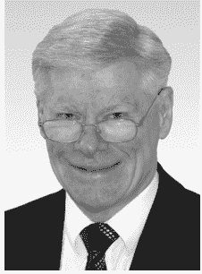

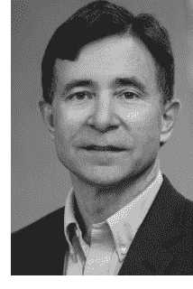

2008年国际模式识别协会会士。

罗伊·戴维斯是伦敦大学皇家霍洛威学院机器视觉荣休教授。他致力于视觉的许多方面，从特征检测和噪声抑制到鲁棒模式匹配以及实际视觉任务的实时实现。他的研究兴趣包括自动视觉检测、监控、车辆引导和犯罪侦测。他发表了200多篇论文和三本著作——《机器视觉：理论、算法与实践》（Machine Vision: Theory, Algorithms, Practicalities，1990）、《电子学、噪声与信号恢复》（Electronics, Noise and Signal Recovery，1993）和《食品工业图像处理》（Image Processing for the Food Industry，2000）；其中第一本已在国际上广泛使用超过25年，并于2017年推出了大幅增强的第五版，书名为《计算机视觉：原理、算法、应用与学习》（Computer Vision: Principles, Algorithms, Applications, Learning）。罗伊是英国物理学会（IoP）和英国工程技术学会（IET）会士，也是IEEE高级会员。他是《模式识别快报》（Pattern Recognition Letters）、《实时图像处理》（Real-Time Image Processing）、《成像科学》（Imaging Science）和《IET图像处理》（IET Image Processing）的编委会成员。他拥有伦敦大学理学博士学位（DSc）；他于2005年被授予英国机器视觉协会（BMVA）杰出会士称号，并于2008年当选国际模式识别协会（IAPR）会士。

马修·特克是芝加哥丰田技术研究所（TTIC）所长，也是加州大学圣塔芭芭拉分校荣休教授。他的研究兴趣涵盖计算机视觉和人机交互，包括自动驾驶车辆、面部与手势识别、多模态交互、计算摄影、增强现实与虚拟现实，以及人工智能伦理等主题。他曾担任多个重要会议的大会主席或程序委员会主席，包括IEEE计算机视觉与模式识别会议、ACM多媒体会议、IEEE自动面部与手势识别会议、ACM国际多模态交互会议，以及IEEE计算机视觉应用冬季会议。他获得过多项最佳论文奖，并且是ACM会士、IEEE会士、IAPR会士，以及2011–2012年富布赖特-诺基亚信息与通信技术杰出教席获得者。

此页有意留白

## 前言

如今，距离深度神经网络（DNNs）在开发和应用上的爆发式增长已将近十年，其后续进展可谓非同凡响。诚然，这一进展在很大程度上得益于以强大GPU形式部署的专用硬件；而它们的进步源于人们认识到CNN构成了一个关键的架构基础，ReLU、池化、全连接层、反池化和反卷积等特性也可以纳入其中。事实上，所有这些技术都为DNN注入了活力，并极大地扩展了其用途，因此其应用最初近乎指数级的增长在整个后续时期从未间断。不仅这种方法的能力令人印象深刻，其应用范围也从最初侧重于快速目标定位和图像分割——甚至语义分割——大幅扩展到涉及视频而非单纯图像分析的方面。

断言2012年以来计算机视觉的全部发展仅仅归功于DNNs的出现，是徒劳的。其他重要技术，如强化学习、迁移学习、自监督、图像的语言描述、标签传播，以及新颖性和异常检测、图像修复和目标跟踪等应用，都发挥了作用，并为计算机视觉的扩展和成熟做出了贡献。尽管如此，其中许多技术和应用领域都因DNNs的极速普及而受到推动、挑战和增强。

本卷旨在探索自这些剧变发生以来计算机视觉的进展方式。确实，我们可以合理地追问：我们现在处于什么位置？计算机视觉近来所依托的深度神经与机器学习基础又有多坚实？这是一个连贯的运动，还是一场盲目的、机会主义的突进，研究者们在此过程中忽略了重要的可能性？我们能否看得更远，并确信我们正朝着正确的方向前进？或者，是否每个研究者都可以各持己见，针对任何给定应用只关注看似必要的内容？如果是这样，采用这种有限的方法是否会有所损失？

事实上，还有其他高度相关的问题需要回答，比如一个棘手的问题：深度网络的能力是否只能达到其训练数据集的水平？这个问题大概适用于任何其他基于学习的方案，无论其是否可称为DNN。采用强化学习、自监督或其他方法，肯定无法改变这一可能存在的局限。而且请注意，人类也很难称得上是能以任何方式避免广泛训练的例证；他们的迁移学习能力将是决定学习过程效率的一个关键因素。

本卷旨在不仅介绍先进的视觉方法，还阐明其中所涉及的原则：即，它旨在起到教学作用，着重于


本书既注重帮助读者理解，也注重介绍最新研究。基于此，第1章为本书其余部分奠定基础。该章首先深入审视早期视觉工作的遗产，依次涵盖特征检测、目标检测、3D视觉和DNN的出现；最后，将跟踪作为一个重要的应用领域，它建立在前面各节材料的基础上，并清楚地展示了深度网络如何发挥关键作用。本章篇幅必然较长，因为它必须在相对较少的篇幅内从零基础达到相当高的水平；此外，它还必须为后续各章中杰出专家所描述的重要进展和方法论奠定基础。

正如第1章所阐明的，目标检测是计算机视觉中最具挑战性的任务之一。特别是，它必须克服尺度变化、遮挡、光照变化、复杂背景以及与自然世界相关的各种可变性因素等问题。第2章描述了近期进展中使用的各种方法和技术，包括感兴趣区域池化、多任务损失、区域提议网络、锚点、级联检测与回归、多尺度特征表示、数据增强技术、损失函数等。

第3章强调，计算机视觉领域近期的成功主要围绕训练模型所需的大规模、精细标注数据集展开。该章考察了如何利用这些数据来学习识别模型的方法，同时只需有限的人工监督。除了减少学习识别模型所需的人工标注数据量之外，还必须将监督水平从强监督降低到弱监督——同时允许来自“神谕”的相关查询。该章概述了有助于实现这一目标的理论框架和实验结果。

第4章探讨了深度神经网络的计算难题，这些难题使其难以部署在资源受限的硬件设备上。该章讨论了模型压缩技术和硬件感知的神经架构搜索技术，旨在提高深度学习效率，使神经网络更小、更快。为实现这些目标，该章展示了如何使用参数剪枝来移除冗余权重、使用低秩分解来降低复杂度、使用权重量化来降低权重精度和模型大小，以及使用知识蒸馏将“暗知识”从大模型迁移到小模型。

第5章讨论了深度生成模型如何尝试恢复目标视觉模型的低维结构。该章展示了如何利用深度生成模型，通过条件图像生成实现更可控的视觉模式合成。实现这一目标的关键是视觉表示的“解耦”，即尝试在隐藏嵌入空间中分离不同的控制因素。该章以风格迁移、视觉-语言生成和人脸合成三个案例研究，说明如何在无监督或弱监督设置下实现这一目标。

第6章聚焦于一个热门的现实世界问题——人脸识别。该章讨论了最先进的基于深度学习方法，这些方法甚至可以用于部分人脸图像。它展示了：(a) 如何构建必要的深度学习架构；(b) 如何训练和测试此类模型；(c) 如何利用预训练网络的微调来识别使用完整和部分人脸数据的高效识别线索；(d) 近期深度学习发展所取得的成功程度；(e) 目前基于深度学习的人脸识别技术存在的局限性。该章还介绍了该领域仍存在的一些挑战。

第7章讨论了如何将学习从一个数据域迁移到另一个数据域这一关键问题。这涉及基于微分几何、稀疏表示和深度神经网络的方法，可分为判别式和生成式两大类。前者在训练分类器模型的同时，采用额外的损失函数使源域和目标域的特征分布相似。后者利用生成模型进行域适应：通常，训练一个跨域生成对抗网络，将样本从源域映射到目标域，并在变换后的目标图像上训练分类器模型。此类方法在跨域识别和语义分割任务上得到了验证。

第8章回到语义分割背景下的域适应任务。在该任务中，深度网络受困于训练所需的海量标注数据。该章首先讨论了可以在不同级别上执行的适应及其实现策略，然后继续讨论语义分割中的持续学习任务。尽管后者是一个相对较新的研究领域，但对其的兴趣正在迅速增长，并且已经引入了许多不同的场景。该章详细描述了这些场景以及应对它们所需的方法。

第9章继第1章之后，再次强调视觉跟踪作为计算机视觉中首要的经典问题之一的重要性。该章的目的是概述该领域的发展，从Lucas-Kanade和匹配滤波器方法开始，以基于深度学习的方法以及向视频分割的过渡作为结束。该概述局限于图像平面中通用跟踪的整体模型，特别关注判别模型、MOSSE（最小输出平方误差和）跟踪器和DCF（判别相关滤波器）。

第10章将视觉目标跟踪的概念进一步推进，专注于长期跟踪。要成功完成此任务，目标跟踪必须解决与模型退化相关的重要挑战——即由附加偏差导致的模型恶化，以及目标的消失和重现。深度学习的成功极大地影响了视觉目标跟踪，因为Siamese跟踪器的离线学习有助于消除模型退化。然而，为避免在目标外观发生显著变化时丢失跟踪的可能性，Siamese跟踪器可以从内置的不变性和等变性中获益，从而在不加剧模型退化的情况下允许外观变化。

如果计算机视觉要在视频和动作的动态世界中取得成功，那么人类认知概念似乎是必不可少的，这一信息在接下来的两章中得到了充分证实。第11章概述了一个以动作为中心的框架，该框架跨越多个时间尺度和抽象级别。较低级别详细描述了适合不同动作的对象特征；中间级别建模单个动作；较高级别建模活动。通过强调使用抓取特征、几何、本体论和基于物理的约束，避免了对外观特征的过度训练。为了将基于信号的感知与符号知识相结合，向量化知识与视觉特征对齐。该章还包括对动作和活动理解的讨论。

第12章考虑了时间事件分割问题。认知科学研究指出了如何设计高度有效的计算机视觉算法，用于视频中事件的空间-时间分割，而无需任何标注数据。首先，事件分割理论模型允许计算事件边界；然后，使用感知预测框架进行时间分割，基于注意力图的事件工作模型进行时间分割，以及事件的空间-时间定位。这种方法在无监督时间分割和空间-时间动作定位方面达到了最先进的性能，并且在需要大量标注的全监督基线上也取得了具有竞争力的表现。

异常检测技术构成许多应用（如医学图像分析、欺诈检测或视频监控）中的基础资源。这些技术也是能够从新情况中持续学习的人工自感知系统的关键步骤。第13章针对此类自感知智能体提出了一种半监督异常检测方法。它利用广义动态贝叶斯网络的消息传递能力，为各种类型的时间序列数据提供不同抽象级别的异常。因此，检测到的异常可用于使系统通过整合新获取的知识而进化。该章提出了一个案例研究来描述异常检测方法，该方法将使用一辆在封闭环境中执行不同任务的半自动驾驶车辆的多感官数据。

基于模型和基于学习的方法一直是解决低级视觉中各种图像恢复问题的两种主导策略。通常，这两类方法各有优缺点；例如，基于模型的方法在处理不同图像恢复问题时很灵活，但为了获得良好性能，通常需要复杂的先验知识且耗时；而基于学习方法由于端到端训练，显示出优于传统基于模型方法的有效性和效率，但通常缺乏处理不同图像恢复任务的灵活性。第14章介绍了深度即插即用方法和深度展开方法，这两种方法通过结合基于学习和基于模型的方法展现出了巨大潜力：深度即插即用方法的主要思想是，基于学习的去噪器可以隐式地作为基于模型的图像恢复方法的图像先验；而深度展开方法的主要思想是，通过变量分裂算法展开基于模型的方法，将相应的子问题替换为神经模块，从而获得一个端到端可训练的迭代网络。因此，深度即插即用方法和深度展开方法既能继承基于模型方法的灵活性，又能保持基于学习方法的优势。

视觉对抗样本是经过故意扰动以误导机器学习模型的图像和视频。第15章概述了制造对抗扰动以生成图像分类、目标检测、运动估计和视频识别任务的视觉对抗样本的方法。首先定义了对抗攻击的关键属性和攻击生成的扰动类型；然后分析了为图像和视频制造对抗攻击的方法的主要设计选择，并考察了它们对目标模型知识的利用。最后，讨论了提高机器学习模型鲁棒性的防御机制，以应对


对抗性攻击或检测被操纵输入数据的方法得到了评述。

这些章节共同为感兴趣的读者——无论是学生、研究人员还是从业者——提供了先进计算机视觉方法论与最新方法方面的广度与深度。

最后，我们要向所有作者表示诚挚的感谢，感谢他们为撰写各自章节所付出的巨大投入与奉献，从而为本书的成功出版做出了不小的贡献，并在这样一个快速变化的时代推动了学科的发展。此外，我们尤其感谢爱思唯尔科学出版社的蒂姆·皮茨，感谢他从一开始以及在我们全力汇编本书的过程中始终给予我们建议与鼓励。

**罗伊·戴维斯**
伦敦大学皇家霍洛威学院，
伦敦，英国

**马修·特克**
芝加哥丰田技术学院，
芝加哥，伊利诺伊州，美国
2021年5月

## 1 计算机视觉急剧变化的面貌

E.R.戴维斯

伦敦大学皇家霍洛威学院，埃格姆，萨里，英国

### 本章要点

- 研究计算机视觉中的传统方法，包括底层图像处理算子、二维和三维目标检测、定位与识别、跟踪与分割。
- 审视从人工神经网络发展而来的深度学习方法，包括深度学习爆发。
- 研究深度学习方法在特征检测、目标检测、定位与识别、目标跟踪、纹理分类和图像语义分割中的应用。
- 深度学习方法对既有计算机视觉方法论的影响。

### 1.1 引言——计算机视觉及其起源

在过去的三四十年里，计算机视觉已逐渐发展成为一个拥有自身方法论和应用领域的成熟学科。事实上，它的应用领域之多，以至于难以一一列举。其中最突出的包括目标识别、监控（包括人数统计和车牌识别）、机器人控制（包括自动车辆引导）、医学图像的分割与解释、工厂环境下的自动检测与装配、指纹与人脸识别、手势解释等等。为了实现这一切，必须从多种图像来源进行测量，包括可见光和红外通道、三维传感器，以及CT和MRI扫描仪等许多重要的医学成像设备。而且测量必须包括位置、姿态、物体间距离、运动、形状、纹理、颜色以及更多方面。鉴于活动及其所用方法种类繁多，很难在单章范围内概括整体情况：因此材料的选择必然受到限制；尽管如此，我们将力求为这一主题提供坚实的基础和教学式的方法。

在2020年代，人们在介绍计算机视觉时几乎无法不承认2010年代取得的巨大进步，特别是发生在2012年前后的“深度学习爆发”。这极大地改变了这一学科的面貌，带来了令人印象深刻的发展与应用，其中许多甚至在2010年时都是人们所难以想象的。因此，本书尤其针对这些现代先进发展：本章的作用是概述传统方法论，探索新的深度学习方法，并展示后者如何影响和改进早期的（传统）方法。

在此回顾一下计算机视觉的起源将有所裨益。计算机视觉被认为始于1960年代和1970年代，主要是图像处理的一个分支。那时，捕获完整图像并在数字计算机上方便地存储和处理已变得切实可行。最初，图像往往以二值或灰度形式捕获，不过后来也可以捕获彩色图像。早期，研究人员梦想通过识别物体和解释场景来模拟人眼，但当时可用的计算机性能较弱，这样的梦想受到限制。在实践中，图像处理被用来‘整理’图像并定位物体特征，而图像识别则使用最近邻算法等统计模式识别技术进行。推动计算机视觉发展的另一个动机是人工智能，还有一个是生物视觉。限于篇幅，这里不再进一步讨论这些方面，只在此指出，它们为人工神经网络和深度学习播下了种子（详见下文F部分）。

整理图像或许更应该称为预处理：这可以包括多种功能，其中噪声消除最为重要。人们很快发现，使用平滑算法（计算每个输入像素周围窗口内强度的平均值，并用它形成一幅独立的平滑图像）不仅降低了噪声水平，而且也会影响信号本身（这一过程也可以想象为降低输入带宽以排除大部分噪声，同时还产生了消除输入信号中高频空间分量的额外效果）。然而，通过采用中值滤波而非均值滤波，这个问题在很大程度上得到了解决，因为中值滤波的工作原理是消除局部强度分布两端的离群值——中值是最不受噪声影响的值。

典型的均值滤波核包括以下几种，其中第二种更接近理想的高斯形式：

$$
\frac{1}{9}\begin{bmatrix}1&1&1\\1&1&1\\1&1&1\end{bmatrix}\qquad
\frac{1}{16}\begin{bmatrix}1&2&1\\2&4&2\\1&2&1\end{bmatrix}\qquad (1.1)
$$

这两种都是线性卷积核，根据定义，它们在图像空间上是空间不变的。一个通用的3 × 3卷积掩模由下式给出：

$$
\begin{bmatrix}
c_4 & c_3 & c_2\\
c_5 & c_0 & c_1\\
c_6 & c_7 & c_8
\end{bmatrix}
\qquad (1.2)
$$

其中局部像素被赋予标签0–8。接下来，我们将局部3 × 3图像邻域中的强度值取为：

$$
\begin{bmatrix}
P_4 & P_3 & P_2\\
P_5 & P_0 & P_1\\
P_6 & P_7 & P_8
\end{bmatrix}
\qquad (1.3)
$$

如果我们现在使用一种大致基于C++的表示法，就可以将完整的卷积过程写成如下形式：

```
for all pixels in image do {
    Q0 = P0 * c0 + P1 * c1 + P2 * c2 + P3 * c3 + P4 * c4
      + P5 * c5 + P6 * c6 + P7 * c7 + P8 * c8;
}
```
(1.4)

到目前为止，我们集中讨论了卷积掩模，它们是输入强度的线性组合：这与阈值化等非线性过程形成对比，后者无法表示为卷积。事实上，阈值化是一种应用非常广泛的技术，可以写成如下形式：

```
for all pixels in image do {
    if (P0 < thresh) A0 = 1; else A0 = 0;
}
```
(1.5)

该过程将P空间中的灰度图像转换为A空间中的二值图像。这里用它来识别暗色物体，将它们表示为0背景上的1。

在本节结束时，我们给出一个在3 × 3邻域内进行中值滤波的完整过程：

```
for (i = 0; i <= 255; i++) hist[i] = 0;
for all pixels in image do {
    for (m = 0; m <= 8; m++) hist[P[m]]++;
    i = 0; sum = 0;
    while (sum < 5) {
        sum = sum + hist[i];
        i = i + 1;
    }
    Q0 = i - 1;
    for (m = 0; m <= 8; m++) hist[P[m]] = 0;
}
```
(1.6)

记号P[0]用于表示P0，P[1]至P[8]依此类推。请注意，中值运算是计算密集型的，因此只重新初始化实际使用过的特定直方图元素可以节省时间。

关于式(1.4)–(1.6)所涵盖的过程，一个重要之处在于它们从一个图像空间获取输入，并输出到另一个图像空间——这一过程通常被称为并行处理——从而消除了与各个像素计算执行顺序相关的问题。

最后，式(1.1)–(1.4)给出的图像平滑算法都使用3 × 3卷积核，尽管显然可以使用更大的核：事实上，也可以先将图像转换到空间频率域，然后系统地消除高频空间频率来实现，尽管这会带来额外的计算负担。另一方面，中值滤波等非线性操作无法以这种方式处理。

为方便起见，本章其余部分分为以下几部分：

- A部分——理解底层图像处理算子
- B部分——二维目标定位与识别
- C部分——三维目标定位与不变性的重要性
- D部分——运动目标跟踪
- E部分——纹理分析
- F部分——从人工神经网络到深度学习方法
- G部分——总结。

总的来说，本章的目的是总结计算机视觉早期（或称‘传统’）工作中的关键部分，并提醒读者它们的重要性，以便读者能够更自信地掌握该学科近期的先进发展。然而，由于需要做出这样的取舍，许多其他重要主题不得不被排除在外。

### 1.2 A部分——理解底层图像处理算子

#### 1.2.1 边缘检测基础

没有哪种成像操作比边缘检测更重要或应用更广泛。这有其重要原因，但归根结底，通过边界和内部轮廓来描述物体形状，可将保存N × N图像所需的数据量从O(N²)减少到O(N)，从而使后续存储和处理更加高效。此外，大量证据表明，人类可以从物体的边界非常高效甚至更高效地识别物体：人类能从二维草图和漫画中做出快速反应，这一事实支持了这一观点。

在1960年代和1970年代，人们开发了相当多的边缘检测算子，其中许多是凭直觉提出的，这意味着它们的最优性存疑。其中许多


操作者应用了 8 或 12 个模板掩模以确保能够检测到不同方向的边缘。奇怪的是，直到很久以后才完全意识到，由于边缘是矢量，仅仅两个掩模就足以检测它们。然而，这并未立即消除在边缘检测器中应使用何种掩模系数的难题——即使在 3 × 3 邻域的情况下——我们接下来将进一步探讨这个问题。

在下文中，我们最初假设使用 8 个掩模，角度相差 45°。然而，其中 4 个掩模与其它掩模仅在符号上不同，这使得无需分别应用它们。此时，对称性论证导出了 0° 和 45° 的相应掩模如下：

$$\begin{bmatrix} -A & 0 & A \\ -B & 0 & B \\ -A & 0 & A \end{bmatrix}\qquad\begin{bmatrix} 0 & C & D \\ -C & 0 & C \\ -D & -C & 0 \end{bmatrix}\tag{1.7}$$

显然，设计掩模使其在不同方向上给出一致的响应非常重要。为了找出这对掩模系数的影响，我们利用了强度梯度必须遵循矢量加法规则这一事实。如果 3 × 3 邻域内的像素强度值为

$$\begin{bmatrix} a & b & c \\ d & e & f \\ g & h & i \end{bmatrix}\tag{1.8}$$

上述掩模将导致 0°、90° 和 45° 方向上的梯度估计如下：

$$\begin{aligned} g_0 &= A(c + i - a - g) + B(f - d) \\ g_{90} &= A(a + c - g - i) + B(b - h) \\ g_{45} &= C(b + f - d - h) + D(c - g) \end{aligned}\tag{1.9}$$

如果矢量加法成立，我们还应有：

$$g_{45} = (g_0 + g_{90})/\sqrt{2}\tag{1.10}$$

将 a、b、…、i 的系数相等可得到自洽的一对条件：

$$\begin{aligned} C &= B/\sqrt{2} \\ D &= A\sqrt{2} \end{aligned}\tag{1.11}$$

接下来，注意到进一步的要求——0° 和 45° 掩模在 22.5° 处应给出相等的响应。事实上，一个相当繁琐的代数运算（Davies, 1986）表明

$$B/A = (13\sqrt{2} - 4)/7 = 2.055\tag{1.12}$$

如果我们将该值近似为 2，就立即得到 Sobel 算子掩模

$$S_x = \begin{bmatrix} -1 & 0 & 1 \\ -2 & 0 & 2 \\ -1 & 0 & 1 \end{bmatrix}\qquad S_y = \begin{bmatrix} 1 & 2 & 1 \\ 0 & 0 & 0 \\ -1 & -2 & -1 \end{bmatrix}\tag{1.13}$$

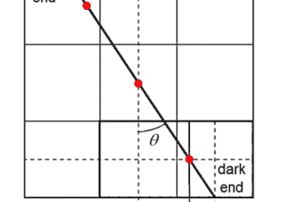

图 1.1 使用二次插值确定梯度幅值峰值的精确位置。

#### 1.2.3 线段检测

在第 1.2.1 节中，我们看到了边缘检测器仅需两个掩模即可计算边缘特征的幅值和方向的显著优势。值得考虑的是，相同的矢量方法是否也可用于其它情况。事实上，也可以使用改进的矢量方法来检测线段特征。这可通过考虑以下一对掩模来说明：

L₁ = A ⎡ 0  -1  0 ⎤      L₂ = B ⎡ -1  0  1 ⎤
          ⎢ 1   0  1 ⎥             ⎢  0  0  0 ⎥   (1.15)
          ⎣ 0  -1  0 ⎦             ⎣  1  0 -1 ⎦

显然，还可以构造另外两个这种形式的掩模，但它们与上述两个仅在符号上不同，可以忽略。因此，这组掩模的数量正好满足矢量计算的要求。事实上，如果我们寻找的是亮背景上的暗条纹，1 可以有用地表示条纹，而 -1 可以表示亮背景。（0 可以视为“无关”系数，因为它们在任何卷积中都会被忽略。）因此 L₁ 表示 0° 条纹，L₂ 表示 45° 条纹。（此处的“条纹”一词用于表示具有显著宽度的线段。）应用与第 1.2.1 节相同的方法，并如式 (1.8) 定义像素强度值，我们得到

l₀ = A(d + f − b − h)
l₄₅ = B(c + g − a − i)   (1.16)

然而，在这种情况下，信息不足以确定 A 与 B 的比例，因此这必须取决于实际情况。事实上，鉴于该计算是在 3 × 3 邻域中进行的，如果使用上述掩模进行检测的最佳条纹宽度约为 1.0，也不足为奇；实验测试（Davies, 1997）表明，将掩模与条纹宽度 w 匹配（或反之）时，在 w ≈ 1.4 时获得了最佳方向精度，此时 B / A ≈ 0.86。这导致最大方向误差约为 0.4°，与 Sobel 算子的约 0.8° 相比相当有利。

我们现在继续使用与第 1.2.1 节类似的公式来伪矢量计算线强度系数 l 和线段方向 θ：

l = [l₀² + l₄₅²]¹/²
θ = ½ arctan(l₄₅ / l₀)
(1.17)

这里我们被迫在 arctan 前加上二分之一的因子：这是因为线段表现出 180° 旋转对称性，而普通角度通常为 360°。

请注意，这再次是一个优化旨在实现高方向精度而非例如检测灵敏度的情况。

这里值得提及线段检测的两个应用。一个是对散装小麦颗粒的检查，以定位近似于暗条状特征的小型暗色昆虫：基于上述模型的 7 × 7 掩模已被用于实现此目的（Davies et al., 2003）。另一个是定位诸如天空中的电报线或支撑电影演员的电线等人工制品，然后可以系统地将其移除。

#### 1.2.4 优化检测灵敏度

检测灵敏度的优化是雷达应用中众所周知的任务，自第二次世界大战以来已被非常有效地应用于此目的。本质上，雷达系统对飞机的高效检测涉及信噪比（SNR）的优化。当然，在雷达中，检测是 1-D 问题，而在成像中，我们需要在噪声背景下最优地检测 2-D 物体。然而，图像噪声不一定是高斯白噪声，如雷达中通常可假设的那样，尽管从该假设开始很方便。

在雷达中，信号可被视为相对于通常接近零的噪声背景的正峰值（或“嘟声”）。在这些条件下，有一个众所周知的定理指出，给定形状的嘟声的最优检测是通过使用与理想化输入信号具有相同形状的“匹配滤波器”获得的。成像中同样适用，在这种情况下，空间匹配滤波器必须具有与待检测 2-D 物体的理想形式相同的强度分布。

我们现在将概述这种方法的数学基础。首先，我们假设一组采样信号的像素，给出值 Sᵢ。接下来，我们将期望的滤波器表示为具有系数 wᵢ 的 n 元加权模板。最后，我们假设每个像素处的噪声水平相互独立，并服从具有标准差 Nᵢ 的局部分布。

显然，加权模板接收到的总信号为
S = Σᵢ₌₁ⁿ wᵢ Sᵢ
(1.18)

而加权模板接收到的总噪声将由其方差表征：

$$N^2 = \sum_{i=1}^{n} w_i^2 N_i^2 \tag{1.19}$$

因此（功率）信噪比为

$$\rho^2 = S^2 / N^2 = \left(\sum_{i=1}^{n} w_i S_i\right)^2 / \sum_{i=1}^{n} w_i^2 N_i^2 \tag{1.20}$$

为了获得最佳信噪比，我们计算导数

$$\begin{aligned}
\partial \rho^2 / \partial w_i &= \left(1 / N^4\right) \left[ N^2 \left(2 S S_i\right) - S^2 \left(2 w_i N_i^2\right) \right] \\
&= \left(2 S / N^4\right) \left[ N^2 S_i - S \left(w_i N_i^2\right) \right]
\end{aligned}\tag{1.21}$$

然后令 $\partial \rho^2 / \partial w_i = 0$。这立即给出：

$$w_i = \frac{S_i}{N_i^2} \times \frac{N^2}{S} \tag{1.22}$$

这可以更简单地表示为：

$$w_i \propto \frac{S_i}{N_i^2} \tag{1.23}$$

尽管在不失一般性的情况下，我们可以用等号代替比例符号。

请注意，如果 $N_i$ 与 i 无关（即噪声水平在图像上不变化），则 $w_i = S_i$：这证明了上述定理——空间匹配滤波器需要具有与待检测 2-D 物体相同的强度分布。

#### 1.2.5 处理背景强度变化

除了明显的维数差异外，视觉与雷达不同的另一个重要方面是：对于后者，在没有信号的情况下，系统输出围绕零波动并平均为零。然而，在视觉中，背景水平通常会随环境照明变化，并且在输入图像上也会变化。基本上，解决这个问题的办法是采用零和（或零均值）掩模。因此，对于如式 (1.2) 中的掩模，我们只需从每个分量中减去所有掩模分量的均值 $\bar{c}$，以确保整体掩模为零均值。

为了确认使用零均值策略有效，想象将未修改的掩模应用于式 (1.3) 所示的图像邻域：假设我们得到值 $K$。现在将 $B$ 加到邻域中每个像素的强度上：这将在值 $K$ 上增加 $\sum_n B c_i = B \sum_n c_i = B n \bar{c}$；但如果我们使 $\bar{c} = 0$，我们最终会得到原始的掩模输出 $K$。


总体而言，我们应注意到零均值策略仅是一种近似，因为图像中存在背景在高低水平之间变化的区域，因此零均值抵消不能完全实现（即 B 不能被视为在掩模区域内恒定）。尽管如此，假设背景变化的尺度明显大于掩模尺寸，则应能足够好地工作。

值得注意的是，零均值近似已被广泛使用——正如我们已从式 (1.7) 和 (1.15) 中的边缘和线段掩模所见。它也必须适用于我们可能设计的其他检测器，例如角点和孔洞检测器。

#### 1.2.6 结合匹配滤波器与零均值构造的理论

初看之下，零均值构造如此简单，似乎可以很容易地与第 1.2.4 节的匹配滤波器形式主义整合。然而，应用它会使匹配滤波器的自由度减少一个，因此需要对匹配滤波器形式主义进行修改，以确保后者仍为理想检测器。为此，我们将零均值和匹配滤波器情况表示如下：

(w_i)_{z-m} = S_i - \bar{S}
(w_i)_{m-f} = S_i / N_i^2
(1.24)

接下来，我们将其组合成形式

w_i = (S_i - \tilde{S}) / N_i^2
(1.25)

其中我们通过尝试一种假设的（即尚未知晓的）S 的均值类型来避免僵局，我们称之为 \tilde{S}。 [当然，如果这一假设最终导致矛盾，自然需要新的方法。] 应用零均值条件 \sum_i w_i = 0 现在得到以下结果：

\sum_i w_i = \sum_i S_i / N_i^2 - \sum_i \tilde{S} / N_i^2 = 0
(1.26)

\therefore \quad \tilde{S} \sum_i (1 / N_i^2) = \sum_i S_i / N_i^2
(1.27)

\therefore \quad \tilde{S} = \sum_i (S_i / N_i^2) / \sum_i (1 / N_i^2)
(1.28)

由此，我们推断 \tilde{S} 必须是一个加权均值，特别是噪声加权均值 \tilde{S}。另一方面，如果噪声是均匀的，\tilde{S} 将退化为通常的未加权均值 \bar{S}。此外，如果我们不应用零均值条件（我们可以通过设置 \tilde{S} = 0 来实现），式 (1.25) 立即退化为标准的匹配滤波器条件。

\tilde{S} 的公式似乎过于一般，因为 N_i 通常应几乎与 i 无关。然而，如果理想轮廓是通过对真实物体轮廓进行平均而得到的，则在其中心之外，噪声方差可能更为显著。事实上，对于大物体而言，这将是对这种方法的一个明显的限制因素。但对于相当小的物体和特征，噪声方差不应变化过大，并且可以获得有用的匹配滤波器轮廓。

顺便提一下，本节证明的主要结果（参见式 (1.25) 和 (1.28)）花费了我大量的时间和精力来解决各种问题，以至于我从未确信自己能够解决它。因此我称之为‘戴维斯最后定理’。

#### 1.2.7 掩模设计——其他考虑

尽管匹配滤波器形式主义和现在完全集成的零均值条件似乎已足够通用，可提供无歧义的掩模设计，仍有若干方面需要考虑。例如，掩模应做多大？以及它们应如何最优地放置在任何显著物体或特征周围？我们将采用以下相当复杂的物体特征示例来帮助回答这个问题。这里区域 2 是被检测的物体，区域 1 是背景，M 是特征掩模区域。

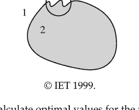

© IET 1999.

在此模型中，我们需要计算掩模加权因子 w₁ 和 w₂ 以及区域面积 A₁ 和 A₂ 的最优值。我们可以将模板掩模的总信号和噪声功率写为：

S = w₁ A₁ S₁ + w₂ A₂ S₂
N² = w₁² A₁ N₁² + w₂² A₂ N₂²
(1.29)

因此，我们得到功率信噪比（SNR）：

ρ² = S² / N² = (w₁ A₁ S₁ + w₂ A₂ S₂)² / (w₁² A₁ N₁² + w₂² A₂ N₂²)
(1.30)

不难看出，如果两个掩模区域的面积都按同一因子 η 增加，ρ² 也将按此因子增加。这使得通过调整 A₁、A₂ 的相对值来优化掩模变得有趣，同时保持总面积 A 不变。让我们首先利用零均值条件消除 w₂（该条件通常应用于防止背景光强水平变化影响结果）：

w₁ A₁ + w₂ A₂ = 0
(1.31)

显然，功率信噪比不再依赖于掩模权重：

$$\rho^2 = \frac{S^2}{N^2} = \frac{(S_1 - S_2)^2}{N_1^2/A_1 + N_2^2/A_2} \tag{1.32}$$

接下来，由于总掩模面积 $A$ 已预先确定，我们有：

$$A_2 = A - A_1 \tag{1.33}$$

代入 $A_2$ 很快得到一个简单的优化条件：

$$A_1/A_2 = N_1/N_2 \tag{1.34}$$

取 $N_1 = N_2$，我们得到一个重要结果——等面积规则（Davies, 1999）：

$$A_1 = A_2 = A/2 \tag{1.35}$$

最后，当等面积规则适用时，零均值规则的形式为：

$$w_1 = -w_2 \tag{1.36}$$

请注意，许多情况，例如当前景和背景具有不同纹理时，可以通过取 $N_1 \neq N_2$ 来建模。在这种情况下等面积规则不适用，但我们仍可使用式 (1.34)。

#### 1.2.8 角点检测

在第 1.2.1 节和第 1.2.3 节中我们发现只有两种特征具有向量（或伪向量）形式——边缘和线段。因此，虽然这些特征可以用仅两个分量掩模检测，其他所有特征预期需要匹配更多模板以应对不同方向。角点检测器似乎属于此类，典型的 $3 \times 3$ 角点模板如下：

$$\begin{bmatrix} -4 & 5 & 5 \\ -4 & 5 & 5 \\ -4 & -4 & -4 \end{bmatrix} \qquad \begin{bmatrix} 5 & 5 & 5 \\ -4 & 5 & -4 \\ -4 & -4 & -4 \end{bmatrix} \tag{1.37}$$

（请注意，这些掩模已调整为零均值形式以消除光照条件变化的影响。）

为了克服模板匹配的明显问题——其中最不容忽视的是需要使用有限数量的数字掩模来近似底层模拟强度变化，而这些变化本身在不同实例间差异很大——人们已做出许多努力以获得更原则性的方法。特别是，由于边缘依赖于图像强度场的二阶导数，似乎合乎逻辑地转向二阶导数方法。最早的此类研究之一是 Beaudet (1978) 方法，该方法采用了 Laplacian 和 Hessian 算子：

$$\text{Laplacian} = I_{xx} + I_{yy}
\text{Hessian} = I_{xx}I_{yy} - I_{xy}^2 \tag{1.38}$$

它们特别有吸引力，因为它们以二阶导数对称矩阵的行列式和迹来定义，因此在旋转下不变。

事实上，Laplacian 算子沿线条和边缘给出显著响应，因此不特别适合作为角点检测器。另一方面，Beaudet 的 ‘DET’（Hessian）算子不响应线条和边缘，但在角点附近给出显著信号，因此应构成有用的角点检测器——尽管它在角点一侧以一种符号响应，在角点另一侧以相反符号响应：在角点本身给出零响应。此外，其他研究人员批评了 DET 算子的特定响应，发现需要相当复杂的分析来推断每个角点的存在和精确位置（Dreschler and Nagel, 1981; Nagel, 1983）。

然而，Kitchen 和 Rosenfeld (1982) 发现他们能够通过估计梯度方向向量沿水平边缘切线方向的变化率并将其与强度函数 I 的水平曲率 κ 相关联来克服这些问题。为了获得角点强度现实的指示，他们将 κ 与局部强度梯度 g 的大小相乘：

$$C = \kappa g = \kappa \left( I_x^2 + I_y^2 \right)^{1/2}$$
$$= \frac{I_{xx} I_y^2 - 2 I_{xy} I_x I_y + I_{yy} I_x^2}{I_x^2 + I_y^2}\tag{1.39}$$

最后，他们使用了沿边缘法线方向的非极大值抑制启发式方法来进一步精确定位角点位置。

有趣的是，Nagel (1983) 和 Shah 和 Jain (1984) 认为 Kitchen 和 Rosenfeld、Dreschler 和 Nagel 以及 Zuniga 和 Haralick (1983) 的角点检测器在本质上是等价的。这并不令人过于惊讶，因为最终不同的<|message|>... 因为最终不同的... 因为最终不同的... 因为最终不同的方法预期会反映相同的底层物理现象（Davies, 1988c）——反映一个可解释为水平曲率乘以强度梯度的二阶导数公式。

#### 1.2.9 Harris ‘兴趣点’算子

在这一点上，Harris 和 Stephens (1988) 开发了一种全新的算子，能够检测角点状特征——基于的不是二阶而是一阶导数。正如我们下面将看到的，这简化了数学，包括将数字掩模应用于本质上模拟函数时的困难。事实上，新的算子能够通过应用一阶运算来执行二阶导数功能。它如此获得相关二阶导数信息的方式令人着迷。为了理解这一点，我们需要检查其相当简单的数学定义。

Harris 算子以图像中局部强度梯度分量 I_x、I_y 的形式定义。定义需要定义一个窗口区域并在此整个窗口上取平均 ⟨.⟩。我们首先计算以下矩阵：

$$\Delta = \begin{bmatrix} \langle I_x^2 \rangle & \langle I_x I_y \rangle \\ \langle I_x I_y \rangle & \langle I_y^2 \rangle \end{bmatrix}\tag{1.40}$$


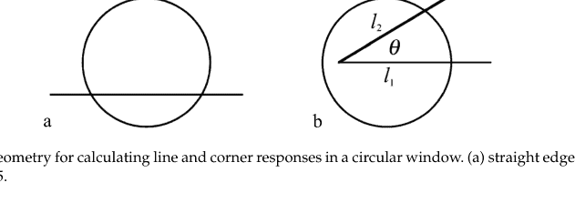

图 1.2 在圆形窗口中计算直线和角点响应的几何结构。(a) 直边缘，(b) 一般角点。© IET 2005。

然后，我们使用行列式和迹来估计角点信号：

$$C = \det \Delta / \text{trace} \Delta \tag{1.41}$$

（同样，与 Beaudet 算子一样，仅使用行列式和迹的意义在于，所得信号将具有角点朝向不变性。）

在继续分析 $C$ 的形式之前，请注意，如果不进行平均，$\det \Delta$ 将恒等于零：显然，正是平均操作中固有的平滑使得一阶导数值产生分布，从而让结果部分依赖于二阶导数。

为了更详细地理解该检测器的工作原理，首先考虑它对单条边缘（图 1.2a）的响应。实际上：

$$\det \Delta = 0 \tag{1.42}$$

因为在整个窗口区域内 $I_x$ 为零。

接下来考虑角点区域（图 1.2b）中的情况。此时：

$$\Delta = \begin{bmatrix} l_2 g^2 \sin^2 \theta & l_2 g^2 \sin \theta \cos \theta \\ l_2 g^2 \sin \theta \cos \theta & l_2 g^2 \cos^2 \theta + l_1 g^2 \end{bmatrix} \tag{1.43}$$

其中，$l_1, l_2$ 是构成该角点的两条边缘的长度，$g$ 是边缘对比度，并假定在整个窗口内为常数。我们得到（Davies, 2005）：

$$\det \Delta = l_1 l_2 g^4 \sin^2 \theta \tag{1.44}$$

以及

$$\text{trace} \Delta = (l_1 + l_2) g^2 \tag{1.45}$$

$$\therefore \quad C = \frac{l_1 l_2}{l_1 + l_2} g^2 \sin^2 \theta \tag{1.46}$$

这可以解释为以下三项的乘积：（1）强度因子 $\lambda$，取决于窗口内的边缘长度；（2）对比度因子 $g^2$；（3）形状因子 $\sin^2 \theta$，取决于边缘的“尖锐度” $\theta$。显然，当 $\theta = 0$ 和 $\theta = \pi$ 时，$C$ 为零；当 $\theta = \pi / 2$ 时，$C$ 取得最大值——所有这些结果在直觉上都是正确且恰当的。

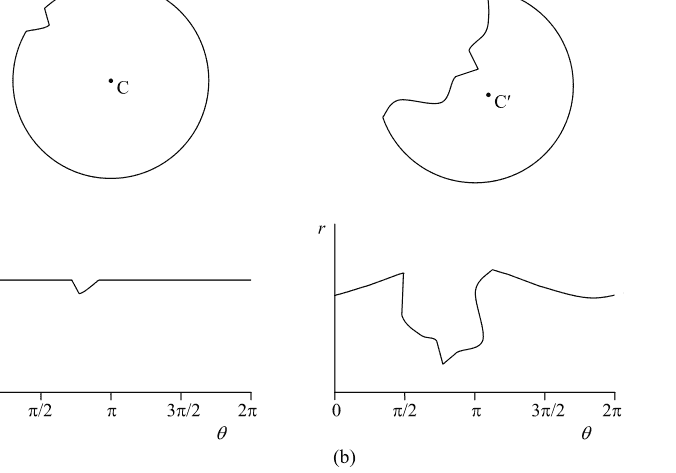

图 1.3 质心轮廓描述子存在的问题。(a) 显示了一个边界上有轻微缺陷的圆形物体；其质心轮廓显示在下方。(b) 显示了同一物体，但这次存在严重缺陷：因为质心移动到 C′，整个质心轮廓被严重扭曲。

该算子的许多性质都可以从这个公式中得出，包括峰值信号并不出现在角点本身，而是出现在用于计算角点信号的窗口中心这一事实——尽管随着角点尖锐度的降低，这种偏移会减小。

### 1.3 B 部分——二维物体定位与识别

#### 1.3.1 形状分析的质心轮廓方法

二维物体通常通过其边界形状来表征。在本节中，我们研究通过围绕物体边界跟踪并分析所得形状轮廓可以实现什么。最常用于此目的的轮廓类型是质心轮廓——即以边界的质心 C 为坐标原点，使用 (r, θ) 极坐标图来描绘物体边界。

对于半径为 R 的圆，质心轮廓是 θ 轴上方距离为 R 的一条直线。图 1.3 阐明了这种情况，并展示了两个破损圆形物体的示例。在情形 (a) 中，圆仅轻微变形，因此其质心 C 几乎保持不变；因此，大部分质心图仍保持在 θ 轴上方距离 R 处。然而，在情形 (b) 中，即使是未破损或未变形的边界部分，也远非与 θ 轴保持恒定距离：这意味着物体无法通过其轮廓被识别出来，尽管在情形 (a) 中，将其识别为一个轻微受损的圆并无困难。事实上，我们可以将这两种情形相对严重性的差异主要追溯到一个事实：在情形 (b) 中，质心移动得太多，以至于形状中未改变的部分也无法被立即识别。当然，我们可以尝试将质心移回其原有位置来纠正这种情况，但要可靠地做到这一点很困难：无论如何，如果原始形状结果不是圆，那么在问题真正性质被揭示之前，大量处理工作将被浪费。

总体而言，我们可以得出结论：质心轮廓方法不鲁棒，不值得推荐。但这并不意味着它不应在实践中使用。例如，在奶酪或饼干传送带上，任何无法通过其恒定的 R 轮廓立即识别的物体都应立即从生产线上剔除；然后可以检查其他物体，以确保它们的 R 值可接受并表现出适当的恒定性。

### 鲁棒性及其重要性

鲁棒性这一概念在这里出现并非偶然。它实际上是贯穿计算机视觉的、关于算法价值和有效性的诸多讨论的核心。根本问题在于物体乃至计算机图像中出现的任何实体的可变性。这种可变性可能仅仅源于噪声，或源于即使是同一类型物体也存在的形状差异，或源于尺寸或位置的变化，或源于制造不良造成的变形、裂缝或破损，或源于物体在各种观察条件下从多种位置和方向被观察这一事实——这些观察条件在完整透视投影下往往最为极端。此外，一个物体可能被另一个物体部分遮挡，甚至可能仅部分位于特定图像内（产生的效果与破损结果并无太大不同）。

虽然众所周知，噪声会影响测量精度，但人们可能认为它不太可能影响鲁棒性。然而，我们需要将“通常”类型（可将其典型化为高斯噪声）的噪声与尖峰噪声或脉冲噪声区分开来。后者通常被描述为噪声分布上的离群点或称“异常值”。（注意，我们已经看到，在处理离群点时，中值滤波明显优于均值滤波。）稳健统计学研究内点和离群点以及如何最好地应对各种类型的噪声。它是在存在离群点和物体外观严重扰动的情况下优化测量精度和解释可靠性的基础。

接下来，应当指出，还有其他类型的边界图可以替代质心轮廓使用。一种是 (s, ψ) 图，另一种是推导出的 (s, κ) 轮廓。其中，ψ 是边界朝向角，κ(s) 等于 dψ / ds，是局部曲率函数。重要的是，这些公式完全不涉及质心的位置，因此无需计算甚至估计质心的位置。

尽管有这一优点，所有此类边界轮廓表示都面临一个重要且进一步的问题：如果边界的任何部分被遮挡、变形或破损，那么由于边界长度不同，将物体形状与已知形状模板进行比较将变得相当困难。

尽管存在这些问题，质心轮廓方法在能够使用时具有某些优点，例如便于测量圆半径、便于识别正方形和其他带有明显角点的形状，并能直接进行朝向测量——尤其是对于带有明显角点的形状。

现在仍需找到一种方法，在可能出现严重变形或遮挡的情况下替代质心轮廓方法。为此，我们需要进入下一节，该节将介绍霍夫变换方法。

#### 1.3.2 基于霍夫变换的目标检测方案

在 1.3.1 节中，我们探讨了如何利用形状分析的质心轮廓方法从边界识别圆形物体。我们发现该方法不鲁棒，因为它无法应对严重的形状变形和遮挡。在本节中，我们将说明霍夫变换提供了一种简单而巧妙的方法来解决这一问题。

所用方法如下：取图像中的每个边缘点，沿局部边缘法线向内移动距离 R，并在一个称为参数空间的单独图像中累加一个点：R 取为待定位圆的预期半径。这样做会在圆心位置周围产生大量点（通常称为“投票”）。实际上，要获得圆心位置的准确估计，只需在参数空间中找到显著的峰值即可。

图 1.4 说明了这一过程，表明该方法会忽略边界的非圆形部分，只识别真正的圆心：因此，该方法聚焦于与所选模型对应的数据，不会被那些否则会导致不鲁棒解的不相关数据所干扰。显然，它依赖于对边缘法线方向的准确估计。幸运的是，Sobel 算子能够将边缘朝向估计到约 1° 以内，并且易于应用。事实上，图 1.5 显示结果可能相当令人印象深刻。

上述方法的一个缺点是要求预先知道 R。解决该问题的通用方法是使用三维参数空间，第三维表示 R 的可能取值，然后在该空间中搜索最显著的峰值。然而，一个更简单的解决方案涉及累积结果

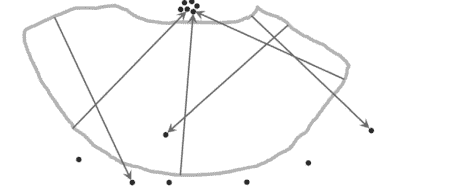

图 1.4 霍夫变换在定位圆形物体中心时的鲁棒性。边界的圆形部分给出的候选中心点集中于真实中心，而不规则的破损边界则在随机位置给出候选中心点。在本例中，该边界近似于图 1.5 所示破损饼干的边界。


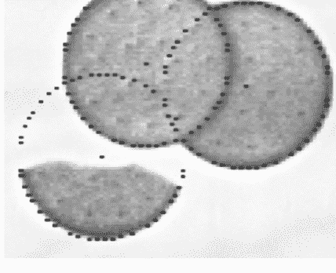

图 1.5 破碎和重叠饼干的定位结果，展示了中心定位技术的稳健性。黑色圆点表示精度，每个点与中心的径向距离误差在 1/2 像素以内。© IFS 1984。

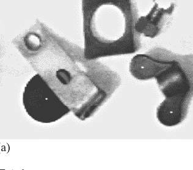

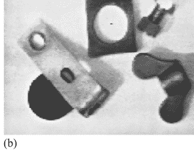

(a)

(b)

图 1.6 同时检测不同半径的物体。(a) 当半径假定在 4–17 像素范围内时，检测镜头盖和蝶形螺母；(b) 当半径假定在 −26 到 −9 像素范围内时，在同一图像中检测孔洞（由于孔洞被视为负对比度物体，因此使用负半径）：显然，在这幅图像中，可以选用更小的负半径范围。

在同一个二维参数空间中取一系列可能的 R 值——这一过程可大幅节省存储空间和计算量（Davies, 1988a）。图 1.6 显示了应用这一策略的结果，该策略对 R 的正值和负值均适用。另一方面，请注意，由于将所有投票累积在单一参数平面中，径向距离的信息已经丢失。因此，需要进一步迭代该过程，以确定每个峰值位置对应的半径。

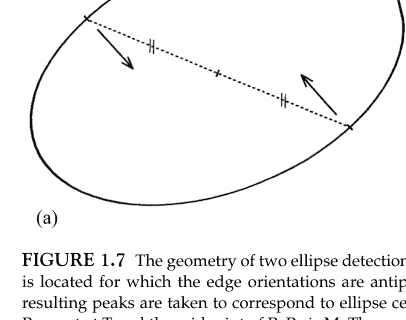

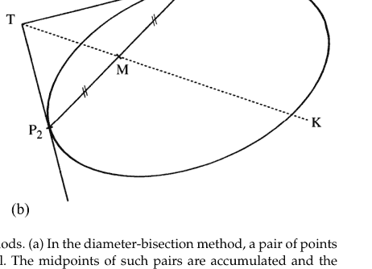

图 1.7 两种椭圆检测方法的几何原理。(a) 在直径平分法中，定位一对边缘方向反平行的点。累积这类点对的中点，所得峰值即对应于椭圆中心。(b) 在弦–切线法中，P1 和 P2 处的切线交于 T，P1P2 的中点为 M。椭圆的中心 C 位于 TM 的延长线上。

Hough 变换方法也可用于椭圆检测：图 1.7 展示了实现该目标的两种简单方法。这两种方法都体现了间接方法，即利用成对的边缘点。与弦–切线法相比，直径平分法的计算量要小得多，但它更容易产生误检——例如，当图像中两个椭圆彼此靠近时。

为证明弦–切线法的有效性，请注意对称性可确保该方法对圆形有效；射影性质则确保其对椭圆也有效，因为在正交投影下，直线投影为直线，中点投影为中点，切线投影为切线，圆投影为椭圆；此外，总能找到某个视角，使一个圆投影为给定的椭圆。

现在我们来讨论所谓的广义 Hough 变换（GHT），与上述两种方法相比，它采用更直接的过程进行椭圆检测。

要理解标准 Hough 技术如何被推广以检测任意形状，首先我们需要在理想化形状的模板中选择一个定位点 L。然后，我们需要进行安排，使得不像圆那样从边缘点沿局部边缘法线方向移动固定距离 R 直达中心，而是沿可变方向 φ 移动适当的可变距离 R 以到达 L：此时 R 和 φ 是局部边缘法线方向 θ 的函数（图 1.8）。在这种情况下，投票将在预选的物体定位点 L 处达到峰值。函数 R(θ) 和 φ(θ) 可以在计算机算法中以解析方式存储，或者对于完全任意的形状，也可以存储为查找表。无论哪种方式，该方案在原理上都极其简洁，但一个重要的复杂情况出现了，因为我们从各向同性形状（圆）转向可能处于完全任意取向的各向异性形状。

这意味着需要在参数空间中增加一个维度（Ballard, 1981）。每个边缘点随后在参数空间的每个取向平面上贡献一组投票。最后，搜索整个参数空间以寻找峰值，最高点既指示物体的位置，也指示其取向。有趣的是，椭圆可以通过 GHT 在参数空间的单一平面内检测出来，方法是对每个边缘点应用一个点扩散函数（PSF），该函数考虑了椭圆的所有可能取向：请注意，PSF 在距边缘点一定距离处施加，从而使 PSF 的中心能够通过椭圆的中心（图 1.9）。由于篇幅所限，此处无法呈现计算的细节（例如，参见 Davies, 2017 第 11 章）。

#### 1.3.3 Hough 变换在线检测中的应用

Hough 变换（HT）也可应用于线检测。早期人们发现最好避免使用通常的斜率–截距方程 y = mx + c，因为接近垂直的线需要 m 和 c 接近无穷大。因此，采用了直线的“法线”(θ, ρ) 形式（图 1.10）：

ρ = x cos θ + y sin θ
(1.47)

使用该形式应用此方法时，通过每个点 P_i 的直线集合表示为 (θ, ρ) 空间中的一组正弦曲线：例如，对于点 P_1(x_1, y_1)，正弦曲线方程为：

ρ = x_1 cos θ + y_1 sin θ
(1.48)

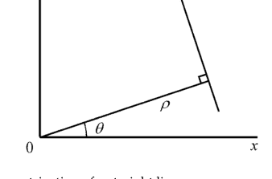

图 1.10 直线的法线 (θ, ρ) 参数化。

在 (θ, ρ) 空间中累积投票后，峰值指示原始图像中直线的存在。

已有大量工作（例如，参见 Dudani 和 Luk, 1978）致力于限制线定位中的不准确性，这些不准确性来源于多个方面——噪声、量化、线断裂的影响、轻微线曲率的影响，以及估计参数空间中精确峰值位置的困难。此外，纵向线定位的问题也很重要。对于最后一个过程，Dudani 和 Luk (1978) 开发了“xy 分组”方法，该方法涉及对每条线进行连通性分析。如果线的片段被小于约 5 像素的间隙分开，则将其合并。最后，短于某个最小长度（通常也约为 5 像素）的片段将被忽略，因为它们太微不足道，无法帮助图像解释。

总的来说，我们看到上述所有形式的 HT 都通过使用投票方案*累积证据*而获益良多。这正是该方法具有高度稳健性的根源。HT 所使用的计算过程可以描述为归纳性的而非演绎性的，因为峰值产生关于物体存在的*假设*，这些假设原则上需要由其他证据确认，而*演绎*则会直接证明物体的存在。

#### 1.3.4 使用 RANSAC 进行线检测

RANSAC 是一种替代的基于模型的搜索方案，通常可以代替 HT 使用。事实上，它用于线检测时非常高效，这就是在此介绍该方法的原因。该策略可以被理解为一种投票方案，但其使用方式与 HT 不同。它通过对目标物体进行一系列假设来运作，并通过计数在合理范围（例如 ±3σ）内与假设一致的数据点数量来确定每个假设的支持度（见图 1.11）。可以预期，对于任何潜在的目标物体，在每个阶段只保留支持度最大的假设。

接下来我们解释 RANSAC 如何用于线检测。与 HT 的情况一样，我们首先应用边缘检测器，定位图像中的所有边缘点。正如我们将看到的，RANSAC 在有限数量的点上运行效果最佳，因此找到强度梯度图像的局部极大值边缘点是很有用的。接下来，为形成一条直线假设，


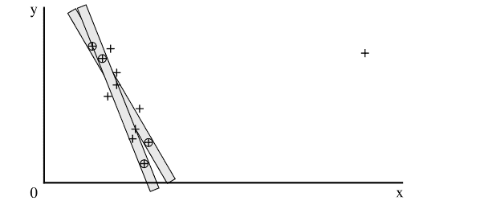

图 1.11 RANSAC 技术。这里“+”号表示待拟合的数据点，图中还展示了两个数据点对（用⊕号表示）的实例，它们可以生成假设的直线。每条假设的直线都有一个容差±t的影响区域，在该区域内寻找能够支持该直线的最大数据点数量。获得支持最多的直线被认为是最佳拟合。

## 表 1.1 用于寻找支持度最高的直线的 RANSAC 基本算法

该算法只返回一条直线：实际上，它返回的是获得支持最多的特定直线模型。支持较少的直线最终会被忽略。

```
Mmax=0;
for all pairs of edge points do {
  find equation of line defined by the two points i, j;
  M = 0;
  for all N points in list do
    if (point k is within threshold distance d of line) M ++;
  if (M > Mmax) {
    Mmax = M;
    imax = i;
    jmax = j;
    // this records the hypothesis giving the maximum support so far
  }
}
/* if Mmax > 0, (x[imax], y[imax]) and (x[jmax], y[jmax]) will be the coordinates of the points defining the line having greatest support */
```

所需要做的就是取任意一对边缘点。对于每个假设，我们遍历包含 N 个边缘点的列表，计算出有多少个点 M 支持该假设。然后我们取更多的假设（更多的边缘点对），并在每个阶段只保留给出最大支持度 M_max 的那个假设。这个过程如表 1.1 所示。

表 1.1 中的算法对应于在参数空间中找到最高峰的中心，就像霍夫变换（HT）的情况一样。为了找到图像中的所有直线，最明显的策略如下：找到第一条直线，然后消除所有支持它的点；接着找到下一条直线，并消除所有支持它的点；如此继续，直到所有点都从列表中消除。这个过程可以更紧凑地写成如下形式：

```
repeat {
    find line;
    eliminate support;
}
until no data points remain;
```

如上所述，RANSAC 涉及相当大的计算负载——达到 O(N³)——而 HT 只需 O(N)。因此，在使用 RANSAC 时，最好以某种方式减少 N。这就解释了为什么关注局部最大值而不是使用全部边缘点列表是有用的。另一种方法是，从完整列表中反复进行随机采样，直到测试了足够多的假设，从而确信所有显著的直线都已被检测到。[注意，这些想法反映了 RANSAC 这一术语的本义，即 RANdom SAmpling Consensus（随机采样一致性）——“一致性”表示任何假设都必须与可用的支持数据形成一致（Fischler 和 Bolles, 1981）。]可以通过估计漏检一条显著直线的风险来获得“所有显著直线都已被检测到”的置信度，这种漏检是因为没有考虑到位于该直线上的代表性点对。

现在我们可以考虑将 RANSAC 应用于直线检测的特定案例所得的结果。在所述的测试中，采用点对作为假设，所有边缘点都是强度梯度的局部最大值。图 1.12 所示的情况对应的是检测一个二十面体形状的木块。注意，图 1.12(a) 右侧的一条直线被漏掉了，因为必须为每条直线的支持水平设置一个下限：这是必要的，因为低于这个支持水平时，即使对于图 1.12(b) 所示的相对较少的边缘点，偶然共线的数量也会急剧增加，导致误检直线的数量急剧上升。总体而言，这个例子表明 RANSAC 是数字图像中直线定位的一个非常重要的竞争者。这里没有讨论的是，RANSAC 对于在二维和三维空间中获取许多其他类型形状的鲁棒拟合也非常有用。

最后需要提到的是，RANSAC 受沿直线的混叠效应影响比 HT 小。这是因为 HT 的峰值往往会被混叠效应打碎，因此如果不进行剧烈的图像平滑，就很难获得最佳的假设。RANSAC 在这种情况下胜出的原因在于，它并不依赖于单个假设的准确性；相反，它依赖于能够容易地生成足够多的假设，并且同样容易地丢弃它们。

#### 1.3.5 一种基于图论的目标定位方法

本节考虑一种常见且含有较多约束的情况——物体出现在水平工作台或传送带上，且与摄像机的距离已知。同时还假设：(a) 物体是扁平的，或者只能以有限数量的三维姿态出现；(b) 物体是从正上方俯视的；(c) 透视失真很小。在这种情况下，原则上可以通过极少数的点特征来识别和定位物体。

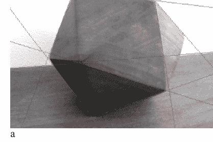

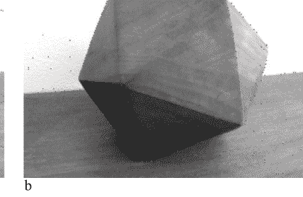

图 1.12 使用 RANSAC 技术进行直线定位。(a) 显示了一幅原始灰度图像，其中使用 RANSAC 技术定位了各种直线边缘。(b) 显示了馈送给 RANSAC 以获得 (a) 的边缘点：这些点是梯度图像的局部最大值。在 (a) 中，二十面体的三条边被漏掉了。这是因为它们是低对比度、低强度梯度的“屋顶”边。事实上，RANSAC 还漏掉了第四条边，因为对支持水平设置了下限（见正文）。

由于这些特征被认为本身没有结构，因此仅凭单个特征不可能唯一地定位一个物体，但如果两个特征是可区分的并且它们之间的距离已知，那么使用两个特征进行正向识别和定位是可能的。对于真正不可区分的点特征，所有不具备 180° 旋转对称性的物体都仍然存在歧义。因此，通常至少需要三个点特征才能在已知距离处定位和识别物体。显然，噪声和其他伪影（如遮挡）会改变这一结论。事实上，当将理想化物体中的点模板与真实图像中存在的点进行匹配时，我们会发现：

- 1. 由于图像中可能存在多个所选类型的物体实例，可能会出现大量的特征点；
- 2. 由于噪声、无关物体的杂乱或背景结构的干扰，可能会出现额外的点；
- 3. 由于噪声、遮挡或所寻找物体的缺陷，某些本应出现的点可能会缺失。

这些问题意味着我们应该尝试将理想化模板中的点的子集与图像中点的各种子集进行匹配。如果将点集视为以点特征为节点的图，那么任务就简化为子图-子图同构的数学问题，即找出图像图中的哪些子图与理想化模板图的子图同构。[同构意味着具有相同的基本形状和结构。]显然，如果点特征匹配方案能够通过搜索具有最大内部一致性——即每个物体上点匹配数量最多——的解来找到最可能的解释，那么它就会最成功。

不幸的是，上述方案在许多应用中仍然过于简单，因为它对失真的鲁棒性不够。特别是，光学（例如透视）失真

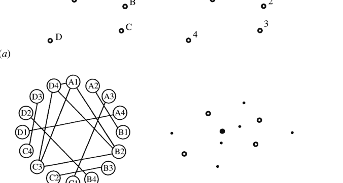

图 1.13 一般四边形的匹配问题：(a) 模型（左）和图像（右）的基本标记；(b) 匹配图；(c) 参数空间中的投票位置：小圆圈表示孔位，点表示单个投票，大点表示主峰值的位置。© AVC 1988。

可能会出现，或者物体本身可能发生变形，或者物体部分地靠在其他物体上而未能完全处于假设的姿态：因此特征之间的距离可能并不完全符合预期。这些因素意味着必须在特征对之间的距离上接受一定的容差。显然，失真会给点匹配技术带来更大的压力，并且更加需要寻找具有最大可能内部一致性的解。因此，在定位和识别物体时应尽可能多地考虑特征。最大团方法就是为此目的而提出的。

首先，在原始图像中尽可能多地识别出特征：通常，它们按照在电视光栅扫描中出现的顺序进行编号。然后需要将这些编号与理想化物体上特征对应的字母进行匹配。实现这一点的系统化方法是构建一个匹配图（或关联图），其中节点表示特征分配，连接节点的弧表示分配之间的两两兼容性。为了找到最佳匹配，有必要在匹配图中找到交叉链接最大化的区域。为此，需要在匹配图中寻找团。团是一个完全子图——即其中所有节点对都由弧连接的子图。然而，前面的论证表明，如果一个团完全包含在另一个团中，那么较大的团很可能代表更好的匹配——实际上，最大团可以被认为能够在观测图像与物体模型之间产生最可靠的匹配。

图 1.13(a) 显示了一般四边形的情况，匹配图如图 1.13(b) 所示。在这种情况下，有 16 种可能的特征分配、12 个有效的兼容性和 7 个最大团。如果发生特征遮挡，这（单独来看）会减少可能的特征分配数量以及有效兼容性的数量；此外，最大团的数量和最大最大团的大小也会


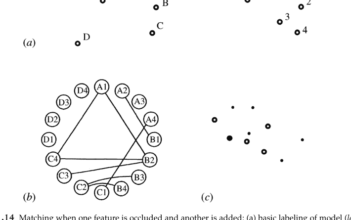

图 1.14 当一个特征被遮挡而另一个特征被添加时的匹配：(a) 模型（左）和图像（右）的基本标注；(b) 匹配图；(c) 参数空间中投票的放置（记号与图 1.13 相同）。

减少。另一方面，噪声或杂波可能增加错误特征。如果后者与现有特征的距离是任意的，那么可能的特征分配数量会增加，但匹配图中不会再有更多的相容性，因此匹配图只会增加微不足道的复杂性。然而，如果额外特征出现在与现有特征允许的距离上，这将在匹配图中引入额外的相容性，使其分析更加繁琐。在图 1.14 所示的情况中，两种复杂情况——遮挡和额外特征——同时出现：现在有 8 个成对分配和 6 个极大团，总体上比图 1.13 的原始情况少得多。然而，重要的事实是，最大的极大团仍然指明了图像最可能的解释，因此该技术本质上具有很高的鲁棒性。

图 1.15(a) 显示了一对奶油饼干，它们需要通过其“定位孔”来定位——这种策略是有利的，因为它有可能在详细检查之前实现高精度的产品定位。图 1.15(a) 中显示了由简单模板匹配程序找到的孔：所用模板相当小，因此该程序速度较快，但无法找到所有孔；此外，它还可能产生误报。因此，必须使用“智能”算法来分析孔位置数据。对上述示例中的数据分析产生了两个非平凡的极大团，每个团都正确对应于图像中的两块饼干之一。

#### 1.3.6 使用广义霍夫变换（GHT）节省计算量

在这些示例中，检查哪些子图是极大团是一个表述简单的问题。不幸的是，最优极大团算法的执行时间不受限于 M 的多项式（对于包含多达 M 个节点的极大团的匹配图），而是受限于一个变化更快的函数。具体来说，寻找极大团的任务已知是“NP 完全”的，并且以指数时间运行。因此，无论对于 M 值上限约为 6 时的运行时间如何，对于 M 值上限约为 10 时，运行时间通常会慢 100 倍，而对于 M 大于约 14 时，又会再慢 100 倍。

我们现在将看到如何将 GHT 用作极大团方法的替代方案。要应用 GHT，我们首先列出所有特征，然后在参数空间中针对每一对特征一致的每个可能的定位点 L 位置累积投票（图 1.16）。要继续进行，只需将特征间距离用作 GHT R 表中的查找参数。对于不可区分的点特征，这意味着对于每个特征间距离值，必须有 L 位置的两个条目。该过程通过图 1.13 的一般四边形示例来说明：这在参数空间中产生 7 个峰值，其权重为 6、1、1、1、1、1、1（见图 1.13(c)）。图 1.14 也存在类似情况。仔细检查图 1.13 和图 1.14 表明，参数空间中的每个峰值都对应于匹配图中的一个极大团。实际上，两者之间存在一一对应关系，因此正确的相容性既有助于形成大的极大团，也有助于在参数空间中形成大的峰值。即使出现遮挡或存在额外特征，这种情况仍然成立（见图 1.14）。

最后，再次考虑图 1.15(a) 的示例，这次使用 GHT 获得解决方案。图 1.15(b) 显示了由 GHT 找到的候选对象中心的位置。孤立的小十字表示单个投票的位置，而那些非常靠近两个大十字的投票分别在这两个位置形成了权重为 10 和 6 的投票峰值。因此，对象定位既准确又鲁棒，符合要求（Davies，1988b）。

接下来，我们比较极大团方法和 GHT 方法在对象定位方面的计算需求。为简单起见，假设一幅图像只包含一个完全可见的、具有 n 个特征的对象示例，并且我们试图通过寻找所有可能的成对相容性来识别它。

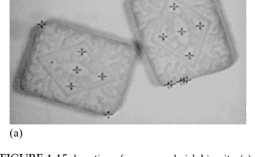

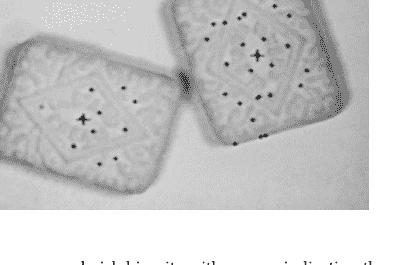

图 1.15 奶油夹心饼干的定位；(a) 两块奶油夹心饼干，十字表示应用简单孔检测程序的结果；(b) 通过 GHT 从 (a) 中的孔数据可靠定位的两块饼干：孤立的小十字表示单个投票的位置。© AVC 1988。

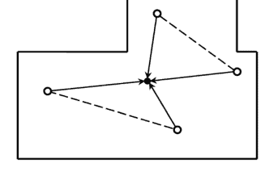

图 1.16 从成对特征位置定位 L 的方法：当对象没有对称性时，每对特征点在参数空间中给出两个可能的投票位置。当存在对称性时，某些特征对可能产生多达 4 个投票位置：仔细检查图 1.15(b) 可以确认这一点。

对于一个具有 n 个特征的对象，匹配图包含 n² 个节点（即可能的分配），并且在构建图时需要检查的成对相容性有 n²C₂ = n²(n² − 1)/2 个。此阶段分析的计算量为 O(n⁴)。此外，还必须加上寻找极大团的代价。由于该问题是 NP 完全的，负载以接近 n² 的指数速率增长。

现在考虑通过成对相容性让 GHT 找到对象的代价。正如所见，参数空间中所有峰值的总高度等于匹配图中成对相容性的数量。因此，计算负载具有相同的数量级，即 O(n⁴)。接下来是定位参数空间中所有峰值的问题。对于 N × N 的图像，只需访问参数空间中的 N² 个点，计算负载为 O(N²)，尽管在投票期间持续记录最大值位置可以显著减少计算量（Davies，1988b）。

#### 1.3.7 基于部件的方法

上述对象定位方法往往依赖于遵循相当明确几何模型的对象，而一种完全不同的方法是使用诸如可变形模型之类的方法来定位和识别它们。此类方法旨在考虑由光照、视点以及形状和颜色等属性变化引起的外观变化。这在搜索道路场景中的行人或人脸时尤其重要，这里仅举两个重要例子。此类别中的方法包括刚性模板（Dalal 和 Triggs，2005）、特征袋（Zhang 等人，2007）、可变形模板（例如 Cootes 和 Taylor，2001）以及基于部件的模型（例如 Amit 和 Trouvé，2007；Leibe 等人，2008）。可变形部件模型使用排列在可变形配置中的部件集合进行训练。这种方法在 2010 年随着 Felzenszwalb 等人（2010）的工作而崭露头角，当时它被证明可以在困难的数据集上产生高效、准确、最先进的结果。

可变形部件模型（DPM）基于这样的思想：对象可以被视为部件的集合。因此，要检测人脸等对象，只需定位部件并检查它们之间的相互关系即可。这可以通过识别部件及其边界框，然后提出将它们组合成代表对象的更大边界框的建议来实现。基本上，一旦找到对象边界框，这些区域就通过非极大值抑制得到保护，免于进一步分析。在实践中，这意味着为每个潜在的边界框打分，保留最高分，并跳过任何与现有边界框重叠超过临界百分比（例如 50%）的边界框。这种方法非常成功，在 PASCAL VOC 2006、2007 和 2008 基准测试上取得了最先进的结果（Everingham 等人，2006；2007；2008），并“确立了其作为通用对象检测事实标准的地位”（Mathias 等人，2014）。Mathias 等人非常彻底地测试了 DPM 方法，并表明它可以实现人脸检测的顶级性能。

有趣的是，DPM 方法允许定位明显的 3D 对象——但无需直接考虑其 3D 几何形状，这是通过对相关对象类型进行充分多样的训练来实现的。另一个受欢迎的能力是，该方法对于定位关节式对象也非常有效。

DPM 方法意义重大，因为它构成了性能评级更高的深度学习方法的基础——如 Bai 等人（2016）和其他研究者所实现的那样。（有关深度学习方法，请参阅第 F 部分。）

### 1.4 C 部分 – 3D 对象定位与不变性的重要性

#### 1.4.1 3D 视觉导论

在本章的前几部分中，通常假设对象基本上是平面的，并且以其只有三个自由度的方式被观察——即两个与位置相关的自由度，以及一个与方向相关的额外自由度。虽然这种方法足以执行许多有用的视觉任务，但它不足以解释大多数室外或室内场景，甚至不足以帮助完成相当简单的机器人装配和检查任务。事实上，在过去几十年中，已经发展了大量理论并得到实验支持，以研究如何详细理解由真实 3D 对象组成的场景。

一般来说，这意味着试图解释其中对象可能以完全任意的位置和方向出现——对应于六个自由度的场景。解释此类场景，并推导任意对象集合的平移和旋转参数，需要大量的计算——部分原因是由于从 2D 图像推断 3D 信息时固有的模糊性。然而，有各种方法可用于进行 3D 视觉处理，并且通常需要巧妙地组合这些方法才能成功解释 3D 场景。

在进一步讨论之前，我们给出场景中一般点 (X, Y, Z) 在所谓“透视投影”下的成像方程；这产生图像点：

(x, y) = (f X / Z, f Y / Z)  (1.49)

其中 f 是所用透镜的焦距。

我们现在可以介绍人类视觉系统所采用的方法——双目视觉。用于此目的的双目相机系统如图 1.17 所示。随着


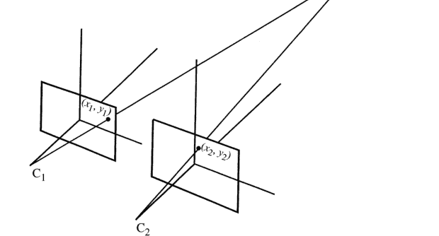

图 1.17 使用两个透镜的立体成像。两个光学系统的光轴平行，即光轴之间没有“会聚角”。

在这种几何关系中，空间中的任意一点在两幅图像中分别表示为 $(x_1, y_1)$ 和 $(x_2, y_2)$。一般而言，两个光学系统的光轴不必平行，会呈现出非零的“会聚”角。然而，零会聚的情况经常被采用，为了简化，这里也只考虑这种情况。请注意，场景中同一点 $(X, Y, Z)$ 对应的两组坐标会有所不同，因为光轴之间的基线 $b$ 会导致该点在两幅图像中的相对位移，即“视差”。

接下来，在基线 $b$ 的垂直平分线上适当选择 $Z$ 轴，我们可以得到两个方程：

$$x_1 = (X + b/2)\, f / Z \tag{1.50}$$

$$x_2 = (X - b/2)\, f / Z \tag{1.51}$$

计算视差 $D = x_1 - x_2$ 后，即可直接求得深度 $Z$：

$$Z = b f / (x_1 - x_2) \tag{1.52}$$

虽然这看起来是进行三维视觉处理的理想方法，但存在一个根本性问题——如何确认立体图像对中的两个点确实对应原始场景中的同一个点。还需注意，为了获得高精度的深度测量，需要较大的基线 $b$；但不幸的是，随着 $b$ 的增大，两幅图像之间的对应性会下降，因此寻找匹配点变得更加困难：这是因为两幅图像会变得越来越不同，越来越难以匹配。

处理上述立体对应问题的标准方法是极线法，如图 1.18 所示。

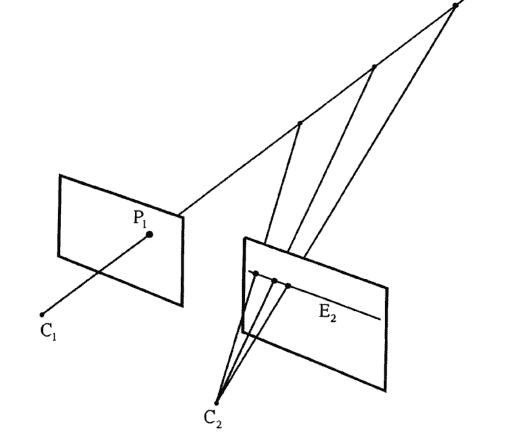

图 1.18 极线的几何关系。第一幅图像平面中的某个点 P₁ 可能来自场景中一条直线上的任意一点，并且可能出现在第二幅图像平面中所谓的极线 E₂ 上的任何位置。

要理解这一技术，可以设想我们在第一幅图像中找到了一个显著的点，并在目标场中标记所有可能产生该点的点。这会在场景中不同深度处标出一条点的轨迹，而当从第二幅图像平面观察时，可以在该平面内构造出一条点的轨迹。这条轨迹（在另一幅图像中）就是对应于原始图像点的极线。如果我们沿着极线在第二幅图像中搜索类似显著的点，找到正确匹配的机会就会大大增加。这种方法不仅减少了寻找对应点所需的计算量，还显著降低了误匹配的发生率。在图 1.17 的简单几何关系中，所有极线都平行于 x 轴，但这仅适用于零会聚的情况。需要注意的是，由于场景中某些点可能只在一幅图像中成像而在另一幅图像中不成像，对应问题会变得更加困难：这可能是因为遮挡或其中一个点的严重畸变所致。因此，有必要以场景中连续物体表面的形式搜索一致的解集合。

对应问题带来的困难催生了多种替代方法。其中最著名的方法之一是“由明暗恢复形状”——通过分析表面的表观亮度来绘制表面朝向的变化。尽管这种方法取得了许多成果，但它需要对表面的反射率和镜面反射特性以及这些特性如何随（a）表面和（b）照明光源的方向变化作出假设，还需要应用复杂的迭代算法——这些内容无法在此详述。类似地，“光度立体法”通过依次用不同的光源照射场景并分析所得图像来恢复形状，也过于复杂，无法在此详细讨论。

接下来，“由纹理恢复形状”是一种通过分析纹理元素的相对面积来获取表面朝向细节的方法。然而，这是一种专门方法，应用并不频繁。另一种方法是“结构光”——通常是将光条纹图案或其他光点或光栅排列投射到目标场上——这种方法在工厂生产线上的检测和装配中得到了极其广泛的应用，尽管很难说它在监控等其他类型的应用中也被广泛使用。同样，这必须被视为一种专门技术，而非通用的三维物体形状测量方法。

需要指出的是，上述方法中除最后一种外，其他方法得到的都是表面朝向图，而非深度本身的测量，因此深度和表面形状的计算必须从原始的朝向测量中推导得出。

总体而言，上述方法采用各种手段来估计场景中所有位置的深度，从而能够以相当详细的程度绘制出三维表面。然而，它们并不能指示这些表面代表什么。在某些情况下，可能很清楚某些平面是背景的一部分，例如房间的地板和墙壁，但一般而言，单个物体本身并不容易被识别出来。事实上，物体往往会相互融合并与背景融合，因此需要专门的方法来分割三维“空间图”并最终识别物体，给出其位置和朝向的详细信息。显然，获取三维物体的深度图并不比获取边界图（如质心轮廓）更接近识别目标：后者也只能帮助识别二维物体。必须设计特定的手段来执行识别任务。不幸的是，这一任务在三维中比在二维中困难得多。例如，虽然霍夫变换原则上可以应用于两种情形，但在三维中它比二维中要复杂得多、计算量也大得多，因为对于没有未知形状参数的静态形状，自由参数的数量通常会从 3 个增加到 6 个——平移有 3 个自由度，旋转有 3 个自由度。还需要注意，计算复杂度通常不是随自由度数线性变化，而是随其指数变化。

还有一点需要补充：在过去的几年中，已经研制出能提供 RGB-D（彩色和深度）输出的传感器，这些传感器通过光学“飞行时间”提供深度信息。激光雷达是众所周知的，但价格昂贵，且更适用于远距离；而基于矩阵的飞行时间相机则更适用于近距离，通常使用间隔几纳秒的激光脉冲。这些类型的进展有助于解决立体对应问题。然而，它们并没有消除解释三维表面的问题，因为物体识别算法需要应对的大量自由度仍然是个难题：相反，这些进展恰恰凸显出这是最重大的遗留问题。

由于计算复杂度是这些问题的主要根源，因此很自然地对每个深度图提取显著特征并据此解释场景：一旦我们基于相对较少的显著特征获得物体描述，而不是大面积的表面描述，就有希望实现快速、可靠的识别。我们将在下一节中进一步探讨这种可能性。

#### 1.4.2 透视投影下的姿态歧义

在本节中，我们定义弱透视和全透视，并旨在理解透视 n 点（PnP）问题——即在各种透视形式下根据 n 个特征求取物体姿态的问题。


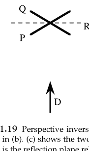

图 1.19 飞机的透视反转现象。图中显示一架飞机 (a) 在天空背景下呈现为剪影，其外观如 (b) 所示。(c) 展示了相对于观察方向 D，飞机可能位于的两个平面 P 和 Q：R 是关联平面 P 和 Q 的反射平面。

完整透视投影（FPP）是物体与其图像之间投影的基本形式，它导致例如平行线不再保持平行，大多数形状出现畸变——甚至圆形也会呈现为椭圆形。弱透视投影（WPP）是对于远距离物体出现的透视投影形式，此时满足 ΔZ ≪ Z。它可以被视为与“缩放正交投影”相同——正交投影是若物体通过平行光线正交投影到图像平面上所发生的投影类型；而缩放则解释了物体表观尺寸减小的现象。

由于 WPP 不会扭曲物体形状（例如，一个金属丝立方体的背面与其正面看起来具有相同的大小和形状），因此用它来建模成像过程更为简单。然而，这种投影形式过于简单，以至于在观察平面物体时可能导致歧义。这一点在图 1.19 中得到展示，该图说明一个远处飞机的二维视图可能对应于两种朝向之一，因为仅能从单一视图确定平面朝向 α 的余弦值。有趣的是，当 α 非零时，FPP 会给飞机的形状增加额外的畸变，此时真实的朝向才能被识别出来。

表 1.2 展示了当通过一个或多个特征检测平面物体时，这种情况的全部程度。该表反映了上述提到的整体 PnP 问题。在共面情况下（即物体的所有 n 个特征共面），我们从表中看到 WPP 从不给出无歧义的解释，而 FPP 则可以——但仅当 n 大于 3 时。FPP 需要 n 大于 3 才能给出无歧义结果的原因在于，它涉及如此多的参数，以至于 3 个特征不足以解决该情况；然而，当存在 4 个或更多特征时，完整情况可以被解决，歧义被消除。但为什么 WPP 也无法做到这一点呢？原因是在 WPP 下，任何额外特征（超过 3 个）的位置都可以从前 3 个特征推导出来，因此它们不能提供额外信息：因此 WPP 无法导致歧义被消除。

请注意，当 n 为 1 或 2 时，至少存在一个旋转自由度，因此有无限多个解。至此，我们已经处理了表上半部分的所有可能性，即涉及共面物体的情况。接下来我们转向非共面情况，在表的下半部分处理。n ≤ 3 的情况已在表的上半部分处理过，因此非共面情况仅涉及 n > 3 的情形。

现在让我们考虑在 WPP 下观察 4 个特征时会发生什么。将两个特征与另外两个特征中的每一个依次组合，我们可以生成两个平面。当这些平面上的 3 个特征被观察时，将生成两个具有不同 α 值的解，且只能有一个一致解。这完成了我们对表 1.2 中 WPP 条目（特别是非共面情况）的理解。图 1.20(a–c) 很好地说明了这一情况。但请注意图 1.20(d) 所示的警示性情况，它展示了具有特殊对称性的物体如何可能遭受残余歧义的影响。

表 1.2 从点特征估计位姿时的歧义。此表总结了从单幅图像中的点特征估计刚性物体位姿时将获得的解的数量。假设 n 个点特征被正确检测和识别且顺序正确。列 WPP 和 FPP 分别表示弱透视投影和完整透视投影。表的上半部分适用于所有 n 个点共面的情况；表的下半部分适用于 n 个点非共面的情况。注意当 n ≤ 3 时，结果严格仅适用于共面情况。但表下半部分的前两行被保留以便于比较。

| 点的排列 | n | WPP | FPP |
|---|---|---|---|
| 共面 | ≤ 2 | ∞ | ∞ |
|  | 3 | 2 | 4 |
|  | 4 | 2 | 1 |
|  | 5 | 2 | 1 |
|  | ≥ 6 | 2 | 1 |
| 非共面 | ≤ 2 | ∞ | ∞ |
|  | 3 | 2 | 4 |
|  | 4 | 1 | 2 |
|  | 5 | 1 | 2 |
|  | ≥ 6 | 1 | 1 |

为了充分理解在 FPP 下观察超过 3 个非共面点的情况，我们需要考虑这样一个事实：有 11 个相机标定参数（参见第 1.4.10 节）需要从 12 个线性齐次方程中确定，这意味着通常至少需要 6 个非共面点（涉及 2 × 6 个图像坐标）来计算全部 11 个参数。因此，尽管 FPP 使情况更加复杂，它也提供了更多信息，通过这些信息最终可以消除歧义。

最后，需要强调的是，上述讨论假设物体与图像特征之间的对应关系全部已知，即 n 个点特征被正确检测和识别且顺序正确。如果不是这样，考虑到相当少量点的可能排列数量，可能解的数量可能会大幅增加。限制这个问题的一种方法是注意到在弱透视或完整透视投影下观察的共面点总是以相同的循环顺序出现：考虑到物体可能的畸变，检查这一点并非易事，不过如果可以通过这些点画出一个凸多边形，其边界上的循环顺序在投影后不会改变，因为平面凸性是投影的不变量。然而，对于非共面点，感知点的模式可以几乎随机地重新排列自身：这意味着对于非共面点，需要考虑的点排列数量将远远大于共面点。另一个考虑因素是，用于物体识别的特征点不应共线或呈现任何特殊模式，并且应可描述为处于一般位置：否则存在某些歧义无法如 表 1.2 所示被消除的风险（最终原因是尝试确定相机标定参数时会出现不可逆方程）。

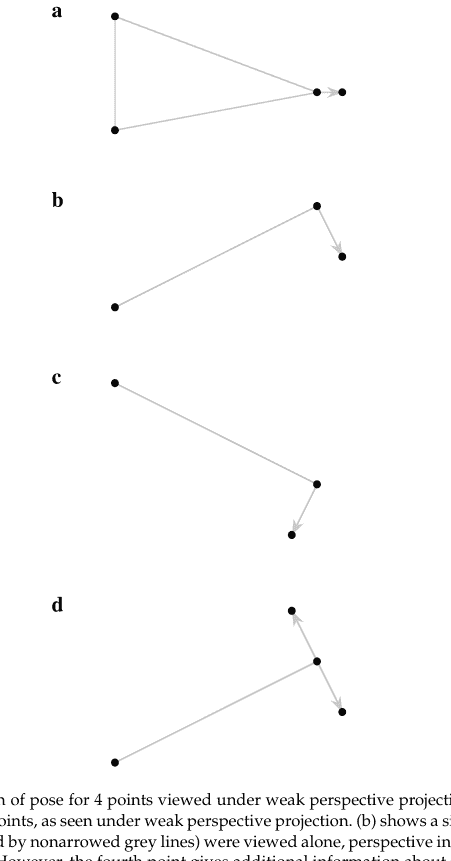

图 1.20 在弱透视投影下观察 4 个点的位姿确定。(a) 显示了一个包含四个非共面点的物体，在弱透视投影下观察到的情形。(b) 显示了物体的侧视图。如果仅观察前三个点（由不带箭头的灰色线条连接），透视反转会产生第二种解释 (c)。然而，第四个点提供了关于位姿的额外信息，使得仅允许一个整体解释。但对于如 (d) 中包含额外对称性的物体则非如此，因为其反射将与原始视图完全相同（未显示）。

#### 1.4.3 不变量作为三维识别的辅助手段

不变量对于 2-D 和 3-D 中的物体识别都很重要。不变量的基本思想是找到一些在物体不同实例或位置之间不变的参数，并利用它们来促进物体识别。正如我们将看到的，透视使得一般 3-D 情况下的问题变得困难得多。

让我们首先考虑一个平面物体被相机从正上方观察的情况，相机的光轴垂直于物体所在的平面。考虑物体上的两个点特征，如角点或小孔。如果我们在图像中测量特征间距离，它将作为一个不变量，因为：

- 1. 其值独立于物体的平移和朝向参数；
- 2. 对于相同类型的不同物体，该值保持不变；
- 3. 一般来说，它将不同于物体平面上其他物体的相应参数。

因此，距离的测量提供了一种特定的查找或索引特性，理想情况下能唯一识别物体，尽管还需要进一步分析来完全定位它并确定其朝向。因此，特征间距离具有 2-D 不变量的所有要求。当然，这里我们忽略了由于空间分辨率不足、噪声、镜头畸变等原因造成的测量不精确；此外，部分遮挡或破损的影响也被忽略。显然，单一不变量度量所能达到的效果是有限的。特别是，它无法应对物体尺度变化。将相机移近物体平面并重新聚焦会完全改变情况，物体索引表中所有距离不变量的值都必须更改，旧值被忽略。然而，稍加思考就会发现最后一个问题是可以克服的。我们需要做的只是取距离的比值。这要求至少要在图像中识别 3 个点特征，并测量 2 个特征间距离。如果我们称这 2 个距离为 d₁ 和 d₂，那么比值 d₁ / d₂ 将作为一个与尺度无关的不变量，即无论物体的 2-D 平移、朝向或表观尺寸或尺度如何，我们都能通过一次索引操作识别物体。


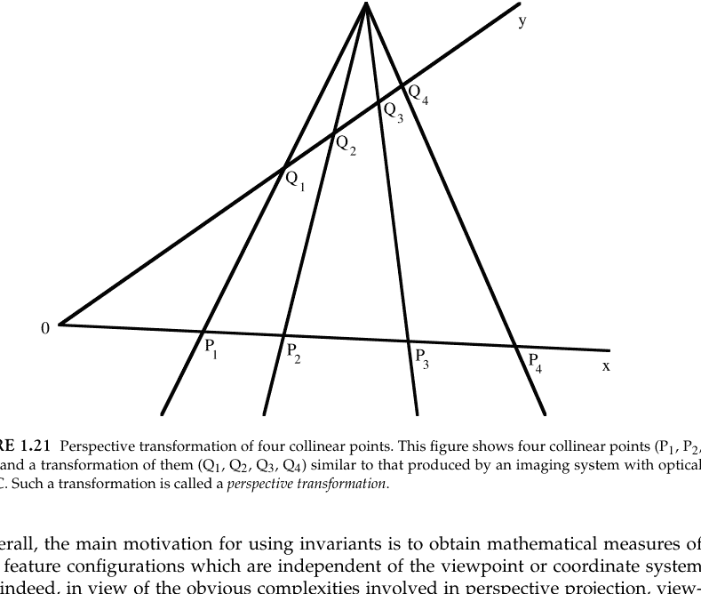

图 1.21 四个共线点的透视变换。本图显示了四个共线点（P₁, P₂, P₃, P₄）及其变换（Q₁, Q₂, Q₃, Q₄），与具有光心 C 的成像系统产生的变换相似。这种变换称为透视变换。

总体而言，使用不变量的主要动机是为了获得物体特征构型的数学度量，这些度量与所使用的视角或坐标系无关：事实上，鉴于透视投影所涉及的明显复杂性，视角不变性是三维物体识别中的一个关键因素，需要使用透视不变量。

#### 1.4.4 交比：‘比的比’概念

如果我们能将上述思想扩展以帮助在一般三维变换下观察到的物体的识别，那将是最有用的。事实上，一个明显的问题是，距离的比的比是否会导致提供合适推广的不变量。答案是，比的比确实提供了进一步的有用不变量，如下所述。

为了确定合适的距离比的比，我们首先考察物体上的一组 4 个共线点。图 1.21 显示了这样一组 4 个点（P₁, P₂, P₃, P₄）及其变换（Q₁, Q₂, Q₃, Q₄），例如由具有光心 C（c, d）的成像系统产生的变换。选择一对合适的斜轴可使两组点的坐标分别表示为：

(x₁, 0), (x₂, 0), (x₃, 0), (x₄, 0)

(0, y₁), (0, y₂), (0, y₃), (0, y₄)

取点 Pᵢ, Qᵢ，（i = 1, …, 4）我们可将比值 CQᵢ : PQᵢ 同时写为 c / -xᵢ 和 (d - yᵢ) / yᵢ。令这两个量相等立即得到：

$$\frac{c}{x_i} + \frac{d}{y_i} = 1 \tag{1.53}$$

经过对该关系全部 4 个版本的直接运算，并取合适的差值以消除所有绝对位置，我们最终得到公式：

$$\left(\frac{x_2 - x_4}{x_3 - x_4}\right) / \left(\frac{x_2 - x_1}{x_3 - x_1}\right) = \left(\frac{y_2 - y_4}{y_3 - y_4}\right) / \left(\frac{y_2 - y_1}{y_3 - y_1}\right) \tag{1.54}$$

这证实可以构造一个对透视变换不变的参数。特别是，从任何透视视角观察的 4 个共线点产生交比的相同值，定义为：

$$C(P_1, P_2, P_3, P_4) = \frac{(x_3 - x_1)(x_2 - x_4)}{(x_2 - x_1)(x_3 - x_4)} \tag{1.55}$$

以下我们将把这个特定的交比写为 κ。注意，4 个共线点在一条直线上可以有 4! = 24 种排列方式，因此任何物体的交比值可能有 24 个。然而它们并不都不同，事实上只有 6 个不同的值：很容易证明这些值是 κ、1 − κ、κ/(κ − 1) 及其倒数。有趣的是，反向编号点（这相当于从另一侧观察该线）使交比保持不变。尽管如此，同一个不变量有 6 种不同的表现形式是不方便的，因为这意味着在识别物体的类别之前必须查找 6 个不同的索引值。另一方面，如果点是沿每条线按顺序标记而不是随机标记，则可以规避这种情况。

迄今为止我们只能产生一个射影不变量，这对应于 4 个共线点的相当简单的情形。当注意到 4 个共线点与另一个点结合时，定义了通过后一点的一束共点共面线时，该测度的有用性大大增强。显然，我们可以为这束线分配一个唯一的交比，等于通过它们的任何线上共线点的交比。事实上，通过考虑各线之间的角度并四次应用正弦定律可得到公式：

$$C(P_1, P_2, P_3, P_4) = \frac{\sin\alpha_{13} \sin\alpha_{24}}{\sin\alpha_{12} \sin\alpha_{34}} \tag{1.56}$$

因此，交比仅取决于线束的角度。

我们可以将这一概念扩展到 4 个共点平面，因为一旦定义了单独的共点轴，共点线就可以投影到 4 个共点平面。由于存在无限多个这样的轴，平面集合的选择方式也是无限多的。因此，关于共线点的原始简单结果可以扩展到更一般的情况。

最后，注意我们最初试图推广 4 个共线点的情形，但我们所取得的是首先找到一种对偶情形，其中点变为线也由交比描述，然后找到一种扩展，其中平面由交比描述。我们现在回到 4 个共线点的情形，看看如何以其他方式扩展它。

#### 1.4.5 非共线点的不变量

首先，设想并非所有点都共线：具体来说，假设有一个点与其他 3 个点不共线。如果是这种情况，则没有足够的信息来计算交比。然而，如果还有一个共面的点可用，我们可以在非共线点之间画一条虚线，使其与通过其他 3 个点的线相交：这将允许计算交比（图 1.22(a)）。尽管如此，这距离对一组非共线点的表征的一般解还有一段距离。我们可能会询问平面上一般位置需要多少个点特征才能计算出一个不变量。事实上，答案是 5，因为我们能从 4 条线之间的角度形成交比这一事实立即意味着由 5 个点形成 4 条线的线束定义了一个交比不变量（图 1.22(b)）。

虽然该交比的值为两组 5 个一般共面点之间匹配提供了必要条件，但它可能是偶然的匹配，因为该条件仅取决于各点与参考点之间的相对方向，即任何非参考点仅在它位于给定线上时才被定义。显然，由取两个参考点形成的两个交比将唯一地定义所有剩余点的方向（图 1.22(c)）。有趣的是，虽然这种程序可能产生至少 5 个交比，但事实证明只有两个是功能上独立的——本质上是因为一旦知道某一点相对于另外两点的方向，其位置就被确定了。

请注意，图 1.22 遗漏了一个进一步有趣的情形——两个点和两条线的情况。构造一条连接两个点的线并将其延长直到与两条线相交，我们得到一条线上的 4 个点；因此该构型由单个交比表征。还请注意，两条线可以延长直到相交，并且可以从交点构造出进一步的线以与两个点相交：这给出了一束由单个交比表征的线：后者的值必须与为 4 个共线点计算的值相同。

接下来，我们考虑在实际情况下寻找地面平面的问题——例如包括车辆引导的自我运动。假设一组 4 个共线点可以从一帧观察到下一帧。如果它们位于同一平面上，则交比将保持不变，但如果其中一个点高于地面平面（如道路上的凸起情况），则交比会随时间变化。取更多点，应该可以通过排除法推断出哪些点在地面平面上，哪些不在：请注意，所有这些都可以在不进行相机标定的情况下实现，这是在使用射影不变量时的一个主要优势。请注意，存在关于无关平面的潜在问题，例如建筑物的垂直面。交比测试对视角和姿态的抵抗力如此之强，以至于它仅仅确定被测试的点是否共面。但通过使用足够多的独立点集，可以将一个平面与另一个平面区分开来。


a

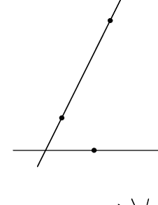

b

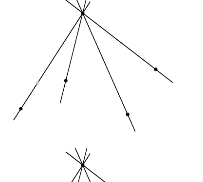

c

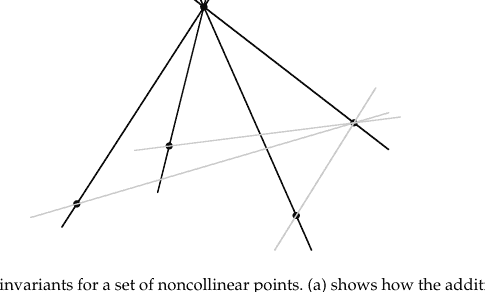

图 1.22 对一组非共线点的不变量计算。（a）展示了如何通过向四点集合中添加第五个点（其中一点与其它点不共线）来计算交比。（b）展示了如何将计算扩展到任意非共线点集合；同时还显示了一个额外的（灰色）点，单个交比无法将其与同一直线上的其它点区分开。（c）展示了如何通过计算由五个原始点生成的第二个束的交比来克服任何无法唯一识别点的失败。

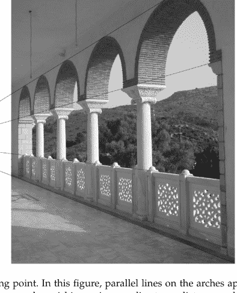

图 1.23 消失点的定位。在此图中，拱门上的平行线似乎收敛到图像外的消失点 V。一般来说，消失点可以位于任何距离，甚至可能位于无穷远处。

#### 1.4.6 消失点检测

本节我们讨论消失点（VPs）及其检测方法。首先，有用的是理解，VP 的简单线索使人脑对图像产生深刻理解，并在很大程度上帮助其全局解释图像中正在发生的事情：因此它为机器开始解释提供了一个潜在的捷径。这在包含完整透视投影所有复杂性的真实三维图像的情况下很有价值：因此，投入大量精力用于 VPs 的检测和使用也就不足为奇了。

通常，VP 检测分为两个阶段进行：首先，我们定位图像中的所有直线；接下来，我们找出通过公共点的直线——后者被解释为 VPs。使用 Hough 变换寻找直线应该很直接，尽管纹理边缘有时会妨碍直线被准确、一致地定位。基本上，定位 VPs 需要第二次 Hough 变换，其中整条直线在参数空间中累积，导致多条直线重叠处出现明确定义的峰值（即 VPs）。实际上，投票的直线必须延伸以覆盖所有可能的 VP 位置。当 VPs 出现在原始图像空间内时，该程序是足够的，但经常会发生它们位于原始图像之外（图 1.23），甚至可能位于无穷远处。这意味着即使扩展到原始图像空间之外，类似图像的参数空间也无法成功使用。另一个问题是，对于远处的 VPs，参数空间中的峰值会分散在相当大的距离上，因此检测灵敏度很差，定位精度也很低。

幸运的是，Magee 和 Aggarwal（1984）找到了定位 VPs 的改进表示。他们在摄像机的投影中心周围构造了一个单位球 G，称为高斯球，并用 G 代替扩展的图像平面作为参数空间。在此表示中，即使 VPs 本应出现在无穷远处，它们也出现在有限距离。为了使该方法有效，两个表示之间必须有一一对应关系，这显然是成立的（请注意，高斯球的后半部分未被使用）。然而，高斯球表示并非没有问题：特别是，许多无关的投票来自现实三维空间中不平行的直线（通常，只有图像中一小部分直线会通过 VPs）。为了解决这个问题，成对的直线依次考虑，只有在判断每对直线的交点可能源自三维空间中平行的直线时（例如，它们在图像中应具有相容的梯度），才将其累积为投票。此过程大幅限制了参数空间中记录的投票数量和无关峰值的数量。尽管如此，总体成本仍然相当可观，与直线对的数量成正比。因此，如果有 N 条直线，对的数量为 ^N C_2 = 1/2 N(N − 1)，因此结果为 O(N²)。

上述程序很重要，因为它提供了一种高度可靠的搜索 VPs 的方法，并能在很大程度上排除孤立直线和图像杂乱。注意，对于移动机器人或其他系统，相继图像中看到的 VPs 之间的对应关系将导致对每个图像解释的确定性大大提高。

#### 1.4.7 关于消失点的更多内容

交比不变量的一个优点是它可以在许多情况下出现，并且每次都能提供又一个巧妙的结果。一个有趣的例子是当道路或人行道上有边界界定清晰且易于测量的石板时。它们可用于估计地面平面上消失点的位置。想象从上方斜视石板，摄像机或眼睛水平对齐。然后我们有图 1.24 的几何关系，其中点 O、H₁、H₂ 位于地面平面上，而 O、V₁、V₂、V₃ 位于图像平面上。

如果我们取 C 为投影中心，由点 O、V₁、V₂、V₃ 形成的交比必须具有与由点 O、H₁、H₂ 和水平方向上的无穷远点形成的交比相同的值。假设 OH₁ 和 H₁H₂ 的已知长度为 a 和 b，令交比值相等得到：

$$\frac{y_1(y_3 - y_2)}{y_2(y_3 - y_1)} = \frac{x_1}{x_2} = \frac{a}{a + b} \tag{1.57}$$

[注意，在图 1.24 中，y 值是从 O 而不是从 V₃ 测量的。] 这使我们能够估计 y₃。取 a = b（这对于石板来说很可能成立）我们发现：

$$y_3 = \frac{y_1 y_2}{2y_1 - y_2} \tag{1.58}$$

求得 y₃ 后，我们就计算出了消失点的方向，无论其所在的地面平面是否实际水平，无论摄像机轴是否
水平。注意，这个证明实际上并不假设点 V1、V2、V3 在原点正上方，也并不假设直线 OH1H2 是水平的，只是这些点沿着两个共面直线，并且 C 在同一平面内。

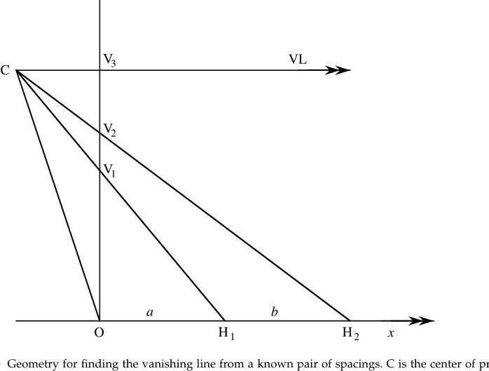

图 1.24 由已知的一对间距寻找消失线。C 是投影中心。VL 是消失线方向，与地面平面 OH1H2 平行。尽管摄像机平面 OV1V2V3 被绘制成与地面平面垂直，但这对于算法的成功运行并非必要（见正文）。

#### 1.4.8 总结：不变量的价值

第 1.4.2–1.4.6 节旨在对不变量这一重要主题及其在图像识别中的应用提供一些见解。当考虑距离的比的比时，该主题开始发展，这一想法自然地导向交比不变量。虽然其最初的体现在于其对直线上点间距识别的应用，但它立即推广到直线束的角度间距，以及相交平面的角度分离。这一想法的进一步扩展是发展能够描述非共线点集合的不变量，两个交比足以表征平面上 5 个非共线点的集合。

还有许多其他定理和不变量类型，但篇幅限制只能在此提及。作为对上面讨论的点和线示例的扩展，已产生了涵盖二次曲线的、二次曲线和两条共面非相切直线、二次曲线和两个共面点、两个共面二次曲线的不变量。总的来说，不变量的价值在于能够以计算高效的方式检查点或其他特征是否可能属于特定物体。此外，它们在无需摄像机标定或知道摄像机视点的情况下实现这一目标（尽管隐含假设摄像机是欧几里得的）。

#### 1.4.9 相机标定的图像变换

当图像从三维场景获得时，摄像机传感装置的确切位置和方向通常未知，需要将其与某个全局参考系联系起来。如果要从图像中对物体进行精确测量，例如在检测应用中，这尤其重要。另一方面，有时可以放弃此类详细信息——例如在用于检测入侵者的固定安全系统，或用于计数高速公路上汽车的系统。还有更复杂的情况，例如摄像机可以在机器人臂上旋转或移动，或被检查的物体可以在空间中自由移动。在这种情况下，“外参”以及“内参”摄像机标定成为核心问题（有关这些术语的完整解释，请参见第 1.4.11 节）。

在我们考虑摄像机标定之前，我们需要详细了解原始世界点与最终图像形成之间可能发生的变换。特别是，我们考虑相对于全局坐标系的物体点的旋转和平移。绕 Z 轴旋转角度 θ 后（图 1.25），一般点 (X, Y) 的坐标变为：

$X' = X \cos\theta - Y \sin\theta \quad (1.59)$

$Y' = X \sin\theta + Y \cos\theta \quad (1.60)$

我们现在将此结果推广到三维，并将其表示为绕 Z 轴旋转 θ 的矩阵：

$\mathbf{Z}(\theta) = \begin{bmatrix} \cos\theta & -\sin\theta & 0 \\ \sin\theta & \cos\theta & 0 \\ 0 & 0 & 1 \end{bmatrix} \quad (1.61)$

绕 X 轴旋转 ψ 和绕 Y 轴旋转 φ 的类似矩阵也适用。应用此类旋转的序列，我们得到以下表达任意三维旋转 R 的一般结果：

$\begin{bmatrix} X' \\ Y' \\ Z' \end{bmatrix} = \begin{bmatrix} R_{11} & R_{12} & R_{13} \\ R_{21} & R_{22} & R_{23} \\ R_{31} & R_{32} & R_{33} \end{bmatrix} \begin{bmatrix} X \\ Y \\ Z \end{bmatrix} \quad (1.62)$

注意旋转矩阵 R 并不是完全一般的：它是正交的，因此具有性质 R⁻¹ = Rᵀ。


为：

x = f X / Z    (1.65)
y = f Y / Z    (1.66)
z = f          (1.67)

为了将透视投影纳入上述形式体系，我们需要考察齐次坐标变换：

[ 1 0 0 0 ] [ X ]   [ X ]
[ 0 1 0 0 ] [ Y ] = [ Y ]
[ 0 0 1 0 ] [ Z ]   [ Z ]
[ 0 0 1/f 0 ] [ 1 ]   [ Z/f ]    (1.68)

理解这一变换的关键在于：除以第4个坐标后，即可得到变换后的笛卡尔坐标所需的数值 (f X / Z, f Y / Z, f)。

现在让我们回顾这一结果。首先，我们找到了一个作用于4维齐次坐标的 4 × 4 矩阵变换。这些坐标并不直接对应于真实坐标，但真实的三维坐标可以通过将前3个坐标除以第4个齐次坐标来计算。因此，齐次坐标存在一定的任意性：它们可以同时乘以同一个常数因子，而不会对最终的解释产生任何改变。

使用齐次坐标的好处在于：任何变换都可以方便地用一个乘法矩阵来表示，尽管透视变换本质上是非线性的。这样，一个相当复杂的非线性变换就可以化为一个更直接的线性变换。这简化了计算机对物体坐标变换的计算，也简化了其他计算，例如相机标定（见下文）。我们还可以注意到，几乎所有的变换都可以通过对相应的齐次变换矩阵求逆来得到逆变换。例外的是透视变换：由于 z 的值固定，只会导致 Z 未知，而 X、Y 仅能相对于 Z 的值来确定（因此需要双目视觉或其他方式来辨别场景中的深度）。

#### 1.4.10 相机标定

上述讨论表明了如何使用齐次坐标系来为三维变换提供方便的线性 4 × 4 矩阵表示，这些三维变换包括刚体平移和旋转，以及包括缩放、错切和透视投影在内的非刚体操作。在最后一种情况下，我们隐含地假设相机坐标系与世界坐标系相同，因为图像坐标是在同一参考坐标系中表示的。然而，一般来说，相机观察到的物体在世界坐标系中的位置可能已知，但在相机坐标系中却并不先验已知，因为相机的安装位置通常有些任意，指向方向也有些任意。因此，在图像可用于诸如机器人抓取与放置等实际应用之前，必须对相机系统进行标定。一种有用的方法是：假设世界坐标与相机在透视投影下看到的图像之间存在一个一般变换，并在图像中定位那些被放置在场景中已知位置的各个标定点。如果有足够多的这样的点，就可以计算出变换参数，之后所有图像点都能被准确解释，直到需要重新标定为止。

在下文中，我们将看到有两种相机标定：第一种是外部标定，即通过相机的外部参数确定相机相对于世界坐标系的位置和位姿；第二种是内部标定，即根据相机的内部参数确定图像（和像素）的位置。需要讨论的重要因素是外部参数和内部参数的数目及其几何意义。

为了继续，我们需要以一种一般的方式建立数学表达，使用一般齐次变换 G，其形式为：

\begin{bmatrix} X_H \\ Y_H \\ Z_H \\ H \end{bmatrix} = \begin{bmatrix} G_{11} & G_{12} & G_{13} & G_{14} \\ G_{21} & G_{22} & G_{23} & G_{24} \\ G_{31} & G_{32} & G_{33} & G_{34} \\ G_{41} & G_{42} & G_{43} & G_{44} \end{bmatrix} \begin{bmatrix} X \\ Y \\ Z \\ 1 \end{bmatrix} \tag{1.69}

注意，图像中出现的最终笛卡尔坐标为 (x, y, z) = (x, y, f)，它们由前3个齐次坐标除以第4个坐标得到：

x = X_H/H = (G_{11} X + G_{12} Y + G_{13} Z + G_{14})/(G_{41} X + G_{42} Y + G_{43} Z + G_{44}) \tag{1.70}
y = Y_H/H = (G_{21} X + G_{22} Y + G_{23} Z + G_{24})/(G_{41} X + G_{42} Y + G_{43} Z + G_{44}) \tag{1.71}
z = Z_H/H = (G_{31} X + G_{32} Y + G_{33} Z + G_{34})/(G_{41} X + G_{42} Y + G_{43} Z + G_{44}) \tag{1.72}

然而，由于我们已知 z，所以没有必要确定参数 G_{31}, G_{32}, G_{33}, G_{34}。因此，我们继续寻找确定其他参数的方法。实际上，由于只有齐次坐标的比值才有意义，因此只需要计算 G_{ij} 值的比值，并且通常取 G_{44} = 1：这样就只剩下11个参数需要确定。将前两个方程展开并重新整理，得到：

G_{11} X + G_{12} Y + G_{13} Z + G_{14} - x(G_{41} X + G_{42} Y + G_{43} Z) = x \tag{1.73}
G_{21} X + G_{22} Y + G_{23} Z + G_{24} - y(G_{41} X + G_{42} Y + G_{43} Z) = y \tag{1.74}

值得注意的是，一个已知对应于图像点 (x, y) 的世界点 (X, Y, Z) 可以给出上述形式的两个方程：因此至少需要6个这样的点才能为所有11个 G_{ij} 参数提供数值。一个重要因素是，用于计算的世界点应产生独立的方程：因此，这些点不应共面。更准确地说，至少需要6个点，且其中任意4个点不共面。然而，更多的点是有用的，因为它们会使参数计算超定，并提高参数计算的精度。额外的点没有理由不能与已有的点共面：实际上，一种常见的布置是设置一个立方体，使其3个面可见，每个面上都有30至40个易于识别的角点特征的方格图案。

最小二乘分析可用于执行这11个参数的计算。首先，需要将2n个方程（对应n个点）表示为矩阵形式：

**A g = ξ**
(1.75)

其中 **A** 是一个 2n × 11 的系数矩阵，它乘以 G 矩阵，后者现在的形式为：

**g = (G₁₁ G₁₂ G₁₃ G₁₄ G₂₁ G₂₂ G₂₃ G₂₄ G₄₁ G₄₂ G₄₃)ᵀ**
(1.76)

而 ξ 是一个由图像坐标组成的 2n 维列向量。其伪逆解为：

**g = A† ξ**
(1.77)

其中

**A† = (Aᵀ A)⁻¹ Aᵀ**
(1.78)

#### 1.4.11 内部参数与外部参数

此时，更详细地考察上述导致相机标定的一般变换是很有用的。当我们对相机进行标定时，实际上是在试图使相机坐标系与世界坐标系重合。第一步是将世界坐标的原点移到相机坐标系的原点。第二步是旋转世界坐标系，直到其各轴与相机坐标系的各轴重合。第三步是将图像平面横向移动，直到两个坐标系完全一致（需要这一步是因为最初并不知道世界坐标系中的哪一个点对应于图像中的主点）。

在这个过程中，有一点需要牢记。如果相机坐标由 **C** 给出，那么第一步所需的平移 **T** 将是 −**C**。类似地，所需的旋转将是与实际相机姿态对应的旋转的逆。之所以要逆转，是因为（例如）将物体（这里是相机）向前旋转，与将坐标轴向后旋转效果相同。因此，所有操作都必须使用与上文第1.4.1节所述相反的参数来进行。因此，相机标定的完整变换为：

**G = P L R T**
= [ [1 0 0 0]; [0 1 0 0]; [0 0 1 0]; [0 0 1/f 0] ] [ [1 0 0 t₁]; [0 1 0 t₂]; [0 0 1 t₃]; [0 0 0 1] ] [ [R₁₁ R₁₂ R₁₃ 0]; [R₂₁ R₂₂ R₂₃ 0]; [R₃₁ R₃₂ R₃₃ 0]; [0 0 0 1] ] [ [1 0 0 T₁]; [0 1 0 T₂]; [0 0 1 T₃]; [0 0 0 1] ]
(1.79)

其中矩阵 **P** 考虑了形成图像所需的透视变换。实际上，通常将变换 **P** 和 **L** 组合在一起，并称它们为内部相机参数。


然而，需求远不止于此。在许多情况下，相机参数可能因热变化，或因变焦或对焦设置被调整而发生改变；此时，使用精密制作的测试物体反复重新标定相机是不切实际的。最后，如果使用多台相机，则每台都必须单独标定，并比较结果以最小化组合误差：更好的做法是将系统作为一个整体来审视，并在所观察的真实场景上进行标定。

事实上，我们已经以单台相机获取序列不变量的形式，遇到了这些期望的某些方面。例如，若观察一系列4个共线点并检查其交比，会发现当相机向前移动、改变方向或越来越倾斜地观察这些点时——只要它们都保持在视野范围内——该交比保持恒定。为此，执行识别并保持对物体的感知所需的一切，只是一台未标定但无畸变的相机。

要理解如何更一般地利用多视图进行图像解释——无论是来自移动到不同位置的同一台相机，还是来自具有重叠视野的多台相机——我们需要回到基本问题，更一般地攻克诸如双目视觉和对极约束等概念。特别是，将涉及两个重要的矩阵——“本质”矩阵和“基础”矩阵。我们先从本质矩阵开始，然后将该思想推广到基础矩阵。但首先我们需要考察两台相机对世界一般视角的几何关系。

#### 1.4.13 广义对极几何

在1.4.1节中，我们考虑了立体对应问题，并通过选择两台图像平面不仅平行而且共面的相机来简化任务。这使得深度感知的几何变得特别简单，但抑制了人类视觉系统（HVS）中允许的两幅图像之间存在非零辐辏角的可能性。

这里我们将情况推广到涵盖视差与显著辐辏相结合的可能性。图1.26显示了修正后的几何关系。首先注意，观察场景中的真实点P会在两幅图像中产生点P₁和P₂；P₁可能对应于图像2中对极线E₂上的任意点；类似地，点P₂可能对应于图像1中对极线E₁上的任意点。事实上，所谓的P的对极平面是包含P以及两台相机的投影中心C₁和C₂的平面：对极线（见1.4.1节）因此是该平面与两个图像平面相交的直线。此外，连接C₁和C₂的直线与图像平面相交于所谓的对极点e₁和e₂：这些可以被视为另一相机投影中心的像。注意，所有对极平面都通过点C₁、C₂和e₁、e₂：这意味着两幅图像中的所有对极线都分别通过相应的对极点。

#### 1.4.14 本质矩阵

在本节中，我们从向量P₁、P₂（从C₁、C₂指向P）以及向量C（从C₁指向C₂）开始。向量相减得：

P₂ = P₁ − C
(1.82)

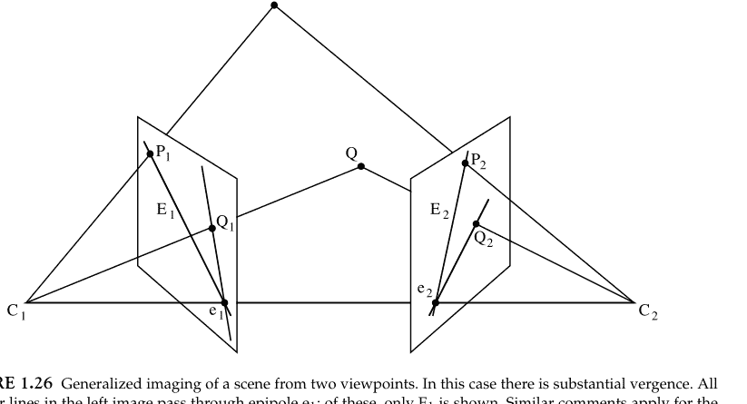

图1.26 从两个视点对场景的广义成像。此情况下存在显著辐辏。左图像中的所有对极线都通过对极点e₁：其中仅显示了E₁。右图像同理。

我们还知道P1、P2和C是共面的，共面条件为：

P2.C × P1 = 0 (1.83)

为了继续，我们需要在P1和P2相对于其各自参考坐标系表达时建立它们之间的关系。如果我们将这些向量视为在C1参考坐标系中定义，现在我们通过施加平移C和表示为正交矩阵R的坐标旋转，将P2重新表达在其自身的（C2）参考坐标系中。这得到：

P2' = R P2 = R(P1 − C) (1.84)

因此：

P2 = R−1 P2' = R^T P2' (1.85)

代入共面条件得：

(R^T P2').C × P1 = 0 (1.86)

此时，用反对称矩阵Cx表示C × 来替换向量积记号是方便的，其中：

Cx = [ [0, −Cz, Cy], [Cz, 0, −Cx], [−Cy, Cx, 0] ] (1.87)

同时，我们通过适当地转置来观察所有向量的正确矩阵形式。现在我们发现：

$(R^T P_2)^T C_x P_1 = 0$

即：

$P_2^T R C_x P_1 = 0$

最后，我们得到“本质矩阵”形式：

$P_2^T E P_1 = 0$

其中本质矩阵已被发现为：

$E = R C_x$

式(1.90)实际上是所期望的结果：它表达了同一个点在两个相机参考坐标系中观测位置之间的关系。此外，它立即引出了对极线的公式。为了理解这一点，首先注意在C1相机坐标系中：

$p_1 = (f_1/Z_1) P_1$

而在C2相机坐标系中（并以该参考坐标系表达）：

$p'_2 = (f_2/Z_2) P'_2$

消去P1和P2'，并去掉上标撇号（因为在各自的图像平面内，数字1和2已足以明确指定坐标），我们得到：

$p_2^T E p_1 = 0$

因为Z1、Z2以及f1、f2可以从该矩阵方程中抵消。

现在注意，将p2^T E = l1^T 和 l2 = E p1 写出来，会得到以下关系：

$p_1^T l_1 = 0$

$p_2^T l_2 = 0$

这意味着l2 = E p1 和 l1 = E^T p2 分别是与p1和p2相对应的对极线。

#### 1.4.15 基础矩阵

注意，在本质矩阵计算的最后部分，我们隐含地假设相机已被正确标定。具体而言，p1和p2是校正后的（标定的）图像坐标。然而，由于1.4.12节中给出的所有原因，我们需要处理未标定的图像，使用原始的像素测量值。将相机内参矩阵G₁、G₂应用于标定后的图像坐标（1.4.10节），我们得到原始图像坐标：

q₁ = G₁p₁

q₂ = G₂p₂

事实上，这里我们需要反向操作，因此我们使用逆方程：

p₁ = G₁⁻¹q₁

p₂ = G₂⁻¹q₂

将p₁和p₂代入式(1.94)，我们找到联系原始像素坐标的期望方程：

q₂ᵀ(G₂⁻¹)ᵀEG₁⁻¹q₁ = 0

该式可表示为：

q₂ᵀF q₁ = 0

其中

F = (G₂⁻¹)ᵀEG₁⁻¹

F被定义为“基础矩阵”。由于它包含了标定相机所需的全部信息，因此它包含比本质矩阵更多的自由参数。然而，在其他方面，这两个矩阵旨在传达相同的基本信息，这由两种形式——式(1.90)和式(1.102)——之间的相似性所证实。

#### 1.4.16 本质矩阵和基础矩阵的性质

接下来我们考虑本质矩阵和基础矩阵的组成。特别要注意，Cₓ是E的一个因子，并且间接地也是F的一个因子。事实上，它们对Cₓ是齐次的，所以C的尺度对这两个矩阵形式（式(1.90)和式(1.102)）没有影响，只有C的方向才是重要的：实际上，E和F的尺度都是无关紧要的，因此只有它们系数的相对值才是重要的。这意味着E和F中至多只有8个独立系数。事实上，在F的情况下只有7个，因为Cₓ是反对称的，这确保其秩为2而不是3——这个性质传递给了F。同样的论证也适用于E，但E的较低复杂度意味着它只有5个自由参数。在后一种情况下，很容易看出它们是什么：它们来自原始的3个平移（C）和3个旋转（R）参数，减去对应于尺度的1个参数。

在此上下文中，注意如果C来自单台相机的平移，则无论C的尺度如何，都会得到相同的本质矩阵：实际上只有C的方向起作用，并且沿相同方向持续运动将产生相同的对极线。事实上，在此

在这种情况下，我们可以将外极点解释为扩张或收缩的焦点。这突显了这种表述的强大之处：具体而言，它将运动和位移视为一个单一的实体。

最后，我们应该试着理解为什么基本矩阵中有7个自由参数。解决方案相对简单。每个外极点需要2个参数来指定。此外，还需要3个参数来将任意3条外极线从一幅图像映射到另一幅图像。但为什么只需要映射3条外极线呢？这是因为外极线族是一个线束，其方向通过交比相关联，因此一旦确定了3条外极线，任何其他外极线的映射都可以推导出来。

#### 1.4.17 估计基本矩阵

在上一节中，我们证明了基本矩阵有7个自由参数。这意味着，通过在两幅图像中识别相同的7个特征点来估计它应该是可能的。然而，虽然这在原则上是数学上可行的，并且Faugeras等人（1992）已经设计了一种合适的非线性算法来实现它，但已有研究表明该计算在数值上可能不稳定。从本质上讲，噪声作为一个额外的变量，将问题中有效的自由度数量提高到了8。不过，一种称为8点算法的线性算法已被设计出来以克服这一问题。奇怪的是，该算法早在此前多年就由Longuet-Higgins（1981）提出用于估计本质矩阵，但直到Hartley（1995）展示了如何通过首先归一化数值来控制误差后，它才真正发挥出作用。此外，通过使用超过8个点，可以获得更高的精度，但此时必须找到一种合适的算法来处理已超定的参数。主成分分析可用于此目的，一种合适的做法是奇异值分解（SVD）。

#### 1.4.18 改进的三角化方法

多年来，人们一直知道在寻找基本矩阵的精确数值解方面存在困难，其缺乏鲁棒性的原因在于，当数据被噪声污染时，最小二乘分析无法很好地处理这种情况。只要噪声包含离群值，就会出现这个问题。特别是，当噪声使得对应的视线无法在3-D场景中相交（即两条视线为异面直线）时，就可能产生离群值。对这个问题的显而易见且被广泛测试的解决方案是，选择两条视线公垂线的中点作为交点。然而，该方法并不能给出最优结果，最终原因是‘公垂线’和‘中点’这些概念在FPP中在数学上并不有效。事实上，Kanatani（1996）定义了一种确定最优修正的新方法——将交点取为两个图像平面上的总位移量最小的点。尽管Hartley和Sturm（1994）的想法类似，但人们发现Kanatani的方法要快几个数量级，并且不会遭受Hartley-Sturm方法中出现的外极点奇异性问题（Torr和Zisserman，1997）。随后，直到2019年，对该方法的改进仍然不断涌现。特别是，Lee和Civera（2019）提出了一种改进的中点方法——‘广义加权中点’方法——其中不假设两个起始点位于公垂线上。他们表明，尽管他们的方法在最小化几何或代数误差的意义上并非理论最优，但在速度、简单性以及2-D、3-D和视差精度的综合方面优于现有方法。

Fathy等人（2011）对总体情况进行了如下阐明：8点算法是一种一步法，通常在去除离群值后应用，以获得基本矩阵的初始估计；然后对该估计进行迭代细化，以产生更精确的解。

#### 1.4.19 多视图视觉的成就与局限

最后几节讨论了摄像机标定所需的变换，并概述了如何实现标定。摄像机参数已被分类为‘内部’和‘外部’，从而简化了概念问题，并揭示了系统中误差的来源。已经证明，在涉及11个变换参数的一般情况下，执行标定至少需要6个点。然而，通常尽可能增加用于标定的点数是很重要的，因为通过由此产生的平均过程可以获得显著的精度提升。

第1.4.12节介绍了多视图视觉。这一重要主题被认为依赖于广义外极几何，并引出了本质矩阵和基本矩阵的表述，它们将任意点在两个摄像机参考坐标系中的观测位置联系起来。我们强调了8点算法在估计这两种矩阵——尤其是基本矩阵（在摄像机未标定时相关）——中的重要性。此外，虽然近年来在基本矩阵估计的离群值去除阶段已经取得了巨大进展（见第1.4.18节），但对估计基本矩阵的精度和鲁棒性的需求仍然是一个研究问题。

### 1.5 第D部分——跟踪运动物体

#### 1.5.1 跟踪——基本概念

近年来，人们设计了许多算法来解释单幅图像并识别其中很大比例的物体：在这一成功之后，注意力转向了图像序列和视频的分析。事实上，如果任何序列中的图像仅仅被看作是一组组独立的图像或‘帧’，那么这一新任务已经可以被视为解决了；因此，将图像序列本身作为实体来解读同样变得相关。于是，就需要算法来识别和跟踪通过任何序列的运动物体。

我们可以通过在所有的帧中识别物体，然后计算显示物体如何在帧之间移动的轨迹来解决这个任务。这可以通过以下算法来实现：

- 遍历序列中的所有帧
- 查找并识别所有物体
- 在帧之间链接物体
- 列出所有物体及其轨迹。

这个过程要求所有物体都被检测和识别，在这种情况下，将它们链接成轨迹将只涉及链接同一识别类别（例如，汽车）中的物体。然而，如果同一类别中的所有物体都能被单独识别（例如，汽车1、汽车2等），那么这将进一步得到促进，尽管如果某些这类物体非常相似，在链接它们时可能会出现一些混淆。

如果物体以其运动参数为特征，那么这个相当严格的过程就可以简化。事实上，跟踪信息应该能够显著节省计算量。因此，我们得出另一种策略：

- 在第一帧中检测所有物体
- 找出这些物体在每个后续帧中的运动方式
- 列出所有物体及其轨迹。

这个简化的过程要求在第一帧中对物体进行检测（而不是识别）。此外，在后续帧中不需要真正识别它们，因为它们应该能够通过相对接近性而被唯一识别。

原则上，通过避免第一阶段（即在第一帧中检测所有物体），可以进一步节省精力。我们所需要的只是研究运动本身，并将任何移动的东西识别为物体。也许实现这一目标的最简单方法是取相邻帧之间的差异，在这种情况下，任何变化都应指示运动物体的位置。然而，这种方法往往只定位目标轮廓的有限部分：例如，它将忽略任何均匀强度物体的大部分——这与著名的差分公式 −ΔI.v 一致。解决这一困难的最简单方法是对背景进行建模；然后，通过从背景模型中减去每一帧，我们应该能够定位任何运动物体。（当然，如果背景保持静止，这种方法效果最佳。）

虽然这个想法很有吸引力，但在实践中应用起来并不简单。主要问题之一是，包含一系列运动物体的场景会导致背景模型随着运动物体经过而不断变化：一个典型的例子是车辆行驶的道路场景。在这种情况下，推断出的背景中的微小变化必须通过某种平均过程来消除。请注意，由于环境光照的变化和天气条件的变化，推断出的背景也必须随着时间的推移而更新。所以问题是，如何进行这种更新，同时补偿已经经过的物体。时间帧平均是实现这一目标的一种很差的方法，但一些研究（Lo和Velastin，2001；Cucchiara等人，2003）表明，时间中值滤波可以相当有效，因为它能够消除离群强度值的影响，例如那些由于车辆在静止背景下移动而产生的值。

这种方法的一个问题是，计算时间中值需要存储大量帧——这一批评不适用于普通平均，普通平均可以通过应用时间加权滑动平均来方便地实现。然而，Davies（2017）已经表明，通过迭代实现时间中值，这个问题可以得到解决，并且该解决方案还能够更新背景模型，以抵消背景照度变化的影响。此外，他发现更好的方法是使用‘受限’中值滤波器，其中相对于先前迭代近似值在受限带内的极端强度和颜色被忽略。在道路场景中，

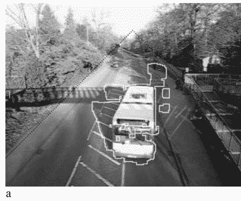

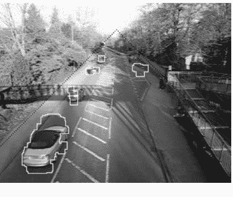

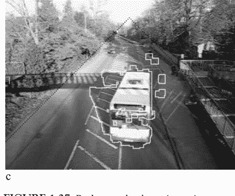

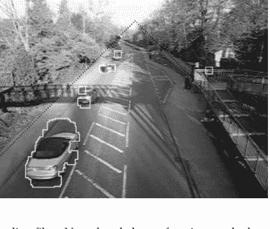

图 1.27 使用时域中值滤波进行背景减除。请注意，在背景减除过程中完全被忽略的大量静止阴影。在 (a) 中，公交车的“幽灵”（来自其过去位置）仍然出现，但在 (b) 中它开始重新融入背景：该问题在 (c) 和 (d) 中得到显著改善，这些图使用了“受限”时域中值滤波。总体而言，前景物体碎片化和虚假形状（包括移动阴影的影响）是最严重的问题。黑色图形点的线条划分了相关的道路区域：几乎所有的飘动植被都位于该区域之外。

这可以防止暂时静止的车辆过度扭曲推断出的背景水平（参见图 1.27 和 1.28）。

请注意，采用这类方法时，没有先验理由说明车辆或其他物体产生的强度应大于或小于真实背景：这两种可能性都明显存在。因此，将当前帧从背景模型中减去很可能将任何移动物体分割成几个部分，这些部分随后需要使用形态学处理等方法重新组合。幸运的是，该技术也有助于消除噪声：飘动植被的影响，例如移动的叶子或树枝，也可以通过这种方式得到非常成功的抑制——正如图 1.27 和 1.28 所示。

有趣的是，虽然上述方法能够成功识别道路场景中的车辆，但它将阴影视为物体的一部分，因为它不涉及任何高级推理。

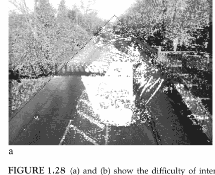

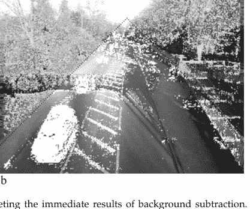

图 1.28 (a) 和 (b) 显示了解释背景减除即时结果的困难。这两帧清楚地显示了背景减除过程中出现的噪声问题：白色像素表示当前帧与背景模型不匹配的地方。形态学操作（先腐蚀后膨胀）用于在很大程度上消除噪声并尽可能整合车辆形状，如图 1.27 中白色图形轮廓所示。请注意，后者不仅包含车辆形状，还包含随之移动的阴影。

该效应在图 1.27 和 1.28 中有所说明。事实上，阴影检测已被广泛研究，Horprasert 等人（1999）展示了实现它的一个有用原理：这涉及注意到阴影与背景模型具有相似的色度，但亮度较低。

#### 1.5.2 背景减除的替代方法

虽然上面描述的背景减除方法本质上简单、出人意料地有效且运行速度很快，但它也存在局限性：(a) 将背景视为基本不变——尽管通过时域平均和形态学处理来应对背景中的移动实体，以及 (b) 未使用适当的前景物体模型。更严格的方法是将任意像素的强度和颜色分布视为对应于两三个分量源的若干分布的叠加。这里重要的是，每个分量分布都可能相当窄且定义良好。这意味着如果每个分量都通过持续训练已知，则可以检查任何当前强度 I 是否可能对应于背景或新的前景物体。

这使得高斯混合模型（GMMs）可用于表示真实的背景和前景强度范围。事实上，任意像素上的分量数量初始时是未知的：确实，大比例的像素只有一个分量，但在实践中所需分量数量通常在 3 到 5 的范围内。然而，确定 GMM 需要应用期望最大化（EM）算法，且计算负担重。事实上，虽然通常使用这种严格的方法来*初始化*背景生成过程，但许多研究人员使用更简单、更高效的技术来更新它，以便持续过程能够实时进行。

不幸的是，当背景具有非常高的频率变化时，GMM 方法会失效。本质上，这是因为算法必须应对快速变化的分布，这些分布可能在非常短的时间内发生巨大变化，因此统计数据变得过于不明确。为解决此问题，Elgammal 等人（2000）摆脱了 GMM 的参数化方法。他们的非参数方法涉及采用核平滑函数（通常为高斯函数），并对每个像素，将其应用于当前时间 t 之前期间 Δt 内出现的帧的 I 的 N 个样本。这种方法能够快速适应从一个强度值到另一个强度值的跳变，同时获得每个像素的局部方差。因此，其价值在于能够忘记旧强度并反映局部方差而非随机强度跳变的能力。此外，由于它不采用 EM 算法，因此能够以高度效率实时运行，并能够实现对前景物体的灵敏检测，同时保持较低的误报率。为实现所有这些，它对每个颜色通道使用单独的高斯核函数，然后使用前面提到的基于色度的方法来抑制阴影。

到目前为止，我们已经看到背景减除具有易于应用、运行速度快且高度有效的优点——甚至在进行适当的算法调整后，能够应对缓慢变化的背景光照；消除背景和前景中的阴影；抑制暂时静止车辆产生的“幽灵”；并抑制飘动植被的影响。另一方面，它依赖于背景是静态的，这反过来意味着它需要使用固定摄像机。此外，并不能保证前景物体的所有部分都与背景具有不同的强度——这一因素可能导致物体碎片化，并导致需要形态学处理，而这本身是一种相当特设的解决方案。

基于背景减除的跟踪出现的另一个问题是前景物体可能被其他物体部分或完全遮挡：这在拥挤区域观看行人时尤其常见。最好的情况可能导致碎片化轨迹，最坏的情况可能导致错误连接的轨迹。还请注意，一些物体的运动可能完全停止。显然，解决这些问题需要仔细考虑的方法。处理断裂轨迹的传统方法是采用预测滤波器，如卡尔曼滤波器，但它们的用途有限，因为它们本质上旨在基于单峰高斯密度评估连接轨迹对的概率。

总体而言，这些批评和问题要求时域差分必须辅以模板相关匹配，以便知道仍在处理的是同一物体。正如 Lipton 等人（1998）所指出的，时域差分（或相关方法如背景减除）可用于检测移动物体，而相关匹配可用于 (a) 精确定位物体以及 (b) 帮助训练相关模板；在每个阶段，具有最佳相关的模板都用于 (a) 和 (b)。事实上，即使一个物体部分遮挡另一个物体，使用最佳相关模板也是有用的。此外，当特定物体变得静止时，它特别有用，因为此时其身份或位置没有不确定性。

Stalder 等人（2009）开发了一种替代的物体跟踪策略，他们将其描述为“基于检测的跟踪”。其目的是使跟踪器能够适应任何变化的

通过更新对象模型来表现物体。然而，这会导致所谓的‘模板更新问题’，其中存在适应性与稳定性之间的权衡（具体而言，跟踪器可能会得到一个完全扭曲、不可行的对象轮廓版本——这一过程称为‘漂移’）。这一困难通过将跟踪重新表述为半监督学习问题来克服，在跟踪过程中既可以使用标记数据也可以使用未标记数据。为使之可行，采用了半监督提升，每个局部搜索区域中的未标记样本都被赋予一个伪标签 y_i 和一个重要性权重 λ_i（标记样本具有标签 y_i 且重要性为 1）。在初始检测之后，导致先验 H_P，对象分类器 H 被构建，考虑来自对象的正样本和来自周围背景的负样本：通常，置信度分布的局部最大值被用来指示新的对象位置并更新类别。因此，我们得到一系列对象位置，从第一个（由初始检测产生）开始，然后继续到许多进一步的跟踪位置。然而，原则上，提升方程也可能导致先验消失或主导过度——分别对应于漂移或零适应。但通常漂移是有限的，因为跟踪器无法偏离先验太远。

上述跟踪策略的问题包括（a）将部分遮挡或看似允许的外观变化视为不允许的漂移；以及（b）跳到相似的对象（例如，人脸检测器可能会从一个人的脸跳到另一个人的脸）。显然，按检测跟踪主要适用于单目标跟踪，但当需要多目标跟踪时，检测、跟踪和识别这三个过程都必须考虑。在特定情况下，识别必须被视为在场景中区分相似对象。

Stalder 等人（2009 年）的多目标分类器系统被证明在跟踪多个对象方面非常成功。它通过谨慎使用监督更新和避免反馈环来限制漂移，从而防止可能导致漂移的小误差累积。这是通过使跟踪器成为方法中的主导元素来实现的，使得其信息流要么（在环中）返回到自身，要么（最终）返回到之前的识别器。该系统允许使用移动摄像机进行跟踪，并且也足够可靠，可以允许长达 ~24 小时的长期跟踪。

多目标跟踪的另一个方面是重新识别暂时从视野中隐藏的对象的能力（例如，暂时被遮挡或位于摄像机视野之外）。这涉及身份匹配，并且只有在实现的匹配程度显著高于任何其他潜在匹配时才被允许。重新识别可能会失败，如果在相关的时间间隔期间匹配程度变得过于不同。同样，Stalder 等人的系统在这方面也表现良好。

Kalal 等人（2011 年）开发了一种强大的跟踪系统，特别旨在消除运行时漂移错误以及跟踪对象消失时出现的问题。他们的[content]
通过更新对象模型来表现物体。然而，这会导致所谓的‘模板更新问题’，其中存在适应性与稳定性之间的权衡（具体而言，跟踪器可能会得到一个完全扭曲、不可行的对象轮廓版本——这一过程称为‘漂移’）。这一困难通过将跟踪重新表述为半监督学习问题来克服，在跟踪过程中既可以使用标记数据也可以使用未标记数据。为使之可行，采用了半监督提升，每个局部搜索区域中的未标记样本都被赋予一个伪标签 y_i 和一个重要性权重 λ_i（标记样本具有标签 y_i 且重要性为 1）。在初始检测之后，导致先验 H_P，对象分类器 H 被构建，考虑来自对象的正样本和来自周围背景的负样本：通常，置信度分布的局部最大值被用来指示新的对象位置并更新类别。因此，我们得到一系列对象位置，从第一个（由初始检测产生）开始，然后继续到许多进一步的跟踪位置。然而，原则上，提升方程也可能导致先验消失或主导过度——分别对应于漂移或零适应。但通常漂移是有限的，因为跟踪器无法偏离先验太远。

上述跟踪策略的问题包括（a）将部分遮挡或看似允许的外观变化视为不允许的漂移；以及（b）跳到相似的对象（例如，人脸检测器可能会从一个人的脸跳到另一个人的脸）。显然，按检测跟踪主要适用于单目标跟踪，但当需要多目标跟踪时，检测、跟踪和识别这三个过程都必须考虑。在特定情况下，识别必须被视为在场景中区分相似对象。

Stalder 等人（2009 年）的多目标分类器系统被证明在跟踪多个对象方面非常成功。它通过谨慎使用监督更新和避免反馈环来限制漂移，从而防止可能导致漂移的小误差累积。这是通过使跟踪器成为方法中的主导元素来实现的，使得其信息流要么（在环中）返回到自身，要么（最终）返回到之前的识别器。该系统允许使用移动摄像机进行跟踪，并且也足够可靠，可以允许长达 ~24 小时的长期跟踪。

多目标跟踪的另一个方面是重新识别暂时从视野中隐藏的对象的能力（例如，暂时被遮挡或位于摄像机视野之外）。这涉及身份匹配，并且只有在实现的匹配程度显著高于任何其他潜在匹配时才被允许。重新识别可能会失败，如果在相关的时间间隔期间匹配程度变得过于不同。同样，Stalder 等人的系统在这方面也表现良好。

Kalal 等人（2011 年）开发了一种强大的跟踪系统，特别旨在消除运行时漂移错误以及跟踪对象消失时出现的问题。他们的[content]
通过更新对象模型来表现物体。然而，这会导致所谓的‘模板更新问题’，其中存在适应性与稳定性之间的权衡（具体而言，跟踪器可能会得到一个完全扭曲、不可行的对象轮廓版本——这一过程称为‘漂移’）。这一困难通过将跟踪重新表述为半监督学习问题来克服，在跟踪过程中既可以使用标记数据也可以使用未标记数据。为使之可行，采用了半监督提升，每个局部搜索区域中的未标记样本都被赋予一个伪标签 y_i 和一个重要性权重 λ_i（标记样本具有标签 y_i 且重要性为 1）。在初始检测之后，导致先验 H_P，对象分类器 H 被构建，考虑来自对象的正样本和来自周围背景的负样本：通常，置信度分布的局部最大值被用来指示新的对象位置并更新类别。因此，我们得到一系列对象位置，从第一个（由初始检测产生）开始，然后继续到许多进一步的跟踪位置。然而，原则上，提升方程也可能导致先验消失或主导过度——分别对应于漂移或零适应。但通常漂移是有限的，因为跟踪器无法偏离先验太远。

上述跟踪策略的问题包括（a）将部分遮挡或看似允许的外观变化视为不允许的漂移；以及（b）跳到相似的对象（例如，人脸检测器可能会从一个人的脸跳到另一个人的脸）。显然，按检测跟踪主要适用于单目标跟踪，但当需要多目标跟踪时，检测、跟踪和识别这三个过程都必须考虑。在特定情况下，识别必须被视为在场景中区分相似对象。

Stalder 等人（2009 年）的多目标分类器系统被证明在跟踪多个对象方面非常成功。它通过谨慎使用监督更新和避免反馈环来限制漂移，从而防止可能导致漂移的小误差累积。这是通过使跟踪器成为方法中的主导元素来实现的，使得其信息流要么（在环中）返回到自身，要么（最终）返回到之前的识别器。该系统允许使用移动摄像机进行跟踪，并且也足够可靠，可以允许长达 ~24 小时的长期跟踪。

多目标跟踪的另一个方面是重新识别暂时从视野中隐藏的对象的能力（例如，暂时被遮挡或位于摄像机视野之外）。这涉及身份匹配，并且只有在实现的匹配程度显著高于任何其他潜在匹配时才被允许。重新识别可能会失败，如果在相关的时间间隔期间匹配程度变得过于不同。同样，Stalder 等人的系统在这方面也表现良好。

Kalal 等人（2011 年）开发了一种强大的跟踪系统，特别旨在消除运行时漂移错误以及跟踪对象消失时出现的问题。他们的[content]
通过更新对象模型来表现物体。然而，这会导致所谓的‘模板更新问题’，其中存在适应性与稳定性之间的权衡（具体而言，跟踪器可能会得到一个完全扭曲、不可行的对象轮廓版本——这一过程称为‘漂移’）。这一困难通过将跟踪重新表述为半监督学习问题来克服，在跟踪过程中既可以使用标记数据也可以使用未标记数据。为使之可行，采用了半监督提升，每个局部搜索区域中的未标记样本都被赋予一个伪标签 y_i 和一个重要性权重 λ_i（标记样本具有标签 y_i 且重要性为 1）。在初始检测之后，导致先验 H_P，对象分类器 H 被构建，考虑来自对象的正样本和来自周围背景的负样本：通常，置信度分布的局部最大值被用来指示新的对象位置并更新类别。因此，我们得到一系列对象位置，从第一个（由初始检测产生）开始，然后继续到许多进一步的跟踪位置。然而，原则上，提升方程也可能导致先验消失或主导过度——分别对应于漂移或零适应。但通常漂移是有限的，因为跟踪器无法偏离先验太远。

上述跟踪策略的问题包括（a）将部分遮挡或看似允许的外观变化视为不允许的漂移；以及（b）跳到相似的对象（例如，人脸检测器可能会从一个人的脸跳到另一个人的脸）。显然，按检测跟踪主要适用于单目标跟踪，但当需要多目标跟踪时，检测、跟踪和识别这三个过程都必须考虑。在特定情况下，识别必须被视为在场景中区分相似对象。

Stalder 等人（2009 年）的多目标分类器系统被证明在跟踪多个对象方面非常成功。它通过谨慎使用监督更新和避免反馈环来限制漂移，从而防止可能导致漂移的小误差累积。这是通过使跟踪器成为方法中的主导元素来实现的，使得其信息流要么（在环中）返回到自身，要么（最终）返回到之前的识别器。该系统允许使用移动摄像机进行跟踪，并且也足够可靠，可以允许长达 ~24 小时的长期跟踪。

多目标跟踪的另一个方面是重新识别暂时从视野中隐藏的对象的能力（例如，暂时被遮挡或位于摄像机视野之外）。这涉及身份匹配，并且只有在实现的匹配程度显著高于任何其他潜在匹配时才被允许。重新识别可能会失败，如果在相关的时间间隔期间匹配程度变得过于不同。同样，Stalder 等人的系统在这方面也表现良好。

Kalal 等人（2011 年）开发了一种强大的跟踪系统，特别旨在消除运行时漂移错误以及跟踪对象消失时出现的问题。他们的[content]
通过更新对象模型来表现物体。然而，这会导致所谓的‘模板更新问题’，其中存在适应性与稳定性之间的权衡（具体而言，跟踪器可能会得到一个完全扭曲、不可行的对象轮廓版本——这一过程称为‘漂移’）。这一困难通过将跟踪重新表述为半监督学习问题来克服，在跟踪过程中既可以使用标记数据也可以使用未标记数据。为使之可行，采用了半监督提升，每个局部搜索区域中的未标记样本都被赋予一个伪标签 y_i 和一个重要性权重 λ_i（标记样本具有标签 y_i 且重要性为 1）。在初始检测之后，导致先验 H_P，对象分类器 H 被构建，考虑来自对象的正样本和来自周围背景的负样本：通常，置信度分布的局部最大值被用来指示新的对象位置并更新类别。因此，我们得到一系列对象位置，从第一个（由初始检测产生）开始，然后继续到许多进一步的跟踪位置。然而，原则上，提升方程也可能导致先验消失或主导过度——分别对应于漂移或零适应。但通常漂移是有限的，因为跟踪器无法偏离先验太远。

上述跟踪策略的问题包括（a）将部分遮挡或看似允许的外观变化视为不允许的漂移；以及（b）跳到相似的对象（例如，人脸检测器可能会从一个人的脸跳到另一个人的脸）。显然，按检测跟踪主要适用于单目标跟踪，但当需要多目标跟踪时，检测、跟踪和识别这三个过程都必须考虑。在特定情况下，识别必须被视为在场景中区分相似对象。

Stalder 等人（2009 年）的多目标分类器系统被证明在跟踪多个对象方面非常成功。它通过谨慎使用监督更新和避免反馈环来限制漂移，从而防止可能导致漂移的小误差累积。这是通过使跟踪器成为方法中的主导元素来实现的，使得其信息流要么（在环中）返回到自身，要么（最终）返回到之前的识别器。该系统允许使用移动摄像机进行跟踪，并且也足够可靠，可以允许长达 ~24 小时的长期跟踪。

多目标跟踪的另一个方面是重新识别暂时从视野中隐藏的对象的能力（例如，暂时被遮挡或位于摄像机视野之外）。这涉及身份匹配，并且只有在实现的匹配程度显著高于任何其他潜在匹配时才被允许。重新识别可能会失败，如果在相关的时间间隔期间匹配程度变得过于不同。同样，Stalder 等人的系统在这方面也表现良好。

Kalal 等人（2011 年）开发了一种强大的跟踪系统，特别旨在消除运行时漂移错误以及跟踪对象消失时出现的问题。他们的[content]
通过更新对象模型来表现物体。然而，这会导致所谓的‘模板更新问题’，其中存在适应性与稳定性之间的权衡（具体而言，跟踪器可能会得到一个完全扭曲、不可行的对象轮廓版本——这一过程称为‘漂移’）。这一困难通过将跟踪重新表述为半监督学习问题来克服，在跟踪过程中既可以使用标记数据也可以使用未标记数据。为使之可行，采用了半监督提升，每个局部搜索区域中的未标记样本都被赋予一个伪标签 y_i 和一个重要性权重 λ_i（标记样本具有标签 y_i 且重要性为 1）。在初始检测之后，导致先验 H_P，对象分类器 H 被构建，考虑来自对象的正样本和来自周围背景的负样本：通常，置信度分布的局部最大值被用来指示新的对象位置并更新类别。因此，我们得到一系列对象位置，从第一个（由初始检测产生）开始，然后继续到许多进一步的跟踪位置。然而，原则上，提升方程也可能导致先验消失或主导过度——分别对应于漂移或零适应。但通常漂移是有限的，因为跟踪器无法偏离先验太远。

上述跟踪策略的问题包括（a）将部分遮挡或看似允许的外观变化视为不允许的漂移；以及（b）跳到相似的对象（例如，人脸检测器可能会从一个人的脸跳到另一个人的脸）。显然，按检测跟踪主要适用于单目标跟踪，但当需要多目标跟踪时，检测、跟踪和识别这三个过程都必须考虑。在特定情况下，识别必须被视为在场景中区分相似对象。

Stalder 等人（2009 年）的多目标分类器系统被证明在跟踪多个对象方面非常成功。它通过谨慎使用监督更新和避免反馈环来限制漂移，从而防止可能导致漂移的小误差累积。这是通过使跟踪器成为方法中的主导元素来实现的，使得其信息流要么（在环中）返回到自身，要么（最终）返回到之前的识别器。该系统允许使用移动摄像机进行跟踪，并且也足够可靠，可以允许长达 ~24 小时的长期跟踪。

多目标跟踪的另一个方面是重新识别暂时从视野中隐藏的对象的能力（例如，暂时被遮挡或位于摄像机视野之外）。这涉及身份匹配，并且只有在实现的匹配程度显著高于任何其他潜在匹配时才被允许。重新识别可能会失败，如果在相关的时间间隔期间匹配程度变得过于不同。同样，Stalder 等人的系统在这方面也表现良好。

Kalal 等人（2011 年）开发了一种强大的跟踪系统，特别旨在消除运行时漂移错误以及跟踪对象消失时出现的问题。他们的[content]
通过更新对象模型来表现物体。然而，这会导致所谓的‘模板更新问题’，其中存在适应性与稳定性之间的权衡（具体而言，跟踪器可能会得到一个完全扭曲、不可行的对象轮廓版本——这一过程称为‘漂移’）。这一困难通过将跟踪重新表述为半监督学习问题来克服，在跟踪过程中既可以使用标记数据也可以使用未标记数据。为使之可行，采用了半监督提升，每个局部搜索区域中的未标记样本都被赋予一个伪标签 y_i 和一个重要性权重 λ_i（标记样本具有标签 y_i 且重要性为 1）。在初始检测之后，导致先验 H_P，对象分类器 H 被构建，考虑来自对象的正样本和来自周围背景的负样本：通常，置信度分布的局部最大值被用来指示新的对象位置并更新类别。因此，我们得到一系列对象位置，从第一个（由初始检测产生）开始，然后继续到许多进一步的跟踪位置。然而，原则上，提升方程也可能导致先验消失或主导过度——分别对应于漂移或零适应。但通常漂移是有限的，因为跟踪器无法偏离先验太远。

上述跟踪策略的问题包括（a）将部分遮挡或看似允许的外观变化视为不允许的漂移；以及（b）跳到相似的对象（例如，人脸检测器可能会从一个人的脸跳到另一个人的脸）。显然，按检测跟踪主要适用于单目标跟踪，但当需要多目标跟踪时，检测、跟踪和识别这三个过程都必须考虑。在特定情况下，识别必须被视为在场景中区分相似对象。

Stalder 等人（2009 年）的多目标分类器系统被证明在跟踪多个对象方面非常成功。它通过谨慎使用监督更新和避免反馈环来限制漂移，从而防止可能导致漂移的小误差累积。这是通过使跟踪器成为方法中的主导元素来实现的，使得其信息流要么（在环中）返回到自身，要么（最终）返回到之前的识别器。该系统允许使用移动摄像机进行跟踪，并且也足够可靠，可以允许长达 ~24 小时的长期跟踪。

多目标跟踪的另一个方面是重新识别暂时从视野中隐藏的对象的能力（例如，暂时被遮挡或位于摄像机视野之外）。这涉及身份匹配，并且只有在实现的匹配程度显著高于任何其他潜在匹配时才被允许。重新识别可能会失败，如果在相关的时间间隔期间匹配程度变得过于不同。同样，Stalder 等人的系统在这方面也表现良好。

Kalal 等人（2011 年）开发了一种强大的跟踪系统，特别旨在消除运行时漂移错误以及跟踪对象消失时出现的问题。他们的[content]
通过更新对象模型来表现物体。然而，这会导致所谓的‘模板更新问题’，其中存在适应性与稳定性之间的权衡（具体而言，跟踪器可能会得到一个完全扭曲、不可行的对象轮廓版本——这一过程称为‘漂移’）。这一困难通过将跟踪重新表述为半监督学习问题来克服，在跟踪过程中既可以使用标记数据也可以使用未标记数据。为使之可行，采用了半监督提升，每个局部搜索区域中的未标记样本都被赋予一个伪标签 y_i 和一个重要性权重 λ_i（标记样本具有标签 y_i 且重要性为 1）。在初始检测之后，导致先验 H_P，对象分类器 H 被构建，考虑来自对象的正样本和来自周围背景的负样本：通常，置信度分布的局部最大值被用来指示新的对象位置并更新类别。因此，我们得到一系列对象位置，从第一个（由初始检测产生）开始，然后继续到许多进一步的跟踪位置。然而，原则上，提升方程也可能导致先验消失或主导过度——分别对应于漂移或零适应。但通常漂移是有限的，因为跟踪器无法偏离先验太远。

上述跟踪策略的问题包括（a）将部分遮挡或看似允许的外观变化视为不允许的漂移；以及（b）跳到相似的对象（例如，人脸检测器可能会从一个人的脸跳到另一个人的脸）。显然，按检测跟踪主要适用于单目标跟踪，但当需要多目标跟踪时，检测、跟踪和识别这三个过程都必须考虑。在特定情况下，识别必须被视为在场景中区分相似对象。

Stalder 等人（2009 年）的多目标分类器系统被证明在跟踪多个对象方面非常成功。它通过谨慎使用监督更新和避免反馈环来限制漂移，从而防止可能导致漂移的小误差累积。这是通过使跟踪器成为方法中的主导元素来实现的，使得其信息流要么（在环中）返回到自身，要么（最终）返回到之前的识别器。该系统允许使用移动摄像机进行跟踪，并且也足够可靠，可以允许长达 ~24 小时的长期跟踪。

多目标跟踪的另一个方面是重新识别暂时从视野中隐藏的对象的能力（例如，暂时被遮挡或位于摄像机视野之外）。这涉及身份匹配，并且只有在实现的匹配程度显著高于任何其他潜在匹配时才被允许。重新识别可能会失败，如果在相关的时间间隔期间匹配程度变得过于不同。同样，Stalder 等人的系统在这方面也表现良好。

Kalal 等人（2011 年）开发了一种强大的跟踪系统，特别旨在消除运行时漂移错误以及跟踪对象消失时出现的问题。他们的[content]
通过更新对象模型来表现物体。然而，这会导致所谓的‘模板更新问题’，其中存在适应性与稳定性之间的权衡（具体而言，跟踪器可能会得到一个完全扭曲、不可行的对象轮廓版本——这一过程称为‘漂移’）。这一困难通过将跟踪重新表述为半监督学习问题来克服，在跟踪过程中既可以使用标记数据也可以使用未标记数据。为使之可行，采用了半监督提升，每个局部搜索区域中的未标记样本都被赋予一个伪标签 y_i 和一个重要性权重 λ_i（标记样本具有标签 y_i 且重要性为 1）。在初始检测之后，导致先验 H_P，对象分类器 H 被构建，考虑来自对象的正样本和来自周围背景的负样本：通常，置信度分布的局部最大值被用来指示新的对象位置并更新类别。因此，我们得到一系列对象位置，从第一个（由初始检测产生）开始，然后继续到许多进一步的跟踪位置。然而，原则上，提升方程也可能导致先验消失或主导过度——分别对应于漂移或零适应。但通常漂移是有限的，因为跟踪器无法偏离先验太远。

上述跟踪策略的问题包括（a）将部分遮挡或看似允许的外观变化视为不允许的漂移；以及（b）跳到相似的对象（例如，人脸检测器可能会从一个人的脸跳到另一个人的脸）。显然，按检测跟踪主要适用于单目标跟踪，但当需要多目标跟踪时，检测、跟踪和识别这三个过程都必须考虑。在特定情况下，识别必须被视为在场景中区分相似对象。

Stalder 等人（2009 年）的多目标分类器系统被证明在跟踪多个对象方面非常成功。它通过谨慎使用监督更新和避免反馈环来限制漂移，从而防止可能导致漂移的小误差累积。这是通过使跟踪器成为方法中的主导元素来实现的，使得其信息流要么（在环中）返回到自身，要么（最终）返回到之前的识别器。该系统允许使用移动摄像机进行跟踪，并且也足够可靠，可以允许长达 ~24 小时的长期跟踪。

多目标跟踪的另一个方面是重新识别暂时从视野中隐藏的对象的能力（例如，暂时被遮挡或位于摄像机视野之外）。这涉及身份匹配，并且只有在实现的匹配程度显著高于任何其他潜在匹配时才被允许。重新识别可能会失败，如果在相关的时间间隔期间匹配程度变得过于不同。同样，Stalder 等人的系统在这方面也表现良好。

Kalal 等 2011 年开发了强大的跟踪系统，特别旨在消除运行时漂移错误以及跟踪对象消失时出现的问题。该方法被简洁地描述为‘跟踪-学习-检测’。关键在于学习由‘P-专家’估计漏检、‘N-专家’估计误报，以及通过学习更新两者的手段。通过将跟踪与检测分开，声称跟踪和检测能力均不受损害，并提供了强有力的成功证据——特别是在许多数据集上平均达到 81% 的准确率，显著优于五种早期方法，其中没有一种超过 22% 的准确率。

与 Kalal 等 2011 年仅跟踪单个对象的工作不同，Wu 等 2012 年展示了如何对多个对象进行耦合检测和数据关联，以确保完整轨迹被确定。该方法采用了网络流数据关联，并依赖于 Castañón 1990 年题为“Efficient algorithm for finding the k best paths through a trellis”的早期论文。该标题表明该方法在很大程度上依赖于对图的广泛分析：虽然有趣，但篇幅不允许在此包含这些技术的完整讨论。简而言之，多目标跟踪是一个困难问题，随着目标数量增加和整个场景充满对象和轨迹而变得更加困难。因此，在这方面，Wu 等 2012 年的工作可以被视为比 Stalder 等 2009 年的工作更彻底。我们将在介绍深度学习方法后，在第 F 部分第 1.7.7 节研究该主题的最新发展。

### 1.6 第 E 部分 – 纹理分析

#### 1.6.1 引言

我们已经考虑了图像分析的几个核心方面，特别是特征检测、对象识别和分割。这里我们继续考虑纹理分析。为此，我们首先将纹理定义为特征强度变化，应能让我们识别和描述纹理区域并勾勒其边界（图 1.29）。通常，纹理是当光线从具有一定粗糙度的表面反射时产生的强度模式。显然，光滑且均匀照明的表面不会表现出纹理，而一块布或沙滩则具有各自的特征纹理。

总体而言，纹理在其随机性和规律性程度方面有所不同，在后一种情况下，它们可能具有高或低的方向性。例如，布料通常表现出高度的规律性和方向性，而沙滩表面发出的强度模式可能看起来高度随机，方向性可忽略不计。另一个因素是表面感知颗粒尺寸的尺度，对于沙子而言很小，对于一盘豌豆则大得多。事实上，构成纹理表面的微小元素通常称为纹理元素或 texel。这些考虑导致我们以以下方式表征纹理：

- 1. 纹理单元将具有各种尺寸和均匀程度。
- 2. 纹理单元将在各种方向上定向。
- 3. 纹理单元将在不同方向上以不同的距离间隔开。
- 4. 对比度将具有各种幅度和变化。
- 5. 纹理单元之间可能可见各种量的背景。
- 6. 构成纹理的变化各自可能具有不同的规律性与随机性程度。

表征纹理所需的显著参数数量必然使纹理分析变得相当复杂：而且当然，在用于分类纹理之前，许多参数将具有高凝聚度，需要简化为相对较少的数字。Haralick 等人 1973 年的早期论文给出了十四种此类度量，并成功用于对许多类型的材料进行分类（包括例如木材、玉米、草和水）。

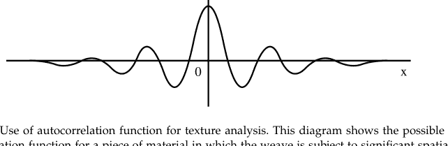

图 1.30 用于纹理分析的自相关函数。该图显示了织物受显著空间变化影响的材料自相关函数的可能一维轮廓：请注意，自相关函数的周期性在相当短的距离内被衰减。

不幸的是，协现矩阵中的数据量可能比原始图像多出许多倍——在更复杂的情况下，由于需要准确表示纹理的 d 和 θ 的值数量，这一情况会加剧。此外，灰度级数通常约为 ~256，矩阵数据的量随该数字的平方而变化。最后，协现矩阵仅提供一种新的表示：它们本身并不能解决识别问题。由于这些因素，20 世纪 80 年代出现了纹理分析方法的高度显著多样化。其中，Laws 的方法（1979；1980a；1980b）很重要，因为它导致了其他发展，这些发展提供了一种系统、适应性的方法来处理纹理分析。该方法在下一节中介绍。

#### 1.6.3 Laws 纹理能量方法

1979 年和 1980 年 Laws 提出了他新颖的纹理能量方法来分析纹理（Laws，1979，1980a,b）。这涉及对数字图像应用简单滤波器。他使用的基本滤波器是常见的 Gaussian、边缘检测和 Laplacian 型滤波器，旨在突出图像中‘纹理能量’高的点。通过识别这些高能量点，平滑各种滤波后的图像，并汇总它们的信息，他能够高效地表征纹理。如前所述，Laws 的方法对许多后续工作产生了强烈影响，因此值得在此详细考虑。

Laws 的掩模是通过将仅三个基本 1 × 3 掩模卷积在一起构造的：

```
L3 = [1  2  1]    (1.104)
E3 = [-1  0  1]   (1.105)
S3 = [-1  2  -1]  (1.106)
```

表 1.3 九个 3 × 3 Laws 掩模。

L3^T L3          L3^T E3          L3^T S3
1 2 1            -1 0 1           -1 2 -1
2 4 2            -2 0 2           -2 4 -2
1 2 1            -1 0 1           -1 2 -1

E3^T L3          E3^T E3          E3^T S3
-1 -2 -1         1 0 -1           1 -2 1
0 0 0            0 0 0            0 0 0
1 2 1            -1 0 1           -1 2 -1

S3^T L3          S3^T E3          S3^T S3
-1 -2 -1         1 0 -1           1 -2 1
2 4 2            -2 0 2           -2 4 -2
-1 -2 -1         1 0 -1           1 -2 1

这些掩模的初始字母表示局部平均、边缘检测和斑点检测。事实上，这些基本掩模覆盖整个 1 × 3 子空间并构成一个完备集。类似地，通过卷积这些 1 × 3 掩模的配对得到的 1 × 5 掩模也构成一个完备集，其中只有以下五个是不同的：

L5 = [1  4  6  4  1]  (1.107)
E5 = [-1  -2  0  2  1]  (1.108)
S5 = [-1  0  2  0  -1]  (1.109)
R5 = [1  -4  6  -4  1]  (1.110)
W5 = [-1  2  0  -2  1]  (1.111)

（这里的初始字母与前面相同，另外增加了涟漪检测和波形检测。）我们也可以使用矩阵乘法将 1 × 3 掩模与类似的 3 × 1 掩模集合结合起来得到九个 3 × 3 掩模——例如：

[ [1] [2] [1] ] [ -1  2  -1 ] = [ -1  2  -1 ]
                                 [ -2  4  -2 ]
                                 [ -1  2  -1 ]  (1.112)

再次，得到的掩模集合构成一个完备集（表 1.3）：请注意，其中两个掩模与 Sobel 算子掩模相同。相应的 5 × 5 掩模完全类似，但在此不作详细讨论，因为所有相关原理都已由 3 × 3 掩模涵盖。

所有此类掩模集合都包含一个其分量不平均为零的掩模。由于它产生的结果更多地依赖于图像强度而非纹理，因此在纹理分析中用处较小。其余掩模对边缘点、斑点、线条及其组合敏感。

在生成指示局部边缘性等的图像后，下一步是推断这些量的局部大小。这些大小随后在比基本滤波器掩模尺寸大得多的区域上进行平滑

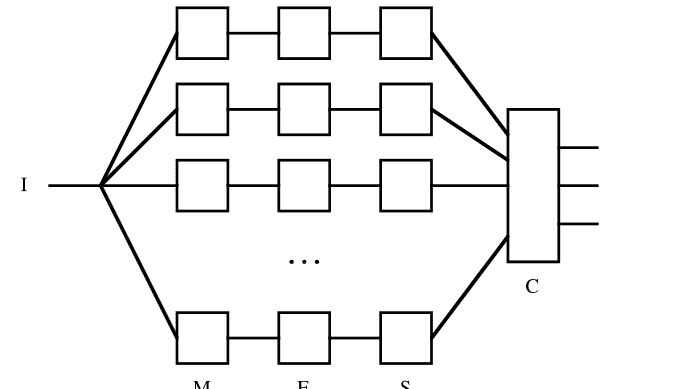

图 1.31 Laws 纹理分类器的基本形式。这里 I 为输入图像，M 表示微特征计算，E 为能量计算，S 为平滑，C 为最终分类。

（例如，Laws 在应用其 3 × 3 掩模后使用了 15 × 15 的平滑窗口）：其效果是对纹理边缘和其他微特征之间的间隙进行平滑。此时，图像已被转换为向量图像，其每个分量代表不同类型的能量。虽然 Laws（1980b）使用平方幅值和绝对幅值来估计纹理能量，前者对应于真实能量并给出更好的响应，但后者在计算量上更少，因而很有用：

$$E(l,m)=\sum_{i=l-p}^{l+p}\sum_{j=m-p}^{m+p}|F(i,j)|\tag{1.113}$$

F(i, j) 为在 (2p + 1) × (2p + 1) 窗口中一般扫描位置 (l, m) 处被平滑的典型微特征的局部幅值。

还需要进一步的阶段以多种不同的方式组合各种能量，提供多个输出，可将其输入分类器以确定每个像素位置处的特定纹理类型（图 1.31）：如有必要，可使用主成分分析来帮助选择合适的中间输出集合。

Laws 的方法在分类精度方面取得了优异的结果，例如在应用于由草、拉菲草、沙、羊毛、猪皮、皮革、水和木材组成的复合纹理图像时，达到 87%，而共生矩阵方法为 72%（Laws, 1980b）。他还发现，通常应用于图像以消除纹理场灰度分布的一阶差异的直方图均衡化带来的改善很小。在一项独立的研究中，Pietikäinen 等人（1983）证实，Laws 的纹理能量度量比基于像素对的度量（尤其是共生矩阵）更有效。

## 1. 计算机视觉急剧变化的面貌

1983 年 Ade 研究了 Laws 方法背后的理论，并以特征滤波器为基础发展了修正的理论依据。他取了 3 × 3 窗口内所有可能的像素对，并用 9 × 9 协方差矩阵来表征图像强度数据。然后他确定了对角化该矩阵所需的特征向量。这些对应于与 Laws 掩模相似的滤波器掩模，即使用这些“特征滤波器”掩模产生的图像是给定纹理的主成分图像。此外，每个特征值给出了可由相应滤波器提取的原始图像方差的那部分。实质上，方差以协方差矩阵最初来源于的图像的纹理为依据，对给定纹理提供了详尽的描述。显然，产生低方差的滤波器可以被认为对纹理识别相对不重要。

```
1 2 3
4 5 6
7 8 9
```

这导致了一个 9 × 9 协方差矩阵，用于描述 3 × 3 窗口内像素强度之间的关系，如上所述。此时我们回顾我们正在描述一种纹理，并假设其属性与像素镶嵌不同步，我们会期望协方差矩阵 C 的各种系数相等。事实上，如果我们忽略整个对的平移，像素之间只有 12 种不同的空间关系——如果在集合中包含零向量，则为 13 种（见表 1.4）。因此，其分量包括 13 个参数 a−m 的协方差矩阵形式为：

C = \begin{bmatrix}
a & b & f & c & d & k & g & m & h \\
b & a & b & e & c & d & l & g & m \\
f & b & a & j & e & c & l & g & g \\
c & e & j & a & b & f & i & g & g \\
d & c & e & b & a & b & e & c & d \\
k & d & c & f & b & a & j & e & c \\
g & l & i & c & e & j & a & b & f \\
m & g & l & d & c & e & j & a & b \\
h & m & g & k & d & c & f & b & a 
\end{bmatrix} (1.114)

```
a b c d e f g h i j k l m
9 6 6 4 4 3 3 1 1 2 2 2 2
```

表 1.4 显示了 3 × 3 窗口中像素之间空间关系的出现次数。请注意，a 是协方差矩阵 C 的对角元素，而其他所有元素在 C 中出现的次数是表中所示的两倍。

C 是对称的，实对称协方差矩阵的特征值是实数且为正，特征向量相互正交。此外，由此产生的特征滤波器反映了所研究纹理的正确结构，非常适合对其进行表征。例如，对于具有明显高度方向性图案的纹理，将存在一个或多个高能量特征值，其特征滤波器在相应方向上具有强方向性。

#### 1.6.5 Laws 和 Ade 方法的评价

在此，有必要更仔细地比较 Laws 和 Ade 方法。在 Laws 方法中，使用标准滤波器，产生纹理能量图像，然后可应用主成分分析以实现识别；而在 Ade 方法中，应用特殊滤波器（特征滤波器），其中已纳入主成分分析的结果，随后计算纹理能量度量，并应用其中合适数量的度量进行识别。

Ade 方法的优越性在于它允许在早期消除低值能量分量，从而节省计算。例如，在 Ade 的应用中，九个分量中的前五个包含 99.1% 的总纹理能量，因此其余部分可以忽略；此外，似乎包含分别占 1.9% 和 0.7% 能量的另外两个分量也可以忽略，而识别精度损失很小。然而，在某些应用中纹理可能持续变化，将方法针对特定时刻的特定数据进行微调可能并不明智。[例如，这些评论适用于（1）纺织品，其拉伸程度在制造过程中会持续变化，（2）大豆等原料食品，其大小会随供应来源而变化，以及（3）蛋糕等加工食品，其松脆程度会随烹饪温度和水蒸气含量而变化。]

In Unser (1986) developed a more general version of the Ade technique. In this approach not only is performance optimized for texture classification but also it is optimized for discrimination between two textures by simultaneous diagonalization of two covariance matrices. The method was developed further by Unser and Eden (1989; 1990): this work makes a careful analysis of the use of nonlinear detectors. As a result, two levels of nonlinearity are employed, one immediately after the linear filters and designed (by employing a specific Gaussian texture model) to feed the smoothing stage with genuine variance or other suitable measures, and the other after the spatial smoothing stage to counteract the effect of the earlier filter, and aiming to provide a feature value that is in the same units as the input signal. In practical terms this means having the capability for providing an r.m.s. texture signal from each of the linear filter channels.

总体而言，最初直观的 Laws 方法在 1980 年代成为共生矩阵方法的严肃替代方案。值得注意的是，也已设计出可能更优的替代方法——例如 Vistnes（1989）的强制选择方法用于寻找不同纹理之间的边缘，其准确性似乎明显优于 Laws 方法。Vistnes’s (1989) investigation con-


结论是：Laws 方法受到以下因素的限制：(a) 掩膜尺度较小，可能遗漏较大尺度的纹理结构；(b) 纹理能量平滑操作会跨边缘模糊纹理特征值。后一种发现（甚至更糟的情况，即第三类纹理似乎出现在两种纹理边界区域）也已被 Hsiao 和 Sawchuk（1989a,b）注意到，他们采用了改进的特征平滑技术；同时还使用概率松弛法对所得数据实施空间组织。

#### 1.6.6 更近期的发展

在 2000 年代，出现了尺度不变和旋转不变的纹理分析趋势。特别是，Janney 和 Geers（2010）的论文描述了一种“局部纹理不变特征”方法，该方法使用围绕任意给定位置的严格圆形一维采样位置阵列。该方法采用 Haar 小波，因此计算效率高。它在多个尺度上应用以实现尺度不变性；此外，还使用强度归一化使该方法对光照以及尺度和旋转不变。同样值得注意的是 Mirmehdi 等人（2008）关于这一相当专业主题的著作。后者是一本编辑卷，包含多位研究者的贡献，总结了 2010 年之前的状况。该主题的后续发展将推迟到第 F 部分的 1.7.8 和 1.7.9 节，在介绍深度学习方法之后讨论。

### 1.7 第 F 部分——从人工神经网络到深度学习方法

#### 1.7.1 引言：人工神经网络如何演变为卷积神经网络

设计人工神经网络（ANN）的最初目标，是模拟已知发生在人类视觉系统中的过程。事实上，视觉在人脑中似乎发生得如此简单直接——整个场景“一眼”就被分析完毕，无需明显努力——以至于在计算机系统中尝试这种做法似乎很值得。显然，旨在模拟人类视觉系统的 ANN 应由若干层组成，每一层都对数据进行修改，先是在局部进行，然后通过越来越大的神经元集合进行，直到完成识别和场景分析等任务。然而，在早期，ANN 的使用往往限于很少的层数：实际上，可实现的最大深度由一个输入层、三个隐藏层和一个输出层组成——尽管后来发现，许多基本任务可以用只有一个隐藏层的三层网络来处理。

限制层数少的原因之一是信用分配问题，这意味着“通过”其他层来训练许多层变得更加棘手；同时，层数越多，需要训练的神经元就越多，完成任务所需的计算量也越大。因此，ANN 往往仅被用于执行经典的识别过程，并由先前非学习层中应用的标准特征检测器为其提供输入。于是，标准范式是先进行图像预处理，再紧跟一个训练好的分类器。由于可以手工设计出非常好的特征检测器，这并没有造成明显的问题。然而，随着时间的推移，人们需要对真实场景进行全面分析，这些场景可能包含位于各种位置和姿态的多种类型物体的图像。

因此，越来越需要转向更加复杂的多层识别系统，而早期的 ANN 类型不足以胜任这些系统。同时，对预处理系统本身进行训练也变得可取，以便使其与后续目标分析系统的要求紧密匹配；显然，构建集成的多层神经网络正变得越来越必要。

事实上，到 20 世纪 90 年代末，ANN 处境艰难，因为支持向量机（SVM）等其他方法正在挑战它们的地位。此外，没有科学依据来确定需要多少神经元或层，甚至也无法解释 ANN 在内部是如何工作的。结果，那些可能使用它们的研究者不知道它们有多可靠，也没有信心在实际应用中采用它们，因此它们开始失宠。

造成这种情况的一个重要原因是，它们的架构和训练在图像间表现出较差的空间不变性。特别是，神经元是单独训练的：每个神经元看到的训练数据与其所在层中的其他神经元不同；此外，权重需要随机初始化。这些因素导致无法对图像中任意位置出现的同一物体做出相同的决策。然而，一些研究小组正在开发标准 ANN 架构的一种变体，并且在 2000 年代后期，这种变体脱颖而出，催生了“深度”学习类型的网络（深度网络是指具有三个以上非线性隐藏层的网络——这大大超出了常规 ANN 的范围）。

这种新型架构就是卷积神经网络（CNN）。在几个方面，这是一种要求更低的架构，因为 (a) 每个 CNN 神经元不必连接到上一层神经元的所有输出；(b) 任何整层中的神经元都具有相同的权重参数。尽管如此，CNN 仍然使用监督学习，并且仍然通过反向传播来训练网络。

重要的是，约束神经元在整层中具有相同的权重参数，极大地减少了整个网络中的参数总数，并使其更容易训练；此外，可以使用更多数量的层。赋予神经元局部连接性进一步改善了这种情况。注意，如果神经元和权重在整个层中是相同的，那么所得到的数学运算按定义就是卷积——因此有了“卷积神经网络”这一术语。

CNN 的另一个特点是它们使用 ReLU 而不是 sigmoid 输出函数。“ReLU” 表示修正线性单元，定义为 `max(0, x)`，其中 x 是紧邻的前一卷积层的输出值。这很有价值，因为它比旧的 sigmoid 函数计算强度更低，同时对较大信号的失真也更小。实际上，ReLU 函数避免了 ANN 所受到的饱和问题（当神经元的输出接近 tanh 函数的极限（±1）时，往往会卡在同一值，因为没有梯度引导反向传播算法脱离该值）。

CNN 还包含池化——即从一个局部区域获取所有输出，并从它们推导出单个输出：通常，这采取对所有输入进行求和或最大操作的形式，最大池化比求和（或平均）操作更常见。池化通常在 2 × 2 或 3 × 3 窗口中进行，前者更为常见。这些选项旨在对数据进行最小程度的修改，以去除网络特定层中的大量冗余，同时保留最有用的数据。

注意，多个卷积层可以紧挨着依次放置，使它们等效于一个更大的卷积——这一因素有助于在同一 CNN 中实现更大的特征。总体而言，CNN 为 ANN 提供了一个合理的替代方案。此外，它们似乎更适应在图像上从局部操作逐步过渡到全局操作、并在此过程中寻找越来越大的特征或物体的思想。

虽然在网络中前进会使我们从局部操作走向更全局的操作，但 CNN 的前几层也通常用于寻找特定的低级特征：因此，这些层的尺寸通常会与特定类型图像的尺寸相匹配。在网络更深处，通常应用池化操作，从而减小后续层的尺寸。经过几轮卷积和池化后，网络已显著缩小，因此可以使最后几层成为全连接层——即在任何一层中，每个神经元都连接到前一层的所有输出。在那一阶段，可能只有相对较少的输出，保留下来的输出将由网络需要提供的任何参数决定：这些参数可能包括分类以及相关的参数，如绝对或相对位置。

#### 1.7.2 定义 CNN 架构的参数

在分析 CNN 架构时，有许多值得注意的要点。特别是，需要定义几个量和术语——宽度 W、高度 H、深度 N、步幅 S、“零填充”宽度 P 和感受野 R。实际上，宽度和高度只是输入图像的尺寸，或者神经网络某个特定层的尺寸。网络（或其中某个特定块）的深度 N 是它包含的层数。

层的宽度 W 和高度 H 是它在每个维度上拥有的神经元数量。步幅 S 是输出场中相邻神经元之间的距离，以输入场中相邻神经元之间的距离对应的单位来度量：步幅 S 可以沿宽度和高度维度定义，但通常两者相同。如果 S = 1，相邻层具有相同的尺寸（但请参见下文感受野 R 的大小如何改变这一点）。注意，增加步幅 S 可能是有用的，因为这能节省内存和计算。原则上，它能达到与池化类似的效果。然而，池化涉及某种平均，而增大步幅只是减少了采样数量。

R_i 是第 i 层中每个神经元的感受野宽度，即该层所有神经元的输入数量。零填充是在宽度维度的两端各添加 P 个提供静态输入的“虚拟”神经元：这些神经元被赋予固定的零权重，其目的是确保同一层中的所有神经元具有相同数量的输入，从而方便编程。然而，它也确保连续的卷积不会导致活动宽度越来越小；特别是，当 S = 1 时，它允许我们使相邻层的宽度完全相等（即 W_{i+1}=W_i）。一个简单的公式将这些量中的几个联系起来：

W_{i+1} = (W_i + 2P_i - R_i)/S_i + 1  (1.115)

其中下标对应于第 i 层的输入和馈送到第 i+1 层的输出。值得强调一种零效应情形：当 S_i = 1、R_i = 1 且 P_i = 0 时，有 W_{i+1}=W_i。总体而言，填充的目的是通过确保


零的数量会根据期望的步幅和感受野值进行调整。

最后，有一点关于 CNN 层数深度定义的重要说明必须提出。之前的讨论暗示 CNN 的多个相邻层通常按顺序一个接一个地访问——如果为了检测越来越大的特征甚至物体而依次实现越来越大的卷积，情况确实如此。然而，另一种可能性是——各种层可以从网络中的给定起点，例如输入图像，并行馈入。这种可能性通常出现在需要对图像中的多种不同特征（如线条、边缘或角点）进行搜索，并将结果并行馈送给更整体的检测器时。这种策略被采用在 LeNet 架构中，该架构由 LeCun 等人（1998）开发用于识别手写数字和邮政编码。

#### 1.7.3 Krizhevsky 等人的 AlexNet 架构

AlexNet 专门设计用于目标 ImageNet 挑战赛，（ImageNet 大规模视觉识别对象挑战赛（ILSVRC），2012），该挑战赛于 2012 年举行。AlexNet 设计者（Krizhevsky 等，2012）将当时已相当陈旧的基于 CNN 的模式塑造成获胜的方法。为实现这一点，他们必须彻底改进 CNN 架构，这必然导致一个非常大的软件系统；然后他们必须借助 GPU 将其速度大幅提升——这绝非小事，因为这意味着重新优化软件以匹配硬件；最后，他们必须找到如何用非常大的训练集为软件系统提供数据——同样不是易事，因为前所未有的大量参数必须得到严格训练，并且需要多项创新才能实现。

该 CNN 架构有 10 个隐藏层（计入 C、F 和 S 层）——比 LeNet 多 4 个。然而，这些数字具有误导性，因为 AlexNet 各层深度的总和为 11,176，而 LeNet 为 258。同样，AlexNet 包含约 650,000 个神经元，而 LeNet 为 6,508，可训练参数数量约为 6000 万，而 LeNet 为 60,000。当我们查看输入图像的大小时，我们发现 AlexNet 使用大小为 224 × 224 的彩色图像，而 LeNet 只能处理双电平 32 × 32 的输入图像。总体而言，AlexNet 比 LeNet 大 100 到 1000 倍，具体取决于应被视为最相关的因素。然而，AlexNet 带来的真正变化是能够处理大量层并在此情况下管理信用分配问题——同时仍使用反向传播算法进行训练。当时这是前所未有的，但这部分得益于 CNN 所需参数数量已减少，因为任何给定神经元层中的所有神经元具有相同的参数；这也得益于采用了异常大的训练集。然而，AlexNet 架构的一个显著特征是在网络中水平分割，在其上方使用单个 GPU 实现——下方亦然。原则上，这会使架构的操作过于复杂，但在实践中证明是可行的。但由于这种复杂性，我们更易于集中研究 Zeiler 和 Fergus（2014）的 ZFNet 架构，因为它本质上是 AlexNet 的整理版、略有改进的版本，并在单个 GPU 上实现（图 1.32）：特别是，它有八个而不是七个隐藏层[这些数字将 S 层计为相应 C 层的一部分]。还请注意，ZFNet 比 AlexNet 采用了更渐进的初始层尺寸（n × n）缩小（层 C1 为 110 × 110 而非 55 × 55）。另一方面，两种架构都使用了“重叠池化”——在这种情况下是 3 × 3 池化和 2 × 2 步幅映射的组合。请注意，层的尺寸（n × n）从 224 × 224 开始逐渐降至 1 × 1。有趣的是，几乎所有的可训练参数都在层 F7 和 F8 中（AlexNet 为 F6 和 F7），最终 softmax（非神经分类器）仅剩下 1000 个连接。

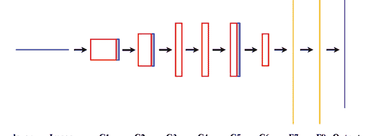

| 层 | 图像 | C1 | C2 | C3 | C4 | C5 | C6 | F7 | F8 | 输出 |
| N | 3 | 96 | 256 | 384 | 384 | 256 | 256 | 4096 | 4096 | 1000 |
| n×n | 224×224 | 110×110 | 26×26 | 13×13 | 13×13 | 13×13 | 6×6 | 6×6 | 1 | 1 |
| r×r |  | 7×7 | 5×5 | 3×3 | 3×3 | 3×3 | 3×3 | 1×1 | 1 | 1 |
| s×s |  | 2×2 | 2×2 | 1×1 | 1×1 | 1×1 | 1×1 | 1×1 | 1 | 1 |

图 1.32 ZFNet 架构示意图。该示意图与 AlexNet 的非常相似。请注意，AlexNet 包含 7 个隐藏层，而 ZFNet 包含 8 个隐藏层（这些数字将 S 层计为相应 C 层的一部分）。另外，请注意 ZFNet 仅使用单个 GPU 实现，其架构未分割。

在图 1.32 中，S1、S2 和 S3 分别以蓝色显示在 C1、C2 和 C3 的右侧；n × n 表示二维图像格式下的尺寸；r × r 是二维神经元输入场的尺寸（单个数字表示抽象的一维数据）；s × s 是二维步幅。N 是单个层内的深度：其近似大小由图中的垂直比例尺指示。

在 AlexNet 完成前不久，一种名为“dropout”的新技术由 Hinton 等人（2012）提出：另见 Hinton（2002）。其目的是限制过训练的发生。这是通过对每个训练模式随机将一部分（通常高达 50%）的权重设为零来实现的；这种相当令人惊讶的技术似乎效果很好：它通过防止隐藏层过度依赖输入给它们的具体数据来实现。Krizhevsky 等人（2012）在 AlexNet 中包含了这一特性。为应用它，每个神经元的输出以 0.5 的概率随机设为零。这是在输入数据的正向传递之前完成的，受影响的神经元不参与随后的反向传播。在下一次正向传递中，另一组神经元输出以 0.5 的概率设为零，受影响的神经元再次不参与反向传播；后续传递亦同。在测试期间，采用另一种程序，所有神经元输出乘以 0.5。事实上，将所有神经元输出乘以 0.5 是对所有局部神经元输出概率分布几何平均的近似，并依赖于几何平均与算术平均相差不大。Dropout 被纳入 AlexNet 的前两层，并显著减少了过拟合（因训练数据不足而导致的过训练）的程度。

AlexNet 使用来自 ImageNet ILSVRC 挑战赛的 120 万张图像进行训练，该数量是 ImageNet 数据库中全部 1500 万张图像的子集。事实上，ILSVRC-2010 是唯一可获得测试标签的子集，每个类别约有 1000 张图像，共 1000 个类别。然而，发现这些图像远远不足以指定执行此巨大任务的准确分类所需的复杂 CNN。因此，需要手段来充分扩展数据集以训练 AlexNet 并实现 10% 到 20% 范围内的分类错误率。

考虑并实施了两种主要的数据集扩充手段。其一是对图像应用逼真的平移和反射以生成更多同类图像。变换甚至扩展到从初始 256 × 256 的 ImageNet 图像中提取五个 224 × 224 的补丁及其水平反射，每个图像共十个补丁。另一方法是改变输入图像的强度和颜色。为了使此练习更严谨，首先使用主成分分析（PCA）为 ImageNet 数据集识别颜色主成分，然后生成随机幅度以乘以特征值，从而产生原始图像的可行变体。这两种方法共同能够有效泛化，并将原始数据集的大小扩大约 2000 倍——其原理是生成位置、强度和颜色的自然变化。

在此阶段应强调，挑战的目标是找到最好的视觉机器（给出最低的分类错误率），能够在图像中任何位置、任何合理姿势下识别跳蚤、狗、汽车或其他常见物体的实例。此外，机器应优先考虑其分类，至少给出最可能的五种解释。然后每台机器不仅可以根据其最高分类的准确性进行评级，还可以根据被分类的物体是否出现在机器的前五分类中进行评级。AlexNet 能够取得 15.3% 的获胜前五错误率，而亚军为 26.2%。另一个首次是此类练习的错误率大幅下降至 20% 以下，这为神经网络带来了新的生命，并使其迅速成为焦点。

请注意，所有这些不仅是通过设计获胜架构并生成合适的训练数据集实现的，而且还必须将训练时间降低到可实现水平。在这方面，GPU 实现被证明至关重要。即使使用一对 GPU，训练时间也大约需要一周，每天工作 24 小时来完成任务。如果没有 GPU，将需要长约 50 倍的时间——很可能约为一年——因此机器将不得不提交给后来的挑战！[一个被普遍接受的数字是 GPU 相对于典型主机 CPU 的速度优势约为 50。]

最后应注意，由于 GPU 的固有并行性以及因此处理大数据集所需周期更少的特性，它们提供了非常好的实现。请注意，CNN 的每一层都是完全同质的，因此非常适合

并行处理。还需要注意，GPU 非常适合并行工作，因为它们能够直接读写彼此的内存，从而无需通过主机 CPU 内存来移动数据。

#### 1.7.4 西蒙尼扬和齐瑟曼的 VGGNet 架构

在仍然缺乏关于理想架构形式的知识的情况下，西蒙尼扬和齐瑟曼（2015）着手确定进一步增加深度的影响。为此，他们通过将神经元的最大输入场限制为 3 × 3，显著减少了基本网络中的参数数量。实际上，他们将卷积的输入场和步长分别限制为 3 × 3 和 1 × 1，并将每个子采样层的输入场和步长都设置为 2 × 2。此外，他们使连续各层在 5 个阶段中从 224 × 224 系统而快速地收敛到 7 × 7，随后在单个全连接阶段过渡到 1 × 1；之后是两个额外的全连接层，最后是一个 softmax 输出层（图 1.33）。所有隐藏层都包含一个 ReLU 非线性阶段（图中未显示）。除了 N 个“通道”之外，5 个卷积层 C1–C5 分别包含 2、2、3、3、3 个相同的子层（图 1.33 中未标出）。最后需要说明，出于实验目的，西蒙尼扬和齐瑟曼设计了 VGGNet 架构的 6 种变体，具有 11 到 19 个权重隐藏层：这里我们只介绍配置 D（具有 16 个权重隐藏层），其中 C1–C5 层中相同子层的数量如上所列，F6、F7 和 F8 层各包含 1 个权重子层。权重层的数量显然会强烈影响参数的数量。

如前所述，西蒙尼扬和齐瑟曼通过将卷积输入场限制为 3 × 3 节省了基本参数数量。这意味着更大的卷积必须通过连续应用几个 3 × 3 卷积来产生。显然，5 × 5 输入场需要应用两次 3 × 3 卷积，7 × 7 输入场则需要三次 3 × 3 卷积。在后一种情况下，这会将参数总数从 7² = 49 减少到 3 × 3² = 27。实际上，这种实现 7 × 7 卷积的方式不仅减少了参数数量，还强制在卷积上增加了额外的正则化，因为每个 3 × 3 分量卷积之间都插入了 ReLU 非线性。同样相关的是，每个 3 层 3 × 3 卷积堆栈的输入和输出都可以有 N 个通道，在这种情况下，它将包含总共 27N² 个参数，而该数字应与 49N² 个参数进行比较。

尽管深度增加了，VGGNet 包含的参数数量仅为 AlexNet 的约 2.4 倍；而且它简单得多，不需要为了适应 2-GPU 系统而拆分架构。相反，使用现成的 4-GPU 系统时，它相对于单个 GPU 立即获得了 3.75 倍的加速。

训练方法的细节与 AlexNet 类似：参见西蒙尼扬和齐瑟曼（2015）的原始论文。然而，这些作者有一个有趣的创新：在训练时使用“尺度抖动”——即使用各种尺度的物体来增强训练集。实际上，随机缩放应用于 2 倍的图像尺度因子。

结果是，使用单个网络时，VGGNet 的 top-5 测试误差为 7.0%，而 GoogLeNet（塞格迪等人，2014）为 7.9%。事实上，GoogLeNet 达到了
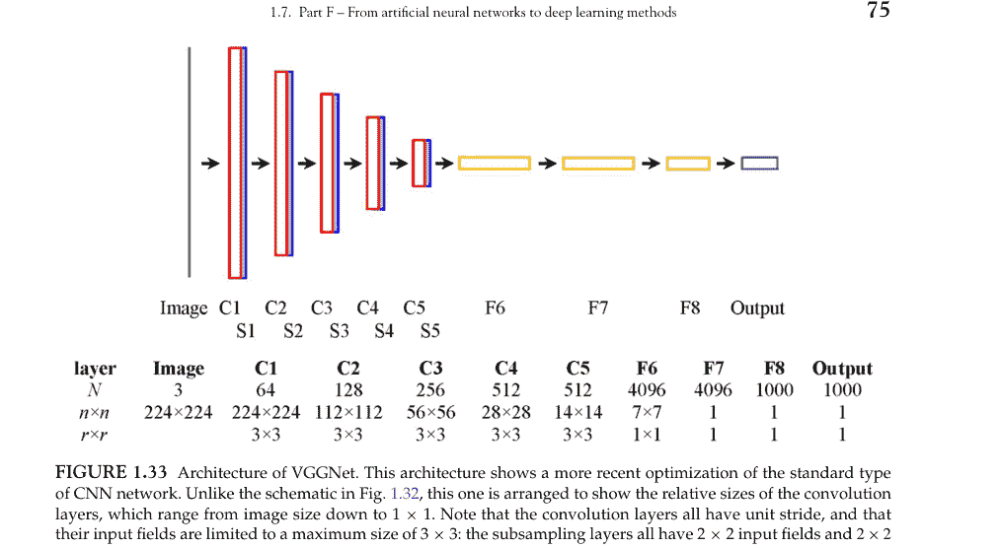

| 层 | 图像 | C1 | C2 | C3 | C4 | C5 | F6 | F7 | F8 | 输出 |
|-------|-------|----|----|----|----|----|----|----|----|--------|
| N     | 3     | 64 | 128 | 256 | 512 | 512 | 4096 | 4096 | 1000 | 1000 |
| n×n   | 224×224 | 224×224 | 112×112 | 56×56 | 28×28 | 14×14 | 7×7 | 1 | 1 | 1 |
| r×r   | 3×3 | 3×3 | 3×3 | 3×3 | 3×3 | 1×1 | 1 | 1 | 1 |  |

6.7% 的成绩，但这是通过使用 7 个网络才实现的。因此，VGGNet 在 ILSVRC-2014 挑战赛中获得了第二名。然而，在提交后，作者通过使用 2 个模型的集成将错误率降低到 6.8%——与 GoogLeNet 的性能基本相当，但使用的网络数量明显更少。有趣的是，尽管 VGGNet 架构并未偏离勒昆等人（1989）的经典 LeNet 架构，但它依然实现了所有这些，主要改进在于网络深度显著增加。

尽管在 ILSVRC-2014 挑战赛中排名第二，VGGNet 已被证明更加通用且能适应不同数据集，并且是视觉社区从图像中提取特征的首选。这似乎是因为 VGGNet 实际上提供了更鲁棒的特征，即使它在特定数据集上的分类性能稍弱。我们将在下一节看到，VGGNet 是诺等人（2015）在反卷积网络工作中选择的网络。

#### 1.7.5 诺等人的 DeconvNet 架构

受泽勒和弗格斯工作的启发，诺等人（2015）提出了一个“学习式反卷积网络”（DeconvNet），该网络从训练中学习如何对 CNN 每一层中的一组卷积系数进行反卷积。在详细考察他们的网络之前，理解他们设计该网络的动机非常重要。他们的目的是构建一个“语义分割”网络。事实上，图像分割旨在确定图像中出现的各种对象之间的边界：语义分割
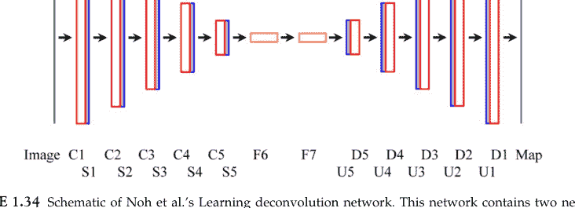

图 1.34 诺等人的学习式反卷积网络示意图。该网络包含两个背靠背的网络。左侧是标准 CNN 网络，右侧是对应的 DNN“反卷积”网络，它似乎以相反的方式运行。左侧的 CNN 网络没有输出（如 softmax）分类器，因为最终目的不是对对象进行分类，而是在整个图像区域内逐像素地呈现它们所在的位置图。反卷积层 D5 到 D1 旨在逐步解开 C5–C1 层。类似地，反池化层 U5 到 U1 旨在逐步解开池化层 S5–S1。为了实现这一点，必须将最大池化层的位置参数馈送到对应反池化层的相应位置（即，来自 Si 的位置应馈送到 Ui）。

它还更进一步，对所有对象进行分类——从而为图像中的每个区域赋予相应的语义。

DeconvNet 架构如图 1.34 所示：注意其初始 CNN 部分借用了 VGGNet 的 C1–F7 层，但不包括 F8 层和输出 softmax 层。有必要说明一下这样做的理由。首先，需要一个前向 CNN 来识别输入图像中的对象。其次，如果要在图像的特定部分定位对象，则需要另一个 CNN 来指出这些位置，而这必须在识别过程之后进行。在一个庞大的无约束 CNN 中同时完成这两个任务，在内存和训练上都是不可行的，因此这两个网络必须紧密地连接在一起。将它们连接起来的方法是从池化单元到后面的反池化单元提供前馈路径。因此，正是为了消除样本变化影响而对 CNN 输出进行泛化的手段，使得第二个 CNN 得以增强，以产生所需的位置图。至关重要的是，我们还可以看到，整体单一的前向数据路径清楚地说明了为什么现在所有 ReLU 单元都必须指向同一方向。（请记住，现在它们都已再次被转向正面。）同样明显的是，对于如此巨大的网络，训练必须谨慎进行，而且最初的前向（目标检测）部分显然应该先单独训练。

总体而言，该系统通过在其后包含一个反卷积网络（DNN）来镜像输入 CNN。其操作可概括如下：反池化层 Ui 是非线性的，它重新定向（反池化）Ci 的最大信号；然后反卷积层 Di 对数据进行线性操作，因此必须对重叠输入求和，并根据需要进行加权。然而，与其构建合适的组合规则来定义每个 Di 层重叠输出窗口会发生什么——并以某种非常


近似方式（如卷积滤波器的“转置”版本）——反卷积层作为整个网络的常规部分进行训练。虽然这种方法很严谨，但会显著增加网络训练负担。

对DNN中发生的整个过程建立一个心智模型也很有用。首先，每个反池化层从对应的池化层恢复信息，并重建池化前数据空间的维度。然而，它只是用适当位置上的局部最大值进行稀疏填充。接下来的反卷积层则负责在其数据空间中重建密集的特征图。因此，CNN缩小了激活值的尺寸，而随后的DNN则放大激活值并使其重新变得密集。不过，情况并未完全逆转，因为只有最大值被重新插入。正如Noh等人（2015）在论文中所说：“反池化通过将强激活的原始位置追踪回图像空间，捕获了特定于样本的结构”，而“反卷积层中学习到的滤波器倾向于捕获特定于类别的形状”。这意味着反卷积层重建的样本形状会更准确地对应于特定类别物体的预期形状。

尽管有这种保障，网络仍需进行适当的训练。然而，上述关于两阶段训练的意外问题已被Noh等人改进如下：为了解决语义分割空间极其庞大这一问题，网络首先在简单样本上训练，然后在更具挑战性的样本上训练——这相当于一种自举方法。更具体地说，第一个训练过程通过将物体居中并裁剪到其边界框内来限制物体大小和位置的变化；第二个阶段则确保更具挑战性的物体与真实分割结果充分重叠：为此，使用了广泛使用的交并比（IoU）度量，并且只有当IoU至少为0.5时才认为可接受。实际上，第一阶段使用“紧”边界框，并将其扩展1.2倍，再进一步扩展为正方形，以包含每个物体周围足够的局部上下文。在这个第一阶段中，框根据其中心的物体进行评级，其他像素被标记为背景。然而，在第二阶段中，这种简化不再适用，所有相关的类别标签都用于标注。

接下来，我们看看另一种密切相关的方法——Badrinarayanan等人（2015）的方法，该方法使用更少的内存，并具有若干其他优势。

#### 1.7.6 Badrinarayanan等人的SegNet架构

SegNet架构与DeconvNet（图1.34）非常相似，同样旨在进行语义分割。然而，其作者证明了有必要回归到一种显著更简单的架构，使其更容易训练（Badrinarayanan等，2015）。基本上，它与DeconvNet（图1.34）相同，但排除了F6和F7。此外，作者清楚地认识到，使用最大池化和子采样会降低特征图分辨率，从而降低最终分割图像中的位置精度。尽管如此，他们从消除VGGNet的全连接层开始，保留DeconvNet的编码-解码（CNN-DNN）结构，并保留最大池化和反池化。实际上，正是远离全连接层的做法对SegNet帮助最大，因为这大幅减少了需要学习的参数数量，从而也大幅降低了该方法的训练需求。因此，整个网络可以被视为

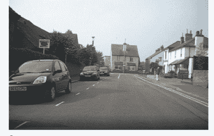

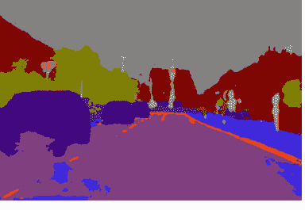

a

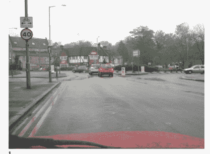

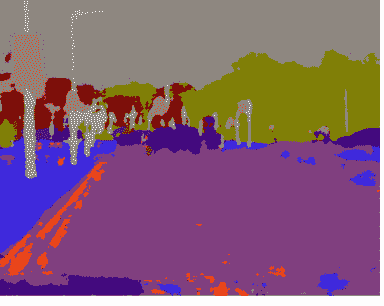

b

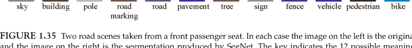

图1.35 从前排乘客座位拍摄的两个道路场景。每幅图中，左侧是原始图像，右侧是SegNet生成的分割结果。图例表示SegNet赋予的12种可能含义。虽然位置精度并不完美，但鉴于允许的解释数量有限以及视野中物体的多样性，所赋予的含义总体上是合理的。这些图片使用http://mi.eng.cam.ac.uk/projects/segnet/上的在线演示进行处理（Badrinarayanan等，2015）。

#### 1.7.7 深度学习在目标跟踪中的应用

现在我们回到运动目标跟踪的主题。这是一个通过应用深度学习取得巨大进展的领域：事实上，深度学习已对前面讨论的传统方法带来了根本性的改进。我们先以Held等人（2016）的论文作为一个有趣的例子。

Held等人（2016）试图构建一个能够实时运行的单目标跟踪器，并设计了一种基于神经网络的方法，以高达100帧/秒的速度实现这一目标。这一速度仅针对网络的测试版本实现，并反映了大量离线训练的结果。高测试速度得益于采用相对简单的架构：将成对的帧输入到训练好的神经网络，该网络立即（即通过一次前向传播）输出一幅标记了目标边界框的图像。

在测试时，跟踪器以包含目标物体的真实边界框进行初始化，并在分析每一对连续的帧后更新边界框。然而，在详细检查之前，每帧都会以足够大的尺寸和位置进行裁剪，以捕获目标物体可能做出的任何合理运动（通常这意味着以边界框两倍大小进行裁剪）：这个过程也允许包含有用的上下文信息。然后，训练好的神经网络搜索两个裁剪图像（第t−1帧和第t帧），为运动物体的位置找到最佳匹配。重复该过程即可在整个视频序列中跟踪目标物体。

要使此方法成功，训练好的网络必须包含关于每对图像各种不同可能位移的大量信息。这完全可以实现，方法是使用两个各含N个卷积层的网络（通常称为“孪生ConvNet”），其输出馈入M个全连接层（Held等人使用N=5，M=3）；最终输出包含所需的边界框信息。为了获取所有所需信息，神经网络使用输入帧所有允许的位移和裁剪方式进行训练。实际上，网络不仅在视频上训练，也在图像对上进行训练，原因是为了教会网络跟踪更多样化的物体，从而帮助防止对视频数据中的物体过拟合。

经过仔细训练，该跟踪器被发现对背景运动、平面外旋转、变形、光照变化和轻微遮挡具有不变性。此外，在标记图像上的额外训练帮助其建立了物体外观与运动之间的一般性关系，使其能够跟踪未出现在训练集中的物体——并能够以前所未有的100帧/秒速度执行该任务。

这种能力的代价是大量训练时间，原因是过度的数据增强。这是推动Bertinetto等人（2016）设计一种使用全卷积（FC）孪生网络的跟踪架构（他们称之为SiamFC）的问题之一。他们从一个具有两个并行输入的系统开始，一个提供示例图像，另一个提供搜索图像。其思想是使用合适的相似性算子，在输入图像中搜索与示例图像匹配的部分。实际上，他们为此使用了相关性操作，并使用一个相关层生成得分图，呈现在网络输出端。他们发现将输出的得分图设为降维形式很有用，这样通过乘以网络步幅便可将命中位置映射回输入图像。后者被设为8，这个数字源于在C1、S1和S2层中连续应用了三次2×2步幅（见图1.36）：要完全理解整体效果，请注意每个2×2步幅会将固有图像尺寸除以2×2。

孪生网络是一种包含两个并行流、且每个流具有相同内在结构的网络。这对上述架构来说很自然，因为两个流携带完全相同类型的数据，尽管图像大小显然会不同。每个流都使用全卷积网络，目的是实现平移不变性，使得来自任何物体的信号不会随其在图像中的位置而变化。“全卷积”意味着在整个网络中，卷积参数不允许变化。


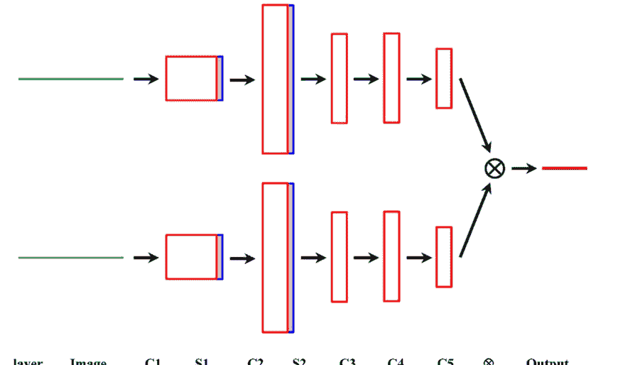

| 层 | 图像 | C1 | S1 | C2 | S2 | C3 | C4 | C5 | ⊗ | 输出 |
|---|---|---|---|---|---|---|---|---|---|---|
| n×n | 255×255 | 123×123 | 61×61 | 57×57 | 28×28 | 26×26 | 24×24 | 22×22 |  |  |
| n×n |  |  |  |  |  |  |  |  |  | 17×17 |
| n×n | 127×127 | 59×59 | 29×29 | 25×25 | 12×12 | 10×10 | 8×8 | 6×6 |  |  |
| N | 3 | 96 | 96 | 256 | 256 | 192 | 192 | 128 |  | 1 |
| r×r |  | 11×11 | 3×3 | 5×5 | 3×3 | 3×3 | 3×3 | 3×3 |  |  |
| s×s |  | 2×2 | 2×2 | 1×1 | 2×2 | 1×1 | 1×1 | 1×1 |  |  |

图1.36 全卷积孪生跟踪器。此图展示了Bertinetto等人（2016）设计的FC孪生跟踪器的架构。顶部：包含搜索流的FC分支；中部：包含示例流的分支；底部：两个分支的细节，包括通道数N、图像大小n×n、神经元输入场r×r和步幅s×s（N、r和s对两个流相同）。注意，与AlexNet的情况一样，该架构在下采样层S1和S2中使用重叠池化，两者的r×r = 3×3，s×s = 2×2。

图像空间：注意，这意味着不允许对网络外围区域进行“填充”（通常用零填充），实际上这意味着——与AlexNet的情况不同——只要神经元输入场大于1×1，连续层的输出空间就会被缩减（见图1.36）。还应该补充的是，包含两个全卷积网络的目的是获取关于目标和示例物体的足够信息，同时忽略噪声、形状变化和无关的伪影（如背景细节）。

相关操作使用标准的滑动窗口计算进行。整个系统如图1.36所示，两个全卷积流网络改编自Krizhevsky等人（2012）的AlexNet架构：特别是，全连接层已被舍弃，因为它们不是全卷积的，因此不允许位置不变性。（AlexNet的目的是根据输入图像中出现的目标对象的类别对任何输入图像进行分类，而对象定位信息被完全消除。）

在Bertinetto等人的工作中，示例图像被视为目标对象的初始外观，并且不进行更新；既不维护过去外观的记忆，也不计算目标边界框位置的预测。事实上，主要目标是实现一个简单、可靠的单目标跟踪器。然而，Bertinetto等人发现，使用双三次插值将得分图上采样16倍（即从17×17到272×272）可以实现更精确的定位。此外，他们还在约0.95到1.05的五个尺度上搜索对象，以应对尺度变化。

接下来，我们考虑输出图像空间的大小。相关层是22×22和6×6图像之间的卷积，导致潜在的最大输出图像大小为27×27，最小可用图像大小为17×17（这些数字的出现是因为22+6−1=27和22−6+1=17）。注意，最大输出图像大小（27×27）不会捕获刚好在搜索空间之外的对象，而最小大小（17×17）将充分考虑完全位于搜索空间内的对象；在这两个极限之间，存在一些检测到部分可见对象的可能性。然而，SiamFC的目标是尽可能成功地检测完全可见的对象。

最后，一个有趣的点涉及当先前图像具有奇数大小时（SiamFC中所有三种情况均如此）2×2步幅效应的计算。在这种情况下，步幅会考虑每行和每列的第一个和最后一个像素。鉴于此，图1.36中引用的连续图像大小都与Bertinetto等人（2016）给出的完全且逻辑上一致。

Feichtenhofer等人（2017）着手设计一种深度学习架构，该架构同时学习检测和跟踪。他们的架构使用了一个对象检测器和一个跟踪器：实际上，其想法是使用ConvNet同时进行检测和跟踪，并通过基于检测和跟踪的组合损失进行优化。对相邻帧的特征响应进行卷积互相关，以估计不同特征尺度下的局部位移。（这里，相关性被限制在一个小邻域内，最大位移d=8，以避免大的输出维度：这反映了Held等人（2016）目标跟踪器已经指出的限制。）在特征图上的所有位置计算相关图，并将感兴趣区域（RoI）池化（Dai等人，2016）应用于这些特征图以进行轨迹回归。上述方法允许同时跟踪多个对象，并且该架构可以从原始视频中获取输入帧进行端到端训练。总体而言，在ImageNet（2015）VID验证集上运行时，该方法相对于先前的最先进方法在80%水平上显著提高了性能。

注意，RoI池化方法尽可能采用全卷积设计，以保持平移不变性，并且只有最后一个卷积层被修改以偏离此设计：该策略允许计算位置敏感的得分图，从中可以提取多个对象轨迹片段。然而，由于整体架构的细节与R-FCN（Dai等人，2016）、ResNet-101（He等人，2016）、Fast R-CNN（Girshick，2015）和Faster R-CNN（Ren等人，2015）的细节密切相关，限于篇幅，此处无法提供完整描述。

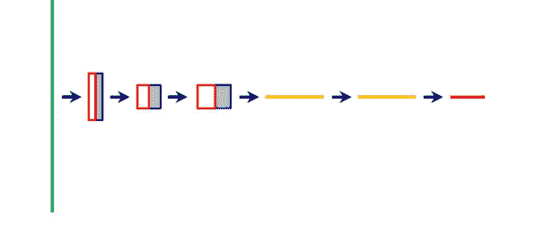

| 图像 | C1 S1 | C2 S2 | C3 E3 | F4 | F5 | 输出 |
|---|---|---|---|---|---|---|
| 227²<br>3 | 55²<br>96 | 27²<br>256 | 13²<br>384 | 1<br>4096 | 1<br>4096 | 1<br>1000 |

图1.37 Andrearczyk和Whelan的T-CNN架构。该架构旨在捕获整个输入图像的纹理，并输出一个显示最可能纹理的向量。标签下的数字表示卷积层C1–C3处理的特征空间大小以及相应层中的特征图数量。两个池化层（S1、S2）均将图像大小按2×2的因子缩小。能量层E3是一种特殊形式的池化层，它平均每个特征图上的能量，产生384个输出——对应于C3的每个特征图一个。

#### 1.7.8 深度学习在纹理分类中的应用

正如我们在前面几节中所看到的，深度学习已成为视觉算法设计中的主要因素。在纹理分析中也不例外，纹理分析已在第1.6.1–1.6.6节中介绍。图1.31展示了在第1.6.3节中讨论的Laws纹理分类器的架构。这类分类器通常被描述为使用一组“滤波器组”来提取输入信息。然而，前文表明CNN方法也可以这样描述，因此CNN（和ANN）也被应用于纹理分析并不令人惊讶。早期，通常使用一组每个都包含单一纹理的输入图像（通常来自Brodatz数据库）来训练此类网络。然而，这种方法仅限于将整个输入图像视为一个区域并相应地进行分类：将图像分割为具有不同纹理的区域超出了以这种方式训练的简单架构的能力。

Andrearczyk和Whelan（2016）描述了一种用于纹理分类的基本CNN架构（T-CNN-3），如图1.37所示。它与ZFNet有一些相似之处，尽管它包含较少的卷积层：这并不妨碍它处理纹理，因为纹理特征大多可以用相当小的窗口来描述。还要注意，最后一个卷积层之后是一个池化层，该池化层平均整个特征图上的纹理能量。然而，由于大量N个特征图是由最终卷积层的不同平行层计算的，结果是N个能量值的向量。这些值被馈送到最终的纹理分类器，为任何单个输入纹理图像产生一个类别。


事实上，Andrearczyk 和 Whelan（2016）在此基础上更进一步，设计了一种混合类型的纹理分析器（TS-CNN-3），它同时采用了上述方法以及一种允许分析物体形状的方法，后者作用方式类似于 AlexNet 对非纹理图像的物体识别系统。
整体架构如图 1.38 所示。
该架构的一个重要方面是连接层 M，它合并了系统纹理部分和形状部分的输出。
但同时也需要注意，相关的纹理信息主要来源于相对较小的低层特征，而形状信息则是一种更全局的属性，需要更高层特征的输入。
这就是为什么纹理信息是从卷积层 C3 的输出中提取的，而形状信息则是从 C5 的池化输出中获得的。
（有趣的是，由于 E3 对每个 C3 特征层的纹理能量进行整体平均，经过 E3 后纹理通道中不再保留任何空间或形状信息。）
最后，输出层 F6、F7 和 O 用于合并形状和纹理输出：显然，这些层中包含足够的信息，可以将纹理与输入图像中的特定位置关联起来，并以训练中使用的纹理实际出现在输入图像中的概率形式呈现输出。
然而，该网络所不做的是生成一个输出图像图，显示图像按各种纹理区域进行最可能分割的结果。
实现这一点是好的，原则上通过引入 SegNet 的编码器-解码器架构（参见第 1.7.6 节）应该是可行的。
这里的主要障碍是缺乏足够大的纹理数据集（与 ImageNet 相当）：事实上，根本问题在于像 SegNet 这样的架构非常深，需要使用更多训练样本进行大量训练。

缺乏大型纹理数据集是制约纹理分析进一步发展的严重因素，无论采用何种训练方法和架构。
事实上，如果有这样的数据集，AlexNet（以及其他网络如 VGGNet）就可以在不改变其架构的情况下被训练用于对整幅图像进行纹理分析。
正如 Liu 等人（2019）所指出的，“深度学习在图像分类和物体识别方面的近期成功与大规模标注图像数据集（如 ImageNet）的可用性密不可分。然而，基于深度学习的纹理分析并未跟上其他领域所见的快速进展，部分原因在于缺乏大规模纹理数据库。”

这些说法很严重，因为（a）基于 CNN 的架构已是进行纹理分析最广泛使用的方法之一——这一趋势在可预见的未来似乎不太可能减弱；并且（b）相同的训练限制（以及对大型纹理数据集的需求）也必须适用于用于分析纹理图像的任何方法。
还应记住，纹理的统计特性意味着，一般而言，基于训练的程序将优于手工设计的算法。

最后，我们考虑 Andrearczyk 和 Whelan 的两种架构的性能。在 ImageNet（一个物体数据集）上训练时，他们发现 T-CNN-3 的表现不如 AlexNet（51.2% 对比 57.1%）：这并不令人惊讶，因为 AlexNet 是一个更大的网络，包含 6090 万个可训练参数，而 T-CNN-3 只有 2340 万。
另一方面，使用 ImageNet-T 和 KTH-TIPS-2b（Russakovsky 等，2015；Hayman 等，2004）等面向纹理的数据集进行训练时，T-CNN-3 相对于 AlexNet 显示出显著的改进（各自的准确率分别为 71.1% 对比 66.3%，以及 48.7% 对比 47.6%）。
这些结果对应于从


| 图像 | C1 | C2 | C3 | C4 | C5 | M | F6 | F7 | 输出 |
|-------|----|----|----|----|----|---|----|----|--------|
|       | S1 | S2 |    |    | E3 S5 |   |    |    |        |
| 227² 3 | 55² 96 | 27² 256 | 13² 384 | 13² 384 | 13² 384 |   | 1 4096 | 1 4096 | 1 1000 |

图 1.38 Andrearczyk 和 Whelan 的 TS-CNN 架构。该架构旨在捕获整个输入图像的纹理和形状信息，并输出一个向量显示最可能的纹理集合。标签下第一行的数字表示卷积层 C1–C5 所处理的特征空间的大小；第二行的数字表示相应层中特征图的数目。所有三个池化层（S1、S2、S5）将图像尺寸缩小 2 × 2 倍，因此输入到合并点 M 的图像大小为 6 × 6。在 M 处，纹理和形状输出被连接起来，从而产生总共 384 × (1 + 6²) 个输出——所有这些输出都连接到 F6 的所有输入，形成全连接网络。如图 1.37 所示，能量层 E3 是一个池化层，它对每个特征图上的能量进行整体平均，产生 384 个输出，每个 C3 特征图对应一个输出。
在单个数据库上从头开始训练。
然而，也可以在一个数据库上预训练，然后在另一个数据库上微调。
当尝试此操作时——具体来说，在 ImageNet 上预训练并在 KTH-TIPS-2b 上微调——T-CNN-3 的表现比 AlexNet 更准确（73.2% 对比 71.5%）。
使用混合 TS-CNN-3 架构获得了进一步的改进，准确率达到 74.0%。
其中一部分改进显然归因于 TS-CNN-3 更大的可训练参数数量（6250 万）。
然而，当使用具有可比参数数量的架构进行测试时——例如 AlexNet 与 T-CNN-3 的组合，以及 VGG-M（Chatfield 等，2014）与 FV-CNN（Cimpoi 等，2015）的组合——TS-CNN-3 仍然更优。
事实上，新的 TS-CNN-3 纹理 + 形状架构的标志是其对训练参数的高效使用，并且通过将纹理分析与形状分析分离，它在处理纹理图像时实现了更准确的结果。

详细描述 Andrearczyk 和 Whelan（2016）的工作是有益的，因为这揭示了深度网络应用于纹理分析的许多见解——包括其中涉及的诸多细微之处。
虽然该方法旨在构建具有相对适中训练参数数量的架构，但 Cimpoi 等人（2015；2016）的限制较少的方法似乎更强大：它在全连接层之前系统地使用 CNN 的全局池化，从而捕获有价值的纹理描述符集合。
（更准确地说，它密集地池化局部特征，去除全局空间信息，以便提取密集的卷积特征。）
的确，Cimpoi 等人 2016 年的论文能够开发出一个包含四十七个纹理属性的词汇表，用于描述广泛的纹理模式。
事实上，Cimpoi 等人（2015；2016）的工作因其接近完美的分类准确率而具有影响力。
然而，Liu 等人（2019）指出性能已“饱和”（意味着其已在接近 100% 的水平趋于平稳），“因为数据集不够大，无法通过微调获得改进结果”——这反映了前面关于可用纹理数据集所提到的观点。
应该指出的是，Cimpoi 等人的最佳结果是使用 Simonyan 和 Zisserman（2015）的 VGG-VD（非常深）架构获得的，该架构包含 19 个 CNN 层，这在一定程度上解释了饱和成为可能的原因。

Liu 等人（2019）在其对纹理表示发展回顾中提出的另一点是，巨大的图像数据集需求与人类对紧凑、高效表示的相应需求之间存在日益增长的紧张关系。
后一种需求在资源受限的移动和嵌入式平台上日益显现——正如 Andrearczyk 和 Whelan（2016）以及 Szegedy 等人（2014）之前所观察到的。

#### 1.7.9 深度学习世界中的纹理分析
第 E 部分首先探讨了纹理的含义——本质上是在问“什么是纹理以及纹理是如何形成的？”
通常，纹理始于具有局部粗糙度或结构的表面，然后将其投影形成纹理图像。
这种图像同时表现出规律性和随机性，尽管方向性和取向也可以是重要的参数。
然而，随机性的本质特征意味着纹理必须通过统计技术进行表征，并使用统计分类程序进行识别。
用于此目的的技术包括自相关、共生矩阵、纹理能量度量、分形度量、马尔可夫随机场等。
这些技术旨在分析和建模纹理。
的确，该领域的工作人员不得不花费大量时间努力改进他们所处理的纹理模型，以便更好地描述、识别和分割它们。
然而，在不到十年的时间里，DNNs 突然崭露头角，正如我们所见，这导致了纹理分析技术进一步快速发展的时期——使我们与 1970 年代的直观方法相距更远。

### 1.8 第 G 部分 – 总结
本章的 A–E 部分概述了三个高度相关的传统主题，即 2-D 和 3-D 中的特征检测和物体检测。
它们介绍了在 2012 年深度学习爆发之前已在整个领域变得熟悉并被广泛使用的基础理论。
第 F 部分进一步传授了这次爆发所包含的内容的理解，特别是不仅所有物体特征和物体本身如何可以从大量训练示例中学习，而且语义分割如何可以通过完整的卷积网络的端到端训练实现。
这样的网络能够学习所有特征和物体，似乎不需要传统方法来支持这一事实是发人深省的。
事实上，静态场景的语义分割并不是唯一的 relevant 故事，但正如第 1.7.7 节

已证明，与此类似的过程在多目标运动跟踪方面也取得了令人印象深刻的效果。事实上，有人指出（Feichtenhofer 等，2017），过去通过对原理的艰难复杂应用所取得的许多成果，现在已通过深度学习方法以理论强度较低的方式实现；并且当投入更多努力时，这些方法有能力将性能推进到更高的高度。回顾来看，似乎研究人员在如何足够准确地指定他们想要处理的真实（非理想化）图像中“软”数据的性质方面，遇到了一个比喻性的砖墙：而缺乏可行的建模结构使得找到合适的推进方式变得困难；因此，至少尝试深度学习这一替代方案变得必要。

在此阶段，总结是什么促成了深度学习爆炸将是有用的。事实上，这是一系列不同因素的组合。特别是，我们可以指出：
- 使用连接性远低于旧 ANN 架构的 CNN；
- 用 ReLU 取代 sigmoid 输出函数；
- 应用‘dropout’程序以限制过拟合的发生；
- 用于训练的图像数据量大幅增加；
- 从图像中提取更多图像块以进一步增强可用于训练的数据量；
- 应用 GPU 进行训练，速度大幅提升（通常认为 GPU 相对于典型主机 CPU 的速度优势约为 ~50）。还必须记住，所有这些变化在 2012 年或多或少是同时发生的。

我们现在就此打住讨论，因为以下章节提供了对实际上相当复杂且快速变化的状况的许多进一步见解。

## Acknowledgments

以下文本和插图已获 IET 许可转载：1.2.7 节中的正文插图及相关文本——摘自 Electronics Letters（Davies, 1999）；图 1.2 及相关文本——摘自 Proc. Visual Information Engineering Conf.（Davies, 2005）；文本摘录——摘自 Proc. Image Processing and its Applications Conf.（Davies, 1997）。图 1.5 及相关文本已获 IFS Publications Ltd 许可转载（Davies, 1984）。我还希望承认图 1.13 和 1.15 及其相关文本首次发表于 Proceedings of the 4th Alvey Vision Conference（Davies, 1988b）。

## References

Ade, F., 1983. 用“特征滤波器”表征纹理。Signal Processing 5 (5), 451–457.
Amit, Y., Trouvé, A., 2007. POP：用于目标识别的部件拼贴模型。International Journal of Computer Vision 75 (2), 267–282.
Andrearczyk, V., Whelan, P., 2016. 在卷积神经网络中使用滤波器组进行纹理分类。Pattern Recognition Letters 84, 63–69.
Badrinarayanan, V., Kendall, A., Cipolla, R., 2015. SegNet：用于图像分割的深度卷积编码器-解码器架构。arXiv:1511.00561v2 [cs.CV].
Bai, Y., Ma, W., Li, Y., Cao, L., Guo, W., Yang, L., 2016. 用于快速人脸检测的多尺度全卷积网络。In: Proc. British Machine Vision Association Conference. York, 19–22 September. http://www.bmva.org/bmvc/2016/papers/paper051/paper051.pdf.
Ballard, D.H., 1981. 将 Hough 变换推广以检测任意形状。Pattern Recognition 13, 111–122.
Beaudet, P.R., 1978. 旋转不变图像算子。In: Proc. 4th Int. Conf. on Pattern Recognition. Kyoto, pp. 579–583.
Bertinetto, L., Valmadre, J., Henriques, J.F., Vedaldi, A., Torr, P.H.S., 2016. 用于目标跟踪的全卷积孪生网络。In: Proc. ECCV Workshops, pp. 850–865.
Brostow, G., Fauqueur, J., Cipolla, R., 2009. 视频中的语义物体类别：高清真实标签数据库。Pattern Recognition Letters 30 (2), 88–97.
Canny, J., 1986. 边缘检测的计算方法。IEEE Transactions on Pattern Analysis and Machine Intelligence 8, 679–698.
Castañón, D.A., 1990. 在格子中寻找 k 条最佳路径的高效算法。IEEE Transactions on Aerospace and Electronic Systems 26 (2), 405–410.
Chatfield, K., Simonyan, K., Vedaldi, A., Zisserman, A., 2014. 细节中的魔鬼回归：深入研究卷积网络。In: Proc. BMVC, pp. 1–12.
Cimpoi, M., Maji, S., Vedaldi, A., 2015. 用于纹理识别和分割的深度滤波器组。In: IEEE Conf. on Computer Vision and Pattern Recognition, pp. 3828–3836.
Cimpoi, M., Maji, S., Kokkinos, I., Vedaldi, A., 2016. 用于纹理识别、描述和分割的深度滤波器组。International Journal of Computer Vision 118, 65–94.
Cootes, T.F., Taylor, C.J., 2001. 用于医学图像分析和计算机视觉的外观统计模型。In: Sonka, M., Hanson, K.M. (Eds.), Proc. SPIE, Int. Soc. Opt. Eng. USA, vol. 4322, pp. 236–248.
Cucchiara, R., Grana, C., Piccardi, M., Prati, A., 2003. 检测视频流中的运动物体和阴影。IEEE Transactions on Pattern Analysis and Machine Intelligence 25 (10), 1337–1342.
Dai, J., Li, Y., He, K., Sun, J., 2016. R-FCN：基于区域的全卷积网络进行目标检测。In: Proc. NIPS.
Dalal, N., Triggs, B., 2005. 用于人体检测的方向梯度直方图。In: Proc. Conf. on Computer Vision Pattern Recognition. San Diego, California, USA, pp. 886–893.
Davies, E.R., 1984. 制造过程中对某些食品产品进行成本效益检验系统的设计。In: Pugh, A. (Ed.), Proc. 4th Int. Conf. on Robot Vision and Sensory Controls. London, 9–11 October. IFS (Publications) Ltd, Bedford and North-Holland, Amsterdam, pp. 437–446.
Davies, E.R., 1986. 边缘检测模板掩模设计的约束。Pattern Recognition Letters 4 (2), 111–120.
Davies, E.R., 1988a. 用于一般圆定位的改进 Hough 方案。Pattern Recognition Letters 7 (1), 37–43.
Davies, E.R., 1988b. 用于从显著特征定位物体的图匹配替代方案。In: Proc. 4th Alvey Vision Conf. Manchester, 31 Aug.–2 Sept., pp. 281–286.
Davies, E.R., 1988c. 基于中值的角点检测方法。In: Kittler, J. (Ed.), Proceedings of the Fourth BPRA International Conference on Pattern Recognition. Cambridge, 28–30 March. In: Lecture Notes in Computer Science, vol. 301. Springer-Verlag, Heidelberg, pp. 360–369.
Davies, E.R., 1997. 设计具有高方向精度的高效线段检测器。In: Proc. 6th IEE Int. Conf. on Image Processing and Its Applications. Dublin, 14–17 July. In: IEE Conf. Publication, vol. 443, pp. 636–640.
Davies, E.R., 1999. 设计最优图像特征检测掩模：等面积规则。Electronics Letters 35 (6), 463–465.
Davies, E.R., 2005. 使用基于 Plessey 算子的边缘模型确定定位特性。In: Proc. IET Int. Conf. on Visual Information Engineering, University of Glasgow, Glasgow, 4–6 April, pp. 385–391.
Davies, E.R., 2017. Computer Vision: Principles, Algorithms, Applications, Learning, 第 5 版。Academic Press, Oxford, UK.
Davies, E.R., Bateman, M., Mason, D.R., Chambers, J., Ridgway, C., 2003. 用于谷物检验的高效线段检测器设计。Pattern Recognition Letters 24 (1–3), 421–436.
Dreschler, L., Nagel, H.-H., 1981. 从单目电视帧序列推导的街道场景中运动汽车的体积模型和 3D 轨迹。In: Proc. Int. Joint Conf. on Artif. Intell., pp. 692–697.
Dudani, S.A., Luk, A.L., 1978. 在室外场景中定位直线边缘段。Pattern Recognition 10, 145–157.
Elgammal, A., Harwood, D., Davis, L., 2000. 背景减除的非参数模型。In: Proc. European Conf. on Computer Vision. In: LNCS, vol. 1843, pp. 751–767.
Everingham, M., Van Gool, L., Williams, C.K.I., Winn, J., Zisserman, A., 2007. Pascal 视觉物体类别挑战赛 2007。（VOC2007）结果。http://www.pascalnetwork.org/challenges/VOC/voc2007/.
Everingham, M., Van Gool, L., Williams, C.K.I., Winn, J., Zisserman, A., 2008. Pascal 视觉物体类别挑战赛 2008。（VOC2008）结果。http://www.pascalnetwork.org/challenges/VOC/voc2008/.
Everingham, M., Zisserman, A., Williams, C.K.I., Van Gool, L., 2006. Pascal 视觉物体类别挑战赛 2006。（VOC2006）结果。http://www.pascalnetwork.org/challenges/VOC/voc2006/.


Fathy, M.E., Hussein, A.S., Tolba, M.F., 2011. 基础矩阵估计：误差准则研究。 Pattern Recognition Letters 32 (2), 383–391.

Faugeras, O., Luong, Q.-T., Maybank, S.J., 1992. 相机自标定：理论与实验。 于： Sandini, G. (编), Proc. 2nd European Conf. on Computer Vision. Lecture Notes in Computer Science, vol. 588. Springer-Verlag, Berlin Heidelberg, pp. 321–334.

Feichtenhofer, C., Pinz, A., Zisserman, A., 2017. 检测以跟踪，跟踪以检测。 于： Proc. ICCV, pp. 3038–3046.

Felzenszwalb, P.F., Girshick, R.B., McAllester, D., Ramanan, D., 2010. 基于判别训练的部件模型进行目标检测。 IEEE Transactions on Pattern Analysis and Machine Intelligence 32 (9), 1627–1645.

Fischler, M.A., Bolles, R.C., 1981. 随机采样一致性：模型拟合的范式及其在图像分析与自动制图中的应用。 Communications of the ACM 24 (6), 381–395.

Girshick, R.B., 2015. Fast R-CNN。 于： Proc. ICCV 2015.

Haralick, R.M., Shanmugam, K., Dinstein, I., 1973. 用于图像分类的纹理特征。 IEEE Transactions on Systems, Man and Cybernetics 3 (6), 610–621.

Harris, C., Stephens, M., 1988. 一种联合角点和边缘检测器。 于： Proc. 4th Alvey Vision Conf., pp. 147–151.

Hartley, R.I., 1995. 一种由直线和点重建的线性方法。 于： Proc. Int. Conf. on Computer Vision, pp. 882–887.

Hartley, R.I., Sturm, P., 1994. 三角测量。 于： American Image Understanding Workshop, pp. 957–966.

Hayman, E., Caputo, B., Fritz, M., Eklundh, J.-O., 2004. 关于真实世界条件对材料分类意义的探讨。 于： ECCV, pp. 253–266.

He, K., Zhang, X., Ren, S., Sun, J., 2016. 用于图像识别的深度残差学习。 于： Proc. CVPR.

Held, D., Thrun, S., Savarese, S., 2016. 利用深度回归网络以 100 fps 学习跟踪。 于： Proc. ECCV. Springer, pp. 749–765.

Hinton, G.E., 2002. 通过最小化对比散度训练专家乘积。 Neural Computation 14 (8), 1771–1800.

Hinton, G.E., Srivastava, N., Krizhevsky, A., Sutskever, I., Salakhutdinov, R.R., 2012. 通过防止特征检测器的协同适应来改进神经网络。 arXiv:1207.0580v1 [cs.NE].

Horprasert, T., Harwood, D., Davis, L.S., 1999. 一种用于实时鲁棒背景减除和阴影检测的统计方法。 于： Proc. IEEE ICCV Frame-Rate Applications Workshop, pp. 1–19.

Hsiao, J.Y., Sawchuk, A.A., 1989a. 使用特征平滑和概率松弛技术的监督纹理图像分割。 IEEE Transactions on Pattern Analysis and Machine Intelligence 11 (12), 1279–1292.

Hsiao, J.Y., Sawchuk, A.A., 1989b. 使用特征平滑和概率松弛技术的无监督纹理图像分割。 Computer Vision, Graphics, and Image Processing 48, 1–21.

ImageNet, 2015. ImageNet 大规模视觉识别挑战赛 (ILSVRC2015)。 http://image-net.org/challenges/LSVRC/2015/.

Janney, P., Geers, G., 2010. 使用局部纹理的不变特征进行纹理分类。 IET Image Processing 4 (3), 158–171.

Kaiser, H., 1955. 航空照片上纹理的量化。 硕士论文。 Boston Univ.

Kalal, Z., Mikolajczyk, K., Matas, J., 2011. 跟踪-学习-检测。 IEEE Transactions on Pattern Analysis and Machine Intelligence 34 (7), 1409–1422.

Kanatani, K., 1996. 几何计算的统计优化：理论与实践。 Elsevier, Amsterdam, the Netherlands.

Kitchen, L., Rosenfeld, A., 1982. 灰度角点检测。 Pattern Recognition Letters 1, 95–102.

Krizhevsky, A., Sutskever, I., Hinton, G.E., 2012. 使用深度卷积神经网络的 ImageNet 分类。 于： Proc. 26th Annual Conf. on Neural Information Processing Systems. Lake Tahoe, Nevada, pp. 3–8.

Laws, K.I., 1979. 纹理能量度量。 于： Proc. Image Understanding Workshop, Nov., pp. 47–51.

Laws, K.I., 1980a. 快速纹理识别。 于： Proc. SPIE Conf. on Image Processing for Missile Guidance, 238. San Diego, Calif. 28 July – 1 Aug., pp. 376–380.

Laws, K.I., 1980b. 纹理图像分割。 博士论文。 Univ. of Southern California, Los Angeles.

LeCun, Y., Boser, B., Denker, J.S., Henderson, D., Howard, R.E., Hubbard, W., Jackel, L.D., 1989. 反向传播应用于手写邮政编码识别。 Neural Computation 1 (4), 541–551.

LeCun, Y., Bottou, L., Bengio, Y., Haffner, P., 1998. 应用于文档识别的基于梯度的学习。 Proceedings of the IEEE 86, 2278–2324.

Lee, S.H., Civera, J., 2019. 三角测量：为何优化？ 卷 23. arXiv:1907.11917v2 [cs.CV].

Leibe, B., Leonardis, A., Schiele, B., 2008. 通过交错分类与分割实现鲁棒目标检测。 International Journal of Computer Vision 77 (1), 259–289.

Lipton, A.J., Fujiyoshi, H., Patil, R.S., 1998. 从实时视频中进行运动目标分类与跟踪。 于： Proc. 4th IEEE Workshop on Applications of Computer Vision, pp. 8–14.

Liu, L., Chen, J., Fieguth, P., Zhao, G., Chellappa, R., Pietikäinen, M., 2019. 从 BoW 到 CNN：纹理分类的纹理表示二十年。 International Journal of Computer Vision 127, 74–109.

Lo, B.P.L., Velastin, S.A., 2001. 地下站台自动拥挤检测系统。 于： Proc. Int. Symposium on Intelligent Multimedia, Video and Speech Processing, pp. 158–161.

Longuet-Higgins, H.C., 1981. 从两个投影重建场景的计算机算法。 Nature 293, 133–135.

Magee, M.J., Aggarwal, J.K., 1984. 从透视图像确定消失点。 Computer Vision, Graphics, and Image Processing 26 (2), 256–267.

Mathias, M., Benenson, R., Pedersoli, M., Van Gool, L., 2014. 无花哨功能的人脸检测。 于： Proc. 13th European Conf. on Computer Vision. Zurich, Switzerland, 8–11 September.

Mirmohammadi, M., Xie, X., Suri, J. (编), 2008. 纹理分析手册。 Imperial College Press, London.

Nagel, H.-H., 1983. 从图像序列中二阶强度变化推导出的位移向量。 Computer Vision, Graphics, and Image Processing 21, 85–117.

Noh, H., Hong, S., Han, B., 2015. 用于语义分割的反卷积网络学习。 于： Proc. IEEE Int. Conf. on Computer Vision. Santiago, Chile, 13–16 December, pp. 1520–1528.

Pietikäinen, M., Rosenfeld, A., Davis, L.S., 1983. 使用局部模式匹配平均值的纹理分类实验。 IEEE Transactions on Systems, Man and Cybernetics 13 (3), 421–426.

Ren, S., He, K., Girshick, R., Sun, J., 2015. Faster R-CNN：利用区域建议网络实现实时目标检测。 arXiv:1506.01497 [cs.CV].

Rosenfeld, A., Troy, E.B., 1970a. 视觉纹理分析。 Computer Science Center, Univ. of Maryland. 技术报告 TR-116.

Rosenfeld, A., Troy, E.B., 1970b. 视觉纹理分析。 于： Conf. Record for Symposium on Feature Extraction and Selection in Pattern Recognition, IEEE Publication 70C-51C, Argonne, Ill., pp. 115–124.

Russakovsky, O., Deng, J., Su, H., Krause, J., Satheesh, S., Ma, S., Huang, Z., Karpathy, A., Khosla, A., Bernstein, M., Berg, C., Fei-Fei, L., 2015. ImageNet 大规模视觉识别挑战赛。 International Journal of Computer Vision 115 (3), 211–252.

Shah, M.A., Jain, R., 1984. 检测时变角点。 Computer Vision, Graphics, and Image Processing 28, 345–355.

Simonyan, K., Zisserman, A., 2015. 用于大规模图像识别的非常深的卷积网络。 arXiv:1409.1556v6.

Stalder, S., Grabner, H., van Gool, L., 2009. 超越半监督跟踪：跟踪应像检测一样简单，但不应比识别更简单。 于： IEEE 12th Int. Conf. on Workshop on On-Line Learning for Computer Vision.

Szegedy, C., Liu, W., Jia, Y., Sermanet, P., Reed, S., Anguelov, D., Erhan, D., Vanhoucke, V., Rabinovich, A., 2014. 用卷积更深入。 arXiv:1409.4842v1 [cs.CV].

Tighe, J., Lazebnik, S., 2013. 寻找事物：利用区域和逐例检测器进行图像解析。 于： Proc. IEEE Conf. on Computer Vision and Pattern Recognition. Portland, Oregon, 23–28 June, pp. 3001–3008.

Torr, P., Zisserman, A., 1997. 图像退化下基础矩阵估计的性能表征。 Machine Vision and Applications 9 (5), 321–333.

Unser, M., 1986. 用于纹理测量的局部线性变换。 Signal Processing 11, 61–79.

Unser, M., Eden, M., 1989. 用于纹理分割的多分辨率特征提取与选择。 IEEE Transactions on Pattern Analysis and Machine Intelligence 11 (7), 717–728.

Unser, M., Eden, M., 1990. 基于空间滤波提取特征的纹理分割改进的非线性算子。 IEEE Transactions on Systems, Man and Cybernetics 20 (4), 804–815.

Vistnes, R., 1989. 用于纹理判别的纹理模型与图像度量。 International Journal of Computer Vision 3, 313–336.

Wu, Z., Thangali, A., Sclaroff, S., Betke, M., 2012. 多目标跟踪中检测与数据关联的耦合。 于： Proc. IEEE Conf. CVPR, pp. 1948–1955.

Yang, Y., Li, Z., Zhang, L., Murphy, C., Ver Hoeve, J., Jiang, H., 2012. 基于示例的语义图像标注的局部标签描述符。 于： Proc. 12th European Conf. on Computer Vision. Florence, Italy, 7–13 October, pp. 361–375.


## 参考文献

- Zeiler, M., Fergus, R., 2014. 可视化与理解卷积神经网络. In: Proc. 第13届欧洲计算机视觉会议论文集. Zurich, Switzerland, 8–11 September.
- Zhang, L., Wu, B., Nevatia, R., 2007. 基于局部形状特征的红外图像行人检测. In: Proc. 第3届IEEE关于可见光谱内外目标跟踪与分类联合国际研讨会论文集.
- Zuniga, O.A., Haralick, R.M., 1983. 基于面片模型的角点检测. In: Proc. IEEE计算机视觉与模式识别会议论文集. pp. 30–37.

## 作者简介

Roy Davies 是伦敦大学皇家霍洛威学院机器视觉的名誉教授。 他在视觉的许多方面开展过工作，从特征检测和噪声抑制到鲁棒模式匹配以及实际视觉任务的实时实现。 他的研究兴趣包括自动化视觉检测、监控、车辆引导和犯罪侦测。 他已发表超过200篇论文和三本著作 – Machine Vision: Theory, Algorithms, Practicalities (1990), Electronics, Noise and Signal Recovery (1993), and Image Processing for the Food Industry (2000); 其中第一本在国际上被广泛使用超过25年，现已推出大幅增强的第五版。 Roy 是物理学会的会士和工程技术学会的会士，也是电气电子工程师学会的资深会员。 他担任 Pattern Recognition Letters, Real-Time Image Processing, Imaging Science 和 IET Image Processing 的编委会成员。 他在伦敦大学获得理学博士学位：他于2005年获 BMVA 杰出会士称号，并于2008年获国际模式识别协会会士称号。

本页特意留空

## 第2章：鲁棒目标检测的先进方法

Zhaowei Caiᵃ and Nuno Vasconcelosᵇ

ᵃAmazon Web Services, Pasadena, CA, United States
ᵇUniversity of California San Diego, Department of Electrical and Computer Engineering, San Diego, CA, United States

### 章节要点

- 本章介绍了计算机视觉中的目标检测问题。
- 本章回顾了一些基于深度神经网络的先进目标检测器以及近年来在检测文献中变得重要的一些技术。

### 2.1 引言

目标检测是计算机视觉中最基础且最具挑战性的问题之一。 它是对更常被研究的物体分类问题的一种推广。 给定一幅图像，物体识别旨在回答“是什么”的问题。 图像中的物体是什么？ 例如，图 2.1 的图像包含一个人和一条船。 除了“是什么”，目标检测还旨在回答“在哪里”的问题。 图像的哪些区域包含物体？ 这在图 2.1(b) 中有所说明，其中使用边界框来标定每个物体的区域。


(a) 物体分类

(b) 物体检测

图 2.1 物体分类与物体检测的区别。

目标检测具有许多实际应用。 例如，自动驾驶汽车依赖目标检测来定位物体、理解周围环境并帮助做出安全决策。 在医学成像中，目标检测器可以帮助在医学扫描中定位病变，减轻放射科医生和其他医学专家的负担。 然而，目标检测也是计算机视觉中的上游任务，支持许多其他下游任务，如视觉问答、图像描述、视觉导航、机器人抓取、姿态估计等。 例如，目标检测不仅可以帮助机器人准确抓取物理世界中的物体，还可以使其理解该物体的语义、它与场景中其他物体的关系，以及它如何参与解决任务，无论是单独还是在机器人团队中。 因此，目标检测的进步将使计算机视觉的许多其他领域受益，并总体上实现更有效的计算机视觉系统。

目标检测器面临许多挑战。 例如，它需要在多种光照条件下、遮挡和背景干扰的情况下，准确检测多个类别、尺度、长宽比等物体。 这使得开发在大多数条件下都能良好工作的足够鲁棒的检测器具有挑战性，这是模仿人类视觉系统所必需的条件。

由于该问题的重要性，目标检测的研究历史悠久（Sung and Poggio, 1998; Rowley et al., 1996; Papageorgiou et al., 1998）。 早期工作集中于特定物体的检测，即面部和人类，这对许多应用都很重要。 Viola-Jones (VJ) 检测器（Viola and Jones, 2001, 2004）是这些工作中的一个里程碑。 它是无约束环境下的首个实时目标检测器，且比当时所有其他竞争检测器快得多。 其思想是将检测器表述为分类器级联，按阶段拒绝物体假设，使用非常简单的 Haar 小波特征。 通过在后期阶段添加更多特征，级联可以形成强大的检测器。 然而，由于大多数假设可以用简单特征（早期阶段）拒绝，平均计算量很小。 尽管小波特征速度快，但准确性不高。 后来的工作提出了方向梯度直方图（HOG）（Dalal and Triggs, 2005），作为尺度不变特征变换（SIFT）特征（Lowe, 1999, 2004）的重要改进。 HOG 在人检测上显示出非常出色的性能，后来被广泛应用于各种目标检测问题。 一般物体检测的一个突破是可变形部件模型（DPM）的引入（Felzenszwalb et al., 2010）。 它基于 HOG 特征，将每个物体表示为根模型和可变形部件的组合，其中部件滤波器的配置是潜在变量，自动学习得到。 DPM 是 Pascal VOC 目标检测挑战赛（Everingham et al., 2010）的获胜者，该挑战赛涉及 2007 年、2008 年和 2009 年对 20 个物体类别（如桌子、公共汽车、人类或自行车）的检测。 这使其成为深度学习引入之前目标检测研究的默认框架。

近年来，已证明由深度卷积神经网络（CNN）提取的学习特征表示远远优于即使是最好的手工特征，如 SIFT、HOG 和 Haar 小波。 尽管 vanilla CNN 特征表示具有强大的分类性能，但将其应用于目标检测需要非平凡的扩展。 与分类不同，目标检测需要解决两个任务。 首先，检测器必须解决 *recognition* 问题，区分前景物体与背景并为其分配正确的物体类别标签。 其次，检测器必须解决 *localization* 问题，为不同物体分配准确的边界框。 在本章中，我们回顾了过去几年提出的基于 CNN 的目标检测框架。 这些可以分为两大类：两阶段目标检测器，如 R-CNN（Girshick et al., 2014）、SPP-Net（He et al., 2014）、Fast R-CNN（Girshick, 2015）、Faster R-CNN（Ren et al., 2017）、MS-CNN（Cai et al., 2016）、FPN（Lin et al., 2017a）和 Cascade R-CNN（Cai and Vasconcelos, 2021），以及单阶段目标检测器，包括 YOLO（Redmon et al., 2016）、SSD（Liu et al., 2016）和 RetinaNet（Lin et al., 2017b）。

### 2.2 预备知识

现代大多数目标检测器实现了分类和边界框回归的组合。 分类试图预测图像区域中物体的类别，边界框回归试图通过预测包含物体的最紧凑框来确定区域。 考虑一个真实物体，其边界框为 **g**，关联的类别标签为 *y*，以及一个检测假设 **x**，其边界框为 **b**。 由于 **b** 通常包含物体和一定量的背景，很难确定检测是否正确。 这通常通过交并比（IoU）度量来解决

$IoU(\mathbf{b}, \mathbf{g}) = \frac{\mathbf{b} \cap \mathbf{g}}{\mathbf{b} \cup \mathbf{g}}. \tag{2.1}$

如果 IoU 高于阈值 *u*，**x** 被认为是边界框 **g** 的物体类别的一个示例，并记为“正例”。 因此，假设 **x** 的类别标签是 *u* 的函数，

$y_u = \begin{cases} y, & IoU(\mathbf{b}, \mathbf{g}) \ge u \\ 0, & \text{otherwise.} \end{cases} \tag{2.2}$

如果 IoU 未超过任何物体的阈值，**x** 被分配给背景并记为“负例”。

尽管对于边界框回归任务没有必要定义正/负示例，但 IoU 阈值 *u* 也需要用于选择样本集

$\mathcal{G} = \{(\mathbf{g}_i, \mathbf{b}_i) \mid IoU(\mathbf{b}_i, \mathbf{g}_i) \ge u\} \tag{2.3}$

用于训练回归器。 虽然用于这两个任务的 IoU 阈值不必相同，但在实践中这是通常的做法。 因此，IoU 阈值 *u* 定义了检测器的 *quality*。


**图 2.2** 质量递增的示例。数字是 (2.1) 中两个边界框之间的 IoU，表示它们相互重叠的程度。

大阈值鼓励检测到的边界框与其真实值对应物紧密对齐。小阈值奖励产生松散边界框的检测器，这些边界框与真实值重叠较小。质量递增的假设的一些示例显示在图 2.2 中。

### 2.3 R-CNN

R-CNN (Girshick et al., 2014) (Regions with CNN features) 是对通用目标检测中使用深度神经网络的开创性尝试。它是第一个通过利用强大的 CNN 特征表示超越 DPM 风格方法的作品。它还证明了在 ImageNet (Russakovsky et al., 2015) 上为分类预训练的 CNN 特征可以成功微调到其他下游任务，例如检测、分割等。

#### 2.3.1 System design

R-CNN 由三个模块组成，如图 2.3 所示。由于 CNN 计算成本高昂，第一步是使用 Selective Search (van de Sande et al., 2011) 生成类别无关的区域建议。这些建议定义了检测器可用的候选检测集合，将检测假设的数量从数百万级减少到数千级。第二步是从每个建议区域提取特征，使用为识别训练的 CNN，例如 AlexNet (Krizhevsky et al., 2012) 或 VGG-Net (Simonyan and Zisserman, 2014)。检测到的建议，具有任意尺度和大小，首先被裁剪并扭曲到网络输入的大小。然后将调整大小后的图像通过 CNN 正向传播，并将倒数第二层网络层的输出用作每个建议的特征表示。最后，第三个模块，使用特定类别的线性 SVM 实现，为建议生成类别预测。为了更好地定位，会应用额外的边界框回归器来细化检测到的物体的边界框。

#### 2.3.2 Training

用于特征提取的 CNN 在 ImageNet (Russakovsky et al., 2015) 分类任务上进行预训练，并微调到检测任务中使用的扭曲建议区域。微调是一个 K + 1 路分类问题，其中有 K 个物体类别和一个背景类别。


**图 2.5** 用于目标检测的 SPP-Net 流程。

网络的层。随后使用空间金字塔池化 (Lazebnik et al., 2006) 提取与每个建议相关联的裁剪特征图的固定长度特征。这些固定长度的特征最终输入到一组全连接层进行最终预测，如图 2.4（底部）所示。这种简单的改变使得昂贵的 CNN 计算可以在建议之间共享，并且整个图像只需处理一次。重要操作是图 2.5 中的空间金字塔池化 (SPM) 操作，它将任意尺度和大小的实例级特征映射为固定长度向量。这是首次证明从卷积特征图中的特征可以在空间区域上进行池化，以产生具有良好实例识别属性的实例级特征表示。这启发了后来的工作，例如 Fast R-CNN。

### 2.5 Fast R-CNN

SPP-Net 继承了 R-CNN 繁琐的多阶段训练流程。在 Fast R-CNN 中，这得到了显著简化。在此方法中，特征提取、网络对新任务的微调、实例级分类和边界框回归都集成到统一框架中，使基于深度学习的目标检测易于使用。

#### 2.5.1 Architecture

Fast R-CNN 的流程如图 2.6 所示。与 SPP-Net 类似，Fast R-CNN 将整张图像通过 CNN 的卷积层以生成特征图。接下来，使用感兴趣区域 (RoI) 池化层为每个物体建议提取固定长度特征的向量。最后，使用两个全连接 (FC) 层进行最终预测：K + 1 个类别的分类概率和四个边界框坐标的回归。与 R-CNN 和 SPP-Net 不同，Fast R-CNN 使用多任务损失端到端训练，避免了繁琐的多阶段训练流程。


**图 2.6** Fast R-CNN 流程。

#### 2.5.2 RoI pooling

RoI 池化操作是图 2.5 中空间金字塔池化的简化版本。与 SPP 中将高度和宽度为 (h, w) 的 RoI 池化到不同的空间分辨率 (1 × 1、2 × 2 和 4 × 4) 并将它们连接起来不同，RoI 池化使用单一的 H × W 分辨率，例如 7 × 7。给定大小为 h × w 的 RoI 窗口，RoI 池化将其划分为 H × W 个子窗口，每个子窗口大小为 h/H × w/W。然后在每个子窗口内使用最大池化来提取最大的特征值。该过程独立应用于每个特征图通道。尽管 RoI 池化比 SPM 更简单，但它仍能有效地从预先计算的卷积特征图中为任意大小和尺度的建议提取强大的特征表示。这是目标检测的关键要求。

#### 2.5.3 Multitask loss

Fast R-CNN 使用两个学习任务进行训练：分类和边界框回归。它们在训练期间通过多任务损失函数联合优化

$$
L = L_{cls}(h(\mathbf{x}), y) + \lambda [y \ge 1] L_{loc}(f(\mathbf{x}, \mathbf{b}), \mathbf{g}), \qquad (2.5)
$$

其中 λ 控制两个需求之间的平衡。[y ≥ 1] 在 y ≥ 1 时等于 1，否则等于 0，这意味着背景类别没有边界框回归损失。

**Classification.** 分类器是一个函数 h(x)，它将图像块 x 分配到 K + 1 个类别之一，其中类别 0 包含背景，其余类别为要检测的物体。h(x) 是类别后验分布的 K + 1 维估计，即 $h_k(x) = p(y = k|x)$，其中 y 是类别标签。$L_{cls}$ 是 (2.4) 的交叉熵损失。

**Bounding box regression.** 边界框 **b** = ($b_x$, $b_y$, $b_w$, $b_h$) 包含图像块 **x** 的四个坐标。边界框回归旨在使用回归器 $f(\mathbf{x}, \mathbf{b})$ 将候选边界框 **b** 回归到目标边界框 **g**。回归损失函数为

$$
L_{loc}(\mathbf{a}, \mathbf{b}) = \sum_{i \in \{x,y,w,h\}} smooth_{L_1}(a_i - b_i), \quad (2.6)
$$

其中

$$
smooth_{L_1}(x) = \begin{cases} 0.5x^2, & |x| < 1, \\ |x| - 0.5, & \text{otherwise,} \end{cases} \quad (2.7)
$$

是平滑 $L_1$ 损失函数。它是 $L_1$ 和 $L_2$ 损失的组合，当 $|x| < 1$ 时表现如 $L_1$ 损失，否则表现如 $L_2$ 损失。它修正了 $L_1$ 损失的非光滑行为，即梯度在 x 为负时为 -1，否则为 +1。平滑 $L_1$ 损失可以实现更稳定的学习行为。

为了鼓励尺度和位置不变性，$smooth_{L_1}$ 作用于由下式定义的距离向量 $\Delta = (\delta_x, \delta_y, \delta_w, \delta_h)$

$$
\delta_x = (g_x - b_x)/b_w, \quad \delta_y = (g_y - b_y)/b_h, \quad \delta_w = \log(g_w/b_w), \quad \delta_h = \log(g_h/b_h). \quad (2.8)
$$

由于边界框回归通常对 **b** 进行微小调整，(2.8) 的数值可能非常小。这通常使回归损失远小于分类损失。为了提高多任务学习的效率，$\Delta$ 按其均值和方差进行归一化，例如 $\delta_x$ 被替换为

$$
\delta'_x = \frac{\delta_x - \mu_x}{\sigma_x}. \quad (2.9)
$$

#### 2.5.4 Finetuning strategy

**Sampling.**

**采样。**

R-CNN 和 SPP-Net 都对 RoI 进行采样。这可能导致训练非常低效，因为 RoI 从不同图像中提取，每张图像都需要一次完整的 CNN 前向计算。为避免该问题，Fast R-CNN 首先采样 $N$ 张图像，然后从中每张图像采样 $R$ 个 RoI。通过选择 $N \ll R$，只需对少量 ($N$) 图像进行 CNN 计算。然而，这引发了采样 RoI 相关的问题，这可能会减慢训练收敛速度。然而，实践中发现该策略效果良好 (Girshick, 2015; Ren et al., 2017)。RoI 从每张图像中采样，以产生 25% 正样本和 75% 负样本训练示例。

**Back-propagation through RoI pooling.**

**通过 RoI 池化的反向传播。**

Fast R-CNN 相对于 SPP-Net 的另一个重要改进是通过 RoI 池化层进行梯度反向传播。如果没有这一点，卷积


图 2.7 Faster R-CNN 的架构。

与 SPP-net 的情况一样，RoI 池化层以下的层不会针对检测任务进行微调。由于在 RoI 池化中，每个输出特征都是特征图上对应子窗口的最大池化结果，反向传播计算简化为最大池化操作的计算。也就是说，输出梯度仅反向传播到子窗口中最大值所在的位置。该策略应用于每个区域提议的每个 RoI 特征。

### 2.6 Faster R-CNN

SPP-Net 和 Fast R-CNN 显著提高了 R-CNN 的运行速度，从每张图像约 30 秒降至约 2 秒。它们使得依赖像素和边缘等底层特征、并在 CPU 上运行的通用提议检测阶段成为速度瓶颈。例如，选择性搜索提议检测器每张图像约需 2 秒。Faster R-CNN 通过引入一个在 GPU 上运行且与 Fast R-CNN 网络共享特征计算的区域提议网络（RPN）来解决这一问题。

#### 2.6.1 架构

如图 2.7 所示，Faster R-CNN 由两个模块组成：一个用于提议区域且全卷积的区域提议网络（RPN），以及一个对这些提议进行分类的 Fast R-CNN 检测器。与 R-CNN 和 Fast R-CNN 框架不同，整个系统是一个用于目标检测的单一、统一且端到端的网络。由于 RPN 与 Fast R-CNN 网络共享大部分计算，RPN 带来的额外计算成本很小。这使得 Faster R-CNN 能够消除提议生成时间，并在现代 GPU 上实时运行。


图 2.8 区域提议网络的示意图。

#### 2.6.2 区域提议网络

如图 2.8 所示，区域提议是通过在卷积特征图上滑动一个小型网络来生成的。该小型网络由一个 256 维的 3 × 3 卷积层、一个 ReLU 层和两个全连接的并列输出层实现。与 Fast R-CNN 的最终输出层类似，第一个输出层用于二元（前景与背景）分类，第二个输出层用于边界框回归。对于给定的锚点，这会生成一个“对象性”分数和 4 个坐标。根据对象性分数，RPN 生成排名前 300 的提议，并将用于后续的 Fast R-CNN 阶段。

### 锚点

原则上，每个滑动窗口位置应生成单个预测，因为特征图上的每个位置对应于输入图像上的单个位置。然而，RPN 在每个滑动窗口位置同时预测 k 个区域提议，以适应不同的目标尺寸和纵横比。这借助锚点的概念得以实现。在单个位置上，一个提议预测与一个锚点相关联，该锚点的中心位于滑动窗口的中心，并具有自己的尺度和纵横比。常见的做法是在每个滑动窗口位置使用 k = 9 个锚点，包含 3 种不同的尺度和 3 种不同的纵横比。每个锚点生成一个 6 维提议，其中四个维度编码边界框回归的坐标，剩余两个维度是前景和背景类别概率。

### 训练

RPN 的损失函数与 (2.5) 相同。锚点边界框需要回归到相应的真实边界框。为了平衡学习，训练期间对锚点进行采样，使得正锚点与负锚点的比例为 1:1。请注意，此处的比例与第 2.5 节中 Fast R-CNN 训练的 1:3 比例不同，因为 RPN 的任务是检测尽可能多的提议。正样本比例较高时，模型将被鼓励检测更多的正样本。利用 RPN 生成的排名前 300 的提议，Fast R-CNN 检测器的训练与上述保持一致。卷积特征计算在 RPN 和 Fast R-CNN 之间共享，整个网络可以通过标准的反向传播和随机梯度下降（SGD）进行端到端训练。

### 2.7 Cascade R-CNN

检测问题很困难，部分原因在于存在许多“接近”的假阳性，对应于“接近但不正确”的边界框。一个有效的检测器必须找出图像中的所有真阳性，同时抑制这些接近的假阳性。检测假设的质量由其与真实框的 IoU 定义，而检测器的质量则由训练它所使用的 IoU 阈值定义。

### 高质量检测

挑战在于，无论选择何种 IoU 阈值 u，检测环境都是高度对抗性的。当 u 较高时，正样本包含很少的背景，但难以收集大量正训练集。当 u 较低时，可以获得更丰富、更多样的正训练集，但训练出的检测器几乎没有动力去拒绝接近的假阳性。一般来说，很难保证单个分类器在所有 IoU 水平上均表现良好。此外，由于在推理时，提议检测器（如 RPN 或选择性搜索）产生的大多数假设质量较低，网络顶部的目标检测器必须对较低质量的假设具有判别能力。在这些相互冲突的需求之间，一种标准的折衷方案是设定 u = 0.5，这几乎被所有现代目标检测器所采用。然而，这是一个相对较低的阈值，使得难以训练能够有效拒绝接近假阳性的检测器。

一般来说，检测器只有在获得高质量提议时才能实现高质量。然而，这无法通过在训练期间简单提高阈值 u 来保证。相反，强制使用较高的 u 值通常会降低检测性能。这个问题，即使用较高的阈值训练检测器会导致较差的性能，被称为高质量检测悖论。它有两个原因。首先，目标提议机制往往产生严重偏向低质量的假设分布。因此，在训练中使用较大的 IoU 阈值会指数级地减少正训练样本的数量。这对神经网络尤其成问题，因为神经网络非常依赖样本数量，使得“高 u”训练策略极易过拟合。其次，检测器的质量与推理时可获得的假设质量之间存在不匹配。由于高质量检测器仅对高质量假设最优，对于较低质量的假设，检测性能可能会大幅下降。Cascade R-CNN 解决了这个问题，从而能够实现高质量的目标检测器。


图 2.9 Cascade R-CNN 是 Faster R-CNN 的多阶段扩展。“I”是输入图像，“conv”是主干卷积，“pool”是区域特征提取，“H”是网络头部，“B”是边界框，“C”是分类。“B0”是所有架构中的提议。

#### 2.7.1 架构

如图 2.9 所示，Cascade R-CNN（Cai 和 Vasconcelos，2021）是 Faster R-CNN 的多阶段扩展。它使用的不是单个检测器，而是级联的检测阶段，这些阶段对接近的假阳性依次更具选择性。不同检测头的 IoU 阈值通常为 0.5、0.6 和 0.7。R-CNN 的级联阶段按顺序训练，使用一个阶段的输出来训练下一个阶段。这利用了如下观察：边界框回归器的输出 IoU 几乎总是优于其输入 IoU。因此，使用某个 IoU 阈值训练的检测器的输出，是训练下一个更高 IoU 阈值检测器的良好假设分布。通过调整边界框，每个阶段旨在找到一组良好的接近假阳性，用于训练下一阶段。这种重采样的主要结果是，检测假设的质量从一个阶段到下一个阶段逐渐提高。因此，检测器序列解决了高质量检测悖论背后的两个问题。第一，由于重采样操作保证了序列中所有检测器训练所需的大量样本可用，因此可以训练高 IoU 检测器而不会过拟合。第二，推理时使用相同的级联过程会产生一组质量逐步提高的假设，与检测器阶段不断提高的质量良好匹配。这实现了更高的检测精度。

#### 2.7.2 级联边界框回归

由于单个回归器难以在所有质量水平上一致地表现良好，Cascade R-CNN 将回归任务分解为一系列更简单的步骤。这由一组级联的专门回归器组成：

$f(\mathbf{x}, \mathbf{b}) = f_r \circ f_{r-1} \circ \cdots \circ f_1(\mathbf{x}, \mathbf{b}), \qquad (2.10)$


图 2.10 公式 (2.8) 的距离向量 Δ（未归一化）在不同级联阶段的分布。顶部：(δx, δy) 的图。底部：(δw, δh) 的图。红色点为后期阶段递增 IoU 阈值的异常值，所示统计数据是在剔除异常值后得到的。

其中 T 为级联阶段的总数量。关键点在于，每个回归器 f_t 都是针对前一个回归器生成的边界框分布 {b'^t} 进行优化，而不是初始分布 {b^1}。这样，假设被逐步改进。级联回归的有效性在图 2.10 中得以说明，该图展示了公式 (2.8) 的回归距离向量 Δ = (δx, δy, δw, δh) 在不同级联阶段的分布。请注意，随着假设在级联中推进，大多数假设会更接近真实值。

#### 2.7.3 级联检测

直接训练高质量检测器是困难的。Cascade R-CNN 通过利用级联回归作为重采样机制来解决该问题。从示例 {(x_i, b_i)} 出发，级联回归被用来依次重采样更高 IoU 的示例分布 {(x'_i, b'_i)}。这使得随着检测器质量 u 的提高，连续阶段的正样本集合保持大致恒定的大小。

在每个阶段 t，R-CNN 头包括一个分类器 h_t 和一个针对对应 IoU 阈值 u^t 进行优化的回归器 f_t，其中 u^t > u^{t-1}。这些通过损失进行学习

L(x^t, g) = L_cls(h_t(x^t), y^t) + λ[y^t ≥ 1] L_loc(f_t(x^t, b^t), g), (2.11)


图 2.11 (a) 图像金字塔：特征在每个图像尺度上独立计算。(b) 单特征图：目标检测在 CNN 中仅在单一尺度特征图上操作。(c) 特征金字塔：用于多尺度检测的特征金字塔，但图像输入为单一尺度。(d) 特征金字塔网络 (FPN)：FPN 在 (c) 的特征金字塔上添加自顶向下连接，使不同尺度上具有更尺度不变的语义特征表示。

其中 b^i = f_{i-1}(x^{i-1}, b^{i-1})，g 是 x^i 的真实目标对象，λ = 1 为权衡系数，y^i 为根据 (2.2) 的 u^i 准则下 x^i 的标签，[·] 为指示函数。请注意，[·] 的使用意味着边界框回归的 IoU 阈值 u 与用于分类的阈值相同。这种级联学习对检测器训练有两个重要影响。首先，在大 IoU 阈值 u 下过拟合的可能性降低，因为在所有阶段正样本变得充足。其次，更深阶段的检测器对更高的 IoU 阈值最优。这种假设和检测器质量的同步改进使 Cascade R-CNN 能够克服高质量检测的悖论。在推理时，应用相同的级联。假设的质量被依次改进，并且更高质量的检测器只需在更高质量的假设上操作，而它们对此是最优的。

### 2.8 多尺度特征表示

在计算机视觉中，以各种尺度识别物体是一个基本挑战。文献中的经典解决方案是依赖图像金字塔，如图 2.11(a) 所示，其中原始图像被调整为不同尺度以提取特征 (Viola and Jones, 2004; Felzenszwalb et al., 2010; Dollár et al., 2014)。通过将固定尺度检测器应用于所有金字塔特征表示，然后可以在不同尺度上检测物体，而不会损失精度。小（大）物体在大（小）分辨率通道中被检测到。然而，构建 CNN 特征金字塔计算成本高昂，使得该解决方案对大多数实际应用不切实际。设计有效多尺度 CNN 特征表示是目标检测的重要研究方向。


图 2.12 在自然图像中，物体可以以非常不同的尺度出现，如黄色边界框所示。固定大小滤波器的单一感受野（阴影区域所示）无法匹配这种变化。

尽管基于深度学习的目标检测器取得了巨大成功 (Girshick et al., 2014; Girshick, 2015; He et al., 2014; Ren et al., 2017)，在多尺度物体检测方面进展有限。如上所述，R-CNN、SPP-Net 和 Fast R-CNN 在初步注意阶段（如 Selective Search (van de Sande et al., 2011)）以多尺度采样物体提议，然后将这些提议扭曲为 CNN 支持的固定大小。这将尺度不变性问题推向注意阶段，而该阶段并未与 CNN 联合训练。Faster R-CNN (Ren et al., 2017) 通过使用 RPN 生成多尺度提议来解决联合训练问题。然而，如图 2.11(b) 所示，这通过在单一组卷积特征图上滑动固定的一组滤波器来实现。这在可变大小的物体和固定感受野的滤波器之间造成了不一致。如图 2.12 所示，固定感受野无法覆盖物体在自然场景中出现的多种尺度。结果检测性能受损，特别是对于图 2.12 中心的小物体等，它们很难检测。已提出若干网络通过引入 RPN 的多尺度扩展来扩展两阶段检测器架构。

#### 2.8.1 MS-CNN

MS-CNN 被提出以解决多尺度目标检测问题。它追求一种替代图像金字塔昂贵计算的策略，利用深度神经网络已经逐层计算特征层次结构的事实。鉴于高层被下采样，该层次结构甚至具有多尺度金字塔结构。因此，物体大小与感受野之间的不一致

可以通过在网络的多个阶段简单地添加输出层来解决，如图 2.11(c) 所示。这样，MS-CNN 实现多个专门针对不同尺度范围的检测器。虽然基于较低网络层的检测器，如“conv-3”，具有较小的感受野，更适合检测小物体，而基于较高层的检测器，如“conv-5”，最适合检测大物体。不同层输出处的互补检测器被组合成一个强大的多尺度检测器。


图 2.13 MS-CNN 的特征金字塔架构。立方体是网络的输出张量（除输入图像外）。h × w 为滤波器大小，c 为类别数，b 为边界框坐标数。

##### 2.8.1.1 架构

MS-CNN 提议网络的详细架构如图 2.13 所示。网络通过多个检测分支检测物体，这些分支合并为最终的提议集合。它有一个标准 CNN 主干，描绘在图中心，以及一组输出分支，这些分支从主干的不同层发出。这些分支由单个检测层组成。请注意，在“conv4-3”层之后发出的分支上引入了一个缓冲卷积层。由于该分支接近主干网络的较低层，它对其梯度的影响大于其他检测分支。这可能导致学习过程中出现不稳定性。缓冲卷积防止检测分支的梯度直接反向传播到主干层。

在训练期间，多尺度提议网络的参数 W 从训练样本集合 S = {(Xi, Yi)}i=1N 学习，其中 Xi 是训练图像块，Yi = (yi, bi) 是其类别标签 yi ∈ {0, 1, 2, …, K} 与边界框坐标 bi = (bi^x, bi^y, bi^w, bi^h) 的组合。这通过多任务损失实现

L(W) = Σm=1M Σi∈Sm αm lm(Xi, Yi|W),  (2.12)

其中 M 为检测分支的数量，l^m 为结合分类和边界框回归的多任务损失（式 2.5），α_m 为损失 l^m 的权重，且 S = {S^1, S^2, …, S^M}，其中 S^m 包含尺度 m 的示例。请注意，只有按尺度选择的训练样本子集 S^m 会贡献到检测层 m 的损失中。

#### 2.8.2 FPN

尽管图 2.11(c) 的特征金字塔改善了不同物体尺度的表示，但它在这些表示之间引入了很大的语义差距。虽然高分辨率图包含低层语义特征的信息，例如边缘、角点等，低分辨率图传达的是语义丰富的信息，例如物体类别。因此，高分辨率（低分辨率）图主要提供物体位置（身份）的信息。通过要求所有特征表示都参与定位和分类任务，图 2.11(c) 的架构可能导致检测性能次优。

为减少这些语义差距，特征金字塔网络（FPN）从高层（语义更丰富）的特征图向低层（语义最贫乏）的特征图添加了自顶向下的连接，如图 2.11(d) 所示。这确保了特征金字塔在所有金字塔层级上都有强语义。与图 2.11(c) 一样，FPN 是一种网络内金字塔，因此高效，但自顶向下的连接增加了其表示能力。

##### 2.8.2.1 Architecture

FPN 与标准自底向上分类网络（如 ResNet（He et al., 2016））的主要区别在于增加了自顶向下路径，以实现语义丰富的特征金字塔。这是通过图 2.14 所示的一组简单的构建块实现的。

### Bottom-up pathway

标准的 feed-forward 网络由于使用了下采样操作，如池化、步长为 2 的卷积等，自然形成自底向上金字塔。一般而言，特征图的分辨率在每个网络阶段减少 2 倍，其中阶段定义为具有相同分辨率的一系列层。FPN 基于 ResNet，从每个 ResNet 阶段的最后一层的激活中提取自底向上金字塔。具体而言，ResNet 的层 conv2、conv3、conv4 和 conv5 的输出，记为 {C2, C3, C4, C5}，用于创建相对于输入图像具有步长 {4, 8, 16, 32} 像素的金字塔。

### Top-down pathway and lateral connections

FPN 的目标是丰富低层特征图的语义。一种简单的方法是将语义强的高层特征图添加到低层特征图中。由于高层特征图的分辨率较低，它们首先使用最近邻采样在空间上按因子 2 上采样。在求和之前，低层特征图会送入 1 × 1 的侧向卷积层，以确保两个特征图具有相同的通道维度。然后特征图逐元素求和并应用 3 × 3 卷积生成最终特征图，以避免上采样操作可能导致的混叠。这些中没有非线性

FIGURE 2.15 Detection system of YOLO.

S × S grid on input

Bounding boxes + confidence

Class probability map

Final detections

每单元 x 产生 B 个边界框。仅当物体的真实边界框中心位于单元内部时，该单元才被认为对物体负责。每个预测由四个边界框坐标 x、y、w 和 h 以及一个目标性分数 p(o = 1|x) 组成。后者反映了预测框包含物体的置信度，理想情况下等于预测框与物体真实框之间的 IoU。如果单元中不存在物体，则目标性分数应为 0。类别 k 的置信度预测随后定义为

p(y = k|x) = p(y = k|o = 1, x) p(o = 1|x), (2.13)

其中 p(y = k|o = 1, x) 是在单元 x 包含物体的条件下类别 k 出现在单元 x 中的类别条件概率。然而，单个 C 个类别条件概率集由单元的 B 个预测共享，即单元中所有预测具有相同的类别条件概率。YOLO 的典型实现，用于 Pascal VOC 数据集（Everingham et al., 2010）的 20 个物体类别的检测，使用 S = 7、B = 2 和 C = 20，共产生 7 × 7 × 30 个预测。

### Backbone design

YOLO 高效的原因之一是其主干网络，称为 DarkNet。这受 GoogLeNet（Szegedy et al., 2015）架构启发，包含 24 个卷积层后接 2 个全连接层，采用 1 × 1 通道缩减和 3 × 3 卷积层的组合实现，其实现在现代 GPU 上得到优化。


FIGURE 2.16 Detection system of SSD.

### 2.10 SSD

SSD（Liu et al., 2016）是另一种流行的单阶段目标检测器。它与 YOLO 一样快，但准确率更高，尤其对于小物体。主要区别在于使用图 2.11(c) 的多尺度特征金字塔和 RPN 锚框。

#### 2.10.1 Architecture

主干网络是标准图像分类网络（不含最终分类层），例如 VGG-Net（Simonyan and Zisserman, 2014）。在此主干网络上添加了一些辅助层以产生检测预测。整体架构如图 2.16 所示。

### Multiscale detection

与 MS-CNN 类似，SSD 使用图 2.11(c) 的分层特征表示进行多尺度检测。如图 2.16 所示，检测从层 Conv4_3、Conv6、Conv7、Conv8_2、Conv9_2、Conv10_2 和 Conv11_2 的特征图生成，这些特征图具有不同的分辨率。出于上述原因，这使得检测到更多物体并提高了小物体的检测精度。与 RPN（Ren et al., 2017）类似，应用于每个卷积特征图的 SSD 预测器由额外的 3 × 3 卷积层组成，其输出为相对于锚位置的类别分数和边界框偏移。

### Anchor boxes

与 RPN 类似，在给定位置有 k 个锚框，每个锚框预测 c 个类别分数和 4 个坐标偏移。因此，分辨率为 h × w 的特征图产生 (c + 4) × k × h × w 个输出。这相当于在多个特征图上应用 RPN，有助于理解单阶段检测器通常不如两阶段检测器准确的原因：它们类似于后者的提议生成阶段。将 SSD 与 MS-CNN 实现的 RPN 进行比较，主要区别在于 RPN 是类别不可知的，即 c = 2，而 SSD 是类别特定的，产生 c + 1 个类别预测，例如 VOC 数据集（Everingham et al., 2010）中 c = 21。

#### 2.10.2 Training

SSD 使用与（2.5）类似的多任务损失函数，结合分类和边界框回归项。为了更准确的检测，它在训练期间还使用困难负样本挖掘和强数据增强。

### Hard negative mining

目标检测的一个难点是大多数负样本，例如天空，很容易分类。如果训练中包含太多简单负样本，检测器对困难负样本（视觉上与正样本相似的负样本）的性能会下降。该问题对于缺乏第二阶段有效重采样的单阶段检测器更为严重。困难负样本挖掘是一种采样机制，在深度学习出现之前广泛用于目标检测（Viola and Jones, 2004; Felzenszwalb et al., 2010; Dollár et al., 2014），旨在解决此问题。为了创建负样本池，SSD 按置信度分数从高到低对负样本排序（分数越高表示示例越难分类），并选择所需的前几个样本以实现正负样本 1:3 的比例，类似于 Fast R-CNN 的采样方式。这使得检测器对困难负样本更具判别性。

### Data augmentation

不足的训练数据是基于深度学习的目标检测的另一个问题，可通过数据增强解决。在 SSD 训练中，每个图像随机增强为以下之一：
- 保持原始图像；
- 裁剪与物体最小 IoU 在 {0.1, 0.3, 0.5, 0.7, 0.9} 中的补丁；或
- 裁剪随机补丁。
随机补丁的大小（宽高比）随机选择为原始图像大小的 [0.1, 1]（在 [1/2, 2] 中）。裁剪后，补丁被调整为固定正方形大小（例如 512 × 512）并随机水平翻转，以便送入网络。除了空间增强外，还在颜色空间应用了一些增强。

### 2.11 RetinaNet

虽然困难负样本采样解决了易负样本，例如天空，与困难负样本之间的不平衡，但对深度学习检测器而言效果仅属轻微。RetinaNet（Lin et al., 2017b）反而提出了一种交叉熵损失的推广，称为 focal loss，可降低易负样本的权重并强调困难样本。

#### 2.11.1 Focal loss

二元分类的交叉熵（CE）损失为


图 2.17 不同 γ 的 Focal Loss 可视化。设置 γ > 0 会降低良好分类样本（p_t > 0.5）的损失，更加关注难以分类的样本。

$$CE(p, y) = \begin{cases} -\log(p) & \text{if } y = 1 \\ -\log(1 - p) & \text{otherwise,} \end{cases}\tag{2.14}$$

其中 $y \in \{\pm1\}$ 是真实标签，$p = p(y = 1|x) \in [0, 1]$ 是类别 $y = 1$ 的概率。定义 $p_t$ 为

$$p_t = \begin{cases} p & \text{if } y = 1 \\ 1 - p & \text{otherwise.} \end{cases}\tag{2.15}$$

这可以表示为 $CE(p, y) = CE(p_t) = -\log(p_t)$，并在图 2.17 中绘制（顶部蓝色曲线，$\gamma = 0$）。可以观察到，容易分类的样本（例如 $p_t \gg 0.5$）仍然具有非平凡的损失幅度。当训练样本大部分较容易时，它们会主导总体损失，压倒困难样本的贡献。

Focal Loss 通过插入可调参数 $\gamma \ge 0$ 的调制因子 $(1 - p_t)^\gamma$ 来泛化 CE 损失，

$$FL(p_t) = -(1 - p_t)^\gamma \log(p_t).\tag{2.16}$$

该因子改变损失，如图 2.17 所示。对于较小的 $p_t$（困难样本），损失变化不大，而对于较大的 $p_t$（简单样本），损失会更快衰减至零，尤其是在 $\gamma$ 值较大时。因此，简单样本对总体损失的贡献更小。例如，当 $\gamma = 2$ 时，$p_t = 0.9$ 的简单样本在 focal 下的贡献比在交叉熵损失下低 100 倍。降权速率由超参数 $\gamma$ 控制，$\gamma$ 越大，降权越重，如图 2.17 所示。实践中发现 $\gamma = 2$ 通常效果最佳。

一般来说，focal loss 由另一个超参数 $\alpha$ 平衡，$$FL(p_t) = -\alpha_t (1 - p_t)^\gamma \log(p_t).\tag{2.17}$$

表示方法、数据增强技术、损失函数等。虽然如表 2.1 所示，这些贡献使得性能得到大幅提升，但目标检测器仍然远非完美。大量文献也存在于本综述未涵盖的主题中，例如实例分割、域适应或低复杂度深度学习架构等。最后，目标检测经常被用作许多其他视觉任务的初步阶段，包括姿态估计、图像和视频描述，或视觉问答等。总之，虽然当前的目标检测器比十年前有效数个数量级，但在这个对计算机视觉至关重要的问题上仍有大量研究工作需要完成。

## 参考文献

Cai, Z., Fan, Q., Feris, R.S., Vasconcelos, N., 2016. A unified multi-scale deep convolutional neural network for fast object detection. In: ECCV, pp. 354–370.
Cai, Z., Vasconcelos, N., 2021. Cascade R-CNN: high quality object detection and instance segmentation. IEEE Transactions on Pattern Analysis and Machine Intelligence 43 (5), 1483–1498.
Dalal, N., Triggs, B., 2005. Histograms of oriented gradients for human detection. In: CVPR, pp. 886–893.
Dollár, P., Appel, R., Belongie, S.J., Perona, P., 2014. Fast feature pyramids for object detection. IEEE Transactions on Pattern Analysis and Machine Intelligence 36 (8), 1532–1545.
Everingham, M., Gool, L.J.V., Williams, C.K.I., Winn, J.M., Zisserman, A., 2010. The Pascal visual object classes (VOC) challenge. International Journal of Computer Vision 88 (2), 303–338.
Felzenszwalb, P.F., Girshick, R.B., McAllester, D.A., Ramanan, D., 2010. Object detection with discriminatively trained part-based models. IEEE Transactions on Pattern Analysis and Machine Intelligence 32 (9), 1627–1645.
Girshick, R.B., 2015. Fast R-CNN. In: ICCV, pp. 1440–1448.
Girshick, R.B., Donahue, J., Darrell, T., Malik, J., 2014. Rich feature hierarchies for accurate object detection and semantic segmentation. In: CVPR, pp. 580–587.
He, K., Zhang, X., Ren, S., Sun, J., 2014. Spatial pyramid pooling in deep convolutional networks for visual recognition. In: ECCV, pp. 346–361.
He, K., Zhang, X., Ren, S., Sun, J., 2016. Deep residual learning for image recognition. In: CVPR, pp. 770–778.
Krizhevsky, A., Sutskever, I., Hinton, G.E., 2012. Imagenet classification with deep convolutional neural networks. In: NIPS, pp. 1106–1114.
Lazebnik, S., Schmid, C., Ponce, J., 2006. Beyond bags of features: spatial pyramid matching for recognizing natural scene categories. In: CVPR. IEEE Computer Society, pp. 2169–2178.
Lin, T., Dollár, P., Girshick, R.B., He, K., Hariharan, B., Belongie, S.J., 2017a. Feature pyramid networks for object detection. In: CVPR. IEEE Computer Society, pp. 936–944.
Lin, T., Goyal, P., Girshick, R.B., He, K., Dollár, P., 2017b. Focal loss for dense object detection. In: ICCV. IEEE Computer Society, pp. 2999–3007.
Lin, T., Maire, M., Belongie, S.J., Hays, J., Perona, P., Ramanan, D., Dollár, P., Zitnick, C.L., 2014. Microsoft COCO: common objects in context. In: ECCV, pp. 740–755.
Liu, W., Anguelov, D., Erhan, D., Szegedy, C., Reed, S.E., Fu, C., Berg, A.C., 2016. SSD: Single Shot Multibox Detector. ECCV, vol. 9905. Springer, pp. 21–37.
Lowe, D.G., 1999. Object recognition from local scale-invariant features. In: ICCV. IEEE Computer Society, pp. 1150–1157.
Lowe, D.G., 2004. Distinctive image features from scale-invariant keypoints. International Journal of Computer Vision 60 (2), 91–110.
Papageorgiou, C., Oren, M., Poggio, T.A., 1998. A general framework for object detection. In: ICCV. IEEE Computer Society, pp. 555–562.
Redmon, J., Divvala, S.K., Girshick, R.B., Farhadi, A., 2016. You only look once: unified, real-time object detection. In: CVPR, pp. 779–788.
Ren, S., He, K., Girshick, R.B., Sun, J., 2017. Faster R-CNN: towards real-time object detection with region proposal networks. IEEE Transactions on Pattern Analysis and Machine Intelligence 39 (6), 1137–1149.

本页特意留空

## 有限监督下的学习

### 静态和动态任务

Sujoy Paul a,c and Amit K. Roy-Chowdhury b

aGoogle Research, Bangalore, India bUniversity of California, Riverside, Electrical and Computer Engineering, Riverside, CA, United States

- 降低计算机视觉模型的监督对于可扩展性和适应性很重要。
- 我们回顾了为有限监督学习提出的各种方法，并提供了证明这些方法的实验结果。

最近计算机视觉的成功大多围绕使用大量精细标注的数据来训练识别模型。然而，在现实世界中，获取这样的大型数据集需要大量的人工标注，这可能很费力、超出预算，甚至容易出错。然而，每天产生的大量真实数据可以以低成本或零标注成本获取。此类数据可以是未标注的，也可以包含标签/元数据信息，称为弱标注。我们的目标是开发能够从此类数据中学习识别模型的方法，其中涉及有限的人工监督。在本章中，我们将探讨有限监督学习的两个维度——首先，减少学习识别模型所需的人工标注数据量，其次，减少

c 这项工作是在作者在 UC Riverside 时完成的。

监督水平从强到弱，该监督可以从网络中挖掘、从预言机中轻松查询，或作为从领域知识推导的基于规则的标签施加。

在有限监督学习的第一个维度中，我们表明，自然数据中经常存在的上下文信息可用于减少所需的标注数量。在第二个维度——减少监督水平——我们使用弱标签代替密集强标签，用于学习密集预测任务。我们讨论了使用弱标签学习视频中动作检测和图像上语义分割模型域适应的框架。所有这些讨论的任务在本质上都是静态的。继续沿着从弱标签学习的方向，我们探索了序列决策问题，其中下一个输入取决于当前输出。我们研究了通过将复杂任务分解为子目标，使用少量专家人类演示学习机器人任务的问题。这些方法的详细解释如下。

### 3.2 上下文感知的积极学习

近年来，由于技术的进步，每天产生大量视觉和文本数据，这些数据大多未标注用于学习机器学习模型。此外，机器学习算法在人类生活中变得越来越普遍。这些算法很大一部分基于监督学习，需要大量数据进行标注。此外，随着新数据的可用，这些模型需要随着时间的推移进行更新，以便动态适应可能随时间漂移的不同语义概念。手动标注这种连续的数据流不仅对人类来说是一项繁琐的任务，而且容易出现错误标注。在这种情况下，可能更有优势只标注信息丰富的数据点，而不标注携带冗余信息的数据点。这种直觉在作品（Lapedriza et al., 2013）中得到支持，该作品表明并非所有数据点都携带相同数量的信息，选择最具信息量的数据点甚至可能比标注未标注数据集中的所有数据点带来更好的性能。主动学习在文献中研究了几十年，已显示出在选择信息丰富的数据点和减少人工标注工作方面具有巨大潜力。

#### 3.2.1 主动学习

主动学习（Settles, 2012）被提出为减少人工标注量而不损害识别性能的解决方案。主动学习的图示概述见图 3.1。给定一个大型未标注数据集，主动学习方法首先选择一小部分随机数据并查询人类专家以获得其标签。这些数据点用于学习手头的任务的预测模型。这是初始模型。下一步是从未标注集合中仅选择一小部分数据点，以获得尽可能多的信息。基于当前模型的 불确定性、数据密度等，在这些未标注样本上定义信息效用分数。这些分数用于选择要标注的样本。一般来说，主动学习方法具有人类在环的迭代特性，即计算信息分数、查询人类以获得标签，然后用新的标注


已包含在训练集中。其计算公式为

$$G(\mathbf{x}) = \sum_{i=1}^{c} p_{\theta}(y = i|\mathbf{x}) \|\nabla_{\theta} l(\mathcal{L} \cup (\mathbf{x}, i))\|_{2} \tag{3.2}$$

其中 $l(.,.)$ 是用于学习分类模型的损失函数。期望梯度变化量越高，表示该数据点携带的信息量越大。期望模型输出变化（Käding 等，2016）和期望错误率（Cuong 等，2013；Li 和 Guo，2013）也是文献中使用的类似度量。

数据密度（Li 和 Guo，2013）考虑特征空间中数据点的密度，是主动学习中另一个重要的度量。其定义如下：

$$D(\mathbf{x}) = \frac{1}{|nei(\mathbf{x})|} \sum_{\mathbf{x}_i \in nei(\mathbf{x})} 1 - dist(\mathbf{x}, \mathbf{x}_i) \tag{3.3}$$

其中 $nei(\mathbf{x})$ 是 $\mathbf{x}$ 的邻近数据点。$D(\mathbf{x})$ 的值越高，表示 $\mathbf{x}$ 周围的数据点彼此非常接近，因此获取 $\mathbf{x}$ 的标签也有助于理解周围的数据点。请注意，该度量通常与上述其他度量结合使用。基于这些度量，主动学习方法选择用于人工标注的数据点，具体如下所述。

## 选择信息量大的样本

在主动学习中选择信息量大的样本取决于具体应用和当前的标注预算。选择信息量大的样本有两种可能的方式——*串行*方式，即每次选择一个数据点；或*批量*方式，即每次选择多个数据点。选择样本后，模型会更新，并在未标注数据点上获得新的分数。因此，在计算受限的场景中，批量方式可能更好，但串行方式可能会带来更好的性能。

大多数主动学习方法假设未标注数据集是固定的，但一般情况下可能并非如此。数据可能是流式的，即以小批量形式出现。在这种情况下，我们必须选择预先指定的部分进行人工标注，这通常根据每批次的标注预算来设计。一个更困难但更有用的场景是：给定总标注预算，算法需要自行决定为每个流式数据批次选择合适的子集进行标注。值得注意的是，上述大多数方法都是独立地为样本定义信息量度量，而没有考虑数据点之间可能存在的相互关系。此外，这些方法一次只考虑一个任务的主动学习，无法同时为多个识别任务采样。下面将讨论这些问题。

#### 3.2.2 主动学习中的上下文

在本节中，我们讨论数据点之间的关系如何有助于进一步减少学习识别任务所需的监督。我们还讨论了如何为多个识别任务同时设计主动学习。


图 3.2 来自 Oh 等人（2011）的一段视频流序列展示了三个新的未标注活动——人在 T + 0 秒下车（a1）、人在 T + 7 秒打开汽车后备箱（a2）、以及人在 T + 12 秒搬运物体（a3）。这些活动在时空上相互关联，这可以为整体理解提供上下文信息。

### 学习中的上下文

数据点之间的关系在现实世界中经常出现。这种关系在文献中通常被称为上下文。例如，考虑场景与物体之间的关系。在“卧室”中不太可能找到“奶牛”，但在同一场景中找到“床”和“灯”的概率可能很高。因此，获取场景信息有助于更好地预测物体，反之亦然。类似地，视频中的事件/活动可能在时空上相关，如图 3.2 所示。请注意，在图中，如果不知道活动 a2 和 a3，就很难预测活动 a1 是“人下车”还是“人上车”。与其他活动的关系有助于理解该特定活动。文档之间也通过超链接或引用存在关系。多项研究表明，在活动识别（Yao 和 Fei-Fei，2010；Wang 等，2013）、物体识别（Galleguillos 等，2008；Choi 等，2010）、文本分类（Sen 和 Getoor，2003；Settles 和 Craven，2008）等许多应用中，可以利用数据点之间的关系获得更好的识别性能。在这些工作中，许多使用了概率图模型（Koller 和 Friedman，2009）、结构支持向量机（SVM）（Cristianini 和 Ricci，2008）等来实现整体理解。即使在深度学习时代，条件随机场（Koller 和 Friedman，2009）也被用于更好的场景理解。

### 上下文用于查询选择的动机

考虑到利用数据中的上下文所带来的全局理解，一个有趣的方向是研究上下文是否也有助于减少标注样本的数量。其动机是：在存在上下文的情况下，由于预测是相关的，我们能否在只标注少量数据点的情况下收集大量未标注数据点的信息？如前所述，与文献中那些在信息量度量中不考虑上下文信息的方法不同，上下文感知的主动学习会利用上下文来减少标注数量。

尽管已有一些工作考虑了主动学习中数据点之间的关系（Bilgic 和 Getoor，2009；Mac Aodha 等，2014；Hasan 和 Roy-Chowdhury，2015；Hu 等，2013），但它们没有考虑数据点之间的信念流动以实现对其预测的联合理解，而这可能有助于选择最具信息量的样本。此外，它们大多是针对特定问题的算法，并且只处理单一识别任务的主动学习。有必要提出一种通用的主动学习方法，既考虑数据点之间的相互关系，又能适用于各种应用领域。可能需要对场景-物体（Yao 等，2012；Wang 等，2016a）或活动-物体（Jain 等，2015；Koppula 等，2013）分类等任务进行联合主动学习，以减少人工标注工作。在这种情况下，选择用于人工标注的信息量样本具有挑战性，因为它们可能属于不同的识别任务。接下来，我们将介绍一个用于此类上下文感知主动学习的框架，包括多任务的联合学习。


图 3.3 该图展示了所提出框架的流程。1. 使用一小部分标注数据来获得初始关系模型（ℛ）和分类模型（𝒞）。2. 随着新的未标注数据批次随时间顺序到达，我们首先从原始数据中提取特征。然后使用当前的 𝒞 和 ℛ 模型从数据中构建一个图来表示它们之间的关系。接着对图进行推理以获得节点和边的概率，这些概率用于选择信息量大的样本进行人工标注。新标注的实例随后用于更新模型 𝒞 和 ℛ。

### 上下文用于查询选择：概述

给定一个未标注集合，我们描述一个框架（Paul 等，2017），该框架在利用上下文信息（即数据点之间的结构关系）的同时，选择一小部分信息量大的数据点进行人工标注。该框架的流程如图 3.3 所示。框架从一小部分标注数据开始，用它来构建分类（𝒞）和关系（ℛ）模型。ℛ 通过类别共现概率表示数据点之间的潜在关系。请注意，分类模型可能包含用于多个识别任务的多个分类器。在学习了初始模型之后，给定一个新的未标注样本批次，目标是选择一部分信息量大的样本进行人工标注，这些样本可用于更新当前的分类和关系模型。

随着新的数据批次变得可用，批次中的样本根据其所属的识别任务被分成不同的集合，然后进行特征提取。利用当前的分类器，可以得到一个关于可能类别的概率质量函数，该函数


注意，对于一般循环图，图的联合熵只能近似表示，但上述表达式对于无环图来说是精确表示。假设我们有两个不相交的顶点子图，顶点分别为 $V^l$ 和 $V^{nl}$，边相应地划分为 $E^l$ 和 $E^{nl}$。那么利用式(3.4)，图的熵可以表示为：

$H(V) \approx H(V^l) + H(V^{nl}) - \sum_{\substack{(i,j)\in E \\ v_i\in V^l, v_j\in V^{nl}}} I(v_j; v_i) \tag{3.5}$

如果我们选择 $V^l$ 进行人工标注，可以证明上述等式中的第一项和最后一项变为零，这将是熵的减少。因此，我们需要选择最优子集 $V^{l*}$，使得熵被最大程度地最小化。于是，优化问题可以表述如下：

$V^{l*} = \arg\max_{\substack{V^l \\ s.t. |V^l|=K}} \left[ H(V^l) - \sum_{\substack{(i,j)\in E \\ v_i\in V^l, v_j\in V^{nl}}} I(v_j; v_i) \right] \tag{3.6}$

上述优化问题是NP难的，难以求解。可以使用诸如分支定界（Branch and Bound）的启发式技术来高效地搜索解。当每批数据有严格的预算约束时，这种优化方法是必要的，我们在我们的一项工作（Hasan等，2018）中解决了这个问题。然而，每批数据可能包含非均匀数量的信息，通常从每批中选择相同数量的预算受限样本（即 $K$）可能不是一个好主意。相反，可以根据每批数据的信息内容来确定样本数量。基于这一动机，我们可以将上述优化问题修改为带有基数正则化项的无约束问题，如下所示：

$V^{l*} = \arg\min_{V^l} \left[ \sum_{\substack{(i,j)\in E \\ v_i\in V^l, v_j\in V^{nl}}} I(v_j; v_i) - H(V^l) + \lambda |V^l| \right] \tag{3.7}$

其中 $\lambda$ 是一个正权衡参数。可以证明式(3.7)中的目标函数是子模的，这使得优化问题比式(3.6)更简单。子模函数最小化（SFM）经常出现在机器学习、博弈论、信息论等领域。详细描述可参见(McCormick, 2005)。存在一些算法可以在多项式时间内求解SFM。常用的Fujishige-Wolfe最小范数点算法（Fujishige等，2006）可用于求解该优化问题。

### 模型更新

在选定样本被人工标注员标注后，我们以获取到的标签为条件对图进行推理，以更新节点的置信度，然后应用弱教师（weak teacher）概念（Zhang和Chaudhuri, 2015），该概念不涉及人工。我们选择那些分类置信度大于 $\epsilon$ 的节点，并附上


相应的标签，将其纳入已标注集合L。ε应足够高以避免错误标注。通过使用L重新训练分类器来更新分类模型C。模型R仅由共现矩阵ψ组成，并使用新的已标注实例进行增量更新。

#### 3.2.4 应用

在本节中，我们讨论一些可以利用上下文感知主动学习来减少人工标注工作量的应用。我们主要讨论三个不同的应用——联合场景-目标分类、活动识别和文档分类。如图3.4所示，这些应用的数据之间存在相互关系。在接下来讨论的所有应用中，我们使用线性分类器（如支持向量机（SVM）（Chang和Lin, 2011））作为基线分类器。在主动学习中，方法会与全量集性能进行比较，即对所有数据点（除测试集外）进行标注并用于训练所获得的性能。我们还将与文献中其他流行的主动学习方法进行比较，即批量排名（Batch Rank）（Chakraborty等，2015）、BvSB（Li等，2012）、熵（Entropy）（Settles, 2012; Holub等，2008）、基于密度的采样（DENS）（Settles, 2012）、期望梯度长度（GRL）（Settles和Craven, 2008）以及随机采样。

### 场景-目标分类

场景和物体往往在图像中共同出现。尽管场景和目标分类器是分开的，但对它们的联合理解是有益的（Yao等，2012），可以利用这一点


图3.5 我们提出的主动学习框架在VIRAT数据集（Oh等，2011）中部分活动序列上的一个运行示例。圆圈是活动节点及其类别概率分布。边的粗细根据成对互信息的不同而不同。节点标签为——从车辆出来（GOV）、打开车辆后备箱（OVT）、从车辆卸载物品（UOV）、关闭车辆后备箱（CVT）和进入车辆（GIV）。对图（顶部）进行推理可以得到节点和边的边缘概率分布。我们利用这些分布来计算熵和互信息。相对互信息通过边的粗细显示，而节点的熵绘制在顶部CRF下方。式(3.14)利用熵和互信息准则来选择信息量最大的节点（2-OVT、3-UOV和7-OVT）。我们以这些节点（填充）为条件再次进行推理，这为我们提供了更准确的识别和更低熵的系统（底部图）。

我们为每个活动获得一个单一向量。我们认为，如果两个活动发生在一定的时空距离内，则它们之间存在链接。我们考虑边势为两个活动之间的时空共现。

在活动分类的情况下，上下文感知主动学习方法仅需约18%的人工标注即可达到几乎全量集的性能。文献中的其他方法需要约40%的人工标注才能获得类似性能。注意，虽然我们在该实验中利用了动作类别之间的关系，但我们也可以利用活动中物体所提供的上下文信息，这些信息在人-物交互相关的活动中尤其重要。图3.5提供了一个可视化上下文感知主动学习方法工作方式的示例。可以看到，获取关于某些节点的知识有助于降低其他节点的熵，从而减少人工标注成本。

### 3.3 弱监督事件定位

时间活动定位是计算机视觉中的一个核心问题，给定一个长视频，算法需要在时间上定位视频中对应于


图3.6 本图展示了弱监督动作定位的训练-测试协议。训练集由带有视频级活动标签的视频组成，而不包含时间标注。而在测试时，网络不仅估计视频中活动的标签，还对其出现进行时间定位。

不同感兴趣事件类别的视频部分（Aggarwal和Ryoo, 2011）。其近期的成功（Xu等，2017; Zhao等，2017b）主要围绕完全监督设置展开，该设置假设有逐帧的活动标签可用。然而，获取如此精确的逐帧信息需要大量的人工劳动。随着相机和活动类别的不断增加，这种方法可能无法高效扩展。另一方面，让人提供几个概括视频内容的分类标签要容易得多。此外，互联网上的视频通常带有提供语义区分的标签。这种视频级标签通常被称为弱标签，可以用来学习能够对视频中的活动进行分类和定位的模型，如图3.6所示。

在计算机视觉中，研究人员已经利用弱标签来学习多种任务的模型，包括语义分割（Hartmann等，2012; Khoreva等，2017; Yan等，2017）、视觉跟踪（Zhong等，2014）、重建（Tulyakov等，2017; Kanazawa等，2016）、视频摘要（Panda等，2017）、学习机器人操作（Singh等，2017）、视频字幕（Shen等，2017）、目标边界（Khoreva等，2016）、地点识别（Arandjelovic等，2016）等。弱监督定位问题类似于图像中的弱目标检测，即在图像级别提供目标类别标签。该领域已有许多工作，大多利用多实例学习（MIL）技术（Zhou, 2004），因为它们在可用于训练的信息结构上密切相关。MIL所需的正负包由最先进的区域提议技术生成（Li等，2016; Jie等，2017）。尽管存在相似性，但使用弱标签的时间定位比弱监督目标检测要困难得多。关键原因是视频中内容以及沿时间轴长度的额外变化。文献中很少有工作（Bojanowski等，2015; Huang等，2016）在训练时考虑除了视频级标签之外，活动时间顺序的可用性。


图 3.7 展示了所提出的弱监督活动定位与分类框架。给定一个视频，我们从两个流——RGB 和光流中提取特征。在拼接来自两个流的特征向量后，我们学习若干专用于弱定位任务的层，最后投影到类别空间以获得一个 $T \times C$ 矩阵，其中 $T$ 和 $C$ 分别是时间步数和类别数。我们利用两个损失函数来学习网络参数——基于时间池化预测的交叉熵损失，以及使用至少包含一个共同类别的视频对获得的协同活动损失（CoActivity Loss）。

接下来，我们正式介绍弱监督时间定位任务，然后给出其解决方案。

*问题陈述* 假设我们有一个包含 $n$ 个视频的训练集 $\mathcal{X} = \{\boldsymbol{x}_i\}_{i=1}^n$，其时序长度可变，用 $L = \{l_i\}_{i=1}^n$（特征提取后）表示，活动标签集为 $\mathcal{A} = \{a_i\}_{i=1}^n$，其中 $a_i = \{a_j^i\}_{j=1}^{m_i}$ 是第 $i$ 个视频的 $m_i (\geq 1)$ 个标签。我们还将活动类别集合定义为 $\mathcal{S} = \bigcup_{i=1}^n a_i = \{a_i^c\}_{i=1}^C$。在测试时，给定一个视频 $\boldsymbol{x}$，我们需要预测一个集合 $x_{det} = \{(s_j, e_j, c_j, p_j)\}_{j=1}^{n(\boldsymbol{x})}$，其中 $n(\boldsymbol{x})$ 是 $\boldsymbol{x}$ 的检测数量。$s_j, e_j$ 分别是第 $j$ 个检测的开始时间和结束时间，$c_j$ 表示其预测的活动类别，置信度为 $p_j$。图 3.7 给出了一个用于弱监督时间事件定位的框架总览，其细节将在接下来逐步讨论。

#### 3.3.1 网络架构

我们特别关注双流网络，因为它们同时包含了 RGB 流中的外观特征和光流流中的运动特征。我们使用两个网络进行特征提取——在 Imagenet 上预训练的 UntrimmedNets（Wang 等，2017）和 I3D（Carreira 和 Zisserman，2017）。请注意，我们框架的其余部分与所使用的特征无关。输入到这些网络的帧数取决于其架构。UntrimmedNets 的 RGB 流以 1 帧作为输入，而其光流流对每个特征向量取 5 帧。对于 I3D 网络，其 RGB 流和光流流都对每个特征向量取 16 帧。

自然视频的长度可能有很大差异，从几秒到超过一小时。在弱监督设置中，我们拥有整个视频的标签信息，因此需要一次性处理整个视频。对于非常长的视频，由于 GPU 内存限制，这可能会带来问题。作为该问题的解决方案，如果视频长度小于由 GPU 带宽确定的预定义长度 T，我们则将整个视频作为输入。然而，如果视频长度大于 T，我们从中随机提取一个长度为 T 且帧连续的片段，并将整个视频的所有标签分配给该提取的视频片段。值得注意的是，尽管这可能会在标签中引入一些错误，但这种采样方式确实具有数据增强的优点，并且在实践中表现良好。

从双流网络提取视频特征后，我们获得一个维度为 $X_i \in \mathbb{R}^{T \times 2F}$ 的矩阵，其中 $T$ 是视频的时间步数，$F$ 是 RGB 流和光流流的特征维度，将它们拼接后得到维度为 $2F$ 的特征。然后，我们将这些特征通过一个带有 ReLU 非线性和 dropout 的全连接层，随后接一个分类层，最终获得一个类别预测矩阵 $\mathcal{A} \in \mathbb{R}^{T \times C}$，其中 $C$ 是类别数。

#### 3.3.2 k-max 多示例学习

上述弱监督活动定位与分类问题可以直接映射到多示例学习（Multiple Instance Learning, MIL）问题（Zhou, 2004）。在多示例学习中，单个样本被分组为两个包，即正包和负包。正包至少包含一个正实例，负包不包含任何正实例。使用这些包作为训练数据，我们需要学习一个模型，该模型除了对包进行分类外，还能区分每个实例是正还是负。在我们的情形中，我们将整个视频视为一个包的实例，每个实例由某个时间点的特征向量表示。为了计算每个包（即我们这里的视频）的损失，我们需要为每个视频的每个类别使用一个置信度分数来表示。

对于给定的视频，我们计算对应于某一特定类别的激活分数，即该类别在时间维度上的 k-max 激活的平均值。由于一个包中的视频数量变化很大，我们将 k 设置为与包中元素数量成比例。然后应用 softmax 非线性函数，得到所有类别上的概率质量函数，从而可以计算类别上的预测向量 $p_i$。为了计算 MIL 损失（MILL），我们需要将该概率质量函数与每个视频的真实标签分布进行比较。由于每个视频可能包含多个活动，我们为该视频构造标签向量：如果该活动在视频中出现，则在相应的时间位置设为 1，否则为 0。然后对该真实标签向量进行归一化，以将其转换为合法的概率质量函数。MILL 即为预测概率质量函数 $p_i$ 与真实标签之间的交叉熵，表示如下：

$$\mathcal{L}_{MILL} = \frac{1}{n} \sum_{i=1}^{n} \sum_{j=1}^{C} -y_i^j \log(p_i^j)$$ (3.8)

其中 $y_i = [y_i^1, \dots, y_i^C]^T$ 是表示弱标签的归一化真实标签向量。

#### 3.3.3 协同活动相似性

协同活动相似性损失（CoActivity Similarity Loss, CASL）施加约束，以学习更好的用于活动定位的网络参数。弱监督时间活动定位与分类（W-TALC）问题促使我们识别相似类别视频之间的相关性。在更详细地讨论之前，让我们为第 $j$ 个类别定义类别特定集合 S_j = {x_i | ∃ a_i^k ∈ a_i, s.t. a_i^k = α_j}，即集合 S_j 包含训练集中所有将活动 α_j 作为其标签之一的视频。理想情况下，对于第 3.3.1 节中讨论的学习到的特征表示 X_i，我们可能希望具有以下性质：

- 属于集合 S_j 的视频对（对于任何 j ∈ {1, …, C}）在视频中活动 α_j 发生的部分应具有相似的特征表示。
- 对于同一视频对，一个视频中 α_j 发生部分的特征表示应与另一个视频中 α_j 未发生部分的特征表示不同。

这些性质并未在 MILL 中直接强制。因此，我们引入协同活动相似性损失，将所期望的性质嵌入到学习到的特征表示中。由于我们没有帧级标签，我们使用类别级激活 A 来识别所需的活动部分。损失函数的设计方式有助于同时学习特征表示和标签空间投影。我们首先使用 softmax 非线性函数沿时间轴对每个视频的类别级激活分数进行归一化，得到在时间 t 和类别 j 处的 Â，即 Â_i[t, j] = exp(A_i[t, j]) / Σ_{t'=1}^{l_i} exp(A_i[t', j])，其中 t 表示时间时刻，j ∈ {1, …, C}。我们将这些称为注意力，因为它们关注视频中某个类别活动发生的部分。特定类别的高注意力值表明该类别的高发生概率。为了构造损失函数，我们先定义高/低注意力区域按类别聚合的特征向量如下：

^{H} f_i^{j} = X_i Â_i[:, j]
^{L} f_i^{j} = 1/(l_i - 1) X_i (1 - Â_i[:, j])
(3.9)

其中 ^{H} f_i^{j}, ^{L} f_i^{j} ∈ ℝ^{2048} 分别表示视频 i 在类别 j 上的高/低注意力区域聚合特征表示。为了强制上述两个性质，我们使用排序合页损失（ranking hinge loss）。给定一对视频 x_m, x_n ∈ S_j，损失函数可以表示为：

ℒ_j^{mn} = 1/2 { max(0, d[^{H} f_m^{j}, ^{H} f_n^{j}] - d[^{H} f_m^{j}, ^{L} f_n^{j}] + δ)
+ max(0, d[^{H} f_m^{j}, ^{H} f_n^{j}] - d[^{L} f_m^{j}, ^{H} f_n^{j}] + δ) }
(3.10)

其中 d[ ] 是余弦距离，δ 是间隔参数，在我们的实验中将其设置为 0.5。损失函数中的两项在含义上等价，它们表示两个视频中的高注意力区域特征应该比一个视频中的高注意力区域特征与另一个视频中的低注意力区域特征更相似。整个训练集的总损失是针对每个至少有一个共同类别的视频对计算的。公式 (3.8) 和 (3.10) 中的两个损失函数可以联合优化，以学习网络参数。


## 定位

在学习到网络的权重后，我们在测试阶段使用它们来定位视频中的事件。给定一个视频，我们获得类别级的置信度分数 A。对于每个类别，我们获取一个阈值，该阈值是该类别最大激活与最小激活之间的中点，并使用该阈值对激活进行阈值化，从而获得定位结果。

#### 3.3.4 应用

在本节中，我们了解所提出的框架在弱标注视频的活动定位和分类中的有效性。我们首先讨论数据集，然后是实现细节、定量结果和一些定性结果。

### 数据集

我们在两个数据集上进行了实验分析，即 ActivityNet v1.2（Heilbron et al., 2015）和 Thumos14（Idrees et al., 2017）。这两个数据集包含未修剪的视频，并带有视频中发生的活动的帧级标签。然而，由于我们的算法是弱监督的，我们只使用与视频相关联的活动标签。ActivityNet v1.2 数据集包含 4819 个训练视频和 2383 个验证视频，我们将验证集用于测试。涉及的类别数为 100，平均每个视频有 1.5 个时间活动片段。Thumos14 数据集有 200 个验证视频（我们用于训练）和 212 个测试视频，分为 20 个类别。在这些视频中，200 个验证视频和 213 个测试视频具有属于 20 个类别的时间标注。虽然该数据集小于 ActivityNet1.2，但时间标签非常精确，平均每个视频有 15.5 个时间活动片段。该数据集中的一些视频同时包含多个活动，因此更具挑战性。视频的长度也从几秒到一个多小时不等。较少的视频数量使得高效学习弱监督网络变得具有挑战性。

### 活动定位

为了比较活动定位的性能，我们使用预测定位与真实定位之间不同交并比（IoU）阈值下的平均精度均值（mAP）。对于 Thumos14，我们讨论 IoU 阈值 ∈ {0.1, 0.2, 0.3, 0.4, 0.5} 的平均 mAP。结果如表 3.1 所示。该表分为三行：（a）使用强监督的方法，即对视频中出现的每个动作都使用时间标注的方法；（b）文献中使用弱监督的方法；最后（c）Paul et al. (2018) 中提出的方法的结果。因此，即使使用更容易获取的弱标签，我们在 Paul et al. (2018) 中的算法也能取得接近使用强标签的方法的性能，而强标签涉及巨大的人工标注成本。需要注意的是，尽管 Kinetics 预训练的 I3D 特征（I3DF）具备一定的活动知识，但仅使用 Wang et al. (2017) 中的 MILL 并结合 I3DF 的效果远不如将它与 CASL 结合，即 33.1 对比 39.8。在 ActivityNet v1.2 的情况下，我们的方法平均得分为 18，而使用强监督的方法（如 SSN）得分为 24.8。

**表 3.1** Thumos14 上的检测性能比较。UNTF 和 I3DF 分别是 UntrimmedNet 特征（ImageNet 预训练特征）和 I3D 特征的缩写。

| 监督 | 方法 | 平均 IoU 0.1:0.1:0.5 |
|---|---|---|
| 强 | R-C3D (Xu et al., 2017) | 43.1 |
| 强 | SSN (Zhao et al., 2017b) | 47.4 |
| 弱 | UntrimmedNets (Wang et al., 2017) | 29.0 |
| 弱 | STPN (UNTF) (Nguyen et al., 2018) | 30.9 |
| 弱 | STPN (I3DF) (Nguyen et al., 2018) | 34.9 |
| 弱 (Paul et al., 2018) | MILL+CASL+UNTF | 33.8 |
| 弱 (Paul et al., 2018) | MILL+CASL+I3DF | 39.8 |

**表 3.2** Thumos14 上的分类性能比较。UNTF 和 I3DF 分别是 UntrimmedNet 特征（ImageNet 预训练特征）和 I3D 特征的缩写。

| 监督 | 方法 | Thumos14 | ActivityNet-1.2 |
|---|---|---|---|
| 强 | TSN (Wang et al., 2016b) | 72.0 | 86.3 |
| 弱 | UntrimmedNets (Wang et al., 2017) | 82.2 | 91.3 |
| 弱 | MILL+CASL (Paul et al., 2018) | 85.6 | 93.2 |

### 活动分类

我们现在展示我们的框架在活动分类上的性能。我们使用平均精度均值（mAP）在应用 softmax 后，从预测的视频级分数 p 计算分类性能。结果如表 3.2 所示。它显示所提出的方法（Paul et al., 2018）明显优于其他最先进的视频分类方法。这可以部分归因于所使用的特征，但最重要的是弱监督定位技术中的学习方式，这些技术在根据视频的内容活动进行分类时会忽略背景区域。

### 定性结果

我们在图 3.8 中展示了一些带有真实标注的有趣定位示例。该图包含来自 Thumos14 的两个示例和来自 ActivityNet1.2 数据集的两个示例。为了测试所提出的框架在上述数据集之外的视频上的表现，我们在随机收集的 YouTube 视频上测试了学习到的网络。我们使用在 Thumos14 上训练的模型，在图 3.8 中展示了两个这样的示例检测。

图 3.8 中的第一个示例相当具有挑战性，因为定位应精确对应视频中出现高尔夫挥杆（Golf Swing）的部分，而这些部分在 RGB 域中与球员准备挥杆的视频部分具有非常相似的特征。尽管如此，我们的模型仍能定位高尔夫挥杆的相关部分，这可能是基于光流特征。在来自 Thumos14 的第二个示例中，板球击球（Cricket Shot）和板球投球（Cricket Bowl）的检测在时间上似乎是相关的。这是因为板球击球和板球投球是通常同时在视频中出现的两种活动。为了对此类活动进行细粒度定位，需要只有其中一种活动的视频。然而，在 Thumos14 数据集中，只有极少数训练样本仅包含这两种活动之一，这解释了图中注意到的行为。

第三个示例来自 ActivityNet1.2，虽然“打马球（Playing Polo）”出现在视频的第一部分，但在真实标注中并不存在。然而，我们的模型也能够定位这些活动片段。同样的讨论也适用于第四个示例，其中“吹风笛（Bagpiping）”以稀疏方式出现在帧中，我们模型的响应与它的出现时间对齐，但真实标注几乎覆盖整个视频。这两个示例是弱监督定位背后的动机，因为从多个标注者处获得精确一致的真实标注是困难的、昂贵的，有时甚至不可行。

第五个示例是关于一个从 YouTube 随机选择的视频。其中有一个人在户外环境中玩球杂耍（Juggling Balls）。但是，Thumos14 中同一类别的大多数示例都是在室内进行的，且人在帧中占据相当大的空间。尽管数据存在这些差异，我们的模型仍能定位该活动的某些部分。然而，模型也将视频的某些部分预测为“足球颠球（Soccer Juggling）”，这可能是因为其在 Thumos14 中的训练样本包含脚、手和头的组合运动，而此类运动的一个子集存在于“球杂耍（Juggling Balls）”中。此外，值得注意的是，前两帧显示了一些用脚玩球的动作，也被检测为“足球颠球”。

**图 3.8** 该图展示了 Thumos14、ActivityNet1.2 以及一些随机 YouTube 视频上的一些用于定性分析的检测结果。


### 3.4 使用弱标签进行语义分割的域自适应

语义分割是一项任务，给定输入图像，我们需要学习一个模型来预测图像中每个像素的类别。在当前最先进的方法（Chen et al., 2016; Zhao et al., 2017a）中，模型通常是卷积神经网络，它使用像素级标注进行学习。然而，在一个数据集（如源域）上学习到的分割模型可能无法很好地泛化到来自不同分布（目标域）的图像，因为它们之间存在域差距。因此，模型需要适应来自目标分布的图像。但由于目标域侧的标注可能成本高昂，我们希望以最小甚至零标注成本将模型从源域适应到目标域。

用于语义分割的无监督域自适应（UDA）方法已被开发出来，以解决域差距问题，且不需要对目标图像进行标注。文献中的方法旨在将从源域学习到的、具有像素级真实标注的模型（例如，来自需要最少标注工作的模拟器）适应到没有任何形式标注的目标域。文献中用于语义分割的这些 UDA 方法主要通过两种机制开发：伪标签自训练以及源域和目标域之间的分布对齐。对于第一种机制，通过置信度分数（Li et al., 2019; Hung et al., 2018）或自步学习（Zou et al., 2018）等策略生成像素级伪标签，但此类伪标签是针对目标域的，并未考虑域之间的对齐。对于第二种机制，可以考虑多个空间来执行对齐过程，例如像素（Hoffman et al., 2018; Murez et al., 2018）、特征（Hoffman et al., 2016; Zhang et al., 2017）、输出（Tsai et al., 2018; Chen et al., 2018）和块（Tsai et al., 2019）空间。然而，这些方法执行的对齐是与类别无关的，这可能是有问题的，因为域差距可能因类别而异。

目标域缺乏标注的问题可以通过引入在目标数据集上利用弱标签进行自适应的概念来缓解。此类弱标签可用于源域和目标域之间的类别级对齐，也可以对图像中存在的类别施加约束。弱标签可以有多种形式——图像级标签、点标签（我们将在本文中探讨），以及其他形式的弱标签，如某些类别的像素密度、对象数量等，这些从标注者那里获取非常容易。需要注意的是，我们的弱标签可以在 UDA 设置中从模型预测中估计，或者由人类标注者在


FIGURE 3.9 This figure presents how we can use image-level weak annotations for domain adaptation in two different ways – either estimated, i.e., pseudo-weak labels (Unsupervised Domain Adaptation, UDA) or acquired from a human oracle (Weakly-supervised Domain Adaptation (WDA)).
图 3.9 本图展示了我们如何以两种不同的方式使用图像级弱标注进行域适应——要么是估计的，即伪弱标签（无监督域适应，UDA），要么是从人工 oracle 获取的（弱监督域适应，WDA）。

The weakly-supervised domain adaptation (WDA) paradigm as shown in Fig. 3.9. The target annotation cost in UDA is zero, and in the WDA case is very low, as we will see subsequently.
弱监督域适应（WDA）范式如图 3.9 所示。UDA 中目标标注成本为零，而在 WDA 情况下成本非常低，如后续将看到的那样。

The literature in domain adaptation for semantic segmentation models has been only around unsupervised methods (UDA), and it can be summarized under three categories – pixel-level adaptation (Hoffman et al., 2018; Murez et al., 2018; Wu et al., 2018), which aims at aligning the input image space, pseudo-label training (Zou et al., 2018; Sadat Saleh et al., 2018; Lian et al., 2019), which aims at labeling the unlabeled target data using the source model and using it for adaptation, and feature or output space adaptation (Tsai et al., 2018; Chen et al., 2018; Tsai et al., 2019; Du et al., 2019), which aims at aligning the output space between the source and target domains. The performance of these methods is quite low compared to methods with strong supervision. In the text below we present our method (Paul et al., 2020) which can be used for both unsupervised and weakly-supervised domain adaptation, and bridging the performance gap with minimal or no annotation cost. We start with the formal problem definition.
语义分割模型域适应的文献仅围绕无监督方法（UDA），可归纳为三类——像素级适应（Hoffman et al., 2018; Murez et al., 2018; Wu et al., 2018），旨在对齐输入图像空间，伪标签训练（Zou et al., 2018; Sadat Saleh et al., 2018; Lian et al., 2019），旨在使用源模型对未标注的目标数据进行标注并用于适应，以及特征或输出空间适应（Tsai et al., 2018; Chen et al., 2018; Tsai et al., 2019; Du et al., 2019），旨在对齐源域和目标域之间的输出空间。与强监督方法相比，这些方法的性能相当低。下面我们介绍我们的方法（Paul et al., 2020），该方法可用于无监督和弱监督域适应，并在最小或无标注成本的情况下弥合性能差距。我们从形式化问题定义开始。

## Problem definition
## 问题定义

We have two domains – source and target. The goal is to adapt a segmentation model learned on the source domain to the target domain. In the source domain, we have images and pixel-wise labels denoted as I_s = {X_s^i, Y_s^i}_{i=1}^{N_s}. Our target dataset contains images and only image-level labels as I_t = {X_t^i, y_t^i}_{i=1}^{N_t}. X_s, X_t ∈ ℝ^{H×W×3}, Y_s ∈ 𝔹^{H×W×C} are pixel-wise one-hot vectors, y_t ∈ 𝔹^C is a multihot vector representing the categories present in the image and C is the number of categories, for both the source and target datasets. Note that in a one-hot vector, only one of the element of the vector is 1, and remaining are zero, while in multihot vectors, multiple elements of the vector can be 1. Such image-level labels y_t are termed as weak labels, as they are a much weaker form of label compared to pixel-wise labels. We can either estimate them, in which case we call them pseudo-weak labels (Unsupervised Domain Adaptation, UDA), or acquire them from a human oracle and call them oracle-weak labels (Weakly-supervised Domain Adaptation, WDA). We will further discuss
我们有两个域——源域和目标域。目标是将在源域上学习到的分割模型自适应到目标域。在源域中，我们有图像和像素级标签表示为 I_s = {X_s^i, Y_s^i}_{i=1}^{N_s}。我们的目标数据集包含图像和仅图像级标签 I_t = {X_t^i, y_t^i}_{i=1}^{N_t}。X_s, X_t ∈ ℝ^{H×W×3}，Y_s ∈ 𝔹^{H×W×C} 是像素级 one-hot 向量，y_t ∈ 𝔹^C 是表示图像中存在的类别的多热向量，C 是源域和目标域数据集的类别数。注意，在 one-hot 向量中，向量的元素只有一个为 1，其余为零，而在多热向量中，向量的多个元素可以为 1。此类图像级标签 y_t 被称为弱标签，因为与像素级标签相比，它们是一种更弱的标签形式。我们可以估计它们，在这种情况下我们称它们为伪弱标签（无监督域适应，UDA），也可以从人工 oracle 获取并称之为 oracle 弱标签（弱监督域适应，WDA）。我们将进一步讨论

We compute the category-wise binary cross-entropy loss:
我们计算类别级二元交叉熵损失：

$$\mathcal{L}_c(X_t; \boldsymbol{G}) = \sum_{c=1}^{C} -y_t^c \log(p_t^c) - (1 - y_t^c) \log(1 - p_t^c). \tag{3.12}$$

This is shown at the bottom stream of Fig. 3.10. This loss function $\mathcal{L}_c$ helps to identify the categories which are absent/present in a particular image and enforces the segmentation network $\boldsymbol{G}$ to pay attention to those objects/stuff that are partially identified when the source model is used directly on the target images.
这在图 3.10 的底部流中显示。该损失函数 $\mathcal{L}_c$ 有助于识别特定图像中缺失/存在的类别，并强制分割网络 $\boldsymbol{G}$ 注意当源模型直接用于目标图像时部分识别到的那些物体/物质。

#### 3.4.2 Weak labels for feature alignment
#### 3.4.2 弱标签用于特征对齐

The classification loss using weak labels introduced in (3.12) regularizes the network focusing on certain categories. However, distribution alignment across the source and target domains is not considered yet. As discussed in the previous section, methods in the literature either align feature space (Hoffman et al., 2016) or output space (Tsai et al., 2018) across domains. However, such alignment is agnostic to the category, so it may align features of categories that are not present in certain images. Moreover, features belonging to different categories may have different domain gaps. Thus, performing category-wise alignment could be beneficial but has not been widely studied in UDA for semantic segmentation. To alleviate these issues, we use image-level weak labels to perform category-wise alignment in the feature space. Specifically, we obtain the category-wise features for each image via an attention map, i.e., segmentation prediction, guided by our classification module using weak labels, and then align these features between the source and target domains. We next discuss the category-wise feature pooling mechanism followed by the adversarial alignment technique.
使用弱标签引入的分类损失（3.12）对网络进行正则化，使其关注某些类别。然而，源域和目标域之间的分布对齐尚未考虑。如前一节所述，文献中的方法要么在域之间对齐特征空间（Hoffman et al., 2016），要么对齐输出空间（Tsai et al., 2018）。然而，这种对齐与类别无关，因此可能会对齐某些图像中不存在的类别的特征。此外，不同类别的特征可能具有不同的域差距。因此，进行类别级对齐可能是有益的，但在语义分割的 UDA 中尚未得到广泛研究。为缓解这些问题，我们使用图像级弱标签在特征空间中执行类别级对齐。具体而言，我们通过注意力图，即分割预测，使用弱标签的分类模块引导，为每个图像获得类别级特征，然后在源域和目标域之间对齐这些特征。接下来我们讨论类别级特征池化机制，然后是对抗对齐技术。

### Category-wise feature pooling
### 类别级特征池化

Given the last layer features $F \in \mathbb{R}^{H' \times W' \times 2048}$ and the segmentation prediction $A \in \mathbb{R}^{H' \times W' \times C}$, we obtain the category-wise features for the $c^{th}$ category as a 2048-dimensional vector by using the prediction as an attention over the features as follows:
给定最后一层特征 $F \in \mathbb{R}^{H' \times W' \times 2048}$ 和分割预测 $A \in \mathbb{R}^{H' \times W' \times C}$，我们通过将预测作为特征的注意力使用如下方式获得第 $c$ 个类别的类别级特征作为 2048 维向量：

$$\mathcal{F}^c = \sum_{h', w'} \sigma(A)^{(h', w', c)} F^{(h', w')}, \tag{3.13}$$

where $\sigma(A)$ is a tensor of dimension $H' \times W' \times C$, with each channel along the category dimension representing the category-wise attention obtained by the softmax operation $\sigma$ over the spatial dimensions. As a result, $\sigma(A)^{(h', w', c)}$ is a scalar and $F^{(h', w')}$ is a 2048-dimensional vector, while $\mathcal{F}^c$ is the summed feature of $F^{(h', w')}$ weighted by $\sigma(A)^{(h', w', c)}$ over the spatial map $H' \times W'$. Note that we drop the subscripts $s, t$ for source and target, as we employ the same operation to obtain the category-wise features for both domains. We next present the mechanism to align these features across domains. Note that we will use $\mathcal{F}^c$ to denote the pooled feature for the $c^{th}$ category and $\mathcal{F}^C$ to denote the set of pooled features for all the categories. Category-wise feature pooling is shown in the middle of Fig. 3.10.
其中 $\sigma(A)$ 是维度为 $H' \times W' \times C$ 的张量，其沿类别维度的每个通道表示通过空间维度上的 softmax 操作 $\sigma$ 获得的类别级注意力。因此，$\sigma(A)^{(h', w', c)}$ 是一个标量，$F^{(h', w')}$ 是一个 2048 维向量，而 $\mathcal{F}^c$ 是 $F^{(h', w')}$ 在空间图 $H' \times W'$ 上由 $\sigma(A)^{(h', w', c)}$ 加权求和的特征。注意，我们省略了源域和目标域的下标 $s, t$，因为我们采用相同的操作来获得两个域的类别级特征。接下来我们介绍跨域对齐这些特征的机制。注意，我们将使用 $\mathcal{F}^c$ 表示第 $c$ 个类别的池化特征，$\mathcal{F}^C$ 表示所有类别的池化特征集合。类别级特征池化显示在图 3.10 的中间。

### Category-wise feature alignment
### 类别级特征对齐

To learn the segmentation network $\boldsymbol{G}$ such that the source and target category-wise features are aligned, we use an adversarial loss while using category-specific discriminators $\boldsymbol{D}^C = \{\boldsymbol{D}^c\}_{c=1}^C$. The reason for using category-specific discriminators is to ensure that the feature distribution for each category could be aligned independently, which avoids the noisy distribution modeling from a mixture of categories. In practice, we train C distinct category-specific discriminators, to distinguish between category-wise features drawn from the source and target images. The loss function to train the discriminators D^C is as follows:
为了学习分割网络 $\boldsymbol{G}$ 使源域和目标域的类别级特征对齐，我们在使用类别特定判别器 $\boldsymbol{D}^C = \{\boldsymbol{D}^c\}_{c=1}^C$ 的同时使用对抗损失。使用类别特定判别器的原因是确保每个类别的特征分布可以独立对齐，这避免了来自类别混合的噪声分布建模。在实践中，我们训练 C 个不同的类别特定判别器，以区分从源图像和目标图像中提取的类别级特征。训练判别器 D^C 的损失函数如下：

$$\mathcal{L}_d^C(\mathcal{F}_s^C, \mathcal{F}_t^C; D^C) = \sum_{c=1}^C -y_s^c \log D^c(\mathcal{F}_s^c) - y_t^c \log(1 - D^c(\mathcal{F}_t^c)). \tag{3.14}$$

Note that, while training the discriminators, we only compute the loss for those categories which are present in the particular image via the weak labels y_s, y_t ∈ B^C that indicate whether a category occurs in an image or not. Then, the adversarial loss for the target images to train the segmentation network G can be expressed as follows:
注意，在训练判别器时，我们仅通过弱标签 y_s, y_t ∈ B^C 计算特定图像中存在的类别的损失，该标签指示类别是否出现在图像中。然后，用于训练分割网络 G 的目标图像的对抗损失可以表示如下：

$$\mathcal{L}_{adv}^C(\mathcal{F}_t^C; G, D^C) = \sum_{c=1}^C -y_t^c \log D^c(\mathcal{F}_t^c). \tag{3.15}$$

Similarly, we use the target weak labels y_t to align only those categories present in the target image. By minimizing L_adv^C, the segmentation network tries to fool the discriminator by maximizing the probability of the target category-wise feature being considered as drawn from the source distribution. These loss functions in (3.14) and (3.15) are obtained in the right of the middle box in Fig. 3.10.
同样，我们使用目标弱标签 y_t 仅对齐目标图像中存在的类别。通过最小化 L_adv^C，分割网络试图欺骗判别器，通过最大化目标类别级特征被认为是从源分布中提取的概率。这些损失函数（3.14）和（3.15）在图 3.10 中间框的右侧获得。

#### 3.4.3 Network optimization
#### 3.4.3 网络优化

### Discriminator training
### 判别器训练

We learn a set of C distinct discriminators for each category c. We use the source and target images to train the discriminators, which learn to distinguish between the category-wise features drawn from either the source or the target domain. The optimization problem to train the discriminator can be expressed as: min_{D^C} L_d^C(F_s^C, F_t^C). Note that each discriminator is trained only with features pooled specific to that particular category. Therefore, given an image, we update only those discriminators corresponding to those categories which are present in the image.
我们为每个类别 c 学习一组 C 个不同的判别器。我们使用源图像和目标图像来训练判别器，使其学会区分从源域或目标域提取的类别级特征。训练判别器的优化问题可以表示为：min_{D^C} L_d^C(F_s^C, F_t^C)。注意，每个判别器仅使用特定于该特定类别的池化特征进行训练。因此，给定一张图像，我们仅更新与图像中存在的类别相对应的那些判别器。

### Segmentation network training
### 分割网络训练

We train the segmentation network with the pixel-wise cross-entropy loss L_s on the source images, image classification loss L_c and adversarial loss L_adv^C on the target images. We combine these loss functions to learn G as follows:
我们使用源图像上的像素级交叉熵损失 L_s、目标图像上的图像分类损失 L_c 和对抗损失 L_adv^C 来训练分割网络。我们组合这些损失函数来学习 G 如下：

$$\min_G \mathcal{L}_s(X_s) + \lambda_c \mathcal{L}_c(X_t) + \lambda_d \mathcal{L}_{adv}^C(\mathcal{F}_t^C). \tag{3.16}$$

We follow the standard GAN training procedure (Goodfellow et al., 2014) to alternatively update G and D^C. Note that, computing L_adv^C involves the category-wise discriminators D^C. Therefore, we fix D^C and backpropagate gradients only for the segmentation network G.
我们遵循标准的 GAN 训练流程（Goodfellow et al., 2014）交替更新 G 和 D^C。注意，计算 L_adv^C 涉及类别级判别器 D^C。因此，我们固定 D^C 并仅对分割网络 G 反向传播梯度。


#### 3.4.4 获取弱标签

在上述章节中，我们提出了一种机制来利用目标图像的图像级弱标签，并在源域和目标域之间自适应分割模型。本节中，我们解释了获得此类图像级弱标签的两种方法。

### 伪弱标签（UDA）。
获得弱标签的一种方法是直接使用我们已有的数据进行估计，即源图像/标签和目标图像，这就是无监督域自适应（UDA）设置。在本工作中，我们利用基线模型（Tsai et al., 2018）将从源域学习到的模型自适应到目标域，然后按如下方式获得目标图像的弱标签：

$$y_t^c = \begin{cases} 1, & \text{if } p_t^c > T, \\ 0, & \text{otherwise} \end{cases}\tag{3.17}$$

其中 $p_t^c$ 是类别 $c$ 的概率，如 (3.11) 中计算所得，$T$ 是阈值，我们在所有实验中将其设为 0.2，除非另有说明。实践中，我们在训练期间在线计算弱标签，避免任何额外的推理步骤。具体而言，我们前向传播一张目标图像，使用 (3.17) 获得弱标签，然后计算 (3.16) 中的损失函数。由于以这种方式获得的弱标签不需要人工监督，使用此类标签的自适应是无监督的。

### Oracle 弱标签（WDA）。
在此形式中，我们通过查询人工 oracle 来提供目标图像中出现的类别列表来获得弱标签。由于我们在目标图像上使用了来自 oracle 的监督，因此我们将其称为弱监督域自适应（WDA）。值得一提的是，WDA 设置在实践中可能很有用，因为收集此类人工标注的弱标签比像素级标注容易得多。此外，尚未有任何先前的研究涉及域自适应的这一设置。

为了表明我们的方法可以使用不同形式的 oracle 弱标签，我们进一步引入了 Bearman et al. (2016) 中的点监督，与图像级监督相比，其仅略微增加了工作量。在此场景中，我们随机获取图像中每个类别的一个像素坐标，即元组集合 $\{(h^c, w^c, c) | \forall y_t^c = 1\}$。对于一张图像，我们按如下方式计算损失：$\mathcal{L}_{point} = -\sum_{\forall y_t^c=1} y_t^c \log(O_t^{(h^c, w^c, c)})$，其中 $O_t \in \mathbb{R}^{H \times W \times C}$ 是像素级 softmax 之后目标的输出预测。

#### 3.4.5 应用

在本节中，我们对语义分割的域自适应框架进行评估，其中源域是一个由模拟街景图像组成的数据集（GTA5 (Richter et al., 2016)），目标域由真实世界图像组成（Cityscapes (Cordts et al., 2016)）。我们使用交并比（IoU）作为度量。对于分割网络 $\boldsymbol{G}$，我们使用 DeepLab-v2 框架（Chen et al., 2016）与 ResNet-101 (He et al., 2016) 架构。我们在空洞空间金字塔池化（ASPP）层之前提取特征 $F_s, F_t$。对于类别级判别器 $D^C = \{D^c\}_{c=1}^C$，我们使用 $C$ 个独立网络，其中每个网络由三个全连接层组成，节点数为 {2048, 2048, 1}，激活函数为 ReLU。图 3.11 展示了文献和我们的方法在我们使用的各种标注下获得的结果。

### 最先进的方法
当我们查看文献中的最先进方法时，它们都是无监督的，即在目标侧不需要标注成本。在这种设置下，所获得的性能水平相当低。例如，在上述当前设置中，即以 GTA5 为源域、Cityscapes 为目标域，最先进方法获得的性能为 45.4 (Chang et al., 2019)、46.5 (Tsai et al., 2019) 和 47.2 (Li et al., 2019)。请注意，此百分比高于仅在源域上训练的模型直接应用于目标域所获得的性能，后者仅为 36.6。然而，它远低于当所有目标图像都用像素级标注标记时获得的性能，后者为 64.4，但需要约 90 分钟/图像的标注时间。

### 无监督域自适应（UDA）
与文献中的方法相比，当我们使用基本方法（Tsai et al., 2018）仅对齐输出空间时，我们获得的性能为 41.4。然后，当我们使用如式 (3.12) 中的分类损失时，我们仅获得 46.7 的性能。在此基础上，当我们加入如式 (3.15) 中的类别级对齐损失时，我们获得 48.2 的性能。请注意，在此方法中，我们使用伪弱标签，其由网络本身根据式 (3.17) 估计。

### 弱监督域自适应（WDA）
我们在 WDA 中使用两种不同类型的标注，如下所述。请注意，其他形式的弱监督可以是物体计数、类别面积覆盖的非常粗略估计、涂鸦等。

### 图像级监督
当我们使用用户提供的图像级标注并仅使用式 (3.12) 中的分类损失学习分割网络时，我们获得 52 的性能。在此基础上，当我们加入类别级域对齐损失时，我们获得 53 的性能。请注意，文献中不存在使用人工 oracle 弱标签执行 WDA 的工作。从结果来看，使用 WDA 相比 UDA 的性能主要提升出现在 truck、bus、train 和 motorbike 等类别上。一个原因是这些类别在源域和目标数据集中最为欠代表。因此，它们在大多数目标图像中未被预测，但使用 oracle 弱标签有助于更好地识别它们。

### 点监督
我们引入了 Bearman et al. (2016) 中的另一种有趣的点监督设置，与图像级监督相比，其仅略微增加了标注时间。我们遵循 (Bearman et al., 2016) 并在每个目标图像中随机采样每个类别的一个像素作为监督。请注意，在此设置中训练期间的所有细节和模块都相同。在每个图像每个类别标注一个点的设置中，我们获得 56.4 的性能。当我们将标注数量增加到每个类别每个图像三个或五个点时，我们分别获得 58.4 和 59.4 的性能。请注意，如图 3.11 所示，获得这些标注所需的标注成本相当低，但它们仍能获得与像素级标注相当的性能，而像素级标注会产生巨大的标注成本。


图 3.11 GTA5→Cityscapes 上针对目标图像的不同监督水平进行的性能比较：无目标标签（“No Adapt.” 和 “UDA”）、弱图像标签（30 秒）、一个点标签（45 秒），以及完全监督设置，其中所有像素均已标注（“All Labeled”），根据 Cordts et al. (2016) 需 1.5 小时/图像。

#### 3.4.6 输出空间可视化

我们在图 3.12 中展示了每个类别的分割预测概率的可视化。在使用任何弱标签之前（第三行），即使图像中存在该类别，概率也可能很低。然而，基于这些初始预测，我们的模型可以估计类别，然后在所提出的分类损失和对齐损失中显式地强制其存在/不存在。图 3.12 中的第四行显示了此类伪弱标签有助于网络发现物体/材质区域，从而实现更好的分割。例如，第四列和第五列显示，尽管原始预测概率相当低，使用伪弱标签的结果仍被正确估计。此外，最后一行显示，当我们拥有 oracle 弱标签时，预测可以进一步改进。

### 3.5 用于动态任务的弱监督强化学习

到目前为止，本章主要在有限监督的视角下研究了静态问题。然而，在现实世界场景中，我们可能需要构建一个与环境交互以完成任务的系统，因此其本质是动态的，其当前


图 3.12 在 GTA5→Cityscapes 上使用伪弱标签前后，类别级分割预测概率的可视化结果。在适应之前，网络仅以较低概率突出显示了部分区域，而使用伪弱标签有助于适配后的模型获得更好的分割结果，并且更接近使用 oracle 弱标签的模型。

动作决定了它接下来将接收的数据点。与分类、定位和分割等静态任务类似，学习动态任务本身也颇具挑战。使用深度神经网络（DNNs）的强化学习（RL）已在多种此类动态任务中取得了巨大成功，例如玩游戏（Mnih 等，2015；Silver 等，2016）、解决复杂的机器人任务（Levine 等，2016；Duan 等，2016）等。然而，在稀疏奖励的情况下，这些算法通常需要与环境进行大量交互，这在现实应用中成本高昂，例如自动驾驶汽车（Bojarski 等，2016）以及使用真实机器人进行操控（Levine 等，2016）。人工设计的稠密奖励函数可以缓解此类问题；但一般来说，为复杂的现实任务设计详细的奖励函数是困难的。

使用专家生成的演示进行模仿学习（IL）可能有助于更快地学习策略（Argall 等，2009）。但是，IL 算法（Ross 等，2011）的性能不仅依赖于提供演示的专家的性能，还依赖于演示所表示的状态空间分布，尤其是在高维状态的情况下。为了避免对这种专家依赖，文献中的一些方法（Sun 等，2017；Cheng 等，2018）采用了结合 RL 和 IL 的途径。然而，这些方法假设可以访问专家的价值函数，这在现实场景中可能变得不切实际。

考虑到文献中方法的缺点，我们提出了一种策略（Paul 等，2019），该策略从 IL 开始，然后切换到 RL。在 IL 步骤中，我们的框架执行监督预训练，旨在学习一个最能描述专家演示的策略。然而，由于专家演示的可用性有限，使用 IL 训练出的策略会存在误差，这些误差可以通过 RL 来缓解。但请注意，RL 中的奖励函数仍然是稀疏的，这使得学习变得困难。有鉴于此，我们


图 3.13（a）展示了我们所提出的用于训练策略网络以及基于子目标奖励函数并带有集合外增强的框架概览。（b）一个示例状态划分，包含两个独立演示，分别用黑色和红色显示。请注意，终止状态被显示为一个单独的状态分区，因为我们假设它由环境指示，而不是学习得到的。

提出了一种方法，利用人类演示将整个任务划分为更小的子目标，并将其作为 RL 步骤中的奖励函数。

给定一组演示，人类可以快速识别出为实现目标而需要完成的路径点。我们倾向于将整个复杂任务分解为子目标，并尝试以尽可能最佳的顺序去实现它们。人类的先验知识有助于比仅使用演示进行学习更快地完成任务（Andreas 等，2017；Dubey 等，2018）。人类的分治心理学在多个应用中至关重要，也是我们算法背后的动机，该算法学习使用专家演示将状态空间划分为子目标。学习到的子目标提供离散的奖励信号，不同于基于价值的连续奖励（Ng 等，1999；Sun 等，2018），后者在演示数量有限且任务时间跨度较长的情况下可能出错。由于专家演示集可能不包含代理在 RL 步骤中探索时可能访问的所有状态，我们通过一类分类来增强子目标预测器，以处理这些代表性不足的状态。我们在 MuJoCo（Todorov，2014）上针对三个面向目标的任务进行了实验，这些任务仅有稀疏的终止奖励，而最先进的 RL、IL 或其组合都无法解决这些任务。

问题定义　考虑一个标准的 RL 设置，代理与一个可用马尔可夫决策过程（MDP）M = (S, A, P, r, γ, P0) 建模的环境进行交互，其中 S 是状态集合，A 是动作集合，r 是标量奖励函数，γ ∈ [0, 1] 是折扣因子，P0 是初始状态分布。我们的目标是学习一个策略 πθ(a|s)，其中 a ∈ A，该策略优化期望折扣奖励 Eτ[∑t=0∞ γ^t r(s_t, a_t)]，其中 τ = (..., s_t, a_t, r_t, ...)，且 s0 ∼ P0，a_t ∼ πθ(a|s_t)，s_{t+1} ∼ P(s_{t+1}|s_t, a_t)。

在稀疏奖励的情况下，使用 RL 优化期望折扣奖励可能很困难。在这种情况下，使用专家生成的一组状态-动作演示 D = {[(s_{ti}, a*_{ti})]^{n_i}_{t=1}}^{n_d}_{i=1} 来指导学习过程可能是有益的。n_d 是数据集中的演示数量，n_i 是第 i 个演示的长度。我们提出了一种方法，通过从这些演示中发现子目标并利用它们构建一个外部奖励函数，从而高效地利用 D。

### 3.5 用于动态任务的弱监督强化学习

假设状态空间 S 被划分为若干状态集合 {S1,S2,…,Sng}，满足 S=⋃i=1ngSi 且 ⋂i=1ngSi=∅，其中 ng 是用户指定的子目标数量。对于每个 (s,a,s′)，当且仅当 s∈Si，s′∈Sj，且对于某些 i,j∈G={1,2,…,ng}，i≠j 时，我们认为该特定动作使代理从一个子目标转移到另一个子目标。我们假设在演示中，状态组的出现存在如图 13(b) 所示的顺序。然而，这些状态组内的状态在演示中可能以任意随机顺序出现。这些状态组并非预先定义，我们的算法旨在估计这些划分。请注意，这种顺序在多个现实应用中是很自然的，因为在完成一个或多个先前子目标之后才能达到某个特定的子目标。我们可以认为 D 中的演示中的状态按子目标索引递增的顺序出现，即实现子目标 j 比实现子目标 i（i<j）更难。这为我们提供了一种自然的方式来定义外部奖励函数，有助于加速策略搜索。此外，D 中的所有演示都应从初始状态分布开始，并以终止状态结束。

我们使用 D 将状态空间划分为 ng 个子目标，其中 ng 是一个超参数。我们学习一个神经网络来逼近 πφ(g|s)，给定状态 s∈S，该网络预测在可能的子目标划分 g∈G 上的概率质量函数（pmf）。子目标在演示中出现的顺序，即 S1<S2<⋯<Sng，可以从我们上述假设中推导出来，作为监督信号。学习 πφ(g|s) 的框架是迭代的，并在学习步骤和推断/校正步骤之间交替进行，如下所述。

在此步骤中，我们考虑拥有一组元组 (s,g)，并用它们来学习函数 πφ。这可以被视为一个具有 ng 类别的多分类问题。我们优化以下交叉熵损失函数：

```
π∗φ=argminπφ1/N∑i=1nd∑t=1ni∑k=1ng−1{giti=k}logπφ(g=k|si,t) (3.18)
```

其中 1 是指示函数，N 是数据集 D 中的状态数量。一开始，我们没有任何标签 g，因此我们考虑沿每条演示对 G 中的所有子目标进行等分。也就是说，给定一个状态演示 {s1i,s2i,…,sni}，对于某个 i∈{1,2,…,nd}，初始等分子目标为：

```
giti=j,∀⌊(j−1)ni/ng⌋<t≤⌊jni/ng⌋,j∈G (3.19)
```

使用这种初始标记方案，不同演示中的相似状态可能具有不同的标签，但该网络预计会收敛到整个数据集的极大似然估计（MLE）。我们还优化了第 3.3.3 节中介绍的 CASL（Paul 等，2018），因为初始标签可能是有误的，这有助于稳定学习。在学习步骤的下一次迭代中，我们使用推断出的子目标标签，其获取方式如下。


## 推理步骤

尽管式 (3.19) 中的均分标签可能导致不同演示中的相似状态被映射到不同的子目标，但学习到的网络建模 π_φ 会将相似状态映射到同一子目标。然而，式 (3.18) 以及 π_φ 的预测并未考虑子目标的自然时间顺序。即使使用循环神经网络（RNN）等架构，显式地施加这种时间顺序约束也可能比依赖网络自行学习更好。我们使用动态时间规整（DTW）来注入这种顺序约束。

形式化地，对于 D 中的第 i 个演示，我们得到以下集合：{(s_ti, π_φ(g|s_ti))}_{i=1}^{n_i}，其中 π_φ 是一个向量，表示子目标 G 上的概率质量函数（pmf）。然而，由于预测未考虑时间顺序，子目标 j 发生在子目标 i 之后（其中 i < j）的约束没有被保留。为了施加这种约束，我们在两个序列之间使用 DTW：{e1, e2, ..., e_{n_g}}（即 n_g 维欧几里得空间中的标准基向量）和 {π_φ(g|s_1i), π_φ(g|s_2i), ..., π_φ(g|s_{n_i})}。我们使用两个向量之差的 l1 范数作为 DTW 中的相似性度量。在此过程中，我们为演示中的每个状态获得一个子目标分配，这些分配将成为学习步骤中训练的新标签。

然后，我们使用新标签（而不是式 (3.19)）调用学习步骤，随后进行推理步骤以获得下一组子目标标签。我们重复此过程，直到迭代之间发生变化的子目标标签数量小于某个阈值。该方法如算法 1 所示，其中上标 k 表示学习-推理交替中的迭代次数。

## 使用子目标的奖励

如前所述，子目标的顺序为设计奖励函数提供了一种自然的方式：

r'(s, a, s') = γ * arg max_{j∈G} π_φ(g = j | s') - arg max_{k∈G} π_φ(g = k | s)   (3.20)

其中，智能体在状态 s 下采取动作 a 并到达状态 s'。增广后的奖励函数将变为 r + r'。考虑到我们有一个形如 Φ_φ(s) = arg max_{j∈G} π_φ(g = j | s) 的函数，并且不失一般性地设 G = {0, 1, ..., n_g - 1}，从而对于初始状态有 Φ_φ(s0) = 0，根据 Ng 等人 (1999) 的研究，M' = (S, A, P, r + r', γ, P0) 中的每一个最优策略在原始 MDP M 中也是最优的。然而，新的奖励函数可能有助于更快地学习任务。

## 算法 1：学习子目标预测

- **输入：** 专家演示集合 D
- **输出：** 子目标预测器 π_φ(g|s)
- k ← 0
- 使用式 (3.19) 为 D 中的每个 s 获取 g^k
- **重复**
- 优化式 (3.18) 以获得 π_φ^k
- 使用 π_φ^k 预测 D 中每个 s 的 G 的 pmf
- 使用 DTW 中的 pmf 获取新的子目标 g^{k+1}
- 如果 |g^k - g^{k+1}| < ε，则 done = True，否则为 False
- k ← k + 1
- **直到** done 为 True


(a) BiMGame $n_g$ = 4


(b) AntTarget $n_g$ = 10


(c) AntMaze $n_g$ = 15

图 3.15 (a) 该图展示了三个任务中学习到的子目标，并使用不同颜色编码。请注意，对于 (b) 和 (c)，多个子目标被分配了相同的颜色，但可以通过其空间位置进行区分。

状态是大小为 84 × 84 的图像。第二个环境是 AntTarget，涉及 Ant（Schulman 等人，2015）。任务是到达半径为 5 m 的圆的中心，而 Ant 初始化在圆的一条 45° 弧线上。状态和动作都是连续的，维度分别为 41 和 8。第三个环境 AntMaze 使用相同的 Ant，但处于 Held 等人 (2017) 使用的 U 形迷宫中。Ant 初始化在迷宫的一端，目标是另一端，在图 3.14(c) 中以红色标示。对于所有任务，我们使用稀疏的仅终止奖励，即只有在到达目标状态后才获得 +1，否则为 0。像 A3C（Mnih 等人，2016）这样的标准强化学习方法无法在这种稀疏奖励下解决这些任务。

可视化 我们在图 3.15 的 x–y 平面上可视化算法发现的子目标。如 BiMGame 所示，仅用 4 个子目标，我们的方法就能将游戏板上的瓶颈区域识别为不同的子目标。对于 AntTarget 和 AntMaze，通往目标的路径大致被均分为多个子目标。这表明我们的子目标发现方法既适用于有瓶颈区域的环境，也适用于没有瓶颈区域的环境。

与基线方法的比较 我们主要将我们的方法与利用演示或专家信息的其他强化学习方法进行比较——AggreVaTeD（Sun 等人，2017）和基于价值的奖励塑形（Ng 等人，1999），后者等同于 THOR 中的 K = ∞（Sun 等人，2018）。比较结果见图 3.16。可以观察到，除了 ValueReward 仅在 AntTarget 上表现与所提方法相当外，其余基线方法在这些任务上均未显示出任何学习迹象。另一方面，我们的方法能够在多次运行中稳定地学习并解决任务。专家累积奖励在图中也以直线绘出，像 DAgger（Ross 等人，2011）这样的模仿学习方法只能达到这一水平。而我们的方法在所有任务上都能超越专家。事实上，对于 AntMaze，即使使用相当次优的专家（平均累积奖励仅为 0.0002），我们的算法在 1 亿步时也能获得约 0.012 的累积奖励。

ValueReward 和 AggreVaTeD 的性能不佳可归因于在有限数量的演示下学习到的不完美价值函数。具体来说，随着演示长度的增加，初始状态集合中累积奖励的波动相当大。这在估计的价值函数中引入了大量误差，在


图 3.16 该图展示了我们提出的方法与基线方法的比较。某些线条可能因重叠而不可见。对于任务 (a) 和 (c)，我们的方法明显优于其他方法。对于任务 (b)，虽然基于价值的奖励初始表现更好，但我们的方法最终达到了相同的性能。为了公平比较，我们在生成这些图时未使用集外增广。请注意，由于某些算法完全没有学习，因此累积奖励为零，这些线条与图的 x 轴重叠而不可见。

初始状态中，当使用此类价值函数指导学习过程时，这反过来会使智能体陷入某些局部最优。

### 讨论

以下是可从结果中得出的几个要点：第一，子目标发现方法既适用于固有瓶颈的任务（例如 BiMGame），也适用于没有瓶颈但专家演示中各组状态之间存在时间顺序的任务（例如 AntTarget 和 AntMaze），这种情况在诸多应用中都会出现。第二，使用子目标的离散奖励远优于基于价值函数的连续奖励。这可能是因为从有限数量的演示中学到的价值函数可能存在误差，而基于时间顺序对演示进行分割仍然能取得良好效果。

### 3.6 结论

机器学习广受期待的成功在很大程度上是由大量可用的标注数据驱动的，这些数据用于训练基于学习的系统。当这些工具被部署到现实应用时，这种依赖显然是不切实际的。我们不能假设系统运行期间可能遇到的所有场景都已在训练阶段见过，而且提供标签的专业知识可能并不具备。虽然任何人都可以标注猫和狗，但对于不同鸟类物种、植被类型或医学诊断的训练数据，情况却并非如此。因此，在有限监督甚至无监督的条件下学习变得极为关键。

本章概述了用于计算机视觉和机器人应用中有限监督的机器学习。监督可以有不同的形式，并取决于应用领域。因此，我们回顾了一系列不同方法。第一种方法与主动学习相关，我们展示了如何利用数据源中可用的上下文信息来预测许多本可能需要手动提供的标签。接下来，我们考虑了详细标签不可用但视频附带的文本描述可作为一种弱监督形式的情况。这里的目标是学习如何从这些描述中定位相关的视频片段。这两者都在同一个应用领域内。在下一节中，我们考虑了图像语义分割问题，以及如何将一个领域中学习到的模型以最少甚至无需额外监督的方式适应到另一个领域。最后，我们考虑了如何通过识别子目标，结合模仿学习和强化学习，从有限的演示示例中训练机器人完成特定任务。总体而言，我们探索了不同的学习范式，并在计算机视觉和机器人的多个问题场景中进行了验证。

机器学习的未来应聚焦于如何在有限数据下进行学习。研究人员和从业者应考虑不同的场景。下面提供几个例子。我们能否从社交媒体上上传的海量但容易出错且不完整的数据中学习？我们能否将在易于标注且分类较粗的领域中学到的模型迁移到需要大量专业知识才能标注的领域（例如，标注鸟和树很容易，但细粒度地标注鸟类和树木的物种需要相当多的知识，而拥有这些知识的人可能很少）？我们能否将学习到的模型适应于可能涉及安全关键性的未见条件（例如，自动驾驶系统能否识别道路上可能从未遇到过的危险状况）？机器学习能否用于数据量大但监督粗糙且获取成本非常高昂（甚至不可能）的应用，例如医学？

本章涉及了朝着解决这些问题迈出一步的一些方法。仍有大量工作要做。尽管学习方法在许多情况下似乎能超越人类的表现，但它们大多是在受控环境中。通过推理并识别可跨应用场景迁移的一般原则的能力仍然难以实现。这些问题为研究人员提供了非常丰富的研究素材。

## 致谢

本工作部分得到了美国国家科学基金会（资助号 1724341）、美国海军研究办公室（资助号 N00014-19-1-2264）以及三菱电机研究实验室的支持。


## 参考文献

Aggarwal, Jake K., Ryoo, Michael S., 2011. 人类活动分析：综述. ACM 计算调查 (CSUR) 43 (3), 16.

Andreas, Jacob, Klein, Dan, Levine, Sergey, 2017. 模块化多任务强化学习与策略草图. 在：ICML，第 166–175 页.

Arandjelovic, Relja, Gronat, Petr, Torii, Akihiko, Pajdla, Tomas, Sivic, Josef, 2016. NetVLAD：用于弱监督场景识别的 CNN 架构. 在：CVPR，第 5297–5307 页.

Argall, Brenna D., Chernova, Sonia, Veloso, Manuela, Browning, Brett, 2009. 机器人学习演示综述. RAS 57 (5), 469–483.

Bappy, Jawadul H., Paul, Sujoy, Roy-Chowdhury, Amit K., 2016. 联合场景和对象分类的在线自适应. 在：ECCV. Springer，第 227–243 页.

Bearman, Amy, Russakovsky, Olga, Ferrari, Vittorio, Fei-Fei, Li, 2016. 有何意义：基于点监督的语义分割. 在：ECCV.

Bilgic, Mustafa, Getoor, Lise, 2009. 基于链接的主动学习. 在：NIPS-Workshop.

Bojanowski, Piotr, Lajugie, Rémi, Grave, Edouard, Bach, Francis, Laptev, Ivan, Ponce, Jean, Schmid, Cordelia, 2015. 视频与文本的弱监督对齐. 在：ICCV. IEEE，第 4462–4470 页.

Bojarski, Mariusz, Del Testa, Davide, Dworakowski, Daniel, Firner, Bernhard, Flepp, Beat, Goyal, Prasoon, Jackel, Lawrence D., Monfort, Mathew, Muller, Urs, Zhang, Jiakai, et al., 2016. 端到端学习用于自动驾驶汽车. arXiv 预印本. arXiv:1604.07316.

Carreira, Joao, Zisserman, Andrew, 2017. Quo vadis, 动作识别？一种新模型与 Kinetics 数据集. 在：CVPR. IEEE，第 4724–4733 页.

Chakraborty, Shayok, Balasubramanian, Vineeth, Sun, Qian, Panchanathan, Sethuraman, Ye, Jieping, 2015. 通过具有保证解界的凸松弛进行主动批选择. TPAMI 37 (10), 1945–1958.

Chang, Chih-Chung, Lin, Chih-Jen, 2011. Libsvm：支持向量机库. TIST 2 (3), 27.

Chang, Wei-Lun, Wang, Hui-Po, Peng, Wen-Hsiao, Chiu, Wei-Chen, 2019. 结构为王：跨域自适应结构信息以提升语义分割. 在：CVPR.

Chen, Liang-Chieh, Papandreou, George, Kokkinos, Iasonas, Murphy, Kevin, Yuille, Alan L., 2016. 基于深度卷积网络、空洞卷积和全连接条件随机场的语义图像分割. CoRR. arXiv: 1606.00915 [abs].

Chen, Yuhua, Li, Wen, Van Gool, Luc, 2018. 面向现实的城市场景语义分割自适应. 在：CVPR.

Cheng, Ching-An, Yan, Xinyan, Wagener, Nolan, Boots, Byron, 2018. 通过模仿和强化进行快速策略学习. UAI.

Choi, Myung Jin, Lim, Joseph J., Torralba, Antonio, Willsky, Alan S., 2010. 利用大型物体类别数据库中的层次上下文. 在：CVPR. IEEE，第 129–136 页.

Cordts, Marius, Omran, Mohamed, Ramos, Sebastian, Rehfeld, Timo, Enzweiler, Markus, Benenson, Rodrigo, Franke, Uwe, Roth, Stefan, Schiele, Bernt, 2016. 用于语义城市场景理解的 Cityscapes 数据集. 在：CVPR.

Cristianini, N., Ricci, Elisa, 2008. 支持向量机. 算法百科全书.

Cuong, Nguyen Viet, Lee, Wee Sun, Ye, Nan, Chai, Kian Ming A., Chieu, Hai Leong, 2013. 使用最大吉布斯误差准则进行概率假设的主动学习. 在：NIPS，第 1457–1465 页.

Du, Liang, Tan, Jingang, Yang, Hongye, Feng, Jianfeng, Xue, Xiangyang, Zheng, Qibao, Ye, Xiaoqing, Zhang, Xiaolin, 2019. Ssf-dan：基于分离语义特征的语义分割域自适应网络. 在：ICCV.

Duan, Yan, Chen, Xi, Houthooft, Rein, Schulman, John, Abbeel, Pieter, 2016. 连续控制深度强化学习的基准测试. 在：ICML，第 1329–1338 页.

Dubey, Rachit, Agrawal, Pulkit, Pathak, Deepak, Griffiths, Thomas L., Efros, Alexei A., 2018. 调查人类在玩电子游戏时的先验知识. 在：ICML.

Fujishige, Satoru, Hayashi, Takumi, Isotani, Shigueo, 2006. 最小范数点算法在子模函数最小化和线性规划中的应用. 在：Citeseer.

Galleguillos, Carolina, Rabinovich, Andrew, Belongie, Serge, 2008. 利用共现、位置和外观的物体分类. 在：CVPR. IEEE，第 1–8 页.

Goodfellow, Ian J., Pouget-Abadie, Jean, Mirza, Mehdi, Xu, Bing, Warde-Farley, David, Ozair, Sherjil, Courville, Aaron, Bengio, Yoshua, 2014. 生成对抗网络. 在：NIPS.

Hartmann, Glenn, Grundmann, Matthias, Hoffman, Judy, Tsai, David, Kwatra, Vivek, Madani, Omid, Vijayanarasimhan, Sudheendra, Essa, Irfan, Rehg, James, Sukthankar, Rahul, 2012. 从网络规模视频中弱监督学习物体分割. 在：ECCVW. Springer，第 198–208 页.

Hasan, Mahmudul, Paul, Sujoy, Mourikis, Anastasios I., Roy-Chowdhury, Amit K., 2018. 事件识别中主动学习上下文感知的查询选择. T-PAMI.

Hasan, Mahmudul, Roy-Chowdhury, Amit K., 2015. 活动识别模型的上下文感知主动学习. 在：ICCV. IEEE，第 4543–4551 页.

He, Kaiming, Zhang, Xiangyu, Ren, Shaoqing, Sun, Jian, 2016. 用于图像识别的深度残差学习. 在：CVPR.

Heilbron, Fabian Caba, Escorcia, Victor, Ghanem, Bernard, Niebles, Juan Carlos, 2015. ActivityNet：用于人类活动理解的大规模视频基准. 在：CVPR. IEEE，第 961–970 页.

Held, David, Geng, Xinyang, Florensa, Carlos, Abbeel, Pieter, 2017. 强化学习智能体的自动目标生成. 在：ICML.

Hoffman, Judy, Tzeng, Eric, Park, Taesung, Zhu, Jun-Yan, Isola, Phillip, Saenko, Kate, Efros, Alexei A., Darrell, Trevor, 2018. 循环一致对抗域自适应. 在：ICML.

Hoffman, Judy, Wang, Dequan, Yu, Fisher, Darrell, Trevor, 2016. 野外的 FCN：像素级对抗和基于约束的自适应. CoRR. arXiv:1612.02649 [abs].

Holub, Alex, Perona, Pietro, Burl, Michael C., 2008. 基于熵的物体识别主动学习. 在：CVPR-Workshops. IEEE，第 1–8 页.

Hu, Xia, Tang, Jiliang, Gao, Huiji, Liu, Huan, 2013. 微博中网络文本的主动学习. 在：SDM. SIAM，第 306–314 页.

Huang, De-An, Fei-Fei, Li, Niebles, Juan Carlos, 2016. 弱监督动作标注的连接主义时序建模. 在：ECCV. Springer，第 137–153 页.

Hung, Wei-Chih, Tsai, Yi-Hsuan, Liou, Yan-Ting, Lin, Yen-Yu, Yang, Ming-Hsuan, 2018. 半监督语义分割的对抗学习. 在：BMVC.

Idrees, Haroon, Zamir, Amir R., Jiang, Yu-Gang, Gorban, Alex, Laptev, Ivan, Sukthankar, Rahul, Shah, Mubarak, 2017. “野外”视频动作识别的 THUMOS 挑战. CVIU 155, 1–23.

Jain, Ashesh, Zamir, Amir R., Savarese, Silvio, Saxena, Ashutosh, 2015. Structural-RNN：时空图上的深度学习. 在：CVPR.

Jie, Zequn, Wei, Yunchao, Jin, Xiaojie, Feng, Jiashi, Liu, Wei, 2017. 弱监督物体定位的深度自学. 在：CVPR.

Käding, Christoph, Freytag, Alexander, Rodner, Erik, Perino, Andrea, Denzler, Joachim, 2016. 基于预期模型输出变化近似的大规模主动学习. 在：GCPR. Springer，第 179–191 页.

Kanazawa, Angjoo, Jacobs, David W., Chandrakar, Manmohan, 2016. WarpNet：单视图重建的弱监督匹配. 在：CVPR，第 3253–3261 页.

Khoreva, Anna, Benenson, Rodrigo, Hosang, Jan, Hein, Matthias, Schiele, Bernt, 2017. 简单有效：弱监督实例和语义分割. 在：CVPR.

Khoreva, Anna, Benenson, Rodrigo, Omran, Mohamed, Hein, Matthias, Schiele, Bernt, 2016. 弱监督物体边界. 在：CVPR，第 183–192 页.

Koller, Daphne, Friedman, Nir, 2009. 概率图模型：原理与技术. MIT 出版社.

Koppula, Hema Swetha, Gupta, Rudhir, Saxena, Ashutosh, 2013. 从 RGB-D 视频学习人类活动和物体可亲性. IJRR 32 (8), 951–970.

Krizhevsky, Alex, Sutskever, Ilya, Hinton, Geoffrey E., 2012. 使用深度卷积神经网络的 ImageNet 分类. 在：NIPS，第 1097–1105 页.

Lapedriza, Agata, Pirsiavash, Hamed, Bylinskii, Zoya, Torralba, Antonio, 2013. 所有训练样本都同样有价值吗？ arXiv 预印本. arXiv:1311.6510.

Levine, Sergey, Finn, Chelsea, Darrell, Trevor, Abbeel, Pieter, 2016. 深度视觉运动策略的端到端训练. JMLR 17 (1), 1334–1373.

Li, Dong, Huang, Jia-Bin, Li, Yali, Wang, Shengjin, Yang, Ming-Hsuan, 2016. 渐进域自适应的弱监督物体定位. 在：CVPR，第 3512–3520 页.

Li, Xianglin, Guo, Runqiu, Cheng, Jun, 2012. 场景分类中融合增量学习和主动学习. 在：ICMLA, 第 1 卷. IEEE，第 256–261 页.

Li, Xin, Guo, Yuhong, 2013. 图像分类的自适应主动学习. 在：CVPR，第 859–866 页.


Li, Xin, Guo, Yuhong, 2014. 场景分类的多级自适应主动学习. 载于：欧洲计算机视觉会议. Springer, 页 234–249.
Li, Yunsheng, Yuan, Lu, Vasconcelos, Nuno, 2019. 语义分割领域适应的双向学习. 载于：计算机视觉与模式识别会议.
Lian, Qing, Lv, Fengmao, Duan, Lixin, Gong, Boqing, 2019. 构建跨域语义分割的自我激励金字塔课程：一种非对抗方法. 载于：国际计算机视觉会议.
Mac Aodha, Oisin, Campbell, Neill, Kautz, Jan, Brostow, Gabriel, 2014. 图上主动学习的层次化子查询评估. 载于：计算机视觉与模式识别会议. IEEE, 页 564–571.
McCormick, S. Thomas, 2005. 次模函数最小化. 《运筹学与管理科学手册》 12, 321–391.
Mnih, Volodymyr, Adria Puigdomenech Badia, Mehdi Mirza, Alex Graves, Tim Harley, Timothy P. Lillicrap, David Silver, Koray Kavukcuoglu, 2016. 深度强化学习的异步方法. 载于：国际机器学习会议, 页 1928–1937.
Mnih, Volodymyr, Kavukcuoglu, Koray, Silver, David, Rusu, Andrei A., Veness, Joel, Bellemare, Marc G., Graves, Alex, Riedmiller, Martin, Fidjeland, Andreas K., Ostrovski, Georg, et al., 2015. 通过深度强化学习实现人类水平控制. 自然 518 (7540), 529.
Murez, Zak, Kolouri, Soheil, Kriegman, David, Ramamoorthi, Ravi, Kim, Kyungnam, 2018. 用于领域适应的图像到图像转换. 载于：计算机视觉与模式识别会议.
Ng, Andrew Y., Harada, Daishi, Russell, Stuart, 1999. 奖励变换下的策略不变性：理论与奖励塑形应用. 载于：国际机器学习会议, 卷 99, 页 278–287.
Nguyen, Phuc, Liu, Ting, Prasad, Gautam, Han, Bohyung, 2018. 基于稀疏时序池化网络的弱监督动作定位. 载于：计算机视觉与模式识别会议.
Oh, Sangmin, Hoogs, Anthony, Perera, Amitha, Cuntoor, Naresh, Chen, Chia-Chih, Lee, Jong Taek, Mukherjee, Saurajit, Aggarwal, J.K., Lee, Hyungtae, Davis, Larry, et al., 2011. 用于监控视频事件识别的大规模基准数据集. 载于：计算机视觉与模式识别会议. IEEE, 页 3153–3160.
Panda, Rameswar, Das, Abir, Wu, Ziyan, Ernst, Jan, Roy-Chowdhury, Amit K., 2017. 网页视频的弱监督摘要. 载于：国际计算机视觉会议, 页 3657–3666.
Paul, Sujoy, Bappy, Jawadul H., Roy-Chowdhury, Amit K., 2016. 信息丰富且多样化训练样本的高效选择及其在场景分类中的应用. 载于：国际图像处理会议. IEEE, 页 494–498.
Paul, Sujoy, Bappy, Jawadul H., Roy-Chowdhury, Amit K., 2017. 结构化数据主动学习的非均匀子集选择. 载于：计算机视觉与模式识别会议, 页 6846–6855.
Paul, Sujoy, Roy, Sourya, Roy-Chowdhury, Amit K., 2018. W-TALC：弱监督时序活动定位与分类. 载于：欧洲计算机视觉会议, 页 563–579.
Paul, Sujoy, Tsai, Yi-Hsuan, Schulter, Samuel, Roy-Chowdhury, Amit K., Chandraker, Manmohan, 2020. 使用弱标签的领域自适应语义分割. 载于：欧洲计算机视觉会议.
Paul, Sujoy, Van Baer, Jeroen, Roy-Chowdhury, Amit, 2019. 通过子目标发现从轨迹中学习. 载于：神经信息处理系统会议, 页 8411–8421.
Richter, Stephan R., Vineet, Vibhav, Roth, Stefan, Koltun, Vladlen, 2016. 为数据而玩：来自计算机游戏的真实标签. 载于：欧洲计算机视觉会议.
Ross, Stéphane, Gordon, Geoffrey, Bagnell, Drew, 2011. 将模仿学习和结构化预测归约为无悔在线学习. 载于：统计学习与推理国际会议, 页 627–635.
Sadat Saleh, Fatemeh, Aliakbarian, Mohammad Sadegh, Salzmann, Mathieu, Petersson, Lars, Alvarez, Jose M., 2018. 城市场景语义分割中合成数据的有效使用. 载于：欧洲计算机视觉会议.
Ugm, Mark Schmidt, 2007. 用于概率无向图模型的 Matlab 工具箱.
Schulman, John, Moritz, Philipp, Levine, Sergey, Jordan, Michael, Abbeel, Pieter, 2015. 使用广义优势估计的高维连续控制. 载于：国际学习表征会议.
Sen, Prithviraj, Getoor, Lise, 2003. 基于链接的分类. 载于：国际机器学习会议.
Sen, Prithviraj, Namata, Galileo, Bilgic, Mustafa, Getoor, Lise, Galligher, Brian, Eliassi-Rad, Tina, 2008. 网络数据中的集体分类. 人工智能杂志 29 (3), 93.
Settles, Burr, 2012. 主动学习. 人工智能与机器学习合成讲座 6 (1), 1–114.
Settles, Burr, Craven, Mark, 2008. 序列标注任务主动学习策略分析. 载于：经验方法在自然语言处理会议. 计算语言学协会, 页 1070–1079.
Shen, Zhiqiang, Li, Jianguo, Su, Zhou, Li, Minjun, Chen, Yurong, Jiang, Yu-Gang, Xue, Xiangyang, 2017. 弱监督密集视频描述. 载于：计算机视觉与模式识别会议, 卷 2, 页 10.
Silver, David, Huang, Aja, Maddison, Chris J., Guez, Arthur, Sifre, Laurent, Van Den Driessche, George, Schrittwieser, Julian, Antonoglou, Ioannis, Panneerselvam, Veda, Lanctot, Marc, et al., 2016. 借助深度神经网络与树搜索掌握围棋. 自然 518 (7540), 484.
Singh, Avi, Yang, Larry, Gopal, Sergey Levine, 2017. 利用弱标注图像泛化基于视觉的机器人技能. 载于：国际计算机视觉会议.
Sun, Wen, Bagnell, J. Andrew, Boots, Byron, 2018. 截断视界策略搜索：结合强化学习与模仿学习. 载于：国际学习表征会议.
Sun, Wen, Venkatraman, Arun, Gordon, Geoffrey J., Boots, Byron, Bagnell, J. Andrew, 2017. 深度聚合：用于序列预测的可微分模仿学习. 载于：国际机器学习会议, 页 3309–3318.
Todorov, Emanuel, 2014. 具有接触和约束的凸且解析可逆动力学：理论与在 MuJoCo 中的实现. 载于：国际机器人与自动化会议, 页 6054–6061.
Tran, Du, Bourdev, Lubomir, Fergus, Rob, Torresani, Lorenzo, Paluri, Manohar, 2015. 利用三维卷积网络学习时空特征. 载于：国际计算机视觉会议. IEEE, 页 4489–4497.
Tsai, Yi-Hsuan, Hung, Wei-Chih, Schulter, Samuel, Sohn, Kihyuk, Yang, Ming-Hsuan, Chandraker, Manmohan, 2018. 学习适应语义分割的结构化输出空间. 载于：计算机视觉与模式识别会议.
Tsai, Yi-Hsuan, Sohn, Kihyuk, Schulter, Samuel, Chandraker, Manmohan, 2019. 通过判别性补丁表示进行结构化输出的领域自适应. 载于：国际计算机视觉会议.
Tulyakov, Stepan, Ivanov, Anton, Fleuret, Francois, 2017. 立体重建深度度量的弱监督学习. 载于：计算机视觉与模式识别会议, 页 1339–1348.
van Baar, Jeroen, Sullivan, Alan, Cordorel, Radu, Jha, Devesh, Romeres, Diego, Nikovski, Daniel, 2018. 涉及复杂动力学的机器人任务中利用鲁棒化控制器进行仿真到现实迁移学习. 载于：国际机器人与自动化会议.
Wang, Botao, Lin, Dahua, Xiong, Hongkai, Zheng, Y.F., 2016a. 结合高效文本-对象-场景关系学习的对象与场景联合推理. 《IEEE 多媒体汇刊》 18 (3), 507–520.
Wang, Limin, Xiong, Yuanjun, Zhang, Zhe, Qiao, Yu, Lin, Dahua, Tang, Xiaou, Van Gool, Luc, 2016b. 时序片段网络：迈向深度动作识别的最佳实践. 载于：欧洲计算机视觉会议. Springer, 页 20–36.
Wang, Limin, Xiong, Yuanjun, Lin, Dahua, Van Gool, Luc, 2017. 用于弱监督动作识别与检测的 UntrimmedNets. 载于：计算机视觉与模式识别会议.
Wang, Zhenhua, Shi, Qinfeng, Shen, Chunhua, Van Den Hengel, Anton, 2013. 具有未知 MRF 图的人类活动识别的双线性规划. 载于：计算机视觉与模式识别会议, 页 1690–1697.
Wu, Zuxuan, Han, Xintong, Lin, Mustafa Gkhan Uzunbas, Yen-Liang, Goldstein, Tom, Nam, Lim, Ser, Dcan, Larry S. Davis, 2018. 用于无监督场景适应的双通道对齐网络. 载于：欧洲计算机视觉会议.
Xiao, Jianxiong, Hays, James, Ehinger, Krista A., Oliva, Aude, Torralba, Antonio, 2010. SUN 数据库：从修道院到动物园的大规模场景识别. 载于：计算机视觉与模式识别会议. IEEE, 页 3485–3492.
Xu, Huijuan, Das, Abir, Saenko, Kate, 2017. R-C3D：用于时序活动检测的区域卷积三维网络. 载于：国际计算机视觉会议, 卷 6, 页 8.
Yan, Yan, Xu, Chenliang, Cai, Dawen, Corso, Jason, 2017. 通过鲁棒多任务排序的弱监督演员-动作分割. 计算机视觉与模式识别会议, 页 61.
Yao, Bangpeng, Fei-Fei, Li, 2010. 人-物交互活动中对象与人体姿态的互上下文建模. 载于：计算机视觉与模式识别会议. IEEE, 页 17–24.
Yao, Jian, Fidler, Sanja, Urtasun, Raquel, 2012. 整体描述场景：联合目标检测、场景分类与语义分割. 载于：计算机视觉与模式识别会议. IEEE, 页 702–709.
Zhang, Chicheng, Chaudhuri, Kamalika, 2015. 来自弱标签者和强标签者的主动学习. 载于：神经信息处理系统会议, 页 703–711.
Zhang, Yang, David, Philip, Gong, Boqing, 2017. 城市场景语义分割的课程式领域自适应. 载于：国际计算机视觉会议.
Zhao, Hengshuang, Shi, Jianping, Qi, Xiaojuan, Wang, Xiaogang, Jia, Jiaya, 2017a. 金字塔场景解析网络. 载于：计算机视觉与模式识别会议.
Zhao, Yue, Xiong, Yuanjun, Wang, Limin, Wu, Zhirong, Tang, Xiaou, Lin, Dahua, 2017b. 结构化片段网络的时序动作检测. 载于：国际计算机视觉会议.
Zhong, Bineng, Yao, Hongxun, Chen, Sheng, Ji, Rongrong, Chin, Tat-Jun, Wang, Hanzi, 2014. 通过多个不完美 oracle 的弱监督学习进行视觉跟踪. 模式识别 47 (3), 1395–1410.
Zhou, Bolei, Lapedriza, Agata, Xiao, Jianxiong, Torralba, Antonio, Oliva, Aude, 2014. 利用 Places 数据库学习场景识别的深度特征. 载于：神经信息处理系统会议, 页 487–495.
Zhou, Zhi-Hua, 2004. 多实例学习：综述. 技术报告. 南京大学 计算机科学与技术系.
Zou, Yang, Yu, Zhidong, Vijaya Kumar, B.V.K., Wang, Jinsong, 2018. 通过类别平衡自训练进行语义分割的领域自适应. 载于：欧洲计算机视觉会议.


## 作者简介

**Sujoy Paul** 目前在谷歌研究院工作。他在加州大学河滨分校获得电子与计算机工程博士学位，在贾达普大学获得电子与电信工程学士学位。他的广泛研究兴趣包括计算机视觉和机器学习，重点关注语义分割、人体动作识别、域适应、弱监督、主动学习和强化学习。

**Amit Roy-Chowdhury** 是加州大学河滨分校（UCR）电子与计算机工程系的教授和Bourns Family Faculty Fellow（伯恩斯家族教员研究员），机器人及智能系统中心主任，同时是计算机科学与工程系的合作教员。他领导视频计算小组，研究计算机视觉、图像处理和统计学习的基础原理，并将其应用于信息物理系统、自主与智能系统中。他在同行评审的期刊和会议上发表了200多篇论文。他是IEEE和IAPR的会士，荣获UCR 2019年度博士论文指导/辅导奖，以及马里兰大学学院公园分校的电子与计算机工程杰出校友奖。

此页有意留空

## 4

## 深度学习的效率优化方法☆

Han Cai, Ji Lin, and Song Han

美国马萨诸塞州剑桥市麻省理工学院

## 本章要点

- 我们首先介绍多种模型压缩方法，如剪枝、分解、量化和高效模型设计。
- 为了降低设计成本，我们接着描述神经架构搜索、自动化剪枝和量化，这些方法能以最少的人力投入超越人工设计。
- 最后，我们介绍一次性（once-for-all）技术，无需重复昂贵的搜索和再训练阶段，即可高效处理多种硬件平台和效率约束。

### 4.1 模型压缩

压缩现有深度神经网络是提高推理效率的有效方法。压缩方法包括：通过参数剪枝移除冗余权重；通过低秩分解降低复杂度；通过权重量化降低权重精度和模型大小；以及通过知识蒸馏将大模型的暗知识迁移到较小的模型。最后，我们讨论自动化方法，无需人工努力即可自动找到良好的压缩策略。

#### 4.1.1 参数剪枝

深度神经网络通常被过度参数化。剪枝移除神经网络中的冗余元素（图 4.1），以减小模型大小和计算量。

☆ 所有学生作者对本文贡献相同，按字母顺序排列。


图 4.1 剪枝前后的突触和神经元（Han et al., 2015b）。


图 4.2 权重剪枝的不同粒度（图修改自 Mao et al. (2017)）。

### 符号说明

我们分析深度神经网络中计算开销最大的卷积层。在单个卷积层中，权重构成形状为 n × c × k_h × k_w 的4维张量，其中 n 是滤波器数量（即输出通道数），c 是通道数（即输入通道数），k_h、k_w 是内核大小（通常对称，即 k_h = k_w）。一层的权重可以看作多个滤波器（形状为 c × k_h × k_w 的3维张量），每个对应一个输出通道；也可以看作多个通道（形状为 n × k_h × k_w 的3维张量），每个对应一个输入通道。每个 k_h × k_w 张量是一个内核；一个卷积层中有 n × c 个内核。

### 粒度

剪枝可以在不同的粒度上进行（Mao et al., 2017）（图 4.2）。细粒度剪枝从权重张量中移除单个元素。早期的方法是“最优脑损伤”（LeCun et al., 1989）和“最优脑外科手术”（Hassibi and Stork, 1993），它们基于损失函数的 Hessian 矩阵来减少连接数量。Han et al. (2015b) 提出了一种三步方法，即“训练-剪枝-再训练”，来剪除深度神经网络中的冗余连接。它将 AlexNet 的参数数量减少了 9 倍，VGG-16 减少了 13 倍，且没有精度损失。Srinivas 和 Babu (2015) 提出了一种无数据剪枝方法，用于移除冗余神经元。在细粒度剪枝中，待剪除的权重集合可以任意选择；它能在 CNN（Han et al., 2015b）、RNN（Giles and Omlin, 1994）、LSTM（Han et al., 2017）、Transformer（Cheong and Daniel, 2019）等模型上实现非常高的压缩率，同时不损害精度。

基于模式的剪枝是一种特殊的细粒度剪枝，通过编译器优化可以获得更好的硬件加速效果（Ma et al., 2020; Tan et al., 2020b; Niu et al., 2020）。以 3 × 3 卷积为例，基于模式的剪枝为每个 3 × 3 内核分配一组固定的掩码。掩码的数量通常限制为（4-6）个，以确保硬件效率。每个掩码模板对每个内核有固定数量的剪除元素（图 4.2 中 9 个剪除 5 个）。模式由启发式方法（Ma et al., 2020）或从预训练权重中聚类（Niu et al., 2020）决定。尽管内核内部采用细粒度剪枝模式，基于模式的剪枝仍可通过编译器优化，通过重新排序计算循环来加速，减少控制流开销。

粗粒度剪枝或结构化剪枝移除规则张量块，以获得更好的硬件效率。根据块的大小，可以移除整个向量（Mao et al., 2017）、内核（Mao et al., 2017; Niu et al., 2020）或通道（He et al., 2017; Wen et al., 2016; Li et al., 2016b; Molchanov et al., 2016）（图 4.2）。像通道剪枝这样的粗粒度剪枝，使用标准深度学习库就能在 GPU 上带来直接的硬件加速，但与细粒度稀疏相比，通常会导致明显的精度下降，正如 Li et al. (2016b) 所指出的。在相同压缩率下，使用较小粒度的剪枝通常带来较小的精度下降（Mao et al., 2017）。

### 硬件加速

一般来说，更规则的剪枝方案对硬件更友好，更容易在现有硬件（如 GPU）上实现推理加速；而更不规则的剪枝方案在相同压缩率下能更好地保持精度。借助专门的硬件加速器（Han et al., 2016; Chen et al., 2016; Han et al., 2017; Chen et al., 2019a; Zhang et al., 2016a; Yu et al., 2017）和基于编译器的优化技术（Ma et al., 2020; Niu et al., 2020），对于更不规则的剪枝方法，也有可能获得可观的加速效果。

### 重要性准则

在选择了剪枝粒度之后，确定应该剪除哪些权重对于剪枝后模型的性能也至关重要。目前已有多种重要性准则启发式方法，用于在模型训练后估计每个权重的重要性；根据这些准则，较不重要的权重会被剪除。最直接的启发式方法基于权重的大小（即绝对值）（Han et al., 2015b,a）：

重要性 = |w|

其中，幅度较大的权重被认为更重要。这也扩展到粗粒度剪枝，如通道剪枝，其中使用张量范数作为准则：

重要性 = ||W||₂。


其他准则包括二阶导数（即损失函数的 Hessian 矩阵）（LeCun et al., 1989; Hassibi and Stork, 1993）、近似损失的泰勒展开（Molchanov et al., 2017）、输出敏感性（Engelbrecht, 2001 等）。

最近，Frankle 和 Carbin 提出了彩票假设（Lottery Ticket Hypothesis）（Frankle and Carbin, 2018），用于在训练前从稠密的随机初始化深度网络中找到稀疏子网络，该子网络经过训练可以达到相同的精度。实验表明，该方法可以找到仅保留不到 10%-20% 权重的稀疏子网络，同时在 MNIST（LeCun et al., 2010）和 CIFAR（Krizhevsky and Hinton, 2009）上达到相同的精度水平。该方法后来被扩展到更大规模的场景（例如 ImageNet 上的 ResNet-50 和 Inception-v3），在这种场景下，稀疏子网络可以在训练的早期阶段（Frankle et al., 2020）而非初始化时找到。

### 训练方法

在深度神经网络中直接移除权重，在大压缩比下会显著损害精度。因此，需要一些训练/微调来恢复性能损失。剪枝后可以进行微调，以恢复性能下降（He et al., 2017）。这可以扩展为迭代剪枝（Han et al., 2015b,a）（图 4.3），即多次执行剪枝和微调迭代，以进一步提高精度。为避免错误的权重剪除，动态剪枝（Guo et al., 2016）将连接拼接纳入整个过程，并提供持续的网络维护。运行时剪枝（Lin et al., 2017）根据每个输入样本选择剪枝比例，对较容易的样本采用更激进的剪枝策略，从而进一步改善精度-计算量之间的权衡。

另一种实现是利用稀疏约束训练紧凑型深度神经网络（DNN）。稀疏约束通常通过对权重施加 L0、L1 或 L2 范数正则化来实现，并将这些正则化项添加到训练损失中进行联合优化。Han et al. (2015b) 在训练过程中对每个单独的权重应用 L1/L2 正则化。Lebedev 和 Lempitsky (2016) 对卷积滤波器施加组稀疏约束，以实现结构化稀疏。


#### 4.1.2 低秩分解

低秩分解利用矩阵/张量分解来降低深度神经网络中卷积层或全连接层的复杂度。在信号处理领域，使用低秩滤波器加速卷积的思想早已被研究。

最广泛使用的分解是截断SVD（Golub和Van Loan，1996），它对于加速全连接层非常有效（Xue等，2013；Denton等，2014；Girshick，2015）。给定一个权重为 $W \in \mathbb{R}^{m\times k}$ 的全连接层，SVD定义为 $W = U S V^T$，其中 $U \in \mathbb{R}^{m\times m}$，$S \in \mathbb{R}^{m\times k}$，$V \in \mathbb{R}^{k\times k}$。$S$ 是对角矩阵，对角线上是奇异值。如果权重属于低秩结构，可以通过仅保留 $S$ 中最大的 $t$ 个条目来近似，其中 $t << \min(m,k)$。对于每个样本，计算 $W x$ 的复杂度可以从 $O(mk)$ 降低到 $O(mt + tk)$。

对于4D卷积权重，Jaderberg等人（2014）提出将 $k \times k$ 卷积核分解为 $1 \times k$ 和 $k \times 1$ 卷积核；这种方法也被Inception-V3设计采用（Szegedy和Vanhoucke，2016）。Zhang等人（2016b）提出将 $n \times c \times k \times k$ 的卷积权重分解为 $n' \times c \times k \times k$ 和 $n \times n' \times 1 \times 1$，其中 $n' << n$。Canonical Polyadic（CP）分解可用于分解卷积权重等高维卷积核（Lebedev等，2014）。该方法将4D卷积核张量进行低秩CP分解，表示为少量秩一张量之和。在推理时，原始卷积被替换为一系列四个具有较小卷积核的卷积层。Kim等人（2015）使用Tucker分解（称为SVD的高阶扩展）来分解卷积核，与使用SVD相比获得了更高的压缩比。

#### 4.1.3 量化

网络量化通过减少表示深度网络所需的每个权重的比特数来压缩网络。量化后的网络在硬件支持下还可以获得更快的推理速度。

### 取整方案

为了将全精度（32位浮点值）权重量化为较低精度，需要执行取整操作，将浮点值映射到某个量化桶中。

早期工作（Han等，2015a；Gong等，2014；Wu等，2016）应用 $k$-均值聚类来为训练好的网络的每一层寻找共享权重；落入同一簇的所有权重将共享同一个权重。具体来说，当将 $n$ 个原始权重 $W = \{w_1, w_2, ..., w_n\}$ 划分为 $k$ 个簇 $C = \{c_1, c_2, ..., c_k\}$（$n >> k$）时，我们最小化簇内平方和（WCSS）：

$$\arg\min_{C} \sum_{i=1}^{k} \sum_{w \in c_i} |w - c_i|^2 \tag{4.1}$$

基于 $k$-均值聚类的量化可以与剪枝和霍夫曼编码结合进行模型压缩（Han等，2015a）（图4.4）。它可以将VGG-16的模型大小压缩49倍，且不损失准确率。

每个层 $l$ 的缩放系数 $W_l^p$, $W_l^n$，并将权重量化为 $\{-W_l^n, 0, +W_l^p\}$。它可以在ImageNet上量化AlexNet，且不损失准确率。

低位量化的极端情况是二进制权重神经网络（例如BinaryConnect（Courbariaux等，2015）、BinaryNet（Courbariaux和Bengio，2016）、XNOR（Rastegari等，2016）等），其中权重仅用1比特表示。二进制权重或激活通常通过网络训练期间使用特定的前向和反向规则直接学习。例如，BinaryConnect（Courbariaux等，2015）讨论了确定性二值化：

$$w_b = \text{sign}(w) = \begin{cases} +1 & \text{if } w \ge 0, \\ -1 & \text{otherwise,} \end{cases} \tag{4.6}$$

和随机二值化：

$$w_b = \begin{cases} +1 & \text{with probability } p = \sigma(w), \\ -1 & \text{with probability } 1 - p, \end{cases} \tag{4.7}$$

其中 $\sigma$ 是“硬sigmoid”函数：

$$\sigma(x) = \max\left(0, \min\left(1, \frac{x + 1}{2}\right)\right). \tag{4.8}$$

这是对标准sigmoid函数的分段线性近似。

### 量化方案

对于更高精度的量化（例如INT8），可以在全精度模型训练后执行训练后量化，其中权重和激活在训练后被量化。激活的量化范围通过计算训练集上的分布来确定，并且批量归一化（Ioffe和Szegedy，2015）层会被折叠。应用训练后INT8量化通常只会导致轻微或没有准确率损失。最近的工作（Banner等，2019）研究了INT4模型的训练后量化。

量化感知训练通过在训练期间模拟推理时的量化来减少量化准确率损失（Jacob等，2017）。训练期间的前向传播与测试时一致，这有助于在设备上部署。在训练期间，“伪量化算子”被注入卷积层，并且批量归一化（Ioffe和Szegedy，2015）层被折叠。

训练后量化和量化感知训练都需要访问训练数据才能获得良好的量化性能，这在一些隐私敏感的应用中并不总是可行的。无数据量化旨在在不访问训练数据的情况下降低比特精度。Nagel等人（2019）提出以无数据方式执行INT8量化，通过网络中的权重范围均衡。ZeroQ（Cai等，2020b）优化蒸馏数据集，以匹配网络不同层中批量归一化的统计量，从而实现无数据量化。

1 https://www.tensorflow.org/lite/performance/post_training_quantization.

## 4. 深度学习的有效方法

除了推理，使用量化权重、激活和梯度进行训练可以降低深度学习训练的成本。在模型中使用混合16位和32位浮点类型进行训练已被TensorFlow、PyTorch、TensorCores等深度学习框架广泛支持。借助损失缩放等技术，这种混合精度训练可以降低内存消耗并提高训练速度，且不损失准确率。DoReFa-Net使用1比特权重、2比特激活和6比特梯度来实现更快的训练和推理，与FP32 AlexNet（Krizhevsky等，2012）在ImageNet（Deng等，2009）上相比可以获得相当的准确率。Lin等人（2015）的工作随机地对权重进行二值化，以减少训练中浮点乘法的时间。

量化模型可以减少部署时的模型大小和存储空间，但需要硬件支持低精度算术以实现推理加速。INT8量化得到移动ARM CPU（例如Qualcomm Hexagon、ARM Neon）、x86 CPU、带TensorRT的NVIDIA GPU、带DNNDK的Xilinx FPGA等的支持。二进制量化网络也可以使用位运算加速。较低的比特精度（例如三值、INT4）在现有硬件上支持较少。NVIDIA的Turing架构支持INT4推理，与INT8相比额外带来59%的加速。有研究致力于设计专用硬件加速器来加速低位量化模型（Zhang等，2015；Sharify等，2018），与全精度模型相比实现了卓越的能效。最近，对混合精度量化的硬件支持揭示了改善准确率与成本权衡的新机会。NVIDIA的Turing Tensor Core支持1位、4位、8位和16位算术运算；Imagination推出了灵活的神经网络IP，支持逐层调整权重和激活的位宽。最近的专用硬件加速器设计也支持混合精度：基于位串行乘法器单元的硬件（Judd等，2016；Umuroglu等，2018）以时间方式支持1到8位的乘法；BitFusion（Sharma等，2018）以空间方式支持2、4、8和16位的乘法。

知识蒸馏（KD）（Buciluă等，2006；Hinton等，2015）可以将大模型（称为教师模型）中学到的“暗知识”迁移到较小的模型（称为学生模型），以提高较小模型的性能。小模型可以是压缩模型，也可以是更浅/更窄的模型。（Buciluă等，2006）通过训练学生网络匹配输出logits来实现这一目标；（Hinton等，2015）引入了softmax输出中温度的概念，并训练学生模型模仿教师模型Softmax输出的软化分布。尽管实现简单，KD在各种图像分类任务中表现出令人鼓舞的结果。

除了最终的输出logits，中间激活也包含有用的信息。FitNet（Romero等，2014）训练学生模型模仿完整特征图。


### 4.1 模型压缩


通过回归的教师模型。注意力迁移（AT）(Zagoruyko and Komodakis, 2016) 将教师网络中激活值的注意力图迁移给学生网络，其做法是在通道维度上对特征图求和。这两种方法都要求中间激活具有相同的空间分辨率，这限制了学生网络架构的选择。

基于知识蒸馏的方法也适用于分类以外的其他应用，如目标检测 (Chen et al., 2017)、语义分割 (Liu et al., 2019a)、语言建模 (Sanh et al., 2019)、图像合成 (Li et al., 2020) 等。

#### 4.1.5 自动化模型压缩

模型压缩方法能够提高部署模型的效率。然而，模型压缩的性能在很大程度上受到超参数的影响。例如，深度网络中的不同层具有不同的容量和敏感度（例如，CNN的第一层通常对剪枝非常敏感）。因此，我们应该对网络的不同层采用不同的剪枝比例，以达到最优性能。设计空间如此之大，人类的启发式方法通常达不到最优，而且人工模型压缩非常耗时。为此，研究人员提出了自动化模型压缩，以无需人工干预的方式找到好的压缩策略。

### 自动化剪枝

传统的模型剪枝技术依赖手工设计的特征，而且需要领域专家在模型大小、速度和精度之间进行权衡，探索庞大的设计空间：这通常既次优又耗时。用于模型压缩的AutoML（AMC）(He et al., 2018) 利用强化学习高效地采样设计空间，并为给定网络找到最优剪枝策略（图4.5）。我们以逐层方式处理预训练网络（如MobileNet-V1）。我们的强化学习智能体（DDPG (Lillicrap et al., 2015)）从第t层接收嵌入向量s_t，并输出稀疏率a_t。该层以a_t压缩后，进入下一层L_{t+1}。在评估所有层都被压缩后的剪枝模型精度后，根据精度和MACs（乘累加操作）的函数，将奖励R返回给强化学习智能体。


图4.6 与人类专家相比，AMC可以在不损失精度的情况下将模型剪枝到更低的密度。（人类专家：ResNet50上3.4倍压缩。AMC：ResNet50上5倍压缩。）


图4.7 AMC智能体为ResNet-50给出的剪枝策略（稀疏率）。经过4个阶段的迭代剪枝，AMC找到了跨层非常显著的稀疏模式：峰值是1 × 1卷积，波峰是3 × 3卷积。强化学习智能体自动学习到3 × 3卷积比1 × 1卷积具有更多冗余，因此可以被剪掉更多。

在ResNet-50 (He et al., 2016)的细粒度剪枝上，AMC能够以全自动方式超越人类专家：它将ResNet-50在ImageNet上经过专家调优的压缩比从3.4倍提高到5倍（见图4.6），且性能无损失。AMC还能找到与人类启发式方法类似的剪枝模式。图4.7展示了每个阶段中每一层的密度。峰值和波峰表明，RL智能体自动学会以更大的稀疏率剪枝3 × 3卷积层，因为这类层通常具有更大的冗余；而它则用较低的稀疏率剪枝更紧凑的1 × 1卷积。每个块的密度统计展示在图4.6中。我们可以发现，AMC的密度分布与人类专家的结果（见(Han, 2017)的表3.8）有很大不同，这表明AMC能够充分探索设计空间，并以更好的方式分配稀疏性。


(a) 精度 vs. MACs

(b) 精度 vs. 推理时间

图4.8 (a) 比较AMC、人类专家和未剪枝MobileNet-v1在精度与MACs之间的权衡。AMC在帕累托最优曲线上严格优于人类专家。(b) 比较AMC、NetAdapt和未剪枝MobileNet-V1在精度与延迟之间的权衡。AMC显著改善了MobileNet-V1的帕累托曲线。基于强化学习的AMC在帕累托曲线上超过了基于启发式的NetAdapt（推理时间均在Google Pixel 1上测量）。

AMC具有硬件感知能力：它不仅能改善计算量（即MACs），还能改善设备上实测的实际延迟（图4.8(b)）。我们以高度紧凑的网络MobileNet-V1 (Howard et al., 2017)为例，衡量其推理速度能提升多少。先前使用手工策略剪枝MobileNet-V1的尝试导致显著的精度下降 (Li et al., 2016b)：将MobileNet-V1剪枝至原始参数的75.5%时，top-1精度为67.2%³，甚至比原始的0.75 MobileNet-V1（参数为61.9%，top-1精度为68.4%）还要差。然而，AMC剪枝策略显著提高了ImageNet上的剪枝质量，在精度与计算量的权衡上取得了更好的帕累托曲线（即在相同计算量下获得更高精度）。如图4.8(a)所示，人类专家的手工策略在2倍MACs削减下，性能略差于原始MobileNet-V1。AMC同样优于另一种在精度和延迟之间权衡的基于启发式的策略 (Yang et al., 2018)。

最近的工作MetaPruning (Liu et al., 2019b) 首先训练一个PruningNet，这是一种元网络，能够为给定目标网络下的任意剪枝结构生成权重参数，然后使用它来搜索不同约束下的最佳剪枝策略。

### 自动化量化

混合精度量化也需要大量工作来确定每一层的最佳位宽，以实现最佳的精度-性能权衡。本文提出了硬件感知的自动化量化（HAQ）(Wang et al., 2018)（图4.9）来自动化该过程。HAQ利用强化学习自动确定量化策略。它在设计循环中接收硬件加速器的反馈，而不是依赖MACs和模型大小等代理信号。与传统方法相比，HAQ完全自动化，并能针对不同的神经网络架构和硬件架构定制量化策略。


图4.9 HAQ框架概述。它利用强化学习在硬件在环的情况下自动搜索巨大的量化设计空间。智能体在给定计算资源量（即延迟、功耗和模型大小）的情况下，提出最优位宽分配策略。RL智能体将硬件加速器集成到探索循环中，从而可以直接从硬件获得反馈，而不是依赖间接的代理信号 (Wang et al., 2018)。

HAQ对边缘加速器和云加速器使用相当不同的量化策略。MobileNet-V1在BISMO加速器 (Umuroglu et al., 2018)（边缘和云配置）上的量化策略如图4.10所示。在边缘加速器上，RL智能体为深度卷积分配较少的激活位宽，这与深度卷积受内存限制且激活主导内存访问的事实相符。在云加速器上，我们的智能体为深度卷积分配更多位宽，而为逐点卷积分配较少位宽，因为云设备具有更高的内存带宽和高度并行性，因此网络表现为计算受限。

### 4.2 高效的神经网络架构

除了压缩现有的深度神经网络外，另一种被广泛采用的提升效率的方法是设计新的神经网络架构。CNN模型通常由卷积层、池化层和全连接层组成，其中大部分计算来自卷积层。例如，在ResNet-50 (He et al., 2016)中，超过99%的乘累加操作（MACs）来自卷积层。


图 4.10 在延迟约束下 MobileNet-V1 的量化策略 (Wang et al., 2018)。

卷积层。因此，设计高效的卷积层是构建高效 CNN 架构的核心。

本节首先描述标准卷积层，然后描述标准卷积层的三种高效变体。接下来，我们介绍三种具有代表性的手工设计高效 CNN 架构，包括 SqueezeNet (Iandola et al., 2016)、MobileNets (Howard et al., 2017; Sandler et al., 2018) 和 ShuffleNets (Ma et al., 2018; Zhang et al., 2017)。最后，我们描述设计高效 CNN 架构的自动化方法。

#### 4.2.1 标准卷积层

标准卷积层由大小为 O_c × I_c × K × K 的卷积核 K 参数化，其中 O_c 是输出通道数，I_c 是输入通道数，K 是核的空间维度 (图 4.11a)。这里为简单起见，我们假设卷积核的宽度和高度相同。也可以使用非对称卷积核 (Szegedy and Vanhoucke, 2016)。

给定大小为 I_c × H × W 的输入特征图 F_i，大小为 O_c × H × W 的输出特征图 F_o 计算如下⁴：

```
F_o[n, h, w] = Σ_{m,i,j} K[n, m, i, j] × F_i[m, h + i - [K/2], w + j - [K/2]]. (4.9)
```

⁴ 假设步长为 1 且应用零填充以保持特征图的空间维度。


图 4.12 SqueezeNet 架构 (Iandola et al., 2016)。

然后每个组被送入大小为 O_c/G × I_c/G × K × K 的标准 K × K 卷积。最后，将输出沿通道维度拼接。与标准 K × K 卷积相比，组卷积中的 #MACs 和 #Params 降低了 G 倍。

### 深度可分离卷积

组卷积中组数 G 是一个可调超参数。更大的 G 导致计算成本更低、参数更少。极端情况是 G 等于输入通道数 I_c。在这种情况下，组卷积层称为深度可分离卷积 (图 4.11 c)。深度可分离卷积的 #MACs 和 #Params 为

#MACs(DWConv_{K×K}) = H × W × O_c × K × K, (4.12)
#Params(DWConv_{K×K}) = O_c × K × K, (4.13)
其中 O_c = I_c。

#### 4.2.3 手工设计的高效 CNN 模型

### SqueezeNet (图 4.12)

SqueezeNet (Iandola et al., 2016) 针对移动应用的极紧凑模型大小。它只有 120 万个参数，但实现了与 AlexNet 相似的精度 (表 4.1)。SqueezeNet 有 26 个卷积层且没有全连接层。最后一个特征图经过全局平均池化并形成 1000 维向量以输入 softmax 层。SqueezeNet 有八个 Fire 模块。每个 fire 模块包含一个具有 1 × 1 卷积的 squeeze 层和一对 1 × 1 和 3 × 3 卷积。SqueezeNet caffe 模型在 ImageNet 2012 (Deng et al., 2009) 上实现了 57.4% 的 top-1 精度和 80.5% 的 top-5 精度。SqueezeNet 广泛用于模型大小是主要限制的移动应用中。

### MobileNets (图 4.13)

MobileNetV1 (Howard et al., 2017) 基于一个称为深度可分离卷积的构建块 (图 4.13a)，它由一个 3 × 3 深度可分离卷积层和一个 1×1 卷积层组成。输入图像首先经过步长为 2 的 3×3 标准卷积层，然后是 13 个深度可分离卷积块。最后，特征图经过全局平均池化并形成 1280 维向量输入到具有 1000 个输出单元的最终全连接层。MobileNetV1 在 ImageNet 2012 上实现了 70.6% 的 top-1 精度，具有 569M MACs 和 4.2M 参数 (表 4.1)。

MobileNetV2 (Sandler et al., 2018)，MobileNetV1 的改进版本，也使用 3 × 3 深度可分离卷积和 1 × 1 卷积来组成其构建块。与 MobileNetV1 不同，MobileNetV2 中的构建块有三层，包括一个 3 × 3 深度可分离卷积层和两个 1 × 1 卷积层 (图 4.13b)。其直觉是深度可分离卷积的容量远低于标准卷积，因此需要更多通道来提高其容量。从成本角度来看，深度可分离卷积的 #MACs 和 #Params 仅随通道数线性增长 (而标准卷积则呈二次增长)。因此，即使通道数很大，深度可分离卷积层的成本仍然适中。因此，在 MobileNetV2 中，输入特征图首先经过 1×1 卷积以按称为 *扩展比率* 的因子增加通道维度。然后扩展后的特征图送入 3 × 3 深度可分离卷积，随后是另一个 1 × 1 卷积将通道维度降低回原始值。这种结构称为 *倒置瓶颈*，该块称为 *移动倒置瓶颈块*。除移动倒置瓶颈块外，MobileNetV2 相对于 MobileNetV1 还有另外两项改进。首先，对于步长为 1 的块，MobileNetV2 具有跳跃连接⁵。其次，每个块中最后一个 1 × 1 卷积的激活函数被移除。结合这些改进，MobileNetV2 在 ImageNet 2012 上仅用 300M MACs 和 3.4M 参数实现了 72.0% 的 top-1 精度 (表 4.1)。

## 表 4.1 手工设计 CNN 架构在 ImageNet 上的汇总结果。

| 网络 | #参数 | #MACs | ImageNet Top-1 精度 | Top-5 精度 |
|---|---|---|---|---|
| AlexNet (Krizhevsky et al., 2012) | 60M | 720M | 57.2% | 80.3% |
| GoogleNet (Szegedy et al., 2015) | 6.8M | 1550M | 69.8% | 89.5% |
| VGG-16 (Simonyan and Zisserman, 2014) | 138M | 15300M | 71.5% | – |
| ResNet-50 (He et al., 2016) | 25.5M | 4100M | 76.1% | 92.9% |
| SqueezeNet (Iandola et al., 2016) | 1.2M | 1700M | 57.4% | 80.5% |
| MobileNetV1 (Howard et al., 2017) | 4.2M | 569M | 70.6% | 89.5% |
| MobileNetV2 (Sandler et al., 2018) | 3.4M | 300M | 72.0% | – |
| MobileNetV2-1.4 (Sandler et al., 2018) | 6.9M | 585M | 74.7% | – |
| ShuffleNetV1-1.5x (Zhang et al., 2017) | 3.4M | 292M | 71.5% | – |
| ShuffleNetV2-1.5x (Ma et al., 2018) | 3.5M | 299M | 72.6% | – |
| ShuffleNetV2-2x (Ma et al., 2018) | 7.4M | 591M | 74.9% | – |


(a) MobileNetV1

(b) MobileNetV2

图 4.13 (a) MobileNetV1 的构建块 (Howard et al., 2017)。它由一个 3 × 3 深度可分离卷积层和一个 1×1 卷积层组成。(b) MobileNetV2 的构建块 (Sandler et al., 2018)。每个块由一个 3 × 3 深度可分离卷积层和两个 1 × 1 卷积层组成。当步长为 1 时，块将具有跳跃连接。


图 4.14 通道洗牌操作的说明 (Zhang et al., 2017)。

### ShuffleNets

与 MobileNets 类似，ShuffleNetV1 利用 3×3 深度可分离卷积而不是标准卷积。此外，ShuffleNetV1 引入了两种新操作，即逐点组卷积和通道洗牌。逐点组卷积的动机是降低 1 × 1 卷积层的计算成本。然而，它有一个副作用：一个组无法看到其他组的信息。这会严重损害精度。因此引入通道洗牌操作来通过在不同组之间交换特征图来解决此副作用。通道洗牌操作的说明在图 4.14 中给出。洗牌后，每个组将包含来自所有组的信息。在 ImageNet 2012 上，ShuffleNetV1 实现了 71.5% 的 top-1 精度，MACs 为 292M (表 4.1)。

在 ShuffleNetV2 中，每个构建块开始时输入特征图被分为两组。其中一组经过卷积分支，该分支由 3 × 3 深度-

⁵ 有跳跃连接时，*输出* = ℱ(*输入*) + *输入*。无跳跃连接时，*输出* = ℱ(*输入*)。


深度卷积层和两个 1 × 1 卷积层。另一组在步长为 1 时经过跳跃连接，在步长为 2 时经过 3 × 3 深度可分离卷积。最后，输出沿通道维度进行拼接，然后进行通道混洗操作，以在组间交换信息。在 299M MACs 下，ShuffleNetV2 在 ImageNet 2012 上达到了 72.6% 的 top-1 准确率（表 4.1）。

#### 4.2.4 神经架构搜索

上述高效 CNN 模型依赖于人工设计的神经网络架构，这些架构需要领域专家在庞大的设计空间中探索，并在模型大小、延迟、能耗和精度之间进行权衡。这不仅耗时，而且并非最优。因此，人们对开发自动化方法来解决这一挑战的兴趣日益浓厚。

神经架构搜索（Neural Architecture Search，NAS）是指利用机器学习技术自动设计神经网络架构。在传统的 NAS 框架（Zoph and Le, 2016）中，神经网络架构设计被建模为序列生成问题，其中引入一个自回归 RNN 控制器来生成神经网络架构。该 RNN 控制器通过反复采样神经网络架构、评估采样的神经网络架构，并根据反馈更新控制器来训练。为了在巨大的搜索空间中找到好的神经网络架构，此过程通常需要在目标任务上训练和评估数万个神经网络（例如，在 Zoph et al. (2017) 中有 12,800 个），导致计算成本高得令人望而却步（10⁴ GPU 小时）。为了解决这一挑战，人们提出了许多技术，试图改进 NAS 的不同组成部分，包括搜索空间、搜索算法和性能评估策略。

### 搜索空间

所有 NAS 方法都需要一个预定义的搜索空间，其中包含基本网络元素以及它们之间的连接方式。例如，CNN 模型的典型基本元素包括：(1) 卷积（Zoph et al., 2017; Real et al., 2018）：标准卷积（1 × 1、3 × 3、5 × 5）、非对称卷积（1 × 3 和 3 × 1、1 × 7 和 7 × 1）、深度可分离卷积（3 × 3、5 × 5）、空洞卷积（3 × 3）；(2) 池化：平均池化（3 × 3）、最大池化（3 × 3）；(3) 激活函数（Ramachandran et al., 2017）。然后，这些基本元素通过恒等连接依次堆叠（Baker et al., 2016；Zoph and Le, 2016）。完整的网络级搜索空间随网络的加深呈指数增长（图 4.15(a)）。在 Zoph et al. (2017) 中，当深度为 20 时，该搜索空间包含超过 10³⁶ 种不同的神经网络架构。

与其在这样的指数级大空间上直接搜索，限制搜索空间是提高搜索速度的一种非常有效的方法。具体来说，Zoph et al. (2017) 和 Zhong et al. (2017) 提出搜索可堆叠构建神经网络的基本构建单元（图 4.15(b)），而不是搜索整个神经网络架构。因此，架构复杂度与网络深度无关，学习到的单元可以跨不同数据集迁移。这使得 NAS 可以在小型代理数据集（如 CIFAR-10）上搜索，然后通过调整单元数量迁移到另一个大规模数据集（如 ImageNet）。在单元内部，复杂度通过以下方式进一步降低：


- 卷积 1x1
- 卷积 3x3
- 最大池化 3x3
- 深度卷积 3x3

图 4.15 NAS 搜索空间（Deng et al., 2020）：(a) 网络级搜索空间（Zoph and Le, 2016）；(b) 单元级搜索空间（Zoph et al., 2017）；(c) 学习到的单元结构示例（Liu et al., 2017）；(d) 三级层次搜索空间（Liu et al., 2018a）。

支持层级拓扑（Liu et al., 2018a），或以渐进方式（从简单到复杂）增加元素（块）的数量（Liu et al., 2017）。

### 搜索算法

NAS 方法在每个搜索步骤通常有两个阶段：(1) 生成器产生一个架构，然后 (2) 评估器训练网络并获得性能。由于获取采样神经网络架构的性能需要训练神经网络，这非常昂贵，因此影响采样效率的搜索算法在提高 NAS 搜索速度方面起着重要作用。NAS 中使用的大多数搜索算法分为五类：随机搜索、强化学习（RL）、进化算法、贝叶斯优化和基于梯度的方法。其中，RL、进化算法和基于梯度的方法提供了最有竞争力的结果。

基于 RL 的方法将架构生成过程建模为马尔可夫决策过程，将采样架构的验证准确率作为奖励，并使用 RL 算法更新架构生成模型，包括 Q-learning（Baker et al., 2016; Zhong et al., 2017）、REINFORCE（Zoph and Le, 2016）、PPO（Zoph et al., 2017）等。进化方法（Real et al., 2018; Liu et al., 2018a）不训练架构生成模型，而是维护一个神经网络架构种群。该种群通过变异和重组来更新。尽管基于 RL 的方法和进化方法都在离散空间中优化神经网络架构，DARTS（Liu et al., 2018b）提出了架构表示的连续松弛：

y = Σ_i α_i o_i(x)，其中 α_i ≥ 0，Σ_i α_i = 1，(4.14)

其中 {α_i} 表示架构参数，{o_i} 表示候选操作，x 是输入，y 是输出。这种连续松弛允许在连续空间中使用梯度下降优化神经网络架构，从而大大提高了搜索效率。除了上述技术之外，还可以通过从现有网络开始、利用网络变换操作探索架构空间并复用权重来提高 NAS 的搜索效率（Cai et al., 2018a,b; Elsken et al., 2018）。

### 性能评估

为了指导搜索过程，NAS 方法需要获取采样神经架构的性能（通常是验证集上的准确率）。获取这些性能的最直接方法是在训练数据上训练采样得到的神经网络架构，并在验证集上衡量其准确率。然而，这会导致极高的计算成本（Zoph and Le, 2016; Zoph et al., 2017; Real et al., 2018）。这催生了许多旨在加速性能评估步骤的技术。

另外，可以使用超网络（Hypernetwork）（Brock et al., 2017）加速评估步骤，该网络无需训练即可直接生成神经架构的权重。虽然使用生成的权重会使模型准确率显著下降，但仍可将该准确率用作选择神经架构的代理指标。因此，只需训练一个超网络，就能大大节省搜索成本。类似地，One-shot NAS 方法（Pham et al., 2018; Liu et al., 2018b; Cai et al., 2019）专注于训练单个超网络，小型子网络可以直接从该超网络继承权重，无需训练成本。

### 自动设计与人工设计

图 4.16 汇总了自动设计 CNN 模型和人工设计 CNN 模型在 ImageNet 上的结果。NAS 不仅节省了工程师的人力成本，还提供了优于人工设计的 CNN 模型。除了 ImageNet 分类外，自动设计 CNN 模型在目标检测（Zoph et al., 2017; Chen et al., 2019b; Ghiasi et al., 2019; Tan et al., 2020a）和语义分割（Liu et al., 2019; Chen et al., 2018）上也已经超过了人工设计的 CNN 模型。

#### 4.2.5 硬件感知的神经架构搜索

尽管 NAS 已经展现出令人鼓舞的结果，能够在不牺牲精度的情况下显著减少 MACs，但在实际应用中，我们关心的是真实的硬件效率（如延迟、能耗），而不是 MACs。


## 图 4.16 自动设计的 CNN 模型与人工设计的 CNN 模型在 ImageNet 上的结果汇总（Cai et al., 2020a）。

这并不能直接转化为真正的硬件效率。图 4.17 展示了自动设计的 CNN 模型（NASNet-A 和 AmoebaNet-A）与人工设计的 CNN 模型（MobileNetV2-1.4）之间的比较。尽管 NASNet-A 和 AmoebaNet-A 的 MAC 数少于 MobileNetV2-1.4，但它们在硬件上实际运行速度却比 MobileNetV2-1.4 慢。这是因为 #MACs 仅反映了卷积运算的计算复杂度。其他因素，如数据访问成本、并行性以及逐元素运算的成本，这些都会显著影响实际硬件效率，却未被考虑在内。

这一问题促使了硬件感知的 NAS 技术（Tan et al., 2018；Cai et al., 2019；Wu et al., 2019）的发展，这些技术直接将硬件反馈纳入架构搜索过程。硬件感知 NAS 框架的一个示例如图 4.18 所示。除了准确率之外，每个采样得到的神经网络架构还会在目标硬件上进行测量，以收集其延迟信息。基于准确率 ACC 和延迟 LAT 定义了一个多目标奖励：

```reward = ACC × (LAT / T)^ω , (4.15)```

其中 T 是目标延迟，ω 是超参数。

## 延迟预测

在设备上测量延迟是准确的，但对于可扩展的神经架构搜索并不理想。原因有二：（i）速度慢。如 TensorFlow-Lite 所建议，我们需要对数百次运行取平均才能得到精确的测量结果，约需 20 秒。这比单次前向/反向执行要慢得多。（ii）成本高。需要大量移动设备和软件工程工作来构建自动化流水线，以从移动设备集群中收集延迟数据。


替代直接测量的做法是构建预测模型来估计延迟（Cai et al., 2019），这是一种经济的解决方案。在实践中，这是通过从候选空间中采样神经网络架构，并在目标硬件平台上分析其延迟来实现的。收集到的数据随后用于构建延迟预测模型。对于像移动设备和 FPGA 这样按顺序执行操作的硬件平台，一个将每个操作映射到其估计延迟的简单查找表就足以提供非常准确的延迟预测（图 4.19）。这种方法的另一个好处是，它允许将神经网络的延迟建模为正则化损失（图 4.20），从而能够以可微分的方式优化准确率与延迟之间的权衡。


## 图 4.19 Google Pixel 1 上预测延迟与真实延迟的对比（Cai et al., 2019）。


## 图 4.20 通过引入延迟损失实现延迟可微化（Cai et al., 2019）。

## 针对不同硬件的专用模型

鉴于构建新神经网络模型的成本高昂，通常的做法是对所有硬件平台部署相同的模型。然而，这并非最优，因为不同的硬件平台具有不同的特性，例如算术单元数量、内存带宽、缓存大小等。使用硬件感知的 NAS 技术，可以为每个目标硬件设计专用的神经网络架构。

图 4.21 展示了 GPU 和移动设备上专用 CNN 模型的详细架构。我们注意到，当面向不同平台时，架构表现出不同的偏好：（i）GPU 模型更浅更宽，尤其是在特征图分辨率较高的早期阶段；（ii）GPU 模型偏好较大的 MBConv 运算（例如 7×7 MBConv6），而移动设备模型则倾向于较小的 MBConv 运算。这是因为 GPU 的并行度远高于移动设备，因此可以利用较大的 MBConv 运算。另一个有趣的观察是，所有平台上搜索得到的模型在每个阶段中特征图被下采样的第一个块中，都偏好较大的 MBConv 运算。这可能是因为较大的 MBConv 运算有助于网络在下采样时保留更多信息。


(a) ProxylessNAS 发现的高效 GPU 模型。


(b) ProxylessNAS 发现的高效移动模型。

## 图 4.21 针对不同硬件优化的高效模型。“MBConv3”和“MBConv6”分别表示扩展比为 3 和 6 的移动倒置瓶颈块。洞见：GPU 偏好早期池化的浅而宽的模型；移动设备偏好晚期池化的深而窄的模型。池化层偏好大而宽的卷积核。早期层偏好小卷积核。晚期层偏好大卷积核（Cai et al., 2019）。

表 4.2 硬件偏好专用模型（Cai et al., 2019）。在相似准确率下，专用模型（ProxylessNAS-Mobile）相比非专用 CNN 模型（MobileNetV2-1.4）延迟降低了 1.8 倍。此外，针对 GPU 优化的模型在移动设备上运行并不快，反之亦然。

| 网络 | ImageNet Top-1 (%) | GPU 延迟 | 移动设备延迟 |
|---|---|---|---|
| MobileNetV2-1.4 (Sandler et al., 2018) | 74.7 | – | 143 ms |
| ProxylessNAS-GPU (Cai et al., 2019) | 75.1 | 5.1 ms | 124 ms |
| ProxylessNAS-Mobile (Cai et al., 2019) | 74.6 | 7.2 ms | 78 ms |

表 4.2 总结了 GPU 和移动设备上专用模型的结果。一个有趣的观察是，为 GPU 优化的模型在移动设备上运行并不快，反之亦然。因此，针对不同的硬件架构学习专用神经网络，以在不同硬件上实现最佳效率，是至关重要的。

## 处理众多硬件平台和效率约束

尽管专用 CNN 模型优于非专用模型，但无论使用人工方法还是硬件感知的 NAS，为每种场景设计专用 CNN 仍然困难，因为此类方法需要重复网络设计过程，并为每种情况从头重新训练所设计的网络。随着部署场景数量的增加，它们的总成本呈线性增长，这将导致过多的能源消耗和二氧化碳排放（Strubell et al., 2019）。这使得它们无法处理数量庞大的硬件设备（截至 2018 年已有 231.4 亿台物联网设备⁷）以及高度动态的部署环境（不同的电池状态、不同的延迟要求等）。


## 图 4.22 左：训练一个单一的“一次训练、随处使用（OFA）”网络，以支持多种架构配置，包括深度、宽度、卷积核大小和分辨率。给定一个部署场景，可以直接从 OFA 网络中选择专用子网络，而无需训练。中：这种方法将专用深度学习部署的成本从 O(N) 降低到 O(1)。右：与需要重复训练的传统方法相比，OFA 网络后接模型选择，只需训练一次即可获得许多准确率-延迟权衡点（Cai et al., 2020a）。

为了应对这一挑战，一个有前景的解决方案是构建一个一次训练、随处使用（once-for-all，OFA）网络（Cai et al., 2020a；Yu et al., 2020），该网络可以在多种架构配置下直接部署，从而分摊训练成本。推理时仅选择 OFA 网络的一部分来执行。它灵活地支持不同的深度、宽度、卷积核大小和分辨率，而无需重新训练。图 4.22（左）展示了 OFA 的一个示例。具体来说，模型训练阶段与神经架构搜索阶段是解耦的。在模型训练阶段，重点是提高通过选择 OFA 网络不同部分而得到的所有子网络的准确率。在模型专门化阶段，采样一部分子网络来训练准确率预测器和延迟预测器。给定目标硬件和约束，执行预测器引导的架构搜索（Liu et al., 2018）以获得专用子网络，其成本可忽略不计。⁸ 这样，专用神经网络设计的总成本从 O(N) 降低到 O(1)（图 4.22 中）。

表 4.3 报告了 OFA 与最先进的硬件感知 NAS 方法在手机（Pixel1）上的比较。OFA 的成本是恒定的，而其他方法的成本与部署场景数量（N）呈线性关系。当 N=40 时，OFA 的总二氧化碳排放量比 ProxylessNAS 少 16 倍，比 FBNet 少 19 倍，比 MnasNet 少 1,300 倍。

图 4.23 总结了 OFA 在不同 MAC 和 Pixel1 延迟约束下的结果。一个有趣的观察是，从……训练搜索到的神经架构

⁷ https://www.statista.com/statistics/471264/iot-number-of-connected-devices-worldwide/.

⁸ https://github.com/mit-han-lab/once-for-all/blob/master/tutorial/ofa.ipynb.


## 表4.3 Pixel1手机上的汇总结果（Cai等，2020a）。第一组对应人工设计的CNN模型。第二组对应传统NAS。第三组对应硬件感知NAS。最后一组对应OFA。“#75”表示专用子网络从OFA网络获取权重后进行了75个时期的微调。“CO2e”表示基于(Strubell等，2019)计算的CO2排放量。AWS成本基于Amazon AWS按需P3.16x large实例的价格计算。

| 网络 | ImageNet Top1 (%) | MACs | 移动端延迟 | 搜索成本（GPU小时） | 训练成本（GPU小时） | GPU小时 | CO2e（磅） | AWS成本 |
|---|---|---|---|---|---|---|---|---|
| MobileNetV2 (Sandler et al., 2018) | 72.0 | 300M | 66 ms | 0 | 150× | 6k | 1.7k | $18.4k |
| MobileNetV2 #1200 | 73.5 | 300M | 66 ms | 0 | 1200× | 48k | 13.6k | $146.9k |
| NASNet-A (Zoph et al., 2017) | 74.0 | 564M | – | 48,000× | – | 1920k | 544.5k | $5875.2k |
| DARTS (Liu et al., 2018b) | 73.1 | 595M | – | 96× | 250× | 14k | 4.0k | $42.8k |
| MnasNet (Tan et al., 2018) | 74.0 | 317M | 70 ms | 40,000× | – | 1600k | 453.8k | $4896.0k |
| FBNet-C (Wu et al., 2019) | 74.9 | 375M | – | 216× | 360× | 23k | 6.5k | $70.4k |
| ProxylessNAS (Cai et al., 2019) | 74.6 | 320M | 71 ms | 200× | 300× | 20k | 5.7k | $61.2k |
| SinglePathNAS (Guo et al., 2019) | 74.7 | 328M | – | 288 + 24× | 384× | 17k | 4.8k | $52.0k |
| AutoSlim (Yu and Autoslim, 2019) | 74.2 | 305M | 63 ms | 180 | 300× | 12k | 3.4k | $36.7k |
| MobileNetV3-Large (Howard et al., 2019) | 75.2 | 219M | 58 ms | – | 180× | 7.2k | 1.8k | $22.2k |
| OFA | 76.0 | 230M | 58 ms | 40 | 1200 | 1.2k | 0.34k | $3.7k |
| OFA #75 | 76.9 | 230M | 58 ms | 40 | 1200 + 75× | 4.2k | 1.2k | $13.0k |
| OFA_Large #75 | 80.0 | 595M | – | 40 | 1200 + 75× | 4.2k | 1.2k | $13.0k |

Lebedev, Vadim, Ganin, Yaroslav, Rakhuba, Maksim, Oseledets, Ivan, Lempitsky, Victor, 2014. 使用微调CP分解加速卷积神经网络. arXiv预印本. arXiv:1412.6553.

Lebedev, Vadim, Lempitsky, Victor, 2016. 使用分组脑损伤的快速卷积网络. 载于：IEEE计算机视觉与模式识别会议论文集，第2554–2564页.

LeCun, Yann, Cortes, Corinna, Burges, Christopher JC, 2010. Mnist手写数字数据库. AT&T实验室 [在线]. 可访问：http://yann.lecun.com/exdb/mnist.

LeCun, Yann, Denker, John S., Solla, Sara A., Howard, Richard E., Jackel, Lawrence D., 1989. 最优脑损伤. 载于：NIPS，第2卷，第598–605页.

Li, Fengfu, Zhang, Bo, Liu, Bin, 2016a. 三值权重网络. arXiv预印本. arXiv:1605.04711.

Li, Hao, Kadav, Asim, Durdanovic, Igor, Samet, Hanan, Graf, Hans Peter, 2016b. 高效卷积网络的滤波器剪枝. arXiv预印本. arXiv:1608.08710.

Li, Muyang, Lin, Ji, Ding, Yaoyao, Liu, Zhijian, Zhu, Jun-Yan, Han, Song, 2020. GAN压缩：用于交互式条件GAN的高效架构. 载于：IEEE/CVF计算机视觉与模式识别会议论文集，第5284–5294页.

Lillicrap, Timothy P., Hunt, Jonathan J., Pritzel, Alexander, Heess, Nicolas, Erez, Tom, Tassa, Yuval, Silver, David, Wierstra, Daan, 2015. 基于深度强化学习的连续控制. arXiv预印本. arXiv:1509.02971.

Lin, Ji, Rao, Yongming, Lu, Jiwen, 2017. 运行时神经剪枝. 载于：NeurIPS.

Lin, Zhouhan, Courbariaux, Matthieu, Memisevic, Roland, Bengio, Yoshua, 2015. 少乘法神经网络. arXiv预印本. arXiv:1510.03009.

Liu, Chenxi, Chen, Liang-Chieh, Schroff, Florian, Adam, Hartwig, Hua, Wei, Yuille, Alan L., Li, Fei-Fei, 2019. 用于语义图像分割的分层神经架构搜索. 载于：IEEE计算机视觉与模式识别会议论文集，第82–92页.

Liu, Chenxi, Zoph, Barret, Neumann, Maxim, Shlens, Jonathon, Hua, Wei, Li, Li-Jia, Li, Fei-Fei, Yuille, Alan, Huang, Jonathan, Murphy, Kevin, 2018. 渐进式神经架构搜索. 载于：欧洲计算机视觉会议（ECCV）论文集，第19–34页.

Liu, Chenxi, Zoph, Barret, Shlens, Jonathon, Li, Li-Jia, Li, Fei-Fei, Yuille, Alan, Huang, Jonathan, Murphy, Kevin, 2017. 渐进式神经架构搜索. arXiv预印本. arXiv:1712.00559.

Liu, Hanxiao, Simonyan, Karen, Vinyals, Oriol, Fernando, Chrisantha, Kavukcuoglu, Koray, 2018a. 高效架构搜索的层次化表示. 载于：ICLR.

Liu, Hanxiao, Simonyan, Karen, Yang, Yiming, 2018b. 可微分架构搜索. arXiv预印本. arXiv:1806.09055.

Liu, Yifan, Chen, Ke, Liu, Chris, Qin, Zengchang, Luo, Zhenbo, Wang, Jingdong, 2019a. 用于语义分割的结构化知识蒸馏. 载于：IEEE计算机视觉与模式识别会议论文集，第2604–2613页.

Liu, Zechun, Mu, Haoyuan, Zhang, Xiangyu, Guo, Zichao, Yang, Xin, Cheng, Kwang-Ting, Sun, Jian, 2019b. 用于自动神经网络通道剪枝的元学习. 载于：IEEE国际计算机视觉会议论文集，第3296–3305页.

Ma, Ningning, Zhang, Xiangyu, Zheng, Hai-Tao, Sun, Jian, 2018. ShuffleNet V2：高效CNN架构设计的实用指南. 载于：ECCV.

Ma, Xiaolong, Guo, Wei, Niu, Fu-Ming, Lin, Xue, Tang, Jian, Ma, Kaisheng, Ren, Bin, Wang, Yanzhi, 2020. DNN权重剪枝中缺失但理想的稀疏性用于移动设备实时执行. 载于：AAAI，第5117–5124页.

Mao, Huizi, Han, Song, Pool, Jeff, Li, Wenshuo, Liu, Xingyu, Wang, Yu, Dally, William J., 2017. 探索卷积神经网络中稀疏性的粒度. 载于：IEEE计算机视觉与模式识别研讨会会议论文集，第13–20页.

Molchanov, Pavlo, Tyree, Stephen, Karras, Tero, Aila, Timo, Kautz, Jan, 2016. 为资源高效迁移学习剪枝卷积神经网络. CoRR. arXiv:1611.06440 [abs].

Molchanov, Pavlo, Tyree, Stephen, Karras, Tero, Aila, Timo, Kautz, Jan, 2017. 为资源高效迁移学习剪枝卷积神经网络. 载于：国际学习表征会议.

Nagel, Markus, van Baalen, Mart, Blankevoort, Tijmen, Welling, Max, 2019. 通过权重均衡和偏置校正进行无数据量化. 载于：IEEE国际计算机视觉会议论文集，第1325–1334页.

Niu, Wei, Ma, Xiaolong, Lin, Sheng, Wang, Shihao, Qian, Xuehai, Lin, Xue, Wang, Yanzhi, Ren, Bin, 2020. 通过基于模式的权重剪枝实现移动设备上的实时DNN执行. 载于：第25届编程语言和操作系统架构支持国际会议论文集，第907–922页.

Pham, Hieu, Guan, Melody Y., Zoph, Barret, Le, Quoc V., Dean, Jeff, 2018. 通过参数共享的高效神经架构搜索. 载于：ICML.

Ramachandran, Prajit, Zoph, Barret, Le, Quoc V., 2017. 搜索激活函数. arXiv预印本. arXiv:1710.05941.

Rastegari, Mohammad, Ordonez, Vicente, Redmon, Joseph, Farhadi, Ali, 2016. 使用二值卷积神经网络的ImageNet分类. 载于：欧洲计算机视觉会议. Springer，第525–542页.

Real, Esteban, Aggarwal, Alok, Huang, Yining, Le, Quoc V., 2018. 用于图像分类器架构搜索的正则化进化. arXiv预印本. arXiv:1802.01548.

Romero, Adriana, Ballas, Nicolas, Ebrahimi Kahou, Samira, Chassang, Antoine, Gatta, Carlo, Bengio, Yoshua, 2014. FitNets：轻薄深度网络的提示. arXiv预印本. arXiv:1412.6550.

Sandler, Mark, Howard, Andrew, Zhu, Menglong, Zhmoginov, Andrey, Chen, Liang-Chieh, 2018. MobileNetV2：反向残差与线性瓶颈. 载于：IEEE计算机视觉与模式识别会议论文集，第4510–4520页.

Sanh, Victor, Debut, Lysandre, Chaumond, Julien, Wolf, Thomas, 2019. DistilBERT，BERT的蒸馏版本：更小、更快、更便宜、更轻量. arXiv预印本. arXiv:1910.01108.

Sharify, Sayeh, Delmas Lascorz, Alberto, Siu, Kevin, Judd, Patrick, Moshovos, Andreas, 2018. 利用权重和激活精度加速卷积神经网络. 载于：DAC.

Sharma, Hardik, Park, Jongse, Suda, Naveen, Lai, Liangzhen, Chau, Benson, Chindada, Vikas, Esmailzadeh, Hadi, 2018. 位融合：用于加速深度神经网络的位级动态可组合架构. 载于：第45届国际计算机体系结构年会论文集. IEEE出版社，第764–775页.

Simonyan, Karen, Zisserman, Andrew, 2014. 用于大规模图像识别的极深卷积网络. arXiv预印本. arXiv:1409.1556.

Srinivas, Suraj, Babu, R. Venkatesh, 2015. 用于深度神经网络的无数据参数剪枝. arXiv预印本. arXiv:1507.06149.

Strubell, Emma, Ganesh, Ananya, Mccallum, Andrew, 2019. NLP中深度学习的能源与政策考量. 载于：ACL.

Szegedy, Christian, Liu, Wei, Jia, Yangqing, Sermanet, Pierre, Reed, Scott, Anguelov, Dragomir, Erhan, Dumitru, Vanhoucke, Vincent, Rabinovich, Andrew, 2015. 用卷积进行更深层次的学习. 载于：IEEE计算机视觉与模式识别会议论文集，第1–9页.

Szegedy, Christian, Vanhoucke, Vincent, Ioffe, Sergey, Shlens, Jon, Wojna, Zbigniew, 2016. 重新思考计算机视觉的Inception架构. 载于：CVPR.

Tan, Mingxing, Chen, Bo, Pang, Ruoming, Vasudevan, Vijay, Le, Quoc V., 2018. 面向移动设备的平台感知神经架构搜索. arXiv预印本. arXiv:1807.11626.

Tan, Mingxing, Pang, Ruoming, Le, Quoc V., 2020a. 可扩展且高效的目标检测. 载于：IEEE/CVF计算机视觉与模式识别会议论文集，第10781–10790页.

Tan, Zhanhong, Song, Jiebo, Ma, Xiaolong, Tan, Sia-Huat, Chen, Hongyang, Miao, Yuqing, Wu, Yifu, Ye, Shaokai, Wang, Yanxi, Li, Dehui, et al., 2020b. PCN：基于模式的细粒度规则剪枝以优化CNN加速器. arXiv预印本. arXiv:2002.04997.

Ummuroglu, Yaman, Rasnayake, Lahiru, Sjölinder, Magnus, 2018. 用于可重构计算的可扩展位串行矩阵乘法叠加. 载于：FPL.

Vanhoucke, Vincent, Senior, Andrew, Mao, Mark Z., 2011. 提高CPU上神经网络的速度. 载于：Proc. 深度学习与无监督特征学习NIPS研讨会. 载于：Citeseer，第1卷，第4页.

Wang, Kuan, Liu, Zhijian, Lin, Yujun, Lin, Ji, Han, Song, 2018. 硬件感知的自动量化. arXiv预印本. arXiv:1811.08886.

Wen, Wei, Wu, Chunpeng, Wang, Yandan, Chen, Yiran, Li, Hai, 2016. 学习深度神经网络中的结构化稀疏性. 载于：神经信息处理系统进展，第2074–2082页.

Wu, Bichen, Dai, Xiaoliang, Zhang, Peizhao, Wang, Yanghan, Sun, Fei, Wu, Yiming, Tian, Yuandong, Vajda, Peter, Jia, Yangqing, Keutzer, Kurt, 2019. 通过可微分神经架构搜索实现硬件感知的高效卷积网络设计. 载于：IEEE计算机视觉与模式识别会议论文集，第10734–10742页.


## 第5章 深度条件图像生成

迈向可控视觉模式建模

Gang Huaᵃ 和 Dongdong Chenᵇ

ᵃWormpex AI Research，美国华盛顿州贝尔维尤
ᵇ微软云与人工智能，美国华盛顿州雷德蒙德

## 本章要点

- 视觉模式是一种可辨识的视觉规律性，它以可预测的方式重复出现。
- 模式识别、模式发现和模式合成是视觉模式分析中的三项基本任务。
- 模式合成是最全面的视觉建模任务。
- 学习解耦表示是实现更可控视觉模式合成的关键。
- 无监督学习解耦表示需要适当的归纳偏置。
- 更可控的模式合成会带来更可解释的模式分析。

### 5.1 引言

视觉感知是一项具有挑战性的任务，因为自然场景由数量庞大的视觉模式组成，这些模式通常遵循随机过程、确定性过程或两者的结合。根据定义，视觉模式是世界上一种可辨识的视觉规律性，其组成元素整体上以可预测的方式重复出现。视觉模式分析中有三项基本任务，即模式识别、模式发现和模式合成。区分不同的视觉模式对应于模式识别任务。[^1] 视觉模式在世界中重复出现这一事实是各种模式发现方法的基础。模式合成是指生成视觉模式新实例的任务。这需要对底层过程进行建模和描述，这些过程控制（从而可以预测）视觉模式的变化。

从建模和学习角度来看，完成上述三项基本任务所需的最少信息是不同的。具体来说，对于模式识别，我们只需识别模式中最独特的视觉特征[^2]即可将其与其他视觉模式区分开来。换句话说，成功执行模式识别（例如分类）任务并不需要特征表示全面描述模式的每一个细节。这也是大多数最先进的模式识别方法（如果不是全部）采用判别式建模方法的原因之一。为了更好地说明这一点，我们在图 5.1 中展示了几张示例图像。


显然，即使仅观察图像中某些局部区域的视觉特征，我们也能够可靠地识别这些图像的语义类别，即使是具有艺术风格的图像也是如此。

为视觉模式发现任务建模模式的要求稍高一些，因为该任务旨在从图像和视频集合中发现并定位重复出现的视觉模式，而无需关于它们的先验信息 (Yuan, 2011; Zhao et al., 2013)。模式发现任务的无监督性质要求采用一种建模方法，该方法能够建立相对通用的表示和度量空间，在其中可以进行感知分组，以识别有意义的语义视觉模式。

一些现有工作也以弱监督方式处理模式发现问题 (Liu et al., 2010)。通常只提供有限数量的示例，有时甚至仅在帧级别指示一帧是否包含模式，而不指定模式的位置。除了对视觉模式的视觉特征进行建模外，空间、时间和/或时空上下文信息已被证明有助于视觉模式发现任务。一个有效的视觉模式发现模型需要一种特征表示，该表示在全面描述模式和足够判别性之间寻求权衡，以便能够有效地对模式进行分组并将其与背景区分开来。因此，现有的模式发现方法可以是生成式的 (Zhao et al., 2013)，也可以是判别式的 (Weng et al., 2018)，或者两者的结合。

模式合成需要对目标视觉模式进行全面建模，因为最终模型需要捕获视觉模式的每一个细节及其变化。基于学习的模式合成方法通常采用生成式建模方法。尽管生成式建模已经取得了巨大成功，无论是使用传统统计方法 (Zhu et al., 1998; Van de Wouwer et al., 1999; Zhu, 2003; Guo et al., 2003) 还是更新的深度学习方法 (Kingma and Welling, 2014; Goodfellow et al., 2014)，生成过程（或从模型中采样）通常由随机过程驱动，控制生成的视觉样本的外观即使不是不可能，也是困难的。

在本章中，我们重点讨论如何通过基于深度学习的条件图像生成来实现更可控的视觉模式合成。这里“可控”意味着我们可以通过某种方式专门设置某个参数或参数子集的值，来控制生成的视觉模式样本在特定语义、物理和/或几何维度（又称因素）上的变化，例如面部表情、颜色和姿态。我们通过具有编码器-解码器结构的深度条件图像生成来实现这种可控性，其中在解耦向量嵌入上定义一个概率空间，以驱动目标视觉模式样本的生成。学习这样的解耦表示具有挑战性，仍然是一个活跃的研究方向。

虽然许多先前的工作声称以无监督方式学习解耦表示，但 Locatello 等人 (2019) 表明，如果不对模型和数据集施加归纳偏置，无监督学习解耦表示在理论上是不可能的。我们将重点讨论如何在真实的计算机视觉应用中，以监督、半监督和自监督的方式引入这些归纳偏置，以学习用于可控视觉模式合成的解耦表示。我们探索的应用包括图像/视频风格迁移、文本到图像生成和人脸合成。尽管如此，我们希望从这些探索中获得的见解也能在解决不同应用中的其他问题时产生变革性影响。

本章其余部分组织如下：在 5.2 节中，我们简要回顾视觉模式学习的历史发展。然后在 5.3 节和 5.4 节分别阐述基于传统统计学习的生成模型和深度生成模型的基础知识。接下来，在 5.5 节中，我们将介绍如何利用深度生成模型在条件图像生成框架下进行视觉模式学习和合成。相应地，在 5.6 节中，我们将使用三个不同监督级别的案例研究来说明如何引入归纳偏置来学习用于可控视觉模式合成的解耦表示，并对结果进行分析，将其与相关文献放在一起。最后，我们在 5.7 节中得出结论并探讨潜在的未来方向。

### 5.2 视觉模式学习：简要回顾

视觉模式学习的早期研究可以追溯到几十年前。主流方法采用贝叶斯框架，并开发了许多用于视觉模式建模的显式模型。其中，开创性工作 (Grenander, 1976; Cooper, 1979; Fu, 1982) 可能是最早使用统计模型进行视觉模式建模的。在 20 世纪 80 年代末和 90 年代初，图像模型变得流行且不可或缺。早期模型假设自然图像具有局部和分段平滑性，并提出了许多不同的工作。例如，在 (Blake and Zisserman, 1987; Terzopoulos, 1983) 中提出了基于物理的模型，Poggio 等人 (1985) 使用了正则化理论。在 Mumford 和 Shah (1989) 的工作中，该问题被表述为能量函数，并通过能量最小化求解。

随后，由于两项有影响力的工作，上述概念很快开始汇聚到统计描述性模型上。一是马尔可夫随机场（MRF）建模 (Besag, 1974; Cross and Jain, 1983)。它将纹理模式视为遵循随机、可能周期性的二维图像场，并探索将马尔可夫随机场作为纹理模型。纹理模型被定义为能够生成和描述纹理图像的数学过程。另一项是 Geman 和 Geman (1984) 的工作，它将图像与统计力学系统进行类比，并将模式建模表述为贝叶斯框架下的吉布斯分布和采样问题。更具体地说，像素值以及边缘的存在和方向被视为类似晶格的物理系统中原子或分子的状态。物理系统中能量函数的分配决定了吉布斯分布。由于吉布斯分布与 MRF 等价，它也可以被视为 MRF 图像模型。然而，这些工作有两个局限性：1) 马尔可夫随机场模型基于成对团，因此不能很好地表征自然图像。2) 吉布斯采样非常耗时，使其在实际系统中不太适用。还有一些其他概率模型被提出用于视觉模式表示学习，例如用于人脸 (Yuille, 1991)、眼睛 (Xie 等人, 1994) 和物体 (Shackleton, 1994) 的可变形模板。与同质 MRF 模型相比，可变形模板是非同质的。

为了解决上述描述性模型的计算复杂性，生成模型应运而生，并假设隐藏变量是原始信号中复杂依赖关系的原因。一个简单的示意图如图 5.3 所示。以人为例，人通常有一个头（记为“h”）、一个身体（记为“b”）、两条手臂和两条腿（记为“a_l, a_r, l_l, l_r”）。描述性模型考虑五个部分的联合分布 p(h, b, a_l, a_r, l_l, l_r)，而不理解“人”的隐藏概念。相比之下，生成模型认为这五个部分在关于人的隐藏变量 h 下条件依赖，然后用条件概率模型 p(h, b, a_l, a_r, l_l, l_r | d) 来表述它们。

[^1]: 这里我们指的是狭义上的模式识别，即区分不同的视觉模式。它也可能在广义上使用，涵盖所有模式分析任务。

[^2]: 实际上，视觉特征也可以被视为一种原子视觉模式。


图 5.3 桌子对象上描述模型与生成模型差异的简单示意图。与描述模型相比，生成模型引入隐藏变量来建模观测图像中的强依赖关系。

典型的生成模型包括稀疏编码（Roweis and Ghahramani, 1999; Hoyer and Hyvärinen, 2002; Mairal and Zhang, 1993）、小波图像表示（Do and Vetterli, 2003; Lu et al., 1992）、主成分分析（PCA）（Kambhatla and Leen, 1997; Kong et al., 2005）、独立成分分析（ICA）（Hyvärinen, 1999; Hyvärinen and Oja, 2000）以及受限玻尔兹曼机（Lee et al., 2001）。这些模型假设图像可以由一系列基表示。这样，通过将原始图像空间投影到隐藏空间，可以大幅降低表示维度。因此计算成本变得不那么密集。在文献中，生成模型通常与描述模型不可分割，因为隐藏变量通常由描述模型表征。例如，稀疏编码方案是一种双层生成模型，假设图像基是独立同分布的隐藏变量。而在语音和运动建模的隐马尔可夫模型中，隐藏层是一个马尔可夫链。

最近，得益于大规模数据集和高性能计算设备，深度学习在许多人工智能任务中取得了巨大成功，如视觉识别（Szegedy et al., 2015; He et al., 2016）和目标检测（Girshick, 2015; Ren et al., 2015）。同样，许多基于深度神经网络的生成模型已被提出，包括像素CNN（Van den Oord et al., 2016）、变分自编码器（VAE）（Doersch, 2016）和生成对抗网络（Goodfellow et al., 2014）。本质上，为了生成高质量的图像，这类深度模型必须学会在权重空间中记忆视觉模式和底层结构。在某种程度上，更好的生成质量等同于更好的模式学习。在以下部分，我们将简要介绍经典生成模型和深度生成模型的基础。

### 5.3 经典生成模型

从数学角度来看（Hua, 2020），经典生成模型是统计模型，其目标是建模联合概率分布 p(X, z|Θ)，其中 X 是观测到的多元变量，z 是前面提到的隐藏变量，Θ 是需要优化的模型参数。隐藏变量 Z 可以表示不同的混杂因素。例如，如果 Z 是类别标签，生成模型也可以用于分类任务。但生成模型的建模目标与判别模型不同，后者直接建模条件分布 p(Z|X, Θ)。

对于任何统计模型而言，学习和推理都是生成模型需要解决的两个基本问题。学习是指从数据中估计这些生成模型参数的过程。当数据完整时，X 和 Z 都作为样本对被观测到，参数估计通常被形式化为标准的极大似然估计问题。现实世界应用中更常见的情况是从不完整数据中估计参数，其中仅观测到 X，而目标变量 Z 在数据样本中未被观测到。这是不完整数据的极大似然问题。此类问题通常采用经典的期望最大化（EM）算法（Dempster et al., 1977）来解决，其中 E 步和 M 步迭代进行以最大化不完整数据的似然。从优化角度看，这种迭代过程可以被视为代理优化过程。

E 步按定义计算隐藏或目标变量分布上的数据似然期望。这是通过首先进行推理步骤来实现的，即在当前参数设置 Θ_c 下计算后验概率 p(Z|X, Θ_c)。然后我们有

E(Θ|Θ_c) = ∫_Z p(X, Z|Θ) p(Z|X, Θ_c) dZ. (5.1)

然后 M 步最大化 E(Θ|Θ_c) 以获得更新后的参数

Θ_c^{new} = arg max_Θ E(Θ|Θ_c). (5.2)

这两个步骤迭代直至收敛。此迭代代表了 L(X|Θ) 的代理最大化过程，其单调不减。由于其显然有上界，该过程保证收敛。Ghahramani（Ghahramani and Beal, 2001）利用概率变分分析推导出了贝叶斯 EM 算法。事实上，M 步不需要完全求解最大化问题。相反，它只需要找到一个新的参数 Θ_c^{new}，其 E(Θ_c^{new}|Θ_c) 高于 E(Θ_c|Θ_c)。这也被称为广义 EM 算法。

后验概率 p(Z|X, Θ_c) 的推理在有限情况下会有闭式解。例如，当先验分布 p(Z) 和似然分布 p(X|Z) 共轭时，后验将与先验具有相同的形式。这种共轭先验在分布受限于共轭指数族时很常见（Ghahramani and Beal, 2001）。然而，对于更一般的分布，通常难以以闭式计算后验。

当闭式推理不可行时，通常可以求助于数值解，例如使用马尔可夫链蒙特卡洛（MCMC）方法，如吉布斯采样，从该分布产生样本，然后数值计算公式（5.1）中的积分。Hinton 等人（Hinton, 2002）提出了一种方法，即对比散度，用一步采样代替完整的 MCMC 采样。它可以在一定收敛保证下显著加速学习过程。


图 5.4 典型深度生成模型“自编码器”的简单示意图，其首先将输入图像编码为隐藏潜在码，然后用解码器从潜在码重构原始图像。

### 5.4 深度生成模型

遵循类似的方法论，深度生成模型也旨在用隐藏变量 Z 建模 X 的分布。但与上述传统生成方法不同，后者通常使用小波和稀疏编码等手工制作的模型，而是使用深度神经网络，其学习能力被证明要强大得多。

### 自编码器

我们从经典自编码器（Wang et al., 2016）开始讨论，尽管严格来说它们不是典型的生成模型，因为它有助于理解其他深度生成模型。如图 5.4 所示，它通常由两部分组成：编码器和解码器部分。它们都由一系列全连接或卷积层堆叠而成。编码器持续降低维度到较小的潜在表示 z（码），解码器然后对称地从潜在表示重构输入图像到原始分辨率。需要注意的是，自编码器的目标不仅仅是用平凡的恒等函数重构原始图像，而是学习底层视觉模式，以便我们甚至可以从学习到的潜在空间生成一些新的未见图像。为了实现这一目标，已经提出了许多自编码器变体。第一个典型的是欠完备自编码器（Zhai et al., 2018），它要求潜在码的维度显著小于输入。在这种情况下，潜在码应足够信息丰富以表示输入图像，否则重构损失会非常大。第二种流行变体是去噪自编码器（Vincent et al., 2008），它故意在训练数据集中添加一些噪声，以便自编码器需要学习如何去噪。与改变训练数据集不同，第三种变体稀疏自编码器（Ng et al., 2011）在其损失上施加稀疏约束，并鼓励代码层中激活单元的数量最小化，从而学习数据集的稀疏表示。

### 变分自编码器

尽管上述自编码器可以成功地将训练图像映射到嵌入空间，但嵌入空间没有明确的概率模型。因此，从该嵌入空间随机采样不能保证当将采样码馈送到解码器时，我们有意义地从图像空间采样。为了

为了解决这个问题，变分自编码器（VAE）(Doersch, 2016) 强制学习到的潜在分布遵循高斯分布 P(z)。然后 VAE 的目标是在整个生成过程中最大化训练集中每个 X 的概率（最大似然）：

$$P(X) = \int P(X|z; \theta) P(z) dz \tag{5.3}$$

求解上述关于 z 的积分是一个非平凡的问题。实际上，对于大多数 z，P(X|z) 几乎为零，因此对估计 P(x) 几乎没有贡献。因此，VAE 背后的关键思想是尝试采样那些可能产生 X 的 z 值，并仅根据这些值计算 P(x)。为此，它引入了一个新的函数 Q(z|X)，该函数接收 X 的一个值并生成一个关于可能生成 X 的 z 值的分布。考虑到 Q 下的 z 值空间可能比先验 P(z) 下的小得多，计算 E_{z~Q} P(X|z) 相对容易。

作为变分贝叶斯方法的基础之一，首先研究 P(z|X) 与 Q(z) 之间的 KL 散度以推导出最终的优化目标。

$$\mathcal{D}[Q(z)||P(z|X)] = E_{z\sim Q}[\log Q(z) - \log P(z|X)]. \tag{5.4}$$

通过对 P(z|X) 应用贝叶斯规则，P(X) 和 P(X|z) 都可以带入该方程：

$$\mathcal{D}[Q(z)||P(z|X)] = E_{z\sim Q}[\log Q(z) - \log P(X|z) - \log P(z)] + \log P(X). \tag{5.5}$$

由于 log P(X) 不依赖于 z，它可以从期望中取出。通过重新整理两边的项，我们可以得到：

$$\log P(X) - \mathcal{D}[Q(z)||P(z|X)] = E_{z\sim Q}[\log P(X|z)] - \mathcal{D}[Q(z)||P(z)]. \tag{5.6}$$

事实上，Q 可以是任意分布，而不仅仅是能够很好地将 X 映射到可以产生 X 的 z 的分布。由于 P(X) 是最终的推断目标，构造一个依赖于 X 并使 D[Q(z)||P(z|X)] 变小的 Q 是有意义的：

$$\log P(X) - \mathcal{D}[Q(z|X)||P(z|X)] = E_{z\sim Q}[\log P(X|z)] - \mathcal{D}[Q(z|X)||P(z)]. \tag{5.7}$$

该方程是 VAE 的核心。具体来说，左边由我们想要优化的目标 log P(X) 加上一个误差项组成，该误差项使 Q 产生能够重现给定 X 的 z。如果 Q 用高容量的深度网络建模，该误差项会变得很小。而右边是在 Q 选择合适的情况下可以通过随机梯度下降进行优化的内容。事实上，式 (5.7) 的右边具有类似自编码器的形式，即 Q 将 X “编码” 为 z，而 P 从 z 重构 X。

为了用随机梯度下降优化右边，通常将 Q(z|X) 的形式设为 Q(z|X)=N(z|μ(X; ϑ), Σ(X; ϑ))，其中 μ 和 Σ 是具有可从数据中学习的参数 ϑ 的任意确定性函数。实际上，μ 和 Σ 再次通过神经网络实现，且 Σ 被约束为对角矩阵。右边第一项的梯度是通过从数据集 D 中采样不同的 X 值以及一个重要的“重参数化技巧”来估计的，如图 5.5 所示。


图 5.5 用于在训练期间近似变分自编码器中随机梯度的重参数化技巧。


图 5.6 生成对抗网络的对抗训练：判别器网络试图将输入图像分类为真实图像或由生成器网络生成的图像，而生成器网络则试图生成更逼真的图像以欺骗判别器网络。

在测试时，如果我们想生成新样本，VAE 会随机采样 z ~ N(0, I) 并将其输入解码器。也就是说，包括乘法和加法运算在内的编码器都被移除。有关更多理论和推导细节，我们鼓励读者阅读教程 (Doersch, 2016)。

## 生成对抗网络

近年来，另一项有影响力的工作是开创性工作 (Goodfellow et al., 2014) 中提出的生成对抗网络 (GAN)。与之前的生成模型相比，其关键思想是引入辅助判别器网络来帮助目标生成网络的学习。另一个关键思想是如图 5.6 所示的对抗训练策略，即判别器网络学习区分样本是否来自真实数据分布或由生成网络生成，而生成网络则试图生成更逼真的图像以欺骗判别器网络。因此，这两个网络在零和博弈中相互竞争。

从数学上讲，这可以被视为具有值函数 V(G, D) 的极小极大优化问题：

min_G max_D V(G, D) = E_{x~p_data(x)}[log D(x)] + E_{z~p_z(z)}[log(1 - D(G(z)))] (5.8)

其中 D(x) 表示 x 来自真实数据分布而非生成数据分布 G(z) 的概率。与 VAE 类似，p_z(z) 是要采样的先验分布，可以指定为正态分布。在训练和推理期间，会采样一个随机 z 并输入 G 以生成图像。实际上，G 和 D 以交替方式训练，即在固定 D 的情况下训练 G，然后在固定 G 的情况下训练 D。训练后，判别器网络将被丢弃，仅使用 G 生成新图像。

本质上，在学习过程中 G 试图匹配真实数据分布，如图 5.7 所示。在理想情况下，如果 G 能精确模拟真实数据分布，D 将无法区分生成的图像是真实还是伪造，即它将以随机猜测概率 0.5 预测图像为真实/伪造。

尽管 GAN取得了巨大成功，但训练一个好的 GAN 模型被证明并不容易。为了提高质量和稳定性，还提出了大量变体 (Mirza and Osindero, 2014; Chen et al., 2016; Metz et al., 2016; Arjovsky et al., 2017; Bao et al., 2017)。更全面的总结可在 Wang et al. (2019) 中找到。

## 5. 深度条件图像生成


### 5.5 深度条件图像生成

上述生成模型用于无条件图像生成，即新图像由从先验分布采样的随机编码生成，没有其他条件要求。换句话说，视觉模式合成是在不受控制的方式下进行的。相比之下，本章我们重点关注如何在条件图像生成框架下实现更可控的视觉模式合成。

与无条件图像生成不同，条件图像生成 (Isola et al., 2017; Zhu et al., 2017; Chen et al., 2017a, 2020a) 在生成过程中施加额外的输入条件。它范围广泛，涵盖了大量计算机视觉问题，例如边缘到图像转换 (Isola et al., 2017)、风格迁移 (Gatys et al., 2015; Chen et al., 2018)、图像上色 (He et al., 2018)、可控图像处理 (Fan et al., 2018, 2019; Chen et al., 2020a)、图像修复 (Wan et al., 2020a,b)、语义合成 (Tan et al., 2020b) 以及人脸合成和编辑 (Tan et al., 2020a)。

如图 5.8 所示，给定文本描述、属性向量和图像等输入条件，条件生成模型旨在以可控的方式生成满足条件要求的输出图像。但与无条件图像生成类似，学习和建模内在视觉模式仍然是决定生成质量的关键因素。更高效的视觉模式建模，条件图像生成本质上是受约束的模式采样和重组过程。


图 5.8 典型条件图像生成框架的说明。给定文本描述、属性或图像等输入条件，条件生成模型需要生成满足条件要求的输出图像。

然而，合成自然图像涉及许多视觉混杂因素，例如姿势、光照和形状。为了鼓励生成模型更好地学习底层模式，隐藏嵌入空间中的“解耦”是一个关键设计原则，并在许多现有的条件图像生成方法中广泛使用 (Yan et al., 2016; Chen et al., 2017b; Bao et al., 2018; Ma et al., 2018)。但实现解耦是一个非平凡的问题。事实上，Locatello et al. (2019) 表明，如果没有对模型和数据集的归纳偏置，理论上不可能实现无监督解耦。因此，通常需要在监督、半监督或自监督方式下采用一些专门的网络设计和训练方案。

### 5.6 用于可控合成的解耦

我们提出了三个案例研究，说明如何在深度条件图像生成中引入归纳偏置以学习解耦表示，从而实现可控视觉模式合成。我们探索的应用包括风格迁移（第 5.6.1 节）、视觉语言图像生成（第 5.6.2 节）和身份保持人脸合成（第 5.6.3 节）。

#### 5.6.1 解耦视觉内容和风格

风格迁移 (Gatys et al., 2015; Johnson et al., 2016; Chen et al., 2020c) 是一个典型的条件图像生成任务。如图 5.9 所示，它旨在将一种风格图像的风格迁移到另一幅内容图像，同时保持内容图像的原始语义结构。该任务背后的核心问题是建模风格图像的视觉模式并分离内容图像的内容和风格。然后风格迁移是在内容结构约束下对学习到的风格模式进行重采样。

自 Gatys 等人 (2015) 的开创性工作以来，采用卷积神经网络 (CNN) 的风格迁移在学术界和工业界重新引起了兴趣。在工作 (Gatys et al., 2015) 中，Gatys 等人创新性地应用预训练的 CNN 网络将图像分解为内容成分和风格成分。具体来说，他们将不同层中特征响应的相关矩阵（Gram 矩阵）视为分层风格表示。通过用其高层特征响应进一步表示一幅图像的内容结构，他们将风格迁移建模为一个优化问题，即搜索一幅图像，该图像具有与风格图像相似的特征 Gram 矩阵以及与内容图像相似的高层内容特征。这种基于优化的方法可以产生


图5.9 风格迁移示意图。其目标是在保持原始内容结构的同时，用另一张风格图像的视觉风格渲染一张内容图像。图片由Chen等人（2020b）提供。

风格化结果非常令人印象深刻，且远优于传统方法。然而，由于优化过程非常耗时，这给实际应用带来了很大限制。

为了加速，许多基于前馈的方法（Johnson等人，2016；Ulyanov等人，2016）被提出，使用前馈网络来近似上述优化过程。通过直接将内容图像输入前馈网络即可获得风格化结果，因此比基于优化的方法快几个数量级。然而，这类前馈网络以黑盒方式训练，内容和风格（视觉模式）组件在学习到的网络中高度耦合。这不仅使我们无法学习到风格或内容的显式表示，还使得这类网络一次只能捕获一种特定风格。

因此，Chen等人（2017b）设计了一种新的解耦网络结构，以监督方式学习每种风格的显式表示，自然支持多风格迁移。其动机来自经典纹理合成中的“texton”概念，我们提出使用一系列滤波器组来表示不同的风格图像。一个滤波器组中的所有通道可以被视为一个风格图像中风格元素的基础，例如纹理模式和笔触。然后通过将相应的滤波器组与内容特征图进行卷积来执行风格化过程，这类似于纹理合成中图像空间里texton与Delta函数之间的卷积操作（如图5.11所示）。

## 双分支设计

详细的解耦框架如图5.10所示。基本上，它由三部分组成：一个共享编码器ℰ、stylebank层𝒦和一个共享解码器𝒟。为了迫使网络以显式方式解耦内容和风格，我们构建了两个学习分支：重建分支ℰ → 𝒟和风格化分支ℰ → 𝒦 → 𝒟。给定输入内容图像I，首先通过编码器子网络将其变换到特征空间(F)。然后对于重建分支，F直接传递给𝒟以生成图像(O = 𝒟(F))，该图像应尽可能接近输入I。同时，当将风格i迁移到I时，我们将相应的滤波器组𝒦i与F卷积，然后将变换后的特征˜Fi（˜Fi = F ⊗ 𝒦i）馈入𝒟以产生风格化结果Oi = 𝒟(˜Fi)。上述两个分支以交替方式训练，并相应设计了不同的损失函数。具体来说，输入图像I和O之间的简单MSE（均方误差）损失


图5.10 Chen等人（2017b）提出的解耦风格迁移框架，由一个重建分支（下方）和一个风格化分支（上方）组成。内容被设计为编码在编码器和解码器部分，风格由Stylebank层中的一组滤波器组表示。图片由Chen等人（2017b）提供。


图5.11 纹理合成过程可以看作图像空间中texton图像与delta函数之间的卷积操作，这激励我们在特征空间中通过将内容特征与相应的风格滤波器组进行卷积来执行风格迁移。

被用作重建分支的恒等映射损失ℒ_I：

ℒ_I(I, O) = ||O − I||². (5.9)

对于风格化分支，遵循Johnson等人（2016）的目标函数，使用内容损失ℒ_c、风格损失ℒ_s和全变分正则化损失ℒ_tv(O_i)作为风格化损失ℒ_K：

ℒ_K(I, S_i, O_i) = αℒ_c(O_i, I) + βℒ_s(O_i, S_i) + γℒ_tv(O_i) (5.10)

其中I、S_i、O_i分别是输入内容图像、风格图像和风格化结果（针对第i种风格）。ℒ_tv(O_i)是Johnson等人（2016）中使用的全变分正则化项，用于鼓励平滑性。ℒ_c和ℒ_s使用与Gatys等人（2015）相同的定义：

ℒ_c(O, I) = Σ_{l∈l_c} ||F^l(O) − F^l(I)||²
ℒ_s(O, S) = Σ_{l∈l_s} ||G(F^l(O)) − G(F^l(S))||² (5.11)
其中G(X) = X X^T

这里F^l和G分别是预训练VGG-16网络的第l层特征图和由F计算得到的相应Gram矩阵。{l_c}、{l_s}是用于计算内容损失和风格损失的VGG-16层。由于重建分支被设计为恢复原始内容图像，它保证了没有风格信息被吸收到编码器ℰ和解码器𝒟中。同时，为了实现风格化分支中的风格化目标，所有风格信息被迫学习到中间的风格库层中。这样，内容和风格就被显式地解耦了。

## 多风格迁移结果

得益于上述解耦的双分支设计，一种风格被编码在一组特定的卷积滤波器中，并且可以在一个网络中同时学习多种风格。这比以前的单风格方法更有利于实际应用，后者通常为每种风格训练一个独立的网络。在推理期间，要应用特定风格，选择并应用相应的滤波器组即可。如图5.12所示，不同风格被很好地解耦，相应的风格化结果仅包含其自身的风格模式。


图5.12 多种不同风格的风格化结果，这些风格在单个网络中同时训练。结果表明不同风格被很好地解耦（每个风格化结果仅包含其自身的风格模式）并学习到相应的滤波器组中。图片由Chen等人（2017b）提供。


图5.13 示例风格化图像中两个代表性补丁的风格元素重建。图片由Chen等人（2017b）提供。

## 风格元素重建

为了更好地理解风格库层如何表示每个风格图像的视觉模式，我们在图5.13所示的示例风格化图像中重建了从学习到的滤波器组中得到的风格元素。具体来说，选择了风格化结果中的两种补丁：笔触补丁（红色框）和纹理补丁（绿色框）。


图5.14 可视化学习到的风格元素：每种情况下，左侧是风格图像，右侧两幅是输入两张不同噪声图像得到的风格化结果。图片由Chen等人（2020c）提供。

首先，除了所选补丁对应位置之外的所有其他区域都被掩蔽，如(c, d)所示，这些补丁的特征分布可视化在(e)中。可以观察到，这些特征响应是稀疏分布的，并且在个别通道中出现一些峰值响应。

然后，在特征变换操作中仅考虑非零特征通道和相应的滤波器组通道。变换后的特征最终传递给解码器以获得重建的风格元素(g)，这些元素在视觉上与(i)中的原始风格补丁和(j)中的风格化补丁相似。通过这样的分析，我们可以假设滤波器组通道的不同加权组合可以构成一个风格图像中多样的风格元素，这类似于表示学习文献中的字典/基。

为了进一步研究每个风格图像学习到了多少不同的风格元素，使用大噪声图像来近似内容补丁分布，并让网络用不同的风格元素渲染不同的内容补丁。从图5.14可以看出，风格化网络为每个风格图像学习了一组代表性的风格元素。

## 双分支设计的重要性

为了证明没有风格信息被吸收到自编码器中，以及双分支设计的重要性，我们进行了另一个消融实验，即在训练阶段移除重建分支。给定一个输入图像，仅使用编码器和解码器输出重建结果。如图5.15所示，在训练阶段没有重建分支的情况下，解码图像（中间）无法重建原始输入图像（左侧），并且似乎携带了一些风格信息。相比之下，当使用重建分支时，解码图像完美地重建了输入图像，并且与输入图像的外观非常接近。也就是说，所提出的双分支设计迫使所有内容信息仅包含在编码器和解码器部分，而风格信息则被学习到中间的风格库层中。

## 解耦的好处

内容和风格的解耦可以带来许多额外优势。首先是快速增量学习。具体来说，要启用一种新风格，我们不需要重新训练整个网络，这通常很耗时。相反，给定一个已学习的多风格网络，我们只需要为新添加的风格重新训练一个新的滤波器组，同时保持编码器和解码器部分固定。这个过程收敛非常快，因为只需要训练新的风格库部分。根据经验，通常只需几分钟，比重新训练整个网络快数十倍。如图5.16所示，增量学习可以


图 5.15 训练阶段中，编码器和解码器带重建分支（右）与不带重建分支（中）时的重建结果。显然，引入重建分支有助于确保编码器和解码器部分不吸收任何风格信息，并实现近乎完美的重建。图片由 Chen 等人（2017b）提供。


图 5.16 解耦使得对新风格进行快速增量学习成为可能。对于每种情况，左侧和右侧分别是增量训练和全新训练的风格化结果。图片由 Chen 等人（2017b）提供。


图 5.17 通过线性组合两个风格滤波器组得到的风格化结果。通过采用不同的融合权重，我们相应地改变每种风格的比例。图片由 Chen 等人（2017b）提供。

获得与全新训练（即用新风格重新训练整个网络）可比的风格化结果。

第二个优势是能够以两种不同方式实现风格融合：线性融合和区域特定融合。对于线性融合，由于不同风格被编码到不同的滤波器组 {K_i^1, ..., K_i^m} 中，我们可以通过在 StyleBank 层线性融合滤波器组来线性融合多种风格。然后使用融合后的滤波器组与内容特征 F 进行卷积：

F̃ = (∑_{i=1}^m w_i * K_i) ⊗ F   ∑_{i=1}^m w_i = 1,   (5.12)

其中 m 是风格数量，K_i 是风格 i 的滤波器组。随后将 F̃ 输入解码器以获得最终的风格化结果。图 5.17 展示了两种不同风格在变化融合权重 w_i 下的线性融合结果。

对于区域特定风格融合，假设图像在特征空间中被分解为 n 个不相交的区域，M_i 表示每个区域的掩码，则特征图可以


图 5.18 通过将不同的滤波器组应用于不同的图像区域，使用两幅画作得到的区域特定风格融合结果。左侧两幅画分别来自毕加索和梵高，而右侧两幅均来自梵高。图片由 Chen 等人（2020c）提供。


图 5.19 展示 FusedGAN 总体思想的简单示意图，它融合了无条件 GAN 和条件 GAN，并以半监督方式进行训练。图片由 Bodla 等人（2018）提供。

描述为 $F = \sum_{i=1}^{m} (M_i \times F)$，区域特定风格融合可以表示为：

$$\tilde{F} = \sum_{i=1}^{m} K_i \otimes (M_i \times F), \qquad (5.13)$$

图 5.18 展示了两个这样的区域特定风格融合结果。左侧案例借用毕加索和梵高两幅名画的风格，而右侧两种风格均来自梵高。

#### 5.6.2 解耦结构与风格

与上述风格迁移任务不同——在风格迁移中，语义内容结构和风格元素由输入的内容图像和风格图像直接指定——在一般图像合成中实现细粒度的解耦更加困难。例如，在经典的文本到图像方法 StackGAN（Zhang 等人，2017）中，我们只能通过输入文本描述来控制风格，而无法实现对结构和风格的细粒度控制。这里，结构主要指数语义形状和姿态，而风格指细粒度的视觉模式/纹理。

为了解决上述限制，Bodla 等人（2018）设计了一种新的级联生成模型 FusedGAN，以半监督方式实现结构和风格的解耦。FusedGAN 的总体思想如图 5.19 所示，它基本上结合了一个用于生成结构先验的无条件 GAN 和另一个用于匹配条件的条件 GAN。


图 5.20 FusedGAN 的解耦学习框架，其中蓝色和橙色块分别是无条件图像生成流程和条件图像生成流程。图片由 Bodla 等人（2018）提供。

### 通过共享结构先验进行解耦

基于上述动机，图 5.20 设计了一个端到端的解耦学习框架，其中蓝色和橙色块分别对应无条件图像生成分支和条件图像生成分支。具体来说，无条件分支由生成器网络 G1 和判别器网络 Du 组成，它们以与其他 GAN 模型类似的对抗方式进行训练。为了给条件生成分支提供结构先验，G1 被拆分为两个模块：Gs 和 Gu。Gs 以随机噪声向量 z 作为输入，经过一系列卷积和上采样操作后生成结构先验 Ms。随后，结构先验 Ms 被输入 Gu，再经过一系列卷积和上采样操作后生成最终图像。

与传统条件生成框架（通常将一个条件和一个随机噪声向量作为输入）不同，FusedGAN 中的条件生成器网络 Gc 改为以结构先验 Ms 和条件向量 My 作为输入。也就是说，无条件生成分支和条件生成分支共享同一个结构先验 Ms。为了促进结构和风格的解耦，无条件生成分支和条件生成分支采用不同的训练数据集，即 G1 使用无标签数据集，Gc 使用带有条件描述标签的数据集。根据任务的不同，条件向量 My 可能具有不同的格式。例如，在文本到图像任务中，原始文本描述首先被编码为嵌入表示 y，然后输入编码器 E 以生成新的条件张量 My，如图 5.20 所示。注意，为了生成多样化的结果，执行条件增强以从文本嵌入周围的独立高斯分布 N(μ(y), Σ(y)) 中采样潜在向量 ĉ，然后将 ĉ 在空间上重复以匹配 Ms 的空间维度，从而生成 My。

这只鸟有一个明亮的黄色身体，头顶和翅膀上有棕色。

这只鸟全身红色，有黑色翅膀和尖尖的喙。

这只鸟的翅膀是棕色的，身体是白色的。

一只鸟有明亮的黄色腹部，尾巴和背部有橙色的颜色。

一只色彩鲜艳的小鸟，除了黑色尾巴外，身体大部分覆盖着亮蓝色的羽毛。


图 5.21 FusedGAN 的合成结果。左侧部分是不同风格（行）和结构（列）的合成结果，右侧部分是在固定结构下不同风格的风格插值结果。图片由 Bodla 等人（2018）提供。

为了指导无条件生成分支和条件生成分支的学习，判别器 Du 以 Gu 生成的图像 xuf 或真实图像 xr 作为输入，判别其真伪；而判别器 Dc 以 Gc 生成的图像 xcf 或真实图像 xr 以及相应的条件作为输入，以确保 Gc 生成与条件匹配的图像。在训练阶段，这两个流程以交替方式进行端到端训练。模型参数通过优化组合的 GAN 和 CGAN 目标来更新，即

```
LG_u = log Du(G_u(z)), LDu = log Du(x), LDc = log Dc(x, y),
LG_c = log Dc(G_c(M_y, M_s), y) + λDKL (N(μ(y), Σ(y)) || N(0, I))
```

其中 z 是从正态分布 N(0, I) 中采样的噪声向量。总而言之，这项工作中的关键解耦设计是共享结构先验，但用不同的目标训练这两个分支。

在推理阶段，为了生成条件图像，首先抽取随机样本 z 并通过 Gs 生成结构先验。Ms 随后有两条路径：一条通过生成器 Gu 生成无条件图像 xuf；第二条路径中，输入文本描述被送入编码器 E，并从文本嵌入周围的高斯分布中抽取样本。E 的输出与 Ms 拼接在一起，并通过 Gc 生成条件图像 xcf。也就是说，在一步推理中会合成两幅图像：条件图像 xcf 和无条件图像 xuf（模型的副产品），这有助于分析和更好地理解所提出的模型及结果。

### 合成结果

为了验证结构和风格是否被很好地解耦，图 5.21 展示了一些合成结果。在左侧部分，最后一行显示无条件生成


图 5.22 通过 FusedGAN 在改变不同量的细粒度细节后合成的各种风格结果。插图由 Bodla 等人（2018）提供。

results, and other rows show the conditional generation results by using the same structure prior. It can be seen that $M_s$ is able to successfully capture and transfer significant amount of information about the bird structure into the conditional synthesis results of various text descriptions. By using a constant structure prior, it is also easy to conduct style interpolation between various styles. To achieve this, two text-samples $t_1$ and $t_2$ are taken into $E$ to draw two samples from their respective Gaussian distributions. Then eight uniform samples are picked by linear interpolation between them, such that the first sample corresponds to $t_1$ and last one corresponds to $t_2$. As shown in the right part of Fig. 5.21, very smooth style interpolation effects can be achieved in a controllable way.

图 5.22 进一步展示了通过改变不同量的细粒度细节而合成的不同风格结果。详细来说，首先将特定的纹理描述输入到 $E$ 中，然后从文本嵌入周围的高斯分布中抽取五个样本。通过使用相同的结构先验，每个文本描述都可以驱动具有不同细粒度细节的合成结果。例如，在左部第二行中，尽管所有鸟都是红色的带黑色翅膀，但它们翅膀上的黑色量和尾巴的长度各不相同。

#### 5.6.3 解耦身份与属性

第三个代表性工作（Bao et al., 2018）涉及典型的条件图像生成任务“身份保持人脸合成”。给定一张特定主体身份的输入图像 $I_{id}$ 和一张用于提取属性的输入图像 $I_a$，该任务旨在生成一张新的高质量人脸图像 $I'$，其身份与 $I_{id}$ 相同，属性与 $I_a$ 相同。这里的属性包括但不限于姿势、表情、肤色、光照和背景。这是一个非常具有挑战性的任务，尤其是在人脸身份未出现在训练集时，其根本挑战是如何解耦身份相关的视觉模式（例如鼻子和眼睛形状）和属性相关的视觉模式（例如肤色、不同表情下的嘴形）。

为了解决这个问题，提出了许多相关方法，例如可以合成给定人脸图像正面视图的 TP-GAN（Huang et al., 2017）和 FF-GAN（Yin et al., 2017），以及可以合成不同人脸姿势的 DR-GAN（Tran et al., 2017）。然而，它们通常依赖于属性的完整标注，并且支持的属性类型也有限。相比之下，另一项工作 CVAEGAN（Bao et al., 2017）可以支持多种属性变化，但无法合成训练数据集之外的身份人脸。

形式上，重建损失为

\mathcal{L}_{GR} = \begin{cases}
\frac{1}{2}\|I_a - I'\|^2 & \text{if } I_{id} = I_a, \\
\frac{\lambda}{2}\|I_a - I'\|^2 & \text{otherwise.}
\end{cases}
(5.15)

其中 λ 是 $I_{id} \neq I_a$ 情况下的重建损失权重。具体来说，当身份图像 $I_{id}$ 与属性图像 $I_a$ 相同时，合成图像 $I'$ 必须与 $I_{id}$ 或 $I_a$ 相同。由于训练集中每个身份都有许多人脸图像 $I_a$，这些图像的身份向量几乎相同，唯一可能的差异是属性向量。因此，通过要求重建图像与这些不同的面部图像相同，它迫使属性编码网络 A 相应地学习不同的属性表示。当身份图像 $I_{id}$ 和属性图像 $I_a$ 不同时，虽然很难准确预测重建结果应该是什么样，但我们可以期望重建结果与属性图像 $I_a$ 大致相似，例如背景、整体光照和姿势。因此，采用权重相对较小的原始像素重建损失（λ = 0.1）来保持属性。

除了上述重建损失外，还进一步使用 KL 散度损失来用合适的先验 $P(z) \sim N(0,1)$ 正则化属性向量。它限制属性向量不包含太多身份信息，并帮助属性编码网络学习更好的表示。给定输入的属性人脸图像，网络 A 将输出潜在向量的均值 μ 和协方差。然后 KL 散度损失定义为：

\mathcal{L}_{KL} = \frac{1}{2}(\boldsymbol{\mu}^T \boldsymbol{\mu} + sum(\exp(\boldsymbol{\epsilon}) - \boldsymbol{\epsilon} - 1)).
(5.16)

在训练期间，使用重参数化技巧通过 $z = \mu + r \odot \exp(\epsilon)$ 对属性向量进行采样，其中 $r \sim N(0, I)$ 是一个随机向量，$\odot$ 表示逐元素乘法。

### 非对称训练

提取身份向量 $f_I(I_{id})$ 和属性向量 $f_A(I_a)$ 后，它们在潜在空间中拼接（$z' = [f_I(I_{id}), f_A(I_a)]$），然后输入到网络 G 以合成新的人脸图像。与一般的 GAN 类似，生成网络 G 与判别网络 D 之间进行两玩家极小极大博弈，即 D 试图区分真实训练数据和合成数据，而 G 试图欺骗网络 D。具体来说，网络 D 试图最小化损失函数

\mathcal{L}_D = -\mathbb{E}_{I_a \sim p_r}[\log D(I_a)] - \mathbb{E}_{z \sim p_z}[\log(1 - D(G(z)))].
(5.17)

然而，如果网络 G 直接尝试像传统 GAN 那样最大化 $L_D$，训练过程将不稳定。这是因为在实践中，“真实”和“假”图像的分布可能不重叠，尤其是在训练早期阶段。因此，判别网络 D 可以完美地将它们分开并导致梯度消失。为了解决这个问题，如 CVAE-GAN 中那样，使用成对特征匹配损失作为生成器的损失。具体来说，假设 \( f_D(\cdot) \) 为 \( D \) 的中间层的特征，则成对特征匹配损失定义为：

\(\mathcal{L}_{GD} = \frac{1}{2} \| f_D(I') - f_D(I_a) \|_2^2 . (5.18)\)

也就是说，它鼓励真实图像和假图像的特征尽可能接近。默认情况下，使用 \( D \) 的最后一个全连接层的输出特征作为 \( f_D \)。

同样，为了实现身份保持目标（\( I' \) 与 $I_{id}$ 具有相同身份），使用类似的成对特征匹配损失来鼓励 $I'$ 和 $I_{id}$ 在人脸分类网络 $C$ 中具有相似的特征表示：

\(\mathcal{L}_{GC} = \frac{1}{2} \| f_C(I') - f_C(I_{id}) \|_2^2 . (5.19)\)

这里使用网络 $C$ 的最后一个 FC 层的输入作为特征 $f_C$。在实践中，网络 $C$ 和网络 $E$ 共享参数并由预训练的人脸分类网络初始化以加快收敛。

### 无监督学习策略

合成训练集中未出现身份的人脸图像具有挑战性，这要求生成网络覆盖个体内和个体间的变化。考虑到现有带身份标签的公开数据集通常规模有限且不包含极端姿势或光照，从 Flickr 和 Google 收集了一百万张具有较大变化和多样性的人脸图像。然后进行无监督训练过程以帮助学习到的生成器推广到未见身份。具体来说，收集的未标记图像可以用作身份图像 $I_{id}$ 或属性图像 $I_a$。用作属性图像 $I_a$ 时，整个训练过程保持不变。用作身份图像 $I_{id}$ 时，由于它没有类别标签，它们不参与 $E$ 和 $C$ 的学习（固定）。经验证，我们发现这些未标记数据可以增加人脸分布的类内和类间变化，从而提高合成人脸的多样性，例如姿势和表情的更大变化。

### 合成结果

为了证明上述解耦人脸合成框架的有效性，图 5.24 和图 5.25 分别展示了使用身份出现在训练集和未出现在训练集的图像的合成结果。可以看出，训练好的网络能够很好地解耦身份和属性分量并学习相应的视觉模式，对于封闭集和开放集设置都适用。

解耦还使得通过调整潜在向量在生成图像中实现连续的属性变化，这被称为“属性变形”。具体来说，给定一对图像 \( I_{a1} \) 和 \( I_{a2} \)，属性网络 \( A \) 首先分别提取其属性向量 \( z_{a1} \) 和 \( z_{a2} \)，然后可以通过线性插值获得一系列属性向量 \( z \)，即 \( z = \alpha z_{a1} + (1 - \alpha) z_{a2}, \alpha \in [0, 1] \)。图 5.26 展示了人脸属性变形的結果，可以通过选择合适的属性图像对逐渐改变姿势、表情或光照。


图 5.24 使用训练数据集中出现身份的图像进行身份保持的面部合成结果。可以看出，所提出的方法能够很好地分离身份相关和属性相关的视觉模式，然后在最终结果中重新组合它们。插图由 Bao 等人（2018）提供。


图 5.25 使用训练数据集中未出现身份的图像进行身份保持的面部合成结果，这展示了所学习身份解耦的强大泛化能力。插图由 Bao 等人（2018）提供。

## 合成的应用

基于深度网络的人脸验证系统已广泛应用于监控和门禁控制。给定两张人脸，首先会使用预训练的人脸分类 DNN 模型提取其特征。然后如果特征距离小于阈值，则认为这两张人脸为同一身份。然而，最近的研究表明，深度神经网络容易受到对抗样本的攻击，对抗样本通过在干净图像上添加一些不可感知的扰动来欺骗网络，使其指向特定目标。具体而言，假设两张人脸 I₁ 和 I₂ 具有不同的身份，我们可以找到不可感知的扰动 r，使得 I₁ + r 在使用上述人脸验证系统时会被视为与 I₂ 为同一个人。


图 5.26 使用未见过的身份在姿势、表情和光照变化两个属性之间进行的人脸变形结果。插图由 Bao 等人（2018）提供。


图 5.27 人脸验证系统中对抗样本检测的应用。(a) 为源图像，(b) 为旨在误导验证网络到 (c) 所示身份的对抗样本，(d)、(e) 和 (f) 为我们框架的重建结果。它表明，尽管对抗样本与源图像外观相似，但其重建结果的外观不同。插图由 Bao 等人（2018）提供。

## 表 5.1 不同阈值下对抗样本检测准确率。

| 阈值 | 1.0 | 0.8 | 0.6 | 0.4 |
|---|---|---|---|---|
| 精度 | 76.73% | 82.58% | 87.18% | 92.41% |

该过程通常被表述为一个优化问题：

min ||r||₂²
s.t. ||f_C(I₁ + r) − f_C(I₂)||₂² < τ,  (5.20)

其中 f_C 是从预训练网络中提取的特征，τ 是预定义的阈值。

在图 5.27 中，(a) 和 (c) 为两个输入 I₁ 和 I₂，(b) 为生成的对抗样本 I₁ + r。由于对抗样本与其他人脸具有相似的身份特征，如果使用所提出的框架从特征重建图像，它将在 (e) 中生成另一个人的图像。显然，对抗样本及其重建结果明显具有不同的身份。基于这一观察，上述合成框架可以通过比较原始人脸的身份和重建结果的身份来识别对抗样本。

## 5. 深度条件图像生成

以 LFW 数据集为例，对于每 3000 对不同身份的配对，通过相互进行对抗攻击生成两个对抗样本，从而产生总共 6000 个对抗样本。这里使用了四个不同的阈值 τ：[0.4, 0.6, 0.8, 1]。同时，我们有 6000 张源图像及其重建结果。然后提取输入及其重建图像的 LBP 特征并将其连接在一起。最后训练一个线性 SVM 作为二分类器。结果如表 5.1 所示，如果要求特征距离小于 0.4，则可以获得 92.41% 的检测准确率。

学习和建模视觉模式是视觉智能的基础构建块。通过无条件或条件图像生成框架，深度生成模型试图在嵌入空间中恢复目标视觉模型的低维结构。在本章中，我们讨论了如何利用深度生成模型通过条件图像生成实现更可控的视觉模式合成。我们认为实现这种可控模式合成的关键是视觉表示的解耦，其中不同的控制因素被鼓励在隐藏嵌入空间中分离。然后通过引入归纳偏置，从网络设计和训练策略的角度，使用三个不同的案例研究来说明如何在无监督或弱监督设置中实现模式合成的解耦。

在经典生成模型中，各种混杂因素通常被显式建模为相互作用的随机过程。这种显式建模在深度生成模型中尚未得到充分探索。探索如何在学习深度生成模型中引入此类显式且结构化的表示可能是有益的，这可能导致更可解释的深度模型。

Arjovsky,M., Chintala,S., Bottou,L., 2017. Wasserstein GAN. arXiv 预印本. arXiv:1701.07875.

Bao,J., Chen,D., Wen,F., Li,H., Hua,G., 2017. CVAE-GAN：通过非对称训练进行细粒度图像生成. In: Proceedings of the IEEE International Conference on Computer Vision, pp. 2745–2754.

Bao,J., Chen,D., Wen,F., Li,H., Hua,G., 2018. 迈向开放集身份保持人脸合成. In: Proceedings of the IEEE Conference on Computer Vision and Pattern Recognition, pp. 6713–6722.

Besag,J., 1974. 空间交互与格点系统的统计分析. Journal of the Royal Statistical Society, Series B, Methodological 36, 192–225.

Blake,A., Zisserman,A., 1987. 视觉重建. MIT Press.

Bodla,N., Hua,G., Chellappa,R., 2018. 用于条件图像生成的半监督 FusedGAN. In: Proceedings of the European Conference on Computer Vision (ECCV), pp. 669–683.

Chen,D., Liao,J., Yuan,Y., Yu,N., Hua,G., 2017a. 连贯的在线视频风格迁移. In: Proceedings of the IEEE International Conference on Computer Vision, pp. 6713–6722.

Chen,D., Yuan,L., Liao,J., Yu,N., Hua,G., 2017b. StyleBank：神经图像风格迁移的显式表示. In: Proceedings of the IEEE Conference on Computer Vision and Pattern Recognition, pp. 1897–1906.

Chen,D., Yuan,L., Liao,J., Yu,N., Hua,G., 2018. 立体神经风格迁移. In: Proceedings of the IEEE Conference on Computer Vision and Pattern Recognition, pp. 6654–6663.

Chen, D., Fan, Q., Liao, J., Aviles-Rivero, A., Yuan, L., Yu, N., Hua, G., 2020a. 通过自适应滤波器组金字塔的可控图像处理. IEEE Transactions on Image Processing 29, 8043–8054.
Chen, D., Yuan, L., Hua, G., 2020b. 深度风格迁移. Computer Vision: A Reference Guide, 1–8.
Chen, D., Yuan, L., Liao, J., Yu, N., Hua, G., 2020c. 用于神经图像风格迁移和图像处理的显式滤波器组学习. IEEE Transactions on Pattern Analysis and Machine Intelligence.
Chen, X., Duan, Y., Houthooft, R., Schulman, J., Sutskever, I., Abbeel, P., 2016. InfoGAN：通过信息最大化生成对抗网络的可解释表示学习. In: Advances in Neural Information Processing Systems, pp. 2172–2180.
Cooper, D.B., 1979. 噪声图像中马尔可夫过程斑块边界的最大似然估计. IEEE Transactions on Pattern Analysis and Machine Intelligence, 372–384.
Cross, G.R., Jain, A.K., 1983. 马尔可夫随机场纹理模型. IEEE Transactions on Pattern Analysis and Machine Intelligence, 25–39.
Dempster, A.P., Laird, N.M., Rubin, D.B., 1977. 通过 EM 算法从不完整数据中进行最大似然估计. Journal of the Royal Statistical Society, Series B, Methodological 39, 1–38.
Do, M.N., Vetterli, M., 2003. 用于图像表示的有限脊波变换. IEEE Transactions on Image Processing 12, 16–28.
Doersch, C., 2016. 关于变分自编码器的教程. arXiv 预印本. arXiv:1606.05908.
Fan, Q., Chen, D., Yuan, L., Hua, G., Yu, N., Chen, B., 2018. 参数化图像算子的解耦学习. In: Proceedings of the European Conference on Computer Vision (ECCV), pp. 442–458.
Fan, Q., Chen, D., Yuan, L., Hua, G., Yu, N., Chen, B., 2019. 参数化图像算子的通用解耦学习框架. IEEE Transactions on Pattern Analysis and Machine Intelligence.
Fu, K.S., 1982. 句法模式识别. Prentice-Hall.
Gatys, L.A., Ecker, A.S., Bethge, M., 2015. 艺术风格的神经算法. arXiv 预印本. arXiv:1508.06576.
Geman, S., Geman, D., 1984. 随机松弛、吉布斯分布与图像的贝叶斯恢复. IEEE Transactions on Pattern Analysis and Machine Intelligence, 721–741.
Ghahramani, Z., Beal, M.J., 2001. 图模型与变分方法. In: Graphical Models and Variational Methods. Neural Information Processing Series. MIT Press, Cambridge, MA.
Girshick, R., 2015. Fast R-CNN. In: Proceedings of the IEEE International Conference on Computer Vision, pp. 1440–1448.
Goodfellow, I., Pouget-Abadie, J., Mirza, M., Xu, B., Warde-Farley, D., Ozair, S., Courville, A., Bengio, Y., 2014. 生成对抗网络. In: Advances in Neural Information Processing Systems, pp. 2672–2680.
Grenander, U., 1976, 1976–1981. 模式理论讲座 I、II 和 III.
Guo, C.E., Zhu, S.C., Wu, Y.N., 2003. 通过整合描述性和生成性方法建模视觉模式. International Journal of Computer Vision 53, 5–29.
He, K., Zhang, X., Ren, S., Sun, J., 2016. 用于图像识别的深度残差学习. In: Proceedings of the IEEE Conference on Computer Vision and Pattern Recognition, pp. 770–778.
He, M., Chen, D., Liao, J., Sander, P.V., Yuan, L., 2018. 基于深度示例的颜色化. ACM Transactions on Graphics (TOG) 37, 1–16.
Hinton, G.E., 2002. 通过最小化对比散度训练专家乘积. Neural Computation 14, 1771–1800.
Hoyer, P.O., Hyvärinen, A., 2002. 多层稀疏编码网络从自然图像学习轮廓编码. Vision Research 42, 1593–1605.
Hua, G., 2020. 深度生成模型. In: Computer Vision: a Reference Guide. Springer.
Huang, R., Zhang, S., Li, T., He, R., 2017. 超越人脸旋转：用于逼真且身份保持正面视图合成的全局和局部感知 GAN. In: Proceedings of the IEEE International Conference on Computer Vision, pp. 2439–2448.
Hyvärinen, A., 1999. 独立成分分析综述.
Hyvärinen, A., Oja, E., 2000. 独立成分分析：算法与应用. Neural Networks 13, 411–430.
Isola, P., Zhu, J.Y., Zhou, T., Efros, A.A., 2017. 使用条件对抗网络的图像到图像转换. In: Proceedings of the IEEE Conference on Computer Vision and Pattern Recognition, pp. 1125–1134.
Johnson, J., Alahi, A., Fei-Fei, L., 2016. 用于实时风格迁移和超分辨率的感知损失. In: European Conference on Computer Vision. Springer, pp. 694–711.


Kambhatla, N., Leen, T.K., 1997. 基于局部主成分分析的降维. Neural Computation 9, 1493–1516.

Kingma, D.P., Welling, M., 2014. 自编码变分贝叶斯. In: Bengio, Y., LeCun, Y. (Eds.), International Conference on Learning Representations. http://dblp.uni-trier.de/db/conf/iclr/iclr2014.html#KingmaW13.

Kong, H., Wang, L., Teoh, E.K., Li, X., Wang, J.G., Venkateswarlu, R., 2005. 用于人脸图像表示与识别的广义二维主成分分析. Neural Networks 18, 585–594.

Lee, A.B., Mumford, D., Huang, J., 2001. 自然图像的遮挡模型：尺度不变枯叶模型的统计研究. International Journal of Computer Vision 41, 35–59.

Liu, D., Hua, G., Chen, T., 2010. 用于视频对象摘要的层次视觉模型. IEEE Transactions on Pattern Analysis and Machine Intelligence 32, 2178–2190.

Locatello, F., Bauer, S., Lucic, M., Rätsch, G., Gelly, S., Schölkopf, B., Bachem, O., 2019. 挑战解耦表示无监督学习中的常见假设. In: Proc. of the 36th International Conference on Machine Learning. Long Beach, CA.

Lu, X., Katz, A., Kanterakis, E., Li, Y., Zhang, Y., Caviris, N., 1992. 基于光学小波变换的图像分析. Optics Communications 92, 337–345.

Ma, L., Sun, Q., Georgoulis, S., Van Gool, L., Schiele, B., Fritz, M., 2018. 解耦的人物图像生成. In: Proceedings of the IEEE Conference on Computer Vision and Pattern Recognition, pp. 99–108.

Mallat, S., Zhang, Z., 1993. 时频字典中的匹配追踪. IEEE Transactions on Signal Processing 12, 3397–3451.

Metz, L., Poole, B., Pfau, D., Sohl-Dickstein, J., 2016. 展开的生成对抗网络. arXiv preprint. arXiv: 1611.02163.

Mirza, M., Osindero, S., 2014. 条件生成对抗网络. arXiv preprint. arXiv:1411.1784.

Mumford, D.B., Shah, J., 1989. 分段光滑函数的最优逼近及相关变分问题. Communications on Pure and Applied Mathematics.

Ng, A., et al., 2011. 稀疏自编码器. CS294A. 讲义，第72卷，第1–19页.

Poggi, T., Torre, V., Koch, C., 1985. 计算视觉与正则化理论. Nature 317, 314–319.

Ren, S., He, K., Girshick, R., Sun, J., 2015. Faster R-CNN：基于区域提议网络的实时目标检测. In: Advances in Neural Information Processing Systems, pp. 91–99.

Roweis, S., Ghahramani, Z., 1999. 线性高斯模型的统一综述. Neural Computation 11, 305–345.

Shackleton, M., 1994. 用于目标识别的学习型可变形模板. In: IEE Colloquium on Genetic Algorithms in Image Processing and Vision, IET, p. 7.

Szegedy, C., Liu, W., Jia, Y., Sermanet, P., Reed, S., Anguelov, D., Erhan, D., Vanhoucke, V., Rabinovich, A., 2015. 用卷积更进一步. In: Proceedings of the IEEE Conference on Computer Vision and Pattern Recognition, pp. 1–9.

Tan, Z., Chai, M., Chen, D., Liao, J., Chu, Q., Yuan, L., Tulyakov, S., Yu, N., 2020a. Michigan: 多输入条件的人发图像生成用于肖像编辑. ACM Transactions on Graphics (TOG) 39, 95.

Tan, Z., Chen, D., Chu, Q., Chai, M., Liao, J., He, M., Yuan, L., Hua, G., Yu, N., 2020b. 基于高效类自适应归一化的语义图像合成. arXiv preprint. arXiv:2012.04644.

Terzopoulos, D., 1983. 用于视觉表面重建的多层计算过程. Computer Vision, Graphics, and Image Processing 24, 52–96.

Tran, L., Yin, X., Liu, X., 2017. 用于姿态不变人脸识别的解耦表示学习GAN. In: Proceedings of the IEEE Conference on Computer Vision and Pattern Recognition, pp. 1415–1424.

Ulyanov, D., Lebedev, V., Vedaldi, A., Lempitsky, V.S., 2016. 纹理网络：纹理和风格化图像的前馈合成. In: ICML, p. 4.

Van de Wouwer, G., Scheunders, P., Van Dyck, D., 1999. 基于离散小波表示的统计纹理表征. IEEE Transactions on Image Processing 8, 592–598.

Van den Oord, A., Kalchbrenner, N., Espeholt, L., Vinyals, O., Graves, A., et al., 2016. 基于PixelCNN解码器的条件图像生成. In: Advances in Neural Information Processing Systems, pp. 4790–4798.

Vincent, P., Larochelle, H., Bengio, Y., Manzagol, P.A., 2008. 使用去噪自编码器提取和组合鲁棒特征. In: Proceedings of the 25th International Conference on Machine Learning, pp. 1096–1103.

Wan, Z., Zhang, B., Chen, D., Zhang, P., Chen, D., Liao, J., Wen, F., 2020a. 让老照片重获新生. In: Proceedings of the IEEE/CVF Conference on Computer Vision and Pattern Recognition, pp. 2747–2757.

Wan, Z., Zhang, B., Chen, D., Zhang, P., Chen, D., Liao, J., Wen, F., 2020b. 通过深度潜在空间转换的老照片修复. arXiv preprint. arXiv:2009.07047.

此页有意留空

## 第6章

## 使用完整和部分人脸图像的深度人脸识别

Hassan Ugail

英国布拉德福德大学视觉计算中心，布拉德福德，英国

## 本章要点

-   基于深度学习模型定义、训练和测试的方法和实用技术。
-   使用基于深度学习的模型进行完整和部分人脸识别的示例。
-   概述人脸识别的最新水平以及深度学习辅助人脸识别面临的挑战。

### 6.1 引言

人脸识别是深度学习在视觉计算领域中最激动人心和最突出的应用之一。它不仅能够展示深度学习的力量，还能凸显出采用黑盒方法解决问题的某些顾虑，而这些问题的解决方案对现实生活具有重大影响。

与人类的识别人脸能力相比，基于计算机的人脸识别仍然面临许多挑战。对于人类来说，短暂地看一眼某个人通常就足以充分了解那张脸（Young and Burton, 2018）。这是因为大脑记住了与该人相关的重要细节。事实上，当一个熟悉的面孔出现在不同场景中时，大脑会比较“之前”和“之后”的图像，而无需使用任何重要的新信息。相反，面部外观的变化对机器从人脸识别出该人的能力影响更大。

在计算机视觉中，有许多专门针对人脸相关功能的机器学习算法。这些算法要么是无监督技术（没有显式编程），要么是有监督的，其基本思想是有人可以选择一部分带有已知标签的数据（由操作者提供）或作为训练集输入给算法。例如，主成分分析（PCA）于1905年提出，是一种无监督机器学习模型，广泛用于复杂数据的降维和图像压缩（Jolliffe, 2002）。它也一直是将数据集中的面孔编码为“面孔空间”的常用技术。1991年，特征脸算法被用于构建人脸识别算法（Turk and Pentland, 1991）。特征脸以与最大特征值对应的特征向量的形式提取数据中最重要的细节，代表面孔空间中的变化。从根本上说，在人脸识别领域，平均脸的概念很有趣，并且在某些方面，它似乎处于人类人脸识别的核心。在已发表的文献中，将平均脸用作基于计算机的人脸识别工具的尝试并不少见，例如作者（Elmahmudi and Ugail, 2019a）。此外，常用的是局部二值模式（LBP）技术，这是一种简单而强大的纹理分类方法。它将图像分成不同区域，分别从每个区域提取特征。这些特征随后用于辅助人脸识别任务中的分类（Kas et al., 2020）。

在传统计算中，给定算法是一组由机器用来解决问题的显式编程命令。机器学习方法允许通过使用输入数据来训练算法，并利用统计分析来推断属于特定领域的值。因此，机器学习使计算机能够从示例数据构建模型，以便基于数据输入自动化决策过程。

深度学习（LeCun et al., 2015）是一种让机器算法通过示例学习的机制。它旨在获得模型的最佳配置，从而可以从一组输入数据中获得期望的输出。它已被广泛用于解决图像处理和分析中的挑战性问题。因此，深度学习很可能已成为现代人脸识别系统中事实上的标准技术。

在深度学习之前，很大比例的人脸识别算法利用了图像处理技术，如滤波、直方图和特征编码，仅包含两三层计算。这类方法有一个显著缺点，主要在于它们只能以牺牲其他方面为代价来解决人脸识别问题的一个方面。例如，虽然Gabor滤波方法（Dora et al., 2017）可以在变化的光照条件下增强人脸识别，但同一方法在面对面部表情和姿态变化时可能表现不佳。因此，研究人员难以提出一种连贯而完整的方法来解决困扰人脸识别的大部分问题。

然而，2012年情况发生了很大变化，当时已经明确证明深度学习可以解决当时计算机辅助人脸识别面临的许多问题。在那个阶段，AlexNet深度学习模型赢得了ImageNet竞赛，证明其在图像识别方面始终领先。自那时起，深度学习一直处于上升轨道，并一直保持在证明其能够达到人类人脸识别水平的最前沿。例如，2014年，DeepFace在LFW（Labelled Faces in the Wild）数据集上展示了其能够达到人类级精度，具体数字为DeepFace为97.35%，人类为97.533%（Taigman et al., 2014）。


### 6.1.1 深度学习模型

深度学习试图通过多个处理单元（神经元）的学习层来模拟和学习数据集中的复杂排列。这受到人类神经系统结构和功能的启发。深度学习模型通过一系列重复的或众多人工神经元，操纵与神经元相关联的参数以产生所需输出，从而在非常复杂的数据中学习模式。因此，深度学习模型由具有多个隐藏层的神经网络组成。这旨在模拟人类在解决复杂识别问题时的决策过程。在实际应用中，深度学习通常采用卷积神经网络（CNN）的形式（LeCun 等，2015）。

### 6.1.1.1 CNN 的结构

本质上，CNN 是单个感知器（人工神经元）的集合，它们形成一个相互连接的神经元网络，以在广泛网络结构中实现并行信号处理。可调权重用于控制感知器单元之间的相互作用。CNN 的一个关键组成部分是位于网络输入和输出之间的隐藏层。隐藏层有助于为输入分配非线性权重并将其导向输出。即，它们有助于对网络的特定部分应用非线性数学函数，以产生所需的最终输出。例如，在人脸识别任务中，一个隐藏层可以被调谐为识别输入图像中的颜色，另一个隐藏层可以被调谐为识别物理特征，依此类推。综合起来，网络就能够识别和分类输入图像中的人脸。

典型的 CNN 由多个层组成，这些层可分为三大类：卷积层（CONV）、池化层（POOL）和全连接层（FC）。通常，这些层的组合以特定方式排列，唯一目标是将网络的输入转换为能够给出输出预测的有用表示，如图 6.1 所示。

卷积层得名于数学（卷积）算子。该层计算神经元权重与输入体积的较小区域之间的标量积。神经元被排列为堆叠的二维滤波器或卷积核，这些滤波器或卷积核延伸了输入体积的深度。因此，它们是三维结构的。在前向传播过程中，每个卷积核在输入体积的宽度和高度上卷积，以产生一个二维特征图，如图 6.2 所示。因此，这些特征图是卷积操作在每个空间位置上的输出。与前馈神经网络相比，这些滤波器代表神经元，当它们遇到边缘等视觉特征时会被激活。如前所述，CNN 使用局部连接来降低复杂度。因此，每个神经元连接到一个局部区域，该区域的空间维度由滤波器大小（称为神经元的感受野）定义，其深度等于输入体积的深度。

因此，对于 256 × 256 × 3 的输入图像，如果感受野为 3 × 3，则 CONV 层中的每个神经元总共将有 3 × 3 × 3 = 27 个连接和 1 个偏置参数。显然，这种连接在空间上是局部的，但在输入深度上是全连接的。随后，特征图（即输出）的大小通过三个超参数计算：深度（depth）、零填充（zero padding）和步幅（stride）。深度指部署的滤波器数量。滤波器数量越多，检索到的信息量越大，因为每个滤波器都学习寻找特定的特征。步幅定义了滤波器在输入上滑动的模式，即 S = 1 表示滤波器必须每次沿输入移动一个像素。零填充定义了放置在输入体积周围的零像素数量，以保持输出体积的空间大小不变。可以使用下式计算输出的空间大小：

$$\frac{I - F + 2P}{S} + 1 = O,$$ (6.1)

其中 I 是输入的空间大小，F 是滤波器大小，P 是零填充数量，S 是步幅（Dumoulin 和 Visin，2018）。因此，如果应用于大小为 224 × 224 × 3 的输入图像，并假设神经元的感受野大小为 3 × 3、深度 K = 64、步幅 S = 1、零填充 P = 1，则得到 (224 − 3 + 2)/1 + 1 = 224。这意味着该特定 CONV 层的输出体积大小为 224 × 224 × 64。因此，将有 224 × 224 × 64 = 3,211,264 个神经元，每个神经元具有 3 × 3 × 3 = 27 个权重和 1 个偏置。有趣的是，权重共享的概念不是让每个神经元拥有 3,211,264 × 27 个权重和 3,211,264 个偏置，而是使同一切片上的所有神经元共享相同的权重和偏置。因此，权重和偏置的数量急剧减少到分别为 1,728 和 64。

如前所述，在神经网络中，激活函数在向神经元输出引入非线性方面起着重要作用。引入这种非线性使神经网络成为通用函数逼近器，从而使其能够处理各种类型的关系。CNN 最有效且最常用的激活函数是修正线性单元（ReLU）。这涉及逐元素应用零阈值函数，$f(x) = \max(0, x)$，其中 $x$ 是神经元的输入。与其他激活函数相比，使用 ReLU 的 CNN 训练速度快几倍。这是因为 ReLU 函数及其梯度可以高效计算。请注意，激活层不会为其输入引入额外参数。此外，它不会改变输入的维度。在架构中，激活层被放置在每个 CONV 层之后。此外，具有多个全连接（FC）层的网络也会部署它——最后一个 FC 层除外。

池化层通常插入在连续的 CONV 层之间。它们的主要功能是通过降低特征图的空间大小来持续减少参数数量，从而降低网络的计算复杂度。因此，它们汇总相邻神经元的输出。对于特征图的每个二维切片，最常见的池化操作类型（Gholamalinezhad 和 Khosravi，2020）称为最大池化（Max Pooling），通常取每个 $2 \times 2$ 区域的最大值，从而丢弃 75% 的激活，如图 6.3 所示。

因此，池化操作不会引入新参数。相反，它会导致特征图的第一维和第二维缩小。该操作需要两个参数：步幅 $S$ 和空间维度 $F$。因此，池化操作将特征图从 $W_1 \times H_1 \times D$ 缩小到 $W_2 \times H_2 \times D$ 的维度。其中 $W_2$ 和 $H_2$ 使用下式计算：

$W_2 = \frac{W_1 - F}{S} + 1, \qquad H_2 = \frac{H_1 - F}{S} + 1. \tag{6.2}$


图 6.1 CNN 的结构。它由多个层组成，包括卷积层、池化层和全连接层。


**图 6.2 卷积操作描述。** 在前向传播过程中，每个卷积核在输入体积的宽度和高度上卷积，以产生一个二维特征图。

## 6. 使用完整人脸图像和部分人脸图像的深度人脸识别


有趣的是，这种操作在弹性变形方面引入了平移不变性。全连接层中的神经元与前一层的激活完全连接，与 CONV 层和 POOL 层不同，FC 层是二维的。它们通常被配置为输出网络的预测标签/类别。因此，FC 层通常是网络的最后一层。在赢得 2012 年 ImageNet 大规模视觉识别竞赛（ILSVRC）的工作中（Krizhevsky 等，2012），使用了 3 个 FC 层，此后这成为典型安排。直观地说，在计算结束时展平三维特征图，为我们提供了一种解释所学到的空间不变特征的途径。

研究人员最常用的排列方式以图像输入层开始，以 FC（决策）层结束，在这两者之间是重复的 CONV-ReLU 层堆叠，随后是 POOL 层，然后是几个 FC-ReLU 层。这种分层模式可以用数学方式描述为：

INPUT ⇒ NM(CONV ⇒ ReLU) ⇒ POOL ⇒ K(FC ⇒ ReLU) ⇒ FC, (6.3)

其中 N、M 和 K 是正实值参数。通常，出现在 POOL 之前的 CONV-ReLU 层数量在 0 < N < 4 范围内，变量 M 和 K 的组合通常大于 1。

### 6.1.1.2 训练 CNN 的方法

一般来说，部署 CNN 有三种方式：从头训练网络、微调现有模型、或使用现成的 CNN 特征。后两种方法被称为迁移学习。由于使用反向传播算法从头训练 CNN 涉及自动学习数百万个参数，这种方法需要海量数据。更何况，CNN 对数据的渴求特性相应地要求巨大的计算能力。此外，该过程还涉及调整多个超参数。因此，很少从头训练整个网络。

微调涉及迁移从基础网络学习到的前 n 层权重，然后使用新数据集继续反向传播。因此，目标网络使用新数据集针对特定任务进行训练，该任务通常与基础网络的任务不同。当新数据集中等偏大（数十万规模）且与用于训练基础网络的数据集差异很大时，通常会使用微调。使用旧网络的权重进行初始化有助于反向传播算法，从而相对快速地自动学习更具体的特征。


在数据集相对较小的情况，例如只有几百个样本时，即使对权重进行微调也可能导致过拟合。然而，由于 CNN 能够高效地学习通用图像特征，因此可以直接使用训练好的网络作为固定的特征提取器。因此，新数据的特征是通过将其投影到预训练网络特定层的激活值上来提取的。之后，学习到的表征会被输入到简单的分类器中以解决当前任务。这种方法被称为即用型特征提取，已被研究人员用于取得有前景的结果（Weiss et al., 2016; Day and Khoshgoftaar, 2017）。

同样，数据增强是解决深度神经网络过拟合问题的最简单方法。该技术通过各种方法人为地扩大数据集规模，例如通过翻转改变图像方向（产生镜像图像）以及旋转原始图像，从而生成新图像。这确保了学习算法能够从不同方向的数据中推断特征。

## 6.1.1.3 用于深度人脸识别实验的数据集

有许多人脸数据集可用于训练和测试深度人脸识别模型。下面我们提供其中一些的详细信息。

LFW 数据集：野外标记人脸（Labelled Faces in the Wild, LFW）（Huang et al., 2008）是一个大型人脸图片数据集，旨在测试在模拟非受控场景下人脸识别的能力。所有图像均从互联网收集，包含表情、姿势、年龄、光照和分辨率等方面的多样变化。LFW 数据库包含 5749 名受试者的图像，共约 13000 张。数据集中图像本身具有可变且显著的背景杂乱。

YouTube 人脸数据库：YouTube 人脸数据库（YouTube Faces DB, He et al., 2018），由具有不同光照、姿势和年龄条件的人脸视频组成。该数据库专门设计用于研究和分析视频中的人脸识别算法。它包含超过 1500 个个体的 3000 多个视频。视频均从 YouTube 下载。该数据库的构建是紧密参照 LFW 作为基准进行的。

FEI 数据集（Thomaz and Giraldi, 2010）包含 200 张巴西学生和教职员工的图像，男女数量相等。每个受试者有 14 张图像，数据集中图像总数为 2800 张。图像分辨率为 640 像素乘以 480 像素，所有图像均为彩色，在均匀的白色背景下拍摄。受试者年龄在 19 至 40 岁之间，数据集中包含展示面部表情和姿势变化的图像。

## 6.2 深度人脸识别的组件

现代基于深度学习的人脸识别系统本质上包含三个部分：人脸检测，即在图像中成功识别出人脸；人脸处理，即对人脸进行裁剪并经常进行归一化；以及人脸识别，即使用深度学习算法对人脸进行分类或匹配。该过程在图 6.4 中描述。


图 6.4 深度人脸识别的组件。

尽管深度学习可以有效地用于解决大多数物体识别问题，但对于人脸识别问题，我们仍需借助人脸处理步骤以从场景中提取人脸，从而最大程度地减少面部姿势、光照、面部表情和遮挡等问题。

因此，用符号表示，深度人脸识别系统可以描述为：

$$M[F(I_i), F(I_j)].$$ (6.4)

其中 $I_i$ 和 $I_j$ 是两张进行比较的人脸图像，$F$ 为 CNN 模型中的深度特征，$M$ 定义匹配准则。随后，经过通常非常漫长的训练过程，使用大规模数据集并在适当损失函数的监督下，确定用于提取和比较特征的最佳层。

匹配过程本身可以使用欧几里得距离、余弦相似度（CS）和支持向量机（SVMs）等距离度量来进行。

因此，如今实践中的大多数人脸识别都是在深度学习模型的帮助下进行的，正如前面提到的，可供选择的模型有很多。下面我们将讨论一些示例，以进一步解释基于深度学习的人脸识别过程以及需要警惕的挑战。

任何基于深度学习的人脸识别系统的突出部分是源自训练好的 CNN 模型的深度特征（Liu et al., 2017）。用户可供选择的模型架构有多种。其中包括 AlexNet（Krizhevsky et al., 2012）、GoogleNet（Szegedy et al., 2015）、ResNet（He et al., 2015）和 VGGNet（Parkhi et al., 2015）。

### 6.2.1 用于人脸识别的训练 CNN 模型的示例

如前几章所述，一般来说，部署 CNN 有几种方式。这些包括从头训练网络、微调现有模型或使用预训练模型的即用型 CNN 特征。后者被称为迁移学习。

需要强调的是，从头训练 CNN 需要海量数据，这通常是一项具有挑战性的任务，例如，从头训练 FaceNet 模型（Schroff et al., 2015）耗费了数百万张人脸和数百小时的计算时间。另一方面，微调涉及将基础网络学习到的前几层的权重转移到目标网络。然后目标网络可以使用新数据集进行训练。

在人脸识别的背景下，一个很好的预训练 CNN 模型示例是 VGG-F 模型（Chatfield et al., 2016），该模型由牛津视觉几何组开发。该模型在超过 2.6 千名个体的 260 万张人脸图像的大型数据集上进行了训练。VGG-F 的架构由 38 层组成，从输入层到输出层。作为固定标准，输入通常是 224 × 224 维度的彩色图像，并且作为预处理步骤，通常从输入图像计算平均值。

总体而言，VGG-F 包含十三个卷积层，每个层都有一组特殊的混合参数。每个卷积层组包含 5 个 Max-Pooling 层和 15 个修正线性单元（ReLUs）。之后有三个全连接层，即 FC6、FC7 和 FC8。前两个有 4096 个通道，而 FC8 有 2622 个通道，用于对 2622 个身份进行分类。最后一层是 Softmax 分类器，其功能是提供图像属于给定类别的概率。VGG-F 的架构在图 6.5 中表示。


图 6.5 VGG-F 模型的架构。该模型包含 13 个卷积层，每个层都有一组特殊的混合参数。

在这里，我们展示了预训练的 VGG-F 模型如何用于特征提取以进行面部特征编码，以及余弦相似度度量或线性 SVM 度量如何用于分类以实现对部分人脸的高效人脸识别。

### 6.2.1.1 特征提取

给定输入图像 X0，它可以表示为张量 X0 ∈ R^H W D，其中 H 为图像高度，W 为宽度，D 表示颜色通道。CNN 的预训练层 L 可以表示为一系列函数，g_L = f1 ⟶ f2 ⟶ ... ⟶ f_L。

设 X1, X2, ..., Xn 为网络中每一层的输出。那么，第 i 个中间层的输出可以由函数 f_i 和学习到的权重 w_i 计算得出，使得 X_i = f_i(X_(i-1) : w_i)。

众所周知，CNN 在训练阶段学习特征，并在之后使用这些特征对图像进行分类。每个卷积（conv）层学习不同的特征。例如，一个层可能学习图像的边缘和颜色等实体，而更复杂的特征可能在更深的层中学习到。例如，卷积层的输出涉及

众多被称为通道的二维数组。在 VGG-F 中，共有37层，其中13层为卷积层，其余层由ReLU、池化、全连接和Softmax混合组成。然而，在应用了具有512个3×3滤波器的conv5_3层之后，可以提取特征进行分类。通过检查该层的激活，可以获得主要特征，如图6.6所示，其中展示了特征的样本。


图6.6 来自VGG-F层的特征可视化。该可视化是输入人脸图像后从conv5_3层获得的。

为了确定VGG-F模型中最适合用于人脸特征提取的层，必须进行一系列反复试验。此类试验表明，第34层到第37层通常最为有效，例如Elmahmudi和Ugail (2019b)。通常，最佳结果来自第34层。值得注意的是，该层是全连接层，位于CNN末端，这意味着提取的特征代表了整张人脸。

第34层的特征来自应用ReLU6之后的全连接层FC7，产生一个4096维的向量。之所以认为第34层是最佳层，是因为使用全正面人脸图像进行训练和测试的一系列人脸识别测试结果表明，识别率最高可达100%。

### 6.2.1.2 特征分类

分类的目标之一是根据预测特征构建类别标签分布的简洁模型。此类分类有几种技术，即决策树、k近邻（kNN）和支持向量机（SVM）。

SVM是一种有监督机器学习算法，可用于二分类和多分类问题。SVM通过超平面识别“边际”，从而将数据划分为不同类别。最大化边际可通过在分离超平面之间创建尽可能大的距离来降低期望泛化误差的上界。显然，SVM旨在解决二分类问题。

研究者通常使用线性SVM基于一对一（OVO）方法（也称为成对分类）解决多分类问题。OVO分解为n个类别构造\(\frac{n(n-1)}{2}\)个二分类器。然后，对于最终决策，纠错码（ECC）组合方法决定如何组合各个分类器。

```
\min \frac{1}{2}|w|^2 + C \sum_{i} \max(0, 1 - y_i w^T x_i), \quad w \in R^d, \quad (6.5)
```

其中w是权重向量，N是类别数，C是在边际与误差之间的权衡参数。

此外，还可以利用余弦相似度（CS）进行分类。CS是两个非零向量之间的度量。它利用内积空间来度量这两个向量之间夹角的余弦。欧几里得点积公式可用于计算余弦相似度，如下所示：

```
a \cdot b = |a||b|\cos\theta, \quad (6.6)
```

其中a和b是两个向量，\theta是它们之间的夹角。通过使用向量x = [x_1, x_2, x_3, ..., x_n]的幅度或长度（与欧几里得范数或欧几里得长度相同），相似度S的计算公式如下：

```
|x| = \sqrt{x_1^2 + x_2^2 + \dots + x_n^2}, \quad (6.7)
```

```
S = \cos\theta = \frac{A \cdot B}{|A||B|} = \frac{\sum_{i=1}^N A_i B_i}{\sqrt{\sum_{i=1}^N A_i^2} \sqrt{\sum_{i=1}^N B_i^2}}, \quad (6.8)
```

其中A和B是两个向量。

对于分类，可以通过公式(6.9)计算CS，找到测试人脸图像test_im与训练图像training^n之间的最小“距离”，如下所示：

```
M_{cs} = \min(CS(test_{im}, training^n)), \quad (6.9)
```

其中im是图像编号，n是训练集中的图像总数。

### 6.3 使用完整人脸图像进行人脸识别

就深度学习而言，训练良好的CNN模型通常能够对正面人脸提供出色的识别。在本节中，我们展示如何使用典型的预训练模型来完成人脸匹配与验证任务。

FaceNet模型（Schroff等人，2015）是一种受GoogLeNet模型启发的预训练深度学习架构，用于高效的人脸识别。对于人脸识别任务，它使用数据集中一组人的图片以及待识别的一个或多个新人的数据。FaceNet架构的一个关键要素是从预定义大小的人脸图像生成给定维度的嵌入。输入图像通过一个深度CNN架构，其末端有一个全连接层。这将产生一个128维特征的嵌入，这些特征可能对人类来说在视觉上可理解，也可能不可理解。然后，对于识别任务，网络可以计算每个嵌入的各个特征之间的距离。可以用平方误差或绝对误差等度量来计算嵌入之间的距离。


图6.7 FaceNet模型的总体架构。FaceNet模型的一个关键方面是能够使用128维深度特征的嵌入对给定人脸图像进行分类。

常见的FaceNet模型使用两种架构：Zeiler和Fergus架构（Zeiler和Fergus，2014）以及GoogLeNet风格的Inception模型（Szegedy等人，2015）。FaceNet训练的基本思想是使用“三元组损失”来捕获128维嵌入中人脸类别之间的相似性和差异性。因此，给定从图像到特征集R^n的嵌入E(x)，FaceNet研究人脸图像之间的L2距离平方，对于同一身份的图像该值较小，而对于不同身份的图像该值较大。

图6.7展示了FaceNet模型的总体架构。该模型的一个重要元素是三元组损失函数。在常见的深度学习模型中，损失函数通常试图将同一身份的所有人脸映射到R^n中的单个点。而三元组损失函数则试图将一个特定人的每一对人脸与其他所有人的人脸区分开来，从而在人脸之间强制实现强判别性。因此，该模型选择的三元组损失函数确保了特定人的图像与该人的所有其他图像之间的距离，比与数据集中任何其他图像之间的距离更近。这一思想如图6.8所示。训练过程假设我们从数据集中随机选取一张图像——锚样本。我们希望确保该图像与同一身份的另一个图像——正样本——之间的距离，比与不属于同一人的图像之间的距离更近。

FaceNet模型使用了约1亿个面部样本进行训练，涵盖超过800万个身份。实验发现，人脸的最优嵌入维度为128，这意味着给定人脸通过从其中提取的128个特征点进行分类。研究还针对不同训练数据量进行了实验，结果发现，在达到一定数量之后，训练样本的数量不再对准确率产生增益。也就是说，虽然数千万个样本可以提高准确率，但增加到数亿个样本后，识别准确率的提升将边际递减。

### 6.3.1 使用FaceNet模型进行相似度匹配

FaceNet模型的主要优势之一是仅使用由128个特征组成的简单嵌入即可实现非常高的分类准确率。在LFW数据集和YouTube Faces数据库上的人脸实验表明，识别率非常高：


图6.8 描述FaceNet如何利用基于三元组损失的训练。三元组损失函数试图将同一个人的每一对面孔与其他所有人的面孔区分开来，从而在面孔之间实现强判别性。

即，在LFW数据集上，识别准确率达到98.87%，而在YouTube Faces数据库上，识别准确率达到95.18%。同样重要的是，这两个数据集包含的面孔都是在不同的光照、姿态、遮挡和年龄条件下拍摄的。尽管如此，FaceNet在识别任务上的表现仍然令人印象深刻。

图6.9描述了如何使用FaceNet模型来查看面孔之间的相似程度。在此示例中，使用FaceNet模型计算每张面孔的128个深度特征。然后，可以使用前面描述的余弦相似度度量来计算每张面孔的深度人脸特征与中心人脸图像之间的距离。结果表明，在这种情况下，人脸匹配的准确度似乎非常出色。请注意，在涉及FaceNet模型的实验中，两张面孔之间相似度匹配达到75%或更高通常被视为身份匹配。

## 6.4 使用部分人脸数据进行深度人脸识别

基于在深度学习人脸识别领域已开展的众多工作，很明显，当查询图像为正面全脸时，许多最先进的算法都能提供人类水平的人脸识别准确率。例如，上文讨论的FaceNet模型在使用正面人脸图像进行人脸识别时提供了令人印象深刻的准确率。然而，在许多实际场景中，完整人脸可能无法作为查询图像或数据集中的比较图像使用。在此，我们讨论如何进一步推进基于深度学习的方法，使此类模型即使在人脸信息部分缺失的情况下也能成功识别。实现这一点将使深度学习模型有可能超越人类水平的人脸识别。


图6.9 相似度匹配示例。使用余弦相似度度量，通过FaceNet模型的128个深度特征对女王的面孔进行匹配。中心图像用于匹配。


图6.10 LFW数据集中的部分人脸示例。对于部分人脸识别实验，可以考虑半张脸、3/4脸以及人脸的关键部位，如眼睛、鼻子、嘴巴和额头。

在本节中，我们讨论如何使用部分人脸进行深度人脸识别。这里描述的工作主要基于Elmahmudi和Ugail（2019b）报道的基于深度学习的人脸识别研究。这里的方法是利用从预训练模型中提取的特征，并使用标准分类器来观察人脸的各个部分（见图6.10）在训练阶段是如何嵌入模型中的。然后，这可用于人脸识别和匹配任务。在这个特定案例中，我们使用了标准的VGG-F模型进行特征训练和提取。这里考虑的人脸各个部分包括眼睛、鼻子、嘴巴、脸的上下半部分、脸的左半部分、3/4脸和整张脸。因此，从VGG-F模型中提取的所有特征都可以传递给两个分类器，在本案例中为SVM和CS。VGG-F中的人脸可以在包含（W）或不包含（Wo）人脸各部分的情况下进行注册，以观察结果的变化。


图6.11 使用VGG-F特征进行部分人脸识别的结果。基于人脸各部分，使用SVM和CS分类器，在LFW数据集图像上的识别率（%）。

例如，可以通过使用训练时不包含面部部分的人脸（SVM-Wo和CS-Wo）以及训练时包含面部部分的人脸（SVM-W和CS-W）来验证SVM和CS的分类能力。为了研究每个面部部分的识别率，可以分别应用每个分类器。在“不包含”面部部分的情况下，很明显，总体而言，CS-Wo在人脸大部分区域的识别率优于SVM-Wo。这些实验的结果如图6.11和图6.12所示。从这些图中，我们可以观察到右脸颊、嘴巴、额头和鼻子的识别率很低，两个分类器都约为1%。相比之下，对于眼睛等面部部分，识别率显著提高，使用CS-Wo时达到40%。我们还注意到，随着人脸比例的增大，识别率也显著提高，其中3/4脸和整张脸的识别率最高，接近100%。同样值得注意的是，在这些实验中进行的所有测试中，CS度量似乎都优于SVM度量。

从图6.11和图6.12中针对使用FEI数据集进行的部分人脸实验的结果来看，据报道，最高识别率（就部分人脸而言）是使用SVM-Wo对3/4脸获得的。在这种实验条件下，训练集不包含各种面部部分。此外，在CS-Wo的情况下，右半脸、上半脸和3/4脸产生了较高的识别率。然而，最差的识别结果出现在面部较小且可能不太重要的部分，如脸颊、嘴巴和鼻子。当将相同的方法应用于不受控的LFW数据集并训练较大比例的人脸时，与FEI数据集相比，观察到的识别率略有下降，SVM-Wo的识别率在76%到99%之间，CS-W分类器的识别率在83%到99%之间。根据人脸较小区域的结果，最差的识别率出现在脸颊、嘴巴、额头和鼻子。然而，眼睛似乎确实包含更多信息。


图6.12 使用VGG-F特征进行部分人脸识别的结果。当从训练集中移除人脸的某些部分（脸颊和没有眼睛和鼻子的面部部分）时，识别任务的结果（%）。测试的分类器包括线性SVM、核SVM和CS。

类似地，当人脸的各个部分被添加到训练集中时，输出结果使识别率显著提高。例如，使用FEI数据集时，右脸颊的识别率从0%提高到15%。同样值得注意的是，在使用FEI和LFW数据集考虑人脸其他各个部分时，眼睛仍然具有最高的识别率，尽管在使用受控的FEI数据集时，眼睛和鼻子组合特征的识别率约为90%。然而，在不受控的LFW数据集的情况下，这一百分比略有下降。此外，我们注意到，总体而言，使用CS度量可以获得更好的识别结果。

因此，在这种情况下需要强调的一个重要点是，总体而言，与线性和非线性SVM相比，CS度量似乎是更好的分类器。SVM在添加新数据时需要完全重新训练，这随后会带来计算问题。然而，对于CS分类器来说，这不是问题。不过，在测试阶段，CS分类器的计算量更大，但考虑到其更高的准确度，使用CS分类器而非SVM在逻辑上更合理。

## 6.5 针对完整人脸和部分人脸的具体模型训练

在本节中，我们讨论如何训练特定的深度学习模型，以使用完整或部分人脸进行高效的人脸识别。这里我们展示了如何构建一个实验框架来训练与特定面部部分相对应的特定CNN。在设计此类系统时，重要的是要记住所使用的训练数据量、模型复杂度以及创建给定模型所需的训练时间。

假设我们正在构建一个深度学习模型，该模型经过微调，仅通过眼睛图像即可识别个体。我们将从基础的VGG-16架构（Parkhi等人，2015）开始，该架构与前面讨论的VGG-F类似。该模型由13个卷积层（CONV）组成，滤波器大小均为3 × 3。这些层本身划分如下。前两层深度为64。有两层深度为128，三层深度为256，六层深度为512。在这些层之后，有三个全连接层，其中两个层包含4096个单元，最后一层包含1000个单元。VGG-16的结构被认为特别简洁，因为它可以高效地管理超参数的数量。具体来说，层的排列经过了精心设计，以便最大限度地减少超参数的数量。这种排列结构如下。CONV滤波器的大小为3 × 3，并且有2 × 2的掩码用于填充和最大池化层，步长为2。这表明，为了针对面部的特定部分进行训练，我们应采用两阶段策略。在第一阶段，将构建第一个模型，并仅在眼睛图像数据集上进行训练。在第二阶段，将利用与VGG网络相同的结构，通过微调来构建综合模型（Yosinski等人，2014）。图6.13显示了训练该模型的流程图。

### 阶段1


### 阶段2


图6.13 针对面部特定部分进行模型训练的提议流程。训练过程可由两个阶段组成，其中生成面部特定部分的权重，然后用于生成模型的最终形态。

机器学习算法的微调过程是一种流程，其中选定的CNN模型（已经针对给定的任务和/或数据类型进行了训练）被用于执行


图 6.14 用于人脸识别特定面部部位的拟议 CNN 模型架构。该模型源自标准 VGG-16。

类似任务。这是通过替换原本训练用于识别先前类别的输出层，以能够识别新任务中新数量类别的输出层来实现的。使用微调的一个优点是在训练阶段减少计算时间。事实上，第一层已经具备处理新任务的能力，训练将利用最后几层，而无需从头开始训练。另一个优点是性能得到改善，因为预训练模型通常是在大型数据集上训练的。

### 6.5.1 模型的建议架构

如上所述，用于特定面部部位训练的拟议模型受 VGG-16 模型启发（Parkhi et al., 2015）并需要具有预设尺寸（224, 224, 3）的输入图像。该模型有 5 个卷积块，每个块包含若干个卷积层，后接非线性激活函数，如图 6.14 所示。

正如 Fig. 6.14 所推断的那样，用于部分人脸的拟议 CNN 模型在架构上与具有 5 个卷积层和 3 个 FC 层的 VGG-F 模型相似。这些卷积层设计为集成各种最大池化层以创建高效的特征图。拟议的卷积层和 FC 层的排列的一个关键方面是减少可训练参数的数量（按公式（6.1）定义），以保持训练时间长度合理，同时保持网络精度在可接受的范围内。

### 6.5.2 训练阶段

训练 CNN 模型是为了最小化训练数据集中真实标签与预测输出之间的差异。这是通过在卷积和全连接层中定位可学习参数（核和权重）来实现的。在此建议的模型中，滤波器的权重通过使用高斯分布和标准差进行初始化（Bishop, 2006），而偏置初始化为零。为了通过前向传播评估模型的性能，可以使用多类分类问题中最常见的损失函数，即交叉熵函数（Busoniu et al., 2011）。损失函数的值标识模型在每次优化迭代后的表现好坏。此外，基于模型当前状态的误差梯度，所有可学习参数将在优化过程中更新，例如使用梯度下降和反向传播。学习率是另一个超参数，其作用是控制 CNN 模型使用提供给它的数据学习的速度。该参数的值为正且范围在 0 到 1 之间。

模型中最后两个超参数表示模型必须经过的 epoch 数量——这表示学习方法看到训练数据集的次数。它还表示完成一个 epoch 所需的批大小——建议的批大小为 64。至于实际训练，遵循两阶段过程是有用的。在第一阶段，模型使用大约 20 个 epoch 和批大小 64 进行训练。之后，将模型的结果权重保存下来。这些权重随后用于初始化第二部分训练的权重。在第二阶段，进行大约 50 个 epoch 的训练。这些 epoch 被分为十个部分，每个部分 5 个 epoch。因此，使用之前的训练权重来初始化新权重并训练模型五个 epoch。得到的新权重将用于下一次训练运行。此过程一直持续到达到选定的训练损失和验证标准。在此过程中，应以较小的训练损失（即大约 < 0.02）和较高的验证准确率（即 > 85%）为目标。

就训练数据而言，必须有足够的人脸图像和足够的身份。建议的典型数字是对应于人脸特定部位的 70,000 张图像，包含 200 个身份。这样的数据集可以分为两组，即 70% 用于训练和 30% 用于验证。最后，使用训练集训练模型，并通过前向传播计算损失，同时通过反向传播更新可学习参数。

## 6.6 讨论与结论

在本章中，我们广泛讨论了使用深度学习方法和技术进行人脸识别的最新技术现状。我们展示了如何利用深度学习方法进行身份和面部相似性匹配——使用完整正面人脸和部分面部数据。我们展示了如何从训练良好的深度学习模型中利用现成特征来高效构建准确的人脸识别系统。我们还展示了如何基于各种模型架构、可训练层和权重，从用于图像处理和分析的知名深度模型中训练特定模型。

例如，我们探讨了使用面部特征进行人脸识别的想法所围绕的问题。我们通过展示关键示例来测试机器学习在识别任务中使用完整人脸和人脸部分时的性能。特别是，我们展示了当眼睛、嘴巴、鼻子和脸颊等部位作为学习和识别线索呈现时，深度人脸识别的表现。我们还表明人脸识别系统可以遵循多种方法。例如，我们展示了如何实现最先进的 CNN 以及预训练模型（如 VGG-F），通过这些模型可以提取关键面部特征。然后可以利用众所周知的分类器，如余弦相似度度量和线性支持向量机来测试识别率。同样，考虑到面部特定部位如嘴巴、鼻子、眼睛、额头及其组合来设计从部分人脸进行高效人脸识别系统的特定模型训练也可以应用。

很明显，随着深度学习方法和技术的进步，人脸识别得到了极大的受益（Guo and Zhang, 2019）。从这个意义上说，许多以前认为无法解决的问题现在被认为是直接的。例如，给定一个个体的两张光线良好的正面照片，使用深度面部特征确认它们之间的身份匹配，现在被认为是一个已解决的问题。然而，总的来说，人脸识别仍然是一个当前问题，存在许多具有挑战性和未解决的问题。例如，使用部分面部数据作为探针的计算机化人脸识别问题仍然是一个 largely 未探索的领域，存在关键的研究挑战。鉴于人类和计算机进行人脸识别和身份验证的方式本质上不同，了解计算机在人脸识别挑战中呈现各种面部部位时会如何反应是令人 intrigued 的。

计算机辅助人脸识别从 1960 年代开始，已经走过了很长的路。然而，仍有许多挑战和障碍需要克服。这些挑战包括，例如，在不良照明、姿势变化、部分人脸、倒置人脸、老化人脸和远距离人脸中识别人脸。使用深度学习技术进行面部相似性测量的准确性问题在很大程度上仍未得到解答。例如，通过亲缘关系、兄弟姐妹和同卵双胞胎相关的人脸之间的相似性问题尚未得到令人满意的解答。此外，训练数据中的偏差问题以及深度学习系统应如何变得透明和可解释也是迫切需要令人满意解答的问题。

## 参考文献

- Bishop, C.M., 2006. Pattern Recognition and Machine Learning. Springer, Berlin.
- Busoniu, L., Ernst, D., De Schutter, B., Babuska, R., 2011. Cross-entropy optimization of control policies with adaptive basis functions. IEEE Transactions on Systems, Man, and Cybernetics, Part B 41 (1), 196–209.
- Chatfield, K., Simonyan, K., Vedaldi, A., Zisserman, A., 2016. Return of the devil in the details: delving deep into convolutional nets. In: Proceedings of the British Machine Vision Conference (BMVC).
- Day, O., Khoshgoftaar, T.M., 2017. A survey on heterogeneous transfer learning. Journal of Big Data 4 (1).
- Dora, L., Agrawal, S., Panda, R., Abraham, A., 2017. An evolutionary single Gabor kernel based filter approach to face recognition. Engineering Applications of Artificial Intelligence 62, 286–301.
- Dumoulin, V., Visin, F., 2018. A guide to convolution arithmetic for deep learning. arXiv:1603.07285v2.
- Elmahmudi, A., Ugail, H., 2019a. The biharmonic eigenface. Signal, Image and Video Processing 3, 1639–1647.
- Elmahmudi, A., Ugail, H., 2019b. Deep face recognition using imperfect facial data. Future Generation Computer Systems 41 (99), 213–225.
- Gholamalinezhad, H., Khosravi, H., 2020. Pooling methods in deep neural networks, a review. arXiv:2009.07485.
- Guo, G., Zhang, N., 2019. A survey on deep learning based face recognition. Computer Vision and Image Understanding 189, 102905.
- He, K., Zhang, X., Ren, S., Sun, J., 2015. Deep residual learning for image recognition. In: Proceedings of the British Machine Vision Conference (BMVC).
- He, L., Li, H., Zhang, Q., Sun, Z., 2018. Dynamic feature learning for partial face recognition. In: 2018 IEEE/CVF Conference on Computer Vision and Pattern Recognition, pp. 7054–7063.


## 参考文献

Huang, G.B., Ramesh, M., Berg, T., Learned-Miller, E., 2008. 野外中的标记人脸：用于研究非受限环境下人脸识别的数据库. In: 真实生活图像中的人脸：检测、对齐与识别研讨会. pp. 1–11.

Jolliffe, I.T., 2002. 主成分分析. Springer, New York.

Kas, M., El-Merabet, Y., Ruichek, Y., Messoussi, R., 2020. 人脸识别手工方法的一项全面比较研究：类LBP和非LBP算子. Multimedia Tools and Applications 79, 375–413.

Krizhevsky, A., Sutskever, I., Hinton, G.E., 2012. 使用深度卷积神经网络的ImageNet分类. In: NIPS.

LeCun, Y., Bengio, Y., Hinton, G., 2015. 深度学习. Nature 521, 436–444.

Liu, W., Wang, Z., Liu, X., Zeng, N., Liu, Y., Alsaadi, F.E., 2017. 深度神经网络架构及其应用综述. Neurocomputing 234, 11–26.

Parkhi, O.M., Vedaldi, A., Zisserman, A., 2015. 深度人脸识别. In: IEEE CVPR.

Schroff, F., Kalenichenko, D., Philbin, J., 2015. FaceNet：用于人脸识别和聚类的统一嵌入. In: IEEE CVPR.

Szegedy, C., Liu, W., Jia, Y., Sermanet, P., Reed, S., Anguelov, D., Erhan, D., Vanhoucke, V., Rabinovich, A., 2015. 卷积的深入. In: IEEE CVPR.

Taigman, Y., Yang, M., Ranzato, M., Wolf, L., 2014. DeepFace：缩小人脸验证中人类水平性能差距. In: 2014 IEEE计算机视觉与模式识别会议. pp. 1701–1708.

Thomaz, C.E., Giraldi, G.A., 2010. 主成分分析的一种新排序方法及其在人脸图像分析中的应用. Image and Vision Computing 28 (6), 902–913.

Turk, M., Pentland, A., 1991. 用于识别的特征脸. Journal of Cognitive Neuroscience 3 (1), 71–86.

Weiss, K., Khoshgoftaar, T.M., Wang, D., 2016. 迁移学习综述. Journal of Big Data 3 (1).

Yosinski, J., Clune, J., Bengio, Y., Lipson, H., 2014. 深度神经网络中的特征可迁移性如何？ In: 《神经信息处理系统进展》会议录.

Young, A.W., Burton, A.M., 2018. 我们是人脸专家吗？ Trends in Cognitive Sciences 22, 100–110.

Zeiler, M.D., Fergus, R., 2014. 可视化与理解卷积网络. In: Computer Vision – ECCV 2014.

## 传记

Hassan Ugail 是英国布拉德福德大学工程学院与信息学院视觉计算中心主任。他拥有伦敦国王学院数学专业一等荣誉学士学位，以及利兹大学数学学院几何设计领域的博士学位。Ugail教授的研究兴趣包括基于计算机的几何与功能设计、成像和机器学习。

## 第7章：使用浅层和深度表示的无监督域自适应

Yogesh Balajiᵃ, Hien Nguyenᵇ, and Rama Chellappaᶜ

ᵃ美国马里兰州学院公园马里兰大学计算机科学与UMIACS系  
ᵇ美国德克萨斯州休斯顿休斯顿大学电气与计算机工程系  
ᶜ美国马里兰州巴尔的摩约翰霍普金斯大学电气与计算机工程系和生物医学工程系

### 章节要点

- 使用浅层和深度特征的无监督域自适应。
- 使用流形和字典在源域和目标域之间进行插值。
- 用于缓解域偏移的生成对抗网络。

### 7.1 引言

随着从不同设备和不同采集条件下获得的网络规模数据的可用性，我们经常面临这样一种情况：用于训练分类器的数据具有某些属性，这些属性与测试期间呈现的属性不同。这种实例在对象识别应用中非常自然地出现，其中训练和测试数据是在不同的光照条件下捕获的，在语音处理中，训练于无噪声室内环境的说话人模型需要在更现实的室外环境中部署，或在多媒体索引中，标记的Flickr照片或YouTube视频很容易获得，用户希望自动索引其使用消费相机收集的自己的照片/视频集合。域自适应（DA）是指旨在通过从相关但发生偏移的资源丰富的数据集中转移知识，从低资源数据集中学习表示的技术类别。数据集之间的偏移可以表现为光照、照明、纹理模式的变化，或数据集固有的任何此类偏差。

为了在域偏移的数据分布之间转移知识，寻求一种域不变特征表示，有效地消除导致域偏移的偏差。

迁移学习（TL）（Pan et al., 2010）是解决数据集偏差问题相关的另一种方法。TL与DA之间的主要区别在于训练和测试条件下数据保留的属性。虽然TL处理条件标签分布发生变化的情况（即两个域中的任务不同），而数据边际分布保持不变，DA则处理相反的场景（Daume and Marcu, 2006），其中两个域之间的数据分布发生变化，但任务保持不变。尽管我们经常看到从业者将TL和DA方法互换应用于这两种设置，但在本章中，我们将重点关注DA，因为它自然适用于计算机视觉应用，例如对象识别，其中人们有兴趣在视角、光照等变化下保持对象的身份。

根据目标域测试数据是否具有部分标签（半监督）或完全未标记（无监督），DA技术可分为两大类。虽然半监督DA通常使用来自标记目标数据的对应关系来学习域转换（Daume and Marcu, 2006; Saenko et al., 2010），但无监督DA使用假设（i）域之间的一定类转换（Wang and Mahadevan, 2009），（ii）存在在两个域中共同或不变的判别特征（即‘域不变’）（Blitzer et al., 2008; Mansour et al., 2009），或（iii）源数据和目标数据的分布差异最小的潜在空间（Blitzer et al., 2011）的策略。除了在单个源域和单个目标域之间进行自适应外，还对多域自适应进行了研究（例如 Mansour et al., 2009），考虑源和/或目标中多于一个域。虽然其中一些方法通过学习域转换来追求‘表示自适应’，但其他方法（Duan et al., 2009; 2012）提倡‘分类器’导向的方法，试图通过操作或重新优化在源域上训练的分类器来获得目标分类器。在本章的其余部分，我们主要关注无监督设置。

自2011年以来，已进行了大量研究来解决无监督域自适应的挑战。基于微分几何（Gopalan et al., 2011; 2014; Gong et al., 2012; Ho and Gopalan, 2014）、稀疏字典（Lu et al., 2015; Nguyen et al., 2012; 2015; Shekhar et al., 2013; Xu et al., 2015）以及最近的生成对抗网络（GANs）（Sankaranarayanan et al., 2018; Shi and Sha, 2012）的方法已被开发出来。在本章中，我们介绍了上述三种方法中的一些典型示例。有关域自适应研究的更详细阐述，读者可参考 Patel et al.（2015）。


## 7. 使用浅层和深层表示的无监督域适应

已经设计了多种方法，用于解释跨域数据的变化（Saenko 等，2010；Ben-David 等，2010；Gopalan 等，2011）。大多数这些技术从统计意义上处理域偏移，因为导致数据变化的模型是未知的。这限制了它们在特定人脸识别问题上的应用，而该领域已有大量关于姿态、光照、模糊、表情和老化模型的文献。因此，重要的是根据生成观测数据的模型的内在约束来理解域偏移。这样的分析需要研究由这些模型引起的图像空间的几何性质。

然而，许多传统方法常常要么忽略空间的几何结构，要么天真地将空间视为欧几里得空间（Liu，2012）。而非线性流形学习算法，如 ISOMAP（Tenenbaum 等，2000）或局部线性嵌入（LLE）（Roweis 和 Saul，2000），则需要大量训练数据来估计数据潜在的非线性流形结构。这种数据需求在许多实际应用中可能无法总是得到满足。处理由多种因子引起的面部变化的一种可能解决方案是采用称为多线性代数（高阶张量的代数）的数学框架。正如矩阵表示向量空间上的线性算子，它们的推广——张量——在一组向量空间上定义多线性算子（Vasilescu 和 Terzopoulos，2002）。虽然已有研究使用多线性代数框架进行人脸识别（Vasilescu 和 Terzopoulos，2002；2007），但这些方法忽略了图像空间的弯曲几何，而求助于欧几里得处理。将非线性几何结构纳入张量计算框架的尝试已在 Liu 和 Beveridge（2010）；Park 和 Savvides（2011a，2011b）中报道，但它们同样需要大量训练数据。

Ho 和 Gopalan（2014）提出了一种人脸识别的域自适应解决方案，该方案使用与解释面部变化模型相对应的张量几何，且源域中每个对象只需一张图像。与 Saenko 等（2010）；Kulis 等（2011）中寻找表示跨域偏移的线性变换不同，我们提出了一种模型驱动的方法来构建一个潜在域，在该域中可以同时捕获源域和目标域中的多因子面部变化。这种方法的一个主要优点是，即使源域和/或目标域内的数据是异质的，例如当域偏移由模糊引起，且源数据和目标数据都包含清晰和模糊面孔的混合时，解释域偏移的过程保持不变，这不同于那些期望域或多或少同质的其他技术（Saenko 等，2010；Kulis 等，2011；Gopalan 等，2011）。此外，所提出的方法通过在源域或目标域上从单个输入图像合成不同光照、模糊和二维对齐下的多张人脸图像，克服了建模域变化时的数据需求限制，并使用这些图像构建多维张量，这不同于像（Liu 和 Beveridge，2010）这样施加更严格数据需求约束的其他方法。然后，通过对合成图像集获得的张量执行高阶奇异值分解（HOSVD），并将每个正交分解矩阵映射到格拉斯曼流形上的一个点，就可以将该张量表示在一个乘积流形上。张量的阶数是合成过程中使用的因子数量。然后，对于源域中每个对象仅包含一张图像或包含多张图像的情况，我们通过执行与张量几何相关的计算来识别目标域的人脸标签。这项工作还解决了图像集匹配问题，该问题与基于视频的人脸识别相关，因为视频中的多个帧提供了与面部身份相关的证据。

基于流形的方法似乎已经不再受青睐，因为基于生成对抗网络的方法性能更优。

### 7.3 使用字典的无监督域适应

稀疏和冗余信号表示在视觉、信号和图像处理领域引起了广泛兴趣（Bruckstein 等，2009；Elad 等，2010；Rubinstein 等，2010；Wright 等，2010；Bo 等，2011）。部分原因是，在给定适当字典的情况下，感兴趣的信号和图像可以被稀疏表示或压缩。特别地，当信号 y ∈ R^n 可以通过 D 的少数列的线性组合很好地近似为 y ≈ Dx 时，我们可以说它被字典 D ∈ R^{n×K} 稀疏表示，其中 x ∈ R^K 是稀疏表示向量，D 是一个字典，其列包含一组基（原子）。找到稀疏表示向量需要求解以下优化问题

```
ˆx = arg min_x ||x||_0 s.t. ||y − Dx||_2 ≤ ε   (7.1)
```

其中 ε 是误差容限，||x||_0 是 ℓ_0 稀疏度度量，它统计向量 x 中非零元素的个数，||y − Dx||_2 是稀疏近似产生的均方误差。求解（7.1）是 NP 困难的，可以通过各种方法近似求解（Chen 等，2001；Patil 等，1993；Tropp，2004）。与其使用预定义字典，不如直接从数据中学习字典。事实上，已有研究表明，直接从训练数据中学习字典，而不是使用预定义字典（如小波），通常会产生更紧凑的表示，从而在修复和分类等许多图像处理应用中提供更好的结果（Elad 等，2010；Rubinstein 等，2010；Wright 等，2010；Olshausen 和 Field，1996；Mairal 等，2009，2011）。

已经开发了多种算法用于学习字典的任务。其中最著名的两种算法是最优方向法（MOD）（Engan 等，1999）和 K-SVD 算法（Aharon 等，2006）。给定一组 N 个信号 Y = [y1, y2, …, yN]，KSVD 和 MOD 算法的目标是找到字典 D 和稀疏矩阵 X，使以下表示误差最小化

```
(D, X) = arg min_{D,X} ||Y − DX||_F^2 s.t. ||x_i||_0 ≤ T0, ∀i = 1, …, N   (7.2)
```

其中 x_i 表示 X 的第 i 列，||A||_F 表示 A 的 Frobenius 范数，T0 表示稀疏度水平。MOD 和 KSVD 都是迭代方法，在稀疏编码和字典更新步骤之间交替进行。首先，初始化一个列经过 ℓ2 归一化的字典 D。然后，主迭代由以下两个阶段组成：

- 稀疏编码：在此步骤中，D 固定，通过求解以下优化问题来计算每个样本 y_i 的表示向量 x_i

```
min_{x_i} ||y_i − Dx_i||_2^2 s.t. ||x_i||_0 ≤ T0,   ∀i = 1, …, N   (7.3)
```


图 7.1 广义域自适应字典概览（Shekhar 等，2013）。

- 字典更新：这就是 MOD 和 KSVD 算法的不同之处。MOD 算法通过求解一个优化问题来同时更新所有原子，其解由 D = YX⁺ 给出，其中 X⁺ 表示 Moore-Penrose 伪逆。尽管 MOD 算法非常有效，通常只需几次迭代即可收敛，但它存在矩阵求逆的高复杂度问题，如 Aharon 等（2006）所讨论的。对于 KSVD，字典更新以高效的方式逐原子进行，而不是使用矩阵求逆。据观察，KSVD 算法收敛所需的迭代次数比 MOD 方法少。

#### 7.3.1 广义域自适应字典学习

当目标数据与源数据具有不同的分布时，学习到的稀疏表示可能不是最优的。本节研究是否有可能通过一个公共字典来最优地表示源域和目标域。具体来说，我们描述了一种技术，它联合学习两个域中数据的投影，以及一个潜在字典，该字典可以在投影后的低维空间中简洁地表示两个域，如图 7.1 所示。我们提出了一种高效的优化技术，可以轻松扩展到多个域。学习到的字典随后可用于分类。所提出的方法不需要源域和目标域之间的任何显式对应关系，并且即使目标域中只有少量标签可用，也能显示出良好的结果。各种识别实验表明，该方法的表现与竞争方法相当或更优。

考虑一种特殊情况，我们有来自两个域的数据，Y₁ ∈ Rᵈˣᴺ¹ 和 Y₂ ∈ Rᵈˣᴺ²。我们希望学习一个共享的 K 原子字典 D ∈ Rⁿˣᴷ，以及映射 P₁ ∈ Rⁿˣᵈ、P₂ ∈ Rⁿˣᵈ 到一个公共低维空间，这将使表示误差在……

projected space. Formally, we desire to minimize the following cost function:

C₁(D, P₁, P₂, X₁, X₂) = ||P₁Y₁ − DX₁||²_F + ||P₂Y₂ − DX₂||²_F  (7.4)

subject to sparsity constraints on X₁ and X₂. We further assume that rows of the projection matrices, P₁ and P₂ are orthogonal and normalized to unit-norm. This prevents the solution from becoming degenerate.

### 正则化
在将数据从两个域带到共享子空间时，变换不应丢失原始域中太多可用信息。为此，我们添加一个类似 PCA 的正则化项，以保留原始信号中的能量，给出如下：

C₂(P₁, P₂) = ||Y₁ − P₁ᵀP₁Y₁||²_F + ||Y₂ − P₂ᵀP₂Y₂||²_F  (7.5)

我们可以将参数重写如下：

P̃ = [P₁, P₂],  Ỹ = (Y₁ \ 0) (0 \ Y₂)  and  X̃ = [X₁, X₂]  (7.6)

使用新的记号，整体优化可以重写为：

{D*, P̃*, X̃*} = arg min_{D,P,X} C₁(D, P̃, X̃) + λC₂(P̃) s.t. PᵢPᵢᵀ = I, i = 1, 2 and ||x̃ⱼ||₀ ≤ T₀, ∀j  (7.7)

### 处理多个域
上述公式可以扩展以处理多个域。对于 M 个域问题，我们只需构造矩阵 (Ỹ, P̃, X̃) 如下：

P̃ = [P₁, P₂, …, P_M],  Ỹ = ⎛ Y₁ … 0 ⎞ , and X̃ = [X₁, X₂, …, X_M]  (7.8)
                                   ⎜ ⋮  ⋱  ⋮ ⎟

### 优化
我们通过交替优化 P̃ 和 (D, X̃) 来最小化公式 (7.7) 中的目标函数。具体而言，当 P̃ 固定时，优化变为标准字典学习问题，其中 K-SVD 和 MOD 算法有效。当 (D, X̃) 固定时，我们可以使用流形优化技术（Wen and Yin, 2013）最小化公式 (7.7)。或者，我们可以推导出 (Pᵢ, D) 的最优形式，并在优化前将目标函数转换为更简单的形式，如 Shekhar 等人 (2013) 所做。

### 分类
一旦学习到多个域之间的共享字典，我们的方法将使用以下过程进行分类。首先，我们使用学习到的变换 Pᵢ 将测试样本投影到潜在空间，进行稀疏编码，然后计算每个域变换的重建误差。对应最小误差的类别将是最终的类别预测。该过程可写为如下：

x̂ᵗᵉⁱ = arg minₓ ||Pᵢy − Dx||²_F s.t. ||x||₀ ≤ T₀, ∀i  (7.9)

Output class = arg min_{i=1,…,C} ||Pᵢy − Dx̂ᵗᵉⁱ||₂  (7.10)


图 7.2 姿态对齐结果 (Shekhar et al., 2013) (a) 使用所提方法进行姿态对齐的图像示例。在各种条件下的合成证明了该方法的鲁棒性。(b) 两个姿态的学习投影矩阵的前几个分量。

公式 (7.10) 中的误差项称为残差误差，它是测试样本对特定类别的不适配程度的度量。

实验：我们使用 Multipie 数据集 (Gross et al., 2010) —— 一个包含 337 名受试者的综合人脸数据集，图像在 15 个姿态、20 种光照、6 种表情和 4 个不同会话下拍摄。为实验目的，我们使用了 Session 1 和 2 共有的 129 名受试者。实验在 5 个姿态上进行，从正面到 75°。正面人脸被作为源域，而不同的非正面姿态被作为目标域。字典使用每个受试者在 Session 1 中源姿态和目标姿态的光照 {1, 4, 7, 12, 17} 进行训练。目标姿态在 Session 2 中的所有光照图像均被作为探针图像。

我们首先考虑使用所提字典学习框架的姿态对齐问题。姿态对齐具有挑战性，因为人脸三维旋转引起的高度非线性变化。极端姿态 60° 的图像被作为目标姿态。共享判别字典使用本节描述的方法学习得到。给定探针图像，它被投影到潜在子空间并使用字典重建。重建结果被反投影到源姿态域，以得到对齐图像。图 7.2(a) 显示了各种条件下的合成图像。我们可以从该图得出有关该方法的一些有用见解。首先，可以看出存在一个最优字典大小 K = 5，其中实现了最佳对齐。此外，通过学习判别字典，受试者的身份得以保留。对于 K = 7，对齐效果不佳，因为当字典中原子更多时，学习到的字典无法成功关联两个域。字典 K = 3 的重建误差更高，因此结果不是最优的。我们选择 K = 5 用于带噪声图像的额外实验。可以从第 2 行和第 3 行看出，所提方法即使在高噪声和缺失像素水平下也很鲁棒。此外，如图 7.2(a) 第 2 行和第 3 行所示，分别生成了去噪和修复的合成图像。这显示了我们方法的有效性。此外，学习到的投影矩阵（图 7.2(b)）表明我们的方法可以学习两个域的内部结构。因此，它能够学习鲁棒的公共字典。

我们还使用上述设置进行了识别实验。表 7.1 显示，我们的方法与其它多视角识别算法（Sharma et al., 2012）相比具有优势，并且平均性能最佳。字典学习算法 FDDL（Yang et al., 2011）在此处不是最优的，因为它无法有效表示姿态变化引入的非线性变化。

## 表 7.1 使用所提方法与其他算法进行跨姿态人脸识别的比较 (Shekhar et al., 2013).

| 方法 | 15° | 30° | 45° | 60° | 75° | 平均 |
|---|---|---|---|---|---|---|
| PCA | 15.3 | 5.3 | 6.5 | 3.6 | 2.6 | 6.7 |
| PLS (Sharma and Jacobs, 2011) | 39.3 | 40.5 | 41.6 | 41.1 | 38.7 | 40.2 |
| LDA | 98.0 | 94.2 | 91.7 | 84.9 | 79.0 | 89.5 |
| CCA (Sharma and Jacobs, 2011) | 92.1 | 89.7 | 88.0 | 86.1 | 83.0 | 83.5 |
| GMLDA (Sharma et al., 2012) | 99.7 | 99.2 | 98.6 | 94.9 | 95.4 | 97.6 |
| FDDL (Yang et al., 2011) | 96.8 | 90.6 | 94.4 | 91.4 | 90.5 | 92.7 |
| SDDL (Shekhar et al., 2013) | 98.4 | 98.2 | 98.9 | 99.1 | 98.8 | 98.7 |

## 7.3.2 联合层次域适应与特征学习
复杂视觉数据包含判别结构，难以被单一特征描述子完全捕捉。虽然近期关于域适应的工作侧重于适应单一手工特征，但对特征层次进行适应以利用视觉数据的丰富性是很重要的。本节讨论了一种基于稀疏层次网络（DASH-N）的域适应方法。我们的方法联合学习特征层次以及校正不同域之间不匹配的变换。DASH-N 的构建模块是潜在稀疏表示。它采用降维步骤，以防止在层次中越往深处数据维度增长过快。实验结果表明，该方法与竞争的最先进稀疏学习方法相比具有优势。此外，还表明多层 DASH-N 的性能优于单层 DASH-N。

### 潜在稀疏表示
从信号通常位于低维流形上的观察出发，前一节在低维潜在空间中执行字典学习和稀疏编码。为了便于进一步讨论，我们定义潜在稀疏表示及其对应的优化如下：

L(Y, P, D, X) = ||PY - DX||_F^2 + α ||Y - P^T PY||_F^2 + β ||X||_1
s.t. PP^T = I, and ||d_i||_2 = 1, ∀i ∈ [1, K]  (7.11)

其中 P ∈ R^{p×d} 是一个线性变换，将数据带到低维特征空间（p < d）。请注意，字典现在位于低维空间 D ∈ R^{p×K} 中。成本函数的第一项促进了在降维空间中信号的稀疏性。第二项是变换 P 丢弃的能量，即低维近似与原始信号之间的差异。第二项的最小化鼓励学习到的变换保留原始信号中存在的有用信息。除了计算优势外，(Nguyen et al., 2012) 显示该优化比传统字典学习方法能更好地恢复潜在的稀疏表示。该公式具有吸引力，因为它允许将数据变换到另一个域，以更好地处理光照和几何变形等不同来源的变化。

我们提出一种方法来联合执行层次域适应和特征学习。图 7.3 显示了所提方法的概述。网络包含多个层，每层包括如图 7.3 所示的 3 个子层。第一个子层对输入数据执行对比度归一化和降维。稀疏编码在第二个子层进行。在最后一个子层中，相邻特征被最大池化在一起以产生新特征。一层的输出成为下一层的输入。为简化记号，我们考虑单一源域。DASH-N 扩展到多个源域可以使用公式 (7.8) 中的过程完成。

设 Y_S ∈ R^{d×N_S} 和 Y_T ∈ R^{d×N_T} 分别为源域和目标域在每一层的输入数据。请注意，源域中有 N_S, d-dimensional samples in the source


图 7.3 DASH-N 算法概述 (Nguyen et al., 2015)。首先，将图像划分为小的重叠块。这些块在保持其空间排列的同时被向量化。(a) 使用 P_S 对源图像和 P_T 对目标图像进行对比度归一化和降维。P_S 和 P_T 之间的反馈表明这两个变换是联合学习的。(b) 使用公共字典 D_1 获得稀疏编码，(c) 执行最大池化。然后该过程对层 2 (d & e) 重复，不同之处在于输入是来自层 1 的稀疏编码而不是像素强度。在最后阶段，使用带最大池化的空间金字塔创建图像描述符。分类在最终层使用线性支持向量机完成。


## 7.3 使用字典的无监督域适应

令 \(Y_S\) 表示源域中的 \(N_S\) 个 \(d\) 维样本，\(Y_T\) 表示目标域中的 \(N_T\) 个 \(d\) 维样本。注意，为简化讨论，我们假设源域和目标域的数据具有相同的维度 \(d\)。然而，我们的公式也可以容纳源域和目标域数据维度不同的情况。给定 \(Y_S\) 和 \(Y_T\)，在 DASH-N 的每一层中，我们通过关于 \((P_S, P_T, D, X_S, X_T)\) 最小化以下代价函数来学习联合潜在稀疏表示：

$$
L(Y_S, P_S, D, X_S, \alpha, \beta) + \lambda L(Y_T, P_T, D, X_T, \alpha, \beta)
\quad \text{s.t.} \quad P_S P_S^T = P_T P_T^T = I,\ \|d_i\|_2 = 1,\ \forall i \in [1,K]
$$

其中 \((\alpha, \beta, \lambda)\) 为非负常数，\(D \in \mathbb{R}^{p \times K}\) 为公共字典，\(P_S \in \mathbb{R}^{p \times d}\) 和 \(P_T \in \mathbb{R}^{p \times d}\) 为到潜在域的变换，\(X_S \in \mathbb{R}^{K \times N_S}\) 和 \(X_T \in \mathbb{R}^{K \times N_T}\) 分别是源域和目标域的稀疏编码。如上式所示，两个域被迫在潜在域中共享一个公共字典。结合稀疏性约束，公共的 \(D\) 提供了耦合效应，促进了两个域之间共同结构的发现。为简单起见，下面我们对一个两层 DASH-N 网络进行详细讨论。将 DASH-N 扩展到多层是直接的。

我们对每个训练图像进行密集采样以获得一组重叠的补丁。这些补丁随后进行对比度归一化。如果 \(f\) 是对应于一个补丁的向量，则对比度归一化可以写为如下：

$$
\hat{f} = \frac{f}{\sqrt{\Vert f \Vert^2 + \epsilon}}
$$

其中 \(\epsilon\) 是一个很小的常数。我们将 \(\epsilon\) 的值设为 0.1，因为在我们的实验中发现它效果很好。为了使计算更高效，仅使用每个图像的随机子集补丁来学习潜在稀疏表示。我们发现将该数量设置为 150 对于最大尺寸为 \(150 \times 150\) 的图像而言，在准确性和计算效率之间提供了良好的权衡。在学习字典 \(D_1\) 和变换 \((P_S^1, P_T^1)\) 之后，稀疏编码 \((X_S^1, X_T^1)\) 通过求解以下优化问题为所有采样补丁计算：

$$
\min_{x_*} \left\| P_*^1 y_*^1 - D_1 x_*^1 \right\|_2^2 + \beta_1 \left\| x_* \right\|_1
$$

其中 \(*\) 表示上述问题可以对应于源数据或目标数据。\(Y_*^1\) 的每一列是补丁内像素值的向量化表示。用于求解该优化问题的快速 LARS 算法实现（Mairal et al., 2009）。空间最大池化用于在每个 \(4 \times 4\) 邻域上聚合稀疏编码，因为该池化方法特别适合于稀疏特征的分离（Boureau, 2012; Boureau et al., 2010）。

在这一层，我们执行类似的计算，只是输入是来自第 1 层的稀疏编码而不是图像像素。来自前一层的特征通过在每个 \(4 \times 4\) 邻域上进行拼接聚合并进行对比度归一化。这产生了一个对遮挡和光照更鲁棒的新表示。与第 1 层类似，我们还从每个图像中随机采样 150 个归一化特征向量 \(f\) 用于训练。\(\ell_1\) 优化再次用于计算归一化特征 \(\hat{f}\) 的稀疏编码。在第 2 层结束时，稀疏编码随后使用多级补丁分解中的最大池化进行聚合（即空间金字塔最大池化）。在空间金字塔的第 0 级，通过对整个图像进行最大池化获得单个特征向量。在第 1 级，图像被划分为四个象限并对每个象限应用最大池化，产生 4 个特征向量。类似地，对于第 2 级，我们获得 9 个特征向量，以此类推。在本节中，使用三级空间金字塔的最大池化。因此，第二层为每个图像返回的最终特征向量是通过拼接空间金字塔中的 14 个特征向量得到的。

### 优化

本节描述了优化 Eq. (7.12) 中的目标函数的步骤。首先，让我们定义

$$
K_S = Y_S^T Y_S,\quad K_T = Y_T^T Y_T,\quad K = \begin{pmatrix} K_S & 0 \\ 0 & \sqrt{\lambda}K_T \end{pmatrix},\quad K_S = V_S \Lambda_S V_S^T,\quad K_T = V_T \Lambda_T V_T^T \tag{7.15}
$$

分别为源数据、目标数据及其块对角拼接的 Gram 矩阵。可以证明 (7.12) 的最优解具有以下形式：

$$
D = [A_S^T K_S,\; \sqrt{\lambda}\, A_T^T K_T]B,\quad P_S = (Y_S A_S)^T,\quad P_T = (Y_T A_T)^T \tag{7.16}
$$

对于某些 \(A_S \in \mathbb{R}^{N_S \times P}\)，\(A_T \in \mathbb{R}^{N_T \times P}\)，和 \(B \in \mathbb{R}^{(N_S+N_T)\times K}\)，我们可以将这些形式代入 Eq. (7.12) 中的目标函数并改关于 \((A_S, A_T, B)\) 进行优化。注意，每个变换的行都位于其自身域数据的列子空间中。相比之下，字典的列由源和目标两者的數據共同创建。当 \((B, X)\) 固定时，我们可以通过先求解以下约束优化来求解 \((A_S, A_T)\)：

$$
\min_G \operatorname{tr}(G^T H G) \quad \text{s.t.} \quad G_S^T G_S = G_T^T G_T = I,\quad G = [G_S,\; \sqrt{\lambda}G_T] \tag{7.17}
$$

其中

$$
H = \Lambda^{0.5} V^T K\big((I - B X)(I - B X)^T - \alpha I\big) K V \Lambda^{0.5} \tag{7.18}
$$

然后 \((A_S, A_T)\) 的解由下式给出

$$
A_S = V_S \Lambda_S^{-0.5} G_S,\quad A_T = V_T \Lambda_T^{-0.5} G_T \tag{7.19}
$$

当 \((A_S, A_T)\) 固定时，我们可以使用标准的稀疏编码程序求解 \((B, X)\)：

$$
\|Z - D X\|_F^2 + \beta(\|X_S\|_1 + \lambda \|X_T\|_1) \quad \text{s.t.} \quad Z = [A_S K_S,\; \sqrt{\lambda} A_T K_T],\quad X = [X_S,\; \sqrt{\lambda} X_T],\quad B = Z^+ D \tag{7.20}
$$

这里 \(Z^+\) 表示矩阵 \(Z\) 的 Moore-Penrose 伪逆。

### 实验

所提出的算法在对象识别的背景下进行评估，使用最近的域适应数据集（Saenko et al., 2010），包含 31 个类别，并添加了来自 Caltech-256 数据集（Griffin et al., 2007）的图像。域偏移是由不同域图像中姿势、光照、分辨率等因素的变化引起的。此外，为了更好地评估适应广泛域范围的能力，实验结果也在对 Saenko et al. (2010)；Griffin et al. (2007) 中的数据集图像执行半色调和边缘检测算法后获得的新图像上报告。不同算法在 8 对源-目标域上的识别结果如表 7.2 所示。

| 方法 | C→A | C→D | A→C | A→W | W→C | W→A | D→A | D→W |
|--------|-----|-----|-----|-----|-----|-----|-----|-----|
| Metric (Saenko et al., 2010) | 33.7 | 35.0 | 27.3 | 36.0 | 21.7 | 32.3 | 30.3 | 55.6 |
| SGF (Gopalan et al., 2011) | 40.2 | 36.6 | 37.7 | 37.9 | 29.2 | 38.2 | 39.2 | 69.5 |
| GFK (PLS+PCA) (Gong et al., 2012) | 46.1 | 55.0 | 39.6 | 56.9 | 32.8 | 46.2 | 46.2 | 80.2 |
| SDDL (Shekhar et al., 2013) | 49.5 | 76.7 | 27.4 | 72.0 | 29.7 | 49.4 | 48.9 | 72.6 |
| HMP (Manjunath and Chellappa, 1993) | 67.7 | 70.2 | 51.7 | 70.0 | 46.8 | 61.5 | 64.7 | 76.0 |
| DASH-N (1st layer) (Nguyen et al., 2015) | 60.3 | 79.6 | 52.2 | 74.1 | 45.3 | 68.7 | 65.9 | 76.3 |
| DASH-N (Nguyen et al., 2015) | 71.6 | 81.4 | 54.6 | 75.5 | 50.2 | 70.4 | 68.9 | 77.1 |

可以看出 DASH-N 在 8 对源-目标域中的 7 对上优于所有比较方法。对于 Caltech-Amazon、Webcam-Amazon 或 DSLR-Amazon 等配对，我们在比较中未使用特征学习的下一个最佳算法上实现了超过 20% 的改进（分别从 49.5% 到 71.6%，49.4% 到 70.4%，以及 48.9% 到 68.9%）。值得注意的是，虽然我们采用生成方法来学习特征，但我们的方法始终优于使用判别训练和非线性核的 (Shekhar et al., 2013)。从表中也可以清楚地看出，多层 DASH-N 优于单层 DASH-N。在从 Caltech 适应到 Amazon 的情况下，基于从两层获得的特征组合而不是仅来自第一层的特征的性能增益超过 10%（从 60.3% 到 71.6%）。

本节讨论了一种增量字典学习方法，其中一些称为支持样本的目标数据被选中以协助适应，如图 7.4 所示。这种方法的增量特性使用户可以根据其预算选择不同数量的支持样本，或直到性能令人满意为止。支持样本接近源域并具有两个属性：首先，它们的预测类别标签是可靠的，可用于构建更具判别性的分类模型；其次，它们充当连接两个域的桥梁并减少域不匹配。理论分析表明，这两个属性对于适应都很重要，从而产生了将支持样本添加到源域的想法。设计了一个停止准则以保证在适应过程中域不匹配单调递减。在多个广泛使用的视觉数据集上的实验结果表明，所提出的方法比许多最先进的稀疏学习方法表现更好。


## 图 7.4 增量字典学习用于领域适应的概述。源字典利用一组支持样本自适应到目标域。迭代过程保证域不匹配单调递减。

给定字典 D^{(k)}，我们希望选择一部分目标样本作为支持样本。我们对该选择有两个约束。首先，之前迭代中选出的支持样本应被排除，因为我们希望为自适应添加新数据。其次，我们为每个类别选择相同数量的支持样本，以确保自适应过程中的类别平衡（Gong et al., 2013）。在这两个约束下，我们选择置信度最高且在由 D^{(k)} 表示时重构误差最小的样本。然后我们通过添加支持样本来更新增强的源域并重新训练字典。之后，检查停止准则以判断添加新的支持样本是否会降低域不相似性。所提方法的概述如图 7.4 所示。该算法包含以下主要组成部分：

### 置信度矩阵更新
我们使用 X_S = X^{(0)} 和 X_T 分别表示源域和目标域的数据。令 L = [1, ..., C] 表示现有的标签集。令 D^{(0)} = [D_1^{(0)} | ... | D_C^{(0)}] 表示在源域上训练的原始字典，其中 D_j^{(0)} 表示对应于类别 j 的子字典。令 P ∈ R^{N_t × C} 表示置信度矩阵，其元素 p_{ij} ∈ [0, 1] 表示目标样本 x_i^t 属于类别 j 的概率。在第 (k + 1) 次迭代中，我们使用当前类别特定的字典 D^{(k)} = [D_1^{(k)} | ... | D_C^{(k)}] 更新置信度矩阵 P^{(k+1)}。

p_{ij}^{(k+1)} = { 2^{-0.5} σ exp(-e_{ij}^{(k+1)}/2σ^2) / Σ_{l=1}^C 2^{-0.5} σ exp(-e_{il}^{(k+1)}/2σ^2) if j = argmax_l p_{il}^{(k+1)} ; 0 otherwise } (7.21)

其中 σ^2 为归一化参数，e_{ij} 表示使用 D_j^{(k)} 对目标样本 x_i^t 的重构误差：

e_{ij}^{(k+1)} = || x_i^t - D_j^{(k)} · Z_{ij}^{(k+1)} ||_2^2 (7.22)

这里，Z_ij^(k+1) 为稀疏编码。我们施加约束 p_ij^(k+1) ≠ 0 仅当 j 是样本 i 最可能的类别时。此约束保证样本不能被选为多个类别的支持样本。

### 支持样本选择
我们使用 W^(k+1) 选择新的支持样本，通过求解以下优化问题：

W_j^(k+1) = arg max_{W_j} tr(W_j P_j^(k+1))   (7.23)
s.t. W_j^(k+1) · Σ_{l=1}^k W_j^(l) = 0, ||W_j^(k+1)||_0 = Q,   j = 1, ..., C   (7.24)

其中 W_j ∈ R^{N_t×N_t} 为对角矩阵，其对角线上包含 W 的第 j 列元素。即 W_j = diag([w_{1j}, w_{2j}, ...])。同理，P_j = diag([p_{1j}, p_{2j}, ...])。Q 为每个类别的支持样本数。目标函数 Eq. (7.23) 最大化所选支持样本的置信度。第一个约束要求第 (k+1) 次迭代中的支持样本与之前选出的样本不相交，从而确保我们持续向源域添加新的支持样本。第二个约束确保每个类别的支持样本数量保持平衡。Eq. (7.23) 的解是找到在排除旧支持样本的约束下使置信度最大化的对应 Q 个支持样本。

### 增强源域更新
选择支持样本后，我们通过向之前的源数据添加加权支持样本来更新增强的源数据：

X_j^(k+1) = [X_j^(k) | X^t W_j^(k+1) P_j^(k+1)],   j = 1, ..., C   (7.25)

由于支持样本的标签可能存在错误，每个选定的支持样本都以其置信度进行加权。权重表示支持样本标签的可靠性，且置信度高的支持样本将对模型贡献更大。

### 字典更新
字典通过求解以下优化问题进行更新：

D_j^(k+1) = arg min_{D_j,Z_j} ||X_j^(k+1) - D_j Z_j||_F^2 + λ ||Z_j||_1,   j = 1, ..., C   (7.26)

我们使用在线字典学习方法（Mairal et al., 2009）求解 Eq. (7.26)。上一迭代得到的字典用作下一迭代的初始字典。这样计算成本相对较低。

### 停止准则
一个简单的停止准则是在某个类别没有新的支持样本时停止。但我们的目标是保证自适应过程单调地降低域差异。这样，目标域中的分类误差界将下降，如 Ben-David et al. (2010); Smetana et al. (2009) 所述。因此我们在下一节设计了一个域相似性度量，仅当每次迭代后域相似性增加时才执行自适应。可以证明，当向源域添加支持样本时，源域与目标域之间的相似性会增加。有关证明该性质的更多细节，请参阅 Lu et al. (2015)。


## 图 7.5 当支持样本被添加到源域时域相似性的变化。在我们的实验中，只要相似度值上升，我们就继续自适应，这由斜线符号之前的实线表示。A: Amazon, C: Caltech, W: Webcam, D: DSLR。

## 实验。
我们使用包含来自四个域的图像的 Office+Caltech 数据集：Amazon (A)、Webcam (W)、DSLR (D) 和 Caltech (C)。这导致总共有 12 个域对用于测试。所有域中都选择了 10 个共同类别。对于每个类别，A、C、D 和 W 分别约有 100、100、15 和 30 张图像。我们遵循 Gong et al. (2013) 中使用的协议生成源域和目标域数据。实验中使用了 DeCAF 特征（Donahue et al., 2014）。我们比较了两种非自适应（NA）方法，和五种最先进的无监督 DA 方法：SVM 和基于字典学习的分类（DLC）是两种 NA 方法，基于字典学习的子空间插值（SIDL）（Ni et al., 2013）、测地流核（GFK）（Gong et al., 2012）、迁移联合匹配（TJM）（Long et al., 2014）、地标（Gong et al., 2012）和 DA-NBNN（Tommasi and Caputo, 2013）是无监督 DA 方法。DLC 使用 Mairal et al. (2009) 中的在线字典学习方法实现，也用作所提方法中的初始字典。

我们还将图 7.5 中的域相似性变化与表 7.3 中的分类结果进行比较，发现随着更多支持样本被添加到源域，只要域相似性值持续上升，准确率很可能也会提高。

我们证明了字典学习是在无监督设定下解决域偏移的有效方法。其基本思想是将来自多个域的数据表示投影到同一潜在空间，使其分布更相似。除了在单一语义层面上进行这种转换外，我们还展示了分层字典学习在多个语义层面上进行渐进自适应的好处。最后，我们证明了增量添加选择性支持样本到源域的好处，其保证会提高域相似性，这通常会导致更好的分类性能。

基于字典的方法似乎已失宠，因为基于生成对抗网络的方法性能更优。

## 7.4 使用深度网络的无监督领域自适应
深度神经网络是一类强大的机器学习模型，用于从图像中提取有意义的表示。尽管它们在多个视觉识别任务中取得了最先进的性能（Ren et al., 2015; He et al., 2016; 2017），神经网络仍受域偏移影响，即神经网络的性能下降显

## 表 7.3 跨域无监督物体识别的 12 对识别准确率。A：亚马逊，C：Caltech，W：网络摄像头，D：数码单反

| 方法 | A→C | A→D | A→W | C→A | C→D | C→W | W→A | W→D | W→C | D→A | D→C | D→W |
|--------|-----|-----|-----|-----|-----|-----|-----|-----|-----|-----|-----|-----|
| SVM | 85.0 | 87.9 | 79.0 | 91.4 | 89.8 | 80.0 | 75.7 | 99.4 | 72.0 | 87.1 | 78.8 | 98.6 |
| DLC | 85.3 | 82.1 | 75.6 | 91.3 | 87.9 | 78.6 | 78.4 | 98.7 | 76.0 | 88.1 | 81.6 | 99.3 |
| GFK (Gong et al., 2012) | 77.3 | 84.7 | 81.0 | 88.5 | 86.0 | 80.3 | 81.8 | 100 | 73.9 | 85.8 | 76.0 | 97.3 |
| SIDL (Ni et al., 2013) | 84.5 | 81.5 | 74.2 | 90.9 | 89.8 | 78.3 | 75.1 | 100 | 71.1 | 87.9 | 80.1 | 99.3 |
| TJM (Long et al., 2014) | 80.1 | 84.7 | 75.2 | 89.0 | 85.3 | 76.9 | 84.8 | 100 | 78.0 | 87.4 | 77.4 | 98.6 |
| DA-NBNN (Tomasi and Caputo, 2013) | 83.4 | 80.9 | 76.6 | 89.6 | 87.9 | 80.3 | 88.0 | 100 | 82.4 | 91.3 | 86.1 | 98.0 |
| Landmarks (Gong et al., 2013) | 84.7 | 86.0 | 82.4 | 92.4 | 92.3 | 84.1 | 84.0 | 98.7 | 71.7 | 77.0 | 74.4 | 95.2 |
| Online dictionary (Lu et al., 2015) | 86.7 | 92.4 | 88.5 | 93.3 | 88.5 | 95.6 | 92.8 | 100 | 88.7 | 93.1 | 89.1 | 99.3 |


图 7.6 使用深度网络的域适应。源域和目标域特征空间通过分布距离最小化目标进行对齐。

当测试分布与训练分布不同时尤为显著。为缓解域偏移问题，在训练目标中会使用额外的损失函数，以防止源域和目标域特征空间发生漂移。

深度域适应的框架如图 7.6 所示。源域和目标域的特征分布首先通过将相应的图像通过特征网络 F 进行传递而获得。由于域偏移，它们的特征分布看起来不相似。在域适应期间，这些特征空间之间的分布距离被最小化，同时在标记的源数据上训练分类器模型。

针对域适应问题提出了多种判别式和生成式方法（Ganin et al., 2016; Long et al., 2016; 2017; Hoffman et al., 2018; Sankaranarayanan et al., 2018b）。在判别式方法中，通常会使用额外的损失函数与分类目标一起使用，以防止特征空间漂移。这些函数通常采用源域和目标域特征空间之间分布距离最小化的形式（Ganin et al., 2016; Long et al., 2016; 2017）。在生成式方法中，会训练一个生成模型（通常是生成对抗网络）来建模源域和目标域图像的分布。然后利用对学习到的分布的了解在训练期间诱导出域不变性（Hoffman et al., 2018; Sankaranarayanan et al., 2018b）。

## 7.4.1 域适应的判别式方法

设 F 表示用于从图像中提取特征表示的深度神经网络。网络 F 通常是一个卷积网络，对输入图像进行操作并返回向量作为输出。设 C 表示分类网络，其输入为特征表示并返回分类 logits。设 (x^s, y^s) 表示源域的输入-输出对，(x^t) 表示目标输入。


## 图 7.7 域对抗训练。

为了在源域中训练分类器模型，我们最小化给出的交叉熵损失

$$L_{cls} = E\left[ -y^s \log\left( C\left(F(x^s)\right)\right) \right] \quad (7.27)$$

由于域偏移， resulting 分类器在目标域上表现不佳。特征空间漂移通过域对抗损失来最小化，该损失衡量源域和目标域特征表示的差异程度。为了实现域对抗损失，我们利用图 7.7 所示的额外网络称为判别器（D）。判别器网络以 F 网络获得的特征表示作为输入，并预测特征来自源域还是目标域。如果源域和目标域特征之间存在足够的不匹配，判别器将获得较低的损失值。然后以对抗方式训练特征网络以最大化判别器的损失。训练将在判别器在其任务上失败时收敛，即当源域和目标域特征分布不可区分时。

为了实现上述目标，判别器网络最大化以下损失函数：

$$L_{disc} = \log\left[ D\left(F(x^s)\right)\right] + \log\left[1 - D\left(F(x^t)\right)\right] \quad (7.28)$$

在训练期间，模型使用分类损失和域对抗损失的组合进行优化：

$$\min_{F, C} \max_{D} \left[ L_{cls} + \lambda L_{disc} \right] \quad (7.29)$$

项 $\lambda$ 控制目标中对域对抗项赋予的权重。它是一个超参数，需要在训练算法时进行调优。 resulting 算法称为域对抗训练（Ganin et al., 2016）。

## 表 7.4 Office-31 数据集上的域适应性能（以 % 计）。
A：亚马逊，D：数码单反，W：网络摄像头。

| 方法 | A → W | D → W | W → D |
|---|---|---|---|
| 仅源域 | 64.2 | 96.1 | 97.8 |
| DDC (Tzeng et al., 2014) | 61.8 | 95.0 | 98.5 |
| DAN (Long et al., 2015) | 68.5 | 96.0 | 99.0 |
| 域对抗 (Ganin et al., 2016) | 73.0 | 96.4 | 99.2 |

网络 F、C 和 D 通常实现为神经网络。特别是，F 网络是深度卷积网络（如 Resnet），而 C 和 D 网络是多层感知机。在 Ganin et al. (2016) 中，对抗损失使用梯度反转层实现，其中来自判别器网络的 $L_{disc}$ 损失的梯度在更新特征网络之前用 $-\lambda$ 因子进行调制。请注意，特征网络也使用分类损失进行更新。所有网络均使用随机梯度下降进行优化。

与其它深度适应方法相比，域对抗适应的性能在表 7.4 中针对 Office-31 数据集进行了显示，该数据集有三个域——亚马逊（A）、数码单反（D）和网络摄像头（W）。任务是对 31 个物体类别进行分类。在表 7.4 中，我们观察到，与仅源域基线相比，域对抗适应实现了显著的性能提升，即仅在源域上训练而没有任何适应的基线模型。此外，该模型还优于深度域混淆（Tzeng et al., 2014）和深度自适应网络（Long et al., 2015），这两种判别式适应技术。

## 其他距离度量：

虽然域对抗训练是判别式适应的热门选择，但也可以使用其他距离度量来衡量源域和目标域分布之间的分布不匹配。两种此类距离度量是最大均值差异（MMD）和 Wasserstein 距离。在 MMD 中，分布距离计算为使用来自再生核希尔伯特空间（RKHS）的核表示的均值嵌入之间的距离。然后通过最小化源域和目标域特征分布之间的 MMD 来执行适应（Long et al., 2015; 2016）。

在基于 Wasserstein 的适应中，源域和目标域特征分布之间的 Wasserstein 距离被用作距离度量的选择。Wasserstein 距离的对偶形式使用判别器函数计算。通过最小化源域和目标域特征图之间 Wasserstein 距离的对偶来进行适应（Shen et al., 2018）。这些方法与对抗适应性能相当。

## 伪标签方法：

不同于对抗方法，在伪标签/自训练中（Saito et al., 2017a; Zou et al., 2018; 2019），使用模型当前估计在未标记的目标样本上生成伪标签。由于伪标签通常很嘈杂，因此使用置信度分数的一些度量来挑选最有置信度的伪标签。一种此类度量是分类器模型集合之间的一致性（Saito et al., 2017a）。然后使用挖掘出的伪标签重新训练模型以提高其在目标域上的预测能力。该过程迭代重复直至收敛。这些技术也可以与对抗适应结合使用。


## 基于正则化的方法

在基于正则化的方法中，网络在源域上使用交叉熵损失进行训练，并额外加入一个正则化项。一种常见的正则化函数是熵最小化（Vu et al., 2019），其中目标域 logits 的熵被最小化。这迫使目标域样本产生高置信度的预测。其他形式的正则化包括对抗性 dropout 正则化（Saito et al., 2017b）和最大分类器差异（Saito et al., 2018），其中特征网络的训练目标是最小化由不同分类器模型（组合训练而成）所产生的 logits 差异。

## 扩展到多源自适应

在多源自适应中，目标是从多个源分布适应到目标分布。多源自适应在实践中非常有用，因为真实世界的数据集通常包含多个潜在领域的混合。领域对抗训练目标可以通过使用 k 路领域分类器扩展到多源设置，如 Xu 等（2018）所做的那样。在 Yang 等（2020）中，使用了一种基于课程（curriculum）的加权机制来选择最佳的源域样本，以适应给定的目标域。在领域标签可用的情况下，可以使用潜在领域发现来挖掘未知的领域标签，以进行多路对抗自适应（Mancini et al., 2018）。

## 7.4.2 用于领域自适应的生成方法

在生成方法中，目标是使用生成模型来估计源分布和目标分布。然后，学习到的生成模型被用于自适应过程中，以学习领域不变的表征。深度神经网络因其强大的表达能力，是学习生成模型的常用选择。三种常用的深度生成模型是生成对抗网络（GANs）（Goodfellow et al., 2014）、变分自编码器（VAEs）（Kingma and Welling, 2013）和归一化流（Papamakarios et al., 2019）。GANs 已被广泛用于领域自适应，因为它们在生成高保真样本方面非常成功。

### 生成对抗网络

设 {x_i}_{i=1:N} 是输入分布对应的样本。GANs（Goodfellow et al., 2014）的目标是训练一个模型，使其能够生成与输入分布相似的样本。为此，GANs 训练一个模型 G，将潜在空间中的样本映射到输入图像的空间。潜在空间通常使用已知的可处理分布建模，如多元各向同性高斯分布。一旦模型 G 训练完成，我们就可以通过从潜在分布中采样，并将其输入生成模型 G，来合成样本。

为了训练生成器 G，我们使用第二个模型，称为判别器（D）或评论家网络。判别器的目标是判断样本来自真实分布还是生成分布。这被表述为一个二分类问题，真实样本作为一类，生成的样本作为第二类。然后训练生成器模型 G，使判别器在此任务上失败。如图 7.8 所示，模型 G 和 D 均使用深度神经网络实现。


图 7.8 GAN 框架。

GANs 的目标函数可以写为

min_G max_D [ E_{x ~ p_data} log D(x) + E_{z ~ p_z} log (1 - D(G(z))) ] (7.30)

括号中的项是二分类损失的负值，该损失用于判断样本是来自真实分布 p_data 还是生成分布 G(p_z)。判别器 D 最大化目标，而生成器最小化目标，从而形成一个二人极小极大博弈。总体目标是找到这个二人博弈的鞍点。在收敛时，生成器网络生成逼真的样本，判别器则在真实分布与生成分布之间被最大程度地混淆。

训练 GANs 极具挑战性，因为训练目标具有 min-max 性质。为了使 GANs 收敛到良好的解，实践中使用了若干稳定化技巧（Liu et al., 2020）。其中一些技巧包括：使用 Wasserstein（Arjovsky et al., 2017）或基于铰链损失的目标函数（Miyato et al., 2018）；在网络架构中使用谱归一化（Miyato et al., 2018）；正则化技术，如权重衰减（Liu et al., 2020）、梯度惩罚（Gulrajani et al., 2017）和特征匹配损失（Liu et al., 2020）。

### 条件图像合成

在上一节中，我们重点讨论了无条件图像合成，其目标仅仅是生成与输入分布相似的图像。在条件图像合成中，我们有兴趣基于某些感兴趣的变量来生成样本。一个例子是类别条件合成，即需要生成属于某一特定类别的样本。当条件变量本身是图像时，该任务被称为图像到图像转换。在这里，我们有兴趣将属于一个领域的图像转换为另一个领域。在条件图像合成中，条件变量与潜在向量一起作为输入。

在领域自适应中，图像到图像转换模型是生成模型的常见选择。由于我们关注的是无监督领域自适应，因此使用非配对的图像到图像转换模型，其中源域图像和目标域图像之间没有任何对应关系。其想法是将源域图像转换到看起来像目标域，然后使用源域标签作为真值，在转换后的源域样本上训练分类器。训练好的分类器随后可以用于在目标域上进行测试时的预测。

**CycleGAN：** CycleGAN 是一种用于非配对图像到图像转换的流行模型。设 X 和 Y 表示两个领域，我们需要在这些领域之间训练图像转换模型。在 CycleGAN 中，我们使用两个模型：一个前向模型 G，将图像从领域 X 转换到领域 Y；以及一个反向模型 F，将图像从领域 Y 转换到领域 X。判别器网络 D_X 用于获得对抗损失，以确保 F 生成的样本与真实分布 X 无法区分。类似地，第二个判别器 D_Y 鼓励 G 生成的样本与领域 Y 无法区分。图 7.9 显示了 CycleGAN 框架的概览。


图 7.9 (a) CycleGAN 框架，(b) 前向模型的对抗损失和循环一致性损失，(c) 反向模型的对抗损失和循环一致性损失。

虽然判别器损失鼓励生成样本具有真实性，但目标函数中没有任何一项来强制保持内容。也就是说，没有办法防止一个领域的样本（例如猫）映射到另一个领域中不同的语义类别（例如狗）。为了防止这一点，目标中使用了循环一致性项。其思想是确保对同一样本同时应用前向和反向映射后，能够恢复输入，即 F(G(x)) ≈ x 和 G(F(y)) ≈ y。L1 损失通常用于循环一致性。

L_cyc(G, F) = E_{x~p_data(x)}[|| F(G(x)) - x ||] + E_{y~p_data(y)}[|| G(F(y)) - y ||] (7.31)

CycleGAN 模型通过对抗损失和循环一致性损失的组合进行训练。

L = L_adv1 + L_adv2 + λ L_cyc (7.32)


图 7.10 CycleGAN 结果。左图显示输入图像，中图和右图分别显示前向模型的转换结果和反向转换结果。

首先，训练一个 CycleGAN 模型，在源域和目标域之间进行转换。然后，使用源域标签作为真值，在转换后的源域图像上训练一个任务模型（分类器/分割模型）。为了使任务模型训练良好，在转换后的源域图像和真实目标图像的特征图上使用了额外的判别器损失。这确保了转换后的源域图像和目标图像的特征分布对齐。这种方法的训练框架（也称为 CyCADA）（Hoffman et al., 2018）如图 7.11 所示。

### 使用生成模型进行分布距离最小化

生成式领域自适应的另一种方法是利用 GANs 来引导分布距离最小化。回想第 7.4.1 节，领域自适应被表述为源特征分布和目标特征分布之间的分布距离最小化问题。这里的想法不是直接在特征空间中进行距离最小化，而是使用 GANs 将特征投影回像素空间，并在该投影后的图像空间中进行分布距离最小化（图 7.12）。Sankaranarayanan 等（2018b）的作者将这种方法称为“生成以适配”（Generate to Adapt）。

将特征投影回图像空间有两个主要好处：首先，由于投影步骤，判别器网络的容量得到了有效增加。其次，投影步骤有助于保持生成特征中的语义内容。也就是说，它防止目标


### 图 7.11 CyCADA 的框架。


### 图 7.12 生成以适配（Generate to Adapt）的框架。


### 表 7.5 使用生成方法在 Digits 数据集上的域适应性能。报告的分类准确率单位为 %。MN – MNIST，US – USPS，SV – SVHN。

| 方法 | MN → US | US → MN | SV → MN |
|---|---|---|---|
| 仅源域 | 79.1 | 57.1 | 60.3 |
| CoGAN (Liu and Tuzel, 2016) | 61.8 | 95.0 | 98.5 |
| PixelDA (Bousmalis et al., 2017) | 73.0 | 96.4 | 99.2 |
| CyCADA (Hoffman et al., 2018) | 95.6 | 96.5 | 90.4 |
| Generate to Adapt (Sankaranarayanan et al., 2018b) | 92.8 | 95.3 | 92.4 |

### 表 7.7 无监督域适应中流形方法、字典方法和深度学习方法的比较。

| 源域 | 目标域 | 流形方法 (2012) | 字典方法 (2015) | 深度特征 (2017) | 深度特征与 GAN (2018) |
|---|---|---|---|---|---|
| Webcam | Dslr | 71.2 |  | 99.5 | 99.8 |
| Dslr | Webcam | 68.8 | 72 | 98.2 | 97.9 |
| Amazon | Webcam | 55.6 | 72 | 62.4 | 86.5 |
| Amazon | Dslr |  |  | 64 | 87.7 |
| Dslr | Amazon |  | 48.9 | 52 | 72.8 |
| Webcam | Amazon |  | 49.4 | 48.4 | 71.4 |

由于重建网络在保留语义内容方面提供了监督信号，来自一个类别的特征不会被映射到另一个类别。

Generate to Adapt（生成以适配）的框架如图 7.12 所示。使用特征网络 F 提取源图像和目标图像的特征。获得的特征随后被送入两个分支：第一个分支是分类分支，使用源域上的交叉熵损失进行训练；第二个分支是距离最小化分支。在该分支中，首先使用生成器网络 G 将源特征和目标特征反向映射回图像空间。然后，将生成的样本送入判别器网络，以判别样本来自真实（源）域还是虚假（目标）域。此外，判别器还使用源标签作为真实标签对源重建图像执行类别标签预测。这有助于在重建样本中保持类别一致性。

然后对特征网络 F 进行对抗训练，使目标重建图像看起来像源域图像。这仅在源特征分布和目标特征分布重叠时发生。此外，从第一个分支获得的信号有助于特征获得类别一致的预测。

结果：在表 7.5 中，我们展示了使用数字数据集进行跨域分类任务时生成方法的结果。为此使用了三个数据集：MNIST、USPS 和 SVHN。在每种适应设置下，我们观察到仅使用源域的基线模型性能较低。与基线模型相比，CyCADA 和 Generate to Adapt（生成以适配）都取得了显著的性能提升。此外，它们还优于另外两种基于 GAN 的适应方法：CoGAN 和 PixelDA。

在表 7.6 中，我们报告了跨域语义分割任务的性能。源域为 GTA-5，这是一个街景合成数据集，目标域为真实数据集 Cityscapes。我们使用基于 VGG 的全卷积网络（FCN）作为特征网络（Sankaranarayanan 等，2018b）。报告了每个语义类别的交并比（IoU）分数以及平均 IoU（mIoU）分数。我们观察到，与仅使用源域的基线模型相比，CyCADA 和 Generate to Adapt（生成以适配）都取得了显著的 IoU 提升。然而，与仅使用目标域的模型（即使用真实目标标签训练的神谕模型）相比，仍有巨大差距。

下面给出的表 7.7 提供了在 Office 数据集上无监督域适应的流形方法、字典方法和基于 GAN 的方法之间的比较。基于 GAN 的方法表现最佳。

## 7.5 小结

在本章中，我们讨论了基于微分几何、稀疏表示和深度神经网络的域适应方法。我们介绍了两个大的技术类别：判别方法和生成方法。在判别方法中，我们训练分类器模型，同时使用额外损失使源域和目标域的特征分布相似，其目标是最小化分布距离。在生成方法中，我们利用生成模型进行域适应。一种方法是训练中间字典和跨域 GAN，将样本从源域映射到目标域，并在变换后的目标图像上训练分类器模型。第二种方法采用分布距离最小化的公式，并使用 GAN 来指导分布距离最小化。所有这些方法都在跨域识别和语义分割任务上进行了验证。

## 参考文献

- Aharon, M., Elad, M., Bruckstein, A., 2006. K-SVD：一种用于稀疏表示的超完备字典设计算法. IEEE Transactions on Signal Processing 54 (11), 4311–4322.
- Arjovsky, M., Chintala, S., Bottou, L., 2017. Wasserstein 生成对抗网络. In: International Conference on Machine Learning, pp. 214-223.
- Ben-David, S., Blitzer, J., Crammer, K., Kulesza, A., Pereira, F., Vaughan, J.W., 2010. 一种从不同域学习的理论. Machine Learning 79 (1), 151–175.
- Bo, L., Xiaofeng, R., Dieter, F., 2011. 用于图像分类的层次匹配追踪：架构与快速算法. In: Advances in Neural Information Processing Systems, vol. 24.
- Boureau, Y.L., Ponce, J., LeCun, Y., 2010. 视觉识别中特征池化的理论分析. In: Proceedings of the 27th International Conference on Machine Learning (ICML-10), pp. 111–118.
- Bousmalis, K., Silberman, N., Dohan, D., Erhan, D., Krishnan, D., 2017. 利用生成对抗网络进行无监督像素级域适应. In: Proceedings of the IEEE Conference on Computer Vision and Pattern Recognition, pp. 3722–3731.
- Blitzer, J., Crammer, K., Kulesza, A., Pereira, F., Wortman, J., 2008. 域适应的学习界.
- Blitzer, J., Kakade, S., Foster, D., 2011. 基于耦合子空间的域适应. In: Proceedings of the Fourteenth International Conference on Artificial Intelligence and Statistics, pp. 173–181. JMLR Workshop and Conference Proceedings.
- Boureau, Y.L., 2012. 学习用于图像识别的层次化特征提取器. 博士论文. 纽约大学.
- Bruckstein, A.M., Donoho, D.L., Elad, M., 2009. 从方程组的稀疏解到信号与图像的稀疏建模. SIAM Review 51 (1), 34–81.
- Chen, S.S., Donoho, D.L., Saunders, M.A., 2001. 基于基追踪的原子分解. SIAM Review 43 (1), 129–159.
- Daume III, H., Marcu, D., 2006. 统计分类器的域适应. Journal of Artificial Intelligence Research 26, 101–126.
- Donahue, J., Jia, Y., Vinyals, O., Hoffman, J., Zhang, N., Tzeng, E., Decaf, Darrell T., 2014. 用于通用视觉识别的深度卷积激活特征. In: International Conference on Machine Learning, pp. 647–655. PMLR.
- Duan, L., Tsang, I.W., Xu, D., Chua, T.S., 2009. 通过辅助分类器进行多源域适应. In: Proceedings of the 26th Annual International Conference on Machine Learning, pp. 289–296.
- Duan, L., Xu, D., Exploiting Web, Chang SF., 2012. 利用 Web 图像进行消费者视频中的事件识别：一种多源域适应方法. In: Proceedings of the IEEE Conference on Computer Vision and Pattern Recognition. Providence, RI, pp. 1338–1345.
- Elad, M., Figueiredo, M.A., Ma, Y., 2010. 论稀疏与冗余表示在图像处理中的作用. Proceedings of the IEEE 98 (6), 972–982.
- Engan, K., Aase, S.O., Husoy, J.H., 1999. 框架设计的最优方向方法. In: 1999 IEEE International Conference on Acoustics, Speech, and Signal Processing. In: Proceedings ICASSP99, vol. 5. IEEE, pp. 2443–2446. (Cat. No. 99CH36258).
- Ganin, Y., Ustinova, E., Ajakan, H., Germain, P., Larochelle, H., Laviolle, F., Marchand, M., Lempitsky, V., 2016. 神经网络的域对抗训练. Journal of Machine Learning Research 17 (1), 2096–2130.
- Gong, B., Grauman, K., Sha, F., 2013. 用标记点连接点：为无监督域适应判别式学习域不变特征. In: International Conference on Machine Learning, pp. 222–230. PMLR.
- Gong, B., Shi, Y., Sha, F., Grauman, K., 2012. 用于无监督域适应的测地流核. Proceedings of the IEEE Conference on Computer Vision and Pattern Recognition, vol. 16. IEEE, pp. 2066–2073.
- Goodfellow, I.J., Pouget-Abadie, J., Mirza, M., Xu, B., Warde-Farley, D., Ozair, S., Courville, A., Bengio, Y., 2014. 生成对抗网络. arXiv 预印本. arXiv:1406.2661.
- Gopalan, R., Li, R., Chellappa, R., 2011. 面向目标识别的域适应：一种无监督方法. In: 2011 International Conference on Computer Vision. IEEE, pp. 999–1006.
- Gopalan, R., Li, R., Chellappa, R., 2014. 通过生成中间数据表示实现跨域偏移的无监督适应. IEEE Transactions on Pattern Analysis and Machine Intelligence 36, 2288–2302.
- Griffin, G., Holub, A., Perona, P., 2007. Caltech-256 目标类别数据集.
- Gross, R., Matthews, I., Cohn, J., Kanade, T., Baker, S., 2010. Multi-pie. Image and Vision Computing 28 (5), 807–813.
- Gulrajani, I., Ahmed, F., Arjovsky, M., Dumoulin, V., Courville, A., 2017. Wasserstein GAN 的改进训练. arXiv 预印本. arXiv:1704.00028.
- He, K., Zhang, X., Ren, S., Sun, J., 2016. 用于图像识别的深度残差学习. In: Proceedings of the IEEE Conference on Computer Vision and Pattern Recognition, pp. 770–778.
- He, K., Gkioxari, G., Dollár, P., Girshick, R., 2017. Mask R-CNN. In: Proceedings of the IEEE International Conference on Computer Vision, pp. 2961–2969.
- Ho, H.T., Gopalan, R., 2014. 面向非约束人脸识别的乘积流形上的模型驱动域适应. International Journal of Computer Vision 109, 110–125.
- Hoffman, J., Tzeng, E., Park, T., Zhu, J.Y., Isola, P., Saenko, K., Efros, A., Darrell, T., 2018. CyCADA：循环一致对抗域适应. In: International Conference on Machine Learning, pp. 1989–1998.
- Jhuo, I.H., Liu, D., Lee, D.T., Chang, S.F., 2012. 基于低秩重建的鲁棒视觉域适应. In: Proceedings of the IEEE Conference on Computer Vision and Pattern Recognition. Providence, RI, pp. 2168–2175.
- Kingma, D.P., Welling, M., 2013. 自编码变分贝叶斯. arXiv 预印本. arXiv:1312.6114.
- Kulis, Brian, Saenko, Kate, Darrell, Trevor, 2011. 眼见不一定为实：使用非对称度量核变换的域适应. In: CVPR 2011. IEEE, pp. 1785–1792.
- Lee, J., Moghaddam, B., Pfister, H., Machiraju, R., 2005. 用于鲁棒人脸识别的双线性光照模型. In: Tenth IEEE International Conference on Computer Vision (ICCV'05), vol. 2. IEEE, pp. 1177–1184.
- Liu, M.Y., Tuzel, O., 2016. 耦合生成对抗网络. arXiv 预印本. arXiv:1606.07536.
- Liu, M.Y., Huang, X., Yu, J., Wang, T.C., Mallya, A., 2020. 用于图像和视频合成的生成对抗网络：算法与应用. arXiv 预印本. arXiv:2008.02793.
- Long, M., Wang, J., Ding, G., Sun, J., Yu, P.S., 2014. 无监督域适应的迁移联合匹配. In: Proceedings of the IEEE Conference on Computer Vision and Pattern Recognition, pp. 1410–1417.
- Long, M., Cao, Y., Wang, J., Jordan, M., 2015. 使用深度适应网络学习可迁移特征. In: International Conference on Machine Learning, pp. 97–105.
- Long, M., Zhu, H., Wang, J., Jordan, M.I., 2016. 基于残差迁移网络的无监督域适应. arXiv 预印本. arXiv:1602.04433.
- Long, M., Zhu, H., Wang, J., Jordan, M.I., 2017. 基于联合适应网络的深度迁移学习. In: International Conference on Machine Learning, pp. 2208–2217.
- Lu, B., Chellappa, R., Nasrabadi, N.M., 2015. 无监督域适应的增量字典学习. In: BMVC, pp. 108.1–108.12.
- Lui, Y.M., Beveridge, J.R., Kirby, M., 2010. 乘积流形上的动作分类. In: 2010 IEEE Computer Society Conference on Computer Vision and Pattern Recognition. IEEE, pp. 833–839.
- Lui, Y.M., 2012. 乘积流形上的人体姿态识别. Journal of Machine Learning Research 13 (1), 3297–3321.
- Mairal, J., Bach, F., Ponce, J., Sapiro, G., 2009. 用于稀疏编码的在线字典学习. In: Proceedings of the 26th Annual International Conference on Machine Learning, pp. 689–696.


Mairal, J., Bach, F., Ponce, J., 2011. 任务驱动的字典学习。IEEE模式分析与机器智能汇刊，第34卷（第4期），第791–804页。

Mancini, M., Porzi, L., Bulo, S.R., Caputo, B., Ricci, E., 2018. 通过发现潜在领域来增强领域自适应。见：IEEE计算机视觉与模式识别会议论文集，第3771–3780页。

Manjunath, B.S., Chellappa, R., 1993. 边界感知的统一方法：边缘、纹理和错觉轮廓。IEEE神经网络汇刊，第4卷（第1期），第96–108页。

Mansour, Y., Mohri, M., Rostamizadeh, A., 2009. 领域自适应：学习界限与算法。arXiv预印本。arXiv:0902.3430。

Miyato, T., Kataoka, T., Koyama, M., Yoshida, Y., 2018. 生成对抗网络的谱归一化。arXiv预印本。arXiv:1802.05957。

Nguyen, H.V., Ho, H.T., Patel, V.M., Chellappa, R., 2015. DASH-n：联合层次领域自适应与特征学习。IEEE图像处理汇刊，第24卷（第12期），第5479–5491页。

Nguyen, H.V., Patel, V.M., Nasrabadi, N.M., Chellappa, R., 2012. 稀疏嵌入：促进稀疏性的降维框架。见：欧洲计算机视觉会议。施普林格，柏林，海德堡，第414–427页。

Ni, J., Qiu, Q., Chellappa, R., 2013. 通过字典学习实现无监督领域自适应的子空间插值。见：IEEE计算机视觉与模式识别会议。俄勒冈州波特兰，第692–699页。

Olshausen, B.A., Field, D.J., 1996. 通过为自然图像学习稀疏编码而涌现的简单细胞感受野特性。自然，第381卷（第6583期），第607–609页。

Pan, Weike, Xiang, Evan, Liu, Qiang, Yang, Qiang, 2010. 协同过滤中用于稀疏性降低的迁移学习。见：AAAI人工智能大会论文集，第24卷（第1期）。

Papamakarios, G., Nalisnick, E., Rezende, D.J., Mohamed, S., Lakshminarayanan, B., 2019. 用于概率建模与推理的标准化流。arXiv预印本。arXiv:1912.02762。

Park, Sung Won, Savvides, Marios, 2011a. 用于人脸识别的格拉斯曼流形多因子扩展。见：2011年IEEE国际自动人脸与手势识别会议（FG）。IEEE，第464–469页。

Park, Sung Won, Savvides, Marios, 2011b. 基于因子相关几何的多因子分析。见：2011年IEEE计算机视觉与模式识别会议（CVPR）。IEEE，第2817–2824页。

Patel, V.M., Gopalan, R., Li, R., Chellappa, R., 2015. 视觉领域自适应：近期进展综述。IEEE信号处理杂志，第32卷（第3期），第53–69页。

Patil, Y.C., Rezaifar, R., Krishnaprasad, P.S., 1993. 正交匹配追踪：递归函数逼近及其在小波分解中的应用。见：第27届阿西洛玛信号、系统与计算机会议论文集。IEEE，第40–44页。

Ren, S., He, K., Girshick, R., Sun, J., 2015. Faster R-CNN：基于区域提议网络的实时目标检测。arXiv预印本。arXiv:1506.01497。

Roweis, S.T., Saul, L.K., 2000. 基于局部线性嵌入的非线性降维。科学，第290卷（第5500期），第2323–2326页。

Rubinstein, R., Bruckstein, A.M., Elad, M., 2010. 用于稀疏表示建模的字典。IEEE会刊，第98卷（第6期），第1045–1057页。

Saenko, K., Kulis, B., Fritz, M., Darrell, T., 2010. 将视觉类别模型适配到新领域。见：欧洲计算机视觉会议。施普林格，柏林，海德堡，第213–226页。

Saito, K., Ushiku, Y., Harada, T., 2017a. 用于无监督领域自适应的非对称三训练。见：国际机器学习大会，第2988–2997页。

Saito, K., Ushiku, Y., Harada, T., Saenko, K., 2017b. 对抗性丢弃正则化。arXiv预印本。arXiv:1711.01575。

Saito, K., Watanabe, K., Ushiku, Y., Harada, T., 2018. 用于无监督领域自适应的最大分类器差异。见：IEEE计算机视觉与模式识别会议论文集，第3723–3732页。

Sankaranarayanan, S., Balaji, Y., Chellappa, R., 2018. 使用生成对抗网络跨领域自适应。见：IEEE计算机学会计算机视觉与模式识别会议论文集（亮点论文）。犹他州盐湖城。

Sankaranarayanan, S., Balaji, Y., Chellappa, R., 2018. 从合成数据学习：跨领域偏移的语义分割（亮点论文）。见：IEEE计算机学会计算机视觉与模式识别会议论文集，犹他州盐湖城。

Sharma, A., Jacobs, D.W., 2011. 绕过合成：用于姿态、低分辨率和素描人脸识别的偏最小二乘法（PLS）。见：2011年IEEE计算机视觉与模式识别会议（CVPR）。IEEE，第593–600页。

Sharma, A., Kumar, A., Daume, H., Jacobs, D.W., 2012. 广义多视图分析：判别性潜在空间。见：2012年IEEE计算机视觉与模式识别会议。IEEE，第2160–2167页。

Shekhar, S., Patel, V.M., Nguyen, H.V., Chellappa, R., 2013. 广义领域自适应字典。见：IEEE计算机视觉与模式识别会议论文集，第361–368页。

Shen, J., Qu, Y., Zhang, W., Wasserstein, Y., Yu, Y., 2018. 面向领域自适应的距离引导表示学习。见：AAAI人工智能大会论文集，第32卷（第1期）。

Shi, Y., Sha, F., 2012. 用于无监督领域自适应的判别性聚类的信息理论学习。见：国际机器学习大会论文集，第1079–1086页。

Smetana, Judith G., Villalobos, Myriam, Tasopoulos-Chan, Marina, Gettman, Denise C., Campione-Barr, Nicole, 2009. 青少年早期和中期向父母披露不同领域活动的情况。青春期杂志，第32卷（第3期），第693–713页。

Tenenbaum, J.B., De Silva, V., Langford, J.C., 2000. 非线性降维的全局几何框架。科学，第290卷（第5500期），第2319–2323页。

Tommasi, T., Caputo, B., 2013. 简单得令人沮丧的领域自适应。见：IEEE国际计算机视觉大会论文集，第897–904页。

Tropp, J.A., 2004. 贪婪即好：稀疏逼近的算法结果。IEEE信息论汇刊，第50卷（第10期），第2231–2242页。

Tzeng, E., Hoffman, J., Zhang, N., Saenko, K., Darrell, T., 2014. 深度域混淆：最大化域不变性。arXiv预印本。arXiv:1412.3474。

Vageeswaran, P., Mitra, K., Chellappa, R., 2013. 基于集合论表征的模糊与光照鲁棒人脸识别。IEEE图像处理汇刊，第22卷（第4期），第1362–1372页。

Vu, T.H., Jain, H., Bucher, M., Cord, M., Pérez, P., 2019. Advent：语义分割领域自适应中的对抗熵最小化。见：IEEE/CVF计算机视觉与模式识别会议论文集，第2517–2526页。

Vasilescu, M.A., Terzopoulos, D., 2002. 图像集的多线性分析：张量脸。见：欧洲计算机视觉会议。施普林格，柏林，海德堡，第447–460页。

Vasilescu, M.A., Terzopoulos, D., 2007. 张量框架中基于外观识别的多线性投影。见：2007年IEEE第十一届国际计算机视觉大会。IEEE，第1–8页。

Wang, C., Mahadevan, S., 2009. 无对应关系的流形对齐。见：第21届国际人工智能联合会议，第26页。

Wen, Z., Yin, W., 2013. 一种用于正交约束优化的可行方法。数学规划，第142卷（第1期），第397–434页。

Wright, J., Ma, Y., Mairal, J., Sapiro, G., Huang, T.S., Yan, S., 2010. 计算机视觉与模式识别中的稀疏表示。IEEE会刊，第98卷（第6期），第1031–1044页。

Xu, H., Zheng, J., Chellappa, R., 2015. 通过领域自适应字典学习弥合领域偏移。见：2015年英国机器视觉大会。英国布莱顿。

Xu, R., Chen, Z., Zuo, W., Yan, J., Lin, L., 2018. 深度鸡尾酒网络：具有类别偏移的多源无监督领域自适应。见：IEEE计算机视觉与模式识别会议论文集，第3964–3973页。

Yang, M., Zhang, L., Feng, X., Zhang, D., 2011. 用于稀疏表示的Fisher判别字典学习。见：国际计算机视觉大会，第543–550页。

Yang, L., Balaji, Y., Lim, S.N., Shrivastava, A., 2020. 多源领域自适应中用于源选择的课程管理器。arXiv预印本。arXiv:2007.01261。

Zhao, W., Chellappa, R., Phillips, P.J., Rosenfeld, A., 2003. 人脸识别：文献综述。ACM计算概览（CSUR），第35卷（第4期），第399–458页。

Zheng, J., Liu, M.Y., Chellappa, R., Phillips, J.P., 2012. 基于格拉斯曼流形的领域自适应方法。见：国际模式识别大会论文集，第2095–2099页。

Zou, Y., Yu, Z., Kumar, B.V., Wang, J., 2018. 通过类平衡自训练实现语义分割的无监督领域自适应。见：欧洲计算机视觉会议（ECCV）论文集，第289–305页。

Zou, Y., Yu, Z., Liu, X., Kumar, B.V., Wang, J., 2019. 置信度正则化自训练。见：IEEE/CVF国际计算机视觉大会论文集，第5982–5991页。


## 传记

**Yogesh Balaji** 是马里兰大学帕克分校的博士候选人。他获得马里兰大学计算机科学硕士学位和印度理工学院马德拉斯分校电气工程学士学位 B. Tech。他的研究兴趣在于计算机视觉和机器学习，重点是领域适应和生成建模。

**Hien V. Nguyen** 是休斯顿大学电气与计算机工程系助理教授。他于2013年获得马里兰大学帕克分校博士学位，2007年获得新加坡国立大学学士学位。他的研究兴趣位于机器学习与医学的交叉领域。他已发表50篇同行评审文章，并合著12项美国专利。他的医生友好型医学诊断工作被计算研究协会的“Great Innovators Ideas”系列专题报道。他是国家发明家学院的高级会员。

**Rama Chellappa** 是约翰霍普金斯大学 JHU 电气与计算机工程系和生物医学工程系的布隆伯格杰出教授。在JHU，他还隶属于MINDS、CIS和CLSP。他在马里兰大学 UMD 电气与计算机工程系担任非终身制的College Park教授。在加入JHU之前，他曾是马里兰大学的杰出大学教授、Minta Martin工程教授、电气与计算机工程系教授以及马里兰大学高等计算机研究学院教授。他的当前研究兴趣是计算机视觉、模式识别和机器智能。他曾获得南加州大学、马里兰大学、IBM、IEEE计算机和信号处理学会、IEEE生物特征委员会以及国际模式识别协会的众多研究、教学、服务和指导奖项。他被普渡大学电气与计算机工程系评为杰出电气工程师，并被印度科学研究所评为杰出校友。他是IEEE、IAPR、OSA、AAAS、ACM、AAAI和NAI的会士，并持有八项专利。

## 8 语义分割中的领域适应与持续学习

*Umberto Michieli, Marco Toldo, and Pietro Zanuttigh*
信息工程系，帕多瓦大学，意大利帕多瓦

### 章节要点
- 语义分割的领域适应任务被正式引入，并介绍了可以在不同层级上进行适应的情况。
- 对语义分割领域适应技术的广泛综述。
- 对语义分割持续学习的最新进展的首次综述。

### 8.1 引言

标准监督学习设定假设可获得一个大型训练集，其中包含与目标数据具有相同统计特性的数据，并根据所处理的问题进行标注。这一学习框架已被用于设计大量机器学习策略，从简单的线性分类器到先进的深度学习方法，并使得获得一个稳健的理论框架成为可能。

然而，在转向实际应用时，这一设定的一些局限性便显现出来。首先，对于所考虑的设定和问题，通常无法获得大量训练数据。虽然非常大的通用数据集是公开可用的，但对于特定设定获取和标注大量数据通常对大多数开发机器学习系统的公司来说过于昂贵且耗时。这就产生了领域适应技术的需要，这些技术能够将从通用源数据集中学到的知识迁移到所处理问题的目标数据。这些技术可以是半监督的，*i.e.,* 目标集可获得少量标注数据，或是无监督的，当目标域没有任何标注信息甚至没有任何数据时。

另一个常见局限是标注数据可能仅部分匹配或不完全匹配目标问题，即所谓的弱监督学习问题。许多近期研究策略旨在利用属于不同但相关问题或与目标不同的类别集合的标注数据。与此相关的是，在许多情况下，目标问题在起始点甚至可能尚未完全定义，且在运行时会添加新的类别或新任务。持续学习策略处理这些设定，旨在在不从头重新训练机器学习模型的情况下逐步学习新任务或类别。

这一一般性讨论适用于许多学习模型和目标问题，但在需要大量数据和大量计算训练工作时变得尤为相关。特别是图像和视频理解问题，目前通常使用复杂的深度学习模型解决。因此，这类问题的迁移学习已被广泛研究，尤其是在图像分类领域提出了许多解决方案，图像分类是最简单、最经典的全局级图像理解问题。

在本章中，我们转而关注更具挑战性的语义分割任务，在该任务中，尽管是图像级分类，但会执行密集的像素级标注。该问题更具挑战性，但也特别有趣，因为标注操作非常耗时，远高于图像分类，因此构建大型训练集更为困难。即使可以利用大量策略来解决此任务，如今大多数方法都利用深度学习策略，特别是具有自编码器结构的卷积神经网络 CNN；在本章中我们将重点关注这一架构。

我们首先处理无监督或半监督领域适应 UDA 任务。在标准设定中，任务保持不变，而在从源域到目标域集转换时，数据的统计特性会发生变化。我们将在第8.2.1节正式介绍该问题，同时考虑域和任务都可能发生变化的更高级配置。深度学习网络对目标域的适应可以在深度网络的不同阶段进行，即，1 在输入层级通过将图像翻译到更接近目标域的新域，2 在特征层级通过构建一个特征空间，在该空间中各个类别得到更好分离，从而使描述对域变化更鲁棒，最后 3 在输出层级通过在使用来自两个域的数据时强制输出概率空间之间的一致性。这些目标可以通过不同的策略实现，例如对抗学习、用于域翻译的生成网络、自学习、熵最小化等。8.2.3节将详细介绍最成功的策略。

在本章的第二部分，我们将分析持续学习 CL 策略，这些策略旨在处理随时间变化的任务。此类变化通常表现为标签集的扩展，通过添加新标签或将现有标签拆分为更精细的子类。主要的目標之一是能够仅使用与新任务相关的数据使网络适应新设定，而无需从头重新训练模型。然而，这极具挑战性，这是由于所谓的灾难性遗忘现象，即机器学习模型在学习新任务时倾向于忘记先前任务的知识。我们将在第8.3.1节正式介绍这一问题，同时介绍可以考虑的广泛实验场景。

然后，在第8.3.3节我们将展示如何通过知识保持策略来解决这一问题，特别是基于知识蒸馏框架。其他策略基于参数冻结或减缓网络某些部分的學習，尝试使用生成网络再生过去且不再可用的先前类别数据或利用网络抓取数据。

### 8.1.1 问题表述

在本节中我们提供迁移学习问题的正式定义，并介绍我们在本章其余部分将使用的一些符号。让我们定义一个域 𝒟 = {𝒳, P(X)}，其中 𝒳 是输入数据的空间，P(X) 是该输入数据上的概率分布函数。域 𝒟 上的任务 𝒯 是标签空间 𝒴 与预测函数 f(·) 的组合，后者建模条件概率分布 P(Y|X)。因此，任何监督机器学习问题通常都可以归因于寻找一个函数 h : 𝒳 → 𝒴 的搜索，该函数通过检查从 𝒳 × 𝒴 上的联合分布 P(X, Y) 中抽取的标注训练样本集更好地逼近未知的底层 f(·)。

假设输入数据域 𝒟 不是唯一的，例如存在独立的源域 𝒟_S 和目标域 𝒟_T，例如在经典 UDA 中，或域被拆分为多个部分 𝒟^(t)，t = 1, ..., T_max，在不同时间可用于训练，例如在经典 CL 中。此外，在这些域上可能需要解决不同的任务，例如两个不同的任务 𝒯_S 和 𝒯_T 分别可用于源域和目标域，或存在一系列任务 𝒯^(t)，t = 1, ..., T_max，需在学习过程的不同阶段 t 解决。然后，迁移学习被定义为在目标域或多个目标域上寻求改进的预测函数 f_T(·)，依赖于从源域 𝒟_S 上的源任务 𝒯_S 中提取的有用信息，前提是 𝒟_S ≠ 𝒟_T 或 𝒯_S ≠ 𝒯_T。

注意，领域适应和持续学习可以被视为迁移学习的两种特殊情况；在第一种情况下，源域和目标域不同而任务相同，而在第二种情况下，宏观域相同但以独立部分提供且任务发生变化。

### 8.2 无监督领域适应

过去几年，深度学习对计算机视觉领域产生了开创性的影响。在深度学习革命之前，语义分割是一个非常具有挑战性的任务，即使是复杂的算法也只能取得平平的表现；如今，随着深度神经网络的出现，只要有足够的计算资源，我们就能获得显著的结果。尽管如此，深度学习模型的潜力只有在有足够丰富且仔细标注的训练数据时才能完全释放。最先进深度学习模型中数百万可学习参数所包含的复杂性很容易导致对训练数据的过拟合，而非提升模型性能，这必须通过使用庞大的数据集进行训练来抵消。大量训练数据可用性所发挥的核心作用的一个主要例子是 ImageNet 大规模数据集 Deng et al., 2009，其

在深度神经网络用于图像分类的早期发展和扩展方面的贡献无疑是非常相关的。

不幸的是，数据样本的收集和标注通常极其昂贵、耗时且容易出错，因为该过程需要大量的人工监督。过高的成本可能会阻止收集足够的数据来解决新任务或进入新环境，从而对深度学习方法带来的显著进步构成严重威胁。因此，只要它们与目标数据具有相似的属性，依赖于之前构建的数据集可能极其有益。这样，已有的样本可以被有效利用来解决当前任务，因为它们属于与目标域相关的域。

尽管从相关域转移信息看起来相当有吸引力且相当直接，但在实践中该过程需要谨慎处理。深度神经网络通常缺乏泛化能力；换句话说，训练和测试统计分布之间数据分布的微小变化都可能导致性能严重下降。因此，在新环境中简单应用预训练模型很可能失败，因为领域特定的属性通常与领域不变的属性一起被捕获，从而阻止了有效的知识迁移。在这种情况下，领域自适应派上用场，因为它允许处理源域和目标域表示之间的统计差距。自适应工作的最终目标是在所选任务上学习一个预测模型，使其在源域和目标域上都能最优工作，而监督主要（或完全）来自标签丰富的源域。为此，将源域中学到的知识有效地迁移到目标域对于最终实现整体良好的性能至关重要。特别有趣的是无监督领域自适应（UDA）设置，其中目标标注完全缺失。这是一个极其有利但又具有挑战性的场景，因为目标域的数据不再需要昂贵的标注。

近年来，领域自适应任务在应用于视觉任务的深度学习背景下得到了非常积极的研究。虽然深度卷积框架已被证明能够学习用于解决多个相关问题（例如图像分类、目标检测、语义分割）的视觉特征，但这些表示的可迁移性通常在向更深的网络层移动时显示出下降（Long et al., 2015）。

深度网络领域自适应的早期工作主要集中在图像分类任务上。在许多方法中，分层统计域差异度量被联合估计和最小化，从而促进领域不变特征表示的提取，而判别能力则由任务特定的损失保证。后来，对抗式领域自适应策略被证明极其成功，在这些方案中，域差异以可学习判别器的形式表达，其最小化以对抗方式进行。有关对抗学习及其在领域自适应中使用的更多细节将在第 8.2.3.1 节中提供。这有效地为解决语义分割任务的领域自适应方案打开了大门，其中像素级分类所需的网络表示在固有复杂性方面更高，需要更先进的解决方案。


图 8.1 根据源域和目标域类别集的关系，领域自适应的不同设置。

## 8.2.1 领域自适应问题表述

领域自适应（DA）是迁移学习的一种特殊情况，称为转导式迁移学习，其中源任务和目标任务一致（𝒯_S = 𝒯_T），而差异在于域差异（𝒟_S ≠ 𝒟_T）。此外，领域自适应通常以同质方式理解，当域偏移发生在统计水平（P(X_S, Y_S) ≠ P(X_T, Y_T)）而不是由于不同的输入空间（𝒳_S 和 𝒳_T 属于相同的语义域，例如城市场景图像）时（Wang and Deng, 2018）。

近年来，一些研究考虑了比标准同质 DA 更具挑战性的场景，允许源域和目标域中具有不同的语义类别集合（𝒞_S 和 𝒞_T）。根据源 𝒞_S 和目标 𝒞_T 集合的关系，可以识别出多个 DA 场景（图 8.1）：

- Closed Set DA: it corresponds to the homogeneous case, where semantic classes are completely shared between source and target domains (𝒞_S = 𝒞_T)。闭集 DA：它对应于同质情况，其中语义类别在源域和目标域之间完全共享（𝒞_S = 𝒞_T）。
- Partial DA: in this setup there exist some source classes that do not appear in the target domain (𝒞_S ⊃ 𝒞_T)。部分 DA：在此设置中，存在一些在目标域中不出现的源类别（𝒞_S ⊃ 𝒞_T）。
- Open Set DA: conversely to partial DA, here the presence of some target private classes is admitted, for which no training examples in the source domain are available (𝒞_S ⊂ 𝒞_T)。开集 DA：与部分 DA 相反，这里允许存在一些目标私有类别，对于这些类别，源域中没有训练示例（𝒞_S ⊂ 𝒞_T）。
- Open-Partial Set DA: the source and target domains include separate sets of semantic classes (Saito et al., 2020), with a subset of those in common (𝒞_S ≠ 𝒞_T, 𝒞_S ∩ 𝒞_T ≠ ∅). However, elements belonging to the class subset exclusive to the target domain have only to be acknowledged as not part of the shared classes。开部分集 DA：源域和目标域包含不同的语义类别集合（Saito et al., 2020），其中有一部分是共同的（𝒞_S ≠ 𝒞_T, 𝒞_S ∩ 𝒞_T ≠ ∅）。然而，属于目标域独有类别子集的元素只需被认定为不属于共享类别。
- Boundless DA: this setup is very similar to the open set one, but objects of target private classes must be explicitly classified rather than only be associated to a general unknown target class. This setting has been recently introduced (Bucher et al., 2020) and it represents the most ambitious one, since it admits complete unawareness beforehand about semantic content of target data。无界 DA：此设置与开集非常相似，但目标私有类别的对象必须被显式分类，而不是仅与一个通用的未知目标类别相关联。该设置最近被引入（Bucher et al., 2020），并且代表最雄心勃勃的一种，因为它在事先完全不知道目标数据的语义内容的情况下被允许。

在以下各节中，重点将放在标准最广泛传播的闭集自适应上，因为到目前为止，这是迄今为止最被探索的设置。

根据目标域中标注的可用程度，自适应问题会受到进一步的分类，从完全或部分标注的监督或半监督设置到完全无标签的无监督场景。特别是，无监督领域自适应（UDA）将被讨论，因为它最近在流行度上有所增加，尤其是在与语义分割任务相关的情况下，并且涉及许多实际应用。更具体地说，假设提供了一组标记的源数据 {x_s^i, y_s^i}，其根据 X_S × Y_S 上的源联合分布抽取，与一组未标记样本 {x_t^i} 配对，后者从 X_T 上的不同目标边缘分布中检索。目标是发现一个预测函数，该函数正确地模拟目标域中的任务输入-标签关系，而所选任务的知识只能从源标记样本中提取。

此外，对于标准领域自适应技术发挥作用，源域和目标域应该以某种方式相关，这意味着它们应该共享任务相关内容，而低级属性可能不同。该场景通常被称为一步 DA，因为知识转移直接在源数据和目标数据之间进行，没有中间阶段。

## 8.2.2 自适应焦点

如前所述，深度预测模型应用于新目标环境时性能下降的背后，是影响源域和目标域输入数据样本的协变量偏移现象。因此，大多数领域自适应研究建立在弥合域分布之间的统计差距之上，以便在这些分布匹配时预测模型能够产生令人满意的结果。

已经探索了各种策略来实现统计匹配，这些策略将在第 8.2.3 节中详细讨论。然而，更一般的领域自适应技术分类可以根据在所使用的语义分割模型中统计差异被解决的位置来推断。特别是，不同的数据表示可以成为自适应的对象，从分类前的原始图像到中间和输出网络激活（图 8.2）。下面，将根据自适应工作的重点，对自适应方法背后的主要思想进行描述。

### 8.2.2.1 输入级自适应

第一种策略是在输入级别进行自适应，直接在图像上进行，然后再将其输入到分割网络（如图 8.2 最左侧所示）。其思想是迫使来自任一域的数据样本达到统一的视觉外观，这意味着它们不仅必须具有高级语义相似性，而且其低级统计差异也应得到匹配。这是因为低级域相关属性，即使它们不定义输入图像的语义内容，仍可能被预测模型捕获，从而导致域变化改变它们时产生错误预测。一个明显的例子是合成到真实的自适应；尽管它可能相当逼真，但合成数据只能在一定程度上模仿现实世界属性。因此，通常


图8.2 语义分割自编码器网络的总体方案，突出显示了可应用域自适应策略的不同网络阶段，从输入图像空间到中间或输出网络激活。

合成数据中可能存在一些特有的特征，无论多么微小，这些特征都可能削弱在真实环境中使用合成数据训练的模型的效能。

在输入层面解决域自适应的常见方法是将数据映射到一个新的图像空间，在该空间中，投影后的源（或目标）样本与目标（或源）样本具有更强的感知相似性。这通常借助风格迁移技术来实现，其目标转变为在图像空间中匹配源域和目标域的边缘分布。通过将来自新的域不变空间的输入监督数据馈送到分割网络，预测器现在应该能够在不同域之间保持一致的结果。

这种方法的一个优点是它相对于当前使用的分割网络完全独立，不需要任何修改。然而，这也是有代价的：在其没有任何额外正则化因素的朴素方案中，边缘对齐可能在类条件分布未同时匹配的情况下执行。换句话说，最终可能会得到域不变表示，但这些表示缺乏与原始数据的语义一致性，而这种一致性对于解决分割任务至关重要。为了克服这个问题，已经提出了多种解决方案来实现语义一致的图像转换，例如通过图像重建约束或强制执行分割预测一致性的额外损失组件。

### 8.2.2.2 特征级自适应

另一种方法是将自适应重点放在特征表示上，追求网络潜在嵌入的分布对齐，这些嵌入通常从常用的自编码器架构中的编码器输出中获取（尽管也有研究在其他网络阶段进行自适应）。主要目标是构建一个域不变的潜在空间，在该空间中，从源或目标输入图像中提取的特征遵循相同的分布。最终，仅从源表示的监督中学习也应在目标域上取得良好性能，因为在适应后的潜在空间中，当源表示和目标表示分布相似时，共享分类应同时对两者有效。

在语义分割的背景下，特征空间由于其高维性而保留了显著的复杂性，这种高维性对于预测模型同时捕获全局语义线索并达到像素级精度是必要的。此外，与输入级自适应一样，不考虑语义的边缘分布对齐（例如，标准对抗自适应）并不能保证输入-标签联合分布是匹配的，因为无法从无标签的目标样本中推导出关于目标联合分布的信息。由于这些原因，许多为图像分类成功设计的特征级自适应技术不容易扩展到密集分割任务，并且通常需要仔细的调整和进一步的正则化。

### 8.2.2.3 输出级自适应

最后，最后一类域自适应技术利用网络输出上的跨域分布对齐，即通常是输出的每类概率空间。预测概率图不仅被证明保留了足够的语义信息复杂性和丰富性，而且它们还跨越一个低维空间，在该空间上统计对齐恰好可以更有效地实现，例如通过域对抗策略。此外，通过借助从目标预测图中提取的某种形式的自监督信号，可以将源知识间接迁移到无标签的目标域，在学习过程中仔细引入这些信号以支持标准的源监督，可能会导致网络性能的有效跨域自适应。来自标签分布的源先验也被证明可以为学习过程提供有用的正则化，因为它们通常识别跨域共享的高级语义属性。

## 8.2.3 无监督域自适应技术

在以下各节中，将讨论解决语义分割中无监督域自适应问题的最相关方法。对于每一类技术，将介绍一些其提出的自适应解决方案可归入该类的工作。然而，需要强调的是，最近引入的大多数域自适应框架都采用多种技术的组合来提高性能。

### 8.2.3.1 域对抗自适应

对抗学习最初是为图像生成而引入的（Goodfellow 等人，2014）。生成任务背后的主要目标是恢复一个对所使用的训练集数据进行建模的未知概率分布。对抗策略已被证明在解决这个问题上极其有效，因为无需找到底层目标数据分布的显式表达式，更重要的是，无需特定的学习目标来训练生成模型。学习过程建立在最小最大博弈之上，其中生成器网络由判别器网络逐步引导以生成逼真的样本。在 Goodfellow 等人（2014）的工作中，判别器是一个二元分类器，其目标是区分原始训练数据和生成器产生的数据。生成器则是一个生成模型，它接收随机噪声（或在方法的更新变体中的某些条件数据）作为输入，并产生与训练集中数据相似的数据（即所关注场景中的图像）。它旨在不断提高其输出样本的真实感，以迷惑对手的判别行为，这是通过使用一个损失函数来实现的，该损失函数的最小化反过来又使判别器的错误最大化。该模型通过交替进行判别器训练步骤（旨在最大化其准确性）和生成器优化阶段（目标相反）来训练（见图8.3）。如果正确执行，对抗竞争应使生成数据的统计分布与训练集的统计分布完全匹配，这意味着原始数据和生成数据在统计上应无法区分。此外，判别器应该能够以结构化可学习损失的形式捕获并表达统计差异的度量。因此，目标函数可以被认为是在对抗过程中被联合学习和优化的，使其能够适应特定的环境。


图8.3 生成对抗网络的训练。判别器（顶部）和生成器（底部）的更新步骤。

对抗学习已被成功扩展到域自适应任务。真伪判别器现在变成了用于驱动自适应过程的域分类器。事实上，它的判别作用集中在捕获来自不同域的表示之间的统计差异上，这种差异是导致性能下降的原因，因此必须减少这种差异以实现有效的自适应。


图8.4 标准对抗自适应策略的图形表示。域判别器捕获源域和目标域表示之间的统计差异（例如，分割网络的输出或从某一域计算的特征图）。然后利用其监督信号来执行域对齐。


图8.5 输出对抗自适应策略的图形表示，其中通过弥合源标注图与来自源域或目标域的网络预测之间的分布差距来间接执行域对齐。

域分类器有两个可能的目标。第一个是区分从源域或目标域数据中提取的内部表示或输出表示（图8.4）。这允许引入额外的损失项，以强制构建更具域不变性的特征或输出空间。或者，可以使用判别器来区分网络的输出（该输出既可以对应于来自源域的输入，也可以对应于来自目标域的输入）和真值分割图（在无监督设置中，这些真值分割图仅存在于源域中）。由于在对抗模型中，不需要有与所提供的样本匹配的真值数据，因此这也允许使用没有可用真值的目标域图像，并强制其预测的分割图具有与真值分割图相似的统计特性（图8.5）。

使用这些策略，来自带标注源数据的标准监督与来自域判别器的监督信号相结合，这推动预测网络朝向域不变性，进而减轻对受监督源域的内在偏差。

在对抗域自适应在图像分类中取得成功之后（Ganin 和 Lempitsky，2015；Ganin 等人，2016），对抗策略也被引入语义分割的背景下，以在潜在特征嵌入上实现域对齐（Hoffman 等人，2016）。然而，如前所述，全局域对齐


原始域对抗方案提供的边缘分布可能导致跨域语义知识迁移不正确，且在学习过程中忽略了类条件分布。因此，为了在处理语义分割任务时实现有效的对抗自适应，应在自适应流程中嵌入额外的模块。

一种可能的解决方案是在生成方法中集成对抗特征对齐（见第 8.2.3.2 节），如若干工作中所做（Li et al., 2019; Hoffman et al., 2018; Chen et al., 2019c; Toldo et al., 2020）。这里的目标是加强图像空间自适应，使得用于匹配不同域图像视觉外观的属性迁移能够扩展到特征空间内。另一种选择是执行类别级自适应（Chen et al., 2017; Du et al., 2019）。其思路是采用类别级对抗学习，通过引入多个按类别区分的特征判别器，原则上应提供语义一致的知识迁移，而这在标准全局自适应中是缺失的。最后，从不同视角来看，可以依赖重建约束来在潜在特征嵌入上强制域不变性（Sankaranarayanan et al., 2018; Murez et al., 2018; Zhu et al., 2018）。在这种情况下，对抗学习应用于重建的图像级空间，以保证特征表示能够无差别地投影回源域或目标域图像空间。

如前所述，语义分割任务涉及相当复杂的特征空间，这是由于其表示的高维性所致。因此，为了绕过特征空间自适应所包含的复杂性，一个研究方向是将自适应工作集中在分割输出空间上（Tsai et al., 2018; Chen et al., 2018; Chang et al., 2019; Luo et al., 2019; Yang et al., 2020a; Biasetton et al., 2019; Michieli et al., 2020; Spadotto et al., 2020）。事实上，低维输出表示已被证明保留了足够语义信息以实现成功自适应。在这种新的输出级对抗方案中，域判别器学习发现分割图源自的域。同时，分割网络扮演生成角色，通过提供跨域统计上接近的预测来迷惑域分类器的判别作用。虽然常见做法是对齐源域和目标域输出表示（Tsai et al., 2018; Chen et al., 2018; Chang et al., 2019; Luo et al., 2019; Yang et al., 2020a），一些工作通过寻求间接域对齐重新审视了标准方法（Biasetton et al., 2019; Michieli et al., 2020; Spadotto et al., 2020），即强制来自任一域的预测分布为源域真实标签（如图 8.5 所示）。

最近，新的方法（Vu et al., 2019b, 2019a; Tsai et al., 2019）建立在从分割输出空间提取有意义模式的基础上。其意图是为域判别器提供对源域和目标域表示更具功能性和意义的理解，使其在自适应过程中提供更有效的指导。这是通过手动从源域和目标域数据中提取一些有意义的信息（例如，分割预测上的熵图（Vu et al., 2019b, 2019a））并将其输入判别器网络来实现的。反过来，通过关注数据表示中的有意义语义线索，分割网络激活上的对抗对齐应得到增强。

### 8.2.3.2 基于生成的方法自适应

图像到图像转换是一类生成技术，其主要目标是学习一个合适的函数将图像从一个域投影到另一个域。换句话说，其思想是发现来自不同域的图像数据的联合分布。图像到图像转换任务可以有效地用于域自适应。事实上，可以实现的是将视觉属性从目标域转移到源域，同时保留源域语义信息。这样做可以缓解导致分类器性能下降的协变量偏移现象。在此方向上，若干工作采用了基于源域和目标域之间图像转换的输入级自适应策略。这些工作的共同点是寻求不同域图像视觉外观的域不变性。这最终使得可以利用经转换但仍带标注的源域图像来获得目标样监督。

大量工作（Hoffman et al., 2018; Chen et al., 2019c; Toldo et al., 2020; Zhou et al., 2020; Li et al., 2019; Murez et al., 2018; Qin et al., 2019; Li et al., 2018; Yang et al., 2020b; Gong et al., 2019）共享的常见方法是利用成功的 CycleGAN（Zhu et al., 2017）模型执行无监督图像到图像转换（图 8.6）。Zhu et al.（2017）提出的框架以对抗方式同时学习源到目标和目标到源两个方向的条件图像转换。两个对抗生成模块进一步通过循环一致性约束相连，驱动它们各自学习对方的逆投影。重建要求的目的在于保留输入场景的几何结构和布局，但反过来并不能保证输入图像的语义内容在转换中得以保留。

为解决此问题，原始转换方案中语义一致性缺乏的问题通过利用分割网络的语义预测能力来抵消（Hoffman et al., 2018; Chen et al., 2019c; Toldo et al., 2020; Zhou et al., 2020; Li et al., 2019）。具体而言，语义预测器可用于检测并从而阻止在 CycleGAN 生成器提供的转换过程中可能发生的语义输出扰动。这通常通过在同一图像的原始版本和转换版本上强制一致的预测图来实现。另一种替代方案是，通过直接作用于对抗转换模块，在基于图像到图像转换的自适应中实现语义感知。例如，这已通过软梯度敏感损失（Li et al., 2018）和相位一致性约束（Yang et al., 2020b）实现，两者均对标准对抗学习提供正则化效果。最后，可以关注目标到源的转换而非更常用的源到目标转换。这已被证明可降低对源域的偏差（Yang et al., 2020a）。与标准生成自适应相反，在此情况下图像级的域不变性是在源图像域内实现的，其中伪标签允许在监督训练中利用转换后的类源域目标图像。

作为 CycleGAN 基于自适应的替代方案，风格迁移技术也被探索以实现低级图像属性的域不变性。这些方法背后的原理是任何图像都可以解耦为其内容和风格表示。虽然图像的风格与低级域特定特征相关，其内容表示域不变的高级语义属性。因此，将源域内容与目标域风格结合应提供目标分布的训练数据，同时保留源域语义标注。再次，通过新生成的目标监督，可以执行目标监督训练。风格迁移的常见方法是采用潜在空间中的内容和风格分解（Chang et al., 2019; Pizzati et al., 2020）。然后，源到目标转换成为将提取的源域内容表示与随机目标域风格表示相结合，并将混合表示重新投影到图像空间。为避免 GAN 图像生成涉及的复杂性（尤其是高分辨率图像难以获得），也探索了不同类型的风格迁移技术，范围从神经或照片级风格迁移（Zhang et al., 2018; Dundar et al., 2018）到特征重归一化（Choi et al., 2019; Wu et al., 2019）和低级频率谱操纵（Yang and Soatto, 2020）。


图 8.6 基于循环一致图像到图像转换的生成式自适应方法概述。特别是，源域转换后的输入图像在学习过程中被用作目标样的人工监督形式。

### 8.2.3.3 分类器差异

如第 8.2.3.1 节所述，特征级对抗自适应在标准设计中涉及一个额外的域分类器，其对源域和目标域特征表示的判别作用为学习过程提供有效的监督信号，推动分割网络在其所跨越的潜在空间内实现域不变性。单独的任务特定目标则负责预测网络在源域监督下学习实际任务，即语义分割的标准交叉熵损失。

尽管相当有效，标准对抗自适应缺乏语义感知（Saito et al., 2018a,b）。事实上，适当的对抗对齐意味着源域和目标域数据的边缘分布匹配，这通常并不伴随类条件统计对齐。这是因为类别级联合分布必然对域分类器未知，目标域完全缺乏监督意味着无法获得目标数据语义内容的信息。其结果是特征可能被移动到类别边界附近，其中分类不确定性可能导致错误预测。更糟糕的是，目标特征的类别无关迁移可能会错误地将其与域不变潜在空间中不同语义类别的源域表示对齐，这意味着引入了负迁移。


针对这些问题，Saito 等人（2018a）彻底重新设计了原始的域对抗方法。特别是，他们将原本分配给外部域判别器的判别作用赋予了任务特定的密集分类器（即编码器网络）。通过使用 dropout 扰动分类器，可以检测出预测更不确定的位置，这与特征表示距离决策边界的远近密切相关。在这种新颖的对抗方案中，密集分类器被训练以提高其对目标表示中语义变化的敏感性。通过与其对抗，特征提取器（即编码器）旨在为其计算的目标特征提供类别确定性。这应能有效去除目标表示中包含的与任务无关的信息，而该信息会导致预测高度变化，最终将它们推离决策边界。

分类器差异策略在其主要方案中的一个缺点是解码器获得的固有噪声敏感性（Saito et al., 2018a），这对于其捕捉目标样本与分类边界的接近程度至关重要，但它会负面影响整个分割网络的准确性，事实上需要额外的一个训练阶段才能正确学习分割任务。在这方面，原始方案可以通过用一对不同的解码器取代用于在同一特征表示上获取多次预测的 dropout 策略来改进，这些解码器被同时训练以提供正确但不同的密集分类（Saito et al., 2018b）。这应能有效提高预测模型解码器部分的准确性，以在训练过程中学习额外模块为代价。

沿着不同的路径，原始对抗学习方案可以被修改，选择一种非随机虚拟 dropout 机制来发现导致最大预测差异的最小距离 dropout mask（Lee et al., 2019b）。这样做保留了原始基于 dropout 从单个分类器获得不同预测的解决方案，同时也解决了上述噪声敏感性问题。

基于多个预测器来估计当前适应性能的联合训练原则已被进一步研究（Luo et al., 2019）。特别是，可以利用不一致预测的检测来将判别器努力（现在在标准域对抗框架中）集中到输入图像中适应不足的区域，即受最高不确定性影响的区域。这已被证明最终能导致源和目标表示的更有效的域对齐。

## 8.2.3.4 自监督学习

由于两个任务之间的相似性，多个无监督域适应技术已被借鉴自半监督学习（SSL）领域。事实上，UDA 可以被视为 SSL 问题的扩展，因为在两种情况下训练数据的一部分都是未标记的。然而，SSL 在未标记训练集中的原始注释缺乏与 UDA 中源数据和目标数据之间的统计偏移相结合，这需要额外的努力来解决。

### 自训练

在此方向上，一类适应技术（Zou et al., 2018, 2019; Li et al., 2019; Biasetton et al., 2019; Michieli et al., 2020; Spadotto et al., 2020; Choi et al., 2019; Chen et al., 2019a; Yang and Soatto, 2020; Zhou et al., 2020）已采用自训练。这种方法，
通常用于半监督学习（Grandvalet and Bengio, 2005），围绕从在未标记目标数据上推断的高置信度网络预测中创建伪标签展开。因此，在目标域上存在一种自教监督，可以与来自源标记数据的标准监督相结合使用。

与前几节中描述的其他适应方法相比，例如最成功的对抗方法，特征级跨域对齐是通过目标自监督学习隐式追求的，因为源监督通过伪标签间接转移到目标域。自训练推动网络概率输出达到尖峰分布，这转化为预测表现出更自信的行为。然而，一个关键问题在于这种技术的自指性质，如果处理不当可能导致灾难性错误传播。事实上，对不确定像素的过度自信错误预测可能仍未被检测到，因为未标记目标数据上没有任何形式的监督。反过来，这些预测错误可能被自教学策略强化，导致从正确解的逐步偏离。为应对此问题，大多数基于自训练的适应方法对伪标签过程应用一些过滤策略，以便很大程度上丢弃固有地影响目标分割图的预测错误。

一种常见的基于自训练的适应方法涉及伪标签计算的离线技术（Zou et al., 2018, 2019; Li et al., 2019），置信度阈值在适应过程中通过查看整个可用训练集多次更新。特别是，遵循迭代自训练优化过程，其交替进行源原始和目标人工注释上的任务监督学习步骤以及伪标签以生成自教目标监督。因此，在整个训练阶段，人工目标注释保持固定。这种离线策略允许稳定的学习过程，以由于在整个目标数据集上进行多次伪标注步骤而带来的额外计算负担为代价。

在不同方向上，自训练策略可以与输出级对抗适应绑定（Biasetton et al., 2019; Michieli et al., 2020; Spadotto et al., 2020）。特别是，来自全卷积输出级域判别器的输出图可以被视为目标数据上预测可靠性的准确度量，从而提供用于细化目标伪标签的有用信息。因此，人工注释的质量在训练过程中逐步改善，因为它们是在目标图像的单个批次上计算的，而不是在整个数据集上，导致总体上相当有效的适应。

作为一种替代方案，可以通过采用预测集成形式（Choi et al., 2019; Chen et al., 2019a; Yang and Soatto, 2020; Zhou et al., 2020）来增强伪标签可靠性。例如，可以利用额外的网络对未标记样本产生自指导（Choi et al., 2019; Zhou et al., 2020）。这是通过引入教师网络除了原始网络之外进行的，后者扮演学生的角色。然后，教师模型，其权重在过去训练步骤的学生权重上进行平均，被用来指导学生网络的学习过程，通过产生学生网络被迫模仿的目标预测。教师网络提供的监督作用导致更准确的目标预测，在此基础上可以执行噪声更少的伪标签。结果是更有效的自训练适应。

同时解决相关任务。深度回归通常与语义分割结合，以正则化基于源到目标图像转换的输入级适应过程（第 8.2.3.2 节）。多任务适应也已显示出能有效地与其他适应方法集成。例如，它可以被用来增强最大分类器策略（第 8.2.3.3 节），其中除了单个密集分类器之外，使用两个独立的解码器模块来获得深度和分割图（Watanabe et al., 2018）。可以将多任务与对抗熵最小化技术（第 8.2.3.4 节）（Vu et al., 2019a）结合，通过在将其馈送到域判别器之前将自信息图与深度预测图融合。这样做增强了域判别器在识别源和目标表示上域差异的检测能力，从而最终提供更稳健的统计对齐。

## 8.3 持续学习

最近，深度学习技术迅速发展，以解决以前认为极具挑战性的各种任务，特别是在计算机视觉领域，深度学习模型能够在许多任务中实现类人性能。深度学习技术在发展过程中日趋成熟，从学术研究向各种实际和工业应用的过渡开始取得成功。然而，实际应用很快提出了需要能够随着时间推移改进学习知识的技术，以便在不忘记先前知识的情况下完成新任务的需求。这代表了持续学习本质上的构建范式。换句话说，当深度学习模型部署到现实世界中时，我们希望有改进模型能力以应对新经验或标签的可能性，而无需从头重新训练。

总体而言，这些计算模型的主要问题是它们容易出现灾难性遗忘（McClelland et al., 1995; McCloskey and Cohen, 1989），即用新信息训练模型会干扰先前学习到的知识，通常会大大降低性能。特别是，深度学习模型假设所有数据样本在训练阶段都可用，因此它们要求训练在整个数据集上进行以适应数据分布的变化。当在样本随时间逐步可用的顺序任务上训练时，如果没有采用特设措施（Kemker et al., 2018; Parisi et al., 2019），网络参数为新任务优化而未考虑旧任务，之前学习任务上的性能会显著下降。

持续学习（也称为增量学习、终身学习或永不结束的学习），因此是一组技术，旨在应对任务序列相继出现这一具有挑战性的场景。尽管在计算模型中是一个长期存在的问题（McCloskey and Cohen, 1989），在深度学习中仅在最近才取得了一些成功。

为了进一步证明其相关性，考虑机器学习与人类学习之间的类比是有价值的。事实上，人类会遇到持续的学习任务流

并且能够泛化到类似的未见任务（Thrun和Pratt，2012）。为了理解大脑机制并将其转化为计算模型，多年来人们进行了许多联结主义和生物启发的尝试（Grossberg，2013；Ditzler等，2015）。

最近，该问题在一些图像级视觉任务中得到了积极研究（即每幅图像只有一两个标签），如图像分类（Rebuffi等，2017；Li和Hoiem，2017；Castro等，2018）和目标检测（Shmelkov等，2017）。在语义分割等密集标注任务中，由于固有的复杂性增加，该问题直到最近才被解决（Ozdemir和Goksel，2019；Tasar等，2019；Michieli和Zanuttigh，2019, 2021b；Cermelli等，2020；Klingner等，2020；Douillard等，2021）。

在深入探讨持续学习的定义及其在密集标注任务中的应用之前，我们指出一些关于该主题的综述，这些综述并未直接涉及语义分割。关于联结主义模型中的灾难性遗忘，我们参考（French，1999）；而Parisi等（2019）是第一篇对深度学习模型中该现象的最新工作进行批判性比较的综述。在De Lange等（2019）中，许多方法在共同框架下进行了比较；在Lesort等（2020）中，持续学习的挑战被特别聚焦于机器人技术进行了描述。

## 8.3.1 持续学习问题表述

持续学习（CL）可被视为迁移学习的一个特例，其中数据域分布在每个增量步骤中发生变化，模型应在所有分布上表现良好。它与域适应问题也有很强的联系，但在这种情况下，关注点同时放在输入数据和标注上，它们的分布随时间变化，数量也可能增加（即需要区分的类别更多）。

另一方面，我们注意到上一节讨论的域适应重点在于输入域分布，通常执行单一域偏移。结合UDA和CL的混合方法正在涌现，以克服域和任务的多次变化需求（Busto和Gall，2017；Zhuo等，2019；Kundu等，2020）。

由于持续学习中挑战的内在多样性和各自困难，大多数方法将持续学习的通用设置放宽为更简单的增量任务学习。在后一种场景中，任务一次接收一个，并在可用的训练数据上进行训练。

因此，这代表了对真实持续学习系统的缓解，而真实系统在实践中更常见（De Lange等，2019）。例如，在类增量学习中，学习到的模型被更新以识别新类别，同时保留关于先前类别的知识。该设置的概述如图8.7所示。用更正式的术语来说，我们考虑第t个增量步骤（其中t = 1, 2, ..., T_max），给定先前的模型M_{t-1}和两组数据{X^{(t)}, Y^{(t)}}，它们从分布D^{(t)}中随机抽取，D^{(t)}是完整域D的一个观测（或子集）。这里，X^{(t)}表示步骤t的数据样本集，Y^{(t)}表示相应的真实标注（即图像分类问题的单一标签或用于语义分割问题的密集标注图）。


图8.7 类增量持续学习框架的图形表示。模型被更新以随时间识别新类别，而不遗忘先前学习的类别。

在考虑的类增量设置中，我们假设每个步骤对应一个不同的学习任务。

为了模拟许多现实世界场景中发生的情况，并减少存储或隐私限制的需求，大多数框架不存储当前步骤t之前的任何步骤s的数据样本{X^(s), Y^(s)}。因此，问题变得更加具有挑战性，因为目标是在无法访问先前样本的情况下控制一个包含所有已见任务的客观函数。更正式地说，经验风险最小化框架转化为通过优化以下目标来搜索最优参数θ*：

argmin_θ Σ_{t=0}^T E_{(X^(t),Y^(t))}[ L( M_t( X^(t); θ ), Y^(t) ) ] (8.1)

其中模型的参数为θ，损失函数为L，T为迄今已见的增量任务数，M_t为步骤t的模型函数。然而，我们注意到，这个目标函数不能直接优化，因为旧样本可能根本不存在或非常有限（取决于持续学习场景，见8.3.2节）。我们将从开始就提供所有样本的情况称为联合训练，它代表了持续学习系统性能的上界（即使用所有样本的单阶段训练）。

此外，从边际输出和输入分布的角度来理解问题是有用的，即通用步骤t的P(Y^(t))和P(X^(t))。一般来说，任务增量学习认为P(Y^(t+1)) ≠ P(Y^(t))，因为P(X^(t+1)) ≠ P(X^(t))，并且任务输出空间随时间变化，即{Y^(t)} ≠ {Y^(t+1)}。继续我们与UDA场景的类比，我们可以将任务增量学习带回UDA，考虑P(Y^(t+1)) ≠ P(Y^(t))，因为P(X^(t+1)) ≠ P(X^(t))，但{Y^(t)} = {Y^(t+1)}，增量步骤数为T_max = 1，并且数据域分布通常是突然变化，而持续学习中的变化通常更为渐进（De Lange等，2019；Hsu等，2018）。

最后，我们注意到理想的持续学习设置考虑无限且连续的训练数据流，并且在每一步，系统从当前分布D^{(t)}接收一些以非独立同分布方式抽取的新样本，该分布本身可能在没有通知的情况下经历突然或渐进的变化。这就是未来开发的方法应该致力于处理和实现的目标。

## 8.3.2 语义分割中的持续学习设置

尽管是一个相当新的领域，语义分割中的持续学习已经出现了不同的形式。特别是，现有作品在对域分布D^{(t)}和数据采样{X^{(t)}, Y^{(t)}}的考虑上有所不同。不同的选择源于不同的目标应用。我们用S^{(t-1)}表示先前的标签集，在步骤t中它被一组新类别C^{(t)}扩展，产生新的标签集S^{(t)} = S^{(t-1)} ∪ C^{(t)}。正如任务增量设置中通常假设的那样，每一步发现的新标签集是不相交的，除了一个特殊的背景或空类，其行为和含义取决于所选场景。有许多可能的场景，其中一个关键区别在于背景类的处理方式，这是许多语义分割基准的典型特征。先前的方法提出了四个主要的不同场景：

- 1. **顺序掩蔽。** 该设置反映了关于持续语义分割的最简单想法；即，每个学习步骤包含一组独特的图像，其像素要么属于新类别，要么属于空类，空类不被模型预测，并从结果和训练过程中被掩蔽掉。该设置已在Tasar等（2019）；Klingner等（2020）中使用。
- 2. **顺序。** 该设置已在Michieli和Zanuttigh（2019, 2021b）中提出。每个学习步骤包含一组独特的图像，其像素属于当前或先前学习步骤中见过的类别。在每一步，新类别和旧类别的像素标签都存在；然而，特定旧类别的出现与正在添加的类别集高度相关。例如，如果所有旧类别的集合是S^{(t-1)} = {椅子，飞机}，正在添加的类别集合是C^{(t)} = {餐桌}，那么合理预期是{X^{(t)}, Y^{(t)}}包含一些带有椅子类别的图像，椅子通常与餐桌一起出现，而飞机类别极不可能出现。
- 3. **不相交。** 该设置已在Cermelli等（2020）；Michieli和Zanuttigh（2021b）中提出。在每个学习步骤，独特的图像集与顺序设置相同。与顺序设置的区别在于标签集。在每一步，只有新类别的像素标签存在，而旧类别在分割图中被标注为背景（这导致背景类在每一步都改变分布）。
- 4. **重叠。** 该设置源自Shmelkov等（2017）的目标检测工作，并已在Cermelli等（2020）；Douillard等（2021）；Michieli和Zanuttigh（2021a）中用于语义分割。在该设置中，每个训练步骤包含至少有一个像素属于新类别集的所有图像，只标注该类别集中的类别，其余设置为背景。与其他设置不同，在此场景中，图像可能包含未来将学习的类别的像素，但被标注为


图8.8 语义分割中类增量持续学习的不同设置概览。黑色类别代表背景类别，白色类别代表空白/未标注。

作为当前步骤中的背景；因此，与之前的设置一样，背景类别在每个增量步骤中都会改变分布。

图8.8给出了不同语义图标注的几个示例。尽管它们是同一问题的子类别，却导致了截然不同的设置，需要采用不同的策略来应对。

这一复杂场景变得更加复杂，因为存在多种不同的方式来采样未见类别集合C^(t)以及选择其基数|C^(t)|，从而产生完全不同的实验。例如，让我们考虑语义分割中最广泛使用的基准之一，即Pascal VOC2012数据集（Everingham et al., 2010），它由21个语义类别组成（包括背景）。关于第一个方面，一种可能性是使用数据集提供的预定义顺序对类别进行排序（例如，VOC2012的字母顺序），如(Shmelkov et al., 2017; Michieli and Zanuttigh, 2019, 2021b; Cermelli et al., 2020; Douillard et al., 2021; Michieli and Zanuttigh, 2021a)所做的那样。另一种可能性是根据类别在数据集中的出现频率进行排序（Michieli and Zanuttigh, 2021b），以反映这样一个观点：在现实世界应用中，更有可能从常见类别开始，然后在后期引入较稀有的类别。关于第二个方面，人们可以一次添加单个类别、一批类别，或按顺序依次添加多个类别（Michieli and Zanuttigh, 2019, 2021b; Cermelli et al., 2020; Douillard et al., 2021; Michieli and Zanuttigh, 2021a）。所有这些可能性描绘了一幅非常多样化的图景，而这一图景直到最近才被探索，因此许多研究方向仍然未被开发。

## 8.3.3 增量学习技术

在本节中，我们将回顾解决任务增量语义分割的主要方法，并按所采用的技术进行分组。我们还将向感兴趣的读者推荐任务增量图像分类中的一些相关工作，该相关领域相对于语义分割而言更为成熟且被研究得更多。

### 8.3.3.1 知识蒸馏

我们介绍的第一类方法也是最常用的一类，因其简单高效而备受青睐，即知识蒸馏。该技术最初由Bucila等人（2006）和Hinton等人（2015）提出，目的是在采用更简单的网络进行更高效部署时，保留复杂网络集成的输出。这一思想被调整用于在更新网络以学习通常与新任务相关的新训练样本时，保持网络在旧任务上的响应不变。这通常通过施加一个约束（例如，损失函数）来实现，以使当前模型模仿先前模型的响应。其主要作用是在当前类别的学习过程中充当强大的正则化项，往往能够在新旧类别上都取得更好的性能（通过保留对旧类别的识别能力，同时避免对新类别的过度估计）。

知识蒸馏已在不同设置中得到探索，并且在某种程度上是成功的任务增量学习算法的先决条件。在稀疏任务中，许多算法以不同形式使用知识蒸馏：Shmelkov等人（2017）提出了一个端到端的学习框架，其中表示和分类器联合学习，而无需存储任何原始训练样本。Li和Hoiem（2017）直接从最近一次训练的模型中蒸馏先前知识。Dhar等人（2019）引入了一种注意力蒸馏损失，作为对分类器注意力图的信息保留惩罚。Zhou等人（2019）从所有先前模型快照中蒸馏知识，并保存这些快照的剪枝版本。

人们发现这些技术在密集预测任务中也极其有效和可靠。Ozdemir和Goksel（2019）将Li和Hoiem（2017）的图像分类模型扩展到分割任务，只需构造一个知识蒸馏损失，即先前模型与当前模型输出概率之间的交叉熵。作者还设计了一种策略来为回放选择旧数据的相关样本，这提高了性能，但违背了许多场景中避免存储先前数据的假设。Tasar等人（2019）对每个类别应用知识蒸馏，通过先前模型与当前模型输出概率之间的交叉熵进行，因为该模型为每个类别分别预测二值分割图。Michieli和Zanuttigh（2019）在标准语义分割基准上进行了评估，并提出不仅在输出层面而且在中间特征空间应用知识蒸馏，以保留提取特征的几何关系。这项工作在Michieli和Zanuttigh（2021b）中得到了扩展，他们引入并比较了许多知识蒸馏技术。特别是，输出层的蒸馏通过温度缩放（即，用所谓的温度因子重新缩放softmax概率）得到增强，从而也考虑先前模型估计的不确定性。中间特征层面的蒸馏被扩展到多个解码阶段，并且还提出了一种受相似性保持知识蒸馏（Tung and Mori, 2019）启发的方案。Cermelli等人（2020）提出了一种重新审视的输出级蒸馏损失，它考虑了这样一个事实：先前的模型可能已经将先前的类别标记为*背景*（*即*，在*重叠*设置中）。Klingner等人（2020）提出了一种掩蔽且加权的输出级蒸馏损失，以提高数据集中较小或代表性不足类别的准确性。最后，Douillard等人（2021）应用了一种匹配蒸馏，以在不同特征级别和不同尺度上保留旧模型与当前模型之间的长程和短程统计信息。

### 8.3.3.2 参数冻结

早期连接主义工作的主要成就之一是确定了应对灾难性遗忘的主要策略：*即*，冻结部分网络权重（Rebuffi et al., 2017）。这一技术已被大量当代方法用作一种正则化尝试，以防止后续任务导致的知识退化。例如，Shmelkov等人（2017）实验了冻结所有层（最后一层除外）或其中一部分。Màndziuk和Shastri（2002）试图识别并冻结隐藏层中对当前任务至关重要的紧凑特征子集（节点），从而防止未来的遗忘。类似地，Kirkpatrick等人（2017）通过降低与旧任务相关权重的学习速度来记住旧任务。Jung等人（2016）尝试通过冻结最后一层并抑制特征提取层中共享权重的变化来保持旧任务的性能。

同样在密集标注任务中，参数冻结也被提出作为一种防止遗忘的方法。Michieli和Zanuttigh（2019）提出冻结编码器的所有层，以保持特征提取能力不变，仅训练解码参数。Michieli和Zanuttigh（2021b）利用了仅冻结编码器前几层的想法，以保留特征提取器中最与任务无关的部分。然而，选择冻结哪些层仍然是一个悬而未决的问题，并且在高效学习新任务的能力与保留已获取知识之间存在着内在的权衡。Nguyen等人（2020）最近首次尝试自动选择要冻结的层，通过检查网络中最具可塑性的层。

### 8.3.3.3 几何特征级正则化

对潜在空间组织的分析正变得对理解和改进深度神经网络至关重要（Bengio et al., 2013; Girshick et al., 2014; Xian et al., 2016; Peng et al., 2019）。最近，一些注意力被投入到持续图像分类（Achille et al., 2018; Javed and White, 2019）和无监督域适应（Toldo et al., 2021; Barbato et al., 2021）中的潜在正则化上。这些方法的关键思想是以不同方式解开中间特征空间，使不同类别的特征相互分离。在持续学习中，这可以减少未来类别引入模型时产生的重叠。

在密集预测任务中，唯一利用这一思想的工作是Michieli和Zanuttigh（2021a），其中潜在空间被约束以减少遗忘，同时提高对新类别的识别。该框架由三个主要部分组成：第一，原型匹配对旧类别强制执行潜在空间一致性，约束编码器在后续步骤中为先前见过的类别产生相似的潜在表示；第二，特征稀疏化允许在潜在空间中为容纳新类别腾出空间；第三，


对比学习被用于根据语义将特征聚类，同时将不同类别的特征分开。

## 8.3.3.4 新方向

在持续学习文献中，针对密集任务和稀疏任务都提出了其他新颖的想法。这里，我们介绍并讨论其中一些最有前景的研究方向。

### 权重初始化

该方法已被 Cermelli 等人（2020）采用，用于处理*不重叠*和*重叠*场景中背景类的非典型行为。作者通过为新增类别初始化分类器参数，使背景类的概率均匀分布到新增类别中，从而防止模型在处理未见类别时偏向背景类。

### 生成重放

这些方法在当前数据分布上训练生成模型；随后，在学习新数据时，可以从过去的经验中采样数据。通过在实际数据与人工生成的过去数据混合的数据上进行学习，它们试图在学习新任务的同时保留过去的知识。生成模型通常是 GAN（Goodfellow 等人，2014），如 Wu 等人（2018）和 Shin 等人（2017），或者是自编码器，如 Draelos 等人（2017）和 Kamra 等人（2017）。注意，对于生成的数据，只有弱分类标签可用，并且对于分割任务需要估计一些伪标签。

### 基于网络的学习

这些模型（Hou 等人，2018；Modolo 和 Ferrari，2017），*即*，从通过网络搜索获取的样本中学习的模型，可以成为一个非常强大的工具，通过使用要保留的旧类别的标签名称作为查询，来检索可靠的过去示例。同样在这种情况下，只有弱分类标签可用，因此需要引入某种伪标签方案。

## 8.4 结论

语义图像分割是一个活跃的研究领域，旨在实现详细而准确的场景理解。作为一种密集标注任务，它与经典图像分类问题相比带来了额外的复杂性。为解决此任务，已经提出了许多深度学习模型，然而这些架构需要大量带标注的训练数据集，并且对未见领域或未见任务的适应能力较差。为了解决这两个方面，过去几年中在领域适应和持续学习方面开展了大量研究工作。在本章中，我们讨论了无监督形式的领域适应（*即*，在训练时不使用目标域的任何标注数据）应用于密集语义分割任务。然后，我们展示了在该任务中可以通过多种可能的方式实现持续学习。

迄今为止开发的算法即使仍需要在应用于微妙的现实世界场景（如自动驾驶）之前获得更成熟的性能，也已经能够极大地缓解性能退化。事实上，在复杂深度学习架构跨不同任务和领域的适应能力，以及它们随时间学习新概念而不遗忘先前知识的能力方面，仍有许多挑战需要解决。

此外，随着实际应用场景的落地，许多紧密相关的辅助问题不断涌现。未来的方向应包括，例如，从多个数据分布泛化或向多个数据分布泛化、开放集无监督领域适应（UDA，*即*，在目标域中识别出源域从未出现过的类别），以及持续UDA（*即*，对未见领域和未见任务的持续适应过程）。

## 致谢

我们的工作部分得到了意大利教育部（MIUR）在“卓越部门”计划（第232/2016号法律）下的支持。

## 参考文献

- Achille, A., Eccles, T., Matthey, L., Burgess, C., Watters, N., Lerchner, A., Higgins, I., 2018. Life-long disentangled representation learning with cross-domain latent homologies. In: Neural Information Processing Systems (NeurIPS).
- Barbato, F., Toldo, M., Michieli, U., Zanuttigh, P., 2021. Latent space regularization for unsupervised domain adaptation in semantic segmentation. In: Proceedings of the IEEE Conference on Computer Vision and Pattern Recognition Workshops (CVPRW).
- Bengio, Y., Courville, A., Vincent, P., 2013. Representation learning: a review and new perspectives. In: IEEE Transactions on Pattern Analysis and Machine Intelligence (TPAMI). IEEE, pp. 1798–1828.
- Biasetton, M., Michieli, U., Agresti, G., Zanuttigh, P., 2019. Unsupervised domain adaptation for semantic segmentation of urban scenes. In: Proceedings of the IEEE Conference on Computer Vision and Pattern Recognition Workshops (CVPRW).
- Bucher, M., Vu, T.H., Cord, M., Pérez, P., 2020. Buda: boundless unsupervised domain adaptation in semantic segmentation. arXiv preprint. arXiv:2004.01130.
- Buciluă, C., Caruana, R., Niculescu-Mizil, A., 2006. Model compression. In: Proc. of the 12th ACM SIGKDD International Conference on Knowledge Discovery and Data Mining, pp. 535–541.
- Busto, P.P., Gall, J., 2017. Open set domain adaptation. In: Proceedings of the International Conference on Computer Vision (ICCV), pp. 754–763.
- Castro, F.M., Marin-Jiménez, M.J., Guil, N., Schmid, C., Alahari, K., 2018. End-to-end incremental learning. In: Proceedings of the European Conference on Computer Vision (ECCV), pp. 233–248.
- Cermelli, F., Mancini, M., Bulò, S.R., Ricci, E., Caputo, B., 2020. Modeling the background for incremental learning in semantic segmentation. In: Proceedings of the IEEE Conference on Computer Vision and Pattern Recognition (CVPR).
- Chang, W., Wang, H., Peng, W., Chiu, W., 2019. All about structure: adapting structural information across domains for boosting semantic segmentation. In: Proceedings of the IEEE Conference on Computer Vision and Pattern Recognition (CVPR), pp. 1900–1909.
- Chen, Y., Li, W., Chen, X., Van Gool, L., 2018. Learning semantic segmentation from synthetic data: a geometrically guided input-output adaptation approach. arXiv preprint. arXiv:1812.05040.
- Chen, M., Xue, H., Cai, D., 2019a. Domain adaptation for semantic segmentation with maximum squares loss. In: Proceedings of the International Conference on Computer Vision (ICCV).
- Chen, Y., Li, W., Chen, X., Gool, L.V., 2019b. Learning semantic segmentation from synthetic data: a geometrically guided input-output adaptation approach. In: Proceedings of the IEEE Conference on Computer Vision and Pattern Recognition (CVPR), pp. 1841–1850.
- Chen, Y.C., Lin, Y.Y., Yang, M.H., Huang, J.B., 2019c. CRDoCo: pixel-level domain transfer with cross-domain consistency. In: Proceedings of the IEEE Conference on Computer Vision and Pattern Recognition (CVPR).
- Chen, Y.H., Chen, W.Y., Chen, Y.T., Tsai, B.C., Frank Wang, Y.C., Sun, M., 2017. No more discrimination: cross city adaptation of road scene segmenters. In: Proceedings of the International Conference on Computer Vision (ICCV), pp. 1992–2001.
- Choi, J., Kim, T., Kim, C., 2019. Self-ensembling with gan-based data augmentation for domain adaptation in semantic segmentation. In: Proceedings of the International Conference on Computer Vision (ICCV), pp. 6830–6840.
- De Lange, M., Aljundi, R., Masana, M., Parisot, S., Jia, X., Leonardis, A., Slabaugh, G., Tuytelaars, T., 2019. Continual learning: a comparative study on how to defy forgetting in classification tasks. arXiv preprint. arXiv:1909.08383.
- Deng, J., Dong, W., Socher, R., Li, L., Li, K., Li, F., 2009. Imagenet: a large-scale hierarchical image database. In: Proceedings of the IEEE Conference on Computer Vision and Pattern Recognition (CVPR), pp. 248–255.
- Dhar, P., Singh, R.V., Peng, K.C., Wu, Z., Chellappa, R., 2019. Learning without memorizing. In: Proceedings of the IEEE Conference on Computer Vision and Pattern Recognition (CVPR), pp. 5138–5146.
- Ditzler, G., Roveri, M., Alippi, C., Polikar, R., 2015. Learning in nonstationary environments: a survey. IEEE Computational Intelligence Magazine 10, 12–25.
- Douillard, A., Chen, Y., Dapogny, A., Cord, M., 2021. Plop: learning without forgetting for continual semantic segmentation. In: Proceedings of the IEEE Conference on Computer Vision and Pattern Recognition (CVPR).
- Draelos, T.J., Miner, N.E., Lamb, C.C., Cox, J.A., Vineyard, C.M., Carlson, K.D., Severa, W.M., James, C.D., Aimone, J.B., 2017. Neurogenesis deep learning: extending deep networks to accommodate new classes. In: 2017 International Joint Conference on Neural Networks (IJCNN). IEEE, pp. 526–533.
- Du, L., Tan, J., Yang, H., Feng, J., Xue, X., Zheng, Q., Ye, X., Zhang, X., 2019. SSF-DAN: separated semantic feature based domain adaptation network for semantic segmentation. In: Proceedings of the International Conference on Computer Vision (ICCV).
- Dundar, A., Liu, M., Wang, T., Zedlewski, J., Kautz, J., 2018. Domain stylization: a strong, simple baseline for synthetic to real image domain adaptation. arXiv preprint. arXiv:1807.09384.
- Everingham, M., Van Gool, L., Williams, C.K., Winn, J., Zisserman, A., 2010. The Pascal visual object classes (VOC) challenge. International Journal of Computer Vision 88, 303–338.
- French, R.M., 1999. Catastrophic forgetting in connectionist networks. Trends in Cognitive Sciences 3, 128–135.
- Ganin, Y., Lempitsky, V., 2015. Unsupervised domain adaptation by backpropagation. In: Proceedings of the International Conference on Machine Learning (ICML), pp. 1180–1189.
- Ganin, Y., Ustinova, E., Ajakan, H., Germain, P., Larochelle, H., Laviolette, F., Marchand, M., Lempitsky, V., 2016. Domain-adversarial training of neural networks. Journal of Machine Learning Research 17, 2096–2130.
- Girshick, R., Donahue, J., Darrell, T., Malik, J., 2014. Rich feature hierarchies for accurate object detection and semantic segmentation. In: Proceedings of the IEEE Conference on Computer Vision and Pattern Recognition (CVPR), pp. 580–587.
- Gong, R., Li, W., Chen, Y., Gool, L.V., 2019. DLOW: domain flow for adaptation and generalization. In: Proceedings of the IEEE Conference on Computer Vision and Pattern Recognition (CVPR), pp. 2477–2486.
- Goodfellow, I., Pouget-Abadie, J., Mirza, M., Xu, B., Warde-Farley, D., Ozair, S., Courville, A., Bengio, Y., 2014. Generative adversarial nets. In: Neural Information Processing Systems (NeurIPS), pp. 2672–2680.
- Grandvalet, Y., Bengio, Y., 2005. Semi-supervised learning by entropy minimization. In: Actes de CAP 05, Conférence francophone sur l'apprentissage automatique, pp. 281–296.
- Grossberg, S., 2013. Adaptive resonance theory: how a brain learns to consciously attend, learn, and recognize a changing world. Neural Networks 37, 1–47.
- Hinton, G., Vinyals, O., Dean, J., 2015. Distilling the knowledge in a neural network. arXiv preprint. arXiv:1503.02531.
- Hoffman, J., Tzeng, E., Park, T., Zhu, J.Y., Isola, P., Saenko, K., Efros, A., Darrell, T., 2018. CyCADA: cycle-consistent adversarial domain adaptation. In: Proceedings of the International Conference on Machine Learning (ICML).
- Hoffman, J., Wang, D., Yu, F., Darrell, T., 2016. FCNs in the wild: Pixel-level adversarial and constraint-based adaptation. arXiv preprint. arXiv:1612.02649.
- Hou, Q., Cheng, M.M., Liu, J., Torr, P.H., 2018. WebSeg: learning semantic segmentation from web searches. arXiv preprint. arXiv:1803.09859.
- Hsu, Y.C., Liu, Y.C., Ramasamy, A., Kira, Z., 2018. Re-evaluating continual learning scenarios: a categorization and case for strong baselines. arXiv preprint. arXiv:1810.12488.
- Javed, K., White, M., 2019. Meta-learning representations for continual learning. In: Neural Information Processing Systems (NeurIPS).
- Jung, H., Ju, J., Jung, M., Kim, J., 2016. Less-forgetting learning in deep neural networks. arXiv preprint. arXiv:1607.00122.
- Kamra, N., Gupta, U., Liu, Y., 2017. Deep generative dual memory network for continual learning. arXiv preprint. arXiv:1710.10368.
- Kemker, R., McClure, M., Abitino, A., Hayes, T.L., Kanan, C., 2018. Measuring catastrophic forgetting in neural networks. In: Thirty-Second AAAI Conference on Artificial Intelligence.


Kirkpatrick, J., Pascanu, R., Rabinowitz, N., Veness, J., Desjardins, G., Rusu, A.A., Milan, K., Quan, J., Ramalho, T., Grabska-Barwinska, A., et al., 2017. 克服神经网络中的灾难性遗忘. 美国国家科学院院刊（PNAS）114, 3521–3526.

Klingner, M., Bär, A., Donn, P., Fingscheidt, T., 2020. 语义分割的类增量学习：既不重用旧数据也不重用旧标签. 见：IEEE智能交通系统国际会议（ITSC）.

Kundu, J.N., Venkatesh, R.M., Venkat, N., Revanur, A., Babu, R.V., 2020. 类增量域适应. 见：欧洲计算机视觉会议论文集（ECCV）.

Lee, K., Ros, G., Li, J., Gaidon, A., 2019a. SPIGAN：基于仿真的特权对抗学习. 见：国际学习表征会议（ICLR）.

Lee, S., Kim, D., Kim, N., Jeong, S.G., 2019b. 丢弃以适应：为无监督域适应学习判别性特征. 见：国际计算机视觉会议论文集（ICCV），第91–100页.

Lesort, T., Lomonaco, V., Stoian, A., Maltoni, D., Filliat, D., Díaz-Rodríguez, N., 2020. 机器人持续学习：定义、框架、学习策略、机遇与挑战. 信息融合 58, 52–68.

Li, P., Liang, X., Jia, D., Xing, E.P., 2018. 语义感知的grad-gan用于虚拟到真实城市场景适应. 见：英国机器视觉会议论文集（BMVC）.

Li, Y., Yuan, L., Vasconcelos, N., 2019. 语义分割域适应的双向学习. 见：IEEE计算机视觉与模式识别会议论文集（CVPR）.

Li, Z., Hoiem, D., 2017. 不遗忘的学习. IEEE模式分析与机器智能汇刊（TPAMI）40, 2935–2947.

Long, M., Cao, Y., Wang, J., Jordan, M., 2015. 用深度适应网络学习可迁移特征. 见：国际机器学习会议论文集（ICML），第97–105页.

Luo, Y., Zheng, L., Guan, T., Yu, J., Yang, Y., 2019. 深入审视域偏移：用于语义一致域适应的类别级对抗. 见：IEEE计算机视觉与模式识别会议论文集（CVPR）.

Mańdziuk, J., Shastri, L., 2002. 增量类学习方法及其在手写数字识别中的应用. 信息科学 141, 193–217.

McClelland, J.L., McNaughton, B.L., O’Reilly, R.C., 1995. 为什么海马体和新皮层中存在互补学习系统：从联结主义学习和记忆模型的成功与失败中获得的见解. 心理学评论 102, 419.

McCloskey, M., Cohen, N.J., 1989. 联结主义网络中的灾难性干扰：顺序学习问题. 见：学习与动机心理学，第24卷. Elsevier, 第109–165页.

Michieli, U., Biasetton, M., Agresti, G., Zanuttigh, P., 2020. 语义分割域适应中的对抗学习与自教学技术. IEEE智能车辆汇刊.

Michieli, U., Zanuttigh, P., 2019. 语义分割的增量学习技术. 见：国际计算机视觉研讨会论文集（ICCVW）.

Michieli, U., Zanuttigh, P., 2021a. 通过稀疏和解耦潜在表示的排斥-吸引实现持续语义分割. 见：IEEE计算机视觉与模式识别会议论文集（CVPR）.

Michieli, U., Zanuttigh, P., 2021b. 语义分割增量学习的知识蒸馏. 计算机视觉与图像理解 205, 103167.

Modolo, D., Ferrari, V., 2017. 从Google图像学习基于语义部件的模型. IEEE模式分析与机器智能汇刊（TPAMI）40, 1502–1509.

Murez, Z., Kolouri, S., Kriegman, D.J., Ramamoorthi, R., Kim, K., 2018. 用于域适应的图像到图像转换. 见：IEEE计算机视觉与模式识别会议论文集（CVPR）.

Nguyen, G., Chen, S., Do, T., Jun, T.J., Choi, H.J., Kim, D., 2020. 通过深度可视化剖析持续学习中的灾难性遗忘. arXiv预印本. arXiv:2001.01578.

Ozdemir, F., Goksel, O., 2019. 用额外的解剖结构扩展预训练的分割网络. 国际计算机辅助放射学与外科杂志 14, 1187–1195.

Parisi, G.I., Kemker, R., Part, J.L., Kanan, C., Wermter, S., 2019. 神经网络的持续终身学习：综述. 神经网络.

Peng, X., Huang, Z., Sun, X., Saenko, K., 2019. 使用解耦表示的域无关学习. 见：国际机器学习会议论文集（ICML），PMLR, 第5102–5112页.

Pizzari, F., Charette, R. de, Zaccaria, M., Cerri, P., 2020. 用于不成对图像到图像转换和无监督域适应的域桥. 见：计算机视觉应用冬季会议论文集（WACV），第2990–2998页.

Qin, C., Wang, L., Zhang, Y., Fu, Y., 2019. 生成式推理协同训练用于无监督域适应. 见：国际计算机视觉研讨会论文集（ICCVW），第1055–1064页.

Rebuffi, S.A., Kolesnikov, A., Sperl, G., Lampert, C.H., 2017. iCarl：增量分类器和表示学习. 见：IEEE计算机视觉与模式识别会议论文集（CVPR），第2001–2010页.

Saito, K., Kim, D., Sclaroff, S., Saenko, K., 2020. 通过自我监督实现通用域适应. 见：神经信息处理系统大会（NeurIPS）.

Saito, K., Ushiku, Y., Harada, T., Saenko, K., 2018a. 对抗性丢弃正则化. 见：国际学习表征会议（ICLR）.

Saito, K., Watanabe, K., Ushiku, Y., Harada, T., 2018b. 无监督域适应的最大分类器差异. 见：IEEE计算机视觉与模式识别会议论文集（CVPR），第3723–3732页.

Sankaranarayanan, S., Balaji, Y., Jain, A., Nam Lim, S., Chellappa, R., 2018. 从合成数据学习：解决语义分割的域偏移. 见：IEEE计算机视觉与模式识别会议论文集（CVPR），第3752–3761页.

Shin, H., Lee, J.K., Kim, J., Kim, J., 2017. 基于深度生成回放的持续学习. 见：神经信息处理系统大会（NeurIPS），第2990–2999页.

Shmelkov, K., Schmid, C., Alahari, K., 2017. 无灾难性遗忘的目标检测器增量学习. 见：国际计算机视觉会议论文集（ICCV），第3400–3409页.

Spadotto, T., Toldo, M., Michieli, U., Zanuttigh, P., 2020. 使用多个域判别器和自适应自训练的无监督域适应. 见：IEEE国际模式识别会议论文集（ICPR）.

Tasar, O., Tarabalka, Y., Alliez, P., 2019. 大规模遥感数据语义分割的增量学习. IEEE应用地球观测与遥感专题期刊 12, 3524–3537.

Thrun, S., Pratt, L., 2012. 学会学习. Springer科学与商业媒体.

Toldo, M., Michieli, U., Agresti, G., Zanuttigh, P., 2020. 基于循环一致性和特征对齐的移动语义分割无监督域适应. 图像与视觉计算.

Toldo, M., Michieli, U., Zanuttigh, P., 2021. 通过正交和聚类嵌入实现语义分割中的无监督域适应. 见：计算机视觉应用冬季会议论文集（WACV）.

Tsai, Y.H., Hung, W.C., Schulter, S., Sohn, K., Yang, M.H., Chandraker, M., 2018. 学习适应结构化输出空间用于语义分割. 见：IEEE计算机视觉与模式识别会议论文集（CVPR），第7472–7481页.

Tsai, Y.H., Sohn, K., Schulter, S., Chandraker, M., 2019. 通过判别性补丁表示进行结构化输出的域适应. 见：国际计算机视觉会议论文集（ICCV），第1456–1465页.

Tung, F., Mori, G., 2019. 保持相似性的知识蒸馏. 见：国际计算机视觉会议论文集（ICCV），第1365–1374页.

Vu, T., Jain, H., Bucher, M., Cord, M., Pérez, P., 2019a. DADA：语义分割中的深度感知域适应. 见：国际计算机视觉会议论文集（ICCV），第7363–7372页.

Vu, T.H., Jain, H., Bucher, M., Cord, M., Pérez, P., 2019b. Advent：语义分割域适应中的对抗性熵最小化. 见：IEEE计算机视觉与模式识别会议论文集（CVPR），第2517–2526页.

Wang, M., Deng, W., 2018. 深度视觉域适应：综述. 神经计算 312, 135–153.

Watanabe, K., Saito, K., Ushiku, Y., Harada, T., 2018. 无监督域适应的多通道语义分割. 见：欧洲计算机视觉会议论文集（ECCV）.

Wu, Y., Chen, Y., Wang, L., Ye, Y., Liu, Z., Guo, Y., Zhang, Z., Fu, Y., 2018. 基于生成对抗网络的增量分类器学习. arXiv预印本. arXiv:1802.00853.

Wu, Z., Wang, X., Gonzalez, J., Goldstein, T., Davis, L., 2019. ACE：适应变化环境用于语义分割. 见：国际计算机视觉会议论文集（ICCV），第2121–2130页.

Xian, Y., Akata, Z., Sharma, G., Nguyen, Q., Hein, M., Schiele, B., 2016. 零样本分类的潜在嵌入. 见：IEEE计算机视觉与模式识别会议论文集（CVPR），第69–77页.

Yang, J., An, W., Wang, S., Zhu, X., Yan, C., Huang, J., 2020a. 语义分割域适应中的标签驱动重建. arXiv预印本. arXiv:2003.04614.

Yang, Y., Lao, D., Sundaramoothi, G., Soatto, S., 2020b. 相位一致的生态域适应. arXiv预印本. arXiv:2004.04923.


## 参考文献

- Yang, Y., Soatto, S., 2020. FDA：用于语义分割的傅里叶域自适应。arXiv预印本。arXiv:2004.05498.
- Zhang, Y., Qiu, Z., Yao, T., Liu, D., Mei, T., 2018. 用于语义分割的全卷积自适应网络。见：IEEE计算机视觉与模式识别会议论文集（CVPR），第6810–6818页。
- Zhou, P., Mai, L., Zhang, J., Xu, N., Wu, Z., Davis, L.S., 2019. M2kd：用于增量学习的多模型多层级知识蒸馏。arXiv预印本。arXiv:1904.01769.
- Zhou, Q., Feng, Z., Cheng, G., Tan, X., Shi, J., Ma, L., 2020. 面向跨域语义分割的不确定性感知一致性正则化。arXiv预印本。arXiv:2004.08878.
- Zhu, J., Park, T., Isola, P., Efros, A.A., 2017. 使用循环一致性对抗网络进行不成对图像到图像转换。见：国际计算机视觉会议（ICCV）论文集.
- Zhu, X., Zhou, H., Yang, C., Shi, J., Lin, D., 2018. 惩罚表现最佳者：用于语义分割自适应的保守损失。见：欧洲计算机视觉会议（ECCV）论文集，第568–583页。
- Zhuo, J., Wang, S., Cui, S., Huang, Q., 2019. 通过语义差异最小化实现无监督开放域识别。见：IEEE计算机视觉与模式识别会议论文集（CVPR），第750–759页。
- Zou, Y., Yu, Z., Liu, X., Kumar, B.V., Wang, J., 2019. 基于置信度正则化的自训练。见：国际计算机视觉会议（ICCV）论文集，第5982–5991页。
- Zou, Y., Yu, Z., Vijaya Kumar, B., Wang, J., 2018. 基于类平衡自训练的语义分割无监督域自适应。见：欧洲计算机视觉会议（ECCV）论文集，第289–305页。

## 作者简介

Umberto Michieli 于2018年在帕多瓦大学获得电信工程硕士学位。目前他是同一所大学的最后一年博士研究生。2018年，他在德累斯顿工业大学担任了6个月的访问研究员。2020年，他在三星英国研究院担任了8个月的研究工程师实习生。他的研究聚焦于语义分割的迁移学习技术，特别是域自适应和增量学习。

Marco Toldo 于2019年在帕多瓦大学获得互联网与多媒体信息通信技术硕士学位。目前，他在同一所大学的信息工程系攻读博士学位。2021年，他在三星英国研究院担任了7个月的研究工程师实习生。他的研究兴趣涉及应用于计算机视觉的域自适应和持续学习。

Pietro Zanuttigh 分别于2003年和2007年在帕多瓦大学获得计算机工程硕士学位和博士学位。目前他是同一所大学信息工程系的副教授。他的研究兴趣包括图像和三维数据的语义理解、视觉数据的域自适应和增量学习、三维数据处理（特别关注飞行时间（ToF）传感器）、多传感器融合以及手势识别。

此页有意留空

## 第9章 视觉跟踪

包含多个移动物体的场景中的跟踪

Michael Felsberg<sup>a,b</sup>

<sup>a</sup>瑞典林雪平大学电气工程系计算机视觉实验室，瑞典林雪平 <sup>b</sup>南非德班夸祖鲁-纳塔尔大学工程学院

### 本章要点

- 视觉目标跟踪。
- 判别式跟踪方法。
- 相关滤波器。
- 深度特征。
- 跟踪的深度学习。
- 视频目标分割。
- 判别式分割。

### 9.1 引言

跟踪是一个高度模糊的术语，即使在视觉跟踪中，也存在许多不同的解释。因此，本章首先对所讨论的问题进行严格定义，以将本章与其他解释区分开来，并明确所有假设。

#### 9.1.1 问题定义

在本章中，我们将按照视觉目标跟踪（VOT）挑战赛2013–2020中的定义（Kristan等，2013，2015a,b，2016，2017，2019,b，2020）来考虑通用视觉跟踪问题，这也与在线跟踪基准（OTB）的定义（Wu等，2013）一致。跟踪在图像域中执行，并且没有关于目标类别的先验知识：通用意味着类别无关。

该问题在二维图像平面中表达，与三维跟踪方法（Garon和Lalonde，2017）形成对比。此外，与多目标跟踪情形（Dendorfer等，2020）不同，这里仅考虑单个物体（目标），多目标跟踪需要在序列中关联目标。然而，专注于跟踪单个物体并不意味着序列中不存在其他移动物体，即所谓的干扰物。因此，跟踪任务要求在目标被部分遮挡时，也不能将目标与任何干扰物混淆。我们假设目标在整个序列中至少部分可见，因此无需重新检测。序列可能来自移动的摄像机，这排除了使用简单的背景建模（Stauffer和Grimson，2000）来检测目标的做法。

跟踪目标由图像序列第一帧中的单个标注提供，形式为边界框（或分割掩码——见9.5节）。任务是预测后续所有帧中包含同一物体的边界框（或分割掩码）。边界框可以用多种不同的坐标定义；只要一致使用，具体格式无关紧要。在VOT挑战中，使用左上角坐标(x, y)以及宽度w和高度h（原点在左上角）。由此，我们得到正式的任务定义：

- 输入：一段视频（图像序列）以及该序列初始帧的一个标注边界框(x0, y0, w0, h0)
- 输出：对所有帧k > 0预测边界框(xk, yk, wk, hk)
- 要求：对第K帧边界框的预测只能使用第k ≤ K帧的数据。

该任务定义构成一个一次性学习问题，因为当前序列只提供一个带标注的训练样本。该学习问题的目标是训练一个检测器，以预测下一帧中最佳匹配的边界框，这也被称为“基于检测的跟踪”。通常，最佳匹配的边界框被分类为目标，其他所有区域被分类为背景。不过，也可以使用回归方法来确定边界框参数。

#### 9.1.2 跟踪中的挑战

基于检测的跟踪的主要困难在于，目标物体在序列过程中可能改变外观：它可能

- 在图像平面内旋转
- 通过深度移动改变尺度
- 通过平面外旋转/视点变化改变纵横比
- 具有关节结构
- 受到运动模糊的影响
- 经历光照变化
- 被部分遮挡。

这些变化可能使检测器失败并丢失目标，尤其是在存在杂乱背景和干扰物的情况下。因此，现代跟踪方法通常利用其自身对先前帧的预测来调整检测器模型；见图9.1。


图9.1 自适应跟踪模型。自适应跟踪模型的框图。在初始训练（左）之后，模型使用自身的预测作为训练样本进行自适应（右）。

这一自适应过程建立了一种自举（bootstrapping）机制，即一种递归的自我改进过程，除了单个初始标注外，无需任何外部输入即可进行。该过程的关键问题之一是在先前模型与更新信息之间取得平衡。如果模型过于僵化，它会在外观变化时丢失目标；如果模型过于灵活，它会偏离目标（Matthews等，2004；Wang等，2016）。

#### 9.1.3 设定动机

如果已知目标物体的类别，漂移问题会在很大程度上减少。然而，正如9.1.1节所指出的，我们旨在构建通用的、即类别无关的模型。这一选择的主要动机是开放世界假设，与封闭世界假设不同，开放世界假设不会因为某个陈述的缺失而推断其不正确（Reiter，1978），或者，换成检测的说法，不会因为缺少相应的检测器响应而推断物体不存在。在视觉检测器的背景下，封闭世界假设存在两个问题：

- 物体的视觉外观具有较高的类内差异性，例如交通场景中的汽车和自行车。
- 物体的集合不断增长，例如交通场景中出现的电动自行车和悬浮滑板。

如果物体因前一个原因未被检测到，则意味着检测器未能对物体外观的多样性进行建模。这可能是由于训练集的局限或外观可能的无限变化所致。如果物体因后一个原因未被检测到，则意味着该物体类别完全没有出现在训练集中。然而，数据集未能覆盖某一类别，并不意味着该类别与检测器无关。基于“训练时未出现的类别可被忽略”这一前提来设计系统，在伦理上是有问题的，例如在交通安全应用中。

交通安全系统通常基于视觉之外的其他传感器：激光雷达、雷达、超声波等。然而，视觉传感器始终是核心关注点，因为它们构成了一种方法。


转向以人为中心的感知。这通过几种方式实现：系统应当适应为人类塑造的环境——而且由于视觉是人类的主导感官，参与我们大约80%的感知、学习、认知和活动（Ripley and Politzer, 2010），因此它们需要视觉传感器。此类环境的例子很多，例如在交通场景中，高速公路法规定义了许多视觉引导驾驶员的标志和符号。此外，与人类共享工作空间以进行交互与协作的系统也需要视觉能力。外观是行为及意图的强有力线索，人类通过手势等交流方式主动利用这一点。最后，为了能够预测人类行为，还需要预测他们的感知——而这主要基于视觉。

## 9.1.4 历史发展

许多较早期的视觉跟踪方法源于增强现实领域的问题，在增强现实中，可视化和感知被结合到同一坐标系中以生成混合现实环境。跟踪在这里有两个重要目的：场景中的相对头部姿态（Neumann et al., 1999）和移动物体的姿态（Neumann and Park, 1998）。

视觉跟踪历史中的一些重要里程碑以及作者的关键工作包括：

- 1981年：Lucas-Kanade算法（Lucas and Kanade, 1981）
- 1984年：仅相位匹配滤波器（Horner and Gianino, 1984）
- 1994年：“跟踪是一个已解决的问题”（来自Shi and Tomasi, 1994的演示）
- 1998年：仅相位匹配滤波器与等变性（Felsberg, 1998）
- 2004年：“Lucas-Kanade 20年：一个统一框架”（Baker and Matthews, 2004）
- 2007年：MATRIS项目：L1跟踪器和协方差（Skoglund and Felsberg, 2007）
- 2013年：新的跟踪挑战OTB（Wu et al., 2013）、VOT（Kristan et al., 2013），以及一个生成式整体跟踪器（Felsberg, 2013）
- 2014年：判别式跟踪器（DSST）在VOT2014中获胜（Danelljan et al., 2014a; Kristan et al., 2015a）
- 2018年：判别式整体跟踪器以75%的优势主导VOT2018（Kristan et al., 2019）
- 2020年：Siamese跟踪器和分割方法的重要性日益增加（Kristan et al., 2020）。

在接下来的章节中，我们将较为详细地描述这40年期间的几项主要发展，特别关注判别式和基于学习的方法。

## 9.2 基于模板的方法

在深入研究基于学习的方法之前，我们将简要讨论一些完全基于初始标注边界框（通常称为模板）的相关方法。


图9.2 基于模板的方法。基于模板方法的框图；生成式（左），见第9.2.3节，和判别式（右），见第9.2.4节和第9.3.1节。

### 9.2.1 基础

一般来说，我们可以将基于模板的方法分为生成式方法和判别式方法。这些方法在图9.2的框图中进行了概念性示意。

生成式方法是使用最频繁的基于模板的方法。这里，模型基本上是原型图像块，通常就是模板本身。通过将模型与帧中的候选位置进行匹配，来获得后续帧中对象的定位。匹配需要图像块之间的距离度量，例如像素差异的L2范数（最小二乘）或L1范数。

搜索可以是穷举式的，适用于高效的L1方法（Skoglund and Felsberg, 2006），也可以使用启发式方法缩小搜索窗口（例如动态模型），或通过迭代方法进行。早期最主导的方法基于L2范数和迭代方法，即Lucas和Kanade（1981）的方法。基于该方法的方法在Baker和Matthews（2004）的综述文章中得到了广泛研究，我们将在第9.9节末尾将讨论限制在基本情况下。

相反，我们将更多地关注判别式方法，其中模型与初始模板是对偶的。在最基本的情况下，对偶性是在向量空间中的标量积意义上理解的。假设d个向量v_k张成一个d维向量空间。不假设这些向量是归一化或正交的。对偶基由d个向量\tilde{v}_k张成，使得

<v_k|\tilde{v}_l> = { 1 如果 k = l
0 如果 k ≠ l }，对于 k,l ∈ {1,…,d}，(9.1)

其中⟨|⟩表示标量积。注意，在标准正交基{e_k}_{k=1…d}的情况下，基向量与自身对偶，即\tilde{e}_k = e_k。

如果我们现在将向量v_k = Σ_{l=1}^d a_{kl} e_l重写为系数a_{kl}，我们立即看到，具有系数a_{kl}的d × d矩阵A的秩为d，并且其逆矩阵存在。不失一般性，我们可以假设{e_k}_{k=1…d}是ℝ^d的规范基，因此v_k，k = 1,…,d是A的行。如果我们现在对A的行进行循环移位并与A⁻¹相乘，我们将不再得到单位矩阵，而是单位矩阵的循环移位：我们已经成功地“跟踪”了我们的基向量vₖ。

这个概念可以应用于任何向量空间，包括函数或信号的空间。因此，仅相位匹配滤波器（Horner and Gianino, 1984）的思想是使用模板的对偶来确定一个独特的分数。如果边界框位于模板处，该分数达到最大值，并且在其附近接近于零。

### 9.2.2 性能度量

在跟踪过程中，我们基于某个分数函数来定位边界框；我们将在本节后面回到分割掩码。为了衡量定位的成功程度，需要将预测的边界框与真实边界框进行比较。在VOT挑战赛（Kristan et al., 2013）和OTB（Wu et al., 2013）中，都选择了交集-并集（Everingham et al., 2010），或者从历史上说更正确的Jaccard指数𝒥（Jaccard, 1912）：

𝒥 = |R_G ∩ R_P| / |R_G ∪ R_P| = |R_G ∩ R_P| / (|R_G| + |R_P| − |R_G ∩ R_P|) = (|R_G| + |R_P| / |R_G ∩ R_P| − 1)⁻¹ ，(9.2)

其中R_G是真实区域，R_P是预测区域，|R|是区域R的面积。如果两个区域不重叠，则得到𝒥 = 0；如果两个区域完全重合，则得到𝒥 = 1。如果预测区域的一半与真实区域的一半重叠（许多跟踪器的典型性能），则得到𝒥 = ⅓。注意，Jaccard指数是一个有偏的度量，倾向于偏好系统性地高估边界框大小（Häger et al., 2018）。

Jaccard指数衡量每帧的跟踪精度，这种每帧精度可以通过多种方式累积。OTB建议计算两条曲线：精度曲线和成功率曲线，见图9.3。两者的计算类似于ROC曲线，通过设置阈值并计算通过该阈值的帧比例。精度曲线通过对框中心距离从0到最大距离设置阈值获得，成功率曲线通过对Jaccard指数从0到1设置阈值获得。曲线下的积分则是性能的积分度量。或者，可以使用特定阈值，例如20像素距离或50%重叠率（Everingham et al., 2010）。

在任何情况下，完全的跟踪失败会导致性能度量的下降，并且无法与系统性较差的精度区分开来：在这些度量下，精度和鲁棒性密切相关（Kristan et al., 2016b）。因此，VOT挑战赛使用两种试图去相关这两种效应的度量：精度度量和鲁棒性度量。前者在跟踪成功时衡量平均Jaccard指数，后者衡量跟踪失败的频率（Kristan et al., 2013）。这种条件性处理需要重新启动跟踪，要么通过检测失败并使用真实值重新启动跟踪，要么通过从序列中的多个锚点（大约每50帧）启动多个跟踪尝试（Kristan et al., 2020）。性能按序列长度累积然后取平均，其中性能按各自序列长度加权。


**图 9.3** OTB 中的跟踪评估。左图为精度图（Precision plot），右图为成功率图（Success plot）。排名可以通过位置误差阈值 20 下的精度、重叠阈值 0.5 下的成功率，或成功率图的曲线下面积（AUC）来进行。

准确性和鲁棒性的分开处理将跟踪方法置于二维图中，通常横轴为鲁棒性递增，纵轴为准确性递增。根据跟踪应用的不同，工程师可以选择更鲁棒或更准确的方法。然而，平均得分并不能揭示一种方法是在整个跟踪过程中保持平均精度，还是初始精度很高但随后迅速衰减。对许多应用而言，了解在特定序列长度之后可以达到怎样的精度是很有意义的。这可以通过期望平均重叠曲线来实现，该曲线将平均重叠度视为序列长度的函数。VOT 挑战赛的最终得分是对该曲线在典型序列长度范围内进行积分而得到的（Kristan 等，2016）。

在最新一届挑战赛（Kristan 等，2020）中，VOT 还提供了在分割掩膜（segmentation masks）上计算精度指标，而不是在边界框上计算。这是必要的，因为跟踪方法已达到与边界框标注相当的精度水平。与可根据边界框参数计算的边界框 Jaccard 指数不同，分割掩膜的 Jaccard 指数需要统计掩膜及其交集内的像素数。

### 9.2.3 归一化互相关

预测边界框位置最古老的方法之一是模板匹配。匹配通过生成模型 $m$ 进行，该模型由初始帧中边界框内的图像块（patch）得到。在匹配过程中，将模型 $m$ 与后续每一帧中的候选图像块 $p$ 进行比较，最相似的图像块决定该帧中边界框的位置，参见图 9.2 左图。

模型可以是初始边界框中的原始图像块，但更常见的是假设模型 $m$ 具有零直流分量，即减去模板的均值。图像中的绝对强度通常取决于对象以外的其他因素，例如光照、阴影、曝光时间等，去除直流分量可使匹配在这些变化下更加鲁棒。不过，在光度学情形下，例如热红外序列，$m$ 也可能选择包含绝对的直流电平。

为了进一步提高鲁棒性，通常还会通过模板 $m$ 和候选图像块 $p$ 的方差来归一化强度动态范围：

$$\sigma_m^2 = \frac{1}{|R|} \sum_{x,y} m(x,y)^2 \tag{9.3}$$
$$\sigma_p^2 = \frac{1}{|R|} \sum_{x,y} p(x,y)^2 - \left(\frac{1}{|R|} \sum_{x,y} p(x,y)\right)^2, \tag{9.4}$$

其中 $|R|$ 是图像块的区域面积。

候选图像块通常通过在下一帧 $f$ 或其一部分上使用滑动窗口来选择：$p_{x,y}(r,s)=f(x+r,y+s)$。匹配得分通过模板与图像块之间的标量积计算。滑动窗口与标量积的结合产生了 $m$ 和 $f$ 的相关性：

$$c(x,y)=\langle p_{x,y}|m\rangle = \sum_{r,s} p_{x,y}(r,s)m(r,s)= \tag{9.5}$$
$$=\sum_{r,s} f(x+r,y+s)m(r,s) \stackrel{\text{def}}{=} (f \star m)(x,y). \tag{9.6}$$

注意，$p$ 不需要任何直流补偿，因为 $m$ 不含直流分量，因此标量积不包含 $p$ 的均值贡献。

随后除以标准差之积，得到归一化互相关（NCC）：

$$c_n(x,y)=\sigma_m^{-1}\sigma_{p_{x,y}}^{-1}c(x,y), \tag{9.7}$$

其中 $\sigma_{p_{x,y}}$ 仍在滑动窗口内计算，因此它是 $(x,y)$ 的函数。

相关性 $c(x,y)$ 本身，即没有用 $\sigma_{p_{x,y}}$ 归一化的情况下，可以在傅里叶域中高效计算（Bracewell, 1995）：

$$C(u,v) \propto F(u,v) \circ \bar{M}(u,v), \tag{9.8}$$

其中大写字母表示相应小写信号经傅里叶变换后的结果，$\bar{M}$ 是 $M$ 的复共轭。频率坐标用 $(u,v)$ 表示，$\circ$ 是逐点乘积。具有最大归一化互相关（9.7）的位置 $(\hat{x},\hat{y})$ 随后作为边界框位置的预测。

归一化互相关不仅用于固定模板，也用于自适应模板。与上述过程的唯一区别是，第一帧中的模板仅用于初始化模型 $m$。在第一帧之后，用定位到的边界框中的图像块来更新模型：

$$m \leftarrow (1-\lambda)m + \lambda p_{\hat{x},\hat{y}}, \tag{9.9}$$

该滤波器将不再产生冲激响应（除非帧具有恒定的幅度谱）。就判别式滤波器而言，可以认为 POMF 被当前帧的幅度谱正则化。$C(u, v)$ 的每个傅里叶系数都会与幅度谱 $|F|(u, v)$ 的相应系数相乘。因此，输出不是冲激，而是一个平滑响应，其形状由 $f'$ 的幅度谱的逆傅里叶变换得到。这种正则化在 MOSSE 滤波器中得到了明确体现，参见下文第 9.3.1 节。

## 9.3 基于在线学习的方法

本节借鉴了上一节的一些思想，即响应的正则化和增量式模型更新，来定义判别式相关滤波器的概念。

### 9.3.1 MOSSE 滤波器

重新审视 POMF，我们发现它包含对响应的隐式正则化。如果以目标响应函数 $c$ 的形式明确这种正则化，我们就得到了最小输出平方误差和（MOSSE）滤波器的概念（Bolme 等，2010）：

$$\min_{m} \sum_{x,y}\left(\sum_{r,s} p_{x,y}(r,s)m(r,s) - c(x,y)\right)^{2} = \min_{m} \| f \star m - c \|^{2}. \tag{9.14}$$

请注意，虽然我们使用与整帧相同的符号 $f$，但实际上只使用局部搜索窗口。这样，我们得到的方法既非像 KLT 那样纯粹局部，也非像 NCC 那样完全全局。通常搜索窗口在两个维度上都是边界框尺寸的 2 到 3 倍。

MOSSE 滤波器使用傅里叶域中的等价公式以闭式形式计算：

$$\tilde{m} = \arg\min_{m} \| f \star m - c \|^{2} \tag{9.15}$$
$$= \arg\min_{m} \| F \circ \overline{\mathcal{F}\{m\}} - C \|^{2} \tag{9.16}$$
$$= \mathcal{F}^{-1}\left\{\arg\min_{\tilde{M}} \| F \circ \tilde{M} - C \|^{2}\right\}. \tag{9.17}$$

这个最终的表达式有解（推导过程见 Bolme 等（2010）的附录）：

$$\tilde{m} = \mathcal{F}^{-1}\left\{ \frac{\bar{C} \circ F}{\bar{F} \circ F} \right\}. \tag{9.18}$$

注意，等价性仅在无限域中成立。实际中，提取的图像块是有限大小的，傅里叶变换会导致隐式的周期重复。为减少图像块边界不连续性的影响，对图像块应用了汉宁窗（Bolme 等（2010）中为余弦窗）。

另外注意（9.11）与此处除了 $C$ 之外的相似性。正如对 POMF 所解释的，我们实际上应用了一个逐点正则化函数 $C(u, v)$，如果选择 $C = |F|$，就得到 POMF。然而，对于 MOSSE 滤波器，目标得分图 $c$ 最常见的选择是在 $(x_0, y_0)$ 处、具有固定宽度的（未归一化的）高斯函数：

$$c(x, y) = \exp\left(-\frac{(x - x_0)^2 + (y - y_0)^2}{2\sigma^2}\right). \tag{9.19}$$

这种正则化匹配滤波器通常在帧序列中更新，类似于 NCC 的更新（9.9），另见图 9.1。每一步中，目标得分图 $c(x, y)$ 位于前一个模型最大得分处，参见图 9.2 右图。

MOSSE 更新方程首先考虑多个带标注帧 $(f_t, c_t)$ 的极小化问题：

$$\min_m \sum_t \|f_t \star m - c_t\|^2. \tag{9.20}$$

在傅里叶域中，由线性性可得：

$$\tilde{m} = \arg\min_m \sum_t \|f_t \star m - c_t\|^2 \tag{9.21}$$
$$= \mathcal{F}^{-1}\left\{\arg\min_{\tilde{M}} \sum_t \|F_t \circ \tilde{M} - C_t\|^2\right\}. \tag{9.22}$$

其解为：

$$\tilde{m} = \mathcal{F}^{-1}\left\{\frac{\sum_t \bar{C}_t \circ F_t}{\sum_t \bar{F}_t \circ F_t}\right\}. \tag{9.23}$$

如果我们现在假设 $(f_t, c_t)$ 这些配对是增量到达的，则只需将分子和分母分开保存即可实现更新的序列化：

$$A_t = \bar{C}_t \circ F_t + A_{t-1}, \qquad A_0 = 0 \tag{9.24}$$

以及

$$B_t = \bar{F}_t \circ F_t + B_{t-1}, \qquad B_0 = 0 \tag{9.25}$$

从而在时间步 $t$ 之后得到的滤波器为：

$$\tilde{m}_t = \mathcal{F}^{-1}\left\{\frac{A_t}{B_t}\right\}. \tag{9.26}$$

然而，随着帧数增加，$A_t$ 和 $B_t$ 的表达式会无界增长，出于数值原因需要避免这种情况。此外，我们希望模型能逐渐降低非常旧样本的影响。这两个效果都可以通过在更新方程中引入遗忘因子 $1 - \eta$（其中 $0 < \eta < 1$）来实现：

$$A_t = \eta \bar{C}_t \circ F_t + (1 - \eta) A_{t-1}, \qquad A_1 = \bar{C}_1 \circ F_1 \tag{9.27}$$


$B_t = \eta \tilde{F}_t \circ F_t + (1 - \eta) B_{t-1}, \quad B_1 = \tilde{F}_1 \circ F_1. \tag{9.28}$

注意，与更新的NCC类似，时间索引为 $t$ 的滤波器应用于第 $t + 1$ 帧。除了表达式可能无界增长外，分母接近零也会导致数值问题。通过对滤波器系数进行L2范数正则化（Henriques等人，2012）解决了此问题，由此引出以下岭回归问题：

$\min_{M} \sum_{t} \|F_t \circ \tilde{M} - C_t\|^2 + \lambda \|M\|^2. \tag{9.29}$

其解是对(9.23)的轻微修正：

$\tilde{m} = \mathcal{F}^{-1} \left\{ \frac{\sum_t \tilde{C}_t \circ F_t}{\lambda + \sum_t \tilde{F}_t \circ F_t} \right\} \tag{9.30}$

对于增量情况，我们只需将(9.26)改为

$\tilde{m}_t = \mathcal{F}^{-1} \left\{ \frac{A_t}{\lambda + B_t} \right\} \tag{9.31}$

并保持(9.27)和(9.28)不变。

## 9.3.2 判别相关滤波器

上一节定义的MOSSE滤波器直接作用于图像数据。其推导过程还假设图像数据是标量值（单通道），而推广到彩色图像（多通道）并不简单。此外，我们可能希望使用从图像中提取的多个特征，而非纯图像数据，或作为其补充。在这种情况下，同样需要处理多通道输入数据，这引出了（正则化）MOSSE滤波器的推广：判别相关滤波器（DCF）。

需要注意的是，在定义DCF时，我们改用机器学习中常用的符号。与MOSSE滤波器中受信号处理启发的符号相比，我们进行如下映射：输入数据 $f \mapsto x$，滤波器 $m \mapsto f$，目标输出 $c \mapsto y$（Danelljan等人，2015）。对于具有 $d$ 个通道的输入数据，我们将(9.29)重新表述为如下目标函数的最小化

$\varepsilon_t(f) = \sum_{k=1}^{t} \alpha_k \| S_f(x_k) - y_k \|^2 + \lambda \sum_{l=1}^{d} \| f^l \|^2 \tag{9.32}$

其中我们定义得分函数

$S_f(x) = \sum_{l=1}^{d} x^l \star f^l \tag{9.33}$

（等人，2017）。在该近似中，我们直接复用修正后的更新方程(9.27)和(9.28)

$A_t^n = \eta \bar{Y}_t \circ X_t^n + (1 - \eta) A_{t-1}^n, \quad A_1^n = \bar{Y}_1 \circ X_1^n, \quad n = 1 \dots d \tag{9.41}$

$B_t = \eta \sum_{l=1}^d \bar{X}_t^l \circ X_t^l + (1 - \eta) B_{t-1}, \quad B_1 = \sum_{l=1}^d \bar{X}_1^l \circ X_1^l \tag{9.42}$

与(9.31)类似，我们计算（向量值）滤波器为

$\tilde{f}_t^n = \mathcal{F}^{-1} \left\{ \frac{A_t^n}{\lambda + B_t} \right\}, \quad n = 1 \dots d. \tag{9.43}$

## 9.3.3 适用于DCF的特征

从单通道MOSSE滤波器过渡到DCF后，我们现在可以自由选择用于输入特征图 $x$ 的特征。在特征选择方面需要考虑三个主要的权衡：第一个是关于 $x$ 中的通道数 $d$，第二个是关于空间分辨率或傅里叶系数的数量，第三个是关于时间窗口的大小（如果要使用几何序列以外的其他 $\alpha_k$）。

如(9.36)所示，DCF的自由参数数量随特征图大小 $d$ 和空间分辨率的增加而增加。参数越多，所需的计算量越大，(9.38)中内部维度所对应的时间窗口越大，计算量也越大。此外，自由参数越多，需要更强的正则化，因为原始输入维度（即输入图像帧）的数量与特征图 $x$ 的大小无关。

时间窗口的大小和空间分辨率将在本章后续部分重新讨论，本节我们将重点关注通道数。此处的重点是手工设计的特征：学习特征和深度特征也将在后续考虑。因此，本节解决的问题是：选择尽可能少的手工稠密特征，以获得高性能的DCF跟踪器。

由于DCF方法基于检测的跟踪，我们将特征选择建立在目标检测文献的经验之上。纯图像值在特殊情况下可能有用，例如热红外等光度数据，但图像中的结构和形状通常使用方向梯度直方图（HOG）能更好地表示，该特征最初用于行人检测（Dalal和Triggs，2005）。HOG特征是表示方向数据的特殊选择（Felsberg，2018），稠密SIFT特征也是如此（Lowe，2004）。

大多数使用手工特征的近期跟踪方法都依赖于HOG特征，我们尚未发现有对替代设置的系统评估，例如基于广义公式化的方法（Felsberg，2018）。此外，更常用于纹理分析的特征，如局部二值模式（Pietikäinen和Zhao，2015），在跟踪方法中很少见，这大概是因为基准数据集中纹理化物体的比例相对较低。因此，在本章中我们也坚持使用HOG特征，详细内容请参阅原始文献，或者参考（Felsberg，2018）。

迄今为止讨论的所有特征都忽略了图像帧中的颜色信息。同样从目标检测文献中，我们了解到颜色名称（CN）特别有用。


图9.4 尺度空间跟踪。尺度金字塔（左）和尺度跟踪（右）。尺度轴对应于平移情况下的空间坐标。

如比较所示，前两种方法不仅比第三种方法慢，而且并未提高准确性（Danelljan等人，2017）。因此，本节我们将只描述第三种方法。

基本假设是尺度变化比位置变化慢。因此，我们可以通过以下方式将位置跟踪和尺度跟踪分离：首先使用如前所述的DCF在恒定尺度下估计平移，然后估计尺度的变化。与平移情况中通过移动边界框获得位移窗口不同，预期产生低得分的尺度必须由边界框内区域的尺度金字塔显式生成，见图9.4右图。然后将相应的特征向量排列起来，在尺度坐标上形成特征图，并使用汉宁窗。

判别尺度空间跟踪的伪代码如下：

- **输入：**
  - 图像 $I_t$
  - 前一目标位置 $p_{t-1}$ 和尺度 $s_{t-1}$
  - 平移模型 $A_{t-1,\text{trans}}$、$B_{t-1,\text{trans}}$
  - 尺度模型 $A_{t-1,\text{scale}}$、$B_{t-1,\text{scale}}$
- **输出：**
  - 估计的目标位置 $p_t$ 和尺度 $s_t$
  - 更新后的平移模型 $A_{t,\text{trans}}$、$B_{t,\text{trans}}$
  - 更新后的尺度模型 $A_{t,\text{scale}}$、$B_{t,\text{scale}}$
- **平移估计：**
  1. 在 $p_{t-1}$ 和 $s_{t-1}$ 处从 $I_t$ 中提取样本 $x_{t,\text{trans}}$
  2. 使用(9.33)结合根据(9.43)计算的 $f_{t-1,\text{trans}}$ 计算相关得分 $y_{t,\text{trans}}$
  3. 将 $p_t$ 设为使 $y_{t,\text{trans}}$ 最大化的目标位置
- **尺度估计：**
  4. 在 $p_t$ 和 $s_{t-1}$ 处从 $I_t$ 中提取样本 $z_{t,\text{scale}}$
  5. 使用(9.33)结合根据(9.43)计算的 $f_{t-1,\text{scale}}$ 计算相关得分 $y_{t,\text{scale}}$
  6. 将 $s_t$ 设为使 $y_{t,\text{scale}}$ 最大化的目标尺度
- **模型更新：**
  7. 在 $p_t$ 和 $s_t$ 处从 $I_t$ 中提取样本 $x_{t,\text{trans}}$ 和 $x_{t,\text{scale}}$
  8. 使用(9.41)和(9.42)更新平移模型 $A_{t,\text{trans}}$、$B_{t,\text{trans}}$
  9. 使用(9.41)和(9.42)更新尺度模型 $A_{t,\text{scale}}$、$B_{t,\text{scale}}$

注意：窗口内容的缩放使得周期性延拓的问题显现出来，因为在此过程中汉宁窗并未缩放。

## 9.3.5 空间和时间加权

尽管使用了汉宁窗，傅里叶变换引起的图像块隐式周期延拓仍然降低了滤波器的判别能力。目标物体的特征会出现在图像块附近，并在得分函数中产生旁瓣。一种增加搜索窗口来对抗这些旁瓣的简单尝试会失败，因为此时所考虑的补丁中很大部分由背景像素组成。滤波器倾向于将这些背景像素与目标函数中的峰值关联起来，即它会在这些位置学习到高系数，导致跟踪器会锁定背景而非跟随物体（Danelljan等人，2015）。

为了应对这种效应，有人提出在(9.32)中添加空间正则化，惩罚边界框之外的滤波器系数（Danelljan等人，2015）：

$$\varepsilon_t(f) = \sum_{k=1}^{t} \alpha_k \| S_f(x_k) - y_k \|^2 + \sum_{l=1}^{d} \| w \cdot f^l \|^2. \tag{9.45}$$

然而，在空间域中 $w$ 和 $f$ 所需的逐点乘法在傅里叶域中变成了卷积，DCF的主要优势——傅里叶域中的高效计算——就丧失了。一种选择是在空间域和傅里叶域之间交替进行（Galoogahi等人，2015），另一种是选择只有少量非零傅里叶系数的权重函数 $w$。在后一种情况下，傅里叶域中的卷积不成问题，因为计算量仅略有增加；参见Danelljan等人（2015）。

通过将(9.38)中的复数哈达玛（逐点）乘积替换为实数矩阵乘积，计算量大大减少。我们从方程组开始

$$\left(\mathbf{X}^* \text{diag}(\alpha) \mathbf{X} + \lambda \mathbf{I}\right) \bar{\mathbf{F}} = \mathbf{X}^* \text{diag}(\alpha) \mathbf{Y} \tag{9.46}$$


导致相同的解，但使用实矩阵而非复矩阵。如果我们进一步将 $\lambda I$ 推广为 $W^T W$，表示由空间权重引起的稀疏卷积，则得到

$$\left(\sum_{k=1}^{t} \alpha_k \mathbf{D}_k^T \mathbf{D}_k + \mathbf{W}^T \mathbf{W}\right) \tilde{\mathbf{F}} = \sum_{k=1}^{t} \alpha_k \mathbf{D}_k^T \tilde{Y}_k. \tag{9.48}$$

我们使用高斯-赛德尔方法求解该系统，即将左端分解为下三角和严格上三角部分

$$\left(\sum_{k=1}^{t} \alpha_k \mathbf{D}_k^T \mathbf{D}_k + \mathbf{W}^T \mathbf{W}\right) \tilde{\mathbf{F}} = (\mathbf{L}_t + \mathbf{U}_t) \tilde{\mathbf{F}} = \sum_{k=1}^{t} \alpha_k \mathbf{D}_k^T \tilde{Y}_k \tag{9.49}$$

并通过迭代计算解

$$\mathbf{L}_t \tilde{\mathbf{F}}^{(j)} = \sum_{k=1}^{t} \alpha_k \mathbf{D}_k^T \tilde{Y}_k - \mathbf{U}_t \tilde{\mathbf{F}}^{(j-1)}. \tag{9.50}$$

特别地，对于傅里叶系数非零个数较少的 $w$，该方法收敛迅速，并得到邻域内系数较小的滤波器。此外请注意，该方法避免了 (9.42) 中的近似解以及将 $\alpha_k$ 限制为几何序列的限制。

这种选择 $\alpha_k$ 的自由度已被用于系统性地降低因跟踪器暂时偏离目标而产生的样本权重（Danelljan et al., 2016a）。权重 $\alpha_k$ 通过在后续样本中重新确定每一帧的重要性来设定。该过程有助于模糊情况（例如部分遮挡），并使我们能够使用所有可用信息。

权重从先验信息初始化，例如样本的旧度。通常使用由遗忘因子 $1 - \eta$ 引起的先验样本权重 $\rho_k$，见 (9.9)。然后我们对联合损失进行优化

$$\min_{f,\alpha} \quad \varepsilon_t(f,\alpha) + \frac{1}{\mu} \sum_{k=1}^{t} \frac{\alpha_k^2}{\rho_k} \tag{9.51}$$ s.t. $\quad \alpha_k \ge 0,\ k=1,\dots,t \tag{9.52}$ $$\sum_{k=1}^{t} \alpha_k = 1 \tag{9.53}$$

通过反复使用高斯-赛德尔迭代 (9.50) 更新 $f$ 并使用二次规划更新 $\alpha$。

一种更高效地充分利用所有可用帧的方法将在第 9.4.2 节中介绍，基于深度特征。

## 9.4 基于深度学习的方法

DCF 跟踪器在应用之前介绍的正则化、尺度自适应和多通道分数函数概念时是一种强大的方法。然而，进一步改进的瓶颈是预先确定的手工特征层。本节描述了向深度特征、自适应特征以及最终 DCF 端到端学习的过渡。

### 9.4.1 DCF 中的深度特征

第 9.3.3 节中描述的手工特征选择受到了目标检测结果的启发。在考察深度网络及其相关骨干网络的发展时，图像分类领域首先取得了重大进展。早期的基于深度网络的目标检测方法通常使用区域提议（Girshick et al., 2016），这作为 DCF 的特征不太合适。因此，早期将深度外观特征集成到 DCF 中的尝试（Danelljan et al., 2016b）采用了来自图像分类的骨干网络，例如 imagenet-vgg-m-2048 / CNN-M-2048（Chatfield et al., 2014），而非检测网络。

在考虑用于生成作为 DCF 输入的特征图的骨干网络时，显而易见的问题是使用哪一层。候选层为卷积层，例如 imagenet-vgg-m-2048 中的第 1 到 5 层。最浅的层以高空间分辨率和少量通道为特征（例如 imagenet-vgg-m-2048 中第 1 层的 109 × 109、96 个通道），而最深的层以低空间分辨率和大量通道为特征（例如 imagenet-vgg-m-2048 中第 5 层的 13 × 13、512 个通道）。一般来说，更深的层以更低的空间分辨率换取更多的通道数量，这是空间-特征不确定性关系（Felsberg, 2009）必然导致的结果。

虽然更多的特征通道能够提供更强的判别能力，但降低的空间分辨率可能会导致精度下降。就 VOT 关于鲁棒性和精度的标准而言，假设基于浅层特征的 DCF 将具有高精度和低鲁棒性，而基于深层特征的 DCF 将具有低精度和高鲁棒性。imagenet-vgg-m-2048 的实验也隐含证实了这一点，其中第 1 层和第 5 层是 OTB-50 重叠精度的局部最大值（Danelljan et al., 2016b），该指标综合了精度和鲁棒性（Wu et al., 2013）。

为了同时利用浅层特征的高空间精度和深层特征的鲁棒性，人们希望融合两种特征图。然而，不同的空间分辨率要求要么上采样深层特征，这在计算上不可行，要么下采样浅层特征，这会削弱对精度的积极影响。理想情况是所有特征图都是连续函数且完全不需要采样。但如何在数字计算机中表示连续特征图呢？

解决方案来自于从连续信号到离散谱的等距变换，例如傅里叶级数或其他级数展开（Danelljan et al., 2016）：C-COT 跟踪器。为了保持表述简单，我们将重点关注具有有限数量系数的傅里叶级数，但该方法可推广到所有等距变换。我们首先重新审视使用特征图和一组滤波器的相关性来计算分数图（9.33）。如果我们假设这种相关性在连续域中进行，即在连续特征图和一组连续滤波器之间

$$S_f(x) = \sum_{l=1}^{d} f^l \star J_l\{x^l\}, \tag{9.54}$$

其中 $J_l\{x^l\}$ 是离散特征图 $x^l$ 到连续域的假设映射，我们可以轻松融合具有不同空间分辨率的特征图。

如果我们现在将整个设定转移到傅里叶域，为了计算高效解（9.43）我们无论如何都要这样做，连续相关性将变为离散系数的逐点乘积。周期性连续函数具有无限多个离散傅里叶系数，但我们也知道截断系数序列将导致 L2 意义上的最优近似（请注意，这只是傅里叶级数的特定性质）。以 L2 最优方式近似分数图完美契合 MOSSE 最小 L2 输出误差的思想。

总之，这意味着使用解 (9.50)（或使用共轭梯度法的更高效公式），我们已经拥有融合多分辨率特征图所需的所有工具——与在空间域和傅里叶域之间切换的基于 ADMM 的方法（Galoogahi et al., 2015）形成对比。除了融合第 1 层和第 5 层以及原始输入数据（224 × 224，RGB）之外，连续模型还能够在推理和学习期间实现亚像素定位，从而改善结果，甚至超过上采样到最高分辨率。请注意，在此上下文中，目标函数 $y$ 在解析上已知，见 (9.19)，因此傅里叶系数可以准确计算。此外请注意，该方法也可用于特征点跟踪，作为 KLT（Lucas and Kanade, 1981）的替代方案。

一旦转向多层外观特征，就可以在外观特征之外集成其他模态。DCF 跟踪器中之前被忽略的一种特征类型是运动特征，现在可以与外观特征融合（Danelljan et al., 2019a）。本工作中使用的外观特征取自 imagenet-vgg-verydeep-16 / ConvNet C 网络（Simonyan and Zisserman, 2015），包含 13 个卷积层，而深度运动特征（Chéron et al., 2015）则由三通道输入（光流向量及其幅度）计算得出，由五个卷积层组成。对于跟踪，融合外观层 4（128 个通道，步幅 2）和 13（512 个通道，步幅 16）以及运动层 5（384 个通道，步幅 16）可获得最佳结果（Danelljan et al., 2019a）。

### 9.4.2 自适应深度特征

将多个特征图集成到 DCF 跟踪器中的方法与早期方法相比，无论使用手工特征还是单层深度特征，都显著改善了结果，但也导致滤波器模型中参数众多。参数数量众多在两个方面存在问题：首先，计算量随参数数量增长。其次，训练数据量有限，参数数量很容易超过输入的维度，导致过拟合。


在外观变化下的目标。这两种预测可以以多种方式组合，但自适应加权和已经

\hat{y}_\beta(p) = \beta_d \hat{y}_d(p) + \beta_s \hat{y}_s(p) \quad (9.57)

在 ECO 跟踪器上实现了显著改进。在每个时间步中，自适应权重通过求解二次规划问题计算得到

\min_{\xi,\beta} \quad -\xi + \mu(\beta_d^2 + \beta_s^2) \quad (9.58)
s.t. \quad \beta_d + \beta_s = 1, \quad \beta_d \ge 0, \quad \beta_s \ge 0 \quad (9.59)
\hat{y}_\beta(p^*) - \xi \Delta(p^* - p) \ge \hat{y}_\beta(p), \quad \forall p, \quad (9.60)

其中 p* 是候选目标状态（例如位置），从 \hat{y}_d 和 \hat{y}_s 中的局部最大值采样得到，\mu 是正则化参数，且 \Delta(p) = 1 - exp(-4|p|^2/s)，其中 s 为目标尺寸。

## 9.4.3 端到端学习 DCF

前一节描述的方法在具有深度主干的 DCF 跟踪器中引入了特征自适应。主干网络在图像分类数据上离线训练，跟踪器使用当前序列在线训练，自适应过程是一个经过工程设计的优化问题。如果我们希望采用学习方法来连接主干与跟踪器，则需要使用特定于跟踪的训练数据。自适应与学习之间的主要区别在于优化所使用的数据：与自适应不同，学习试图在推理期间从训练数据泛化到测试数据。

式 (9.57) 中自适应组合分数图所解决的关键问题是生成单峰分数函数，其最大值位于边界框内部。将浅层和深层特征的分数函数组合起来是实现此目的的一个有效启发式方法，但机器学习方法将直接解决目标本身。因此任务是利用跟踪训练数据学习一个准确度度量的预测器，即 Jaccard 索引。与挑选所有局部最大值并优化权重不同，Jaccard 索引预测允许挑选重叠最大的候选边界框。

这种重叠最大化的思想在 ATOM 跟踪器 (Danelljan et al., 2019b) 中被使用，该跟踪器将在线学习分类器（类似于 DCF）与在标注跟踪数据上训练的 Jaccard 索引回归器结合，见图 9.5。显然，回归网络必须考虑初始（参考）帧中给出的特定目标。这是通过在输入预测器之前用参考帧的对应向量调制当前帧的系数向量来实现的。

参考帧和当前帧的两个分支在结构上非常相似。主要区别在于当前帧的测试分支无法访问边界框，而是使用类似 DCF 的分类器的初始估计。整个回归器是端到端训练的，其中分类器不是使用反向传播的损失进行训练，而是使用目标分数函数的 MOSSE 准则进行训练。因此分类器表现得像

## 9.5.1 视频目标分割

自 2020 年起，VOT 挑战赛在真实分割掩膜上而非边界框上评估 Jaccard 索引 (Kristan et al., 2020)。这意味着视觉目标跟踪在单实例情况下变得类似于视频目标分割 (VOS) (Perazzi et al., 2016)。VOS 中的任务是将视频帧中的每个像素分类为背景或目标对象的一部分。VOS 方法在标注的视频序列上离线训练，并在包含部分新（未见）对象类别的测试序列上进行评估。

与 VOT 挑战赛类似，VOS 方法的评估也使用 Jaccard 索引，见第 9.2.2 节。然而，两个预测可能具有完全相同的 Jaccard 索引但形状完全不同，这只能通过轮廓度量来解决。在 DAVIS 挑战赛 (Perazzi et al., 2016) 中，使用轮廓的 F 测度来实现此目的，定义为

F = 2 * P * R / (P + R) (9.61)

其中 P 为精确率，R 为召回率。对于轮廓，精确率计算为预测的轮廓像素中真正为轮廓像素的比例，召回率计算为真实轮廓像素中被预测为轮廓像素的比例。通常 F 测度使用形态学算子近似计算 (Perazzi et al., 2016)。

在半监督情况下 (Perazzi et al., 2016)，测试序列的第一帧用分割掩膜标注，类似于 VOT2020 挑战赛。因此 VOS 方法需要适应该单一标注样本，解决一次学习问题。在无监督情况下 (Perazzi et al., 2016)，不提供标注，但假设目标对象通过其相对于背景的运动隐式确定。最后，还有多实例半监督情况，其中在初始帧中标注多个对象 (Perazzi et al., 2017)。该问题也与视频实例分割 (VIS) 问题密切相关，其中类似于静态图像中的检测，所有已知对象需要在整个序列中进行分割 (Yang et al., 2019)。

在本章剩余部分，我们将关注单实例情况下的半监督 VOS 问题，因为它最接近具有分割掩膜标注的 VOT 问题。在某种程度上，可以将向分割掩膜的过渡视为边界框跟踪的终点，类似于 ATOM 跟踪器终结了基于傅里叶的 DCF 系列，而 DiMP 跟踪器终结了基于 MOSSE 的 DCF 系列。在研究判别式 VOS 方法之前，我们首先考虑一种生成方法，以阐明 VOS 方法情况下的差异。

## 9.5.2 一种生成式 VOS 方法

尽管 VOS 领域相当年轻，但已经出现了许多不同的深度学习方法。我们在此不打算对 VOS 的深度学习方法进行综述，并参考该主题的最新综述论文，例如 Yao et al. (2019)。然而，许多方法使用测试序列的第一帧标注对网络进行大量微调。这不适用于实际应用，因为这意味着视频永远无法实时处理，而最多只能延迟数分钟。

一种避免这种暴力在线微调的方法基于生成外观模型 (AGAME) (Johnander et al., 2019)。该方法估计高斯混合模型 (GMM) 的参数并从

```
p(x) = sum_{k=1}^{K} p(z = k) p(x | z = k),  (9.62)
```

中抽取深度特征，其中 p(x | z = k) = N(x | μ_k, Σ_k)。假设在分量 k 上有均匀先验 1/K，且分量来自背景或前景。这两个类别中的每一个都分为一个主模式和一个困难情况模式，即总共得到四个分量。

GMM 参数 θ，即均值 μ_k 和方差 Σ_k，从初始帧初始化。在自举期间，即后续帧 I^i，当只有类别成员关系的估计可用时，用于背景、对象和各自困难情况的软分配，

```
α0^i = 1 - ŷ(I^i, θ^{i-1}, Φ)  (9.63)
α1^i = ŷ(I^i, θ^{i-1}, Φ)  (9.64)
α2^i = max(0, α0^i - p(z^i = 0 | x^i, μ0^i, Σ0^i))  (9.65)
α3^i = max(0, α1^i - p(z^i = 1 | x^i, μ1^i, Σ1^i)),  (9.66)
```

用于更新。这里，Φ 表示融合和预测网络的参数。

粗略预测 ŷ 通过融合掩膜传播输出和分量分数（对数概率 ln p(z = k) p(x | z = k））

```
s_k^i = - [ ln |Σ_k^{i-1}| + (x^i - μ_k^{i-1})^T (Σ_k^{i-1})^{-1} (x^i - μ_k^{i-1}) ] / 2 ,  (9.67)
```

计算得到，导致分量 0 和 1 的分配。情况 2 和 3 中的似然使用各自分数的软最大值计算。四个软分配用于计算均值和方差更新作为加权一阶和二阶矩。然后将更新输入到类似于 (9.9) 的移动平均中。

在推理期间，预测通过上采样模块进行细化以实现全分辨率。AGAME 算法的性能水平使其在额外的<|message|> 一致性检查后可用于 VOT2019 RGBT 挑战中的半自动标注 (Berg et al., 2019)。

## 9.5.3 一种判别式 VOS 方法

前一节中情况 2 和 3 的似然“提供了一种判别式掩膜编码” (Johnander et al., 2019)，这立即引出了是否可以用判别模型、类似于 ATOM 跟踪器中的专用目标模型来替换 GMM 的问题。类似于 AGAME 中的 GMM，该目标模型被期望适应于

通过适当的更新调整目标外观，以最大化前景-背景可分性。与AGAME相比，专注于判别能力而非整个分布，有望带来更轻量、更快速的算法。

这在判别式VOS方法FRTM（Robinson等人，2020）中得到了证实，该方法还用时空一致性取代了AGAME中使用的掩码传播。

与ATOM跟踪器相似的目标模型

$$\mathbf{s} = D(\mathbf{x}; \mathbf{w}) = \mathbf{w}_2 * (\mathbf{w}_1 * \mathbf{x}) \tag{9.68}$$

使用加权MOSSE准则在线训练

$$\mathcal{L}_D(\mathbf{w}) = \sum_k \gamma_k \|\mathbf{v}_k \circ (\mathbf{y}_k - U(D(\mathbf{x}_k)))\|^2 + \sum_j \lambda_j \|\mathbf{w}_j\|^2, \tag{9.69}$$

其中$\mathbf{v}_k$是用于增加小目标对象重要性的平衡权重，$U$执行双线性上采样，$\gamma_k$是用于控制数据集中不同样本影响的权重。

与跟踪方法类似，在线训练使用时间窗口。来自该窗口的数据存储在内存$M$中。

目标模型学习的伪代码如下：

1. 初始化内存$M$，训练判别式目标模型$D$
2. 从下一帧提取特征$x$
3. 应用目标模型并生成粗分数图$s$
4. 使用细化网络将$s$增强为目标掩码$y$
5. 用新样本$(x, y, \gamma)$更新$M$
6. 每八帧使用$M$重新优化判别式目标模型
7. 返回步骤2。

步骤4中使用的细化模型在VOS训练阶段进行离线训练。粗分数图$s$和细化掩码$y$的作用类似于AGAME，但AGAME使用粗预测进行模型更新，而FRTM使用细化预测进行训练，并采用双线性上采样。FRTM通过这些改变变得非常高效，并实现了实时VOS算法。

与从ATOM到DiMP的转变类似（其中损失被泛化），VOS目标模型也可以针对粗分割预测之外的表示进行优化。假设目标模型（9.68）产生的是某种特征图而不是粗分割图，并且细化分割是通过解码器而不是上采样模块获得的。在这种情况下，目标模型的损失可以在特征图域中计算，方法是对分割掩码进行编码，并计算编码后的分割与目标模型输出之间的加权$L_2$误差（Bhat等人，2020）。

这种“学习如何学习”的方法将VOS学习与度量学习联系起来。其他有趣的问题包括泛化到无监督VOS、多实例VOS以及VIS。

## 9.6 结论

本章描述的从简单模板匹配到视频分割的发展，是计算机视觉中许多应用的基石之一：视频分析、视觉监控、遥感、增强现实（AR）、视觉机器人控制和自动驾驶汽车只是所开发方法的一些主要应用领域。这些应用中的大多数都需要实时处理、鲁棒的模型和准确的预测。

例如，AR需要低延迟的视频实时处理，以减少AR晕动症。AR的无标记方法在很大程度上依赖于视觉跟踪（Chandaria等人，2007）。相机姿态与虚拟姿态的对齐也可用于控制无人机。例如，可以使用DCF跟踪器对来自无人机的RGB视频实现虚拟牵引（Häger等人，2016）。

本章讨论的输入数据大多局限于RGB序列，但类似的方法也可以应用于其他光谱范围或深度数据。例如，基于热红外相机的列车安全系统可以减轻与大型动物、人和轨道上障碍物碰撞的后果（Berg等人，2015）。在这项工作中，轨道上的异常检测使用基于MOSSE的滤波器进行。此外，例如使用红外相机（Källhammer等人，2007）和RGB相机检测行人的汽车安全系统，也受益于RGB和热跟踪相结合（Kristan等人，2019b）的进展。

DCF的方法不仅适用于跟踪和异常检测，而且可以按照尺度空间跟踪的精神进一步推广。例如，沿海地区船舶的视觉导航可以实现GPS级精度（Grelsson等人，2020）。这里，利用傅里叶变换DCF实现的效率，将（一段）地平线与从数字高程模型采样的大量模型地平线进行实时匹配。

随着VOS和VIS方法转向实时处理，出现了新的应用领域和现有应用领域中的新功能。例如，AR系统可以利用分割对象的对齐来进一步提高精度和延迟。自动驾驶汽车和高级驾驶辅助系统已经频繁使用逐帧语义分割，但强大的VIS算法可能会进一步提高性能。船舶导航不再需要依赖单独的地平线提取，而是可以将地平线分析集成到匹配中。

显然，潜在的滥用和伦理上有问题的应用也受益于技术发展：当局或公司对人们进行大规模监控已经是实际存在的案例。同样，VOS方法可用于伪造视频或制作深度伪造。最后，可以想到许多军事应用——特别是使用红外图像。研究的开放性和开源实现的可获得性是科学进步的关键，但不幸的是，也是滥用和虚假应用的关键。

## 致谢

本章的大部分内容描述了过去七年在林雪平计算机视觉实验室与Fahad Khan以及多名博士生和硕士生合作开发的方法和结果，主要要提到Martin Danelljan、Gustav Häger、Andreas Robinson、Joakim Johnander、Felix Järemo-Lawin、Goutam Bhat、Amanda Berg和Susanna Gladh。

本章涵盖的研究工作部分得到了KAW通过Wallenberg人工智能、自主系统和软件项目WASP的资助，瑞典研究委员会通过EMC2、NCNN和ELLIIT项目的资助，SSF通过CUAS和SymbiCloud项目的资助，以及LiU通过CENIIT的资助。

## 参考文献

- Baker, S., Matthews, I., 2004. Lucas-Kanade 20 years on: a unifying framework. International Journal of Computer Vision 56 (3), 221–255.
- Berg, A., Öfjäll, K., Ahlberg, J., Felsberg, M., 2015. Detecting rails and obstacles using a train-mounted thermal camera. In: Lecture Notes in Computer Science (Including Subseries Lecture Notes in Artificial Intelligence and Lecture Notes in Bioinformatics), LNCS, vol. 9127, pp. 492–503.
- Berg, A., Johnander, J., Durand De Gevigney, F., Ahlberg, J., Felsberg, M., 2019. Semi-automatic annotation of objects in visual-thermal video. In: Proceedings – 2019 International Conference on Computer Vision Workshop, ICCVW 2019, pp. 2242–2251.
- Bhat, G., Johnander, J., Danelljan, M., Khan, F.S., Felsberg, M., 2018. Unveiling the power of deep tracking. In: Lecture Notes in Computer Science (Including Subseries Lecture Notes in Artificial Intelligence and Lecture Notes in Bioinformatics), LNCS, vol. 11206, pp. 493–509.
- Bhat, G., Danelljan, M., Van Gool, L., Timofte, R., 2019. Learning discriminative model prediction for tracking. In: Proceedings of the IEEE International Conference on Computer Vision, vol. 2019-October, pp. 6181–6190.
- Bhat, G., Lawin, F.J., Danelljan, M., Robinson, A., Felsberg, M., Van Gool, L., Timofte, R., 2020. Learning what to learn for visual object segmentation. In: Vedaldi, A., Bischof, H., Brox, T., Frahm, J.-M. (Eds.), Computer Vision – ECCV 2020. Springer International Publishing, Cham, pp. 777–794.
- Bolme, D.S., Beveridge, J.R., Draper, B.A., Lui, Y.M., 2010. Visual object tracking using adaptive correlation filters. In: Proceedings of the IEEE Computer Society Conference on Computer Vision and Pattern Recognition, pp. 2544–2550.
- Bracewell, R.N., 1995. Two-Dimensional Imaging. Prentice Hall Signal Processing Series. Prentice Hall, Englewood Cliffs.
- Chandaria, J., Thomas, G., Bartczak, B., Koeser, K., Koch, R., Becker, M., Bleser, G., Stricker, D., Wohlleber, C., Felsberg, M., Gustafsson, F., Hol, J.D., Schön, T.B., Skoglund, J., Slycke, P.J., Smeitz, S., 2007. Realtime camera tracking in the MATRIS project. SMPTE Motion Imaging Journal 116 (7–8), 266–271.
- Chatfield, K., Simonyan, K., Vedaldi, A., Zisserman, A., 2014. Return of the devil in the details: delving deep into convolutional nets. In: British Machine Vision Conference.
- Chen, Q.-S., Defrise, M., Deconinck, F., 1994. Symmetric phase-only matched filtering of Fourier-Mellin transforms for image registration and recognition. IEEE Transactions on Pattern Analysis and Machine Intelligence 16, 1156–1168.
- Chéron, G., Laptev, I., Schmid, C., 2015. P-CNN: pose-based CNN features for action recognition. In: 2015 IEEE International Conference on Computer Vision (ICCV), pp. 3218–3226.
- Dalal, N., Triggs, B., 2005. Histograms of oriented gradients for human detection. In: 2005 IEEE Computer Society Conference on Computer Vision and Pattern Recognition (CVPR 2005), vol. 1, pp. 886–893.
- Danelljan, M., Häger, G., Khan, F.S., Felsberg, M., 2014a. Accurate scale estimation for robust visual tracking. In: BMVC 2014 – Proceedings of the British Machine Vision Conference 2014.
- Danelljan, M., Khan, F.S., Felsberg, M., Van De Weijer, J., 2014b. Adaptive color attributes for real-time visual tracking. In: Proceedings of the IEEE Computer Society Conference on Computer Vision and Pattern Recognition, pp. 1090–1097.
- Danelljan, M., Häger, G., Khan, F.S., Felsberg, M., 2015. Learning spatially regularized correlation filters for visual tracking. In: Proceedings of the IEEE International Conference on Computer Vision, vol. 2015-December, pp. 4310–4318.
- Danelljan, M., Häger, G., Khan, F.S., Felsberg, M., 2016a. Adaptive decontamination of the training set: a unified formulation for discriminative visual tracking. In: Proceedings of the IEEE Computer Society Conference on Computer Vision and Pattern Recognition, 2016-December, pp. 1430–1438.
- Danelljan, M., Häger, G., Khan, F.S., Felsberg, M., 2016b. Convolutional features for correlation filter based visual tracking. In: Proceedings of the IEEE International Conference on Computer Vision, vol. 2016-February, pp. 621–629.
- Danelljan, M., Robinson, A., Khan, F.S., Felsberg, M., 2016. Beyond correlation filters: Learning continuous convolution operators for visual tracking. LNCS, vol. 9909.


Danelljan, M., Hager, G., Khan, F.S., Felsberg, M., 2017. 判别式尺度空间跟踪. IEEE Transactions on Pattern Analysis and Machine Intelligence 39 (8), 1561–1575.

Danelljan, M., Bhat, G., Gladh, S., Khan, F.S., Felsberg, M., 2019a. 用于视觉跟踪的深度运动与外观线索. Pattern Recognition Letters 124, 74–81.

Danelljan, M., Bhat, G., Khan, F.S., Felsberg, M., 2019b. Atom：通过重叠最大化实现精确跟踪. Proceedings - IEEE Computer Society Conference on Computer Vision and Pattern Recognition 2019-June, 4655–4664.

Dendorfer, P., Osep, A., Milan, A., Schindler, K., Cremers, D., Reid, I., Roth, S., Leal-Taixé, L., 2020. MOTChallenge：单摄像机多目标跟踪基准. International Journal of Computer Vision.

Everingham, M., Van Gool, L., Williams, C.K., Winn, J., Zisserman, A., 2010. Pascal视觉对象类别（VOC）挑战. International Journal of Computer Vision 88 (2), 303–338.

Felsberg, M., 1998. 使用克利福德代数频域方法的信号处理. Diploma thesis Institute of Computer Science and Applied Mathematics. Christian-Albrechts-University of Kiel.

Felsberg, M., 2009. 空间-特征尺度空间. In: Lecture Notes in Computer Science (Including Subseries Lecture Notes in Artificial Intelligence and Lecture Notes in Bioinformatics). In: LNCS, vol. 5567, pp. 808–819.

Felsberg, M., 2013. 使用通道表示增强的分布场跟踪. In: Proceedings of the IEEE International Conference on Computer Vision, pp. 121–128.

Felsberg, M., 2018. 概率与生物启发的特征表示. Morgan & Claypool Publishers.

Felsberg, M., Duits, R., Florack, L., 2005. 矩形域上的单基因尺度空间及其特征. International Journal of Computer Vision 64 (2–3), 187–201.

Galoogahi, H.K., Sim, T., Lucey, S., 2015. 有限边界相关滤波器. In: 2015 IEEE Conference on Computer Vision and Pattern Recognition (CVPR), pp. 4630–4638.

Garon, M., Lalonde, J.-F., 2017. 深度六自由度跟踪. IEEE Transactions on Visualization and Computer Graphics 23, 2410–2418.

Girshick, R., Donahue, J., Darrell, T., Malik, J., 2016. 用于精确目标检测与分割的基于区域的卷积网络. IEEE Transactions on Pattern Analysis and Machine Intelligence 38, 142–158.

Grellsson, B., Robinson, A., Felsberg, M., Khan, F.S., 2020. 使用HorizonNet实现GPS级精度的相机定位. Journal of Field Robotics 37 (6), 951–971.

Häger, G., Bhat, G., Danelljan, M., Khan, F.S., Felsberg, M., Rudl, P., Doherty, P., 2016. 结合视觉跟踪与人员检测实现无人机上的长期跟踪. In: Lecture Notes in Computer Science (Including Subseries Lecture Notes in Artificial Intelligence and Lecture Notes in Bioinformatics). In: LNCS, vol. 10072, pp. 557–568.

Häger, G., Felsberg, M., Khan, F., 2018. 消除跟踪评估中的偏差. In: VISIGRAPP 2018 – Proceedings of the 13th International Joint Conference on Computer Vision, Imaging and Computer Graphics Theory and Applications, vol. 5, pp. 581–587.

He, K., Zhang, X., Ren, S., Sun, J., 2016. 用于图像识别的深度残差学习. In: CVPR.

Henriques, J.F., Caseiro, R., Martins, P., Batista, J., 2012. 利用核的检测跟踪的循环结构. In: Lecture Notes in Computer Science (Including Subseries Lecture Notes in Artificial Intelligence and Lecture Notes in Bioinformatics). In: LNCS, vol. 7575, pp. 702–715.

Horner, J.L., Gianino, P.D., 1984. 仅相位匹配滤波. Applied Optics 23 (6), 812–816.

Jaccard, P., 1912. 高山地带植物群的分布. New Phytologist 11 (2), 37–50.

Johnander, J., Danelljan, M., Brissman, E., Khan, F.S., Felsberg, M., 2019. 用于端到端视频目标分割的生成式外观模型. Proceedings - IEEE Computer Society Conference on Computer Vision and Pattern Recognition 2019-June, 8945–8954.

Källhammer, J.E., Eriksson, D., Granlund, G., Felsberg, M., Moe, A., Johansson, B., Wiklund, J., Forssén, P.E., 2007. 使用低分辨率FIR传感器的近区行人检测. In: IEEE Intelligent Vehicles Symposium, Proceedings, pp. 339–345.

Khan, F.S., Anwer, R.M., van de Weijer, J., Bagdanov, A., Vanrell, M., Lopez, A.M., 2012. 用于目标检测的颜色属性. In: IEEE Conference on Computer Vision and Pattern Recognition.

Koenderink, J.J., 1984. 图像的结构. Biological Cybernetics 50, 363–370.

Kristan, M., Pflugfelder, R., Leonardis, A., Matas, J., Porikli, F., Čehovin, L., Nebehay, G., Fernandez, G., Vojíř, T., Gatt, A., Khajenezhad, A., Salahledin, A., Soltani-Farani, A., Zarezade, A., Petrosino, A., Milton, A., Bozorgtabar, B., Li, B., Chan, C.S., Heng, C., Ward, D., Kearney, D., Monekosso, D., Karaimer, H.C., Rabiee, H.R., Zhu, J., Gao, J., Xiao, J., Zhang, J., Xing, J., Huang, K., Lebeda, K., Cao, L., Maresca, M.E., Lim, M.K., ELHelw, M., Felsberg, M., Remagnino, P., Bowden, R., Goecke, R., Stolkin, R., Lim, S.Y.Y., Maher, S., Poullot, S., Wong, S., Satoh, S., Chen, W., Hu, W., Zhang, X., Li, Y., Niu, Z., 2013. 视觉目标跟踪VOT2013挑战赛结果. In: Proceedings of the IEEE International Conference on Computer Vision, pp. 98–111.

Moghadam, A., Vedaldi, A., Muhič, A., He, A., Smeulders, A., Perera, A., Li, B., Chen, B., Kim, C., Xu, C., Xiong, C., Tian, C., Luo, C., Sun, C., Hao, C., Kim, D., Mishra, D., Chen, D., Wang, D., Wee, D., Gavves, E., Gundogdu, E., Velasco-Salido, E., Khan, F., Yang, F., Zhao, F., Li, F., Battistone, F., De Ath, G., Subrahmanian, G., Bastos, G., Ling, H., Galoogahi, H., Lee, H., Li, H., Zhao, H., Fan, H., Zhang, H., Possessor, H., Li, H., Lu, H., Zhi, H., Li, H., Lee, H., Chang, H., Drummond, I., Valmadre, J., Martin, J., Chahl, J., Choi, J., Li, J., Wang, J., Qi, J., Sung, J., Johnander, J., Henriques, J., Choi, J., van de Weijer, J., Herranz, J., Martínez, J., Kittler, J., Zhuang, J., Gao, J., Grm, K., Zhang, L., Wang, L., Yang, L., Rout, L., Si, L., Bertinetto, L., Chu, L., Che, M., Maresca, M., Danelljan, M., Yang, M.-H., Abdelpa... 2019. 第六届视觉目标跟踪VOT2018挑战赛结果. LNCS, vol. 11129.

Kristan, M., Matas, J., Leonardis, A., Felsberg, M., Pflugfelder, R., Kämäräinen, J.-K., Zajc, L., Drbohlav, O., Lukežic, A., Berg, A., Eldesokey, A., Kapyla, J., Fernández, G., Gonzalez-Garcia, A., Memarmoghadam, A., Lu, A., He, A., Varfolomiev, A., Chan, A., Tripathi, A., Smeulders, A., Pedasingu, B., Chen, B., Zhang, B., Baoyuanwu, B., Li, B., He, B., Yan, B., Bai, B., Li, B., Li, B., Kim, B., Ma, C., Fang, C., Qian, C., Chen, C., Li, C., Zhang, C., Tsai, C.-Y., Luo, C., Micheloni, C., Zhang, C., Tao, D., Gupta, D., Song, D., Wang, D., Gavves, E., Yi, E., Khan, F., Zhang, F., Wang, F., Zhao, F., De Ath, G., Bhat, G., Chen, G., Wang, G., Li, G., Cevikalp, H., Du, H., Zhao, H., Saribas, H., Jung, H., Bai, H., Yu, H., Peng, H., Lu, H., Li, H., Li, J., Li, J., Fu, J., Chen, J., Gao, J., Zhao, J., Tang, J., Li, J., Wu, J., Liu, J., Wang, J., Qi, J., Zhang, J., Tsotsos, J., Lee, J., Van De Weijer, J., Kittler, J., Ha Lee, J., Zhuang, J., Zhang, K., Wang, K., Dai, K., Chen, L., Liu, L., Guo, L., Zhang, L., Wang, L., Wang, L., Zhang, L., Wang, L., Zhou, L., Zheng, L., Rout, L., Van Gool, L., Bertinetto, L., Danelljan, M., Dunnhofer, M., Ni, M., Kim, M., Tang, M., Yang, M.-H., Paluru, N., Martinel, N., Xu, P., Zhang, P., Zheng, P., Zhang, P., Torr, P., Wang, Q., Guo, Q., Timofte, R., Gorthi, R., Everson, R., Han, R., Zhang, R., You, S., Zhao, S.-C., Zhao, S., Li, S., Li, S., Ge, S., Bai, S., Guan, S., Xing, T., Xu, T., Yang, T., Zhang, T., Vojir, T., Feng, W., Hu, W., Wang, W., Tang, W., Zeng, W., Liu, W., Chen, X., Qiu, X., Bai, X., Wu, X.-J., Yang, X., Chen, X., Li, X., Sun, X., Chen, X., Tian, X., Tang, X., Zhu, X.-F., Huang, Y., Chen, Y., Lian, Y., Gu, Y., Liu, Y., Chen, Y., Zhang, Y., Xu, Y., Wang, Y., Li, Y., Zhou, Y., Dong, Y., Xu, Y., Zhang, Y., Li, Y., Luo, Z., Zhang, Z., Feng, Z.-H., He, Z., Song, Z., Chen, Z., Zhang, Z., Wu, Z., Xiong, Z., Huang, Z., Teng, Z., Ni, Z., 2019b. 第七届视觉目标跟踪VOT2019挑战赛结果. In: Proceedings – 2019 International Conference on Computer Vision Workshop, ICCVW 2019.

Kristan, M., Leonardis, A., Matas, J., Felsberg, M., Pflugfelder, R., Kamarainen, J.-K., Zajc, L.Č., Danelljan, M., Lukežic, A., Drbohlav, O., He, L., Zhang, Y., Yan, S., Yang, J., Fernandez, G., et al., 2020. 第八届视觉目标跟踪VOT2020挑战赛结果.

Lowe, D.G., 2004. 基于尺度不变关键点的独特图像特征. International Journal of Computer Vision 60 (2), 91–110.

Lucas, B.D., Kanade, T., 1981. 一种迭代图像配准技术及其在立体视觉中的应用. In: Proceedings of International Joint Conference on Artificial Intelligence.

Lukežič, A., Zajc, L.Č., Kristan, M., 2018. 快速空间正则化相关滤波器跟踪器.

Matthews, L., Ishikawa, T., Baker, S., 2004. 模板更新问题. IEEE Transactions on Pattern Analysis and Machine Intelligence 26 (6), 810–815.

Neumann, U., Park, J., 1998. 可扩展的以对象为中心的增强现实跟踪. In: Proceedings. IEEE 1998 Virtual Reality Annual International Symposium (Cat. No. 98CB36180), pp. 148–155.

Neumann, U., You, S., Cho, Y., Lee, J., Park, J., 1999. 自然环境中的增强现实跟踪. In: International Symposium on Mixed Realities.

Perazzi, F., Pont-Tuset, J., McWilliams, B., Van Gool, L., Gross, M., Sorkine-Hornung, A., 2016. 视频目标分割的基准数据集与评估方法. In: Computer Vision and Pattern Recognition.

Perazzi, F., Khoreva, A., Benenson, R., Schiele, B., Sorkine-Hornung, A., 2017. 从静态图像学习视频目标分割. In: Proceedings – 30th IEEE Conference on Computer Vision and Pattern Recognition, CVPR 2017, vol. 2017-Janua, pp. 3491–3500.

Pietikäinen, M., Zhao, G., 2015. 局部二值模式二十年：综述. Advances in Independent Component Analysis and Learning Machines abs/1612.0, 175–210.

Reiter, R., 1978. 论封闭世界数据库. Springer US, Boston, MA, pp. 55–76.


Ripley, D.L., Politzer, T., 2010. TBI后的视觉障碍. NeuroRehabilitation 27, 215–216.
Robinson, A., Lawin, F.J., Danelljan, M., Khan, F.S., Felsberg, M., 2020. 用于视频目标分割的快速鲁棒目标模型学习. In: Proceedings of the IEEE Computer Society Conference on Computer Vision and Pattern Recognition, pp. 7404–7413.
Shi, Jianbo, Tomasi, C., 1994. 良好的跟踪特征. In: 1994 Proceedings of IEEE Conference on Computer Vision and Pattern Recognition, pp. 593–600.
Simonyan, K., Zisserman, A., 2015. 用于大规模图像识别的非常深的卷积网络. In: International Conference on Learning Representations.
Skoglund, J., Felsberg, M., 2006. 子像素跟踪算法的评估. LNCS, vol. 4292.
Skoglund, J., Felsberg, M., 2007. 用于SAD块匹配的协方差估计. LNCS, vol. 4522.
Stauffer, C., Grimson, W.E.L., 2000. 使用实时跟踪学习活动模式. IEEE Transactions on Pattern Analysis and Machine Intelligence 22 (8), 747–757.
Szegedy, C., Liu, W., Jia, Y., Sermanet, P., Reed, S., Anguelov, D., Erhan, D., Vanhoucke, V., Rabinovich, A., 2015. 用卷积更进一步. In: Proc. Conf. Computer Vision and Pattern Recognition, pp. 1–9.
Van De Weijer, J., Schmid, C., Verbeek, J., Larlus, D., 2009. 为实际应用学习颜色名称. IEEE Transactions on Image Processing 18 (7), 1512–1523.
Vojíř, T., Matas, J., 2017. VOT 2016数据集的逐像素目标分割. In: Research Reports of CMP, no. 1.
Wang, B., Qi, Z., Chen, S., 2016. 用于鲁棒视觉跟踪的基于运动的特征选择和自适应模板更新策略. In: Proceedings – 2016 3rd International Conference on Information Science and Control Engineering, ICISCE 2016, vol. 1, pp. 462–467.
Wu, Y., Lim, J., Yang, M.H., 2013. 在线目标跟踪：一个基准. In: Proceedings of the IEEE Computer Society Conference on Computer Vision and Pattern Recognition, pp. 2411–2418.
Yang, L., Fan, Y., Xu, N., 2019. 视频实例分割. In: 2019 IEEE/CVF International Conference on Computer Vision (ICCV), pp. 5187–5196.
Yao, R., Lin, G., Xia, S., Zhao, J., Zhou, Y., 2019. 视频目标分割与跟踪：综述. arXiv 1 (1).
Zhu, Z., Wang, Q., Li, B., Wu, W., 2018. 用于视觉目标跟踪的干扰感知孪生网络. In: ECCV 2018, pp. 1–17. arXiv:1808.06048v1 [cs.CV].

## Biographies

**Michael Felsberg** 是瑞典林雪平大学电气工程系计算机视觉领域的正教授。他也是南非德班夸祖鲁-纳塔尔大学工程学院的名誉教授。他拥有德国基尔大学博士学位（2002年）和林雪平大学副教授资格（2005年）。他曾获得多项奖项，其中包括DAGM的奥林巴斯奖（2005年）以及ICPR（2016年）和VISAPP（2021年）的最佳论文奖。他的Google Scholar h指数为44。他的研究兴趣除视觉目标跟踪外，还包括视频目标和实例分割、点云处理以及高效机器学习技术。

## CHAPTER

## 10

## Long-term deep object tracking

Efstratios Gavves and Deepak Gupta

Informatics Institute, University of Amsterdam, Amsterdam, Netherlands

## CHAPTER POINTS

- 从机器学习和优化的角度对视频目标跟踪的表述。
- 对跟踪中的视觉、学习和工程挑战的总结。
- 对最先进的短期视觉目标跟踪器的概述，包括它们在更长、更复杂的视频时空序列方面的局限性。
- 对长期视觉目标跟踪的介绍，以及模型衰减和目标出现与消失的灾难性影响。
- 对深度孪生跟踪器的描述，它们代表了视觉目标跟踪的最新技术，尤其是在长期视频中。
- 对表示不变性和等变性的概述，讨论其与深度视觉目标跟踪器的关系。

我谨将此作献给我的妻子Katerina，我的儿子Iasonas，我的母亲Antonia，我的兄弟Manolis，当然还有我的父亲Gavriil，他将永远活在我们的心灵和思念中。

### 10.1 Introduction

深度学习的出现在这十年里改变了计算机视觉，从目标识别、语义分割和3D表面重建到视频理解。作为计算机视觉最古老的问题之一，视频目标跟踪也在深度学习时代取得了巨大进展，尽管由于本章后面将描述的原因进展稍显滞后。深度学习对视频目标跟踪的影响不仅是量化的，即在标准化基准上提高准确率。重要的是，改进也是质的，将视频目标跟踪从通常被称为短期跟踪的几秒钟长的视频，推广到跨越数十几分钟的视频，通常被称为长期跟踪。

视觉目标跟踪在其最一般的形式中，可以描述为学习由$\phi$参数化的模型$f_{\phi}$，该模型试图根据初始目标定义预测目标对象的未来位置，即

$$f_{\phi}: \mathcal{Y}_1 \times \mathcal{X}_1 \times \mathcal{X}_t \rightarrow \mathcal{Y}_t. \tag{10.1}$$

$\mathcal{Y}_t$表示所有可能预测的空间，无论是边界框还是分割掩码的形式。$\mathcal{X}_t$表示时间$t$时所有可能输入帧的空间。提供给模型的唯一真实信息是对象在第一帧中的位置。

通常，跟踪器模型依赖于它们自己的中间预测$y_i$，$i < t$，来更新模型参数$\phi$。在这种情况下，模型参数也随时间变化，更好地用$\phi_t$表示。然而，正如我们稍后会看到的那样，重要的是要记住，即使中间预测$y_i$被用作用监督学习算法更新模型的自变量，这些变量也不是对象真实位置的同义词，$y_i \neq y_i^*$。

为了优化任何视觉目标跟踪器，最常见的框架是经验风险最小化。具体来说，由所选模型定义一个损失函数

$$\mathcal{L} = \mathcal{L}(\phi_t; \mathbf{x}_{1:t}, y_1^*, y_{1:t-1}) \tag{10.2}$$

用（随机）梯度下降或其变体最小化，

$$\arg\min_{\phi_t} \mathcal{L} \Rightarrow \phi_{t+1} = \phi_t - \epsilon \frac{\partial \mathcal{L}}{\partial \phi}. \tag{10.3}$$

可选地，损失函数可通过正则化函数$\Omega(\phi)$增强，该函数根据预定的设计原则惩罚权重，例如惩罚过拟合或非稀疏解。

虽然跟踪器的基本公式始终相同，但最近的跟踪器划分是为短期和长期视觉目标跟踪器。根据Kristan等人（2016）的定义，短期跟踪不需要跟踪方法执行目标的重检测。也就是说，假设目标对象不会从帧中消失和重新出现。相比之下，在长期视觉目标跟踪中，目标对象可能在任何时刻从帧中消失和重新出现。也许更重要的是，长期跟踪关注的是复杂且较长的视频，其中对象可能会经历严重的表观扰动。这些扰动可能是由于对象本身引起的变化，例如目标对象的姿态发生显著且持续的变化，从而改变了对象的外观，因为跟踪器仅拥有第一帧的目标外观。这些扰动也可能由于环境变化引起，例如场景照明方式的变化或场景中其他对象造成的遮挡。这些扰动自然也出现在短期跟踪中，而且乍一看，解决它们看起来


就像是对长视频的一种直接扩展。然而，正如我们接下来将要看到的，这些干扰还具有*间接*影响，这种影响之所以在长期跟踪中独一无二，仅仅是因为持续时间更长，这些影响往往是渐进的、累积的，甚至可能对当前的模型造成灾难性后果。

## 10.1.1 视频目标跟踪中的挑战

直观地看，视觉目标跟踪似乎是一个相当直接的问题。毕竟，人类可以轻松地持续跟踪物体，无论物体是什么、外观如何以及出现在什么环境中。事实上，跟踪是计算机视觉和应用机器学习中最困难、最难以捉摸的问题之一。这主要是因为它是一个约束严重不足的问题：在一般情况下，对于物体的类型或视频中的变化几乎没有任何约束。

接下来，我们识别并描述视觉目标跟踪中的三类挑战：*视觉*挑战、*学习*挑战和*工程*挑战。需要强调的是，这些挑战很少——如果有的话——是孤立出现的。

### 10.1.1.1 跟踪中的视觉挑战

我们识别出两类视觉建模挑战：由目标物体自身变化引起的内在视觉挑战，以及由跟踪环境变化引起的外在视觉挑战。

从内在视觉挑战开始，大量研究（Smeulders et al., 2014; Wu et al., 2015）将物体特有的变化归纳为：*尺度变化*、*形状变形*、*平面内旋转*、*平面外旋转*。尺度变化发生在物体大小改变，或相机靠近/远离目标物体时。形状变形通常出现在目标物体是非刚体并随时间改变形状的情况下。平面内旋转是指目标物体或相机在垂直于相机与目标物体连线的平面上的旋转。平面内旋转的一个例子是：从鸟瞰视角（如无人机）拍摄行人时，行人改变方向。相比之下，平面外旋转是发生在三维空间中的所有其他旋转，例如跟踪一个正在跳舞的人时。

在由环境引起的外在视觉挑战中，我们发现*光照变化*、*遮挡*、*目标消失与重现*以及*背景变化*。当目标上的光照程度在整个序列中发生变化时，就会产生光照变化，可能导致外观甚至颜色分布出现很大差异。例如，一辆汽车在道路上行驶然后进入隧道时，由于对比度降低，其颜色会发生变化。部分或完全遮挡是由场景中的其他物体引起的，这些物体可以是移动的或静止的。有趣的是，遮挡是一种不同于其他类型的变化，因为它涉及信息的缺失，不容易被显式学习。与遮挡类似，目标的消失与重现发生在目标离开画面并在未来的某个随机时刻重新可见时，退出点和进入点可能不同，例如一辆汽车从画面左侧驶出并从右侧重新进入。尽管短期跟踪通常假设目标不会消失和重现（Kristan et al., 2016），但在长期跟踪中不能做出这样的假设。最后，背景变化通常也是一个挑战，因为从统计学的角度来看，它为发现随机的视觉模式提供了大量机会，这些模式可能暂时与目标物体模式混淆。对于依赖频繁模型更新的模型来说，这可能尤其成问题。

### 10.1.1.2 跟踪中的学习挑战

在一般情况下，视觉目标跟踪对物体的类型或外观没有任何约束。一个视频可能是在高速公路上行驶的汽车，而另一个视频可能是跟踪一只以任何可以想象的方式变形的章鱼。如果视频来自生物医学记录，被跟踪的物体甚至可能不具备日常物体的规则外观、形状或运动模式。原则上，跟踪模型必须能够在整个序列中跟踪所有这些物体，除了用户在第一帧中对目标的定义外，不需要任何进一步的指导。这引出了以下学习挑战：与目标分类、检测或分割等标准机器学习任务不同，在视觉目标跟踪中，被建模的目标物体是任意的，无法提前定义。也就是说，在视觉目标跟踪中，我们不可能拥有来自被跟踪物体的训练样本，因为那样就不再是跟踪，而是目标检测了。这与大多数机器学习问题不同，后者通常有包含来自同一目标类别的不同数据样本的训练集和测试集。换个角度看，视觉目标跟踪类似于最近流行的少样本和单样本学习范式（Bertinetto et al., 2016a），这些是机器学习中最困难的设置之一。

视觉目标跟踪主要通过监督学习方法进行建模。然而，由于缺乏足够的正样本来学习具有良好泛化能力的鲁棒模型，跟踪模型通常依赖第一帧的数据增强和后续帧的模型更新。对于模型更新，模型的预测被用作伪正样本，这会逐渐导致跟踪模型产生偏差。我们将在本章后面更详细地讨论模型衰减，因为它可能是长期目标跟踪中最困难的挑战。

视觉目标跟踪既关乎定位目标物体，也关乎将其与背景分离。然而，物体出现的场景在视频播放期间可能发生剧烈变化。更困难的是，当存在多个外观相似甚至相同的物体时，例如在足球比赛中跟踪一名运动员，或在军乐队中跟踪某个人。在跟踪过程中，背景可能因序列而异，差异极大，并且随时间变化更大。这引出了第二个学习挑战：在视觉目标跟踪中，模型必须学会如何对正样本（即目标物体）建模，并忽略负样本（即背景）（Bhat et al., 2019）。背景可能与先前视频中观察到的显著不同。事实上，在一个视频中，背景可能随时间不断变化，并且具有高度干扰性甚至令人困惑。从这个意义上说，视觉目标跟踪也类似于异常检测，其中机器学习模型仅（或主要）暴露于正样本，并且必须学会将它们与所有其他可能的负样本区分开来。

最后，一个关键的学习挑战是超参数的调整。与其他计算机视觉和机器学习问题不同，视觉目标跟踪通常涉及输入是非平稳的且无法提前获得的场景。因此，对一个视频最优的超参数对其他视频可能非常不理想。事实上，一个常见的情况是，对跟踪模型做微小的改动，会在一些视频上提升性能，但在另一些视频上却会下降。模型选择和超参数调整通常对于确保最终跟踪模型的鲁棒性和泛化能力至关重要。

### 10.1.1.3 跟踪中的工程挑战

除了与目标和背景的视觉外观以及机器学习模型相关的挑战之外，视觉目标跟踪中还存在与视频序列录制方式或跟踪模型调整方式相关的工程挑战。

一个经常导致跟踪器失败的工程挑战是快速运动，即目标物体的速度高于帧率。对于依赖先前预测周围搜索半径来约束搜索范围的跟踪模型来说，快速运动是一个问题。通常，搜索半径会根据可用视频序列中的预期情况设置得足够大。然而，目标物体可能移动得非常快，以至于在下一帧中位于搜索半径之外。在这种情况下，无论模型多么精确，跟踪器都会失败。对于频繁执行模型更新的模型来说，由快速运动导致的失败尤其成问题，因为它们会使用事实上被错误分类的补丁来更新跟踪模型。

与目标快速运动相关的另一个挑战是运动模糊。当目标物体移动得非常快时，相机传感器会在多个时间戳接收到目标物体的外观。这会产生一种平均效应，使图像模糊，而且更重要的是，使目标外观变得模糊不清。因此，跟踪模型很可能丢失目标，因为精确表示目标物体所必需的某些高频细节会突然消失。

近年来，视觉目标跟踪器试图借助深度神经网络和大规模训练集的力量来解决上述挑战。接下来，我们将研究实现这一目标的主要深度学习方法。

## 10.2 短期视觉目标跟踪

在解释近年来长期跟踪的出现之前，我们首先简要介绍一下短期跟踪，它在很长一段时间内是主导范式。短期跟踪方法主要关注短时段的视觉实例，通常为10–20秒。短期跟踪的主要目标是尽可能长时间地以最高精度定位目标，直到目标丢失。一般来说，短期跟踪器不集成恢复机制来在目标丢失后重新找回目标，这主要是出于计算效率的考虑。

短期跟踪器基本上从两个方面来评判：（i）目标定位的准确性，（ii）推理的速度。一个普遍的共识（Kristan et al., 2017）是评估短期跟踪器时，要么只关注其精度，要么关注在实时性能下的精度，此时推理速度必须满足最低阈值。这样的约束取决于硬件设计，并且可能因不同的评估协议而有所不同。当不需要实时约束时，短期跟踪的几种变体


## 10.2 短期视觉目标跟踪

短期跟踪有多种形式，包括仅使用RGB图像的跟踪（Smeulders等，2014）、使用RGB-D图像的跟踪（Zheng等，2017），甚至使用热成像增强RGB数据（Li等，2019b）。

从方法论的角度来看，短期跟踪方法可以有多种不同的分类方式。鉴于深度学习带来的变革，以及如今大多数最先进的跟踪器都以某种方式依赖深度神经架构这一事实，我们将跟踪器分为两大类：浅层（早期）跟踪器和深层跟踪器。对于浅层跟踪器，其分类基于Smeulders等人（2014）的开创性综述论文。

### 10.2.1 浅层跟踪器

浅层跟踪器包括了深度学习出现之前依赖标准计算机视觉方法的大多数跟踪方法。其不同类别如下：

- **基于匹配的跟踪。** 这类模型通过将先前帧构建的模板与搜索图像的不同候选区域进行匹配，来检测目标的位置。一些使用传统计算机视觉方法的早期跟踪器属于此类。例如，基于归一化互相关（NCC）匹配的方法（Briechle和Hanebeck，2001）、Lucas-Kanade跟踪器（KLT）（Baker和Matthews，2004）、Kalman外观跟踪器（KAT）（Nguyen和Smeulders，2004）、均值漂移跟踪器（MST）（Comaniciu等，2000）以及局部有序跟踪（LOT）方法（Oron等，2015）。这些方法的区别主要在于候选区域的采样方式以及每个候选区域与模板图像的匹配方式。例如，NCC使用模板中的强度值进行匹配，并在搜索图像上进行均匀采样。

- **基于匹配并采用扩展外观模型的跟踪。** 这类跟踪器的思想是维护目标在先前帧中的扩展外观模型。通常，这类模型性能较慢，尤其是在每一帧中，候选样本需要与模板图像以及存储在外观模型中的帧进行匹配。该方法的一个例子是增量视觉跟踪（IVT）（Ross等，2008），其中通过增量PCA对目标的强度值模板计算目标的本征图像。这些本征图像存储在一个“泄漏”存储器中，旧图像会慢慢被遗忘。该组的其他示例包括仿射群上的跟踪（TAG）（Kwon等，2009）和通过采样跟踪器进行跟踪（TST）（Kwon和Lee，2011）。

- **基于匹配并带有约束的跟踪。** 这类跟踪器将目标的表示缩减为稀疏表示。通过稀疏优化来识别搜索帧中的正确候选样本。此类方法主要针对目标外观随时间快速变化、且外观模型需要快速适应的场景。为了防止在频繁更新时模型发生漂移，这些方法在传统的基于匹配的跟踪之上使用了额外的约束。

- **基于判别式分类的跟踪。** 这组跟踪器对问题提供了不同的视角——它们基于目标前景与背景的区分来构建模型。这些方法也被称为检测式跟踪，它们构建一个分类器来区分目标像素和背景像素，并根据新传入的样本更新分类器。该类别中一个经典但仍然流行的跟踪器是前景-背景跟踪器（Nguyen和Smeulders，2006），它使用特征向量来区分目标区域与局部背景。其他类似方法包括基于霍夫的跟踪（Godec等，2013）以及跟踪-学习-检测方法（Kalal等，2010）。

- **基于判别式分类并带有约束的跟踪。** 这类方法将标签过程整合到学习过程本身中。这种策略的一个示例包括基于核的结构化输出跟踪（STR），其中新的训练数据从前一帧目标位置周围采样。在训练时，模型施加约束，使原始位置处的样本保持最大。

### 10.2.2 深层跟踪器

基于深度学习的跟踪器，这里称为深层跟踪器，相比于浅层（且多为手工设计）的跟踪器有许多优势。这是因为它们能够编码多级信息，并对目标外观变化表现出更强的不变性和等变性。深层跟踪器有多种分类方式。一些工作倾向于将它们分为基于孪生的跟踪器和判别式跟踪器。在下文中，我们采用近期综述论文（Fiaz等，2019）的划分方法，将不同跟踪器分为以下两大类。

#### 10.2.2.1 基于相关滤波的跟踪

基于相关滤波的跟踪（CFT）方法在频域中进行与识别相关的计算，以控制与跟踪相关的成本。这些方法基于检测式跟踪范式，图10.1展示了利用深度学习构建相关滤波器的示例。


在跟踪开始时，从模板图像中裁剪出目标图像块，用于初始化相关滤波器。为了有效表示目标，使用适当的特征提取方法构建特征图。早期方法通过自适应学习滤波器与提取特征之间的逐元素相乘，并利用离散傅里叶变换（DFT）来计算响应图。深度学习允许对这些特征进行编码，使得经过互相关后，直接在空间域中获得置信度。最大置信度分数用于估计新的目标位置。最后，在新预测位置处的目标外观会被更新。网络的不同部分用于生成响应图。


如果LDN检测失败，则GDN开始起作用，GDN的参数很少更新。

#### 10.2.2.2 基于非相关滤波的跟踪

基于非相关滤波的跟踪（NCFT）方法不采用相关滤波器，可基于图像块学习、稀疏性、超像素、图、基于部分的匹配或孪生匹配等概念。

- **图像块学习。** 这类跟踪器从图像的不同部分独立提取信息。大多数此类跟踪器由共享层和特定域层的组合构成。共享层利用所有序列中的通用目标表示，而特定域层则负责通过二分类对某个序列进行目标识别。该类别中的深层跟踪器示例包括结构感知网络（SANet）（Fan和Ling，2017）和无需训练的卷积网络（CNT）（Zhang等，2016）。SANet使用跳接（skip concatenation）策略结合卷积和循环特征来编码丰富信息。CNT采用具有两层前馈卷积层的层次结构，以准确生成目标的表示。较低层捕获局部特征，通过堆叠一个简单的单元特征图（该特征图同时编码局部信息和几何布局信息）形成目标的全局表示。

- **基于孪生网络。** 孪生网络也被用于非相关滤波场景，其目标是学习能够产生给定图像块之间相似性的嵌入。通常，模板和搜索区域被输入到一组在孪生模型两个子网络之间共享的卷积层，然后将两个子网络的深度特征融合到一系列全连接层中。示例包括SINT（Tao等，2016）和GOTURN（Held等，2016）。为了更准确的定位，使用基于初始帧边界框训练得到的四个岭边界框回归器对SINT的输出框进行细化。包括基于相关的跟踪器在内的孪生跟踪器将在后文详细阐述，因为它们特别适用于长期跟踪。

- **基于图。** 图学习方法通常用于预测图中未标记顶点的标签。近期一些跟踪器，如树结构CNN（TCNN）（Nam等，2016），构建空间或时间图来识别准确的跟踪轨迹。还有一些方法同时利用这两种信息，构建时空图进行跟踪。为了进一步建模高阶复杂关系，结构感知跟踪器（Du等，2016）在时间维度上构建超图。超图以候选部分作为节点构建，而超边表示各候选部分之间的关系。

总而言之，短期跟踪推动了非常广泛和多样化的研究，从各种跟踪器方法中可见一斑。大多数短期跟踪器的一个共同且有趣的特点是，它们始终专注于在视频较短的持续时间内最大化定位精度，而将长期性能作为次要要求。

## 10.3 长期视觉目标跟踪

在标准数据集（Kristan等，2020；Wu等，2015；Smeulders等，2014）的推动下，跟踪在过去几年取得了巨大进展。这些数据集


这些数据集主要旨在解决短期跟踪中遇到的挑战。例如，ALOV（Smeulders 等，2014）和 OTB（Wu 等，2015）中视频的平均长度分别只有约 10 秒和 20 秒。设计这些数据集的基本原理是选择一些困难时刻，如光照条件变化、突然运动、杂乱背景、大形变、突然遮挡等。

然而，对于更长的视频，除了模型必须进行更长时间预测这一显而易见的要求之外，还存在额外的挑战和要求。前面，我们考察了各种跟踪挑战，并将其分为视觉外观建模、学习与工程挑战等类别。所有存在于短期跟踪器中的挑战也同样存在于长期跟踪器中。在所有挑战中，有两个挑战在长期跟踪中具有特殊地位，即模型衰减和目标消失与重现。虽然这两个挑战并非长期跟踪所独有，但对于在更长序列上运行的跟踪器，其后果以不可忽视的方式更为显著。

## 10.3.1 长期模型衰减

一般来说，在跟踪数据集上表现良好常被视为克服了跟踪的所有主要挑战。然而在实际中，当跟踪持续时间更长（例如半小时）时，会出现额外且不同的问题。考虑到跟踪的实际应用，长时间视频远比短视频常见，例如人际互动、体育、自我记录视频和电视节目等场景。然而，过多的模型更新最终会使跟踪器的固有模型发生衰减，目标可能会丢失。虽然这种衰减在短期视频中可能不明显，但在长期情况下其累积效应非常突出。

```
x′ = [x1, ..., xT−1, xT, xT, xT−1, ..., x2, x1, x1, x2, ..., xT, ...].
(10.4)
```

扩展后的视频确保了长序列后部观察到的跟踪精度差异完全是由视频长度增加引起的，而不是由额外的视觉挑战引起的。在图中，我们看到了 ECO（Danelljan 等，2017）的预测——ECO 是最成功的非孪生跟踪器之一，依赖频繁更新——分别针对原始视频 3 次重复中观察到的 3 个不同帧。我们看到，随着重复次数增加，尽管这些帧完全相同，跟踪器的预测却变得越来越不准确。原因就是模型衰减，它是由逐步但错误且频繁的更新造成的。由模型衰减引起的跟踪器漂移是一个早已为人所知的现象（Smeulders 等，2014），但在短期跟踪的背景下，这个问题并不十分突出。对于长期跟踪，模型衰减往往会是灾难性的，即使在每次模型更新时只犯了小错误也是如此，如 Gave 等人（2020）所示。

为了在长期跟踪中制定针对它的规避措施，需要一种理论理解，能够为底层机制提供数学定义。

𝔼[·] = 1/i' ∑_{i=1}^{i'} [·]，我们有

∇_φ L_t = ∇_φ 𝔼[(y_i - f_{i,t})^2]  (10.9)
= 2𝔼[f_{i,t} ∇_φ f_{i,t}] - 2𝔼[y_i ∇_φ f_{i,t}].  (10.10)

从式 (10.9) 到式 (10.10) 的推导依赖于：在前几帧中预测出的边界框坐标 y_i 成为具有恒定值的输入变量。因此，它们与 φ 无关，且 ∇_φ y_i = 0。这是一个很强的假设，因为在实践中 y_i 是由参数为 φ 的模型决定的。

将式 (10.10) 代入式 (10.8)，模型参数更新可以描述为

φ_{t+1} - φ_t = -2η[𝔼[f_{i,t} ∇_φ f_{i,t}] - 𝔼[y_i ∇_φ f_{i,t}]].  (10.11)

一个有趣但常被忽视的事实是，尽管跟踪被建模为监督学习问题，但在学习数据集中只有一个数据样本是确定正确的。这个唯一正确的样本是由用户在第一帧中定义的 (x_1, y_1^*)，其中 y_1^* 表示用户指定的描述目标的边界框的坐标。虽然所有其他边界框 y_i（∀ i > 1）都被用于重新训练和微调跟踪器，但没有任何保证能说明边界框 y_i 确实正确，甚至足够好到可用于学习。事实上，如果预测结果 y_i 已经足以用来重新训练跟踪器，那么跟踪器也就不需要重新训练了。

基于上述论证，可以合理预期：这些预测——它们同时也作为未来重新训练跟踪器的训练样本——是真实边界框坐标 y_i^* 的含噪观测。假设噪声服从方差为 σ_i^2 的高斯分布，我们可以写出：

y_i = y_i^* + δ_i,  且  δ_i ~ N(0, σ_i^2),  (10.12)

将式 (10.12) 代入式 (10.11) 并重新整理各项，可得

φ_{t+1} - φ_t = -2η[𝔼[f_{i,t} ∇_φ f_{i,t}] - 𝔼[(y_i^* + δ_i) ∇_φ f_{i,t}]]  (10.13)
= -2η 𝔼[(f_{i,t} - y_i^*) · ∇_φ f_{i,t}] + 2η 𝔼[δ_i · ∇_φ f_{i,t}].  (10.14)
完美参数更新    参数偏差

很容易看出跟踪器参数更新中的这两个分量。式 (10.14) 中的第一项对应于完美模型更新分量，因为它纠正了模型预测 f_{i,t} 相对于完美边界框 y_i^* 所产生的误差。第二项对应于参数偏差分量，因为这一项直接依赖于过去预测 δ_i 产生的误差。如果 δ_i = 0，那么就不存在误差，参数更新也将是完美的。

### 模型动态。

在计算了过去误差对跟踪器参数更新的影响之后，接下来我们可以考察其对模型动态 ∂f/∂t 随时间的影响。具体来说，在更新参数之后，过去的 f_{i,t} 与下一个模型 f_{i,t+1} 之间的关系为

∂f/∂t ∝ f_{i,t+1} - f_{i,t} = ∂f/∂φ ∂φ/∂t ⇒  (10.15)

$$f_{i,t+1} = f_{i,t} + \frac{\partial f}{\partial \phi} \frac{\partial \phi}{\partial t} \quad (10.16)$$

由于 $\frac{\partial \phi}{\partial t} \propto \phi_{t+1} - \phi_t$，将式 (10.16) 与式 (10.14) 结合，我们有

$$f_{i,t+1} = f_{i,t} \underbrace{-2\eta\mathbb{E}\big[(f_{i,t} - y_i^*) \cdot \|\nabla_\phi f_{i,t}\|^2\big]}_{\text{完美模型更新}} + \underbrace{+2\eta\mathbb{E}[\delta_{i,t} \cdot \|\nabla_\phi f_{i,t}\|^2]}_{\text{模型衰减}} \quad (10.17)$$

由式 (10.17)，我们可以得到以下观察。由于持续更新，跟踪器模型的预测会出现一个与过去误差线性成正比的过度偏移。我们将这个量称为模型衰减。

**长期跟踪与模型衰减。**由于式 (10.17) 中的模型动态是递归的，这意味着偏差项会累积，并且事实上会随时间而恶化。只要累积模型衰减足够小（通常在早期迭代中），模型动态就足够准确。早期误差 $\delta_i$ 很小，不仅因为跟踪器仍然准确，还因为求和项数 $t$ 很小。这就是模型衰减在短视频中不是问题、甚至常常未被注意的原因。然而，在更长视频中，随着 $t$ 和求和项数增加，$\delta_{i,t}$ 误差也会增大，累积模型衰减将变得明显。

## 10.3.2 目标消失与重现

由于假设目标始终存在，短期跟踪器总是可以返回其最有可能的预测，无论该预测的可能性是高还是低。因此，这种短期跟踪器学习到的分类器在宣布某个位置包含目标对象之前，不需要最低似然分数。反过来，这意味着学习到的分类器不需要校准其置信度。

然而，在较长的视频序列中，目标很可能会从画面中消失并重新出现，而且通常会发生多次。因此，任何长期跟踪器都必须能够对目标不在画面中的情况进行建模。虽然这听起来像是一个小差别，但在现实中，它可能产生重要的理论和实践建模影响。其一，跟踪器模型必须平衡两种预期：目标物体可能因消失而不可见，或因其外观发生剧烈变化而不可见。更重要的是，如果模型依赖更新来应对目标物体的外观变化，模型的相似性函数将随时间动态变化。这意味着无法固定一个预先确定的最小检测阈值。相反，要么动态确定阈值，要么模型必须校准其预测，使最小检测阈值保持有效。最后，在长期模型衰减存在的情况下，动态调整阈值可能很困难，而且很难不直接影响跟踪器的精度和模型上附加的偏差，尤其是在在线更新的情况下。


## 10.3.3 长期跟踪器

长期跟踪器不仅必须解决短期跟踪器面临的常见跟踪挑战，还必须额外处理长期衰减以及目标消失和目标重现。在理论上，当在线学习被添加到短期跟踪器时，模型衰减是不可避免的。由于该挑战的根本性和灾难性性质，解决长期衰减获得了最多的关注。我们根据在长期衰减下学习和更新跟踪器模型的方式，确定了长期跟踪的三个方法族：离线学习、在线学习和混合学习。

### 10.3.3.1 使用孪生网络的离线学习

所有跟踪算法的核心都是模型函数 f_φ : Y_1 × X_1 × X_t → Y_t 来自公式 (10.1)，通过它将目标的图像与传入的帧进行匹配。跟踪器模型返回预测 y_{1:t}，希望它们尽可能接近真实位置 y*_{1:t}。跟踪的匹配函数理想情况下即使在视频中目标被遮挡、尺度发生变化、在平面内外旋转或经历不均匀光照、相机运动和其他干扰因素时也能提供良好的匹配 (Smeulders et al., 2014; Wu et al., 2015)。

正如我们之前讨论的，为了解决这些跟踪挑战，模型通常依赖于使用模型预测作为真实标签的在线更新。反过来，这导致了模型衰减，在长且具有挑战性的视频中尤其普遍，有效地因为我们在更新期间假设模型预测等同于真实预测，y_{1:(t−1)} ≡ y*_{1:(t−1)}。通过这一假设，我们承认以下特殊悖论，我们称之为跟踪悖论。一方面，如果模型足够准确以至于假设 ŷ_{1:(t−1)} ≡ y_{1:(t−1)}，那么模型不需要进一步的再训练。换句话说，通过再训练没有额外的好处，因为模型预测已经完美。另一方面，如果模型不像假设那样准确，通过设置 ŷ_{1:(t−1)} ≡ y_{1:(t−1)} 我们只获得准确性的暂时改善，但逐渐使模型变得越来越差，并最终导致其失败。

为了打破这一悖论，我们可以定义一个不依赖于模型更新的跟踪器模型。在这种情况下，跟踪器模型必须仅凭跟踪前可用的信息来定位目标，即仅第一帧中的边界框。这显然具有挑战性，因为在复杂视频中存在严重的挑战，跟踪器模型必须对其免疫，如第 10.1.1 节所述。结合在线更新，传统上解决这些挑战的方法是通过显式建模每种失真来引入仿射变换 (Lucas and Kanade, 1981)、概率匹配 (Comaniciu et al., 2000)、特征图像 (Ross et al., 2008)、光照不变性 (Nguyen and Smeulders, 2006)、遮挡检测 (Pan and Hu, 2007) 等。不幸的是，显式建模单一挑战——而忽略所有其他挑战——会产生对那种失真类型最优但对许多其他类型次优的跟踪器，从而导致性能更差。

而不是用跟踪器模型 f 显式建模所有可能的失真，另一种可能性是将跟踪表述为图像匹配问题，其中查询图像始终是第一帧中的目标。因为查询保持固定，并且不会因使用不完美预测进行监督的在线更新而改变，所以模型保证在任何长度的时间内都能一致且稳健地工作。跟踪器的模型定义变为

y_{t+1} = arg min_y f(h_φ(z), h_φ(x_t[y])). (10.18)

在此定义中，z 是第一帧中目标对象的补丁，x_t[y] 对应于第 t 帧中对应于 y 边界框坐标的补丁，h_φ 是计算 z 和 x_t[y] 表示的卷积神经网络，f 是跟踪器的相似度匹配函数。卷积神经网络 h_φ 的类型没有限制，尽管在实践中有些比其他更好 (Tao et al., 2016; Li et al., 2019a)。为了简单起见，我们对两个神经网络使用相同的参数 φ，但参数不必共享 (Li et al., 2019a)。

在通过目标匹配进行跟踪的情况下，关键组件是匹配函数，它必须对所有不良跟踪挑战具有鲁棒性。传统上，该匹配函数针对特定目标 z 在线学习。另一种选择是以离线方式在外部学习匹配函数，具体是通过比较不同时间戳记录的目标外观，即 (x_i, x_j, y_ij*)，其中 y_ij* = +1 如果 x_i 和 x_j 描述同一对象，否则为 −1。匹配函数 f 可以由多层感知机（全连接层）实现，并训练以最小化对比损失 (Tao et al., 2016)

arg min_φ ½ y_ij* d_ij² + ½ (1 − y_ij*) max(0, ε − d_ij²) (10.19)
d_ij = ||h_φ(x_i) − h_φ(x_j)||² (10.20)

或通过余弦相似度最小化逻辑损失 (Bertinetto et al., 2016b)

arg min_φ log(1 + exp(−y_ij* h_φ(x_i)^T h_φ(x_j))). (10.21)

归根结底，对于两种损失，距离——无论是欧几里得范数还是余弦相似度——都是内积。考虑到在公式 (10.18) 的搜索最小化中，我们在特征图上密集排列边界框位置进行迭代，迭代的内积可以更紧凑地写成卷积，即

y_{t+1} = arg min_y h_φ(z) * h_φ(x_t[y]). (10.22)

公式 (10.22) 允许以极高的效率使用全卷积孪生网络 (Bertinetto et al., 2016b)。

使用孪生深度神经网络通过目标匹配范式进行跟踪的视觉对象跟踪器称为孪生跟踪器——参见图 10.3 的图形流程。孪生跟踪器具有两个分支的卷积神经网络。第一个分支是模板分支，它对第一帧中确定的目标补丁进行卷积。输出是一个模板，可以用它对每个未来帧进行进一步卷积以定位目标。第二个分支是候选分支，处理视频序列中的新帧并尝试匹配目标的外观。


图 10.3 孪生跟踪器包含两个分支，每个分支由卷积神经网络建模。第一个分支始终包含 t = 0 时的目标对象补丁。第二个分支分析视频中的任何其他帧。然后将两个分支的表示与相似度函数进行比较。相似度函数在外部离线学习，使用来自不同数据集的跟踪对象。尽管相似度函数从未见过未来目标，但它仍能准确匹配它们的外观以进行匹配跟踪。图灵感来自 Bertinetto et al. (2016b); Tao et al. (2016)。

### 搜索区域。

与短期跟踪器一样，而不是在整帧中搜索目标，可以将模型限制为在预定义半径 ρ 内搜索目标的下一个位置。设置搜索区域有助于提高跟踪算法的计算效率，因为跟踪器只需分析更小的图像区域。将搜索限制在特定区域还可以减少在检查整幅图像时可能意外触发的假阳性。

半径 r0 是一个超参数，取决于目标的最大速度。在大多数情况下我们无法知道目标的最大速度。因此，如果我们选择设置搜索区域，我们必须谨慎进行。如果目标移动速度快于 r0/Δt，其中 Δt 是任意两帧之间的间隔（每秒帧数的倒数），目标将位于搜索区域之外，跟踪器肯定会错过目标。如果半径 r0 设置为 r0 = max(H, W)，其中 H 和 W 是帧的高度和宽度，则跟踪器将处理整帧。

在确定搜索区域大小时，必须在提高精度和降低召回率之间取得平衡。通过设置较小的搜索区域，可以通过避免背景中过多的假阳性来提高精度。然而，较小的搜索区域也可能损害召回率，因为搜索区域外的所有位置都被自动标记为负例；当目标位于搜索区域外时，这些将是假阴性。对较大搜索区域也可以做出类似的论证。

1 精度计算为真正例与真正例和假阳性之和的比率。召回率计算为真正例与真正例和假阴性之和的比率。


The most obvious disadvantage of bare Siamese trackers is confusion in the presence of multiple similar objects. This confusion is particularly noticeable when the objects are not just similar but identical, for instance when attempting to track a single person in a marching band. While tracking one particular person in a marching band is perhaps hard even for a human, the Siamese tracker is inherently unable to distinguish between objects that are identical or nearly identical. The reason is that bare Siamese trackers do not incorporate a motion modeling component.

Another challenge for Siamese trackers is the complete absence of model updates. Even if we assume that the similarity function is perfect, there are cases where the target object changes appearance either by itself (e.g., a pedestrian changing their clothes) or due to the environment (e.g., significant illumination changes that would alter the appearance of the target). In this case, the similarity function puts more emphasis on the shape of the candidate object that should mostly be similar to the shape of the original target, as well as on the semantics of the object, which do not change. This is not a bad property, given that convolutional neural networks have shown great generalization power in object recognition. Indeed, due to this generalization Siamese trackers like (Tao et al., 2016) have shown robustness against the common tracking challenges (Valmadre et al., 2018). That said, this generalization increases the chances of confusion in the presence of multiple similar objects.

Last, as Siamese trackers rely on convolutional neural networks, they face the same challenges that convolutional neural networks have. Specifically, standard convolutional neural networks are not strictly invariant or equivariant to scale and rotations, be it in-plane or out-of-plane rotations. To account for scale and rotation variations, standard Siamese networks rely on heavy pretraining, data augmentation, or postprocessing strategies such as repeating search over multiple scales or rotations. These approaches are costly and work only for as long as the variations are sufficiently represented in the data and its augmentations thereof.

## 10.3.4 Representation invariance and equivariance

The input data are always affected by noise and, therefore, no two data points are ever precisely alike. For instance, no two images are ever precisely identical as the object might have changed location, the object might have changed its appearance or pose, the illumination in the scene might be different, and so on. Some of these variations are irrelevant to the predictive task at hand, that is object identification and localization in the case of visual object tracking. For instance, how the object is illuminated and whether it lies under a shadow is irrelevant; the tracker must be able to localize the target object regardless. Some of these variations, however, can be relevant. For instance, the change in the scale of an object in the frame is irrelevant to the identification of the object but might be relevant in inferring that the object is moving towards the camera or far away from it. And certainly, acknowledging different variations of the same object are, in fact, critical to ensure generalization.

Representations are invariant to certain variations when they are not influenced by the presence of these variations. Being invariant to illumination, for instance, means that the representation will be largely the same under changes in illumination. Representations are equivariant to certain variations when the representations change proportionally to the amount of variation. Being equivariant to rotation, for instance, means that a π/4 rotation will have twice the effect on the representation over a π/8 rotation, loosely speaking. Next, we describe how modern visual object trackers include invariances and equivariances in their representations.

### 10.3.4.1 Invariance in tracking

In Siamese trackers, the similarity matching function is of paramount importance. The reason is that the tracker relies solely on the similarity function to compare two arbitrary patches and declare whether they depict the same target object or not, irrespective of any possible changes in appearance. It is expected, however, that in the duration of the video the target may suffer from severe disturbances and alterations in its appearance. These disturbances can either be caused by the object itself, e.g., a person changing their clothes or a car rotating at a different angle than what was observed in the first frame; or, they can be caused by the environment, e.g., an occlusion by another object, change in the lighting or a shadow from a nearby object. The similarity function must be able to recognize that the object is the same despite all such disturbances. That is, the similarity function must learn to be invariant to all such disturbances commonly found in tracking, as we described them in Section 10.1.1.

Building invariances can either be accomplished by designing them in the method or by having them learned from data. In the former case, the method is hard coded to ignore certain transformations on the visual inputs, for instance, how rotation (Gupta et al., 2021) or scale (Sosnovik et al., 2021) changes affect the visual appearance. In the latter case, the method observes the different variations on big data sets and learns to ignore those variations that are irrelevant to the matching. The advantage of hard-coding invariances is that one can learn the invariances with much smaller datasets. In contrast, learning invariances require much larger datasets. The reason is that the model must pick up all possible appearance variations that relate to these invariances and generalize, thereafter.

Hard-coding invariances can result in smaller models, depending on the mathematical model of the invariance. What is more, if the mathematical model of the invariance makes no or few assumptions, the invariances are more precisely recognized in the data. On the other hand, learning invariances require no explicit mathematical modeling of said invariances. This is much better suited when different variations are entangled with each other, which is usually the case with tracking data. Also, because no explicit mathematical model is required, implementing models that learn invariances are typically simpler and one needs only to focus on collecting sufficiently large and sufficiently diverse data.

Bare Siamese trackers (Tao et al., 2016; Bertinetto et al., 2016b) opt for the latter option and effectively learn from data to ignore invariances that are irrelevant to the identification of the target object. For instance, for the case of illumination changes or deformations, Siamese trackers learn to predict whether any two patches depict the same object or not after training on many examples of objects that underwent changes to their illumination or deformations. This means that Siamese trackers must rely on large-scale datasets to learn to match.

Using large datasets online is not possible for tracking. To learn such invariances, therefore, Siamese trackers must learn the similarity function offline and externally. Offline training means that the training does not take place at the same time as the tracking. External training means that the training does not use the target data that the user would define in the first frame of the video, since the tracker algorithm cannot have access to such data. The similarity function, therefore, must be learned from external data and before the tracker is deployed.


FIGURE 10.4 Schematic representation of patch-wise translation equivariance in CNNs arising from translational weight tying, so that a translation ρ_t^X of the input image x leads to a corresponding translation ρ_t^Y(f(x)) of the feature maps h(x). Here h(·) and ρ_t(·) denote the neural network encoding function and translation function respectively. Adapted from Worrall et al. (2017).

actions can be defined within the translation group. Making the network equivariant to translations leads to reduced sample complexity and facilitates generalization of the model against translational variations.

It is important to note that there are several other transformations beyond translation that can be built in the model to improve robustness, if the effects of these transformations are present in the data and the task. Examples include rotations, reflections and scale change. For generalization over any of these transformations, equivariance needs to be enforced on the respective transformation group.

### 10.3.4.3 Translation equivariance

In image recognition in general, and visual object tracking in specific, translation variations of the object are irrelevant to the category of the object but relevant to the location of the object. A tracking model must be translation equivariant (Li et al., 2019a), so that it can accurately return the location of the target object in any future frame.

Fortunately, translation equivariance is almost seamlessly integrated into all tracker models that rely on convolutional neural networks, due to the nature of the convolution that is translation equivariant to the shift operator (Bronstein et al., 2017). In practice, however, and especially in the context of visual object tracking, translation equivariance may not be perfectly built in due to limiting assumptions. Convolutional neural networks are precisely translation equivariant when there is no image padding at the image borders, as noted by Li et al. (2019a). If there is image padding at the borders, however, the output of the convolution is not precisely equal under shift. This becomes particularly relevant when introducing bigger depth to the convolutional neural network used to implement the Siamese matching function. Due to the increasing effective receptive field (Simonyan and Zisserman, 2014), features in deeper layers will effectively depend on the pixel inputs near the image borders, and thus the model stops being truly translation equivariant. As a result, the model for the similarity function is spatially biased to return as most confident predictions patches that are near the center of the image. For a demonstration see Fig. 10.5, in which Li et al. (2019a) place the

## Rand Shift 对 VOT 的影响


> 图 10.5 上方：在学习过程中不对边界框的位置添加任何随机偏移（shift：0）时，模型倾向于预测中心位置，这意味着严格来说，平移等价性不存在。对真实边界框添加噪声（shift：16 或 32）有助于使预测更均匀地分布。
> 下方：对真实值预测添加一些噪声会恢复严格的平移等价性，有利于视觉跟踪精度。致谢：（Li et al., 2019a）。

在 (0, m) 范围内随机采样位置的目标，其中 0 为补丁的中心（即在孪生相似函数训练期间目标对象的中心），而 m = 0、16、32 为目标在补丁中的最大位移。当 m = 0 时，目标始终位于补丁中心，表明跟踪器将倾向于预测中心位置，而不考虑目标的实际位置。

将空间偏差引入跟踪器模型是不期望的，因为目标可能出现在图像帧的任何位置。更重要的是，这种空间偏差的最大后果是，传统的孪生跟踪器无法使用非常深的卷积神经网络。然而，像 ResNet 神经网络（He et al., 2016）这样非常深的卷积神经网络一再被证明对提高目标识别精度至关重要。

由于假设不完美，深神经网络中并未精确实现平移等价性，Li et al. (2019a) 提出了一种实用的空间感知采样解决方案。具体而言，在为训练孪生相似函数创建训练集时，他们建议对目标对象的位置添加噪声，使其不再居中。通过这样做，空间偏差得以减小，见图 10.5，并且可以像 ResNet-50 这样更深的神经网络。进而使用更深的网络带来了显著的精度提升。有关精确架构的进一步细节，我们请感兴趣的读者参考原始出版物。


> 图 10.6 示例展示了用于目标跟踪的常规 CNN 模型中的旋转非等变性，ρθ(h(·)) ≠ h(ρθ(·))。这里 h(·) 和 ρθ(·) 分别表示神经网络编码函数和旋转变换。致谢：（Gupta et al., 2021）。

作为结束语，阐明为什么更深的网络在目标分类中成功而在视觉目标跟踪中不成功是很重要的。在图像和目标分类中，严格的平移等变性并非必需，因为目的不是预测对象的精确位置。因此，只要模型能够成功识别对象类别，空间偏差就不会造成太大伤害。相比之下，在视觉目标跟踪中，任务本身就是准确预测对象的位置，而空间偏差对此是有害的。

### 10.3.4.4 旋转等变性

旋转是视觉目标跟踪中遇到的最普遍、然而仍未解决的难题之一。它在现实场景中经常发生，尤其是在无人机等自上而下拍摄的相机中，对象或相机本身都在旋转。以自我为中心的视频是另一个例子，其中对象经常会发生严重的平面内旋转。

基于深度学习的跟踪算法依赖于深度卷积神经网络，这些网络在理论上是平移等变的，但并未设计用于处理平面内旋转。其含义是，模型可能对训练集中表示的对象朝向表现良好，但在其他先前未见的朝向上会失败，如图 10.6 所示。

类似于第 10.3.4.3 节，强制学习旋转变体的直接方法是使用平面内旋转自然出现或通过数据增强的训练数据集。然而，正如 Laptev et al. (2016) 所强调的，数据增强策略存在若干局限性。首先，这类过程需要为数据的不同旋转变体学习单独的表示。其次，考虑的变体越多，跟踪器模型就需要越灵活才能全部捕捉到。这意味着训练数据和计算预算的显著增加。此外，这种方法会使模型对旋转不变但不等变。因此，当目标被经历不同旋转的相似对象包围时，预测将不可靠，例如在鱼群中跟踪一条鱼。

非线性激活将为

$y_{\hat c}^{(1)}(x,\theta)=\mathrm{Re}\sum_{c=1}^{C}\sum_{j=1}^{J}\sum_{k=0}^{K_j} w_{\hat c j k} e^{-i k \theta} (I_c * \psi_{j k})(x),\tag{10.28}$

其中滤波器是在等距朝向 $\theta$ 上的旋转变体，由集合 $\Theta = \{0, \Lambda, \dots, 2\pi \frac{\Lambda-1}{\Lambda}\}$ 表示。然后应用偏置项 $\beta_{\hat c}^{(1)}$ 和非线性 $\sigma$ 以获得第一层处的特征图 $\zeta_{\hat c}^{(1)}$。

请注意，只需要在两个分支中的一个上旋转输入即可，因为公式 (10.28) 中卷积中的旋转是相对的。在模板分支中旋转输入是有意义的，因为这可以在第一帧时完成一次。

同样请注意，理论上，除了取模板目标的所有可能的旋转版本 $Z$ 外，也可以先计算原始目标的特征 $h(z)$，然后旋转 $h(z)$。然而在实践中，$h(z)$ 的空间分辨率非常低，通常为 $6 \times 6$ 或 $7 \times 7$ 像素。因此，由于变换的粗糙性，角落和边缘会出现伪影。相反，最好先以目标为中心旋转整个帧（而不仅仅是目标），然后裁剪并计算 $h(z)$。由于这仅在目标分支上执行，此步骤可以预先计算，并且只带来可忽略的额外成本。

旋转等变卷积。

公式 (10.28) 得到的特征图使用群卷积进一步处理，将空间卷积推广到更广泛的变换群上。类似于第一层，可转向滤波器在群上定义为

$y_{\hat c}^{(l)}(x,\theta)=\mathrm{Re}\sum_{c=1}^{C}\sum_{\omega\in\Omega}\sum_{j,k} w_{\hat c j k,\theta-\phi} e^{-i k \theta} \big(h_c^{(l-1)}(\cdot,\omega) * \psi_{j k}\big)(x),\tag{10.29}$

其中 $h_c^{(l-1)}$ 表示第 $(l-1)$ 层特征图的第 $c$ 个通道，现替换为 $h$。公式 (10.29) 中为权重张量引入的额外索引 $\theta-\omega$ 有助于沿旋转维度的群卷积操作。它涉及通过空间旋转变换群上的函数。

旋转等变池化。

旋转等变孪生跟踪器能够区分旋转自由度的不同朝向。具有 Λ 个旋转群，跟踪器将对由集合 Ω = {(i − 1) · 360/Λ}_{i=1}^Λ 定义的角度完美等变。为了生成 h(z, x)，执行 Λ 次群卷积以生成 Λ 个不同的热图。最后，对特征图执行全局最大池化以生成 h(Z, x)，然后对其进行处理以定位目标。

最终的跟踪器仅对平面内旋转等变，因为平面外旋转需要了解 3D 场景。与旋转不变模型相比，旋转等变孪生跟踪器的一个额外附带好处是，它们可以以无监督的方式计算相对于目标的相对朝向变化。更重要的是，它们可用于放置额外的正则化和约束以保持旋转运动一致性。有关旋转等变孪生跟踪器构造的进一步细节，我们请感兴趣的读者参考 Gupta et al. (2021)。

### 10.3.4.5 尺度等变性

另一种在视频目标跟踪中经常出现的变化类型是尺度变化。当相机变焦镜头或目标向深度移动时，精确测量尺度至关重要。如 Sosnovik et al. (2021) 所指出的，尺度在跟踪中区分不同对象也很重要，尤其是在视频中许多对象外观相似时，如体育比赛或人群视频。在这种情况下，空间-尺度等变性提供更具判别性的表示，这对于区分多个相似候选对象至关重要。重要的是，尺度空间等变性有助于在视频尺度变化适中时保持预测边界框大小的更好稳定性。

将尺度实现到跟踪器中的常见方法是，在尺度变化自然出现的 large 数据集上训练网络。然而，如 Laptev et al. (2016) 所指出的，并且在前一小节中有所论证，这类训练过程可能导致学习几乎相同的滤波器的重缩放重复组，从而使跨尺度相似性估计不可靠。尺度等变模型具有尺度的内部概念，并在不同滤波器尺度之间内置权重共享。因此，尺度等变性旨在为所有尺寸产生相同的表示。

尺度等变卷积。给定函数 ρ_s : ℝ → ℝ，尺度变换定义如下：

L_s[f](t) = f(ρ_s^{-1} t), ∀s ≥ 0 (10.30)

其中 ρ_s > 1 的情况称为放大，ρ_s < 1 的情况称为缩小。标准卷积层和卷积网络是平移等变的，但不是尺度等变的（Sosnovik et al., 2020）。

为了构建尺度等变卷积网络，Sosnovik et al. (2020) 从选择以下形式的多尺度上定义的完备函数基开始，选择函数中心为坐标 (u, v) 中的点 (0, 0)：

pairs of n and m. 对于完整且固定的基，函数个数 N 被设为原始滤波器中像素的个数，采用一组等距尺度 σ：

$$\Psi_{\sigma}=\{\psi_{\sigma00},\ \psi_{\sigma01},\ \psi_{\sigma10},\ \psi_{\sigma11}\dots\}.\tag{10.32}$$

最终，卷积被学习为 $\psi_{\sigma i}$ 的加权组合，使用可训练权重 $w$：

$$\kappa_{\sigma}=\sum_{i}\psi_{\sigma i}w_{i}.\tag{10.33}$$

因此最终的核定义在多个尺度上，且不需要图像插值。给定尺度和平移的函数 $f(s,t)$，使用核 $\kappa_{\sigma}(s,t)$ 的尺度卷积等于

$$[f\star_{H}\kappa_{\sigma}](s,t)=\sum_{s'}[f(s',\cdot)\star\kappa_{s,\sigma}(s^{-1}s',\cdot)](t),\tag{10.34}$$

其中 $\star_{H}$ 表示尺度等变卷积。该卷积的输出是特征的堆栈，每个特征对应不同的尺度。

### 尺度等变池化和填充。

为了捕捉不同尺度之间的相关性并将三维信号转换为二维信号，必须沿尺度轴应用全局最大池化。该操作不会消除网络的尺度等变特性。实践中，Sosnovik 等人（2021）建议在传统 CNN 中具有空间最大池化或步幅的位置额外引入尺度等变池化。

填充已被证明会降低卷积跟踪器的定位能力（Li 等人，2019a；Zhang 和 Peng，2019），这一点也在第 10.3.4.3 节中讨论。然而，尺度等变卷积依赖于较大的感受野，从而产生较小的特征图。因此，对于具有非常深模型的尺度等变跟踪器，填充是必要的。为了确保严格的平移等变性不受影响同时仍能获得有利的结果，Sosnovik 等人（2021）在训练期间使用循环填充，在推理时使用零填充。

### 尺度等变孪生跟踪器。

产生跟踪器热图的卷积操作是非参数的。输入和核都来自神经网络。因此，公式（10.34）中描述的方法不适用于此情况。给定两个关于尺度和平移的函数 $f_{1}, f_{2}$，非参数尺度卷积定义如下：

$$[f_{1}\star_{H}f_{2}](s,t)=L_{s^{-1}}[L_{s}[f_{1}]\star f_{2}](t)\tag{10.35}$$

这里 $L_{s}$ 是重缩放，采用双三次插值实现。尽管这是一个相对较慢的操作，但在跟踪器中仅使用一次，且不会严重影响推理时间。

上述模块都是尺度等变孪生跟踪器的必要构建块。具体而言，首先必须确定对象在此域中尺寸变化的程度，然后据此选择一组尺度 $\sigma_{1},\sigma_{2},\dots\sigma_{N}$。这是一个特定于领域的超参数。对于由 $h(x)$ 和 $h(z)$ 表示的网络，所有卷积层都需要替换为尺度卷积层。这些层的基基于所选的尺度 $\sigma_{1},\sigma_{2},\dots\sigma_{N}$。可选地，可以包含尺度池化以额外捕捉所有尺度之间的尺度间相关性。为了获得最终的预测图，参数尺度等变卷积需要被公式（10.35）中的非参数版本替换。

得到的跟踪器产生一个定义在尺度和平移上的热图 f(z, x)。每个位置都被分配一个特征向量，该向量编码候选与模板之间的相似度度量和尺度关系。如果包含额外的尺度池化，则所有尺度信息都会聚合在相似度分数中。由于跟踪器的整体结构没有改变，训练和推理过程也没有改变，引入尺度等变性带来的额外计算成本很小。关于旋转等变孪生跟踪器的构建的进一步细节，我们请感兴趣的读者参考 Sosnovik 等人（2021）。

## 10.3.4.6 孪生跟踪器的效率

Tao 等人（2016）的第一个孪生跟踪器依赖于 fast RCNN（Girshick，2015）架构和感兴趣区域池化来执行局部模板匹配。尽管感兴趣区域池化提供了速度提升，但在框上搜索仍然是一个计算成本高昂的过程。Bertinetto 等人（2016b）指出，对卷积特征图的搜索也可以描述为卷积本身，依赖于全卷积神经网络（Long 等人，2015）的思想。这一简单的改变使孪生跟踪变得更加高效，并且与之前的替代方案相当。

由于在图像中搜索所有可能位置成本高昂，Li 等人（2018a）提出在其孪生跟踪器中引入来自 Ren 等人（2015）的区域提议网络。区域提议网络学习回归可能包含目标的位置和尺度框坐标。因此，孪生跟踪器可以仅针对搜索聚焦于相关区域。为了进一步减少计算，Li 等人（2019a）提出使用深度可分离卷积而非常规卷积，获得十倍更少的参数和显著的计算改进。

## 10.3.4.7 孪生跟踪器的混合学习

孪生跟踪器在预测目标位置方面显示出巨大优势，尤其是在长序列中，因为它们不会遭受模型衰减。这是通过仅依赖离线训练且不包含任何在线学习组件实现的。然而，忽略目标的所有未来出现且没有在线学习却是违反直觉的。在线学习是必要的，以应对目标外观发生显著变化的场景，使得仅依赖第一帧是不够的。例如，想象一个行人脱掉外套的情况。在线组件在帧中存在多个相似对象且模型必须专门化的情况下也很关键，这对裸孪生跟踪器来说是一个具有挑战性的场景。在这种情况下，在线学习可以帮助引导跟踪器模型区分目标对象与场景中所有其他相似对象。

为了确保在线学习不会因模型衰减而对跟踪器模型产生不利影响，必须谨慎执行模型更新。设计模型更新机制时需要考虑两个方面。第一个方面是何时以及多频繁地执行模型更新。模型更新越频繁，跟踪器模型随时间变得越有偏的可能性就越大，如 Gavves 等人（2020）所示。第二个方面是应更新模型哪个部分，以确保产生的偏差较小或对模板匹配的长期影响最小。更新可以直接作用于孪生跟踪器的相似度函数（Bhat 等人，2019）或补充相似度函数的辅助网络（Tao 等人，2017）。

为了引入在线学习组件，许多方法提出了一种元学习策略。采用元学习策略，跟踪器模型最初以离线方式训练，以在已见数据上优化参数权重。然后，在推理时，元学习器模型预测对新数据点最优的新参数权重。

Bhat 等人（2019）提出了一个元学习组件，该组件预测区分目标与背景的新参数权重。所提出的模型遵循相似度函数的标准孪生架构。然而，与标准孪生跟踪器不同，模板分支中的最后一个卷积层后面跟着模型初始化器和模型优化器模块。模型初始化器仅使用目标外观提供模型权重的初始估计。这些权重随后由模型优化器模块进一步处理，该模块使用目标和背景来推导出最终的权重参数。为了避免任何潜在的过拟合，模型优化器包含非常少的训练参数。最终，模型既离线训练也在线训练。

在离线训练阶段，模型使用成对的集合（M_train, M_test）进行训练。每个集合包含 N 帧，M = {I_j, b_j}_j，其中 b_j 是训练期间可用的目标边界框。为了构建 M_train 和 M_test，每个训练序列采样一个随机片段然后分为两部分。然后，模型预测器接收从 M_train 计算的卷积特征图作为输入以预测参数权重。然后，为了确保良好的泛化，这些参数权重仅用于在 M_test 上进行跟踪预测。在线训练阶段，使用数据增强技术扰动初始目标外观，以为训练集生成新的训练样本。该集合会每当目标以足够高的置信度被预测时补充新的目标补丁。在线学习在本质上与离线学习基本相似，但每 20 帧以固定的间隔执行一次。

沿着同一研究方向，Danelljan 等人（2020）提出将概率学习纳入 Bhat 等人（2019）的方法。为此，模型学习最小化其输出 p_θ(y|x) 与真实分布 p(y|y_i) 之间的 KL 散度。模型的概率输出被定义为基于能量的分布，p_θ(y|x) = 1/Z_θ exp(s_θ(y, x))，其中 Z_θ = ∫_y exp(s_θ(y, x))。真实分布 p(y|y_i) 以高斯分布经验估计为 p(y|y_i) ~ N(y_i, σ²)，其中 σ² 是由少量数据样本估计的经验方差。

不同的是，（Tao 等人，2017；Gavves 等人，2020）从跟踪器何时应执行更新的角度来处理该问题。其思想是，尽管孪生跟踪器可以从模型更新中受益，但它们必须谨慎，以免永久性地使相似度函数产生偏差。如（10.14）所示，对模型偏差的准确估计需要计算项 E[δ_i ∇_φ f_{i,i}]。然而，状态参数 φ_{t+1} 事先未知，并且为每次模型更新步骤重新检测早期帧中的目标（以获得 f_{i,i}）在计算上是不可行的。为此，提出了一个级联神经网络来确定是否执行模型更新。首先，使用孪生跟踪器在将模板特征图与每个新帧的特征图卷积后估计相似度图。


孪生相似度函数后面跟着一个由基于 LSTM 的二元分类器实现的衰减识别网络。LSTM 分类器的输入是孪生跟踪器返回的之前 K 个相似度图。为了确保 LSTM 本身不产生偏差，它也是离线训练的。当 LSTM 分类器返回正向预测时，模型权重会被更新。此外，与其依赖搜索区域来加速搜索，模型每 T 帧执行一次全局搜索，以确保当目标位于搜索区域之外时孪生跟踪器不会丢失目标。需要强调的是，在该模型中，全局搜索是在固定间隔进行，以将模型更新与模型预测解耦。如果更新依赖于模型预测，就会产生更新对模型行为的依赖，导致自我实现的更新并最终造成模型衰减。

类似地，Dai 等人（2020）提出了一种离线训练的元更新器，旨在解决是否应更新跟踪器模型的问题。元更新器依赖于 (i) 边界框几何形状、(ii) 置信度分数以及 (iii) 随时间变化的外观变化序列。在训练期间，跟踪器依赖元更新器来决定其权重参数是否应更新。然后优化元更新器的参数，以便在未来的序列中做出正确的跟踪预测。

设计既能离线学习又能在线学习，同时从根本上避免或最小化模型衰减的混合跟踪器模型仍然是一个开放的研究问题。

## 10.3.8 超越孪生跟踪器的在线学习

在孪生跟踪器之前，在长视频序列中对跟踪器建模也存在一些重要的尝试。在其开创性工作中，Kalal 等人（2012）提出将长期跟踪分解为跟踪、学习和检测建模任务。跟踪器的职责是从一帧到另一帧估计物体的运动。跟踪器组件的假设是帧间运动有限且物体可见。检测器独立处理每一帧以恢复跟踪器犯下的任何错误。然后由学习组件监控并纠正跟踪器和预测器返回的假阳性和假阴性。学习依赖于一对专家。P-专家仅识别假阴性，而 N-专家仅识别假阳性。虽然两个专家本身都可能出错，但它们保持独立以确保其各自的错误相互补偿。所提出的跟踪器特别适用于长期跟踪，因为独立的检测器和学习组件部署了自我纠正机制。

Pernici 和 Del Bimbo（2013）也提出了一种非常适合长期跟踪的跟踪器。为此，跟踪器依赖于局部不变 SIFT（Lowe, 2004）表示的过采样，这些表示被用作传递给一对最近邻判别分类器的训练样本。第一个目标对象分类器试图通过将外观和形状与其他邻近补丁进行比较来建模目标对象的外观。第二个上下文分类器试图建模时空背景的外观。当物体连续多帧缺失时，跟踪器还依赖随机搜索。跟踪器的重要组成部分是基于类 RANSAC 投票的几何匹配。当匹配数少于预期时，物体很可能被遮挡。模型在每次成功检测时都会更新，除非存在遮挡。

在此跟踪器设计中，可以将所有外观比较依赖于相似度函数的离线学习，从而避免模型衰减。虽然孪生跟踪器对模型衰减具有免疫力，但代价是当目标外观与第一帧相比发生显著变化时可能错过目标对象。为解决此问题，提出了内置不变性和等变性的孪生跟踪器，以及依赖离线和在线学习两者的混合孪生跟踪器。这些孪生跟踪器变体可以在仍表现出少量模型衰减的同时，解释目标对象外观的较大变化。总体而言，孪生跟踪器表现良好，并在长期视觉目标跟踪中得到推荐。

## 参考文献

- Baker, S., Matthews, I., 2004. Lucas-Kanade 20 年回顾：统一框架。国际计算机视觉期刊。
- Bertinetto, L., Henriques, J.A.F., Valmadre, J., Torr, P.H.S., Vedaldi, A., 2016a. 学习前馈一次性学习器。载于：神经信息处理系统进展。
- Bertinetto, L., Valmadre, J., Henriques, J.F., Vedaldi, A., Torr, P.H.S., 2016b. 用于目标跟踪的全卷积孪生网络，载于：欧洲计算机视觉研讨会。
- Bhat, G., Danelljan, M., Gool, L.V., Timofte, R., 2019. 学习用于跟踪的判别模型预测。载于：IEEE 国际计算机视觉会议，第 6182–6191 页。
- Briechle, K., Hanebeck, U.D., 2001. 使用快速归一化互相关的模板匹配。载于：光学模式识别 XII，国际光学与光子学学会，第 95–102 页。
- Bronstein, M.M., Bruna, J., LeCun, Y., Szlam, A., Vandergheynst, P., 2017. 几何深度学习：超越欧几里得数据。IEEE 信号处理杂志。
- Cohen, T., Welling, M., 2016. 群等变卷积网络。载于：国际机器学习会议，第 2990–2999 页。
- Comaniciu, D., Ramesh, V., Meer, P., 2000. 使用均值漂移的非刚性物体实时跟踪。载于：IEEE 计算机视觉与模式识别会议。
- Dai, K., Zhang, Y., Wang, D., Li, J., Lu, H., Yang, X., 2020. 基于元更新器的高性能长期跟踪。载于：IEEE 计算机视觉与模式识别会议。
- Danelljan, M., Bhat, G., Shahbaz Khan, F., Felsberg, M., 2017. ECO：用于跟踪的高效卷积算子。载于：IEEE 国际计算机视觉与模式识别会议。
- Danelljan, M., Hager, G., Shahbaz Khan, F., Felsberg, M., 2015. 学习用于视觉跟踪的空间正则化相关滤波器。载于：IEEE 国际计算机视觉会议，第 4310–4318 页。
- Danelljan, M., Van Gool, L., Timofte, R., 2020. 用于视觉跟踪的概率回归。载于：IEEE 计算机视觉与模式识别会议。
- Du, D., Qi, H., Li, W., Wen, L., Huang, Q., Lyu, S., 2016. 基于结构感知超图的在线可变形物体跟踪。IEEE 图像处理汇刊 25, 3572–3584。
- Fan, H., Lin, L., Yang, F., Chu, P., Deng, G., Yu, S., Bai, H., Xu, Y., Liao, C., Ling, H., 2019. LaSOT：大规模单目标跟踪的高质量基准。载于：IEEE 计算机视觉与模式识别会议，第 5374–5383 页。
- Fan, H., Ling, H., 2017. SANet：用于视觉跟踪的结构感知网络。载于：IEEE 计算机视觉与模式识别会议，第 42–49 页。
- Fiaz, M., Mahmood, A., Javed, S., Jung, S.K., 2019. 手工制作与深度跟踪器：近期视觉目标跟踪方法与趋势。ACM 计算调查 52, 1–44。
- Freeman, W.T., Adelson, E.H., 等，1991. 可转向滤波器的设计与使用。IEEE 模式分析与机器智能汇刊 13, 891–906。
- Gavves, E., Gupta, D., Tao, R., Smeulders, A., 2020. 长期跟踪中的模型衰减。载于：IEEE 国际模式识别会议。
- Girshick, R., 2015. Fast R-CNN。载于：IEEE 国际计算机视觉会议。
- Godec, M., Roth, P.M., Bischof, H., 2013. 基于霍夫的非刚性物体跟踪。计算机视觉与图像理解 117, 1245–1256。
- Gupta, D., Arya, D., Gavves, E., 2021. 用于跟踪的旋转等变孪生网络。载于：IEEE 计算机视觉与模式识别会议。
- He, K., Zhang, X., Ren, S., Sun, J., 2016. 用于图像识别的深度残差学习。载于：IEEE 计算机视觉与模式识别会议。
- Held, D., Thrun, S., Savarese, S., 2016. 使用深度回归网络以 100 fps 学习跟踪。载于：欧洲计算机视觉会议。Springer，第 749–765 页。
- Huang, L., Zhao, X., Huang, K., 2019. GOT-10k：野外通用目标跟踪的大规模高多样性基准。
- Kalal, Z., Matas, J., Mikolajczyk, K., 2010. Pn 学习：通过结构约束引导二元分类器。载于：IEEE 计算机视觉与模式识别会议。IEEE，第 49–56 页。
- Kalal, Z., Mikolajczyk, K., Matas, J., 2012. 跟踪-学习-检测。IEEE 模式分析与机器智能汇刊。
- Kristan, M., Leonardis, A., Matas, J., Felsberg, M., Pflugfelder, R., Čehovin, L., Vojíř, T., Hager, G., Lukežič, A., Eldesokey, A., Fernandez, G., 2017. 视觉目标跟踪 VOT2017 挑战赛结果。载于：IEEE 国际计算机视觉研讨会。
- Kristan, M., Leonardis, A., Matas, J., Felsberg, M., Pflugfelder, R., Kamarainen, J.K., Čehovin Zajc, L., Danelljan, M., Lukežič, A., Drbohlav, O., He, L., Zhang, Y., Yan, S., Yang, J., Fernandez, G., 等，2020. 第八届视觉目标跟踪 VOT2020 挑战赛结果。载于：ECCV 研讨会。
- Kristan, M., Matas, J., Leonardis, A., Vojíř, T., Pflugfelder, R., Fernandez, G., Nebehay, G., Porikli, F., Čehovin, L., 2016. 单目标跟踪器的新性能评估方法。IEEE 模式分析与机器智能汇刊。
- Kwon, J., Lee, K.M., 2011. 通过采样跟踪器进行跟踪。载于：IEEE 计算机视觉会议。IEEE，第 1195–1202 页。
- Kwon, J., Lee, K.M., Park, F.C., 2009. 基于仿射群的最优重要性函数的几何粒子滤波视觉跟踪。载于：IEEE 计算机视觉与模式识别会议。IEEE，第 991–998 页。
- Laptev, D., Savinov, N., Buhmann, J.M., Pollefeys, M., 2016. Ti-pooling：卷积神经网络中特征学习的变换不变池化。载于：IEEE 计算机视觉与模式识别会议，第 289–297 页。
- Li, A., Lin, M., Wu, Y., Yang, M.H., Yan, S., 2016. NUS-PRO：一个新的视觉跟踪挑战。IEEE 模式分析与机器智能汇刊。
- Li, B., Yan, J., Wu, W., Zhu, Z., Hu, X., 2018a. 基于孪生区域建议网络的高性能视觉跟踪。载于：IEEE 计算机视觉与模式识别会议。
- Li, F., Tian, C., Zuo, W., Zhang, L., Yang, M.H., 2018b. 学习用于视觉跟踪的时空正则化相关滤波器。载于：IEEE 计算机视觉与模式识别会议，第 4904–4913 页。
- Li, B., Wu, W., Wang, Q., Zhang, F., Xing, J., Yan, J., 2019a. SiamRPN++：基于非常深网络的孪生视觉跟踪演进。载于：IEEE 计算机视觉与模式识别会议，第 4282–4291 页。
- Li, C., Liang, X., Lu, Y., Zhao, N., Tang, J., 2019b. RGB-T 目标跟踪：基准与基线。模式识别 96, 106977。
- Liang, P., Blasch, E., Ling, H., 2015. 用于视觉跟踪的颜色信息编码：算法与基准。IEEE 图像处理汇刊。
- Long, J., Shelhamer, E., Darrell, T., 2015. 用于语义分割的全卷积网络。载于：IEEE 计算机视觉与模式识别会议。
- Lowe, D.G., 2004. 尺度不变关键点的显著图像特征。国际计算机视觉期刊。
- Lucas, B.D., Kanade, T., 1981. 一种迭代图像配准技术及其在立体视觉中的应用。载于：国际人工智能联合会议。
- Ma, C., Huang, J.B., Yang, X., Yang, M.H., 2015. 用于视觉跟踪的层次卷积特征。载于：IEEE 国际计算机视觉会议，第 3074–3082 页。
- Mueller, M., Bibi, A., Giancola, S., Alsubaihi, S., Ghanem, B., 2018. TrackingNet：野外目标跟踪的大规模数据集与基准。载于：欧洲计算机视觉会议，第 300–317 页。


Mueller, M., Smith, N., Ghanem, B., 2016. 无人机跟踪的基准与模拟器。载于：欧洲计算机视觉会议。

Nam, H., Baek, M., Han, B., 2016. 在树结构中建模和传播 CNN 用于视觉跟踪。arXiv 预印本。arXiv:1608.07242.

Nguyen, H.T., Smeulders, A.W., 2004. 通过鲁棒外观滤波器实现快速遮挡目标跟踪。IEEE 模式分析与机器智能汇刊。

Nguyen, H.T., Smeulders, A.W., 2006. 利用前景-背景纹理区分的鲁棒跟踪。国际计算机视觉期刊 69, 277–293.

Oron, S., Bar-Hillel, A., Levi, D., Avidan, S., 2015. 局部无序跟踪。国际计算机视觉期刊 111, 213–228.

Pan, J., Hu, B., 2007. 目标跟踪中的鲁棒遮挡处理。载于：IEEE 计算机视觉与模式识别会议。

Pernici, F., Del Bimbo, A., 2013. 通过过采样局部特征进行目标跟踪, pp. 2538–2551.

Philbin, J., Chum, O., Isard, M., Sivic, J., Zisserman, A., 2007. 大词汇量和快速空间匹配的目标检索。载于：IEEE 计算机视觉与模式识别会议。

Qi, Y., Zhang, S., Qin, L., Yao, H., Huang, Q., Lim, J., Yang, M.H., 2016. 对冲深度跟踪。载于：IEEE 计算机视觉与模式识别会议, pp. 4303–4311.

Ren, S., He, K., Girshick, R.B., Sun, J., 2015. Faster R-CNN：利用区域建议网络实现实时目标检测。载于：神经信息处理系统进展。

Ross, D.A., Lim, J., Lin, R.S., Yang, M.H., 2008. 用于鲁棒视觉跟踪的增量学习。国际计算机视觉期刊。

Russakovsky, O., Deng, J., Su, H., Krause, J., Satheesh, S., Ma, S., Huang, Z., Karpathy, A., Khosla, A., Bernstein, M., Berg, A.C., Fei-Fei, L., 2015. ImageNet 大规模视觉识别挑战赛。国际计算机视觉期刊。

Simonyan, K., Zisserman, A., 2014. 用于大规模图像识别的非常深的卷积网络。arXiv 预印本。arXiv:1409.1556.

Smeulders, A.W.M., Chu, D.M., Cucchiara, R., Calderara, S., Dehghan, A., Shah, M., 2014. 视觉跟踪：实验综述。IEEE 模式分析与机器智能汇刊。

Sosnovik, I., Moskalev, A., Smeulders, A., 2021. 尺度等变性改进了孪生跟踪。

Sosnovik, I., Szmaja, M., Smeulders, A., 2020. 尺度等变可转向网络。

Tao, R., Gavves, E., Smeulders, A.W.M., 2016. 用于跟踪的孪生实例搜索。载于：IEEE 计算机视觉与模式识别会议。

Tao, R., Gavves, E., Smeulders, A.W.M., 2017. 长达半小时的跟踪。arXiv 预印本。arXiv:1711.10217.

Tao, R., Gavves, E., Snoek, C., Smeulders, A.W.M., 2014. 基于单一示例的通用实例搜索中的局部性。载于：IEEE 计算机视觉与模式识别会议。

Tao, R., Smeulders, A.W.M., Chang, S.F., 2015. 基于单一示例的通用实例搜索的属性与类别。载于：IEEE 计算机视觉与模式识别会议。

Tolias, G., Avrithis, Y., Jégou, H., 2015. 具有选择性匹配核的图像搜索：跨单张和多张图像的聚合。国际计算机视觉期刊。

Valmadre, J., Bertinetto, L., Henriques, J., Tao, R., Vedaldi, A., Smeulders, A., Torr, P., Gavves, E., 2018. 野外长期跟踪：一个基准。载于：欧洲计算机视觉会议。

Wang, G., Wang, J., Tang, W., Yu, N., 2017. 基于深度特征融合的鲁棒视觉跟踪。载于：2017 年 IEEE 国际声学、语音和信号处理会议, IEEE, pp. 1917–1921.

Weiler, M., Hamprecht, F.A., Storath, M., 2018. 为旋转等变 CNN 学习可转向滤波器。载于：IEEE 计算机视觉与模式识别会议, pp. 849–858.

Worrall, D.E., Garbin, S.J., Turmukhambetov, D., Brostow, G.J., 2017. 谐波网络：深度平移和旋转等变性。载于：IEEE 计算机视觉与模式识别会议, pp. 5028–5037.

Wu, Y., Lim, J., Yang, M.H., 2015. 目标跟踪基准。IEEE 模式分析与机器智能汇刊。

Zhang, K., Liu, Q., Wu, Y., Yang, M.H., 2016. 通过无需训练的卷积网络实现鲁棒视觉跟踪。IEEE 图像处理汇刊 25, 1779–1792.

Zhang, T., Xu, C., Yang, M.H., 2017. 用于鲁棒目标跟踪的多任务相关粒子滤波器。载于：IEEE 计算机视觉与模式识别会议, pp. 4335–4343.

Zhang, Z., Peng, H., 2019. 用于实时视觉跟踪的更深更宽的孪生网络。载于：IEEE 计算机视觉与模式识别会议, pp. 4591–4600.

Zheng, W.L., Shen, S.C., Lu, B.L., 2017. 基于稀疏表示和目标检测的在线深度图像目标跟踪。神经处理快报 45, 745–758.

## 作者简介

Dr. Efstratios Gavves 是荷兰阿姆斯特丹大学的副教授，QUVA 深度视觉实验室的科学主任，POP-AART 实验室的科学主任，该实验室致力于利用 AI 进行自适应放疗，并是 ELLIS 学者。他获得了 2020 年 ERC 职业起步资助和 2020 年 NWO VIDI 资助，用于研究时空序列的时态机器学习。他是 Ellogon.AI 的联合创始人，该公司是大学衍生企业，并与荷兰癌症研究所（NKI）合作，致力于利用 AI 进行病理学和基因组学研究。Efstratios 在顶级计算机视觉和机器学习会议和期刊上发表了多篇论文。他也是多项专利的作者。他的研究重点是时态机器学习与动力学、高效计算机视觉以及肿瘤学机器学习。

Deepak K. Gupta 目前在荷兰的 Transmute AI Research 担任研究科学家，其重点是计算机视觉和深度学习领域的基础研究问题。此前，他在阿姆斯特丹大学的 QUVA 实验室和信息学研究所担任两年博士后研究员，主要从事视觉目标跟踪方法的改进工作。Deepak 于 2017 年获得计算科学博士学位，2013 年获得地球物理学学士和硕士学位。他于 2017–2019 年在荷兰皇家壳牌公司担任研究科学家一年多，利用 AI 解决地球物理学问题。他特别感兴趣的是开发用于视频中目标跟踪和分割的高效算法。此外，他还参与了物理学、数学和机器学习交叉领域的研究项目，专注于医学成像和地球物理学应用。

## 第 11 章 基于行动的场景理解学习

Cornelia Fermüllerᵃ and Michael Maynordᵇ

ᵃ马里兰大学，先进计算机研究学院，Iribe 计算机科学与工程中心，学院公园，马里兰州，美国  ᵇ马里兰大学，计算机科学系，Iribe 计算机科学与工程中心，学院公园，马里兰州，美国

### 章节要点

- 以行动为中心的场景和活动解释框架。
- 关于物体可供性和功能及其在动作识别和机器人学习中的用途的研究。
- 将活动识别视为认知与感知相互作用的研究。
- 通过嵌入空间实现视觉与语言的融合。
- 通过以行动为中心的框架透镜讨论动作和活动理解的未来。

### 11.1 引言

计算机视觉（CV）的目的是产生对人类有用的图像和视频解释。动作*很重要*需要建模，因为它是他人和我们自身与环境互动的主要方式，并且很大程度上是通过互动环境才变得有意义。由于动作在人类认为环境中有意义的事物中的核心地位，人类围绕动作构建其环境。因此，要充分理解人类环境需要理解其与实际和可能动作的关系。大多数当代 CV 方法并非动作

## 11.2.2 早期可供性工作

可供性与行为相关。因此它们也基于与行为相关的物理量。例如，可供坐的物体或可供倒入的物体具有一定的物理量，例如一定的形状、尺寸或一定的材质等。所有早期的方法在可供性识别模块中都利用了这种明确的具有物理意义的表征。

最早的研究使用了形状和几何。Stark 和 Bowyer（1991）提出了第一个基于可供性的物体识别方法，使用 3D CAD 模型作为输入。创建了一个类似决策树的知识图，用于对椅子及其子类别进行分类（例如，普通椅子、平衡椅、高脚椅、休闲椅），其中该图的叶节点是几何特征分类的程序。这些特征包括表面之间的相对方向、物体尺寸、稳定性以及表面的邻近性。

Grabner 等人（2011）通过将坐姿下 3D 人体骨架模型的几何形状与物体的几何形状进行比较来检测可供“坐”的表面。他们的特征包括距离以及人体网格与物体网格的交集。该检测器在 Google Warehouse 模型以及使用飞行时间相机采集的真实 3D 数据上进行了评估。为了获得最佳性能，该方法与基于图像的分类器结合使用。类似地，Gupta 等人（2011）在 3D 室内场景中通过检测允许人类用于三种功能之一的空间区域来建模可供性：“躺下”、“直坐”和“半躺坐”。与 Gupta 等人（2011）一样，他们也使用了基于占据的 3D 空间和与人体骨架接触的约束。然而，他们的方法可以接受图像作为输入，首先通过基于学习的回归方法（如 Hedau 等人（2009）；Lee 等人（2010））推导出 3D 几何形状。

Hermans 等人（2011）通过编码视觉和物理特征的中间表征学习日常物体的可供性。视觉特征包括颜色、离散形状和纹理，物理特征包括重量和尺寸。管道中使用了标准分类器，该方法在机器人领域七个可供性类别上进行了演示。

## 11.2.3 可供性检测、分类和分割

识别与物体和场景表面相关联的可供性的问题在概念上与物体识别问题相似。一些近期的方法使用了来自物体检测、分类、分割和语义标注的工具来进行可供性定位和识别。然而，这些技术通常并未应用于图像，而是应用于 RGBD 数据或从深度数据计算得到的特征图。本节讨论了其中几种方法。

### 11.2.3.1 基于几何特征的可供性检测

本节描述了 Myers 等人（2015）的研究，这是第一个在几何特征上应用现代机器学习工具的方法。本节详细介绍了可供性检测方法并讨论了计算影响。

该研究的重点是日常工作空间中使用的工具，特别是与不同可供性相关的工具部件的检测。收集了一个包含 105 种厨房、车间和园艺工具的数据集（RGB-D 部件可供性数据集）。物体被放在旋转转台上，并由 Kinect 相机从完整的 360° 视场进行记录，每个物体约 300 帧，其中 10,000 张 RGB-D 图像在像素级进行了标注。图 11.1 显示了七种可供性中五种的示例物体，以及其中一个物体的标注。需要注意的是，可供性与表面相关，例如杯子的内表面是“contain”，而外表面是“wrap-grasp”。


图 11.1 来自 RGB-D 部件可供性数据集的示例物体，以及带有手工标注真实值（在右下角）的完整帧图像示例。真实值标签包括多个可供性的排名（引自 Myers 等人，2015）。

从原始深度数据中，按块计算了形状特征，具体包括表面法线、主曲率、形状指数以及 HoG-Depth 描述符（深度梯度直方图）。以这些特征作为输入，提出了两种分类方法：首先是结构化随机森林（SRF），可进行逐点分类；其次是 S-HMP（超像素层次匹配追踪）算法（Bo 等人，2013）。后者首先将 RGB-D 图像过度分割为超像素。然后，使用字典学习技术，按每个超像素在多尺度上稀疏编码形状特征。最后，对超像素进行最大池化并通过 SVM 进行分类。图 11.2 显示了 S-HMP 和 SRF 方法的示例结果，其中灰度值编码了可供性分配的概率。

上述方法有两个计算方面值得特别关注。首先，有时被忽视的是，一般情况下将可供性分配给物体表面可能不是唯一的。同一物体部件可能用于多种用途。因此，可供性分配是一个多类标注问题。在 Myers 等人（2015）中，通过让多个标注者对其他可供性相对于基本可供性的接近程度进行排名来解决这个问题，从而在测试时推导出可供性分配的序数尺度。

其次，该方法的主要优点是对新物体和表面的良好泛化能力。参见图 11.2（底部），可以看到杯子的底部被分类为可供性“Pounding”，而铲子的边缘被分类为可供性“Cutting”。这是因为这些物体的形状表明了这些属性。然而，仅靠形状在实际系统中不足以进行分类。必须添加额外的属性，最明显的是材质。这将允许判断纸杯不能用于敲击，或具有柔软边缘的物体不能用于切割。


图 11.2（上）在杂乱序列中，使用 S-HMP 和 SRF 方法对三个输入 RGB-D 帧进行可供性检测结果，目标可供性为“contain”和“wrap-grasp”。越亮表示目标可供性的概率越高。（引自 Myers 等人，2015）（下）SRF 方法对新物体的泛化能力演示：杯子底部被检测为“Pounding”的高概率，铲子边缘被检测为“Cutting”的高概率。

### 11.2.3.2 基于图像的语义分割和分类

许多在 Myers 等人（2015）之后的工作采用了以几何特征图作为输入的神经网络方法。因此，像素级的可供性检测成为一个语义标注问题。然而，与 Myers 等人（2015）不同，这些方法通常使用 2D 图像作为输入。在预处理步骤中，深度图或特征图通过神经网络进行回归。此外，一些方法考虑了包含多个物体的自然图像，并在分配可供性之前采用物体检测算法来定位物体。

例如，Nguyen 等人（2017）创建了一个包含家庭和车间领域十个物体类别和九个可供性类别的数据集。它包括 RGB-D 扫描和自然图像（ImageNet（Russakovsky 等人，2015）的一个子集）——对于后者，使用 Liu 等人（2015）的 CNN 方法创建了深度图。图像在像素级用边界框和可供性进行了标注。论文的方法首先应用物体检测器，然后在每个区域内使用经过语义标注训练的修改版 VGG-16 网络计算可供性，最后用 CRF 对可供性值进行后处理。

Srikantha 和 Gall（2016）使用了 Koppula 和 Saxena（2014）的数据集，该数据集在人-物交互方面具有丰富的上下文信息，并对其进行了像素级可供性标注。该工作探索了语义分割的不同监督水平，使用期望最大化框架中的深度卷积神经网络，以利用图像级标注或关键点标注等弱标注数据，以及作为上下文的人体姿态。

Roy 和 Todorovic（2016）使用 NYU 数据集（Silberman 等人，2012）的室内场景。他们的 方法首先使用多尺度 CNN 推断深度图、表面法线和粗粒度语义分割作为中层线索，然后将这些线索共同输入到另一个多尺度 CNN 中以预测可供性图。

Ye 等人（2017）设计了一种在室内场景中定位和识别功能区域的方法。如图 11.3（左）所示，定义了一个本体，用于根据可供性或功能对图像区域进行分类。类别包括：“open with spherical grasp”（例如门把手）、“open with wrap grasp or drag to open”（例如烤箱门）、“turn on electricity”（例如电灯开关）等，如图所示的倒数第二列所示。该数据集包含来自 SUN 数据集（Xiao 等人，2010）的 500 张厨房图像，已进行整理。该方法首先运行基于 CNN 的检测器来检测区域，然后使用基于 VGG 架构的分类器。图 11.3（右）显示了示例结果。

| 功能区域 | 主要功能 | 末端类别 | 符号 | 颜色代码 |
|---|---|---|---|---|
| 家具/电器/墙上的小部件 | 打开 | 球形抓握打开 |  | 蓝色 |
| 家具/电器/墙上的小部件 | 打开 | 包裹抓握打开 |  | 棕色 |
| 家具/电器/墙上的小部件 | 打开/关闭 | 打开/关闭电源 |  | 品红 |
| 家具/电器/墙上的小部件 | 打开/关闭 | 打开/关闭水 |  | 浅黄色 |
| 家具/电器/墙上的小部件 | 打开/关闭 | 打开/关闭火 |  | 深棕色 |
| 物体（容器和工具） | 移动 | 双手抬起并移动 |  | 黑色 |
| 物体（容器和工具） | 移动 | 圆柱形抓握移动 |  | 紫色 |
| 物体（容器和工具） | 移动 | 钩形抓握移动 |  | 深紫色 |
| 物体（容器和工具） | 移动 | 捏握移动 |  | 白色 |
| 物体（容器和工具） | 操作 | 操作细长工具 |  | 棕色 |
| 家具 | 家具使用 | 坐、放置等 |  | 灰色 |


图 11.3（左）功能本体（右）示例检测结果（引自 Ye 等人，2017）。


## 11.2.4 在动作识别和机器人学习中的可供性

本节我们介绍了一些将可供性与其他量结合用于场景和动作理解的方法。然后我们讨论机器人学习可供性的方法。

### 11.2.4.1 动作识别

可供性编码了人类与环境之间可能交互的特征。因此，自然而然地，它们在时空中为场景中的不同量提供了粘合，例如不同物体之间，或物体与动作之间。多项研究在此思想基础上发展，并将可供性关系用作活动和动作识别与预测的上下文。这些方法采用了各种模型来编码所涉及不同量之间的关系，包括 CRFs、MRFs、And-Or-Graphs 和 probabilistic state automata。

Kjellström et al. (2011) investigated the problem of learning action-object interactions from demonstration, which they define as affordances. 手部动作是在被操纵物体的上下文中分类的，使用一个 CRF 作为输入，输入为物体和手部特征。物体使用手工设计的特征建模，动作则由手的全局速度、方向和关节角度建模，这些是从 3D 手部重建和跟踪方法的输出中计算得出的。

Koppula et al. (2013) 考虑了学习人类执行的子活动序列及其与物体的交互问题。他们在马尔可夫随机场中联合建模人类活动和物体可供性，其中节点表示物体和子活动，边表示物体可供性之间的关系、它们与子活动的关系以及随时间的变化。可供性-子活动关系是从物体与人类骨骼关节之间的相对几何特征计算得出的，物体之间的可供性关系则来自空间关系。该系统在 PR2 机器人执行辅助任务中得到演示。在 Koppula and Saxena (2015) 中，他们还在马尔可夫模型中加入了可能的未来状态以预测下一个动作。

Qi et al. (2017) 使用时空 And-Or 图 (ST-AOG) 来表示活动的结构并在 RGBD 视频输入中预测未来动作。他们的模型是分层的：子活动由人类动作、物体及其在空间图中的可供性建模，而定义在子活动上的随机文法编码了活动。Dutta and Zielińska (2017) 也考虑了基于物体可供性和人类交互预测下一个动作的问题。他们采用基于时空的概率状态自动机来建模交互。除了动作类别之外，他们还计算了可能的动作轨迹。物体的可供性取决于其相对于人类的位置，而根据可供性，其朝向和到可能动作轨迹的距离被编码为热力图。

### 11.2.4.2 机器人视觉中的可供性学习

可供性一直是神经机器人学领域的核心概念，该领域旨在理解身体嵌入环境的系统的认知。在这项研究中，机器人通过感知和与环境的交互获得日益复杂的技能。通过交互，机器人学习可供性，并在其基础上分层构建对动作、活动和环境的理解。这项发育机器人学研究得益于机器人平台的发展，其中最著名的是人形机器人 iCub (Metta et al., 2008)。

In Fitzpatrick et al. (2003), the authors discussed three broad stages in the development of a robot: first learning a body image, second learning the interactions with external objects, and third learning to interpret object-object interactions. 可供性是后两个阶段的核心。人形机器人通过不同方向的推拉动作学会了交互，并通过观察受影响物体的运动学会了可供性，例如球形物体是否可滚动以及长方体是否可滑动。最后，机器人还学会了模仿观察到的动作。

同样，Montesano et al. (2008) 的作者将发育中人形机器人架构的三个主要阶段定义为感觉-运动协调、世界交互和模仿。可供性在世界交互中起着核心作用。在这种方法中，系统从基础视觉和运动技能开始，通过聚类算法获得更复杂的视觉和运动技能。然后，在交互过程中，通过感知观察到效果，例如物体位置、速度的变化以及触觉感知。贝叶斯网络用于学习可供性，在此情况下，可供性被编码为动作与感知（物体特征和效果）之间的概率关系。该系统通过执行具有相似效果的运动来模仿人类的动作，从而得到演示。

Uğur et al. (2011) 也展示了机器人通过交互和自我观察学习物体可供性。在第一步中，机器人通过发现效果类别来发现其动作-效果经验中的共同点。在此基础上，第二步通过学习从物体特征到效果类别的映射获得了不同行为的可供性预测器。Uğur and Piater (2016) 更进一步，研究了产生可供性学习任务层次结构化的机制。在内在动机的引导下，机器人从简单任务开始，并在其交互知识的基础上，通过选择探索与之前探索过的物体和动作最不同的对象，逐步学习更复杂的任务。在实验中，机器人可以计算物体尺寸、表面补丁形状和表面法线的视觉特征，其动作包括从三个不同方向戳击和堆叠。在早期阶段，它探索戳击动作以观察其对单个物体的效果。在此基础上，它在第二阶段探索了两个物体的堆叠及其产生的效果。

## 11.2.5 关于可供性学习的讨论

本节讨论了可供性学习的方法，其中许多属于机器人视觉领域，且使用少量示例和有限数据进行。迄今为止，深度学习方法在可供性理解中尚未被广泛使用。主要原因是该领域缺乏深度学习所需的大规模标注数据集。

然而，我们预计随着研究从监督学习转向无监督和自监督方法，我们将看到基于可供性概念和人类与物体之间观察到的交互的学习方法。这将得到诸如 EPIC Kitchens 数据集等数据集的促进，该数据集展示了自然场景中的各种操纵动作 (Damen et al., 2018)。

在物体层面上，可供性和功能还编码了可能的物体交互、时空关系以及更长的时间尺度上的可能活动的信息。我们在第 11.2.4 节讨论了使用可供性进行动作建模的方法。然而，在未来的工作中，我们可以对这些关系进行建模，以获得活动理解问题（第 11.3 节的主题）在更长的时间尺度上的显式或隐式关系。

最后，在为机器人学习创建从感知到动作的映射时，我们可以将其建立在可供性之上。人类仅凭感知就能学习操纵动作。当我们看到某人用我们不熟悉的工具执行动作时，我们可以理解该工具的可供性并执行相同的动作。同样，我们也可以通过感知和动作的紧密循环来处理机器人运动学习，将其建立在可供性之上，而这尚未实现。机器人将通过观察动作和可供性并发出命令（基于受可供性约束的现有技能集）来生成近似观察到的动作，然后逐步适应以提高性能。所建议的研究任务因此相当于开发以基于可供性的表示为基础的自监督学习和强化学习方法。

## 11.3 操纵动作的功能解析

本节描述了——主要来自我们团队——关于操纵活动解释的工作。受具身认知范式 (Varela et al., 1993) 的启发，这项工作将人类活动的理解视为涉及感知、认知和运动系统的过程。主要组成部分是用于结合不同模态的形式主义，以及用于获取语义上有意义的动作描述符的 CV 模块。

### 11.3.1 认知与感知之间的主动交互

理解人类动作和活动是目前计算机视觉研究中最具挑战性的任务。它不仅仅是视觉任务。人类能够理解他人在做什么，因为他们拥有动作和活动的模型。他们理解动作的目标，这使他们能够在动作执行方式和视觉条件存在很大差异的情况下解释观察。某种形式的知识在解释过程中很早就介入。

我们观察到人类行为是主动和探索性的。我们不断将视线转移到场景中的不同位置。我们识别物体和动作，这反过来又导致我们注视新的位置。在此过程中，感知在不同的抽象层面上持续与认知交互：引导注意、做出预测、约束识别的搜索空间，以及对所感知的内容进行推理。我们将感知与更高层过程之间的这种交互称为认知对话 (Aloimonos and Fermüller, 2015)，因为它相当于问题的迭代和回答，其中认知或语言过程询问场景中量的“是什么”和“在哪里”，

以及执行定位、检测、识别和重建的视觉过程。一种选择下一个问题的简单可能方法是使用信息论准则（Yu et al., 2011）。

这种推理可以通过基于知识的工程（Aditya et al., 2018）或语言的使用来实现。在计算机视觉（CV）领域，人们一直对在解释过程中引入关于图像关系的额外高层知识很感兴趣。虽然许多研究从标题或伴随文本中获取这些额外信息，但其他研究（如第11.4节所讨论的）则使用高级语言处理来获得额外的高层信息。在当前研究中，最常用的是Word2vec空间（Mikolov et al., 2013）（见第11.4.3节）作为语言表示，它编码了语言概念之间的相似性。或者，可以使用较旧的、手工构建的编码词汇语义的资源，例如Word-Net数据库（Miller et al., 1990），它通过同义关系（指具有相同含义的词语，如“argue”和“contend”）和上下位关系（“is-a”关系，如“car”和“vehicle”之间）以及许多其他关系来关联单词。Verbnet（Schuler, 2005）组织了动词类别，对动作理解尤其有趣。

## 11.3.2 动作文法

各种机制已被用于编码不同语义概念之间的关系，即行动者、对象、动词、时空关系和属性之间的关系。第11.2节讨论了与或图和马尔可夫模型的使用。其他方法包括马尔可夫逻辑网络（Tran和Davis，2008）和规划工具（Guha等，2013）。在本节中，我们描述了关于文法的工作，这些文法能够将观察到的活动组成表示为场景成分的序列及其递归结构。

使用文法的主要动机源于这样一个观点：在视频中观察到的动作具有句法结构。通过考虑动作的目标，视频可以被分割成有意义的片段，这些片段一起可以组织成简单文法的形式。因此，解释视频中发生的动作就像理解我们读到或听到的句子一样。为了将视频解析为构成复杂任务的原始动作，视频片段被映射为涉及对象、工具、运动和空间关系的特定符号。重要的是，动作文法在接触时刻对视频进行时间分割，即在手接触或释放对象，或对象合并或分离的时刻。在这些时间点上，一个新的子动作开始。在应用文法分析视频时，会产生一棵解析树，我们称之为活动树。图11.4说明了这一概念。从一个人执行“切割木板”活动的视频录像中，创建了一个图，其中手、对象和工具的节点在它们接触时会合并为一个公共节点，或者在对象和手分离时节点会分裂。参照该图，为了计算涉及的量，不同的过程（显示在视频帧的四个子区域中）提取人体、手、对象和几何关系。

我们现在在第11.3.2.1节中讨论几种文法方法，然后在第11.3.2.2节中讨论这样的文法表示是否具有足够的表达能力来捕捉动作和活动结构，并且是否足够简约，因而比其他表示更受青睐。


图11.4 活动描述示意图。摄像机监控一个人切割木板。四个并行过程计算基本组成部分：（左上）手的检测和抓握类型分类，（右上）通过骨架拟合的整体运动，（左下）对象的分割，（右下）场景的3D形状描述。

### 11.3.2.1 文法的不同实现

这些描述基于上下文无关文法，最初由Pastra和Aloimonos（2012）提出。Summers-Stay等人（2012）实现了仅使用一个符号来表示所有动作、从RGBD视频中解析装配动作的想法，而Yang等人（2014）通过将抓握引入描述，并区分手与对象的接触和对象与对象的接触，增强了该描述。该文法在一种对视频解释和机器人执行都有用的抽象级别上描述动作。Yang等人（2015b）通过一些示例对此进行了演示。通过自动解析来自Youcook数据集（Das等，2013）的包含烹饪说明的视频，动作被解析出来，然后由配备了必要运动能力的Baxter机器人执行。

动作/动词的抽象描述对于实现泛化并执行当前术语中所谓的少样本学习或零样本学习（见第11.4节）是必要的。基本动作文法将动作的描述简化为仅“接触关系”的序列，即手接触对象、两个对象接触、手释放对象、或两个对象或单个对象的碎片分离（Dessalene等，2021）。


图11.5 （左）在车把上休息或伸展 vs.（右）对车把的有力圆柱形抓握（来自Yang等，2015a）。


图11.6 带示例的主动抓握的基本分类（Cutkosky，1989）。在最高层次上，抓握分为力量抓握和精确抓握。力量抓握用于用力握住物体时，可分为圆柱形、球形和钩形。精确抓握提供精细运动和准确性，细分为捏、三指抓握和蚓状抓握。

我们这里讨论两篇论文，第一篇在动作理解任务中采用了抓握类型的基本本体，第二篇研究了抓握中的细微变化以区分相似的操作动作，并开发了用于在线动作预测和相关手指力回归的学习方法。

抓握类型的识别为更详细的动作分析提供了基本信息。（见图11.6。）包括机器人学、发育医学和生物力学在内的多个领域的研究人员已经开发了抓握分类法，这些分类法表示了用于物体抓握的最常见手部姿态的层次结构，每种分类法都基于该领域任务的需求。在Yang等人（2015a）中，使用了操作任务中主要功能性抓握（Cutkosky，1989）的基本分类，并展示了其在两个任务中的有用特征：用于涉及精细运动活动的分割，以及用于表征动作意图，即任务是随意的，还是需要技能或力量。

认知研究表明，行动者的意图在执行运动过程中塑造其运动学特征（Ansuini等，2015）。例如，当受试者为了倒水而抓握瓶子时，中指和无名指比他们为了移动、投掷或传递瓶子而抓握时伸展得更开。受这些发现的启发，在Fermüller等人（2018）中，作者开发了一种监控手部以预测动作的循环神经网络架构。具体来说，他们考虑了使用海绵进行“挤压”、“翻转”、“清洗”、“擦拭”和“刮擦”等使用同一组对象的动作（见图11.7）。他们分析了该系统，该系统实时预测正在进行的动作，以确定分类在何时变得准确；他们还进行了一项心理物理实验，评估人类在同一任务上的表现。在手与对象接触后的10帧时，系统和人类开始理解该动作（海绵动作的分类准确率为75%），在25帧时判断非常好（海绵动作的准确率为95%）。视觉架构是一个RNN，其输入是手部周围的跟踪图像块，从中计算VGG-16特征（Simonyan和Zisserman，2014）。


图11.7 示例表明早期运动是预期操作动作的强有力指标。动作的早期预测显著减少了实时交互中的延迟，这对于主动系统来说至关重要。


此外，该论文还证明了视觉与力的关联。数据来自执行相同动作双手的受试者。一只手的指尖传感器记录了作用力，而另一只手则被视觉记录。训练了一个循环神经网络，从视觉回归到力。随后表明，仅使用视频作为输入时，将视觉分类器与回归得到的力结合使用可以提高性能。该概念似乎很有前景。如图所示，从视觉到力的映射学习创建了一个双模态空间，有助于视觉识别。此外，这对机器人技术具有直接的意义。目前机器人依赖于触觉设备或力和扭矩传感器来学习任务。如果我们能够通过视觉预测人类演示者施加的力，就能更高效地教导机器人。

### 11.3.3.2 几何以增强鲁棒性
几何的使用很重要，因为它为场景描述提供了鲁棒信息，并为识别提供了额外信息。几何是通过重建过程计算的，这是一种低层方法（仅需要图像特征和相机位置的知识），但不需要机器学习或训练数据。随着十多年前廉价 RGB-D 传感器的出现，场景几何的重建变得更加容易和准确，因此这些传感器已成为机器人视觉的标准传感器。其使用有助于准确快速地计算控制机器人运动的距离，以及计算物体的几何形状和形状以辅助场景解释。本节讨论三种几何方法：非刚性物体变换的精确跟踪和拓扑变化的检测；物体间成对空间关系随时间的计算；以及物体对称性的计算及其在改善前景-背景分割中的应用。

在高效点云库的基础上（Zampogiannis et al., 2018），Zampogiannis et al. (2019) 开发了一种技术，用于精确跟踪非刚性物体变换并检测拓扑变化，即语法描述所需的身体部位和物体的接触与分离（参见第 11.3.2 节）。该方法的核心在于形变场估计，考虑连续帧之间的前向和后向形变，以检测发生拓扑变化的变形几何区域。

活动描述也可以从物体间空间关系的描述符中获益。在 Zampogiannis et al. (2015) 中，作者提出了基于场景中物体间空间关系演化的操作动作表示方法。该方法通过在 RGBD 视频中跟踪物体并对观察到的物体对的空间关系进行推理来实现。所得描述符相当于一系列空间关系谓词（例如，in, left, right, front, behind, below, above, touch），并且该描述符被证明足以区分四种不同的动作。

另一个概念是利用物体形状属性的一般知识。例如，对称性检测可以帮助 2D（Teo et al., 2015）和 3D（Ecins et al., 2016）中的分割。想象一下观察一个杂乱的场景。由于我们处理的物体大多是对称的，要么是双边对称，要么是旋转对称，我们可以“填补”不可见的物体背面，这有助于分割和识别。

### 11.3.4 关于活动理解的讨论
活动理解是一个非常具有挑战性的问题。端到端解决方案的可扩展性不佳，因为在高抽象水平和时间扩展上外观变化很大。

我们讨论了分层方法，并详细阐述了一种更高层的描述——动作语法。动作语法可以在接触时刻分割活动，并捕捉动作序列的递归结构，类似于语言中的结构。我们描述了展示动作语法表达能力的实验。我们还描述了低层过程，这些过程在 CV 中尚未受到太多关注，但对于支持基于动作的方法至关重要。其中包括可达性、抓取类型以及使用几何来辅助时空分割和空间关系描述。

在本节中，我们强调了在层次结构的各个层级利用有意义的基于动作的表示的必要性。进一步阐述，这些表示必须具有鲁棒性非常重要，因为活动理解涉及许多挑战。我们可以通过使用几何部分实现鲁棒性——几何不需要记忆，可以从低层测量中估计得到。因此，在开始识别之前，应尽可能在流程中引入几何。

除了几何之外，任何提供普遍真实信息的概念对活动理解都有意义。我们可以对物理定律进行建模。我们可以包含模型本体以辅助泛化，例如根据动词对物体产生的影响对动词进行分组（Yang et al., 2013）。我们还可以包含建模因果关系的进程；动作在因果上相互约束，有些组合在物理上是不可能的。这些表示捕捉了更多知识和更好的约束，用于活动解释。

视觉与认知或语言的整合是困难的。这是因为语义鸿沟，即符号或语言表示与基于信号的视觉表示之间的差异。我们希望两者整合得不易脆弱。因此，我们需要在流程中避免过早设置阈值或转换为纯符号表示。这是因为如果视觉无法返回正确的量，则不精确性会通过进一步抽象而累积，导致推理失败。下一个研究挑战是研究将感知与更高层推理联系起来的学习方法，以实现更深层次的整合。第 11.4 节涵盖了对这种整合有用的深度学习方法。目前这些方法主要局限于物体识别，在一定程度上也局限于动作识别。活动理解将从这些方法中受益。

## 11.4 通过深度学习结合语言和视觉的功能性场景理解
这里我们考虑视觉与语言及其相关表示的融合——“信号”与“符号”的融合。多种表示的融合很重要，因为不同的表示适合捕捉世界的不同特征。在这里，我们寻求让外观的低层表示信息与关系和语义的高层表示信息相互补充。

涉及符号和连续表示的系统通常具有硬边界，其下方系统是连续的，其上方系统是符号的。这个边界的确切位置各不相同，但通常不会低于人类语言所反映的抽象层次，因为语言是符号化世界知识的主要来源。

符号表示对于动作和活动理解比其他 CV 任务（如物体检测）更重要，因为该任务的性质更抽象、更少依赖外观。动作具有多尺度的时间结构，并围绕条件的满足而构建——动作的定义特征是语义和关系性的。

许多计算机视觉任务可以从视觉与语言的整合中受益。然而，一个理想用于研究两者整合的任务是零样本学习（ZSL）——这是因为与其它任务不同，它无法在不引入语言所反映的非视觉知识的情况下解决。

ZSL 是一个包含两组数据的任务：训练集和测试集。这些集合的类别分为“已见”和“未见”类别。训练集仅包含“已见”类别，而测试集包含“未见”类别，以及可选的“已见”类别。为了说明，ZSL 任务可能包含“run”和“stand”作为已见类别，“walk”作为未见类别。然后任务就是学习视觉识别并正确分类行走，尽管行走从未被视觉遇到过，但奔跑和站立已被视觉遇到过。

ZSL 有多种方法。ZSL 的早期工作侧重于属性——具有差异化类别（例如物体类别或动作类别）关联的视觉可识别特征。属性具有可泛化性，因为仅在已见集上训练的属性检测器能够在已见集和未见集样本中检测属性。

近期 ZSL 工作倾向于关注语义嵌入空间。这些是欧几里得向量空间，其中语义类别（如语言所反映的）与向量——或空间中的点——相关联。这些词的向量表示的维度明显低于朴素的 1-hot 编码（向量中每个维度对应一个类别，且除 1 个维度外其余维度值为 0），并且具有语义相似的词在嵌入空间中关联到附近相似向量的特性。

借助语义嵌入空间，符号表示被向量化，使得符号类别的语义关系得以保留。这使得符号语义能够整合到内部表示由向量组成的深度架构中。这种整合相当于将视觉向量表示与向量化的符号表示正确对齐。

不同 ZSL 方法使用不同的共享嵌入——有些将视觉特征嵌入到语义空间，有些将语义空间嵌入到视觉特征空间，有些则将两者嵌入到第三个共享空间。一旦视觉和语义表示位于同一空间，对视觉输入进行分类就归结为在此空间中找到最近的语义标签。

当代最先进的 ZSL 方法通常依赖 CNN 提取视觉特征，并与预训练的语义嵌入空间（如 word2vec）生成共享嵌入空间（Mandal et al., 2019; Xian et al., 2018）。一些基于共享嵌入的 ZSL 方法

model structure and train their models in an end-to-end fashion, which is more challenging, but provides dividends in performance (Zhang et al., 2017).

本节其余部分结构如下：在第 11.4.1 节我们详细介绍了属性在 ZSL 中的简单用法；在第 11.4.1 节我们详细介绍了更细致的相对属性表述；在第 11.4.2 节我们介绍 ZSL 中共享语义空间的使用；在第 11.4.3 节我们介绍语义向量空间构建的基础方法；在第 11.4.4 节我们介绍以图形式融入知识用于 ZSL 行动分类。

## 11.4.1 零样本学习中的属性

在识别中使用属性——包括第 11.2 节中涵盖的以行动为中心的属性如可操作性——允许构建人类可解释且可指定的分类器。属性通过使用类别类别之下层级的显式预定义中层表示来缓解不透明性问题。

使用属性提供了一种简易机制，可通过可用训练数据学习视觉表示，并将这些表示迁移到没有训练数据的类别上。属性具有通用性，因为它们在多个类别中均有存在，并且通过采用在不同类别上分布不同的多个属性，可以表示选定的类别。

属性在 ZSL 中的使用如下：属性检测器在已见集合及其关联的属性标签上进行训练。这些检测器可推广到已见集合和未见集合。鉴于不同属性类别对不同类别的覆盖范围不同（例如对象或行动类别），不同属性的组合可以表示不同的类别——随后可以在属性检测器之上实例化类别检测器。这种实例化遵循属性与类别关联的规范。当给出未见类别的规范时，即使从未遇到过未见类别的视觉样本，也可构建检测器。

计算机视觉中属性的常规使用是二值的：属性表示为存在或不存在。这限制了属性表示的表征能力。然而，二值表示可以推广为标量表示，其中每个属性与标量程度相关联，而非二值类别。这在表征上更灵活，并且允许包含那些不能干净地归入二值分类的属性。例如，虽然“室内/室外”属性通常是明确二值的，但“移动快/移动慢”属性在视觉输入的渐变上具有更均匀的分布。

Parikh and Grauman (2011) 提出了一种将二值属性推广为标量属性的方法。从二值到标量属性推广的挑战在于标注不一致，因为不同标注者可能对不同属性的程度在标量表示中对应什么有不同的理解。他们通过要求标注者不为属性分配标量值，而是根据属性程度对图像进行排序来解决这一挑战。图像排序后，标量属性值可从其标注的相对属性程度中推导出来。

对于二值属性，属性检测器可以使用常规分类器进行训练，但产生标量属性需要其他方法。Parikh and Grauman (2011) 在已见集合上为属性训练图像的排序函数，并使用该排序函数来产生标量值。

相对属性表示允许对类别规范具有更大的灵活性。考虑到“移动快/移动慢”属性，可以指定未见类别“奔跑”比已见类别“行走”更快，或未见类别“站立”比已见类别“行走”更慢。这无需定义二值规范或直觉上为描述未见类别而设定的标量值即可完成。

## 11.4.2 共享嵌入空间

将二值属性推广为标量属性增加了其表征能力。然而，增加的表征能力是以标注属性和指定类别难度增加为代价的。Relative Attributes (Parikh and Grauman, 2011) 引入了一种解决这些挑战的方案。

属性也可以被抽象掉。视觉表示不必通过人类可理解的属性。抽象掉属性有几个优点：

- 避免通过工程化而非学习得到的表示所引入的不精确性。
- 避免标注属性的开销和不精确性。

问题在于如何构建一个系统，使得对已见类别的分类训练能产生一个不仅适用于已见类别，也适用于未见类别的分类器，而无需利用允许以该中层表示为术语指定未见类别的工程化中层表示。

一种可用方法是以其与已见类别的相似关系来定义未见类别，其中这些关系是从文本语料库中学习的。自然语言处理（NLP）中存在大量工作，产生表示词语间相似关系的语义向量空间——word2vec (Mikolov et al., 2013) 是一个流行示例。其直觉是，这些空间中的术语位于与其共享语义相似性的其他术语附近。训练好的语义空间可公开获取——这些空间可以被直接使用，而无需从头构建。有关此类空间构建的细节，请参阅第 11.4.3 节。

语义相似的术语在视觉空间中也常常相似——例如，“慢跑”在语义上和视觉上都介于“奔跑”和“行走”之间。因此，如果可以确定与已知类别的视觉相似性，则也可以建立语义相似关系。然后，从这些语义关系中我们可以推断视觉输入的语义类别。

举例说明：考虑一个包含“奔跑”和“行走”的已见类别集合、一个包含“慢跑”的未见类别集合、一个捕捉这些类别间语义邻近性的语义向量空间，以及一个如 CNN 之类的计算机视觉架构，该架构产生输入的视觉特征表示。然后，考虑一个类别未知的输入样本。假设该输入的视觉表示由 CNN 产生，介于“奔跑”和“行走”的视觉表示之间。我们随后转向语义语言空间，看到位于“奔跑”和“行走”之间的是“慢跑”这一标签，并将该标签分配给输入。

最常见的是，未知类别样本与已知类别样本之间的相似性比较并非在视觉空间中进行。更常见的是将输入映射到语义空间并在那里进行与已知类别的比较。这需要将一个空间嵌入到另一个空间中。

将一个空间嵌入到另一个空间的机制可以简单到对一个空间应用线性变换，然后在两个空间之间根据相似性损失进行训练。DeViSe (Frome et al., 2013) 是使用此方法的架构的一个良好示例。这涉及两个预训练表示——视觉特征，例如来自在分类上训练的 CNN，以及嵌入空间中的词向量，这些词向量可能通过第 11.4.3 节中讨论的方法产生。

将视觉特征嵌入到词向量的语义空间中的一种方法随后在图 11.8 中说明。在预训练的 CNN 特征顶部附加一层节点，然后进行训练。该层训练的损失是该层输出与视觉输入标签对应的语义嵌入空间中的向量之间的相似性（例如余弦相似性）。这学习了从视觉特征向量到文本派生的语义特征的简单线性映射。

比线性转换更复杂的映射通常被使用。使用多个神经元层，结合非线性激活，产生非线性映射（例如，Kato et al., 2018 使用此类方法）。Kodirov et al. (2017) 使用具有语义约束的自编码器来产生嵌入，并发现视觉重建的约束导致 ZSL 中对未见类别的更好泛化。


图 11.8 将视觉表示嵌入到语义空间的简单方法，如 DeViSe (Frome et al., 2013) 等方法所使用。使用了两个预训练模型：1）预训练视觉特征，例如由在视觉任务上训练的 CNN 产生，以及 2）通过第 11.4.3 节中讨论的方法产生的语义向量空间。通过在视觉特征顶部附加节点层并根据其与对应于视觉输入的标签的语义词向量的相似度对其进行训练，产生一个简单的线性变换。一旦该线性变换被学习，它就构成了从视觉特征空间到语义向量空间的映射。

一旦视觉输入和语义表示都置于同一空间中，确定新视觉输入的类别就变得简单，只需在该空间中表示视觉输入，然后在同一空间中找到最近的语义标签即可。


## 11.4.3 语义向量空间的构建

### 11.4.3.1 word2vec

这里我们希望构建一个向量空间，将单词嵌入其中，从而在空间上捕获其语义。最终结果是这样一个空间：例如，“jog”“run”和“walk”的向量彼此靠近，而“jog”位于三者中间。

如何定义单词的语义？一种答案是借助该单词与文本语料库中其他单词的交互——单词的语义可以相对于其他单词来定义。我们如何建模单词与其他单词的关系？一种简单的方法是共现（cooccurrence）——如果两个单词出现位置邻近，则认为它们相关；它们共现的频率越高，相关性就越强。这正是将单词嵌入向量空间（如 word2vec）的方法所依据的原理。

我们从最简单的单词向量表示——1-hot 编码开始，其中每个向量位置对应词汇表 V 中的一个单词。这是一种高维、低效的表示，单词之间没有有意义的空间关系。通过解决以下两个相关任务之一，我们可以将单词嵌入到具有上述理想属性的低维空间中：

-   1. 根据上下文预测目标单词
-   2. 根据目标单词预测上下文

这里的“上下文”C 定义为与目标单词“邻近”的词项集合。这些词项就是与目标单词关联的 n-gram 中出现的其他词项，不考虑词序。

这两个任务都可以使用简单的架构来解决，而解决这些任务的过程中会产生低维表示，随后可以将其用于其他任务。

图 11.9(a) 展示了用于解决任务 1 的一种方法——连续词袋（Continuous Bag Of Words, CBOW）（Mikolov et al., 2013）。输入由多个上下文单词组成，每个单词表示为维度为 |V| 的 1-hot 向量。这些向量相加以产生一个大小为 |V| 的向量。该向量被送入一层 N 个神经元，其中 N 是嵌入空间的维度。在此之上还有一层，大小为 |V|，其任务是以 1-hot 表示形式预测与作为第一层输入的上下文词项相关联的单词。

图 11.9(b) 展示了用于解决任务 2 的一种方法——跳元（Skip Gram）（Mikolov et al., 2013）。输入由单个词项组成，表示为维度为 |V| 的 1-hot 向量。该向量被送入维度为 N 的单层，其中 N 是嵌入空间的维度。在此层之上是一个输出层，由 |C| 组各 |V| 个节点组成，每组节点与输入词项关联的 n-gram 中上下文 C 的一个词项相关联。

这两种架构都是通过依次输入从大型文本语料库中提取的 n-gram 来训练，并在最后一层应用 soft-max 损失，以强制与预期词项对齐。

训练完成后，隐藏层构成了 V 从大小为 |V| 的 1-hot 表示到大小为 N 的嵌入表示的映射，其中语义相似的词项在空间上彼此邻近。


图 11.9 (a) 用于解决根据单词上下文预测目标单词这一任务的连续词袋（Continuous Bag Of Words）方法（Mikolov et al., 2013）。|C| 个上下文输入向量经过两层：第一层是大小为 N 的隐藏层，第二层是大小为 V 的输出层。损失是相对于单词 W 计算的。训练完成后，输出层可以被丢弃，隐藏层用作从 1-hot 单词编码到大小为 N 的嵌入空间的转换。(b) 用于解决预测词项上下文这一任务的跳元（Skip Gram）方法（Mikolov et al., 2013）。单词 W 经过两个网络层：第一层是大小为 N 的隐藏层，第二层是大小为 V 的输出层。损失是相对于 |C| 个上下文单词计算的。训练完成后，输出层可以被丢弃，隐藏层用作从 1-hot 单词编码到大小为 N 的嵌入空间的转换。

## 11.4.4 共享嵌入空间与图模型

动作的 ZSL 可以受益于超出简单映射到共享嵌入空间所能提供的额外结构。额外结构可以以图的形式表示。多项工作（Ghosh et al., 2020a,b; Kato et al., 2018; Yan et al., 2018）为了动作识别而采用图，并通过图卷积网络（Graph Convolutional Network, GCN）处理这些图，以产生适合 ZSL 的动作类别向量表示。

Ghosh et al. (2020a) 评估了 3 种不同的图表示，其中最后一种适用于少样本学习（Few-Shot Learning）而非 ZSL，因为它使用了来自少量样本的视觉特征。Kato et al. (2018) 基于从知识语料库中提取的主语-动词-宾语三元组构建了一个图。所有这些图都通过 GCN 处理。

在（Ghosh et al., 2020a）的研究中，作者使用 sentence2vec（Pagliardini et al., 2017）而非 word2vec，因为他们发现，动作类别用短语表示优于用单个单词表示，因为单个单词可能因多种含义而产生混淆。第一个图由节点组成，节点取值为动作类别短语的 sentence2vec 嵌入。这些节点根据向量表示之间的余弦相似度连接在一起——每个节点与其最近的 N 个邻居之间建立边。第二个图将动词和名词（来自描述动作短语的词性标注）与每个动作类别相关联，将名词作为已见类别与未见类别之间的强连接。第三个图融入了从少量未见类别样本中得到的视觉表示——因此该图适用于少样本学习，而非 ZSL。融入视觉表示的原因是，在语义空间中相似的类别仍可能具有不同的视觉外观——作者以“pommel horse”（鞍马）和“horse walking”（马行走）为例，两者的单词嵌入表示相似，但视觉外观不同。

Kato et al. (2018) 构建了一个包含三类节点的图：名词节点、宾语节点和动作节点。动作节点与相关动作所涉及的动词和名词相连。

图节点的值通常使用来自语义向量空间的值进行初始化——这一点很重要，因为它确立了 GCN 迭代所依据的初始关系。这一迭代过程融入了图中边所定义的关系，并允许信息沿边在节点之间传递。例如，在 Kato et al. (2018) 中，初始设为零向量的动作节点会获得由相邻名词和动词节点的向量决定的表示，而这些相邻节点已用语义向量初始化。

与前面详细介绍的方法一样，这些方法学习一个从视觉特征（取自针对单独任务预训练的 CNN）到共享嵌入空间的映射——不过这里的空间与 GCN 产生的表示共享。在 Kato et al. (2018) 中，该映射通过两层具有 sigmoid 激活函数的神经元产生，从而得到从视觉特征到共享语义空间的非线性映射。与之前的工作类似，这些层的训练方式是应用一个损失函数，衡量嵌入后的视觉特征与 GCN 为输入标签生成的向量之间的相似性。

然后，可以在已见训练集上训练从预训练视觉特征到 GCN 生成的动作向量的映射。在测试期间将网络应用于新动作时，可以在视觉特征与动作向量之间执行最近邻搜索，以获得动作预测。

## 11.5 未来方向

在此，我们讨论本章其余部分所概述的基于动作的框架所带来的启示和未来工作。动作对任务和数据集具有影响——它支持有利于泛化和更长期时间预测的概念建模。动作受益于对传统 CV 之外概念的建模。随着 CV 的发展，全监督方法的可扩展性日益成为问题，而基于动作的方法有助于缓解这一问题，同时受益于半监督和无监督范式。最后，动作有助于将认知和符号建模整合到感知中，包括跨多种感知模态的整合。

任务与数据集：活动跨越较长的时间跨度。因此，在寻求视觉活动理解的解决方案时，我们面临的问题远比当前动作识别任务中遇到的问题更具挑战性。物体、动作、可供性以及其他场景成分在多个时间尺度上彼此语义相关，我们需要找到方法来


模型这些关系。我们认为这种能力在识别动作的任务中并未得到充分体现。相反，我们应该选择能够展示泛化能力和对动作的概念性理解（而非纯粹基于外观的理解）的任务。这类任务包括零样本学习和未来动作的预测，以及从一个视角到另一个视角的转换（例如，从第一人称到第三人称）。当今的计算机视觉研究很大程度上由新数据集的收集和新挑战的定义驱动——现有数据集不足以充分覆盖活动在长期和概念层面的建模。理想情况下，数据集应具有来自多个视角的录制，因为这为有趣的研究提供了可能性，例如解决第一人称与第三人称视角之间知识迁移的挑战。最后，大多数数据集都以室内场景为主。收集户外场景并对其进行分析将很有趣，如上所述，通过考察可供性、交互和长期关系之间的联系。我们也可以尝试对来自自动驾驶领域的数据进行基于动作的分析。

## 长期活动理解的概念：

活动理解需要在多个时间尺度上具备基于动作的概念。我们在本章中讨论了在单张图像和短期时间尺度上的此类量，包括可供性、手部抓握、几何关系，并强调了由于其鲁棒性而使用几何重建过程（参见第 11.3.4 节的讨论）。下一步将是增加进一步的约束，并在更长的时间尺度上纳入对时间关系的鲁棒约束。我们可以在对物体和动作进行分类时使用本体。对于动词，我们可以基于动作效果（Yang et al., 2013）、人体工学原则或与力和位置相关的约束来施加分类。长期关系包括因果关系，以及对可能和不可能的动作序列的约束。我们也可以建模物理约束，并使用物理引擎——但为了将这些整合到深度架构中，我们需要将这些约束纳入将感知与认知联系起来的向量空间（第 11.4 节）。

## 减少监督：

早期将语言与视觉集成的[content]
模型这些关系。我们认为这种能力在识别动作的任务中并未得到充分体现。相反，我们应该选择能够展示泛化能力和对动作的概念性理解（而非纯粹基于外观的理解）的任务。这类任务包括零样本学习和未来动作的预测，以及从一个视角到另一个视角的转换（例如，从第一人称到第三人称）。当今的计算机视觉研究很大程度上由新数据集的收集和新挑战的定义驱动——现有数据集不足以充分覆盖活动在长期和概念层面的建模。理想情况下，数据集应具有来自多个视角的录制，因为这为有趣的研究提供了可能性，例如解决第一人称与第三人称视角之间知识迁移的挑战。最后，大多数数据集都以室内场景为主。收集户外场景并对其进行分析将很有趣，如上所述，通过考察可供性、交互和长期关系之间的联系。我们也可以尝试对来自自动驾驶领域的数据进行基于动作的分析。

## 长期活动理解的概念：

活动理解需要在多个时间尺度上具备基于动作的概念。我们在本章中讨论了在单张图像和短期时间尺度上的此类量，包括可供性、手部抓握、几何关系，并强调了由于其鲁棒性而使用几何重建过程（参见第 11.3.4 节的讨论）。下一步将是增加进一步的约束，并在更长的时间尺度上纳入对时间关系的鲁棒约束。我们可以在对物体和动作进行分类时使用本体。对于动词，我们可以基于动作效果（Yang et al., 2013）、人体工学原则或与力和位置相关的约束来施加分类。长期关系包括因果关系，以及对可能和不可能的动作序列的约束。我们也可以建模物理约束，并使用物理引擎——但为了将这些整合到深度架构中，我们需要将这些约束纳入将感知与认知联系起来的向量空间（第 11.4 节）。

## 减少监督：

早期将语言与视觉集成的[content]
模型这些关系。我们认为这种能力在识别动作的任务中并未得到充分体现。相反，我们应该选择能够展示泛化能力和对动作的概念性理解（而非纯粹基于外观的理解）的任务。这类任务包括零样本学习和未来动作的预测，以及从一个视角到另一个视角的转换（例如，从第一人称到第三人称）。当今的计算机视觉研究很大程度上由新数据集的收集和新挑战的定义驱动——现有数据集不足以充分覆盖活动在长期和概念层面的建模。理想情况下，数据集应具有来自多个视角的录制，因为这为有趣的研究提供了可能性，例如解决第一人称与第三人称视角之间知识迁移的挑战。最后，大多数数据集都以室内场景为主。收集户外场景并对其进行分析将很有趣，如上所述，通过考察可供性、交互和长期关系之间的联系。我们也可以尝试对来自自动驾驶领域的数据进行基于动作的分析。

## 长期活动理解的概念：

活动理解需要在多个时间尺度上具备基于动作的概念。我们在本章中讨论了在单张图像和短期时间尺度上的此类量，包括可供性、手部抓握、几何关系，并强调了由于其鲁棒性而使用几何重建过程（参见第 11.3.4 节的讨论）。下一步将是增加进一步的约束，并在更长的时间尺度上纳入对时间关系的鲁棒约束。我们可以在对物体和动作进行分类时使用本体。对于动词，我们可以基于动作效果（Yang et al., 2013）、人体工学原则或与力和位置相关的约束来施加分类。长期关系包括因果关系，以及对可能和不可能的动作序列的约束。我们也可以建模物理约束，并使用物理引擎——但为了将这些整合到深度架构中，我们需要将这些约束纳入将感知与认知联系起来的向量空间（第 11.4 节）。

## 减少监督：

早期将语言与视觉集成的[content]
模型这些关系。我们认为这种能力在识别动作的任务中并未得到充分体现。相反，我们应该选择能够展示泛化能力和对动作的概念性理解（而非纯粹基于外观的理解）的任务。这类任务包括零样本学习和未来动作的预测，以及从一个视角到另一个视角的转换（例如，从第一人称到第三人称）。当今的计算机视觉研究很大程度上由新数据集的收集和新挑战的定义驱动——现有数据集不足以充分覆盖活动在长期和概念层面的建模。理想情况下，数据集应具有来自多个视角的录制，因为这为有趣的研究提供了可能性，例如解决第一人称与第三人称视角之间知识迁移的挑战。最后，大多数数据集都以室内场景为主。收集户外场景并对其进行分析将很有趣，如上所述，通过考察可供性、交互和长期关系之间的联系。我们也可以尝试对来自自动驾驶领域的数据进行基于动作的分析。

## 长期活动理解的概念：

活动理解需要在多个时间尺度上具备基于动作的概念。我们在本章中讨论了在单张图像和短期时间尺度上的此类量，包括可供性、手部抓握、几何关系，并强调了由于其鲁棒性而使用几何重建过程（参见第 11.3.4 节的讨论）。下一步将是增加进一步的约束，并在更长的时间尺度上纳入对时间关系的鲁棒约束。我们可以在对物体和动作进行分类时使用本体。对于动词，我们可以基于动作效果（Yang et al., 2013）、人体工学原则或与力和位置相关的约束来施加分类。长期关系包括因果关系，以及对可能和不可能的动作序列的约束。我们也可以建模物理约束，并使用物理引擎——但为了将这些整合到深度架构中，我们需要将这些约束纳入将感知与认知联系起来的向量空间（第 11.4 节）。

## 减少监督：

早期将语言与视觉集成的[content]
模型这些关系。我们认为这种能力在识别动作的任务中并未得到充分体现。相反，我们应该选择能够展示泛化能力和对动作的概念性理解（而非纯粹基于外观的理解）的任务。这类任务包括零样本学习和未来动作的预测，以及从一个视角到另一个视角的转换（例如，从第一人称到第三人称）。当今的计算机视觉研究很大程度上由新数据集的收集和新挑战的定义驱动——现有数据集不足以充分覆盖活动在长期和概念层面的建模。理想情况下，数据集应具有来自多个视角的录制，因为这为有趣的研究提供了可能性，例如解决第一人称与第三人称视角之间知识迁移的挑战。最后，大多数数据集都以室内场景为主。收集户外场景并对其进行分析将很有趣，如上所述，通过考察可供性、交互和长期关系之间的联系。我们也可以尝试对来自自动驾驶领域的数据进行基于动作的分析。

## 长期活动理解的概念：

活动理解需要在多个时间尺度上具备基于动作的概念。我们在本章中讨论了在单张图像和短期时间尺度上的此类量，包括可供性、手部抓握、几何关系，并强调了由于其鲁棒性而使用几何重建过程（参见第 11.3.4 节的讨论）。下一步将是增加进一步的约束，并在更长的时间尺度上纳入对时间关系的鲁棒约束。我们可以在对物体和动作进行分类时使用本体。对于动词，我们可以基于动作效果（Yang et al., 2013）、人体工学原则或与力和位置相关的约束来施加分类。长期关系包括因果关系，以及对可能和不可能的动作序列的约束。我们也可以建模物理约束，并使用物理引擎——但为了将这些整合到深度架构中，我们需要将这些约束纳入将感知与认知联系起来的向量空间（第 11.4 节）。

## 减少监督：

早期将语言与视觉集成的[content]
模型这些关系。我们认为这种能力在识别动作的任务中并未得到充分体现。相反，我们应该选择能够展示泛化能力和对动作的概念性理解（而非纯粹基于外观的理解）的任务。这类任务包括零样本学习和未来动作的预测，以及从一个视角到另一个视角的转换（例如，从第一人称到第三人称）。当今的计算机视觉研究很大程度上由新数据集的收集和新挑战的定义驱动——现有数据集不足以充分覆盖活动在长期和概念层面的建模。理想情况下，数据集应具有来自多个视角的录制，因为这为有趣的研究提供了可能性，例如解决第一人称与第三人称视角之间知识迁移的挑战。最后，大多数数据集都以室内场景为主。收集户外场景并对其进行分析将很有趣，如上所述，通过考察可供性、交互和长期关系之间的联系。我们也可以尝试对来自自动驾驶领域的数据进行基于动作的分析。

## 长期活动理解的概念：

活动理解需要在多个时间尺度上具备基于动作的概念。我们在本章中讨论了在单张图像和短期时间尺度上的此类量，包括可供性、手部抓握、几何关系，并强调了由于其鲁棒性而使用几何重建过程（参见第 11.3.4 节的讨论）。下一步将是增加进一步的约束，并在更长的时间尺度上纳入对时间关系的鲁棒约束。我们可以在对物体和动作进行分类时使用本体。对于动词，我们可以基于动作效果（Yang et al., 2013）、人体工学原则或与力和位置相关的约束来施加分类。长期关系包括因果关系，以及对可能和不可能的动作序列的约束。我们也可以建模物理约束，并使用物理引擎——但为了将这些整合到深度架构中，我们需要将这些约束纳入将感知与认知联系起来的向量空间（第 11.4 节）。

## 减少监督：

早期将语言与视觉集成的[content]
模型这些关系。我们认为这种能力在识别动作的任务中并未得到充分体现。相反，我们应该选择能够展示泛化能力和对动作的概念性理解（而非纯粹基于外观的理解）的任务。这类任务包括零样本学习和未来动作的预测，以及从一个视角到另一个视角的转换（例如，从第一人称到第三人称）。当今的计算机视觉研究很大程度上由新数据集的收集和新挑战的定义驱动——现有数据集不足以充分覆盖活动在长期和概念层面的建模。理想情况下，数据集应具有来自多个视角的录制，因为这为有趣的研究提供了可能性，例如解决第一人称与第三人称视角之间知识迁移的挑战。最后，大多数数据集都以室内场景为主。收集户外场景并对其进行分析将很有趣，如上所述，通过考察可供性、交互和长期关系之间的联系。我们也可以尝试对来自自动驾驶领域的数据进行基于动作的分析。

## 长期活动理解的概念：

活动理解需要在多个时间尺度上具备基于动作的概念。我们在本章中讨论了在单张图像和短期时间尺度上的此类量，包括可供性、手部抓握、几何关系，并强调了由于其鲁棒性而使用几何重建过程（参见第 11.3.4 节的讨论）。下一步将是增加进一步的约束，并在更长的时间尺度上纳入对时间关系的鲁棒约束。我们可以在对物体和动作进行分类时使用本体。对于动词，我们可以基于动作效果（Yang et al., 2013）、人体工学原则或与力和位置相关的约束来施加分类。长期关系包括因果关系，以及对可能和不可能的动作序列的约束。我们也可以建模物理约束，并使用物理引擎——但为了将这些整合到深度架构中，我们需要将这些约束纳入将感知与认知联系起来的向量空间（第 11.4 节）。

## 减少监督：

早期将语言与视觉集成的[content]
模型这些关系。我们认为这种能力在识别动作的任务中并未得到充分体现。相反，我们应该选择能够展示泛化能力和对动作的概念性理解（而非纯粹基于外观的理解）的任务。这类任务包括零样本学习和未来动作的预测，以及从一个视角到另一个视角的转换（例如，从第一人称到第三人称）。当今的计算机视觉研究很大程度上由新数据集的收集和新挑战的定义驱动——现有数据集不足以充分覆盖活动在长期和概念层面的建模。理想情况下，数据集应具有来自多个视角的录制，因为这为有趣的研究提供了可能性，例如解决第一人称与第三人称视角之间知识迁移的挑战。最后，大多数数据集都以室内场景为主。收集户外场景并对其进行分析将很有趣，如上所述，通过考察可供性、交互和长期关系之间的联系。我们也可以尝试对来自自动驾驶领域的数据进行基于动作的分析。

## 长期活动理解的概念：

活动理解需要在多个时间尺度上具备基于动作的概念。我们在本章中讨论了在单张图像和短期时间尺度上的此类量，包括可供性、手部抓握、几何关系，并强调了由于其鲁棒性而使用几何重建过程（参见第 11.3.4 节的讨论）。下一步将是增加进一步的约束，并在更长的时间尺度上纳入对时间关系的鲁棒约束。我们可以在对物体和动作进行分类时使用本体。对于动词，我们可以基于动作效果（Yang et al., 2013）、人体工学原则或与力和位置相关的约束来施加分类。长期关系包括因果关系，以及对可能和不可能的动作序列的约束。我们也可以建模物理约束，并使用物理引擎——但为了将这些整合到深度架构中，我们需要将这些约束纳入将感知与认知联系起来的向量空间（第 11.4 节）。

## 减少监督：

早期将语言与视觉集成的[content]
模型这些关系。我们认为这种能力在识别动作的任务中并未得到充分体现。相反，我们应该选择能够展示泛化能力和对动作的概念性理解（而非纯粹基于外观的理解）的任务。这类任务包括零样本学习和未来动作的预测，以及从一个视角到另一个视角的转换（例如，从第一人称到第三人称）。当今的计算机视觉研究很大程度上由新数据集的收集和新挑战的定义驱动——现有数据集不足以充分覆盖活动在长期和概念层面的建模。理想情况下，数据集应具有来自多个视角的录制，因为这为有趣的研究提供了可能性，例如解决第一人称与第三人称视角之间知识迁移的挑战。最后，大多数数据集都以室内场景为主。收集户外场景并对其进行分析将很有趣，如上所述，通过考察可供性、交互和长期关系之间的联系。我们也可以尝试对来自自动驾驶领域的数据进行基于动作的分析。

## 长期活动理解的概念：

活动理解需要在多个时间尺度上具备基于动作的概念。我们在本章中讨论了在单张图像和短期时间尺度上的此类量，包括可供性、手部抓握、几何关系，并强调了由于其鲁棒性而使用几何重建过程（参见第 11.3.4 节的讨论）。下一步将是增加进一步的约束，并在更长的时间尺度上纳入对时间关系的鲁棒约束。我们可以在对物体和动作进行分类时使用本体。对于动词，我们可以基于动作效果（Yang et al., 2013）、人体工学原则或与力和位置相关的约束来施加分类。长期关系包括因果关系，以及对可能和不可能的动作序列的约束。我们也可以建模物理约束，并使用物理引擎——但为了将这些整合到深度架构中，我们需要将这些约束纳入将感知与认知联系起来的向量空间（第 11.4 节）。

## 减少监督：

早期将语言与视觉整合的[content]
模型这些关系。我们认为这种能力在识别动作的任务中并未得到充分体现。相反，我们应该选择能够展示泛化能力和对动作的概念性理解（而非纯粹基于外观的理解）的任务。这类任务包括零样本学习和未来动作的预测，以及从一个视角到另一个视角的转换（例如，从第一人称到第三人称）。当今的计算机视觉研究很大程度上由新数据集的收集和新挑战的定义驱动——现有数据集不足以充分覆盖活动在长期和概念层面的建模。理想情况下，数据集应具有来自多个视角的录制，因为这为有趣的研究提供了可能性，例如解决第一人称与第三人称视角之间知识迁移的挑战。最后，大多数数据集都以室内场景为主。收集户外场景并对其进行分析将很有趣，如上所述，通过考察可供性、交互和长期关系之间的联系。我们也可以尝试对来自自动驾驶领域的数据进行基于动作的分析。

## 长期活动理解的概念：

活动理解需要在多个时间尺度上具备基于动作的概念。我们在本章中讨论了在单张图像和短期时间尺度上的此类量，包括可供性、手部抓握、几何关系，并强调了由于其鲁棒性而使用几何重建过程（参见第 11.3.4 节的讨论）。下一步将是增加进一步的约束，并在更长的时间尺度上纳入对时间关系的鲁棒约束。我们可以在对物体和动作进行分类时使用本体。对于动词，我们可以基于动作效果（Yang et al., 2013）、人体工学原则或与力和位置相关的约束来施加分类。长期关系包括因果关系，以及对可能和不可能的动作序列的约束。我们也可以建模物理约束，并使用物理引擎——但为了将这些整合到深度架构中，我们需要将这些约束纳入将感知与认知联系起来的向量空间（第 11.4 节）。

## 减少监督：

早期将语言与视觉整合的[content]
模型这些关系。我们认为这种能力在识别动作的任务中并未得到充分体现。相反，我们应该选择能够展示泛化能力和对动作的概念性理解（而非纯粹基于外观的理解）的任务。这类任务包括零样本学习和未来动作的预测，以及从一个视角到另一个视角的转换（例如，从第一人称到第三人称）。当今的计算机视觉研究很大程度上由新数据集的收集和新挑战的定义驱动——现有数据集不足以充分覆盖活动在长期和概念层面的建模。理想情况下，数据集应具有来自多个视角的录制，因为这为有趣的研究提供了可能性，例如解决第一人称与第三人称视角之间知识迁移的挑战。最后，大多数数据集都以室内场景为主。收集户外场景并对其进行分析将很有趣，如上所述，通过考察可供性、交互和长期关系之间的联系。我们也可以尝试对来自自动驾驶领域的数据进行基于动作的分析。

## 长期活动理解的概念：

活动理解需要在多个时间尺度上具备基于动作的概念。我们在本章中讨论了在单张图像和短期时间尺度上的此类量，包括可供性、手部抓握、几何关系，并强调了由于其鲁棒性而使用几何重建过程（参见第 11.3.4 节的讨论）。下一步将是增加进一步的约束，并在更长的时间尺度上纳入对时间关系的鲁棒约束。我们可以在对物体和动作进行分类时使用本体。对于动词，我们可以基于动作效果（Yang et al., 2013）、人体工学原则或与力和位置相关的约束来施加分类。长期关系包括因果关系，以及对可能和不可能的动作序列的约束。我们也可以建模物理约束，并使用物理引擎——但为了将这些整合到深度架构中，我们需要将这些约束纳入将感知与认知联系起来的向量空间（第 11.4 节）。

## 减少监督：

早期将语言与视觉整合的[content]
模型这些关系。我们认为这种能力在识别动作的任务中并未得到充分体现。相反，我们应该选择能够展示泛化能力和对动作的概念性理解（而非纯粹基于外观的理解）的任务。这类任务包括零样本学习和未来动作的预测，以及从一个视角到另一个视角的转换（例如，从第一人称到第三人称）。当今的计算机视觉研究很大程度上由新数据集的收集和新挑战的定义驱动——现有数据集不足以充分覆盖活动在长期和概念层面的建模。理想情况下，数据集应具有来自多个视角的录制，因为这为有趣的研究提供了可能性，例如解决第一人称与第三人称视角之间知识迁移的挑战。最后，大多数数据集都以室内场景为主。收集户外场景并对其进行分析将很有趣，如上所述，通过考察可供性、交互和长期关系之间的联系。我们也可以尝试对来自自动驾驶领域的数据进行基于动作的分析。

## 长期活动理解的概念：

活动理解需要在多个时间尺度上具备基于动作的概念。我们在本章中讨论了在单张图像和短期时间尺度上的此类量，包括可供性、手部抓握、几何关系，并强调了由于其鲁棒性而使用几何重建过程（参见第 11.3.4 节的讨论）。下一步将是增加进一步的约束，并在更长的时间尺度上纳入对时间关系的鲁棒约束。我们可以在对物体和动作进行分类时使用本体。对于动词，我们可以基于动作效果（Yang et al., 2013）、人体工学原则或与力和位置相关的约束来施加分类。长期关系包括因果关系，以及对可能和不可能的动作序列的约束。我们也可以建模物理约束，并使用物理引擎——但为了将这些整合到深度架构中，我们需要将这些约束纳入将感知与认知联系起来的向量空间（第 11.4 节）。

## 减少监督：

早期将语言与视觉结合的[content]
模型这些关系。我们认为这种能力在识别动作的任务中并未得到充分体现。相反，我们应该选择能够展示泛化能力和对动作的概念性理解（而非纯粹基于外观的理解）的任务。这类任务包括零样本学习和未来动作的预测，以及从一个视角到另一个视角的转换（例如，从第一人称到第三人称）。当今的计算机视觉研究很大程度上由新数据集的收集和新挑战的定义驱动——现有数据集不足以充分覆盖活动在长期和概念层面的建模。理想情况下，数据集应具有来自多个视角的录制，因为这为有趣的研究提供了可能性，例如解决第一人称与第三人称视角之间知识迁移的挑战。最后，大多数数据集都以室内场景为主。收集户外场景并对其进行分析将很有趣，如上所述，通过考察可供性、交互和长期关系之间的联系。我们也可以尝试对来自自动驾驶领域的数据进行基于动作的分析。

## 长期活动理解的概念：

活动理解需要在多个时间尺度上具备基于动作的概念。我们在本章中讨论了在单张图像和短期时间尺度上的此类量，包括可供性、手部抓握、几何关系，并强调了由于其鲁棒性而使用几何重建过程（参见第 11.3.4 节的讨论）。下一步将是增加进一步的约束，并在更长的时间尺度上纳入对时间关系的鲁棒约束。我们可以在对物体和动作进行分类时使用本体。对于动词，我们可以基于动作效果（Yang et al., 2013）、人体工学原则或与力和位置相关的约束来施加分类。长期关系包括因果关系，以及对可能和不可能的动作序列的约束。我们也可以建模物理约束，并使用物理引擎——但为了将这些整合到深度架构中，我们需要将这些约束纳入将感知与认知联系起来的向量空间（第 11.4 节）。

## 减少监督：

早期将语言与视觉结合的[content]
模型这些关系。我们认为这种能力在识别动作的任务中并未得到充分体现。相反，我们应该选择能够展示泛化能力和对动作的概念性理解（而非纯粹基于外观的理解）的任务。这类任务包括零样本学习和未来动作的预测，以及从一个视角到另一个视角的转换（例如，从第一人称到第三人称）。当今的计算机视觉研究很大程度上由新数据集的收集和新挑战的定义驱动——现有数据集不足以充分覆盖活动在长期和概念层面的建模。理想情况下，数据集应具有来自多个视角的录制，因为这为有趣的研究提供了可能性，例如解决第一人称与第三人称视角之间知识迁移的挑战。最后，大多数数据集都以室内场景为主。收集户外场景并对其进行分析将很有趣，如上所述，通过考察可供性、交互和长期关系之间的联系。我们也可以尝试对来自自动驾驶领域的数据进行基于动作的分析。

## 长期活动理解的概念：

活动理解需要在多个时间尺度上具备基于动作的概念。我们在本章中讨论了在单张图像和短期时间尺度上的此类量，包括可供性、手部抓握、几何关系，并强调了由于其鲁棒性而使用几何重建过程（参见第 11.3.4 节的讨论）。下一步将是增加进一步的约束，并在更长的时间尺度上纳入对时间关系的鲁棒约束。我们可以在对物体和动作进行分类时使用本体。对于动词，我们可以基于动作效果（Yang et al., 2013）、人体工学原则或与力和位置相关的约束来施加分类。长期关系包括因果关系，以及对可能和不可能的动作序列的约束。我们也可以建模物理约束，并使用物理引擎——但为了将这些整合到深度架构中，我们需要将这些约束纳入将感知与认知联系起来的向量空间（第 11.4 节）。

## 减少监督：

早期将语言与视觉结合的

- Hermans, Tucker, Rehg, James M., Bobick, Aaron, 2011. 通过学习到的对象属性进行可供性预测。 In: IEEE 国际机器人与自动化大会 (ICRA)：语义感知、映射与探索研讨会。
- Kanerva, Pentti, 2009. 超维计算：利用高维随机向量进行分布式表示计算的介绍。 认知计算 1, 139–159。
- Kato, Keizo, Li, Yin, Gupta, Abhinav, 2018. 人-物交互的组合学习。 In: 欧洲计算机视觉会议论文集 (ECCV)，第 234–251 页。
- Kjellström, Hedvig, Romero, Javier, Kragić, Danica, 2011. 视觉对象-动作识别：从人类演示中推断对象可供性。 计算机视觉与图像理解 115 (1), 81–90。
- Kodirov, Elyor, Xiang, Tao, Gong, Shaogang, 2017. 用于零样本学习的语义自编码器。 In: IEEE 计算机视觉与模式识别会议论文集，第 3174–3183 页。
- Koppula, Hema S., Saxena, Ashutosh, 2014. 物理基础的时空对象可供性。 In: 欧洲计算机视觉大会。 Springer，第 831–847 页。
- Koppula, Hema S., Saxena, Ashutosh, 2015. 利用对象可供性预测人类活动以实现反应式机器人响应。 IEEE 模式分析与机器智能汇刊 38 (1), 14–29。
- Koppula, Hema Swetha, Gupta, Rudhir, Saxena, Ashutosh, 2013. 从 RGB-D 视频中学习人类活动和对象可供性。 国际机器人研究杂志 32 (8), 951–970。
- Lee, David C., Gupta, Abhinav, Hebert, Martial, Kanade, Takeo, 2010. 利用对象和表面的体积推理估计房间空间布局。 In: 神经信息处理系统进展，第 1288–1296 页。
- Levy, S.D., Gayler, R., 2008. 向量符号架构：通用人工智能的新构建材料。 In: 首届通用人工智能会议论文集 (AGI-08)。 IOS Press。
- Liu, Fayao, Shen, Chunhua, Lin, Guosheng, 2015. 用于单图像深度估计的深度卷积神经场。 In: IEEE 计算机视觉与模式识别会议论文集，第 5162–5170 页。
- Mandal, Devraj, Narayan, Sanath, Kumar Dwivedi, Sai, Gupta, Vikram, Ahmed, Shuaib, Shahbaz Khan, Fahad, Shao, Ling, 2019. 用于广义零样本动作识别的分布外检测。 In: IEEE/CVF 计算机视觉与模式识别会议论文集，第 9985–9993 页。
- Martin, A., 2007. 大脑中物体概念的表征。 心理学年评 58, 25–45。
- Metta, Giorgio, Sandini, Giulio, Vernon, David, Natale, Lorenzo, Nori, Francesco, 2008. iCub 人形机器人：具身认知研究的开放平台。 In: 第 8 届智能系统性能指标研讨会论文集，第 50–56 页。
- Mikolov, Tomas, Chen, Kai, Corrado, Greg, Dean, Jeffrey, 2013. 在向量空间中高效估计词表示。 arXiv 预印本。 arXiv:1301.3781。
- Miller, George A., Beckwith, Richard, Fellbaum, Christiane, Gross, Derek, Miller, Katherine J., 1990. WordNet 简介：一个在线词汇数据库。 词典学国际期刊 3 (4), 235–244。
- Mitchell, T., Cohen, W., Hruschka, E., Talukdar, P., Betteridge, J., Carlson, A., Dalvi, B., Gardner, M., Kisiel, B., Krishnamurthy, J., Lao, N., Mazaitis, K., Mohamed, T., Nakashole, N., Platanios, E., Ritter, A., Samadi, M., Settles, B., Wang, R., Wijaya, D., Gupta, A., Chen, X., Saparov, A., Greaves, M., Welling, J., 2015. 永无止境的学习。 In: 第二十九届人工智能协会年会论文集 (AAAI-15)。
- Mitrokhin, A., Sutor, P., Fermüller, C., Aloimonos, Y., 2019. 利用神经形态传感器学习感觉运动控制：迈向超维主动感知。 科学机器人 4 (30), eaaw6736。
- Montesano, Luis, Lopes, Manuel, Bernardino, Alexandre, Santos-Victor, José, 2008. 学习对象可供性：从感觉-运动协调到模仿。 IEEE 机器人汇刊 24 (1), 15–26。
- Myers, Austin, Teo, Ching L., Fermüller, Cornelia, Aloimonos, Yiannis, 2015. 基于几何特征的工具部件可供性检测。 In: 2015 年 IEEE 国际机器人与自动化大会 (ICRA)，第 1374–1381 页。
- Nguyen, Anh, Kanoulas, Dimitrios, Caldwell, Darwin G., Tsagarakis, Nikos G., 2017. 基于卷积神经网络和密集条件随机场的基于对象的可供性检测。 In: IEEE/RSJ 国际智能机器人与系统大会 (IROS)，第 5908–5915 页。
- Pagliardini, Matteo, Gupta, Prakhar, Jaggi, Martin, 2017. 利用组合 n-gram 特征进行句子嵌入的无监督学习。 arXiv 预印本。 arXiv:1703.02507。
- Parikh, Devi, Grauman, Kristen, 2011. 相对属性。 In: 国际计算机视觉大会，第 503–510 页。
- Pastra, Katerina, Aloimonos, Yiannis, 2012. 动作的极简语法。 英国皇家学会哲学学报 B：生物科学 367 (1585), 103–117。
- Plate, Tony A., 1995. 全息简化表示。 IEEE 神经网络汇刊 6 (3), 623–641。
- Qi, Siyuan, Huang, Siyuan, Wei, Ping, Zhu, Song-Chun, 2017. 利用随机语法预测人类活动。 In: IEEE 国际计算机视觉会议论文集，第 1164–1172 页。
- Qi, Siyuan, Wang, Wenguan, Jia, Baoxiong, Shen, Jianbing, Zhu, Song-Chun, 2018. 通过图解析神经网络学习人-物交互。 In: 欧洲计算机视觉会议论文集 (ECCV)，第 401–417 页。
- Roy, Anirban, Todorovic, Sinisa, 2016. 用于 RGB 图像中可供性分割的多尺度 CNN。 In: 欧洲计算机视觉大会。 Springer，第 186–201 页。
- Russakovsky, Olga, Deng, Jia, Su, Hao, Krause, Jonathan, Satheesh, Sanjeev, Ma, Sean, Huang, Zhiheng, Karpathy, Andrej, Khosla, Aditya, Bernstein, Michael, et al., 2015. ImageNet 大规模视觉识别挑战赛。 国际计算机视觉期刊 115 (3), 211–252。
- Schuler, Karin Kipper, 2005. VerbNet：一个覆盖广泛、内容全面的动词词典。 博士论文。 宾夕法尼亚大学计算机与信息科学系，费城，PA。
- Sigurdsson, Gunnar A., Russakovsky, Olga, Gupta, Abhinav, 2017. 理解视频中的人类动作需要哪些动作？ In: IEEE 国际计算机视觉会议论文集，第 2137–2146 页。
- Silberman, Nathan, Hoiem, Derek, Kohli, Pushmeet, Fergus, Rob, 2012. 基于 RGB-D 图像的室内分割与支撑推理。 In: 欧洲计算机视觉大会。 Springer，第 746–760 页。
- Simonyan, Karen, Zisserman, Andrew, 2014. 用于大规模图像识别的非常深的卷积网络。 arXiv 预印本。 arXiv:1409.1556。
- Srikantha, Abhilash, Gall, Jürgen, 2016. 可供性的弱监督学习。 arXiv 预印本。 arXiv:1605.02964。
- Stark, Louise, Bowyer, Kevin, 1991. 通过推理功能与结构的关联实现广义对象识别。 IEEE 模式分析与机器智能汇刊 13 (10), 1097–1104。
- Summers-Stay, Douglas, Teo, Ching L., Yang, Yezhou, Fermüller, Cornelia, Aloimonos, Yiannis, 2012. 利用最小动作语法进行现实世界中的活动理解。 In: IEEE/RSJ 国际智能机器人与系统大会，第 4104–4111 页。
- Teo, Ching Lik, Fermüller, Cornelia, Aloimonos, Yiannis, 2015. 二维弯曲反射对称结构的检测与分割。 In: IEEE 国际计算机视觉会议论文集，第 1644–1652 页。
- Tran, Son D., Davis, Larry S., 2008. 利用马尔可夫逻辑网络进行事件建模与识别。 In: 欧洲计算机视觉大会。 Springer，第 610–623 页。
- Ugur, Emre, Oztop, Erhan, Sahin, Erol, 2011. 利用学习到的可供性在感知空间中进行目标仿真与规划。 机器人与自主系统 59 (7–8), 580–595。
- Ugur, Emre, Piater, Justus, 2016. 利用内在动机和经验特征选择实现相互依赖的可供性学习任务的涌现结构化。 IEEE 认知与发展系统汇刊 9 (4), 328–340。
- Varela, Francisco J., Rosch, Eleanor, Thompson, Evan, 1993. 具身心智：认知科学与人类经验。 MIT 出版社。
- Wörgötter, Florentin, Aksoy, Eren Erdal, Krüger, Norbert, Piater, Justus, Ude, Ales, Tamasiunaite, Minija, 2013. 基于手-物关系的操纵动作简单本体。 IEEE 自主心理发展汇刊 5 (2), 117–134。
- Wörgötter, Florentin, Ziaeetabar, F., Pfeiffer, S., Kaya, O., Kulvicius, T., Tamasiunaite, M., 2020. 人类利用类语法结构预测动作。 科学报告 10 (1), 1–11。
- Xian, Yongqin, Lorenz, Tobias, Schiele, Bernt, Akata, Zeynep, 2018. 用于零样本学习的特征生成网络。 In: IEEE 计算机视觉与模式识别会议论文集，第 5542–5551 页。
- Xiao, Jianxiong, Hays, James, Ehinger, Krista A., Oliva, A., Torralba, A., 2010. SUN 数据库：从修道院到动物园的大规模场景识别。 IEEE 计算机学会计算机视觉与模式识别会议，3485–3492。
- Yan, Sijie, Xiong, Yuanjun, Lin, Dahua, 2018. 用于基于骨架动作识别的时空图卷积网络。 In: 人工智能协会年会论文集，第 32 卷。
- Yang, Yezhou, Fermüller, Cornelia, Aloimonos, Yiannis, 2013. 操纵动作后果检测 (MAC)。 In: IEEE 计算机视觉与模式识别会议论文集，第 2563–2570 页。
- Yang, Yezhou, Guha, Anupam, Fermüller, Cornelia, Aloimonos, Yiannis, 2014. 理解人类操纵动作的认知系统。 认知系统进展 3, 67–86。
- Yang, Yezhou, Fermüller, Cornelia, Li, Yi, Aloimonos, Yiannis, 2015a. 抓取类型再探：视觉经典特征的现代视角。 In: IEEE 计算机视觉与模式识别会议论文集，第 400–408 页。


Yang, Yezhou, Li, Yi, Fermüller, Cornelia, Aloimonos, Yiannis, 2015b. 通过“观看”来自世界范围网络的无约束视频学习机器人操作动作计划。载于：《人工智能进展的 AAAI 会议论文集》，第 29 卷。

Ye, Chengxi, Yang, Yezhou, Mao, Ren, Fermüller, Cornelia, Aloimonos, Yiannis, 2017. 我在这里能做什么？用于认知机器人的深度功能场景理解。载于：IEEE 机器人与自动化国际会议 (ICRA)，第 4604–4611 页。

Yu, Xiaodong, Fermüller, Cornelia, Teo, Ching Lik, Yang, Yezhou, Aloimonos, Yiannis, 2011. 结合视觉与语言的主动场景识别。载于：2011 年国际计算机视觉会议，第 810–817 页。

Zampogiannis, Konstantinos, Fermüller, Cornelia, Aloimonos, Yiannis, 2018. 一个精简、多功能且高效的点云数据处理库。载于：第 26 届 ACM 多媒体国际会议论文集，第 1364–1367 页。

Zampogiannis, Konstantinos, Fermüller, Cornelia, Aloimonos, Yiannis, 2019. 感知拓扑的非刚性点云配准。IEEE 模式分析与机器智能汇刊。

Zampogiannis, Konstantinos, Yang, Yezhou, Fermüller, Cornelia, Aloimonos, Yiannis, 2015. 通过介词 grounding 学习操作动作的空间语义。载于：IEEE 机器人与自动化国际会议 (ICRA)，第 1389–1396 页。

Zhang, Li, Xiang, Tao, Gong, Shaogang, 2017. 学习零样本学习的深度嵌入模型。载于：IEEE 计算机视觉与模式识别会议论文集，第 2021–2030 页。

Zheng, J., Jiang, Z., Chellappa, R., 2016. 通过可迁移字典学习进行跨视角动作识别。IEEE 图像处理汇刊 25 (6), 2542–2556。

## 作者简介

Cornelia Fermüller 是马里兰大学高等计算机研究学院的研究科学家。她拥有奥地利维也纳工业大学的博士学位和格拉茨工业大学的硕士学位，均主修应用数学。她的研究兴趣在于理解主动视觉系统的原理并开发生物启发的方法，尤其在运动领域。最近的工作集中于人类动作解释以及使用事件式传感器开发极端条件下的 3D 运动算法。

Michael Maynord 是马里兰大学帕克分校计算机科学系的博士候选人，由 Yiannis Aloimonos 和 Cornelia Fermüller 指导。他的背景涵盖符号人工智能，包括认知架构、计算机视觉，包括动作理解，以及整合人工智能与计算机视觉的方法。

## 12 受认知理论启发的自监督时序事件分割

Ramy Mounir^a, Sathyanarayanan Aakur^b, and Sudeep Sarkar^a

a Computer Science and Engineering, University of South Florida, Tampa, FL, United States
b Computer Science, Oklahoma State University, Stillwater, OK, United States

### 章节要点

-   我们可以在事件分割中使用认知科学理论来设计高效的计算机视觉算法，用于对视频中的事件进行时空分割，而无需任何标注数据。
-   我们讨论了来自 EST 的三种感知预测模型，按三个递进版本展开：基于感知预测框架的时序分割、基于注意力图的事件工作模型与时序分割相结合，以及最终的事件时空定位。
-   这些方法只需对未标注的流式视频进行一次遍历即可学习到鲁棒的事件表征。
-   它们在无监督时序分割和时空动作定位方面表现出最先进的性能，同时在与需要大量标注的全监督基线相比时也具有竞争力。

### 12.1 引言

我们如何检测和分割事件？我们如何表征事件？我们如何感知事件？更重要的是，什么是事件？在计算机视觉研究中，“actions”、“activities”和“events”这些术语经常被混淆。大多数工作将这些术语归为一类，用来表示场景中涉及物体和行为者的“某种正在发生的活动”，例如跳跃、切洋葱、换轮胎、做饭等。在现有的计算机视觉文献中，活动识别、动作识别或事件识别之间没有明确的区分。对事件的本质也缺乏清晰的认识。相反，事件感知是认知科学研究中一个成熟的领域（Radvansky and Zacks, 2014; Shipley and Zacks, 2008; Richmond and Zacks, 2017）。我们将首先总结一些认知科学研究成果，这些成果是我们构建本章所述解决方案的灵感来源。理想情况下，应阅读所引用的参考文献，而不仅仅依赖我们的总结，后者只是对一个更丰富的文献体系的简要介绍。我们将重点介绍一些用于构建计算机视觉解决方案以执行自监督时序事件分割的思路。

事件是我们体验的核心单元。大脑接收到来自外部世界和身体内部的连续感觉输入，并将其分割成离散的单元或称为事件的数据包表征。每个事件都表明输入感觉流中的关键时刻。因此，事件被定义为“在给定位置被观察者感知为具有开始和结束的时间段”（Zacks and Tversky, 2001）。请注意，这一事件定义使其有别于活动。例如，做饭是一种活动，但“做一顿饭”是一个事件。就像一个故事一样，后者有开头、中间和结尾。事件的类型和持续时间可能不同，取决于施动者和所作用的环境。有些事件很短，例如铺床。有些事件很长，例如板球比赛。涉及有生命施动者（如人类和动物）的事件通常以目标为导向。虽然这些事件的目标并不总是对观察者立即可见，但它作为指导事件的目的而存在。还有不涉及有生命施动者也不具有目标的事件，例如自然事件。

有大量证据支持这样一种观点：人类认知使用“事件的结构化表征，称为事件模型，来捕捉关于时空框架、实体和物体以及情况的其他显著特征的信息”（Richmond and Zacks, 2017）。这些事件模型是对事件及其构成要素的组合式表征，并具有部分论，即由“部分于”关系形成的层级结构。图 12.1 显示了“做三明治”事件及其层级结构的示例。在层级的最低层是基本动作，例如“拿刀”和“打开盖子”。这些动作是更长活动单元的一部分，例如“切面包”，而这些活动单元又是“做三明治”事件的一部分。这种部分论与物体的部分论类似，后者也可以描述为单个部分的组合。

就像物体部分有边界一样，事件在多个时间尺度上也有分割边界。事件分割以及将片段分组为层级结构是一种连续的活动，同时在多个时间尺度上发生。神经科学实验的证据（Zacks et al., 2001a）表明，在事件边界期间，后颞叶、顶叶皮层和外侧额叶皮层会变得活跃。一些实验（Kurby and Zacks, 2008）显示事件分割在时序分割中使用感知预测框架、基于注意力图的事件工作模型与时序分割相结合，以及最终的事件时空定位中发挥重要作用。我们最后将讨论文献中其他事件分割的解决方案以及它们与我们的方法的关系。

### 12.2 来自认知科学的事件分割理论

事件分割理论（EST）由 Zacks 等人（2007）基于认知神经科学实验提出，认为人类保持着“正在发生什么”的稳定表征，该表征会根据感知预测误差的短暂增加而更新。当前事件的这一表征称为工作事件模型，用于预测下一个传入的感觉输入。做出预测以预判下一个输入的过程是该理论的关键要素；预测在构建事件表征中发挥核心作用。

我们的大脑不断预测感官期望接下来看到哪些特征。当我们观察某人做饭时，我们会持续做出预测。这些预测在不同的时间粒度上进行。我们在精细的时间尺度上预测运动轨迹，以预判下一帧中的手部位置。而在粗粒度尺度上预测接下来可能使用什么器具。确实，有一种人工智能的定义将预测能力置于核心特征（Hawkins and Blakeslee, 2004）。一个主体被认为有多智能，取决于其能够精确预测的时间窗口和空间范围。因此，小昆虫可以预测其即时周围环境和近期未来。人类凭借高级科学推理和逻辑，能够在更大的空间和更长的时间窗口内预测事件。预测的内容取决于手头的任务。在我们当前的情况下，它是关于对视觉事件的各个方面做出预测。

预测中的误差驱动分割过程将事件分组为离散的时间间隔。如图 12.2 所示，EST 是一个持续的感知过程，它将多模态感觉输入的连续流分割成离散且连贯的事件集合，这些事件可以进一步分割以形成多个时间尺度上的事件层级。事件分割过程不需要有意识的注意。相反，它作为持续感知预测过程的副产品而出现。

当感觉输入被感知时，感知处理单元接收、过滤并编码传入特征为有用的更高层表征。在计算上，感知处理单元可以用深度学习堆栈来表示，以处理和提取特征。EST 中感知处理的一个关键组成部分是，编码的特征以工作事件模型的表征为条件。这种条件化使特征表征对瞬时之间的微小变化具有鲁棒性。工作事件模型指导感知处理提取与所观察事件相关的特征。工作事件模型非常具体且容量有限；它们在事件边界处得到更新。

感知处理单元将提取的特征（以工作事件模型为条件）发送到预测单元，以预判未来的感知特征。任何不匹配的情况


图 12.2 根据事件分割理论（EST）的信息流，改编自 Zacks 等（2007）。字母缩写指的是这些活动发生的不同脑区，如认知神经科学实验所发现的。“感知处理”单元使用“感觉输入”来提取与预测任务相关的更高层特征。提取的特征用于预测未来的感知特征并与实际的未来感知特征进行比较。“误差检测”模块计算预测误差，在预测误差较高时产生重置信号（用 ★ 表示）。重置信号通过接受来自“感觉输入”和“感知处理”模块的输入来更新“事件模型”。

预测的和实际的下一时刻特征被持续监控，并被称为预测误差。预测误差是预测质量的衡量指标，因而也是工作事件模型适用性的指标。预测误差的瞬时增加是事件边界的指标，即当前事件可能正在发生变化。需要新的事件模型来进行未来预测。因此，预测误差作为一种门控机制，用于用新事件的更新表示来更新工作模型。对工作事件模型的这一更新涉及整合感觉输入和来自长期记忆关于下一个事件的先验期望。这种长期事件记忆被称为事件图式，它编码了比工作事件模型更稳定的事件表示。事件图式以关于物体和行为者的独特物理特征、可能的下一个事件以及行为者的目标等顺序信息形式存储信息，所有这些都是从事件的过去出现中学习到的。事件图式的变化以比工作事件记忆更慢的学习速率发生。

预测质量取决于工作事件模型在表示所感知内容方面的准确性。通常，工作模型拟合良好，预测误差很低。然而，有时当前观察变得不可预测，导致预测误差增加，需要对工作事件模型进行更新。在 EST 框架中，这一更新通过门控机制实现，该机制是误差信号的函数。当误差信号增加时，工作事件模型会根据感觉信号和事件图式信息进行更新，直到误差减小。因此，整体系统主要处于稳定状态，预测误差低，瞬时的高误差期标志着事件边界。

## 12.3 版本 1：使用预测的单遍时序分割

事件分割理论为我们提供了一种事件的时序分割机制，即在无需训练标签且以持续、在线的方式将视频分解为部分。在本节中，我们使用 EST 的一个简单实现来展示 EST 的强大功能，该实现仅通过视频一次即可超越更复杂的最先进监督方法。

在计算上，我们使用众所周知的深度学习组件实现 EST 框架。感知预测模块被实现为基于卷积神经网络（CNNs）（LeCun 等，1995）的编码器模块。长短期记忆（LSTM）单元（Hochreiter 和 Schmidhuber，1997）用于在时间上聚合特征并预测未来的感知特征。LSTM 的内部单元结构为感知特征预测提供了理想的实现替代方案，原因有二。首先，LSTM 的循环特性使我们能够整合过去帧以预测未来的感知帧。其次，LSTM 的隐藏状态充当内部事件模型，可用于将提取的特征基于先前帧构建的稳定事件表示进行条件化自适应学习机制为实现基于感知预测误差更新事件模型的门控机制提供了一种简单实用的方法。

在 Aakur 和 Sarkar（2019）中，我们专注于为工作事件模型构建表示，并未实现事件图式模块。我们首先在第 12.3.1 节讨论帧编码和特征提取，随后解释我们如何利用循环单元计算先前帧的稳定表示（第 12.3.2 节）。我们在第 12.3.3 节中简要讨论了重建层在将预测表示转换为未来感知特征中的作用。我们在第 12.3.5 节和第 12.3.6 节中介绍用于边界检测的门控机制和自适应学习函数。算法 1 显示了感知预测框架的伪代码。

该方法的核心，如图 12.3 所示，是一个预测处理平台，它使用编码器网络将视觉输入 I_t 编码为更高层的抽象 I_t'。抽象特征用作预测时间 t + 1 时特征 I'_{t+1} 的先验。未来预测模块 LSTM 将提取的特征与基于先前帧的事件的稳定表示（隐藏状态）结合，以预测未来的感知表示。重建或解码器网络将预测表示转换为实际特征（与 I_{t+1} 相同的维度），用于检测流式输入视频中连续活动之间的事件边界。

## 算法 1 时序事件分割模型。输入是一个未修剪/流式视频 𝕀，它是一组帧 {I₁, ..., Iₜ, Iₜ₊₁, ...I_T}。输出是一组事件边界 {b₁, b₂, ...bₜ₋₁}。

```
Input: Video frames {I₁, ..., Iₜ, Iₜ₊₁, ... I_T} ∈ ℝ^{T×C×W×H}
Output: Event boundary values 𝔹 = {b₁, b₂, ...bₜ₋₁}

1: procedure LSTM(hₜ₋₁, Iₜ')
2:   iₜ ← σ(Wᵢ Iₜ' + Wₕᵢ hₜ₋₁ + bᵢ)    ▷ Input gate
3:   fₜ ← σ(W_f Iₜ' + Wₕf hₜ₋₁ + b_f)    ▷ Forget gate
4:   oₜ ← σ(Wₒ Iₜ' + Wₕo hₜ₋₁ + bₒ)    ▷ Output gate
5:   gₜ ← φ(W_g Iₜ' + Wₕg hₜ₋₁ + b_g)
6:   mₜ ← fₜ · mₜ₋₁ + iₜ · gₜ
7:   hₜ ← oₜ · φ(mₜ)
8:   return hₜ
9: end procedure

10: procedure GATE(E_P(t))
11:   P_q(t) = P_q(t-1) + 1/n (E_P(t) - P_q(t-1))    ▷ Running average
12:   if E_P(t)/P_q(t-1) > ψ_e then
13:     P_q(t-1) ← P_q(t)
14:     return True
15:   else
16:     P_q(t-1) ← P_q(t)
17:     return False
18:   end if
19: end procedure

20: procedure SEGMENT(Iₜ, Iₜ₊₁, hₜ₋₁)    ▷ Main segmentation layer
21:   Iₜ' ← ENCODER(Iₜ)    ▷ Basic CNN encoder
22:   Iₜ₊₁' ← ENCODER(Iₜ₊₁)    ▷ Basic CNN encoder
23:   hₜ ← LSTM(hₜ₋₁, Iₜ')
24:   yₜ₊₁ ← DECODER(hₜ)    ▷ Single dense layer
25:   E_P(t) ← Σ_{i=1}^n ||Iₜ₊₁' - yₜ₊₁'||₂²
26:   bₜ ← GATE(E_P(t))
27:   return hₜ, bₜ
28: end procedure

29: hₜ ← 0
30: for {Iₜ, Iₜ₊₁} ∈ { {I₁, I₂}, {I₂, I₃}, ..., {Iₜ₋₁, Iₜ} } do
31:   hₜ, bₜ ← SEGMENT(Iₜ, Iₜ₊₁, hₜ)
32:   𝔹.append(bₜ)
33: end for
```

第 12.2 节中事件模型的单元。形式上，这可以由生成模型 P(I'_{t+1}|ω_p, I_t) 定义，其中 ω_p 是表征当前观测事件内部状态的一组隐藏参数。

为了捕捉事件内帧和事件间帧之间的时序依赖关系，我们使用长短期记忆网络（LSTM）（Hochreiter 和 Schmidhuber，1997）。LSTM 模型在算法 1 中以数学形式表达，其中 σ 是非线性激活函数，点运算符（·）表示哈达玛（逐元素）乘法，φ 是双曲正切函数（tanh），W_x 和 b_x 表示各门的训练权重和偏置。总体而言，{W_hi, W_hf, W_ho, W_hg} 及其各自的偏置构成可学习参数 ω_p。

LSTM 单元在算法 1 中正式定义，包含三个主要门：输入门 i_t、遗忘门 f_t 和输出门 o_t。遗忘门和输入门（结合 g_t 记忆层）协同工作以根据其可学习参数更新内部事件模型。输出门通过将帧级感知输入置于当前事件的内部记忆上来进行条件化输入信号。值得注意的是，其他循环模型，例如门控循环单元（GRU），也可以使用。

事件状态 h_t 是在时间点 t 观察到的事件的表示，因此比跨事件更持久的事件层更敏感于观测输入 I'(t)。事件层是一个门控层，接收来自编码器和循环事件模型的输入。然而，事件层的输入由自监督门控信号（第 12.3.5 节）调节，该信号表明循环模型所做预测的质量。门控允许快速更新权重，同时在事件内保持连贯状态。

### 12.3.3 特征重建

感知处理单元（或重建网络）的目标是给定源预测 h_t 重建预测特征 y'_{t+1}，该特征最大化概率

$$p(y'_{t+1}|h_t) \propto p(h_t|y'_{t+1}) p(y'_{t+1}) \tag{12.1}$$

其中第一项是似然，第二项是特征先验模型。然而，我们将 log p(y'_{t+1}|h_t) 建模为以循环模型权重 ω_p 和观测特征 I'_t 为条件、以 f(·) 为特征的对数线性模型，并由下式表征

$$\log p(y'_{t+1}|h_t)=\sum_{n=1}^{t} f(\omega_p, I'_t)+log Z(h_t) \tag{12.2}$$

其中 Z(h_t) 是不依赖于权重 ω_p 的归一化常数，用于提供更具体的概率估计以考虑不确定性。实际上，它被忽略，因为预测学习提供了必要的正则化。重建模型完成了对时间 t + 1 时特征的预测的生成过程，并有助于构建用于识别事件边界的自监督学习设置。


## 12.3.4 自监督损失函数

同一事件内的特征的一个显著特性是，在先前的感知输入和稳定的事件模型下，它们是可以预测的。我们依赖这一特性来检测事件边界。因此，我们可以定义一个预测误差函数，其输入为模型的预测 $y'_t$，以及作为目标的实际未来感官特征 $I'_t$。所得到的误差被称为感知预测误差，其计算方法如式 (12.3) 所示。

$E_P(t) = \sum_{i=1}^{n} ||I'_t - y'_t||_{\ell_1}^2 \tag{12.3}$

感知预测误差合理地反映了循环模型内部状态与实际被观察事件的相关性。当事件跨越事件边界发生变化时，内部模型变得不可用，导致预测错误。在用能够预测未来特征的新表示更新内部模型后，预测质量会提高。图 12.4 展示了这一效应的一个实例。最小化感知预测误差作为训练网络的目标函数。

## 12.3.5 错误门控

根据事件分割理论，在事件边界处感知特征可能变得高度不可预测，因为工作事件模型需要更新以处理新事件。例如，在图 12.4 中，我们可以看到编码器网络学习到的活动 take bowl 和 crack eggs 的特征的视觉表示比活动 take bowl 和 spoon flour 之间的特征更接近。在事件边界处，分歧的特征空间变得无法由循环内部模型解释，导致感知预测误差短暂增加。我们看到感知预测误差（从底部第二个图）与视频“Make Pancake”的真实分割（从顶部第二个）匹配良好。如图所示，误差率在事件边界处较高，而在“in-event”帧内较低。

为了建模预测误差并识别事件边界，我们可以使用低通滤波器来维护最近 $n$ 个输入时间步的感知预测误差的运行平均值。这里使用的 $n$ 值为 5，是基于平均人类感知反应时间（$\approx$ 200 ms）（Thorpe et al., 1996）。我们维护预测误差的运行平均值，称为预测质量，给出为

$P_q(t) = P_q(t-1) + \frac{1}{n}(E_P(t) - P_q(t-1)) \tag{12.4}$

其中 $P_q$ 为预测质量，$E_P(t)$ 为式 (12.3) 中的预测误差。当当前预测误差超过平均预测质量指标至少 50% 时，会触发门控信号 $G(t)$。形式上，我们可以将门控函数定义为

$G(t) = \begin{cases} 1, & \frac{E_P(t)}{P_q(t-1)} > \psi_e \\ 0, & \text{otherwise} \end{cases} \tag{12.5}$

感知预测误差在 *intra-event* 帧中较低，在 *inter-event* 帧中较高。如果学习到的事件表示对 *intra-event* 观察 *overfit*，那么原始像素空间中的微小扰动会增加预测误差。这将否定瞬态误差指示观察事件发生变化这一基本假设。此外，事件表示必须在具有不同时间持续时间的事件之间保持稳定，以避免灾难性遗忘，即预测无法捕捉长事件序列中 *intra-event* 变化的条件。因此，有必要确保模型不会过度拟合短期感知特征，同时保持代表 *entire* 事件的稳健事件表示。

为了允许网络具有一定的可塑性并避免灾难性遗忘，我们使用自适应学习。自适应学习类似于学习率调度，这是一种训练深度神经网络常用的技术。然而，与使用预定间隔改变学习率不同，我们使用预测误差来调节学习率。学习率可以被调整以控制误差向可学习参数的反向传播。

例如，当感知预测率低于平均预测率时，预测模型被认为是对当前事件的良好、稳定的表示。在事件有良好表示时传播预测误差可能导致预测模型对该特定事件过拟合，并且无助于泛化。因此，在预测误差可忽略的时间步中使用较低的学习率，而在预测误差较高时使用相对较高（高出 100 倍）的学习率。

直观上，这种自适应学习率使模型能够更快地适应新事件（在事件边界处，误差可能更高）并学习在事件内帧中保持内部表示。形式上，学习率被定义为自适应学习规则的结果，该规则被描述为第 12.3.4 节中定义的感知预测误差的函数，并定义为

$$\lambda_{learn} = \begin{cases} \Delta_t^- \lambda_{init}, & E_P(t) > \mu_e \\ \Delta_t^+ \lambda_{init}, & E_P(t) < \mu_e \\ \lambda_{init}, & \text{otherwise} \end{cases}\tag{12.6}$$

其中 $\Delta_t^-$、$\Delta_t^+$ 和 $\lambda_{init}$ 分别指学习率在负方向、正方向的缩放以及初始学习率，$\mu_e = \frac{1}{t_2 - t_1} \int_{t_1}^{t_2} E_P dt$。学习率根据由门控信号通常定义的 $t_1$ 和 $t_2$ 之间时间序列的感知预测误差所表征的预测质量进行调整。

## 12.3.7 结果

### 12.3.7.1 数据集

我们在三个大型公开可用数据集上评估和分析感知预测框架的性能——Breakfast Actions（Kuehne et al., 2014）、INRIA Instructional Videos 数据集（Alayrac et al., 2016）和 50 Salads 数据集（Stein and McKenna, 2013）。每个数据集都为该方法提供了不同的挑战，使我们能够在各种具有挑战性的条件下评估其性能。

**Breakfast actions dataset** 是一个大型集合，包含 52 位演员表演的 10 种早餐活动的 1712 个视频。每个活动都包含多个子活动，这些子活动根据主体的偏好和风格具有视觉和时间上的变化。视觉数据的不同质量以及遮挡和视角等复杂性增加了时间分割任务的复杂性。

**INRIA instructional videos dataset** 包含从 YouTube 收集的 5 种不同活动的 150 个视频。每个视频平均长约 2 分钟，包含约 47 个子活动。“background” 类表示不存在可视觉区分的清晰子活动的序列。这对未明确针对此类视觉特征进行训练的方法构成了相当大的挑战。

**50 Salads dataset** 是一个在烹饪领域收集的多模态数据集。该数据集包含 25 人每人准备两种混合沙拉的超过四（4）小时的标注数据。它提供了不同模态的数据，例如 RGB 帧、深度图，以及附着在刀、勺、瓶子等物品上的设备的加速度计数据，仅举几例。活动的标注以不同的粒度级别提供——高、低和 eval。我们使用“eval”粒度，遵循先前工作的评估协议（Lea et al., 2016, 2017）。

### 12.3.7.2 评估指标

我们使用两种常用的评估指标来分析该方法的性能。我们使用与 Alayrac et al. (2016); Sener and Yao (2018) 相同的评估协议和代码。由于预测方法的无监督特性，我们利用匈牙利匹配算法获得预测片段与真实值之间的一一映射以评估性能。我们使用帧平均值（MoF）来评估网络在时间上定位子活动的能力。我们使用 Jaccard 指数（交并比或 IoU）评估预测片段与真实分割的差异。我们还使用 F1 分数来评估时间分割的质量。第 12.3.7.4.1 节中识别任务的评估协议是 48 个类别的单元级准确率，如 Kuehne et al. (2014) 表 3 所示，并在 Kuehne et al. (2014); Aakur et al. (2019); de Souza et al. (2016); Huang et al. (2016) 中进行比较。

### 12.3.7.3 消融研究

我们评估框架的不同变体以比较每个组件的有效性。我们改变了预测历史 n 和预测误差阈值 Ψ。增加帧窗口倾向于将事件边界附近的帧和较小的簇合并到先前的活动类别中，这是由于误差的短暂增加。这导致 IoU 更高而 MoF 较低。低误差阈值导致过度分割，因为边界检测对微小变化变得敏感。随着窗口大小和阈值的增加，预测簇的数量减少。我们还训练了四个模型（图 12.5），使用不同的预测单元。我们训练了两个循环神经网络（RNN）作为预测单元，分别有和没有第 12.3.6 节中描述的自适应学习（AL），分别表示为 RNN + No AL 和 RNN + AL。我们还训练了没有自适应学习的 LSTM（LSTM + No AL）以与我们的主要模型（LSTM + AL）进行比较。我们使用 RNN 作为可能的替代方案，因为需要短期未来预测（提前 1 帧）。


图 12.5 消融研究：使用 RNN 和 LSTM 在有无自适应学习的情况下对模型架构变体的说明性比较，基于 INRIA 教学视频数据集，视频的真实标签为 Change Tire。可以看出，具有较短持续时间活动的复杂视觉场景对框架构成了重大挑战，并导致碎片化和过度分割。然而，使用自适应学习在一定程度上有助于缓解这一问题。注：为了更好地可视化，时间分割时间线未显示背景类别。

### 12.3.7.4 定量评估

**早餐动作数据集。** 我们在早餐动作数据集上评估了完整模型 LSTM + AL 的性能，并与全监督、弱监督和无监督方法进行比较。我们展示了 SVM (Kuehne et al., 2014) 方法的性能，以突出时间建模的重要性。如表 12.1 所示，感知预测方法优于所有其他无监督方法、所有弱监督方法以及一些全监督方法。

**表 12.1** 早餐动作数据集上的分割结果。MoF 指平均帧指标，IoU 为交并比指标。

| 监督 | 方法 | MoF | IoU |
|---|---|---|---|
| 全监督 | SVM (Kuehne et al., 2014) | 15.8 | – |
| 全监督 | HTK(64) (Kuehne et al., 2016) | 56.3 | – |
| 全监督 | ED-TCN (Lea et al., 2017) | 43.3 | 42.0 |
| 全监督 | TCPFN (Ding and Xu, 2018) | 52.0 | 54.9 |
| 全监督 | GRU (Richard et al., 2017) | 60.6 | – |
| 弱监督 | OCDC (Bojanowski et al., 2014) | 8.9 | 23.4 |
| 弱监督 | ECTC (Huang et al., 2016) | 27.7 | – |
| 弱监督 | Fine2Coarse (Richard and Gall, 2016) | 33.3 | 47.3 |
| 弱监督 | TCPFN + ISBA (Ding and Xu, 2018) | 38.4 | 40.6 |
| 无监督 | KNN+GMM (Sener and Yao, 2018) | 34.6 | 47.1 |
| 无监督 | Ours (LSTM + AL) | 42.9 | 46.9 |

应注意的是，其他无监督方法 (Sener and Yao, 2018) 需要簇的数量（来自真实标签）才能达到报告的性能。相比之下，我们的方法不需要此类知识，并且以流式方式进行。此外，弱监督方法 (Huang et al., 2016; Richard and Gall, 2016; Ding and Xu, 2018) 需要动作数量和子活动的有序列表作为输入。ECTC (Huang et al., 2016) 基于判别式聚类，而 OCDC (Bojanowski et al., 2014) 和 Fine2Coarse (Richard and Gall, 2016) 也是基于 RNN 的方法。

**50道沙拉数据集。** 我们还仅使用视觉特征作为输入，在 50道沙拉数据集上评估了我们的方法。我们报告平均帧 (MoF) 指标以进行公平比较。如表 12.2 所示，预测方法显著优于其他无监督方法，在 MoF 指标上提高了 6.6%。我们还展示了基于帧的分类方法 VGG 和 IDT (Lea et al., 2016) 的性能，以证明时间建模的有效性。

**表 12.2** 50道沙拉数据集上的分割结果，粒度为‘Eval’。**模型是有意在不使用时间约束的情况下报告的，用于消融研究。**

| 监督 | 方法 | MoF |
|---|---|---|
| 全监督 | VGG** (Lea et al., 2016) | 7.6% |
| 全监督 | IDT** (Lea et al., 2016) | 54.3% |
| 全监督 | S-CNN + LSTM (Lea et al., 2016) | 66.6% |
| 全监督 | TDRN (Lei and Todorovic, 2018) | 68.1% |
| 全监督 | ST-CNN + Seg (Lea et al., 2016) | 72.0% |
| 全监督 | TCN (Lea et al., 2017) | 73.4% |
| 无监督 | LSTM + KNN (Bhatnagar et al., 2017) | 54.0% |
| 无监督 | Ours (LSTM + AL) | 60.6% |

应注意的是，全监督方法需要显著更多的训练数据——既包括标签形式，也包括训练轮次。此外，TCN 方法 (Lea et al., 2017) 使用加速度计数据实现了 73.4% 的最先进性能。

**INRIA 教学视频数据集：** 最后，我们在 INRIA 教学视频数据集上评估了我们的方法，该数据集以大量背景（噪声）数据带来了重大挑战。我们报告 F1 分数以与其他最先进方法进行公平比较。如表 12.3 所示，预测模型比其他无监督方法 (Sener and Yao, 2018) 高出 7.5%，比弱监督方法 (Bojanowski et al., 2014) 高出 7.9%，并且与全监督方法 (Malmaud et al., 2015; Alayrac et al., 2016; Sener and Yao, 2018) 具有有竞争力的性能。

我们还评估了有无自适应学习时模型的性能。如表 12.3 所示，LSTM 捕捉长期时间依赖性的有效性显著，主要由于数据集中活动持续时间较长。此外，自适应学习对分割框架有显著改进，将基于 RNN 的模型和基于 LSTM 的模型的性能分别提高了 9% 和 11%，表明模型对视觉数据的过拟合减少。

片段很长。长活动序列使模型能够通过提供更多“事件内”样本来从观察中学习。此外，像 OCDC (Bojanowski et al., 2014) 和 ECTC (Huang et al., 2016) 这样的弱监督方法会遭受过度分割和类内碎片化。这或许可以归因于它们倾向于以视频中活动弱排序的形式强制语义，而不管视觉特征的变化。全监督方法——例如 HTK (Kuehne et al., 2016)——表现更好，尤其由于它们能够为视觉特征分配语义。然而，它们也受到不平衡数据和数据集偏移的影响，如图 12.6 所示，其中背景类别被分割到其他类别中。


图 12.6 早餐动作数据集上主模型分割性能的说明，视频的真实标签为 Make Cereals。预测方法没有过度分割的倾向，并提供了连贯的分割。然而，该方法在检测视觉相似活动的边界时表现出需要更长时间的倾向。

我们还在图 12.5 中定性评估了自适应学习和长期时间记忆的影响，其中展示了第 12.2 节中描述的替代方法。可以看出，训练期间使用自适应学习可防止模型过拟合到任何单一类别的事件内帧，并有助于无论训练数据量如何都推广到其他类别。并不是说不平衡数据问题得到了缓解，但自适应学习在一定程度上有所帮助。

## 12.4 版本 2：基于注意力事件模型的分割

第 12.3 节中介绍的简单感知预测框架使用输入视频帧的全局表示进行感知预测。它不会关注或聚焦于感知和预测的相关空间区域，因此可能无法捕捉细粒度的事件表示。这本质上加强了 EST 中提出的路径（图 12.2），即事件模型影响当前感官输入的感知处理。在我们之前的模型中，该路径通过 LSTM 中的记忆结构弱实现。在本节中，我们展示了该框架可以通过空间注意力的思想得到增强，以帮助聚焦于相关空间区域，实现更细粒度的分割方法，能够处理非常长的视频序列，而无需显著的训练需求。完整的架构详细显示在图 12.7 中，并在算法 2 中正式表达。

**算法 2** 基于注意力空间事件定位的时间事件分割模型。

输入是一个未修剪/流式视频 I，即一组帧 {I1, ..., It, It+1, ..., IT}。输出是一组事件边界 {b1, b2, ... bT−1}。

```text
Input: Video frames {I1, ..., It, It+1, ... IT} ∈ ℝ^{T×C×W×H}
Output: Event boundary values B = {b1, b2, ... bT−1}
1: procedure ATTENTION(It', ht−1) ▷ Attention block
2:   a_t ← linear(tanh(linear(ht−1) + linear(It')))
3:   A_t ← softmax(a_t)
4:   It'' ← A_t ⊙ It'
5:   return It''
6: end procedure
7: procedure SEGMENT(It, It+1, ht−1, yt−1) ▷ Main segmentation layer
8:   It' ← ENCODER(It) ▷ Basic CNN encoder
9:   It'+1 ← ENCODER(It+1) ▷ Basic CNN encoder
10:  It'' ← ATTENTION(It', ht−1)
11:  ht ← LSTM(ht−1, linear(concat(It'', yt−1)))
12:  yt ← DECODER(ht) ▷ Single dense layer
13:  e_t ← ||(It'+1 − yt)⊙² ⊙ (It'+1 − It')⊙²||² ▷ Motion weighted loss
14:  b_t ← GATE(e_t)
15:  return ht, b_t, yt
16: end procedure
17: h1 ← 0
18: yT−1 ← 0
19: for {It, It+1} ∈ { {I1, I2}, {I2, I3}, ..., {IT−1, IT} } do
20:  ht, bt, yt ← SEGMENT(It, It+1, ht, yt−1)
21:  B.append(bt)
22: end for
```

### 12.4.1 特征提取

该架构中的特征提取过程与之前的感知框架不同。我们需要保持特征向量的空间排列，以便注意力机制发挥作用。在该架构中，编码器输出的特征向量网格具有与 resulting 注意力图相同的空间分辨率。换句话说，注意力机制决定了分配给每个编码特征向量的注意力值。我们在编码器中仅使用卷积操作，因为核（权重）保持特征图的空间配置。


原始输入图像使用编码器（CNN）模型从像素空间转换到更高层次的特征空间。这种编码的特征表示使网络能够提取对所学习任务更重要的特征。编码器网络将具有维度 W × H × D 的输入图像转换为具有维度 N × N × M 的输出特征，其中 N × N 为空间维度，M 为特征向量长度。

### 12.4.2 注意力单元

注意力单元已成功应用于监督任务，例如图像描述（Xu et al., 2015），以及各种自然语言处理任务，例如翻译和语言建模（Vaswani et al., 2017; Bahdanau et al., 2014; Luong et al., 2015; Devlin et al., 2018; Yang et al., 2019）。在自回归语言模型中，注意力用于在每个时间步使用全监督架构将输入的不同时间或空间片段暴露给解码循环单元。我们以略有不同形式使用注意力，其中 LSTM 仅解码一次（每个输入帧）以预测未来特征并使用注意力加权输入来实现。与（Xu et al., 2015; Vaswani et al., 2017; Bahdanau et al., 2014; Luong et al., 2015; Devlin et al., 2018; Yang et al., 2019）不同，注意力权重和偏置是使用无监督损失函数训练的。

在此框架中，我们利用 Bahdanau 注意力（Bahdanau et al., 2014）对每个处理帧中的事件进行空间定位。注意力单元接收编码特征作为输入，并输出一组维度为 N × N × 1 的注意力权重（A_t）。来自前一时间步预测层的隐藏特征向量（h_{t-1}）用于计算输出注意力权重（如图 12.7 所示），公式为

A_t = γ( FC( tanh( FC(h_{t-1}) + FC(I'_t) ) ) )   (12.7)

其中 FC 表示单个全连接神经网络层，γ 表示 softmax 函数。权重（A_t）随后与编码输入特征向量（I'_t）相乘以生成掩蔽特征向量（I''_t）。图 12.8 显示了所得空间注意力掩码的一些可视化。注意力掩码从 A_t 中提取，经线性缩放和重采样，然后叠加在原始输入图像（I_t）上。

### 12.4.3 运动加权损失函数

我们在第 12.3.4 节中讨论的预测损失对整帧的预测应用 L2 损失函数。本节中，我们引入一种运动加权损失函数，可从特征向量中提取与运动相关的特征。运动加权损失作用于特征空间中的编码帧而非原始像素空间，并使用应用于预测损失的连续掩码计算。此修改旨在提高运动特征处的预测损失，同时降低静态/背景特征的损失。图 12.8 显示了鸟进出巢穴事件的预测损失与运动加权损失之间的比较。运动加权损失形式化定义为

e_t = || (I'_{t+1} - y_t)^{⊙2} ⊙ (I'_{t+1} - I'_t)^{⊙2} ||^2   (12.8)


**图 12.7** 版本 2：基于注意力事件模型的时序分割：增强了注意力机制的自学习感知预测算法架构，为事件模型影响当前感官输入提供了一种更强的方式。每个时间瞬间的输入帧使用深度学习堆栈编码为高层特征，随后基于来自前一时间瞬间的输入进行注意力叠加，该叠加输入到 LSTM。训练损失基于当前帧和下一帧的预测特征和计算特征组成。

其中 ⊙ 表示哈达玛（逐元素）运算。注意，运动加权向量（第二项）在特征级别计算，而非像素级别，因此对传感器噪声引起的微小变化更鲁棒。

### 12.4.4 结果

本节将探讨处理跨越数天的视频以标记事件的空间位置和时间边界的结果。与其他数据集不同，此类扩展视频中的事件仅在少数帧中发生，而视频其余部分不包含显著事件或运动（背景活动）。我们修改感知预测框架以包含用于空间定位的注意力机制，并对预测损失函数进行掩码以提取与运动相关的特征。我们首先定义野生动物


**图 12.9** 来自 Kagu 鸟野生动物监测数据集的图像样本。

### 12.4.4.2.1 帧级

帧级 ROC 中的召回值计算为真阳性帧（事件存在）与注释数据集中阳性帧数量的比率，而假阳性率表示为假阳性帧与注释数据集中负性帧（事件不存在）总数的比率。阈值（ψ）变化以获得单条 ROC 曲线，而帧窗口大小（φ）变化则得到不同的 ROC 曲线。

### 12.4.4.2.2 活动级

匈牙利匹配（Munkres 赋值）算法用于在 ground truth 标记事件与检测到的事件之间实现一对一映射。召回定义为正确检测到的事件（重叠帧）数量与 ground-truth 事件总数之比。对于活动级 ROC 图，召回值与每分钟假阳性率作图，后者定义为假阳性检测事件总数与数据集总持续时间（分钟）之比。每分钟假阳性率评估指标也在 ActEV TRECVID 挑战赛（ActEV, 2019）中使用，以量化活动检测系统的性能。帧窗口大小值（φ）变化以获得单条 ROC 曲线，而阈值（ψ）变化则得到不同的 ROC 曲线。

### 12.4.4.3 消融研究

已评估我们框架的不同变体以量化各个组件对整体性能的影响。在我们的实验中，我们测试了基础模型，该模型使用预测损失函数对感知预测框架（包括注意力单元）进行反向传播误差信号。我们将基础模型称为 LSTM+ATTN。我们还实验了从模型架构中移除注意力单元对整体分割性能的影响；该变体的结果在模型名称 LSTM 下报告。进一步测试包括使用运动加权损失进行误差信号反向传播。我们将运动加权模型称为 LSTM+ATTN+MW。每个模型都已进行了广泛测试；结果在第 12.4.4.4 和 12.4.4.5 节中报告，并在图 12.10、12.11、12.12、12.13 和 12.14 中以可视化形式表达。

应用于预测和运动加权损失信号（第 12.4.3 节）的帧级和活动级实验。我们通过改变阈值 ψ 和帧窗口大小 φ 等参数，在图 12.10、12.11 和 12.12 中为每个模型展示 ROC 曲线。

需要注意的是，对损失信号进行阈值处理并不一定意味着模型被训练为最小化该特定信号。换句话说，用于将误差反向传播到模型可学习参数的损失函数仅在模型名称（第 12.4.4.3 节）中标识；然而，阈值实验已在不同类型的损失信号上进行，而与用于训练的反向传播损失函数无关。

帧级分割的最佳性能模型（LSTM+ATTN，ψ = 1000）能够在 {5%，10%，20%} 帧假阳性率下分别达到 {40%，60%，80%} 帧召回值。活动级分割可在使用模型（LSTM+ATTN，φ = 0.0021）时，在 {0.02，0.1，0.2} 每分钟活动假阳性率下分别召回 {80%，90%，95%} 的活动，如图 12.12 所示。每分钟 0.02 的假阳性活动率也可解释为每 50 分钟训练时间产生一次错误活动检测（召回率为 groundtruth 活动的 80%）。

比较图 12.11 和 12.12 所示结果表明，使用自适应阈值进行损失信号门控时整体性能显著提高。自适应阈值在应用于活动级事件分割时效果明显。结果还表明，模型能够在不影响分割性能的情况下有效生成注意力图（第 12.4.4.5 节）。

### 12.4.4.5 定性评估

定性注意力结果的样本在图 12.13 和 12.14 中呈现。注意力掩码从模型中提取，已在无监督情况下训练以跟踪所有处理帧中的事件。我们的结果表明，事件在各种光照（阴影、白天/夜晚）和遮挡条件下被跟踪和定位。注意力还学会了无论其运动状态（静止/非静止）如何都无限聚焦于鸟类，这表明模型已获得对场景中事件的高层次时间理解，并在无监督方式下学习了鸟类的底层结构。补充结果¹ 显示了光照变化和移动阴影期间注意力加权帧的时间推移。图 12.8 总结了进出行走事件期间预测损失信号、运动加权损失信号和注意力掩码的可视化。

## 12.5 版本 3：使用预测损失图进行时空定位

最后，我们展示了上一节的框架可以进一步增强以在图像中定位事件，即使用边界框标记事件发生的位置。第 12.4 节中的注意力图结果仅在编码器输出空间分辨率定义的网格大小上生成热图。换句话说，注意力图充当


(a) 白天移动阴影下的样本


(b) 白天鸟儿移动时的样本

## 图12.14 Bahdanau注意力权重在输入图像上的可视化样本

我们首先从像素空间的原始帧中提取相关特征（12.5.1节）。提取出的特征将用作区域提议网络和预测模块（12.5.2节）的输入。能量函数结合预测损失和提议区域（边界框）来提取动作管（12.5.4节），这些动作管在目标（或参与者）执行可改变其物理外观的动作时保持一致。需要指出的是，这些考虑可能会导致大量的区域提议，需要仔细且稳健地筛选，但可以提高正确定位的概率。

## 12.5.2 层级预测栈

与上述方法类似，该框架在编码器提取的高层特征上学习预测函数。使用长短期记忆（LSTM）网络，在给定编码输入和当前事件的内部模型的情况下，按时间序列预测下一组特征向量。内部模型有效地捕捉了所观察事件的时空动态。与之前的注意力模型类似，LSTM在每个时间步处理一组特征向量，而不是单个特征向量。特征图的空间分辨率由编码器的最后一个卷积层决定。

选择LSTM网络并非随意；虽然卷积解码器（Jia等，2016）和混合网络模型（Vondrick等，2016）等其他方法也是未来预测的可行替代方案，但我们提出使用循环网络的原因如下。首先，我们希望对所观察动作（或事件）所有帧上的时间动态进行建模。其次，LSTM允许有多个可能的未来，因此不会像其他预测模型那样将这些可能的未来的结果平均化。设想一个与动作a对应的帧序列 I_a = (I_a^1, I_a^2, … I_a^n)。鉴于教学或体育领域等视频的复杂性，下一组帧之后可能是动作b或c的帧，概率相等，分别由 I_b = (I_b^1, I_b^2,… I_b^m) 和 I_c = (I_c^1, I_c^2,… I_c^k) 给出。使用全连接或卷积预测单元很可能导致预测出的特征趋向于动作a和b的平均值，即在时间k处， I_avg^k = 1/2 (I_b^k + I_c^k)。这不是期望的结果，因为预测的特征要么是一个不太可能的结果，要么更可能落在合理的表征流形之外。使用RNN和LSTM等循环网络允许多个可能发生于时间t+1的未来，这些未来以观察到直到时间t的帧为条件。第三，由于我们处理的是基于误差的定位，使用LSTM可以确保学习过程跨时间聚合时空误差，并能产生逐渐更好的预测，尤其是对于持续时间较长的动作。

与之前的方法不同，这里的预测单元由一组LSTM堆叠而成。一个LSTM的输出用作另一个LSTM的输入。堆叠中的每个LSTM都有自己的参数，根据其在层级中的位置定义不同的事件内部模型。这种修改允许同时对空间和时间依赖进行建模，因为每个更高层的LSTM充当渐进解码器框架，捕捉低层LSTM所捕获的时间依赖。第一个LSTM捕获空间依赖，并向上传播到预测栈。

第一个（底层）LSTM层的更新隐藏状态 (h_t^1) 取决于当前观察 f_t^S、先前的隐藏状态 (h_{t-1}^1) 和记忆状态 (m_{t-1}^1)。层级中第l层的每个更高层LSTM接收底层LSTM的输出 h_t^{l-1} 和记忆状态 m_t^{l-1}，可定义为 (h_t^l, m_t^l) = LSTM(h_{t-1}^l, h_t^{l-1}, m_t^{l-1})。注意这与典型的层级LSTM模型（Song等，2017）不同，因为更高层的LSTM受当前时间步低层LSTM输出的影响，而非前一时间步的输出。总体而言，事件模型 $W_e$ 由来自层级LSTM堆栈的可学习参数及其各自偏置描述。

因此，预测栈的顶层充当解码器，其目标是在给定所有先前预测 $\hat{f}_1^S, \hat{f}_2^S, \dots \hat{f}_t^S$、事件模型 $W_e$ 和当前观察 $f_t^S$ 的情况下预测下一个特征 $f_{t+1}^S$。我们将此预测函数建模为一个对数线性模型，其特征为

$\log p(\hat{f}_{t+1}^S | h_t^l) = \sum_{n=1}^{t} f(W_e, f_t^S) + \log Z(h_t)$
(12.9)

其中 $h_t^l$ 是第 $l$ 层LSTM在时间 $t$ 的隐藏状态，$Z(h_t)$ 是归一化常数。LSTM预测栈充当生成过程来预测未来特征。

## 12.5.3 预测损失

该框架的注意力图直接从预测栈顶部的实际预测损失中提取（见图12.7）。预测损失取决于预测的质量和预测误差的相对空间对齐。使用式(12.8)中的运动加权损失来计算与预测特征 $\hat{f}_{t+1}^S$ 中每个空间位置 $(i, j)$ 相关联的权重 $\alpha_{ij}$，如下所示

$\alpha_{ij} = \frac{\exp(e_{ij})}{\sum_{m=1}^{w_k} \sum_{n=1}^{h_k} \exp(e_{mn})}$
(12.10)

其中 $e_{ij}$ 表示位置 $(i, j)$ 处的加权预测误差（式(12.8)）。可以将其视为最顶层LSTM状态和输入特征 $f_t^S$ 在时间 $t$ 的函数 $a(f_t^S, h_{t-1}^l)$。得到的矩阵是一个基于误差的注意力图，使我们能够将预测误差定位到特定的空间位置。时间上的平均空间误差 $E(t)$ 用于时间定位。

## 12.5.4 动作管提取

通过最小化能量目标函数将动作提取为管，以确保空间和时间一致性。动作定位模块接收一个边界框提议流（每帧多个提议）和一个预测损失图流（每帧一个）作为输入。定义能量函数来提取一致的动作管，方法是通过预测损失图过滤提议，并返回具有更高动作定位概率的提议集合。这是通过为时间 $t$ 处的每个边界框提议 $(\mathcal{B}_{it})$ 分配一个能量项，并选择能量最小的前 $k$ 个边界框作为最终提议来实现的。边界框 $\mathcal{B}_{it}$ 的能量定义为

$E(\mathcal{B}_{it}) = w_{\alpha} \phi(\alpha_{ij}, \mathcal{B}_{it}) + w_t \delta(\mathcal{B}_{it}, \{\mathcal{B}_{j,t-1}\})$ 
(12.11)

其中φ(·)是一个返回边界框中心与最大误差位置之间距离特征值的函数，δ(·)是一个返回当前边界框与前一时间步最近边界框之间最小空间距离的函数。常数 wα 和 w_t 是缩放因子。图12.18显示了在帧流中为单个动作提取的动作管示例。

## 12.5.5 结果

### 12.5.5.1 数据

我们使用三个公开可用的数据集来评估我们的方法在动作定位任务上的表现。

**UCF Sports**（Rodriguez等，2008）是一个动作定位数据集，包含10类体育动作，如滑冰和举重，从体育广播中收集。这是一个有趣的数据集，因为它高度集中了不同的场景和运动，给定位和识别带来了挑战。我们使用Lan等（2011）定义的分割（103个训练视频和47个测试视频）进行评估。

**JHMDB**（Jhuang等，2013）由21个动作类别和928个修剪后的视频组成。所有视频的每一帧都标注了人体关节点。选择动作定位任务的真实边界框时，要求边界框包含所有关节点。该数据集带来了若干挑战，例如越来越多的背景杂乱、较高的类间相似性、复杂的运动（包括相机运动）以及感兴趣目标的遮挡。我们呈现所有三个分割的平均结果。

**THUMOS'13**（Jiang等，2014）是UCF-101（Soomro等，2012）数据集的一个子集，包含24个类别和3,207个视频。为动作定位任务提供了每个类别的真实边界框。它也被称为**UCF-101-24**数据集。遵循先前的工作（Li等，2018；Soomro和Shah，2017），我们仅在第一个分割上进行实验并报告结果。

我们还通过评估 *无监督注视预测任务* 来分析该方法在第一人称视频上的泛化能力。认知心理学有充分证据表明注视点与动作定位之间存在强相关性（Tipper等，1992）。因此，注视预测任务可以作为在第一人称视频中动作定位泛化能力的合理度量。我们在**GTEA Gaze**（Fathi等，2012）数据集上评估性能，该数据集包含14名受试者执行的17个任务序列，每个序列持续约4分钟。我们使用Fathi等（2012）先前工作中定义的GTEA数据集官方分割。

### 12.5.5.2 指标与基线

对于**动作定位**任务，我们遵循先前的工作（Li等，2018；Soomro和Shah，2017），报告不同重叠阈值下的平均精度均值（mAP），该值通过计算预测边界框和真实边界框的交并比（IoU）得到。我们还通过测量平均每帧IoU以及不同重叠比例下边界框的*召回率*来评估边界框提议的质量。

由于我们的方法是无监督的，我们使用*k-means*算法对学习到的表示进行聚类来获得类别标签。虽然更复杂的聚类可能产生


如更好的识别结果所示（Soomro and Shah，2017），k-means 方法使我们能够评估学习特征的鲁棒性。我们在 K_gt 和 K_opt 两种设置下评估我们的方法，其中簇数分别设置为真实动作类别的数量和通过肘方法（Kodinariya and Makwana，2013）获得的最优数量。从我们的实验来看，我们观察到 K_opt 是真实类别数的三倍，这并非不合理，并且在其他基于深度学习的聚类方法中也一直是一个有效假设（Hershey et al.，2016）。我们使用匈牙利方法将簇映射到真实簇以进行评估，这与之前的无监督方法（Ji et al.，2019；Xie et al.，2016）一致。我们还将我们的训练协议与解决动作定位问题的其他 LSTM 和基于注意力的方法（第 12.5.5.3.3 节）进行了比较。

对于凝视预测任务，我们使用曲线下面积（AUC）来评估方法，AUC 衡量在不同阈值下显著图上真阳性率与假阳性率之间的曲线下面积。我们还报告了平均角度误差（AAE），它衡量预测的凝视位置与真实凝视位置之间的角度距离。由于我们模型的输出是显著图，AUC 比需要特定位置的平均角度误差（AAE）更合适。

## 12.5.5.3 定量评估

在本节中，我们对方法在两个不同任务上进行了定量评估，即动作定位和自我中心凝视预测。对于动作定位任务，我们从两个方面评估方法：提议的质量和时空定位。

### 12.5.5.3.1 定位提议的质量

我们首先假设类别预测完美，评估定位提议的质量。这使我们能够独立评估以自我监督方式执行定位的质量。我们在表 12.5 中展示了评估结果，并将其与全监督、弱监督和无监督基线进行比较。可以看出，预测方法优于许多有监督和弱监督基线。APT（Van Gemert et al.，2015）取得了更高的定位分数。然而，它平均每段视频生成 1500 个提议，而我们的方法返回约 10 个提议。每段视频的大量定位提议可以导致更高的召回率和 IoU，但也使定位任务更具挑战性，即每段视频的动作标注更难，并且可能影响跨领域的泛化能力。

此外，应注意我们的方法以流式方式生成提议，而其他许多方法基于对整个视频计算的运动生成动作管。这可能会使流式视频中的实时动作定位更加困难。

### 12.5.5.3.2 时空动作定位

我们还在时空定位任务上评估了我们的方法。该评估使我们能够分析通过预测学习的自我监督特征的鲁棒性。我们通过聚类生成视频级类别标签，并使用标准评估指标（第 12.5.5.2 节）来量化性能。关于变化的 AUC 曲线——

表 12.6 与其他基于 LSTM 和基于注意力的方法在 THUMOS'13 数据集上的比较。我们报告了在不同重叠阈值下的平均召回率、0.2 重叠阈值下的 mAP 以及每帧的平均提议数量。

| 方法 | 标注 |  | # 提议 | 平均召回率 |  |  |  |  | mAP |
|---|---|---|---|---|---|---|---|---|---|
|  | 标签 | 框 |  | 0.1 | 0.2 | 0.3 | 0.4 | 0.5 | @0.2 |
| ALSTM（Sharma et al.，2015） | ✓ | ✗ | 1 | 0.46 | 0.28 | 0.05 | 0.02 | – | 0.06 |
| VideoLSTM（Li et al.，2018） | ✓ | ✗ | 1 | 0.71 | 0.52 | 0.32 | 0.11 | – | 0.37 |
| 演员监督（Escorcia et al.，2020） | ✓ | ✗ | ~1000 | **0.89** | – | – | – | **0.44** | 0.46 |
| 我们的方法 | ✗ | ✗ | ~10 | 0.84 | **0.72** | **0.58** | **0.47** | 0.33 | **0.59** |

提议。这种假设往往会使方法偏向于以人为中心的动作定位，并影响其对非人类演员动作的泛化能力。另一方面，我们不对演员、场景或运动动态的特征做出任何假设。

在 THUMOS'13 数据集（图 12.16(c)）上，当 k = k_gt 时，我们取得了相对于无监督和弱监督基线的持续改进，并在 k = k_opt 时获得了最先进的 mAP 分数。有趣的是，我们（在 k = k_gt 时）与使用 convLSTM 进行时间建模并结合基于 CNN 的空间注意力机制的弱监督注意力方法 VideoLSTM（Li et al.，2018）具有竞争力。需要注意的是，在 THUMOS'13 上，我们在更高阈值下具有比其他最先进方法更高的召回率（0.47 @ σ = 0.4 和 0.33 @ σ = 0.5），这显示了基于错误的定位方法对类内变化和遮挡的鲁棒性。

聚类质量。由于在 k-means 中设置不同簇数时 mAP 分数存在显著差异，我们测量了聚类的同质性（或纯度）。同质性分数通过衡量簇对给定真实类别的建模程度来衡量簇的“质量”。由于我们在将 k 设置为最优簇数时允许对簇进行过分割，这是特征鲁棒性的重要度量。较高的同质性表明类内变异被捕获，因为给定簇中的所有数据点都属于同一真实类别。我们观察到，当 k 设置为真实类别数时，平均同质性分数为 74.56%，当使用最优簇数时为 78.97%。可以看出，尽管我们进行了过分割，但每个簇通常都以较高的完整性对单个动作类别进行建模。

### 12.5.5.3.3 与其他基于 LSTM 的方法比较

我们还将我们的方法与其他基于 LSTM 和基于注意力的模型进行比较，以突出自我监督学习范式的重要性。由于基于 LSTM 的框架可能具有高度相似的架构，我们考虑了不同的要求和特征，例如训练所需的标注级别以及每段视频返回的定位提议数量。我们与三种与我们的方法思路相近的方法进行了比较——ALSTM（Sharma et al.，2015）、VideoLSTM（Li et al.，2018）和演员监督（Escorcia et al.，2020），并将结果总结在表 12.6 中。可以看出，在 THUMOS'13 数据集上，我们在召回率和 mAP @ σ = 0.2 方面显著优于 VideoLSTM 和 ALSTM。

演员监督（Escorcia et al.，2020）在召回率上优于我们的方法，但需要注意的是，区域提议依赖于两个因素——（i）基于物体检测的演员提议；（ii）基于真实动作类别限制提议的过滤机制，这会增加训练要求并限制泛化能力。此外，请注意，返回更多的定位提议可以提高召回率，但以泛化能力为代价。

### 12.5.5.3.4 消融研究

该预测框架有三个对其性能影响最大的主要组件——（i）区域提议模块，（ii）未来预测模块，（iii）基于错误的动作定位模块。我们考虑并评估了所有三个模块的几种替代方案。我们选择选择性搜索（Uijlings et al.，2013）和 EdgeBox（Zhu et al.，2015）作为 SSD 的替代区域提议方法。

我们使用一种基于注意力的定位方法进行动作定位，作为 ALSTM（Sharma et al.，2015）的近似，以评估使用基于错误的定位的有效性。我们还评估了一个带全连接解码器网络的单层 LSTM 预测器，以近似（Aakur and Sarkar，2019）在定位任务上的表现。我们通过在预测前引入 Bahdanau（Bahdanau et al.，2014）注意力层，作为基于错误的动作定位模块的替代方案，来评估基于注意力的预测的效果。

这些消融研究在 UCF Sports 数据集上进行。结果绘制在图 12.17(a) 中。可以看出，使用基于预测误差的定位比经过训练的基于注意力的定位方法有显著改进。我们还可以看到，区域提议方法的选择确实对方法的性能有一定影响，选择性搜索和 EdgeBox 提议在较高阈值（σ ∈ (0.4, 0.5)）下略好一些，但以推理时间和额外的边界框提议（与基于 SSD 的区域提议的 10 个相比，有 50 个）为代价。使用 SSD 生成提议使我们能够在帧编码器和区域提议任务之间共享权重，并减少方法的内存和计算占用。我们还发现，在预测模块中使用注意力会显著影响架构的性能。这可以说归因于旨在最小化预测误差的目标函数。请注意，在这种方法中，我们使用基于错误的注意力来定位事件，而不是第 12.4 节中的学习注意力向量。我们发现使用 Bahdanau 注意力对特征进行编码可能会影响该方法的预测函数。

### 12.5.5.3.5 无监督自我中心凝视预测

最后，我们通过量化模型在无监督凝视预测任务上的性能，评估其向自我中心视频泛化的能力。鉴于我们不需要任何标注或其他辅助数据，我们对该任务采用了相同的架构和训练策略。我们在 GTEA 凝视数据集上进行了评估，并在表 12.7 中与其他无监督模型进行了比较。可以看出，我们在凝视预测任务上取得了有竞争力的结果，在 AUC 和 AAE 分数上均优于所有基线。需要注意的是，我们在 AUC 指标上优于中心偏置方法。中心偏置利用自我中心图像中的空间偏置，总是将视频帧的中心预测为


## 成功定位


图 12.18 定性示例：基于错误的注意力定位和最终预测。绿色 BB：预测，蓝色 BB：真实值。

## 12.6 计算机视觉中的其他事件分割方法

通常，时序事件分割存在三类不同的方法：全监督、弱监督和全无监督。虽然全监督方法具有更精确的定位和更好的标注准确率，但所需标注数量相当大。标注训练数据的需求随着标签类别的增加而难以良好扩展。虽然不需要帧级标注，弱监督方法的基本假设是存在一个大型标注训练集，可用于在动作类别集合中有效检测所有可能的演员（人类和非人类）。无监督方法，如我们的方法，不做任何此类假设，但可能导致定位性能较差。我们通过利用区域提议机制的进步和鲁棒的自学习表征在一定程度上缓解了这一问题。无监督方法的一个特定类别，称为自监督，使用数据本身，无需标注，进行监督。

### 12.6.1 监督方法

全监督方法一直是时序事件分割的主导方法。他们将问题视为全监督问题，并使用真实标注采用基于分类的分段方法，即将标签分配给语义连贯的“块”，相邻帧共享同一标签，从而将视频分割为其构成的片段。这些方法中的常见流程是提取特征（手工制作或使用深度学习自动生成）以使用支持向量机进行帧级标注（Kuehne et al., 2014）或使用隐马尔可夫模型（Kuehne et al., 2014）、时序卷积神经网络（TCN）（Lea et al., 2017）、时空卷积神经网络（CNN）（Lea et al., 2016）和循环网络（Richard et al., 2017）等对时序动态进行建模。尽管全监督方法因其强大的定量性能而具有吸引力，但获取大规模标注数据集，尤其是帧级标注，可能变得相当昂贵且不总是可用。随着事件颗粒度的变细，这一问题变得更加突出。

同样，一些方法通过同时生成边界框提议并为每个边界框标注预测的动作类别来处理动作定位。边界框生成和标注都是全监督的，即需要边界框和标签的真实标注。典型方法利用目标检测的进步来纳入时序信息（Gkioxari and Malik, 2015; Hou et al., 2017; Jain et al., 2014; Soomro et al., 2015, 2016; Tian et al., 2013; Tran and Yuan, 2012; Wang et al., 2014b）进行提议生成。最后一步通常涉及使用维特比算法（Gkioxari and Malik, 2015）将生成的边界框在时间上连接起来。

### 12.6.2 弱监督方法

弱监督背后的基本概念是通过利用伴随的文本脚本或指令作为间接监督来减轻直接标注的需求，从而学习高度可区分的特征。视频时序分割的弱监督学习存在两种常见方法——（1）使用脚本或指令进行弱标注（Bojanowski et al., 2014; Ding and Xu, 2018; Alayrac et al., 2016; Malmaud et al., 2015），以及（2）遵循动作的不完整时序定位用于学习和推理（Huang et al., 2016; Richard et al., 2017）。虽然此类方法使用 RNN 对时序转换进行建模，但它们仍依赖于强制语义来分割动作，因此需要一定的监督来进行学习和推理。

这些方法已被探索用于动作定位以减少对大量标注的需求（Escorcia et al., 2020; Lan et al., 2011; Li et al., 2018; Sharma et al., 2015）。它们通常仅需要视频级标签并依赖基于目标检测的方法生成边界框提议。值得注意的是，弱监督方法还使用对象级标签和特征来指导边界框选择过程。一些方法（Escorcia et al., 2020）使用基于相似性的跟踪器在时间上连接边界框以纳入时序一致性。

### 12.6.3 无监督方法

无监督方法不需要外部监督，即不需要可用于判断输出是否正确错误的标注训练数据。这些方法尚未像监督和弱监督方法那样得到同等程度的探索。主要方法是使用可区分特征进行聚类作为无监督方法（Bhatnagar et al., 2017; Sener and Yao, 2018）。模型通过使用 LSTM（Bhatnagar et al., 2017）或广义马洛斯模型（Sener and Yao, 2018）将时序一致性纳入分割方法。Garcia et al.（2018）探索了使用生成式 LSTM 网络对序列进行分割，如我们所做。然而，他们仅处理生活日志图像中粗糙的时序分辨率，采样间隔长达 30 秒。事件变化时连续图像具有更大的变异性，使得区分更容易。此外，他们需要迭代训练过程，而我们不需要。

一些方法不需要标签或边界框的任何监督。两种更常见的方法是使用（i）超体素（Jain et al., 2014; Soomro and Shah, 2017）和（ii）聚类运动轨迹（Van Gemert et al., 2015）生成动作提议。应注意，Soomro and Shah（2017）还使用对象特征来评估每个超体素的“humanness”以选择边界框提议。

我们的方法属于无监督动作定位方法类别。与我们最密切相关的方法（就架构和主题而言）是 VideoLSTM（Li et al., 2018）和 Actor Supervision（Escorcia et al., 2020），它们在生成边界框提议的选择过程中使用注意力，但需要视频级标签。另一方面，我们在训练时不需要任何标签或边界框标注。

### 12.6.4 自监督方法

一个备受关注的无监督方法类别是自监督方法，它们使用训练数据，但未标注。自监督方法主要有两种类型：（1）隐藏数据子集并尝试预测它，即从可见部分预测被遮挡部分或从灰度预测颜色（Zhang et al., 2016; Vondrick et al., 2018）；（2）改变输入并预测用于改变它的函数（参数）（Gidaris et al., 2018; Doersch et al., 2015; Misra et al., 2016; Fernando et al., 2017）。输入部分或未改变版本的输入的预测迫使网络从数据集中学习良好的语义特征。对比学习方法（Chen et al., 2020; Grill et al., 2020; Caron et al., 2020）属于第二类，其中输入被改变，网络被迫学习一种最大化原始输入与改变后输入之间相似性的表征。这些方法被发现能够学习相当鲁棒的表征，然后可与不同任务耦合，即标注、运动估计等。

在视频的上下文中，自监督主要是指预测接下来几帧图像（Srivastava et al., 2015; Mathieu et al., 2015; Neverova et al., 2017; Lotter et al., 2016; Finn et al., 2016）。特征级预测已被提出以发现共现的视觉特征空间（Wang et al., 2014a）并学习更好的识别表征（Liu et al., 2018; Li et al., 2017）。此类方法提出通过时序序列中特征的共现来发现上下文，以学习多特征相关性，例如用于未来帧生成的运动和外观建模（Li et al., 2017），或用于无监督学习共现概念，如人脸中鼻子和眼睛的存在（Wang et al., 2014a）。

未来活动预测的工作也在不断增加（Sun et al., 2019; Luc et al., 2017; Ma et al., 2016; Liang et al., 2019; Kitani et al., 2012; Fragkiadakis et al., 2015; Walker et al., 2014; Alahi et al., 2016; Santoro et al., 2017; Hamilton et al., 2017）。然而，这些方法都采用标准的基于标注训练的深度学习框架。

我们的方法在精神上类似于 Vondrick et al.（2016）提出的视频预测学习框架，但针对更高层次的概念，而不仅仅是动作标签。


脑与认知研究（除 Zacks 研究组外）提供了强有力的证据，表明预测在脑回路学习新概念的过程中发挥着重要作用。基于大量神经科学实验的研究，Hawkins 等人（2016）也提出了一种重复的架构，包含前馈层、预测记忆和时间池化层，并将其用于 1D 信号的异常检测中进行了演示。Heeger（2017）也展示了具有自下而上和自上而下连接的分层架构的有效性，但该架构由先验预测驱动，用于时间信号处理。Lotter 等人（2016）实现了一个预测编码堆栈，但用于视频帧级预测。

## 12.7 结论

本章借鉴认知科学研究来定义事件分割问题，并设计了用于视频中事件时空分割的高效计算机视觉算法。这些方法不需要任何标注数据，也不需要多次遍历数据。它们可以在学习用于分割事件的鲁棒表示的同时处理*流式*视频数据。

主要思想是使用预测学习，如认知科学中的事件分割理论所提出的那样，来检测事件边界。与 EST 一样，感知处理单元（CNN 堆栈）将从当前帧提取的特征（以工作事件模型为条件）发送到预测单元（LSTM、LSTM 堆栈、边界框预测头），该单元预测未来的感知特征。预测特征与下一个时间点计算的实际特征之间的不匹配会产生预测误差信号。较高的误差表示事件边界。现在需要一个新的事件模型来进行未来预测。预测误差会触发一种门控机制，用新模型更新工作事件模型（LSTM 中的隐藏状态）。

在多个领域的广泛实验表明，预测学习方法可以从未标注的*流式*视频序列中学习鲁棒的事件表示，*仅用一次训练周期（视频单次遍历）*。事件表示在无监督时间分割（第 12.3 节）和时空动作定位（第 12.5 节）方面取得了最先进的结果，同时在与需要大量标注训练数据的全监督基线相比时仍具有竞争力。此外，我们还展示了预测学习框架可以处理和分割极长时间段的流式视频数据（第 12.4 节），接近实时处理。预测学习可以帮助打破对训练数据的日益增长的依赖，并迈向开放世界的视觉理解。我们希望这些结果能够鼓励该有前景方向的研究，并使计算机视觉研究摆脱对越来越多标注数据的日益依赖。

## 致谢

本研究部分得到美国国家科学基金会资助，项目编号为 CNS 1513126、IIS 1956050 和 IIS 1955230。

Leboran, Victor, Garcia-Diaz, Anton, Fdez-Vidal, Xose R., Pardo, Xose M., 2016. 动态白化显著性. IEEE Transactions on Pattern Analysis and Machine Intelligence 39 (5), 893–907.

LeCun, Yann, Bengio, Yoshua, et al., 1995. 用于图像、语音和时间序列的卷积网络.

Lei, Peng, Todorovic, Sinisa, 2018. 用于视频中动作分割的时序可变形残差网络. In: IEEE Conference on Computer Vision and Pattern Recognition (CVPR), pp. 6742–6751.

Li, Ruiyu, Tapaswi, Makarand, Liao, Renjie, Jia, Jiaya, Urtasun, Raquel, Fidler, Sanja, 2017. 基于图神经网络的情境识别. In: Proceedings of the IEEE International Conference on Computer Vision, pp. 4173–4182.

Li, Zhenyang, Gavrilyuk, Kirill, Gavves, Efstratios, Jain, Mihir, Snoek, Cees GM, 2018. VideoLSTM 用于动作识别的卷积、注意和流动. Computer Vision and Image Understanding 166, 41–50.

Liang, Junwei, Jiang, Lu, Niebles, Juan Carlos, Hauptmann, Alexander G., Fei-Fei, Li, 2019. 窥探未来：预测视频中未来人物的活动和位置. In: Proceedings of the IEEE Conference on Computer Vision and Pattern Recognition, pp. 5725–5734.

Liu, Wenqian, Sharma, Abhishek, Camps, Octavia, Sznaier, Mario, 2018. DYAN：一种基于动态原子的视频预测网络. In: Proceedings of the European Conference on Computer Vision (ECCV), pp. 170–185.

Lotter, William, Kreiman, Gabriel, Cox, David, 2016. 用于视频预测和无监督学习的深度预测编码网络. arXiv preprint. arXiv:1605.08104.

Luc, Pauline, Neverova, Natalia, Couprie, Camille, Verbeek, Jakob, LeCun, Yann, 2017. 更深入地预测语义分割的未来. In: Proceedings of the IEEE International Conference on Computer Vision, pp. 648–657.

Luong, Minh-Thang, Pham, Hieu, Manning, Christopher D., 2015. 基于注意力的神经机器翻译的有效方法. arXiv preprint. arXiv:1508.04025.

Ma, Shugao, Sigal, Leonid, Sclaroff, Stan, 2016. 在 LSTM 中学习活动进展用于活动检测和早期检测. In: Proceedings of the IEEE Conference on Computer Vision and Pattern Recognition, pp. 1942–1950.

Ma, Shugao, Zhang, Jianming, Iziklier-Cinbis, Nazli, Sclaroff, Stan, 2013. 基于层次时空片段的动作识别与定位. In: Proceedings of the IEEE International Conference on Computer Vision, pp. 2744–2751.

van der Maaten, Laurens, Hinton, Geoffrey, 2008. 使用 t-SNE 可视化数据. Journal of Machine Learning Research 9, 2579–2605.

Malmaud, Jonathan, Huang, Jonathan, Rathod, Vivek, Johnston, Nick, Rabinovich, Andrew, Murphy, Kevin, 2015. 烹饪中发生了什么？利用文本、语音和视觉解读烹饪视频. arXiv preprint. arXiv:1503.01558.

Mathieu, Michaël, Couprie, Camille, LeCun, Yann, 2015. 超越均方误差的深度多尺度视频预测. CoRR. arXiv:1511.05440 [abs].

Misra, Ishan, Zitnick, C. Lawrence, Hebert, Martial, 2016. 洗牌学习：利用时序顺序验证的无监督学习. In: European Conference on Computer Vision. Springer, pp. 527–544.

Neverova, Natalia, Luc, Pauline, Couprie, Camille, Verbeek, Jakob J., LeCun, Yann, 2017. 更深入地预测语义分割的未来. CoRR abs. arXiv:1703.07684.

Radvansky, Gabriel A., Zacks, Jeffrey M., 2014. 事件认知. Oxford University Press.

Lea, Colin, Flynn, Michael D., René Vidal, Austin Reiter, Hager, Gregory D., 2017. 用于动作分割和检测的时序卷积网络. In: IEEE International Conference on Computer Vision (ICCV).

Richard, Alexander, Gall, Juergen, 2016. 使用统计语言模型的时序动作检测. In: IEEE Conference on Computer Vision and Pattern Recognition (CVPR), pp. 3131–3140.

Richard, Alexander, Kuehne, Hilde, Gall, Juergen, 2017. 基于 RNN 的细到粗建模的弱监督动作学习. IEEE Conference on Computer Vision and Pattern Recognition (CVPR), vol. 1,2, p. 3.

Richmond, Lauren L., Zacks, Jeffrey M., 2017. 构建经验：从感知到行动的事件模型. Trends in Cognitive Sciences 21 (12), 962–980.

Rodriguez, Mikel D., Ahmed, Javed, Shah, Mubarak, 2008. Action MACH：一种用于动作识别的时空最大平均相关高度滤波器. In: 2008 IEEE Conference on Computer Vision and Pattern Recognition. IEEE, pp. 1–8.

Russakovsky, Olga, et al., 2015. ImageNet 大规模视觉识别挑战赛. International Journal of Computer Vision (IJCV) 115 (3), 211–252.

Santoro, Adam, Raposo, David, Barrett, David G., Malinowski, Mateusz, Pascanu, Razvan, Battaglia, Peter, Lillicrap, Timothy, 2017. 用于关系推理的简单神经网络模块. In: Advances in Neural Information Processing Systems, pp. 4967–4976.


Sener, Fadime, Yao, Angela, 2018. 从视频中无监督学习和分割复杂活动. 载于：IEEE计算机视觉与模式识别大会（CVPR）.
Sharma, Shikhar, Kiros, Ryan, Salakhutdinov, Ruslan, 2015. 基于视觉注意的动作识别. 神经信息处理系统：时间序列研讨会.
Shipley, Thomas F., Zacks, Jeffrey M., 2008. 理解事件：从感知到行动，第4卷. 牛津大学出版社.
Simonyan, Karen, Zisserman, Andrew, 2014. 用于大规模图像识别的深卷积网络. arXiv预印本. arXiv:1409.1556.
Song, Jingkwan, Gao, Lianli, Guo, Zhao, Liu, Wu, Zhang, Dongxiang, Shen, Heng Tao, 2017. 具有调整时间注意的层次LSTM用于视频描述生成. 载于：第26届国际人工智能联合会议论文集. AAAI出版社，第2737–2743页.
Soomro, Khurram, Idrees, Haroon, Shah, Mubarak, 2015. 通过上下文遍历的视频动作定位. 载于：IEEE国际计算机视觉大会论文集，第3280–3288页.
Soomro, Khurram, Idrees, Haroon, Shah, Mubarak, 2016. 通过在线动作定位预测演员和动作的时空位置及类别. 载于：IEEE计算机视觉与模式识别大会论文集，第2648–2657页.
Soomro, Khurram, Shah, Mubarak, 2017. 视频中的无监督动作发现与定位. 载于：IEEE国际计算机视觉大会论文集，第696–705页.
Soomro, Khurram, Zamir, Amir Roshan, Shah, Mubarak, 2012. UCF101：来自自然场景视频的101类人体动作数据集. arXiv预印本. arXiv:1212.0402.
de Souza, Fillipe D.M., Sarkar, Sudeep, Srivastava, Anuj, Su, Jingyong, 2016. 使用模式理论对视频进行空间一致的解释. 国际计算机视觉杂志（IJCV），第1–21页.
Srivastava, Nitish, Mansimov, Elman, Salakhutdinov, Ruslan, 2015. 使用LSTM进行视频表示的无监督学习. CoRR. arXiv:1502.04681 [abs].
Stein, Sebastian, McKenna, Stephen J., 2013. 将嵌入式加速度计与计算机视觉相结合用于识别食物准备活动. 载于：ACM普适与泛在计算国际联合会议，ACM，第729–738页.
Sun, Chen, Srivastava, Abhinav, Vondrick, Carl, Sukthankar, Rahul, Murphy, Kevin, Schmid, Cordelia, 2019. 关系动作预测. 载于：IEEE计算机视觉与模式识别大会论文集，第273–283页.
Thorpe, Simon, Fize, Denis, Marlot, Catherine, 1996. 人类视觉系统的处理速度. 自然 381 (6582), 520.
Tian, Yicong, Sukthankar, Rahul, Shah, Mubarak, 2013. 用于动作检测的时空可变形部件模型. 载于：IEEE计算机视觉与模式识别大会论文集，第2642–2649页.
Tipper, Steven P., Lortie, Cathy, Baylis, Gordon C., 1992. 选择性伸手：动作中心注意的证据. 实验心理学杂志：人类知觉与行为 18 (4), 891.
Tran, Du, Yuan, Junsong, 2012. 用于时空动作定位的最大间隔结构化输出回归. 载于：神经信息处理系统进展，第350–358页.
Tran, Du, Yuan, Junsong, 2011. 用于视频事件检测的最优时空路径发现. 载于：CVPR 2011. IEEE，第3321–3328页.
Uijlings, Jasper R.R., Van De Sande, Koen E.A., Gevers, Theo, Smeulders, Arnold W.M., 2013. 用于目标识别的选择性搜索. 国际计算机视觉杂志（IJCV）104 (2), 154–171.
Van Gemert, Jan C., Jain, Mihir, Gati, Ella, Snoek, Cees G.M., et al., 2015. APT：基于密集轨迹的动作定位提议. 载于：BMVC，第2卷，第4页.
Vaswani, Ashish, Shazeer, Noam, Parmar, Niki, Uszkoreit, Jakob, Jones, Llion, Gomez, Aidan N., Kaiser, Łukasz, Polosukhin, Illia, 2017. 注意力就是你所需要的一切. 载于：神经信息处理系统进展，第5998–6008页.
Vondrick, Carl, Pirsiavash, Hamed, Torralba, Antonio, 2016. 从无标签视频中预期视觉表示. 载于：IEEE计算机视觉与模式识别大会（CVPR），第98–106页.
Vondrick, Carl, Srivastava, Abhinav, Fathi, Alireza, Guadarrama, Sergio, Murphy, Kevin, 2018. 通过视频着色实现跟踪涌现. 载于：欧洲计算机视觉大会（ECCV）论文集，第391–408页.
Walker, Jacob, Gupta, Abhinav, Hebert, Martial, 2014. 面向未来的补丁：无监督视觉预测. 载于：IEEE计算机视觉与模式识别大会论文集，第3302–3309页.
Wang, Hongxing, Yuan, Junsong, Wu, Ying, 2014a. 上下文感知的视觉共现模式发现. IEEE图像处理汇刊 23 (4), 1805–1819.
Wang, Limin, Qiao, Yu, Tang, Xiaou, 2014b. 基于关系动态姿势单元的视频动作检测. 载于：欧洲计算机视觉大会. Springer，第565–580页.
Xie, Junyuan, Girshick, Ross, Farhadi, Ali, 2016. 用于聚类分析的无监督深度嵌入. 载于：国际机器学习大会（ICML），第478–487页.
Xu, Kelvin, Ba, Jimmy, Kiros, Ryan, Cho, Kyunghyun, Courville, Aaron, Salakhutdinov, Ruslan, Zemel, Rich, Bengio, Yoshua, 2015. 展示、聚焦与描述：具有视觉注意的神经图像描述生成. 载于：国际机器学习大会，第2048–2057页.
Yang, Zhilin, Dai, Zihang, Yang, Yiming, Carbonell, Jaime, Salakhutdinov, Russ R., Le, Quoc V., 2019. XLNet：用于语言理解的广义自回归预训练. 载于：神经信息处理系统进展，第5754–5764页.
Zacks, Jeffrey M., Braver, Todd S., Sheridan, Margaret A., Donaldson, David I., Snyder, Abraham Z., Ollinger, John M., Buckner, Randy L., Raichle, Marcus E., 2001a. 与知觉事件边界时间锁定的人脑活动. 自然神经科学 4 (6), 651–655.
Zacks, Jeffrey M., Tversky, Barbara, Iyer, Gowri, 2001b. 事件结构的感知、记忆与交流. 实验心理学杂志：总论 130 (1), 29.
Zacks, Jeffrey M., Magliano, Joseph P., 2011. 电影、叙事与认知神经科学. 艺术与感官，第435–454页.
Zacks, Jeffrey M., Speer, Nicole K., Swallow, Khena M., Braver, Todd S., Reynolds, Jeremy R., 2007. 事件感知：心智-大脑视角. 心理学公报 133 (2), 273.
Zacks, Jeffrey M., Tversky, Barbara, 2001. 感知与概念中的事件结构. 心理学公报 127 (1), 3.
Zhang, Mengmi, Ma, Keng Teck, Lim, Joo Hwee, Zhao, Qi, Feng, Jiashi, 2017. 深度未来凝视：使用对抗网络对自我中心视频进行凝视预期. 载于：IEEE计算机视觉与模式识别大会论文集，第4372–4381页.
Zhang, Richard, Isola, Phillip, Efros, Alexei A., 2016. 彩色图像着色. arXiv:1603.08511 [cs.CV].
Zhu, Gao, Porikli, Fatih, Li, Hongdong, 2015. 基于边缘框建议的随机运动目标跟踪. arXiv预印本. arXiv:1507.08085.

## 作者简介

### Ramy Mounir
是坦帕市南佛罗里达大学（USF）计算机科学与工程系的博士生。他分别于2015年和2018年获得USF机械工程学士和硕士学位。他以最高荣誉毕业并获得2015年杰出毕业生奖。他还于2018年获得USF机器人学研究生证书。他是英特尔公司早期创新奖的获得者。他的研究兴趣包括物体和事件的分层表示的自监督学习，以及利用计算深度学习方法和预测模型实现感知与认知理论。

### Sathyanarayanan N. Aakur
是俄克拉荷马州立大学计算机科学助理教授。他于2013年获得金奈安娜大学电子与通信工程学士学位。他分别于2015年和2019年获得坦帕南佛罗里达大学管理信息系统硕士学位和计算机科学博士学位。他的研究兴趣包括自监督学习、用于视觉理解的常识推理，以及深度学习在基因组学中的应用。

### Sudeep Sarkar
是坦帕南佛罗里达大学计算机科学与工程系教授兼系主任，并担任特别项目协理副校长。他获得坎普尔印度理工学院技术学士学位，以及哥伦布俄亥俄州立大学电气工程硕士和博士学位。他在计算机视觉与模式识别算法和系统方面拥有超过25年的专业知识，拥有十项美国专利，许可技术，并发表了高影响力的期刊和会议论文。他是AAAS、IEEE、IAPR、AIMBE和NAI的会士。他曾在多个期刊编委会任职，目前是《模式识别快报》的主编。


## 第13章
## 利用时序数据学习模型进行多媒体自感知系统的概率异常检测方法
Carlo Regazzoni, Ali Krayani, Giulia Slavic, and Lucio Marcenaro
DITEN, University of Genoa, Genoa, Italy

## 章节要点
- 本章介绍了一种异常检测框架，并解释其对自感知系统增量学习的好处。
- 我们简要回顾了现有技术中的异常检测方法，对其进行比较，并突出我们的贡献。
- 处理多媒体感官数据的自感知智能体可以检测分层异常并处理低维和高维数据。
- 广义状态（GSs）直接从低维观测构建。相比之下，变分自编码器用于从高维数据输出低维 GSs。
- 从 GSs 学习广义动态贝叶斯网络（GDBN），并用于预测系统在多个层面的动态。
- GDBN 内部的预测和诊断消息传递允许计算广义误差以发现新的涌现规则。
- 我们使用半自主自感知车辆的真实多传感器数据验证了所提出的方法。

### 13.1 引言
数据的异常实例识别是多个不同研究领域中的一个重要问题。通过异常检测算法，视频监控摄像头可以识别可能发生的危险或暴力事件，例如入室盗窃、袭击、武装抢劫或交通事故；医学图像（如乳房X光片或断层扫描）中的可疑区域可以被识别，并可帮助医生诊断肿瘤或结节；欺诈性信用卡交易可被检测为偏离客户正常使用模式的偏差。总体而言，异常检测方法是在所有需要识别已知规则或模型偏差的应用中必不可少的组成部分。确实必须注意，异常与模型相关而非绝对：以视频监控为例，初始模型可能描述商店中顾客之间的正常互动；在医学成像案例中，它可能提取健康器官的显著特征；在信用卡案例中，它可能跟踪用户正常的信用卡交易模式。异常数据对应于对这些学习模型的偏离，并受不同规则支配。因此，异常检测具有众多应用，对于能够从新情况中持续学习的人工自感知系统而言也是一项基本步骤，因为它使系统能够区分新情况的发生与已经历的情况。

自感知可以定义为“成为自身注意对象的能力”（Morin, 2006），当智能体不仅关注外部环境，还关注自身状态的演变时即达到自感知。自感知概念通常归因于生物体，并已被不同背景的科学家研究，例如 Haykin 和 Fuster（2014）、Friston 等（2014）以及 Damasio（1999）。最近的研究也开始将这一概念迁移到具身化的人工智能体，例如半自主汽车、无人机或认知无线电。为了使这些智能体同时感知周围环境和内部状态，它们必须配备两种不同类型的传感器：i）外感受传感器以实现情境感知，例如外部摄像头；ii）内感受传感器以获得自感知，例如车辆中的方向盘传感器。凭借其情境感知和自感知能力，这些智能体可以从已学习经验中识别所遇到的经验；这一知识随后构成了进行决策步骤并执行动作的基础，该动作通过一组执行器作用于环境。

正如 Regazzoni 等（2020）最近提出的那样，智能体应具备六项基本能力才可被视为自感知：初始化、推理、异常检测、模型创建以及与控制的接口。自感知智能体首先用预定义模型进行初始化（i），并能够记忆该模型（ii）；随后它利用学习到的模型对自身未来状态和环境未来变化进行推理（iii）；当新情况出现时识别它们（iv）并学习新模型来描述它们（v）；最后，它利用获得的知识进行决策并通过作用于环境的方式产生变化（vi）。可以观察到每个能力彼此连续并形成闭环，因为（v）重新连接到（ii）。再次强调，异常检测对自感知系统的重要性是根本性的，因为它触发了未知规则存在性的识别和新模型的创建。在此背景下，额外强调我们考虑时序数据以及异常的产生如何通过将某一时刻对下一时刻的预测与下一时刻的观测进行比较来定义，这一点也至关重要。

在本章中，我们提出了一种用于时序数据异常检测的方法，可插入上述描述的自感知循环中。该方法利用广义动态贝叶斯网络（GDBNs）及其消息传递能力来定义不同层级的异常层次结构。它既可用于低维数据，也可用于高维数据。在高维情况（例如图像）中，生成模型如变分自编码器（VAEs）或生成对抗网络（GANs）可用于将高维数据降维到概率性低维潜在空间。在本章中，我们以案例研究的方式讨论使用 VAE 进行降维。

本章其余部分结构如下：第 13.2 节介绍生成模型、GDBNs、变分自编码器以及低维和高维数据异常检测的最新进展；第 13.3 节描述所提出的方法；第 13.4 节展示并讨论了在所提数据上获得的结果；第 13.5 节总结本章并提出关于可能未来工作的一些见解。

### 13.2 基本概念与最新进展

#### 13.2.1 生成模型
在机器学习领域可以区分两种模型：判别模型和生成模型。判别模型学习给定观测输入的类别标签的条件概率；这是分类器的情况。另一方面，生成模型能够学习其训练数据的潜在隐藏分布，并可以从同一分布生成样本。贝叶斯网络（BNs）是一种生成模型，将数据的联合分布分解为依赖于隐藏模型变量的条件概率；而动态贝叶斯网络（DBNs）则在时间上进行这种分解。

在处理图像等高维数据时，最常用的生成模型是变分自编码器（VAEs）（Kingma and Welling, 2014）和生成对抗网络（GANs）（Goodfellow et al., 2014）。VAEs 显式学习数据的概率分布，通常假设为高斯或高斯混合模型分布。假设数据服从高斯分布的 VAEs 通过均值和方差对每个数据样本进行编码。从学习到的分布中采样，它们可以生成与训练数据相似的数据点。相反，GANs 在不定义任何参数的情况下隐式学习数据的分布。VAEs 和 GANs 还可用于 DBN 内部，以学习高维数据（例如图像）与低维潜在状态（即所谓的观测模型）之间的关系（Slavic et al., 2021）。因此，我们在生成模型定义问题中可以区分两种情况：第一种情况，观测模型已知（例如无线电数据案例）；第二种情况，观测模型必须学习（例如视频数据案例）。在本章中，我们报告了部分学习和完全学习两种情况下的结果。


## 13.2.2 动态贝叶斯网络（DBN）模型

贝叶斯网络（BN）是有向无环图模型，其中图中的节点表示一组随机变量，边编码了该组变量在单一时间点上的联合分布的特定分解。然而，在许多实际应用中，大多数事件并不是基于单一时间点检测到的，而是基于导致某一事件的多个观测（Mihajlovic and Petkovic, 2001）。

动态贝叶斯网络（DBN）是 BN 的扩展，可以对动态过程进行建模，并在不同层级上描述系统随时间的演化。DBN 允许在不同时间片的随机变量之间编码概率依赖关系和反馈。一个 DBN 通常由两组参数表示。第一组包括每个时间片中的节点数量和相应的拓扑结构，第二组则由网络边所描述的条件概率分布（CPD）组成。DBN 通过用随机变量表示隐藏状态和观测状态，推广了线性动态系统，提供了指定相应条件依赖的图结构和模型的紧凑参数化。DBN 可以将具有复杂非线性动态的数据分解为可由更简单动态单元解释的片段。一类特定的 DBN 模型，称为切换线性动态系统（SLD）（Fox et al., 2011），可用于表示动态单元，并解释它们的切换行为以及它们对观测和连续隐藏状态的依赖。

学习一个 DBN 包括参数学习和结构学习。前者是学习 DBN 中离散或连续隐藏变量分布的过程，而后者是利用数据学习 DBN 中随机变量之间链接（即条件概率）的过程。参数学习和结构学习都取决于所讨论的状态空间模型。时间序列过程的状态空间表示定义了先验 P(Xt)、状态转移函数 P(Xt|Xt−1) 和观测函数 P(Zt|Xt)。隐马尔可夫模型（HMM）和卡尔曼滤波模型（KFM）是在简单 DBN 中对状态空间模型进行编码的可能方式，这种简单 DBN 每个时间片包含一个隐藏变量和一个观测节点，如图 13.1 所示。HMM 中的隐藏离散变量被假定服从多项离散分布，并根据模型中参数化的转移规则演化。可以使用聚类算法对观测到的时间序列数据进行处理，来学习离散变量和相应的转移矩阵。对于 KFM，状态转移演化变为线性高斯形式，例如：

```
X_t = A X_{t-1} + B U_t + w_t
```

其中 U_t 是控制输入，充当对应 X_t 的父节点。在贝叶斯框架中，学习从关于模型结构（即 DBN 中的链接）和模型参数的先验知识开始。对于简单 DBN（图 13.1），关于隐藏状态变量 X_t 的以概率分布 P(X_t) 表示的初始知识可以用数据 Z_t 更新，并用于通过贝叶斯规则计算后验概率 P(X_t|Z_t)：

```
P(X_t|Z_t) = \frac{P(Z_t|X_t) P(X_t)}{P(Z_t)}
```

其中 D_KL 项是 KL 散度。因此，第一项衡量编码器分布 Q_θ(X|Z) 与先验 P_φ(X) 之间的差异；先验通常是标准正态分布 N(0, 1)。第二项是观测 Z 的期望对数似然，并促使 VAE 重构输入数据。

在本工作中，利用 VAE 的能力将输入信息编码到一个显著更低维、且具有概率特性的空间中。如第 13.2.1 节所述，在观测模型并非给定、也需要学习的情况下，VAE 可以集成到 DBN 模型中。

## 13.2.4 异常类型与异常检测方法

如第 13.1 节所述，异常对应于相对于参考模型显现出来的任何偏差。异常的概念非常宽泛，取决于数据类型、所涉变量之间关系的基数、数据结构以及数据分布（Foorhuis, 2020）。在处理与时间无关或与时间相关的问题时，以及在处理低维数据（如轨迹）、高维数据（如图像）或结构数据（如图）等时，可以识别出不同的异常类型，也因此需要不同的异常距离和异常检测算法。为了评估异常检测的复杂性和广泛性，我们再次回到 Foorhuis（2020）的工作，该工作通过回顾异常检测文献，识别出 3 大类异常、9 种基本类型和 63 种子类型。以视频数据为例，Ramachandra 等人（2020）区分了五种主要异常类型：

- 外观异常
- 短期运动异常
- 长期运动异常
- 群体异常
- 时段异常

例如，一辆沿街道行驶的汽车可能会看到街道中央有一个异常物体，例如交通锥（i）；检测到异常运动，例如前车突然刹车（ii）；执行一系列异常动作，例如由于驾驶员睡着（iii）；观察到另外两辆车以异常方式相互作用，例如发生碰撞（iv）；最后，白天正常的运动和速度在日落后可能就不合法了（v）。

Chandola 等人（2009）的工作是异常检测方法分类的基础。在本节中，我们简要总结针对点异常所定义的异常类别。Chandola 等人（2009）区分了六种通用的点异常检测方法；前五种是非概率方法，第六种则汇集了各种概率方法。在接下来的段落中，我们简要讨论这六种方法中的五种。此外，Chandola 等人（2009）指出，对于上下文异常（例如时间序列中的异常序列），还可以区分出其他方法。

### 基于分类的方法（CLA）

在这类方法中，学习一个分类器，该分类器可以基于判别边界区分正常数据和异常数据（单类分类器），也可以区分不同类别的正常数据（多类分类器）。在第二种情况下，当一个实例无法以足够的置信度与任何正常类别关联时，它就会被检测为异常。任何通常用于分类的算法都可以用于这类方法，包括神经网络、贝叶斯网络、支持向量机（SVM）和基于规则的分类方法。

### 基于距离的方法（DB）

这类方法基于计算数据点与其最近邻之间的距离，利用了正常数据出现在密集邻域中、而异常点距离其最近邻较远的假设。因此，距离度量的选择至关重要。为了适应不同密度的邻域，距离值通常相对于最近邻域中各点之间的距离。

### 基于聚类的方法（CLU）

这些方法依赖于与所选聚类技术相关的假设：

- 诸如 DBSCAN、ROCK 或 SNN 等技术假设异常点不会被分配到所构建的任何聚类中；
- 当使用 SOM 等技术时，可以假设异常数据远离聚类的质心；
- 最后，可以利用正常数据属于大聚类、异常数据属于小聚类的假设。

### 信息论方法（IT）

这些方法使用信息论度量，如柯尔莫哥洛夫复杂度、熵或相对熵，来分析数据的信息内容，并提取相对于其余数据最异常的数据点子集（即序列、子图、图像区域）。

### 统计/概率方法（STA）

基于概率的方法旨在对与训练数据相关的正常样本特征分布（内点）进行建模，而异常则可以被检测为被称为离群点的低概率数据样本（Rivera et al., 2020）。数据样本属于某个分布的概率可以使用概率距离来估计，例如 Bhattacharyya、Mahalanobis、Hellinger 或 Kullback–Leibler 散度。使用概率（统计）模型进行异常检测可分为两大类：参数方法，如高斯混合模型（GMM）方法和回归方法；非参数方法，如直方图或核密度估计（KDE）方法（Wang et al., 2019）。概率方法的一个显著优势是它很容易推广到不同的数据类型和模态；而其缺点则是需要将数据拟合到某种分布，这在某些情况下可能并不合适（Aggarwal, 2016）。

此外，Chandola 等人（2009）还确定了另一类异常方法，即谱异常检测技术，其基于如下假设：数据，尤其是高维数据，可以被映射到低维子空间中，在该子空间中正常数据和异常数据更容易区分。这类方法的例子包括对图像数据使用 PCA，或将图嵌入为邻接矩阵。这些方法可以用作上述其他方法的预处理步骤。由于我们将在第 13.2.6 节更详细地讨论降维问题，这里暂时忽略这类方法。类似地，当处理异常数据序列（如时间序列数据）时，检测既可以通过将前述方法改编为上下文异常检测来执行，也可以通过学习方法的数据结构来执行，例如利用先前时刻预测后续时刻（预测方法（PRE））。


表 13.1 总结了所提出的分类，列出了每种方法的期望特性。注意所有提出的方法都适用于时间序列数据，并且是半监督或无监督的，无需训练标签。大多数方法也可以通过使用异常分数应用于某种增量学习，但该问题在现有研究中很少被解决。分类方法不会给出具有置信区间的异常分数，因为通常在此类方法中，样本仅被描述为属于或不属于该类；信息论方法也没有此能力。基于距离的方法和信息论方法 additionally 难以扩展到高维数据。只有基于预测的方法和统计方法可以应用于概率模型。最后，我们的方法具有所有定义的特性，并且 additionally 在不同的抽象层面上提供异常分数。

**表 13.1** 不同方法之间的比较。 \*: 对单类版本不必要，对多类版本必要； \*\*: 对该类别的大多数方法有效，但并非全部。

|  | CLA | DB | CLU | IT | STA | PRE | Ours |
|---|---|---|---|---|---|---|---|
| 无需数据标注 | \* | ✓ | ✓ | ✓ | ✓ | ✓ | ✓ |
| 给出具有置信区间的异常分数 | X\*\* | ✓ | ✓ | X | ✓ | ✓ | ✓ |
| 可扩展至高维数据 | ✓ | X | ✓ | X | ✓ | ✓ | ✓ |
| 可应用于概率模型 | X | X | X | X | ✓ | ✓ | ✓ |
| 可应用于时间序列数据 | ✓ | ✓ | ✓ | ✓ | ✓ | ✓ | ✓ |
| 允许增量学习 | ✓ | ✓ | ✓ | X | ✓ | ✓ | ✓ |
| 在多样化的抽象层面上给出异常 | X | X | X | X | X | X | ✓ |

### 13.2.5 低维数据中的异常检测

本章我们集中于基于 DBN 表示的时间序列数据的半监督概率方法。多项研究已利用 BN 和 DBNs 在各个领域执行异常检测（Mascaro et al., 2014; Bronstein et al., 2001; Salotti, 2018）。这种网络允许对世界进行分层概率表示，特别适合试图反映人类推理的自主系统。BN 还允许构建异常的层次结构。

特别是，Markov 跳跃粒子滤波器（MJPF）已被用作应用于 DBN 的基本贝叶斯滤波器，用于对来自多模态物理代理（如半自主车辆）的不同类型传感器的低维数据执行异常检测，例如 Baydoun 等（2018）中的里程计数据和 Kanapram 等（2019）中的控制信息。

### 13.2.6 高维数据中的异常检测

由于视频数据是高维的，大多数为低维数据开发的异常检测算法（包括 MJPF）无法以时间高效的方式逐像素处理。相反，需要先从视频数据中提取特征，从而使问题能够在较低维度上重新表述（Chong and Tay, 2015）。

特征提取过程可以通过 *手工设计方法* 或通过 *基于深度学习（DL）的方法* 实现。在第一种情况下，利用人类关于特定问题（如遮挡、方向、尺度或光照变化）的知识来开发特征提取器；其中一个著名例子是方向梯度直方图（HOG）（Dalal and Triggs, 2005）。在 DL 基于方法中，NN 通过最小化损失函数来训练以从数据中提取特定任务的相关特征。由于基于 DL 的方法已在很大程度上证明优于手工设计的方法（Antipov et al., 2015; Alshazly et al., 2019; Nugroho, 2018），本章我们仅考虑后者。

一旦进行降维，第 13.2.4 节中描述的许多异常检测方法就可以在提取的特征上执行，如表 13.1 所总结。此外，当使用能够从低维特征重建原始帧的特征提取器时，通常也会使用基于重建的异常方法。如 Kiran 等（2018）所定义，这些类型的方法学习重建正常帧或视频序列，并将重建不良的数据样本识别为异常；它们通常使用诸如主成分分析或自编码器等技术。生成模型如 VAEs 和 GANs 也可以类似使用，另外还显示出在观测层面上学习数据潜在分布的能力。

VAE 和 GAN 的这种能力与本章的精神一致，因为它关注的是开发一种概率方法，从而可以插入 DBN 框架中以捕获异常并利用它们在时间序列数据中执行模型的持续学习。通过降低观测帧的维度，VAE 和 GAN 可以用作第 13.2.2 节所述 DBN 框架中的非线性观测模型。

由于 VAE 能够显式描述潜在数据的概率分布，多项研究尝试将它们用于创建高维数据的线性切换模型（Watter et al., 2015; Johnson et al., 2016; Fraccaro et al., 2017; Becker-Ehmck et al., 2019）。然而，这些研究并未将异常检测和模型的持续学习作为目标。此外，实验到目前为止仅在显示基本运动和来自静态视点的观测的非常简单的数据集上进行。

另一项研究（Ravanbakhsh et al., 2020）则将 GAN 和 DBN 结合起来，同时考虑异常检测和持续学习。在这项工作中，开发了一个耦合的跨模态 GAN 的层次结构。当由于检测到异常观测或异常动态而产生高异常时，会构建一个新的 GAN 来学习新情况。不是 MJPF，开发了一个切换模型，由连续层面的 GAN 层次结构和离散层面的 HMM 组成。然而，由于数据概率的学习没有显式参数化——这是 GAN 的固有特性——该方法存在局限性，并且没有考虑使用通常用于统计异常检测方法（见第 13.2.4 节）的一些异常距离的可能性。

最接近本章提出的工作的是 Slavic 等（2021, 2020）和 Campo 等（2020）的工作，其中引入了 VAE 和 MJPF 的耦合，目标是执行异常检测和模型的持续学习。

### 隐藏状态的变体

对于高维数据，我们必须首先通过使用特征提取器将数据降至低维。因此，必须学习的第一部分 GDBN 是观测模型本身。如第 13.2.6 节所述，这可以通过训练诸如 VAEs 和 GANs 等网络来实现。本章中，我们以使用 VAE 作为此类任务的示例案例。为了捕获帧内容信息和后续帧之间的运动信息，我们训练一对 VAE，一个重建时间 $t$ 的帧 $z_t$，另一个重建时间 $t$ 和 $t + 1$ 帧之间的光流（OF） $OF_t$。因此瓶颈被分为两部分：一部分我们称为 $X_t$，表示状态/内容（来自 $z_t$）；另一部分我们称为 $\dot{X}_t$，捕获运动/速度信息（来自 $OF_t$）。对这两个变量的组合进行聚类。

一旦完成降维过程，其余方法基本保持不变，只是做了一些调整和限制。

聚类后，$M \times M$ 转移矩阵（$\Pi$）定义为：

$$
\Pi = \begin{bmatrix} \pi(S_t = S_1) \\ \vdots \\ \pi(S_t = S_M) \end{bmatrix} = \begin{bmatrix} \pi_{11} & \dots & \pi_{1M} \\ \vdots & \ddots & \vdots \\ \pi_{M1} & \dots & \pi_{MM} \end{bmatrix} \tag{13.9}
$$

通过在一段时间内估计转移概率 $\pi_{i,j} = P(S_t = i \mid S_{t-1} = j)$，$i, j \in \mathbf{S}$ 来学习。因此，可以创建一组广义超状态 $\tilde{S}_t$，定义如下：

$$
\tilde{S}_t = [S_t, \dot{S}_t] = [S_t, E(S_t \mid S_{t-1})] \tag{13.10}
$$

它包括当前离散变量 $S_t$ 和事件 $E(.)$，即在前一时刻处于 $S_{t-1}$ 的条件下转移到该变量。这组离散变量实现了 GDBN 的顶层或离散层。每个广义超状态 $\tilde{S}_t$（$\tilde{S}_t \in \tilde{\mathbf{S}}$）与统计特性相关联，如均值（$\mu_{\tilde{S}_t}$）、协方差矩阵（$\Sigma_{\tilde{S}_t}$）以及其中编码的一组隐藏广义状态（GS）$\dot{X}_t$。隐藏的连续 GS（$\dot{X}_t$）表示 GDBN 的中间或连续层。隐藏状态与超状态之间的关系由 GDBN 中的 $P(\dot{X}_t \mid \tilde{S}_t)$ 链接表征。GDBN 以广义运动坐标表示隐藏变量，这使得 SA 代理能够通过优化联合后验随着新观测的到来进行自我组织，并在检测到异常后持续编码与突发情况相关的新概念。

GDBN 中的底层代表传感器测量的真实广义观测（$\tilde{Z}_t$）。从 $\tilde{S}_t$ 到 $\tilde{Z}_t$ 的路径实现了分层水平上随机变量之间的因果链。因果链中涉及的变量之间的概率依赖性由链接边表征。在这种情况下考虑链式法则，$\tilde{S}_t$、$\dot{X}_t$ 和 $\tilde{Z}_t$ 的联合概率；$P(\tilde{S}_t, \dot{X}_t, \tilde{Z}_t)$，可以分解为条件概率的乘积，如：

$$
P(\tilde{S}_t, \dot{X}_t, \tilde{Z}_t) = P(\tilde{S}_t) P(\dot{X}_t \mid \tilde{S}_t) P(\tilde{Z}_t \mid \dot{X}_t). \tag{13.11}
$$

这意味着可以使用该模型根据直接原因（即父节点）生成新的数据样本。此外，连续的广义隐藏变量之间的链接

连续的时间瞬间表示相应的条件时间概率。Π 在离散层面嵌入了动态规则，通过在连续层面切换多个动态模型来驱动动态变化。GDBN 中的这种概率因果推理能够解释事件、诊断原因，并对未来事件进行预测，从而改进决策/行动过程。离散层面的转移概率 $P(\tilde{S}_t|\tilde{S}_{t-1})$ 可以分解为：

$$\tilde{S}_t = f(\tilde{S}_{t-1}) + w_t = f(\pi_{ij}) + w_t \tag{13.12}$$

其中 $f(.)$ 是一个非线性函数，根据学习到的转移矩阵确定超状态的时间演化，并受到过程噪声 $w_t$ 的影响，该噪声被假定为零均值多元正态分布，协方差为 $\Sigma_t$，使得 $w_t \sim \mathcal{N}(0, \Sigma_t)$。

描述时间序列过程状态空间表示的动态因果模型——假设每个观测 $\tilde{Z}_t$ 由一个 $d$ 维隐藏状态 $\tilde{X}_t$ 生成，而该隐藏状态又由一个离散的隐藏超状态 $\tilde{S}_t$ 生成——具有以下形式：

$$\tilde{X}_t = g(\tilde{X}_{t-1}, \tilde{S}_{t-1}) + w_t = A\tilde{X}_{t-1} + B U_{\tilde{S}_t} + w_t \tag{13.13}$$

$$\tilde{Z}_t = h(\tilde{X}_t) + v_t = H\tilde{X}_t + v_t. \tag{13.14}$$

式 (13.13) 中的连续函数 $g(.)$ 被假定为线性函数，它在离散层面预测的引导下决定连续层面的状态时间演化，并受到高斯噪声 $w_t$ 的影响。在式 (13.13) 中，$A$ 和 $B$ 分别是动态模型矩阵和控制模型矩阵。每个超状态 $\tilde{S}_t$ 对应一个不同的控制向量 $U_{\tilde{S}_t}$，该向量取决于该超状态中编码的 $\tilde{X}_t$ 样本的平均导数。因此，Π 不仅编码超状态之间的转移，还编码连续层面上不同线性模型之间的跳变。在式 (13.14) 中，$H$ 是将隐藏状态 $\tilde{X}_t$ 映射到观测 $\tilde{Z}_t$ 的观测矩阵，$v_t$ 是零均值、协方差为 $R_t$ 的测量高斯噪声，使得 $v_t \sim \mathcal{N}(0, R_t)$。

注意，在高维数据的情况下，式 (13.14) 中描述的观测模型对应于 VAE 在执行特征提取时应用的非线性变换。因此，在这种情况下函数 $h$ 是非线性的。此外，由于 GS 中存在强非线性，式 (13.13) 也不能直接用于描述状态的时间演化。为了使高维情况的结构尽可能与低维情况相似，我们选择为每个发现的超状态学习一个神经网络 $N^{(S)}$，以描述该超状态的 GS 时间演化。因此，式 (13.13) 可以替换为以下表达式：

$$\tilde{X}_t = g(\tilde{X}_{t-1}, \tilde{S}_{t-1}) + w_t = N^{\tilde{S}_t}(\tilde{X}_{t-1}) + w_t \tag{13.15}$$

其中 $w_t$ 是网络收敛后的误差，可近似为高斯噪声。


图 13.3 所提出的广义动态贝叶斯网络。

图 13.3 总结了所提出的 GDBN。红色表示帧内连接，并关联到相应的元素：$P(\tilde{Z}_{t-1}|\tilde{X}_{t-1})$ 是观测模型，在低维情况下对应矩阵 $H$，在高维情况下对应 VAE 的解码器 $P_{\phi}(\tilde{Z}|\tilde{X})$；链接 $P(\tilde{X}_{t-1}|\tilde{S}_{t-1})$ 与聚类协方差 $\Sigma_{S_t}$ 相关。绿色表示帧间连接：预测模型 $P(\tilde{X}_t|\tilde{X}_{t-1})$ 在低维情况下通过局部运动 $U_{S_t}$ 选择，在高维情况下通过神经网络 $N_{S_t}$ 选择；$P(\tilde{S}_t|\tilde{S}_{t-1})$ 由转移矩阵 $\Pi$ 编码。

## 13.3.3 实时推理算法

马尔可夫跳跃粒子滤波器 (MJPF) 最初由 Baydoun 等人 (2018) 提出，在实时过程中用于从学习到的 GDBN 模型出发在不同层级进行推理。MJPF 实现了一种切换模型，该模型结合了用于预测离散超状态的粒子滤波器 (PF) 和一组用于连续状态预测与估计的卡尔曼滤波器 (KF)。对于从高维数据中提取的 GS，我们应用非线性模型进行状态预测，此时可以使用一组无迹卡尔曼滤波器 (UKF)（Wan 和 van der Merwe，2000）来代替，如 Slavic 等人 (2020) 所做的那样。这种在离散/连续层面的动态转移与观测之间的切换行为，允许通过在同时进行的推理模式中传递局部消息来更新对隐藏变量的信念，即预测或因果推理（自上而下）和诊断推理（自下而上）。时间预测消息 $(\pi(\tilde{S}_t), \pi(\tilde{X}_t))$（参见图 13.3）依赖于模型中存储的动态规则，而从 $\tilde{S}_t$ 到 $\tilde{X}_t$ 的层次化切片内自上而下消息依赖于聚类统计信息，包括均值和协方差矩阵。自下而上的推理基于由消息 $(\lambda(\tilde{S}_t), \lambda(\tilde{X}_t))$（参见图 13.3）构成的似然模型，这些消息以反馈方式传递，以根据观测序列调整期望。PF 依靠动态模型中编码的转移矩阵作为提议分布来预测未来的超状态 $(\tilde{S}_t^n)$。最初，它从该分布中抽取 $N$ 个样本，这些样本具有相等的权重并关联到特定超状态，使得：

$\langle \tilde{S}_t^n, W^n \rangle \sim \langle \pi(\tilde{S}_t^n), 1/N \rangle.$

(13.16)

然后，对于每个粒子 (·ⁿ)，采用一个 KF 来预测连续变量 $\tilde{X}_t$，这些变量依赖于期望的超状态，如式 (13.13) 所述，并可以用条件概率 $P(\tilde{X}_t|\tilde{X}_{t-1}, \tilde{S}_t^n)$ 表示。与预测状态相关的后验概率定义为：

π(X̃_t) = P(X̃_t, S̃_t|Z̃_{t-1}) = ∫ P(X̃_t|X̃_{t-1}, S̃_t) P(Z̃_{t-1}|X̃_{t-1}) / λ(X̃_{t-1}) dX̃_{t-1}. (13.17)

因此，一旦观察到新的证据 $\tilde{Z}_t$，MJPF 可以利用从底层向更高层反向传播的消息来估计后验概率 $P(\tilde{X}_t, \tilde{S}_t^n|Z_t)$，具体如下：

P(X̃_t, S̃_t|Z̃_t) = π(X̃_t) λ(X̃_t). (13.18)

因此，对应粒子的权重可以按以下方式更新：

W_t^n = W_t'^n λ(S̃_t) (13.19)

然后按照序贯重要性重采样 (SIR) 方法进行归一化。在式 (13.19) 中，$\lambda(\tilde{S}_t)$ 是从层级底部向顶部传播的诊断消息，用于更新该层隐藏变量的信念，其计算方式如下：

λ(S̃_t) = λ(X̃_t) P(X̃_t|S̃_t) = P(Z̃_t|X̃_t) P(X̃_t|S̃_t) (13.20)

其中 $P(\tilde{X}_t|\tilde{S}_t) \sim \mathcal{N}(\mu_{\tilde{S}_k}, \Sigma_{\tilde{S}_k})$ 表示均值为 $\mu_{\tilde{S}_k}$、协方差为 $\Sigma_{\tilde{S}_k}$ 的高斯分布。而 $\lambda(\tilde{X}_t) \sim \mathcal{N}(\mu_{Z_t}, R)$ 表示均值为 $\mu_{Z_t}$、协方差为 $R$ 的高斯分布。$\lambda(\tilde{X}_t)$ 与 $P(\tilde{X}_t|\tilde{S}_t)$ 的乘法可以通过计算 Bhattacharyya 距离 ($D_B$) 得到，如下所示：

D_B(λ(X̃_t), P(X̃_t|S̃_t = S̃_k)) = -ln ∫ √[λ(X̃_t) P(X̃_t|S̃_t = S̃_k)] dX̃_t (13.21)

该概率度量用于估计由模型无法解释的观测所引起的惊奇。下一节将展示如何为自我感知智能体提供检测多模态异常的能力，这些异常是持续更新关于感知环境的知识并编码与涌现异常行为相关的新概念的基础。

## 13.3.4 多模态异常度量

在所提出的方法中，经典贝叶斯推理（即 MJPF）被增强了先进功能，该功能利用 GDBN 内部不同层级上到达通用节点的自上而下和自下而上消息之间的概率距离来定义层次化异常度量。这种概率距离量化了定义域 $\mathcal{X}$ 上两个概率分布（$\pi(\mathcal{X})$ 和 $\lambda(\mathcal{X})$）之间的相似性，该定义域可以是连续分布或离散分布。几个重要的概率距离包括以下内容：

- **Bhattacharyya 距离（$D_B$）（Bhattacharyya, 1946）**：该距离用于反映两个概率分布之间的不相似程度。它基于 Bhattacharyya 系数（$BC$），该系数近似两个分布之间的重叠量。对于离散概率分布，$BC$ 定义如下：

$$BC(\pi(\mathcal{X}), \lambda(\mathcal{X})) = \sum_{x \in \mathcal{X}} \sqrt{\pi(x)\lambda(x)}$$  (13.24)

而对于连续分布：

$$BC(\pi(\mathcal{X}), \lambda(\mathcal{X})) = \int \sqrt{\pi(\mathcal{X})\lambda(\mathcal{X})} d\mathcal{X}.$$  (13.25)

因此，Bhattacharyya 距离 $D_B$ 通过 $BC$ 定义如下：

$$D_B = -\ln[BC(\pi(\mathcal{X}), \lambda(\mathcal{X}))].$$  (13.26)

在这两种情况下（离散分布和连续分布），$0 \le BC \le 1$ 且 $0 \le D_B \le \infty$。

- **Hellinger 距离（$D_H$）（Beran, 1977）**：该距离（$D_H$）也与 Bhattacharyya 系数（$BC$）相关，定义如下：

$$D_H = \sqrt{1 - BC(\pi(\mathcal{X}), \lambda(\mathcal{X}))}$$  (13.27)

并满足以下性质：$0 \le D_H \le \infty$。

- **Kullback–Leibler 散度（$D_{KL}$）（Kullback 和 Leibler, 1951）**：$D_{KL}$ 是衡量两个概率分布匹配程度的一种方式。如果两个分布完全匹配，则 $D_{KL}=0$，否则其取值范围在 $0$ 到 $\infty$ 之间。两个离散概率分布之间的 $D_{KL}$ 可以表示为：

$$D_{KL}(\pi(\mathcal{X})||\lambda(\mathcal{X})) = \sum_{x \in \mathcal{X}} \pi(x) \log \frac{\pi(x)}{\lambda(x)}$$  (13.28)


而对于连续分布，其定义如下：

$$D_{KL}\left(\pi(\mathcal{X})||\lambda(\mathcal{X})\right)=\int \pi(\mathcal{X})\log\frac{\pi(\mathcal{X})}{\lambda(\mathcal{X})}d\mathcal{X}\tag{13.29}$$

- 布雷格曼散度 ($B_D$) (Bregman, 1967)：$B_D$ 衡量的是用严格凸函数 ($\phi$) 定义的两个分布之间的距离。

$$B_D = \phi(\pi(\mathcal{X})) - \phi(\lambda(\mathcal{X})) - \nabla\phi(\lambda(\mathcal{X}))(\lambda(\mathcal{X}) - \pi(\mathcal{X}))\tag{13.30}$$

其中 $\nabla\phi(\lambda(\mathcal{X}))$ 是 $\phi$ 在 $\lambda(\mathcal{X})$ 处的梯度，且 $B_D \ge 0$。

在以下小节中，我们使用上述提到的一些概率距离作为示例，将异常度量与 GDBN 的不同层级关联起来。

## 13.3.4.1 离散层级

离散层级的异常指标定义为进入节点 $\tilde{S}_t$ 的预测 ($\pi(\tilde{S}_t)$) 和诊断 ($\lambda(\tilde{S}_t)$) 消息之间的距离。 这种差异提供了一个感知信号，指示从周围环境接收到的真实感觉信号相对于广义模型中编码的规则的行为方式。 我们使用对称的 Kullback-Leibler 散度作为示例来衡量两个离散概率分布 ($\pi(\tilde{S}_t)$ 和 $\lambda(\tilde{S}_t)$) 之间的相似性。 Krayani 等 (2020) 中定义的 Kullback-Leibler 散度异常 (KLDA) 形式如下：

$$KLDA = D_{KL}(\pi(\tilde{S}_t)||\lambda(\tilde{S}_t)) + D_{KL}(\lambda(\tilde{S}_t)||\pi(\tilde{S}_t)).\tag{13.31}$$

在每个时间点 $t$，提取预测粒子的直方图，并按如下方式计算每个粒子的出现概率：

$$p(\tilde{S}_t = i) = \frac{y(\tilde{S}_t = i)}{N}\quad i \in \tilde{\mathbf{S}}\tag{13.32}$$

其中 $y(.)$ 是特定超状态 $i$ 的出现频率，$N$ 是 PF 传播的粒子总数。 值得注意的是，在时间点 $t$，$\lambda(\tilde{S}_t)$ 对所有粒子都是唯一的。 让我们定义 $\mathbb{S}$ 为出现概率大于零的获胜粒子集合，使得：

$$\mathbb{S} = \{i | p(\tilde{S}_t = i) > 0\}\quad i \in \mathbf{S}.\tag{13.33}$$

$D_{KL}$ 是在 $\lambda(S_t)$ 与 $\mathbb{S}$ 中获胜粒子相关的转移矩阵的特定行之间计算的。 因此，(13.31) 变为：

$$KLDA = \sum_{i \in \mathbb{S}}\left[p(i)\sum_{j=1}^{M}\pi_{ij}\log\left(\frac{\pi_{ij}}{\lambda_j}\right)\right] + \sum_{i \in \mathbb{S}}\left[p(i)\sum_{j=1}^{M}\lambda_j\log\left(\frac{\lambda_j}{\pi_{ij}}\right)\right].\tag{13.34}$$

图 13.2 中，在“持续学习”图中，当检测到高异常时，智能体会被提醒应学习新模型。 它随后存储相应的 GEs。

另一方面，GEs 的目的是识别滤波器需要执行哪些操作来纠正其所做的预测。 从 GEs 学习的新模型是在它们被识别的同一类型序列上最小化 GEs 的模型。 再次执行聚类过程，并将新模型插入已学习模型的词汇表中。

综上所述，异常表明应创建新模型，而 GEs 则指导智能体如何创建新模型。

需要注意的是，在高维情况下，通过 GEs 进行持续学习存在一些局限性。 可以检测到新的观测（例如，场景中出现新物体、新类型的环境等）。 在这种情况下，需要训练新的 VAE。 在这种情况下，测试需要并行使用多个 VAE（因此是多个观测模型）。

## 13.4 案例研究结果：来自自感知车辆的多传感器数据异常检测

### 13.4.1 案例研究介绍

作为展示第 13.3 节所述框架的案例研究，对移动车辆的多传感器数据进行异常检测。 车辆名为 “iCab”（Marín-Plaza 等，2016），如图 13.4a 所示，由人类在图 13.4b 所示的封闭环境中执行不同任务时操控。 从车辆中提取不同类型的数据（即车载前置摄像头的视频、里程计数据、控制数据等）。 我们选择详细考虑里程计数据和视频数据，并提供有关控制数据（Steering Angle, Rotor Velocity, Power）的额外示例。 由于里程计观测的维度为 d = 2，它们构成了低维传感器的示例。 另一方面，图像数据的初始维度为 d = 640 × 480，为高维数据的处理提供了研究案例。 这两种传感器正是我们在本章引言中定义为“外感受传感器”的传感器。

为了对初始模型进行训练，如图 13.2 所示，我们取车辆在不受外部代理影响的情况下在环境中移动的数据，即执行庭院的周界监控（PM）。 提出了另外两个任务，在这些任务中，车辆的原始 PM 运动因行人的存在而受阻。 因此，由于驾驶员必须执行新的动作来避开他们，相对于第一个学习模型应检测到异常。 这两个异常任务的区别在于行人的位置以及驾驶员如何避开他们：在一种情况下（图 13.5c），行人位于庭院车道中央，通过向其侧面移动来避开（PA）； 在另一种情况下（图 13.5e），由于行人位于环境角落，因此通过 U 形转弯动作来避开（U-turn）。

图 13.5 通过显示车辆随时间覆盖的位置（左侧，即图 13.5a、13.5c、13.5e）和从前置摄像头拍摄的一些图像（右侧，即图 13.5b、13.5d、13.5f）来展示所提出的任务。


(a) ‘iCab’ 车辆

(b) 环境

图 13.4 使用的车辆和环境。

### 13.4.2 DBN 模型学习

作为所述框架的第一步，必须学习初始模型。 在里程计数据的情况下，观测模型已知，由矩阵 H 给出，如第 13.3.2 节所述。 需要学习的模型组件有：i) 用聚类算法（如 GNG（Fritzke，1994））找到的离散超状态及其统计特性（即均值 μ_Sk、协方差矩阵 Σ_Sk）； ii) 描述超状态之间联系的转移矩阵 Π。 另一方面，在视频数据的情况下，还必须学习 VAE 的编码器和解码器的参数，这相当于估计 DBN 的观测模型。 此外，在这种第二种情况下，还必须训练捕获每个簇内预测模型的 NN。

通过这一步，学习了正常模型。 在所呈现的案例研究中，使用 PM 数据来获得此初始模型。

图 13.6 显示了对里程计和视频（13.6b）数据进行的聚类。 观察里程计情况（13.6a），每个簇的均值 μ_Sk 可以直观地识别为簇的位置数据的均值（通过青色点显示）和簇的速度数据的均值（通过蓝色箭头显示）。 此外，虚线圆与簇位置的标准差成比例，可以从 Σ_Sk 的对角线中提取。 请注意，为了更好的可视化目的，周长已通过两个方向上的最大值近似。 相反，图 13.6b 表示视频情况下的聚类。 由于庭院的相对两侧在视觉外观相似且执行相同运动时存在对称性。 阴影区域被分配为一个独特的单独簇（簇 1）。

### 13.4.3 多级异常检测

一旦初始模型的所有参数都已学习，就可以在提供另外两个任务的数据时用于执行推理。 可以在基于 PM 任务的模型所做的预测与在 PA 和 U-turn 任务期间提取的数据的观测值之间检测异常。


(a) PM 位置。


(b) 从前置摄像头视角看到的周界监控（PM）任务。


(c) PA 位置。


(d) 从前置摄像头视角看到的行人避让（PA）任务。


(e) U 形转弯位置。


(f) 从前置摄像头视角看到的 U 形转弯任务。

图 13.5 自感知车辆执行的拟议任务。左侧用蓝色显示车辆的里程计数据，而红色点显示行人的位置。右侧我们在执行这三项任务时展示了车辆前置摄像头的一些图像。

## 13.4.3.1 行人避让任务

图 13.7 和 13.8 分别显示了使用上述框架对里程计和视频数据进行滤波时检测到的异常。在前一种情况下，仅显示连续层级和离散层级的异常，而在后一种情况下，还显示了观测层级的异常。绿色区域指直线运动区域，黄色区域指转弯运动区域，蓝色区域指显示异常动作（即行人避让机动）的区域。

在图 13.7 中我们区分了三条曲线。黑色曲线显示 GEs 的均值，我们称之为 \tilde{e}_t。红色曲线显示异常 Db2（式（13.35））。值得注意的是这两条曲线的相似性，因为它们都代表了 \pi(X_k) 和 \lambda(X_k) 之间的比较。两者都显示出与行人避让运动相对应的高异常值，以及由于轻微不规则转弯动作而产生的假阳性。然而，需要注意的是 Db1 给出了更好的结果，因为它考虑了 \pi(X_k) 和 \lambda(X_k) 的完整概率信息，而 \tilde{e}_t 丢弃了协方差信息 \Sigma_{S_k}，仅保留均值 \mu_{S_k}。

图 13.6 里程计和视频聚类。

(a) 里程计聚类。

(b) 视频聚类。

图 13.7 行人避让任务的里程计多层级异常值。

### 连续层面的异常

### 离散层面的异常

最后，图 13.7 中的蓝色曲线与异常 Db1（式（13.36））相关。该异常在异常运动的中心变得特别相关。例如，我们可以观察到在时间 t = 600 左右，由于运动大多类似于该区域，粒子被分配到图 13.6a 右上角曲线相关的聚类。然而，处于该区域的可能性相当低。

图 13.7 的第二条曲线指的是式（13.34）中描述的 KLDA 异常。行人避让区域明显显示出非常高的异常值，这是簇间异常转换的结果。

图 13.8 在视频数据情况下显示了这些相同类型的异常。此外，第一条曲线显示了观测层级的异常。黑色和蓝色线条指的是直接的 VAE 重建异常，表明观测模型不合适。另一方面，红色和绿色异常是由于观测与预测之间存在差异而产生的图像级误差。

### 广义观测层面的异常

### 连续层面的异常

### 离散层面的异常


图 13.8 行人避让任务的视频多层级异常值。

### 连续层面的异常

### 离散层面的异常


图 13.9 通过 U 形转弯进行行人避让任务的里程计多层级异常值。


图 13.11 图像级异常示例。用符号 \mathcal{R}\{X\} 我们简洁地表示通过 VAE 解码器对潜在变量 X 的解码。

显示了三个示例案例。i) 在第一行，报告了从 PA 数据集中取出的正常直线运动示例。ii) 在第二行，我们显示了 PA 数据集中避让机动开始之前的一个时间点。行人的存在导致了一个与观测模型严格相关的异常。应该训练一个新的 VAE 来学习“行人”概念。iii) 在第三行，我们在 U 形转弯数据集中由于相对于训练执行相反方向的曲线而产生异常。值得注意的是，尽管不是最优的，重建是合理的。另一方面，预测模型可以更明显地捕捉到异常。这是因为，当观察到庭院中与曲线相关的部分时，我们期望向左移动（参见预测光流 \mathcal{R}\{\hat{X}_t\} 的红色），但实际上我们向右转弯。

## 13.4.3.4 异常检测评估

为了评估异常检测方法，在不同抽象层级获得的异常估计与 Ground Truth（GT）进行比较。PA 和 U 形转弯场景的 GT 是手工构建的，考虑了里程计数据的车辆运动。在里程计 U 形转弯情况下，从第一次 U 形转弯开始到第二次结束的整个序列被视为异常，因为车辆相对于训练向相反方向移动。对于视频数据，在开始异常机动前 10 帧被添加到正 GT 中以考虑行人的存在；此外，还使用简单的阴影检测方法来考虑异常阴影区域。

在图 13.12 和 13.13 中，分别显示了里程计和视频数据上异常结果的接收者操作特征（ROC）曲线。ROC 曲线在不同的异常阈值下绘制真阳性率（TPR）和假阳性率（FPR）的值，其中 TPR = TP/(TP+FN) 且 FPR = FP/(FP+TN)。在我们的情况下，TPR 和 FPR 分别表示异常被正确识别和错误分配的百分比。AUC（曲线下面积）可用于衡量该方法的性能。另一个性能度量是准确率（ACC），由真阳性（TPs）和真阴性（TNs）之和给出。在增量自感知系统的领域中，可以使用进一步的评估方法，例如，异常提取错误以构建更好模型的程度如何。


图 13.12 里程计数据的 ROC 曲线。


图 13.13 视频数据的 ROC 曲线。

在图 13.12 中，两个连续异常值（即 Db1 和 Db2）被归一化并相加以提供单一异常值，其性能远高于其两个单独分量。


### PA 情况下 SP 特征的 Db2 异常

### U 形转弯情况下 SP 特征的 Db2 异常

### U 形转弯情况下 SV 特征的 Db2 异常

图 13.15 U 形转弯情况下控制数据（SP、SV、VP）在连续层级的异常。

在所有这些工作中，考虑了最多三个层级的异常。然而，可以定义更高的抽象层级，从而定义更高的异常层级。Zaal 等人（2019）提供了这一方向的示例：对于每个任务，通过连接相邻聚类获得一个图；在图上检测到高异常时，发现了一个涌现概念。

## 13.5 结论

在本章中，我们提出了一个用于自感知系统的时间序列数据异常检测框架。在自感知框架下，处理包括高维和低维数据在内的多媒体数据的智能体能够在层级上检测异常，这实现了持续学习编码涌现异常行为的新动态模型的重要一步。对于高维数据，使用 VAE 来降低数据维度。特征被提取并纳入广义状态向量，而在低维数据中，特征直接从观测中提取并纳入广义状态向量。将动态模型作为结构化为动态贝叶斯网络（DBN）的概率图模型进行训练，形成了高维和低维数据之间的桥梁。展示了如何利用 DBN 内部的消息传递来基于概率距离定义异常层级。一个真实数据集


Kanapram, D., Campo, D., Baydoun, M., Marcenaro, L., Bodanese, E., Regazzoni, C., Marchese, M., 2019. 面向自我实体决策的动态贝叶斯方法. 见：2019年IEEE第五届世界物联网论坛（WF-IoT），第909–914页.

Kanapram, D., Patrone, F., Marín-Plaza, P., Marchese, M., Bodanese, E.L., Marcenaro, L., Gómez, D.M., Regazzoni, C.S., 2020. 网联自动驾驶车辆中用于异常检测的集体感知. IEEE物联网期刊，第7卷，第3774–3789页.

Kingma, D.P., Welling, M., 2014. 自编码变分贝叶斯. 见：国际学习表征会议.

Kingma, D.P., Welling, M., 2019. 变分自编码器导论. 机器学习基础与趋势，第12卷，第307–392页.

Kiran, B.R., Thomas, D., Parakkal, R., 2018. 基于深度学习方法的视频无监督与半监督异常检测综述. 成像杂志，第4卷，第36页.

Kohonen, T., 2001. 自组织映射. 物理学与天文学在线图书馆系列. 施普林格，柏林，海德堡.

Krayani, A., Baydoun, M., Marcenaro, L., Alam, A.S., Regazzoni, C., 2020. 认知无人机无线电中干扰机检测的自学习贝叶斯生成模型. 见：GLOBECOM 2020–2020 IEEE全球通信会议，第1–7页.

Kullback, S., Leibler, R.A., 1951. 论信息与充分性. 数理统计年鉴，第22卷，第79–86页.

Marín-Plaza, P., Beltrán, J., Hussein, A., Musleh, B., Martín, D., de la Escalera, A., Armingol, J.M., 2016. 基于立体视觉的ROS中自主导航局部占用栅格地图. 见：计算机视觉、成像与计算机图形学理论与应用国际联合会议，第703–708页.

Mascaro, S., Nicholson, A., Korb, K., 2014. 基于贝叶斯网络的船舶轨迹异常检测. 国际近似推理杂志，第55卷，第84–98页.

Mihajlovic, V., Petkovic, M., 2001. 动态贝叶斯网络：最新进展. CTIT技术报告系列TR-CTIT-34. 特文特大学.

Morin, A., 2006. 意识与自我意识的层次：各种神经认知观点的比较与整合. 意识与认知，第15卷，第358–371页.

Nugroho, K.A., 2018. 用于光学相干断层扫描（OCT）图像分类的手工特征与深度神经网络特征提取比较. 见：信息学与计算科学国际会议，第1–6页.

Ramachandra, B., Jones, M., Vatsavai, R.R., 2020. 单场景视频异常检测综述. arXiv. arXiv: 2004.05993 [abs].

Ravanbaksh, M., Baydoun, M., Campo, D., Marín, P., Martín, D., Marcenaro, L., Regazzoni, Carlo, 2020. 自动驾驶车辆自我意识学习：探索多感官增量模型. IEEE智能交通系统汇刊，第1–15页.

Regazzoni, C.S., Marcenaro, L., Campo, D., Rinner, B., 2020. 自主系统的多感官生成式与描述式自我意识模型. IEEE会议录，第108卷，第987–1010页.

Rivera, A.R., Khan, A., Bekkouch, I.E.I., Sheikh, T.S., 2020. 基于零样本离群值合成与层次特征蒸馏的异常检测. IEEE神经网络与学习系统汇刊，第1–11页.

Salotti, J.M., 2018. 用于预测态势感知错误的贝叶斯网络. 国际人因建模与仿真杂志，第6卷，第119–126页.

Slavic, G., Baydoun, M., Campo, D., Marcenaro, L., Regazzoni, C., 2021. 基于变分自编码器与贝叶斯模型的自我感知具身智能体多级异常检测. IEEE多媒体汇刊，第1页. https://doi.org/10.1109/TMM.2021.3065232.

Slavic, G., Campo, D., Baydoun, M., Marín, P., Martín, D., Marcenaro, L., Regazzoni, C., 2020. 基于概率潜在空间模型的视频数据异常检测. 见：IEEE进化与自适应智能系统会议，第1–8页.

Wan, E.A., van der Merwe, R., 2000. 用于非线性估计的无迹卡尔曼滤波器. 见：IEEE信号处理、通信与控制自适应系统研讨会，第153–158页.

Wang, H., Bah, M.J., Hammad, M., 2019. 离群值检测技术的进展：综述. IEEE Access，第7卷，第107964–108000页.

Watter, M., Springenberg, J.T., Boedecker, J., Riedmiller, M., 2015. 嵌入以控制：一种用于原始图像控制的局部线性潜在动力学模型. 见：神经信息处理系统会议，第2746–2754页.

Winn, J., Bishop, C., 2005. 变分消息传递. 机器学习研究杂志，第6卷，第661–694页.

## 第14章 用于图像恢复的深度即插即用与深度展开方法

Kai Zhang 和 Radu Timofte
瑞士苏黎世联邦理工学院计算机视觉实验室，苏黎世，瑞士

### 本章要点

- 讨论了基于模型的方法和基于学习的方法在图像恢复中的优点与缺点。
- 深度即插即用方法和深度展开方法可以兼取基于学习的方法和基于模型的方法的优势。
- 实验结果表明了深度即插即用方法和深度展开方法在图像恢复中的灵活性和有效性。

### 14.1 引言

图像恢复（IR）因其在各种低级视觉应用中的高度实用价值而长期受到关注（Richardson，1972；Andrews和Hunt，1977）。本章专注于三个具有代表性的基础IR问题：去噪、去模糊和超分辨率。一般来说，IR的目的是从退化观测 y = (x ⊗ k)↓s + n 中恢复潜在干净图像 x，其中 ⊗ 表示 x 与模糊核 k 的二维卷积，↓s 表示标准的 s 倍下采样器，即对每个 s × s 不同块保留左上角像素并丢弃其余像素，n 通常被假定为以标准差（或噪声水平）σ 指定的加性白高斯噪声（AWGN）。上述退化模型是单图像超分辨率（SISR）的通用模型。然而，如果尺度因子 s 为1，则成为图像去模糊退化模型；进一步将 k 固定为delta核，则变成去噪退化模型。

由于IR是一个不适定的逆问题，需要采用先验（也称为正则化）来约束解空间（Roth和Black，2009；Zoran和Weiss，2011）。从贝叶斯的角度来看，可以通过求解最大后验（MAP）估计问题来获得解 x̂，

x̂ = arg max_x log p(y|x) + log p(x), (14.1)

更形式化地，(14.1)可以重新表述为

x̂ = arg min_x 1/(2σ²) ||y - (x ⊗ k)↓s ||² + λ R(x), (14.2)

其中，解最小化了一个能量函数，该函数由数据项 1/(2σ²) ||y - (x ⊗ k)↓s ||² 和正则化或先验项 λ R(x) 组成，λ 是正则化参数。具体来说，数据项保证解与退化过程一致，而先验项通过对解施加期望的属性来缓解问题的不适定性。

一般而言，求解式(14.2)的方法可分为两大类：基于模型的方法和基于学习的方法。前者旨在通过某些优化算法直接求解式(14.2)，而后者大多通过在包含 N 对退化-干净图像对 ((y_i, x_i))_{i=1}^N 的训练集上优化损失函数来训练预定义的参数化函数（Tappen，2007；Barbu，2009；Sun和Tappen，2013；Schmidt和Pock，2014；Chen和Pock，2017）。特别是，基于学习的方法通常建模为以下双层优化问题

min_Θ ∑_{i=1}^N L( x̂_i , x_i )
s.t. x̂_i = f(y_i, Θ), (14.3a)
(14.3b)

其中 Θ 表示可训练参数，L(x̂_i, x_i) 度量估计清洁图像 x̂_i 相对于真实图像 x_i 的损失。

基于模型的方法与基于学习的方法之间的主要区别在于，前者通过简单地指定退化操作即可灵活地处理各种IR任务，并且可以直接在退化图像 y 上进行优化；而后者在测试前需要繁琐的训练来学习模型，并且通常受限于专门任务。然而，基于学习的方法不仅可以享受快速的测试速度，而且由于端到端训练，往往能提供更好的性能。相比之下，基于模型的方法通常为了获得良好性能而采用复杂先验，因而耗时（Gu等，2014）。例如，诸如NCSR（Dong等，2013）等基于模型的方法可灵活地处理去噪、超分辨率和去模糊；而基于学习的方法如MLP（Burger等，2012）、SRCNN（Dong等，2016）、DCNN（Xu等，2014）


这些方法是为各自的任务而设计的。即使对于去噪这一特定任务，基于模型的方法（如 BM3D (Dabov et al., 2007) 和 WNNM (Gu et al., 2014)）也能处理不同的噪声水平，而 (Jain and Seung, 2009) 的基于学习的方法则为每个噪声水平分别训练不同的模型。因此，这两类方法各有优缺点，研究它们的整合以充分发挥各自的优势是很有吸引力的。

基于模型的方法与基于学习的方法的整合催生了深度即插即用图像恢复（deep plug-and-play IR）方法，该方法用基于学习的 CNN 去噪器先验替代基于模型优化中的去噪子问题。深度即插即用图像恢复的主要思想是，借助变量分裂算法，如交替方向乘子法（ADMM）(Boyd et al., 2011) 和半二次分裂（HQS）(Geman and Yang, 1995)，可以将数据项和先验项分开处理 (Parikh et al., 2014)，特别是先验项仅对应于一个去噪子问题 (Danielyan et al., 2010; Heide et al., 2014; Venkatakrishnan et al., 2013)，该子问题可以通过深度 CNN 去噪器求解。因此，可以将深度即插即用方法视为基于模型方法的一个特例。

除了深度即插即用方法之外，深度展开方法也可以整合基于模型的方法和基于学习的方法。它们的主要区别在于，后者通过在大规模训练集上最小化损失函数来以端到端的方式优化参数，因此即使在迭代次数更少的情况下通常也能产生更好的结果。从数学上讲，深度展开方法可以建模为

$$\begin{cases}\min_{\theta} \sum_{i=1}^{N} \mathcal{L}(\hat{\mathbf{x}}_i, \mathbf{x}_i) & \text{(14.4a)} \\ s.t.\ \hat{\mathbf{x}}_i = \arg\min_{\mathbf{x}} \frac{1}{2\sigma^2}\|\mathbf{y}_i - (\mathbf{x} \otimes \mathbf{k}) \downarrow_s\|^2 + \lambda \mathcal{R}(\mathbf{x}). & \text{(14.4b)}\end{cases}$$

换句话说，深度展开方法旨在用展开推理式 Eq. (14.4b) 替换预定义函数 Eq. (14.3b)，因此可以将其视为基于学习方法的一个特例。深度展开图像恢复的主要思想是，首先通过半二次分裂算法展开基于模型的能量函数，得到一个迭代交替求解两个子问题的推理过程，一个与数据项相关，另一个与先验项相关；然后将该推理过程视为一个深度网络，用神经模块替换这两个子问题的求解。由于这两个子问题分别对应强制退化一致性知识和保证去噪器先验知识，深度展开方法具有明确的退化和先验约束，这是其相对于普通基于学习的 SISR 方法的一个显著优势。图 14.1 展示了基于学习的方法、基于模型的方法、深度即插即用方法和深度展开方法之间联系的示意图。

本章其余部分的组织如下。由于深度即插即用和深度展开方法都与变量分裂算法高度相关，我们首先在 14.2 节介绍其中最流行的一种算法，即半二次分裂（HQS）算法。然后我们在 14.3 节介绍深度即插即用图像恢复方法。具体来说，我们提出了一种高度灵活且有效的 CNN 去噪器先验，然后将深度去噪器先验作为模块化部分插入 HQS 算法中，以解决各种图像恢复问题。在 14.4 节中，我们提供了深度展开图像恢复方法，该方法可以通过单一模型处理不同模糊核和尺度因子的去模糊和超分辨率问题。14.5 节展示了定量和定性结果，并提供了对超参数设置和中间结果的深入分析，以更好地理解深度即插即用方法和深度展开方法的工作机制。


图 14.1 基于学习的方法、基于模型的方法、深度即插即用方法和深度展开方法之间联系的示意图。

## 14.2 半二次分裂（HQS）算法

尽管存在各种变量分裂算法可以求解 Eq. (14.2)，但半二次分裂（HQS）算法因其简单和快速收敛而广受欢迎。因此，本章采用 HQS。通常，HQS 通过引入辅助变量 z 来解决 Eq. (14.2)，从而得到以下近似等价关系

$E_{\mu}(\mathbf{x}, \mathbf{z}) = \frac{1}{2\sigma^2} \|\mathbf{y} - (\mathbf{z} \otimes \mathbf{k}) \downarrow_{\mathbf{s}} \|^2 + \lambda \Phi(\mathbf{x}) + \frac{\mu}{2} \|\mathbf{z} - \mathbf{x}\|^2, \qquad (14.5)$

其中 $\mu$ 是惩罚参数。这样的问题可以通过迭代求解关于 $\mathbf{x}$ 和 $\mathbf{z}$ 的子问题来处理

$\begin{cases} \mathbf{z}_k = \arg\min_{\mathbf{z}} \|\mathbf{y} - (\mathbf{z} \otimes \mathbf{k}) \downarrow_{\mathbf{s}} \|^2 + \mu \sigma^2 \|\mathbf{z} - \mathbf{x}_{k-1} \|^2, & (14.6) \\ \mathbf{x}_k = \arg\min_{\mathbf{x}} \frac{\mu}{2} \|\mathbf{z}_k - \mathbf{x}\|^2 + \lambda \Phi(\mathbf{x}). & (14.7) \end{cases}$

根据 Eq. (14.6)，$\mu$ 应足够大，以便 $\mathbf{x}$ 和 $\mathbf{z}$ 近似等于不动点。然而，这也会导致收敛速度减慢。因此，一个经验法则是迭代地增大 $\mu$。为方便起见，在第 $k$ 次迭代中，$\mu$ 记为 $\mu_k$。

可以观察到，数据项和先验项分别解耦到 Eq. (14.6) 和 Eq. (14.7) 中。对于 Eq. (14.6) 的求解，在假设卷积以循环边界条件进行的情况下，可以利用快速傅里叶变换（FFT）。值得注意的是，它有一个闭式表达式 (Zhao et al., 2016)

$$\mathbf{z}_k = \mathcal{F}^{-1}\left(\frac{1}{\alpha_k}\left(\mathbf{d} - \overline{\mathcal{F}(\mathbf{k})} \odot_s \frac{(\mathcal{F}(\mathbf{k})\mathbf{d}) \Downarrow_s}{(\overline{\mathcal{F}(\mathbf{k})}\mathcal{F}(\mathbf{k})) \Downarrow_s + \alpha_k}\right)\right), \tag{14.8}$$

其中 d 定义为

$$\mathbf{d} = \overline{\mathcal{F}(\mathbf{k})}\mathcal{F}(\mathbf{y} \uparrow_s) + \alpha_k \mathcal{F}(\mathbf{x}_{k-1})$$

其中 $\alpha_k \triangleq \mu_k \sigma^2$，$\mathcal{F}(\cdot)$ 和 $\mathcal{F}^{-1}(\cdot)$ 分别表示 FFT 和逆 FFT，$\overline{\mathcal{F}(\cdot)}$ 表示 $\mathcal{F}(\cdot)$ 的复共轭；$\odot_s$ 表示具有逐元素乘法的独特块处理算子，即对 $\overline{\mathcal{F}(\mathbf{k})}$ 的 $s\times s$ 独特块进行逐元素乘法；$\Downarrow_s$ 表示独特块下采样算子，即对 $s\times s$ 独特块进行平均；$\uparrow_s$ 表示标准的 $s$ 倍上采样算子，即通过用零填充新条目来上采样空间大小。对于 $s = 1$ 时的去模糊特例，Eq. (14.8) 可以简洁地写为

$$\mathbf{z}_k = \mathcal{F}^{-1}\left(\frac{\overline{\mathcal{F}(\mathbf{k})}\mathcal{F}(\mathbf{y}) + \alpha_k \mathcal{F}(\mathbf{x}_{k-1})}{\overline{\mathcal{F}(\mathbf{k})}\mathcal{F}(\mathbf{k}) + \alpha_k}\right). \tag{14.9}$$

换句话说，Eq. (14.8) 是 Eq. (14.9) 的推广。对于 Eq. (14.7) 的求解，众所周知，从贝叶斯的角度来看，它实际上对应于一个噪声水平为 $\beta_k \triangleq \sqrt{\lambda/\mu_k}$ 的去噪问题 (Chan et al., 2017)。

## 14.3 深度即插即用图像恢复

即插即用图像恢复通常涉及两个步骤。第一步是通过某种变量分裂算法将目标函数的数据项和先验项解耦，得到一个由交替求解数据子问题和先验子问题组成的迭代方案。第二步是使用任何现成的去噪器（如 K-SVD (Elad and Aharon, 2006)、非局部均值 (Buades et al., 2005)、BM3D (Dabov et al., 2007)）来求解先验子问题。因此，与需要指定显式且手工设计的图像先验的传统基于模型的方法不同，即插即用图像恢复可以通过去噪器隐式地定义先验。这种优势为利用非常深的 CNN 去噪器来提高有效性提供了可能性。

即插即用图像恢复可以追溯到 Danielyan et al. (2010); Zoran and Weiss (2011); Venkatakrishnan et al. (2013)。Danielyan et al. (2012) 使用纳什均衡推导出一种用于图像去模糊的迭代解耦去模糊 BM3D（IDDBM3D）方法。在 Egiazarian and Katkovnik (2015) 中，提出了一种配备 CBM3D 去噪器先验的类似方法，用于单图像超分辨率（SISR）。通过迭代更新反投影步骤和 CBM3D 去噪步骤，该方法在 PSNR 上相对于 SRCNN (Dong et al., 2016) 的提升表现出令人鼓舞的性能。在 Danielyan et al. (2010) 中，增广拉格朗日


采用该方法融合 BM3D 去噪器以解决图像去模糊任务。与 Danielyan 等 (2012) 的迭代方案类似，第一个将去噪器视为“即插即用先验”的工作由 Venkatakrishnan 等 (2013) 提出。在此之前，Zoran 和 Weiss (2011) 提到了类似的即插即用思想，其中采用 HQS 算法进行图像去噪、去模糊和修复。Heide 等 (2014) 使用 ADMM 和 HQS 的替代方案，即原始对偶算法 (Chambolle 和 Pock, 2011)，来解耦数据项和先验项。Teodoro 等 (2016) 将类别特定的高斯混合模型（GMM）去噪器 (Zoran 和 Weiss, 2011) 插入 ADMM 中，以解决图像去模糊和压缩成像问题。Metzler 等 (2016) 开发了一种基于去噪的近似消息传递（AMP）方法，以集成 BLS-GSM (Portilla 等, 2003) 和 BM3D 等去噪器，用于压缩感知重建。Chan 等 (2017) 提出了一种基于 BM3D 去噪器的即插即用 ADMM 算法，用于单图像超分辨率和单光子成像的量化泊松图像恢复。Kamilov 等 (2017) 提出了一种结合 BM3D 和 WNNM (Gu 等, 2014) 去噪器的快速迭代收缩阈值算法（FISTA），用于非线性逆散射。Sun 等 (2019b) 通过将 TV 和 BM3D 去噪器先验插入 FISTA，用于傅里叶叠层显微术。Yair 和 Michaeli (2018) 提出使用 WNNM 去噪器作为修复和去模糊的即插即用先验。Gavaskar 和 Chaudhury (2020) 研究了使用非局部均值去噪器的基于 ISTA 的即插即用图像恢复（IR）的收敛性。

随着深度学习技术（如网络设计和基于梯度的优化算法）的发展，基于 CNN 的去噪器在有效性和效率方面表现出了良好的性能。继其成功之后，涌现了大量基于 CNN 去噪器的即插即用图像恢复（IR）工作。Romano 等 (2017) 提出了使用 TNRD 去噪器进行显式正则化，用于图像去模糊和 SISR。在我们之前的工作 (Zhang 等, 2017b) 中，训练了不同的 CNN 去噪器并将其插入 HQS 算法以解决去模糊和 SISR。Tirer 和 Giryes (2018) 提出了使用 IRCNN 去噪器的迭代去噪和反向投影，用于图像修复和去模糊。Gu 等 (2018) 提出采用 WNNM 和 IRCNN 去噪器进行即插即用去模糊和 SISR。Tirer 和 Giryes (2019) 提出使用 IRCNN 去噪器进行即插即用 SISR。Li 和 Wu (2019) 将 IRCNN 去噪器插入分裂 Bregman 迭代算法中，以解决深度图像修复问题。Ryu 等 (2019) 提供了基于前向-后向分裂算法和 ADMM 算法的即插即用 IR 的理论收敛性分析，并提出了谱归一化来训练 DnCNN 去噪器。Sun 等 (2019a) 提出了一种块坐标去噪正则化（RED）算法，利用 DnCNN (Zhang 等, 2017a) 去噪器作为显式正则化器。

尽管即插即用 IR 可以利用 CNN 去噪器的强大表达能力，但现有方法通常使用 DnCNN 或 IRCNN 去噪器，这些方法并未完全利用 CNN。通常，用于即插即用 IR 的去噪器应该是非盲的，并且需要处理大范围的噪声水平。然而，DnCNN 需要为每个噪声水平单独学习一个模型。为了减少去噪器的数量，一些工作采用固定在小噪声水平上的单个去噪器。然而，根据 Romano 等 (2017) 的研究，这种策略往往需要大量迭代才能获得令人满意的性能，这将增加计算负担。虽然 IRCNN 去噪器可以处理大范围的噪声水平，但它由 25 个独立的 7 层去噪器组成，其中每个去噪器在噪声水平间隔为 2 的区间上训练。这样的去噪器存在以下两个缺点。首先，它不具备处理特定噪声水平的灵活性。其次，由于层数较浅，其效果不够。鉴于上述考虑，有必要设计一个灵活而强大的去噪器来提升即插即用 IR 的性能。受 FFDNet (Zhang 等, 2018a) 的启发，所提出的深度去噪器通过将噪声水平图作为输入，可以仅用单个模型处理大范围的噪声水平。此外，通过利用 ResNet (He 等, 2016) 和 U-Net (Ronneberger 等, 2015) 的优势，其有效性得到了增强。该深度去噪器被进一步纳入基于 HQS 的即插即用 IR 中，以展示使用强大深度去噪器的优点。同时，提出了一种新颖的周期性几何自集成方法，有望在不增加额外计算负担的情况下提高性能，并提供了对参数设置和中间结果的深入分析，以更好地理解所提出的深度即插即用 IR 的工作机制。

## 14.3.1 学习深度 CNN 去噪器先验

尽管近年来提出了各种基于 CNN 的去噪方法，但其中大多数并非为即插即用 IR 而设计。在 Lehtinen 等 (2018); Krull 等 (2019); Batson 和 Royer (2019) 的工作中，提出了一种无需真实标签的新型训练策略。在 Guo 等 (2019); Brooks 等 (2019); Abdelhamed 等 (2019); Zamir 等 (2020) 的工作中，提出了一种真实噪声合成技术来处理真实的数字照片。然而，从贝叶斯的角度来看，用于即插即用 IR 的去噪器应该是高斯去噪器。因此，可以向干净图像添加合成高斯噪声进行监督训练。在 Lefkimmiatis (2017); Zhang 等 (2019); Liu 等 (2018); Plötz 和 Roth (2018) 的工作中，将非局部模块纳入网络设计以获得更好的恢复效果。然而，这些方法为每个噪声水平学习一个单独的模型。也许最适合即插即用 IR 的去噪器是 FFDNet (Zhang 等, 2018a)，它通过将噪声水平图作为输入，能够处理大范围的噪声水平。然而，FFDNet 的性能仅与 DnCNN 和 IRCNN 相当，因此缺乏提升即插即用 IR 性能的有效性。为此，我们建议利用广泛使用的 U-Net (Ronneberger 等, 2015) 和 ResNet (He 等, 2016) 来改进 FFDNet 的架构设计。

### 14.3.1.1 去噪网络架构

众所周知，U-Net (Ronneberger 等, 2015) 在图像到图像的转换中是有效且高效的，而 ResNet (He 等, 2016) 通过堆叠多个残差块在增加建模能力方面更优。遵循以噪声水平图作为输入的 FFDNet (Zhang 等, 2018a)，所提出的去噪器（即 DRUNet）进一步将残差块集成到 U-Net 中，以实现有效的去噪器先验建模。注意，本工作并不专注于设计新的去噪网络架构。类似的结合 U-Net 和 ResNet 的想法也可以在其他工作中找到，例如 Zhang 等 (2018); Venkatesh 等 (2018)。

与 FFDNet 一样，DRUNet 能够通过单个模型处理各种噪声水平。DRUNet 的主干是 U-Net，由四个尺度组成。每个尺度在 2 × 2 步长卷积（SConv）下采样和 2 × 2 转置卷积（TConv）上采样操作之间都有一个恒等跳跃连接。从第一尺度到第四尺度，每层的通道数分别为 64、128、256 和 512。四个连续的残差

表 14.1 不同方法在广泛使用的 Set12 和 BSD68 (Martin 等, 2001; Roth 和 Black, 2009; Zhang 等, 2017a) 数据集上、噪声水平为 15、25 和 50 时的平均 PSNR(dB) 结果。最优结果以粗体突出显示。

| 数据集 | 噪声水平 | BM3D | WNNM | DnCNN | IRCNN | FFDNet | DRUNet |
|---|---|---|---|---|---|---|---|
| Set12 | 15 | 32.37 | 32.70 | 32.86 | 32.77 | 32.75 | 33.25 |
| Set12 | 25 | 29.97 | 30.28 | 30.44 | 30.38 | 30.43 | 30.94 |
| Set12 | 50 | 26.72 | 27.05 | 27.18 | 27.14 | 27.32 | 27.90 |
| BSD68 | 15 | 31.08 | 31.37 | 31.73 | 31.63 | 31.63 | 31.91 |
| BSD68 | 25 | 28.57 | 28.83 | 29.23 | 29.15 | 29.19 | 29.48 |
| BSD68 | 50 | 25.60 | 25.87 | 26.23 | 26.19 | 26.29 | 26.59 |

DnCNN 为每个噪声水平单独学习一个模型，而两种基于 CNN 的方法（即 IRCNN (Zhang 等, 2017b) 和 FFDNet (Zhang 等, 2018a)）则被训练用于处理大范围的噪声水平。表 14.1 报告了不同方法在广泛使用的 Set12 (Zhang 等, 2017a) 和 BSD68 (Martin 等, 2001; Roth 和 Black, 2009) 数据集上、噪声水平为 15、25 和 50 时的 PSNR 结果。可以看出，DRUNet 在两个数据集上的所有噪声水平下都取得了最佳的 PSNR 结果。具体来说，在 Set12 数据集上，DRUNet 比 BM3D 平均 PSNR 提升约 0.9 dB，并超过 DnCNN、IRCNN 和 FFDNet 平均 PSNR 0.5 dB；在 BSD68 数据集上，超过这些方法 0.25 dB。图 14.2 显示了不同方法在 Set12 数据集中噪声水平为 50 的 “Monarch” 图像上的灰度图像去噪结果。可以看出，DRUNet 能够恢复出比 DnCNN、FFDNet 更清晰的边缘。


图 14.2 不同方法在 Set12 数据集中噪声水平为 50 的 “Monarch” 图像上的灰度图像去噪结果。(a) 噪声图 (14.78 dB); (b) DnCNN (26.83 dB); (c) FFDNet (26.92 dB); (d) DRUNet (27.31 dB)。

### 14.3.3.2 彩色图像去噪

由于现有方法主要关注灰度图像去噪，因此我们仅将 DRUNet 与 CBM3D、DnCNN、IRCNN 和 FFDNet 在彩色去噪方面进行比较。表 14.2 报告了不同方法在 CBSD68 (Martin 等, 2001; Roth 和 Black, 2009; Zhang 等, 2017a)、Kodak24 (Franzen, 1999) 和 McMaster (Zhang 等, 2011) 数据集上、噪声水平为 15、25 和 50 时的彩色图像去噪结果。可以看出，DRUNet 以较大优势优于其他竞争方法。值得注意的是，虽然 DnCNN 在 CBSD68 数据集上表现出良好的性能，但在 McMaster 数据集上表现不佳。


图14.3 不同方法在CBSD68数据集的图像“163085”上、噪声水平为50时的彩色图像去噪结果。(a) 含噪图像 (14.99 dB); (b) DnCNN (28.68 dB); (c) FFDNet (28.75 dB); (d) DRUNet (29.28 dB)。

这种差异凸显了在图像去噪中减小训练与测试之间图像域差距的重要性。图14.3展示了不同方法在CBSD68数据集的图像“163085”上、噪声水平为50时的视觉结果，从中可以看出，DRUNet能够恢复出比竞争方法更多的精细细节和纹理。

表14.2 不同方法在CBSD68 (Martin et al., 2001; Roth and Black, 2009; Zhang et al., 2017a)、Kodak24和McMaster数据集上、噪声水平为15、25和50时的平均PSNR(dB)结果。最佳结果以粗体突出显示。

| 数据集 | 噪声水平 | CBM3D | DnCNN | IRCNN | FFDNet | DRUNet |
|---|---|---|---|---|---|---|
| CBSD68 | 15 | 33.52 | 33.90 | 33.86 | 33.87 | 34.30 |
|  | 25 | 30.71 | 31.24 | 31.16 | 31.21 | 31.69 |
|  | 50 | 27.38 | 27.95 | 27.86 | 27.96 | 28.51 |
| Kodak24 | 15 | 34.28 | 34.60 | 34.69 | 34.63 | 35.31 |
|  | 25 | 32.15 | 32.14 | 32.18 | 32.13 | 32.89 |
|  | 50 | 28.46 | 28.95 | 28.93 | 28.98 | 29.86 |
| McMaster | 15 | 34.06 | 33.45 | 34.58 | 34.66 | 35.40 |
|  | 25 | 31.66 | 31.52 | 32.18 | 32.35 | 33.14 |
|  | 50 | 28.51 | 28.62 | 28.91 | 29.18 | 30.08 |

## 14.3.4 用于即插即用图像恢复的HQS算法

如前所述，我们采用HQS作为变量分裂算法，因为它简单且收敛速度快。同时，毫无疑问，参数设置始终是一个不容忽视的问题（Romano等，2017）。换句话说，需要仔细设置参数才能获得良好的性能。为了更好地理解基于HQS的即插即用图像恢复，我们将在简要回顾HQS算法后讨论参数设置的一般方法。然后，我们提出了一种周期性几何自集成策略，以潜在地提高性能。

### 14.3.4.1 半二次分裂（HQS）算法

HQS采用以下迭代方案来求解式(14.2)

$$\begin{cases}\mathbf{x}_k = \arg\min_{\mathbf{x}} \|\mathbf{y} - (\mathbf{x} \otimes \mathbf{k}) \downarrow_{\mathbf{s}}\|^2 + \mu\sigma^2\|\mathbf{x} - \mathbf{z}_{k-1}\|^2 & \text{(14.10a)}\\\mathbf{z}_k = \arg\min_{\mathbf{z}} \dfrac{1}{2(\sqrt{\lambda/\mu_k})^2}\|\mathbf{z} - \mathbf{x}_k\|^2 + \mathcal{R}(\mathbf{z}). & \text{(14.10b)}\end{cases}$$

特别地，从贝叶斯的角度来看，(14.10b)的子问题对应于对$\mathbf{x}_k$进行噪声水平为$\beta_k \triangleq \sqrt{\lambda/\mu_k}$的高斯去噪。因此，任何高斯去噪器都可以插入到交替迭代中来解决(14.2)。为了解决这个问题，我们将(14.10b)重写如下

$$\mathbf{z}_k = \text{Denoiser}(\mathbf{x}_k, \beta_k). \tag{14.11}$$

从式(14.11)中可以得出两点观察。第一，先验$\mathcal{R}(\cdot)$可以由去噪器隐式指定。因此，即插即用图像恢复中的先验和去噪器通常被称为去噪先验。第二，学习一个单一的CNN去噪器来替代式(14.11)是很有趣的，这样可以发挥CNN的优势，例如网络设计的高度灵活性、在GPU上的高效性以及深度网络强大的建模能力。

### 14.3.4.2 参数设置的一般方法

从式(14.10a)和式(14.10b)之间的交替迭代中，很容易看出涉及三个可调参数，包括惩罚参数$\mu$、正则化参数$\lambda$和总迭代次数$K$。通常，为了保证$\mathbf{x}_k$和$\mathbf{z}_k$收敛到一个不动点，需要较大的$\mu$，但这需要较大的$K$才能收敛。因此，常见的方法是采用延续策略逐渐增大$\mu$，从而得到序列$\mu_1 < \cdots < \mu_k < \cdots < \mu_K$。然而，需要引入一个新参数来控制步长，这使得参数设置更加复杂。根据式(14.11)，我们可以观察到$\mu$控制去噪先验第$k$次迭代中的噪声水平$\beta_k (=\sqrt{\lambda/\mu_k})$。另一方面，$[0, 50]$的噪声水平范围被认为对$\beta_k$来说足够了。受此类领域知识的启发，我们可以转而设置$\beta_k$和$\lambda$来隐式地确定$\mu_k$。基于$\mu_k$应单调递增的事实，我们在对数空间中从较大的噪声水平$\beta_1$到较小的$\beta_K$均匀采样$\beta_k$。这意味着可以通过$\mu_k = \lambda / \beta_k^2$轻松确定$\mu_k$。遵循Zhang等人(2017b)的做法，$\beta_1$固定为49，而$\beta_K$由图像噪声水平$\beta$决定。由于$K$由用户指定，且$\beta_K$具有明确的物理意义，它们在实际中很容易设置。关于即插即用图像恢复的理论收敛性，请参阅Chan等人(2017)。到目前为止，剩下的待设置参数是$\lambda$。由于$\lambda$来自先验项，因此应该固定，我们可以通过在验证数据集上进行网格搜索来选择最优的$\lambda$。经验上，$\lambda$在$[0.19, 0.55]$范围内可以获得良好的性能。在本章中，除非另有说明，我们将其固定为0.23。需要注意的是，由于$\lambda$可以被吸收到$\beta$中，并起到控制数据项和先验项之间权衡的作用，因此可以通过将$\beta$乘以一个标量来隐式地调整$\lambda$。

### 14.3.4.3 周期性几何自集成

基于翻转和旋转的几何自集成是提升图像恢复性能的常用策略（Timofte等，2016）。它首先通过翻转和旋转对输入进行变换，生成8幅图像，然后将这8幅图像输入模型得到相应的恢复图像，最后在逆变换后产生平均结果。虽然通过几何自集成可以获得性能提升，但代价是推理时间增加。

与上述方法不同，我们改为每隔连续的8次迭代周期性地应用几何自集成。在每次迭代中，这涉及去噪前的一次变换和去噪后的对应逆变换。注意，由于去噪先验模型的输入在迭代之间变化，因此放弃了平均步骤。我们将此方法称为周期性几何自集成。其显著优点是总推理时间不会增加。我们通过实验发现，几何自集成通常可以将PSNR提高0.02 dB ~ 0.2 dB。

基于以上讨论，我们在算法1中总结了深度即插即用图像恢复（即DPIR）的详细算法。

## 算法1：基于深度去噪先验的即插即用图像恢复（DPIR）。

```
Input : Deep denoiser prior model, degraded image y, degradation model
    y = (x ⊗ k)↓s + n, image noise level σ, βk of denoiser prior model at k-th
    iteration for a total of K iterations, trade-off parameter λ.
Output: Restored image zK.
1 Initialize z0 from y, precalculate αk = λσ² / βk².
2 for k = 1, 2, …, K do
3   xk = arg minx || y - (x ⊗ k)↓s ||² + αk ||x - zk-1||² ; // Solving data subproblem
4   zk = Denoiser(xk, βk) ; // Denoising with deep DRUNet denoiser and periodical geometric self-ensemble
5 end
```

## 14.4 深度展开图像恢复

早期的深度展开方法可以追溯到Barbu (2009)；Samuel和Tappen (2009)；Sun和Tappen (2011)，他们提出了基于梯度下降算法的紧凑最大后验推断用于图像去噪。此后，基于某些优化算法（例如，半二次分裂（Afonso等，2010）、交替方向乘子法（Boyd等，2011）和原始-对偶（Chambolle和Pock，2011））的大量深度展开方法被提出，用于解决不同的图像恢复任务，如图像去噪（Chen和Pock，2017；Lefkimmiatis，2017）、图像去模糊（Schmidt和Roth，2014；Kruse等，2017）和图像压缩感知（Zhang和Ghanem，2018）。与普通基于学习的方法相比，深度展开方法具有可解释性，并且


图14.4 DUIR的整体架构，迭代次数K=8。DUIR可以通过单一模型灵活处理退化模型 y = (x ⊗ k)↓s + n，因为它将退化图像y、缩放因子s、模糊核k和噪声水平σ作为输入。具体来说，DUIR由三个主要模块组成，包括使HR估计更清晰的数据模块D、使HR估计更干净的先验模块P，以及控制D和P输出的超参数模块H。

ResUNet将拼接后的z_k和噪声水平图作为输入，输出去噪后的图像x_k。通过这种方式，ResUNet可以用单一模型处理不同的噪声水平，从而显著减少参数总量。遵循U-Net的常见设置，ResUNet包含四个尺度，每个尺度在下采样和上采样操作之间都有一个恒等跳跃连接。具体来说，从第一个尺度到第四个尺度的层通道数分别设置为64、128、256和512。对于下采样和上采样操作，分别采用2 × 2步长卷积（SConv）和2 × 2转置卷积（TConv）。注意，SConv层和TConv层以及第一个和最后一个卷积层之后都没有激活函数。为了继承ResNet的优点，在每个尺度的下采样和上采样中采用了2个残差块一组。如Lim等人（2017）所建议的，每个残差块由两个3 × 3卷积层组成，中间使用ReLU激活，并将一个恒等跳跃连接加到其输出上。

### 14.4.1.3 超参数模块H

超参数模块就像一个“滑块”，用于控制数据模块和先验模块的输出。例如，随着α_k增大，解z_k会逐渐接近x_{k-1}。根据α_k和β_k的定义，α_k由σ和μ_k决定，而β_k取决于λ和μ_k。虽然可以学习固定的λ和μ_k，但我们认为，如果λ和μ_k随影响不适定程度的两个关键要素（即缩放因子s和噪声水平σ）变化，可以获得性能提升。令α = [α_1, α_2, …, α_K]和β = [β_1, β_2, …, β_K]：我们使用单个模块来预测α和β

[α, β] = H(σ, s)。 (14.14)

超参数模块由三个全连接层组成，前两个激活函数为ReLU，最后一个为Softplus。每层的隐藏节点数为64。考虑到α_k和β_k应为正，且式(14.8)应避免除以极小的α_k，在输出Softplus层之后额外加上1e-6。

### 14.4.2 端到端训练

端到端训练旨在通过在一个大型训练数据集上最小化损失函数来学习DUIR的可训练参数。因此，本节主要介绍训练数据、损失函数和训练设置。沿用Wang等人（2018）的方法，我们使用DIV2K（Agustsson和Timofte，2017）和Flickr2K（Timofte等人，2017）。退化图像通过退化模型y = (x ⊗ k)↓s + n合成。缩放因子从{1, 2, 3, 4}中选择。对于模糊核，我们使用Riegler等人（2015）、Shocher等人（2018）、Zhang等人（2018b）中的各向异性高斯核，以及Boracchi和Foi（2012）中的运动核。我们将核大小固定为25 × 25。对于噪声水平，我们将其范围设置为[0, 25]。对于损失函数，我们采用L1损失以获得更好的PSNR性能。为了优化DUIR的参数，我们采用Adam求解器（Kingma和Ba，2015），mini-batch大小为128。学习率从1 × 10⁻⁴开始，每4 × 10⁴次迭代衰减0.5倍，最终以3 × 10⁻⁶结束。值得指出的是，由于不同缩放因子无法并行计算，每个mini-batch只涉及一个随机缩放因子。干净图像的patch大小设置为96 × 96。我们使用PyTorch在Amazon AWS云上的四块Nvidia Tesla V100 GPU上训练模型。大约需要两天时间获得DUIR模型。

### 14.5 实验

为了验证DPIR和DUIR的灵活性和有效性，我们考虑了两种经典的图像复原（IR）任务，包括图像去模糊和单图像超分辨率（SISR）。对于每个任务，我们将展示DPIR和DUIR在三个经典测试图像上的定量和定性结果，如图14.5所示。此外，我们将比较DPIR和DUIR之间手工设计与学习得到的超参数设置。进一步，我们将提供DPIR和DUIR在中间迭代中x_k和z_k的视觉比较。


图14.5 三幅经典测试图像。(a) 蝴蝶；(b) 树叶；(c) 海星。


图14.6 DPIR和DUIR在图像去模糊上的视觉结果。模糊核显示在模糊图像的右上角。噪声水平为7.65（3%）。(a) 模糊图像；(b) DPIR；(c) DUIR。

从而得到无噪声的z_k。随着迭代次数的增加，x_7比x_1包含更少的结构性噪声，而z_7比z_1恢复出更多细节和更清晰的边缘。从图14.10可以观察到，D和P可以在迭代交替去模糊过程中相互促进。有趣的是，DPIR的z_1与DUIR的z_1有显著差异，这意味着与DPIR不同，DUIR的学习去噪先验不是高斯去噪先验。

我们可以得到以下观察。首先，虽然式(14.10a)能够处理模糊失真，但与其输入z_{k-1}相比，它也加剧了噪声的强度。其次，深度去噪先验起到去除噪声的作用，从而得到无噪声的z_k。第三，与x_1和x_2相比，x_8包含更多精细细节，这意味着式(14.10a)可以迭代地恢复细节。


图14.9 DPIR在去模糊过程中对图14.6中海星图像不同迭代的估计。(a) x₁；(b) z₁；(c) x₂；(d) z₆；(e) x₇；(f) z₇。

图14.11展示了缩放因子2、3和4的近似双三次核。应当指出，由于下采样操作对每个不同的s×s patch选择左上角像素，因此缩放因子2、3和4的双三次核分别相对于左上方向有0.5、1和1.5像素的中心偏移。

为了通过退化模型y = (x ⊗ k)↓ₛ + n合成相应的测试LR图像，需要提供模糊核和噪声水平。一般来说，使用大量不同的模糊核和噪声水平有助于进行全面评估；但这也会带来繁重的评估过程。因此，我们只考虑8个具有代表性且多样的模糊核，包括4个不同宽度的各向同性高斯核（即0.7、1.2、1.6和2.0）和来自Zhang等人（2018b）的4个各向异性高斯核。我们不考虑运动模糊核，因为已有研究指出高斯核足以完成SISR任务。为了进一步分析核的鲁棒性，我们将分别报告每个模糊核的PSNR结果，而不是按模糊核类型报告。虽然已有研究指出合适的模糊核应随缩放因子变化（Zhang等人，2015），但我们认为这8个模糊核具有足够的多样性，能够覆盖较大的核空间。对于噪声水平，我们选择2.55（1%）和7.65（3%）。对于整体参数设置，K和σ_K分别设置为24和max(σ, s)。对于z₀的初始化，使用LR图像的双三次插值。特别地，由于经典退化模型对每个不同的s × s patch选择左上角像素，


图14.10 DUIR对图14.6中的Starfish图像进行去模糊时不同迭代的估计结果。(a) x₁; (b) z₁; (c) x₂; (d) z₆; (e) x₇; (f) z₇。

该移位问题应妥善处理。为解决这一问题，我们通过网格插值调整z₀。

### 14.5.2.1 定量与定性比较

表14.4报告了DPIR和DUIR在三幅测试图像上的平均PSNR(dB)结果。从表14.4可以看出，PSNR结果随模糊核的不同而变化，而且对于每个缩放因子，产生最高PSNR的模糊核是不同的。更具体地说，较大的缩放因子通常需要更平滑的模糊核。此外，DUIR以很大的优势优于DPIR。这一现象表明，端到端训练对超分辨率比对去模糊更有帮助。图14.12展示了DPIR和DUIR在三幅测试图像上的视觉效果。可以观察到，DPIR和DUIR都能显著改善视觉质量。相比之下，DUIR产生的边缘比DPIR更清晰，这可能归因于端到端训练。


(a) k_bicubic^{×2}

(b) k_bicubic^{×3}

(c) k_bicubic^{×4}

图14.11 退化模型y = (x ⊗ k)↓s下，缩放因子为2、3和4的近似双三次核。注意这些核包含负值。

表14.4 DPIR和DUIR在不同缩放因子、模糊核和噪声水平组合下的平均PSNR(dB)结果。最优结果以粗体突出显示。

| 方法 | 缩放因子 | 噪声水平 | K1 | K2 | K3 | K4 | K5 | K6 | K7 | K8 |
|---|---|---|---|---|---|---|---|---|---|---|
| DPIR | ×2 | 0 | 31.79 | 32.10 | 31.28 | 29.63 | 28.72 | 28.62 | 29.45 | 27.77 |
| DPIR | ×3 | 0 | 26.04 | 26.82 | 26.97 | 26.89 | 26.73 | 25.89 | 26.58 | 26.49 |
| DPIR | ×3 | 2.55 | 25.91 | 26.49 | 26.23 | 25.43 | 24.81 | 24.44 | 25.29 | 24.13 |
| DPIR | ×3 | 7.65 | 25.53 | 25.67 | 24.91 | 23.68 | 23.14 | 22.81 | 23.56 | 22.33 |
| DPIR | ×4 | 0 | 22.62 | 23.50 | 23.74 | 23.85 | 23.76 | 23.18 | 23.58 | 23.88 |
| DUIR | ×2 | 0 | **33.58** | **34.47** | **33.49** | **31.79** | **31.29** | **31.29** | **31.45** | **30.20** |
| DUIR | ×3 | 0 | **28.05** | **29.53** | **29.88** | **29.87** | **29.40** | **29.37** | **29.43** | **29.25** |
| DUIR | ×3 | 2.55 | **27.77** | **28.74** | **28.47** | **27.70** | **27.15** | **27.20** | **27.42** | **26.54** |
| DUIR | ×3 | 7.65 | **26.87** | **27.13** | **26.43** | **25.47** | **25.15** | **25.03** | **25.24** | **24.47** |
| DUIR | ×4 | 0 | **24.71** | **26.38** | **27.02** | **27.30** | **27.16** | **26.76** | **26.69** | **27.28** |


图14.12 DPIR和DUIR在三幅测试图像上的视觉效果。模糊核显示在LR图像的右上角。(a) LR图像；(b) DPIR；(c) DUIR。

### 14.5.2.2 手工设计的超参数与学习到的超参数

图14.13和图14.14分别展示了DPIR和DUIR在缩放因子s和噪声水平σ的不同组合下的超参数，即α和β。可以看出，DUIR学习到的超参数与DPIR手工设计的超参数一致。

从图14.13和图14.14(a)可以看出，α与σ正相关，并随s变化。这实际上与α_k的定义一致。从图14.13和图14.14(b)可以看出，β随迭代次数的增加呈下降趋势，并随缩放因子和噪声水平的增大而增大。这意味着HR估计中的噪声水平在迭代过程中逐渐降低，而复杂退化需要较大的β_k来应对不适定性。


(a)

(b)

图14.13 DPIR超分辨率中对应于不同噪声水平和缩放因子组合的超参数，即(a) α和(b) β。


(a)

(b)

图14.14 DUIR超分辨率中对应于不同噪声水平和缩放因子组合的超参数，即(a) α和(b) β。

### 14.5.2.3 中间结果

图14.15和图14.16给出了DPIR和DUIR在图14.12中的Starfish图像上不同迭代中x_k和z_k的视觉结果。从图14.15可以观察到，虽然LR图像不含噪声，但闭式解x₁会引入严重的结构化噪声。将x₁通过高斯去噪器后，这些结构化噪声被去除，如z₁所示。同时，细小的纹理和结构被平滑掉，边缘变得模糊。随着迭代次数的增加，x₇比x₁包含更少的结构化噪声，而z₇比z₁恢复出更多细节和更清晰的边缘。从图14.16可以观察到，𝒟和𝒫可以相互促进，以迭代和交替的方式进行模糊去除和细节恢复。有趣的是，与DPIR的高斯去噪先验不同，𝒫还可以充当高频恢复的细节增强器，这可能归因于任务特定的训练。此外，它不会减少模糊核引起的退化，这验证了𝒟和𝒫之间的解耦。因此，端到端训练的DUIR相对DPIR具有任务特定的优势。


### 14.6 讨论与结论

本章介绍了深度即插即用方法和深度展开方法，它们可以将基于模型的方法和基于学习的方法相结合，用于图像恢复。具体来说，借助能够解耦数据项和先验项的半二次分裂算法，深度即插即用方法可以用基于学习的去噪器先验替代先验子问题，而深度展开方法则通过神经模块求解先验子问题，学习端到端可训练的迭代网络。因此，深度即插即用方法和深度展开方法都能继承基于模型方法的灵活性，同时保持基于学习方法的优势。为了更好地理解这两类方法的工作机制，本章提供了定量和定性结果，以及超参数设置和中间结果的比较分析。结果表明，虽然深度展开方法学习到的超参数与深度即插即用方法手工设计的超参数相似，但学习到的先验模块与高斯去噪先验不同。例如，深度展开方法学习到的先验模块还能增强细节，而深度即插即用方法的高斯去噪先验不具备这一优点。


图14.16 DUIR对图14.12中的Starfish图像进行超分辨率时不同迭代的HR估计。(a) x₁; (b) z₁; (c) x₂; (d) z₆; (e) x₇; (f) z₇。

虽然所提出的深度即插即用方法和深度展开方法已显示出很大的潜力，但在实际应用中仍有一些缺点。首先，它们是非盲方法，需要准确估计退化参数，如模糊核。如果估计的模糊核与真实模糊核偏差很大，性能将严重恶化。其次，它们是在理想的退化模型上设计的，这种模型很少与真实图像匹配。如果真实世界的噪声不服从加性白高斯分布，就会导致性能下降。

## 致谢

本工作部分得到了苏黎世联邦理工学院基金（OK）和华为技术有限公司（芬兰）项目的支持。

## 参考文献

- Abdelhamed, A., Brubaker, M.A., Brown, M.S., 2019. 噪声流：基于条件归一化流的噪声建模。见：IEEE国际计算机视觉大会，第3165–3173页。
- Afonso, M.V., Bioucas-Dias, J.M., Figueiredo, M.A., 2010. 使用变量分裂和约束优化的快速图像恢复。IEEE图像处理汇刊 19 (9), 2345–2356。
- Agustsson, E., Timofte, R., 2017. NTIRE 2017单图像超分辨率挑战赛：数据集与研究。见：IEEE计算机视觉与模式识别研讨会，第3卷，第126–135页。


Andrews, H.C., Hunt, B.R., 1977. 数字图像复原. Prentice-Hall信号处理系列，第1卷. Prentice-Hall, Englewood Cliffs.

Barbu, A., 2009. 训练主动随机场进行实时图像去噪. IEEE图像处理汇刊 18 (11), 2451–2462.

Batson, J., Royer, L., 2019. Noise2self：基于自监督的盲去噪. 见：国际机器学习大会，第524–533页.

Bishop, C.M., 2006. 模式识别与机器学习. Springer.

Boracchi, G., Foi, A., 2012. 对运动模糊图像复原性能进行建模. IEEE TIP 21 (8), 3502–3517.

Boyd, S., Parikh, N., Chu, E., Peleato, B., Eckstein, J., 2011. 基于乘子交替方向法的分布式优化与统计学习. 机器学习基础与趋势 3 (1), 1–122.

Brooks, T., Mildenhall, B., Xue, T., Chen, J., Sharlet, D., Barron, J.T., 2019. 反处理图像用于学习原始去噪. 见：IEEE计算机视觉与模式识别大会，第11,036–11,045页.

Buades, A., Coll, B., Morel, J.M., 2005. 一种非局部图像去噪算法. 见：IEEE计算机视觉与模式识别大会，第2卷，第60–65页.

Burger, H.C., Schuler, C.J., Harmeling, S., 2012. 图像去噪：普通神经网络能与BM3D竞争吗？见：IEEE计算机视觉与模式识别大会，第2392–2399页.

Chambolle, A., Pock, T., 2011. 用于凸问题的一阶原始-对偶算法及其在成像中的应用. 数学成像与视觉杂志 40 (1), 120–145.

Chan, S.H., Wang, X., Elgendy, O.A., 2017. 即插即用ADMM用于图像复原：不动点收敛与应用. IEEE计算成像汇刊 3 (1), 84–98.

Chen, Y., Pock, T., 2017. 可训练的非线性反应扩散：快速有效图像复原的灵活框架. IEEE模式分析与机器智能汇刊 39 (6), 1256–1272.

Dabov, K., Foi, A., Katkovnik, V., Egiazarian, K., 2007. 通过稀疏三维变换域协同滤波进行图像去噪. IEEE图像处理汇刊 16 (8), 2080–2095.

Danielyan, A., Katkovnik, V., Egiazarian, K., 2010. 基于BM3D框架先验的增广拉格朗日图像去模糊. 见：科学与工程中信息论方法研讨会，第16–18页.

Danielyan, A., Katkovnik, V., Egiazarian, K., 2012. BM3D框架与变分图像去模糊. IEEE图像处理汇刊 21 (4), 1715–1728.

Dong, C., Loy, C.C., He, K., Tang, X., 2016. 使用深度卷积网络的图像超分辨率. IEEE模式分析与机器智能汇刊 38 (2), 295–307.

Dong, W., Zhang, L., Shi, G., Li, X., 2013. 非局部中心化稀疏表示用于图像复原. IEEE图像处理汇刊 22 (4), 1620–1630.

Efrat, N., Glasner, D., Aparin, A., Nader, B., Levin, A., 2013. 单图像超分辨率中精确模糊模型与图像先验的对比. 见：IEEE国际计算机视觉大会，第2832–2839页.

Egiazarian, K., Katkovnik, V., 2015. 通过BM3D稀疏编码实现单图像超分辨率. 见：欧洲信号处理大会，第2849–2853页.

Elad, M., Aharon, M., 2006. 基于学习字典的稀疏与冗余表示图像去噪. IEEE图像处理汇刊 15 (12), 3736–3745.

Franzen, R., 1999. Kodak无损真彩色图像套件. 来源. http://r0k.us/graphics/kodak. 第4卷.

Gavaskar, R.G., Chaudhury, K.N., 2020. 即插即用ISTA与核去噪器收敛. IEEE信号处理快报 27, 610–614.

Geman, D., Yang, C., 1995. 半二次正则化的非线性图像恢复. IEEE图像处理汇刊 4 (7), 932–946.

Gu, S., Timofte, R., Van Gool, L., 2018. 整合局部与非局部去噪先验用于图像复原. 见：国际模式识别大会.

Gu, S., Zhang, L., Zuo, W., Feng, X., 2014. 加权核范数最小化及其在图像去噪中的应用. 见：IEEE计算机视觉与模式识别大会，第2862–2869页.

Guo, S., Yan, Z., Zhang, K., Zuo, W., Zhang, L., 2019. 面向真实照片的卷积盲去噪. 见：IEEE计算机视觉与模式识别大会，第1712–1722页.

He, K., Zhang, X., Ren, S., Sun, J., 2016. 用于图像识别的深度残差学习. 见：IEEE计算机视觉与模式识别大会，第770–778页.

Heide, F., Steinberger, M., Tsai, Y.T., Rouf, M., Pajak, D., Reddy, D., Gallo, O., Liu, J., Heidrich, W., Egiazarian, K., 等, 2014. Flexisp：一种灵活的相机图像处理框架. ACM图形学汇刊 33 (6), 231.

Jain, V., Seung, S., 2009. 基于卷积网络的自然图像去噪. 见：神经信息处理系统进展，第769–776页.

Kamilov, U.S., Mansour, H., Wohlberg, B., 2017. 一种用于求解非线性成像逆问题的即插即用先验方法. IEEE信号处理快报 24 (12), 1872–1876.

Kingma, D., Ba, J., 2015. Adam：一种随机优化方法. 见：国际表示学习大会.

Krull, A., Buchholz, T.O., Jug, F., 2019. Noise2void：从单张含噪图像学习去噪. 见：IEEE计算机视觉与模式识别大会，第2129–2137页.

Kruse, J., Rother, C., Schmidt, U., 2017. 学习突破高效FFT图像去卷积的极限. 见：IEEE国际计算机视觉大会，第4586–4594页.

Lefkimmiatis, S., 2017. 使用卷积神经网络的非局部彩色图像去噪. 见：IEEE计算机视觉与模式识别大会，第3587–3596页.

Lehtinen, J., Munkberg, J., Hasselgren, J., Laine, S., Karras, T., Aittala, M., Aila, T., 2018. Noise2noise：无需干净数据学习图像复原. 见：国际机器学习大会，第2965–2974页.

Levin, A., Weiss, Y., Durand, F., Freeman, W.T., 2009. 理解与评估盲去卷积算法. 见：IEEE计算机视觉与模式识别大会，第1964–1971页.

Li, Z., Wu, J., 2019. 学习深度CNN去噪先验用于深度图像修复. 应用科学 9 (6), 1103.

Lim, B., Son, S., Kim, H., Nah, S., Lee, K.M., 2017. 用于单图像超分辨率的增强深度残差网络. 见：IEEE计算机视觉与模式识别大会研讨会，第136–144页.

Liu, D., Wen, B., Fan, Y., Loy, C.C., Huang, T.S., 2018. 用于图像复原的非局部递归网络. 见：神经信息处理系统进展，第1673–1682页.

Ma, K., Duanmu, Z., Wu, Q., Wang, Z., Yong, H., Li, H., Zhang, L., 2017. Waterloo探索数据库：图像质量评估模型的新挑战. IEEE图像处理汇刊 26 (2), 1004–1016.

Martin, D., Fowlkes, C., Tal, D., Malik, J., 2001. 人工分割自然图像数据库及其在评估分割算法和测量生态统计中的应用. 见：IEEE国际计算机视觉大会，第2卷，第416–423页.

Metzler, C.A., Maleki, A., Baraniuk, R.G., 2016. 从去噪到压缩感知. IEEE信息论汇刊 62 (9), 5117–5144.

Mohan, S., Kadkhodaie, Z., Simoncelli, E.P., Fernandez-Granda, C., 2019. 基于无偏卷积神经网络的鲁棒且可解释的盲图像去噪. 见：国际表示学习大会.

Parikh, N., Boyd, S.P., 等, 2014. 近端算法. 优化基础与趋势 1 (3), 127–239.

Plötz, T., Roth, S., 2018. 神经最近邻网络. 见：神经信息处理系统进展，第1087–1098页.

Portilla, J., Strela, V., Wainwright, M.J., Simoncelli, E.P., 2003. 在小波域中使用高斯尺度混合进行图像去噪. IEEE图像处理汇刊 12 (11), 1338–1351.

Richardson, W.H., 1972. 基于贝叶斯的图像复原迭代方法. JOSA 62 (1), 55–59.

Riegler, G., Schulter, S., Ruther, M., Bischof, H., 2015. 用于非盲单图像超分辨率的条件回归模型. 见：IEEE国际计算机视觉大会，第522–530页.

Romano, Y., Elad, M., Milanfar, P., 2017. “小引擎能做到”：通过去噪正则化（RED）. SIAM成像科学杂志 10 (4), 1804–1844.

Ronneberger, O., Fischer, P., Brox, T., 2015. U-net：用于生物医学图像分割的卷积网络. 见：国际医学图像计算与计算机辅助介入大会，第234–241页.

Roth, S., Black, M.J., 2009. 专家场. 国际计算机视觉杂志 82 (2), 205–229.

Ryu, E., Liu, J., Wang, S., Chen, X., Wang, Z., Yin, W., 2019. 即插即用方法在合适训练的去噪器下可证明收敛. 见：国际机器学习大会，第5546–5557页.

Samuel, K.G., Tappen, M.F., 2009. 在连续值MRF模型中学习优化MAP估计. 见：IEEE计算机视觉与模式识别大会，第477–484页.

Schmidt, U., Roth, S., 2014. 用于有效图像复原的收缩场. 见：IEEE计算机视觉与模式识别大会，第2774–2781页.

Shocher, A., Cohen, N., Irani, M., 2018. 利用深度内部学习的“零样本”超分辨率. 见：IEEE国际计算机视觉大会，第3118–3126页.

Sun, J., Tappen, M.F., 2011. 学习非局部范围马尔可夫随机场用于图像复原. 见：IEEE计算机视觉与模式识别大会，第2745–2752页.


Sun, J., Tappen, M.F., 2013. 可分离马尔可夫随机场模型及其在低层视觉中的应用. IEEE Transactions on Image Processing 22 (1), 402–407.

Sun, Y., Liu, J., Kamilov, U., 2019a. 通过去噪的块坐标正则化. In: Advances in Neural Information Processing Systems, pp. 380–390.

Sun, Y., Xu, S., Li, Y., Tian, L., Wohlberg, B., Kamilov, U.S., 2019b. 使用在线即插即用算法的正则化傅里叶叠层成像. In: IEEE International Conference on Acoustics, Speech and Signal Processing, pp. 7665–7669.

Tappen, M.F., 2007. 利用变分优化学习马尔可夫随机场. In: IEEE Conference on Computer Vision and Pattern Recognition, pp. 1–8.

Teodoro, A.M., Bioucas-Dias, J.M., Figueiredo, M.A., 2016. 使用变量分裂和类自适应图像先验的图像恢复与重建. In: IEEE International Conference on Image Processing, pp. 3518–3522.

Timofte, R., Agustsson, E., Van Gool, L., Yang, M.H., Zhang, L., 2017. NTIRE 2017 单图像超分辨率挑战：方法与结果. In: CVPRW, pp. 114–125.

Timofte, R., Rothe, R., Van Gool, L., 2016. 改进基于示例的单图像超分辨率的七种方法. In: IEEE Conference on Computer Vision and Pattern Recognition, pp. 1865–1873.

Tirer, T., Giryes, R., 2018. 通过迭代去噪和反向投影的图像恢复. IEEE Transactions on Image Processing 28 (3), 1220–1234.

Tirer, T., Giryes, R., 2019. 通过图像自适应去噪 CNN 的超分辨率：结合外部和内部学习. IEEE Signal Processing Letters 26 (7), 1080–1084.

Venkatakrishnan, S.V., Bouman, C.A., Wohlberg, B., 2013. 模型基重建的即插即用先验. In: IEEE Global Conference on Signal and Information Processing, pp. 945–948.

Venkatesh, G., Naresh, Y., Little, S., O'Connor, N.E., 2018. 用于皮肤病变分割的深度残差架构. In: Context-Aware Operating Theaters, Computer Assisted Robotic Endoscopy, Clinical Image-Based Procedures, and Skin Image Analysis. Springer, pp. 277–284.

Wang, X., Yu, K., Wu, S., Gu, J., Liu, Y., Dong, C., Qiao, Y., Loy, C.C., 2018. ESRGAN：增强的超分辨率生成对抗网络. In: The European Conference on Computer Vision Workshops.

Xu, L., Ren, J.S., Liu, C., Jia, J., 2014. 用于图像解卷积的深度卷积神经网络. In: Advances in Neural Information Processing Systems, pp. 1790–1798.

Yair, N., Michaeli, T., 2018. 多尺度加权核范数图像恢复. In: IEEE Conference on Computer Vision and Pattern Recognition, pp. 3165–3174.

Zamir, S.W., Arora, A., Khan, S., Hayat, M., Khan, F.S., Yang, M.H., Shao, L., 2020. CycleISP：通过改进的数据合成实现真实图像恢复. IEEE Conference on Computer Vision and Pattern Recognition.

Zhang, J., Ghanem, B., 2018. ISTA-Net：用于图像压缩感知的可解释优化启发式深度网络. In: IEEE Conference on Computer Vision and Pattern Recognition, pp. 1828–1837.

Zhang, K., Zhou, X., Zhang, H., Zuo, W., 2015. 重新审视互联网环境下的单图像超分辨率：模糊核与重建算法. In: Pacific Rim Conference on Multimedia, pp. 677–687.

Zhang, K., Zuo, W., Chen, Y., Meng, D., Zhang, L., 2017a. 超越高斯去噪器：用于图像去噪的深度 CNN 残差学习. IEEE Transactions on Image Processing, 3142–3155.

Zhang, K., Zuo, W., Gu, S., Zhang, L., 2017b. 学习用于图像恢复的深度 CNN 去噪器先验. In: IEEE Conference on Computer Vision and Pattern Recognition, pp. 3929–3938.

Zhang, K., Zuo, W., Zhang, L., 2018a. FFDNet：迈向 CNN 基图像去噪的快速灵活解决方案. IEEE Transactions on Image Processing 27 (9), 4608–4622.

Zhang, K., Zuo, W., Zhang, L., 2018b. 学习用于多种退化的单一卷积超分辨率网络. In: IEEE Conference on Computer Vision and Pattern Recognition, pp. 3262–3271.

Zhang, L., Wu, X., Buades, A., Li, X., 2011. 通过局部方向插值和非局部自适应阈值的颜色去马赛克. Journal of Electronic Imaging 20 (2), 1–15.

Zhang, Y., Li, K., Li, K., Zhong, B., Fu, Y., 2019. 用于图像恢复的残差非局部注意力网络. In: International Conference on Learning Representations.

Zhang, Z., Liu, Q., Wang, Y., 2018. 通过深度残差 U-Net 的道路提取. IEEE Geoscience and Remote Sensing Letters 15 (5), 749–753.

Zhao, N., Wei, Q., Basarab, A., Dobigeon, N., Kouamé, D., Tourneret, J.Y., 2016. 使用 ℓ2-ℓ2 问题的新解析解的快速单图像超分辨率. IEEE Transactions on Image Processing 25 (8), 3683–3697.

Zoran, D., Weiss, Y., 2011. 从学习自然图像块模型到全图像恢复. In: IEEE International Conference on Computer Vision, pp. 479–486.

图灵社区出品

O'REILLY®

## 奔跑吧，程序员

### 从零开始打造产品、技术和团队

[美]叶夫根尼·布里克曼 著 吴晓嘉 译

本页特意留空

## 15 视觉对抗攻击与防御

Changjae Oh, Alessio Xompero, and Andrea Cavallaro

智能感知中心，伦敦玛丽女王大学，伦敦，英国

### 章节要点

- 本章介绍了针对视觉任务的对抗攻击问题定义，该任务使用图像和视频作为输入。
- 本章介绍了对抗攻击的特性以及扰动的类型。
- 本章介绍了攻击场景中使用的目标模型和数据集。
- 本章讨论了针对图像处理、图像分类、语义分割、目标检测、目标跟踪和视频分类的对抗攻击。
- 本章还讨论了针对对抗攻击设计的防御策略。

### 15.1 引言

深度神经网络（DNNs）在多个视觉任务中已被证明是成功的，例如图像分类（Krizhevsky et al., 2012; He et al., 2016）、目标检测（Ren et al., 2017; Redmon and Farhadi, 2017）、语义分割（Long et al., 2015; Yu et al., 2017）、光流估计（Revaud et al., 2015; Ranjan and Black, 2017）以及视频分类（Carreira and Zisserman, 2017; Jiang et al., 2018; Ng et al., 2015）。然而，DNNs 对输入数据的扰动很敏感，这些扰动会产生所谓的对抗样本，从而导致 DNNs 产生错误预测（Szegedy et al., 2014）。

设计用于规避分类器的数据修改研究并非新鲜事：误导分类器的技术已讨论了二十多年，包括对欺诈检测系统（Bolton et al., 2002）、垃圾邮件过滤器（Meyer and Whateley, 2004）以及特定分类器，如支持向量机（Biggio et al., 2013）的攻击。最近，对视觉任务中 DNN 的对抗样本的兴趣日益增长（Szegedy et al., 2014）。

视觉任务中的对抗样本是通过修改像素值生成，添加精心设计的对人眼不可察觉的噪声（Carlini and Wagner, 2017; Jiang et al., 2019）；或通过替换（矩形或圆形）图像区域（Brown et al., 2018; Ranjan et al., 2019）或图像边界（Zajac et al., 2019）。对抗样本有助于研究和提高 DNN 模型的鲁棒性（Tsipras et al., 2019; Allen-Zhu and Li, 2020; Engstrom et al., 2019; Santurkar et al., 2019），以及保护图像中的隐私信息（Li et al., 2019a; Sanchez-Matilla et al., 2020）。

对抗攻击可以是有针对性的或无针对性的。有针对性的攻击修改图像或视频，使 DNN 模型预测指定的类别标签，例如物体类型（Szegedy et al., 2014）或后续帧中预定义的物体轨迹（Liang et al., 2020）。无针对性攻击修改源图像或视频，使其被分类为除原始标签之外的任何错误标签，或视频扰动可以生成错误的边界框以误导跟踪器（Liang et al., 2020）。最后，精心修改的停车标志可以导致漏检或错误检测为另一种物体类型（Lu et al., 2017）。

在视觉对抗攻击的问题定义（第 15.2 节）之后，我们讨论其主要属性（第 15.3 节）以及它们产生的扰动类型（第 15.4 节）。然后我们概述用于制作对抗攻击的攻击场景、模型和数据集（第 15.5 节）。具体而言，我们涵盖图像处理任务（第 15.6 节）、图像分类（第 15.7 节）、语义分割和目标检测（第 15.8 节）、目标跟踪（第 15.9 节）以及视频分类（第 15.10 节）的对抗攻击。最后，我们介绍防御 DNN 模型免受这些攻击的策略（第 15.11 节）并总结本章（第 15.12 节）。

### 15.2 问题定义

设 x 为图像或视频，y 为与 x 关联的真实标签。标签可以是图像或视频分类的单个类别，或光流、目标检测或目标跟踪的区域。

设 f(·) 为将 x 映射到标签 y 的 DNN 模型：y = f(x)。对抗攻击修改 x 以产生对抗样本 x̂，该样本在测试时误导模型，使得 f(x) ≠ f(x̂)（见图 15.1）。对抗样本可以通过直接用扰动 δ 修改视觉数据获得，使得 x̂ = g(x, δ)，其中 g(·) 表示将扰动添加到 x 或用 δ 的像素值替换 x 中像素值的过程。

对抗扰动本身可能使用机器学习制作。在这种情况下，攻击者可能会设计一个损失函数 L(x, y)，用于相对于正确预测生成原始输入的扰动（Goodfellow et al., 2015; Moosavi-Dezfooli et al., 2016; Jiang et al., 2019; Shamsabadi et al., 2020c; Liang et al., 2020）。例如，对抗攻击的损失可能最大化一组训练图像的分类错误（Szegedy et al., 2014; Moosavi-Dezfooli et al., 2016; Hosseini and Poovendran, 2018），或在以不可察觉的扰动修改图像为额外目标的情况下优化损失函数（Szegedy et al., 2014; Goodfellow et al., 2015; Moosavi-Dezfooli et al., 2016; Modas et al., 2019; Shamsabadi et al., 2020c）。

基于攻击者可获得的目标模型 f(·) 和/或其预测 y 的知识，攻击可分为白盒或黑盒。在白盒攻击中，


图 15.1 用于图像分类的对抗攻击说明性示例。原始图像被目标模型（上）分类为标签 兔子，而通过 Basic Iterative Method（Kurakin et al., 2017b）攻击获得的扰动图像（对抗示例）被同一模型（下）分类为标签 犰狳。请注意，目标模型是对 Inception V3 分类器（Szegedy et al., 2016）的说明性和抽象表示，该分类器在 ImageNet（Deng et al., 2009）上训练。另请注意，扰动的幅度为了可视化目的被放大到实际大小的 20 倍。

攻击者对目标模型（特定架构、其参数和/或训练数据）拥有完全访问权限，该模型用于直接构造对抗扰动。白盒设置有助于发现训练模型的局限性并评估其鲁棒性。在黑盒攻击中，攻击者无法直接访问目标模型的架构或参数。黑盒攻击比白盒攻击更符合现实，因为在实际应用中模型（甚至其输出）不可用。在黑盒攻击中，攻击者可能无法访问 f(·) 的输出，因此没有关于 y 的信息（无输出攻击），或仅能访问提交给分类器 f(·) 的对抗示例生成的标签 y（类别）（标签输出攻击）；或仅能访问最后一层之前的神经元值，即提交给分类器的对抗示例的 logits/概率（分布输出攻击）。

## 15.3 对抗攻击的属性

对抗攻击可以根据四个主要属性进行评估，即有效性、鲁棒性、可迁移性和可察觉性。

对抗攻击的有效性是指其成功误导机器学习模型的程度。有效性可衡量为 f(·) 在目标数据集上的准确率。准确率越低，对抗攻击的有效性越高。

对抗攻击的鲁棒性是指在存在一种在数据被 f(·) 处理之前移除 δ 影响的防御的情况下，其有效性。防御示例包括中值滤波（Xu et al., 2018）、重量化（Xu et al., 2018）和 JPEG 压缩（Das et al., 2017; Dziugaite et al., 2016; Guo et al., 2018）。鲁棒性可衡量为 f(·) 在目标数据集上使用防御时的准确率与不使用防御时的准确率之差。该差异越小，对抗攻击的鲁棒性越高。

对抗攻击的可迁移性是指为模型 f(·) 制作的扰动 δ 误导未用于生成 δ 的另一模型 f′(·) 的程度。可迁移性可衡量为在为 f(·) 制作的对抗示例的目标数据集上，f(·) 和 f′(·) 的准确率之差。该差异越小，攻击对分类器 f′(·) 的可迁移性越高。

对抗攻击的可察觉性是指当人观看图像/视频时，对抗扰动 δ 被视为此类扰动的程度。可察觉性可以用双刺激测试来衡量，该测试比较图像或视频片段对 {(x, x̂)}；用受对应 {x} 结果控制的图像或视频片段 {x̂} 的自然度进行单刺激测试；或用可靠的无参考感知质量度量来衡量。

除这四个主要属性外，在分析和评估特定任务或目标的对抗攻击时，还可考虑其他属性，例如可检测性和可逆性。对抗攻击的可检测性是指防御机制识别已对原始图像、视频或场景应用扰动以进行修改的程度。可检测性与鲁棒性相关，可衡量为在给定数据集或给定场景中被检测为此类对抗示例的比例。（成功的）防御可用于确定攻击的可检测性，通过比较 f(·) 对给定输入的输出和对同一输入经防御预处理后的输出，因为不同的输出表明存在攻击。最后，对抗攻击的可逆性是指对 f(·) 的预测或输出标签的分析可能支持检索 x̂ 的原始类别的程度。例如，对抗-原始预测映射频率的分析表明，非目标攻击比目标攻击更可逆（Li et al., 2021）。

## 15.4 扰动类型

对抗扰动可以根据 δ 的空间分布分为全局或基于区域，根据像素强度变化的量分为有界或无界。

全局扰动单独改变每个像素的强度，从而产生高空间频率噪声。这些扰动的性质使其容易受到防御的影响（例如，中值滤波或 JPEG 压缩）（Dziugaite et al., 2016）。全局扰动可以是稀疏的（Papernot et al., 2016b）或密集的（Goodfellow et al., 2015）。极端情况是单像素扰动，它修改原始图像的一个像素（Su et al., 2019）。

基于区域的扰动应用于图像区域，例如图像边界周围的框架、语义区域或矩形或圆形补丁。对抗补丁对目标模型 f(·) 明显且极其显著（Brown et al., 2018; Ranjan et al., 2019）。所选区域也可根据其对人类视觉系统的预期显著性进行操纵（Shamsabadi et al., 2020c）。

有界扰动限制每个像素（Goodfellow et al., 2015）或图像（Szegedy et al., 2014）值的变化量，通常使用 ℓ_p-范数约束。对抗扰动的界可以用参数 ε 定义，使得 ‖x−x̂‖_p < ε（Carlini and Wagner, 2017; Goodfellow et al., 2015; Moosavi-Dezfooli et al., 2016; Modas et al., 2019）。使用 ℓ_2-范数 ‖·‖_2 限制最大能量变化（Moosavi-Dezfooli et al., 2016），而使用 ℓ_∞-范数 ‖·‖_∞ 约束每个像素的最大变化（Kurakin et al., 2017a; Li et al., 2019a）。有界扰动通常具有有限的可迁移性（Xie et al., 2019）和对抗防御的有限鲁棒性（Xu et al., 2018）。

无界扰动不限制强度变化或攻击区域，因此通常导致明显失真的对抗示例（Hosseini and Poovendran, 2018）。为减少（或避免）伪影，基于内容无界扰动操纵低级图像特征，例如颜色、纹理或边缘，并实现更高的可迁移性和鲁棒性（Bhattad et al., 2020; Shamsabadi et al., 2020b）。

## 15.5 攻击场景

我们将图像处理和计算机视觉任务中受到对抗攻击的目标模型以及用于制作和评估图像和视频攻击的相应数据集进行分组。表 15.1 和表 15.2 总结了图像或视频对抗攻击的主要特征。

### 15.5.1 目标模型

目标 DNN 模型具有特定的架构，由参数可学习层组成。层的数量决定了 DNN 模型的深度。增加 DNN 架构的深度会导致参数数量增加，因此在训练期间学习参数值需要大规模数据集（超过一百万张图像）。最后几层可能预测 logits（值范围为 (−∞, +∞)）或概率

## 表 15.1 使用图像作为输入的任务中现有对抗攻击的总结。

键 – o: 白盒, ●: 黑盒, T: 目标攻击, T̄: 非目标攻击, B: 有界, B̄: 无界, Opt: 基于优化, Grad: 基于梯度, Bound: 边界逼近, GradE: 梯度估计, LocS: 局部搜索, RanS: 随机搜索, C: 分类, S: 语义分割, D: 目标检测, IC: 图像描述, E: 边缘检测。

| 参考文献 | 方法 | 盒子 | T | T̄ | B | B̄ | 方法类型 | 数据集 | 任务 |
|---|---|---|---|---|---|---|---|
| (Szegedy et al., 2014) | L-BFGS | ○ | ✓ | ✓ | ✓ |  | Opt | ImageNet, MNIST, Youtube | C |
| (Carlini and Wagner, 2017) | CW | ○ | ✓ | ✓ | ✓ |  | Opt | MNIST, CIFAR | C |
| (Goodfellow et al., 2015) | FGSM | ○ |  | ✓ | ✓ |  | Grad | MNIST | C |
| (Kurakin et al., 2017b) | BIM (I-FGSM) | ○ | ✓ | ✓ | ✓ |  | Grad | ImageNet | C |
| (Madry et al., 2018) | PGD | ○ | ✓ | ✓ | ✓ |  | Grad | MNIST, CIFAR | C |
| (Papernot et al., 2016b) | JSMA | ○ | ✓ | ✓ | ✓ |  | Grad | MNIST | C |
| (Moosavi-Dezfooli et al., 2016) | DeepFool | ○ |  | ✓ | ✓ |  | Grad | ImageNet, MNIST, CIFAR | C |
| (Modas et al., 2019) | SparseFool | ○ |  | ✓ | ✓ |  | Grad | ImageNet, MNIST, CIFAR | C |
| (Xie et al., 2019) | DI²-FGSM | ○● | ✓ | ✓ | ✓ |  | Grad | ImageNet | C |
| (Tramèr et al., 2018) | E-FGSM | ○● |  | ✓ | ✓ |  | Grad | ImageNet | C |
| (Li et al., 2019a) | P-FGSM | ○● | ✓ |  | ✓ |  | Grad | Places | C |
| (Sanchez-Matilla et al., 2020) | RP-FGSM | ○ | ✓ | ✓ | ✓ |  | Grad | Places | C |
| (Moosavi-Dezfooli et al., 2017) | UAP | ○ |  | ✓ | ✓ |  | Opt | ImageNet | C |
| (Mopuri et al., 2017) | Fast Feature Fool | ○ |  | ✓ | ✓ |  | Opt | ImageNet, Places-205 | C |
| (Baluja and Fischer, 2018) | ATN | ○ | ✓ | ✓ | ✓ |  | Opt | ImageNet, MNIST | C |
| (Xiao et al., 2018) | AdvGAN | ○● | ✓ | ✓ | ✓ |  | Opt | ImageNet, MNIST | C |
| (Poursaeed et al., 2018) | GAP | ○● | ✓ | ✓ | ✓ |  | Opt | ImageNet, Cityscapes | C,S |
| (Mopuri et al., 2018) | NAG | ○● |  | ✓ | ✓ |  | Opt | ImageNet | C |
| (Bhattad et al., 2020) | Semantic Manipulation | ○ | ✓ |  |  | ✓ | Opt | ImageNet, MSCOCO | C,IC |
| (Shamsabadi et al., 2020a) | EdgeFool | ○ |  | ✓ |  | ✓ | Opt | ImageNet, Places | C |
| (Papernot et al., 2016a) | SBA | ● | ✓ | ✓ | ✓ |  | Bound | MNIST | C |
| (Shi et al., 2019) | Curls & Whey | ● | ✓ | ✓ | ✓ |  | Bound | ImageNet | C |
| (Dong et al., 2019) | TI Attack | ● |  | ✓ | ✓ |  | Bound | ImageNet | C |
| (Chen et al., 2017) | ZOO | ● | ✓ | ✓ | ✓ |  | GradE | ImageNet, MNIST, CIFAR | C |
| (Ilyas et al., 2018) | Query-limited Attack | ● | ✓ | ✓ | ✓ |  | GradE | ImageNet | C |
| (Tu et al., 2019) | AutoZOOM | ● | ✓ | ✓ | ✓ |  | GradE | ImageNet, MNIST, CIFAR | C |
| (Naroditska and Kasiviswanathan, 2017) | LocSearchAdv | ● | ✓ | ✓ | ✓ |  | GradE | ImageNet, MNIST, CIFAR, SVHN, STL | C |
| (Brendel et al., 2018) | BA | ● | ✓ | ✓ | ✓ |  | LocS | ImageNet, MNIST, CIFAR | C |
| (Guo et al., 2019) | SimBA | ● | ✓ | ✓ | ✓ |  | LocS | ImageNet | C |
| (Hosseini and Poovendran, 2018) | SemanticAdv | ● | ✓ | ✓ |  | ✓ | RanS | CIFAR | C |
| (Shamsabadi et al., 2020c) | ColorFool | ● |  | ✓ |  | ✓ | RanS | ImageNet, CIFAR, Places | C |
| (Fischer et al., 2017) | SSA | ○ |  | ✓ | ✓ |  | Grad | Cityscapes | S |
| (Xie et al., 2017) | DAG | ● |  | ✓ |  | ✓ | Grad | VOC | S,D |
| (Wei et al., 2019) | UEA | ○● |  | ✓ | ✓ |  | Opt | ImageNet VID | D |
| (Cosgrove and Yuille, 2020) | Edge Attack | ○ | ✓ | ✓ | ✓ |  | Grad | Cityscapes | E |


**表 15.2** 使用视频作为输入的任务中现有对抗攻击的总结。

KEY – ○: 白盒, ●: 黑盒, T: 有目标, T̄: 无目标, DD: 数据输入依赖, U: 通用, B̄: 无界, B: 有界, R: 基于区域, Gen: 生成式, Opt: 优化, C: 视频分类, ME: 运动估计, OT: 目标跟踪.

| 参考文献 | 方法 | 盒 | T | T̄ | DD | U | B | B̄ | R | 方法 | 数据集 | 任务 |
|---|---|---|---|---|---|---|---|---|---|---|---|---|
| Ranjan et al. (2019) | OFA | ○, ● |  | ✓ |  | ✓ | ✓ |  | ✓ | Opt | KITTI | ME |
| Liang et al. (2020) | FAN | ○, ● | ✓ | ✓ | ✓ |  | ✓ |  |  | Gen | OTB, VOT | OT |
| Jiang et al. (2018) | V-BAD | ● | ✓ | ✓ | ✓ |  | ✓ |  |  | Opt | UCF, HMDB, Kinetics | C |
| Li et al. (2019b) | C-DUP | ○ | ✓ |  |  | ✓ | ✓ |  |  | Gen | UCF, JESTER | C |
| Lo and Patel (2020) | MultAV | ○ | ✓ | ✓ | ✓ | ✓ | ✓ | ✓ | ✓ | Direct, Opt | UCF | C |

（预测标签的取值范围为 [0,1]）或最终标签。由于并非所有层（例如池化层）都有可训练参数，本章中我们仅将具有可训练参数的层称为层（例如卷积层和全连接层）。

被攻击的模型，或目标模型，是用于图像分类的 LeNet、AlexNet、VGGNets、GoogLeNet及其变体、ResNets 和 WideResNets、DenseNets 和 MobileNets；用于语义分割、边缘检测和目标检测的 FCN、HED 和 Faster R-CNN，分别；用于视频分类的 C3D、CNN + LSTM、I3D 和 3D ResNet-18；用于视觉目标跟踪的 SiamFC、SiamRPN、SiamRPN + CIR 和 SiamRPN ++；以及用于运动估计的 FlowNet、FlowNet2、SpyNet、PWC-Net 和 Back2Future。我们还包括两个非 DNN 模型，即 Epic Flow 和 LDOF，用于光流估计。

## 15.5.1.1 基于图像的任务的模型

LeNet 是一个用于图像识别的卷积神经网络（CNN），具有 3 个卷积层和 2 个全连接层（LeCun et al., 1998）。

AlexNet 具有 8 个卷积层和 3 个全连接层，模型架构与 LeNet 相似（Krizhevsky et al., 2012）。

VGGNet 具有更深的架构，包含 16 和 19 层，但卷积滤波器核更小，因为多个具有更少参数的小卷积滤波器优于单个大滤波器（Simonyan and Zisserman, 2014）。

GoogLeNet（Inception-v1）有 22 层（仅计数具有参数的层），其中 9 层由多个卷积滤波器尺寸组成（inception 层/模块），从而降低了架构的计算成本和资源（Szegedy et al., 2015）。Inception-v2 和 Inception-v3（Szegedy et al., 2016）以及 Inception-v4（Szegedy et al., 2017）是进一步提高准确率并降低计算复杂度的变体。改进包括将滤波器尺寸分解为堆叠的更小滤波器尺寸，增加每个模型中滤波器的数量和尺寸（更宽而非更深）、标签平滑（用于降低网络对某一类别置信度的正则化项）、添加降维块以及简化不同模块（例如通过选择不同数量的滤波器及其尺寸）。降维块是 1 × 1 卷积层，也称为投影层，对特征图在通道维度上进行池化，从而实现维度降低。

**ResNet** 可能有 18、50、101 或 152 层。层块被分组以学习将输入映射到输出的函数作为残差映射（He et al., 2016）。

**DenseNet** 具有 121、169、201 和 264 层的架构，其四个密集块可包含 12 到 128 个卷积层。DenseNet 通过在同一块内将块内所有前一层的特征图作为输入提供给后续层（密集连接）来扩展 ResNet 的残差映射，以减少参数数量、改善网络中信息的流动和梯度流动并减少过拟合（Huang et al., 2017）。

**MobileNet** 有 28 层和两个超参数，用于调节每层网络的宽度和输入图像的分辨率（Howard et al., 2017）。前 13 层是深度可分离卷积层，将标准卷积层拆分为两个层，一个用于滤波的单独层和一个用于组合结果输出的单独层。这种分解减少了计算量和模型大小。通过移除层，架构可以进一步减小。

**WideResNet** 在图像分类任务上具有比 ResNet 更高的准确率，其架构更浅而残差块的宽度更大（Zagoruyko and Komodakis, 2016）。

**Fully Convolutional Networks (FCN)** 使用用于图像分类的 CNN 模型，如 AlexNet、VGGNet 和 GoogLeNet，并将全连接层替换为卷积层，然后跟随上采样层（Long et al., 2015），从而生成与输入大小相同的输出特征图。正因为如此，FCN 可以端到端训练用于（语义）分割。

**Holistically-nested Edge Detector (HED)** 是一种基于 FCN 的架构，使用平均池化来检测边缘（Xie and Tu, 2015）。

**Faster R-CNN** 是一种基于 FCN 的架构，学习生成目标候选，然后对候选中的目标进行定位和分类（Ren et al., 2017）。Faster R-CNN 由预训练的卷积层组成，例如 VGGNet 的 13 个卷积层，其输出被馈入小型网络，该网络有两个卷积层，输出低维特征。这些特征各自代表一个目标候选，然后被馈入两个独立的全连接层，以找到目标候选的边界框位置及其类别。

## 15.5.1.2 基于视频的任务的模型

**CNN + LSTM** 是一种视频分类器，对每个帧独立应用 2D 架构（例如 AlexNet 或 GoogLeNet），通过时间共享参数，然后通过基于长短期记忆（LSTM）的循环神经网络在帧级 CNN 激活上操作来学习如何随时间整合信息（Ng et al., 2015）。LSTM 与 2D 网络的结合使视频分类器能够在捕获视频时间演化的全局描述的同时保持恒定的参数数量。

**C3D** 是一种时空分类器，具有 8 个 3D 卷积层和 2 个全连接层（Tran et al., 2015）。C3D 可处理 16 帧用于动作识别。

**Inflated 3D CNN (I3D)** 是一种时空架构，建立在用于图像分类的 2D DNN 之上（例如 Inception-v1），它结合了两个 3D CNN 的输出，一个处理一组 RGB 帧，另一个处理连续 RGB 帧之间的一组光流预测（Carreira and Zisserman, 2017）。I3D 将滤波器和池化操作从 2D 扩展到 3D（膨胀）。I3D 还可以在微调之前使用来自 2D 模型的预训练权重作为初始化。

**3D ResNet** 是一种时空架构，与 I3D 类似，使用 3D CNN 将基于图像的 ResNet 模型扩展到时间域（Hara et al., 2018）。其他模型，如 WideResNet 和 DenseNet 也可以用 3D CNN 扩展。

**SiamFC** 使用由两个共享相同参数的卷积神经网络组成的完全卷积孪生架构。SiamFC 通过对两个分支输出的特征进行交叉相关来训练预测目标模板（或参考补丁）与当前图像中搜索区域之间的相似性图。参考补丁在第一帧中提供或初始化（Bertinetto et al., 2016）。

**SiamRPN** 基于孪生架构从模板和搜索区域中提取特征。SiamRPN 添加了一个区域建议网络，由两个分支组成，一个用于前景-背景分类，另一个用于回归，基于成对交叉相关（Li et al., 2018）。

**SiamRPN ++** 通过使用提供严格平移不变性的空间感知采样策略来改进 SiamRPN，因为 DNN 中引入的填充会破坏不变性。此外，SiamRPN ++ 添加了深度可分离交叉相关层，该层预测模板和搜索补丁之间的多通道相关特征，利用 ResNet 的结构（Li et al., 2019）。

**SiamRPN + CIR** 添加 Cropping-Inside Residual（CIR）单元以消除零填充带来的底层位置偏差。SiamRPN + CIR 将 CIR 单元应用于不同的深度和宽网络，如 ResNet 和 Inception，当在 SiamFC 和 SiamRPN 中使用时（Zhang and Peng, 2019）。

**FlowNet** 是一种自动编码器（编码器-解码器架构），具有 9 个卷积层和一个相关层，该层在两个特征图之间执行乘法补丁比较。任意大小的图像对作为输入提供给架构的两个分支并与相关层结合。解码器部分有 4 个上卷积层执行特征图的扩展，并与编码器的特征图连接以用图像细节细化光流（Dosovitskiy et al., 2015）。

**FlowNet2** 堆叠多个 FlowNet 架构以提高小位移和大幅度位移的光流估计精度。第一个网络是 FlowNet，堆叠的网络使用单个分支，其输入由前一网络估计的光流与两幅图像、基于光流的扭曲图像和亮度误差的连接给出。FlowNet2 的最后阶段将堆叠网络的输出与用于小位移的自动编码器的输出融合以获得最终光流（Ilg et al., 2017）。

**SpyNet**（空间金字塔网络）结合了基于空间金字塔公式的粗到细策略与卷积神经网络，以在图像金字塔内估计大运动。对于金字塔的每个级别，卷积神经网络更新估计的光流，因为一对图像中的一幅图像被粗级别估计的光流扭曲（Ranjan and Black, 2017）。

**PWC-Net** 是一种粗到细架构，用特征金字塔代替图像金字塔。对于每个级别，PWC-Net 添加一层，该层使用上采样的光流将第二幅图像的特征扭曲向第一幅图像，并对特征之间


第一幅图像和第二幅图像的扭曲特征，用于计算将一个像素与下一帧中其对应像素关联起来的部分匹配代价（Sun 等，2018）。**Back2Future** 是一种由粗到细的架构，它使用连续三帧（过去、现在和未来）的图像金字塔和特征金字塔，并通过光度损失以无监督方式进行训练。多帧公式处理了遮挡问题，并允许添加线性运动模型作为软时间约束（Janai 等，2018）。**Epic Flow** 是一种*经典*的光流估计方法，它通过从稀疏匹配集合进行边缘保持插值来执行密集匹配，随后以密集匹配为初始化进行变分能量最小化。这种由稀疏到密集的插值依赖于边缘感知的测地距离，专门用于处理遮挡和运动边界（Revaud 等，2015）。**LDOF** 是一种*经典*的光流估计方法，它将局部描述子（即从局部兴趣点（如角点）周围局部区域提取的特征向量）的匹配与基于图像扭曲和能量最小化的变分技术相结合。该方法可以处理不同身体部位的快速运动（Brox 和 Malik，2011）。

## 15.5.2 数据集与标签

我们描述了用于生成对抗图像和视频的数据集（及其标注）的主要特征。图像数据集包括 MNIST、SVHN、CIFAR-10、STL-10、ImageNet、Places、COCO。视频数据集包括用于视频分类、视觉目标跟踪和运动估计的动作识别数据集。这些数据集包括 KITTI、UCF、JESTER、HMDB、Kinetics，以及两个跟踪基准（及其变体）：目标跟踪基准（OTB）（Wu 等，2015）和视觉目标跟踪（VOT）。

### 15.5.2.1 图像数据集

**MNIST**（改进版国家标准与技术研究所数据库）包含 60,000 张训练图像和 10,000 张测试图像（28 × 28，灰度）的手写数字（LeCun，1998）。**SVHN**（街景门牌号数据集）包含 600,000 张谷歌街景图像，带有小型裁剪数字（Netzer 等，2011）。**CIFAR-10**（加拿大高级研究院-10）包含 50,000 张训练图像和 10,000 张测试 32 × 32 图像，涵盖 10 个类别，如*飞机、汽车、鸟、猫、鹿、狗、青蛙、马、船*和*卡车*（Krizhevsky 等，2009）。**STL-10** 包含每类 500 张训练图像、800 张测试图像，以及总共 10 个类别中的 100,000 张未标记图像（与 CIFAR-10 相同的类别）。图像分辨率为 96 × 96 彩色（Coates 等，2011）。**ImageNet** 包含 14,197,122 张 RGB 图像，共 1000 个类别（Deng 等，2009）。ImageNet 的变体包括 tiny ImageNet，它包含 200 个类别的 120,000 张图像，尺寸为 64 × 64。**Places** 有两个以场景为中心的版本：Places-205，包含 2,448,873 张图像和 205 个场景类别；Places-365，包含 1,800,000 张图像和 365 个场景类别（Zhou 等，2017）。**COCO**（上下文中的常见对象）包含 330,000 张图像，其中超过 200,000 张经过语义标注，用于目标检测、语义分割、图像分类和关键点估计（Lin 等，2014）。

## 15.5 攻击场景

F-MNIST（Fashion MNIST）包含 60,000 张训练图像和 10,000 张测试 28 × 28 灰度图像，带有 10 种服装类型的标签，如 T 恤、裤子、套头衫、连衣裙、外套、凉鞋、衬衫、运动鞋、包和踝靴（Xiao 等，2017）。

VOC（PascalVOC）曾用于多个图像分类、目标检测和语义分割基准，如 VOC2007 和 VOC2012（Everingham 等，2015）。VOC2007 包含 9963 张图像，其中来自 20 个类别的 24,640 个已标注对象。VOC2012 包含 11,530 张训练/验证图像，其中包含 27,450 个已标注对象（边界框）和来自 20 个类别的 6929 个分割。

LFW（野外标记人脸）包含超过 13,000 张人脸照片，标注了照片中人物的姓名（Huang 等，2008）。该数据集包含 1680 人的一张或多张不同照片。

BSDS500 包含 500 张自然图像，带有由人工绘制的用于边缘检测的真实标注（Martin 等，2004）。

## 15.5.2 视频数据集

Cityscapes 包含来自 50 个城市街道的立体视频序列，包括 5,000 张具有高质量像素级标注的图像和 20,000 张带有粗略标注的附加图像（Cordts 等，2016）。

HAR（人类活动识别）包含 30 名受试者，他们在腰部佩戴带有嵌入式惯性传感器的智能手机，进行日常生活活动（ADL）（Anguita 等，2013）。每位参与者被要求执行两次设计好的活动方案，包括 6 个动作，即行走、上楼梯、下楼梯、坐着、站立和躺着。执行该方案总共需要 192 秒。

UAV 包含 123 个序列（总共 110,000 帧），由无人机在低空捕获，用于目标跟踪（Mueller 等，2016）。

KITTI 包含 389 个场景（图像对），分为训练集和测试集，由安装在移动汽车上的摄像头捕获的静态环境组成（Geiger 等，2012）。训练集包含两幅图像之间光流的稀疏标注。

UCF 包含 101 个粗粒度人类动作类别的 13,320 个 YouTube 片段，分为 25 组（每组 4-7 个片段），共享共同属性，如相同背景或演员（Soomro 等，2012）。该数据集涉及多样的相机运动、对象尺度、光照条件、背景和演员。

JESTER 包含 148,092 个视频片段（平均时长 3 秒），具有细粒度的人类手势，分为 27 个类别，由总共 1,376 名演员表演。手势示例包括用两根手指放大、推出手和向右滑动（Materzynska 等，2019）。

HMDB 包含 6,766 个不同动作的视频片段，分为 51 个类别（每个类别约 100 个片段）和 5 种类型，如一般面部动作（例如微笑）、带对象操作的面部动作（例如吸烟）、一般身体动作（例如倒立）、带对象交互的身体动作（例如倒水）和人际交互的身体动作（例如击剑）（Kuehne 等，2011）。

Kinetics 包含 400 种人类动作的 306,245 个片段，包括单人动作、人与人动作和人与对象动作，描绘了各种演员以及背景、光照、视角和动作执行方式（例如速度和姿势）的巨大变化（Kay 等，2017）。每个动作类别包含 400 到 1,000 个视频片段，时长约为 10 秒。

**OTB**（或 OTB-2015）包含 100 个短视频，带有每帧的边界框标注和 11 个属性，如光照和尺度变化、遮挡、非刚性对象变形或超出视野（Wu 等，2015）。OTB-13 是第一个版本，包含 51 个序列。

**VOT**¹ 包含 60 个视频，帧数少于 1,500 帧，帧率为 30 fps，包含各种动物、人物或移动对象，通常使用移动摄像机拍摄。场景示例包括搬运书本的人、体操、移动的蚂蚁、飞翔的鸟、移动的无人机、路上行驶的汽车、水箱中的鱼、打篮球、踢足球和打手球的人。可提供旋转边界框、分割掩码和属性的逐帧标注。

## 15.6 图像处理

在本节中，我们讨论旨在误导图像处理操作的对抗攻击，如*边缘检测*（Cosgrove 和 Yuille，2020）和*运动估计*（Ranjan 等，2019）。

**边缘攻击**旨在为基于 CNN 的边缘检测模型 HED（Xie 和 Tu，2015）制作对抗扰动。HED 在 BSDS500 上训练，并结合从每个卷积层提取的特征图来分类图像中的每个像素是否属于对象边界。边缘攻击估计边缘检测的损失函数，并制作使损失函数梯度最大化的扰动（Goodfellow 等，2015）。

**光流攻击（OFA）**（Ranjan 等，2019）旨在对抗性地扰动视频中两对连续图像（**x**_k，**x**_{k+1}），使得与光流相关的标签，即位移向量（*u*，*v*），被错误预测（非定向攻击）。由于具有密集光流标注的数据集可用性有限，OFA 使用模型 *f*(·) 的光流预测作为伪标注，以自监督方式学习*基于区域的*（例如圆形补丁）对抗扰动 δ。OFA 将学习到的对抗补丁应用（例如粘贴）到图像上。除了扰动一对连续图像中的少量像素外，OFA 还限制对抗扰动几乎是不可感知的，使得

$$\|\mathbf{x}_k - \hat{\mathbf{x}}_k\|_0 + \|\mathbf{x}_{k+1} - \hat{\mathbf{x}}_{k+1}\|_0 < \epsilon, \tag{15.1}$$

其中 $\epsilon$ 是一个小常数（有界扰动），而光流模型 $f(\cdot, \cdot)$ 在扰动图像上的预测输出受到显著影响，即

$$\| f(\mathbf{x}_k, \mathbf{x}_{k+1}) - f(\hat{\mathbf{x}}_k, \hat{\mathbf{x}}_{k+1}) \| > E, \tag{15.2}$$

其中 $E$ 是一个大常数。

¹ https://www.votchallenge.net。

[/content]

Wait, I need to double-check a few things:

1. The heading "## 15.5.2 Video datasets" - in the original it's "## 15.5.2 Video datasets" but earlier we had "## 15.5.2 Datasets and labels". Both use 15.5.2. That's odd but I'll preserve it.

Actually, looking again at the original:
- "## 15.5.2 Datasets and labels"
- "### 15.5.2.1 Image datasets"
- "## 15.5 Attack scenarios"
- "## 15.5.2 Video datasets"

Hmm, this is strange. The "Video datasets" section should probably be "15.5.2.2" or something. But I'll preserve the original numbering.

2. For the first paragraph, I need to make sure I don't miss anything. Let me re-read the original:

"the first image and warped features of the second image to compute partial matching costs for associating a pixel with its corresponding pixels at the next frame (Sun et al., 2018). **Back2Future** is a coarse-to-fine architecture that uses both image and feature pyramids of three consecutive frames (past, present, and future) and is trained in an unsupervised way with a photometric loss. The multiframe formulation addresses occlusions and allows adding a linear motion model as a soft temporal constraint (Janai et al., 2018). **Epic Flow** is a *classic* optical flow estimation approach that performs a dense matching by edge-preserving interpolation from a sparse set of matches, followed by a variational energy minimization initialized with the dense matches. The sparse-to-dense interpolation relies on an edge-aware geodesic distance, tailored to handle occlusions and motion boundaries (Revaud et al., 2015). **LDOF** is a *classic* optical flow estimation approach that combines the matching of local descriptors (i.e., feature vectors extracted from the local area around localized interests points, such as corner points) with variational techniques based on image warping and energy minimization. This approach can handle fast motions of different body parts (Brox and Malik, 2011)."

My translation covers all of this. Good.

3. Let me check the "Attack scenarios" section. The original has:
"## 15.5 Attack scenarios

F-MNIST (Fashion MNIST) contains 60,000 training and 10,000 test 28 × 28 gray-scale images with a label for 10 types of clothing, such as t-shirt, trousers, pullover, dress, coat, sandal, shirt, sneaker, bag, and Ankle boot (Xiao et al., 2017)."

Wait, this is under "Attack scenarios" but it's describing F-MNIST dataset. That seems like a formatting issue in the original, but I'll preserve it.

4. For "Ankle boot" - note the capital A. It's a class name in Fashion MNIST. I'll translate it as "踝靴".

5. For the VOT footnote: "¹ https://www.votchallenge.net." - I'll keep it as is.

6. Let me reconsider "**边缘攻击**" for "**Edge Attack**". Actually, in the context of adversarial attacks, "Edge Attack" is a specific attack method name. Translating it to "边缘攻击" makes sense in Chinese. Similarly "**光流攻击（OFA）**" for "**Optical Flow Attack (OFA)**".

7. For "**Back2Future**" - I'm keeping it in English. Is that OK? The instruction says to translate bold content. But "Back2Future" is a proper noun/model name. I think keeping it is the right call for a technical document. Same for "**Epic Flow**" and "**LDOF**".

Actually, wait. Let me reconsider. The instruction says "粗体（**bold**）和斜体（*itatic*）需要翻译翻译内容并保留符号。" This means I need to translate the content within bold/italic. If I keep "Back2Future" as is, I'm not translating it. But it's a proper noun. In the example, "Richard Feynman" was translated to "理查德·费曼" because there's a standard Chinese transliteration. For "Back2Future", there's no standard Chinese name. 

I think the best approach for model names is to keep them in English but ensure the surrounding text is translated. This is standard practice in Chinese technical writing. The bold markers are preserved.

Hmm, but what about "Epic Flow"? "Epic" could be translated as "史诗" and "Flow" as "光流", giving "史诗光流". But that's not a recognized name. I'll keep it as "Epic Flow".

Actually, let me reconsider once more. Looking at how Chinese papers handle this:
- Model names are almost always kept in English: "Back2Future 模型", "Epic Flow 方法", "LDOF 算法"
- The bold formatting would be preserved on the English name

So my approach is correct.

8. For the equations, I need to make sure they're exactly preserved. Let me check:

Original:
$$\|\mathbf{x}_k - \hat{\mathbf{x}}_k\|_0 + \|\mathbf{x}_{k+1} - \hat{\mathbf{x}}_{k+1}\|_0 < \epsilon, \tag{15.1}$$

and

$$\| f(\mathbf{x}_k, \mathbf{x}_{k+1}) - f(\hat{\mathbf{x}}_k, \hat{\mathbf{x}}_{k+1}) \| > E, \tag{15.2}$$

Yes, I have them exactly.

9. Let me check the inline math: `$\epsilon$`, `$f(\cdot, \cdot)$`, `$\mathbf{x}_k$`, `$\hat{\mathbf{x}}_k$`, `$\mathbf{x}_{k+1}$`, `$\hat{\mathbf{x}}_{k+1}$`, `$E$`. All preserved.

10. One thing I want to verify: in the original, the bold math variables are written as "**x**_k, **x**_{k+1}" - these are bold x with subscripts. In Markdown, `**x**_k` renders as bold x with subscript k. I need to preserve this exactly: "**x**_k，**x**_{k+1}". I have that in my translation.

11. Also "*u*, *v*" - italic u, v. Preserved as "（*u*，*v*）".

12. "*f*(·)" - italic f. Preserved as "*f*(·)".

13. "*region-based*" - italic. Translated as "*基于区域的*".

14. Let me also check: "δ" - this is a Greek letter, keep as is.

15. For the citations, I'm using "等" for "et al." which is standard in Chinese academic writing. And "和" for "and" in citations like "(Brox and Malik, 2011)" → "（Brox 和 Malik，2011）".

Wait, should I use Chinese parentheses for citations? The original uses English parentheses "(Sun et al., 2018)". In Chinese academic writing, it's common to use Chinese full-width parentheses （）. But it's also common to keep English parentheses in citations. Let me use Chinese full-width parentheses for the translated text, which is more appropriate for Chinese typography.

Actually, looking at my translation, I've been using （）for the citations. Let me make sure I'm consistent.

Also, for the comma in citations, I'm using Chinese comma "，" which is appropriate.

16. Let me double-check the numbers formatting. In Chinese, large numbers are often written with commas as in English (e.g., 60,000). I'll keep the original number formatting.

17. One more check: "28 × 28" - the multiplication sign. Keep as is.

18. "96 × 96" - keep as is.

19. "64 × 64" - keep as is.

20. "32 × 32" - keep as is.

OK, I think my translation is solid. Let me also make sure I haven't missed any content or repeated anything.

Let me count the paragraphs in the original:
1. First paragraph (Back2Future, Epic Flow, LDOF) ✓
2. ## 15.5.2 Datasets and labels ✓
3. Intro paragraph ✓
4. ### 15.5.2.1 Image datasets ✓
5. MNIST/SVHN/CIFAR-10/STL-10/ImageNet/Places/COCO paragraph ✓
6. ## 15.5 Attack scenarios ✓
7. F-MNIST paragraph ✓
8. VOC paragraph ✓
9. LFW paragraph ✓
10. BSDS500 paragraph ✓
11. ## 15.5.2 Video datasets ✓
12. Cityscapes paragraph ✓
13. HAR paragraph ✓
14. UAV paragraph ✓
15. KITTI paragraph ✓
16. UCF paragraph ✓
17. JESTER paragraph ✓
18. HMDB paragraph ✓
19. Kinetics paragraph ✓
20. OTB paragraph ✓
21. VOT paragraph ✓
22. ## 15.6 Image processing ✓
23. Intro paragraph ✓
24. Edge Attack paragraph ✓
25. Optical Flow Attack paragraph ✓
26. Equation 15.1 ✓
27. "where ε is..." ✓
28. Equation 15.2 ✓
29. "where E is..." ✓
30. Footnote ✓

All accounted for. 

Let me finalize the translation and make sure the formatting is clean.

Actually, one more consideration: the original text has blank lines between paragraphs. I should preserve those for readability.

Also, I notice the original has "## 15.5.2 Datasets and labels" before "## 15.5 Attack scenarios" and then "## 15.5.2 Video datasets" after. This is clearly a structural inconsistency in the original document, but I'll preserve it faithfully.

Let me also reconsider the translation of "the first image and warped features of the second image". This is a fragment. Perhaps: "第一幅图像与第二幅图像的扭曲特征" - this reads as "the first image and the warped features of the second image". That's accurate.

Actually, I realize I should double-check: does "warped features of the second image" mean features from the second image that have been warped? Yes, in optical flow context, you warp the second image's features toward the first image to compute matching costs. So "第二幅图像的扭曲特征" is correct.

Let me also reconsider "partial matching costs" - "部分匹配代价". This is a technical term in stereo/flow matching. "部分匹配代价" or "局部匹配代价" could work. I'll use "部分匹配代价" as it's more literal.

"associating a pixel with its corresponding pixels at the next frame" - "将一个像素与下一帧中其对应像素关联起来". Good.

OK, I'm confident in the translation. Let me write it out one final time.

Wait, I should also consider: should the heading "## 15.5.2 Datasets and labels" be translated as "## 15.5.2 数据集与标签"? Yes. And "### 15.5.2.1 Image datasets" → "### 15.5.2.1 图像数据集". "## 15.5 Attack scenarios" → "## 15.5 攻击场景". "## 15.5.2 Video datasets" → "## 15.5.2 视频数据集". "## 15.6 Image processing" → "## 15.6 图像处理".

One more thing: in the original, "**VOT**¹ contains 60 videos..." - the ¹ is a footnote marker. I'll keep it as "**VOT**¹ 包含 60 个视频...".

And the footnote at the end: "¹ https://www.votchallenge.net." - keep as is.

Alright, let me finalize.

Actually, I want to reconsider one thing. The instruction says "原文可能有多行，不要漏掉任何一行，并且注意一定不要重复输出原文！！！" - The original may have multiple lines, don't miss any line, and don't repeat the original text. This means I should only output the translation, not the original. My output will only contain the translation. Good.

Also, "输出应包含在“[content]...[/content]”中" - The output should be wrapped in [content]...[/content]. I'll do that.

Let me write the final version now. I'll be careful with all the details.

Final check on some translations:
- "coarse-to-fine architecture" → "由粗到细的架构" ✓
- "image and feature pyramids" → "图像金字塔和特征金字塔" ✓
- "three consecutive frames (past, present, and future)" → "连续三帧（过去、现在和未来）" ✓
- "photometric loss" → "光度损失" ✓
- "multiframe formulation" → "多帧公式" ✓
- "occlusions" → "遮挡" ✓
- "linear motion model" → "线性运动模型" ✓
- "soft temporal constraint" → "软时间约束" ✓
- "dense matching" → "密集匹配" ✓
- "edge-preserving interpolation" → "边缘保持插值" ✓
- "sparse set of matches" → "稀疏匹配集合" ✓
- "variational energy minimization" → "变分能量最小化" ✓
- "initialized with" → "以...为初始化" ✓
- "sparse-to-dense interpolation" → "由稀疏到密集的插值" ✓
- "edge-aware geodesic distance" → "边缘感知的测地距离" ✓
- "tailored to handle" → "专门用于处理" ✓
- "motion boundaries" → "运动边界" ✓
- "local descriptors" → "局部描述子" ✓
- "feature vectors" → "特征向量" ✓
- "localized interests points" → "局部兴趣点" ✓
- "corner points" → "角点" ✓
- "variational techniques" → "变分技术" ✓
- "image warping" → "图像扭曲" ✓
- "fast motions" → "快速运动" ✓
- "body parts" → "身体部位" ✓

All good. Let me write the final output.[content]

第一幅图像与第二幅图像的扭曲特征，用于计算将一个像素与下一帧中其对应像素关联起来的部分匹配代价（Sun 等，2018）。**Back2Future** 是一种由粗到细的架构，它使用连续三帧（过去、现在和未来）的图像金字塔和特征金字塔，并通过光度损失以无监督方式进行训练。多帧公式处理了遮挡问题，并允许添加线性运动模型作为软时间约束（Janai 等，2018）。**Epic Flow** 是一种*经典*的光流估计方法，它通过从稀疏匹配集合进行边缘保持插值来执行密集匹配，随后以密集匹配为初始化进行变分能量最小化。这种由稀疏到密集的插值依赖于边缘感知的测地距离，专门用于处理遮挡和运动边界（Revaud 等，2015）。**LDOF** 是一种*经典*的光流估计方法，它将局部描述子（即从局部兴趣点（如角点）周围局部区域提取的特征向量）的匹配与基于图像扭曲和能量最小化的变分技术相结合。该方法可以处理不同身体部位的快速运动（Brox 和 Malik，2011）。

## 15.5.2 数据集与标签

我们描述了用于生成对抗图像和视频的数据集（及其标注）的主要特征。图像数据集包括 MNIST、SVHN、CIFAR-10、STL-10、ImageNet、Places、COCO。视频数据集包括用于视频分类、视觉目标跟踪和运动估计的动作识别数据集。这些数据集包括 KITTI、UCF、JESTER、HMDB、Kinetics，以及两个跟踪基准（及其变体）：目标跟踪基准（OTB）（Wu 等，2015）和视觉目标跟踪（VOT）。

### 15.5.2.1 图像数据集

**MNIST**（改进版国家标准与技术研究所数据库）包含 60,000 张训练图像和 10,000 张测试图像（28 × 28，灰度）的手写数字（LeCun，1998）。**SVHN**（街景门牌号数据集）包含 600,000 张谷歌街景图像，带有小型裁剪数字（Netzer 等，2011）。**CIFAR-10**（加拿大高级研究院-10）包含 50,000 张训练图像和 10,000 张测试 32 × 32 图像，涵盖 10 个类别，如*飞机、汽车、鸟、猫、鹿、狗、青蛙、马、船*和*卡车*（Krizhevsky 等，2009）。**STL-10** 包含每类 500 张训练图像、800 张测试图像，以及总共 10 个类别中的 100,000 张未标记图像（与 CIFAR-10 相同的类别）。图像分辨率为 96 × 96 彩色（Coates 等，2011）。**ImageNet** 包含 14,197,122 张 RGB 图像，共 1000 个类别（Deng 等，2009）。ImageNet 的变体包括 tiny ImageNet，它包含 200 个类别的 120,000 张图像，尺寸为 64 × 64。**Places** 有两个以场景为中心的版本：Places-205，包含 2,448,873 张图像和 205 个场景类别；Places-365，包含 1,800,000 张图像和 365 个场景类别（Zhou 等，2017）。**COCO**（上下文中的常见对象）包含 330,000 张图像，其中超过 200,000 张经过语义标注，用于目标检测、语义分割、图像分类和关键点估计（Lin 等，2014）。

## 15.5 攻击场景

F-MNIST（Fashion MNIST）包含 60,000 张训练图像和 10,000 张测试 28 × 28 灰度图像，带有 10 种服装类型的标签，如 T 恤、裤子、套头衫、连衣裙、外套、凉鞋、衬衫、运动鞋、包和踝靴（Xiao 等，2017）。

VOC（PascalVOC）曾用于多个图像分类、目标检测和语义分割基准，如 VOC2007 和 VOC2012（Everingham 等，2015）。VOC2007 包含 9963 张图像，其中来自 20 个类别的 24,640 个已标注对象。VOC2012 包含 11,530 张训练/验证图像，其中包含 27,450 个已标注对象（边界框）和来自 20 个类别的 6929 个分割。

LFW（野外标记人脸）包含超过 13,000 张人脸照片，标注了照片中人物的姓名（Huang 等，2008）。该数据集包含 1680 人的一张或多张不同照片。

BSDS500 包含 500 张自然图像，带有由人工绘制的用于边缘检测的真实标注（Martin 等，2004）。

## 15.5.2 视频数据集

Cityscapes 包含来自 50 个城市街道的立体视频序列，包括 5,000 张具有高质量像素级标注的图像和 20,000 张带有粗略标注的附加图像（Cordts 等，2016）。

HAR（人类活动识别）包含 30 名受试者，他们在腰部佩戴带有嵌入式惯性传感器的智能手机，进行日常生活活动（ADL）（Anguita 等，2013）。每位参与者被要求执行两次设计好的活动方案，包括 6 个动作，即行走、上楼梯、下楼梯、坐着、站立和躺着。执行该方案总共需要 192 秒。

UAV 包含 123 个序列（总共 110,000 帧），由无人机在低空捕获，用于目标跟踪（Mueller 等，2016）。

KITTI 包含 389 个场景（图像对），分为训练集和测试集，由安装在移动汽车上的摄像头捕获的静态环境组成（Geiger 等，2012）。训练集包含两幅图像之间光流的稀疏标注。

UCF 包含 101 个粗粒度人类动作类别的 13,320 个 YouTube 片段，分为 25 组（每组 4–7 个片段），共享共同属性，如相同背景或演员（Soomro 等，2012）。该数据集涉及多样的相机运动、对象尺度、光照条件、背景和演员。

JESTER 包含 148,092 个视频片段（平均时长 3 秒），具有细粒度的人类手势，分为 27 个类别，由总共 1,376 名演员表演。手势示例包括用两根手指放大、推出手和向右滑动（Materzynska 等，2019）。

HMDB 包含 6,766 个不同动作的视频片段，分为 51 个类别（每个类别约 100 个片段）和 5 种类型，如一般面部动作（例如微笑）、带对象操作的面部动作（例如吸烟）、一般身体动作（例如倒立）、带对象交互的身体动作（例如倒水）和人际交互的身体动作（例如击剑）（Kuehne 等，2011）。

Kinetics 包含 400 种人类动作的 306,245 个片段，包括单人动作、人与人动作和人与对象动作，描绘了各种演员以及背景、光照、视角和动作执行方式（例如速度和姿势）的巨大变化（Kay 等，2017）。每个动作类别包含 400 到 1,000 个视频片段，时长约为 10 秒。

**OTB**（或 OTB-2015）包含 100 个短视频，带有每帧的边界框标注和 11 个属性，如光照和尺度变化、遮挡、非刚性对象变形或超出视野（Wu 等，2015）。OTB-13 是第一个版本，包含 51 个序列。

**VOT**¹ 包含 60 个视频，帧数少于 1,500 帧，帧率为 30 fps，包含各种动物、人物或移动对象，通常使用移动摄像机拍摄。场景示例包括搬运书本的人、体操、移动的蚂蚁、飞翔的鸟、移动的无人机、路上行驶的汽车、水箱中的鱼、打篮球、踢足球和打手球的人。可提供旋转边界框、分割掩码和属性的逐帧标注。

## 15.6 图像处理

在本节中，我们讨论旨在误导图像处理操作的对抗攻击，如*边缘检测*（Cosgrove 和 Yuille，2020）和*运动估计*（Ranjan 等，2019）。

**边缘攻击**旨在为基于 CNN 的边缘检测模型 HED（Xie 和 Tu，2015）制作对抗扰动。HED 在 BSDS500 上训练，并结合从每个卷积层提取的特征图来分类图像中的每个像素是否属于对象边界。边缘攻击估计边缘检测的损失函数，并制作使损失函数梯度最大化的扰动（Goodfellow 等，2015）。

**光流攻击（OFA）**（Ranjan 等，2019）旨在对抗性地扰动视频中两对连续图像（**x**_k，**x**_{k+1}），使得与光流相关的标签，即位移向量（*u*，*v*），被错误预测（非定向攻击）。由于具有密集光流标注的数据集可用性有限，OFA 使用模型 *f*(·) 的光流预测作为伪标注，以自监督方式学习*基于区域的*（例如圆形补丁）对抗扰动 δ。OFA 将学习到的对抗补丁应用（例如粘贴）到图像上。除了扰动一对连续图像中的少量像素外，OFA 还限制对抗扰动几乎是不可感知的，使得

$$\|\mathbf{x}_k - \hat{\mathbf{x}}_k\|_0 + \|\mathbf{x}_{k+1} - \hat{\mathbf{x}}_{k+1}\|_0 < \epsilon, \tag{15.1}$$

其中 $\epsilon$ 是一个小常数（有界扰动），而光流模型 $f(\cdot, \cdot)$ 在扰动图像上的预测输出受到显著影响，即

$$\| f(\mathbf{x}_k, \mathbf{x}_{k+1}) - f(\hat{\mathbf{x}}_k, \hat{\mathbf{x}}_{k+1}) \| > E, \tag{15.2}$$

其中 $E$ 是一个大常数。

¹ https://www.votchallenge.net。


因此，对抗性补丁的学习方式如下：

```
δ = arg min_δ 𝔼_{(x_k, x_{k+1})∼𝒳, l∼Ω, t∼𝒯} [ ((u, v)·(û, v̂)) / (‖(u, v)‖·‖(û, v̂)‖) ]  (15.3)
```

其中

```
(u, v) = f(x_k, x_{k+1})  (15.4)
```

```
(û, v̂) = f(g(x_k, δ, l, t(δ)), g(x_{k+1}, δ, l, t(δ)))  (15.5)
```

其中 δ 是对抗性补丁，l 是从图像中所有位置 Ω 采样的像素位置，g(·) 是用位置 l 处 δ 的值替换图像像素的算子，t(δ) 是从变换集合 𝒯（或其组合）中采样的二维变换，并应用于对抗性补丁 δ，(û, v̂) 是由对抗性补丁攻击的图像所产生的光流。

OFA 在白盒场景中适用于不同类型的光流模型，例如经典模型（Epic Flow、LDOF）、基于自编码器的架构（FlowNet、FlowNet2）以及基于图像金字塔的架构（SpyNet、PWC-Net、Back2Future）。在这种场景下，OFA 为每个模型独立学习一个特定且不同大小的对抗性补丁，而在黑盒场景中，则从部分模型学习一个通用对抗性补丁，并将其应用于针对其他模型的输入视频。在这两种场景中，即使补丁尺寸很小（占图像分辨率的0.1%），对自编码器模型的攻击也会影响较大的图像区域。相反，其他类型的模型对此类攻击更为鲁棒。

## 15.7 图像分类

在本节中，我们讨论并对图像分类的对抗样本进行分类。

### 15.7.1 白盒受限攻击

白盒受限攻击通常以 ℓ_p-范数约束生成扰动，使得由此产生的对抗样本的失真对人类来说是不可察觉的。

L-BFGS（Szegedy 等，2014）通过对抗样本误导目标分类器，这些对抗样本由添加到归一化输入 x ∈ [0, 1] 上的不可察觉的对抗性扰动组成。L-BFGS 攻击解决一个约束优化问题，其目标是找到一个满足 ℓ_2-范数约束的 x̂ ∈ [0, 1]：

```
c‖x̂ − x‖₂ + ℒ(x̂, ŷ)  (15.6)
```

其中 c 是超参数，ℒ(x̂, ŷ) 是交叉熵损失，用于衡量目标分类器从对抗输入预测的标签 y 与目标错误分类标签 ŷ 之间的差异。该损失促使攻击生成能够误导目标分类器的 x̂。Carlini & Wagner（CW）攻击（Carlini 和 Wagner，2017）通过求解约束优化问题生成 ℓ_p-范数有界扰动，类似于 L-BFGS。CW 在 ℓ-范数有界约束内最小化一个损失，该损失衡量属于 y（即 x 的预测类别）的 x 的 logit 值 ży 与所有其他类别的最大 logit 之间的差异：

```
min_δ ( ||x̂ - x||_p + c ( max_{n=1,...,D} {żn ; n ≠ y} - ży )) ,
```

其中 D 是标签总数，p ∈ {0, 2, ∞}，c > 0 是通过线性搜索确定的常数，以寻找最优值。最小化第二项促使攻击找到使 żn ≥ ży 的 x̂，从而使得分类输出能够避开 y。与使用交叉熵损失的 L-BFGS 不同，CW 攻击基于边际损失，这种损失在寻找最小失真的对抗样本方面更有效（Carlini 和 Wagner，2017）。

快速梯度符号法（FGSM）（Goodfellow 等，2015）是一种基于梯度的方法，它确定一个扰动方向，使得目标模型的损失增加。FGSM 通过计算损失函数 L(x, y) 相对于给定输入 x 的梯度来估计扰动，并使用一个小的 ε 来生成不可察觉的对抗性扰动：

```
x̂ = x + ε sgn(∇x L(x, y)).
```

由于扰动是沿 ∇x L(x, y) 的方向生成的，对抗样本可以误导目标模型使其避开原始标签 y，从而形成非定向攻击。FGSM 也可以通过降低目标模型相对于目标标签 ŷ 的损失来构造为定向攻击：

```
x̂ = x - ε sgn(∇x L(x, ŷ)).
```

这会生成一个将分类器误导到目标标签 ŷ 的扰动。

使用基于梯度优化的 FGSM 变体也可以类似地分为非定向或定向攻击，如式 (15.8) 和 (15.9) 所示。

基本迭代法（BIM）（或 I-FGSM）（Kurakin 等，2017b）通过在固定迭代次数内聚合对抗性扰动来扩展 FGSM：

```
x̂_{i+1} = C_{x_i,ε} (x̂_i + α sgn(∇_{x_i} L(x_i, y))),
```

其中 α 控制每一步扰动的幅度，裁剪操作 C_{x_i,ε}(·) 将时间步 i 的对抗图像的像素强度裁剪到图像范围内。投影梯度下降（PGD）（Madry 等，2018）推广了 BIM，不受扰动幅度约束。相反，PGD 在每一步将对抗样本投影到 ℓ_∞ 邻域内，从而限制扰动范围。

```
x̂_{i+1} = P_{x_i,ε} (x̂_i + α sgn(∇_{x_i} L(x_i, y))),
```

其中 P_{x_i,ε} 是投影算子。基于雅可比矩阵的显著图攻击（JSMA）（Papernot 等，2016b）生成显著图 S(x_q, y)，该图确定 x 中每个像素位置 q 的像素 x_q，以选择可能被扰动的像素，从而获得分类到目标标签 ŷ 的期望变化：

$S(x_q, \hat{y}) = \begin{cases} 0, & \nabla_{x_q} P_{\hat{y}}(x) < 0 \text{ or } \sum_{j \neq \hat{y}} \nabla_{x_q} P_j(x) > 0, \\ \nabla_{x_q} P_{\hat{y}}(x) \left\| \sum_{j \neq \hat{y}} \nabla_{x_q} P_j(x) \right\|_1, & \text{otherwise.} \end{cases} \tag{15.12}$

其中 $P_{\hat{y}}(x)$ 是分类前最后一层之前对 $\hat{y}$ 的预测 softmax 概率。该算法扰动具有最高 $S(x_q, \hat{y})$ 值的像素 $x_q$，以增加（或减少）目标类别的 softmax 概率。该攻击迭代生成扰动，直到对抗图像被分类为 $\hat{y}$ 或预设数量的像素被扰动。

**DeepFool**（Moosavi-Dezfooli 等，2016）是另一种基于梯度的方法，它通过估计时间步 $i$ 的输入 $\mathbf{x}_i$ 到原始类别 $y$ 的目标分类器最近决策边界的距离来生成 $l_2$ 有界扰动。重复此过程直到 $f(\mathbf{x}_i) \neq f(\mathbf{x}_0)$。与 L-BFGS 攻击相比，DeepFool 产生更小的扰动，且计算成本更低。**SparseFool**（Modas 等，2019）采用类似 DeepFool 的对抗攻击，并对扰动施加 $l_1$ 范数约束。SparseFool 利用决策边界的低平均曲率，用少量像素高效地计算对抗性扰动。

上述方法通常关注对抗攻击的*有效性*和*可察觉性*，而对*可迁移性*考虑较少。一些 FGSM 变体还研究对抗攻击中的进一步挑战，例如误导多个模型或未见过的模型，以及保护输入图像中的私有信息（如原始类别）。基于 FGSM 的攻击所生成的扰动可能过拟合于目标模型。为了提高对多个模型的可迁移性，**多样输入迭代 FGSM（DI²-FGSM）**（Xie 等，2019）在每次迭代时对输入图像应用随机调整大小和填充，以产生困难且多样的输入模式。**集成 FGSM（E-FGSM）**（Tramèr 等，2018）在创建类似 FGSM 的扰动时同时使用多个分类器（参见式 (15.9)）。E-FGSM 可适用于训练中使用的多个模型，但扰动往往过拟合于所使用的多个模型，不利于未见过的分类器。注意到这些 FGSM 变体的图像真实类别可以很容易被推断，因此保护输入标签的隐私非常重要。**私有 FGSM（P-FGSM）**（Li 等，2019a）通过从类别选择中丢弃排名靠前的预测类别来实现这一点，以构造类似于式 (15.9) 的扰动，但未考虑对其他模型或可估计原始标签的防御方法的可迁移性。为了同时满足可迁移性和隐私问题，以及对抗攻击中的可检测性，**鲁棒私有 FGSM（RP-FGSM）**（Sanchez-Matilla 等，2020）随机选择一个目标模型进行攻击，并随机选择一个要规避的防御方法，同时采用 P-FGSM 的类别选择策略。

与先前在特定图像上制作扰动的攻击（图像相关攻击）不同，**通用对抗扰动（UAP）**（Moosavi-Dezfooli 等，2017）是一种单一扰动，旨在对训练集中的大多数图像误导模型。UAP 通过迭代应用 DeepFool 来累积图像相关扰动，直到一定比例的输入图像被错误分类。因此，UAP 需要训练数据，使目标模型能够被训练来解决一个数据相关的优化问题，从而产生一个单一的通用扰动。**快速特征愚弄（Fast Feature Fool）**（Mopuri 等，2017）假设无法访问原始数据。


训练数据。该方法因此旨在通过在输入为通用扰动时优化目标模型多层中的平均激活值的乘积，来生成能够欺骗目标模型特征的通用扰动。

迄今为止讨论的对抗攻击通过求解约束优化问题或根据输入图像的梯度更新反馈来生成扰动。与上述方法不同，**Adversarial Transformation Networks (ATN)** (Baluja and Fischer, 2018) 训练一个前馈神经网络来生成与输入图像相似的对抗样本。训练完成后，该网络可以比基于优化的算法和具有迭代更新的基于梯度的算法更快地生成对抗样本。类似地，**Adversarial generative adversarial networks (AdvGAN)** (Xiao et al., 2018) 利用神经网络学习制作对抗扰动，其动机来自由生成器和判别器组成的生成式对抗网络（Goodfellow et al., 2014）。AdvGAN 中的生成器生成扰动，而判别器经过训练以区分真实输入图像和对抗图像，被加入以训练生成器制作与输入图像相似的对抗样本。该方法可被视为半白盒（或灰盒）攻击，因为训练好的前馈网络（生成器）可以在无需再访问模型本身的情况下为任意输入实例产生对抗扰动。在此框架下，通过用蒸馏（或替代）模型替换目标模型，也可实现黑盒攻击。**Generative Adversarial Perturbations (GAP)** (Poursaeed et al., 2018) 是一种生成模型，可为非定向或定向攻击制作图像相关或通用扰动。图像相关扰动的制作方式与 AdvGAN (Xiao et al., 2018) 相似，其中生成器从输入图像输出扰动。对于通用扰动，生成器采用从均匀分布中采样的固定模式来创建扰动，该扰动被添加到干净图像以欺骗分类器。**Network for Adversary Generation (NAG)** (Mopuri et al., 2018) 通过采用类似 GAN 的生成模型来制作通用扰动，该模型对给定 DNN 分类器的对抗扰动未知分布进行建模。基于估计的分布，NAG 可以生成多种通用扰动。

## 15.7.2 白盒、基于内容的攻击

基于内容的扰动是通过考虑图像属性制作的，例如图像结构 (Shamsabadi et al., 2020a)、纹理或颜色 (Bhattad et al., 2020)。与基于范数约束的扰动 (Goodfellow et al., 2014; Szegedy et al., 2014) 不同，基于内容的扰动是无界的，即不对对抗扰动的幅度施加约束。这使得基于内容的对抗攻击能够提高迁移性并降低对防御的检测性。

**Semantic Manipulation** (Bhattad et al., 2020) 提出了两种对抗攻击，它们操纵输入图像的视觉描述符，即颜色和纹理。颜色攻击采用图像着色作为对抗攻击。给定转换后的灰度输入图像，攻击者学习用原始图像中的颜色种子对灰度图像进行着色，以误导目标分类器。纹理攻击将不同图像的纹理转移到输入图像。**EdgeFool** (Shamsabadi et al., 2020a) 生成具有细节增强的对抗图像。EdgeFool 使用多任务损失函数训练前馈神经网络，该函数联合考虑图像平滑和非定向对抗攻击 (Carlini and Wagner, 2017)。从学习到的平滑图像中提取的图像细节使用传统细节增强技术 (Farbman et al., 2008) 进行操纵。然后将细节增强输出输入 CW 损失函数 (Carlini and Wagner, 2017)，以便 EdgeFool 框架能够生成具有细节增强的对抗图像。

## 15.7.3 黑盒攻击

黑盒攻击假设对目标模型的信息有限或无信息，例如仅最终输出标签或预测分数。黑盒攻击可以通过训练能够近似目标模型的替代模型（决策边界近似）、通过返回目标模型标签分数或概率的查询来基于估计的损失梯度生成扰动（梯度估计）、操纵当前步骤的扰动使其朝正确方向以误导目标模型（局部搜索），或执行贪婪搜索直到目标模型被误导或达到最大迭代次数（随机搜索）来进行。

决策边界近似方法通常考虑对抗图像的迁移性。Substitute Blackbox Attack (SBA) (Papernot et al., 2016a) 训练一个模拟原始模型的替代模型，然后在训练好的替代模型上使用白盒攻击来制作对抗扰动。通过利用对抗图像的迁移性，SBA 从目标模型获取合成数据集上的预测，然后训练替代模型来模仿目标模型的预测。训练好的替代模型用作伪目标模型，其中攻击者现在可以以白盒攻击的方式生成扰动。由于替代模型是基于扰动迁移性的假设进行训练的，因此选择具有高迁移性的白盒攻击非常重要。Curls & Whey (Shi et al., 2019) 攻击旨在提高对抗图像对其他目标模型的迁移性。首先，Curls 迭代沿着替代模型的梯度上升和下降方向制作扰动，这通过多样化生成的图像使对抗图像具有更好的迁移性。第二步，Whey 优化减少了制作的对抗图像的扰动幅度。注意到对抗图像良好的迁移性允许黑盒攻击，Translation-Invariant (TI) 攻击 (Dong et al., 2019) 采用平移对抗图像的集合，而不是优化损失函数来估计替代模型。TI 攻击通过制作可迁移的对抗图像执行黑盒攻击，这些图像是为具有平移不变性的不同白盒分类器生成的，但对黑盒攻击具有高迁移性。

基于梯度估计的攻击采用查询反馈形式，其中攻击者迭代生成扰动并询问目标模型是否被误预测，直到目标达成。通过从输入查询估计损失函数的梯度，攻击者可以根据估计梯度的方向生成扰动。Zeroth Order Optimization (ZOO) (Chen et al., 2017) 基于攻击者能够获取目标模型所有类别的概率分数这一假设来估计目标模型的梯度。这一假设使得黑盒攻击比只能获取分类器标签信息的先前工作 (Papernot et al., 2016a) 更容易。ZOO 通过观察概率的变化来生成对抗扰动，从而能够近似梯度。近似的梯度随后可用于随机坐标下降以执行对抗攻击。黑盒攻击的一个问题是查询效率，其中需要大量查询来预测未知目标模型。**Query-limited Attack** (Ilyas et al., 2018) 使用有限数量的查询生成对抗图像。该方法在黑盒设置下使用自然进化策略 (Salimans et al., 2017) 作为梯度估计技术。估计的梯度与用于白盒攻击的 PGD (Madry et al., 2018) 结合后即可生成对抗样本。**Autoencoder based Zeroth Order Optimization** (**AutoZOOM**) (Tu et al., 2019) 也解决了查询效率问题。AutoZOOM 通过自适应随机梯度估计策略减少生成成功对抗图像所需的查询次数，其中攻击可通过自动编码器加速，该自动编码器要么使用无标签数据离线训练，要么使用双线性重采样操作。

*基于本地搜索的方法* 寻求当前步骤扰动中的正确方向以误导目标分类器。**LocSearchAdv** (Narodtska and Kasiviswanathan, 2017) 提出了一种贪婪的基于局部搜索的方法。在每一步，LocSearchAdv 扰动当前输入的几个像素并观察目标分类器概率分数的变化，该变化隐式近似损失函数的梯度。然后根据近似梯度在下一步更新扰动。**Boundary Attack (BA)** (Brendel et al., 2018) 在制作对抗扰动时完全依赖于模型的最终决策。BA 从已经对抗的扰动开始，然后迭代地沿着对抗区域与非对抗区域之间的边界扰动图像以找到更小的扰动。**Simple black-box adversarial attacks (SimBA)** (Guo et al., 2019) 从预定义的正交基中迭代采样随机扰动，其中扰动被加到输入图像上或从中减去。假设可以从目标模型获得连续的预测分数，算法会选择添加或减去使对抗样本预测分数降低的随机扰动。

*随机搜索* 方法制作随机扰动直到对抗样本误导目标模型。**SemanticAdv** (Hosseini and Poovendran, 2018) 在 HSV 颜色空间中修改输入图像。输入图像的色调和饱和度被随机扰动，该扰动在有效值范围内均匀选择。SemanticAdv 不断绘制新的扰动，直到分类器被误导或达到最大尝试次数（例如 1000）。由于色调和饱和度值以相同幅度变化，对抗图像可能看起来不自然。与 SemanticAdv 不同，**ColorFool** (Shamsabadi et al., 2020c) 生成考虑对抗图像自然性的扰动，以在性能之外解决其可察觉性。该方法首先通过语义分割识别不敏感和敏感区域。然后扰动作用于 Lab 颜色空间的 a 和 b 通道：不敏感区域的扰动从所有可能值的整个范围内随机抽取，而敏感区域的扰动则从基于人类感知定义的预定义自然颜色范围内随机选择。此外，SemanticAdv 和 ColorFool 制作无界扰动，其对其他模型的迁移性优于其他主要将扰动固定为有界并专注于设计攻击方法学的黑盒攻击。


## 15.8 语义分割与目标检测

在本节中，我们将讨论针对语义分割和目标检测模型设计的对抗攻击。语义分割旨在标记目标片段，为图像中的每个像素分配一个标签。与语义分割不同，目标检测通过边界框定位目标，并对每个目标进行分类。

- **语义分割攻击（SSA）** (Fischer et al., 2017) 采用 BIM (Kurakin et al., 2017b) 攻击来攻击图像中的每个像素或具有特定标签的区域，以误导由 FCN 执行的逐像素语义分割任务。
- **密集对抗生成（DAG）** (Xie et al., 2017) 分别针对 Faster R-CNN 和 FCN 执行的目标检测与语义分割任务生成对抗扰动。注意，在单张图像中，Faster R-CNN 对多个目标候选进行分类，以将目标定位为边界框，而 FCN 对图像中每个像素的标签进行分类。DAG 将目标候选和图像像素视为多个误导目标，生成基于梯度的扰动，旨在尽可能多地混淆像素。
- **统一对抗（UEA）** (Wei et al., 2019) 使用条件生成对抗网络（cGAN）生成无目标对抗图像，以误导目标检测器。UEA 结合 DAG 中用于攻击 Faster R-CNN 的对抗损失，设计了一个集成多尺度注意力特征损失的损失函数，以将扰动更多地集中在目标区域。与 DAG 相比，使用多尺度注意力生成的图像可以用更少的扰动数量误导 Faster R-CNN，并提高黑盒攻击对另一个目标检测器（如 SSD）的可迁移性。
- 如**边缘攻击**（Cosgrove and Yuile, 2020）所示，目标边界检测器也可能受到攻击。该攻击使用 FGSM (Goodfellow et al., 2015) 的变体来误导 HED 检测器 (Xie and Tu, 2015)（参见第15.6节）。边缘攻击将生成的对抗图像迁移到图像分类和语义分割任务。

## 15.9 目标跟踪

DNN 模型将单目标跟踪视为基于模板的相似性度量问题，即在每一帧中搜索与参考补丁最相似的区域，该参考补丁可作为先验信息给出，或从第一帧中选择。为此，使用孪生架构 (Bromley et al., 1994) 将参考补丁与帧中搜索区域内的补丁进行比较 (Bertinetto et al., 2016; Li et al., 2018; Zhang and Peng, 2019; Li et al., 2019)。针对目标跟踪的对抗攻击可以生成扰动，以修改参考补丁、搜索区域，或两者兼有。

- **快速攻击网络（FAN）** (Liang et al., 2020) 是目前唯一可进行无目标或有目标攻击的目标跟踪对抗攻击。无目标 FAN 独立地对后续帧的搜索区域施加扰动，使得在真实目标轨迹之外的随机区域中响应图最大化。有目标 FAN 通过扰动参考补丁和搜索区域，诱导跟踪器遵循一条不同的、预定义的轨迹。为了避免目标攻击中跟踪器的早期失败，FAN 修改搜索区域（参考补丁），使对抗搜索区域（或对抗参考补丁）与指定轨迹区域之间的特征空间距离最小化。

FAN 使用生成式方法获得对人类眼睛不可察觉且易于添加到输入视频中的扰动。在训练过程中，FAN 参数通过生成器和判别器之间的交替优化来更新。判别器的损失函数 $\mathcal{D}(\cdot)$ 基于 PatchGAN (Isola et al., 2017)。生成器 $\mathcal{G}(\cdot)$ 使用多目标损失函数 $\mathcal{L}_F$ 进行训练，该函数考虑了嵌入特征距离 $\mathcal{L}_e$（有目标攻击）；双目标漂移项 $\beta_1\mathcal{L}_d + \beta_2\mathcal{L}_s$（无目标攻击）；以及原始图像与对抗图像之间的 $l_2$ 范数距离 $\mathcal{L}_u$（不可察觉性）；此外还有生成器的标准项 $\mathcal{L}_G$（基于循环 GAN）：

$\mathcal{L}_F = \mathcal{L}_G + \alpha_1\mathcal{L}_u + \alpha_2\mathcal{L}_e + \alpha_3(\beta_1\mathcal{L}_d + \beta_2\mathcal{L}_s),$ (15.13)

其中 $\alpha_1$, $\alpha_2$, $\alpha_3$, $\beta_1$ 和 $\beta_2$ 是用于平衡多目标损失各项影响的超参数。当针对其中一种攻击进行优化时，目标项和无目标项对应的超参数被设为零。生成器的损失项定义为

$\mathcal{L}_G = \mathbb{E}\left[ \left(\mathcal{D}(\delta + R(\mathbf{x}_k, \mathbf{b}_k)) - 1\right)^2 \right],$ (15.14)

其中 $\mathbf{x}_k$ 是时间 $k$ 处的原始视频帧，$R(\cdot)$ 是基于第 $k$ 帧搜索区域 $\mathbf{b}_k$ 的区域提取器。为了生成不可察觉的扰动，损失中的相似性项定义为

$\mathcal{L}_u = \mathbb{E}_{\mathbf{x}_k \sim \mathcal{X}} \left[ \| R(\dot{\mathbf{x}}_k, \mathbf{b}_k) - R(\mathbf{x}_k, \mathbf{b}_k) \|_2 \right],$ (15.15)

其中 $\mathcal{X}$ 表示输入视频中的帧集合。对于有目标攻击，$\mathcal{L}_e$ 旨在最小化对抗参考补丁与指定轨迹之间的特征空间距离

$\mathcal{L}_e = \mathbb{E}_{\mathbf{x}_k \sim \mathcal{X}, \dot{\mathbf{x}}_k \sim \mathcal{E}} \left[ \| \phi(R(\mathbf{x}_k, \mathbf{b}_k) + \delta) - \phi(\dot{\mathbf{x}}_k) \|_2 \right],$ (15.16)

其中 $\dot{\mathbf{x}}_k$ 是第 $k$ 帧上指定对抗轨迹 $\mathcal{E}$ 的对抗区域，$\phi(\cdot)$ 是将图像区域映射到嵌入特征空间的函数，$\delta$ 由 $\mathcal{G}(\cdot)$ 生成，并限制在 $R(\cdot)$ 选择的图像区域内。注意，当 $k = 0$ 时，$R(\mathbf{x}_k, \mathbf{b}_k)$ 即为参考补丁。

对于无目标攻击，漂移项旨在最大化跟踪器通常在搜索区域内具有最高响应的区域之外的响应分数，以跟踪目标：

$\mathcal{L}_d = \frac{1}{\gamma + \| \mathbf{q}_{max}^{+1} - \mathbf{q}_{max}^{-1} \|_2} - \xi,$ (15.17)

同时将对抗激活中心推离真实激活中心：

$\mathcal{L}_s = \min_{\mathbf{q} \in \mathcal{S}^{+1}} \left( \log(1 + e^{y_q s_q}) \right) - \max_{\mathbf{q} \in \mathcal{S}^{-1}} \left( \log(1 + e^{y_q s_q}) \right),$ (15.18)

其中 $\mathcal{S} = \mathcal{S}^{+1} \cup \mathcal{S}^{-1}$ 是带有正负标签 $y_q = \{-1, +1\}$ 的响应图，对应每个像素位置 $\mathbf{q}$；$\mathbf{q}_{max}^{+1}$ 和 $\mathbf{q}_{max}^{-1}$ 分别是响应图正负区域中激活分数最大的像素位置；$s_q$ 是像素位置 $q$ 处的响应分数；$\gamma$ 是用于数值稳定性的小常数；$\xi$ 控制激活中心的偏移程度。

## 15.10 视频分类

针对图像分类的攻击可以自然地扩展到时间域，通过独立操作每一帧来误导目标视频分类模型。然而，可以利用时间信息，通过一批帧或随着相机获取帧而在线处理帧，来创建更鲁棒的对抗扰动。在本节中，我们将讨论三种针对视频分类的对抗攻击：C-DUP、V-BAD 和 MultAV。

- **循环通用双用途扰动（C-DUP）** 是一种白盒攻击，可在实时要求下误导在线视频分类器 (Li et al., 2019b)。C-DUP 旨在仅诱导特定类别的误分类，同时保持其他类别的识别不变。C-DUP 扩展了 Mopuri 等人针对图像的工作 (Mopuri et al., 2018)，并使用改进的 GAN 离线学习一组（通用的）扰动，可在线应用于未见过的输入。该 GAN 用已知的预训练分类器固定判别器，仅训练 3D 生成器以获得添加到输入视频剪辑中的通用扰动，同时旨在欺骗判别器。为了仅攻击特定类别，C-DUP 使用一个包含判别器输出的所有类别概率向量的损失函数，作用于所有训练数据。这种双用途损失函数支持最小化目标类别 $\hat{y} \in A \subset Y$（其中 Y 是类别标签集合）的交叉熵，并最大化所有其他类别 $Y \setminus A$ 的交叉熵：

$$\min_{\mathcal{G}} \sum_{o=1}^{W} \left( \sum_{\mathbf{x} \in \mathcal{X} \setminus \mathcal{X}_a} -\log\left[ P_y(\mathbf{x} + \rho(\mathcal{G}(\mathbf{h}), o)) \right] \right. \\ \left. +\lambda \sum_{\mathbf{x}_a \in \mathcal{X}_a} -\log\left[ 1 - P_{\hat{y}}(\mathbf{x}_a + \rho(\mathcal{G}(\mathbf{h}), o)) \right] \right), \tag{15.19}$$

其中 $\lambda$ 是平衡损失的权重参数，$h$ 是来自潜空间的噪声向量（例如，[−1,1] 范围内的均匀分布）；$G(\cdot)$ 是生成器；$P_y$ 是未受攻击标签 $y$ 的概率；$P_{\hat{y}}$ 是受攻击标签 $\hat{y}$ 的概率；$\mathcal{X}_a \subset \mathcal{X}$ 是动作标签受到攻击的视频剪辑子集；$\rho(G(h), o) = \delta_o$ 是一个排列函数，它对生成的扰动在剪辑的所有帧上进行循环移位（$o = 1, \ldots, W$，其中 $W$ 是剪辑中的帧数）。排列函数使 C-DUP 对剪辑中帧的时间顺序不敏感。为了生成这些循环扰动，在 3D 生成器和判别器之间使用了一个后处理单元。最后，3D 生成器将对抗扰动限制在由界限 $\varepsilon$ 定义的单位球内。C-DUP 的成功


在粗粒度（UCF）和细粒度（JESTER）动作识别数据集上，针对时空C3D分类器（Tran等人，2015）的误导攻击，其目标类别的成功率超过80%，同时保持其他类别的分类准确率高于80%（C3D在UCF和JESTER上的原始分类准确率分别为96%和90%）。C-DUP的一种变体生成一个单一的、几乎不可感知的2D扰动，并将其应用于剪辑的每一帧。然而，这种攻击的效果不如C-DUP，尤其是在时间变化信息更为重要的细粒度动作分类中。

V-BAD是一种黑盒攻击，采用3阶段迭代方案来查询被攻击的模型，并在每次迭代中获得分类标签和相应的概率（Jiang等人，2019）。V-BAD可以是有目标攻击或无目标攻击。有目标的V-BAD旨在通过将目标类别作为top-1返回来欺骗模型，并使用目标类别的样本视频作为输入，同时调整扰动边界的大小。无目标的V-BAD使用原始视频作为输入，并保持扰动边界的大小不变。扰动是不可感知的，并被限制在以原始视频为中心的ε-球内。对于原始输入视频（或每次迭代的对抗样本）的每一帧，使用三个预训练DNN的集成独立生成试探性扰动，然后对其输出进行平均。V-BAD利用输入扰动块中的均匀分区，并通过基于块的梯度估计器限制对被攻击视频识别模型的查询次数。梯度估计器根据被攻击模型返回的概率，基于对抗损失提供权重向量。然后，使用该权重向量对扰动块进行修正，并通过一步PGD将其应用于输入视频（或上一次迭代的对抗样本）。V-BAD被用于攻击CNN+LSTM和I3D视频分类器。

MultAV是一组直接或迭代的基于梯度的攻击（ℓ_p-范数、ℓ2-范数PGD），为视频的每一帧制作乘法扰动（Lo和Patel，2020）。与其加法扰动对应方法类似，基于梯度的MultAV攻击是受限的。具体来说，MultAV引入了比率边界ε_m（其中m代表乘法），该边界限制了对抗样本与原始图像之间的逐像素比率，以使扰动不可感知。以带有加法扰动的ℓ2-范数受限攻击（见式(15.10)）为例，由迭代MultAV-ℓ2创建的乘法对应方法生成如下。迭代i+1处的对抗样本通过将前一次迭代的对抗样本与乘法步长α_m相乘获得，其指数由损失的梯度给出，

x_{i+1} = C_{x_i, ε_m} { x ⊙ α_m^{∇_{x_i} L(x_i, y) / ||∇_{x_i} L(x_i, y)||_2 } }，(15.20)

其中C_{x_i, ε_m}{·}是裁剪操作，ε_m是比率边界，使得||x_{i+1} / x||_2 < (ε_m + 1)，⊙是Hadamard积（逐元素相乘）。或者，MultAV将相同的乘法原理应用于基于块的方法，如矩形遮挡和对抗性框架，或基于像素的加法噪声。然而，这些攻击会产生可感知的扰动。MultAV被应用于UCF以误导3D ResNet-18视频分类器。

## 15.11.1 检测

基于检测的防御旨在识别对抗样本并予以拒绝。这些防御可能使用*统计*方法来区分对抗样本，依赖于创建*辅助模型*或分析预测的*一致性*。

对抗样本可以通过发现对抗样本与干净样本之间统计属性（*统计*）的差异来检测。**主成分分析（PCA）**（Hendrycks和Gimpel，2016）可用于检测对抗样本，其依据是对抗图像的后几个主成分的方差大于干净图像。**统计检验**（Grosse等人，2017）利用对抗样本与干净样本的数据分布不同的特性。通过使用统计检验（如最大均值差异（Gretton等人，2012）），该方法检查一组数据是否属于对抗性数据。该方法还提出了一种增强模型，该模型是目标模型添加一个额外类别，用于对对抗性输入进行分类。

可以训练*辅助模型*来区分对抗样本和干净样本。**二元分类器**（Gong等人，2017）是构建检测对抗样本的分类器的一种直接方法。该分类器将图像作为分类器的输入，并生成一个二元标签，指示输入是否具有对抗性。**对抗检测器网络**（Metzen等人，2017）构建一个二元分类器，其中分类器的输入是目标模型中间层的输出响应。

其他方法通过检查输入预测的*一致性*来检测对抗图像。这可以通过在可接受的限度内操纵输入或目标模型，然后检查输出预测是否一致来实现。**KDE和BUE**（Feinman等人，2017）通过使用训练数据的核密度估计（KDE）和dropout层中的贝叶斯不确定性估计（BUE）来研究模型对对抗样本的置信度，从而解决检测问题。KDE使用最后一个隐藏层特征空间中的训练集计算，并检测远离数据流形的点。如果随机dropout估计的不确定性分布与干净数据不同，BUE可以检测对抗样本。**特征压缩**（Xu等人，2018）对输入图像执行重新量化（颜色位深度降低）和空间滤波（中值滤波）。该方法假设干净图像的模型预测在应用重新量化或中值滤波时不受影响。如果在重新量化或中值滤波后预测结果发生变化，该方法将输入检测为对抗图像。

## 15.11.2 梯度掩蔽

大多数对抗性攻击使用目标模型的损失函数梯度来制作扰动。梯度掩蔽旨在使目标模型的梯度信息无法用于制作对抗性扰动。示例包括*不可微梯度*、*梯度消失/爆炸*和*随机梯度*。

**温度计编码**（Buckman等人，2018）通过使用离散化预处理输入来解决DNN模型的线性外推行为，使防御模型具有非线性和*不可微*性。常规量化可能无法有效防御，因为量化输入也可能近似线性地受到扰动的影响。因此，温度计编码学习投影离散化值，这使模型能够使输入有效抵抗对抗性扰动。**图像变换**（Guo等人，2018）提出了几种图像处理方法，如裁剪和调整大小、位深度降低和JPEG压缩。总方差最小化也可用于正则化图像中的每个小像素集。图像拼接（通过小块合成图像）是另一种方法，它将对抗图像中的局部块替换为其最近邻的干净块。这些不可微变换使得攻击难以从目标模型推断损失函数的梯度。

*梯度消失/爆炸*在训练防御模型时使损失函数的梯度变得非常小或非常大。这种方法分散了攻击者对输入图像的攻击注意力。**防御性蒸馏**（Papernot等人，2016c）为分类过程增加了灵活性，使模型对其预测不那么自信。在蒸馏训练中，训练一个蒸馏模型来预测目标模型的输出概率。该目标模型通过使用大温度T的softmax函数学习更柔和的概率分布（e^{z_i/T} / Σ_m e^{z_m/T}）来实现高精度。然后使用小T对蒸馏模型进行测试，这使得模型比使用大T时对预测更加自信。这防止了攻击者估计梯度，因为来自其他类别的损失梯度接近于零。**PixelDefend**（Song等人，2018）在干净数据上训练一个生成网络以近似其分布，从而鼓励网络即使在给定对抗图像作为输入时也遵循原始分布。此任务可以被视为消除对抗效果。此外，由于生成网络中参数数量众多，损失函数的梯度可能变得非常小或非常大，使攻击者无法推断对抗性扰动。**Defense-GAN**（Samangouei等人，2018）是一个GAN框架，同时训练一个生成网络来模拟数据分布和一个判别模型来预测输入是来自原始数据还是人为制作的。至于PixelDefend，生成网络可以用于消除对抗性扰动的影响。**对抗变分自编码器（A-VAE）**（Zhou等人，2020）是一种针对人脸识别攻击的防御方法，使用原始图像训练基于VAE的生成器以学习干净数据分布。在推理时，下采样的输入图像被输入到训练好的VAE中，同时从编码器中采样多个潜在编码以生成具有不同细节的解码图像。然后通过找到输入在解码图像中的最近邻来选择人脸识别模型的输入。这使得A-VAE能够找到一个可能被预测为干净标签且与输入图像相似的图像。

*随机梯度*通过对输入或网络应用随机操作来混淆攻击者对其目标模型的攻击。**随机剪枝**（Dhillon等人，2018）丢弃隐藏层输出（或激活）的随机子集，并按比例放大其余部分以进行补偿。该方法以与其激活幅度成比例的概率保留节点，并放大存活的节点以保持每层激活的动态范围。这种方法可以使预训练模型对对抗样本更加鲁棒，而无需微调。**随机化**（Xie等人，2018）在输入图像上采用两种随机化操作——随机调整大小和填充——以减轻对抗性攻击。尽管添加随机调整大小和随机填充在干净图像上显示出轻微的准确率下降，但使用随机化的预测对范数受限攻击表现出鲁棒性。


## 15.11.3 模型鲁棒性

目标模型对对抗攻击的鲁棒性可以通过正则化、对抗训练或认证防御来提高。对神经网络层进行正则化，可使训练对输入失真不太敏感。对抗训练除了使用干净样本外，还使用攻击生成的对抗样本对目标模型进行重新训练。然而，无法保证重新训练后的模型能够对其他未用于重新训练的攻击保持鲁棒。认证防御旨在提供一种证书，确保模型在一定的扰动界限内具有鲁棒性。这与对抗训练和正则化不同，后两者是在数据/特征域中缓解对抗效应。

深度收缩网络（Deep Contractive Network，Gu和Rigazio，2014）除了使用针对攻击的对抗损失外，还通过施加逐层惩罚作为损失，限制目标模型隐藏层偏导数的大小，从而对对抗攻击进行正则化。这使得网络对输入图像的变化（如对抗扰动）不那么敏感。Parseval网络（Cisse等，2017）通过逐层正则化来控制网络的全局Lipschitz常数。将网络视为函数的组合，通过为这些函数维持较小的Lipschitz常数，网络可以对小的输入扰动保持鲁棒。Parseval网络利用控制网络权重矩阵谱范数的Parseval紧框架来解决这一问题。

标准对抗训练（Vanilla AdvTrain，Goodfellow等，2015）使用FGSM生成的对抗样本重新训练目标分类器，这些样本的标签与原始图像相同。因此，重新训练后的分类器对FGSM攻击具有鲁棒性。PGD对抗训练（PGD AdvTrain，Madry等，2018）通过使用PGD攻击扩展了标准对抗训练，PGD攻击在ℓ∞界限内构造最坏情况下的对抗样本。集成对抗训练（Ensemble AdvTrain，Tramèr等，2018）使用根据其他预训练分类器构造的对抗样本来重新训练目标模型。这一策略避免了标准对抗训练中的过拟合问题，并且来自其他分类器的对抗样本可以近似最坏情况下的对抗样本。集成对抗训练将重新训练过程与对抗攻击分离，因此比先前的方法更高效。对抗鲁棒目标检测器（AROD，Zhang和Wang，2019）将类似FGSM的攻击应用于目标检测中使用的分类与定位损失函数，并从每个损失中构造对抗图像。最终得到的对抗图像是使整体损失函数（包括分类损失和定位损失）最大化的图像。随后使用相同损失进行对抗训练。鲁棒跟踪器（RT，Jia等，2020）估计未知的对抗扰动——这些扰动是在考虑输入视频中的时序运动信息后构造的——并学习在跟踪过程中消除其影响。该方法首先定义一个对抗损失，该损失包含原始标签（例如边界框及其类别）以及一个目标伪标签。给定一幅带有未知扰动的输入图像，将从该输入图像中减去由对抗损失计算出的梯度（该梯度使用前一帧估计的标签及其对应的伪标签来度量），以减少攻击的影响。

另一种方法是训练优化证书，以确保模型鲁棒性（认证防御）。给定一个模型和输入，如果图像被保证不是对抗样本，验证器将输出一个证书。这可以通过检查在ℓp距离内是否存在任何与原始图像标签不同的图像来实现。一种方法是训练一个证书，使其逼近目标模型对抗损失的外部边界。单一半定松弛（Single Semidefinite Relaxation）在给定目标模型和输入时，生成一个证书，该证书给出一个上界，表明在该上界内不存在可用攻击（Raghunathan等，2018）。类似地，Deep ReLU网络（Wong和Kolter，2018）是一种更深的网络，用于训练可证明鲁棒的分类器，这些分类器被保证能够抵御训练集上任何范数有界的对抗扰动。由于训练后的证书逼近对抗损失的外部边界，因此可以检测出未见过的对抗样本，且零假阴性，但也可能包含假阳性。

Arnab等人（2018）研究了DNN中用于语义分割的多个模块对对抗攻击的鲁棒性，即鲁棒语义分割模型（RSSM）。语义分割模型由一个预训练的分类模型作为主干，以及用于更好像素级定位的额外层或模块组成，如条件随机场、空洞卷积、跳跃连接和多尺度网络。该工作使用FGSM的变体（Goodfellow等，2015；Kurakin等，2017b）攻击语义分割模型，并表明在干净图像上最准确的模型不一定是最鲁棒的。条件随机场通常用于语义分割中以强制执行结构约束，其均值场推断会自然地产生梯度遮蔽，从而提高了对非定向对抗攻击的鲁棒性。基于跳跃连接（如ResNet（He等，2016））和多尺度结构的RSSM比类VGG模型（Simonyan和Zisserman，2014）对对抗攻击更鲁棒。

## 15.12 结论

我们全面概述了基于DNN的机器学习模型在图像处理、图像分类、目标检测、语义分割、目标跟踪和视频分类中所面临的对抗攻击，以及防御这些攻击的方法。我们介绍了对抗攻击的关键属性，即有效性、鲁棒性、可迁移性和可感知性，并讨论了评估攻击时需要考虑的其他属性，如可检测性和可逆性。然后，我们根据对抗扰动的大小将方法分为有界和无界，并将扰动区分为全局扰动或基于区域的扰动。我们针对特定任务（例如运动估计、图像或视频分类、目标跟踪）对这些策略进行了比较，并区分了白盒和黑盒设置。对攻击的分析使我们能够定义分类防御策略，以保护DNN免受对抗样本的侵害。防御可以检测输入是否为对抗性的，或者通过梯度遮蔽来防止攻击，其中梯度来自损失函数。此外，我们还讨论了如何通过对抗训练提高DNN模型的鲁棒性。

攻击与防御之间的相互作用将是未来研究的一个重要方向，有助于理解DNN模型的局限性以及设计更可靠的DNN。此外，另一个重要的研究领域是物理攻击，即改变真实物体的外观或在环境中放置对抗物体，以及相应的防御（Eykholt等，2018；Sharif等，2016；Brown等，2018；Kurakin等，2017b；Athalye等，2018；Ranjan和Black，2017；Chen等，2017；Thys等，2019；Xu等，2020）。DNN往往比传统机器学习模型更容易受到对抗攻击，因为端到端可学习的DNN架构使攻击变得容易，而且DNN的某些性质尚未被充分研究。克服DNN对图像和视频恶意操纵的脆弱性——无论是在数字域中直接进行还是在物理世界中进行——是其在商业、安全和身份认证等现实应用以及自动驾驶汽车等安全攸关的自主系统中得到采用的关键（Modas等，2020）。

## 致谢

Andrea Cavallaro谨感谢艾伦·图灵研究所（Alan Turing Institute，由EPSRC资助，资助号EP/N510129/1）通过PRIMULA项目提供的支持。

## 参考文献

- Allen-Zhu, Z., Li, Y., 2020. 特征净化：对抗训练如何实现鲁棒深度学习. arXiv:2005.10190.
- Anguita, D., Ghio, A., Oneto, L., Parra, X., Reyes-Ortiz, J., 2013. 使用智能手机进行人体活动识别的公开数据集. 见：第21届欧洲人工神经网络、计算智能与机器学习研讨会论文集.
- Arnab, A., Miksik, O., Torr, P.H.S., 2018. 语义分割模型对对抗攻击的鲁棒性. 见：IEEE计算机视觉与模式识别会议论文集.
- Athalye, A., Engstrom, L., Ilyas, A., Kwok, K., 2018. 合成鲁棒对抗样本. 见：国际机器学习会议论文集.
- Baluja, S., Fischer, I., 2018. 学习攻击：对抗变换网络. 见：AAAI人工智能会议论文集.
- Bertinetto, L., Valmadre, J., Henriques, J.F., Vedaldi, A., Torr, P.H., 2016. 用于目标跟踪的全卷积孪生网络. 见：欧洲计算机视觉会议论文集.
- Bhattad, A., Chong, M.J., Liang, K., Li, B., Forsyth, D., 2020. 通过语义操作实现无限制对抗样本. 见：国际学习表征会议论文集.
- Biggio, B., Nelson, B., Laskov, P., 2013. 针对支持向量机的投毒攻击. 见：国际机器学习会议论文集.
- Bolton, R.J., Hand, D.J., et al., 2002. 统计欺诈检测：综述. 统计科学 17, 235–255.
- Brendel, W., Rauber, J., Bethge, M., 2018. 基于决策的对抗攻击：针对黑盒机器学习模型的可靠攻击. 见：国际学习表征会议论文集.
- Bromley, J., Guyon, I., LeCun, Y., Säckinger, E., Shah, R., 1994. 使用孪生时延神经网络的签名验证. 见：神经信息处理系统进展论文集.
- Brown, T.B., Mané, D., Roy, A., Abadi, M., Gilmer, J., 2018. 对抗补丁. arXiv:1712.09665.
- Brox, T., Malik, J., 2011. 大位移光流：变分运动估计中的描述子匹配. IEEE模式分析与机器智能汇刊 33, 500–513.
- Buckman, J., Roy, A., Raffel, C., Goodfellow, I., 2018. 温度计编码：一种抵抗对抗样本的one-hot方式. 见：国际学习表征会议.
- Carlini, N., Wagner, D., 2017. 评估神经网络的鲁棒性. 见：IEEE安全与隐私研讨会论文集.
- Carreira, J., Zisserman, A., 2017. 动作识别何去何从？一种新模型与Kinetics数据集. 见：IEEE计算机视觉与模式识别会议论文集.
- Chen, P.Y., Zhang, H., Sharma, Y., Yi, J., Hsieh, C.J., 2017. Zoo：基于零阶优化的黑盒攻击，无需训练替代模型即可攻击深度神经网络. 见：第10届ACM人工智能与安全研讨会论文集.
- Cisse, M., Bojanowski, P., Grave, E., Dauphin, Y., Usunier, N., 2017. Parseval网络：提高对对抗样本的鲁棒性. 见：国际机器学习会议.


- Coates, A., Ng, A., Lee, H., 2011. 无监督特征学习中单层网络的分析. 见：第十四届国际人工智能与统计会议论文集，JMLR研讨会与会议录.

- Cordts, M., Omran, M., Ramos, S., Rehfeld, T., Enzweiler, M., Benenson, R., Franke, U., Roth, S., Schiele, B., 2016. 用于语义城市场景理解的Cityscapes数据集. 见：IEEE计算机视觉与模式识别会议论文集.

- Cosgrove, C., Yuille, A., 2020. 用于边缘检测的对抗样本：它们存在且可迁移. 见：IEEE/CVF计算机视觉应用冬季会议论文集.

- Das, N., Shanbhogue, M., Chen, S., Hohman, F., Chen, L., Kounavis, M.E., Chau, D.H., 2017. 将恶意攻击拒之门外：利用JPEG压缩保护并免疫深度学习. arXiv:1705.02900.

- Deng, J., Dong, W., Socher, R., Li, L.J., Li, K., Fei-Fei, L., 2009. ImageNet：大规模层次化图像数据库. 见：IEEE计算机视觉与模式识别会议论文集.

- Dhillon, G.S., Azizzadenesheli, K., Lipton, Z.C., Bernstein, J.D., Kossaifi, J., Khanna, A., Anandkumar, A., 2018. 用于鲁棒对抗防御的随机激活剪枝. 见：国际学习表征会议.

- Dong, Y., Pang, T., Su, H., Zhu, J., 2019. 通过平移不变攻击绕过针对可迁移对抗样本的防御. 见：IEEE计算机视觉与模式识别会议论文集.

- Dosovitskiy, A., Fischer, P., Ilg, E., Häusser, P., Hazirbas, C., Golkov, V., Smagt, P.v.d., Cremers, D., Brox, T., 2015. FlowNet：用卷积网络学习光流. 见：IEEE国际计算机视觉会议论文集.

- Dziugaite, G.K., Ghahramani, Z., Roy, D.M., 2016. 关于JPG压缩对对抗图像影响的研究. arXiv:1608.00853.

- Engstrom, L., Ilyas, A., Santurkar, S., Tsipras, D., Tran, B., Madry, A., 2019. 对抗鲁棒性作为学习表征的先验. arXiv:1906.00945.

- Everingham, M., Eslami, S.A., Van Gool, L., Williams, C.K., Winn, J., Zisserman, A., 2015. Pascal视觉目标类挑战：回顾. 国际计算机视觉杂志 111, 98–136.

- Eykholt, K., Evtimov, I., Fernandes, E., Li, B., Rahmati, A., Xiao, C., Prakash, A., Kohno, T., Song, D., 2018. 针对深度学习视觉分类的鲁棒物理世界攻击. 见：IEEE计算机视觉与模式识别会议论文集.

- Farbman, Z., Fattal, R., Lischinski, D., Szeliski, R., 2008. 用于多尺度色调和细节处理的保边分解. ACM图形学汇刊 27, 1–10.

- Feinman, R., Curtin, R.R., Shintre, S., Gardner, A.B., 2017. 从伪迹中检测对抗样本. arXiv:1703.00410.

- Fischer, V., Kumar, M.C., Metzner, J.H., Brox, T., 2017. 面向语义图像分割的对抗样本. 见：国际机器学习会议研讨会论文集.

- Geiger, A., Lenz, P., Urtasun, R., 2012. 我们为自动驾驶做好准备了吗？KITTI视觉基准套件. 见：计算机视觉与模式识别会议论文集.

- Gong, Z., Wang, W., Ku, W.S., 2017. 对抗数据与干净数据并非孪生. arXiv:1704.04960.

- Goodfellow, I., Shlens, J., Szegedy, C., 2015. 解释并利用对抗样本. 见：国际学习表征会议.

- Goodfellow, I.J., Pouget-Abadie, J., Mirza, M., Xu, B., Warde-Farley, D., Ozair, S., Courville, A., Bengio, Y., 2014. 生成对抗网络. 见：国际神经信息处理系统会议论文集.

- Gretton, A., Borgwardt, K.M., Rasch, M.J., Schölkopf, B., Smola, A., 2012. 核双样本检验. 机器学习研究杂志 13, 723–773.

- Grosse, K., Manoharan, P., Papernot, N., Backes, M., McDaniel, P., 2017. 论（统计）检测对抗样本. arXiv:1702.06280.

- Gu, S., Rigazio, L., 2014. 迈向对对抗样本鲁棒的深度神经网络架构. arXiv预印本. arXiv:1412.5068.

- Guo, C., Gardner, J., You, Y., Wilson, A.G., Weinberger, K., 2019. 简单的黑盒对抗攻击. 见：国际机器学习会议论文集.

- Guo, C., Rana, M., Cisse, M., van der Maaten, L., 2018. 使用输入变换抵御对抗图像. 见：国际学习表征会议.

- Hara, K., Kataoka, H., Satoh, Y., 2018. 时空3D CNN能否重现2D CNN和ImageNet的历史？见：IEEE计算机视觉与模式识别会议论文集.

- He, K., Zhang, X., Ren, S., Sun, J., 2016. 用于图像识别的深度残差学习. 见：IEEE/CVF计算机视觉与模式识别会议论文集.

- Hendrycks, D., Gimpel, K., 2016. 检测对抗图像的早期方法. arXiv:1608.00530.

- Hosseini, H., Poovendran, R., 2018. 语义对抗样本. 见：IEEE计算机视觉与模式识别研讨会论文集.

- Howard, A.G., Zhu, M., Chen, B., Kalenichenko, D., Wang, W., Weyand, T., Andreetto, M., Adam, H., 2017. MobileNets：面向移动视觉应用的高效卷积神经网络. arXiv:1704.04861.

- Huang, G., Liu, Z., Van Der Maaten, L., Weinberger, K.Q., 2017. 密集连接卷积网络. 见：IEEE计算机视觉与模式识别会议论文集.

- Huang, G.B., Mattar, M., Berg, T., Learned-Miller, E., 2008. Labeled Faces in the Wild：用于研究非约束环境下人脸识别的数据库. 见：“现实生活”图像中的人脸研讨会：检测、对齐与识别.

- Ilg, E., Mayer, N., Saikia, T., Keuper, M., Dosovitskiy, A., Brox, T., 2017. FlowNet 2.0：深度网络光流估计的演进. 见：IEEE计算机视觉与模式识别会议论文集.

- Ilyas, A., Engstrom, L., Athalye, A., Lin, J., 2018. 有限查询和信息下的黑盒对抗攻击. 见：国际机器学习会议论文集.

- Isola, P., Zhu, J., Zhou, T., Efros, A.A., 2017. 基于条件对抗网络的图像到图像转换. 见：IEEE计算机视觉与模式识别会议论文集.

- Janai, J., Guney, F., Ranjan, A., Black, M., Geiger, A., 2018. 含遮挡的多帧光流的无监督学习. 见：欧洲计算机视觉会议论文集.

- Jia, S., Ma, C., Song, Y., Yang, X., 2020. 抗对抗攻击的鲁棒跟踪. 见：欧洲计算机视觉会议论文集.

- Jiang, L., Ma, X., Chen, S., Bailey, J., Jiang, Y., 2019. 对视频识别模型的黑盒对抗攻击. 见：ACM国际多媒体会议论文集.

- Jiang, Y., Wu, Z., Wang, J., Xue, X., Chang, S., 2018. 利用正则化深度神经网络在视频分类中挖掘特征与类别关系. IEEE模式分析与机器智能汇刊 40, 352–364.

- Kay, W., Carreira, J., Simonyan, K., Zhang, B., Hillier, C., Vijayanarasimhan, S., Viola, F., Green, T., Back, T., Natsev, P., Suleyman, M., Zisserman, A., 2017. Kinetics人体动作视频数据集. arXiv:1705.06950 [cs.CV].

- Krizhevsky, A., Hinton, G., et al., 2009. 从微小图像中学习多层特征.

- Krizhevsky, A., Sutskever, I., Hinton, G.E., 2012. 基于深度卷积神经网络的ImageNet分类. 见：神经信息处理系统进展会议论文集.

- Kuehne, H., Jhuang, H., Garrote, E., Poggio, T., Serre, T., 2011. HMDB：用于人体运动识别的大型视频数据库. 见：国际计算机视觉会议论文集. 瑞典斯德哥尔摩.

- Kurakin, A., Goodfellow, I., Bengio, S., 2017a. 物理世界中的对抗样本. 见：国际学习表征会议——研讨会论文集. 法国土伦.

- Kurakin, A., Goodfellow, I., Bengio, S., 2017b. 大规模对抗机器学习. 见：国际学习表征会议.

- LeCun, Y., 1998. MNIST手写数字数据库.

- LeCun, Y., Bottou, L., Bengio, Y., Haffner, P., 1998. 基于梯度的学习在文档识别中的应用. IEEE学报 86, 2278–2324.

- Li, B., Wu, W., Wang, Q., Zhang, F., Xing, J., Yan, J., 2019. SiamRPN++：基于极深网络的孪生视觉跟踪的演进. 见：IEEE计算机视觉与模式识别会议论文集.

- Li, B., Yan, J., Wu, W., Zhu, Z., Hu, X., 2018. 基于孪生区域提议网络的高性能视觉跟踪. 见：IEEE计算机视觉与模式识别会议论文集.

- Li, C.Y., Sanchez-Matilla, R., Shahin Shamsabadi, A., Mazzon, R., Cavallaro, A., 2021. 论对抗攻击的可逆性.

- Li, C.Y., Shahin Shamsabadi, A., Sanchez-Matilla, R., Mazzon, R., Cavallaro, A., 2019a. 场景隐私保护. 见：IEEE国际声学、语音与信号处理会议论文集.

- Li, S., Neupane, A., Paul, S., Song, C., Krishnamurthy, S.V., Chowdhury, A.K.R., Swami, A., 2019b. 针对实时视频分类系统的隐蔽对抗扰动. 见：网络与分布式系统安全研讨会论文集.


Liang, S., Wei, X., Yao, S., Cao, X., 2020. 面向视觉目标跟踪的高效对抗攻击. 载于：欧洲计算机视觉会议论文集.
Lin, T.Y., Maire, M., Belongie, S., Hays, J., Perona, P., Ramanan, D., Dollár, P., Zitnick, C.L., 2014. Microsoft COCO：上下文中的常见物体. 载于：欧洲计算机视觉会议论文集.
Lo, S., Patel, V.M., 2020. MultAV：乘法对抗视频. arXiv:2009.08058.
Long, J., Shelhamer, E., Darrell, T., 2015. 用于语义分割的全卷积网络. 载于：IEEE计算机视觉与模式识别会议论文集.
Lu, J., Sibai, H., Fabry, E., 2017. 愚弄检测器的对抗样本. arXiv:1712.02494 [cs.CV].
Madry, A., Makelov, A., Schmidt, L., Tsipras, D., Vladu, A., 2018. 迈向抵抗对抗攻击的深度学习模型. 载于：国际学习表征会议论文集.
Martin, D.R., Fowlkes, C.C., Malik, J., 2004. 利用局部亮度、颜色和纹理线索学习检测自然图像边界. IEEE模式分析与机器智能汇刊 26, 530–549.
Materzynska, J., Berger, G., Bax, I., Memisevic, R., 2019. Jester数据集：大规模人类手势视频数据集. 载于：IEEE/CVF国际计算机视觉会议研讨会论文集.
Metzen, J.H., Genewein, T., Fischer, V., Bischoff, B., 2017. 关于检测对抗扰动. arXiv:1702.04267.
Meyer, T.A., Whateley, B., 2004. SpamBayes：有效的基于开源贝叶斯的电子邮件分类系统. 载于：电子邮件与反垃圾邮件会议论文集.
Modas, A., Moosavi-Dezfooli, S.M., Frossard, P., 2019. Sparsefool：少量像素产生大差异. 载于：IEEE计算机视觉与模式识别会议论文集.
Modas, A., Sanchez-Matilla, R., Frossard, P., Cavallaro, A., 2020. 面向自动驾驶汽车的鲁棒感知：对抗视角. IEEE信号处理杂志 37, 14–23.
Moosavi-Dezfooli, S.M., Fawzi, A., Fawzi, O., Frossard, P., 2017. 通用对抗扰动. 载于：IEEE计算机视觉与模式识别会议论文集.
Moosavi-Dezfooli, S.M., Fawzi, A., Frossard, P., 2016. Deepfool：一种简单而准确的愚弄深度神经网络的方法. 载于：IEEE计算机视觉与模式识别会议论文集.
Mopuri, K.R., Garg, U., Babu, R.V., 2017. 快速特征愚弄：一种数据无关的通用对抗扰动方法. 载于：英国机器视觉会议论文集.
Mopuri, K.R., Ojha, U., Garg, U., Babu, R.V., 2018. NAG：对抗生成网络. 载于：IEEE计算机视觉与模式识别会议论文集.
Mueller, M., Smith, N., Ghanem, B., 2016. 无人机跟踪的基准与模拟器. 载于：欧洲计算机视觉会议论文集.
Narodytska, N., Kasiviswanathan, S.P., 2017. 对深度神经网络的简单黑盒对抗攻击. 载于：IEEE计算机视觉与模式识别会议研讨会论文集.
Netzer, Y., Wang, T., Coates, A., Bissacco, A., Wu, B., Ng, A.Y., 2011. 利用非监督特征学习读取自然图像中的数字. 载于：深度学习与非监督特征学习研讨会（与神经信息处理系统会议联合举办）.
Ng, Y.H.J., Hausknecht, M., Vijayanarasimhan, S., Vinyals, O., Monga, R., Toderici, G., 2015. 超越短视频片段：用于视频分类的深度网络. 载于：IEEE计算机视觉与模式识别会议论文集.
Papernot, N., McDaniel, P., Goodfellow, I., 2016a. 机器学习中的可迁移性：从现象到使用对抗样本的黑盒攻击. arXiv:1605.07277.
Papernot, N., McDaniel, P., Jha, S., Fredrikson, M., Celik, Z.B., Swami, A., 2016b. 深度学习在对抗环境中的局限性. 载于：IEEE欧洲安全与隐私研讨会论文集.
Papernot, N., McDaniel, P., Wu, X., Jha, S., Swami, A., 2016c. 使用蒸馏防御针对深度神经网络的对抗扰动. 载于：IEEE安全与隐私研讨会论文集.
Poursaeed, O., Katsman, I., Gao, B., Belongie, S., 2018. 生成式对抗扰动. 载于：IEEE计算机视觉与模式识别会议论文集.
Raghunathan, A., Steinhardt, J., Liang, P., 2018. 针对对抗样本的认证防御. arXiv:1801.09344.
Ranjan, A., Black, M.J., 2017. 使用空间金字塔网络进行光流估计. 载于：IEEE计算机视觉与模式识别会议论文集.
Ranjan, A., Janai, J., Geiger, A., Black, M.J., 2019. 攻击光流. 载于：IEEE/CVF国际计算机视觉会议论文集.
Redmon, J., Farhadi, A., 2017. YOLO9000：更好、更快、更强. 载于：IEEE计算机视觉与模式识别会议论文集.
Ren, S., He, K., Girshick, R., Sun, J., 2017. Faster R-CNN：基于区域提议网络的实时目标检测. IEEE模式分析与机器智能汇刊 39, 1137–1149.
Revaud, J., Weinzaepfel, P., Harchaoui, Z., Schmid, C., 2015. Epicflow：光流对应关系的边缘保持插值. 载于：IEEE计算机视觉与模式识别会议论文集.
Salimans, T., Ho, J., Chen, X., Sidor, S., Sutskever, I., 2017. 进化策略作为强化学习的可扩展替代方案. arXiv:1703.03864.
Samangouei, P., Kabkab, M., Chellappa, R., 2018. Defense-GAN：使用生成模型保护分类器免受对抗攻击. 载于：国际学习表征会议论文集.
Sanchez-Matilla, R., Li, C.Y., Shamsabadi, A.S., Mazzon, R., Cavallaro, A., 2020. 利用深度神经网络的漏洞进行隐私保护. IEEE多媒体汇刊 22, 1862–1873.
Santurkar, S., Ilyas, A., Tsipras, D., Engstrom, L., Tran, B., Madry, A., 2019. 使用单个（鲁棒）分类器进行图像合成. 载于：国际神经信息处理系统会议论文集.
Shamsabadi, A.S., Oh, C., Cavallaro, A., 2020a. Edgefool：一种对抗性图像增强滤波器. 载于：IEEE国际声学、语音与信号处理会议论文集.
Shamsabadi, A.S., Oh, C., Cavallaro, A., 2020b. 语义可学习滤波器. arXiv:2008.06069.
Shamsabadi, A.S., Sanchez-Matilla, R., Cavallaro, A., 2020c. ColorFool：语义对抗着色. 载于：IEEE/CVF计算机视觉与模式识别会议论文集.
Sharif, M., Bhagavatula, S., Bauer, L., Reiter, M.K., 2016. 为犯罪乔装打扮：对最先进人脸识别的真实且隐蔽的攻击. 载于：2016年ACM SIGSAC计算机与通信安全会议论文集.
Shi, Y., Wang, S., Han, Y., 2019. Curls & whey：提升黑盒对抗攻击. 载于：IEEE计算机视觉与模式识别会议论文集.
Simonyan, K., Zisserman, A., 2014. 用于大规模图像识别的超深卷积网络. arXiv:1409.1556.
Song, Y., Kim, T., Nowozin, S., Ermon, S., Kushman, N., 2018. Pixeldefend：利用生成模型理解并防御对抗样本. 载于：国际学习表征会议论文集.
Soomro, K., Zamir, A.R., Shah, M., 2012. UCF101：来自真实世界视频的101个人类动作类别数据集. arXiv:1212.0402 [cs.CV].
Su, J., Vargas, D.V., Sakurai, K., 2019. 用于愚弄深度神经网络的单像素攻击. IEEE进化计算汇刊 23, 828–841.
Sun, D., Yang, X., Liu, M., Kautz, J., 2018. PWC-net：使用金字塔、扭曲和代价体积进行光流估计的卷积神经网络. 载于：IEEE计算机视觉与模式识别会议论文集.
Szegedy, C., Ioffe, S., Vanhoucke, V., Alemi, A.A., 2017. Inception-v4、Inception-ResNet以及残差连接对学习的影响. 载于：第三十一届AAAI人工智能会议论文集.
Szegedy, C., Liu, W., Jia, Y., Sermanet, P., Reed, S., Anguelov, D., Erhan, D., Vanhoucke, V., Rabinovich, A., 2015. 使用卷积更深入地学习. 载于：IEEE计算机视觉与模式识别会议论文集.
Szegedy, C., Vanhoucke, V., Ioffe, S., Shlens, J., Wojna, Z., 2016. 对计算机视觉中Inception架构的再思考. 载于：IEEE计算机视觉与模式识别会议论文集.
Szegedy, C., Zaremba, W., Sutskever, I., Bruna, J., Erhan, D., Goodfellow, I., Fergus, R., 2014. 神经网络的有趣特性. 载于：国际学习表征会议论文集.
Thys, S., Van Ranst, W., Goedeme, T., 2019. 愚弄自动化监控摄像头：用于攻击人员检测的对抗补丁. 载于：IEEE/CVF计算机视觉与模式识别会议研讨会论文集.
Tramèr, F., Kurakin, A., Papernot, N., Goodfellow, I., Boneh, D., McDaniel, P., 2018. 集成对抗训练：攻击与防御. 载于：国际学习表征会议论文集.
Tran, D., Bourdev, L., Fergus, R., Torresani, L., Paluri, M., 2015. 使用3D卷积网络学习时空特征. 载于：IEEE国际计算机视觉会议论文集.
Tsipras, D., Santurkar, S., Engstrom, L., Turner, A., Madry, A., 2019. 鲁棒性可能与准确性不一致. 载于：国际表征学习会议论文集.
Tu, C.C., Ting, P., Chen, P.Y., Liu, S., Zhang, H., Yi, J., Hsieh, C.J., Cheng, S.M., 2019. Autozoom：基于自编码器的零阶优化方法用于攻击黑盒神经网络. 载于：AAAI人工智能会议论文集.


Wei, X., Liang, S., Chen, N., Cao, X., 2019. 图像和视频目标检测的可迁移对抗攻击。载于：《人工智能国际联合会议论文集》。

Wong, E., Kolter, Z., 2018. 通过凸外对抗多面体对对抗样本进行可证明防御。载于：《国际机器学习会议论文集》。

Wu, Y., Lim, J., Yang, M., 2015. 目标跟踪基准。IEEE 模式分析与机器智能汇刊 37, 1834–1848。

Xiao, C., Li, B., Zhu, J., He, W., Liu, M., Song, D., 2018. 利用对抗网络生成对抗样本。载于：《第二十七届人工智能国际联合会议论文集》。

Xiao, H., Rasul, K., Vollgraf, R., 2017. Fashion-MNIST：用于基准测试机器学习算法的新图像数据集。arXiv:1708.07747。

Xie, C., Wang, J., Zhang, Z., Ren, Z., Yuille, A., 2018. 通过随机化缓解对抗效应。载于：《国际学习表征会议论文集》。

Xie, C., Wang, J., Zhang, Z., Zhou, Y., Xie, L., Yuille, A., 2017. 用于语义分割和目标检测的对抗样本。载于：《IEEE 国际计算机视觉会议论文集》。

Xie, C., Zhang, Z., Zhou, Y., Bai, S., Wang, J., Ren, Z., Yuille, A.L., 2019. 通过输入多样性提高对抗样本的可迁移性。载于：《计算机视觉与模式识别论文集》。

Xie, S., Tu, Z., 2015. 整体嵌套边缘检测。载于：《IEEE 国际计算机视觉会议论文集》。

Xu, K., Zhang, G., Liu, S., Fan, Q., Sun, M., Chen, H., Chen, P., Wang, Y., Lin, X., 2020. 对抗 T 恤！在物理世界中规避人物检测器。载于：《欧洲计算机视觉会议论文集》。

Xu, W., Evans, D., Qi, Y., 2018. 特征压缩：在深度神经网络中检测对抗样本。载于：《网络与分布式系统安全研讨会论文集》。

Yu, F., Koltun, V., Funkhouser, T., 2017. 空洞残差网络。载于：《IEEE 计算机视觉与模式识别会议论文集》。

Zagoruyko, S., Komodakis, N., 2016. 宽残差网络。载于：《英国机器视觉会议论文集》。

Zajac, M., Zolna, K., Rostamzadeh, N., Pinheiro, P.O., 2019. 用于图像和视频分类的对抗性框架。载于：《AAAI 人工智能会议论文集》。

Zhang, H., Wang, J., 2019. 朝向对抗鲁棒的目标检测。载于：《IEEE/CVF 国际计算机视觉会议论文集》。

Zhang, Z., Peng, H., 2019. 用于实时视觉跟踪的更深更宽的孪生网络。载于：《IEEE 计算机视觉与模式识别会议论文集》。

Zhou, B., Lapedriza, A., Khosla, A., Oliva, A., Torralba, A., 2017. Places：用于场景识别的 1000 万张图像数据库。IEEE 模式分析与机器智能汇刊 40, 1452–1464。

Zhou, J., Liang, C., Chen, J., 2020. 人脸识别对抗防御中的流形投影。载于：《欧洲计算机视觉会议论文集》。

## 传记

Changjae Oh 是英国伦敦玛丽女王大学电气工程与计算机科学学院及智能感知中心的讲师。他于 2011 年、2013 年和 2018 年分别在韩国首尔延世大学获得电气与电子工程学士、硕士和博士学位。2018 年至 2019 年，他在英国伦敦玛丽女王大学担任博士后研究助理。

Alessio Xompero 是英国伦敦玛丽女王大学电子工程与计算机科学学院及智能感知中心多模态感知领域的博士后研究助理。他于 2015 年在意大利特伦托大学获得电信工程理学硕士学位，并于 2020 年在英国伦敦玛丽女王大学获得电子工程博士学位。

Andrea Cavallaro 是伦敦玛丽女王大学（QMUL）多媒体信号处理教授，也是英国国家数据科学和人工智能研究所 Alan Turing Institute 的图灵研究员。他是国际模式识别协会会士；QMUL 智能感知中心主任；《Signal Processing: Image Communication》主编；《IEEE Transactions on Image Processing》高级领域编辑；IEEE 图像、视频和多维信号处理技术委员会主席；以及 IEEE 信号处理学会杰出讲师。

本页特意留空

## 索引

A
异常检测，455
精度
分类，65，232，388，532
下降，161
损失，161，163，165，166
衡量，310，311，326
模型，164
识别，67，232，233
验证，177，239
动作识别，374，375，381，390，406，420，518
数据集，532
任务，397
激活层，225
活动
标注，417
背景，424
人类，381，383
适应
对抗，262，282，285，287，289
方法，280，289，291
能力，298
判别，262
域，142，243–245，251，252，254，255，260，263，276–281，286
域对抗，262，282
努力，278，280，285
特征，326
关注，280
生成，286
多源，245，263
管道，285
程序，326
过程，257，263，283，285，289–291
策略，278
技术，290
自适应
字典学习，248
特征，323

自适应学习（AL），343，410，415–417，419，421
率，416
规则，416
对抗
适应，262，282，285，287，289
攻击，216，512，514，515，522，525，526，528，529，533–536
域适应，284
示例，214–216，511–515，523，524，526，528，532–534
生成，195，526
图像，520，526–528，530，534
学习，276，278，282，283，285，286
学习方案，288
损失，140，141，262，265，529，532，536
扰动，524–526，528，531，535
训练，536，537
对抗生成对抗网络（AdvGAN），526
对抗变换网络（ATN），526
对抗变分自编码器（A-VAE），535
对抗鲁棒目标检测器（AROD），536
可用性
数据集，378
学习，381，382，399
目标，375，381
预测器，382
辅助
分类，222
识别，376
AlexNet
架构，71，81
深度学习，222
设计者，71
和，71
对齐
约束，290
损失，144
环境光照，9，56

已标注
  数据集，382
  目标，521
  源数据，284
  训练样本，306
  视频序列，328
标注
  活动，417
  人工，289
  可用性，280
  边界框，442
  粗糙，521
  数据集，426
  真实标签，136，137，292，441
  稀疏，521
  目标，278
  时间，134
异常检测，331，450，451，453–457，467，468，473
AntTarget，150，151
外观
  变化，307，313，326，349，366
  比较，368
  干扰，338
  特征，131，323，324
  生成，329
  模型，319，342
  表示，390
  目标，330，338，341，343，365
  目标对象，353
  变化，355
近似消息传递（AMP），486
架构
  AlexNet，71，81
  复杂度，176
  GDBN，466
  生成，178
  层，443
  模型，426，517
  网络，131，264，487
  神经，176，178，185
  参数，178
  表示，178
  孪生，519
  VGGNet，74，75
人工
  神经元，223
  目标标注，289
人工神经网络（ANN），2，4，68
  架构，69，87
分配可用性，378，379
非对称卷积，176
空洞空间金字塔池化（ASPP），142
注意力迁移（AT），167
属性
  编码器网络，211，212
  网络，211，213
  表示，392
增强现实（AR），331
增强源域，256
自编码器，198，457，519
平均角度误差（AAE），435
平均精度（AP），115
B
主干网络，111，112，323
背景
  类，97，295
  干扰物，94
  照明，59
  信息，344
  强度，9
  强度水平，11
  水平，9，57
  模型，56–58
  建模，306
  运动，80
  像素，321，342
  减法，58，59
  变化，339
基础网络，226，229
基础迭代方法（BIM），524
贝叶斯框架，452，453
贝叶斯网络（BN），451，452，454，479
贝叶斯不确定性估计（BUE），534
伯克利分割数据集（BSD），488
二元
  分类，230
  分类损失，264
  分类问题，231，263
  分类器，231，282，534
  量化网络，166
  表示，392
  分割，296
双目视觉，29，46，50
边界攻击（BA），528


### 边界框
- 注解，442
- 对象，95
- 预测，347, 443
- 回归损失，99
### 早餐动作数据集，418
### 早餐活动，417
## C
### 相机
- 帧，52, 55
- 姿态，331
### 候选
- 检测，96
- 对象，354
- 对象中心，27
- 补丁，311, 312
- 目标状态，326
### 典型多线性 (CP)，163
### 级联检测，105, 115
### 分类预测，132
### 质心轮廓，15–17, 32
### 圆形物体，15, 17
### 类别
- 真实标签，435–437
- 对象，305, 307, 328, 391
- 像素，294
- 预测，435
- 语义，279, 290, 295
- 源，279
- 未见，295, 298, 393, 394
### 分类
- 精度，65, 232, 388, 532
- 方法，378
- 二元，230
- 粗糙，152
- 误差，374, 512
- 误差界，257
- 特征，230
- ImageNet，178
- 标签，532
- 层，132
- logits，260
- 损失，100, 140, 143, 261, 262
- 模型，122, 124, 125, 127
- 模块，140
- 网络，211, 260
- 对象，93, 340, 359
- 性能，95, 135
- 预训练，537
- 概率，99
- 问题，132, 239
- 过程，535
- 结果，258
- 场景，128
- 任务，96, 109, 121, 518
- 纹理，222
- 视频，511, 512, 517, 520, 531
### 分类器
- 二元，231, 282, 534
- 不一致，287, 288
- 域，287
- 学习到的，326, 349
- LSTM，366
- 模型，260, 263, 270
- 对象，60
- 性能下降，286
- Softmax，229
- 目标，244, 523, 525, 526, 528, 536
- 目标对象，366
- 纹理，83
- 训练好的，68, 265
- 视频，518, 532
### 共活动相似性损失 (CASL)，132
### 粗糙
- 注解，521
- 分类，152
- 预测，329
### 颜色名称 (CN)，318
### ColorFool 制作，528
### 计算资源，277
### 计算机视觉 (CV)，1, 2, 4, 16, 93, 94, 106, 119, 129, 130, 152, 193, 200, 244, 274, 277, 291, 331, 337, 339, 340, 342, 373, 375, 391, 392, 406, 407, 443
### 条件生成对抗网络 (cGAN)，529
### 条件概率分布 (CPD)，452
### 置信度预测，111
### 一致性约束，286
### 持续学习 (CL)，277, 291–294, 457, 458, 466, 467
- 问题表述，292
- 场景，293
- 设置，294
- 语义分割中的设置，294
- 策略，276
- 系统，292, 293
### 连续
- 特征图，323, 324
- 滤波器，324
- 表示，391
### 连续词袋 (CBOW)，395
### 对比学习，298, 442
### CONV
- 滤波器，237
- 层，223–225, 229
### 卷积
- 特征图，112
- 滤波器，77, 517
- 输入域，74
- 核，3, 4, 163, 171
- 层，69, 80, 83, 84, 112, 170–173, 223, 432, 494, 517, 518, 522
- 掩码，3
- 操作，179, 202, 361
- 算子，6
- 参数，80
- 过程，3
- 稀疏，322
- 标准，172, 175, 176
### 卷积
- 嵌入，344
- 特征，103
- 特征图，98, 102, 107, 364, 365
- 滤波器，162, 204, 344
- 核，163
- 层，69, 74, 82, 98, 101, 102, 111, 160, 163, 165, 168, 197, 229, 237, 238, 323, 324, 345, 361–363, 365, 494, 517–519
- 网络，86, 128, 260, 344, 345, 362
- 神经架构，367
- 操作，363
- 预测，432
- 跟踪器，363
- 权重，163
### 卷积神经网络 (CNN)，68, 69, 71, 95, 97, 137, 201, 223–225, 227, 276, 351, 353, 410, 441, 517–519
- 架构，70, 71, 83, 171, 172
- 编码器，78, 431
- 特征，96, 107
- 特征表示，107
- 层，86
### CORA 数据集，128
### 角点检测，12
### 相关性
- 滤波器，343–345
- 滤波器跟踪器，344
- 层，519
### 余弦相似度 (CS)，228, 231
### 判别网络，263
### 裁剪特征图，98
### 交叉熵 (CE) 损失，113, 523, 524
## D
### 数据集
- 可用性，378
- ImageNet，73
- 学习，348
- 对象，84
- 源，139, 275
- 目标，138, 139, 143, 514
- 未标记，120, 122, 208
- 验证，491
### DeCAF 特征，258
### 解码器
- 层，78
- 模块，291
- 网络，410, 438
### DeconvNet 架构，75, 76
### 反卷积
- 层，76, 77
- 网络，75, 76
### 反卷积层，77
### 深度
- 适应方法，262
- 适应网络，262
- 架构，391, 398
- CNN，95, 358, 359
- CNN 架构，232
- 卷积网络，262
- 人脸特征，233
- 特征，228, 233, 318, 322–324, 344, 345
- 特征图，325
- 特征鲁棒性，323
- 生成模型，193, 195, 197, 263
- 运动特征，324
- 网络，69, 85, 163, 167, 258, 276, 323, 483, 491
- 跟踪器，342–345
- 展开
  - 方法，483, 484, 492, 504, 505
  - 方法目标，483
  - 网络，493
### 深度学习 (DL)，2, 79, 83, 84, 95, 113, 123, 161, 166, 185, 195, 221, 222, 277, 278, 291, 328, 337, 342, 343, 382, 390, 408, 410, 441, 457, 479
- 算法，227
- 方法，29, 193, 278, 341, 390
- 架构，82, 116
- 方法，2, 4, 29, 61, 68, 87, 239, 275
- 模型，232, 233, 276, 277, 292
- 网络，276
- 策略，276
- 系统，240
- 技术，240, 291, 486
### 深度神经网络 (DNN)，96, 107, 121, 145, 159, 160, 162, 195, 197, 214, 227, 258, 260, 263, 278, 297, 341, 358, 416, 511
- 架构，515
- 分类器，526
### 深度展开图像恢复 (DUIR)，492, 493, 495, 496, 500
- 一致，500
- 方法，484
- 模型，495
- 可训练参数，495
### 可变形部件模型 (DPM)，28
### 可变形模板，28
### 退化精度，323
### 密集对抗生成 (DAG)，529
### 深度
- 卷积，170, 173–175
- 卷积层，173, 175, 176
- 可分离卷积，173, 176
### 检测
- 精度，104
- 分支，108
- 能力，60
- 特征，61, 86
- 人类，94
- 假设，104
- 文献，115
- 损失层，109
- 网络，323
- 对象，17, 29, 76, 86, 93–95, 167, 178, 278, 292, 294, 318, 323, 340, 374, 377, 391, 431, 436, 441, 511, 512, 517, 520
- 遮挡，350
- 性能，104, 107, 115
- 预测，112
- 问题，103
- 敏感性，8, 41
- 设置，103
- 阶段，101
- 任务，96, 101
### 字典学习
- 自适应，248
- 算法，251
- 用于渐进适应，258
- 框架，250
- 增量，255
- 方法，252
- 在线，257, 258
- 问题，249
### 消失
- 对象，367
- 目标，339, 346, 349, 350, 367
### 离散傅里叶变换 (DFT)，343
### 判别
- 适应，262
- 适应技术，262
- 分类模型，255
- 分类器，245, 366
- 特征，244
- 整体跟踪器，308
- 学习，327
- 目标模型，330
- 跟踪器，308, 343
- 训练，255
### 判别相关滤波器 (DCF)，314, 316, 319, 323, 331
### 判别器
- 域，284, 285, 288, 290, 291
- 努力，288
- 函数，262
- 可学习的，278
- 损失，265, 266
- 网络，199, 200, 208, 211, 212, 261, 262, 265, 266, 269, 282, 285
- 训练，141, 283
### 蒸馏
- 损失，297
### 文档分类，127, 128
### 域
- 对抗适应，262, 282
- 损失，261
- 训练，261–263
- 分类器，287
- 判别器，284, 285, 288, 290, 291
- 源，138, 244, 246, 250, 255–258, 261, 278, 279, 284, 286, 287, 289, 290, 298, 243–245, 251, 252, 254, 255, 260, 263, 276–281, 286
- 目标，137, 138, 140–142, 244–246, 248, 250, 252, 253, 256, 257, 261–263, 265, 266, 275–281, 284, 286, 287, 289, 290, 298, 243–245, 251, 252, 254, 255, 260, 263, 276–281, 286
### 域适应 (DA)，142, 243–245, 251, 252, 254, 255, 260, 263, 276–281, 286
- 用于深度网络，278
- 用于语义分割，138
- 框架，282
- 任务，283
- 技术，275, 280, 282
### 动态贝叶斯网络 (DBN)，451, 452, 476
- 框架，453, 457
- 模型学习，468
### 动态时间规整 (DTW)，148
## E
### ECO 跟踪器，325–327
### EdgeFool 框架，527
### 第一人称视频，359, 434, 438
### 编码
- 特征，408, 423
- 特征空间中的帧，423
### 编码器
- 网络，78, 211, 288, 410, 414, 423
- 输出，281, 422
- 大小，78
- 子网络，202
### 等变
- Siamese 跟踪器，361–364
- 跟踪器，363
### 错误
- 特征，26
- 预测，511
### 错误校正码 (ECC)，231
### 事件
- 表示，421, 443
- 分割，406–408, 410, 414, 425, 427, 428, 443
- 分割方法，415, 440
- 分割问题，407
- 时间分割，440
### 事件分割理论 (EST)，407, 408
### 期望最大化 (EM) 算法，58
### FaceNet
- 架构，232
- 模型，232, 233
### 面部
- 特征，239, 240
- 特征提取，230
- 姿态，228
### 假阳性率 (FPR)，473
### 快速攻击网络 (FAN)，529
### 快速傅里叶变换 (FFT)，485
### 快速梯度符号法 (FGSM)，524
### 快速迭代收缩阈值算法 (FISTA)，486
### 特征
- 适应，236
- 分类，230
- 卷积，103
- 检测，61, 86
- 提取，96, 131, 227, 229, 297, 410, 412, 422, 431, 457, 458, 461
- 提取层，297
- 提取多阶段训练过程，97
- 学习，251, 252, 255
- 图，77, 78, 82, 98, 99, 101, 102, 109, 166, 167, 172, 173, 202, 203, 206, 223, 225, 266, 318, 320, 323, 324, 343, 345, 351, 353, 361, 377, 379, 422, 432, 517–519
- 网络，269
- 池化特定，141
- 预测，432
- 表示，95, 96, 109, 112, 192, 213, 261, 281, 285, 287, 288, 290, 408
- 鲁棒性，437
- 空间，122, 140, 202, 206, 260, 261, 266, 276, 282, 285, 290, 296, 297, 414, 423, 529, 530, 534
- 空间适应，285
- 训练，235
### 特征金字塔网络 (FPN)，109
### FEI 数据集，235, 236
### Fergus 架构，232
### 滤波器
- 连续，324
- 卷积，77, 517
- 卷积，162, 204, 344
- 相关，343–345
- 学习到的，77
- 跟踪器，344
### 流特征，135


- FlowNet 架构，519
- 焦点损失，113, 114
- 前景物体，58, 59
- 帧
    - 标注，328
    - 编码器，438
    - 编码，410
    - 生成，442
    - 级别，425, 458
    - 级别分割，428
    - 速率，341
    - 视频，367, 384, 438, 530
    - 窗口，417
    - 窗口大小，425, 426
- 框架
    - 字典学习，250
    - GANs，535
    - 学习，208, 296
    - 感知，422
    - 感知预测，408, 410, 416, 421, 424, 426
    - 预测性，420, 438
    - 分割，419
- 欺诈检测，511
- 全透视投影 (FPP)，33
- 全连接 (FC) 层，98, 223, 225, 226, 229, 237, 238
- 全卷积网络 (FCN)，518

## G

- 门控循环单元 (GRU)，413
- 高斯混合模型 (GMM)，58, 329, 455, 486
- 注视预测任务，434, 435, 438
- 广义动态贝叶斯网络 (GDBN)，451, 458, 460, 461, 464, 465
    - 架构，466
    - 模型，458, 475
- 广义霍夫变换 (GHT)，19, 26
- 广义状态 (GS)，460
- 生成式
    - 适应，286
    - 对抗，195, 526
    - 外观，329
    - 整体跟踪器，308
    - LSTM 网络，442
    - 模型，194–197, 199, 200, 263, 264, 266, 451, 457
    - 网络，199, 212, 213, 276, 277, 535
    - 合成网络，211
- 生成对抗网络 (GAN)，199, 200, 244, 247, 258, 260, 263, 266, 398, 451, 457
    - 收敛，264
    - 框架，535
- 生成对抗扰动 (GAP)，526
- 生成器
    - 约束，531
    - 网络，208, 264, 269
- 通用
    - 物体，356
    - 目标表示，345
- 测地流核 (GFK)，258
- 全局检测网络 (GDN)，344
- GoogLeNet，75, 517, 518
- 图卷积网络 (GCN)，396
- 图形
    - 约束，399
    - 表示，396
- 真实标签 (GT)，96, 97, 103, 105, 132, 134–136, 238, 265, 266, 269, 284, 310, 327, 338, 350, 365, 417, 418, 426, 435, 473, 482
    - 动作类别，435, 438
    - 活动，428
    - 标注，136, 137, 292, 440, 441
    - 边界框，111, 434
    - 类别，435–437
    - 对应物，96
    - 物体，95, 106, 111
    - 分割，284, 414, 417
- 组
    - 卷积，175, 361
    - 不同跟踪器，343
    - 稀疏约束，162
- 生长神经气 (GNG)，459
- GTEA 数据集，434

## H

- 半二次分裂 (HQS)，483, 484, 491
- 硬件
    - 架构，170, 182
    - 友好架构，110
- 隐藏层，68, 71, 72, 74, 223, 297, 395, 420, 534, 536
- 隐马尔可夫模型 (HMM)，452
- 层次
    - LSTM 堆栈，433
    - 网络，251
    - 预测，432
- HOG 特征，94, 318
- 霍夫变换 (HT)，20
- 人类视觉系统 (HVS)，50
- 人类
    - 活动，381, 383
    - 检测，94
    - 学习，291
    - 监督，142, 278
- 混合学习，350, 364
- 超网络，178

## I

- 理想化
    - 物体，24, 25
    - 模板，24
- 照明
    - 背景，59
    - 变化，355
    - 条件，346
    - 图像，250
    - 不变性，350
    - 变化，339
- 图像恢复 (IR)，481
- ImageNet
    - 挑战，71
    - 分类，178
    - 数据库，73
    - 数据集，73
    - ILSVRC 挑战，73
    - 图像，73
- ImageNet 大规模视觉识别挑战赛 (ILSVRC)，226
- 模仿学习 (IL)，145, 150
- 难以察觉的对抗扰动，523, 524
- 输入帧，80, 350
- 错误
    - 检测，512
    - 预测，280, 287, 414
- 增量
    - 字典学习，255
    - 字典学习方法，255
    - 学习，205, 291, 293, 456, 458
    - 学习算法，296
    - 学习技术，296
    - 任务学习，292
- 增量视觉跟踪 (IVT)，342
- 独立成分分析 (ICA)，195
- 室内场景，29, 377, 380
- 内在
    - 物体的不准确性，327
    - 跟踪器，346
- INRIA 教学视频数据集，416, 417, 419
- 帧间连接，462
- 解释场景，2
- 帧内连接，462
- 不变表示，281
- IoU 阈值，95, 103, 104, 106, 115, 134

## J

- JHMDB 数据集，436
- 联合
    - 学习，124
    - 损失，322
    - 训练，293

## K

- 卡尔曼外观跟踪器 (KAT)，342
- 卡尔曼滤波器 (KF)，453, 462
- 卡尔曼滤波模型 (KFM)，452
- 核密度估计 (KDE)，534
- 核密度估计 (KDE)，455
- 核相关滤波器，344
- 知识蒸馏 (KD)，159, 166, 277, 296

## L

- 潜在空间，212, 244, 249, 258, 263, 281, 287, 290, 297
- 层
    - 架构，443
    - 分类，132
    - 相关，519
    - 去噪器，486
    - LSTM，432
    - LSTM 预测器，438
    - 网络，68
    - 神经元，69, 71
    - 预测，423
    - softmax，173
- 分层
    - 架构，443
    - 模式，226
- 可学习
    - 判别器，278
    - DNN 架构，538
    - 参数，239, 277, 412, 413, 416, 428
- 学习到的
    - 分类器，326, 349
    - 特征，318, 420
    - 特征鲁棒性，435
    - 滤波器，77
    - GDBN 模型，462
    - 多风格网络，205
    - 网络，135, 202
    - 网络建模，148
    - 表示，376, 434
- 学习
    - 自适应，343, 410, 415–417, 419, 421
    - 对抗，276, 278, 282, 283, 285, 286
    - 可操作性，381, 382, 399
    - 算法，246
    - 方法，326, 382, 387, 390
    - 分支，202
    - 能力，197
    - 挑战，340
    - 组件，366
    - 数据集，348
    - 深度，2, 79, 83, 84, 95, 113, 123, 161, 166, 185, 195, 221, 222, 277, 278, 291, 328, 337, 342, 343, 382, 390, 408, 410, 441, 457, 479
    - 判别，327
    - 解耦表示，201
    - 动态任务，145
    - 特征，251, 252, 255
    - 框架，208, 296
    - 人类，291
    - 增量，205, 291, 293, 456, 458
    - 联合，124
    - 方法，152, 345
    - 新任务，297
    - 在线，325, 350, 353, 356, 364–366, 368
    - 范式，152, 340
    - 补丁，345
    - 视角，192
    - 预测，413, 415, 443
    - 问题，306, 347
    - 过程，146, 151, 196, 200, 277, 282, 285, 287, 289, 290, 296, 297, 344, 432, 453
    - 率，416
    - 表示，194
    - 机器人，381, 383
    - 机器人操作，130
    - 机器人任务，120
    - 鲁棒表示，443
    - 分离表示，359
    - 设置，275
    - 步骤，147, 148, 294
    - 子目标预测，147
    - 监督，120, 149, 275, 276, 289, 340, 348, 398
    - 目标模型，330
    - 任务，291, 293
    - 无监督，193, 399, 442
- LeNet，71, 517
- 级别适应，280–282
- LFW 数据集，216, 227, 232, 233, 236
- 线性
    - 分类器，127
    - 滤波器，67
- 局部二值模式 (LBP)，222
- 局部检测网络 (LDN)，344
- 局部线性嵌入 (LLE)，246
- 局部无序跟踪 (LOT)，342
- 定位
    - 关节物体，29
    - 可学习参数，238
- 长短期记忆 (LSTM)，410, 413, 419–421, 423, 427, 432, 435, 443, 518
    - 单元，413
    - 分类器，366
    - 层，432
    - 模型，413
    - 网络，432
    - 预测，433
    - 过程，432
    - 训练，417
- 循环信念传播 (LBP)，125
- 损失
    - 精度，161, 163, 165, 166
    - 对抗，140, 141, 262, 265, 529, 532, 536
    - 分类，100, 140, 143, 261, 262
    - 域对抗，261
    - 用于二分类，113
    - 用于 PSNR 性能，495
    - 函数，100, 103, 116, 122, 133, 160, 162, 202, 212, 228, 232, 260, 261, 283, 296, 338, 423, 482, 483, 495, 512, 522, 524, 527
    - 联合，322
    - 大小，114
    - 性能，162
    - 预测，423, 428–430, 433
    - softmax，211
    - 风格，203
    - 项，530
    - 跟踪器，347
    - 权重，211, 212

## M

- 机器学习
    - 算法，120, 221, 237
    - 性能，239
    - 监督，230, 277
    - 无监督，222
- 操作活动，375, 383
- 手动
    - 标注，125
    - 监督，119
- 马尔可夫链蒙特卡洛 (MCMC)，196
- 马尔可夫决策过程 (MDP)，146
- 马尔可夫跳跃粒子滤波器 (MJPF)，456, 462
- 马尔可夫随机场 (MRF)，194
- 最大池化，128, 176, 225, 238, 253, 254, 361, 363
- 最大后验 (MAP)，482
- 最大分类器
    - 不一致，263
    - 策略，291
- 最大似然估计 (MLE)，147
- 最大均值差异 (MMD)，262
- 均方误差 (MSE)，466
- 元学习
    - 组件，365
    - 策略，365
- Metaverb 类监督视觉学习，398
- 误导
    - 分类器，511
    - 物体检测器，529
    - 在线视频分类器，531
- MobileNets，517, 518
- 模型
    - 精度，164
    - 外观，342
    - 架构，426, 517
    - 背景，56–58
    - 分类，122, 124, 125, 127
    - 分类器，260, 263, 270
    - DUIR，495
    - GDBN，458, 475
    - LSTM，413
    - 网络，327
    - 物体，25, 60
    - 感知预测，407
    - 性能，277
    - 物理约束，398
    - 预测，120, 125, 137, 180, 278, 280, 282, 288, 348, 350, 432, 462, 468, 473, 534
    - 预测器，365
    - 预训练，128, 229, 234, 238, 239, 278, 535
    - 鲁棒性，533, 536
    - 分割，139, 142
    - 源，138
    - 目标，329, 330, 512, 513, 515, 524–527
    - 跟踪器，338, 340, 341, 347, 349, 350
    - 训练，296, 513
- 运动学习的可操作性，382
- 多类分类问题，147, 231
- 多分类问题，230
- 多域适应，244
- 多域适应设置，245
- 多帧公式处理遮挡，520
- 多层
    - 神经网络，69
    - 感知器，262
    - 识别系统，69
- 多级补丁分解，254
- 多目标损失，530
- 多目标损失函数，530
- 多个
    - 层，223, 252, 253, 526
    - 学习层，223
    - 物体轨迹，82
    - 每类不同的特征判别器，285
    - 预测，288
    - 表示，390
    - 源域，252
    - 目标域，277
    - 视图视觉，55
- 多实例学习 (MIL)，130, 132
- 多尺度
    - 检测，112
    - 特征表示，116
- 多源
    - 适应，245, 263
    - 设置，263
- 多任务
    - 适应，291
    - 损失，99, 108, 109, 115
    - 损失函数，99, 113, 527
- 多向对抗适应，263


## N
- 自然语言处理 (NLP), 393
- 邻近
  - 神经元, 225
  - 补丁, 366
- 网络
  - 架构, 131, 264, 487
  - 架构设计, 488
  - 属性, 211, 213
  - 分类, 260
  - 解码器, 438
  - 深度学习, 276
  - 深度展开, 493
  - 设计, 201, 486, 487, 491
  - 设计过程, 182
  - 判别器, 199, 200, 208, 211, 212, 261, 262, 265, 266, 269, 282, 285
  - 编码器, 288, 410, 414, 423
  - 特征, 269
  - 流, 61
  - 生成式, 199, 212, 213, 276, 277, 535
  - 分层, 251
  - 输入, 96
  - 层, 68, 96, 108
  - 损失函数, 533
  - LSTM, 432
  - 维护, 162
  - 模型, 327
  - 优化, 141
  - 输出, 282
  - 参数, 133
  - 性能, 282
  - 预训练, 167, 215, 227
  - 提案, 115, 430, 431
  - 表示, 278
  - 分割, 140–143, 280, 281, 285–287, 425
  - 孪生, 80
  - 阶段, 281
  - 步幅, 80
  - 结构, 202, 223
  - 目标, 169, 226, 229
  - 训练好的, 80, 163, 213, 227
  - 训练, 165, 488
  - 权重, 297
- 神经
  - 架构, 176, 178, 185
  - 从零开始的架构, 185
  - 网络, 70, 73, 80, 103, 147, 159, 160, 163, 165, 176, 177, 181–183, 198, 223, 224, 258, 262, 277, 454, 461, 526
    - 架构, 170, 176–181
    - IP, 166
    - 层, 423, 536
    - 性能, 258
- 神经架构搜索 (NAS), 176, 183
- 神经元
  - 人工, 223
  - 连接在一起的网络, 223
  - 层, 69, 71
  - 多层, 394
- 非刚性物体, 389, 522
- 归一化互相关 (NCC), 312
- 车牌识别, 1

## O
- 物体
  - 可操作性, 375, 381
  - 分析系统, 69
  - 外观, 16, 340, 351
  - 边界, 15, 522
  - 边界框, 29, 82, 95
  - 候选, 354, 518, 529
  - 类别, 95, 96, 109, 340, 359, 376, 379
  - 类别, 305, 307, 328, 391
  - 类别标签, 95
  - 分类, 93, 340, 359
  - 分类器, 60
  - 数据集, 84
  - 描述, 32
  - 检测, 17, 29, 76, 86, 93–95, 167, 178, 278, 292, 294, 318, 323, 340, 374, 377, 391, 431, 436, 441, 511, 512, 517, 520
  - 检测算法, 379
  - 检测性能, 97
  - 检测器, 93, 95, 103, 104, 107, 110, 112, 115, 116, 380
  - 维度, 382
  - 消失, 367
  - 特征, 11, 37, 86, 382
  - 跟踪, 28
  - 抓取, 388
  - 真实标签, 95, 106, 111
  - 识别, 36, 354
  - 识别算法, 32
  - 交互, 376, 383, 521
  - 学习可操作性, 375

## P
- 姿态
  - 对齐, 250
  - 歧义, 32
  - 面部, 228
  - 物体, 32
  - 源, 250
  - 目标, 250
  - 变化, 222, 240, 251
- 预定义物体轨迹, 512
- 预测
  - 动作, 388
  - 上下文, 395
  - 未来特征, 414
- 预测
  - 类别, 435
  - 一致性, 534
  - 卷积, 432
  - 误差, 353, 409, 412, 414–417, 433, 438, 443
  - 特征, 432
  - 函数, 438
  - 分层, 432
  - 层, 423
  - 损失, 423, 428–430, 433
  - 损失函数, 424, 426
  - 损失信号, 428
  - LSTM, 433
  - 方法, 455
  - 模型, 120, 125, 180, 278, 280, 282, 288, 432, 462, 468, 473
  - 模块, 438
  - 网络, 284, 329
  - 物体, 123
  - 感知, 410, 416, 418
  - 质量, 409, 414
  - 质量度量, 414, 415
  - 结果, 534
  - 分数, 527, 528
  - 分割, 140, 144, 281
  - 任务, 120, 434, 438
  - 时序, 397
  - 单元, 408, 432
- 预测性
  - 方法, 417, 419, 420, 435
  - 编码, 443
  - 框架, 420, 438
  - 函数, 432
  - 学习, 413, 415, 443
  - 学习方法, 443
  - 学习框架, 442, 443
  - 消息, 462
  - 模型, 419
  - 预训练, 420
- 预测器模型, 365, 416
- 预训练
  - 分类, 537
  - 分类器, 531, 536
  - CNN, 229
  - CNN 特征, 394
  - 卷积层, 518
  - 深度学习架构, 231
  - DNNs, 532
  - 模型, 128, 229, 234, 238, 239, 278, 535
  - 网络, 167, 215, 227
  - 语义嵌入, 391
  - 视觉特征, 397
  - 权重, 161, 185, 519
- 预训练
  - 预测性, 420
  - 监督, 145, 149
- 主成分分析 (PCA), 73, 195, 222, 245, 534
- 投影梯度下降 (PGD), 524
- 提案
  - 特征, 97
  - 网络, 115, 430, 431
- 可证明鲁棒的分类器, 537
- 公共数据集, 213
- 金字塔特征表示, 107

## Q
- 定量性能, 441
- 量化网络, 163
  - 二进制, 166

## R
- 原始
  - 帧, 430
  - 图像块, 311
  - 视频, 82
- 再出现目标, 350
- 接收者操作特征 (ROC), 425, 473
- 识别
  - 准确率, 67, 232, 233
  - 类别, 56
  - 线索, 239
  - 模块, 376
  - 物体, 1, 36, 37, 61, 84, 93, 123, 128, 228, 243–245, 254, 337, 354, 377, 390, 398
  - 性能, 120, 420
  - 问题, 63, 95, 223
  - 过程, 68
  - 率, 230, 235, 236, 240
  - 任务, 232, 233, 239
  - 纹理, 66
  - 视频, 532
- 识别
  - 可操作性, 377
  - 物体, 2, 106
- 重建场景几何, 389
- 循环网络, 432, 441
- 循环神经网络 (RNN), 148, 388, 417, 518
- 冗余信号表示, 247
- 区域提议网络 (RPN), 101
- 回归损失, 149
- 回归网络, 327
- 正则化
  - 参数, 326, 482, 491
  - 技术, 264
  - 项, 263, 296, 517
- 强化学习 (RL), 145, 152, 177
- 表示
  - 外观, 390
  - 属性, 392
  - 二进制, 392
  - 连续, 391
  - 特征, 95, 96, 109, 112, 192, 213, 261, 281, 285, 288, 290, 408
  - 学习到的, 376, 434
  - 学习, 194
  - 多重, 390
  - 网络, 278
  - 语义, 391, 394
  - 源, 281, 287
  - 目标, 278, 282, 285, 288, 290, 291
  - 目标特征, 261
- 再生核希尔伯特空间 (RKHS), 245, 262
- ResNet, 109, 262, 487, 493, 494, 517–519
- 重新训练
  - 分类器, 536
  - 模型, 536
- 重新训练
  - 过程, 536
- RGB 帧, 417, 518
- RGBD
  - 视频, 385, 389
  - 视频输入, 381
- 道路场景, 28, 56, 57
- 机器人
  - 学习, 381–383
  - 运动学习, 383
  - 视觉, 374, 376, 382
- 鲁棒语义分割模型 (RSSM), 537
- 鲁棒跟踪器 (RT), 536
- 鲁棒性
  - 特征, 437
  - 度量, 310
  - 模型, 533, 536
- RoI 池化, 99, 101, 110, 115
- RoI 池化层, 100, 101
- 旋转滤波器, 360
- 旋转等变孪生跟踪器, 360

## S
- 显著特征, 32, 406
- 可扩展神经架构, 179
- 尺度等变卷积, 362, 363
- 场景
  - 分析, 68
  - 分类, 128
  - 组件, 374
  - 构成要素, 374, 384, 397
  - 描述, 389
  - 解释, 374, 389
  - 表面, 377
  - 理解, 374, 390, 399
- 分割
  - 方法, 421, 441
  - 二值, 296
  - 边界, 406
  - 框架, 419
  - 真实标签, 284, 414, 417
  - 图, 284, 285, 291, 294
  - 掩码, 338
  - 模型, 139, 142
  - 网络, 140–143, 280, 281, 285–287, 425
  - 输出, 285, 290
  - 输出空间, 285
  - 性能, 420, 428
  - 预测, 140, 144, 281
  - 过程, 408
  - 语义, 75, 77, 86, 130, 137, 140, 142, 167, 178, 277, 278, 280, 282, 284, 285, 337, 374, 379, 511, 512, 517, 520, 528, 529
  - 任务, 281, 282, 288
  - 时序, 408, 410, 417, 420
  - 视频, 331
- 分割物体, 331
- SegNet 架构, 77
- 语义
  - 类别, 279, 290, 295
  - 约束, 394
  - 特征, 394, 442
  - 地图标注, 295
  - 表示, 391, 394
  - 分割, 75, 77, 86, 130, 137, 140, 142, 167, 178, 277, 278, 280, 282, 284, 285, 337, 374, 379, 511, 512, 517, 520, 528, 529
    - 基准, 294, 521
    - 域适应, 120, 137
    - 网络, 78
    - 任务, 276, 278, 280, 285, 298
- 语义分割攻击 (SSA), 529
- 半监督学习, 288–290
- 感觉特征, 414
- 序列重要性重采样 (SIR), 463
- 阴影检测方法, 473
- 浅层
  - 特征图, 325
  - 特征, 323
  - 层, 487
  - 跟踪器, 342, 344
- 孪生
  - 架构, 519
  - 全卷积, 344
  - 网络, 80
  - 跟踪器, 308, 327, 345, 350, 351, 353–355, 358, 360, 364–368
- SiamFC, 82, 344, 517, 519
- 单
  - 单通道 MOSSE 滤波器, 318
  - 检测层, 108
  - 检测器, 104
  - 特征描述子, 251
  - GPU, 71, 74
  - 隐藏层, 68
  - 图像, 97, 529
  - 图像超分辨率, 482, 485, 486, 495, 498
  - 输入纹理图像, 83
  - 层深度特征, 324
  - 物体跟踪, 529
  - 场景节点, 128
  - 目标域, 244
  - 目标物体, 82
- 奇异值分解 (SVD), 54
- Softmax
  - 分类器, 229
  - 层, 173
  - 损失, 211
- 源
  - 类别, 279
  - 数据, 248, 253, 254, 257
  - 数据集, 139, 275
  - 分布, 141, 290
  - 域, 138, 244, 246, 250, 255–258, 261, 278, 279, 284, 286
  - 特征, 269
  - 图像, 141, 142, 266, 286
  - 图像域, 286
  - 标签, 265, 269
  - 模型, 138
  - 原始, 289
  - 姿态, 250
  - 表示, 281, 287
  - 语义标注, 287
  - 监督, 282, 287, 289
- 垃圾邮件过滤器, 511
- 稀疏
  - 标注, 521
  - 卷积, 322
  - 特征, 253
  - 子网络, 162
- 稀疏性约束, 162, 249, 253
- 稀疏性约束组, 162
- 专用子网络, 183
- 堆叠网络, 519
- 标准
  - 分类器, 234, 377
  - 卷积, 172, 175, 176
  - 卷积层, 171–173, 518
  - 数据集, 345
- 静态场景语义分割, 86
- 静止背景, 56
- 可转向滤波器, 360–362
- 立体视频序列, 521
- 随机梯度下降 (SGD), 103
- 流式视频, 420, 435, 443
  - 数据, 443
  - 序列, 443


- 结构学习, 452
- 结构化随机森林 (SRF), 378
- 学生网络, 166, 289
- 风格
    - 损失, 203
    - 迁移, 193, 200, 201, 207, 286, 287
- 风格化
    - 损失, 203
    - 网络, 205
- 子模函数最小化 (SFM), 126
- 子采样层, 74, 223
- 替代黑盒攻击 (SBA), 527
- 有监督
    - 学习, 120, 149, 275, 276, 289, 340, 348, 398
    - 学习算法, 338
    - 机器学习, 230, 277
    - 预训练, 145, 149
    - 源域, 284
    - 训练, 286, 487
- 监督
    - 人工, 142, 278
    - 源, 282, 287, 289
    - 目标, 287
- 支持向量机 (SVM), 123, 127, 228, 454
    - 分类器, 97
    - 训练, 97
- 支持样本, 255–257
- 切换线性动态系统 (SLDS), 452
- T
- 目标
    - 标注, 278
    - 外观, 330, 338, 341, 343, 365
    - 外观变化, 343
    - 应用, 294
    - 人工标注, 289
    - 边界框, 365
    - 类别, 525, 531, 532
    - 分类器, 244, 523, 525, 526, 528, 536
    - 数据, 248, 254, 280, 289, 355
    - 数据分布, 282
    - 数据集, 137–139, 143, 514
    - 消失, 339, 346, 349, 350, 367
    - 分布, 137, 262, 263
    - DNN模型, 515
    - 域, 137, 138, 140–142, 244–246, 248, 250, 252, 253, 256, 257, 261–263, 265, 266, 275–281, 284, 286, 287, 289, 290, 298
    - 域类别, 299
    - 嵌入, 290
    - 特征, 260, 261, 269, 287, 288
        - 特征图, 262
        - 特征表示, 261
        - 特征空间, 260
    - 函数, 321, 325, 327
    - 生成网络, 199
    - 硬件, 179, 181, 183
    - 图像, 137, 139–143, 260, 266, 270, 285, 286, 289, 291, 356
    - 位置, 353
    - logits, 263
    - 掩码, 330
    - 模型, 329, 330, 512, 513, 515, 524–527
        - 学习, 330
        - 输出, 330
        - 相似性, 330
    - 网络, 169, 226, 229
    - 物体, 21, 80, 82, 328, 330, 338–341, 349, 351, 354, 355, 357, 358, 364, 366, 367
        - 外观, 353
        - 分类器, 366
        - 无关, 354
    - 输出, 316
    - 输出表示, 285
    - 图像块, 343, 351, 360
    - 像素, 342
    - 姿态, 250
    - 位置, 320, 343
    - 预测, 282, 289
    - 私有类别, 279
    - 问题, 276
    - 重现, 350
    - 区域, 343
    - 表示, 278, 282, 285, 288, 290, 291
    - 样本, 256
    - 尺度, 321
    - 得分图, 313
    - 分割图, 289
    - 侧, 137
    - 大小, 326
    - 监督训练, 287
    - 监督, 287
    - 任务, 176, 279
    - 模板, 361, 519
    - 跟踪器, 82
    - 未标记, 138, 262, 282, 289
    - 视觉模式, 193
    - 弱标签, 141
- 定向
    - 攻击, 512, 514, 524, 526, 529, 530
    - 模型, 527
- TConv层, 488, 494
- 教师网络, 289
- 模板
    - 分支, 351, 360, 361
    - 相关匹配, 59
    - 特征图, 365
    - 头, 360
    - 图像, 342, 343
    - 匹配, 26, 311, 331, 364, 365
    - 表示, 344
    - 目标, 361, 519
    - 更新, 60
- 时间
    - 标注, 134
    - 事件分割, 440
    - 帧平均, 56
    - 顺序约束, 148
    - 预测, 397
    - 分割, 408, 410, 417, 420
    - 分割任务, 417
- 纹理
    - 分类, 222
    - 分类器, 83
    - 数据集, 84, 86
    - 特征, 83
    - 识别, 66
- 带纹理物体, 318
- 被跟踪物体, 60, 340, 356
- 跟踪器
    - 算法, 352, 355
    - 漂移, 346
    - 损失, 347
    - 模型, 338, 340, 341, 347, 349, 350
    - 预测, 346
    - 目标, 82
- 通过采样跟踪器进行跟踪 (TST), 342
- 仿射群上的跟踪 (TAG), 342
- 可训练
    - 层, 239
    - 参数, 71, 72, 85, 238, 482, 493, 517
    - 参数DUIR, 495
- 训练好的
    - 证书, 537
    - 分类器, 68, 265
    - CNN, 228
    - CNN模型, 231
    - 检测器, 103
    - LSTM, 417
    - 模型, 296, 513
    - 网络, 80, 163, 213, 227
    - 神经网络, 79, 80
    - 替代模型, 527
    - VAE, 535
- 迁移联合匹配 (TJM), 258
- 迁移学习 (TL), 244
- 转换后的
    - 对抗图像, 527
    - 源域, 265
- 三元组损失, 232
- 真负例 (TN), 473
- 真正例率 (TPR), 473
- 真正例 (TP), 473
- 真实目标
    - 图像, 266
    - 标签, 269
- U
- 通用对抗扰动 (UAP), 525
- 未标记
    - 数据集, 120, 122, 208
    - 目标, 138, 262, 282, 289
    - 目标域, 282
    - 训练集, 288
- 解锁计算机视觉, 443
- 反池化层, 76, 77
- 无迹卡尔曼滤波器 (UKF), 462
- 未见
    - 对抗样本, 537
    - 类别, 295, 298, 393, 394
    - 分类器, 525
- 无监督
    - 自我中心视线预测, 438
    - 事件分割算法, 407
    - 学习, 193, 399, 442
    - 机器学习, 222
    - 时间分割, 443
- 无监督域适应 (UDA), 137, 138, 142, 244, 245, 247, 258, 264, 265, 269, 277, 278, 280, 282, 288, 297
- 非定向
    - 对抗攻击, 527, 537
    - 攻击, 512, 514, 522, 524, 530
    - FAN扰动, 529
- 反卷积层, 519
- 上采样层, 518

## 计算机视觉中的先进方法与深度学习

*计算机视觉中的先进方法与深度学习*介绍了先进的计算机视觉方法，重点阐述了近 5–10 年间出现的机器学习和深度学习技术。本书清晰地阐释了原理和算法，并配有应用示例。涵盖的主题包括机器学习、深度学习网络、生成对抗网络、深度强化学习、自监督学习、鲁棒特征提取、目标检测、语义分割、图像语言描述、视觉搜索、视觉跟踪、三维形状检索和异常检测。

本书可帮助先进计算机视觉方法的研究人员和从业者轻松入门，也适合作为高年级本科生和研究生学习计算机视觉与深度学习第二门课程的教材。

## 主要特点

- 提供了由领域领军者创建的深度学习和先进计算机视觉方法的重要参考
- 通过现代真实应用阐明原理
- 适合自学或作为研究生课程教材

## 关于编者

**Roy Davies** 是伦敦大学皇家霍洛威学院机器视觉荣休教授。他致力于视觉的多个方面研究，从特征检测到实际视觉任务的鲁棒实时实现。他的研究兴趣包括自动化视觉检测、监控、车辆导航、犯罪检测和神经网络。他已发表论文200余篇，出版著作3部。第一部著作于1990年出版，已在国际上广泛使用超过25年；2017年推出第五版，书名为《计算机视觉：原理、算法、应用、学习》。Roy拥有伦敦大学理学博士学位，并被授予英国机器视觉协会杰出会士和国际模式识别学会会士。

**Matthew Turk** 是芝加哥丰田技术研究院（TTIC）院长，也是加州大学圣塔芭芭拉分校荣休教授。他多次获得最佳论文奖，并于2013年当选电气与电子工程师协会（IEEE）会士，2014年当选国际模式识别学会（IAPR）会士，2020年当选美国计算机协会（ACM）会士，以表彰其在计算机视觉、人脸识别和多模态交互方面的贡献。
