# 增材制造多孔结构设计高级技术

## 7. 前言

面向从业者的增材制造基础 Sheku Kamara 和 Kathy Faggiani

*赠 Reiko*

> 严谨的科学调查可能需要背离既定的传统观点。因此，任何遇到与其先验理解相矛盾的发现的人都应该避免立即排除，因为这种轻率是不明智的。事实上，一些被广泛拒绝的概念可能证明是事实，而一些熟悉且被广泛接受的观点可能是错误的。归根结底，事实的本质取决于本身，而非人们对它的评价。
>
> 伊本·阿尔·纳菲斯 (Ibn Al‐Nafis)

## 前言

多孔结构因其将轻质特性与高功能性的独特能力，在现代工程中已至关重要。在减轻重量至关重要的应用中（如航空航天、汽车和节能技术），这些结构不可或缺。通过在不损害强度或性能的情况下减轻质量，多孔材料对节约能源、提高燃料效率和增强系统性能做出了巨大贡献。定制孔隙率的能力为优化各种性能（如热导率、机械刚度和流体流动）提供了可能，使其适用于从散热系统到生物医学植入物的广泛领域。

本书为多孔结构的增材制造设计提供了结构化的方法，这一领域已经改变了复杂几何形状的生产。面向学生、工程师和研究人员。各章节涵盖了广泛的主题，从多孔结构和增材制造开始。讨论进展到数学建模、优化技术和数值方法。为了支持学习，书中包含了代码和数值工具，以便读者应用公式。书中探讨了材料属性与制造方法之间的关系，提供了对金属、聚合物和陶瓷材料的见解。此外，本书还讨论了软件工具并强调了趋势，为读者参与多孔结构的设计提供了理论基础和实践工具。

# 第一章 多孔结构与增材制造导论

## 1.1 引言

从物理角度来看，多孔结构可以被视为由赋予孔隙性的基础材料和填充间隙的周围介质组成的复合材料。在本文，我们将单个孔隙称为 `cell`，将它们产生的空间称为 `void`。多孔结构的概念灵感源于自然，自然界中许多天然结构（如骨骼和软木）固有具有孔隙性。这种特性源于通过单细胞构建这些结构的生物过程。这些天然结构表现出广泛的特性，使其适应应用。

例如，自然利用孔隙性来优化各种生物的结构和功能。在鸟类生物中，鸟骨具有独特的多孔结构，兼顾了强度与减轻，对于飞行至关重要。骨质中复杂的互连孔网络不仅减轻了重量，还增强了骨骼的整体强度。多孔结构均匀地分布了应力，防止了骨折并使骨骼负载能力最大化。

对于植物结构，孔隙性在植物体内高效运输水分和矿物质方面起着至关重要的作用。树木特别依赖于木管复杂的多孔结构，其特征是具有多孔结构。这些血管由死的空心细胞组成，促进了水分从根部向叶片的向上运动。木管的多孔性质允许毛细作用，使水分子能够附着在管壁上克服重力向上吸升。此外，木管的孔隙性提供了巨大的表面积来吸收水分和矿物质，确保了整个植物充足的营养供应。

尽管多孔结构的存在可以追溯到古代，但它们近期引起了广泛关注，导致了当代工程学中一类新型材料的发展。这些材料为实现相对于重量的高性能提供了独特机会，而这一特性在先进的结构及其他工程应用中是备受青睐的。

通过选择性地设计孔隙结构，可以从在块形态下缺乏此类属性的基体中推导出新的所需属性。这种选择性设计本质上创建了空隙与固体材料的复合体。例如，通过操控孔隙率，可以获得具有负热膨胀和表观负热导率等属性的材料。这些属性可以根据特定应用进行定制，例如高效能量吸收 [[3, 4]] 和隔热 [[5, 6]]。

从历史角度看，对金属的掌握显著塑造了人类文明，标记了如青铜时代和铁器时代等不同时期。多孔金属结构的开发和利用延续了这一遗产，展现了材料科学与工程领域的一个现代前沿。

### 多孔金属的特性与应用

因此，多孔金属代表了一类迷人的材料，其特征是以高表面积、高渗透性以及可调的孔隙尺寸和分布为特征。这些属性使其适用于多种应用，包括催化、过滤、储能和生物医学工程。与聚合物相比，多孔金属表现出优异的机械稳定性，重量轻，并具有良好的导电性和导热性等额外物理属性。

另一方面，多孔金属的高表面积有利于活性位点发生更多的化学反应，使其成为催化应用的理想选择。在过滤（如气体分离和水净化）中，调节孔隙尺寸和分布的能力允许高效分离不同尺寸的颗粒。在储能领域，多孔金属因其提供高表面积和渗透性的能力被用于电池和超级电容器，增强了离子传输和存储能力。

在生物医学应用中，多孔金属用于骨植入物，因为它们的结构可以促进骨组织的再生和整合。

### 卓越属性的微观结构起源

多孔材料如何表现出其基体材料中不存在的卓越属性和特性？为了解决这个问题，必须研究多孔材料独特的微观结构特征，包括它们的几何形状、连接性和分布，这些特征决定了它们实现此类卓越功能的能力。多孔结构表现出跨越多个长度尺度（从原子到宏观）的层次组织。在原子尺度上，原子的排列和化学键的类型对于决定材料的内在属性起着至关重要的作用。移动到微尺度，孔隙的尺寸、形状和分布显著影响机械、热学和传输性能。宏观考虑包括多孔网络的整体几何形状和连接性，这可以产生一种新的集体属性。

多孔材料的现象特性可能包括具有负泊松比的材料（也称为负负材料），这种材料在拉伸时会侧向膨胀，这种行为与传统材料相反。这种属性可以通过根据特定功能设计孔隙结构来工程，从而在防护装备、医疗设备和柔性电子产品中应用。

近期，具有表现异常热行为（如表观负热导率）能力的材料的开发，代表了热管理领域的重大进展。这些材料的设计用于以非传统的方式操纵热流，允许它们以传统材料通常无法实现的方式重定向热能。热量的重定向和耗散使材料能够增强电子设备冷却系统的效率，确保它们在安全温度范围内运行。此外，这些材料在极端环境（如太空探索或深海应用）中提供卓越隔热方面具有巨大潜力，而在这些环境中，传统的隔热方法可能不奏效。

### 历史与工业发展

多孔金属真正的工业和工程潜力在 20 世纪初开始被认识。最早商用多孔金属是用烧结粉末技术生产的。该过程涉及将金属粉压实并加热到略低于其熔点的温度，允许颗粒聚结形成一个具有互连孔隙网络的固体质量体。这些烧结金属的独特属性（包括其高表面积和渗透性）使其成为过滤器、电池和自润滑轴承等应用的理想选择。这些早期应用证明了多孔金属在大批量工业过程中增强性能的潜力，这一承诺在今天仍在各个领域得到持续实现。

从历史角度看，多孔金属的概念并非现代发明。已知的人造多孔金属的最早记载可以追溯到大普林尼在公元 77 年的著作，他记录了一种被称为颗粒化的工艺。这种技术被埃特鲁里亚金工匠显著使用，他们利用它在珠宝上创建复杂的图案和纹理，该过程涉及在金属表面创建精细的多孔结构 [[7, 8]]。尽管这些早期应用主要是审美性的，在珠宝中用于装饰，但它们为理解多孔金属及其潜力奠定了基础 9。

金属泡沫的概念通过引入气泡或其他泡沫剂制造具有高孔隙的金属结构在 1925 年的一份法国专利中首次提出。金属泡沫提供了轻质、高强度和卓越能量吸收的独特结合，使其适用于从轻质结构组件到碰撞保护和隔热的各种应用。然而，尽管很早就有了概念，金属泡沫的商业化直到 20 世纪 50 年代末在美国才真正开始。这种延迟主要是由于需要大量的研发工作来理解和优化泡沫工艺，并根据特定应用定制泡沫的属性 [[10, 11]]。

在从 20 世纪 50 年代开始广泛的第一波研发中，人们投入了大量精力探索不同行业金属泡沫的潜在应用 [[12, 13]]。这一时期见证了不同金属和合金泡沫技术的发展，并研究了它们的机械和热性能。金属泡沫的通用性显而易见，导致其被应用于一系列领域，包括航空航天结构的轻质面板板、汽车碰撞保护系统的吸能层以及高效热交换器。

此外，多孔金属是通过电化学沉积制造的。从历史角度看，这最初是为了理解金属电镀中这种“不受理想”特征的一系列研究。然而，它已发现许多用途，例如用于制造航天火箭发动机的热交换器通道 [14––17]。**由于难以实现对单元空间配置的精确拓扑控制，金属泡沫的制造面临着巨大挑战。为了解决这个问题，出现了各种先进的制造技术，以生产具有详细且可控单元架构的金属单元结构。生产多孔金属的方法多样，包括粉末冶金、泡沫法、化学气相沉积（`CVD`）、电沉积和化学刻蚀。

在粉末冶金中，将金属粉末和牺牲性填充材料混合并烧结，随后去除填充物以形成孔隙。这种技术允许对孔隙的大小和分布进行精确控制。泡沫法涉及将熔融金属与发泡剂混合以制造金属泡沫，在金属内部产生气泡，然后通过快速冷却固化形成多孔结构。这种方法对于生产具有高强度重量比的轻质材料有利。

`CVD` 是一种将金属原子从气相沉积到衬底上的过程，形成多孔结构。这种技术在生产具有控制孔隙率的薄膜和涂层方面非常有效。

这些方法具有局限性，例如需要特殊设备、处理速度慢以及不适用于大表面积。此外，所得多孔金属的机械强度可能受到限制。

另一种，化学和物理刻蚀涉及使用刻蚀溶剂处理金属件以选择性地去除材料并创建孔隙。这种技术允许使用相对低成本的处理大面积。化学刻蚀对于生产纳米和微米点阵结构有效，使其适用于传感器和微机电系统（`MEMS`）等高度专业的应用。

尽管这些方法实现了高表面质量和精确的孔隙空间配置，但限于某些类型的金属合金。此外，获得一致的结果需要对工艺参数进行精细控制。这些技术的可扩展性也受到限制，使其不太适用于生产大型部件和规模化制造。

制造技术的最新进展正在从根本上改变设计和生产格局，解决了传统制造方法固有的长期局限性。在这些中，增材制造（`AM`），通常称为三维打印已成为关键技术，能够在创建几何复杂和分级多孔结构方面实现前所未有的精度。通过逐层沉积技术，`AM` 对制造部件的拓扑和形态提供了无与伦比的控制，允许在微观和宏观尺度上对机械、热力和流体性能进行精细定制。

`AM` 的核心能力在于能够制造以前通过传统制造方法（如铸造、加工或注塑成型）无法实现的结构。特别是工程受控孔隙率的能力引起了极大兴趣，因为它在优化特定应用的材料属性方面起着至关重要的作用。例如，多孔结构可以定制为表现出卓越的强度重量比、增强的热导性和改进的光学阻尼特性，这些属性对于追求高性能、轻量化设计的航空航天和汽车工业至关重要。

`AM` 的通用性扩展到其生产具有梯度孔隙率部件的能力，其中孔隙的大小和密度分布在单个结构内随空间变化。此类设计在需要多功能材料的应用中特别有价值。例如，航天部件可以设计有致密区域用于承载，以及具有更多孔隙的区域用于隔热。同样，在汽车行业中，梯度孔隙率可用于优化车辆部件的碰撞性和减重。

此外，`AM` 的扩展潜力以及与计算设计工具（如拓扑优化和生成式设计算法）的集成进一步增强了其影响。这些工具使得设计出的多孔结构不仅针对特定功能需求进行了优化，而且以最小材料浪费进行制造，符合可持续发展目标。通过将先进的计算方法与 `AM` 无缝结合，研究人员可以在设计和制造之间快速迭代，显著缩短开发周期和成本。

尽管具有这些卓越能力，但在标准化 `AM` 制造的多孔结构的属性和可靠性方面仍面临挑战，特别是承载应用。正在进行的研究重点是提高材料的一致性、表面光洁度和结构完整性，以确保在各行业得到广泛采用。尽管如此，`AM` 继续解锁变革性机会，推动工程设计的边界，并巩固其作为现代制造基石的地位。

此外，正在开发结合传统方法与现代技术的混合制造技术，以提高多孔金属生产的效率和可扩展性。这些创新有望创建适用于各种工程应用（从结构部件到先进功能材料）的坚固、高性能材料。

## 1.2 为什么要设计多孔结构

多孔结构在实现高性能重量比方面具有巨大潜力，提供了以低重量获得高刚度的能力。这种特性源于这些材料固有的孔隙性，它提供了空隙和固体区域的复杂网络。这些空隙可以显著降低材料的整体密度，从而减轻重量，而固体区域则保持结构完整性和刚性。因此，多孔结构在需要既轻质又坚固材料的应用中非常理想。

多孔材料的显著优势之一是它们能够促进多物理场现象，例如多孔热交换器，使得互连的孔隙允许流体流过材料，从而增强对流换热。这种特征在内燃机等系统中特别有利，在系统中材料可以在承受机械载荷的同时辅助冷却。孔隙为冷却剂的通过提供了路径，有效散发燃烧过程中产生的热量，并保持了发动机部件的结构完整性。

此外，多孔材料具有很高的表面积体积比，这在热处理、化学和生物过程中具有巨大优势。广大的表面积允许与周围环境进行更显著的相互作用，从而增强各种应用中的反应速率。在热过程中，这可以导致更高效的热交换。在化学过程中，它可以提高反应速率，使多孔材料成为催化剂和反应器的理想用材料。在生物过程中，高表面积可以支持细胞的附着和生长，使这些材料适用于组织工程等生物医学应用。

然而，这些优点仅仅是多孔结构所提供的潜在优势的一角。决定这些材料结构行为的最关键方面之一是它们的空间配置或材料在区域内的分布。这一方面深刻地影响了结构的物理性能和功能。为了说明这一概念，考虑一块 10 克的铁。

如果将这块铁制成一个立方体，它将表现为刚体，能够承受巨大的压缩负载。然而，如果将相同质量的铁形成一根长线，由于其高长宽比和纤细的几何形状，它将变得容易弯曲。当它被制成螺旋弹簧时，铁块表现出弹性，能够有效地存储和释放机械能。

这种行为的可变性完全由于对同一块铁赋予了不同的形状和配置。通过改变材料的空间排列，我们可以实现超出块体材料范围的广泛物理性能和功能，就像拥有了一种新材料一样。这一原理同样适用于多孔结构。材料内部孔隙的分布和连接性可以通过工程手段来优化特定的属性，例如刚度、强度、热导率和能带隙光子学，这些属性取决于预期的应用。

将块体材料设计成细胞结构，可以对其机械行为进行精确控制。考虑将铁制成一个具有蜂窝结构的小板。这种配置产生了一个具有各向异性机械性能的轻质板，这意味着它的行为在不同方向上有所不同。泊松比（衡量材料在纵向拉伸时横向扩张的能力）在这种情况下是为正值，并受构成的铁材料固有属性的影响。

考虑重新设计蜂窝结构（如图 1.1 所示），我们可以获得甚至更惊人的行为。如果我们反转蜂窝的上三角形部分，使上底变成下底，并将两个下连接变为上连接，我们就创建了所谓的再入型负复合结构（re-entrant auxetic structure）。这种再入式设计从根本上改变了材料的机械响应，使其具有负泊松比。结果是结构在拉伸时会横向膨胀，与大多数材料的行为相反。

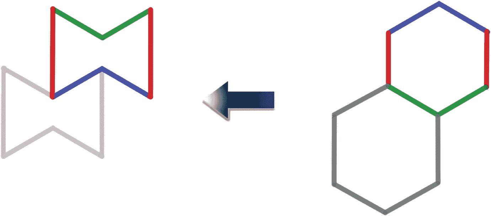

**图 1.1** 材料分布对材料性能的影响，具有从正到负的泊松比。

这种负泊松比归于再入型负复合细胞独特的几何形状，它导致结构在拉力下以增加截面积的方式变形。这种负复合行为具有若干实际优点，包括增强能量吸收、增加抗剪性和提高断裂韧性。

## 1.3 细胞类型

细胞材料可以通过方式分类，包括根据拓扑结构和设计方法，特别强调体积占据方面。这些分类对于理解材料在各种应用中的功能行为至关重要。拓扑结构方面的主要分类是闭孔结构和开孔结构。

### 闭孔结构

闭孔结构的特征是细胞完全被其墙壁封装，形成类似于气泡的离散、不渗透单元。这种封装意味着每个细胞的内部体积与其周围环境隔离，使得材料对水分或空气等环境因素不可渗透。闭孔结构的不渗透性导致它们被广泛应用于对防水和浮力至关重要的场合。例如，闭孔泡沫被用于浮力设备、救生衣和水上运动器材，在这些设备中，浮力和保持干燥的能力是首要的。它们的致密结构提供了优异的隔热性，使其成为热管理至关重要的环境中理想选择，例如制冷单元和隔热运输箱的建造中。

### 开孔结构

相反，开孔结构的特点是细胞没有完全封闭，墙壁有开口或与其他细胞相互互连。这种互连性允许流体、空气或其他物质穿过材料，导致一系列独特的特性。开孔材料在需要压缩变形和应力松弛的应用中表现出色，例如缓冲和减震。这些材料吸收并逐渐释放空气或水分的能力对于希望逐渐消散所吸收物质的应用是有益的，例如过滤器或吸湿材料。

然而，这些细胞的开放结构也意味着它们在未压缩时防止吸水的效果较差。在某些情况下，例如施加高水平压缩时，细胞壁上的小开口可能会关闭，形成一个有效密封。这种特性使得开孔泡沫适用于材料承受变化压力的动态环境。除了缓冲和吸声外，开孔结构还用于化学反应器（在其中允许流体流动的能力至关重要）以及生物医学支架（在支架中，多孔结构支持组织生长和营养传输）。

除了闭孔和开孔结构的基本分类外，现代工程和材料科学已经发展到包括数学生成或“典型”细胞的设计与应用（如图 1.2 所示）。这些是构成规则细胞结构构建单元的几何形状，可以根据特定的机械或热属性进行设计。此类形状的示例包括 `立方体`、`G7`、`钻石形`、`截角立方体`、`菱形体` 和 `斜线面`。每种形状都赋予了所得细胞材料不同的机械性能。例如，以最小表面积配置闻名的 `斜线面` 结构提供了极佳的机械强度和刚度，同时减少了材料的使用。这使其成为航空航天和汽车工业轻量化结构组件的理想选择。具有高度对称性的菱形体和截角立方体则被青睐于需要各向同性机械性能的应用，即在所有方向上都需要均匀强度的场合。

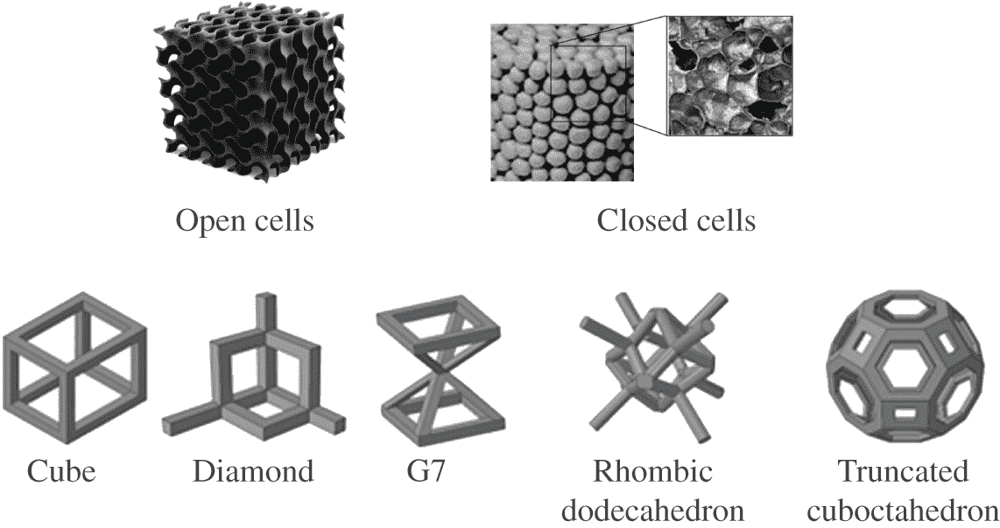

**图 1.2** 多孔结构分类。

这些数学生成单元格的应用已扩展到各种高性能领域。例如，在生物医学工程中，`gyroid` 结构已用于设计模拟天然骨多孔性的植入物，促进骨整合并减轻植入物重量。

计算设计工具与先进制造技术（如 `AM`）的结合进一步扩展了设计和制造具有定制属性的单元材料的可能性。工程师现在可以从整体材料几何形状到微观单元配置的多个尺度上对单元结构进行优化，以实现理想的性能特性。这种能力在能量吸收等应用中尤为重要，在这些领域中材料必须在冲击下产生可预测的变形；而在轻量化策略中，需要在不损害结构完整性的情况下策略性地去除材料。

此外，拓扑优化领域——通过优化给定设计空间内的材料分布来满足特定的性能标准——通过单元材料的使用已取得了显著进展。通过在拓扑优化设计中引入闭孔或开孔结构，工程师可以创建不仅轻量化而且在机械性能优于传统固体材料的组件。


最近，许多商业软件提供了单元结构设计平台，如 `nTopology®`、`Abaqus®`、`ANSYS®`、`COMSOL®` 和 `OptiStrct®` 求解器，这些平台集成了创建多孔结构的专门能力。由于其在优化轻量化高强度材料方面的有效性，这些工具被广泛应用于各种行业。然而，这些预定义结构的一个显著局限是其机械性能是固定的，可能无法满足特定应用的各种需求。为了解决这个问题，工程师可以改变单元结构内部杆和连接的厚度。在经验驱动的机械性能预测模型指导下，这种变化能够创建针对特定应用的增强多孔设计。

自然启发领域，特别是在材料设计领域，由于捕捉单元结构复杂细节和建模其机械性能的技术进步受到了广泛关注。自然界中的大多数材料，特别是用于工程应用的材料，本质上是异质的。这种异质性源于结构和成分的变化，这些变化通常是随机且复杂的，使得准确预测材料的整体响应变得具有挑战性。自然启发的材料旨在复制自然材料中观察到的复杂结构或功能，为设计先进工程材料提供蓝图 [18–22]。

在多孔材料的特殊情况下，其孔隙结构的固有随机性导致了广泛的机械、热学和断裂性能。这种变异性引起了工程界和科学界的兴趣，因为自然为单元结构的发展提供了丰富的灵感来源。生物系统具有优化的机械特性，通常作为高性能结构设计的模型。自然启发的单元结构具有广泛的应用，从仿生设备到专门的生物力学医学植入物。值得注意的是，负泊松比单元设计的概念（这是负泊松材料的基础）源于对蜂窝结构的研究——这是一个自然启发设计的经典案例。

此外，用于表征复合材料的数值方法的进步扩展了人类智慧的可能，导致了单元设计领域的非凡创新。例如，各向异性材料单元结构的发展为实现卓越特性开辟了新途径，例如能够使物体变得隐形的隐身材料或表现出负热胀的材料。

这些进步强调了将自然启发与尖端计算设计方法相结合的变革潜力。通过利用自然中固有的复杂性和优化，工程师和科学家可以开发出具有前所未有属性的材料，为从生物医学工程到航空航天等广泛领域的创新铺平道路。

## 1.4 多孔结构设计与制造的挑战

多孔结构尽管具有广泛的益处属性，但面临着几个需要解决的重大挑战才能实现有效应用。主要关注点之一是结构失效。虽然机械应变在多个单元之间的分布在理论上限制了设计约束内的机械变形，但直接承受载荷的单元（无论是实心杆件还是较大的单元空隙）往往会承受较高的应变。这种局部应变的增加可能导致此类结构容易发生弹性失效。

减小单元尺寸以增强单元性能的直观方法在弹性变形范围内尤其适用。然而，制造较小的单元结构引入了巨大的复杂性。较小的单元，特别是承受高载荷的单元，容易发生塑性变形，从而导致过早失效。此外，机械疲劳是一个关键问题。与生物体多孔结构不同，制造的单元结构缺乏生物系统中可见的自修复能力 [23, 24]。这种自修复能力的缺失导致单元壁或连接件内部发生不可逆的裂纹扩展。这些壁较小的厚度加剧了这种情况，因为裂纹扩展得比体材料更快并导致破裂。

此外，多孔结构的稳健性受到可用材料范围和固有制造挑战的影响。尽管化学物理材料制备工艺有所进步，但生产作为多孔结构的稳健固体材料仍然存在问题。影响这种稳健性的因素包括成本考虑和多孔结构的性能效率。第 2 章中详细讨论的 `AM` 技术进一步增加了这些问题的复杂性。

关于多孔结构适用性的设计决策必须考虑多种因素，包括预期用途、时间限制、预算限制、长期目标以及问题的多物理场和物理化学 [25–27]。这些考虑要求对设计问题的各方面性质有全面的理解。例如，与密度几乎是两倍的不锈钢相比，钛合金因其轻质特性而被应用于长期生物医学植入物。然而，多孔不锈钢材料通过结合钛合金的轻质特性与增强的机械性能，提供了一种有前景的替代方案，其多孔结构可以作为骨细胞整合的支架，可能缓解应力屏蔽问题。尽管在缺乏大量长期生物医学研究的情况下，此类替代方案的安全有效性仍不确定。例如，在骨科植入物长期（5-10 年）使用不锈钢材料已被证明会促进血管异常生长，引发了对其长期安全性的担忧。

此外，设计挑战扩展到细胞结构设计变量的表示和优化。目标是开发评估和优化单个细胞以及整体多孔结构设计的方法。数值方法的进步和计算能力的提高促进了解决这些设计挑战的复杂方法论的发展。第 3 章和第 4 章将探索该领域的最新进展，并对工业和研究中用于高保真仿真和成本效益评估设计的当代数值工具和软件进行详细讨论。

## REFERENCES

1. Al Ali, M. (2024). Fundamentals of Orthopedic Design with Non‐parametric Optimization. Springer [`doi.org/10.1007/978-981-97-1040-9`](https://doi.org/10.1007/978-981-97-1040-9).

2. Rea, I., Terracciano, M., and De Stefano, L. (2017). Synthetic vs natural: diatoms bioderived porous materials for the next generation of healthcare nanodevices. *Adv. Healthc. Mater.* 6: 1601125.

3. Al Ali, M. and Shimoda, M. (2023). On multiphysics concurrent multiscale topology optimization for designing porous heat‐activated compliant mechanism under convection for additive manufacture. *Eng. Struct.* 294: 116756. [`doi.org/10.1016/j.engstruct.2023.116756`](https://doi.org/10.1016/j.engstruct.2023.116756).

4. Al Ali, M. and Shimoda, M. (2023). Hygrally activated displacement inverter using a multiphysics multiscale topology optimization with considering evaporation. *Struct. Multidiscip. Optim.* 66: 1–16. [`doi.org/10.1007/s00158-023-03679-6`](https://doi.org/10.1007/s00158-023-03679-6).

5. Al Ali, M. and Shimoda, M. (2022). Investigation of concurrent multiscale topology optimization for designing lightweight macrostructure with high thermal conductivity. *Int. J. Therm. Sci.* 179: 107653. [`doi.org/10.1016/j.ijthermalsci.2022.107653`](https://doi.org/10.1016/j.ijthermalsci.2022.107653).

6. Rashidi, S., Esfahani, J.A., and Karimi, N. (2018). Porous materials in building energy technologies—a review of the applications, modelling and experiments. *Renew. Sustain. Energy Rev.* 91: 229–247.

7. Murphy, T. (2004). Pliny the Elder's Natural History: The Empire in the Encyclopedia. OUP Oxford.

8. Nestler, G. and Formigli, E. (2010). Etruscan Granulation: An Ancient Art of Goldsmithing. Brynmorgen Press.

9. Ogden, J. (1993). Aesthetic and technical considerations regarding the colour and texture of ancient goldwork. In: Metal Plating and Patination, 39–49. Elsevier.

10. Bikerman, J.J. (1973). Mechanical properties of foams. In: Foams, 184–213. Springer.

11. G.H. Bischoff, A.H. Rosetti (1960). Development of a Porous Metallic Composite Material. Final Technical Report.

12. Marron, A.J. (1959). Nickel and high‐nickel alloys. *Ind. Eng. Chem.* 51: 1197–1203.

13. Kendall, B.R.F. (1980). Vacuum applications of metal foams. *J. Vac. Sci. Technol.* 17: 1385.

14. Faust, C. (1954). The electrodeposition of porous metal. *Trans. IMF* 31: 51–530.

15. Hothersall, A.W. and Hammond, R.A. (1938). The causes of porosity in electrodeposited coatings, especially of nickel on steel. *Trans. Electrochem. Soc.* 73: 449.

16. The determination of the porosity of electro deposits. *Trans. Faraday Soc.* 26: 465–481.

17. Mathers, F.C. and Gilbertson, L.I. (1939). Porosity of electrodeposited silver on steel. *Trans. Electrochem. Soc.* 76: 383.

18. Okada, K., Isobe, T., Katsumata, K. (2011). Porous structures with unidirectionally oriented pores. *Sci. Technol.* 12: 647.

19. Siddique, S., Hazell, P., Wang, H. (2022). Lessons from nature: 3D printed porous structures. *Addit. Manuf.* 58: 10301.

20. Vazic, B. and Newell, P. (2023). Towards the design of nature materials. *Mech. Mater.* 181: 10461.

21. Zheng, X., Shen, G., Wang, C. (2017). Bio‐inspired materials for mass transfer and activity. *Nat. Commun.* 8: 1492.

22. Babini, G. and Tampieri, A. (2004). Towards biologically inspired materials. *Br. Ceram. Trans.* 103: 101–109.

23. Al Ali, M. (2024). Biomechanics of the human body. In: Fundamentals of Orthopedic Design with Non‐parametric Optimization, 91–103.

24. Al Ali, M. (2024). Design temporomandibular joint using nonparametric optimization. In: Fundamentals of Orthopedic Design with Non‐parametric Optimization, 123–137.

25. Fujioka, M., Shimoda, M., and Al Ali, M. (2022). Concurrent shape optimization of a multiscale structure for controlling macrostructural stiffness. *Struct. Multidiscip. Optim.* 65: 1–27.

26. Al Ali, M. and Shimoda, M. (2022). Toward multiphysics multiscale concurrent topology optimization for lightweight structures with high heat conductivity and high stiffness using MATLAB. *Struct. Multidiscip. Optim.* 65: 1–26.

增材制造（`AM`）和三维（`3D`）打印技术的快速进步显著扩展了工程师的视野，使得复杂结构的制造成为可能，这对于我们的课题——即多孔结构至关重要，而这些结构在过去是无法实现的。在本章中，我们将深入探讨各种增材制造方法，探索定义这一动态领域的突破和持续性挑战。为了提供全面的理解，本章分为几个章节，重点关注三种主要的工程材料：金属、聚合物和陶瓷。每个章节将详细介绍适用于这些材料的特定增材制造技术、它们各自的优势以及仍然存在的障碍。此外，我们还将横跨不同材料的主要挑战，例如与材料属性、工艺可靠性和规模化相关的问题。本章最后对目前正在开发的尖端方法进行了前瞻性展望，这些方法具有彻底改变增材制造的潜力。

## 2.2 金属材料

### 2.2.1 晶体金属

大多数金属（如用于不锈钢等结构中的金属）表现出晶体结构，这些金属内部的原子排列成三维阵列，形成被称为晶格的重复单元。因此，晶体结构由在三维几何 `lattice` 中周期性重复的原子图案组成，如图 2.1。

图 2.1 晶格结构示例。

让我们讨论一种可以存在于这三种晶格结构中的假设金属的延展性。对于这种理想材料，延展性（在断裂前发生显著塑性变形的能力）深根于其晶格结构的微观特征，特别是滑移系的性质和数量。滑移系由特定晶面（滑移面）和方向（滑移方向）的组合定义，有助于原子层在应力下的滑动，使其对材料的变形能力至关重要。在主要的晶格类型——`FCC`、`BCC` 和 `HCP` 中，`FCC` 结构的延展性最好，因为它们具有密集的堆积面和丰富的滑移系，即使在低应力下，12 个滑移系（3 个方向上的 4 个面）也能高效运行。这归于高堆积密度（74%），它最小化了原子运动的能垒，解释了为什么铝和铜等金属具有高度变形性并适用于成形工艺。相比之下，`BCC` 晶格虽然也有 12 个滑移系，但堆积密度较低（68%），且面几何形状不利，变形需要较高的应力。铁和铬等金属在该结构中表现出中等延展性，在极端条件下可以扩展到 48 个滑移系，尽管这些系统在实际应用中并不活跃。`HCP` 结构的特征是对称性有限，且在正常条件下只有三个有效滑移系（三个方向上的一个面），表现出最低的延展性，如镁和钛等金属所示。尽管具有高堆积密度（74%），但限制的滑移机制使得 `HCP` 金属更脆，适用于优先考虑强度而非变形能力的场合。因此，延展性等级——`FCC`、`BCC` 和 `HCP`——源于滑移系数量和质量的差异，影响了工程应用中的材料性能，从轧制中的易变形 `FCC` 金属到铸件中的刚性 `HCP` 合金 [1]。

如果有人用显微镜观察普通金属的一个小截面，其结构将类似于图 2.2(a) 所示。观察到的每个亮区域被称为晶粒或晶体，它是连续晶格占据的区域。围绕这些晶粒的深线被称为晶界。晶粒结构是指金属内部晶粒的排列，每个晶粒都有特定的晶体结构。晶界是晶粒的外部区域，将其与相邻晶粒隔开。它代表晶粒之间的错配区域，通常宽度为一到三个原子直径。这些晶界分离了具有相同晶体结构但取向不同的晶体区域（多晶）。图 2.2(b) 展示了四个取向不同的晶粒以及在它们界面形成的晶界。

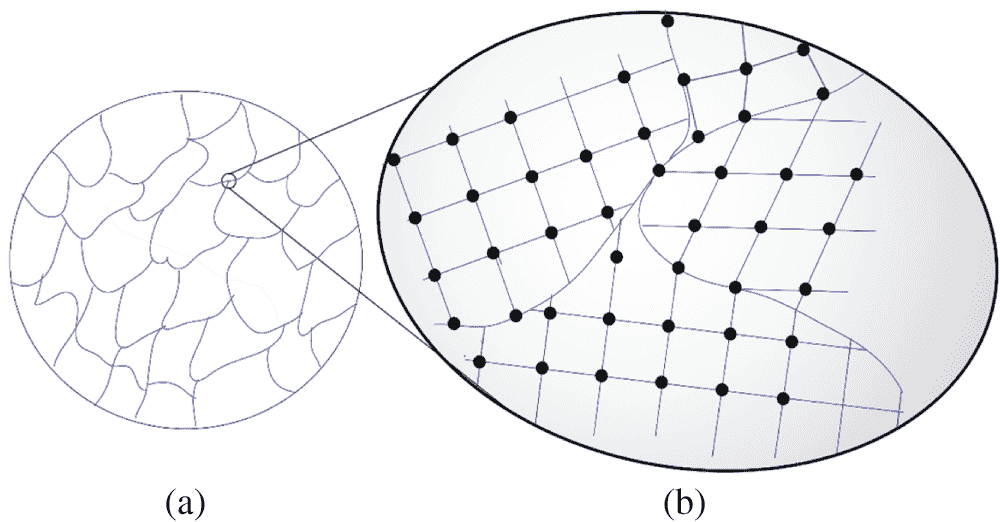

图 2.2 金属晶粒与边界：(a) 显微镜和 (b) 原子。

金属的一个重要特性是平均晶粒尺寸，它显著影响着它们的性能。例如，较小的晶粒尺寸通常会提高拉伸强度并往往增强延性。另一方面，为了获得更好的高温蠕变性能，通常会选择较大的晶粒。蠕变是指材料在恒定载荷或应力下随时间推移而产生的永久变形，这种现象在较高温度下变得更加明显。根据霍尔-佩奇关系（Hall–Petch relationship），较小的晶粒会导致抗位错运动的阻力增加，从而产生较高的屈服强度。因此，细晶结构金属通常被应用于需要高强度和高韧性的场合。相反，在对抗蠕变至关重要的高温应用中，较大的晶粒更具优势。这是因为较大的晶粒减少了晶界数量，而晶界可以作为蠕变变形的场所。结果，具有较大晶粒结构的金属更适用于暴露在长时间高温应力下的环境，例如涡轮叶片、火箭点火室和反应器容器。


# 通过热处理、热机械加工和合金化控制晶粒尺寸

通过热处理、热机械加工和合金化等工艺控制晶粒尺寸是冶金工程的一个关键方面。热处理技术包括退火、淬火和回火，用于控制晶粒尺寸并改变金属的机械性能。例如，退火可以通过促进晶粒长大来降低硬度并提高延性，而淬火后回火可以产生具有高强度和高韧性的细晶结构。热机械加工涉及金属在高温下的变形，是另一种用于细化晶粒尺寸的方法。热轧、锻造和挤压等技术被用于生产具有增强机械性能的细晶结构。此外，可以在金属中加入合金元素来影响晶粒尺寸并提高性能。例如，在钢中加入钛、铌和钒等元素可以形成抑制晶粒生长的细小析物，从而提高强度和韧性。

## 晶粒取向

晶粒的另一个关键属性是它们的取向。图 2.3(a)展示了晶粒的随机排列，晶粒内部没有特定方向与金属样品的外部边界对齐。这种随机取向可以通过材料的交叉轧来实现。相反，如果样品在单个方向上充分轧制，可能会形成与轧制方向一致的晶粒取向结构，如图 2.3(b)所示。这种现象被称为择优取向。择优取向在许多应用中是非常理想的，可以增强轧制方向上的强度和延性等性能。然而，在某些情况下，它是有害的。例如，在铀燃料元件中，择优取向会导致核反应堆运行期间发生灾难性的尺寸变化。

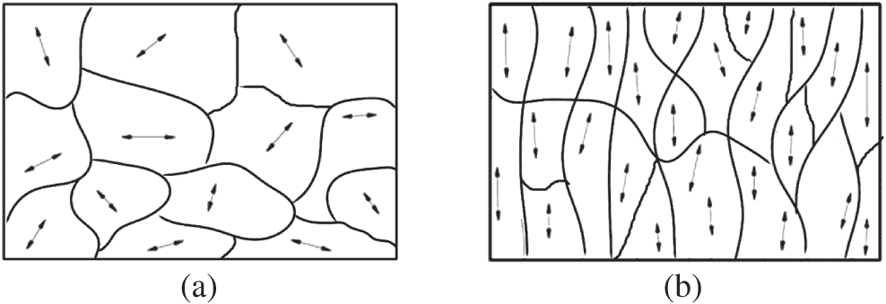

`图 2.3` 金属晶粒取向：(a) 随机和(b) 择优。

# 2.2.2 非晶态金属

非晶态金属也称为金属玻璃，与传统的晶态金属相比，其特征是非典型的原子尺度结构固体金属合金。在大多数金属中，原子排列在高度有序且周期性的晶格结构中，这定义了它们在固态下的晶态本质。然而，非晶态金属严重偏离了这一规范，具有缺乏长程周期性的无序原子排列，类似于玻璃的结构。

尽管被归类为金属玻璃，非晶态金属表现出的机械性能使其与传统的氧化玻璃和陶瓷区分开来。它们坚韧得多，脆性显著降低，提供了强度和弹性的独特结合。与传统玻璃（通常在电力线等应用中用作绝缘）不同，非晶态金属具有导电性。这种导电性结合其独特的磁性能，使其在各种工业应用中具有特别的价值。

非晶态金属最主要的商业应用之一源于它们独特的磁性能。这些材料的特点是磁损耗极低，使其在磁性应用中非常高效。例如，非晶态金属用于高效率变压器的生产，其低磁化损耗有助于提高能量并降低成本。

非晶态金属的生产面临着某些挑战，特别是控制防止形成晶体结构所必需的快速凝固过程。这一挑战促进了将增材制造探索作为生产非晶态金属的可行方法。增材制造（或 `3D` 打印）提供了实现金属材料非晶态至关重要的精度和控制水平。

必须考虑的是，金属结构的工程高度取决于预期应用的特定需求，这决定了非晶态结构还是晶态结构更好。`3D` 打印技术提供的灵活性使其成为从制造自由中受益的行业中的宝贵资产。然而，`3D` 打印对给定应用的适用性取决于该结构的目的和功能需求。

# 2.3 金属增材制造

## 2.3.1 粉末床熔融

# 粉末床熔融 (PBF)

`PBF`，通常被称为选择性激光熔（`SLM`）或直接金属激光烧结（`DMLS`），是金属增材制造领域的一项主流技术，专门用于生产高度复杂且精密的金属部件。该过程始于在构建平台上均匀地铺一层薄薄的金属粉末（如图 2.4

图 2.4 粉末床熔融 3D 打印。

`PBF`/`SLM` 工艺因其能够生产具有卓越分辨率和复杂几何特征的部件而闻名。此外，它还允许使用多种金属制造部件，包括钛、铝、不锈钢以及其他高性能合金。所得部件通常表现出高密度和优良的机械性能。

然而，该过程也存在某些局限性。由于粉末床和激光系统的限制，构建尺寸往往受到限制，这对于大型部件来说是一个重要的考虑因素。此外，`PBF`/`SLM` 所需设备和材料通常昂贵，使得该工艺在某些应用中面临经济上的挑战。尽管存在这些挑战，`PBF`/`SLM` 的精度、多功能性和材料能力使其成为金属增材制造进步的关键技术。

## 2.3.2 定向能量沉积

定向能量沉积（`DED`）是一种金属增材制造技术，其特征是在基材上沉积熔融金属。该过程涉及一个喷嘴，它将以丝材或粉末形式供给的金属原料直接输送到激光、电子束或等离子体弧等局部热源中。这些热源产生的剧烈能量在原料沉积时将其熔化，使材料以受控的方式快速固化。`DED` 工艺本质上是逐层进行的，能够构建复杂几何形状和大型部件。`DED` 特别以其高沉积速率著称，这使其成为大型金属结构生产、修复和改进的理想选择。该方法兼容多种金属，包括钛、钢和镍基合金，使其在不同的工业应用中具有通用性。然而，与 `PBF` 等其他金属增材制造技术相比，`DED` 的精度相对较低。这种局限性导致最终打印部件的精细细节分辨率降低，且存在较高水平的孔隙。

## 2.3.3 粘结剂喷射

粘结剂喷射是一种金属增材制造技术，利用粉末金属材料和液体粘结剂来生产复杂部件。该过程始于在构建平台上铺设一层薄金属粉末。然后，打印头选择性地在粉末上沉积液体粘结剂，将颗粒粘在一起形成所需的几何形状。这一过程逐层重复，直到整个部件完成。`3D` 打印完成后，部件需要经过脱脂工艺以去除多余粘结剂，然后进行烧结。烧结涉及将部件加热到特定温度，使金属颗粒融合在一起形成最终的固体结构。

粘结剂喷射的一个显著优势是其高打印速度。粘结剂喷射不需要在构建过程中使用高能热源来熔化材料，这显著缩短了打印时间。这种速度结合在使用多种金属合金的能力，使得粘结剂喷射在需要快速原型和中规模生产的行业中极具吸引力。例如，粘结剂喷射已有效用于汽车和航空航天应用的不锈钢部件生产。

粘结剂喷射的另一个优势与其他金属增材制造技术相比，设备成本较低。这种成本效益延伸到了规模化生产，因为粘结剂喷射系统可以在不按比例增加成本的情况下适应更大的体积。这使其成为生产大量金属部件的可行方案，特别是对于考虑成本的消费品制造业。

然而，粘结剂喷射也存在某些局限性。主要的挑战之一是与 `SLM` 方法生产的部件相比，其最终机械强度较低。这主要由于烧结过程的性质，它可能无法使部件完全致密，导致不受控制的孔隙和结构完整性下降。此外，粘结剂喷射对细节的分辨率有限，使其不适用于对精度有要求的应用。

后处理需求也增加了粘结剂喷射工作流的复杂性。脱脂和烧结步骤对于实现所需的材料性能至关重要，但会引入变量并增加生产时间。

## 2.3.4 金属挤出

金属挤出，通常称为材料挤出或熔融沉积制造（`FFF`），是一种新兴的金属 `3D` 打印技术，与广泛采用的塑料 `3D` 打印方法熔融沉积建模（`FDM`）类似。在金属挤出中，金属丝或填充金属的聚合物丝被加热到熔融状态，然后通过喷嘴挤出。这种熔融材料根据数字设计精确沉积，最终形成所需的金属部件。

尽管金属挤出不像 `PBF` 或 `DED` 等其他金属 `3D` 打印技术那样普及，但它具有独特的优势，使其成为特定应用的理想选择。其主要优点之一是负担得起。金属挤出所需的设备通常比更先进的金属 `3D` 打印方法要便宜。这种较低的门槛使得该技术对于更广泛的用户群体，包括小型企业和教育机构，这些机构的预算限制可能会限制对昂贵系统的采用。

此外，金属挤压以易于使用和成本极低而闻称。该过程相对简单，与其他更复杂的技术相比，所需的专业知识较少。这种易用性延伸到了材料选择的多样性上。金属挤压适用于各种金属材料，如铜、青铜和不锈钢，这拓宽了它在不同行业的应用潜力。例如，它在小批量金属组件生产、原型制作或定制模具方面特别有用，而在这些情况下，其他方法的成本和复杂度可能难以接受。尽管有这些优势，金属挤压也存在局限性，可能会限制其在各种任务中的广泛应用。一个明显的缺点是通过这种方法产生的部件机械强度较低。与使用 `SLM` 等高能金属 `3D` 打印方法制造相比，该过程产生的部件密度和强度较低。这部分归因于挤压过程的性质，以及后续需要烧结或粘结等后处理步骤来增强材料性能。这些后处理步骤对于获得最终部件强度是必须的，但增加了制造过程的时间复杂性。

此外，金属挤压的细节分辨率有限，使其不适用于对高精度或复杂几何有要求的应用。逐层沉积过程虽然有效，但可能无法达到高细节部件所需的精细分辨率，特别是与粘结剂喷射或 `PBF` 等方法相比。

粘结剂打印与金属挤压（即 `FFF`）之间共享的工作流强调了它们的共同点；然而，它们的基础区别在于可访问性、操作要求和基础设施。粘结剂打印系统通常涉及先进且资源密集型的设置，需要配备除粉系统和无尘室的专用设施来处理潜在的有害粉末。相比之下，金属 `FFF` 适用于教室或办公室等标准环境，因为它不依赖腐蚀性材料且对空间的要求最小。

虽然粘结剂打印通常需要巨大的成本，但金属 `FFF` 通过其与紧凑且廉得多的材料组合的兼容性，实现了金属 `3D` 打印的民主化，尽管它仍处于增长阶段。此外，金属 `FFF` 在生件阶段提供了更大的设计灵活性，允许抛光、磨光和铣等操作。双挤出技术甚至允许引入特殊的支撑材料，增强了复杂几何形状的制造质量。

相比之下，粘结剂打印在坯件强度方面面临固有的局限，需要较厚的壁，且除非单独制造，否则通常无法集成支撑。这损害了其对复杂设计或精细特征的适应性。尽管粘结剂打印具有大批量生产的潜力，但金属 `FFF` 提供了一个竞争性的替代方案，其模块化的扩展性暗示了其在打印工厂和小规模制造中的应用。预测表明，金属 `FFF` 的市场轨迹将实现大幅增长，强调了其作为金属增材制造易用切入点的潜力，同时为未来的扩展性提供了途径。

# 2.4 PLICS

聚合物（通常称为塑料）的基本结构由长链大分子组成。这些大分子通过涉及单体单元的化学反应形成，主要过程是加成聚合和聚缩合。

在加成聚合的情况下，该过程可以以链反应或逐步反应的形式发生。在链反应中，大量的单体分子结合形成聚合物链。这种结合通过双键取向或环开裂等机制发生，而不会产生副产物或发生链内氢原子的重排。这种反应通常通过施加外部能量源（如热和光）或通过催化剂引发。相比之下，加成聚合中的逐步反应涉及单体的组装，而不涉及双键或释放低分子量化合物，尽管氢原子在过程中可能会改变位置。

聚缩合是聚合物形成的另一种关键方法，涉及多功能团化合物的反应，在此期间，水或氨等小分子作为副产物释放。这种反应通常也是逐步过程。参与这些聚合反应的单体单元是主要由碳原子和氢原子组成的有机分子。然而，它们也可以包括氧、氮、硫、氟或氯等元素。存在的特定元素、它们的比例以及它们在单体分子中的位置是合成不同类型塑料的关键决定因素。

大分子链通过初级共价键结合在一起，碳原子通过单键或双键形成这些链的骨架。碳原子的电子构型导致了单键特定的键角。附着在碳原子上的氢等原子限制了这些原子绕键轴的自由旋转。具有较高键能量的碳原子顺式构（`cis-configuration`）与能量最低的反式构（`trans-configuration`）形成对比。

聚合物结构的多样性源于这些大分子链各种可能的构象，取决于涉及的成键伙伴类型。例如，聚乙烯（`PE`）和聚氯乙烯（`PVC`）通常表现出锯形构象，而聚丙烯（`PP`）、聚氧亚烯（`POM`）和聚四氟乙烯（`PTFE`）倾向于形成螺旋结构。

这些大分子链的长度以及因此产生的分子量通常遵循统计分布。通过操纵聚合过程的条件，可以在某些范围内控制平均分子量和分布的宽度。此外，取决于聚合物的类型，侧链在聚合过程中可能会随机地在主聚合物链之外形成。这些侧链的频率和长度受到大分子结构以及聚合过程中存在的特定物理化学条件的影响。

例如，平均分子量约为 `105` 的聚苯乙烯分子可以提供关于这些大分子规模的见解。分子量与链中单体单元的数量相关，强调了这些大分子结构的广泛性。

## 2.4.1 塑料分类

塑料材料表现出多样化的性能和行为，这很大程度上取决于其大分子结构及其对温度相关物理条件的响应。这些材料可以大致归类为热塑性、弹性体和热固性塑料，每种材料都有独特的特征和应用。

热塑性塑料的特征是在受热时能够发生从固态到液态的相变。这种特性使其能够反复熔化并重新塑型，具有高度的通用性，适用于各种工业应用。它们表现出硬性或韧性弹性，意味着它们可以吸收并耗散能量而不产生永久变形。当热塑性塑料作为聚合物混合物（如共聚物或热塑弹性体）的一部分时，它们可以表现出均匀结构，其中不同的单体单元在分子层面化学整合。这种均匀性允许通过热手段进行一致的熔化和加工。

弹性体以软弹性闻名，这使其能够延伸并恢复原始形状。与热塑性塑料不同，弹性体加热时通常不会熔化。相反，它们独特的分子结构（可能涉及环形成或长侧链）赋予了它们高柔性和弹性。弹性体还可以以热塑弹性体的形式存在，这种材料是分离聚合物相的物理混合物。这些混合物在热条件下保持熔化和流动的能力，将弹性特性与热塑性塑料的可加工性相结合。

相比之下，热固性聚合物一旦固化，就会形成刚性且不可熔化的网络。这种不可逆的化学结构防止了热固性聚合物在加热时熔化或重新塑型。热固性聚合物是需要耐用性和耐高温应用的理想选择。当用作复合材料的基体时，热固性聚合物提供了一个无法重熔的稳定框架，增强了复合材料的结构完整性。

除了这些主要类别，塑料复合材料代表了一种先进类别，其聚合物基体通过集成颗粒或纤维进行增强。基体材料的选择（无论是热塑性还是热固性）决定了复合材料的熔化行为。热塑性复合材料可以通过热手段进行加工和重新塑型，而热固性复合材料在固化后仍保持刚性且具有抗熔性。

塑料的相变行为发生在温度区间内而非固定点，这使它们与金属材料区分开来。这些转变受到分子结构的影响，包括聚合物链的长度和迁移性、侧链的存在以及整体分子量等因素。这些分子特征的变化会影响相变发生的温度范围，导致材料在热应力下的性能产生差异。

# 2.5 塑料 3D 打印

塑料增材制造，特别是 `3D` 打印，已迅速成为工业和消费市场中一种变革性技术。聚合物 `3D` 打印最初开发用于原型制作和特殊工业应用，现在由于技术进步和成本降低的很大推动，对普通大众已变得越来越触手可及。在年轻一代中，塑料 `3D` 打印变得特别流行，它提供了一种创建从简单玩具到复杂设计的定制化对象的亲手方法。其吸引之处不仅在于它提供的创意自由，还在于相对较低的入门门槛，使其成为爱好者、学生和 `DIY` 爱好者的极具吸引力的选择。价格实惠的桌面 `3D` 打印机和各种热塑性胶丝材料，如 `PLA`（聚乳酸）和 `ABS`（丙烯腈丁二苯乙烯），使制造变得民主化，允许个人将数字设计转化为实物产品。随着塑料 `3D` 打印普及性的持续增长，它将在塑造个人和消费制造的未来方面发挥重要作用。在接下来的章节中，我们将探索塑料 `3D` 打印的各种方法，突出它们独特的工艺和应用。

## 2.5.1 光固化

光固化（`SLA`）是一种顶尖的增材制造技术，以其生产具有卓越表面质量和精细细节分辨率的部件而闻名。利用光聚合的精度，`SLA` 特别适用于创建形状和配合原型、概念模型以及模具应用的主模板，在这些应用中，审美保真度和尺寸精度至关重要。

`SLA` 的工艺围绕使用液态光聚合物树脂展开，这些树脂通过聚焦的紫外线（`UV`）激光照射进行选择性固化。该激光在部件数字模型的引导下，通过针对树脂内的特定点诱导局部聚合。当激光扫描构建区域时，树脂逐层固化，逐渐以高精度形成所需的几何形状。

尽管通过 `SLA` 可以实现非常好的表面光洁度和复杂的细节，但该技术具有某些局限性，特别是在材料耐用性方面。`SLA` 使用的光聚合物材料虽然能够处理精细细节，但在阳光下通常更容易发生长期降解，导致机械性能随时间发生潜在变化。此外，`SLA` 零件需要后处理以去除表面残留的任何未固化树脂。这通常涉及化学或超声清洗，然后在紫外光下进行后固化步骤以完全稳定材料，从而由于化学品和紫外线在生产过程中的暴露增加了额外的时间和风险。

## 2.5.2 粉末床熔融

塑料 `3D` 打印中的 `PBF` 是一种先进的增材制造技术，利用聚焦能量源（如激光或电子束）选择性地将粉末塑料材料逐层融合成固体物体。该过程始于均匀分布在构建平台上的薄层塑料粉末。激光或电子束被精确引导以描绘部件的轮廓，在形成物体截面对应的区域将粉末颗粒熔在一起。每层融合后，构建平台逐渐降低，并在表面铺设新的一层粉末。重复此序列，直到整个物体形成。

## 2.5.3 材料挤出

材料挤出是一种 `3D` 打印方法，通过挤出连续的材料胶丝来构建物体。通常，塑料胶丝作为原料，通过加热到熔化材料的喷嘴。然后将熔融胶丝根据计算机辅助设计（`CAD`）模型指定的预定义路径，精确地沉积在构建平台上。这种逐层处理的过程持续到整个物体形成为止。

## 2.5.4 树脂材料喷射

使用光聚合物树脂的材料喷射（`MJT`）是一种通过沉积光敏树脂滴来制造物体的技术，然后使用紫外光进行固化。该工艺的操作类似于传统的二维喷墨打印（`IJP`），打印头以精确的图案分发材料。这种技术特别适用于生产蜡类的组件，通常用于熔失应用。通过 `MJT` 创建的部件以其卓越的尺寸精度和光滑的表面质量而闻名。此外，该方法支持多材料打印，允许使用多种材料，如 `ABS` 类聚合物、橡胶类物质和完全透明的树脂。

# 2.6 陶瓷

# 陶瓷

作为材料，陶瓷可以广泛分为两类：传统陶瓷和先进陶瓷，每种都有独特的应用。传统陶瓷是最古老的类别，其历史可以追溯到早期文明。这些陶瓷主要利用天然存在的原材料，如`粘土`、`云母`、`石英`和长石。尽管“传统”一词可能意味着技术陈旧，但并不意味着缺乏先进性。现代进步已将先进的制造技术、复杂的模具和计算机辅助工艺引入传统陶瓷的生产中。这种演变驱动于对定制化技术性能、定义良好的化学物理特性以及极少污染物的需求。今天，传统陶瓷被广泛应用于大产量领域，包括建筑材料（`砖`、`瓷砖`、`耐火材料`、`水泥`和`混凝土`）和消费品（白瓷和陶器）。传统陶瓷占全球陶瓷市场最大的份额，其中玻璃生产（如窗户）占了很大比例。

先进陶瓷的特点是具有卓越的性能，包括高熔点、电绝缘性和可见光透明性。这些特性源于材料中的离子-共价键，这些键导致了材料的高硬度和脆性，并由于局部化价电子不像金属中那样自由移动，导致了不良的热和电导率。然而，这种对先进陶瓷的描述是简化的，并没有涵盖其全面的复杂性。先进陶瓷可以形成多种化学键，包括离子键、共价键和金属键。

例如，某些陶瓷表现出半导体特性，如`钛酸钡`（`BaTiO[3]`），而另一些则表现出超导，例如`铜氧化物`（`YBa[2]Cu[3]O[7]`）、`钛酸锶`（`SrTiO[3]`）和氧化钡铅（`BaPbO[3]`）。钻石作为碳的一种形式，以室温下最佳热导体闻名，某些陶瓷如`氮化铝`（`AlN`）、`氧化铍`（`BeO`）和碳化硅（`SiC`）的热导率优于`铜`。大多数陶瓷在室温下是脆的，但它们的行为在高温下会发生变化；例如，玻璃在高温下变为粘性液态，失去脆性。此外，通常认为陶瓷具有的极低化学活性（即化学惰性）在高温条件下可能会显著变化，正如在化学和冶金过程中观察到的那样。硅化合物（如`SiC`和氮化硅）可以通过形成`二氧化硅`层在高温下实现自我保护免受氧化。相反，`石墨`和碳化合物具有高耐火性，但需要保护环境以避免降解，而`氧化镁`和碳化铝在水分存在时是不稳定的。

陶瓷以其优异的热稳定性以及在宽温度范围内高机械强度而闻名。它们的低热膨胀系数有助于减少温度波动引起的形状变形。它们卓越的性能（包括耐腐蚀性、耐磨性和硬度）使其适用于加工工具的生产。


然而，陶瓷材料的制造无法通过传统的锻造和加工来实现。相反，陶瓷成型涉及多步方法，包括粉末混合（带有粘结剂和稳定剂）以及各种成型技术，如`挤出`、`模铸`、`压制`、`片材`、`胶铸`和`喷墨成型`。成型后，坯体（即成型但未烧制的陶瓷）必须经过`烧结`以实现最终固化。传统方法包括模具成型、热处理以及有时烧结后加工，由于涉及工艺的复杂性和成本，这些方法通常价格昂贵。

## 2.7 陶瓷 3D 打印

近年来，陶瓷的增材制造经历了显著发展，解决了收缩和工具磨损等局限性。根据美国材料试验与材料协会（`ASTM`）标准，复杂部件的生产可以分为两大类：直接（或单步）和间接（或多步）。直接或单步工艺涉及直接创建部件。相比之下，间接或多步工艺需要进一步的步骤。

陶瓷的另一种重要的 AM 制造方法被称为负模陶瓷 AM。这种方法使用增材制造技术创建的牺牲性聚合物模具，例如`FDM`、`MJT`、`SLS`和`SLA`。然后通过浇铸将陶瓷浆浸渍聚合物模具。之后，通过溶解或热烧结过程去除聚合物模具。负模 AM 简化了聚合物的成型，使过程更易管理且具有成本效益。此外，负模 AM 可以减少复杂几何形状部件的设计复杂度。

每种技术都有特定的优势和挑战：

- `FDM`：具有成本效益且易于获取，但受分辨率和材料属性限制。
- `MJT`：提供高分辨率和复杂的几何形状，但涉及复杂的材料处理和支撑需求。
- `SLS`：对于创建致密的功能性部件具有优势，但消耗大量能量且通常需要后处理。
- `SLA`：提供卓越的精度和表面光度，但限于树脂基材料并可能需要额外的后处理。

此外，`FFF` 特别适用于结构性和功能性陶瓷。这种方法涉及挤出负载有陶瓷颗粒的热塑性丝材，然后逐层沉积以形成所需的形状。`FFF` 在材料选择上提供了令人惊叹的灵活性，允许处理各种陶瓷材料，包括`三氧化铝`（`Al[2]O[3]`）、`二硼化锆`（`ZrB[2]`）和`SiC`。`FFF` 生产陶瓷的通用性扩展到广泛的性能范围内，使其适用于各种应用，包括对机械强度和电绝缘性都至关重要的储能系统。

层叠物体制造（`LOM`）是 3D 打印的另一种显性方法，其特点是能够生产轻量化组件。在 `LOM` 中，陶瓷薄片逐层切割并粘合以创建部件。这种技术对于在不损害结构完整性的情况下减轻重量的应用特别有效。`LOM` 经常用于航空航天和汽车行业，在这些领域，轻量化和高强度结合至关重要。

`SLM` 非常适用于制造具有卓越精度的小型精密陶瓷物体。`SLM` 利用高功率激光选择性熔化并融合陶瓷粉末颗粒，逐层构建所需的组件。这种方法能够使用先进材料生产复杂的结构，如`氧化锆稳定锆`和`三氧化铝-铝氧化铝-锆`（`Al[2]O[3]‐GdAlO[3]‐ZrO[2]`）。然而，由于工艺的限制，`SLM` 通常限于较小的部件，但它在大细部和高精度的应用中表现出色。

激光熔融成形（LENS）是另一种基于激光的增材制造技术，擅长生产具有良好机械性能的陶瓷。在 LENS 中，使用激光束熔化陶瓷粉末，同时逐层沉积以形成最终部件。这种方法对于处理如二硼化锆（`ZrB[2]`）和三氧化铝-铝石榴石-锆（`Al[2]O[3]‐YAG이터ZrO[2]`）等材料特别有效，能够产生增强机械强度和性能的组件。LENS 非常适用于需要坚固耐用陶瓷部件的应用。

喷墨打印（IJP）是陶瓷制造的一种较新且创新的方法。该技术利用含有陶瓷颗粒的水性墨水，将其精确地沉积在基底上以构建所需的结构。IJP 在创建复杂功能性陶瓷组件方面具有巨大潜力，特别是对于需要复杂几何形状和精细细节的应用。氮化硅（`Si[3]N[4]`）等材料可以使用 IJP 进行处理，扩展了先进陶瓷应用的可能性。

数字光处理（DLP）是一种极具前景的陶瓷生产技术，已证明出优异的相对密度和理想的机械强度。DLP 使用数字光投影仪逐层固化混合了陶瓷颗粒的光敏树脂，以形成最终部件。这种方法在制造生物活性玻璃组件方面显示出巨大潜力，这在生物医学领域尤为相关。创建高密度和高机械强度陶瓷的能力使 DLP 成为生产先进陶瓷结构的宝贵技术。

## 2.8 3D 打印的生产周期

3D 打印作为增材制造的一种革命性形式，其出现极大地改变了产品开发、原型制作和最终部件生产的领域。该技术的核心是以生产工作流形式存在的数值方法的进步，它将数字设计转换为物理三维物体。该过程从开发 3D 计算机模型开始，该模型通常使用先进的`CAD`应用程序创建。该数字模型作为各种 3D 打印技术的基础模板。为了实现具有成本效益的设计和生产，打印软件可以打开 3D 模型，然后将其切片成薄层，生成与打印机规格兼容的文件格式。

不同的 3D 打印方法使用多种材料，包括塑料、金属和陶瓷，这些材料被用于各种工业应用。

3D 打印技术的多种样化（例如基于光、热能、激光固化树脂以及类似于`IJP`的细液滴沉积的技术）意味着不存在适用于所有材料和应用的单一通用方法。

尽管具有多功能性，但目前的 3D 打印系统面临着若干挑战，包括缺乏标准化解决方案以及打印过程中的潜在疏忽（例如过早移除部件）。设计需要复杂支撑结构的组件的复杂性，加上文件的详细准备和转换，增加了整体难度。技术的持续进步旨在减轻这些问题，尽管该领域仍然保持动态。此外，砂纸和抛光等后处理步骤通常是手动进行的，需要大量的专业知识和精力。

3D 打印工作流涵盖了一个可以分为三个关键阶段的过程：设计、打印和后处理（如图 2.5 所示）。每个阶段对于三维物体的成功生产至关重要，特定的考量和选择会影响最终结果。

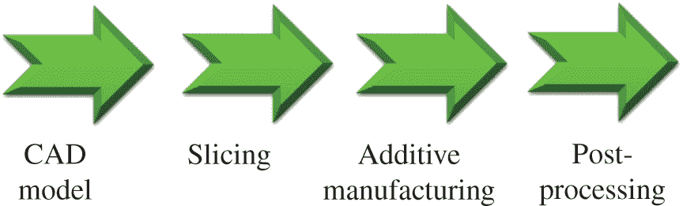

图 2.5 增材制造的周期。

### 2.8.1 设计阶段

3D 打印工作流的第一阶段是三维模型的设计或获取。该模型可以使用`CAD`软件生成，也可以通过数字方法扫描物理模型或部件并将其转换为数字 3D 物体获取[2, 3]。`CAD`软件为设计复杂几何形状提供稳健的平台，允许对尺寸和特征进行精确控制。或者，3D 扫描可以捕捉现有对象的几何形状，根据现实世界的对应创建数字模型。

### 2.8.2 打印阶段

一旦获得 3D 文件，必须对其进行打印过程前的审查和准备。这种准备包括选择合适的打印参数，涉及配置层高、打印速度和材料类型等设置。参数的选择受最终产品所需属性的影响，包括其结构完整性、表面光洁度和功能。

首先，必须根据产品的特定需求选择材料。3D 打印可用的材料种类非常丰富，涵盖了塑料、陶瓷、树脂、金属、生物材料甚至是食品等食用物质。塑料因其易于处理和多功能而被广泛使用。陶瓷和金属提供了更增强的机械性能，经常被用于工业和工程应用。新兴材料（包括生物基物质和食品）扩展了 3D 打印的应用潜力，满足了医学和烹饪等领域。

材料选择还决定了可用的精加工选项。例如，虽然某些材料可以很容易上釉或涂漆，但其他材料可能需要更专业的后处理技术来实现实所需的审美或功能特性。每种材料的属性（如熔点、粘附特性和打印后行为）都会影响整个打印过程和最终产品的质量。

此外，多材料打印（特别是在多孔材料领域）能够实现传统体材料中不存在的新奇属性，例如负泊松比以及负热膨胀和负水化膨胀，如图 2.6 所示。

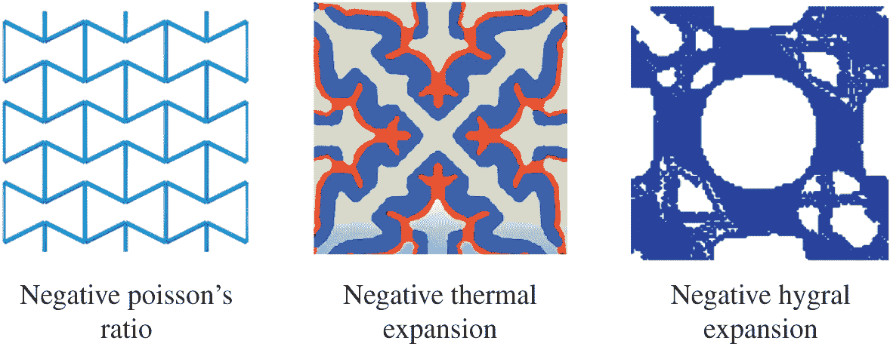

图 2.6 显示出负泊松比、负热膨胀和负水化膨胀的多孔微观结构。

### 2.8.3 后处理阶段

3D 打印工作流的最后一个阶段涉及后处理，这是一个增强打印物体外观和功能的关键阶段。打印完成后，物体通常需要额外的处理，如砂纸、上漆或微观结合增强。这些过程对于实现光滑的表面处理和纠正任何缺陷至关重要。采用的特定后处理方法取决于所使用的材料以及产品的预期最终应用。

后处理还包括移除打印过程中引入的支撑结构。支撑材料通常用于复杂打印件以支撑悬空特征，必须小心移除并对这些区域进行清洁和精光，以确保结构完整性和审美吸引力。

### 2.8.4 文件格式与切片

3D 打印过程的核心是 CAD 文件格式的处理和切片。各种 3D 文件格式——例如立体轮廓文件（`.stl`）、对象文件格式（`.obj`）、3D 制造格式（`.3mf`）和多边形文件格式（`.ply`）在模型的数字表示及后续打印中起着至关重要的作用。

`STL` 格式是最流行的格式之一，因其简单以及与许多软件和打印机的广泛兼容性而受到青睐。然而，它主要捕捉几何数据，缺乏对颜色和纹理信息的支持。相比之下，`OBJ` 格式同时支持几何和纹理细节，提供了更全面的模型表示。这种格式的多功能使其适用于多种应用，但信息与文件大小的比例较低。

`3MF` 格式代表了更先进的选项，结合了颜色、材料属性和打印平台配置的详细信息。这种格式有助于软件与打印机之间改进协作，并更准确地交换详细打印指令。另一方面，`PLY` 格式在处理复杂几何形状和颜色信息方面出色，尽管与 `STL` 和 `OBJ` 格式相比，其采用程度并不广泛。

文件格式的选择影响打印过程的各个方面，包括数据准确性、文件大小以及与不同软件和打印机的兼容性。每种格式都有独特的优势，需要根据项目的特定需求进行仔细考虑。

切片是 3D 打印工作流中的基础过程，涉及将三维数字模型转换为一系列二维截面或层。此过程生成 `G-code`，这是一套全面的指令，用于指导 3D 打印机逐层构建物体。在此背景下，切片软件的作用至关重要，因为它能够精确操纵对优化打印质量和效率至关重要的各种参数。

切片过程中管理的关键参数包括打印设置，它们决定了每一层的特征，如厚度、壳结构和填充密度。`Filament Settings`（丝材设置）控制丝材直径、挤出倍率和温度等关键方面，而 `Printer Settings`（打印机设置）包含了喷嘴尺寸、打印平台大小和 `Z-offset` 调整。准确调整这些参数对于增强打印对象的结构完整性、表面光洁度和整体性能至关重要。

切片技术的历史发展与 3D 打印本身的发展并行。20 世纪 90 年代初，随着 3D 打印开始获得关注，最初的切片软件相对基础，聚焦于简单的几何形状且功能有限。随着 3D 打印技术的进步，出现了更复杂的切片解决方案，以适应日益复杂的设计。

增材制造中的切片面临着广泛的挑战，主要与复杂几何形状和特定材料性有关。早期的切片工具难以处理复杂的设计，限制了可以成功打印的形状多样性。克服这些局限性需要算法和计算模型的重大进展，以便将详细的数字设计准确转换为用于 3D 打印的逐层表示。

材料特定的挑战进一步使切片过程变得复杂。每种 3D 打印材料，从塑料、聚合物到金属和陶瓷，在制造过程中表现出独特的属性，要求对温度、层厚度和打印速度等参数进行精确控制。为了解决这个问题，切片软件已演变为包含特定材料配置文件，能够对设置进行微调，以获得最佳打印质量和结构性能。这些创新对于扩展增材制造在不同材料和应用中的能力至关重要。

## 2.9 增材制造面临的挑战

金属增材制造尽管取得了突破性进展，但在生产具有高结构完整性和可靠性的部件方面仍面临巨大挑战。主要问题之一是变形，这很大程度上归因于残应力。这些应力和产生的变形受到 3D 打印技术、使用的金属类型以及操作参数的影响。

在金属增材制造期间，部件会经历剧烈的热循环——加热到熔点温度随后冷却。这种热循环引入了残应力。例如，在 `PBF` 中，应力最集中在部件与打印平台之间的界面。这些应力源于热影响区（`HAZ`）内的差异膨胀和收缩，该区域材料在加热时膨胀，冷却时收缩。这种过程导致部件在膨胀时向下弯曲，并在冷却时向上变形。

激光粉末熔融（LPBF）过程中熔化金属的凝固可能会引入各种缺陷，主要是由于未完全熔或重熔导致的分层和裂纹。当金属冷却时，会发生收缩，加剧了这些问题。这些缺陷与残应力（处理后留在材料内部的应力）的发展密切相关。这些应力极具危害，通常会导致裂纹和翘曲等结构问题，这些是金属增材制造中的常见挑战。

金属增材制造中的残应力主要产生打印后的冷却阶段。当金属冷却时，它会收缩，导致边缘卷曲和部件变形。这种变形可能严重到残应力超过材料的允许应力，导致裂纹的形成。

为了减轻裂纹和翘曲的风险，可以实施多种策略。加热打印平台是一种主要的缓解技术。通过提高打印平台的温度，减少冷却阶段的热梯度，从而减少收缩引起的应力。这种预热有助于更均匀的冷却过程，显著降低了翘曲和裂纹的概率。

另一个关键策略涉及提高部件与打印平台的粘附力。可以通过优化部件与打印平台之间的接触表面并使用粘接材料或处理来增强粘附。强粘附有助于保持部件在冷却阶段的位置和稳定性，减少变形的发生。

支撑结构的策略性放置对于防止翘曲也至关重要。这些支撑结构通过打印过程中提供额外的稳定性并抵消导致翘曲和裂纹的力量，维持部件的几何完整性。然而，这些支撑结构的设计和放置必须仔细计划，以避免引入新的应力集中或使支撑在打印后难以移除。

热后处理可用于解决打印过程中可能形成的微小裂纹。这些处理涉及受控的加热和冷却循环，以释放残应力并修复微小缺陷。在这种背景下，常用的技术包括`annealing`（退火）或热等静压（`HIP`）。`Annealing`涉及将部件加热到特定温度，然后缓慢冷却，有助于释放内部应力。相比之下，`HIP`同时对部件施加热量和压力，有效封闭任何内部孔隙或裂纹，并增强部件的整体密度和机械性能。

最后，优化工艺参数（如`laser power`、`scan speed` 和 `layer thickness`）对于最小化残应力至关重要。适当调优的参数可以确保金属粉末以受控的方式完全熔化并固化，从而减少缺陷产生的概率。例如，虽然较高的`laser power`可以改善熔化过程，但如果不能与合适的`scan speeds`和`layer thicknesses`达到平衡，它也可能加剧热梯度。

先进的模拟技术，如使用`finite element method`的`inherent strain simulation` 最近已集成到切片软件中。这一进展使得在金属增材制造的设计阶段对残应力进行预测和管理成为可能。

不受控制的随机空隙形成（如图 2.7 所示），其特征是材料内部存在空隙和捕气体，是增材制造面临的重大挑战。这些随机空隙形成不仅损害了打印部件的结构完整性，还降低了它们的机械性能，使其在负载下容易断裂和失效。

此外，这些空隙的随机性引入了机械性能的变化，使其变得不可预测，并可能损害 3D 打印部件的功能。

这种现象由于固化过程中气体在金属基体中的截留，或者是塑料固化部分之间的空隙引起的。因此，控制和监测孔隙率对于制造高质量、可靠的金属部件至关重要。

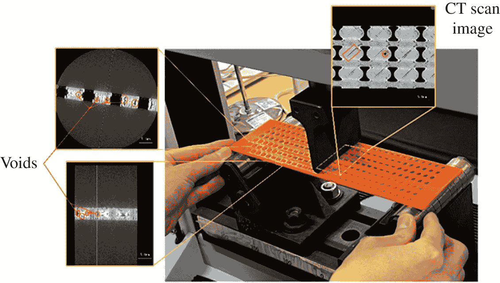

图 2.7 实心 3D 打印结构内部的空隙。

3D 打印金属部件中孔隙的形成主要是由于微观孔隙的发展，这降低了部件的密度并负面影响了其机械性能。这些孔隙源于粉末材料的缺陷或打印过程中的不一致。例如，在`atomization`（常用的粉末生产方法）过程中，孔隙可能会引入粉末颗粒中。然而，孔隙更多源于增材制造过程本身。`laser energy`不足会导致金属粉末熔化不完全，导致颗粒未结合并形成孔隙。相反，过量的`laser energy`可能会导致熔融材料飞溅，在固化的部件内部留下空隙。

熔融金属内部孔隙形成和迁移的动力学受复杂的力相互作用支配，包括温度梯度、热毛细力和熔体动力学。这些孔隙具有速度快、尺寸微小的特点，为打印过程中的实时观察带来了巨大挑战。传统的成像方法如`X-ray tomography`，虽然有用，但通常缺乏捕捉熔池内孔隙快速运动所需的分辨率。诊断技术的最新进展阐明了这些现象，揭示了孔隙运动不仅受温度热毛细力的影响，还受到流动熔体施加的阻力的影响。由温度诱导的表面张力梯度驱动的热毛细力有时会超过阻力，有效防止孔隙的形成。

打印环境的改进（如改变大气气体或实施真空条件）在影响孔隙形成方面显示出潜力。激光技术的进步（包括多束系统和超快激光的发展）为精确控制熔化和固化过程开辟了新途径，可能减少孔隙率。

通过增材制造生产的部件通常需要进行后处理，以满足其预期应用的严格要求。这一阶段包括一系列步骤，如粉末和支撑结构的去除、热处理和表面处理，每一步都有独特的挑战。例如，当支撑结构位于小孔和管等狭窄空间时，去除它们非常困难。在不损坏部件的情况下去除可能需要额外的加工，增加了工艺的复杂性。

表面粗糙度是另一个重大挑战，特别是对于增材制造的金属部件，特别是要求低粗糙度的应用。虽然在打印期间降低`layer thickness`可以产生更光滑的表面，但这种方法也显著增加了构建时间，影响了生产效率。表面粗糙度也可能是由于`laser energy`不足导致粉末熔化不完全引起的。此外，`layer thickness`受限于原料（无论是丝材、粉末还是其他形式）的物理限制。

## 2.10 增材制造中的新兴技术

### 2.10.1 效益的金属 3D 打印

增材制造的最新进展引入了降低成本生产金属部件的创新方法。其中一种方法涉及使用金属丝材，它将聚合物（如`聚乳酸 (PLA)`）与细金属粉末结合以形成复合材料。这种复合材料可以通过标准的 3D 打印技术进行处理，随后进入后处理步骤，在此去除聚合物基质（通常通过热降解或溶解）。这种方法为通常需要昂贵设备和特殊材料的传统金属 3D 打印提供了更具效益的选择。

尽管具有潜力，基于聚合物的金属丝打印的发展仍处于早期阶段，面临许多挑战，特别是聚合物粘剂的去除。聚合物去除过程对于获得所需的金属结构至关重要，通常需要`sintering`（烧结）——一种热处理工艺，在受控的炉环境中对打印部件进行高温。烧结不仅消除了聚合物，还促进了金属颗粒的结合，增强了最终产品的机械性能。

烧结是粉末冶金中一种成熟的工艺，用于赋予粉末压坯强度和结构完整性。在烧结过程中，温度保持在主要金属成分的熔点以下，允许固态扩散发生。这种扩散促进了相邻粉末颗粒之间颈部的形成和生长，从而增加了压坯的整体强度。最初，压结的粉末颗粒通过冷焊结合在一起，为烧结前的处理提供了足够的“生强度”。烧结过程对于将这些结合力弱的颗粒转化为适用于各种应用的内聚、稳固的金属结构至关重要。

虽然在 3D 打印中使用金属丝代表了金属增材制造的一种极具前景且具有成本效益的方法，但它严重依赖于后处理技术（特别是烧结）的有效执行，以获得高质量的功能性部件。该领域的持续研发对于克服当前局限性并充分发挥这一新兴技术的潜力至关重要。

固态烧结过程对于从聚合物基金属丝生产高质量金属部件至关重要，它需要满足特定的前提。在开始烧结之前，有两个关键阶段（如图 2.8 所示）：

1. **中等温度**：在此阶段，将金属粉末颗粒结合的聚合物粘剂必须被有效移除。这通常通过聚合物的热降解实现，其中粘剂蒸发并烧除，留下清洁的金属粉末基体。
2. **高温**：在移除聚合物粘剂后，该过程需要提高温度以促进金属粉末颗粒表面氧化物的还原。这一步对于确保金属颗粒在烧结过程中能够有效结合至关重要。


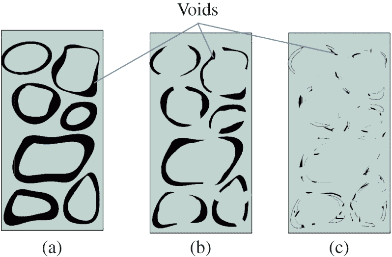

`图 2.8` 固态烧结的三个渐进阶段：(a) 初期，(b) 过渡阶段和(c) 最终阶段。这些过程以及烧结本身通常在单个连续炉中进行。炉经过仔细分区，具有受控气氛和精确的温度曲线，以实现聚合物的顺序移除、表面氧化物的还原，最后是金属颗粒的烧结。

然而，该过程的能量需求是巨大的。由于长时间高温的需求，累计能量成本促使一些制造商倾向于直接金属 3D 打印方法，这些方法可以跳过这些中间步骤。直接金属打印方法（如 `LPBF` 或 `DED`）直接熔化金属粉末而不需要聚合物粘剂，从而减少了相关的能消耗和复杂性。

尽管如此，聚合物基金属丝方法仍面临巨大挑战。聚合物移除后的尺寸收缩是一个持续的问题，因为缺乏粘剂通常会导致材料收缩，导致尺寸精度降低。此外，烧结过程中可能会产生不良的孔隙，进一步损害最终产品的机械性能和完整性。尽管在利用聚合物金属丝生产高质量金属结构方面取得了进展，但此类工艺所需的先进设备成本仍然高得惊人，通常超过某些现有直接金属 3D 打印机的成本。

## 2.10.2 纳米级增材制造

增材制造中新兴的纳米级 3D 打印领域正见证由原子层沉积（`ALD`）和自组装（`SA`）技术共同驱动的变革性进展。这些创新有望突破原子和分子尺度下制造的精度和功能边界。本综合性讨论探讨了 `ALD` 和 `SA` 技术的集成、其机制以及它们对超精密制造技术未来的潜在影响。

`ALD` 已成为开发高精度薄层的基石，特别是在纳米级制造领域。`ALD` 的特点是能够通过自限阻性沉积过程产生具有原子级精度的超薄层。`ALD` 最初由 Aleksovski 构想，随后由 Suntola 分别在 20 世纪 60 年代和 70 年代进行改进，演变为能够满足纳米应用的严苛需求，特别是随着 20 世纪 90 年代纳米电子学的出现。

`ALD` 每循环以亚埃级精度沉积薄膜的能力确保了对薄膜厚度和均匀性前所未有的控制。这种精度对于需要对高深比结构和复杂几何进行保形涂层的应用至关重要。

热 `ALD` 仍然是一种多功能且广泛使用的技术，能够沉积具有高保形性的宽谱材料。然而，等离子体增强 `ALD`（`PE-ALD`）通过允许在较低温度下和使用更广泛的前驱体化学进行沉积，引入了额外功能。`PE-ALD` 通过减少杂质水平并实现对化学计量和相的更好控制来提高膜质量，这对于金属氧化物和高 k 电质材料特别有利。使用氢等离子体增强了金属化学性质，有助于减少成核延迟，并允许有效的等离子体表面处理。此外，`PE-ALD` 可以显著缩短循环之间的清洗时间，使其成为快速高效沉积工艺的理想选择。

`SA` 代表了纳米制造的另一项关键技术。与传统的自上而下方法不同，`SA` 是一种自下而上的技术，组件通过分子间相互作用自发组织成定义的结构。这一过程由经过设计的化学和物理条件控制，产生高精度的复杂自组织结构。

自组装单分子层（`SAMs`）是 `SA` 最简单的表现之一。`SAMs` 涉及在衬底表面组织成有序晶格的单层分子，特征尺寸在纳米范围内。最近的进展将 `SAMs` 扩展到弹性衬底上的双组无机单层，能够形成三角形晶格和蛇形条纹等复杂图案。

嵌段聚合物由化学性质不同的不互溶的聚合物段组成，也表现出显著的 `SA` 行为。这些聚合物相分离形成规则图案，尺寸通常在 10 到 100 纳米之间。对这些图案的操控允许制造具有定制属性的纳米结构。

纳米球和纳米棒已被证明在外部场和约束的影响下自组装成有序晶格。由于其各向异性，纳米线阵列的 `SA` 面临更大的挑战，但涉及微流道和电场的新方法改进了这些结构的排列和对齐。

`ALD` 与 `SA` 技术的集成通过结合 `ALD` 的精度和分子组装的自组织能力，可能会彻底改变纳米 3D 打印。这种混合方法提供了几个潜在优势：

1. **增强精度**：`ALD` 的原子层控制可以与 `SA`（自组装）结合，实现具有前所未有的精度和复杂性的纳米结构。

2. **可扩展性**：`ALD` 与 `SA` 的结合可能实现复杂纳米结构的可扩展化生产，解决当前制造吞吐量的局限性。

3. **材料多样性**：`ALD` 可以使用广泛材料的能力，结合聚合物和纳米颗粒的多功能 `SA`，使得创建多功能和多材料的结构成为可能。

4. **功能化**：可以采用 `SA` 技术引入特定的功能或图案，以补充 `ALD` 沉积膜的特性，从而形成先进的复合材料。

`ALD` 与 `SA` 技术的整合代表了增材制造纳米级 3D 打印领域一个充满前景的前沿。通过利用这两种方法的优势，可以突破纳米制造在精度、功能性和可扩展性方面的边界。随着研发的不断进步，这些技术可能会解锁新的能力和应用，推动从纳米电子学到先进材料科学等领域的创新。

## 参考文献

1. Reed‐Hill, R.E., Abbaschian, R., and Abbaschian, R. (1973). 物理冶金原理. New York: Van Nostrand.

2. Al Ali, M., Shimoda, M., and Naguib, M. (2024). 空间任务中利用拓扑优化和计算机视觉实现受控振动性的自动化结构设计。*Appl. Sci.* 14: 6786.

3. Al Ali, M., Shimoda, M., and Naguib, M. (2024). 利用计算机视觉优化可制造结构以提高材料效率和结构稳定性。*Modelling* 5: 1286–1297.

# 第三章

多隙结构属性计算的数学建模：技术与应用

## 3.1 引言

从下而上地设计多隙结构需要一种综合方法，将孔隙级设计与整体结构框架整合。实现这需要一种能够将微观特征与宏观行为联系起来的方法论。本章介绍了材料属性和微观结构的基础原理，以及最终导致均质化技术发展的历史演变。均质化因其高效性而闻名，是各种应用中设计先进微观结构的通用且具有成本效益的策略。

## 3.2 材料物理属性计算评估概述

原子理论的基本原理构成了现代化学的基石，为物质的复杂组成和固有属性提供了见解。原子理论的演变跨越了两千多年，始于亚里士多德和德莫克里特的哲学沉思。亚里士多德认为物质可以无限分割而不改变其基本本质，而德莫克里特则引入了不可分割实体的概念，称为“原子”，该词源自希腊语“atomos”，意为“不可分割”。这种智力对话一直持续到 19 世纪初，当时约翰·道尔顿通过严谨的实验为原子的存在提供了经验证实。道尔顿的原子假设认为物质是由不可分割的粒子（即原子）构成的，而这些粒子既不被创造也不被破坏。他进一步断言，特定元素的所有原子在质量和属性上都是相同的，化合物由不同类型的原子按固定比例结合而成。虽然道尔顿的模型是突破性的，但它缺乏对中子和电子等亚原子粒子的理解，这些粒子当时尚未被发现。

原子理论的进展在 19 世纪末和 20 世纪初获得动力，J.J. 汤姆森和恩斯特·卢瑟福等物理学家做出了关键贡献。汤姆森的阴极射线实验导致了电子（带负电的亚原子粒子）的发现，从而挑战了道尔顿不可原子概念。汤姆森引入了布丁子模型，设想电子嵌入在正电的基质中。该模型后来被卢瑟福的金箔实验反驳，该实验揭示了原子由一个致密的、正电的核和周围的电子云组成。卢瑟福的原子核模型证明原子主要是空隙，几乎所有的质量都集中在原子核中。

原子理论随后的完善通过 1913 年尼尔斯·玻尔的量子壳层模型实现，该模型阐明了电子绕原子核轨道的稳定性。玻尔引入了量子能级的概念，电子只能占据特定的轨道而不发射能量。这一模型为现代量子力学奠定了基础，量子力学对原子结构和电子行为提供了更全面的理解。

原子理论的探索延伸到粒子物理的标准模型，该模型描述了构成物质的基本粒子和力。标准模型确定了四种基本力：强力、弱力、电磁力和引力。强力是最强的，将原子核内的质子和中子结合在一起，而弱力负责放射性衰变。电磁力远强引力，控制着带电粒子之间的相互作用，而引力尽管最小但具有无限范围的作用。理解原子结构需要掌握原子序、质量数、同位素和原子质量等关键概念。原子序代表原子中质子的数量，定义了元素并在所有同位素中保持不变。例如，碳总有六个质子。在电性原子中，电子数等于质子数，平衡了电荷。然而，质量数是核内质子和中子的和，在同位素之间存在差异。例如，碳有三种天然存在的同位素：碳-12、碳-13 和碳-14，质量数分别为 12、13 和 14。

### 平均原子质量计算

计算平均原子质量涉及将每个同位素的质量与其相对丰度相乘并将值求和。例如，铜有两个质量数为 63 和 65 的稳定同位素。如果铜-63 的丰度为 69.2%，原子质量为 62.93 原子质量单位 (amu)，铜-65 的丰度为 30.8%，原子质量为 64.93 amu，则平均原子质量的计算如下：

```
(62.93 amu * 0.692) + (64.93 amu * 0.308)
```

结果平均原子质量约为 63.55 amu。该数值与周期表列出的原子质量对应，展示了不同同位素的贡献是如何整合以代表元素的平均原子质量的。

对于科学家和工程师来说，材料在原子和亚原子水平上的属性与其原子排列和能量状态密切相关。例如，材料的机械强度取决于其特定特性。在金属材料中，强度主要由电子的自由度决定，这定义了金属键和结构。

在固态材料中，这些体相性质通常通过电子构型和能级的平均化来概念化，并考虑了原子核的空间维度。这种抽象源于一种理解：电子行为充当了将原子键结成固态结构的凝聚力。因此，凝聚态理论的一个核心目标是准确确定固态的电子结构（`ES`）。

`ES` 计算基于 `ab initio`（从头原理）方法，允许对固体的结构和动力学进行预测。这些计算基于基础量子理论，需要组成原子的原子序和基础结构信息作为输入。在密度泛函理论（`DFT`）框架内，电子运动的复杂多体问题被简化为单个电子在有效势场中运动。这种方法已成为计算材料科学的标准，能够以极高的精度分析和预测材料属性。

虽然为 `ESs` 建立量子力学方程（考虑了固态中电子与原子核之间所有已知的相互作用）在概念上是直观的，但由于其内在的复杂性，求解这些方程仍然是一项巨大的挑战。为了解决这个问题，采用了各种近似方法。尽管这些方法进行了简化处理，但它们通常能产生详尽的解决方案。

求解 `ES` 问题的计算需求是巨大的，需要大量的计算资源。在先进高速计算出现之前，固态中实际的 `ES` 计算极其罕见。然而，计算能力的快速发展、可用性的增加以及数值方法改变了这一领域，催生了计算材料科学的诞生。

计算能力的进步，结合创新计算方法和算法的发展，极大地提高了 `ES` 计算的精度。这些进展使得固态单电子 Kohn–Sham 方程的高精度求解成为可能，在原子和电子尺度提供了无比拟的细节。这种能力不仅允许模拟实验条件，还促进新分子和材料的设计，在合成之前预测它们的属性。计算模拟提供了实验方法往往无法获取的原子级洞察，为经验性研究提供了补充方法。与半经验方法依赖于针对基态结构属性定制的可调参数、且可能缺乏对非平衡配置的迁移性不同，`ab initio` 计算即使在非平衡条件下也保持可靠。这种可靠性使其在材料的多尺度建模中变得不可或缺，发挥着两个关键作用：(i) 处理电子效应至关重要且需要从头原理处理的情景；(ii) 为原子间势的发展生成数据。

计算材料科学的影响不仅限于预测和理解材料属性。它还能够设计具有定制属性的新材料，加速发现的发现，并最大限度地减少对昂贵且耗时的实验试验的需求。通过利用高性能计算和先进算法，研究人员可以探索广大的参数空间，为从电子到储能等广泛应用领域识别极具前景的候选材料。

随着理论方法和计算技术的不断进步，计算方法在材料科学中的作用正在扩大。随着对 `ESs` 的深入理解和计算能力的增强，发现新材料和揭示新物理现象的潜力正在增长。

聚合物和陶瓷材料与其金属类一样表现出根于其分子和原子结构的独特属性。聚合物由长链重复分子链组成，其特征是多功能性、轻量化和广泛的机械行为，这些行为可以通过化学组成和加工技术进行定制。另一方面，陶瓷通常是无机非金属材料，因其硬度、热性和抗化学降解能力而受青睐。与具有延性和延塑性的金属不同，陶瓷通常是脆性的，尽管陶瓷工程的进步导致了机械性能增强的韧性陶瓷的发展。聚合物和陶瓷材料在现代工程应用中都起着关键作用，其独特的属性被用于特定的功能需求。

复合材料的出现（结合了两种或两种不同的相，通常是基体和增强相）彻底改变了工程材料，提供了一种实现任何单一材料无法实现的优越性能的方法。复合材料根据组成材料的性质和增强相的排列进行分类，产生如纤维增强、颗粒增强和结构复合材料等分类。复合结构的设计和优化需要开发数值方法，以处理各种可能的材料组合和配置，每种组合都会产生不同的机械性能。这些方法对于预测复合材料在各种负载条件下的行为至关重要，使工程师能够高精地根据特定应用定制材料属性。

随着复合结构复杂性的增加，对先进数值技术准确计算其机械性能的需求也随之增加。复合材料的半无限组合结合增强分布的可变性，要求放弃纯粹的经验方法。相反，计算方法已成为从基础材料的实验测量属性推导出复合材料机械性能的不可缺因素。这种方法允许高效探索材料设计空间，能够在物理原型制造之前，在虚拟环境中预测并优化复合材料的性能。

## 3.3 微观结构的机械性能

近年来，复合材料设计和数值分析的发展非常显著，导致了具有各种新机械和化学属性的材料的出现。这些进展催化了复合材料在各个工业部门实际应用中的考虑，特别是作为结构构件。

尽管材料进步飞快，但对这些新型复合材料力学的理解进展明显滞后。这种差异主要是由于对开发定制化复合材料结构力学所需的、至关重要的机械属性理解不足。为了让复合材料在结构和建筑中有效利用，不仅要推进复合材料的基础力学，还要推进其结构力学。

目前，研究重点严重偏斜于复合材料的合成和基础断裂力学的探索。这种狭窄的关注导致了基础理解的脆弱，不足以将复合材料作为结构材料的应用。对复合材料微观层面的过度强调往往导致对宏观视角的忽视。一个整合了这两个尺度的整体理解对于复合材料的有效处理和应用至关重要。只有当宏观和微观力学之间存在深刻的联系时，复合材料的处理才具有真正的可行性。

从历史上来看，研究投入了大量精力推导复合材料宏观力学的结构方程，这些方程表面上反映了它们的微观结构。然而，这种方法往往忽略了相互作用的影响，即宏观信息可以指导并优化微观结构以获得更好的设计。因此，这种单方面的关注阻碍了用于复合材料处理的更好力学框架的发展。然而，跨尺度计算积分应力和应变考虑因素的挑战延迟了工艺力学和结构力学的演变。

用于评估复合材料的数值方法具有巨大的意义，因为它们不仅能够根据组分材料的属性预测复合材料的行为，有助于设计性能优越的新复合材料。此外，增材制造中多隙结构设计的进展依赖于准确预测微观结构的行为——特别是孔隙及其与整体宏观结构的相互作用，即多隙结构的拓扑结构。

正如下一章讨论的，最初为评估复合材料而开发的渐近均匀质化法是目前应用最广泛的技术之一。因此，我们将探索评估复合材料的关键方法，从混合规则及其局限性开始，最后以整合不同场（如微观尺度下的应力和应变分析）的高级方法结束。

### 3.3.1 混合规则

让我们讨论复合材料力学的经典配置，它涉及相位中交替的 A 和 B 材料，如图 3.1 所示。

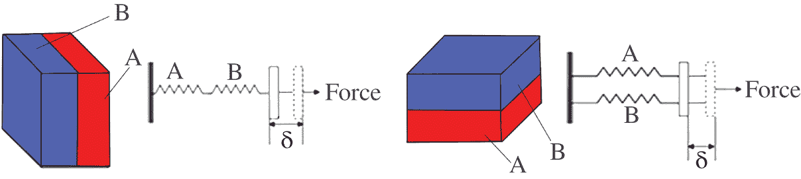

`图 3.1` 复合材料空间配置的分析逻辑。

让我们推导此类模型的公式。考虑厚度分别为 `t[a]` 和 `t[b]` 且交替排列的 A 板和 B 板。当应力垂直于板施加时，总应变可以被视为每个单独板应变之和。

(3.1)
```
epsilon left-parenthesis t Subscript normal a Baseline plus t Subscript normal b Baseline right-parenthesis equals epsilon Subscript normal Baseline t Subscript normal a Baseline plus epsilon Subscript normal Baseline t Subscript normal Baseline
```
<math display="block" overflow="scroll" xmlns="http://www.w3.org/1998/Math/MathML"> <mi>&#949;</mi> <mfenced open="(" close=")" separators=""><mrow> <msub> <mi>t</mi> <mi mathvariant="normal">a</mi> </msub> <mo>+</mo> <msub> <mi>t</mi> <mi mathvariant="normal">b</mi> </msub> </mrow> </mfenced> <mo>=</mo> <msub> <mi>&#949;</mi> <mi mathvariant="normal">a</mi> </msub> <msub> <mi>t</mi> <mi mathvariant="normal">a</mi> </msub> <mo>+</mo> <msub> <mi>&#949;</mi> <mi mathvariant="normal">b</mi> </msub> <msub> <mi>t</mi> <mi mathvariant="normal">b</mi> </msub> </math>

在线性弹性区域，上述方程可以重写为应力形式：


## 3.3.2 混合律与边界

复合材料的等效模量可以评估为：

(3.2)
$$
\frac{\sigma}{E_a}t_a + \frac{\sigma}{E_b}t_b
$$

(3.3)
$$
E = \frac{\sigma}{\frac{\sigma}{E_a}t_a + \frac{\sigma}{E_b}t_b}
$$

(3.4)
$$
\alpha_a = \frac{t_a}{t_a + t_b}, \quad \alpha_b = \frac{t_b}{t_a + t_b}
$$

参数 `α_a` 和 `α_b` 分别代表材料 a 和 b 的体积分，假设板的面积相同。

混合律提供了一个框架，根据材料组分的性质和体积分数来估计复合材料的有效性能。在考虑复合材料的弹性模量时，使用了两个主要条件——等应变（iso-strain）和等应力（iso-stress），分别用于建立上限和下限。

等应变条件代表了一种理想情况，即相之间存在完美的载荷传递和紧密结合。在这种情况下，复合材料的有效模量是各个组分模量的简单加权平均值，与其各自的体积分数成正比。这种方法通常预测复合材料模量的上限，反映了当增强相与外加应力方向对齐时所达到的最大刚度。

相反，等应力条件假设应力在基体和增强相之间均匀分布。这种场景可能发生在粘结不当或载荷垂直于增强相施加时。在这里，有效模量使用调和平均值进行计算，其中体积分数与组分的模量成反比。这种方法通常预测复合材料模量的下限，它代表了在次优条件下（如载荷传递不佳或增强相未对齐）可能出现的最小刚度。

对于弹性两相复合材料，Voigt 模型和 Reuss 模型提供的刚度边界是根据组分相的体积分数计算出的杨模量主要边界。这些边界无论复合材料内部相的几何配置均适用。

Voigt 模型（图 3.3）
$$
E_{eq} = E_a a_a + E_b a_b
$$

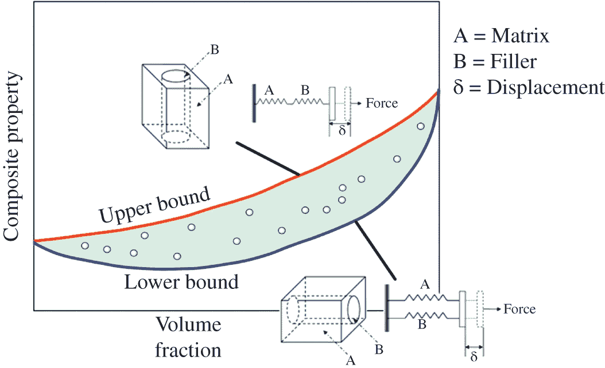

**图 3.3** 经典的 Voigt–Reuss 上限和下限。

相反，Reuss 模型（图 3.3）
$$
\frac{1}{E_{eq}} = \frac{a_a}{E_a} + \frac{a_b}{E_b}
$$

是否存在一种方法能够在彻底解释传统动力模型的同时，解决上述问题？目前一种广泛使用的方法是均质化，它在应用数学领域已被广泛研究。

## 3.3.3 周期性微观结构

在一般的复合材料中，由于制造限制，实际上无法复制完全周期的微观结构。然而，为了建立数学动力模型，我们可以假设近似周期性以构建一个理想模型。

为了针对各种复合材料，我们可以抽象地假设在任意点附近存在周期性的微观结构。通过这种方式，我们可以考虑周期和微观结构略有不同的点 `A` 和 `B`，从而对具有不同属性的复合材料进行建模。

为了表示这种周期性和细细结构，我们在细细结构内引入了局部坐标 `y`（如图 3.6）
$$
y = \frac{x}{\omega}
$$

该缩放的作用是将问题归一化。

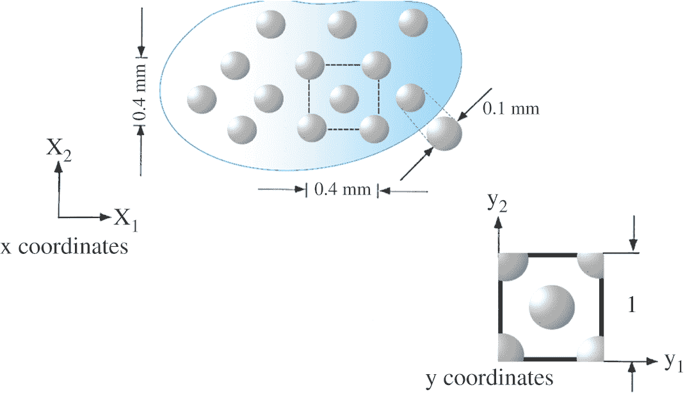

**图 3.6** 渐近均质化问题。

如图 3.6 中的示例所示，当通过单元模型描述时，最小的代表性和遍历性微观结构可以在 0.4 mm (400 μm) 的范围内进行表征。具体来说，令宏观结构由坐标 `x = 400 μm` 定义。相应地，微观结构的局部坐标系（用 `y` 表示）被标准化为单位。当宏观结构的尺寸远大于微观结构时，我们可以考虑 `ω → 0` 的极限。均质化方法假设了周期性的细结构，并在数学上探索复合材料在 `ω → 0` 时的行为。

## 3.3.4 虚原理

为了描述具有微观结构的复合材料，我们将弹性张量、位移、应变和应力分别标记为 `E^ω`、`u^ω`、`ε^ω` 和 `σ^ω`。在这里，上标代表微观结构。此类力学公式所需的函数使用全局坐标 `x`（代表整个结构）作为变量。同时，由于细结构的存在，这些函数依赖于代表细结构的单元模型坐标 `y`。因此，例如，位移 `u` 和弹性张量 `E` 可以表示为 `x` 和 `y` 的函数。

(3.8)
$$
\begin{cases}
u^\omega = u(x, y) \\
E^\omega(x) = E(x, y)
\end{cases}
$$

由于我们假设了微观结构的周期性，可以将该函数表示如下：

(3.9)
$$
u(x, y) = u(x, y + Y)
$$

其中 `Y` 是决定周期结构的常数。

(3.10)
$$
Y = Y_1 + Y_2
$$

现在，如果假设复合材料的力学特性由虚功原理描述，令 `V` 为允许位移。

(3.12)
$$
\int_{y_\omega} (\nu^\omega - u^\omega) \sigma \, d\omega = \int_{y_\omega} (\nu^\omega - u^\omega) \rho f^\omega \, d\omega + \int_{\Gamma_t} (\nu^\omega - u^\omega) T^\omega t^\omega \, d\Gamma, \quad \forall \nu^\omega \in V^\omega
$$

假设变形很小，应力与应变的关系为


## 公式与推导

(3.13)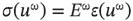

<math display="block" overflow="scroll" xmlns="http://www.w3.org/1998/Math/MathML"> <mspace width="-4em"/> <mi>&#963;</mi> <mfenced open="(" close=")" separators=""><msup> <mi>u</mi> <mi mathvariant="normal">&#969;</mi> </msup> </mfenced> <mo>=</mo> <msup> <mi>E</mi> <mi mathvariant="normal">&#969;</mi> </msup> <mi>&#949;</mi> <mfenced open="(" close=")" separators=""><msup> <mi>u</mi> <mi mathvariant="normal">&#969;</mi> </msup> </mfenced> </math> (3.14)

(3.14)

<math display="block" overflow="scroll" xmlns="http://www.w3.org/1998/Math/MathML"> <mi>&#949;</mi> <msub> <mfenced open="(" close=")" separators=""><msup> <mi>u</mi> <mi mathvariant="normal">&#969;</mi> </msup> </mfenced> <mi mathvariant="normal">ij</mi> </msub> <mo>=</mo> <mfrac> <mn>1</mn> <mn>2</mn> </mfrac> <mfenced open="(" close=")" separators=""><mrow> <mfrac> <mrow> <mi>&#8706;</mi> <msubsup> <mi>u</mi> <mi mathvariant="normal">i</mi> <mi mathvariant="normal">&#969;</mi> </mtext> </mrow> <mrow> <mi>&#8706;</mi> <msub> <mi>x</mi> <mi mathvariant="normal">j</mi> </msub> </mrow> </mfrac> <mo>+</mo> <mfrac> <mrow> <mi>&#8706;</mi> <msubsup> <mi>u</mi> <mi mathvariant="normal">j</mi> <mi mathvariant="normal">&#969;</mi> </mtext> </mrow> <mrow> <mi>&#8706;</mi> <msub> <mi>x</mi> <mi mathvariant="normal">i</mi> </msub> </mrow> </mfrac> </mrow> </mfenced> </math>

由于假设典型区域的材料是纯线性弹性的，因此初始应力项为零。

在均匀化方法中，位移分解为：

(3.15)

<math display="block" overflow="scroll" xmlns="http://www.w3.org/1998/Math/MathML"> <msup> <mi>u</mi> <mi mathvariant="normal">&#969;</mi> </msup> <mo>=</mo> <mi>u</mi> <mfenced open="(" close separators=""><mrow> <mi>x</mi> <mo>,</mo> <mi>y</mi> </mrow> </mfenced> <mo>=</mo> <msub> <mi>u</mi> <mn>0</mn> </msub> <mfenced open="(" close separators=""><mrow> <mi>x</mi> <mo>,</mo> <mi>y</mi> </mrow> </mfenced> <mo>+</mo> <mi>&#969;</mi> <msub> <mi>u</mi> <mn>1</mn> </msub> <mfenced open="(" close separators=""><mrow> <mi>x</mi> <mo>,</mo> <mi>y</mi> </mrow> </mfenced> <mo>+</mo> <mi>&#969;</mi> <msup> <mi>u</mi> <mn>2</mn> </msup> <msub> <mfenced="(" close separators=""><mrow> <mi>x</mi> <mo>,</mo> <mi>y</mi> </mrow> </mo> <mo>+</mo> <mo>dots;</mo> </math>

其中 `u0` 代表宏观位移，而 `u1` 代表由小参数 `ω` 缩放的微观波动。这种分解使得分析能够同时考虑到全局结构和微观细节。

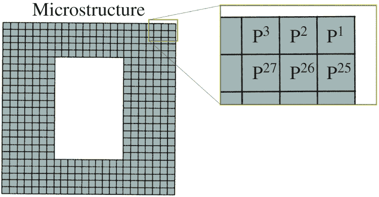 [图 3.7 微观结构的有限元离散化]

如[图 3.7 所示]，该方法允许我们分析复合材料的力学特性。为了满足周期性，要求函数在 `P¹`、`P²`、`P³`……`Pω` 处具有相等的值：

(3.16)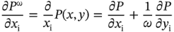

<math display="block" overflow="scroll" xmlns="http://www.w3.org/1998/Math/MathML"> <mfrac> <mrow> <mi>&#8706;</mi> <msup> <mi>u</mi> <mi mathvariant="normal">&#969;</mi> </msup> </mrow> <mrow> <mi>&#8706;</mi> <msub> <mi>x</mi> <mi mathvariant="normal">i</mi> </msub> </mrow> </mfrac> <mo>=</mo> <mfrac> <mrow> <mi>&#8706;</mi> <mi>u</mi> <mi mathvariant="normal">ij</mi> </msub> </mo>=</mo> <mfrac> <mi>&#8706;</mi> <msub> <mi>x</mi> <mi>y</mi>> </>> </mo> </mo> <mfrac> <mn>1</mi> <mi></mi69>>> </mfrac> <mi>P</mi> <mfenced="(" close separators=""><mrow> <mi>x</mi> <mo>,</mo> <mi>y</mi> </mrow> </mo> </math>

考虑异质材料的物理属性 `ψ(x, y)`。根据均匀化理论，该属性在宏观尺度上具有波动。这种波动可以使用双尺度展开（如[图 3.8 所示]）。宏观属性的评估是在微观尺度无限小的假设下进行的。由于强耦合，属性 `ψ(x, y)` 可以表示为微观结构的积分，并考虑其周期性，如方程(3.17)所示。

(3.17)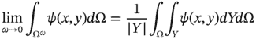

<math display="block" overflow="scroll" xmlns="http://www.w3.org/1998/Math/MathML"> <munder> <mi mathvariant="normal">lim</mi> <mrow> <mi>&#969;</mi> <mo>&#8594;</mo> <mn>0</mn> </mrow> </munder> <msub> <mo>&#8747;</mi> <msup> <mi mathvariant="normal">&#937;</mi> <mi>&#969;</mi> </msup> </msub> <mi>&#968;</mi> <mfenced open="(" close separators=""><mrow> <mi>x</mi> <mo>,</mo> <mi>y</mi> </mrow> </mo> <mi>d</mi> <mi mathvariant="normal">&#937;</mi> <mo>=</mo> <mfrac> <mn>1</mn> <mfenced open="|" close="|" separators=""><mi>Y</mi> </mfenced> </mfrac> <msub> <mo>&#8747;</mi> <mi mathvariant="normal">&#937;</mi> </msub> <msub> <mo>&#8747;</mi> <mi>Y</mi> </msub> <mi>&#968;</mi> <mfenced open="(" close separators=""><mrow> <mi>x</mi> <mo>,</mo> <mi>y</mi> </mrow> </mo> <mi mathvariant="italic">dYd</mi> <mi mathvariant="normal">&#937;</mi> </math> 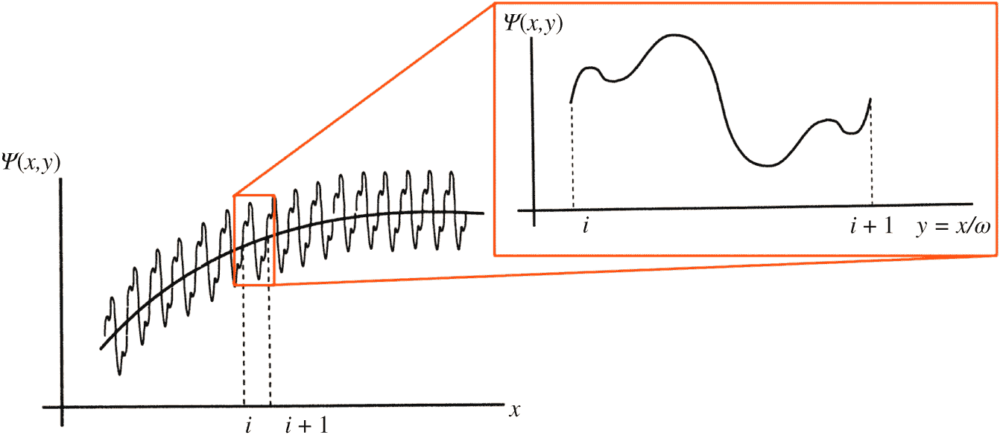

回到弹性张量评估的问题，根据等式 `(3.16)` 的结果，`u` 展开中的零阶项 `u[0]` 不依赖于微观结构，可以解释为微观结构中位移的平均值。

(3.18)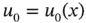<math display="block" overflow="scroll" xmlns="http://www.w3.org/1998/Math/MathML"> <msub> <mi>u</mi> <mn>0</mn> </msub> <mo>=</mo> <msub> <mi>u</mi> <mn>0</mn> </msub> <mfenced open="(" close=")" separators=""><mi>x</mi> </mfenced> </math> 

等式 `(3.17)` 显示一阶项 `u[1]` 表示为平均位移引起的应变与微观结构特征位移的乘积。因此，`χ^(kl)` 对应于一个特征函数。由于 `χ^(kl)` 对应于 `k` 和 `l` 方向上的直接应变，它展示了当 `k` = `l` 时，在法应力方向对单元胞模型施加均匀直接应变时微观结构是如何变形的。当 `k` ≠ `l` 时，对单元胞模型施加剪切应变，`χ^(kl)` 显示了微观结构的变形。


## 3.4 使用有限元法（FEM）公式的多孔结构有效弹性张量

在对二维（2D）多孔结构的有效弹性张量进行评估时，让我们从这样一个假设开始：使用均质化方法，二维问题的张量胡克定律采用张量形式如式(3.22)所示。

```
<math display="block" overflow="scroll" xmlns="http://www.w3.org/1998/Math/MathML"> <mfenced open="{" close="}" separators=""><mtable> <mtr> <mtd> <msub> <mi>&#963;</mi> <mi>x</mi> </msub> </mtd> </mtr> <mtr> <mtd> <msub> <mi>&#963;</mi> <mi>y</mi> </msub> </mtd> </mtr> <mtr> <mtd> <msub> <mi>&#964;</mi> <mi mathvariant="italic">xy</mi> </msub> </mtd> </mtr> </mtable> </mfenced> <mo>=</mo> <mfenced open="\[" close="\]" separators=""><mtable> <mtr> <mtd> <msub> <mi>E</mi> <mn>11</mn> </msub> </mtd> <mtd> <msub> <mi>E</mi> <mn>12</mn> </msub> </mtd> <mtd> <msub> <mi>E</mi> <mn>14</mn> </msub> </mtd> </mtr> <mtr> <mtd> <msub> <mi>E</mi> <mn>21</mn> </msub> </mtd> <mtd> <msub> <mi>E</mi> <mn>22</mn> </msub> </mtd> <mtd> <msub> <mi>E</mi> <mn>23</mn> </msub> </mtd> </mtr> <mtr> <mtd> <msub> <mi>E</mi> <mn>31</mn> </msub> </mtd> <mtd> <msub> <mi>E</mi> <mn>32</mn> </msub> </mtd> <mtd> <msub> <mi>E</mi> <mn>33</mn> </msub> </mtd> </mtr> </mtable> </mfenced> <mfenced open="{" close="}" separators=""><mtable> <mtr> <mtd> <msub> <mi>&#963;</mi> <mi>x</mi> </msub> </mtd> </mtr> <mtr> <mtd> <msub> <mi>&#963;</mi> <mi>y</mi> </msub> </mtd> </mtr> <mtr> <mtd> <msub> <mi>&#964;</mi> <mi mathvariant="italic">xy</mi> </msub> </mtd> </mtr> </mtable> </mfenced> </math>
```

为了计算体积为 `V` 的 RVE 的有效弹性张量，使用式(3.23)：

```
<math display="block" overflow="scroll" xmlns="http://www.w3.org/1998/Math/MathML"> <msup> <mi mathvariant="bold">E</mi> <mi mathvariant="normal">H</mi> </msup> <mo>=</mo> <mfrac> <mn>1</mn> <mfenced open="|" close="|"><mi>V</mi> </mfenced> </mfrac> <munder> <mo>&#8747;</mo> <mi>V</mi> </munder> <msub> <mi mathvariant="bold">E</mi> <mtext>ijqp</mtext> </msub> <mfenced open="(" close="))"><mrow> <mi mathvariant="bold">&#949;</mi> <mi mathvariant="normal">qp</mi> <mn>0</mn> <left="(" close=""><mi mathvariant="italic">kl</mi> </right></mrow> </mfenced> <mo>&#8722;</mo> <msubsup> <mi mathvariant="bold">&#949;</mi> <mi mathvariant="normal">qp</mi> <mrow> <mo>&#42;</mo> <left="(" close=""><mi mathvariant="italic">kl</mi> </right></mrow> </msubsup> </mfenced> <mspace width="0.2em"/> <mi mathvariant="italic">dV</mi> </math>
```

其中 `EH` 张量、`Eijqp` 是构成 RVE 的材料弹性张量，而 `epsilon⁰(kl)` 表示单位应变测试（如 3.9 所示）。`epsilon*(kl)` 代表周期性应变，通过求解式(3.24)确定。

```
<math display="block" overflow="scroll" xmlns="http://www.w3.org/1998/Math/MathML"> <underset> <mo>&#8747;</mo> <msub> <mi mathvariant="normal">&#937;</mi> <mi mathvariant="normal">m</mi> </msub> </underset> <msub> <mi mathvariant="bold">E</mi> <mtext>ijqp</mtext> </msub> <msubsup> <mi mathvariant="bold">&#949;</mi> <mi mathvariant="normal">qp</mi> <mrow> <mo>&#42;</mo> <left="(" close=""><mi mathvariant="italic">kl</mi> </right></mrow> </msubsup> <mi>&#8706;</mi> <msub> <mi>&#947;</mi> <mi mathvariant="normal">n</mi> </msub> <mi>dV</mi> </math>
```

虽然数值均匀化的主要应用在传统上是确定复合材料的等效弹性张量，但其适用范围远超此。均质化技术可用于计算复合材料的各种物理属性，包括热导率和压电性能。例如，在热传导的情况下，可以使用数值均匀化通过在代表性单元（RVE）内求解导热方程并评估产生的热通量来推导出有效热导率张量。

同样，在分析压电复合材料时，可以利用数值均匀化来计算有效压电张量。通过施加电场并在 RVE 内求解相应的电力学问题，可以导出复合材料的有效压电性能。


其中`∂γ[n]`是与单位应变情况相关的任意虚拟位移。式(3.23)分别针对`kl = 11`、`22`和`12`这三种情况，在式(3.24)内进行求解。

![图 3.9 二维 RVE 中的三种机械变形模式 [3]。](images/c03f009.png)

图 3.9 2D RVE 中机械变形的三种模式 [[3]](#c03.xhtml#c03-bib-0003)]。

通过公式 (3.25)所示的均匀化方法计算微观结构的有效弹性张量 `E^H`，采用类似于微观结构系统的材料插值方案，推导出宏观单元弹性张量 `E[macro]` [4]。

(3.25)
```
E^H = 1/|V| ∫_V E_ijqp^m (ε_qp^0(kl) - ε_qp^*(kl)) dV
```

### 3.4.1 用于确定有效热导率张量的均匀化方法的发展

数值渐近均匀化已用于确定有效属性，特别是微观结构的均匀化导率张量 `Λ^H`。微观结构被建模为 RVE，设计为相对于宏观结构具有统计均匀性。有效属性受微观结构内部材料分布和材料界面层行为的影响。

此处假设热导率在整个材料中均匀分布。此外，忽略界面层的影响，将 RVE 视为带有空隙的单相固体材料。本节将详细阐述通过均匀化计算材料热导率张量的方法。使用数值均匀化方法确定微观结构的有效属性，并随后将其用于定义宏观区域的有限元模型，如图 3.10 所示。

![Figure 3.10 包含宏观和微观级设计区域的多尺度结构 [5]。](images/c03f010.png)

图 3.10 包含宏观和微观级设计区域的多尺度结构 [[5]](#c03.xhtml#c03-bib-0005)]。

考虑双相微观结构，总的热导率为 `Λ[*k*]`，其中 `k` = 1, 2 表示与 2D RVE 相相关的材料热导率张量。一般稳态导热流由公式 (3.26) 给出。

(3.26)
```
∇·q(T) = -∂/∂ζ (Λ ∂T/∂ζ), ∀x ∈ Ω
```

其中 `q` 是传递率，而`∂T/∂ζ` 是温度梯度，负号表示热流从低温区域流出，这符合热学第二定律。

(3.28)
```
∂/∂ζ (Λ ∂T̄/∂ξ) + ∂/∂ξ (Λ ∂T̄/∂ζ) + ∂/∂ξ (Λ ∂T_1/∂ξ) = 0
```

微观温度场被认为与宏观尺度无关，从而可以消去第一项。此外，假设宏观导热张量仅依赖于微观尺度。在这些假设下，微观温度场给出：

(3.29)
```
∂/∂ξ (Λ ∂T_1/∂ξ) = -∂T̄/∂ζ ∂Λ/∂ξ
```

局部变量温度场 `T[1]` 可以用全局温度场 `T̄` 表示：
```
∂/∂ξ (Λ ∂T_1/∂ξ) = ...
```
因此，`T[1]` 将是：

(30)
```
T̄ - χ
```
其中 `χ` 是一个独立于全局系统的任意函数。文献中将 `χ` 称为周期场。通过对 `(29)` 局部坐标求导并将 `(30)` 中的周期场定义代入 `(29)`，得到：

(31)
```
∂/∂ξ (Λ ∂T/∂ξ)
```

周期场可以从 `(31)` 计算得出。因此，`(26)` 可以用宏观和结构表示如下：


### 公式推导与均匀热导率计算

公式 (32) 如下所示：

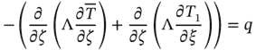

```math
<math display="block" overflow="scroll" xmlns="http://www.w3.org/1998/Math/MathML"> <mo form="prefix">&#8722;</mo> <mfenced="(" close=")" separators=""><mrow> <mfrac> <mi>&#8706;</mi> <mrow> <mi>&#8706;</mi> <mi>&#950;</mi> </mrow> </mfrac> <mfenced="(" close=")" separators=""><mrow> <mi mathvariant="normal">&#923;</mi> <mfrac> <mrow> <mi>&#8706;</mi> <mover accent="true"><mi>T</mi> <mo stretchy="true">&#175;</mo> </mover> </mrow> <mrow> <mi>&#8706;</mi> <mi>&#950;</mi> </mrow> </mfrac> </mrow> </mfenced> <mo>+</mo> <mfrac> <mi>&#8706;</mi> <mrow> <mi>&#8706;</mi> <mi>&#958;</mi> </mrow> </mfrac> <mfenced="(" close=")" separators=""><mrow> <mi mathvariant="normal">&#923;</mi> <mfrac> <mrow> <mi>&#8706;</mi> <msub <mi>T</mi> <mn>1</mn> </msub> </mrow> <mrow> <mi>&#8706;</mi> <mi>&#958;</mi> </mrow> </mfrac> </mrow> </mfenced> </mrow> </mfenced> <mo>=</mo> <mi>q</mi> </math>
```

将等式 `(29)` 和 `(31)` 代入 `(32)` 得到公式 (3.33)：

(3.33) 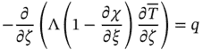

```math
<math display="block" overflow="scroll" xmlns="http://www.w3.org/1998/Math/MathML"> <mo form="prefix">&#8722;</mo> <mfrac> <mi>&#8706;</mi> <mrow> <mi>&#8706;</mi> <mi>&#950;</mi> </mrow> </mfrac> <mfenced open="(" close=")" separators=""><mrow> <mi mathvariant="normal">&#923;</mi> <mfenced open="(" close=")" separators=""><mrow> <mn>1</mn> <mo>&#8722;</mo> <mfrac> <mrow> <mi>&#8706;</mi> <mi>&#967;</mi> </mrow> <mrow> <mi>&#8706;</mi> <mi>&#958;</mi> </mrow> </mfrac> </mrow> </mfenced> <mfrac> <mrow> <mi>&#8706;</mi> <mover accent="true"><mi>T</mi> <mo stretchy="true">&#175;</mo> </mover> </mrow> <mrow> <mi>&#8706;</mi> <mi>&#950;</mi> </mrow> </mfrac> </mrow> </mfenced> <mo>=</mo> <mi>q</mi> </math>
```

![Figure 3.11 Representation of the homogenized thermal properties of the microstructure for the macroscale [5] / with permission from Elsevier: (a) thermal macro design domain, (b) thermal RVE representation on the macro set, (c) thermal micro design domain.](images/c03f011.png)

**Figure 3.11** 宏观尺度微观结构的均匀热属性表示 [[5]](#c03.xhtml#c03-bib-0005) / 经 Elsevier 许可：(a) 热宏观设计域，(b) 宏观集上的热 RVE 表示，(c) 热微观设计域。

由于微观边界条件的周期性，并考虑 `ε` 为无穷小值，宏观结构的热导率常数可以近似为 `Λ(1 - ∂χ/∂ξ)` 在周期性微观域上的积分平均值。这种热导率被称为均匀热导率 `Λ^H`，其最终形式为式 `(3.34)`：

(3.34) 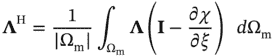

```math
<math display="block" overflow="scroll" xmlns="http://www.w3.org/1998/Math/MathML"> <msup> <mi mathvariant="bold">&#923;</mi> <mi mathvariant="normal">H</mi> </msup> <mo>=</mo> <mfrac> <mn>1</mn> <mfenced open="(" close=")" separators=""><msub> <mi mathvariant="normal">&#937;</mi> <mi mathvariant="normal">m</mi> </msub> </mfenced> </mfrac> <underset> <mo>&#8747;</mo> <msub> <mi mathvariant="normal">&#937;</mi> <mi mathvariant="normal">m</mi> </msub> </underset> <mi mathvariant="bold">&#923;</mi> <mfenced open="(" close=")" separators=""><mrow> <mi mathvariant="bold">I</mi> <mo>&#8722;</mo> <mfrac> <mrow> <mi>&#8706;</mi> <mi>&#967;</mi> </mrow> <mrow> <mi>&#8706;</mi> <mi>&#958;</mi> </mrow> </mfrac> </mrow> </mfenced> <mspace width="0.5em"/> <mi>d</mi> <mi mathvariant="normal">&#937;</mi>m</msub> </math>
```

其中 `|Ω[m]|` 是微观域 `Ω[m]` 的勒贝格测度，它被插值为设计问题的空间配置（二维情况下的面积和三维情况下的体积）。`I` 代表单位矩阵。宏观尺度微观结构均匀热属性的表示如图 **Figure 3.11** 所示。

此处 `|Ω[m]|` 是微观域 `Ω[m]` 的勒贝格测度... `G = 1/|Ω[m]| ∫_Ω[m] T dΩ[m]` 代表了微观温度梯度。在计算材料的热导率张量时，`G` 被施加在相对边界上，其由单位矩阵乘以克罗内克 δ 函数组成。

(3.35) 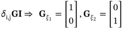

```math
<math display="block" overflow="scroll" xmlns="http://www.w3.org/1998/Math/MathML"> <msub> <mi>&#948;</mi> <mrow> <mi mathvariant="normal">i</mi> <mo>,</mo> <mi mathvariant="normal">j</mi> </mrow> </msub> <mi mathvariant="bold">GI</mi> <mo>&#8658;</mo> <mspace width="0.36em"/> <msub> <mi mathvariant="bold">G</mi> <msub> <mi>&#958;</mi> <mn>1</mn> </msub> </msub> <mo>=</mo> <mfenced open="\[" close="\]" separators=""><mtable> <mtr> <td> <mn>1</td> </mtr> <mtr> <td> <mn>0</td> </mtr> </mtable> </mfenced> <mo>,</mo> <msub> <mi mathvariant="bold">G</mi> <msub> <mi>&#958;</mi> <mn>2</mn> </msub> </msub> <mo>=</mo> <mfenced open="\[" close="\]" separators=""><mtable> <mtr> <td> <mn>0</td> </mtr> <mtr> <td> <mn>1</td> </mtr> </mtable> </mfenced> </mo> </math>
```

![Figure 3.12 Periodic RVE model [5].](images/c03f012.png)

**图 3.12** 周期性 RVE 模型 [[5]](#c03.xhtml#c03-bib-0005)。

周期性边界条件通过在相对边界上施加 `G` 场来实现，然后为每个 `G` 的情况计算温度向量。边界上的温度被设定为：


## 3.36


<math display="block" overflow="scroll" xmlns="http://www.w3.org/1998/Math/MathML">
  <mi mathvariant="bold">T</mi>
  <mfenced open="(" close=")" separators="">
    <msubsup>
      <mi mathvariant="bold">x</mi>
      <mi>m</mi>
      <mrow>
        <mi>&#958;</mi>
        <mi mathvariant="normal">L</mi>
        <mo stretchy="false">/</mo>
        <mi mathvariant="normal">U</mi>
      </mrow>
    </msubsup>
  </mfenced>
  <mo>&#8722;</mo>
  <mi mathvariant="bold">T</mi>
  <mfenced open="(" close=")" separators="">
    <msubsup>
      <mi mathvariant="bold">x</mi>
      <mi>m</mi>
      <mrow>
        <mi>&#958;</mi>
        <mi mathvariant="normal">R</mi>
        <mo stretchy="false">/</mo>
        <mi mathvariant="normal">B</mi>
      </mrow>
    </msubsup>
  </mfenced>
  <mo>=</mo>
  <mi mathvariant="bold">G</mi>
  <mfenced open="(" close=")" separators="">
    <mrow>
      <msubsup>
        <mi mathvariant="bold">x</mi>
        <mi>m</mi>
        <mrow>
          <mi>&#958;</mi>
          <mi mathvariant="normal">L</mi>
          <mo stretchy="false">/</mo>
          <mi mathvariant="normal">U</mi>
        </mrow>
      </msubsup>
      <mo>&#8722;</mo>
      <msubsup>
        <mi mathvariant="bold">x</mi>
        <mi>m</mi>
        <mrow>
          <mi>&#958;</mi>
          <mi mathvariant="normal">R</mi>
          <mo stretchy="false">/</mo>
          <mi mathvariant="normal">B</mi>
        </mrow>
      </msubsup>
    </mrow>
  </mfenced>
</math>

在这里，对于公式 (3.35)，`G` 在二维情况下的表示如图 3.12 所示。

然后，均匀材料的热导率张量形式如下：

## 3.37

![**bold upper Lamda Superscript normal upper H Baseline equals StartFraction 1 Over StartAbsoluteValue normal upper Omega Subscript normal m Baseline EndAbsoluteValue EndFraction sigma-summation Underscript e equals 1 Overscript upper N Subscript normal m Endscripts integral Underscript normal upper Omega Subscript normal m Bascripts left-parenthesis bold upper I minus bold upper D T right-parenthesis) Superscript upper T bold upper Lamda left-parenthesis bold upper I minus bold upper D T right-parenthesis) d normal upper Omega Subscript normal m Baseline**](img/c03-math-0037.png)

<math display="block" overflow="scroll" xmlns="http://www.w3.org/1998/Math/MathML">
  <msup>
    <mi mathvariant="bold">&#923;</mi>
    <mi mathvariant="normal">H</mi>
  </msup>
  <mo>=</mo>
  <mfrac>
    <mn>1</mn>
    <mfenced open="|" close="|" separators="">
      <msub>
        <mi mathvariant="normal">&#937;</mi>
        <mi mathvariant="normal">m</mi>
      </msub>
    </mfenced>
  </mfrac>
  <munderover>
    <mo movablelimits="false">&#8721;</mo>
    <mrow>
      <mi>e</mi>
      <mo>=</mo>
      <mn>1</mn>
    </mrow>
    <mrow>
      <mi mathvariant="normal">N</mi>
      <mi mathvariant="normal">m</mi>
    </mrow>
  </munderover>
  <msub>
    <mo>&#8747;</mo>
    <mrow>
      <mi mathvariant="normal">&#937;</mi>
      <mi mathvariant="normal">m</mi>
    </mrow>
  </msub>
  <mrow>
    <msup>
      <mfenced open="(" close=")" separators="">
        <mrow>
          <mi mathvariant="bold">I</mi>
          <mo>&#8722;</mo>
          <mi mathvariant="bold">D</mi>
          <mi mathvariant="bold">T</mi>
        </mrow>
      </mfenced>
      <mi mathvariant="normal">T</mi>
    </msup>
    <mi mathvariant="bold">&#923;</mi>
    <mfenced open="(" close=")" separators="">
      <mrow>
        <mi mathvariant="bold">I</mi>
        <mo>&#8722;</mo>
        <mi mathvariant="bold">D</mi>
        <mi mathvariant="bold">T</mi>
      </mrow>
    </mfenced>
  </mrow>
  <mi>d</mi>
  <msub>
    <mi mathvariant="normal">&#937;</mi>
    <mi mathvariant="normal">m</mi>
  </msub>
</math>

除了高效性外，工程优化还具有高度的适应性，能够整合多学科问题，使其适用于广泛的行业和设计挑战。无论是在航空航天、汽车、土木工程还是消费品领域，优化都可以进行定制以满足每个应用的特定需求。例如，在对减重有至关重要要求的航空航天行业中，优化被广泛用于设计符合严苛性能和安全标准的轻量化组件。同样，在汽车行业中，优化帮助工程师设计既轻量又耐用的部件，从而提高燃油效率和车辆性能。在土木工程中，结构优化被应用于桥梁、建筑和其他基础设施项目的设计中，确保这些结构既安全又具有成本效益。

## 计算仿真与数学建模

支撑结构优化的计算仿真原理基于物理现象的数学建模。

物理现象的分析通常涉及离散化方法，将现象区域划分为较小的、半规则的表示。根据所选的数值方法、可用的计算能力以及问题的特定物理特性，这些较小的部分可以同时求解，也可以逐个集群求解。常见的离散化方法包括有限差分法、有限元法、边界元法和有限体积法。

此外，人们曾尝试利用无网方法，尽管这些方法面临着巨大的挑战。由于机器学习与传统的离散化方法在数学上有相似之处，也进入了仿真和分析领域。例如，神经网络在结构上与求解偏微分方程（`PDEs`）的数值方法相似，并被用于有效解决此类问题。

需要注意的是，目前使用的许多拓扑离散化技术其起源可以追溯到物理和数学问题的数学离散化方法，例如级数展开。这些基础方法塑造了现代建模和解决复杂现象方法的发展。

## 有限元法 (FEA)

在书中，用于仿真和执行优化的方法是有限元法。有限元分析（`FEA`）是工程数值技术的支柱之一，通过将复杂结构离散化为由相互连接的小单元组成的网格，能够对其进行详细检查。这些单元中的每一个都是一个局部区域，在其中求解控制物理现象（如变形、应力和应变）的数学方程。通过这一过程，`FEA` 能够成功提供整个结构对各种外部场和边界响应的全面仿真，让工程师深入理解各种场景下的结构行为。

## 优化过程

优化过程始于使用代表所考虑产品或结构的有限元模型进行有效方法。该模型是详细的数字表示，封装了定义设计本质的所有关键几何特征和材料属性。下一步是阐述目标函数，这是一种量化设计目标的数学表达式，例如最小化质量、最大化刚度或增强耐用性。与此同时，工程师定义了约束，以确保优化符合基本要求，这些要求可能包括安全系数、材料限制或制造性约束。

一旦建立了有限元模型、目标函数和约束，优化过程就会通过迭代循环展开。在这一阶段，会系统地调整各种设计参数——例如尺寸、材料分布或几何配置。在每次调整之后，有限元模型都会经过重新分析，以确定这些变化对整体性能指标的影响。优化算法与有限元求解器协同工作，勤奋地寻找最佳设计变量集，在满足指定目标的同时满足所有设定的约束。这种迭代改进将持续进行，直到实现最优的设计配置，即在竞争性标准之间提供最好的平衡。

## 优化算法

优化算法的选择是多样化的，每种类型都为解决不同类设计问题而定制。最常用的算法包括基于梯度的方法、元启发式算法和生物启发方法。基于梯度的方法非常适用于具有平滑、连续设计空间特征的优化问题。这些算法利用目标函数相对于设计变量的梯度，能够高效地在设计空间中导航以寻找最优解。然而，它们在设计空间良好且缺乏显著不连续性或局部极值的场景下最有效。

元启发式算法在某些方面擅长处理复杂的设计空间，这些空间可能是离散的、高度非线性或充满局部最优的。例如，遗传算法基于候选解群体，通过类似于变异、交叉和选择的过程迭代地演化它们。这种随机方法使遗传算法能够探索更广泛的设计空间，使其对于具有离散设计变量或复杂、崎岖解景观的问题特别有用。然而，大多数元启发式算法需要仔细调优参数以匹配正在优化的数学函数。此外，这些算法的计算成本可能很高，可能会限制它们在某些应用中的效率。

这些优化算法与 `FEA` 的集成使工程师能够以精确和高效应对广泛的设计挑战。

## 高级应用与战略决策

此外，`FEA` 与优化之间的协同效应超越了传统的物理问题，涵盖了先进材料和创新制造技术。例如，在增材制造领域，优化算法被用于设计既轻量又坚固的晶格结构，为三维（`3D`）打印技术的独特能力定制。

工程优化在解决多目标问题时特别有利，在这种问题中设计标准往往冲突。例如，在航空航天领域，工程师可能寻求减少飞机的重量和阻力以提高燃油效率。然而，这些目标可能相互矛盾，需要仔细的平衡。结构优化擅长处理这些复杂的权衡，能够识别帕累托最优解——即在竞争目标之间代表最佳折中的设计。这种探索和平衡多种设计可能的能力是一个巨大的优势，允许工程师对最终设计配置做出明智的战略性决策。

除了在实现轻量化结构方面的应用外，结构优化在制造过程中也起着至关重要的作用。虽然轻量化设计具有优势，但由于复杂的几何形状以及对特殊材料技术的需求，它们也带来了制造挑战。工程优化通过弥合设计与制造之间的差距，确保优化后的设计不仅高效、轻量，而且具有可制造性。工程师可以将制造约束——例如材料厚度限制、可注性考虑或特定的组装方法——直接集成到优化过程中。通过这种方式，他们降低了生成理论上最优但在实际中可能不可行或生产成本过高的设计的风险。

优化还极大地增强了虚拟原型设计的实践，而这已成为现代产品开发不可或缺的一部分。传统上，产品开发涉及创建物理原型进行测试和验证——这一过程既耗时又昂贵。然而，优化允许创建虚拟原型，并对其进行一系列全面的模拟测试，包括结构、热学和流体动力学分析。优化引导的虚拟原型提供了对设计在各种场景下性能的详细理解，使工程师能够在任何物理原型制造之前做出明智的调整。这种方法不仅节约资源，还显著加速了产品开发周期，缩短了产品上市时间。

在我们进一步探索时，会在工程优化（尤其是结构优化）领域遇到参数化和非参数化方法。参数化优化依赖特定的设计参数和数学模型来完善给定的设计，允许控制优化过程并根据这些参数获得设计。相比之下，非参数化优化采用更通用的方法，可以适应更广泛的设计变量，使得设计区域中的所有离散元素都能纳入优化考虑。每种方法都提供了独特的优势，并适用于不同类型的优化问题。接下来的章节将讨论这些方法论。

## 4.2 参数化优化

参数化优化是一种数学方法，通过在预定义的范围内改变一个或多个参数，根据特定目标使系统或结构达到最佳性能。在工程中，这种技术被广泛应用于增强设计的效率、强度或功能。参数可能包括几何尺寸、材料属性、边界条件或负载配置。例如，在结构优化中，可以调整梁厚度、截面面积或材料密度等参数，以在最小化重量的同时最大化机械强度或刚度。优化问题通常由目标函数定义（例如最小化应力或最大化热导率），并受到允许变形或制造限制等约束的限制。通过系统地分析参数变化如何影响性能，工程师可以识别平衡竞争需求（如成本、耐用性和功能）的最优配置。

参数化优化涉及寻找参数 `p = {p[1], p[2],…, p[n]}` 的最优值，以最小化或最大化目标函数 `f(p)`，并满足约束 `gi ≤ 0` 和 `hi = 0`。在数学上，这可以表示为：

```
(4.1)![StartLayout 1st Row 1st Column extrema Underscript bold p Endscripts f left-parenthesis bold p right-parenthesis 2nd Column Blank 2nd Row 1st Column subjected to colon 2nd Column g Subscript i Baseline left-parenthesis bold p right-parenthesis less-than-equal 0 and hi = 0]
```

图 4.1 中的挠度函数行为显示，厚度在 [0.01, 0.1] 范围内具有凸性。这种凸性表明，旨在最小化挠度的优化过程将在该指定边界内实现唯一的全局最小值。最佳结果在厚度为 0.1m 时获得。鉴于挠度函数在指定边界内具有凸性，直接实施优化技术以获得最佳结果是可行的，而无需对整个函数进行重复评估和广泛的绘图。这种优化的的一种有效方法是拉格朗日法，它将约束引入目标函数中 [4, 5]。通过引入拉格朗日乘子，可以对优化问题进行重构，以寻找拉格朗日函数的驻点，从而确保在满足任何既定约束的同时获得全局最小值。这种方法显著提升了优化过程中的计算效率和精度。使用这段 Python 代码，我们实现了优化，结果展示在图 4.2 中。

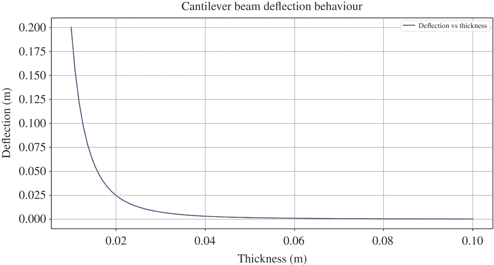

图 4.1 恒载荷下悬臂梁厚度与挠度的关系。

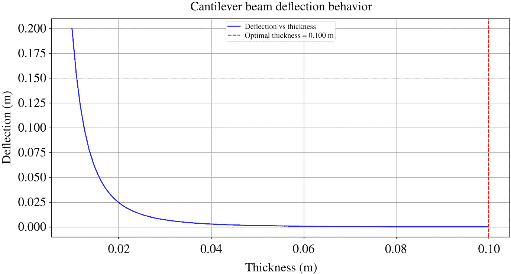

图 4.2 优化悬臂梁挠度：寻找最小变形的理想厚度。

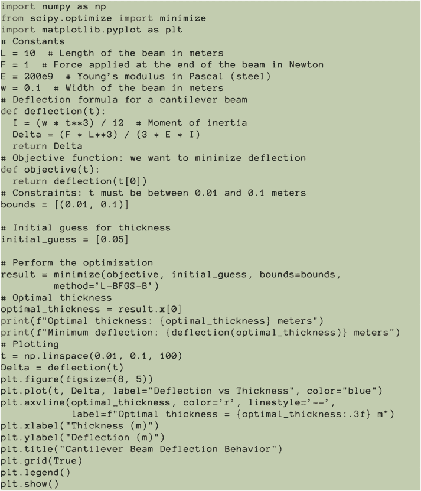

## 4.3 非参数优化

非参数优化代表了当代结构和多物理场设计中不可或缺的维度，驱动了优化配置的演变，使其能够满足严格的性能标准，同时有效应对现实约束带来的多方面挑战。与传统的参数化方法不同，非参数优化侧重于利用离散化方法对结构几何和拓扑进行复杂的处理。这种范式转变通过两种主要方法体现：形状优化和拓扑优化。形状优化重点在于通过更新边界形状上的元素来满足设计问题，同时保持内部材料分布不变。

另一方面，拓扑优化处理设计区域内的整个单元。非参数优化的变革潜力在于它脱离了显式参数化。与依赖预定义设计参数的传统方法不同，非参数优化利用结构的内在几何和拓扑作为优化过程的主要动力。这种方法赋予了设计流动性和适应性，与现实场景的复杂性产生共鸣，通常产生超越参数方法能力的解决方案。

为了促进这种优化，使用有限元法等数值方法对设计区域进行离散化。离散化将连续结构转换为由许多单元散散形式，每个单元关联一个设计变量。这些设计变量代表每个单元内的材料密度或是否存在，有效地决定了特定区域内应该保留、减少还是消除材料。拓扑优化过程的迭代性质涉及在目标函数和约束的指导下，在每个迭代步骤更新这些设计变量。

拓扑优化的关键方面是其处理复杂工程挑战的能力，例如最大化结构刚度、最小化重量或优化热导率。目标函数根据感兴趣的特定性能标准定义，优化算法寻求寻找最佳材料分布，以便在遵守最大允许应力、位移或体分数约束的同时，使该目标取极。

例如，在热最大化问题中，目标函数可能是最大化结构的热导率，并受到材料使用和几何边界的约束。对设计区域进行离散化，拓扑优化算法迭代调整材料分布，以识别实现所需热性能的最优配置。产生的设计可能表现出复杂且非直觉的拓扑，反映了热导率与材料分布之间复杂的相互作用（如图 4.3

图 4.3 热最大化问题的拓扑优化设计过程 [6 / 经 Elsevier 许可。


## 从历史上看，拓扑优化起源于 J.Maxwell 引入的一个概念框架

他根据能量原理将结构离散化为微小段的区域，奠定了基础性思想。这种离散化方法可能不被认为是新鲜，因为那个时代见证了利用级数求解工程问题的重大进展。然而，麦克斯的开创性工作为变分原理开启了大门，为有限元和有限体积法等广泛使用的计算方法的发展奠定了基础。此外，这种离散化方法（后来被称为麦克斯引理）吸引了数学家和工程师的兴趣，促使其应用于复杂结构的优化中，而这些结构如果使用级数求解将需要花费大量时间。直到 A.G.M. Michell 做出了突破性贡献，该领域才经历了显著进展。Michell 的开创工作为将数学优化原理应用于结构体系设计建立了一种实用的方法，有效地弥补了理论概念与实际工程应用之间的鸿沟。他的方法提供了一种系统且可量化的手段，用于确定最高效的结构布局，在最大化性能的同时减少材料使用。Michell 的创新技术催化了进一步的研究，导致了拓扑优化方法的演变和完善。这些进展以后被整合到广泛的工程和设计学科中，产生了高效且优化的结构系统。Michell 的基础性工作启发了无数后续研究，每项研究都对拓扑优化的扩展和增强做出了贡献，巩固了其作为现代工程设计关键工具的地位 [9–12](#c04.xhtml#c04-bib-0012)。

## 现代拓扑化的出现从根本上受到均匀化技术整合的影响

这促进了先进数学概念与现代计算方法的融合。这种整合以离散连续最优性准则方法的发展 [13] 为代表，该方法随后为惩罚性同性材料（SIMP）方法奠定了基础。SIMP 方法已显著应用于热性能最大化，正如 Joo 等人 [14] 的研究所示。他们的调查侧重于使用 SIMP 方法优化散热器设计，通过引入代理模型来增强优化效率，从而解决了局部极值的问题。

相比之下，Koga 等人 [15] 采用了一种传统的散热器设计方法，专注于金属块内部的通道配置。他们的方法利用稳态流目标函数并结合斯托克斯流原理来优化内部结构，从而为传统的散热器设计方法提供了一种创新的选择。

他们的研究采用 SIMP 方法，同时考虑了稳态传导和侧面的对流换热，从而提出了一种热管理的整体方法。这一系列研究强调了拓扑优化技术在开发高效且复杂的热管理解决方案方面的不断完善和应用。

## 4.4 多物理场拓扑优化基础

拓扑优化与传统的参数化优化方法在概念上具有共同的基础。优化的本质涉及在数学化的问题中寻找极值，该问题包含了变量、约束和目标函数。变量决定了目标函数的结构、优化技术的选择以及所适用的任何约束。当约束被优化框架中时，它们界定了可行解空间，引导优化过程走向可行解。目标函数（假设在设计空间上表现出平滑行为）接受极值搜索过程。

在优化中，目标是使用各种搜索算法探索由目标函数定义的设计空间，以找到函数关于设计变量的极值。这些设计变量对于构建目标函数至关重要，因此直接影响优化结果。

相比之下，非参数优化方法（如拓扑优化）采用离散化表示，减轻了目标函数的变化对设计拓扑灵活性的影响。这是由于拓扑在目标函数中的表示具有隐含性，允许进行更广泛的设计更改，而不会显著限制解空间的拓扑自由度。

这里使用两个独立的设计变量来表征宏观（`x[M]`）和微观尺度（`x[m]`）。当设计变量满足以下条件时，目标函数的极值被认为是全局的：

(4.4)
```
f(x_M^*, x_m^*) < f(x_M, x_m), {x_M^*, x_m^*} ≠ {x_M, x_m}, ∀ {x_M, x_m}, xM, xm ∈ R
```

当强局部极值位于 `N(x_M^*)` 所在的邻域区域时，这一观察广泛适用于各种函数；然而，研究人员在使用这一假设之前，必须彻底评估设计空间内的函数行为。

目标函数通常会经过重大修改以获得理想的极值。此外，目标函数的凸性是决定最优解的关键因素，这通过敏感性分析得到了进一步阐明。较大的凸性通常会增加识别全局极值的概率。

凸性可以表述如下：考虑一个集合，其中目标函数包络内任意两点之间的距离定义为：

(4.5)
```
L = {(x_M, x_m) | (x_M, x_m) = (x_M^a, x_m^a) + λ((x_M^a, x_m^a) - (x_M^b, x_m^b)), λ ∈ R}
```
函数 `f` 是凸的，使得：

(4.6)
```
f(λ + (1 - λ)(x_M^a, x_m^a)) ≤ λ f(x_M^b, x_m^b) + (1 - λ) f(x_M^a, x_m^a)
```

这在最小化的背景下通过图 4.4 进行了图形说明。n 维设计空间中的全局最小值表述如下：

(4.7)
```
f(x) ≥ f(x^*), ∀ x ∈ R^n
```

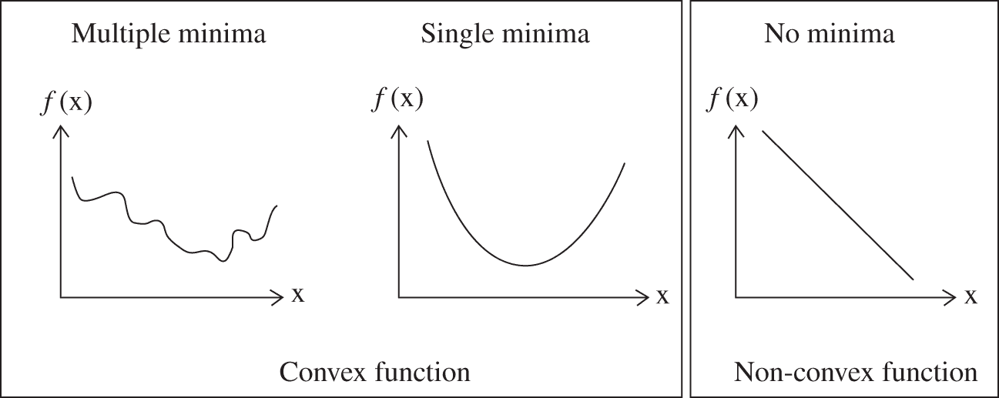

最优性平滑性对于实现有效的敏感性分析和稳健解至关重要，这可以通过在平滑数学框架内对问题进行近似来实现。这种近似被广泛应用于工程建模。寻找全局极值具有巨大的困难，因为函数的轨迹往往受到局部极值的限制（如多个最小值情况所示，参见图 4.4）。例如，在极小化问题中，目标是找到全局最小值，如图 4.5 所示，但强局部极值的存在增加了收敛到局部最小值的概率。为了解决这个问题，使用了作为实用近似技术的随机多启动法，通过探索解空间的不同区域，来增加找到全局最小值的概率。因此，最小值通常在“充分的尝试”后获得，尝试次数与函数的凸性成正比。

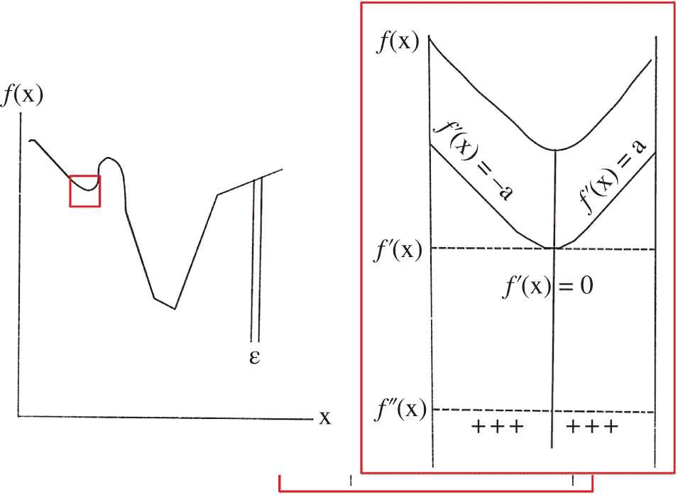

考虑这样一个集合，其中鞍点[[16]](#c04.xhtml#c04-bib-0016)中任意两点之间的距离为


## 4.8

在二阶导分平滑的假设下（`f(x) ∈ ℝ²`），沿直线的单变量函数（`F(Δ)`）

```
x̄^{a,b} = x(Δ) = x' + Δu
```

是

## 4.9

```
F(Δ) = f(x(Δ)) = f(x' + Δu)
```

一阶导数为

## 4.10

```
dF(Δ)/dΔ = df(x(Δ))/dΔ |_u = ∇^T f(x(Δ)) u
```

而二阶导数为

## 4.11

```
d²F(Δ)/dΔ² = ∇^T f(x(Δ)) u = u^T H(x(Δ)) u
```

在这里，`H(x(Δ))` 广为人知的 Hessian 矩阵（Hessian matrix）。如果海森矩阵在所选测试集内的所有点上都是正定的，且函数的梯度为零，则该点被确定为强类型的局部最小值。海森矩阵在识别极值方面起重要作用；然而，由于所需的计算量增加，它的使用会显著影响计算效率。因此，本研究避免使用二阶导数以降低计算成本。为了找到函数的极值，通常采用直接搜索算法，从一个具有估计强凸性的初始点开始。极值问题的最优一般标准可以表示如下：

## 4.12

```
Extremum F(δ) = f(x^{i-1} + δ u^i)
||x^i - x^{i-1}|| < ε₁
||∇f(x^i)|| < ε₂
|f(x^i) - f(x^{i-1})| < ε₃
```

其中 `ε₁, ε₂, ε₃` 大于零。

为了确保鲁棒性，通常采用约束条件来界定搜索区域。这些约束无论是通过等式条件还是不等式条件定义的，对于将设计限制在“可行空间”内至关重要。在特定约束下优化函数需要实现所谓的可行性。通过应用惩罚函数将问题重构为无约束框架，可以有效管理对极值的约束。


(4.13)![StartLayout 1st Row 1st Column Extremum 2nd Column f left-parenthesis delta right-parenthesis 2nd Row 1st Column normal period normal period 2nd Column g left-parenthesis right-parenthesis EndLayout] right-brace arrow Extremum upper P left-parenthesis right-parenthesis equals f plus sigma summation beta squared](images/c04-math-0013.png)<math display="block" overflow="scroll" xmlns="http://www.w3.org/1998/Math/MathML"> <mfenced open="" close}" separators=""><mtable> <mtr> <td> <mtext>Extremum</mtext> <mspace width="0.06em"/> </td> <td> <mi>f</mi> <mfenced open="(" close=")" separators=""><mi mathvariant="bold">x</mi> </mfenced></td> </mtr> <mtr> <td> <mi mathvariant="normal">s</mi> <mo>.</mo> <mi mathvariant="normal">t</mi> <mo>.</mo> <mspace width="0.01em"/> </td> <td> <mi>g</mi> <mfenced open="(" close=")" separators=""><mi mathvariant="bold">x</mi> </mfenced></td> </mtr> </mtable> </mfenced> <mo>&#8594;</mo> <mtext>Extremum</mtext> <mspace width="0.2em"/> <mi>P</mi> <mfenced open="(" close=")" separators=""><mi mathvariant="bold">x</mi> </mfenced> <mo>=</mo> <mi>f</mi> <mfenced open="(" close=")" separators=""><mi mathvariant="bold">x</mi> </mfenced> <mo form="postfix">+</mo> <mo>&#8721;</mo> <mi>&#946;</mi> <msup> <mi>g</mi> <mn>2</mn> </msup> <mfenced open="(" close=")" separators=""><mi mathvariant="bold">x</mi> </mfenced> </math>

惩罚参数 `β` 在优化过程中起至关重要的作用。选择合适的惩罚参数对于问题的构建至关重要。此外，拉格朗日函数是处理约束问题的有效方法，通过引入拉格朗日乘子（标记为 `(ℓ)`）来实现。

### 4.14 优化问题建模

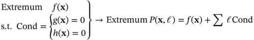

```math
Extremum f(x)
s.t. Cond = {g(x) = 0, h(x) = 0} -> Extremum P(x, λ) = f(x) + λ·Cond
```

约束类型在求解优化问题时起着重要作用。通常情况下，约束被分为：等式约束 `g(x) = 0` 和非等式约束 `g(x) < 0`。在本工作中，采用带有等式约束的拉格朗日法作为更新设计变量的主要方法。使用搜索拉格朗日进行优化速度非常快，但搜索速度会随着问题分辨率的增加（即宏观设计域 `Ω[dM]` 和微观设计域 `Ω[dm]` 中单元数量增加）而下降。

存在多种技术可以通过根据统计量自适应调整搜索步长来加速过程，尽管这超出了本文的讨论范围。此外，元启发式方法 `[17]` 不需要敏感性分析。然而，对于拓扑优化而言，元启发式方法的成本极高，使其不适用于多尺度拓扑优化。

通常，多目标问题会产生多个解。处理特定的多目标函数通常需要帕累托最优（Pareto optimality）条件。理想情况下，人们可能会识别出一个主导解，其定义为在至少一个目标函数上优于所有其他解，同时在其他目标上至少不劣于其他解。当一个解满足这些标准时，它被称为帕累托最优解。多目标优化的通用公式如等 (15) 所示。


```math
find Extremum x ∈ A
f*(x) = {f1(x), f2(x), ..., fn(x)}
A = {x | gi(x) ≤ 0, i = 1, 2, ..., k}
```

其中 `f*(x)` 是第 $n^{th}$ 个子函数的多目标函数，设计变量 `x` 在可行区域 (A ⊂ ℝ) 内进行搜索。可行性受适当约束 `gi` 的限制。

多目标优化中的一种流行方法是将问题重新表述为单个目标函数的求和。在本研究中，多目标问题被简化为单一复合函数，代表各种目标的加权和。该求和的权重在优化过程之前已预先确定。

(4.16)!!(images/c04-math-0016.png)

```math
f_bar = ∑_{i=1}^{2} w_i·f_i
```

解的适应度和优先级由分配给目标函数的权重 `w[i]` 决定。权重越高意味着与其他权重较小的目标函数相比，该目标函数重要性越大，如图 4.6 所示。

在实际场景中，为所有目标函数实现可行的设计变量可能并不可行。这种局限性意味着代表多目标优化中非支配解集的帕累托前沿（Pareto front）可能在所有目标上无法准确表示。因此，得到的解可能无法满足适当帕累托最优解的标准。为了解决这个问题，务必首先对什么是适当帕累托最优解建立清晰的定义。适当帕累托前沿包含解 `x`，对于每个子目标函数 `f[i]`，至少存在一个 `f[j]`，使得：

(4.17)![f Subscript j Baseline left-parenthesis bold x right-parenthesis less-than f Subscript j Baseline left-parenthesis bold x Superscript Baseline-parenthesis italic and comma, StartFraction f Subscript i-parenthesis bold x Superscript Baseline-parenthesis minus f Subscript i-parenthesis bold x right-parenthesis Over f Subscript j-parenthesis left-parenthesis bold x right-parenthesis minus f Subscript j Baseline left-parenthesis bold x Superscript Baseline-parenthesis EndFraction less-than-or-equal-to upper M](img/c04-math-0017.png)<math display="block" overflow="scroll" xmlns="http://www.w3.org/1998/Math/MathML"> <msub> <mi>f</mi> <mi>j</mi> </msub> <mfenced open="(" close=")" separators=""><mi mathvariant="bold">x</mi> </mfenced> <mo>&#60;</mo> <msub> <mi>f</mi> <mi>j</mi> </msub> <mfenced open="(" close=")" separators=""><msup> <mi mathvariant="bold">x</mi> <mo>&#42;</mo> </msup> </mfenced> <mspace width="0.36em"/> <mtext mathvariant="italic">and</mtext> <mo>,</mo> <mspace width="0.36em"/> <mfrac> <mrow> <msub> <mi>f</mi> <mi>i</mi> </msub> <mfenced open="(" close=")" separators=""><msup> <mi mathvariant="bold">x</mi> <mo>&#42;</mo> </msup> </mfenced> <mo>&#8722;</mo> <msub> <mi>f</mi> <mi>i</mi> </msub> <mfenced open="(" close=")" separators=""><mi mathvariant="bold">x</mi> </mfenced> </mrow> <mrow> <msub> <mi>f</mi> <mi>j</mi> </msub> <mfenced open="(" close=")" separators=""><mi mathvariant="bold">x</mi> </mfenced> <mo>&#8722;</mo> <msub> <mi>f</mi> <mi>j</mi> </msub> <mfenced open="(" close=")" separators=""><msup> <mi mathvariant="bold">x</mi> <mo>&#42;</mo> </msup> </mfenced> </mrow> </mfrac> <mo>&#8804;</mo> <mi>M</mi> </math>

其中 `M` 是一个大于 0 的标量。为了在多目标优化中有效获得最优折中，采用了各种修改技术对问题进行重建模。在这些技术中，归一化（normalization）被认为是一种特别可靠的方法。该技术确保没有单一目标函数会因为其初始尺度或值而主导优化过程。在本研究中，我们利用目标规划法（goal programming method），该方法寻求使解向量与每个目标函数的理想值之间的偏差最小化。目标规划法识别帕累托前沿上最符合指定权重标准的解。该前沿上最接近理想或乌托邦解的膝点（knee point）被认为是最优的。目标规划法的归一化过程表示如下：

(4.18)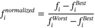<math display="block" overflow="scroll" xmlns="http://www.w3.org/1998/Math/MathML"> <msubsup> <mi>f</mi> <mi>i</mi> <mtext mathvariant="italic">normalized</mtext> </msubsup> <mo>=</mo> <mfrac> <mrow> <msub> <mi>f</mi> <mi>i</mi> </msub> <mo>&#8722;</mo> <msubsup> <mi>f</mi> <mi>i</mi> <mtext mathvariant="italic">Best</mtext> </msubsup> </mrow> <mrow> <msubsup> <mi>f</mi> <mi>i</mi> <mtext mathvariant="italic">Worst</mtext> </msubsup> <mo>&#8722;</mo> <msubsup> <mi>f</mi> <mi>i</mi> <mtext mathvariant="italic">Best</mtext> </msubsup> </mrow> </mfrac> </math>

其中 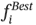<math display="inline" overflow="scroll" xmlns="http://www.w3.org/1998/Math/MathML"><msubsup><mi>f</mi><mi>i</mi><mi>Best</mi></msubsup></math> 和 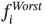<math display="inline" overflow="scroll" xmlns="http://www.w3.org/1998/Math/MathML"><msubsup><mi>f</mi><mi>i</mi><mi>Worst</mi></msubsup></math> 为每个目标函数计算的


## 4.5 拓扑优化方法

拓扑优化近年来取得了显著进展，并在 CAD 和增材制造技术的推动下仍然充满活力的领域。文献中提出了多种拓扑优化方法，其中 SIMP 方法、进化结构优化（ESO）方法和元启发结构分布（MSB）方法最受讨论。本文将详细探讨这些方法。

### 4.5.1 惩罚固体同性材料方法 (SIMP)

拓扑优化的 SIMP 方法涉及将设计域离散化以识别平滑结构。该方法源于均匀化理论 [1]，假设材料由密度场组成，称为伪密度。为了强制设计域二值化（即确定给定位置是否存在材料），必须对这些伪密度进行惩罚。因此，材料属性根据惩罚密度进行插值。优化问题随后表述为最大化或最小化目标函数，该函数通过插值方案包含密度场，并关于密度场的设计变量，如公式 (4.19) 所示。

(4.19)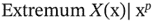<math display="block" overflow="scroll" xmlns="http://www.w3.org/1998/Math/MathML"> <mtext>Extremum</mtext> <mspace width="0.24em"/> <mfenced open="" close="|" separators=""><mrow> <mi>X</mi> <mfenced open="(" close=""><mi mathvariant="normal">x</mi> </mfenced> </mrow> </mfenced> <mspace width="0.2em"/> <msup> <mi mathvariant="normal">x</mi> <mi>p</mi> </msup> </math>

其中 `X(x)|` 是代价函数，而 `x` 是代表 SIMP 伪同性密度的设计变量。

为了解决这个问题，采用了松弛原理（relaxation principle）。该原理涉及调整密度函数以引入所谓的“灰色区域”，从而减轻零密度元素的出现，并提高解的稳健性（`x ∈ (0, 1]`）。通常采用具有适当约束的启发式算法来应对拓扑优化面临的挑战，特别是缓解棋盘效应（checkerboarding）等问题。棋盘效应是离散化的结果，并且与用于识别最优解的启发式方法本质相关。当设计单元被限制为二值状态（即完全存在或完全缺失）时，会出现该问题，导致有限元网格上的敏感度变化不连续。因此，由于离散化过程，单元存在的微小变化可能导致目标函数值的剧变。

棋盘效应在低阶有限元中尤为常见，粗的分辨率加剧了这个问题。虽然增加单元阶数（即每个单元节点数）可能会缓解棋盘效应，但会导致计算成本的大幅增加。另一种方法通过增加单元数量来提高设计区域的分辨率可以显著减少棋盘图案，但这会导致计算需求的相应提升。

为了更有效地解决这些问题，一种方法是实现敏感度过滤技术。通过独立网格的过滤方案对相邻单元（即目标单元附近的单元）的敏感度取平均值，提高了敏感度变化的连续性，从而减少棋盘效应的出现。这种方法有助于平衡解的精度与计算效率之间的关系。

### 4.5.2 演化结构优化方法

拓扑设计中的优化过程本质上受到设计变量初始配置的影响，这促进了二值化技术的采用。在这些方法中，设计区域最初被定义为二值（0 或 1），并在整个优化过程中保持更新，直到实现最终设计。这种策略与二值化拓扑优化方法的方法一致，例如 `ESO` 方法，该方法近年来受到了广泛关注 [19–21]。

`ESO` 基于二值化初始设计区域的原理运行，其中设计变量从一开始设置为二值状态。该方法利用了一种程序，逐步将周期结构中的中心单元值置零。这种方法有效地触发了反均匀化过程，根据性能准则系统地移除材料。`ESO` 的核心原则是实现材料与空隙之间的清晰界限，通过移除低效材料区域的同时保持整体结构完整性来优化结构。这种二值化过程提供了一种简单且计算高效的方法来获得优化结构设计 [22, 23]。

在这些特定条件下实施 `ESO` 会产生均匀的设计分布，同时降低局部极值的风险。`ESO` 通过逐步处理几乎整个设计区域并努力最小化体积以识别最优二值拓扑来实现这一点。

`ESO` 的基本原理围绕着直接消除“低效材料”，逐步将结构塑造为最优设计。`ESO` 由 Min 和 Steven 首次引入 [19]，利用代价函数的敏感度来引导设计变量的更新。这种方法根据其有效性系统地精炼材料分布，确保最终设计在性能和材料效率方面达到优化 [24]。更新取决于单元的敏感度值 `α[i*]`，如等式 `[(4.20)]`(#c04.xhtml#c04-disp-0020) 所示


(4.20) $\alpha_i = \begin{cases} dX_i & \text{for } x_i = 1 \\ 0 & \text{for } x_i = x_{\text{min}} \end{cases}$

本质上，`ESO` 专注于消除低敏感值的材料。这种方法仅限于移除材料，这意味着一旦丢弃就无法重新引入。因此，初始较大的设计区域对于确保最终设计包含所有配置至关重要。

为了解决这一局限性，开发了双向演化结构优化（`BESO`）方法 [25]。`BESO` 通过允许在设计区域内同时添加和移除材料增强了 `ESO` 的稳健性。这种双向方法提高了优化过程的整体灵活性，从而减少了收敛于局部极值的概率。

### 4.5.3 启发式结构二值分布方法

`MSB` 方法由 Al-Ali 等引入 [6]，旨在加速拓扑优化问题的解决同时降低局部极值的风险。这种方法将 `YUKI` 的混合启发式优化与梯度下降技术相结合。为了清晰起见，我们首先给出 `YUKI` 算法的简要概述，然后详细说明 `MSB` 方法的公式。

`YUKI` 算法是一种新型启发式优化方法，旨在以最少的计算量寻找最优解。它通过三个关键特征实现这一点。`YUKI` 优化算法的第一个特征是将给定迭代（`i`）中的最佳解作为后续迭代（`i` + 1）中寻找改进解的起点。

YUKI 算法引入了“最佳点”（`Best Points`）的概念，用于表示优化过程中的个人最优解。通过利用种群中所有点的集体智能，每个个体点都能有效地在搜索空间中导航并精炼其最优解。这种集体方法增强了全局搜索能力，使种群能够不断适应和改进。在每次迭代中，算法会对种群进行评估，并利用一个向量来监控与最优适应度准则相关的数值——例如当前语境下最小化热合规性。在整个迭代过程中积累的 `Best Points` 被用于确定一个单一的代表性点，称为“平均最佳点”（`MeanBest`）。该 `MeanBest` 点作为最优解簇的质心，其值计算为识别出的 `Best Points` 的平均值。这种方法确保了对最优解的平衡且准确的表示，从而提高了优化过程的效率。

YUKI 算法首先定义一个以目前发现的最优解为中心的局部搜索域。该搜索域的范围由该解与 `MeanBest` 点之间的距离决定。这种方法包含几个显著特性：

1. **自适应搜索域**：随着解向最优解演进，局部搜索域收缩，反映了搜索中收敛性和精炼度的提高。
2. **维持全局覆盖**：`Best Points` 之间的距离保持足够大，确保了全面的全局搜索覆盖，并降低了早收敛到局部最优的风险。
3. **动态调整**：搜索域的大小根据局部区域新最优解的发现动态调整，允许根据需要扩展搜索空间。
4. **持续更新**：在整个优化过程中，如果没有发现新的最优解，则会定期更新 `MeanBest`，这有助于生成不同尺寸的搜索域并保持搜索的动态性。
5. **变量敏感性**：算法的有效性取决于全局搜索空间的大小，而非单个设计变量。因此，局部搜索域的大小在不同维度上可能表现出显著差异，反映了每个变量的敏感性，并确保算法能够适应每个设计变量的独特特征。

局部边界通过以下表达式进行计算：

(4.21) $D = |\mathbf{x}_{\text{best}} - \mathbf{x}_{\text{MeanBest}}|$

(4.22) $LB = \mathbf{x}_{\text{best}} + D$

(4.23) $LT = \mathbf{x}_{\text{best}} - D$

其中 `x[best]` 代表与最优适应度相关的数值。`x[MeanBest]` 表示 `Best Points` 的平均值。`LT` 和 `LB` 分别指代局部的上下边界。

YUKI 算法的第二个特性是搜索空间（Ω）的划分。种群（即设计变量）被分为两个部分：一部分负责探索局部区域外的区域，而另一部分专注于在局部区域内进行搜索。每个部分的种群大小以线性方式调整。最初，算法将很大比例的人口用于探索，以便广泛设计空间。随着迭代进行，重心逐渐转向加强区域内的搜索。这种转换由概率机制控制：生成一个 0 到 1 之间的随机值，并与从特定表达式得到的阈值进行比较。这种比较决定了局部区域内探索与开发的平衡 [26]。

YUKI 算法的一个显著特征是其能够通过广泛探索对关注区域进行全面检查。最初，它在局部搜索域内生成随机分布的点。然后，利用这些点来探测超出局部搜索区域限制的潜在解。探索有策略性地引导向远离 `MeanBest` 的区域，而 `MeanBest` 是根据其位置定义的参考点，如公式 (4.25) 所示。这种方法确保了搜索的动态适应性，增加了发现最优解的概率。

(4.25) $E^i = x_{loc}^i - x_{best}^i$

其中 $x_{loc}^i$ 表示被引导向探索的所选点的位置，$x_{best}^i$ 是该点在优化过程中找到的最佳位置（即历史最优解）。该距离 $E^{(i)}$ 用于设置该特定点的探索范围范围。然后，通过以下方程计算新解：

(4.26) $x_{new}^i = x_{loc}^i + E^i$

对于未被选择进行探索的种群其余部分，它们将被送往搜索中心周围寻找。这可以通过方程表示：

(4.27) $F^i = x_{loc}^i + x_{best}$

(4.28) $x_{new}^i = x_{loc}^i - rand \times F^i$

在这里，所有的设计变量都使用相同的随机值 `rand`。$F^{(i)}$ 是从所选局部点到绝对最优解的距离。YUKI 算法的伪代码如下：

```
(images/c04-gra-003.png)
```

## 4.6 形状优化

形状优化是非参数优化的一个子集，侧重于修改设计的边界。与依赖变量的参数优化不同，形状优化直接更新几何形状，从而提供了更大的设计灵活性。该领域的关键方法包括水平集法、H¹ 梯度方法和相场法 (PFM)。这些方法将在接下来的小节中详细讨论。

### 4.6.1 水平集法

水平集法与 ESO 和 MSB 类似，采用二值化设计变量。该方法最初由 Dervieux 和 Thomasset [27] 用于研究多相流，其本质上是一种隐式表示形状的非参数技术。其公式化和应用最初是在流体界面背景下探索的 [28, 29]。“水平集”一词本身后来由 Osher 和 Sethian [30] 创造，他们为该方法引入了复杂的拓扑符号。

水平集法在计算机视觉领域的分割和物体形状识别中得到了广泛应用 [31]。最初受限于当时的计算能力限制，由于其隐式性和对资源的巨大需求，该方法的可行性受到限制。然而，计算能力的进步缓解了这些限制，使得该方法能够应用于计算密集型的问题。

随后的发展使得 Sethian 和 Wiegmann [32] 成功将水平集法用于应力最小化问题，标志着其向中等计算需求任务应用的重大转变，例如结构应变能量最小化 [33, 34]。这种演变强调了该方法在处理复杂优化挑战时的适应性和有效性。

在形状优化中，水平集提供了在水平集函数 `φ` 定义的区域内，决策变量 `x`（作为代价函数的一部分）变换的隐式表示。这种表示专门针对一个水平 `ℓ`，该函数在该处的符号为中性。高于此水平的值产生正号，而低于此水平的值则导致设计变量产生负号。

(4.29) $x \rightarrow X(x) = \{ x \in \partial\Omega \mid \phi(X(x)) = \ell \} \quad \forall x \in \mathbb{R}^2$

如图 4.7 所示，曲线轮廓的表示在水平集测量水平与函数面的相交处发生变化。

水平集方法为代价函数中的形状表示提供了一种变革性的方法，它将形状表示泛化，使得水平集上方下方特定点的扰动不对整体形状产生显著影响。这种稳健性解决了早期公式中固有的数值不稳定问题，特别是在水平集方法的抽象形式中，它在不依赖参数化双向更新或拓扑导数调节因子的情况下考虑了形状导数 [[35]](#c04.xhtml#c04-bib-0035)。

在利用水平集进行拓扑优化的背景下，问题通常被建模为单一材料-空隙场景。水平集表示通过符号距离函数有效捕获，其数学表达式如式 (4.30) 所示。

(4.30) $\phi(X) = \begin{cases} > \ell & X(x) \in \mathbb{R}^2, \forall x \in \Omega_{\text{material}} \\ = \ell & X(x) \in \mathbb{R}^2, \forall x \in \partial\Omega_{\text{material}} \\ < \ell & X(x) \in \mathbb{R}^2, \forall x \notin \Omega_{\text{material}} \end{cases}$


```<math display="block" overflow="scroll" xmlns="http://www.w3.org/1998/Math/MathML"> <mfenced open="{" close="" separators=""><mtable> <mtr> <mtd> <mi>&#966;</mi> <mfenced open="(" close=")" separators=""><mi>X</mi> </mfenced> <mo>&#62;</mo> <mi mathvariant="normal">&#8467;</mi> <mspace width="0.6em"/> <mi>X</mi> <mfenced open="(" close=")" separators=""><mi mathvariant="normal">x</mi> </mfenced> <mo>&#8712;</mo> <msup> <mi mathvariant="normal">&#8477;</mi> <mn>2</mn> </msup> <mo>,</mo> <mo>&#8704;</mo> <mi mathvariant="normal">x</mi> <mo>&#8712;</mo> <msub> <mi mathvariant="normal">&#937;</mi> <mtext mathvariant="italic">material</mtext> </msub> </mtd> </mtr> <mtr> <mtd> <mi>&#966;</mi> <mfenced open="(" close=")" separators=""><mi>X</mi> </mfenced> <mo>=</mo> <mi mathvariant="normal">&#8467;</mi> <mspace width="0.48em"/> <mi>X</mi> <mfenced open="(" close=")" separators=""><mi mathvariant="normal">x</mi> </mfenced> <mo>&#8712;</mo> <msup> <mi mathvariant="normal">&#8477;</mi> <mn>2</mn> </msup> <mo>,</mo> <mo>&#8704;</mo> <mi mathvariant="normal">x</mi> <mo>&#8712;</mo> <mi>&#8706;</mi> <msub> <mi mathvariant="normal">&#937;</mi> <mtext mathvariant="italic">material</mtext> </msub> </mtd> </mtr> <mtr> <mtd> <mi>&#966;</mi> <mfenced open="(" close=")" separators=""><mi>X</mi> </mfenced> <mo>&#60;</mo> <mi mathvariant="normal">&#8467;</mi> <mspace width="0.48em"/> <mi>X</mi> <mfenced open="(" close=")" separators=""><mi mathvariant="normal">x</mi> </mfenced> <mo>&#8712;</mo> <msup> <mi ...="normal">&#8477;</mi> <mn>2</mn> </msup> <mo>,</mo> <mo>&#8704;</mo> <mi mathvariant="normal">x</mi> <mo>&#8713;</mo> <msub> <mi mathvariant="normal">&#937;</mi> <mtext mathvariant="italic">material</mtext> </msub> </mtd> </mtr> </mtable> </mfenced> </math>
```

其中 `ℓ` 是函数进行评估的水平平面。在此处，函数与水平平面的相交边界是需要评估的边界。拓扑优化问题需要二值材料表示，材料部分为 1，空隙部分为 0。这种表示使得选择 `ℓ` 为 0 是容易的[[30]](#c04.xhtml#c04-bib-0030)。


**图 4.7** 边界表示。通常，基于水平集的拓扑优化并不直接作用于代价函数 `X`，而是关注 `φ`。由于 `φ` 表示一个面，从数学角度来看这会产生额外的代价。因此，水平集是以沿水平平面演化的形式构造的。

(4.31) 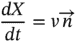

```<math display="block" overflow="scroll" xmlns="http://www.w3.org/1998/Math/MathML"> <mfrac> <mi mathvariant="italic">dX</mi> <mi mathvariant="italic">dt</mi> </mfrac> <mo>=</mo> <mi>v</mi> <mover accent="true"><mi>n</mi> <mo stretchy="true">&#8594;</mo> </mover> </math>
```

其中 `t` 是步进间隔，`v` 是速度，而 `n⃗` 是相对于水平集函数的单位梯度。

(4.32) 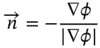

```<math display="block" overflow="scroll" xmlns="http://www.w3.org/1998/Math/MathML"> <mover accent="true"><mi>n</mi> <mo stretchy="true">&#8594;</mo> </mover> <mo>=</mo> <mo form="prefix">&#8722;</mo> <mfrac> <mrow> <mi>&#8711;</mi> <mi>&#966;</mi> </mrow> <mfenced open="|" close="|" separators=""><mrow> <mi>&#8711;</mi> <mi>&#966;</mi> </mrow> </mfenced> </mfrac> </math>
```

假设 `ℓ = 0`（零水平集）具有性质 `φ(X, t) = 0 ∀ t`；因此，`φ` 的全导数将消失，使得

(4.33) $\frac{d\phi}{dt}(X, t) = \nabla\phi \cdot \frac{dX}{dt} + \frac{\partial t}{\partial t} = 0$ (images/c04-math-0033.png)

考虑到方程 (4.31)和(4.32)，方程 (4.33)可以进行重组，得到：

(4.34) $\frac{\partial\phi}{\partial t} = v|\nabla\phi|$ (images/c04-math-0034.png)

执行优化过程是通过沿泛边界推进来评估水平集的敏感性，最终导出哈密顿-雅比方程（Hamilton–Jacobi equation）。随后使用优化方法（如前向欧拉格式）更新边界。该方法引入了海维德函数（Heaviside function），该函数在水平集函数为正或零时赋值为 1，在空区域赋值为 0。

(4.35) $H(\phi(X)) = \begin{cases} 1, & \phi \ge 0 \\ 0, & \phi < 0 \end{cases}$ (images/c04-math-0035.png)

海维德函数的导数，即狄拉克函数（Dirac function），为：

(4.36) $\delta(\phi(X)) = \frac{dH(\phi(X))}{d\phi}$ (images/c04-math-0036.png)

根据上述方程，对于 `X`，函数积分在水平集表化的设计区域上写如下：

(4.37) $\int_{\Omega} X(x)H(\phi(X))d\Omega$ (images/c04-math-0037.png)

为了处理演化方案，还需要函数 `X` 在设计区域边界上的积分，它可以用狄拉克δ函数轻松地定义为：

(4.38) $\int_{\Gamma} X(x)\delta(\phi(X))d\Gamma$ (images/c04-math-0038.png)

而函数相对于水平集的体积表示 `V` 形式为：

(4.39) $V = \int_{\Omega} H(\phi(x))d\Omega$ (images/c04-math-0039.png)

水平集法被引入作为一种避免依赖网格的问题的技术，例如棋盘格模式 36 和灰度伪影 37。然而，作为一种演化方法，函数参数依赖于具体问题。

H¹ 梯度法被用作形状优化技术，用于精化微观结构的细节形状。该方法最初由 Azegami 提出，用于解决边界值问题中的区域优化挑战 41，随后 Shimoda 等人通过通用有限元软件的数值分析对其进行了扩展 42。从那时起该方法已应用于各种结构，包括壳体框架和纤维取向 43, 44 问题。最近，H¹ 梯度法还被应用于多尺度结构的形状优化。例如，Fujioka 等人提出了一种微观结构形状优化方法，旨在在面积约束下，使由多孔材料组成的二维弹性体的宏观结构刚度最大化 45。此外，他们还开发了侧于通过形状优化增强结构强度的方法，专门用于设计高强度多孔结构 46。

### 4.6.3 相场法

相场法（PFM）已成为解决工程和设计中形状优化挑战的一种方法。PFM 最初用于模拟材料中的相变，现已应用于广泛领域，包括形状优化。在该方法中，设计的几何形状由连续相场变量 `φ(x)` ∈ [0, 1] 表示，该变量在不同相之间平滑过渡。通常，`φ(x) = 1` 表示材料包含，而 `φ(x) = 0` 表示周围的空隙，这些区域之间存在扩散界面。这种表示消除了显式边界跟踪的需求，简化了复杂几何和拓扑变化的建模。PFM 将问题构建为目标泛函 `J(φ, χ)` 的极小（或极大），其中 `χ` 代表受物理定律支配的状态变量。相场变量的演化由偏微分方程（PDE）控制，确保了边界平滑过渡并允许拓扑灵活性。目标泛函增加了基于 Ginzburg–Landau 能量的正则项，以保持数值稳定性并确保良态性 47–49](#c04.xhtml#c04-bib-0049)。

## 4.7 多孔结构设计

在过去的几十年里，多孔结构设计领域演化出了许多方法，以高效地实现满足特定要求的稳健解决方案。在增材制造进步之前，许多设计受到传统制造方法的限制，其中成本和可制造性是主要因素。这种设计自由度的缺乏严重阻碍了多孔结构的发展，而设计孔隙本身的概念通常被认为是不现实的。然而，3D 打印技术的出现改变了这一范式，为设计和制造提供了前所未有的自由度。因此，新的多孔结构设计方法运而生，能够实现更复杂且优化的解决方案。本节将探讨这些方法。

### 4.7.1 生物启发

受自然界（如松质骨）启发的多孔结构设计因其卓越的强度强度和力学性能而受到了广泛关注。这些结构通常表现出复杂的层级结构，难以通过传统制造方法复制。通过模仿这些生物模式，研究人员旨在设计既轻量又高弹性的多孔材料。

3D 打印的使用使得这些复杂的生物启发设计成为可能。计算机断扫描（CT）等技术允许对生物样本的内部结构进行详细成像，然后将其转换为数字模型。这些数字模型被用于 3D 打印以生产高保真的代表性多孔结构，允许探索新的设计空间和功能优化。

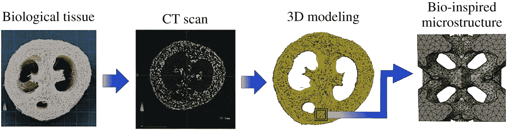

**图 4.8** 生物启发。

### 4.7.2 单尺度拓扑优化

单尺度拓扑优化是多孔结构设计中的一种强有力方法。与多尺度建模不同，后者依赖于不同长度尺度之间存在明显分离的假设，而单尺度优化的原理是在单个尺度内对材料分布进行优化。这种方法的基础是将设计区域离散化为有限尺寸的网格，其中网格的每个单元代表材料的一部分。随着网格分辨率的提高，生成的结构可以表现出复杂的、细尺度的特征，这些特征对于优化刚度和其他力学性能至关重要。

单尺度拓扑优化的过程涉及在设计区域内分配材料，以在指定的加载条件下实现最佳结构性能。通过迭代调整材料分布，优化算法寻求最小化或最大化目标函数（例如结构柔性），同时满足对材料体积或其他设计参数的约束条件。

#### 优势与关键因素

单尺度拓扑优化的主要优势之一是能够生成高度高效的结构设计，而无需深入研究多尺度建模的复杂性。随着网格分辨率变得精细，优化的结构可以自然演变并表现出多尺度特征。

将单尺度拓扑优化成功应用于多孔结构设计，需要对几个关键因素给予密切关注。其中，优化过程中采用的连续化技术起着至关重要的作用。连续化技术涉及逐渐变化优化算法中的特定参数，以引导搜索全局最优解。如果没有这些策略，算法很容易过早收敛到次优解，特别是在具有许多局部最优值特征的复杂设计空间中。

同样重要的是对设计区域内材料分布的局部控制。实现这种控制的两种主要策略是模式重复和局部体积约束。在模式重复策略中，设计区域被分为多个子区域。每个子区域都经过细化，以允许详细的材料分布，但布局被限制在所有子区域内保持一致。这种方法确保了整个结构中存在周期性模式，使其对于需要均匀性和规则性的应用（例如生物医学植入物和过滤设备）特别有利。

#### 局部控制策略与模板

对于需要梯度分布或可变材料分布的应用，可以将子区域分组，每组共享一种共同材料布局。这种方法能够创建沿某一轴表现出周期性模式的结构，同时允许材料沿另一轴线发生变化。这种灵活性对于设计必须在变化的负载条件或环境影响下运行最佳的结构至关重要。

这些局部控制策略的实现通常依赖于模板，模板建立了设计区域内子区域之间的联系。这些模板作为材料布局的参考，其中每个模板点的敏感度被计算为所有链接子区域中对应点的聚合敏感度。这种方法有效减少了优化问题的解空间，因为算法只需要确定单个子区域或一小组子区域的材料布局。尽管减少了这种空间，优化和分析仍然在全网格上进行，以确保最终结构在整个设计区域的分辨上经过优化。然而，拓扑优化所需的计算能力是极其昂贵的。

### 4.7.3 多尺度拓扑优化

用于设计多孔结构的多尺度拓扑优化代表了一种先进的轻量化工程结构，其特征是能够跨多个尺度优化材料分布，从而以较低的计算成本实现优越性能。这种优化过程在数学上具有内在复杂性，因为需要管理从宏观到微观（以及反之）不同尺度之间的相互作用，并且必须同时考虑材料行为和结构性能。挑战在于单元格的适当表示和优化，单元格是结构的基本构建块，通过其几何和材料特性决定了整体物理属性。

随着对单元格设计限制的增加，这些单元参数化的灵活性随之降低。在高度限制的方法中，单元格通过单个参数（如密度）进行参数化，这显著简化了优化过程，但也限制了可实现的结构性能。设计灵活性与计算效率之间的权衡是多尺度拓扑优化中的关键考虑因素。在这种情况下，优化过程通常涉及预定义的单元结构，使用同质化技术评估单元格的有效材料属性。同质化是多尺度建模中的一种强大工具，允许通过对代表性体积单元内的微观行为取平均来计算有效材料属性。这一过程在计算上是高效的，因为可以在实际优化之前离线完成，从而减少了设计过程中的计算负担。

在多尺度拓扑优化中使用预定义的单元格具有若干优势，特别是在增材制造的背景下，这些单元格可以直接转换为 3D 打印组件。此类结构的优化通常只需要对单尺度拓扑优化技术进行极小的调整，因为重复的单元格可以被视为在整个结构上进行分布优化的材料。这种方法对于设计具有均匀填充模式的组件特别有吸引力，这些组件通常用于航空航天和生物医学工程等行业。这种方法的简单性在于它能够减少优化问题的解空间（通常减至单维），从而有助于构建将简化参数映射到材料同质化属性的可微函数。

然而，使用预定义的单元格也带来了某些局限性，特别是在处理向异性材料时。大多数单尺度优化技术传统上是为等向性材料设计的，材料属性在所有方向上都是均匀的。相比之下，各异性材料表现出取决于方向的属性，这需要对 `FEA` 中使用的刚度矩阵进行修改。这些修改确保同质化弹性张量能够准确反映材料的向异性本质，从而保持优化结果的完整性。当向异性微观结构与局部主应力方向不对齐时，挑战更加复杂，这会导致次优性能和结构效率低下。

#### 高级多尺度拓扑优化方法

为了应对这些挑战，研究人员开发了先进的多尺度拓扑优化方法，使得单元单元参数化具有更大的灵活性。这些方法包括分层优化和并行优化方法，其中微结构通过多变量密度场表示。

在分层优化中，结构在不同尺度上顺序进行优化，微尺度优化的结果被输入到宏尺度设计中。这允许创建对全局和局部性能标准都优化的结构。另一方面，并行优化将结构视为一个统一整体，在所有尺度上同时进行优化。这种方法对计算的要求更高，但具有实现真正最优多尺度设计的潜力。

#### 单尺度拓扑优化

单尺度拓扑优化集中在单一均匀离散的尺度内（通常通过细化网格的设计区域）对微观结构的参数化方面（如材料分布）进行优化。虽然这种方法允许细粒度特征随着网格分辨率的增加而出现，但其局限性在于受限于需要平衡分辨率与计算成本之间的权衡。随着网格变得越来越细，优化所需的计算资源呈指数级增长，往往导致高昂的计算开销，特别是在处理多孔结构中同时发生在宏尺度和微尺度层面的复杂相互作用时。

#### 多尺度拓扑优化

相比之下，多尺度拓扑优化通过显式考虑尺度的分离提供了一种更精密的方法，从而同时在多个不同尺度上优化材料分布。这种方法在保持多孔结构设计高细节水平的同时，显著降低了计算成本。


通过采用均化技术和分层建模，多尺度优化有效地解耦了宏尺度和微尺度问题，允许在微尺度上高效计算有效材料属性，然后这些属性可以用于宏尺度优化。这不仅降低了问题的维度，还允许设计出在稳健的宏尺度框架内嵌入复杂微尺度孔隙的结构。

此外，多尺度优化在两个尺度上构建高度精细结构的能力，对于需要精确控制材料属性的应用具有特别的优势，例如生物医学植入物或先进过滤系统。该方法能够将细粒度特征无缝集成到全局结构中，而不会产生过度的计算需求，使其成为设计多孔材料的优越选择。虽然单尺度优化在计算资源充足时可能在生成详细结构方面表现出色，但总体而言，多尺度拓扑优化是更好的方法，特别是对于计算效率和跨尺度相互作用能力至关重要的大规模复杂设计。

## REFERENCES

1. Oulad Brahim, A., Capozucca, R., Khatir, S. et al. (2024). Optimal prediction for patch design using `YUKI-RANDOM-FOREST` in a cracked pipeline repaired with CFRP. *Arab. J. Sci. Eng.* 1–18.

2. Jakiela, M.J., Chapman, C., Duda, J. et al. (2000). Continuum structural topology design with genetic algorithms. *Comput. Methods Appl. Mech. Eng.* 186: 339–356.

3. Al Thobiani, F., Khatir, S., Benaissa, B. et al. (2022). A hybrid PSO and grey wolf optimization algorithm for static and dynamic crack identification. *Theor. Appl. Fract. Mech.* 118: 103213.

4. Shimoda, M., Hikasa, M., and Al Ali, M. (2023). Micropore shape optimization of porous laminated shell structures. *Addit. Manuf.* 69: 103530.

5. Torisaki, M., Shimoda, M., and Ali, M. (2024). AL micro shape optimization for minimizing microstructural thermal-stress Considering heat conduction. *Int. J. Mech. Sci.* 109268. `https://doi.org/10.1016/J.IJMECSCI.2024.109268`

6. Al Ali, M., Shimoda, M., Benaissa, B., and Kobayashi, M. (2023). Non-parametric optimization for lightweight and high heat conductive structures under convection using metaheuristic structure binary-distribution method. *Appl. Therm. Eng.* 233: 121124. `https://doi.org/10.1016/J.APPLTHERMALENG.2023.121124`

7. Maxwell, J.C. (1890). The Scientific Papers of James Clerk Maxwell, vol. 2 (ed. W.D. Niven). Cambridge University Press.

8. Michell, A.G.M. (1904). LVIII. The limits of economy of material in frame-structures. *London, Edinburgh, Dublin Philos Mag. J. Sci.* 8: 589–597. `https://doi.org/10.1080/14786440409463229`

9. Hegemier, G.A. and Prager, W. (1969). On Michell trusses. *Int. J. Mech. Sci.* 11: 209–215. `https://doi.org/10.1016/0020-7403(69)9006-X`

10. Charrett, D.E. and Rozvany, G.I.N. (1972). Extensions of the Prager-shield theory of optimal design. *Int. J. Non. Linear. Mech.* 7: 51–64. `https://doi.org/10.1016/0020-7462(72)9021-2`

11. Rozvany, G.I.N. and Prager, W. (1976). Optimal design of partially discretized structures. *Int. J. Mech. Sci.* 24: 125–136.

12. Cheng, K.T. and Olhoff, N. (1981). An investigation concerning optimal design. *J. Solids* 17: 305–323.

13. Bendsøe, M.P. and Kikuchi, N. (1988). Generating optimal structures using a homogenization method. *Comput. Methods Appl. Mech. Eng.* 71: 197–224.

14. Xie, Y.M. and Steven, G.P. (1993). A simple evolutionary procedure for structural optimization. *Comput. Struct.* 49: 885–896.

15. Koga, A.A., Lopes, E.C., and Nova, H.F. (2013). Development of heat sink using topology optimization. *Int. J. Heat Transf.* 64: 759–772.

21. Li, Q., Steven, G.P., Querin, O.M., and Xie, Y.M. (1999). 基于进化结构优化的热导形状与拓扑设计。*Int. J. Heat Mass Transf.* 42: 3361–3371. [`doi.org/10.1016/S0017-9310(99)00008-3`](https://doi.org/10.1016/S0017-9310(99)00008-3).

22. Huang, X., Radman, A., and Xie, Y.M. (2011). 最大体模量或剪切模量的细胞材料微观结构拓扑设计。*Comput. Mater. Sci.* 50: 1861–1870. [`doi.org/10.1016/j.commatsci.2011.01.030`](https://doi.org/10.1016/j.commatsci.2011.01.030).

23. Huang, X., Zhou, S.W., Xie, Y.M., and Li, Q. (2013). 用于宏观结构的细胞材料与复合材料微观结构拓扑优化。*Comput. Mater. Sci.* 67: 397–407. [`doi.org/10.1016/j.commatsci.2012.09.018`](https://doi.org/10.1016/j.commatsci.2012.09.018).

24. Zhou, M. and Rozvany, G.I.N. (2001). 论 ESO 方法在拓扑优化中的有效性。*Struct. Multidiscip. Optim.* 21: 80–83. [`doi.org/10.1007/s001580050170`](https://doi.org/10.1007/s001580050170).

25. Huang, X. and Xie, Y.M. (2007). 双向进化结构优化方法的收敛性与网格无关解。*Finite Elem. Anal. Des.* 43: 1039–1049. [`doi.org/10.1016/j.finel.2007.06.006`](https://doi.org/10.1016/j.finel.2007.06.006).

26. Amoura, N., Benaissa, B., Al Ali, M., and Khatir, S. (2022). 基于弹性边界位移的内部损伤表征深度神经网络和 YUKI 算法。*2023 年钢结构与复合材料工程结构国际会议论文集 (ICSCES)* 2023: 220–233.

27. Dervieux, A. and Thomasset, F. (1980). 用于模拟瑞利-泰勒不不稳定性的有限元法。载于：Navier-Stokes 问题的近似方法，145–158。Springer。

28. Maslov, V.P. (1980). 等熵非粘性气体中的冲击波传播。*J. Sov. Math* 13: 119–163. [`doi.org/10.1007/BF01084111`](https://doi.org/10.1007/BF01084111).

29. Keller, J.J. (1981). 带有摩擦的充气管中简单非线性波的传播。*Zeitschrift für Angew. Math. und Phys. ZAMP* 32: 170–181. [`doi.org/10.1007/BF00946746`](https://doi.org/10.1007/BF00946746).

30. Osher, S. and Sethian, J.A. (1988). 随曲率变化速度的前传播：基于 Hamilton-Jacobi 方程的算法。*J. Comput. Phys.* 79: 12–49. [`doi.org/10.1016/0021-9991(88)90002-2`](https://doi.org/10.1016/0021-9991(88)90002-2).

31. Tek, H. and Kimia, B.B. (1995). 基于反应扩散泡的图像分割。载于：IEEE 国际计算机视觉会议论文集，156–162.

32. Sethian, J.A. and Wiegmann, A. (2000). 通过水平集和浸入界面进行结构边界设计。*J. Comput. Phys.* 163: 489–528. [`doi.org/10.1006/jcph.2000.6581`](https://doi.org/10.1006/jcph.2000.6581).

33. Wang, M.Y., Wang, X., and Guo, D. (2003). 用于结构拓扑优化的水平集法。*Comput. Methods Appl. Eng.* 192: 227–246. [`doi.org/10.1016/S0045-7825(02)00559-5`](https://doi.org/10.1016/S0045-7825(02)00559-5).

34. Allaire, G., Jouve, F., and Toader, A.M. (2002). 用于形状优化的水平集方法。*Comptes Rendus Math.* 334: 1125–1130. [`doi.org/10.1016/S1631-073X(02)02412-3`](https://doi.org/10.1016/S1631-073X(02)02412-3).

35. Fulmans, P., Laurain, A., and Sokoowski, J. (2008). 用于形状优化的水平集法。*Comput. Mater. Sci.* 85: 1491–1514.

36. Sigmund, O. and Petersson, J. (1995). 拓扑优化中的棋盘格模式。*Struct. Optim.* 10: 40–45.

37. Sivapuram, R., Dunning, P., and Kim, H. (2016). 带有棋盘格依赖性的尺度拓扑优化。*Struct. Multidiscip. Optim.* 54: 1267–1281.

38. Chu, S., Gao, Y., and Tian, Y. (2019). 变尺度材料的多尺度拓扑优化。*Struct. Multidiscip. Optim.* 181: 107.

39. Huang, X., Umemura, M., Al Ali, M., and Tsukihara, R. (2023). 用于 CFRP 板铺的形状与拓扑优化方法。*Compos. Struct.* 309: 11629.

40. Azegami, H. (1994). 领域优化的解。*Trans. Japan Soc. Eng. Part A* 60: 1479–1486.

41. Torisaki, M., and Shimoda, J. (2023). 局部约束拓扑优化的相场松弛。*Int. J. Numer. Methods* 124: 1748–1772.

42. Zeng, C., and Wang, W. (2022). 基于 TPMS 晶格的多孔材料变异同向性渗透率设计建模方法。*Tribol. Int.* 176: 107913.

43. Qiu, N., Wan, Y., Shen, Y., and Fang, J. (2024). TPMS 结构学性能的实验与数值研究。*Int. J. Mech. Sci.* 261: 108657.

44. Shi, J., Zhu, L., Li, L. et al. (2018). 用于仿生骨组织工程的多孔支架 TPMS 基建模方法。*Sci. Rep.* 8: 7395.

## 参考文献

55. Hu, J., Wang, S., Li, B. et al. (2020). Efficient representation and optimization for TPMS‐based porous structures. *IEEE Trans. Vis. Comput. Graph.* 28: 2615–2627.

56. Jin, M., Feng, Q., Fan, X. et al. (2022). Investigation on the mechanical properties of TPMS porous structures fabricated by laser powder bed fusion. *J. Manuf. Process.* 76: 559–574.

57. Santiago, R., Ramos, H., AlMahri, S. et al. (2023). Modelling and optimisation of TPMS‐based lattices subjected to high strain‐rate impact loadings. *Int. J. Impact Eng.* 177: 104592.

# 第 5 章：实例与案例研究

## 5.1 引言

本部分介绍了一系列专注于多孔结构设计的案例研究，包括散热器设计，以及需要机械刚性和吸收性的材料设计。此外，本章引入了基于多物理场的建模，以证明多孔结构的设计如何同时取决于微观和宏观结构。值得注意的是，多物理场的细节将在本章中进一步讨论。

## 5.2 带有参数优化的多孔散热设计

多孔结构（如热组件）的并行设计已广泛集成到工业系统中，特别是为了减重。这种方法解决了由印刷电路板（`PCB`）产生的高频挑战。具体而言，多尺度设计的发展旨在减轻热应力。

在拓扑优化的背景下，广泛使用多尺度元素来提高性能重量比。这种方法表明，通过优化微观，可以获得优的性能重量比。因此，区域的设计对于热冷却至关重要。

### 5.2.1 利用拓扑方法进行热系数的同时多尺度公式化

通过并行拓扑优化对宏观和微观系统进行了同步优化，旨在最小两个尺度上的热合规性，即微观 `x[M]` 和宏观 `x[m]`。宏观和微观尺度设计区域使用独立的有限元系统进行离散化，并均采用双线性结构网格。在该框架下，单元设计变量 `x` 等于 1 表示实心材料，而 0 表示空隙，如公式 (5.1) 所示。

```
x[M,m] = { 1: 设计材料, 0: 空隙 }
```

多尺度问题的并行设计需要采用均匀化方法，该方法具有两个关键用途。首先是确定有效材料属性，这对于宏观结构的准确建模和分析至关重要。

第二个目的涉及利用逆均质化作为一种复杂的工具，用于微观结构和宏观结构的同时设计。在这种背景下，逆均质化促进了微观结构的定制化设计，以实现理想的宏观属性，使得优化过程能够同时处理这两个尺度。均质化方法的双重应用确保了微观设计不仅与宏观结构的整体性能兼容，而且增强了它，从而实现满足严苛导热系数要求的优化多尺度设计。

### 5.2.2 用于导热问题多尺度链接的均质化方法

已通过数值方法采用来评估微观设计的有效属性，这些属性封装在均质化率张量 `Λ^H` 中。根据定义，该微观区域代表一个与较大的宏观区域相比具有统计均匀性的 `RVE`（代表性体积单元）。该均质化过程产生的有效属性受多种因素影响，包括 `RVE` 内的材料分布、材料内部属性的内在行为以及不同相之间的界面行为。在本研究中，假设导热系数在整个材料中均匀分布。此外，忽略了材料相之间界面层的影响，将 `RVE` 简化为夹杂空隙的单相固体材料。这种简化使得分析更易处理，同时仍捕捉了材料热行为的核心特征。


通过应用渐近均质化方法，确定了微观结构的有效属性，并随后用于构建宏观区域的有限元模型。具体而言，这种方法考虑了双相微观结构，其中整体导热系数由`Λ1,2`表示，代表与`RVE`各相相关的导热张量。该系统内的通用稳态导热受等式 (5.2) 支配。该公式为理解和预测跨尺度材料行为提供了基础。

```
∇·q = -Λ(∂T/∂ζ)
```

其中`q`是传热速率，`∂T/∂ζ`是温度梯度。在多尺度热问题的背景下，`Λ`表示材料的导热常数。对于宏观尺度分析，导热系数由微观尺度属性导出的均质化张量表示。宏观尺度上的这种有效导热张量使用等式 (5.3) 计算，它整合了微观热特性，为较大尺度的热行为提供了代表性值。

```
Λ^H = (1/|V|) ∫ Λ_ijqp (G_qp⁰ - G_qp*) dV
```

其中`G_qp⁰`代表单位温度梯度，`G_qp*`代表周期性特征梯度。此外，稳态导热问题的有限元表示形式为：

```
P = KT
```

其中`P`是节点热载荷，`T`是节点温度，`K`是全局导热张量。具有高导热结构与重量比设计的拓扑优化通过最小化热合柔度`C[H]`实现：

(5.5) `C_H = P^T T`

在这里，关于宏观和微观设计变量的热柔顺度由公式 (5.6) 给出。

(5.6) `C_H(x_M, x_m) = Σ_{i=1}^N T_i^T K_i(x_M, x_m) T_i`

其中`T[i]`和`K[i]`分别代表相对于总单元数为`N`的宏观结构的第`i`个单元的节点温度向量和热导率矩阵。热导率矩阵的一般形式为：

(5.7) `K = ∫_V D^T Λ D dV`

其中`D`是温度梯度到节点温度的转换矩阵。对于微观区域，材料的热导率张量`Λ^H`与基材料的热导率张量`Λ[0]`相关，使得：

(5.8) `Λ^H = x_m^p Λ_0`

其中`Λ^H`是使用均匀化方法计算的，并用于通过与微观系统类似的材料插值方案建立宏观尺度`Λ[*macro*]`的单元热导率张量。

(5.9) `Λ_macro = x_M^p Λ^H`

因此，最小化热柔顺度的并发拓扑优化的表述形式如下：

(5.10)
```
find (x_M, x_m) (M = 1, 2, ..., N_M; m = 1, 2, ..., N_m)
min: C_CH(x_M, x_m)
s.t. K(x_M, x_m) T = P
∫_{Ω_dM} x_M dx_M ≤ v_M, 0 < x_M < 1 ∀ x_M ∈ Ω_dM
∫_{Ω_dm} x_m dx_m ≤ v_m, 0 < x_m < 1 ∀ x_m ∈ Ω_dm
```


<math display="block" overflow="scroll" xmlns="http://www.w3.org/1998/Math/MathML"> <mtable columnalign="left" displaystyle="true"><mtr> <mtd columnalign="right"><mtext>find</mtext> </mtd> <td columnalign="left"><mspace width="1.0em"/> <msub> <mi mathvariant="bold">x</mi> <mi>M</mi> </msub> <mo>,</mo> <msub> <mi mathvariant="bold">x</mi> <mi>m</mi> </msub> <mspace width="0.36em"/> <mfenced open="(" close=")" separators=""><mrow> <mi>M</mi> <mo>=</mo> <mn>1</mn> <mo>,</mo> <mn>2</mn> <mo>,</mo> <mn>..</mn> <mo>,</mo> <msub> <mi>N</mi> <mi>M</mi> </msub> <mo>;</mo> <mi>m</mi> <mo>=</mo> <mn>1</mn> <mo>,</mo> <mn>2</mn> <mo>,</mo> <mn>..</mn> <mo>,</mo> <msub> <mi>N</mi> <mi>m</mi> </msub> </mrow> </mfenced> </td> </mtr> <mtr> <td> <mtext mathvariant="normal">min:</mtext> </td> <td columnalign="right"><mspace width="1.0em"/> <msub> <mi>C</mi> <mi mathvariant="normal">CH</mi> </msub> <mfenced open="(" close=")" separators=""><mrow> <mspace width="0.2em"/> <msub> <mi mathvariant="bold">x</mi> <mi>M</mi> </msub> <mo>,</mo> <msub> <mi mathvariant="bold">x</mi> <mi>m</mi> </msub> </mrow> </mfenced> </td> </tr> <mtr> <td> <mspace width="0.6em"/> <mi mathvariant="normal">s</mi> <mo>.</mo> <mi mathvariant="normal">t</mi> <mo>.</mo> </td> <td columnalign="left"><mspace width="1.0em"/> <mfenced open="{" close="" separators=""><mrow> <mspace width="0.2em"/> <mi mathvariant="bold">K</mi> <mfenced open="(" close=")" separators=""><mrow> <msub> <mi mathvariant="bold">x</mi> <mi>M</mi> </msub> <mo>,</mo> <msub> <mi mathvariant="bold">x</mi> <mi>m</mi> </msub> </mrow> </mfenced> <mi mathvariant="bold">T</mi> <mo>=</mo> <mi mathvariant="bold">P</mi> </mrow> </">)</> </td> </mtr> <mtr> <td></td> <td> <mspace width="1.0em"/> <munder> <mo>&#8747;</mo> <msub> <mi mathvariant="normal">&#937</mi> <mi mathvariant="italic">dM</mi> </msub> </munder> <msub> <mi mathvariant="bold">x</mi> <mi>M</mi> </msub> <mi>d</mi> <msub> <mi mathvariant="bold">x</mi> <mi>M</mi> </msub> <mo>&#8804;</mo> <msub> <mi>v</mi> <mi>M</mi> </msub> <mo>,</mo> <mn>0</mn> <mo>&#60;</mo> <msub> <mi mathvariant="bold">x</mi> <mi>M</mi> </msub> <mo>&#60;</mo> <mn>1</mn> <mspace width="0.84em"/> <mo>&#8704;</mo> <msub> <mi mathvariant="bold">x</mi> <mi>M</mi> </msub> <mo>&#8712;</mo> <msub> <mi mathvariant="normal">&#937</mi> <mi mathvariant="italic">dM</mi> </msub> </td> </mtr> <mtr> <td></td> <td> <mspace width="1.0em"/> <munder> <mo>&#8747;</mo> <msub> <mi mathvariant="normal">&#937</mi> <mi mathvariant="italic">dm</mi> </msub> </munder> <msub> <mi mathvariant="bold">x</mi> <mi>m</mi> </msub> <mi>d</mi> <msub> <mi mathvariant="bold">x</mi> <mi>m</mi> </msub> <mo>&#8804;</mo> <msub> <mi>v</mi> <mi>m</mi> </msub> <mo>,</mo> <mn>0</mn> <mo>&#60;</mo> <msub> <mi mathvariant="bold">x</mi> <mi>m</mi> </msub> <mo>&#60;</mo> <mn>1</mn> <mspace width="0.84em"/> <mo>&#8704;</mo> <msub> <mi mathvariant="bold">x</mi> <mi>m</mi> </msub> <mo>&#8712;</mo> <msub> <mi mathvariant="normal">&#937</mi> <mi mathvariant="italic">dm</mi> </msub> </td> </mtr> </mtable></math>

这里，`$N_M$` 和 `$N_m$` 分别是宏观结构和微观结构的数量，`$v_M$` 和 `$v_m$` 分别是 `$x_M$` 和 `$x_m$` 在 `$\Omega_{dM}$` 和 `$\Omega_{dm}$` 中的体积分。

### 5.2.3 敏感性分析与优化方法

敏感性分析是优化过程中至关重要的部分，有助于识别解。在算法的每次迭代中，使用 (5.11) 进行一阶敏感性分析：

```
\dot{C} = \dot{P} + P\dot{T}
```

其中，`$\dot{T}$` 通过对 (5.4) 求导并整理分离变量得到 (5.12)：

```
\dot{T} = K^{-1}(\dot{P} - K^{-1}P\dot{T})
```

现在，将方程 (5.12) 代入 (5.13) 得到

(5.13)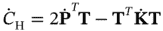<math display="block" overflow="scroll" xmlns="http://www.w3.org/1998/Math/MathML"> <msub> <mover accent="true"><mi>C</mi> <mo>&#729;</mo> </mover> <mi mathvariant="normal">H</mi> </msub> <mo>=</mo> <mn>2</mn> <msup> <mover accent="true"><mi mathvariant="bold">P</mi> <mo>&#729;</mo> </mover> <mi>T</mi> </msup> <mi mathvariant="bold">T</mi> <mo>&#8722;</mo> <msup> <mi mathvariant="bold">T</mi> <mi>T</mi> </msup> <mover accent="true"><mi mathvariant="bold">K</mi> <mo>&#729;</mo> </mover> <mi mathvariant="bold">T</mi> </math> 

在当前问题的背景下，设计区域被施加了固定的热负荷条件，使得问题与可变热负荷无关。这意味着系统的热响应不受施加热负荷波动或变化的影响。因此，设计和优化过程可以完全关注材料分布和结构配置，以优化热导率，而不需要考虑变化的热负荷。这简化了分析，并允许在定义的设计区域内通过更精简的方法来实现优热性能。这将导致消除方程 (5.13) 中的第一项，从而降低了热合规性（heat compliance）的一阶敏感度对于

(5.14)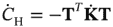<math display="block" overflow="scroll" xmlns="http://www.w3.org/1998/Math/MathML"> <msub> <mover accent="true"><mi>C</mi> <mo>&#729;</mo> </mover> <mi mathvariant="normal">H</mi> </msub> <mo>=</mo> <mo form="prefix">&#8722;</mo> <msup> <mi mathvariant="bold">T</mi> <mi>T</mi> </msup> <mover accent="true"><mi mathvariant="bold">K</mi> <mo>&#729;</mo> </mover> <mi mathvariant="bold">T</mi> </math> 

现在用宏观和微观设计变量写入方程 (5.14)，得到

(5.15)<math display="block" overflow="scroll" xmlns="http://www.w3.org/1998/Math/MathML"> <msub> <mover accent="true"><mi>C</mi> <mo>&#729;</mo> </mover> <mi mathvariant="normal">H</mi> </msub> <mfenced open="(" close=""><mrow> <mi mathvariant="bold">x</mi> <mi>M</msub> </mo, <mi mathvariant="bold">x</mi> <mi>m</msub> </mrow> <mo>=</mo> <mo form="prefix">&#8722;</mo> <msup> <mi mathvariant="bold">T</mi> <mi>M</mi> </msup> <mover accent="true"><mi mathvariant="bold">K</mi> <mo>&#729;</mo> </mover> <mfenced open="(" close=""><mrow> <mi mathvariant="bold">x</mi> <mi>M</msub> </mo, <mi mathvariant="bold">x</mi> <mi>m</msub> </mrow> <msub mathvariant="bold">T</mi> <mi>M</msub> </math> 

方程 (5.15) 有两部分：第一部分是关于 `M` 的导数，用于更新宏观区域。这在方程 (5.16) 中给出。

(5.16)![ModifyingAbove upper C With dot Subscript normal upper H Baseline left-parenthesis bold x Subscript upper M right-parenthesis equals StartFraction partial-differential C Subscript normal upper H Over partial-differential bold x Subscript upper M EndFraction minus p left-parenthesis bold x Subscript upper M Superscript p minus 1 right-parenthesis) bold upper T Superscript upper T integral Underscript AbsoluteValue normal Omega Subscript M EndValuescripts bold upper Dcript T d normal Omega Subscript M upper T](img/c05-math-0016.png)<math display="block" overflow="scroll" xmlns="http://www.w3.org/1998/Math/MathML"> <msub> <mover accent="true"><mi>C</mi> <mo>&#729;</mo> </mover> <mi mathvariant="normal">H</mi> </msub> <mfenced open="(" close=""><msub> <mi mathvariant="bold">x</mi> <mi>M</msub> </mo> <mo>=</mo> <mfrac> <mrow> <mi>&#8706;</mi> <msub> <mi>C</mi> <mi mathvariant="normal">H</msub> </mrow> <mrow> <mi>&#8706;</mi> <msub> <mi mathvariant="bold">x</mi> <mi>M</msub> </mrow> </mfrac> <mo>=</mo> <mo form="prefix">&#8722;</mo> <mi>p</mi> <mfenced open="(" close=""><msubsup> <mi mathvariant="bold">x</mi> <mi>M</mi> <mrow> <mi>p</mi> <mo>&#8722;</mo> <mn>1</mn> </mrow> </msubsup> </mfenced> <msup> <mi mathvariant="bold">T</mi> <mi>T</mi> </msup> <munder> <mo>&#8747;</mo> <mfenced open="|" close=""><msub> <mi mathvariant="normal">937</mi> <mi>M</msub> </6> </munder> <msup> <mi mathvariant="bold">D</mi> <mi>T</mi> </msup> <msup> <mi mathvariant="bold">&#923;</mi> <mi mathvariant="normal">H</mi> </msup> <mi mathvariant="bold">D</mi> <mspace width="0.2em"/> <mi>d</mi> <msub> <mi mathvariant="normal">937</mi> <mi>M</msub> <mspace width="0.2em"/> <mi mathvariant="bold">T</mi> </math> 

第二部分是关于 `m` 的导数，控制微观设计区域的启发式过程，这在方程 (5.17) 中给出。


(5.17) 

<math display="block" overflow="scroll" xmlns="http://www.w3.org/1998/Math/MathML"> <msub> <mover accent="true"><mi>C</mi> <mo>&#729;</mo> </mover> <mi mathvariant="normal">H</mi> </msub> <mfenced open="(" close=""><msub> <mi mathvariant="bold">x</mi> <mi>m</msub> </mo> <mo>=</mo> <mfrac> <mrow> <mi>&#8706;</mi> <msub> <mi>C</mi> <mi mathvariant="normal">H</msub> </mrow> <mrow> <mi>&#8706;</mi> <msub> <mi mathvariant="bold">x</mi> <mi>m</msub> </mrow> </mfrac> <mo>=</mo> <mo form="prefix">&#8722;</mo> <msup> <mi mathvariant="bold">T</mi> <mi>T</mi> </msup> <munder> <mo>&#8747;</mo> <mfenced open="|" close=""><msub> <mi mathvariant="normal">937</mi> <mi>m</msub> </6> </munder> <msup> <mi mathvariant="bold">D</mi> <mi>T</mi> </msup> <mfrac> <mrow> <mi>d</mi> <msup> <mi mathvariant="bold">&#923;</mi> <mi mathvariant="normal">H</mi> </msup> </mrow> <mrow> <mi>d</mi> <msub> <mi mathvariant="bold">x</mi> <mi>m</msub> </mrow> </mfrac> <mi mathvariant="bold">D</mi> <mspace width="0.2em"/> <mi>d</mi> <msub> <mi mathvariant="normal">937</mi> <mi>m</msub> <mspace width="0.2em"/> <mi mathvariant="bold">T</mi> </math>

均匀化材料热导率张量对微观设计变量 $\frac{d\mathbf{\Lambda}^H}{d\mathbf{x}_m}$ (images/c05-i0005.png) 的导数可以确定：

(5.18) $\frac{d\mathbf{\Lambda}^H}{d\mathbf{x}_m} = \frac{p}{|\Omega_m|} \int_{\Omega_m} (\mathbf{I} - \mathbf{DT}^T)^T (\mathbf{x}_m^{p-1}) \Lambda (\mathbf{I} - \mathbf{DT}^T) d\Omega_m$ (images/c05-math-0018.png)

本研究中的优化过程采用了均匀密度材料惩罚法（SIMP）。为了更新设计变量，利用优化准则法（OCM）。为了确保拓扑优化问题解的存在并防止棋盘化的出现，实现了灵敏度过滤。该过滤器修改了灵敏度 $\hat{C}_H(\mathbf{x}_M)$ (images/c05-i0006.png) 和 $\hat{C}_H(\mathbf{x}_m)$ (images/c05-i0007.png)，增强了优化结果的稳健性和可靠性 [15–17]。

(5.19) $\frac{\partial \hat{C}_H}{\partial \mathbf{x}_e} = \frac{1}{\mathbf{x}_e} \sum_{f=1}^N H_f \sum_{f=1}^N H_f \mathbf{x}_f \frac{\partial C}{\partial \mathbf{x}_f}$ (images/c05-math-0019.png)

其中 `H[f]` 是执行修改的卷积算子，`x[e]` 是计算灵敏度的设计变量，`x[f]`。`H[f]` 定义为：

(5.20) $H_f = r - \text{dist}(e, f), \{f \in N \mid \text{dist}(e, f) \le r\}$ (images/c05-math-0020.png)

修改灵敏度后，以下是一种启发式更新技术，与本文所采用的方法相同：

(5.21) 

<math display="block" overflow="scroll" xmlns="http://www.w3.org/1998/Math/MathML"> <msubsup> <mi mathvariant="bold">x</mi> <mi>e</mi> <mtext mathvariant="italic">updated</mtext> </msubsup> <mo>=</mo> <mfenced open="{" close="" separators=""><mtable> <mtr> <mtd> <mi mathvariant="normal">max</mi> <mfenced open="(" close=")" separators=""><mrow> <mn>0</mn> <mo>,</mo> <msub> <mi mathvariant="bold">x</mi> <mi>e</mi> </msub> <mo>&#8722;</mo> <mi>&#949</mi> </mrow> </mfenced> <mspace width="1.16em"/> <mtext mathvariant="italic">if</mtext> <mspace width="0.34em"/> <msub> <mi mathvariant="bold">x</mi> <mi>e</mi> </msub> <msubsup> <mi>B</mi> <mi>e</mi> <mi>&#969</mi> </msubsup> <mo>&#8804;</mo> <mi mathvariant="normal">max</mi> <mfenced open="(" close=")" separators=""><mrow> <mn>0</mn> <mo>,</mo> <msub> <mi mathvariant="bold">x</mi> <mi>e</mi> </msub> <mo>&#8722;</mo> <mi>&#949</mi> </mrow> </mfenced> </mtd> </mtr> <mtr> <mtd> <mi mathvariant="normal">max</mi> <mfenced open="(" close=")" separators=""><mrow> <mn>0</mn> <mo>,</mo> <msub> <mi mathvariant="bold">x</mi> <mi>e</mi> </msub> <mo>+</mo> <mi>&#949</mi> </mrow> </mfenced> <mspace width="1.16em"/> <mtext mathvariant="italic">if</mtext> <mspace width="0.34em"/> <msub> <mi mathvariant="bold">x</mi> <mi>e</mi> </msub> <msubsup> <mi>B</mi> <mi>e</mi> <mi>&#969</mi> </msubsup> <mo>&#8805;</mo> <mi mathvariant="normal">max</mi> <mfenced open="(" close=")" separators=""><mrow> <mn>1</mn> <mo>,</mo> <msub> <mi mathvariant="bold">x</mi> <mi>e</mi> </msub> <mo>&#8722;</mo> <mi>&#949</mi> </mrow> </mfenced> </mtd> </mtr> <mtr> <mtd> <msub> <mi mathvariant="bold">x</mi> <mi>e</mi> </msub> <msubsup> <mi>B</mi> <mi>e</mi> <mi>&#969</mi> </msubsup> <mspace width="5.279999em"/> <mtext>Otherwise</mtext> </mtd> </mtr> </mtable> </mfenced> </math>

在这里，`ε` 表示正的搜索步长。此外，等于 `1/2` 的 `ω` 表示数值阻尼系数，`B[e]` 表示最优性条件 `!`。

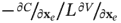

<math display="inline" overflow="scroll" xmlns="http://www.w3.org/1998/Math/MathML"> ... </math>

通过为第 5.2.4 节中讨论的问题引入预定的分支设计区域，我们在最终设计中实现了鱼鳍状结构（如图 5.3 所示）。通过对一个包含更多分支的初始设计区域进行多尺度问题优化，该设计的性能得到了显著增强。如图 5.3(b)–(d)所示，与第 5.2.4 节中提出的多尺度设计问题相比，这种方法实现了更好的热合规性最小化效果。

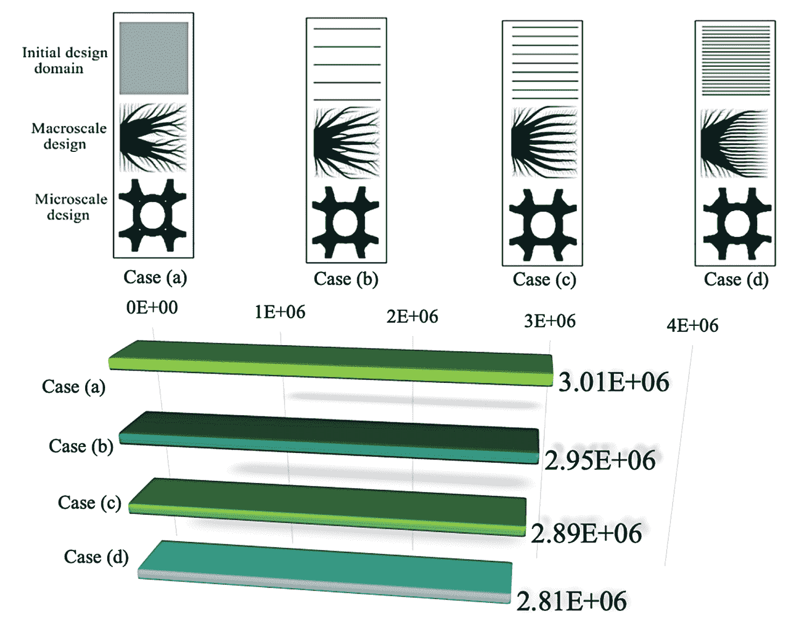

**图 5.3** 针对 (a) 全分布初始设计区域，(b) 具有 5 个分支的规定初始设计区域的优化，(c) 具有 9 个分支的规定初始设计区域的优化，以及 (d) 具有 20 个分支的规定初始设计区域的优化。

初始分支结构的引入允许了更高效的散热路径，从而产生了更有效的热管理解决方案。这一改进突显了初始设计考虑在热问题多尺度拓扑优化中的重要性 [18, 19]。

### 5.2.6 散热器的 3D 并行拓扑优化

3D 案例使用 SIMP 方法进行了优化，如图 5.4 所示。在这些示例中，设计区域在所有节点处被均匀加热。对于案例 (a)，散热器位于上表面的中心，而在案例 (b) 中，它位于上角，两者均保持在 0° 的温度。微观和宏观尺度的减重率均设置为 50%，宏观尺度节点施加了 0.01 的均匀热负载。

![图 5.4 3D 案例的多尺度设计区域 (a) 零温度和内部产热中心点，(b) 零温度和内部产热的角，以及 (c) 受到热负载且具有零温度边界条件的两个侧 [20]。](images/c05f004.png)

**图 5.4** 3D 案例的多尺度设计区域 (a) 零温度和内部产热中心点，(b) 零温度和内部产热的角，以及 (c) 受到热负载且具有零温度边界条件的两个侧 [[20]](#c05.xhtml#c05-bib-0020)。

微观尺度设计区域从一个贯穿所有表面的初始矩形孔开始。宏观和微观尺度区域的有限元建模采用了结构化六面体单元。微观尺度设计区域使用了 8,000 个六面体单元，而宏观尺度区域使用了 144,000 个单元。表 5.1 展示了图 5.4 所示两个案例的宏观和微观结构的优化拓扑结构。

需要注意的是，与简单的二维 (2D) 模型相比，3D 有限元分析需要高得多的计算资源。因此，使用了较低的网格分辨率，导致了体素化设计，如表 5.1 的前两列所示。增加单元数量可以提高设计的精度和锐度，但会带来巨大的计算代价。

本节探讨了宏观与微观设计领域之间复杂的关系，以及它们通过并发多尺度优化框架对初始微观结构的影响。利用基于 `SIMP` 方法的拓扑优化，我们旨在通过将固体结构和微观结构的权重各减少 50%，使固体设计区域的重量减轻 25%。

数值模型如图 5.7 所示，其包含一个 150 mm × 150 mm 的宏观设计区域，离散化为 1 mm² 的单元，初始设计值为 `X[M] = 0.5` 以满足 `SIMP` 标准。微观设计区域尺寸为 1 mm × 1 mm，采用周期边界条件进行数值均匀化，并离散化为 104 个单元，以进行有效的微尺度分析和优化。这种方法允许全面研究优化过程中不同尺度之间复杂的相互作用。本文研究了三种不同的初始微观设计区域示例。研究中的第一个示例引入了中心圆形子设计区域 `Ω[2]`，其初始值为 0.5，而微观设计区域的其余部分 `Ω[1]` 则保持一致的初始值 1。

中心子设计区域与周围区域的差异具有多种科学目的。主要，这种差异化是为了通过最优准则鼓励获得最优设计结果，同时显著降低计算成本 [[26]](#c05.xhtml#c05-bib-0026)。此外，它有助于减少微单元内部的灰度区域 [20, 27]。研究还扩展到另外两种微尺度配置，每种配置具有不同的中心子区域。第二个系统包含正方形子区域，而第三个系统采用形状未指定的子区域，两者的边长均为 50 个单元。选择这些设计是为了考察不同的几何形状如何影响微观结构优化。重要的是，分配给这些子区域的初始值与之前研究的圆形子区域案例保持一致。

这种方法在保持初始条件一致的同时探索不同的子区域形状，能够全面分析几何形状和起始参数如何影响优化过程。研究旨在阐明子区域配置与初始设置在塑造微观结构优化结果方面之间复杂的相互作用。

我们选择了初始设计值 `Ω[1] = 1` 和 `Ω[2] = 0.5` 用于在三种不同的初始微观结构上进行多尺度优化，如图 5.8(a)–(d)所示。表 5.2 汇总的分析揭示了在降低热合规度的多尺度拓扑优化中，不同微观结构之间存在不同的结果。正方形子设计区域在这方面的效果最差。相比之下，圆形子设计区域的性能表现出显著提升（22%）。最理想的结果来自于菱形子设计区域，与正方形配置相比，其热合规度显著降低了 25%。这种显著的改进如图 5.9 所示，强调了菱形区域在该特定优化场景下的优越效能。这些发现强调了子设计区域几何形状在决定多尺度拓扑优化最小化热合规度有效性方面的关键作用。


**表 5.2** 以最小化热合规度为目标的多尺度拓扑优化中不同微观结构子设计区域性能的对比分析。

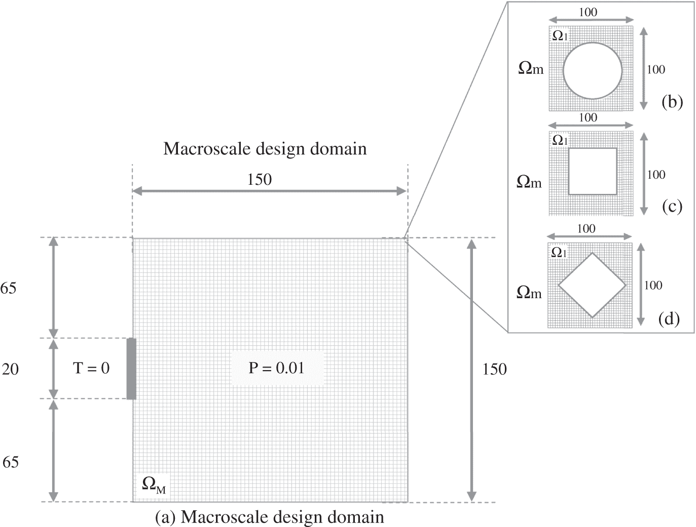

**图 5.8** 设计区域的同步优化：(a) 具有左侧中心散热器的正方形宏观设计，以及 (b–d) 单元单元设计区域，分别具有中心圆形、正方形和菱形子设计。

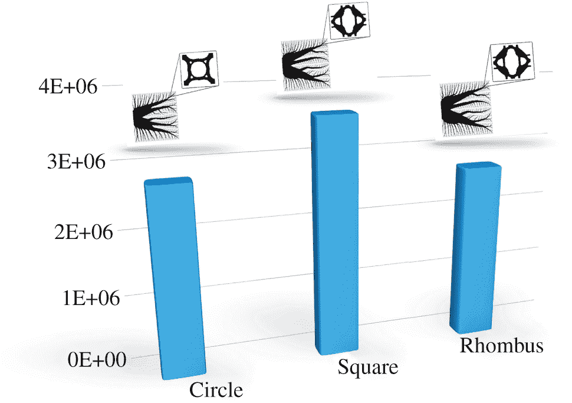

**图 5.9** 微观结构设计对热合规度优化性能的影响。

表中的数据提供了关于初始微尺度中心子设计区域如何影响并发多尺度优化的见解，特别是在增强热导率方面。为了深入理解微尺度子区域在优化过程中的作用，我们以菱形中心子设计区域为案例进行了详细分析。该研究涉及改变子区域的参数，并将结果配置分为四个不同的组。第一组包含中心菱形子设计区域，如图 5.8(d)所示，相应结果汇总在表 5.3 中。

### 5.2.8 以最大化热导率和机械强度为目标的多物理优化

在实际应用中，设计问题必须满足多个物理方面。这些问题被称为多物理问题。每个物理方面都有其自身的公式，并需要不同的离散化方法来满足这些公式和相关条件。涉及的物理之间可能是互补的，也可能是不同且独立的。在本节中将解决高刚度散热器的多物理问题。

为了最大化热导率，需要最小化热合规度 `C[H]`。类似的，通过最小化机械合规度 `C[mech]` 实现机械强度的最大化。主机械目标函数的通用形式如公式 (5.22) 所示。


## 公式 (5.22)

![StartLayout 1st Row 1st Column min colon 2nd Column upper C Subscript upper H Baseline left-parenthesis bold x Subscript upper M Baseline comma bold x Subscript m Baseline right-parenthesis) comma upper C Subscript italic mech Baseline left-parenthesis bold x Subscript upper M Baseline comma bold x Subscript m Baseline right-parenthesis) right-arrow from bar ModifyingAbove f With bar left-parenthesis upper C Subscript upper H Baseline comma upper C Subscript italic mech Baseline right-parenthesis) equals ModifyingAbove f With bar left-parenthesis f Subscript kappa Baseline comma f Subscript c Baseline right-parenthesis) 2nd Row 1st Column normal s period normal t period. 2nd Column StartLayout Enlarged left-brace 1st Row bold upper K left-parenthesis bold x Subscript upper M Baseline comma bold x Subscript m Baseline right-parenthesis) bold upper U equals bold upper F 2nd Row bold upper K Superscript italic t h Baseline left-parenthesis bold x Subscript upper M Baseline comma bold x Subscript m Baseline right-parenthesis) bold upper T equals bold upper P EndLayout 3rd Row 1st Column Blank 2nd Column integral Underscript normal upper Omega Subscript italic d upper M Baseline Endscripts bold x Subscript upper M Baseline d bold x Subscript upper M Baseline less-than-or-equal-to v Subscript upper M Baseline comma 0 less-than bold x Subscript upper M Baseline less-than 1 for-all bold x Subscript upper M Baseline element-of normal upper Omega Subscript italic d upper M Baseline 4th Row 1st Column Blank 2nd Column integral Underscript normal upper Omega Subscript italic d m Baseline Endscripts bold x Subscript upper m Baseline d bold x Subscript upper m Baseline less-than-or-equal-to v Subscript upper m Baseline comma 0 less-than bold x Subscript upper m Baseline less-than 1 for-all bold x Subscript upper m Baseline element-of normal upper Omega Subscript italic d m EndLayout](img/c05-math-0022.png)

```mathml
<math display="block" overflow="scroll" xmlns="http://www.w3.org/1998/Math/MathML">
  <mtable columnalign="left" displaystyle="true">
    <mtr>
      <mtd>
        <mtext mathvariant="normal">min:</mtext>
      </mtd>
      <mtd>
        <mspace width="1.0em"/>
        <msub>
          <mi>C</mi>
          <mi>H</mi>
        </msub>
        <mfenced open="(" close=")" separators="">
          <mrow>
            <msub>
              <mi mathvariant="bold">x</mi>
              <mi>M</mi>
            </msub>
            <mo>,</mo>
            <msub>
              <mi mathvariant="bold">x</mi>
              <mi>m</mi>
            </msub>
          </mrow>
        </mfenced>
        <mo>,</mo>
        <msub>
          <mi>C</mi>
          <mtext mathvariant="italic">mech</mtext>
        </msub>
        <mfenced open="(" close=")" separators="">
          <mrow>
            <msub>
              <mi mathvariant="bold">x</mi>
              <mi>M</mi>
            </msub>
            <mo>,</mo>
            <msub>
              <mi mathvariant="bold">x</mi>
              <mi>m</mi>
            </msub>
          </mrow>
        </mfenced>
        <mo>&#8614;</mo>
        <mover accent="true">
          <mi>f</mi>
          <mo stretchy="true">&#175;</mo>
        </mover>
        <mfenced open="(" close=")" separators="">
          <mrow>
            <msub>
              <mi>C</mi>
              <mi>H</mi>
            </msub>
            <mo>,</mo>
            <msub>
              <mi>C</mi>
              <mtext mathvariant="italic">mech</mtext>
            </msub>
            <mo>=</mo>
            <mover accent="true">
              <mi>f</mi>
              <mo stretchy="true">&#175;</mo>
            </mover>
            <mfenced open="(" close=")" separators="">
              <mrow>
                <msub>
                  <mi>f</mi>
                  <mi>954</mi>
                </msub>
                <mo>,</mo>
                <msub>
                  <mi>f</mi>
                  <mi>c</mi>
                </msub>
              </mrow>
            </mfenced>
          </mrow>
        </mfenced>
      </mtd>
    </mtr>
    <mtr>
      <mtd>
        <mi mathvariant="normal">s</mi>
        <mi mathvariant="normal">t</mi>
      </mtd>
      <mtd>
        <mspace width="1.0em"/>
        <mfenced open="{" close="" separators="">
          <mtable>
            <mtr>
              <mspace width="0.2em"/>
              <mi mathvariant="bold">K</mi>
              <mfenced open="(" close=")" separators="">
                <mrow>
                  <msub>
                    <mi mathvariant="bold">x</mi>
                    <mi>M</mi>
                  </msub>
                  <mo>,</mo>
                  <msub>
                    <mi mathvariant="bold">x</mi>
                    <mi>m</mi>
                  </msub>
                </mrow>
              </mfenced>
              <mi mathvariant="bold">U</mi>
              <mo>=</mo>
              <mi mathvariant="bold">F</mi>
            </mtr>
            <mtr>
              <mspace width="0.2em"/>
              <msup>
                <mi mathvariant="bold">K</mi>
                <mi mathvariant="italic">th</mi>
              </msup>
              <mfenced open="(" close=")" separators="">
                <mrow>
                  <msub>
                    <mi mathvariant="bold">x</mi>
                    <mi>M</mi>
                  </msub>
                  <mo>,</mo>
                  <msub>
                    <mi mathvariant="bold">x</mi>
                    <mi>m</mi>
                  </msub>
                </mrow>
              </mfenced>
              <mi mathvariant="bold">T</mi>
              <mo>=</mo>
              <mi mathvariant="bold">P</mi>
            </mtr>
          </mtable>
        </mfenced>
      </mtd>
    </mtr>
    <mtr>
      <mtd></mtd>
      <mtd>
        <mspace width="1.0em"/>
        <munder>
          <mo>&#8747;</mo>
          <msub>
            <mi mathvariant="normal">Omega</mi>
            <mi mathvariant="italic">d</mi>
          </msub>
        </munder>
        <msub>
          <mi mathvariant="bold">x</mi>
          <mi>M</mi>
        </msub>
        <mi>d</mi>
        <msub>
          <mi mathvariant="bold">x</mi>
          <mi>M</mi>
        </msub>
        <mo>&#8804;</mo>
        <msub>
          <mi>v</mi>
          <mi>M</mi>
        </msub>
        <mo>,</mo>
        <mn>0</mn>
        <mo>&#60;</mo>
        <msub>
          <mi mathvariant="bold">x</mi>
          <mi>M</mi>
        </msub>
        <mo>&#60;</mo>
        <mn>1</mn>
        <mspace width="0.84em"/>
        <mo>&#8747;</mo>
        <msub>
          <mi mathvariant="bold">x</mi>
          <mi>M</mi>
        </msub>
        <mo>&#8712;</mo>
        <msub>
          <mi mathvariant="normal">Omega</mi>
          <mi mathvariant="italic">dM</mi>
        </msub>
      </mtd>
    </mtr>
    <mtr>
      <mtd></mtd>
      <mtd>
        <mspace width="1.0em"/>
        <munder>
          <mo>&#8747;</mo>
          <msub>
            <mi mathvariant="normal">Omega</mi>
            <mi mathvariant="italic">dm</mi>
          </msub>
        </munder>
        <msub>
          <mi mathvariant="bold">x</mi>
          <mi>m</mi>
        </msub>
        <mi>d</mi>
        <msub>
          <mi mathvariant="bold">x</mi>
          <mi>m</mi>
        </msub>
        <mo>&#8804;</mo>
        <msub>
          <mi>v</mi>
          <mi>m</mi>
        </msub>
        <mo>,</mo>
        <mn>0</mn>
        <mo>&#60;</mo>
        <msub>
          <mi mathvariant="bold">x</mi>
          <mi>m</mi>
        </msub>
        <mo>&#60;</mo>
        <mn>1</mn>
        <mspace width="0.84em"/>
        <mo>&#8747;</mo>
        <msub>
          <mi mathvariant="bold">x</mi>
          <mi>m</mi>
        </msub>
        <mo>&#8712;</mo>
        <msub>
          <mi mathvariant="normal">Omega</mi>
          <mi mathvariant="italic">dm</mi>
        </msub>
      </mtd>
    </mtr>
  </mtable>
</math>
```

其中 `v` 代表宏观系统 `M` 和微观系统 `m` 的体积分数约束。因此，本文采用了将目标函数转换为归一化的形式，其形式如下：

## 公式 (5.23)

![ModifyingAbove f With bar left-parenthesis bold x Subscript upper M Baseline comma bold x Subscript upper m Baseline right-parenthesis) equals w 1 f overbar Subscript c Baseline plus w 2 f overbar Subscript k Baseline equals w 1 StartFraction f Subscript c Baseline minus f Subscript c Baseline Superscript asterisk Baseline Over f Subscript c Baseline Superscript italic in Baseline minus f Subscript c Baseline Superscript asterisk Baseline Baseline plus w 2 StartFraction f Subscript kappa Baseline minus f Subscript kappa Baseline Superscript asterisk Baseline Over f Subscript kappa Baseline Superscript italic in Baseline minus f Subscript kappa Baseline Superscript asterisk Baseline Baseline](img/c05-math-0023.png)

其中 `f_c^*` 和 `f_κ^*` 分别是合规性和热导率问题可实现设计的函数，它们通过分别对每个情况进行优化并评估每个目标函数的最优设计来计算。`f_c^in` 和 `f_κ^in` 分别是初始拓扑的合规性和微结构的热导率。`w_1` 和 `w_2` 是权重因子，使得 `w_1 + w_2 = 1`。在本工作中作为多尺度多物理拓扑优化目标的归一化多目标函数，其形式如下：


## 拓扑优化灵敏度分析

### 目标函数与约束条件 (5.24)

$$
\begin{aligned}
\min: \quad & w_1 \frac{f_c - f_c^*}{f_c^{ini} - f_c^*} + w_2 \frac{f_\kappa - f_\kappa^*}{f_\kappa^{ini} - f_\kappa^*} \\
\text{s.t.} \quad & \mathbf{K}(\mathbf{x}_M, \mathbf{x}_m) \mathbf{U} = \mathbf{F} \\
& \mathbf{K}^t(\mathbf{x}_M, \mathbf{x}_m) \mathbf{T} = \mathbf{P} \\
& \int_{\Omega_d^M} x_M \, d\mathbf{x}_M \le v_M, \quad 0 < x_M < 1 \quad \forall \mathbf{x}_M \in \Omega_d^M \\
& \int_{\Omega_d^m} x_m \, d\mathbf{x}_m \le v_m, \quad 0 < x_m < 1 \quad \forall \mathbf{x}_m \in \Omega_d^m
\end{aligned}
$$

拓扑优化需要能够处理问题多物理方面的灵敏度分析，以引导寻找极值。由于目标函数依赖于宏观和微观设计变量，因此灵敏度必须相对于变分密度（`x_M`, `x_m`）进行驱动。

### 机械合规性灵敏度 (5.26)

$$
\dot{C}_{\text{mech}}(\mathbf{x}_M, \mathbf{x}_m) = \dot{\mathbf{F}}_M^T \mathbf{U}_M + \mathbf{F}_M^T \dot{\mathbf{U}}
$$

其中 `K(x_M, x_m)U = F`，`\dot{\mathbf{U}}` 通过对该方程求导并分离变量得到。


## 5.27

![ModifyingAbove bold upper U With dot Subscript upper M Baseline equals bold upper K left-parenthesis bold x Subscript upper M Baseline comma bold x Subscript m Baseline right-parenthesis Superscript negative 1 Baseline ModifyingAbove bold upper F With dot Subscript upper M Baseline minus bold upper K left-parenthesis bold x Subscript upper M Baseline comma bold x Subscript m Baseline right-parenthesis Superscript negative 1 Baseline left-parenthesis ModifyingAbove bold upper K With dot left-parenthesis bold x Subscript upper M Baseline comma bold x Subscript m Baseline right-parenthesis bold upper U Subscript upper M Baseline right-parenthesis](img/c05-math-0027.png)

<math display="block" overflow="scroll" xmlns="http://www.w3.org/1998/Math/MathML">
  <msub>
    <mover accent="true"><mi mathvariant="bold">U</mi> <mo>&#729;</mo></mover>
    <mi>M</mi>
  </msub>
  <mo>=</mo>
  <mi mathvariant="bold">K</mi>
  <msup>
    <mfenced open="(" close=")" separators="">
      <mrow>
        <msub><mi mathvariant="bold">x</mi> <mi>M</mi></msub>
        <mo>,</mo>
        <msub><mi mathvariant="bold">x</mi> <mi>m</mi></msub>
      </mrow>
    </mfenced>
    <mrow><mo form="prefix">&#8722;</mo> <mn>1</mn></mrow>
  </msup>
  <msub>
    <mover accent="true"><mi mathvariant="bold">F</mi> <mo>&#729;</mo></mover>
    <mi>M</mi>
  </msub>
  <mo>&#8722;</mo>
  <mi mathvariant="bold">K</mi>
  <msup>
    <mfenced open="(" close=")" separators="">
      <mrow>
        <msub><mi mathvariant="bold">x</mi> <mi>M</mi></msub>
        <mo>,</mo>
        <msub><mi mathvariant="bold">x</mi> <mi>m</mi></msub>
      </mrow>
    </mfenced>
    <mrow><mo form="prefix">&#8722;</mo> <mn>1</mn></mrow>
  </msup>
  <mfenced open="(" close=")" separators="">
    <mover accent="true"><mi mathvariant="bold">K</mi> <mo>&#729;</mo></mover>
    <mfenced open="(" close=""><mrow>
      <msub><mi mathvariant="bold">x</mi> <mi>M</mi></msub>
      <mo>,</mo>
      <msub><mi mathvariant="bold">x</mi> <mi>m</mi></msub>
    </mrow></mfenced>
    <msub><mi mathvariant="bold">U</mi> <mi>M</mi></msub>
  </mfenced>
</math>

并且，通过将 `(5.26)` 代入 `(5.27)` 得到：

## 5.28

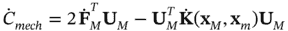

<math display="block" overflow="scroll" xmlns="http://www.w3.org/1998/Math/MathML">
  <msub>
    <mover accent="true"><mi>C</mi> <mo>&#729;</mo></mover>
    <mtext mathvariant="italic">mech</mtext>
  </msub>
  <mo>=</mo>
  <mn>2</mn><mspace width="0.1em"/>
  <msubsup>
    <mover accent="true"><mi mathvariant="bold">F</mi> <mo>&#729;</mo></mover>
    <mi>M</mi>
    <mi>T</mi>
  </msubsup>
  <msub><mi mathvariant="bold">U</mi> <mi>M</mi></msub>
  <mo>&#8722;</mo>
  <msubsup><mi mathvariant="bold">U</mi> <mi>M</mi> <mi>T</mi></msubsup>
  <mover accent="true"><mi mathvariant="bold">K</mi> <mo>&#729;</mo></mover>
  <mfenced open="(" close=""><mrow>
    <msub><mi mathvariant="bold">x</mi> <mi>M</mi></msub>
    <mo>,</mo>
    <msub><mi mathvariant="bold">x</mi> <mi>m</mi></msub>
  </mrow></mfenced>
</math>

由于该问题是与负载无关的，`(5.28)` 简化为：

## 5.29

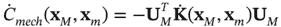

<math display="block" overflow="scroll" xmlns="http://www.w3.org/1998/Math/MathML">
  <msub>
    <mover accent="true"><mi>C</mi> <mo>&#729;</mo></mover>
    <mtext mathvariant="italic">mech</mtext>
  </msub>
  <mfenced open="(" close=")" separators="">
    <mrow>
      <msub><mi mathvariant="bold">x</mi> <mi>M</mi></msub>
      <mo>,</mo>
      <msub><mi mathvariant="bold">x</mi> <mi>m</mi></msub>
    </mrow>
  </mfenced>
  <mo>=</mo>
  <mo form="prefix">&#8722;</mo>
  <msubsup><mi mathvariant="bold">U</mi> <mi>M</mi> <mi>T</mi></msubsup>
  <mover accent="true"><mi mathvariant="bold">K</mi> <mo>&#729;</mo></mover>
  <mfenced open="(" close=""><mrow>
    <msub><mi mathvariant="bold">x</mi> <mi>M</mi></msub>
    <mo>,</mo>
    <msub><mi mathvariant="bold">x</mi> <mi>m</mi></msub>
  </mrow></mfenced>
  <msub><mi mathvariant="bold">U</mi> <mi>M</mi></msub>
</math>

方程 `(5.29)` 包含两个部分：第一部分关于 `x_M` 的敏感度，用于更新宏观设计区域。该导数如公式 `(5.30)` 所示。

## 5.30

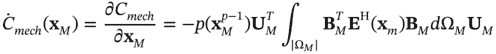

第二部分是微观尺度敏感度 `x_m`，由公式 `(5.31)` 给出。

## 5.31

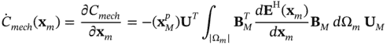

均化张量对微观尺度变量的导数 `\frac{dE_H(x_m)}{dx_m}` 可以通过均化表示（公式 23）确定。

## 5.32

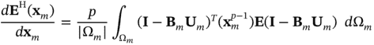

使用类似的比较方法，热合规性敏感性分析 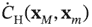 对应宏观设计变量 `x_M` 的关系由公式 `(5.33)` 所示。

<math display="inline" overflow="scroll" xmlns="http://www.w3.org/1998/Math/MathML">
  <msub>
    <mover accent="true"><mi>C</mi><mo>&#729;</mo></mover>
    <mi mathvariant="normal">H</mi>
  </msub>
  <mfenced open="(" close=")" separators="">
    <mrow>
      <msub><mi mathvariant="bold">x</mi><mi>M</mi></msub>
      <mo>,</mo>
      <msub><mi mathvariant="bold">x</mi><mi>m</mi></msub>
    </mrow>
  </mfenced>
</math>

## 5.33

![ModifyingAbove upper C With dot Subscript normal upper H Baseline left-parenthesis bold x Subscript upper M Baseline right-parenthesis equals StartFraction partial-differential upper C Subscript normal upper H Baseline Over partial-differential bold x Subscript upper M Baseline EndFraction equals minus p left-parenthesis bold x Subscript upper M Superscript p minus 1 Baseline right-parenthesis) bold upper T Subscript upper M Superscript upper Baseline integral Underscript StartAbsoluteValue normal upper Omega Subscript upper M EndAbsoluteValue Endscripts bold upper D Subscript upper M Superscript upper Baseline bold upper Lamda Superscript normal upper H Baseline bold upper D Subscript upper M Baseline d normal upper Omega Subscript upper M bold upper T Subscript upper M](img/c05-math-0033.png)

<math display="block" overflow="scroll" xmlns="http://www.w3.org/1998/Math/MathML">
  <msub>
    <mover accent="true"><mi>C</mi> <mo>&#729;</mo></mover>
    <mi mathvariant="normal">H</mi>
  </msub>
  <mfenced open="(" close=")" separators="">
    <msub><mi mathvariant="bold">x</mi> <mi>M</mi></msub>
  </mfenced>
  <mo>=</mo>
  <mfrac>
    <mrow><mi>&#8706;</mi> <msub><mi>C</mi> <mi mathvariant="normal">H</mi></msub></mrow>
    <mrow><mi>&#8706;</mi> <msub><mi mathvariant="bold">x</mi> <mi>M</mi></msub></mrow>
  </mfrac>
  <mo>=</mo>
  <mo form="prefix">&#8722;</mo>
  <mi>p</mi>
  <mfenced open="(" close=")" separators="">
    <msubsup><mi mathvariant="bold">x</mi> <mi>M</mi> <mrow><mi>p</mi> <mo>&#8722;</mo> <mn>1</mn></mrow></msubsup>
  </mfenced>
  <msup><msub><mi mathvariant="bold">T</mi> <mi>M</mi></msub> <mi>T</mi></msup>
  <munder><mo>&#8747;</mo> <mfenced open="|" close="|" separators=""><msub><mi mathvariant="normal">&#937;</mi> <mi>M</mi></msub></mfenced></munder>
  <msup><msub><mi mathvariant="bold">D</mi> <mi>M</mi></msub> <mi>T</mi></msup>
  <msup><mi mathvariant="bold">&#923;</mi> <mi mathvariant="normal">H</mi></msup>
  <msub><mi mathvariant="bold">D</mi> <mi>M</mi></msub>
  <mspace width="0.2em"/><mi>d</mi> <msub><mi mathvariant="normal">&#937;</mi> <mi>M</mi></msub>
  <mspace width="0.2em"/><msub><mi mathvariant="bold">T</mi> <mi>M</mi></msub>
</math>

第二部分（即热合规性）是相对于 `x_m` 计算的，如公式 `(5.17)` 所示。


均匀材料热导率张量相对于微观设计变量的导数 `dΛ^H(x_m)/dx_m` 已经在公式 (5.18) 中推导出。

优化过程可以总结为以下步骤：

- **步骤 1**：指定针对宏观和微观尺度的设计参数。输入参数包括离散化（沿 x y 轴）、所需的体积分数以及微结构设计的材料属性。

- **步骤 2**：对设计域和有限元分析进行结构化，将每个物理模型细化为单元胞。通过采用均匀化方法，确定宏观属性，并考虑微观尺度下的不同相 [28]。在此背景下，稳健性是指在应用周期边界条件时确保所选宏结构的稳定性。如果 RVE 尺寸太小，可能会排除某些材料相，从而损害准确性 [29]。因此，RVE 相对于其子相的尺寸必须足够大，以保证材料结构的准确表示 [30]。

- **步骤 3**：分别计算力和热合规性的初始设计值（`f_c(ini)` 和 `f_κ(ini)`），这是构建多目标函数标量形式的必要步骤。

- **步骤 4**：计算每个物理模型的优化结果，以确定 `f_c(*)` 和 `f_κ(*)` 的值。

- **步骤 5**：计算宏观和微观尺度的目标函数（公式 5.24）。由于权重之和为 1，加权可以用通用权重 `η` 来表示。因此，权重被重写为 `w_1 = η` 和 `w_2 = (1 - η)`。

- **步骤 6**：进行敏感性分析并根据准则评估设计域，然后更新设计域。

- **步骤 7**：根据约束函数评估设计变量，以确保符合宏微尺度设计变量的权重最小化标准。

- **步骤 8**：通过将宏观设计变量 `x_M` 赋值为 1 来建立设计域，并与微观设计变量 `x_m`（实部为 1，空隙为 0）相关联。结果是宏结构和微结构的布局将同时更新。这将构建一个具有最高导热率、高刚性和高减重的多孔宏观结构。

- **步骤 9**：重复执行步骤 5-8，直到结构布局满足指定的约束条件。

第一个模型具有一个矩形区域，其沿 `x` 轴包含 200 个元素，沿 `y` 轴包含 90 个元素。它包含一个边长为 100 个元素的周期性方形微结构。两者的体积分减少率均为 50%。在机械模型中，左边缘固定，在右边缘从顶部起算的三分之一处施加向下载荷（参见图 5.11(a)）。对于热传导模型，左边缘中心的温度设置为零（图 5.11(b)），而所有其他边界均被处理为绝热，确保没有热传递，遵循 Bejan 方法 `[19, 32, 33]`。热产生在整个区域内设置为恒定且均匀的 0.01，这在有限元中表示为与机械模型尺寸相同的离散化（即宏观尺度在 `x` 和 `y` 方向上分别为 200 × 90 个元素，微观尺度具有 100 × 100 个元素，并带有周期边界条件以符合数值均质化评估方案）。关于初始微观设计域，其值为 0.5，半径等于 50 个元素的中心圆形区域除外。该中心子设计域的值设置为其他设计区域初始值的四分之一。这样做是为了鼓励以较小的计算成本通过最优性准则实现设计 `[26]`，并最小化微单元的灰度区域面积 `[27]`。并发多尺度维度的优化结果如图 5.12 所示。多目标多尺度问题权衡的影响体现在宏观和微观结构的变化中。微结构试图适应更强的物理特性，同时在平衡微观设计变量与降低通用加权因子 `η` 值的总体目标。帕累托前沿显示第一个示例的最佳结果（拐点）对应的加权因子为 (`η` = 0.6)。多目标函数的历史如图 5.12 和 图 5.13 所示。

![图 5.11 数值例的空间布局：(a) 矩形悬臂梁的机械载荷，(b) 矩形悬臂梁的热边界条件和加载，(c) 短梁的机械载荷，以及 (d) 短梁的热加载 [31]。](images/c05f011.png)

**图 5.11** 数值例的空间布局：(a) 矩形悬臂梁的机械载荷，(b) 矩形悬臂梁的热边界条件和加载，(c) 短梁的机械载荷，以及 (d) 短梁的热加载 `[[31]](#c05.xhtml#c05-bib-0031)`。

![图 5.12 示例 1 并发多物理优化的帕累托前沿 [31]。](images/c05f012.png)

**图 5.12** 示例 1 并发多物理优化的帕累托前沿 `[[31]](#c05.xhtml#c05-bib-0031)`。

第二个示例的机械模型（图 5.11(c)）具有边长为 150 个元素的正方形宏观设计域。左侧固定，在右边缘中心施加沿 y 轴正轴方向的载荷。固体热传导模型保持了与第一个示例相似的属性，但不同在于散热器的位置（图 5.11(d)）。

![图 5.13 示例 1 在 η = 0.6 下并发优化的多目标历史 [31]。](images/c05f013.png)

**图 5.13** 示例 1 在 `η` = 0.6 下并发优化的多目标历史 `[[31]](#c05.xhtml#c05-bib-0031)`。

![图 5.14 第二个示例并发多物理优化的帕累托前沿 [31]。](images/c05f014.png)

**图 5.14** 第二个示例并发多物理优化的帕累托前沿 `[[31]](#c05.xhtml#c05-bib-0031)`。

宏观和微观尺度优化的帕累托前沿如图 5.14 所示。两个案例之间宏观结构布局的变化显著地反映在微观设计中，特别是在案例 2 中。这种转变对应于物理模型的组合效应。材料分布根据每个物理模型的边界条件发生变化。在第一个示例（图 5.11(a) 和 (b)）中，边界条件引导宏观设计向左侧中间延伸，但在机械模型中略微向下偏移。微观设计通过在热传导模型中沿对角线分布材料来适应，并在中心集中质量以促进微结构内部的能量传递。对于机械能量模型，微观布局沿边缘分布能量，在空心周围形成三角形桁架结构。表 5.4 总结了两个示例多尺度优化的最优结果。

软机器人学近年来引起了研究人员和工业界的广泛关注。机器人被认为是一类潜在的全新类型机器，它们在现实世界中表现更好，且具有更强的通用性 [34–37]。软机器人学旨在开发具有柔性和顺应性的机器人，模仿生物体的特性。与自然组织类似，软机器人的主要结构通过分配能量来执行动作，通过响应外力产生变形，而不是像传统机器人那样仅仅依赖刚性连杆和齿轮。从本质上，软机器人试图将该领域扩展到动态刚体的限制之外。

本研究聚焦于设计一种超轻量、刚性的软机器人抓取手，该手能够通过单驱动点实现精确抓取。该方法涉及两个关键策略：首先，引入一种重新分配应变能的结构设计以实现控制的精确位移；其次，采用多孔结构在保持优异性能的同时最小化重量。此外，对孔隙进行了优化，以最大化材料属性，例如抗轴向应力和剪切应力的能力。

为了实现这一设计，研究采用了非参数优化，特别是拓扑优化，这是生成符合用户定义目标的最优设计的最有效的方法之一。该技术涉及将设计空间离散化，并应用常规优化算法来确定结构的最佳拓扑。对于静态加载场景，优化过程需要定义载荷步、设计变量、响应、约束和目标，以有效解决问题 [4, 5, 7, 8]。与增材制造相关的拓扑优化结构已显示出稳健的设计和良好的性能 [38–40]。拓扑优化改变了轻量化高功能结构的设计。通过优化给定设计区域内材料的分布，这种方法在满足各种设计约束的同时，使结构性能重量比最大化。在连续拓扑优化中，创建顺应系统的先驱方法之一是均质化方法。该技术通过将复杂的结构优化问题重构为高效的多尺度优化任务，每个离散单元使用材料密度函数。这些单元被构想为包含无限数量随机分布的空隙。

均质化理论在确定此类材料的力学性能方面起着关键作用。引入微结构有两种主要策略：分层复合材料和基于空心微胞的设计。对于分层复合材料，均质化方程可以通过解析法求解。相反，对于空心微胞，通常采用数值方法求解均质化问题。通过均质化方法，理论结构性能可以通过数学方法进行约束 [41]。Ananthuresh 等人 `[42]` 扩展了均质化以执行顺应机构设计。然而，由于产生的机构柔性不足，结果似乎是平均顺应性设计而非顺应机构设计。因此，Nishiwaki 等人 `[43]` 开发了一种基于均质化的拓扑优化方法，用于设计包含柔性的顺应机构。在他们的方法中，为了有效描述柔性，使用了使用互平均顺应性创建的多目标函数。SIMP 方法已作为均质化方法的直接后代被用于设计顺应机构 `[44–47]`。此外，进化结构优化（ESO）方法是基于一个简单的原理开发的，即通过从结构中逐渐去除浪费材料以获得构想的最优结构。ESO 的基本原理直接从结构中消除所谓的低效材料以创建最佳设计，由 Min 和 Steven 首次引入 `[48]`。成本函数灵敏度用于更新决策变量 `[20, 49]`。更新基于通过目标函数导数生成的单元灵敏度值，使得单元灵敏度和零分别对于固体单元和软单元是相同的。至于 SIMP 方法，研究了使用 ESO 方法来设计顺应机构 `[50–53]`。由于创建稳健设计的挑战，多尺度顺应机构受研究者的关注较少。此外，由于优化过程开始时灰度单元有效属性的波动，此类问题在使用 SIMP 方法进行优化时，其灰度性质极大地限制了极值的获得。Sivapuram 等人 `[54]` 的研究建议使用水平集方法改进顺应机构优化。零水平集方法中的二值单元思想被证明对稳健的软顺应设计有效。

### 5.3.1 并行多尺度拓扑优化的数学建模

为了在宏尺度 `x_M` 和微尺度 `x_m` 上同时优化函数，执行了并行多尺度拓扑优化。使用了两个不同的有限元系统来离散化宏尺度和微尺度区域。本文中的两个系统都使用了双线性网格。根据公式 `(5.34)`，当它等于 1 时，对应的单元为固体，而当它为 0 时，单元代表空隙。

```
x_M, x_m = {1 固体材料, 0 空}
```

均质化方法对于多尺度并行并行至关重要，原因有两个：首先，它能够确定宏观结构的有效属性。其次，它允许微尺度目标函数采用反向均质化，从而实现宏观结构和微结构的同时设计。

为了评估代表性体积单元（RVE）的整体（即有效）弹性张量 $E_{ijkl}^H$，使用了公式 (5.36)：

```
E_{ijkl}^H = \frac{1}{|V|} \int_{V} E_{ijqp} (\epsilon_{qp}^0(kl) - \epsilon_{qp}^*(kl)) dV
```

其中，`E_{ijqp}` 是由 RVE 组成的复合材料的弹性张量，而 $\epsilon_{qp}^0(kl)$ 是线性独立的单位应变测试 [55]。$\epsilon_{qp}^*(kl)$ 是特征周期性应变，通过求解方程 (5.37) 得到：

```
\int_{\Omega_m} E_{ijqp} \epsilon_{qp}^*(kl) \frac{\partial \gamma_n}{\partial n} dV = \int_{\Omega_m} E_{ijqp} \epsilon_{qp}^0(kl) \frac{\partial \gamma_n}{\partial n} dV
```

其中 `∂γ_n/∂n` 是与单位应变情况相关的任意虚拟位移。与之前提到的情况类似，对方程 (5.37) 分别针对三种情况（即 $kl = 11, 22$ 和 $12$）进行求解。另一方面，设计变量（分别为 `x_M` 和 `x_m`）的结构柔度给出为：

```
C_{mech}(x_M, x_m) = \frac{1}{2} \sum_{i=1}^N U_i^T K_i
```

其中 `U_i` 和 `K_i` 分别代表相对于具有 $N$ 个单元宏观结构的第 $i$ 个单元的节点位移和刚度矩阵。刚度矩阵的形式如 [55]：

```
K = \int_{V} B^T E B dV
```

其中 `E` 是单元弹性张量，`B` 是应变位移矩阵。由孔隙和固体材料组成的微观结构弹性模量 `E_{ijqp}` 与基础固体材料弹性张量 `E_0` 的关系如下：

```
E_{ijqp} = x_m E_0
```

通过实现公式 (5.36) 计算出的微观有效弹性张量 `E^H` 用于构建宏观弹性张量 `E_macro`，其采用了类似的材料插值方案，但区别在于对宏观设计变量采用了松弛惩罚。

松弛和惩罚原理被应用于 SIMP，以解决其早期版本面临许多问题，例如不存在性和灰度问题 [56, 57]。然而，这些修改对于实现传统 SIMP 方法的全局极值设计是严重的限制 [14, 58, 59]。这个问题将在后的讨论部分进行探讨，因此回到研究的公式部分，通过对宏观设计变量 `x_M` 进行幂处理 `(p >= max[2/(1-υ), 4/(1+υ)])` [[60]](#c05.xhtml#c05-bib-0060)，来构造弹性张量 `E_macro`。在这里，`υ` 是固体材料的泊松比。在本研究中，`p` 被选取为 3。宏观结构的弹性模量取最终形式为

(5.41) `E_macro = ...`

其中 `α` 是一个极小值。假设执行器受到线性应变限制，在输入点 `A` 处具有刚度为 `K_in` 的弹簧和力 `F_in`，则机械激活柔性机构问题的通用模型被线性实现。如图 5.15 所示，目标是最大化输出点 `B` 的位移。

(5.42) `max ...`

目标是在获得多孔超轻质柔性抓手的同时，最大化多孔稳健性以承受不同的载荷条件。因此，研究了两种情况以使微观结构的体模量最大化。因此，优化过程也解决了 `E^H` 的最大化问题。并发多尺度优化算法将是


## 优化问题表述

**查找** $\mathbf{x}_M, \mathbf{x}_m \quad (M=1,2,\dots,N_M; \ m=1,2,\dots,N_m)$

**最大化** $\boldsymbol{\rho}_M, \boldsymbol{\rho}_m$ **:**

$\mathbf{U}_{\text{out}}(\mathbf{x}_M)$, **细胞刚度** $= \mathbf{E}_{11}^H(\mathbf{x}_m) + \mathbf{E}_{22}^H(\mathbf{x}_m)$

**使得 (s.t.)**

$$
\begin{cases}
\mathbf{K}(\mathbf{x}_M) \mathbf{U} = \mathbf{F} \\
\mathbf{E}^H = \frac{1}{|V|} \int_V \mathbf{E}_{ijqp}(\mathbf{x}_m) \left( \epsilon_{qp}^0(kl) - \epsilon_{qp}^*(kl) \right) dV
\end{cases}
$$

$$
\int_{\Omega_d} \mathbf{x}_M \, d\Omega_d \le v_M, \quad \mathbf{x}_M \in (0, 1] \quad \forall \mathbf{x}_M \in \Omega_d
$$

$$
\int_{\Omega_d} \mathbf{x}_m \, d\Omega_d \le v_m, \quad \mathbf{x}_m = 0 \mid 1 \quad \forall \mathbf{x}_m \in \Omega_d
$$

---

## 敏感度分析

$$
\frac{\partial C}{\partial \mathbf{x}} = \mathbf{U}_{\text{in}}^T \frac{\partial \mathbf{K}}{\partial \mathbf{x}} \mathbf{U}_{\text{out}}
\tag{5.44}
$$

当 $\frac{\partial \mathbf{K}}{\partial \mathbf{x}}$ 仅取决于宏观尺度时，其导数的形式如下：


(5.45)![StartFraction partial-differential bold upper K Over partial-differential bold x Subscript upper M Baseline EndFraction equals integral Underscript StartAbsoluteValue normal upper Omega Subscript upper M BaselineAbsoluteValue Endscripts bold upper B Superscript upper T Baseline StartFraction partial-differential bold upper E Superscript normal upper H left-parenthesis bold x Subscript upper M right-parenthesis) Over partial-differential bold x Subscript upper M EndFraction bold upper B d normal upper Omega Subscript upper M](img/c05-math-0045.png)<math display="block" overflow="scroll" xmlns="http://www.w3.org/1998/Math/MathML"> <mfrac> <mrow> <mi>&#8706;</mi> <mi mathvariant="bold">K</mi> </mrow> <mrow> <mi>&#8706;</mi> <msub> <mi mathvariant="bold">x</mi> <mi>M</mi> </msub> </mrow> </mfrac> <mo>=</mo> <munder> <mo>&#8747;</mo> <mfenced open="|" close="|" separators=""><msub> <mi mathvariant="normal">&#937;</mi> <mi>M</mi> </msub> </munder> <msup> <mi mathvariant="bold">B</mi> <mi>T</mi> </msup> <mfrac> <mrow> <mi>&#8706;</mi> <msup> <mi mathvariant="bold">E</mi> <mi mathvariant="normal">H</mi> </msup> <mfenced open="(" close=""><msub> <mi mathvariant="bold">x</mi> <mi>M</mi> </msub> </mfenced> </mrow> <mrow> <mi>&#8706;</mi> <mi mathvariant="bold">x</mi> <mi>M</mi> </msub> </mfrac> <mi mathvariant="bold">B</mi> <mi>d</mi> <msub> <mi mathvariant="normal">&#937;</mi> <mi>M</msub> </math>

微观结构目标函数与宏观结构设计变量 `M` 无关，仅取决于微观结构 `m` 61。因此，均匀化材料弹性张量 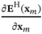<math display="inline" overflow="scroll" xmlns="http://www.w3.org/1998/Math/MathML"><mfrac><mrow><mi>&#8706;</mi><msup><mi mathvariant="bold">E</mi><mi mathvariant="normal">H</mi></msup><mfenced open="(" close=""><msub><mi mathvariant="bold">x</mi> <mi>m</mi> </msub> </접></mrow><mrow><mi>&#8706;</mi><mi mathvariant="bold">x</mi> <mi>m</mi> </mrow></mfrac></math> 采取形式如下：

(5.46)![StartFraction partial-differential bold upper E Superscript normal upper H left-parenthesis bold x Subscript m right-parenthesis Over partial-differential bold x Subscript m EndFraction equals StartFraction p Over StartValue normal upper Omega Subscript mAbsoluteValue EndFraction Underscript normal upper Omega Subscript m left-parenthesis x Subscript m p minus 1 right-parenthesis) bold upper E Subscript ijqp 0 left-parenthesis epsilon q p 0 left-parenthesis k l right-parenthesis) minus epsilon q p asterisk left-parenthesis k l right-parenthesis) right-parenthesis) d normal upper Omega Subscript m](img/c05-math-0046.png)<math display="block" overflow="scroll" xmlns="http://www.w3.org/1998/Math/MathML"> <mfrac> <mrow> <mi>&#8706;</mi> <msup> <mi mathvariant="bold">E</mi> <mi mathvariant="normal">H</mi> </msup> <mfenced open="(" close=""><msub> <mi mathvariant="bold">x</mi> <mi>m</mi> </msub> </접></mrow> <mrow> <mi>&#8706;</mi> <mi mathvariant="bold">x</mi> <mi>m</mi> </mrow> </mfrac> <mo>=</mo> <mfrac> <mi>p</mi> <mfenced open="|" close="|" separators=""><msub> <mi mathvariant="normal">&#937;</mi> <mi>m</mi> </msub> </mfrac> <munder> <mo>&#8747;</mo> <msub> <mi mathvariant="normal">&#937;</mi> <mi>m</mi> </msub> </munder> <mfenced open="(" close=""><msub> <mi>x</mi> <mi>m</mi> </msub> </접><right> <mi>p</mi> <mn>1</mn></right></right> <mi mathvariant="bold">E</mi> <mtext>ijqp</mtext> <mn>0</mn> <left open="(" close=""><mi>\epsilon</mi> <mi>q</mi> <mi>p</mi> <mn>0</mn> </right> <left open="(" close=""><mi>k</mi> <mi>l</mi> </right></right> \minus <mi>\epsilon</mi> <mi>q</mi> <mi>p</mi> <mi>\ast</mi> <left open="(" close=""><mi>k</mi> <mi>l</mi> </right></right></right> <mi>d</mi> <msub <mimi="normal">&#937;</mi> <mi>m</msub> </math>

在这项工作中，宏观结构使用 SIMP 方法进行优化，而微观结构使用 ESO 方法进行优化。这种混合优化方法能够生成健壮的设计概念，并采用了 `OCM` 来更新设计变量 [5, 62]。为了确保拓扑优化问题的解的存在并防止棋盘图案的出现，应用了灵敏度滤波器。

### 5.3.1 数值示例与讨论

在本节中，我们将研究几个软爪器示例。第一个模型在 x 和 y 方向上分别为 80mm 和 80mm（如图 5.16 所示）。微观结构在 x 和 y 方向上有 100×100 个单元。微观尺度的体积分条件为 0.3，宏观尺度的为 0.4。对于所有情况，固体材料 `E[0]` 的弹性张量如公式 (5.47) 所示：

目标是最大化微尺度体积模量 63 对于二维情况，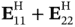<math display="inline" overflow="scroll" xmlns="http://www.w3.org/1998/Math/MathML"><msubsup><mi mathvariant="bold">E</mi><mn>11</mn><mi mathvariant="normal">H</mi></msubsup><mo>+</mo><msubsup><mi mathvariant="bold">E</mi><mn>22</mn><mi mathvariant="normal">H</mi></msubsup></math>）。微尺度设计所示图 5.16(b)和(c)。宏观尺度设计所示图 5.16(d)。

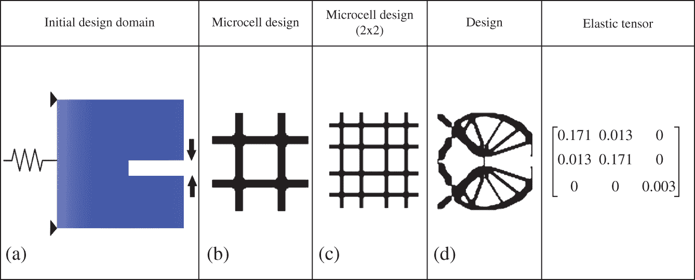

`图 5.16` 用于软抓爪器优化的并发多尺度混合设计案例研究 (a) 初始问题，(b) 单微尺度设计，(c) 4×微尺度设计，以及 (d) 宏尺度设计。

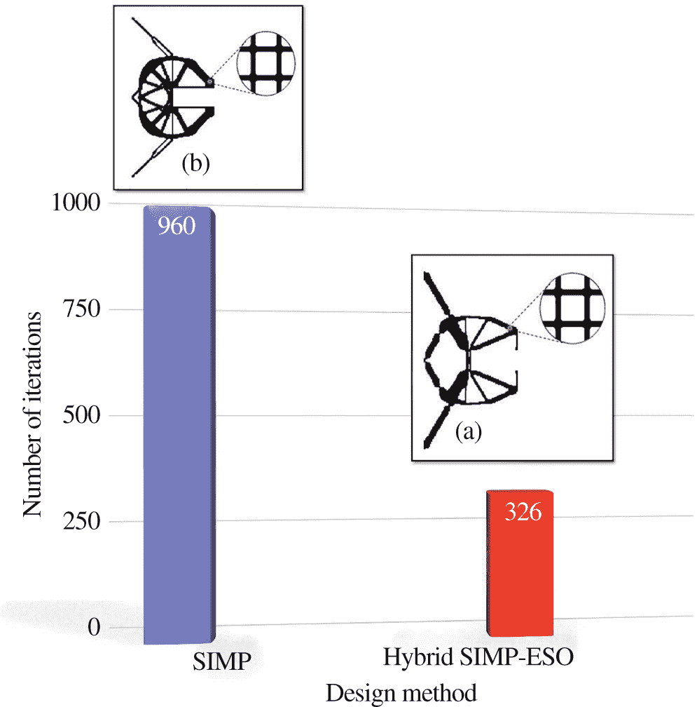

`图 5.17` (a) 混合拓扑优化和 (b) SIMP 方法的迭代次数。

为了评估所提混合（SIMP-ESO）拓扑优化方法与 SIMP 方法相比的计算成本，我们针对相同的给定的示例进行了多尺度并发 SIMP 拓扑优化（即图 5.16(d)）。SIMP 和混合（SIMP-ESO）方法的迭代次数如图 5.17 所示。结果表明，混合方法在更短的时间内实现了稳健的设计，混合拓扑优化方法比 SIMP 方法快了近三倍。

我们的混合多尺度并发拓扑优化的输出位移（`U[out]`）（所示图 5.18(a)）也显示出比单独使用 SIMP 方法（所示图 5.18(b)）更好的结果（好 1.2 倍）。

值得注意的是，Bendsoe 和 Sigmund 64 在对离散最优准则优化（DOCO）和 SIMP 方法进行一系列研究后得出结论，使用线性分析的建模合规机构——这是本研究在所有情况下均采用的方法——往往会导致较差或无效的设计。他们进一步强调，在最好的情况下，线性分析提供错误的结果，而在最坏的情况下，结果完全不适用于设计柔顺性机构。正如 Bendsoe 和 Sigmund 所指出的，使用拓扑优化设计柔顺性机构需要使用几何非线性有限元建模 64。Bendsoe 和 Sigmund 提出的数值示例是针对简单的梯度下降算法开发的，特别是针对 `OCM`。`OCM` 的一个局限性是它倾向于收敛到局部极值，这需要仔细选择梯度下降参数以避免此问题 14, 20。后来，几位研究人员使用了移动渐近线法（MMAs）65, 66。这是一种能够处理各种类型优化问题的通用算法。它依赖于适用于拓扑优化的凸近似；然而，该方法的有效性受到渐近线和移动限制的显著影响 67。由于其固有特性，`OCM` 和 `MMA` 方法是单点搜索算法，使其容易掉入局部最小值 7，特别是当 SIMP 方法的惩罚因子增加时。这些局限性凸显了进一步探索非线性分析作用的重要性。通过广泛的研究，我们的研究证实了 Bendsoe 和 Sigmund 陈述的第一部分，表明使用线性分析建模柔顺性机构可能会导致疑的结果。此外，先的研究已成功将非线性分析应用于柔顺性设计 7。这支持了 Bendsoe 和 Sigmund 陈述的后半部分。然而，在本项研究中，我们证明了 SIMP 方法在位移控制方面的主要问题并非由于线性分析。根据这些发现，我们得出结论：SIMP 方法的问题在于本身，而不是有限元分析。然而，当 SIMP 方法与特定问题的修改和参数化相结合（例如使用 `ESO` 同时设计微尺度）时，可以获得卓越的结果。

### 5.3.2 多材料多隙柔性机器人

多材料结构代表了一种先进的工程范式，在单个系统中集成多种材料以利用它们的互补特性，从而优化结构的功能。这种方法反映了在结构空间配置中策略性地放置材料，以实现单一材料无法实现的优越性能指标。

从历史上来看，尽管多材料结构在悬桥（例如支撑混凝土板和钢梁的钢缆）和火箭发动机等应用中具有巨大的潜力，但其实现受限于高昂成本。然而，随着 3D 打印技术的进步，制造具有不同物理属性的多材料组合结构已变得可行。这一创新显著简化了集成过程，使得能够更轻松地实现优化性能。

在机器人领域，一个关键性是是最小化能量消耗，这通常通过减重来实现。设计多孔机器人结构通过创建提高能源效率的轻量化系统进一步实现了这一目标。本节探索并讨论了多材料多孔软机器人的设计，并辅数值示例说明其优化情况和性能。

### 5.3.2.1 并发多材料多尺度系统下混合拓扑优化的数学建模

本节通过将问题分解为一系列单个单材料子问题，解决了多材料系统的复杂性。这种策略能够开发出一种通用的 SIMP 插值模型，专门用于优化多材料相容机构的拓扑结构。例如，三相材料系统中弹性模量的插值模型可以表示如下：

(5.48)![images/c05-math-0048.png]

```math
<math display="block" overflow="scroll" xmlns="http://www.w3.org/1998/Math/MathML"> <mi mathvariant="bold">E</mi> <mfenced open="(" close=")" separators=""><msub> <mi mathvariant="bold">x</mi> <mi mathvariant="normal">M</mi> </msub> </mfenced> <mo>=</mo> <munderover> <mo movablelimits="false">&#8721;</mo> <mrow> <mi>i</mi> <mo>=</mo> <mn>1</mn> </mrow> <mi>q</mi> </munderover> <msubsup> <mi mathvariant="bold">x</mi> <mi>i</mi> <mi>p</mi> </msubsup> <msub> <mi mathvariant="bold">E</mi> <mi>i</mi> </msub> </math>
```

其中 `E`[`i`] 代表在处理由 `xi` 表示的特定材料分布时，与第 `i` 相相关的不变刚度张量。在研究中，`p` 被选取为 3。微观尺度使用 MSB 方法设计。

通过将公式 `(5.43)` 中引入的单材料软机器人目标函数的多材料表示法，我们得到了如下的多材料目标函数：

```math
\find x_M, x_{mi} (M=1, 2, \dots, q; m=1, 2, \dots, q)

\max_{\rho_M, \rho_m} : u_{out}(x_M), \text{Cellular stiffness} = E_{11}^H(x_{mi}) + E_{22}^H(x_{mi}) s.

\begin{cases}

K(x_M)U = F \\ E = \frac{1}{|V|} \int_V E_{ijqp}(x_m) (\epsilon_{qp}⁰(kl) - \epsilon_{qp}^*(kl)) dV \\

\int_{\Omega_M} x_M d\Omega_M \le v_M, x_M \in \{0, 1\} \forall x_M \in \Omega_M \\

\int_{\Omega_m} x_m d\Omega_m \le v_m, x_m = 0 \forall x_m \in \Omega_m

\end{cases}
```


在这里，`v[M]` 和 `v[m]` 是设计变量的体积分，`x[M]` 是宏观尺度的设计变量集，`x[m]` 是微观尺度第 `i` 个材料相的设计变量。`Ω[dM]` 和 `Ω[dm]` 分别是宏观和微观设计区域。本研究使用的初始模型在 x 轴上尺寸为 80 mm，在 y 轴上为 160 mm，如图 5.19 所示。


**图 5.19 使用混合 SIMP-MSB 的并发多尺度、多材料设计：(a) 初始设计区域，(b–d) 不同材料的微观结构，以及 (e) 最终宏观尺度多材料设计。**


**图 5.20 目标函数历史。**

### 5.3.3 热捕获多孔机器人系统

在上一节中，介绍了多孔机器人的设计。此类机器人系统的激活依赖于在特定预设点施加力。这些力通常通过外部驱动机构产生，例如电推执行器，其能量来源于电力源。这种能量通常通过热能转换过程产生，例如热电厂中使用的过程。然而，能量转换过程本质上存在损失，因此通过直接收集激活能来最小化功率损失是理想的。

在本节中，介绍了一种设计热捕获多孔机器人系统的方法，并配以多个示例。此外，还讨论了这些系统的增材制造性，突显了它们的可行性和高效生产的潜力。

#### 5.3.3.1 多物理场顺性机构热弹性载荷的数学建模

并发多尺度拓扑优化通过建立设计问题的两个独立表示（即宏观和微观尺度区域）来实现。使用两个独立的有限元系统进行拓扑优化的离散化相关设计变量分别为 `x[M]` 和 `x[m]`，分别对应宏观和微观尺度设计区域。宏观尺度区域相对于微观结构在统计学上是均匀的，微观结构被视为代表性体积单元（RVE）。微观结构的有效特征使用数值均匀化方法进行估计。在本研究中，弹性张量 `E^H` 和有效导热率张量 `Λ^H` 被宏观尺度的基础材料系数张量。后续子节将讨论热弹性载荷公式、均匀化理论以及多物理场顺性机构的并发多尺度优化。

### 5.3.3.1.1 热弹性问题公式

热变形现象是物质随结构内温度梯度改变体积的性质。通过热膨胀系数（`α[ij]`）进行测量。当存在温度梯度（`ΔT`）时，由于热膨胀，会在连续结构中产生热载荷。热变形引起的线性热应变（`ε[th]`）可以表示为：

(5.50)
```
ε_th = α_ij ΔT
```

在材料属性分析中，RVE 框架采用了一系列简化原理和分析技术。该模型假设热传递线性关系，并对弹性张量采用小变形理论，保持在线弹性范围内。数值均匀化通过有限元方法实现，并在 RVE 边界应用周期性边界条件。然后通过场平均确定有效材料特征。为了确保周期性，有限元模型用等效场函数连接边界，并在离散段之间进行插值。这种方法有助于对复杂的属性和响应进行详尽且计算上可行的检查。直接耦合方法由于实现拓扑优化所需的多尺度敏感性分析非常复杂，面临巨大挑战。相反，序列耦合方法通过为每个场定制的求解器提供了计算优势。每个场都使用最适用于特定属性的数值技术和求解器进行分析，简化了实现并降低了计算成本。这种方法对于涉及多个相互作用场的复杂系统特别有利。

选择序列耦合还是直接耦合取决于多个因素，例如耦合系统的复杂性、所需的精度以及可用计算资源。在选择合适的耦合方法时，平衡准确性和计算效率至关重要。在本研究中，采用了序列耦合方法来处理热弹性耦合问题。热响应的结构分析被视为准静态，热场和弹性场的相互作用通过有限元框架内的位移叠加来表示，如公式 (5.51) 所示。该方法能够在保持计算成本可控的同时，对热弹性耦合进行高效且准确的分析。

(5.51)
```
KU = F + F_th
```

其中 `K` 是全局弹性刚度矩阵，`U` 是全局节点位移，`F` 是弹性场节点力，`F[th]` 代表热诱导节点力。`F[th]` 是由于温度差导致结构变形而产生的，其形式如下：

(5.52)
```
F_th = ∫_Ω B^T E α ΔT^T dΩ
```

其中 `B` 是应变位移矩阵，`E` 是材料的弹性张量。这里，热梯度是通过专门的有限元模型计算的，用于描述固体热传递现象。

### 5.3.3.1.2 微观尺度下的有效弹性和热系数张量

根据定义，微观结构是相对于宏观区域具有统计均匀性的代表性体积单元（RVE）。微观结构的有效特征是使用数值均匀化方法估计的。在这项工作中，有效弹性张量 `E^H` 和有效热系数张量 `Λ^H` 被选择为宏观下的基本材料常数张量。此外，对于周期性微观设计区域，还计算了相关的有效热胀系数 `α^H`。在本研究中忽略了材料与空隙之间的界面层，并假设热系数在整个材料中均匀分布。RVE 模型包含了若干简化假设和方法。它假设热传导是线性的，并对弹性张量应用小变形理论，将结构置于理想弹性范围内。该模型通过有限元分析采用数值均匀化方法，利用 RVE 边界上的周期性边界条件，并通过平均场计算推导出有效特征。为了满足这些周期性条件，单元有限元模型使用相同的场函数连接相对的边缘边界，该函数根据离散分段对场进行插值。这种方法能够对复杂的材料属性和行为进行全面且计算高效的分析 [68]。接下来的部分将提供多尺度拓扑优化的简要说明和基本方程。

让我们从有效弹性张量的评估开始。线性弹性材料宏观结构上的位移场 `χ` 可以表示为渐近展开形式，如式 (5.53) 所示：

(5.53)
```
χ(ζ, ξ) = χ_0(ζ) + Σ_{k=1}^∞ ω_k χ_k(ζ, ξ)
```

其中 `ω` 是特征尺度（`ω = l/L ≪ 1`），它将宏观尺度缩小到微观尺度（`ξ = ζ/ω`，如图 5.21 所示）。对于代表两个相的 RVE，位移场展开可以简化为一阶：


**多尺度结构域**。

有效属性与热胀产生的局部应变之间的联系是通过摄动理论对热弹性方程展开得到的。热胀属性 `α` 类似于应变向量；因此，为了计算热胀系数，需要热胀引起的均匀化张量 `β`。其计算方法如下：

(5.54)
```
β^H = (1/|V|) ∫_Ω_m E_ijqp (α_pq - ε_pq^th)^T (ε_ij^0 - ε_ij^*) dV
```

其中 `ε_pq^th` 是热胀引起的诱导应变向量。均匀化热胀可以通过均匀化应力向量乘以均匀化弹性张量来计算：

(5.55)
```
α^H = β^H / E^H
```


## 热对流物理建模

在本节中，还考虑了热对流物理。为了解决这个问题，将表面边界划分为离散单元或节点，并在其中计算热传递方程。热对流是固体与其周围环境交换热能的关键机制 [69–71]。通过对流热速率 `Q_Conv` 取决于若干因素，包括固体表面 `T_s` 与周围环境 `T_∞` 之间的温度差（如图 5.22 所示）：

```
Q_Conv = A * k_Conv * (T_s - T_∞)
```

其中 `k_Conv` 是热对流系数，而 `A` 是与充满空气的空隙接触的固体表面。


**图 5.22** 导热对流问题的热传递建模。

因此，在固体材料 `Ω_s` 的自由表面上发生对流，因此在优化过程中，需要使用项 `K_Conv^i` 来更新固体边界上的单元，该项由方程 (5.57) 给出：

(5.57)
```
K_Conv^i = ∫_Ω_s N^T * k_Conv dΩ_s
```

其中 `N` 是形状矩阵。此外，相应的热通量载荷公式如下：

(5.58)
```
Q_Conv^i = ∫_Ω_s N^T * k_Conv * T_∞ dΩ_s
```

## 5.3.3 多物理柔性机构的拓扑优化

通过拓扑优化设计柔性机构重点在于确定实现特定变形的最佳形状（见图 23）。弹性结构通过在指定端口产生位移 `u_out` 来表现柔性行为。该优化问题的目标是在遵守体积约束的情况下识别输出最大的弹性结构拓扑。


**图 23** 弹性柔性设计。

温度分布引起的热膨胀会导致热激活机构产生变形。目标函数根据方程 (5.59) 的形式进行更新，表达式为：

(5.59)
```
max_x: u_out
s.t.:
{
    KU = F_th
    ∫ x dΩ ≤ v, x ∈ [0, 1] ∀ x ∈ Ω
}
```

其中 `N` 是设计区域中的元素数量。对于设计区域的宏观 `x_M` 和微观尺度 `x_m`，热弹性问题的建模需要为每种物理场建立专门的有限元模型（即热物理和力学物理场的模型），如图 5.24 所示。


**图 5.24** 热弹性问题耦合多尺度和多物理场的有限元建模。

因此，并发多尺度拓扑优化问题的公式述如等式 (5.60)：

(5.60)
```
max_{x_M, x_m}: u_out
s.t.:
{
    K(x_M, x_m) U = F_th
    ∫_Ω_dM x_M dΩ_dM ≤ v_M, x_M ∈ [0, 1] ∀ x_M ∈ Ω_dM
    ∫_Ω_dm x_m dΩ_dm ≤ v_m, x_m ∈ [0, 1] ∀ x_m ∈ Ω_dm
}
```


等式 (5.61) 使用伴随法对包含热传导和弹性的耦合线性问题，提供了多物理兼容机制的敏感性分析，并考虑了线性分析中的力学载荷矢量 `F` 与设计无关的事实。

```
(5.61)![StartFraction partial-difference bold upper U Subscript italic out Over partial-difference bold x equals bold lamda Subscript italic t h Superscript upper T left-parenthesis StartFraction partial-difference bold upper K Over partial-difference bold x U Subscript italic in minus StartFraction partial-difference bold upper F Subscript italic t h Over partial-difference bold x right-parenthesis plus bold lamda Superscript upper T left-parenthesis StartFraction partial-difference bold upper K Over partial-difference bold x U Subscript italic in right-parenthesis](img/c05-math-0061.png)
```


其中 $\boldsymbol{\lambda}_{\text{th}}^T$ 和 `λ`^(*T*) 是伴随向量集。

在这里，$\frac{\partial \mathbf{F}_{\text{th}}}{\partial \mathbf{x}}$ 在宏观尺度下的形式为：

(5.62)
$$
\frac{\partial \mathbf{F}_{\text{th}}}{\partial \mathbf{x}_M} = \int_{|\Omega_M|} \mathbf{B}^T \frac{\partial \mathbf{E}^H(\mathbf{x}_M)}{\partial \mathbf{x}_M} \boldsymbol{\alpha}^H(\mathbf{x}_M) \Delta \mathbf{T} d\Omega_M
$$
(images/c05-math-0062.png)

在微观尺度下，其形式为：

(5.63)
$$
\frac{\partial \mathbf{F}_{\text{th}}}{\partial \mathbf{x}_M} = \int_{|\Omega_M|} \mathbf{B}^T \frac{\partial \mathbf{E}^H(\mathbf{x}_M)}{\partial \mathbf{x}_M} \boldsymbol{\alpha}^H(\mathbf{x}_M) \Delta \mathbf{T} d\Omega_M
$$
(images/c05-math-0063.png)

而 $\frac{\partial \mathbf{K}}{\partial \mathbf{x}}$ 在宏观尺度下的形式为

(5.64) $\frac{\partial \mathbf{K}}{\partial \mathbf{x}_M} = \int_{\Omega_M} \mathbf{B}^T \frac{\partial \mathbf{E}^H(\mathbf{x}_M)}{\partial \mathbf{x}_M} \mathbf{B} d\Omega_M$ (images/c05-math-0064.png)

用微观尺度设计变量表示，其形式为：

(5.65) $\frac{\partial \mathbf{K}}{\partial \mathbf{x}_m} = \int_{\Omega_m} \mathbf{B}^T \frac{\partial \mathbf{E}^H(\mathbf{x}_m)}{\partial \mathbf{x}_m} \mathbf{B} d\Omega_m$ (images/c05-math-0065.png)

均匀化材料弹性张量对微观变量的导数 $\frac{\partial \mathbf{E}^H(\mathbf{x}_m)}{\partial \mathbf{x}_m}$ (images/c05-i0034.png) 可以通过 [55] 确定：

(5.66) $\frac{\partial \mathbf{E}^H(\mathbf{x}_m)}{\partial \mathbf{x}_m} = \frac{p}{|\Omega_m|} \int_{\Omega_m} \mathbf{x}_m^{p-1} \mathbf{E}_{ij}^0 (\gamma_{kl}^0 \epsilon_{kl}^* - \gamma_{kl}^* \epsilon_{kl}) d\Omega_m$ (images/c05-math-0066.png)

其中 `p` 是相应微观尺度设计向量的惩罚因子。均匀化材料热膨胀 [20] 向量对微设计变量的导数 $\frac{\partial \boldsymbol{\alpha}^H(\mathbf{x}_m)}{\partial \mathbf{x}_m}$ (images/c05-i0035.png) 可以表示如下：

$$
\frac{\partial \boldsymbol{\alpha}^H(\mathbf{x}_m)}{\partial \mathbf{x}_m} = \frac{1}{\mathbf{E}^H} \left( \frac{\partial \boldsymbol{\beta}^H(\mathbf{x}_m)}{\partial \mathbf{x}_m} + \boldsymbol{\alpha}^H(\mathbf{x}_m) \frac{\partial \mathbf{E}^H(\mathbf{x}_m)}{\partial \mathbf{x}_m} \right)
$$
(images/c05-math-0067.png)


其中 $\beta^H$ 是均匀热应力张量。在这里，项 $\frac{\partial \beta^H(x_m)}{\partial x_m}$ (images/c05-i0036.png) 可以通过以下公式确定：

```math
\frac{\partial \beta^H(x_m)}{\partial x_m}
```

(5.68)

```math
\frac{\partial H(x_m)}{\partial x_m} = \frac{p}{|\Omega_m|} \int_{\Omega_m} (\epsilon_{qp0}(kl) - \epsilon_{qp}^*(kl))^T (x_m^{p-1}) E_{ijqp}⁰ (x_m^p \alpha - \epsilon^{th}) d\Omega_m 
+ \frac{p}{|\Omega_m|} \int_{\Omega_m} (\epsilon_{qp0}(kl) - \epsilon_{qp}^*(kl))^T x_m^p E_{ijqp}⁰ (x_m^{p-1} \alpha) d\Omega_m
```


# 热激活位移执行器与夹持器的多物理场多尺度拓扑优化

## 单尺度热激活位移执行器优化

我们最初的重点是热负载下位移执行器的多物理场拓扑优化，排除了对流影响。我们在单一尺度下构建了一个 2D 宏观设计区域，其特征是上下边界均具有绝缘层（分别在图 5.26(a)和(c)中所示）。该区域利用双线性有限元离散（显示在图 5.26(b)中）分别进行弹性和固体传热物理仿真。

![图 5.26 热激活位移执行器在(a)加热、(b)本构型双线性单元和(c)冷却状态下的单尺度宏观模型 [73]。](images/c05f026.png)

`图 5.26` 热激活位移执行器在(a)加热、(b)本构型双线性单元和(c)冷却状态下的单尺度宏观模型 [\[73\]](#c05.xhtml#c05-bib-0073)。

在本项研究进行的数值仿真中，杨氏模量、热膨胀系数和对流张量等材料属性假设为单位值。这种简化能够专注于分析所研究的特定现象，同时也简化了计算过程。在拓扑优化过程中，空单元的属性被赋予极小值而非零，以最大限度地减少数值误差并确保整个优化过程的稳定性[20, 74, 75]。每个模型的网格由沿 x 和 y 方向分布的 `160 × 160` 个双线性单元组成，每个单元代表 `1 mm²` 的面积。优化最初在单一尺度进行，仅关注宏观尺度。考虑了两个体积分：(a) 体积分数为 `0.5`，对应 `50%` 的减重，以及(b) 体积分数为 `0.25`，对应 `75%` 的减重。宏观尺度拓扑优化的结果以及目标函数历史所示在图 5.27 中。此外，图 5.28 展示了实现最大变形设计的变形和热图，特别是对应于 `75%` 减重的设计。

![图 5.27 单尺度热激活位移执行器的归一化目标函数(a) 50% 减重和(b) 75% 减重案例 [73]。](images/c05f027.png)

`图 5.27` 单尺度热激活位移执行器的归一化目标函数(a) 50% 减重和(b) 75% 减重案例 [\[73\]](#c05.xhtml#c05-bib-0073)。

![图 5.28 75% 减重位移反相器设计的热图和变形 [73]。](images/c05f028.png)

`图 5.28` 75% 减重位移反相器设计的热图和变形 [\[73\]](#c05.xhtml#c05-bib-0073)。

## 热对流对单尺度与多尺度设计的影响

让我们研究热对流对单尺度设计域的影响，类似于图 5.26 中所示的内容，并考虑了 `50%` 和 `75%` 的减重。我们的研究重点是变化的热对流系数如何影响优化后的结构。在该研究中，我们将环境温度设定为 `0°C`。在不同的热对流系数范围内进行优化过程，以彻底分析它们对最终设计的影响。这种方法使我们能够观察到随着对流换热变得更加显著，最优拓扑是如何演变的。值得注意的是，拓扑优化领域的许多专家主张使用无量纲研究。这一建议源于无量纲分析在提供更具通用性的结果以及便于不同尺度和场景之间进行比较的优势 [76, 77]。在拓扑优化研究中，许多学者采用简化的材料常数（通常使用单位值）来简化研究并促进目标函数和梯度优化器的开发。这种方法对于评估伴随分析技术很有价值，与工程和科学研究中广泛使用的量纲分析相一致。量纲分析具有简化问题、识别关键参数、开发标度关系以及用于假设检验的实验设计等优点。在我们的无量纲研究中，我们最初设定了低对流率，因为所有设计用例的基础材料的热系数和热膨胀系数均归一化为 `1`。这种方法允许隔离并检查对流对优化结构的影响，因为即使表面边界对流的微小变化也会显著影响拓扑优化的结果 [78–81]。


**图 5.31** 50% 减重固体、75% 减重固体和 75% 减重多孔热激活位移执行器的性能。

**表 5.5** 总结的结果表明，设计域通过从主设计体产生扩展部分来适应日益增加的热对流。将研究扩展到多尺度优化，得到了表 5.6 所示的结果。与单尺度优化结果类似，多尺度情况下的宏观尺度设计通过形成额外的扩展来响应提高的热对流，以适应增加的热负载。这些结果突显了热对流对设计结构韧性的影响。特别地，随着热对流的增强，设计边界沿出现了尖刺状结构，并从主结构中突出。这些特征在较高的对流率下变得更加明显。宏观尺度上增强的对流驱动换热迫使结构引入垂直连接，从而促使微结构调整其配置。

![表 5.5 具有不同热对流系数的热激活位移执行器的单宏观尺度设计 [73]。](images/c05t005a.png)

**表 5.5** 具有不同热对流系数的热激活位移执行器的单宏观尺度设计 [[73]](#c05.xhtml#c05-bib-0073)。

![表 5.6 具有不同热对流系数的热激活位移执行器的多尺度设计 [73]。](images/c05t006a.png)

**表 5.6** 具有不同热对流系数的热激活位移执行器的多尺度设计 [[73]](#c05.xhtml#c05-bib-0073)。

如表 5.6 所示，微结构通过增加其剪切弹性模量同时减小 x 和 y 方向的杨氏模量来做出响应。这种适应增强了设计应对热激活引起的变形的韧性和弹性，同时加强了其对可能损害 x 方向线性运动的扭转的抵抗——这是优化的关键目标。此外，固体导热张量表明，微结构试图最小化向新形成的扩展部分的热传递，从而保持主设计体的热效率。

## 5.3.3.3.2 热激活夹持器的拓扑优化

本节介绍热激活夹持器的优化。如图 5.23 所示，热流从左边界建立到右边界，而初始设计域的上下边界为隔热。采用与第 5.3.4.4.1 节讨论的数值示例类似的方法并排除对流影响，我们对热激活夹持器进行了多物理场拓扑优化。分析在单尺度宏观设计域上进行，弹性和换热物理均采用与之前研究相同的双线性有限元离散化。

设计域由 `80 × 80` 个单元组成，夹持器的非设计区域为 `40 × 10` 个单元，形成一个开口。分析了两个体积分率情况：`0.25` 和 `0.5`（分别对应 `75%` 和 `50%` 的减重）。夹持输出点位于开口的上下，偏离 `26` 个单元（如图 5.32 所示），以便为拓扑优化实现最优设计提供更大的灵活性。

![图 5.32 热激活夹持器的设计域 [73]。](images/c05f032.png)

**图 5.32** 热激活夹持器的设计域 [[73]](#c05.xhtml#c05-bib-0073)。

首先，执行了单尺度优化，专门关注宏观尺度。然后对两个体积分率情况重复了优化。第一种情况采用 `0.5` 的体积分率，实现了 `50%` 的减重；而第二种情况利用 `0.25` 的体积分率，导致了 `75%` 的减重。单尺度宏观优化的结果以及目标函数随时间的演变见图 5.33。

![图 5.33 (a) 50% 减重和 (b) 75% 减重的单尺度热激活夹持器的归一化目标函数 [73]。](images/c05f033.png)

**图 5.33** 50% 减重和 75% 减重的单尺度热激活夹持器的归一化目标函数 [[73]](#c05.xhtml#c05-bib-0073)。

我们将研究范围扩展到热激活多孔夹持器的设计。遵循与之前类似的方法，我们在微结构设计域中初始化了一个半径为 `50` 个单元的圆形中心子设计区域，如图 5.34 所示。主要目标是进行多尺度优化，在宏观和微观尺度上都实现 `50%` 的减重，同时确保整体体积分率为 `0.25`，对应于 `75%` 的总减重。这种方法假设每个单元的体积等于微观尺度。通过同时最小化两个尺度的重量，实现了显著的体积减少。两个尺度的优化结果见图 5.35。

![图 5.34 热激活夹持器的多尺度设计域，(a) 为宏观域，(b) 为微观域 [73]。](images/c05f034.png)

**图 5.34** 热激活夹持器的多尺度设计域，(a) 为宏观域，(b) 为微观域 [[73]](#c05.xhtml#c05-bib-0073)。

![图 5.35 热激活夹持器的多孔结构设计，(a) 为宏观域，(b) 为微观域 [73]。](images/c05f035.png)

**图 5.35** 热激活夹持器的多孔结构设计，(a) 为宏观域，(b) 为微观域 [[73]](#c05.xhtml#c05-bib-0073)。

如图 5.36 所示，旨在减轻 `50%` 重量的单尺度优化设计性能优于针对 `75%` 重量减重优化的设计。然而，值得注意的是，针对 `75%` 重量减重优化的单尺度和多尺度结构均表现出相当的性能。


**图 5.36** 50% 减重固体、75% 减重固体和 75% 减重多孔热激活夹持器的性能对比。


**表 5.7** 不同热对流系数下，减轻 75% 重的单宏观尺度热激活夹持器设计。

为了进一步研究对流对夹持器设计的影响，我们分析了 `75%` 和 `50%` 重量减重的情况，结果分别列于表 5.7 和 5.8 中。值得注意的是，针对 `75%` 重量减重优化的多尺度多孔夹持器表现出了卓越性能，与实现相同减重的单尺度设计相当。

在单尺度优化过程中，随着向周围传递的热量增加（反映为较高的热对流系数），夹持器设计表现出更大的灵活性。然而，在保持作用点与机械支撑之间机械接触的同时，设计对于其预期功能的有效性逐渐降低。这种现象在 `75%` 减重的情况下比在 `50%` 减重的情况下更为显著，特别是在热对流相对较低的情况下。这种行为在表 5.7 和 5.8 中有所说明。与 `50%` 减重相关的较大表面积作为一个热库，导致了这种效应。在多尺度优化案例中观察到了类似的趋势，如表 5.9 所示。这种行为强调了热对流对夹持器性能的影响，热能量库放大了这种影响。这些发现强调了仔细管理热对流以确保设计的实用性。


**表 5.8** 不同热对流系数下，减轻 50% 重的单宏观尺度热激活夹持器设计。


**表 5.9** 不同热对流系数下，减轻 50% 重的单宏观尺度热激活夹持器设计。

为了检查微结构对夹持器设计的依赖性，在宏观结构上引入了多个微结构。最初，宏观域被分为四个部分，每个部分分配了独特的微结构。针对 `75%` 重量减重的多尺度设计保持了 `0.25` 的体积分数。此外，宏观域被进一步分为八部分，每个部分都有其特定的微结构，如图 5.33 所示。这些结果显示了在宏观域内增加微结构多样性的重要性。

**图 5.41** 性能对比。

使用渐近均匀化理论评估了周期性微观结构的材料属性。然而，均匀化理论的核心假设——尺度分离和周期性——在多微结构系统的优化过程中并没有本质解决相邻微结构之间的连通性。微观结构连接不足（特别是相邻部分边界处）是连通性问题的主要来源，并受到制造性挑战的影响（如图 5.38(b)和 5.40(b)所示）。此外，在应用均匀化方法时，弱连通性会导致载荷传递困难和属性估计不准确。因此，研究边界条件和微结构之间的连通性对于实现适用于增材制造的实用且可制造的设计至关重要。

多位研究人员探讨了这个问题。例如，Du 等人 [82] 研究了引入连通性指数以控制相邻微观结构的连接。Liu 等人 [83] 研究了为微观结构引入预定义的连通区域。在这项研究中，我们采用了 Neves 等人的 [84] 方法，通过将连接边界实现为非设计区域，以确保微观尺度上更好的连通性。此外，该方法在解决微观结构连通性问题方面取得了非常理想的结果，从而提升了制造能力 [85, 86]。

四段式和八段的情况均使用宽度为四个单元的连接边界重复优化过程，分别如图 5.42(a)和(b)所示。对于多尺度情况，保持 `0.25` 的体积分数，对应于 `75%` 的减重。最终的优化结果在图 5.43 和 5.44 中给出。


**图 5.41** 热激活夹爪设计的性能比较。


**图 5.42** 具有用于连通性的非设计区域的热激活夹爪多尺度设计域，(a) 四段式热激活夹爪，和 (b) 八段式热激活夹爪。


**图 5.43** 具有微观结构连通性的四个部件热激活夹爪优化结果。


**图 5.44** 具有微观结构连通性的八部件热激活夹爪优化结果。

---

# 参考文献

1.  Yan, S., Wang, F., and Sigmund, O. (2018). 热传导树形结构的非优性研究。*Int. J. Heat Mass Transf.* 122: 660–680. `https://doi.org/10.1016/j.ijheatmasstransfer.2018.01.114`
2.  Al Ali, M. (2024). 工程师优化设计。在: 基于非参数优化的骨科设计基础, 53–89. Springer Nature Singapore: Singapore ISBN 978‐981‐97‐1040‐9.
3.  Qie, L., Jing, S., and Lian, R. (2019). 用于拓扑优化的 Heaviside 阶的形态滤波器。在: IOP Conference Series: Materials Science and Engineering 论文集, vol 472, 12034.
4.  Sigmund, O. (2001). 利用拓扑优化设计多物理执行器——第一部分：单材料结构。*Comput. Methods Appl. Mech. Eng.* 190: 6577–6604. `https://doi.org/10.1016/S0045-7825(01)00251-1`
5.  Al Ali, M.; Shimoda, M.; Benaissa, B.; Kobayashi, M.; Takeuchi, T.; Al‐Shawk, A.; Ranjbar, S. 针对低电磁干扰散热片的设计的元启发算法辅助结构拓扑优化方法。2023, `https://doi.org/10.21203/rs.3.rs-3353757/v1`
6.  Musaddiq Al Ali, M.S. (2022). 面向高导热轻量化结构的并发多尺度拓扑优化。在: 第 15 届世界计算力学大会 (WCCM-XV) 和第 8 届亚洲太平洋计算力学大会 (APCOM-VIII) 论文集, 1–12.
7.  Al Ali, M. and Shimoda, M. (2022). 用于高热导率轻量化宏观结构设计的并发多尺度拓扑优化研究。*Int. J. Therm. Sci.* 179: 107653. `https://doi.org/10.1016/j.ijthermalsci.2022.107653`
8.  Guo, B. (1995). 区间集：等值面提取的体积渲染技术。在: Visualization'95 论文集, 3–10.
9.  Parker, S., Shirley, P., Livnat, Y. et al. (1998). 用于等值面渲染的交互式光线追踪。在: Visualization'98 论文集 (Cat. No. 98CB36276), 233–238.
10. Fuhrmann, S., Kazhdan, M., and Goesele, M. (2015). 基于 Hermite 数据的精确等值面插值。在: 2015 年国际 3D 视觉国际会议论文集, 256–263.
11. Fang, H., Yang, X., Kin, T., and Igarashi, T. (2021). 基于应用符号距离网络的 MRI 脑表面重建。在: 2021 年 IEEE 第 18 届生物医学成像国际会议 (ISBI) 论文集, 1164–1168.
12. Laramee, R.S., Schneider, J., and Hauser, H. (2004). 基于计算流体力学的等值面纹理流可视化。在: 第六届 Eurographics-IEEE TCVG 可视化联合会议集, 85–90.
13. Sigmund, O. (2000). 一类新型极端材料。*J. Mech. Phys. Solids* 48: 397–428. `https://doi.org/10.1016/S0022-5096(99)00034-4`
14. Fujioka, M., Shimoda, M., and Al Ali, M. (2021). 用于宏观结构刚度最大化的周期微结构形状优化。*Compos. Struct.* 268: 113873. `https://doi.org/10.1016/j.compstruct.2021.113873`
15. Pélissou, C., Baccou, J., Monerie, Y., and Perales, F. (2009). 随机准脆复合材料代表性体积单元尺寸的确定。*Int. J. Solids Struct.* 46: 2842–2855.
16. Yvonnet, J. (2019). 有限元异质材料的计算均质化。Springer ISBN 9783030183820.
17. Sab, K. and Nedjar, B. (2005). 线性复合材料随机介质与代表性体积单元的周期化。*Comptes Rendus Mécanique* 333: 187–195. `https://doi.org/10.1016/j.crme.2004.003`
18. Ali, M. and Shimoda, M. (2022). 使用 `MATLAB` 面向高导热率轻量化结构的多物理多尺度拓扑优化。*Struct. Multidisc. Optim.* 65.
19. Gosselin, L. and Bejan, A. (2004). 电磁铁的构造优化。*Int. J. Therm. Sci.* 43: 331–338. `https://doi.org/10.1016/j.ijthermalsci.2003.004`
20. Al Ali, M., Shimoda, M., Benaissa, B. et al. (2024). 针对低干扰散热片的设计的元启发辅助结构优化方法。*Sci. Rep.* 14: 3431. `https://doi.org/10.1038/s41598-024-5408-z`
21. Tavakoli, M., Batista, R., and Sgrigna, L. (2015). 柔性手：具有紧凑驱动系统。在: Actuators 论文集, vol 5.
22. Al Rubaiai, M., Qi, X., Frank, Z. et al. (2022). `PVC`胶的非线性建模与控制。*IEEE/ASME Trans. Mechatronics* 27 (4): 2168–2175. `https://doi.org/10.1109/TMECH.2022.31755`
23. Al Rubaiai, M., Tsuruta, R., Gandhi, U., and Tan, X. (2022). 柔性传感器对的变形变幅与位置的分布式测量。*Adv. Eng. Mater.* 210146. `https://doi.org/10.1002/adem.20210146`
24. Al Rubaiai, M. (2021). 柔性机器人系统：刚度调节、感知与驱动的新解决方案。密歇根州立大学。
25. Tsukihara, R. and Shimoda, M. (2021). 用于调整壳结构特征值的材料取向设计。*Trans. JSME (Japanese)*, 87.
26. Bends, M.P. and Kikuchi, N. (1988). 使用均质化方法在结构设计中生成最优拓结构。*Comput. Methods Appl. Mech. Eng.* 71: 199–224. `https://doi.org/10.1016/0045-7825(88)90086-2`
27. Davoodi, E., Montazerian, H., Mirhakimi, A.S. et al. (2021). 增材制造生物材料。*Bioact. Mater.* 15.
28. Hassani, B. and Hinton, E. (1998). 均质化与拓扑优化综述 I——周期结构介质的均质化理论。*Comput. Struct.* 69: 707–717. `https://doi.org/10.1016/S0045-7949(98)00131-X`
29. Ananthuresh, G.K., Kota, S., and Gianchandani, Y. (1993). 微柔性机构的系统合成——初步结果。在: 第三届国立应用力与机器人会议。
30. Nishiwaki, S., Frecker, M.I., Min, S., and Kikuchi, N. (1998). 使用均质化方法的柔性机构拓扑优化。*Int. J. Numer. Methods Eng.* 42: 535–559. `https://doi.org/10.1002/(SICI)1097-0207(19980615)42:3<535::AID-NME372>3.0.CO;2-J`
31. Sigmund, O. (1997). 利用拓扑优化进行柔性机构的设计。*J. Struct. Mech.* 25: 493–524. `https://doi.org/10.1080/0890545970894515`
32. Sigmund, O. and Torquato, S. (1999). 利用拓扑优化设计智能复合材料。*Smart Mater. Struct.* 8: 365.
33. Huang, J., Ge, W., and Yang, F. (2007). 用于翼型前缘形状变化的柔性机构的拓扑优化。*ACTA Aeronaut. Astronaut. Sin.* 28: 988.
34. Maute, K. and Frangopol, D.M. (2003). 基于拓扑优化的 MEMS 机制可靠性设计。*Comput. Struct.* 81: 813–824. `https://doi.org/10.1016/S0045-7949(03)00008-7`
35. Xie, Y.M. and Steven, G.P. (1993). 一种结构优化的简单进化程序。*Comput. Struct.* 49: 885–896. `https://doi.org/10.1016/0045-7949(93)90035-C`
36. Zhou, M. and Rozvany, G.I.N. (2001). 论拓扑优化中 ESO 型方法的有效性。*Struct. Multidiscip. Optim.* 21: 80–83. `https://doi.org/10.1007/s001580050170`
37. Ansola, R., Vegueria, E., Canales, J., and Tárrago, J.A. (2007). 用于柔性机构设计的简单进化类拓扑优化程序。*Finite Elem. Anal. Des.* 44: 53–62. `https://doi.org/10.1016/j.finel.2007.09.002`
38. Huang, X. and Xie, Y.M. (2010). 带有额外位移约束的连续体结构进化拓扑优化。*Struct. Multidiscip. Optim.* 40: 409–416. `https://doi.org/10.1007/s00158-009-0382-4`
39. Im, M.‐G., Park, J.‐Y., Han, S.‐Y. et al. (2010). 一种基于 BESO 的电热柔性机构的新拓扑优化方案。在：第 6 届澳洲应用力学大会论文集，159–168.
40. Ansola, R., Vegueria, E., Maturana, A., and Canales, J. (2010). 通过有限元增加程序进行 3D 柔性机构合成。*Finite Elem. Anal. Des.* 46: 760–769. `https://doi.org/10.1016/j.finel.2010.04.006`
41. Sivapuram, R., Dunning, P.D., and Kim, H.A. (2016). 基于多尺度拓扑优化的材料与结构同步优化。*Struct. Multidiscip. Optim.* 54: 1267–1281. `https://doi.org/10.1007/s00158-016-1519-x`
42. Al Ali, M. and Shimoda, M. (2022). 面向使用 `MATLAB` 的高导热高刚度轻量化结构多物理多尺度拓扑优化。*Struct. Multidiscip. Optim.* 65: 1–26. `https://doi.org/10.1007/s00158-022-03291-0`
43. Bendsøe, M.P. and Sigmund, O. (1999). 拓扑优化中的材料插值方案。*Arch. Appl. Mech.* 69: 635–654. `https://doi.org/10.1007/s004190528`
44. Sigmund, O. and Petersson, J. (1998). 拓扑优化中的数值不稳定：处理棋盘格效应、网格依赖性和局部极值的程序综述。*Struct. Optim.* 16: 68–75. `https://doi.org/10.1007/BF012102`
45. Ali, M. and Shimoda, M. (2022). 面向高导电轻量化结构的并发多尺度拓扑优化。在：第 15 届世界计算力学大会 (`WCCM-XV`) 和第 8 届亚洲太平洋计算力学大会 (`APCOM-VIII`) 会议（S. Koshizuka 编），1–12。横浜：CIMNE.
46. Dzierżanowski, G. (2012). 论材料插值方案与最优复合材料平面形状优化的比较。*Struct. Multidiscip. Optim.* 46: 693–710. `https://doi.org/10.1007/s00158-012-0788-2`
47. Bendsøe, M.P. (1989). 作为材料分布问题的最优形状设计。*Struct. Optim.* 1: 193–202. `https://doi.org/10.1007/BF016594`
48. Fujioka, M., Shimoda, M., and Al Ali, M. (2022). 用于控制宏观刚度的多尺度结构并发形状优化。*Struct. Multidiscip. Optim.* 65: 1–27. `https://doi.org/10.1007/s00158-022-03304-y`
49. Al Ali, M., Al Ali, M., Saleh, R.S., and Sahib, A.Y. (2019). 使用非参数化级联优化扩展疲劳寿命。在：第 2019 年世界工程大会论文集，547–553.
50. Juvinall, R.C. (1967). 应力、应变和强度的工程考虑，卷 66。纽约：McGraw Hill ISBN 978-007033180.
51. Bendsoe, M.P. and Sigmund, O. (2003). 拓扑优化：理论、方法与应用。Springer Science & Business Media.
52. Wang, L., Liang, J., Chen, W., and Qiu, Z. (2019). 柔性机构的概率性拓扑优化方法。*Int. J. Numer. Methods.* 119: 1419–1438.
53. Zhan, J., Li, Y., Luo, Z., and Liu, M. (2021). 带有全局应力约束的多材料柔性机构拓扑设计。*Micromachines* 12: 1379.
54. Jiang, T. et al. (1995). 用于结构优化的移动渐近线一阶方法。*Built Environ.* 14: `https://doi.org/10.2495/OP950101`
55. Hollister, S. and Kikuchi, N. (1992). 材料插值的比较。*Struct. Optim.* 10: 73–95. `https://doi.org/10.1007/s00419052`
56. Zhou, M., Alexandersen, J., and Sigmund, O. (2016). 拓扑优化方法 ESO 方法有效性。*Struct. Multidiscip. Optim.* 54: 1267–1281. `https://doi.org/10.1007/s00158-016-0519-x`
57. Lee, Y. and Kim, S. (2021). 多孔隙拓扑优化。*Appl. Therm. Eng.* 190: 116692.
58. Fu, W., Huij, J., and Hao, W. (2018). 用于柔性机构结构优化的移动渐近线一阶方法。*Appl. Therm. Eng.* 131.
59. Frecker, M., Ananth, G., and Nishiwaki, S. (1997). 拓扑优化中的材料插值。*Arch. Appl. Mech.* 69: 238–245. `https://doi.org/10.1007/BF0121042`
60. Al Ali, M. and Shimoda, M. (2023). 面向增材制造的多物理多尺度拓扑优化。*Eng. Struct.* 294: 116756. `https://doi.org/10.1016/j.struct.2023.116756`
61. Sigmund, O. (1994). 给定参数材料。*Int. J. Solids* 31: 2313–2329. `https://doi.org/10.1016/0045-7949(93)90035-C`
62. Luo, Z., Chen, L., Yang, J., and Zhang, Y. (2006). 连续体结构的多刚度拓扑优化。*Int. J. Adv. Manuf. Technol.* 30: 203–214. `https://doi.org/10.1007/s00170-005-0084-z`
63. Asmussen, J., Alexandersen, J., Sigmund, O., and Andreasen, C.S. (2019). 自然对流问题拓扑优化的“穷人”方法。*Struct. Multidiscip. Optim.* 59: 1105–1124. `https://doi.org/10.1007/s00158-019-02215-9`
64. Nishioka, A. and Kanno, Y. (2023). 大规模拓扑优化的惯性投影梯度法。*Jpn. J. Ind. Appl. Math.* 1–29. `https://doi.org/10.1007/s13160-023-00563-0`
65. Al Ali, M. and Shimoda, M. (2023). 考虑蒸发的热力-弹性多物理场下多孔结构的多行并发多尺度拓扑优化。*Int. J. Numer. Methods Eng.* 124: 3219–3249. `https://doi.org/10.1002/nme.7245`
66. Al Ali, M., Shimoda, M., Benaissa, B., and Kobayashi, M. (2023). 使用元启发式结构二分分布方法对对流条件下轻量化和高导热率结构进行非参数优化。*Appl. Therm. Eng.* 233: 121124. `https://doi.org/10.1016/J.APPLTHERMALENG.2023.121124`
67. Bruns, T.E. (2007). 对流主导的稳态传热问题的拓扑优化。*Int. J. Heat Mass Transf.* 50: 2859–2873. `https://doi.org/10.1016/j.ijheatmasstransfer.2007.01.039`
68. Thore, C.‐J., Lundgren, J., Lundgren, J.‐E., and Klarbring, A. (2022). 质量流和刚度约束下的最小温度拓扑优化。*Comput. Methods Appl. Mech. Eng.* 400: 115334. `https://doi.org/10.1016/j.cma.2022.115334`
69. Du, Z., Zhou, X.Y., Picelli, R., and Kim, H.A. (2018). 具有连通性索引约束的多尺度拓扑优化的微结构连接。*J. Mech. Des. Trans. ASME* 140: 1–12. `https://doi.org/10.1115/1.4041176`
70. Liu, P., Kang, Z., and Luo, Y. (2020). 具有可连接微结构的晶格结构双尺度并发拓扑优化。*Addit. Manuf.* 36: 101427. `https://doi.org/10.1016/j.addma.2020.101427`
71. Li, H., Gao, L., Li, H. et al. (2021). 具有连续纤维路径的纤维增强结构的全拓扑优化。*Comput. Methods Appl. Mech. Eng.* 377: 113668. `https://doi.org/10.1016/j.cma.2021.113668`
72. Hu, J., Luo, Y., and Liu, S. (2021). 具有自连接多重晶格-材料域的分级结构双尺度并发拓扑优化方法。*Compos. Struct.* 272: 114224. `https://doi.org/10.1016/j.compstruct.2021.114224`
73. Qiu, Z., Li, Q., Liu, S., and Xu, R. (2021). 基于聚类的包含宏观结构、组件和材料的并发拓扑优化。*Struct. Multidiscip. Optim.* 63: 1243–1263. `https://doi.org/10.1007/s00158-020-02755-5`

---

# 第 6 章：用于多孔结构设计与分析的高级软件

## 6.1 引言

在本章中，我们概述了常用于设计多孔结构的商业工具，并介绍了用于说明多孔结构设计原理的教育代码。本章分为两个主要部分。第一部分介绍了几个支持工业应用中多孔架构建模和优化的常用软件平台。这些工具的选择是基于实践经验和技术熟悉程度，而非作为背书或商业推广。其目的是提供对这些软件平台功能和能力的见解，增强对当前设计方法及其在增材制造应用的理解。第二部分提供了通过拓扑优化设计多孔结构的教育代码示例。这些示例仅供教学使用，旨在提供底层概念的基础性知识。需要澄清的是，尽管作者已尽力确保所提供的教育代码的准确性和可靠性，但作者不保证这些代码没有错误或漏洞。对于使用这些代码引起的任何索赔、损害或问题，作者不承担任何责任。

## 6.2 商业软件

在本节中，我们回顾了几种用于设计多孔结构的商业软件包。目前设计多孔结构的方法主要依赖于使用预定义的微结构填充几何，并根据微结构的尺寸和厚度使用经验插值函数进行近似。软件供应商已经意识到通过反向同质化等优化生成微结构来提高可靠性。尽管取得了这些进展，反向同质化尚未作为直接工具集成到大多数软件中。这种缺失限制了更创新设计的潜力。虽然某些软件通过计算机接口提供了开发自定义微结构的灵活性，允许用户编写代码，但这是一种权宜之计，而非完全解决方案。

### 6.2.1 Altair Inspire

Altair Inspire 是一种仿真软件，已成为创建和优化轻量化结构的价值工具，特别是通过晶格优化。通过结合各种几何形状，它可以创建更轻、更强且更节能的设计。在 Altair Inspire 中，晶格优化将固体结构组件的三维（3D）网格转换为互连的晶格梁。这些梁的尺寸和厚度使用固体向同性材料惩罚（`SIMP`）[1]-[3]方法确定。通过插值每个元素及其周围元素的设计变量，定义了晶格梁的厚度。

然而，晶格设计本身是预配置的，从软件内置的预定义选项中选择。因此，将此过程描述为混合非参数优化设计更为准确。

### 6.2.2 GENESIS 软件

与 Altair Inspire 类似，使用 GENESIS 软件可以通过拓扑优化来优化晶格结构，该方法允许根据特定的设计标准调整晶格的尺寸。GENESIS 通过使用同质化方法简化了这一过程。渐近同质化的应用允许快速仿真，而无需显式地建模单个晶格单元。通过选择晶格单元类型、单元尺寸和截面厚度等关键参数，用户可以在有限元分析仿真中高效定义晶格的结构特征。该软件提供了广泛的预制晶格库，包括立方、体心立方和双金字塔几何形状，为选择晶格图案提供了灵活性。优化过程涉及最小化某些属性和函数，同时约束位移。

### 6.2.3 nTopology

nTopology 是一种基于非参数优化的设计软件，它提供了一种创建多孔结构的方法，专门为增材制造应用而定制。通过其先进的计算设计工具，nTopology 允许选择受控的晶格结构来为结构引入孔隙，从而在优化刚度等结构性能的同时实现轻量化。

该软件支持广泛的晶格配置，包括三周期极小表面（`TPMS`），例如 `gyroid` 和 `Diamond`。`TPMS` 结构在优化材料效率和机械性能方面特别有用，因为它们表现出连续、光滑的表面，可以均匀分布应力并在不增加额外重量的情况下提高结构完整性。

nTopology 的另一个关键方面是其隐式建模方法。在隐式建模中，几何操作使用数学函数定义，这使得创建复杂的晶格形状变得更加容易，如果使用显式建模，这将非常耗力甚至无法实现。

### 6.2.4 SpaceClaim

Ansys SpaceClaim 是一种多功能的 3D 建模软件，用于设计多孔结构。一旦选择了所需的单元类型，SpaceClaim 允许在预定义的设计区域内填充这些单元。该软件提供了一定的灵活性来控制单元尺寸、方向和分布等参数，从而实现多孔材料属性的优化。

### 6.2.5 PTC Creo

PTC Creo 是一种计算机辅助设计软件，为机械工程的产品设计和分析提供了一系列工具。Creo 的功能之一是晶格设计功能，支持创建各种类型的多孔结构。这些包括基于梁的晶格、2.5D 晶格 [4, 5]、公式驱动晶格 [6–11]、自定义晶格以及随机晶格 [12–14]，每种晶格都为不同的工程应用提供了独特的优势。Creo 的晶格生成工具允许我们针对强度、重量、热导性和可制造性对结构进行优化。

## 6.3 基于编程的多孔结构商业软件设计

若干软件包允许用户通过利用编程语言自定义功能，甚至通过自己的编程平台引入新功能，例如用于 ANSYS 的 `APDL` 和用于 Beta 软件的 `ANSA` 代码。此外，这些软件包还支持广泛使用的高级编程语言如 `Java`、`VBA`、`TCL`、`MATLAB` 和 `Python`。这些语言凭借丰富的库和强大的社区支持，能够快速开发高性价比、高性能的自定义程序。此类程序可以增强多孔结构的设计，甚至可以在原生不支持此类设计的软件中促进多孔结构的创建。例如，作者使用 `MATLAB` 开发了某种基于拓扑优化的多孔结构设计来控制 `COMSOL` 软件，能够针对各种弹性和动态失效理论设计弹性抗失效微结构，如图 6.1 所示。

此外，对原生不支持编程语言的商业软件进行编程也是可能的。例如，`Nastran` 已证明可以适配 `C++` 使用，能够开发创新的多孔设计，例如能够承受静态和动态载荷的多孔层板（如图 6.2 所示）[15]。

### 6.3.1 软件多物理场拓扑优化

第 5.2.8 节概述的多物理场问题的并发多尺度优化步骤实现在 `MATLAB` 代码中，该代码可在 GitHub 仓库中获取 ([`github.com/musaddiqalali/Multiscal-multiphysic-topology-optimization`](https://github.com/musaddiqalali/Multiscal-multiphysic-topology-optimization))。代码采用 `SIMP` 方法进行拓扑优化以有效解决问题。用于拓扑优化和均匀化的 `MATLAB` 代码基于 Andreassen 等人的工作 [16, 17]，是该实现的基础。代码结构分为七个不同的模块，每个模块组织在独立的 `MATLAB` 文件中，以为用户提供灵活性和定制。这些模块包括：


**图 6.1** COMSOL-MATLAB 微结构设计示例。

1.  **输入数据**：处理初始参数和设置；
2.  **有限元准备**：准备有限元方法 (`FEM`) 框架；
3.  **归一化因子计算**：计算必要的归一化因子；
4.  **渐近均匀化**：应用均匀化技术对材料属性建模；
5.  **目标规划多目标函数**：构建多目标优化函数；
6.  **并发多尺度优化**：跨多个尺度执行优化过程。


**图 6.2** 使用 Nastran-C++ 程序设计的多孔板。Shimoda 等人，(2023) / Elsevier。

**这些模块分布在七个 `MATLAB` 函数中**：

*   `Concurrent_MOO.m`
*   `get_Initials.m`
*   `Concurrent_solver.m`
*   `Homogenization_full.m`
*   `elementMatVec.m`
*   `Objective_Calculator.m`
*   `OC_2D.m`

主程序 `Concurrent_MOO` 协调整个优化过程，包括数据生成和核心优化步骤的执行。其他函数在主程序被调用以执行特定任务。程序的流程如图 6.3 所示。

主程序包含在主要的 `MATLAB` 文件 (`Concurrent_MOO.m`) 中，从第 4 行开始，如图 6.4 所示。在此处，定义了微尺度输入参数，包括 `Micro_nelx` 和 `Micro_nely`，它们分别代表 x 和 y 方向上的单元数。

微尺度体积分率 `v_m` 由 `Micro_volfrac` 定义，而 `penal` 代表 `SIMP` 幂函数的指数。`Micro_rmin` 参数指定了网格独立性滤波器的半径，将在优化准则章节中进一步解释。同样，宏尺度初始设计区域和空间配置从第 6 行开始定义。宏尺度输入参数包括 `Macro_nelx` 和 `Macro_nely`，它们表示 x 和 y 方向上的单元数。宏尺度体积分率约束由 `Macro_volfrac` 指定，其定义在第 7 行。此外，宏尺度空间配置的单元宽高比由 `dx` 和 `dy` 表示。

在第 9 行，指定了优化过程的最大迭代次数 `maxIter`。在我们的分析中，构建了两个模型（即热物理和力学物理模型）来计算热柔性和力学柔性。因此，使用了两个独立的有限元系统。由于 `SIMP` 方法基于欧拉框架，在拓扑优化过程中，由设计变量 `x` 表示的单元权重是逐渐减小的，而不是消除不需要的单元，因此可以在优化之前提前准备好有限元框架。热分析和力学分析都使用了长度为单位 `1` 的结构化双线性单元，如图 6.5 所示。

![图 6.3 多物理场并发拓扑优化的 MATLAB 代码流 [18].](images/c06f003.png)

**图 6.3** 多物理场并发拓扑优化的 MATLAB 代码流 [[18]](#c06.xhtml#c06-bib-0018)。

![图 6.4 MATLAB 主代码输入数据部分 (Concurrent_MOO.m) [18] / Springer Nature.](images/c06f004.png)

**图 6.4** MATLAB 主代码输入数据部分 (`Concurrent_MOO.m`) [[18]](#c06.xhtml#c06-bib-0018) / Springer Nature。

![图 6.5 使用的双线性二次单元 [18].](images/c06f005.png)

**图 6.5** 使用的双线性二次单元 [[18]](#c06.xhtml#c06-bib-0018)。

![图 6.6 主函数 Concurrent_MMO.m 的 MATLAB 主代码中的力学有限元部分 [18] / Springer Nature.](images/c06f006.png)

**图 6.6** 主函数 `Concurrent_MMO.m` 的 MATLAB 主代码中的力学有限元部分 [[18]](#c06.xhtml#c06-bib-0018) / Springer Nature。

对于力学柔性分析，有限元准备步骤列在第 11–22 行（如图 6.6 所示）。`Macro_edofVec_mech` 矩阵存储在名为 `Macro_edofVec_mech` 的向量格式中。然后使用该向量计算每个单元的八个 DOF 索引，这些索引存储在 DOF 矩阵 `Macro_edofMat_mech` 中。该矩阵有助于在优化循环期间高效构建刚度矩阵。对于图 6.7 所示的包含 25 个单元的示例，矩阵 `Macro_edofMat_mech` 如下：

```
Macro_edofMat_mech = [
    3, 4, 11, 12, 9, 10, 1, 2;
    5, 6, 13, 14, 11, 12, 3, 4;
    7, 8, 15, 16, 13, 14, 5, 6;
    ...
]
```

随后使用 `Macro_edofMat_mech` 矩阵分别生成行和列索引向量 `iK_mech` 和 `jK_mech`，如第 15 和 16 行所示。与长度为 8 的单位向量进行克罗内克积，然后进行重塑处理。这两个索引向量用于构建宏观尺度情况下的全局力学刚度矩阵。由于采用了欧拉方法，如前所述，全局刚度矩阵在整个优化过程中保持不变。

位移和力值存储在第 17 行和 18 行的计算机 RAM 中。研究案例的边界条件定义在第 19 行和第 20 行。自由 DOF 在第 22 行通过从总 DOF（在第 21 行指定）中减去固定 DOF（在第 20 行识别）来确定。如图 6.7 所示，宏观尺度在 x 和 y 方向上的 DOF 分别用红色和蓝色表示。微设计区域遵循类似的 DOF 分配方法。

同样，对于热传导问题，有限元准备步骤与力学刚度情况相似，并列在第 24–34 行（如图 6.8 所示）。


**图 6.7** 机械分析的节点定义和自由度。

![图 6.8 主函数 `Concurrent_MMO.m` 的 MATLAB 主代码热传导有限元部分 [18] / Springer Nature.](images/c06f008.png)

**图 6.8** 主函数 `Concurrent_MMO.m` 的 MATLAB 主代码热传导有限元部分 [[18]](#c06.xhtml#c06-bib-0018) / Springer Nature.

### 归一化因子计算

下一步是计算用于目标规划的因子，即乌托点（`f_i^Best`）和最差点（`f_i^Worst`）。这些点针对每个物理场的每个目标函数计算。计算使用了专用的 `MATLAB` 函数：`Concurrent_solver.m` 和 `Objective_Calculator.m`。最差点代表初始设计的机械和热合规，在此过程中也会被确定（即 `f_c^ini` 和 `f_κ^ini`），同样还有机械乌托点（`f_c^*`）和热乌托点（`f_κ^*`），它们是执行多目标优化所需的（即为每个物理模型单独优化的结果）；因此，在行 36–46 中，计算了 `f_c^ini` 和 `f_c^*` 的值（如图 6.9 所示）。此外，在行 49–58 中计算了 `f_κ^ini` 和 `f_κ^*`，如图 6.10 所示。如图 6.9 和图 6.10 所示，此过程需要调用多个 `MATLAB` 函数。

![图 6.9 主函数 `Concurrent_MMO.m` 机械合规的最差点和乌托点 [18] / Springer Nature.](images/c06f009.png)

**图 6.9** 主函数 `Concurrent_MMO.m` 机械合规的最差点和乌托点 [[18]](#c06.xhtml#c06-bib-0018) / Springer Nature.

![图 6.10 主函数 `Concurrent_MMO.m` 的热合规的最差点和乌托点 [18] / Springer Nature.](images/c06f010.png)

**图 6.10** 主函数 `Concurrent_MMO.m` 的热合规的最差点和乌托点 [[18]](#c06.xhtml#c06-bib-0018) / Springer Nature.

### 实现细节

在行 36 中，使用 `get_Initials` 计算了宏观和微观尺度的初始集合。宏观尺度初始化值为 `0.5`，如图 6.11 所示。在行 38 中，将 `Macro` 和 `Micro` 分别赋予 `MacroPhys` 和 `MicroPhys`。执行此步骤是为了防止后续计算中的任何累积。

在 `Homogenization_full` 中，有限元也是双线性的，如图 6.12 所示。在这种情况下，RVE 包含两个相：材料和孔。为了区分这两种情况，使用了标识符 `select_case`。评估弹性张量时，`select_case` 设置为 `1`，而在计算电导率张量时，将其设置为 `2`。行 2–11 用于准备均质化的输入。


**图 6.11** (a) 微观和 (b) 宏观结构的初始设计区域。


**图 6.12** 宏观和微观尺度目标函数及其敏感度的计算。

### 公式

在行 8 中，`Lambda` 是一个包含材料和孔的朗日第一参数（`λ`）的向量。同样，`mu` 是朗姆第二参数（`μ`）的向量。在行 12 中，使用 `elementMatVec.m` 函数计算物理兼容的单元刚度矩阵。在 `elementMatVec` 内部，刚度矩阵的计算如下：


K = sum_{e=1} N_e^T C_e B_e dV_e

*N* 个有限元的组装由求和表示，`C[e]` 是单元的本构矩阵，对于二维（2D）等向性材料的机械静态物理，该矩阵为：

(6.2) $C_e = C_{\lambda} + C_{\mu}$

其中 $C_{\lambda}$ 和 $C_{\mu}$ 分别由公式 (6.3) 和 (6.4) 给出。

(6.3) $C_{\lambda} = \lambda_e \begin{bmatrix} 1 & 1 & 0 \\ 1 & 1 & 0 \\ 0 & 0 & 0 \end{bmatrix}$

(6.4) $C_{\mu} = \mu_e \begin{bmatrix} 2 & 0 & 0 \\ 0 & 2 & 0 \\ 0 & 0 & 1 \end{bmatrix}$

因此，在平面应变单元中，Lamé 参数可以根据材料杨模量 $E_e$ 和泊松比 $\nu_e$ 计算如下：

(6.5) $\lambda_e = \frac{\nu_e E_e}{(1+\nu_e)(1-2\nu_e)}$, $\mu_e = \frac{E_e}{2(1+\nu_e)}$

如此，对于静态力学情况，刚度矩阵为：

(6.6) $K = \sum_{e=1}^{N} (B_e^T C_{\lambda} B_e dV + B_e^T C_{\mu} B_e dV)$

单元刚度矩阵（即公式 (6.6) 括号之间的项）在第 18–36 行中计算。第 34 行提供了为了敏感性分析直接计算单元矩阵的函数。以 Lamé 参数表示的力矢量通过第 37 和 38 行提到的类似类比方法计算。

(6.7) $F = \sum (\lambda_e F_{\lambda} + \mu_e F_{\mu})$

在计算热传导张量时，对应的 $B_e$ 和自由度（DOF）不同。热物理的 $C_e$ 形式为：

(6.8) $C_e = \mu_e \begin{bmatrix} 1 & 0 & 0 \\ 0 & 1 & 0 \\ 0 & 0 & 0 \end{bmatrix}$

这种技术将允许在紧凑的代码中计算两种物理的刚度矩阵（即 `K` 和 `K^(th)`）。

回到均化代码（`Homogenization_full`），第 20–29 行计算了节点和单元自由度（DOF）。第 30–55 行是均化问题的刚度矩阵组装步骤，以及周期性特征应变和热梯度的计算（即：$\sigma_{qp}^{*(kl)}$ 和 $G_{qp}^{*(kl)}$）。

应变和热梯度的线性无关单位（分别为 $\varepsilon_{qp}^{0(kl)}$ 和 $G_{qp}^{0(kl)}$）在第 60–69 行中计算。最后，在第 74–80 行计算有效杨氏模量有效热导率的均化。对于我们的 2D 问题，`Loop` 在机械物理中值为 3，用于计算 3×3 有效弹性张量；值为 2，用于计算 2×2 有效热导率张量。在第 82 行，计算了均化属性张量相对于微观设计变量的导数。值得提到的是，这一行并未用于 ($f_c^{ini}$, $f_{\kappa}^{ini}$, $f_c^{*}$, 以及 $f_{\kappa}^{*}$) 的柔性计算。

`elementMatVec()` 函数被用于第 40 行计算单元刚度矩阵，该矩阵在子函数（`Objective_Calculator`）中用于计算 $f_c^{ini}$（记为 `N_macro_Mech`），目的是计算归一化机械柔性目标函数。`Concurrent_solver()` 函数用于计算 $f_c^{*}$（记为 `U_macro_Mech`），以便计算 $f_{\kappa}^{ini}$ 和 $f_{\kappa}^{*}$（分别为 `N_macro_Heat` 和 `U_macro_Heat`）。因此，对于 `Concurrent_solver()`，第 2 到 9 行表示单物理场并发优化的准备。根据 `select_case`，对于力学工况，`select_case` 等于 1，第 12 到 19 行用于计算宏尺度目标函数和灵敏度。此外，第 27 行计算了微设计变量 `x[m]` 关于机械柔性的灵敏度。同样，对于传热，宏尺度灵敏度在第 40 和 48 行计算。

在归一化优化函数（即 $f_c^{ini}$, $f_{\kappa}^{ini}$, $f_c^{*}$, 以及 $f_{\kappa}^{*}$）之后，宏、微观设计变量（分别为 `Macro_x` 和 `Micro_x`）以及中间设计区域（分别为 `Macro_xPhys` 和 `Micro_xPhys`）的重新初始化在第 60–62 行完成。此外，初始化了一个名为 `loop` 的变量用作优化迭代的指示号。优化在主函数 `Concurrent_MMO.m` 的第 63–121 行部分执行。从第 63 行开始，`while` 循环将一直直到 `loop` 函数达到第 5 行设置的最大迭代条件（`maxIter = 500`）。在第 64 行，`loop` 每次迭代增加 1。优化从计算机械柔性开始。

在第 66 行，计算了均匀化弹性张量 (`QM`) 以及该均匀化弹性张量对于微观设计变量 `x[m]` 的导数 (`dQM`)。第 67 行用于在文件 (`elementMatVec.m`) 的函数 (`elementMatVec`) 中计算关于均匀化弹性张量 (`QM`) 的单元刚度矩阵。在第 68–72 行，计算了宏观设计区域的力学柔度和敏感度。在第 73 行，计算了目标函数。此外，第 74 行以类似的方式展示了纯力学柔度目标函数 `f[c]`，用于在 `Concurrent` 函数内部计算 `f*`。宏观尺度的敏感度在第 73 行计算。宏观单元刚度矩阵对单元密度的敏感度是通过均匀化弹性张量对微观设计变量的导数计算的（第 74–82 行）。

热物理的有限元准备在第 84–89 行进行。热柔度目标函数及其敏感度的计算紧随在第 90–101 行。具体而言，关于宏观和微观设计变量的敏感度分别在第 92 行和 100 行计算。此外，对于后续优化过程至关重要的项 `dv` 在第 102 行计算，并随后由最优性准 `OC_2D.m` 使用。归一化多目标函数的宏观和微观设计区域总敏感度在第 104 行和 105 行计算。设计变量 `x[M], x[m]` 的更新通过最优性准 `OC_2D.m` 完成，该方法在第 107 行用于宏观设计变量，在第 108 行用于微观设计变量。第 112 至 119 行用于打印结果并显示每次迭代的宏观和微观设计。

对于所有情况，微观尺度基底材料的材料属性如下。固体材料的热传导率 `lambda[0]` 在 `Eq. 6.9` 中给出，并为了消除数值不稳定性，给空隙材料赋予极小值 `[20]`。同样，固体材料的弹性张量值 `E[0]` 在 `Eq. 6.10` 中给出。

```
(6.9)
lambda[0] = [1 0; 0 1]
```

```
(6.10)
E[0] = [3 1 0; 1 3 0; 0 0 1]
```


此外，在有限元系统中，问题和所施载荷均被视为无量纲。假设设计区域为矩形，并对微观和宏观系统均进行了有限元分析。

这项工作利用最优准则来更新设计变量。采用最优准则方法来求解优化问题。该最优准则使用 MATLAB 文件 `OC_2D.m` 中列出的函数 `OC_2D` 构建。首先，为了保证拓扑优化问题解的存在并防止出现棋格问题，引入了灵敏度滤波器来修改灵敏度 $\tilde{C}_{\text{mech}}(\boldsymbol{x}_M)$、$\tilde{C}_{\text{mech}}(\boldsymbol{x}_m)$、$\tilde{C}_H(\boldsymbol{x}_M)$ 和 $\tilde{C}_H(\boldsymbol{x}_m)$，如下：

(6.11)
$$
\bar{\tilde{C}} = \frac{\partial C}{\partial \boldsymbol{x}_e} = \frac{1}{\boldsymbol{x}_e \sum_{f=1}^N H_f} \sum_{f=1}^N H_f \boldsymbol{x}_f \frac{\partial C}{\partial \boldsymbol{x}_f}
$$

其中 `H[f]` 是执行修改的卷积算子，`x[e]` 是计算灵敏度的设计变量，`x[f]`。`H[f]` 定义如下：

(6.12)
$$
H_f = r - \text{dist}(e, f), \quad \{ N \mid \text{dist}(e, f) \le r \}
$$

其中 `dist(e, f)` 是 `e[th]` 单元中心与 `f[th]` 单元中心之间的距离。滤波区域外（如图 6.14 所示），卷积算子 `H[f]` 为零。滤波程序使用 `OC_2D.m` 中的第 1 行到第 21 行编写，如图 6.15 所示。此外，在该情况下为 1 的拓扑导数 `dv` 在第 22 行进行了修改。

修改灵敏度后，以下是一种启发式更新技术，与本文所采用的方法相同：

(6.13)
$$
x_e^{\text{updated}} =
\begin{cases}
\max(0, x_e - \epsilon) & \text{if } x_e^{\omega} B_e^{\omega} \le \max(0, x_e - \epsilon) \\
\max(0, x_e + \epsilon) & \text{if } x_e^{\omega} B_e^{\omega} \ge \max(1, x_e - \epsilon) \\
x_e^{\omega} B_e^{\omega} & \text{Otherwise}
\end{cases}
$$

其中 $\epsilon$ 表示正搜索步长。此外，等于 1/2 的 $\omega$ 表示数值阻尼系数，$B[e]$ 表示最优性：

(6.14)
$$
B_e = \frac{-\frac{\partial C}{\partial x_e}}{L \frac{\partial V}{\partial x_e}}
$$

其中 $L$ 是拉格朗日乘子。

### 6.3 用户界面

在本节中，我们提供了优化过程的图形用户界面（GUI）。

- `MutiOptC.exe`：用于宏观尺度优化。
- `MutiOptS.exe`：用于体积分率设置。
- `MutiOptR.exe`：用于半径参数。
- `MutiOptMy.exe`：用于惩罚参数。
- `MutiOptMx.exe`：用于 x 和 y 方向的单元数量。
- `MutiOptVolfrac.exe`：用于微观结构的体积分率。
- `MutiOptSize.exe`：用于正方形设计区域的边长。

微观设计区域有一个占总面积约 20% 的中心孔。因此，对于 100×100 单元离散化的微观结构，它有一个半径为 50 的圆形子区域。输入所有必要信息后，用户可以点击 `Optimize` 按钮开始优化过程。屏幕上将出现进度条。这也意味着优化正在进行。此外，“就绪指示器”为绿色表示数据均正确。如果缺少数据，“就绪指示器”将变为白色。在这种情况下点击 `Optimize` 按钮，将出现一条消息指示缺失的数据尚未输入。

图 6.19 并发多尺度程序的输出。

我们在 GitHub 存储库 [`github.com/musaddiqalali/Numerical-tools-.git`](https://github.com/musaddiqalali/Numerical-tools-.git) 中提供了两个基于 MATLAB 的可执行文件（`Muti_TopOptS.exe` 用于微观结构的初始正方形孔，`Muti_TopOptR.exe` 用于初始菱形孔的微观结构），用于设计上述问题的宏观和微观尺度设计，并在运行目录下生成 JPEG 格式的设计结果图像。需要注意的是，这些文件要求预安装 MATLAB runtime 9.7 或更高版本，可以从 [`www.mathworks.com/products/compiler/matlab-runtime.html`](https://www.mathworks.com/products/compiler/matlab-runtime.html) 免费下载。安装 MATLAB runtime 9.7 后，程序可以顺利运行。

## 参考文献

1. Al Ali, M., Sahib, A.Y., and Al Ali, M. (2017). 设计具有增强脊柱固定能力的轻型应急担架。In: 6th Asian/Australian Rotorcraft Forum & Heli Japan, 1–11.
2. Al Ali, M. (2024). 使用非参数优化设计颞下颌关节。In: Fundamentals of Orthopedic Design with Non‐parametric Optimization, 123–137. Springer.
3. Al Ali, M., Al Ali, M., Saleh, R.S., and Sahib, A.Y. (2019). 使用非参数级联优化延长颞下颌板疲劳寿命。In: Proceedings of the World Congress on Engineering 2019, 547–553.
4. Ago, H. and Solis‐Fernández, P. (2024). 2.5 D 材料的科学与应用：发展、机会与挑战。*NPG Asia Mater.* 16: 31.
5. Liu, B., Cheng, H., Liu, M et al. (2021). 针对 2.5 D 机械零件的自适应各异性多孔结构设计与建模。*Mater. Des.* 206: 109786.
6. Zeng, C. and Wang, W. (2022). 基于 TPMS 晶格的多孔材料变变向同性渗透率设计建模方法。*Tribol. Int.* 176: 107913.
7. Shi, J., Zhu, L., Li, L et al. (2018). 一种基于 TPMS 的仿生骨组织工程多孔支架建模方法。*Sci. Rep.* 8: 7395.
8. Jin, M., Feng, Q., Fan, X et al. (2022). 激光粉末熔化制造 TPMS 多孔结构的学性能研究。*J. Manuf. Process.* 76: 559–574.
9. Santiago, R., Ramos, H., AlMahri, S et al. (2023). 受到高应变率冲击载荷影响的 TPMS 晶格的建模与优化。*Int. J. Impact Eng.* 177: 104592.
10. Hu, J., Wang, S., Li, B et al. (2020). 基于 TPMS 多孔结构的高效表示与优化。*IEEE Trans. Vis. Comput. Graph.* 28: 2615–2627.
11. Jones, A., Leary, M., Bateman, S., and Easton, M. (2022). TPMS 类细胞固体的参数化设计与评估。*Mater. Des.* 221: 110908.
12. Cansizoglu, O., Harrysson, O.L.A., Cormier, D et al. (2008). 电子束熔化制造 Ti-6Al-4V 非随机晶格结构的性能。*Mater. Sci. Eng. A.* 492: 468–474.
13. Blanc, X., Le Bris, C., and Lions, P.‐L. (2007). 随机均匀化与随机晶格。*J. Math. Pures Appl.* 88: 34–63.
14. Mueller, J., Matlack, K.H., Shea, K., and Daraio, C. (2019). 周期性和随机 3D 晶格材料的能量吸收性能。*Adv. Theory Simulations.* 2: 1900081.
15. Shimoda, M., Hikasa, M., and Al Ali, M. (2023). 多孔层压壳结构的微孔形状优化。*Addit. Manuf.* 69: 103530. [`doi.org/10.1016/j.addma.2023.103530`](https://doi.org/10.1016/j.addma.2023.103530)
16. Andreassen, E., Clausen, A., Scheven, M. (2011). 基于 TPMS 多孔结构的高效表示与优化。*IEEE Trans. Vis. Comput. Graph.* 28: 2615–2627.

NIL（纳米压印）利用模具在抗胶材料上压印图案，实现了低于 10 nm 的分辨率。这是一种高通量技术，适用于制造传感器、能量设备和药物递送系统的大面积多孔结构 [6–8]。

## 7.2.2 蚀刻与沉积技术

蚀刻和沉积工艺通过选择性地去除或添加材料来控制孔隙几何形状，补充了光刻技术。

### 7.2.2.1 干蚀

反应离子刻蚀（RIE）和深反应离子刻蚀（DRIE）等技术利用离子化气体去除材料，创建定义良好的高深比孔隙。特别是 DRIE，对于制造微流控、能量收集和生物医学设备的深层微结构起着关键的作用 [9–11]。

## 7.3 先进多孔结构的应用

通过纳米技术和微制造技术实现的对孔隙属性的精确控制，使其在各个领域得到了广泛应用：

### 7.3.1 能量存储与转换

全球对可持续、高效储能系统的需求驱动了对新型材料的大量研究，以增强能量存储和转换设备的性能。多孔材料由于其高表面积、可调的孔隙率以及允许高效存储、传输和转换能量的独特特性，已成为储能应用中非常有前景的材料。通过精确控制孔的形状和大小，可以设计出优化电池和超级电容器性能的材料。本文探讨了多孔材料在能量存储和转换中的作用，重点关注如何控制孔隙结构来提高其效率和功能。

多孔材料的特征是结构中存在空隙或孔隙。根据孔径的大小，这些材料分为微孔材料（孔径 <2 nm）、中孔材料（2–50 nm）和大孔材料（>50 nm）。与多孔材料相关的高表面积使其成为需要高效能量存储和转换的应用的理想候选材料，因为表面积在电荷存储、离子传输和催化等过程中起着关键作用。控制这些材料中孔隙的大小、形状和分布的能力，为根据特定的能量相关应用定制其属性开辟了机会。例如，在电池和超级电容器中，控制孔隙结构可以影响离子的扩散速率和总电荷存储容量。在燃料电池和催化过程中，孔隙结构可以增加用于化学反应的表面积，提高能量转换效率。在接下来的章节中，我们将深入研究电池和超级电容器等能量设备，探索先进多孔材料如何贡献于它们的性能。

#### 7.3.1.1 电池

电池通过电化学反应存储能量，离子存储在电极材料中并在放电过程中释放。电池性能受离子扩散速率、电极表面积以及材料在充放电循环期间容纳离子的影响。多孔材料，特别是孔径控制良好的材料，在增强电池性能（特别是锂离子电池和钠离子电池）方面展现了前景 [12–14]。

对于电池而言，电极材料中孔隙的大小影响离子通过材料的扩散速率。较小的孔隙可以促进更快的离子扩散，这对于提高电池的充放电率至关重要。然而，过小的孔隙会导致电阻增加而使离子传输变慢。因此，平衡孔径以获得最佳的离子扩散和能量存储容量是非常重要的。作为应用，多孔碳基材料（如活性炭、石墨烯和碳纳米管）由于其高表面积和导电性，已广泛应用于电池电极 [15–18]。

通过控制孔径和分布，研究人员可以优化这些材料的结构以增强离子存储并提高电池性能。例如，具有孔隙结构的中孔碳可以增加离子存储的表面积，同时允许离子的快速扩散，从而获得更高的容量和更快的充电速度。此外，纳米结构电极（如由多孔硅或金属氧化物制成的电极）在提高电池性能方面也显示了巨大前景。例如，多孔硅在循环期间可以膨胀和收缩而不会发生明显的结构降解，使其成为高容量负极的理想候选。通过控制孔结构，可以减轻与体积膨胀相关的问题并提高这些材料的循环稳定性 [19–21]。

#### 7.3.1.2 超级电容器

超级电容器通过电极表面的静电积累存储能量，使其成为需要快速充放电应用的理想选择。超级电容器的性能主要由电极材料的表面积和孔隙结构决定。高表面积和定义良好的孔径允许电荷高效积累，从而获得更高的电容和能量密度。微孔碳基材料（孔径小于 2 nm）由于其在分子水平存储电荷的能力，常用于超级电容器电极 [22, 23]。通过控制孔径和分布，研究人员可以优化材料以获得更高的能量和功率密度。例如，控制良好的微孔结构可以提供用于电荷积累的高表面积，同时保持高离子扩散速率，产生快速的充放电循环。另一方面，中孔碳和金属氧化物材料也用于超级电容器，在高表面积和离子扩散速率之间取得了平衡。中孔材料提供了额外的能量存储空间，同时允许更快的离子传输，从而提高了功率密度。混合材料中微孔和中孔结构的结合证明可以通过优化能量和功率密度进一步增强超级电容器的性能 [24–26]。

### 7.3.2 生物医学应用

多孔结构由于其能够复制生物组织天然微环境的独特能力，已成为生物医学工程进展中不可或缺的一部分。这些材料越来越多地应用于组织工程、药物递送系统和植入性设备，利用其可调的孔隙结构来解决复杂的医疗挑战。

#### 组织工程与应用

多孔结构在生物医学中最显著的应用之一是组织工程。多孔支架充当人工细胞外基质（`ECMs`），提供了一个支持细胞贴附、增殖和分化的三维框架。这些支架的设计涉及对孔隙大小、形状和连通性的进行定制，以模拟天然组织的物理和生物化学信号。

多孔支架促进细胞生长的能力受孔径大小和几何形状的影响。例如，孔径在 100–150 μm 范围内的支架非常有利于骨细胞增殖和骨组织再生，而较小的孔径（<50 μm）则适用于软骨修复中的软骨细胞生长。互连的孔隙确保了营养物质和氧气的高效传输，这对于维持大型结构中的细胞活力至关重要。

可降解聚合物如 `聚乳酸`（`PLA`）、聚乙醇酸（`PGA`）及其共聚物常用于支架的制造。这些材料随时间的推移而降解，允许新组织替代支架。此外，羟基磷灰石和磷酸钙等生物陶瓷被整合到多孔支架中，以增强其机械性能和生物活性，特别是在骨组织工程中 [27–31]。

#### 药物递送系统

工程化孔径和分布的能力允许对药物释放动力学进行精确调节，在增强治疗效果的同时最大程度地减少副作用。多孔结构实现了多种药物释放机制，包括扩散、降解和溶胀。

在扩散控制系统中，药物被封装在孔隙内，其释放速率由孔隙大小和连通性决定。在降解控制系统中，材料基质逐渐分解，随时间释放封装的药物。溶胀控制系统（通常由 `水凝胶` 制成）在材料吸收水并膨胀时释放药物 [32–35]。

多孔纳米颗粒，如介孔硅纳米颗粒（`MSNs`），已成为癌症治疗领域的药物载体。这些纳米颗粒可以通过靶向配体功能化，将化疗药物直接递送到肿瘤细胞，减少全身毒性。`MSNs` 的高表面积允许高载药量，而其可调的孔径实现了可控释放特性。

先进的多孔材料正在开发中，以响应特定的生理刺激，如 `pH`、温度或酶活性。例如，`pH`-敏感多孔水凝胶在酸性环境（如肿瘤微环境）中释放药物，确保位点特异性递送。同样，热响应多孔聚合物在达到特定温度时释放药物，这可以通过外部加热或局部炎症来实现。

#### 植入性设备

多孔结构是植入性设备设计的关键，特别是在骨科和牙科应用中 [36–39]。它们的孔隙性增强了骨整合并减少了应力屏蔽，提高了植入物的长期性能。

多孔钛及其合金因其卓越的生物相容性和机械性能广泛应用于骨植入物。这些植入物的互连孔隙性促进了血管化和新骨形成，确保了稳定固定。增材制造技术使具有复杂多孔结构的钛植入物成为可能，紧密模拟天然骨。

多孔材料也用于软组织植入物，如乳腺假体和真皮填充剂。在这些应用中，材料的孔隙性影响其与周围组织的整合以及随时间保持形状的能力 [40–43]。

一个主要挑战是在孔隙率和机械强度之间实现最佳平衡。高孔隙材料可能缺乏承载应用所需的机械稳定性，需要创新的设计策略 [44–49]。计算建模的进展使得设计多尺度多孔结构成为可能，从而优化了力学性能。这些模型将微尺度特征（如孔隙几何形状）与宏观属性（如整体刚度）相结合，创建出为特定应用定制的层次结构。

### 7.3.3 多孔材料在先进光学技术中的作用

多孔材料已成为光学的基础，利用其独特的结构、光学和电学特性在光操控、传感和通信领域进行创新。它们的纳米和微米尺度架构实现了对光物相互作用的精确控制，使其对于从高功率激光传输到量子加密和解密的应用至关重要。

在光子器件中，多孔材料提供了高表面积、可调的折射率和定制的孔隙结构，增强了敏感性和功能性。如 `MSNs` 和金属有机框架（`MOFs`）等纳米孔材料通过吸附目标分子、改变折射率或光吸收特性，在光学传感器中表现出色。多孔光子晶体具有周期性结构，通过光子带隙操纵光，实现波导、光学滤波器和发光设备。

对于高功率激光系统，多孔材料解决了散热、光学损伤和光束质量等挑战。多孔陶瓷和气胶管理热负荷，而纳米孔波导增强了光束整形并减少了发散。此外，来自多孔材料的抗反射和抗损涂层提高了激光光学元件的耐用性。

在量子光学中，多孔材料对于安全通信和加密至关重要。

多孔基质中的量子点 [50] 是量子密钥分发（`QKD`）的高效单光子源，而多孔光子波导有助于低损光子传输和活性材料集成。这些结构实现了光子操控、纠缠以及用于高级操作的量子电路的创建。多孔衬底也是量子随机数生成器（`QRNGs`）的基础，通过量子过程固有的随机性确保安全加密。

尽管具有潜力，但制造复杂性、材料稳定性和现有系统的集成等挑战仍然存在。纳米技术和微制造技术的进步，以及稳健材料的发展，对于实现多孔材料在光学领域的全部潜力至关重要 [51–55]。

## 7.4 挑战与未来方向

纳米技术和微纳制造技术的出现显著推进了多孔材料的生产，实现了对孔隙结构、尺寸和分布的前所未有的控制。这些创新使得为各种应用开发高度特种材料成为可能，范围从生物医学植入物到储能设备。然而，仍存在若干关键挑战，这些阻碍了这些材料在实际应用中的更广泛实施。可扩展性、成本和材料局限性是需要解决的主要障碍。

虽然实验室规模的多孔结构制造可以实现高精度和复杂性，但将这些工艺转化到更大规模仍然是一项艰巨的挑战。扩大规模会导致结构完整性、尺寸精度和均匀性的丧失，导致材料性能的变化。此外，先进制造技术（如 `electron beam lithography` 或 `focused ion beam milling`）的相关成本对于大规模生产而言高得令人望而却步。对昂贵设备的需求以及这些工艺的耗时性进一步加剧了问题，使得难以实现多孔材料的成本效益生产。

除了扩展性和成本外，材料局限性也构成了巨大挑战。虽然金属、陶瓷和聚合物在内的广泛材料可用于多孔结构的制造，但每种材料都面临着自己独特的挑战。例如，金属多孔材料虽然具有优异的机械强度，但通常存在耐化学性差和加工能力有限的问题。另一方面，聚合物和复合材料虽然多功能性强，但在极端条件下可能缺乏所需的机械性能或稳定性。因此，开发结合了理想属性（如高机械强度、耐化学性和加工能力）的新型材料仍然是研究的关键领域。

此外，将多孔材料集成到实际应用中通常需要克服与机械稳定性、耐化学性和重复性相关的挑战。多孔结构在本质上比固体材料脆弱，其机械稳定性在负载或暴露于环境时可能会受到损害。这在材料必须承受高应力或严酷化学环境的应用中（如航空航天或汽车行业）尤为棘手。此外，确保多孔结构的重复性对于保持不同批次性能的一致性至关重要。孔径、分布或材料成分的变化会显著影响产品的性能，使得难以保证均匀性和可靠性。

## 参考文献

1. del Barrio, J. and Sánchez‐Somolinos, C. (2019). Light to shape the future: from photolithography to 4D printing. *Adv. Opt. Mater.* 7: 1900598.
2. Woldering, L.A., Tjerkstra, R.W., Jansen, H.V. et al. (2008). Periodic arrays of deep nanopores made in silicon with reactive ion etching and deep UV lithography. *Nanotechnology* 19: 145304.
3. Zhu, C., Ekinci, H., Pan, A. et al. (2024). Electron beam lithography on nonplanar and irregular surfaces. *Microsystems Nanoeng.* 10: 52.
4. Donthu, S., Pan, Z., Myers, B. et al. (2005). Facile scheme for fabricating solid‐state nanostructures using e‐beam lithography and solution precursors. *Nano Lett.* 5: 1710–1715.
5. Zhou, Z.J. (2005). Electron beam lithography. In: Handb. Microsc, 287–321. Nanotechnol., Springer.
6. Ofir, Y., Moran, I.W., Subramani, C., et al. (2005) Nanoimprint Lithography for Functional Three‐Dimensional Patterns.
7. Modaresialam, M., Chehadi, Z., Bottein, T. et al. (2021). Nanoimprint lithography processing of inorganic‐based materials. *Chem. Mater.* 33: 5464–5482.
8. Cox, L.M., Martinez, A.M., Blevins, A.K. et al. (2020). Nanoimprint lithography: emergent materials and methods of actuation. *Nano Today* 31: 100838.
9. Nojiri, K. (2015). Dry etching technology for semiconductors. Springer.
10. Esmeraldo Paiva, A., Gerlt, M.S., Laubli, N.F. et al. (2023). High aspect ratio nanoscale pores through BCP‐based metal oxide masks and advanced dry etching. *ACS Appl. Mater. Interfaces* 15: 57960–57969.
11. Anbari, A., Chien, H.‐T., Datta, S.S. et al. (2018). Microfluidic model porous media: fabrication and applications. *Small* 14: 1703575.
12. Wang, H., Wang, X., Li, M. et al. (2020). Porous materials applied in nonaqueous Li‐‐O[2] batteries: status and perspectives. *Adv. Mater.* 32: 2002559.
13. Wang, L., Zhu, Y., Du, C. et al. (2020). Advances and challenges in metal‐‐organic framework derived porous materials for batteries and electrocatalysis. *J. Mater. Chem. A* 8: 24895–24919.
14. Rashidi, S., Ijadi, A., and Dadashi, Z. (2022). Potentials of porous materials for temperature control of lithium‐ion batteries. *J. Energy Storage* 51: 104457.
15. Chen, L., Ding, K., Li, K. et al. (2022). Crystalline porous materials‐based solid‐state electrolytes for lithium metal batteries. *EnergyChem* 4: 100073.
16. Li, Y., Fu, Z.‐Y., and Su, B.‐L. (2012). Hierarchically structured porous materials for energy conversion and storage. *Adv. Funct. Mater.* 22: 4634–4667.
17. Chen, Z., Danilov, D.L., Eichel, R.‐A., and Notten, P.H.L. (2022). Porous electrode modeling and its applications to Li‐ion batteries. *Adv. Energy Mater.* 12.
18. Liu, Y., Zhai, Y., Xia, Y. et al. (2021). Recent progress of porous materials for Lithium‐Metal batteries. *Small* 7: 200018.
19. Fu, A., Wang, C., Pei, F. et al. (2019). Recent breakthroughs in sulfur‐free lithium‐ion batteries. *Small* 5: 1900786.
20. Li, S., Zhu, H., Liu, Y. et al. (2022). Codoped porous carbon for potassium-ion batteries. *Nat. Commun.* 13: 4911.
21. Yang, J., Zhou, X., Zou, Y., and Tang, J. (2011). A universal model for nanoporous carbon supercapacitors. *Electrochim. Acta* 56: 8576–8581.
22. Hao, L. and Li, X. (2013).
23. Huang, J., Sumpter, B.G., and Meunier, V. (2008). A hierarchical pore structure. *Chem. Eur. J.* 14: 6614–6626.
24. Yang, M. and Zhou, Z. (2017). Recent breakthroughs in supercapacitors by nitrogen-rich porous materials. *Adv. Sci.* 4: 1600408.
25. Hillier, N., Yong, S., and Beeby, S. (2020). The good, the bad and the porous: a review of carbonaceous materials for flexible supercapacitor applications. *Energy Rep.* 6: 148–156.
26. Zhai, Z., Zhang, L., Du, T. et al. (2022). A review of carbonaceous materials for supercapacitors. *Mater. Des.* 221: 111017.
27. Akhmanova, M., Osidak, E., Domogatsky, S. et al. (2015). Physical, spatial, and molecular aspects of extracellular matrix of in vivo niches and artificial scaffolds relevant to stem cells research. *Stem Cells Int.* 2015: 167025.
28. Da Silva, K., Kumar, P., Choonara, Y.E. et al. (2020). Three‐dimensional printing of extracellular matrix (ECM)‐mimicking scaffolds: a critical review of the current ECM materials. *J. Biomed. Mater. Res. Part A* 108: 2324–2350.
29. Zhang, X., Chen, X., Hong, H. et al. (2022). Decellularized extracellular matrix scaffolds: recent trends and emerging strategies in tissue engineering. *Bioact. Mater.* 10: 15–31.
30. Lawrence, B.J. and Madihally, S.V. (2008). Cell colonization in degradable 3D porous matrices. *Cell Adhes. Migr.* 2: 9–16.

## 参考文献

31. Rosso, F., Marino, G., Giordano, A. et al. (2005). 智能材料作为组织工程支架。*J. Cell. Physiol.* 203: 465–470.
32. Al Ali, M. and Shimoda, M. (2023). 考虑蒸发的多物理多尺度拓扑优化湿敏激活位变逆器。*Struct. Multidiscip. Optim.* 66: 1–16. [https://doi.org/10.1007/s00158-023-03679-6](https://doi.org/10.1007/s00158-023-03679-6)
33. Feng, W. and Wang, Z. (2023). 用于生物医学应用的水凝胶溶胀收缩行为定制。*Adv. Sci.* 10: 2303326.
34. Suhag, D., Kaushik, S., and Taxak, V.B. (2024). 药物递送中的水凝胶。载：医学应用生物材料手册，第 1 卷 基础，213–246。Springer。
35. Zhan, Y., Fu, W., Xing, Y. et al. (2021). 多功能抗溶胀聚合物水凝胶进展。*Mater. Sci. Eng. C* 127: 112208.
36. Thananukul, K., Kaewsaneha, C., Opaprakasit, P. et al. (2022). 具有热响应门控的可降解多孔微/纳米颗粒，用于活性化合物在体温下的有效负载和精确交付。*Sci. Rep.* 12: 10906.
37. Cirillo, G., Spataro, T., Curcio, M. et al. (2015). 可调热响应水凝胶：合成、结构分析和药物释放研究。*Mater. Sci. Eng. C* 48: 499–510.
38. Zarrintaj, P., Jouyandeh, M., Ganjali, M.R. et al. (2019). 医药中的热敏聚合物：综述。*Eur. Polym. J.* 117: 402–423.
39. Teotia, A.K., Sami, H., and Kumar, A. (2015). 热响应聚合物：智能材料的结构与设计。载：生物医学应用的开关及响应性表面与材料，3–43。Elsevier。
40. Hernandez, J.L. and Woodrow, K.A. (2022). 多孔生物材料的医学应用：孔隙特征及其对组织特异性生物相容性的影响。*Adv. Healthc. Mater.* 11: 2102087.
41. White, E.W., Weber, J.N., Roy, D.M. et al. (1975). 用于硬组织植入应用的复制体多孔生物材料。*J. Biomed. Mater. Res.* 9: 23–27.
42. Campbell, C.E. and Von Recum, A.F. (1989). 微拓结构与软组织反应。*J. Investig. Surg.* 2: 51–74.
43. Yu, C., Bianco, J., Brown, C. et al. (2013). 用于软组织再生的多孔去细胞脂肪泡沫。*Biomaterials* 34: 3290–3302.
44. Bandyopadhyay, A., Espana, F., Balla, V.K. et al. (2010). 孔隙率对 Ti6Al4V 植入物机械性能和体内反应的影响。*Acta Biomater.* 6: 1640–1648.
45. Bansiddhi, A., Sargeant, T.D., Stupp, S.I., and Dunand, D.C. (2008). 用于骨植入的多孔 NiTi：综述。*Acta Biomater.* 4: 773–782.
46. Al Ali, M., Al Ali, M., Sahib, A.Y., and Abbas, R.S. (2018). 用于医学应用的设计的微压电驱动夹持器。载：第 6 届 IIAE 工业应用工程国际会议 2018，工业应用工程师协会，175–180。[https://doi.org/10.12792/iciae2018.036](https://doi.org/10.12792/iciae2018.036)
47. Abass, R.S., Al Ali, M., and Al Ali, M. (2019). 全人工髋关节植入物的形状与拓扑优化设计。载：世界工程会议 [http://www.iaeng.org/publication/WCE2019/WCE2019_pp559-564](http://www.iaeng.org/publication/WCE2019/WCE2019_pp559-564)
48. Abass, R.S., Al Ali, M., and Al Ali, M. (2019). 全人工髋关节植入物的形状与拓扑优化。载：世界工程会议，第 2019 卷。
49. Al Ali, M., Al Ali, M., Saleh, R.S., and Sahib, A.Y. (2019). 使用非参数优化延长颞下颌板的疲劳寿命。载：论文集。
50. Al Ali, M., Al Ali, M., Saleh, R.S., and Sahib, A.Y. (2019). 使用非参数优化延长颞下颌板的疲劳寿命。载：论文集。
51. Chen, J., Xiao, G., Duan, G. (2021). 孔隙材料的工程应用。*Chem. Eng. J.* 42: 12743.
52. Chen, C.-H., Chang, X., and Wu, S. (2022). 敏材料的智能制造。*EPJ Quantum Tech.* 9: 37.
53. Litvin, A., Parfenov, P.S., Ushakova, E.V. (2013). 针对量子框架的建模。*Nanophotonic Mater.* 68–74.
54. Gaur, G., Johnsen, D., Weiss, S. (2019). 通过微泡沫化制备的光点复合材料增强荧光性能。*Adv. Funct. Mater.* 23: 3604–3614.
55. Yu, S., Fritz, B., Johnsen, S. (2013). 嵌入在多孔基质中的光点：光学性能与老化。*Adv. Opt.* 7: 19023.

# 索引

### A
- 丙烯酸丁乙烯 (ABS), [113]
- 自适应搜索域, [84]
- 增材制造 (AM), [5]
    - 陶瓷, [28–29]
    - 面临的挑战, [34–37]
    - 新兴技术, [38–41]
        - 成本效益型 3D 打印, [38–39]
        - 纳米级, [39–41]
    - 金属, [20–24]
        - 粘结喷射, [21]
        - 定向能量沉积, [21]
        - 金属挤出, [22]
        - 粉末床熔融, [20]
    - 金属材料, [16–19]
        - 非晶态金属, [19]
        - 晶态金属, [16–19]
    - 塑料, [24–26]
    - 3D 打印生产周期, [31–34]
        - 设计阶段, [32]
        - 文件格式与切片, [33–34]
        - 后处理阶段, [32–33]
        - 打印阶段, [32]
    - 技术, [200]
    - 3D 打印
        - 陶瓷, [29]
        - 塑料, [26]
        - 生产周期, [31–34]
    - 多功能性, [5]
- 先进陶瓷, [28]
- 先进制造技术, [9]
- 先进多孔结构, [195–201]
    - 的应用, [197–201]
    - 生物医学应用, [199–200]
    - 挑战与未来, [201]
    - 设计, [65–97]
    - 储能与转换, [197–198]
    - 蚀刻沉积技术, [196–197]
    - 多孔材料中的, [200–201]
- 航空航天工程, [51]
- 航空航天工业, [66]
- Altair Inspire, [174–175]
- 改变大气气体, [37]
- 美国材料与测试协会 (ASTM) 标准, [29]
- 非晶态金属, [19]
- 退火, [35]
- 异常热行为, [3]
- Ansys SpaceClaim, [175–176]
- 亚里士多德, [44]
- 渐近均质化
    - 方法, [48]
    - 问题, [53]
    - 理论, [157]
- 原子层沉积 (ALD), [39–41]
- 原子质量数, [45]
- 原子序数, [45]
- 原子原子理论, [44]
    - 德尔顿, [44]
    - 探索, [45]
    - 完善的, [44]
- 原子子, [44]
- 汽车行业, [66]
- 负泊松效应, [7]
- 负泊松材料, [3]

## B
- 电池, [197–198]
- 双向进化结构优化 (BESO) 方法, [83]
- 二值化拓扑优化, [82]
- 粘结剂喷射, [21–22]
- 生物学过程, [6]
- 生物医学应用, [199–200]
- 生物医学工程, [9]
- 嵌段共聚物, [40]
- 体心立方 (BCC) 结构, [16, 17]
- 玻尔量子化壳模型, [44]

## C
- CAD 软件, [32]
- 悬臂梁挠曲, [71]
- 碳化合物, [28]
- 阴极射线实验, [44]
- 细胞类型, [8–10]
- 细胞材料, [8]
- 陶瓷, [28–29]
    - 3D 打印, [29–30]
    - 材料, [47]
- 棋盘格, [108]
- 棋盘化效应, [82]
- 化学蚀刻, [4]
- 化学过程, [6]
- 化学气相沉积 (CVD), [4]
- 经典层板理论, [51]
- 闭孔单元结构, [8]
- 商业软件, [9, 174–176]
    - Altair Inspire, [174–175]
    - 基于代码编码的, [176–192]
    - GENESIS 软件, [175]
    - nTopology, [175]
    - PTC Creo, [176]
- SpaceClaim, [175–176]
- COMOS-MATLAB 微观结构设计, [177]
- 复合材料, [47]
- 计算设计, [5]
- 计算方法, [46, 75]
- 计算仿真, [66]
- 计算机辅助设计 (CAD) 模型, [27, 66]
- 约束优化, [79]
- 延续技术, [94]
- 持续进展, [31]
- 连续晶格, [17]
- 凸性, [76–77]
- 高效益金属 3D 打印, [38–39]
- 裂纹, [35]
- 蠕变, [18]
- 晶态金属, [16–19]

## D
- 德尔顿原子理论, [44]
- 深反应离子刻蚀 (DRIE), [196–197]
- 降解控制系统, [199]
- 德谟克利特, [44]
- 密度泛函理论 (DFT), [46]
- 设计域, [73]
- 增材制造设计阶段, [32]
- 数字光处理 (DLP), [30–31]
- 直接耦合, [139]
- 定向能量沉积 (DED), [21]
- 直接能量法, [35]
- 直接金属激光烧结 (DMLS), [20]
- 直接金属打印方法, [39]
- 直接搜索算法, [78]
- 离散最优优化 (DOCO), [134]
- 离散化方法, [66, 73, 75]
- 干法刻蚀, [196–197]
- 双挤出技术, [23]
- 动态调整, [84]

## E
- 有效弹性张量, [57–62]
- 弹性体, [25]
- 电磁力, [45]
- 电子束光刻 (e-beam), [196]
- 电子结构 (ES), [45]
- `elementMatVec.m`, [184]
- 增材制造中的新兴技术, [38–41]
    - 高效益金属 3D 打印, [38–39]
    - 纳米尺度, [39]
- 能量转换过程, [138, 197]
- 能量需求, [39]
- 能量存储, [197]
- 工程优化, [66, 68]
- 刻蚀与沉积技术, [196]
- 雕刻, [3]
- 进化结构优化 (ESO), [81, 82]
- 细胞外基质 (ECM), [199]

## F
- 多孔结构制造, [10]
- 面心立方 (FCC) 结构, [16, 17]
- 可行空间, [78]
- 文件格式, [33]
- 有限元分析 (FEA), [67]
- 有限元法 (FEM), [56, 73, 139, 187]
- 一阶导数, [78]
- 泡沫化, [4]
- 功能化, [41]
- 功能力, [45]
- 熔融沉积建模 (FDM), [22, 29]
- 熔融丝沉积 (FFF), [22, 23]

## G
- GENESIS 软件, [175]
- 遗传算法, [68]
- 目标规划法, [81]
- 基于梯度的方法, [67]
- 晶界, [17]
- 图形界面, [190]
- 石墨烯化合物, [28]
- 重力, [45]
- 灰色区域, [82]

## H
- 霍尔-佩奇关系, [18]
- 哈辛-施特里曼界限, [51, 52]
- 热激活机制, [145]
- 热激活夹爪
    - 多段式设计, [164]
    - 性能对比, [162]
    - 拓扑优化用于, [153–164]
- 热影响区 (HAZ), [35]
- 热柔性, [110]
- 热柔性优化, [118]
- 热导率, [119–127]
- 热导率张量, [107]
- 热对流, [141]
- 均匀化方法, [105–107]
- 机械刚度, [119–127]
- 优化方法, [107–109]
- 敏感性分析, [107–109]
- 热导率优化, [105]
- 热处理技术, [18]
- 亥森矩阵, [78]
- 六方紧密堆积 (HCP) 结构, [16, 17]
- H¹ 梯度法, [90]
- 高效吸能, [2]
- 均匀化方法, [51–53, 129]
    - 推导原理, [56]
    - 双重应用, [105]
    - 必要性, [51–53]
    - 针对多隙结构, [57]
    - 热导率张量, [62]
- 均匀化技术, [44, 57, 95]
- 均匀化理论, [129]
- 均匀化弹性张量 (QM), [122, 186]
- 均匀化热膨胀, [141]
- 蜂窝结构, [7]
- 胡克定律, [130]
- 热等静压 (HIP), [35]
- 混合制造技术, [5]
- 混合拓扑优化, [128–136]
    - 多材料与多尺度系统, [137–138]
    - 多尺度, [130–132]
    - 数值实例与讨论, [133–136]
    - 敏感性分析与优化方法, [132–133]

### I
- 低效材料, [129]
- “低效材料”, [83]
- 固有应变仿真, [36]
- 反向均匀化方法, [62]
- 等应变条件, [49, 50]
- 同位素, [45]

### K
- Kohn–Sham 方程, [46]
- 克罗内克 δ 函数, [61]
- 克罗内克积, [181]

### L
- 拉格朗日法, [71]
- 拉格朗日函数, [79]
- 层状物体制造 (LOM), [30]
- 激光工程网状成形 (LENS), [30]
- 激光粉末床熔 (LPBF), [35]
- 激光技术, [37]
- 晶格, [16]
    - 结构, [16]
- 逐层沉积技术, [5]
- 水平集法, [87–90]
- 液光光树脂, [26]
- 光刻技术, [196]
    - 电子束光刻 (e‐beam), [196]
    - 纳米压印光刻 (NIL), [196]
    - UV 光刻, [196]
- 承载用途, [5]

### M
- 机器学习, [66]
- 大分子, [24]
- 制造技术, [5]
- 质量数, [45]
- 材料分布变化, [125]
- 材料多样性, [41]
- 颗粒挤出, [22]
    - 塑料 3D 打印, [27]
- 树脂喷射, [27–28]
- 材料
    - 物理属性, [44–47]
    - 选择, [32]
- 针对多隙结构的数学建模, [43–62]
    - 材料物理属性, [44–47]
    - 微观结构力学属性, [47–57]
    - 使用有限元法 (FEM), [57–62]
- `MATLAB` 代码
    - 双线性单元, [181]
    - 有限元法, [181]
    - 均匀化实现, [183]
    - 主代码, [180]
    - 用于多物理场耦合, [180]
    - 针对拓扑优化, [176–177]
- `Macro_ed_mech` 矩阵, [181]
- 麦克斯韦引理, [75]
- 平均点, [84]
- 机械柔性度分析, [179]
- 机械刚度, [119–127]
- 机械应变能量模型, [126]
- 网格独立滤波方案, [188]
- 中孔纳米颗粒 (MSNs), [199]
- 元启发式算法, [68]
- 元启发式优化方法, [79]
- 元启发式结构二分分布 (MSB), [81, 83–86]
- 金属 3D 打印, [20]
- 金属挤出, [22–24]
- 金属填充聚合物丝, [22]
- 增材制造 (AM), [20–24]
    - 粘结剂喷射, [21–22]
    - 定向能量沉积, [21]
    - 金属挤出, [22–24]
    - 粉末床熔融, [20–21]
- 金属合金, [5]
- 金属泡沫, [3–4]
    - 制造, [4]
    - 多功能性, [4]
- 金属玻璃, [19]。另参见 非晶态金属
- 金属材料, [16–19, 45]
    - 非晶态金属, [19]
    - 晶态金属, [16–19]
    - 晶粒与边界, [17]
- 冶金工程, [18]
- 金属, [16]
- 移动渐近法 (MMA), [135]
- 微机电系统 (MEMS), [5]
- 微纳制造技术, [195]
- 微观结构
    - 有限元法, [56–57]
    - 机械属性, [47–57]
        - 混合规则, [48–51]
        - 均匀化方法的必要性, [51–53]
        - 虚功原理, [54–56]
    - 目标函数, [133]
    - 具有周期性, [53–54]
- 最小化能耗, [136]
- 混合规则, [48–51]
- 中温, [38–39]
- 单尺度拓扑优化, [94–95, 97]
- `Muti_TopOptS.exe`, [192]
- 多材料多孔软机器人, [136–138]
- 多材料打印, [32]
- 多目标优化, [79–80]
- 多物理场合规机制, [142–145]
- 多物理场问题, [119]
- 多物理场拓扑优化, [76–81]

### 多尺度拓扑优化, [95–97, 104, 105, 113, 139]
- 并行, [143]
- 热激活型夹具, [160]
- 宏观与, [125]
- 微观尺度优化, [109–110]
- 对微观结构的依赖性, [113–119]
- 用于多孔散热, [190–192]

### `Muti_TopOpt.exe`, [190]

### N
- 纳米压印光刻 (NIL), [196]
- 纳米颗粒, [199]
- 纳米棒, [40]
- 纳米尺度制造, [39–41]
- 纳米球, [40]
- 纳米结构电极, [198]
- 纳米技术, [195]
- Nastran-C++ 程序, [178]
- 天然多孔结构, [91]
- 仿生蜂窝结构, [10]
- 负陶瓷材料, [29]
- 负泊松比, [7, 33]
- 神经网络, [66]
- 非参数优化, [9, 69, 72–76]
    - 带有散热片的设计, [103–127]
    - 多孔结构设计, [94–97]
- 一化多目标函数, [119]
- `nTopology`, [175]
- 核模型, [44]
- 数值渐近均匀化, [58]
- 数值均匀化, [57, 139]
- 数值实现, [145]
- 数值研究
    - 对多尺度设计的依赖, [113–119]
    - 多尺度与宏观尺度优化, [109–110]
    - 带有预设设计域, [111]
- 数值优化, [66]

### O
- 目标函数, [73, 76]
    - 历史, [138]
- 进行中的研究, [5]
- 开放单元结构, [8]
- 优性准则法 (OCM), [108, 135]
- 优化
    - 悬臂梁挠曲, [71]
    - 约束的, [79]
    - 设计域, [118]
    - 工程, [66, 68]
    - 方法, [107–109, 132–133]
    - 多尺度与宏观尺度, [109–110]
    - 非参数的, [69, 72–76]
    - 数值的, [66]
    - 参数化的, [69–72]
    - 形状, [72–73, 86–91]
    - 结构, [65–66, 68]
    - 拓扑, [72–73, 86–91]
- 优化过程, [36]

### P
- 参数化优化, [69–72]
    - 多孔结构设计, [94–97]
- 帕累托沿, [79]
    - 并行多目标函数, [126]
- 周期边界条件, [57]
    - 具有周期性, [113–119]
- 扰动理论, [44]
- 相场法 (PFM), [86–91]
- 光敏树脂, [27]
- 等离子体增强原子沉积 (PE-ALD), [40]
- 塑料, [24]
    - 挤出, [27]
    - 打印, [27]
    - 粉末熔融, [27]
    - 光固化 (SLA), [26]
- 相变, [26]
- 泊松比, [7, 33]
- 多孔细胞, [20]
    - 优势, [5]
    - 架构, [2]
    - 分布, [1]
    - 连通性, [3]
    - 分类, [9]
    - 概念设计, [8]
    - 分布, [10]
    - 有效张量, [7]
    - 制造, [4]
    - 功能性细胞, [6]
    - 灵感来自, [10]
    - 在, [2]
    - 数学建模, [5]
    - 微观结构, [3]
    - 多孔结构,
    - 正负, [7]
    - 血管类型, [10]
    - 多孔钛, [20]
    - 结构, [6]
    - 使用有限元法 (FEM), [5]
- 木质管, [2]

### R
- 再入性负材料结构, [7]
- 代表性体积单元 (RVEs), [56–59, 104, 105–106]
- 残余应力, [35]
- Reuss 模型, [50–51]
- 菱十二面体, [9]
- 机器人
    - 应用, [128–164]
    - 热利用多孔结构, [138–165]
    - 多材料多孔软体, [136–138]
    - 软体, [128–136]
- 多孔结构的稳健性, [11]
- 卢瑟福原子模型, [44]

### S
- 搜索算法, [78]
- 二阶微分, [78]
- 选择性激光熔化 (SLM), [20, 23, 30]
- 选择性激光烧结 (SLS), [29]
- 自组装单层 (SAMs), [40]
- 自组装 (SA) 技术, [39–41]
- 半导体性质, [28]
- 半经验方法, [46]
- 敏感性分析, [107–109, 132–133]
- 敏感性滤波技术, [82]
- 序列耦合法, [139–140]
- 形状优化, [72, 86–91]
    - H¹ 梯度法, [90]
    - 水平集法, [87–90]
    - 相场法 (PFM), [90–91]
- 硅化合物, [28]
- SIMP 和混合 (SIMP‐ESO) 方法, [134]
- 单尺度优化设计, [155–158]
- 烧结, [38]
- 切片, [33–34]
- 滑移系, [17]
- 软体机器人, [128–136]
    - 夹爪机构, [132, 133]
    - 多材料多孔, [136–138]
- 软件多物理场拓扑优化, [176–189]
- 软件供应商, [174]
- 实体 3D 打印结构, [36]
- 惩罚性均匀向同性材料 (SIMP) 方法, [75, 81–83, 108, 116, 129, 131, 134, 136, 174]
- 固体材料, [45]
- 固态烧结, [38]
- SpaceClaim, [175–176]
- 稳态传导, [75]
- 稳态热传递, [60]
- 光固化 (SLA), [26–27, 29, 33]
- 光固化 (STL) 文件, [92]
- 刚度矩阵, [131]
- 应变-位移矩阵, [140]
- 应力, [35]
- 应力-应变关系, [49]
- 强力, [45]
- 结构优化, [65–66, 68]
    - 基础, [65]
    - 变换能力, [65]
- 超级电容器, [198]
- 表面粗糙度, [37]
- 膨胀控制系统, [199]

### T
- 温度梯度, [139]
- 热沉积, [40]
- 热柔性, [104]
- 热导率矩阵, [107]
- 热导率量, [58–62, 140]
- 热变形, [139]
- 热导性固体结构, [103]
- 热后处理, [35]
- 热过程, [6]
- 毛细管力, [37]
- 热弹性柔性机构, [142]
- 热弹性载荷, [139]
- 热力学加工, [18]
- 热塑性丝材, [26]
- 热塑性材料, [25]
- 热响应聚合物, [199]
- 热力学, [25]
- 汤姆逊阴极射线, [44]
- 三维 (3D) 打印, [7, 15]
    - 进展, [128]
    - 陶瓷, [29]
    - 并发拓扑优化, [112, 116]
    - 经济效益, [38]
    - 灵活性, [19]
    - 粉末床熔融, [20]
    - 设计, [32]
    - 生产周期, [33]
    - 文件格式, [33]
    - 用于创建, [51]
    - 用于打印阶段, [32]
    - 混合, [134]
    - 均匀化, [129]
    - 用于拓扑优化的 MATLAB 代码, [176]
    - 元启发式二值分布, [83]
    - 方法论, [86]
    - 单尺度, [95]
    - 多物理场, [76]
    - 热弹性柔性机构, [142]
    - 多尺度, [95]
    - 软件多物理场, [176]
    - 惩罚性均匀向同性材料 (SIMP) 方法, [75, 81–83]
    - 3D 并发, [76]
- 传统陶瓷, [28]
- 三周期最小表面 (TPMS), [92, 175]
- 截切立方八面体, [9]

### U
- 无控制的空隙形成, [36]
- 单元单元模型, [56, 57]
- 紫外固化, [196]

### V
- 可变敏感性, [84]
- Voigt 模型, [50]
- Voigt–Reuss 模型, [51]

### W
- 弱力, [45]

### X
- 导管部, [2]

### Y
- 杨氏模量, [50, 51, 137]
    - 弹性, [136]
- YUKI 算法, [83–85]
    - 伪代码, [86]

### Z
- 二硼化锆 (ZrB₂), [30]

# WILEY 用户许可协议

访问 [www.wiley.com/go/eula](http://www.wiley.com/go/eula) 查阅 Wiley 的电子书用户许可协议 (EULA)。
