# 智慧农业的高级技术（河出版商计算与信息科学与技术丛书）


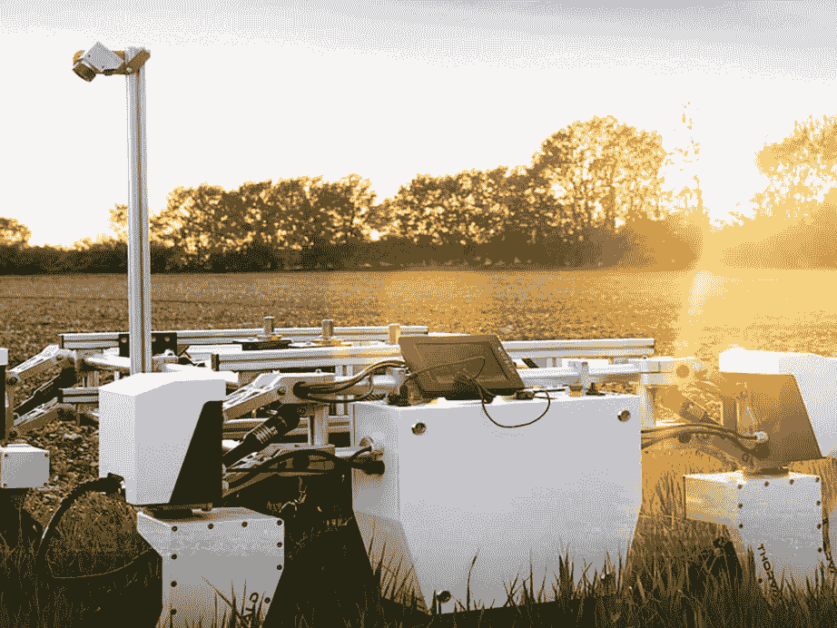


## 本系列包含的主题
- 软件开发
- 软件工程
- 软件维护


## 关于编辑

## 前言

农业是一项基本的人类活动，也是所有发展中国家的首要领域。尽管农业产量随人口增长而增长，但农田、水和肥料等资源的需求正呈指数级增加。智慧农业可以从其更广泛的使用和应用中获益良多。部分源自物联网并根据特定算法进行分析的技术，在预防、监测、生长和改善农业方面发挥着重大而有益的作用。本书着重探讨人工智能、机器学习和深度学习等先进技术在分析作物改良中发挥的关键作用，使读者掌握最新概念并获得丰富的实践经验。数字化和作物管理将大大有助于以有条理的方式理解智慧农业中的流程。它展示了技术如何增强、简化和改善智慧农业的服务。本书每一章都聚焦于农业的特定领域及其技术如何提供帮助，并提供背景和当前最先进的示例。本书包含案例研究章节，帮助读者更好地理解智慧农业领域中技术的应用。


## Taylor & Francis

Taylor & Francis Group

http://taylorandfrancis.com

## 贡献者名单

- Ahire, Pritam R., 计算机工程系, Nutan Maharashtra Institute of Engineering Technology, Savitribai Phule Pune University (SPPU), 印度
- Anbarasi, G., 生物技术系, PSGR Krishnammal College for Women, 印度
- Arunachalam, A.S., 计算机科学系, Vels Institute of Science Technology & Advanced Studies (VISTAS), 印度
- Ashok, J., 商业与管理学院, CHRIST (Deemed to be University), 印度
- Augustine, C., 电子与通信工程系, GRT Institute of Engineering & Technology, 印度
- Bacanin, Nebojsa, Singidunum University, Belgrade, 塞尔维亚
- Balaji, K., GRT Institute of Engineering & Technology, 印度
- Balaji, S., 电气与电子工程系, SRM Valliammai Engineering College, 印度
- Balamurugan, R., 计算机科学系, Vels Institute of Science, Technology & Advanced Studies, 印度
- Chacko, Shiju C., 电气与电子工程系, Uxbridge College, London
- Charanarur, Panem, 网络安全与数字取证学院, National Forensic Sciences University (NFSU), 印度
- Chowdary, Savana Sunil Kumar, 电子与通信工程, Hindustan Institute of Technology and Science Chennai, 印度
- Dhanasekar, S., Sri Eshwar College of Engineering, 印度
- Dharanikumar, S.V., GRT Institute of Engineering & Technology, 印度
- Duraiarasu, E., 电子与通信工程系, Rajalakshmi Engineering College, 印度
- El Rhalibi, Abdennour, 计算机科学系, 工程与技术学院, Liverpool John Mooris University, 英国
- Ezhilazhagan, C., 电子与通信工程系, Dr. N.G.P. Institute of Technology, 印度
- Ganesh Kumar, C., 电子与通信工程系, Rajalakshmi Engineering College, 印度
- Gangwar, Veer P., 通用营销系, Mittal School of Business, Lovely Professional University, 印度
- Gao, Xia-Zhi, 机器视觉与模式, 工程科学学院, Lappeenranta University of Technology, 芬兰
- Gobinath, R., 计算机科学系, Christ University, 印度
- Gomathy, M., 计算机科学学院, Vels Institute of Science, Technology and Advanced Studies (VISTAS), 印度
- Govindaraj, V., 电子与通信工程系, Dr. N.G.P. Institute of Technology, 印度
- Hanchate, Rohini, 计算机工程系, Nutan Maharashtra Institute of Engineering Technology, Savitribai Phule Pune University (SPPU), 印度
- Harihara Sudhan, S., 电子与通信工程系, Rajalakshmi Engineering College, 印度
- Jeevitha, S., 电子与通信工程系, Rajalakshmi Engineering College, 印度
- Jose Anand, A., 电子与通信工程系, KCG College of Technology, 印度
- Jubair Ahmed, L., 电子与通信系, Akshaya College of Engineering and Technology, 印度
- Kalaiselvi, K., 计算机应用系, Saveetha College of Liberal Arts and Sciences (SIMATS), 印度
- Kamesh, M., 电子与通信工程系, Velammal Institute of Technology, 印度
- Kanchana Devi, V., Vellore Institute of Technology, 印度
- Karnel, A., Vellore Institute of Technology, 印度
- Kartheeswari, K.R., 计算机科学与工程系, Hindustan Institute of Technology & Science, 印度
- Mahalakshmi, S., 计算机科学与工程系, Chennai Institute of Technology, 印度
- Manikandan, T., 电子与通信工程系, Rajalakshmi Engineering College, 印度
- Mohammed Asif, Y.S., 电子与通信工程, Hindustan Institute of Technology and Science Chennai, 印度
- Nirmala Devi, K., 电子与通信工程系, KCG College of Technology, 印度
- Nisha, K., 计算机科学与工程系, Chennai Institute of Technology, 印度
- Olatunde, Olabiyi Stephen, 计算机科学与工程, Ladoke Akintola University of Technology, 尼日利亚
- Perumal, S., 计算机科学系, Vels Institute of Science, Technology & Advanced Studies, 印度
- Rao Gundu, Srinivasa, 计算机科学系, Government Degree College Sitaphalmandi, 印度
- Sakthivel, V., Konkuk Aerospace Design-Airworthiness Institute, Konkuk University, 韩国
- Samanta, Debabrata, 计算信息技术系, RIT Kosovo (A.U.K.), Rochester Institute of Technology – RIT Global, Dr. Shpetim Rrobaj, 科索沃
- Selvaraju, P., 数学系, Rajalakshmi Institute of Technology, 印度
- Sreenivas, R., Vellore Institute of Technology, 印度
- Subba Rao, Nagulakonda Naga Sai, 电子与通信工程, Hindustan Institute of Technology and Science Chennai, 印度
- Sujarani, Pulla, 计算机科学系, Vels Institute of Science, Technology and Advanced Studies (Formerly Vels University), 印度
- Thirumurthi Raja, A., 远程教育署 (DDE), SRM Institute of Science and Technology (SRMIST), 印度
- Umamaheswari, E., 网络物理系统中心, Vellore Institute of Technology, 印度
- Vallikannu, R., 电子与通信工程, Hindustan Institute of Technology and Science Chennai, 印度
- Varadarajan, Vijayakumar, 计算机科学与工程学院, The University of New South Wales, Sydney, 澳大利亚 (UNSW Ranks 43rd in the 2022 QS World University Rankings, 1st in Australia for Research Excellence and Impact)
- Vijayakumar, S., 电子与通信工程系, Paavai Engineering College, 印度
- Vijaylaxmi, J., PVKK Degree & PG College, 印度
- Vishnupriya, B., 生物技术系, Kongunadu Arts and Science College, 印度


## 泰勒与弗朗西斯

泰勒与弗朗西斯集团

http://taylorandfrancis.com

## 缩略语列表

- **ADAS** 空中数据采集系统
- **ADC** 模数转换器
- **ADT** Android 开发工具
- **AFSIS** 非洲土壤信息服务
- **AgMIP** 农业模式比较与改进项目
- **AGRIBOT** 农业机器人
- **AGROVOC** （涵盖联合国粮食及农业组织所有感兴趣领域的多语言受控词汇）
- **AI** 人工智能
- **AMQP** 高级消息队列协议
- **ANN** 人工神经网络
- **ANSI** 美国国家标准学会
- **AR** 增强现实
- **ARM** 高级精简指令集计算机
- **AS** 自治系统
- **BMU** 最佳匹配单元
- **CAA** 交叉棒自适应阵列
- **CAD** 计算机辅助设计
- **CCD** 电荷耦合器件
- **CEA** 受控环境农业
- **CGIAR** 国际农业研究协作组
- **CGR** 作物生长速率
- **CNN** 卷积神经网络
- **CoAP** 受限应用协议
- **CP** 种植模式
- **CRUD** 创建、读取、更新和删除
- **CSA** 气候智慧型农业
- **DAQ** 数据采集
- **DAS** 直接连接存储
- **DAU** 直接活跃用户
- **DBM**: 深度玻尔兹曼机
- **DBMS**: 数据库管理系统
- **DBN**: 深度信念网络
- **DCL**: 数据控制语言
- **DDL**: 数据定义语言
- **DDS**: 数据分发服务
- **DHT**: 数字温湿度传感器
- **DIKW**: 数据洞察专业智慧
- **DL**: 深度学习
- **DML**: 数据操纵语言
- **DP**: 动态规划
- **DPSF**: 分布式并行仿真框架
- **DQL**: 数据查询语言
- **DRL**: 深度强化学习
- **DSS**: 决策支持系统
- **EC**: 环境控制器
- **EFISCEN**: 欧洲森林信息情景模式
- **EOS**: 创业者操作系统
- **ET**: 蒸散发
- **FAAR**: 非洲农业研究论坛
- **FAO**: 联合国粮食及农业组织
- **FC**: 全连接
- **FMS**: 农场管理软件
- **FONTAGRO**: 区域农业技术基金
- **GAN**: 生成对抗网络
- **GHG**: 温室气体
- **GIS**: 地理信息系统
- **GIS**: 地理空间信息系统
- **GM**: 转基因
- **GODAN**: 农业和营养全球开放数据
- **GPGPU**: 通用图形处理单元
- **GPS**: 全球定位系统
- **GPU**: 图形处理单元
- **GSM**: 全球移动系统
- **GSN**: 全球传感器网络
- **GUI**: 图形用户界面
- **HD**: 高清
- **HDPE**: 高密度聚乙烯
- **HMM**: 隐马尔可夫模型
- **HTTP**: 超文本传输协议
- **HYV** 高产品种
- **I/O** 输入/输出
- **ICACCS** 先进计算与通信系统国际会议
- **ICASA** 农业系统应用国际联盟
- **ICT** 信息和通信技术
- **IDE** 集成开发环境
- **IIS** 互联网信息服务
- **IJAERD** 国际先进工程与研究开发杂志
- **IK** 本土知识
- **IM** 信息管理
- **IoFT** 食品物联网
- **IoT** 物联网
- **IP** 互联网协议
- **IR** 红外线
- **IRJET** 国际工程与技术研究杂志
- **ISCO** 智能系统与控制
- **ISIMIP** 部门间影响模式比较项目
- **ISO** 国际标准化组织
- **IT** 信息技术
- **ITU** 国际电信联盟
- **KAUST** 卡尔国王科技大学
- **KDD** 知识数据发现
- **KNN** k-近邻
- **LAI** 叶面积指数
- **LCC** 土地覆被分类
- **LED** 发光二极管
- **LER** 土地等效比
- **LOD** 链接开放数据
- **LPWA** 低功耗广域网
- **LPWAN** 低功耗广域网
- **LSTM** 长短期记忆网络
- **MCDM** 多准则决策
- **MFAFF** 食品、农业、林业和渔业部
- **ML** 机器学习
- **MLP** 多层感知机
- **MODIS** 中分辨率成像光谱辐射计
- **MOX** 金属氧化物
- **MQTT** 消息队列遥测传输
- **MSP** 最低支持价格
- **MTG** 马恩科技集团
- **NDVI** 归一化植被指数
- **NIR** 近红外线
- **NLP** 自然语言处理
- **NN** 神经网络
- **NPK** 氮、钾和磷
- **NPP** 天然植物保护
- **NRICT** 化学技术国家研究所
- **OFDM** 正交频分复用
- **PALS** 全 IIT 校友领导力系列
- **PCA** 主成分分析
- **PIR** 被动红外线
- **PPD** 极化相位差
- **PV** 光伏
- **PYP** 阐述你的观点
- **QPM** 高品质蛋白玉米
- **RBFN** 径向基函数网络
- **RBM** 受限玻尔兹曼机
- **RCT** 资源节约技术
- **RDBMS** 关系数据库管理系统
- **RDF** 资源描述框架
- **RDSMS** 关系数据流管理系统
- **RF** 射频
- **RFID** 射频识别
- **RGB** 红绿蓝
- **RGM** 低重力模型
- **RMS** Rotronic 监测系统
- **RMSE** 均方根误差
- **RNN** 循环神经网络
- **RvNN** 递归神经网络
- **RYT** 相对总产量
- **SAR** 合成孔径雷达
- **SDMP** 土壤数据监测探针
- **SEM** 智能环境监测
- **SEQUEL** 结构化英语查询语言
- **SL** 监督学习
- **SM** 土壤湿度

| 缩写 | 全称 |
| :--- | :--- |
| SOM | 自组织映射 |
| SPARQL | SPARQL 协议和 RDF 查询语言 |
| SPP | 串口配置文件 |
| SQL | 结构化查询语言 |
| SRMIST | SRM 科学技术学院 |
| SSA | 撒哈拉以南非洲 |
| SSN | 语义传感器网络 |
| STI | 科学、技术和创新 |
| STI | 性传播疾病 |
| SUFIC | 智能城市农业综合控制器 |
| SVM | 支持向量机 |
| SVR | 支持向量回归 |
| TCN | 时序卷积网络 |
| TCP | 传输控制协议 |
| TDR | 时域反射法 |
| TIVA | 德州仪器多功能 ARM |
| TTA | 电信技术协会 |
| UAV | 无人驾驶航空器 |
| UDP | 用户数据报协议 |
| UV | 紫外线 |
| UWB | 超宽带 |
| VAO | 村级行政官员 |
| VGG | 视觉几何组 |
| VISTAS | 维尔科学技术与先进研究学院 |
| VLSI | 超大规模集成 |
| VoID | 互链数据词汇表 |
| VRT | 变量技术 |
| WPAN | 无线个人区域网络 |
| WSN | 无线传感器网络 |
| WTS | 无线电信研讨会 |
| WUR | 荷兰瓦赫宁根大学与研究中心 |
| XMPP | 可扩展消息与存在协议 |


## 智慧农业简介

R. Balamurugan¹, K.R. Kartheeswari², and S. Perumal¹

¹Department of Computer Science, Vels Institute of Science, Technology & Advanced Studies, India
²Department of Computer Science & Engineering, Hindustan Institute of Technology & Science, India
Email: bmurugan.scs@velsuniv.ac.in; kr.kartheeswari@gmail.com; perumal.scs@velsuniv.ac.in

### 摘要

农业在现代生活中扮演着重要角色。该行业既为全世界的人们提供食物，也提供动物饲料。此外，它还为烟草、甘蔗、棉花、黄麻等行业提供原材料。在印度，农业是支持许多人生计和工作来源的主要产业之一。近 60% 的人选择了该领域作为自己的职业。根据印度 2022 年经济调查报告，农产品总产量达 3.03 亿吨。由于存在广阔的农业用地和各种气候条件，我国农民可以选择种植多种作物。

农业行业得益于人口的快速扩张和城乡收入能力的持续发展，获得了显著提升。此外，出口市场对作物、水果、蔬菜、花卉等农产品的需求量也很大。为了满足上述期望，农业部门需要进行升级。如今，印度农民使用高产作物和多种肥料来提高生产力。此外，拥有冷库的现代仓库以及价格实惠，帮助农民安全储存农产品。

现有的进步不足以加速农业的发展。当今世界面临两项重大挑战。第一是人口扩张，第二是稳步上升的城市化。由于城市化，农业行业正面临劳动力短缺。这将在未来几年引发问题。

ICT 赋能技术在农业领域被开发出来以解决这一问题。传统的农业生产涉及以下几个不同的阶段：

- 土壤检测
- 种子选择
- 灌溉控制
- 确定并使用肥料
- 跟踪生长
- 病害预防与控制
- 收获
- 市场营销

上述所有农业任务都需要深厚知识、快速决策、有效规划和艰苦劳动技能的结合。以常规方式完成所有任务是具有挑战性的。因此，农民必须从传统农业转向智慧农业。先进技术与现代算法相结合并应用于农业，使农民能够实践智慧农业。

使用智慧农业有助于提高产品质量、缩短收获时间并增加产量。本章详细解释了各种 ICT 赋能技术如何与传统方法结合，以改进当前的农业活动。

### 1.1 农业流程简介

食物是所有生物的基本需求。为了食物，我们依赖于植物和动物。古人开始在小区域耕种食物，并遵循特定的管理和增产实践。农业是作物种植的实践。

#### 1.1.1 土壤准备

种植作物的土壤必须首先通过犁地、平整和施肥进行准备（图 1.1）。犁地是指使用犁挖掘和松土的行为。这有助于适当的土壤通气。平整是在犁地后分布和整平土壤的过程。之后，土壤进行施肥 [1]。

#### 1.1.2 播种

播种的第一步是从高品质作物品种中选择种子。土壤准备后，将种子撒布到田地上的过程称为播种。您可以手动播种，用手或使用播种机械。某些作物，如水稻，是在小区域内先培育秧苗，然后再移栽到主田地（图 1.2）。

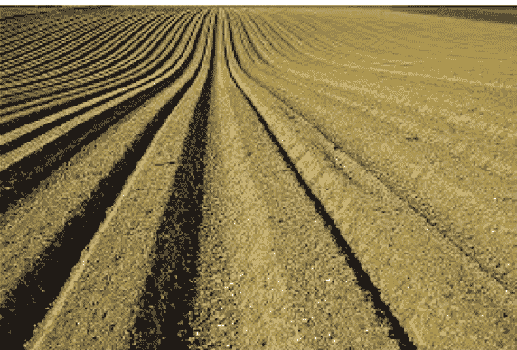

图 1.1 土壤准备。

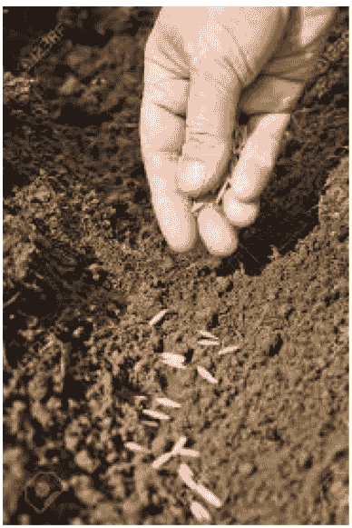

图 1.2 播种。

#### 1.1.3 施肥

养分对作物生长和生产力是必要的。因此，需要持续的养分供应（图 1.3）。在施肥过程中，会给予营养补充剂，它们可以是天然的（农家肥）或合成物质（化肥）。植物和动物废弃物分解为农家肥作为副产品。商业生产的化肥是含有植物养分的化学混合物。除了为作物提供营养，农家肥还能恢复土壤肥力。堆肥、轮作和种植豆科植物是补充土壤的其他技术 [1]。

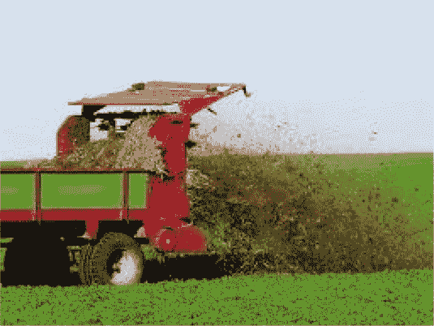

图 1.3 施肥。

#### 1.1.4 灌溉

水通过灌溉供应。水源包括水井、池塘、湖泊、运河和水坝等。过度灌溉造成的水涝可能损害作物。有必要控制这种频率以及连续灌溉之间的时间（图 1.4）。

#### 1.1.5 除草

通常在作物中生长着名为杂草的不想要植物。它们通过使用除草剂和手工拔除来消除，有些在土壤准备期间也会被消除（图 1.5）。

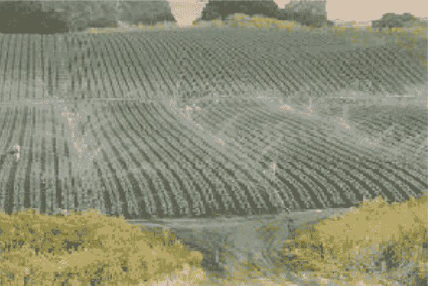

图 1.4 灌溉。

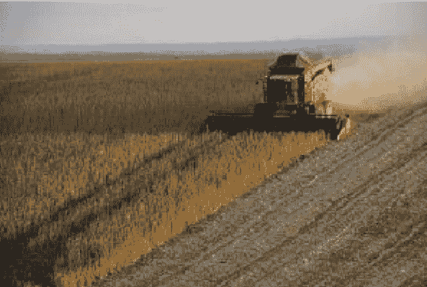

图 1.5 除草。

#### 1.1.6 收获

一旦作物达到成熟，收获涉及切割和收集作物。收获后，谷物通过人工（簸扬）或在小规模操作中通过脱粒与糠秕分离（图 1.6）。

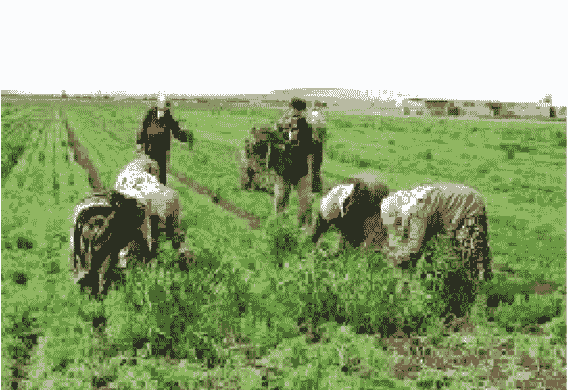

图 1.6 收获。

#### 1.1.7 储存

在仓库中，收获的谷物存放在粮仓或料箱中，以供以后使用或营销。因此，需要改进作物保护技术。在储存前，谷物会被清洁、干燥、熏蒸，并采取其他防虫防鼠措施（图 1.7）。

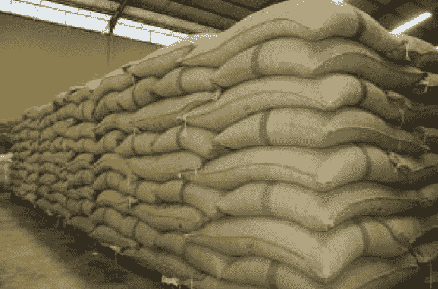

图 1.7 储存。

### 1.2 智慧农业在土壤准备中的作用

带有物联网的土壤监测系统可以通过利用技术来提高产量、减少疾病并优化资源。物联网传感器可以测量温度、NPK、体积含水量、光合辐射、土壤水势和土壤氧含量。物联网传感器收集并将数据传输到中央位置进行分析、可视化和趋势分析。

为了提高作物产量和质量，可以优化农业实践，检测趋势，并对环境进行微小改变。物联网是精准农业的关键组成部分，物联网也用于智慧农业。

#### 1.2.1 物联网传感器的活动

作为智慧农业的一部分，土壤、天气和作物状况以及智能环境（空气质量）和智能水（污染、浑浊度和养分）都被考虑在内。按受欢迎程度排序，以下是顶级物联网传感器列表：

##### 1.2.1.1 土壤温度

智慧农业节点监测土壤湿度、电导率、表面温度和土壤温度（图 1.8）。

土壤温度对地下植物活动的影响很大，它影响根系发育、呼吸、氮矿化和分解。埋在土壤中的探头是确定土壤温度的最精确方法，但使用物联网传感器测量空气温度和其他参数也可能可行。可以根据植物的根系在不同深度插入多个探头。土壤温度可以使用采用红外线技术的物联网传感器进行测量。

##### 1.2.1.2 土壤湿度

带有电极的埋藏探头也可用于测量土壤水分含量。在水文学、土壤化学、植物发育和地下水补给中，农业水分含量和土壤科学都有重大影响。土壤水分含量至关重要的原因有多种：水是所有植物和作物的重要成分，它也是


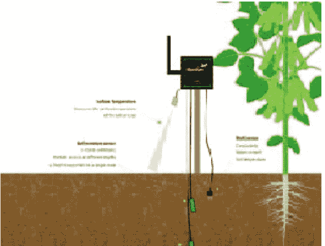

图 1.8 土壤温度传感器用法。

光合作用的必要组成部分。土壤中的水分量对作物产量有重大影响。

对于植物生长，土壤水分是可溶性食物成分的关键载体。土壤中的水分有助于控制土壤温度。

鉴于土壤科学的复杂性，不言而喻，本文无法涵盖所有内容。Libelium 的物联网和智慧农业技术可以测量以下内容：

- 土壤含水量（3 × 深度）。
- 电导率。
- 体积含水量。
- 土壤中的势水。

##### 1.2.1.3 天气

对光合作用至关重要的不同太阳辐射射线类型可以通过物联网传感器进行测量（图 1.9）。除了最基本的光照水平外，物联网还可以测量以下内容：

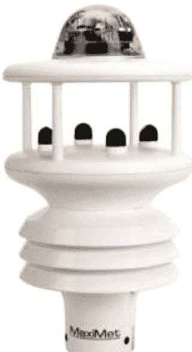

图 1.9 气象传感器。

- 能刺激光合作用的光源。
- 阳光和紫外线。
- 短波——太阳辐射。

太阳辐射会对植物发育产生显著影响，物联网可以跟踪日照水平并识别相关性和趋势 [2]。

##### 1.2.1.4 NPK 土壤传感器

虽然它们在市场上相对较新，但氮、磷、钾（钾肥）传感器提供了一种使用物联网传感器测量这些重要土壤养分的方法。NPK 物联网传感器采用多种技术，但 TDR 是它们经常采用的一种。可以使用 NPK 传感器测量以下元素：

- 钾
- pH
- EC
- 温度
- 水分

NPK 传感器的准确性和灵敏度因供应商及其发展阶段而异。NPK 传感器支持 RS 485，使其能够集成到物联网解决方案中，例如 LoRaWAN 和数据记录仪。MTG 正在支持某些下一代 NPK 传感器试验，这可能提高这些传感器的准确性。

##### 1.2.1.5 其他测量

我们提供广泛的额外物联网农业传感器，在某些专业场景中很有用。尽管它们不是土壤监测设备，但能改善任何物联网实施。其中包括以下附加传感器：

- 土壤氧含量和蒸汽压力。
- 叶片和花蕾温度。
- 叶片湿度。
- 果实、茎和树干尺寸。

##### 1.2.1.6 物联网和智慧农业的无线通信

各种无线通信方式的广泛可用性是物联网解决方案的基本优势。智慧农业的应用不局限于城市、农村或极其偏远的环境。它也可以应用于 4G、LoRaWAN、Zigbee、Sigfox、Wi-Fi 和卫星技术。覆盖范围不局限于城市地区。物联网网络中的传感器和节点需要极低功耗，使其与电池、太阳能或其他可再生能源兼容（图 1.10）。

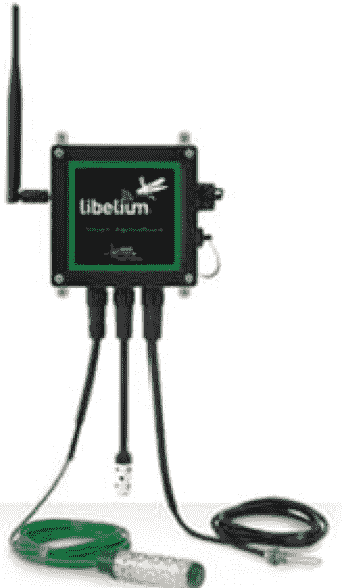

图 1.10 无线通信传感器。

##### 1.2.1.7 应用

物联网可用于优化几乎任何农业或农场企业的运营。以下领域特别受到关注：

- 大麻和工业大麻
- 大豆
- 马铃薯
- 樱桃与苹果
- 杏仁

Libelium 物联网支持多种通信协议（图 1.11），带宽相对较低，可以埋在地下或放置在土壤表面。通过卫星通信，可以使用 LoRaWAN（15KM）将局部传感器网络的数据发送回云端。

此信息的传输可以是实时的或批量的。卫星、物联网和农业应用特别适用于分散在大面积农村农业村庄和定居点，这些地方可能移动或传统宽带覆盖不足或不存在。

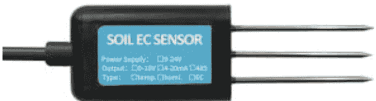

图 1.11 土壤传感器。

精准农业或自动化系统的测量组件始终排在第一位。智慧农业解决方案和物联网每天收集成千上万个数据点。数据一经处理、格式化和验证，系统即可使用它来优化基础设施的其他方面或启动智能响应。

例如，软件可以指示您的灌溉系统在土壤湿度低于预设水平时开启。如果湿度上升到不令人满意的水平，该技术可以向运营或农业员工发送通知。物联网与农业的潜力是无限的。

硝酸盐可以在水中测量；然而，磷酸盐稍微更具挑战性。因此，您可以使用此类设备在施肥后计算肥料流失量。大多数技术仍然使用试剂进行水中磷酸盐检测，这稍微更专业 [2]。

您的环境和应用将实际决定您使用数据和洞察的效果。

Web 仪表板可以可视化数据。

- 可以使用移动应用程序和网站实现移动设备的数据可视化。
- 可以使用 Excel、PowerBI 或 Tableau 等分析工具检索或导入数据。
- 如果超过阈值，仪表板和监控系统可以发出警报（例如 NPK 水平、土壤湿度等）

### 1.3 物联网设备在智慧农业中的作用

不同设备在智慧农业领域发挥着关键作用。本节简要概述了这些设备的功能。

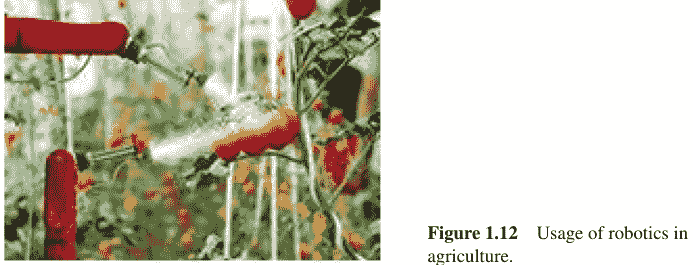

#### 1.3.1 农业机器人技术

过去一个世纪，自动化已得到改进，以处理复杂任务并提高生产力。

由于全球劳动力短缺和需求增加，农民开始关注农业机器人（有时称为农业机器人）。由于全球劳动力短缺，全球农业产量每年减少约 20 亿吨。随着现代设备和尖端技术的使用，使系统能够从邻域中提取有意义的结果，农业机器人技术如今更为广为人知。我们目前正处于农业机器人革命的早期阶段（图 1.12）。

##### 1.3.1.1 除草机器人

这些狡猾的农业机器人使用先进的图像处理方法，在其数据库的照片中寻找作物和杂草之间的相似之处。然后，它们使用机械臂移除杂草或直接喷洒。随着植物对杀虫剂的抗药性不断增强，这对环境以及曾经在农场大量施用杀虫剂的农民都有利。除草剂每年施用成本为 1725 亿卢比（250 亿美元），即约 13,000 千克（30 亿磅），降低了总体成本（图 1.13）。

##### 1.3.1.2 机器导航机器人

拖拉机和大型犁地设备可以使用 GPS 从您家中的舒适环境中自动操作，就像遥控玩具车辆一样。这些集成的自动化机器具有出色的精度，并且在注意到地形变化时能够自我调整，从而简化了劳动密集型任务。智能手机使监控其位置和工作进度变得简单。得益于农业物联网和机器学习的改进，这些技术驱动的电机正在实现利用物联网独立进行先进农业，具有自动障碍识别等功能（图 1.14）。

##### 1.3.1.3 收获机器人技术

农业机器人正在用于采摘作物，这是解决人力短缺问题的方案。这些尖端机器可以全天候工作，处理收获水果和蔬菜这一精细过程。这些设备使用机械臂和图像处理来确定采摘哪些水果，从而控制质量。由于运营成本高，苹果等果园水果是农业机器人早期优先收获的作物。这些机器人也可用于温室中高价值作物（如草莓和番茄）的收获（图 1.15）。这些机器人可以准确评估温室中作物的生长阶段，并在必要时收获它们 [3]。

##### 1.3.1.4 搬运机器人

与人类协同工作的机器人可以执行令人厌恶的体力劳动工作。它们可以举起重物并精确地间隔植物，这提高了空间和植物的质量并降低了制造成本。


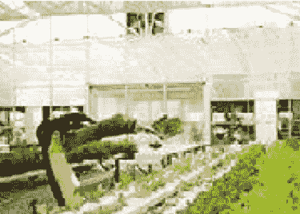

图 1.15 收割机器人。

### 1.3.2 农业中的无人机

农业是使用无人机的主要行业之一。配备传感器和摄像头的无人机用于农场成像、制图和勘测。有空地两栖的无人机。称为地面无人机的移动机器人用于评估区域。通常称为航空无人机或无人机系统的无人驾驶飞行器是飞行机器人。得益于软件控制并与其嵌入式系统中的传感器和GPS协调的飞行计划，无人机可以远程指挥或自动飞行。

配备传感器和摄像头的无人机用于农场成像、制图和勘测。无人机数据可用于了解作物健康、灌溉、喷洒、种植、土壤和田地、植物计数、产量预测等更多信息。无人机勘测可以预先安排，也可以将无人机带到农场附近并保持在那里，以便进行维护和充电。勘测后，无人机必须被带到附近实验室进行数据分析，这将增强物联网在农业中的应用（图 1.16）。

### 1.3.3 农业中的遥感传感器

基于物联网的遥感利用安装在农场旁的传感器（如气象站）收集数据，然后将其发送到分析工具进行检查。传感器是可以检测异常的工具。从分析仪表板中，农民可以密切关注自己的作物，并根据调查结果采取行动（图 1.17）。

布置在农场各处的作物监测传感器监测光照、湿度、温度、形状和大小的变化。传感器检查异常情况，如果发现任何问题会通知农民。因此，遥感可以帮助防止疾病传播并监测作物的发育

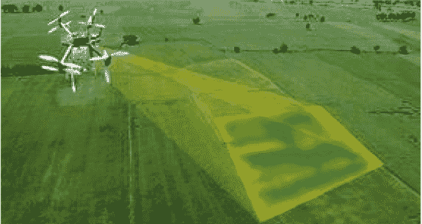

图 1.16 农业中无人机的应用。

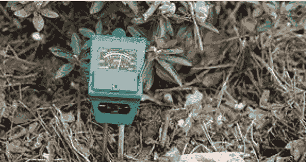

图 1.17 遥感传感器。

的作物。传感器收集的关于湿度、温度、土壤含水量、降水和露点检测的数据有助于农场天气预报，从而种植合适的作物。土壤健康研究有助于识别养分含量和较干燥的农田区域，以及土壤的排水能力或酸碱度。这些信息用于控制灌溉所需的水量，并选择最有利的耕作类型 [3]。

### 1.3.4 农业中的计算机成像

在农场周围战略位置放置的传感器相机或配备相机的无人机用于计算机成像以捕获图像，然后

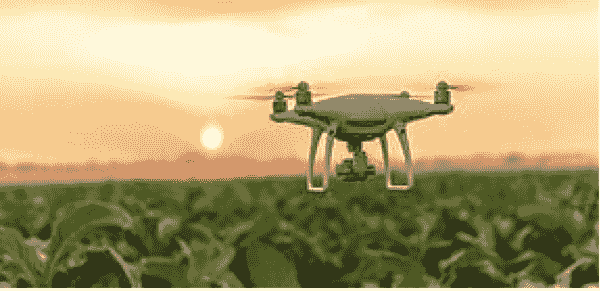

图 1.18 农业成像传感器。

进行数字处理。数字图像处理的基本思想是使用计算机算法修改输入图像。图像处理分析限制因素，并通过在不同光谱强度（如红外线）下查看图像、比较随时间收集的照片以及检测异常来帮助改进农场管理（图 1.18）。

### 1.4 智慧农业中灌溉的作用

根据需要收集的数据类型，土壤、天气和植物物联网传感器可用于智能灌溉解决方案。

#### 1.4.1 土壤传感器

嵌入土壤中的传感器收集包括电导率、盐度和体积含水量在内的相关信息。这些传感器战略性地部署在田地周围，将数据传输到智能灌溉系统，让农民快速了解土壤状况并预测灌溉需求。

#### 1.4.2 天气传感器

天气传感器（又称蒸散（ET）传感器）监测极局部的环境因素，例如土壤表面的水分蒸发和植物蒸腾。这些传感器与基于GIS的解决方案提供的数据结合使用，有助于做出更精确的水资源预测 [4]。

#### 1.4.3 植物传感器

尽管植物安装的传感器仍处于起步阶段，但它们在监测植物水分状态方面具有巨大潜力。固定在植物茎秆或果实上的传感器可以检测微小变化，如膨胀或收缩，并警告农民田地中水分不足或产量下降的特征。

#### 1.4.4 智能灌溉解决方案的功能

可以向基于物联网的灌溉系统添加高级软件功能，使其更加完善。为了获取额外有用的数据并指导农田灌溉决策，您可以将第三方API集成到智能灌溉解决方案中并对其进行修改。

##### 1.4.4.1 天气监测

利用卫星数据和气象站的天气报告合理安排灌溉活动是实现这一目标的一种方法。该技术可以等待并根据实际接收到的降水量自动调整所需水量，因为它知道预计会下雨。

##### 1.4.4.2 定位技术

通过降低成本和收集宝贵信息，精确制图还帮助农业企业推广智慧农业。农民可以使用结合传感器数据以及卫星和无人机影像的可重复使用地图来监测重要的土地特征。

##### 1.4.4.3 人工智能

农业自动化的基础正在演进以包含人工智能。除了帮助自动化数据标记、报告撰写和通知发送等简单操作外，人工智能还应用于独特但不常用的农业机器人系统。这类简单的人工智能自动化流程部署越来越简单，但其对农业企业的影响将在数月内显著且明显。

#### 1.4.5 智能灌溉系统中使用的技术

您可以根据田地周围水分分布的方式，从多种可通过智能灌溉软件改进的灌溉系统类型中进行选择。淹没灌溉、喷灌、中心支轴灌溉、滴灌和微灌系统是最常用的。让我们来看看如何通过智能灌溉的技术进步提高每种类型的效率 [4]。

##### 1.4.5.1 喷灌

喷灌系统使用高压顶喷头在水通过管道泵送后进行喷洒。这些喷头可以放置在可移动平台上或田地中央。

软件功能：降雨停止后，热感和听觉雨量传感器识别降水并测量其强度以规划随后的灌溉。智能灌溉系统分析数据并确定月度用水预算。为了避免因下雨导致过度用水和过度灌溉，喷头会收到自动通知。

##### 1.4.5.2 中心支轴灌溉

这种喷灌类型有时被称为水轮灌溉和圆形灌溉，是最常见的。在传统的中心支轴系统中，连接中央塔的长输灌管轻轻环绕田地旋转，喷头对植物进行灌溉。

软件功能：田间传感器提供数据洞察，采用圆形灌溉喷头的系统利用这些洞察来修改水流或流向角度。这样，您可以触及远离水源的植物，并防止附近植物过度灌溉。系统通过检查天气信息和土壤湿度来规划灌溉并确定可能的产量和收获期。

##### 1.4.5.3 滴灌

这种灌溉方法通过带有称为滴头的微小孔洞的管道，将水直接输送到植物根部。这使农民能够大幅降低径流和蒸发。

软件功能：这种灌溉方式最大的难点在于让灌溉过程可视化。该技术通过应用程序告诉用户灌溉何时开始和结束。此外，它还会在灌溉前后评估土壤特性。

##### 1.4.5.4 微灌

一种称为微灌的低压低容量技术可对灌溉进行精确控制。该技术将水直接输送到植物根部，提高分布均匀性和灌溉效率。

软件功能：由于水得到精心管理，系统可以计算每株植物的精确用水量。可以使用人工智能算法进行植物识别和灌溉调整。无论您决定采用哪种灌溉系统，在其中安装先进的物联网传感器都将


使您能够获得数据驱动的有用洞察并跟踪您的灌溉需求 [4]。

### 1.5 智慧农业中收获的作用

人口增长提高了对粮食的需求，反过来给农民带来了更大的压力，迫使他们提高作物产量和耕种面积。此外，发展中国家大规模开展农业，在不久的将来将大大推动对自动化和智能收获技术的需求。

消费者对营养和食品安全越来越了解。当今的农民不仅要养活不断增长的世界人口，还必须满足消费者需求。由于当前疫情导致对植物制品的需求增加，植物育种目前正将作物改良作为优先事项，以满足众多领域涌来的大量请求。现代农业成功的秘诀是培育具有更高产量和消费者品质（如营养、保质期等）的作物。通过使用技术，我们的农民能够更好地了解土壤、所需养分以及播种时间和模式，从而提高作物产量。简而言之，科学与技术融入农业，使农民受益。

植物育种者正在利用基因编辑这一前沿科学来改良作物，以提高产量、抗旱性、抗病性、营养价值和口感。基因编辑在应对重大农业挑战方面的巨大影响有两个例子：一种是影响全球橙子种植者的柑橘黄龙病，另一种是席卷全球、在亚洲国家毁坏了大量香蕉种植园、严重影响小规模农民生活的巴拿马病。

研究人员通过基因编辑精确且成功地改变了生物体的 DNA，以添加所需特性或去除不需要的特性。因此，研究只需 2–3 年，而传统育种需要 7–25 年。

基因编辑技术在农业中的广泛应用将提高作物产量，进而提高全球食品质量，造福全人类 [5]。

### 1.6 智慧农业的优势

- 智慧农业传感器收集太字节级别的信息，包括天气、土壤质量、作物发育和动物健康等数据。这些数据可用于追踪农产品的整体生长情况以及工人效率、设备性能等。

- 由于内部流程控制得到改善，生产危害得到减少。如果农民能预测农业产出，那么他们可以建立更高效的产品分销系统。

- 如果农民确定产量，那么他们的产品就不会滞销搁置在货架上。更好的生产控制带来了成本控制和浪费减少。如果农业人员发现作物生长或牲畜健康方面存在任何异常，他们可以降低产出损失的可能性。

- 流程自动化带来了运营效率的提升。智能设备可用于自动化整个生产周期中的多种流程，包括灌溉、施肥、病虫害防治和分销系统。

- 提高产量和质量：更加自动化的生产流程使作物质量和生长潜力能够保持更高标准。

- 这从长远来看可能会带来更高的收入。

### 1.7 智慧农业面临的挑战

智慧农业的有效性受多种因素影响。要取得更好的结果，必须解决这些问题。

#### 1.7.1 硬件

农业中的这些设备必须集成传感器，以便构建物联网解决方案。农民负责汇总和确定总体目标。只要收集的数据准确可靠，传感器的质量对于产品的成功也至关重要。

#### 1.7.2 大脑

分析应成为每一个智慧农业解决方案的核心。需要数据分析师来识别收集信息中的洞察。为了从收集的数据中提取隐藏知识，必须具备强大的数据分析、预测算法和机器学习技术。

#### 1.7.3 维护

硬件维护的复杂性对农业物联网解决方案至关重要，因为传感器在田间持续使用且易损坏。有必要选择可靠且灵活的设备。否则，将需要人工监督来监控田地。

#### 1.7.4 移动性

智慧农业应用程序应专门为田间使用而创建。农场经理或农场主应能通过台式计算机或智能手机现场或远程访问数据。所有连接的设备还必须独立，并具有足够大的无线覆盖区域，以便相互通信并将数据传输到主服务器。

#### 1.7.5 基础设施

智慧农业应用程序需要坚实的内部基础设施才能平稳运行。验证内部系统的安全性同样重要。如果没有它，黑客可以轻松入侵系统、窃取数据并操纵结果。

#### 1.7.6 连接性

跨各种农业设施的数据传输需求仍在影响智慧农业的实施。不言而喻，这些地点之间的连接需要足够可靠，以抵御恶劣天气并保持服务。尽管该领域目前正努力制定统一标准，但物联网设备仍在采用多种通信协议。

#### 1.7.7 数据收集间隔

鉴于农业行业数据类型多样，确定适当的数据收集频率可能很困难。来自基于田间、航空和环境传感器、应用程序、设备和设备以及处理后的分析数据，可能受到限制和立法约束。这些数据的安全、及时提供和共享是智慧农业的两个主要问题。

#### 1.7.8 农业行业的数据安全

精准农业和物联网技术需要处理海量数据，这增加了犯罪分子可能利用的安全漏洞的可能性，从而导致数据盗窃和黑客攻击。不幸的是，农业领域的数据安全概念尚处于起步阶段。例如，许多农场使用无人机将数据传输到农场机械。这些设备已连接到互联网，但实施的安全预防措施不多，包括用户密码或远程访问身份验证。

基本的物联网安全建议包括监控数据流、加密敏感数据、使用基于人工智能的安全技术立即识别可疑行为，以及将数据存储在区块链中以确保其完整性。为了有效受益于智慧农业，农民必须熟悉数据安全概念，制定内部安全规则并遵守这些规则 [6]。

### 1.8 智慧农业的局限性

- 为运行和监控农场，需要传感器、机器人、无人机和摄像头。

- 此外，部署和管理机器人及物联网需要昂贵且敏感的设备。

- 硬件持续维护成本。

- 可观的前期成本。

- 通过手动操作的摄像头和无人机来完成计算机成像。

- 没有供应链管理，系统无法扩展，因为每个农场的数据必须独立保存。

- 与已安装设备的兼容性问题以及缺乏日志信息。

- 每件设备执行特定任务，因此没有一台能提供所有指标。

- 智慧农业系统的基础设施需求，涉及设置传感器、无人机和机器人的大量前期费用。

- 需要适当且不间断的电源连接来运行和充电无人机和机器人，以及聘请合格的现场员工进行管理和操作。


- 全年所需的硬件维护成本。
- 需要高速 24×7 互联网接入设施。

### 1.9 智慧农业的未来趋势

食品生产是最大的制造业部门，这也使其成为当代商业中技术进步的主要竞争者之一。农业创新有助于解决包括减少食物浪费、提高营养价值、增加产量以及了解供应链环境影响等问题。未来几年将出现许多新技术和进步，它们将有助于提高农产品的数量和质量。在本节中，我们将讨论对智慧农业领域有帮助的未来趋势。

#### 1.9.1 食物互联网 (IoFT)

为了更好地了解人工智能、数据分析和未来技术如何推动食品供应链的数字化，食物互联网汇聚了数据和计算机科学家、化学家和经济学家。它推动了这样一种理念：执行器、机器人、传感器、摄像头、无人机及其他连接设备构成的网络将使农业能够以前所未有的自动化和决策水平运行，从而为这个最古老的行业构建一个持久的创新生态系统。IoFT 为农业社区提供以下优势。

- 确保食品的安全与卫生。
- 提供更好的农产品分销网络。
- 调节供应链周期。
- 建议采用现代储存技术。
- 减少生产和分销过程中的浪费。

#### 1.9.2 先进的绿色革命

物联网、人工智能和机器学习的结合为第三次绿色革命指明了方向。这次革命利用大数据分析、无人驾驶飞行器、机器人、最新农业设备以及先进的可视化和分析工具。这有助于减少田间用水量，并用于优化农业行业中每种作物所需的资源量。

#### 1.9.3 生物编辑作物

预计到 2050 年基因编辑作物将增长，这将有助于生产更多类型、产量和尺寸更好的作物。这有助于科学家通过修改现有作物的 DNA 结构来生产不同品种的作物。此外，这些品种能够抵御所有气候条件和疾病。有可能生产出含有平衡膳食成分（如理想的蛋白质、脂肪和油含量）的作物。这将有助于提高人类的生活质量。

#### 1.9.4 机器人农民

在农业行业中，时间是员工获得产量质量和数量的关键因素。有时他们会感到疲惫，并对这种重复性工作感到厌倦。这会影响任务的结果。为解决这一问题，将引入机器人来执行各种农业任务。与机器人配合使用的拖拉机将节省大量时间，这些时间可以被有效地用于其他重要活动。使用小型机器人可以让我们为分析目的单独收集植物的地理信息和图像。根据报告，田间每种作物所需的资源量由机器人输入。这将优化时间、资源和精力。

#### 1.9.5 自动化温室效应技术

一般来说，全世界 95% 的植物是在露天田地里种植的。根据自然气候条件，农民可以获得他们的产量。暴雨、寒冷和干旱等情况会影响作物的生长。为应对这些不确定性，自动化温室效应技术将在不久的将来被使用。这是一种为作物提供可行气候条件的技术。

有可能根据形状、材料、用途和结构来设计温室。按形状分类的常用温室（图 1.19）有：

- 依墙式温室。
- 对称式温室。
- 非对称式温室。
- 脊沟式。
- 锯齿式。
- 库森式温室。
- 互锁脊沟式库森温室。
- 地对地温室。

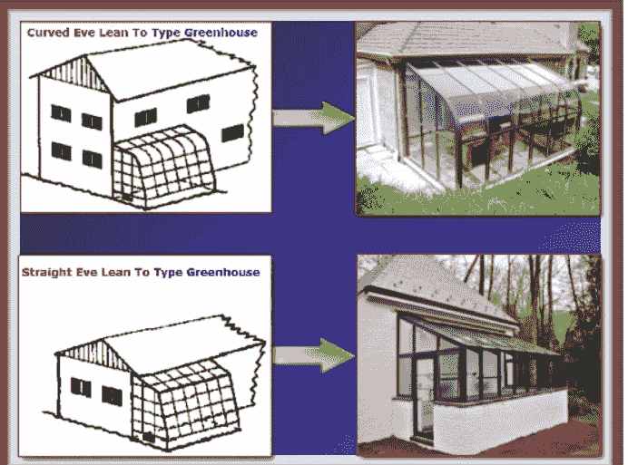

图 1.19 按形状设计的温室。

按用途，温室设计可分类如下：

- 主动加温温室。
- 主动冷却温室。

按结构（图 1.20），温室设计可分类为：

- 木架结构。
- 管架结构。
- 桁架结构。

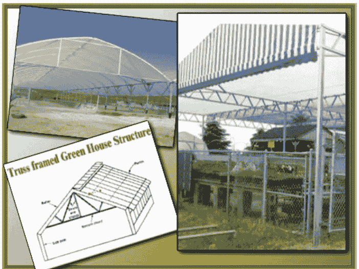

图 1.20 按结构设计的温室。

按覆盖材料（图 1.21），温室设计可分类如下：

- 玻璃温室
- 塑料薄膜温室
- 硬质板材温室

按建设成本（图 1.22），温室设计可分类为：

- 高成本温室
- 中成本温室
- 低成本温室

根据 WUR 的调查，借助温室技术在封闭环境中生产的蔬菜质量优于露天环境生产的蔬菜。由于植物以封闭方式种植，产品能在预计时间到达市场。

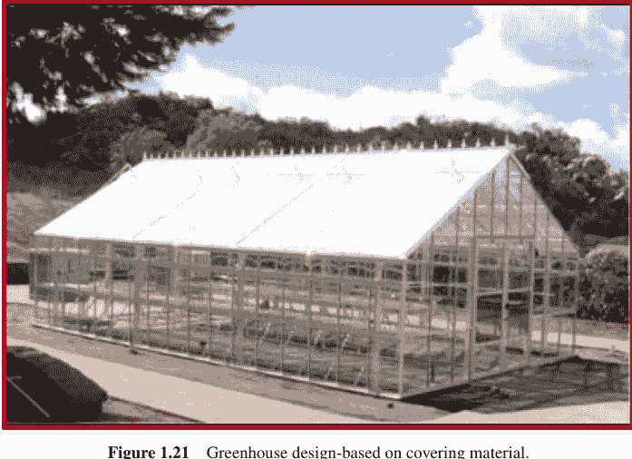
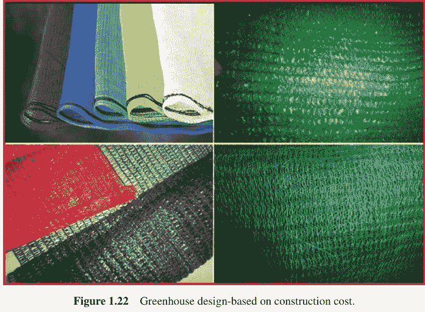

#### 1.9.6 气候智慧农业

基于气候变化改变和修改农业过程的方式被称为气候智慧农业。CSA 的主要目标是实现更高生产力的粮食安全。为实现该目标，确定了三个重要因素：生产力、适应和减缓。

### 1.10 结论

人口增长、对高产作物的需求以及自然资源短缺迫使世界从传统农业转向智慧农业。信息和通信技术的发展有助于实施现代农业流程。它帮助农民以高效、创新和安全的方式种植植物。利用这项新技术，农业行业试图解决全世界面临的所有问题。

### 参考文献

- [1] https://byjus.com/biology/agriculture-agricultural-practices/
- [2] https://www.manxtechgroup.com/soil-monitoring-with-iot-smart-agriculture/.
- [3] https://www.cropin.com/iot-in-agriculture
- [4] https://intellias.com/smart-irrigation-in-agriculture
- [5] https://www.apaari.org/web/smart-harvesting-a-must-for-better-crop-yield/
- [6] https://easternpeak.com/blog/iot-in-agriculture-technology-use-cases-for-smart-farming-and-challenges-to-consider/
- [7] https://www.iotforall.com/smart-farming-future-of-agriculture
- [8] https://www.mckinsey.com/industries/agriculture/our-insights/agricultures-connected-future-how-technology-can-yield-new-growth
- [9] https://www.worldbank.org/en/topic/climate-smart-agriculture
- [10] https://www.syngenta-us.com/thrive/research/future-of-farming.html
- [11] https://www.bbc.com/future/bespoke/follow-the-food/five-ways-we-can-feed-the-world-in-2050.html
- [12] https://www.forbes.com/sites/jordanstrickler/2020/08/28/high-tech-greenhouses-could-be-the-future-of-agriculture
- [13] https://www.hortidaily.com/article/9238914/market-potential-and-investment-opportunities-of-high-tech-greenhouse-vegetable-production-in-the-usa/
- [14] https://www.lanner-america.com/blog/smart-farming-iot-5g-agriculture/
- [15] https://www.iof2020.eu/about


Taylor & Francis
Taylor & Francis Group
http://taylorandfrancis.com


## 现代农业种植：基于齿条齿轮机构的远程控制播种机器人

R. Vallikannu¹, Xia-Zhi Gao², Nagulakonda Naga Sai Subba Rao¹, Y.S. Mohammed Asif¹, and Savana Sunil Kumar Chowdary¹

¹电子与通信工程系，印度斯坦科技学院，钦奈，印度
²拉彭兰塔理工学院工程科学学院机器视觉与模式识别，芬兰
Email: vallikannu@hindustanuniv.ac.in; xiao.z.gao@gmail.com; 18121002@student.hindustanuniv.ac.in; 18121013@student.hindustanuniv.ac.in; 18121063@student.hindustanuniv.ac.in

### 摘要

如今人口增长迅速，粮食行业需求巨大，这导致需要智能技术协助农民升级耕作流程并提高产量。现有的农业技术侧重于监测。然而，播种这一初始过程仍然劳动密集且耗时，导致生产力低下。小规模农民发现劳动力成本难以负担。因此，迫切需要一个智能播种系统来改进精准播种并降低劳动力成本。因此，所提出的项目旨在设计和开发一种播种机器人或机器，通过蓝牙模块控制，成本低廉，界面简单，对农民来说易于使用。

拟议模型由智能手机应用程序控制。蓝牙模块用于接收控制信号并将其传输到机器人。齿条齿轮机构用于钻取土壤，伺服电机连接到种子罐以分散种子。TIVA C系列控制器板控制机器人的所有操作。种子间距和种子种植的预定深度已针对各种作物进行编程。设计的机器人监测播种种子所需遵循的路径。

系统结构稳定，并开发了3D设计以证明系统在运动中的稳定性。机器人在不同湿度水平的各种土壤类型上都保持稳定。

该系统在播种距离的高稳定性和精度方面优于现有模型，符合作物要求。

### 2.1 引言

机器人技术是一项充满希望的技术，几乎涵盖全球经济的方方面面，从医学到太空探索。然而，农业领域常常落后。今天，农业生产的环境影响受到高度关注，行业内的需求也在增加。在当前背景下，大多数印度城市农业部门的能源不足，这阻碍了新兴国家的进步。农民因此应当使用先进技术进行种植工作（挖掘、播种种子等）。最近开发的原型机是手动操作的，没有达到种子播种应有的工艺水平。手动技术涉及人手撒播种子。通常，播种是用来挖洞并手动投放种子的。公牛用于耕作和松土以及投放种子。因此，行业需要机械地解决这一问题。在引入农业机械方面，迫切需要创新。项目的新理念使得能够机械地挖掘和播种种子并覆盖土壤，从而将人力减少90%。农业机器人或AGRIBOT可能是农业功能的正确选择。

农民从播种到产品上市都保护农产品。他们的辛劳是大多数人每天餐桌上都有食物的原因。拟议项目有多种好处：

- 通过AGRIBOT减轻农民的辛劳。
- 农业机器人完成农民的工作，提高生产率，并降低行业对手工艺的依赖。
- 机器人的好处之一是它们可以全年24/7工作。

农业中AI的主要应用包括：

- 1. 采集与筛选；
- 2. 自动收割、播种、喷洒和切割；
- 3. 过滤与包装；
- 4. 表型分析。

随着人口增长，农民应使用新技术以跟上不断增长的需求。到2050年，预计全球人口将达到约90亿。IEEE人工智能与自动化学会表示：“如果要满足不断增长的食物和营养需求，农业产量应翻倍。”在农业领域，许多人使用拖拉机进行传统播种技术，这存在一些缺点，如成本效益低且需要大量人力来控制。

#### 2.1.1 传统播种方法

传统方法包括人工繁殖、通过乡村耕作机开沟并人手投下几粒种子，称为“Kera”，以及将种子浸入连接乡村犁的竹制或金属导管中的容器中。说到在细微区域播种，即使用棍子或工具制造坑或裂缝，并由农民手动投放种子。古老的播种方法有多种局限性，如人工播种、劳动、位置不精确、种植深度不均等。

#### 2.1.2 问题陈述

许多先进的耕作策略提高了产量和机械使用率。然而，几乎所有农民主要不了解先进做法，但遵循导致生产率低下且不具成本效益的策略，尤其是在小面积土地（小于30公顷）持有的情况下，情况更糟。

当前阶段农民使用的种植机械和机器人存在多种局限性，如底盘设计不当（大多由厚塑料板制成并用于支撑）、机器人轮子不支持所有类型的田地，以及车轮管理中的耐用性问题。

#### 2.1.3 目标

基本目标是开发一种播种机器人的原型机，能够感知温度、湿度、接近度、运动、物体检测和播种机制。行间排列、播种速度、种子间距以及种子放置深度因作物而异，并完全取决于不同的天气条件以实现最大产量。在密集种植下，过程的及时性是最重要的因素之一，这只能通过适当使用农业机械来实现。手动播种方法会导致农民严重腰痛，并最终导致低生产率和低种子放置率，限制了本应种植的土地面积。

蓝牙模块用于控制机器人，可通过智能手机操作。种子罐组装在安装于机器人前侧的伺服电机上。钻机用于顺时针和逆时针钻取土壤以翻土。在大多数农场，耕作和播种所用的各种方法通常按顺序进行，耗费大量时间。所需的劳动力导致成本更高。微小种子通常播种过于密集，需要稀释。用于播种的机械对小土地持有者来说并不便宜。基于种子的排列以及种子位置的特定深度因作物而异，手动操作无法准确实现。因此，需要一种能够同时执行这些操作的机器。

影响种子繁殖和发育的因素有：

- 种子深度的一致性。
- 行间种子播撒的一致性。
- 种子相对于行的斜向位移。
- 种子下方松土下的堵塞。
- 覆盖种子的各种土壤的一致性。
- 播种后，土壤可覆盖种子，这些金属板用于掩埋种子。

设计机器人时考虑的因素包括：

以精确图案播种种子并覆盖土壤，以防止种子周围土壤中的水分快速流失。通过与TM4C123GXL开发板配合使用伺服电机和直流电机，可以完成齿条齿轮机构来播种和分散种子，由蓝牙应用控制，从而实现正确间距播种。


#### 2.1.4 文献综述

在[1]中，作者明确解释了工程界的农耕方面，并高效且成功地执行许多其他角色。

工人将机器人放置在田地的起始位置。它根据田地限制给出的最佳布局以及田地内播种线生成其空间。两个重复种子之间的间距基于政府提供的信息所依据的布局值。挖洞机构有一个由电机驱动的轮子。轮子上的切割器有10种，每齿节距为0.5厘米。主要切割器包括1.5厘米的高度；最后一个切割器包括6.5厘米的高度。轮子以60 rpm的速度旋转，切割器提供可接受的间隙和最新位置，以减少能耗和对物料流动的干扰。一旦形成开口，种子分布系统将被启动。

种子分发机制验证可用性，并在触发警报时向空容器释放种子。电机将连接到太阳能驱动电池。

在[2]中，作者声称该机器配备了太阳能电气装置，可提供环保能源。该模型由光伏（PV）电池制成，吸收日光并将这种替代能源转换为电压。种子料斗包含一个由两个台面组成的种子桶。这些台面的小端通过塑料管连接。侧面的巨大裂开端相互关联，料斗的较大边界上创建了三个不同的孔。种子通过台面侧面的覆盖开口引入固体中。料斗可绕其中央轴旋转。种子布局将由边界上创建的等量储备孔维持。

然而，由于切割器快速旋转，它会从外部工件上移除可测量的量。带状块系统包含两个与皮带共用的额外提升器。这使得动力、速度和扭矩能够通过环绕绞盘的轴传递。因此，操作员必须执行种子料斗的整个流程。种子应在灌溉方法前铺于土壤之上。种子覆土后，需向苗床浇水。

在[3]中，作者表示，这种优良种子播散仪器的所有部件均设计为在室内制成，旨在利用3D打印知识和IoT部件对多种部件的制造进行主动指导。设计了一个种子排放单元和一个车道寻找及跟随器，用于将其中一个种子料斗中的种子排放到地面开出的孔中。此外，种子之间的落下距离也是精确的。最佳播撒速度将在标准化的整体距离、间距、速度机制和从料斗中选取单粒种子的过程中保持。

在[4]中，作者声称，根据计算，机器人制作不当，并利用各种传感器和控制实现自动化。他们使用低碳钢来实现底盘设计。采用低碳钢的主要理由是增加机器人的重量，从而减少田地中的轮胎打滑并保护机器人免受错误导航。通过键盘和Arduino指定田地长度的输入，Arduino被编程为考虑以英尺给出的输入，输入预设后作为输入控制被舍弃。接下来请求田地宽度，接着是播种点间距，最后，播种点数量和种子行保持设定，并在接收到所有这些输入后在LCD上显示。选择齿条齿轮机构以避免机器人失控并远离播种点。齿条的最底端连接一个V形尖锐钻头部件，以便于钻孔操作。机器人的运动由Arduino通过L298N电机驱动器控制，基于输入和必须遵循的路径。使用的电机具有50 rpm的速度和强大的扭矩，使机器人易于启动和操纵。轮子运动被设置了延迟，以便机器人行进适当距离。

在[5]中，考虑了提供自动模式下快速松土、播种和向前移动机构的系统。在手动模式下，RF模块用于向前、向后、向左和向右移动机器。主电机驱动器使用Arduino Uno控制。左右电机用于驱动向左和向右转动的电机。

种子随旋转轮每转一圈从种子鼓中落下，种植机过程运行完美，无种子浪费。种子桶从舱室中取出种子，并在犁的帮助下播种到所需深度。此外，如果种子播种机前方出现障碍物，IR探测器会探测到它并响起蜂鸣器。

在[6]中，播种、撒种、犁地和喷洒农药都是具有障碍物识别的多任务工作特征。此外，这个AGRIBOT中有六个电机：两个用于前进和后退运动的电机，

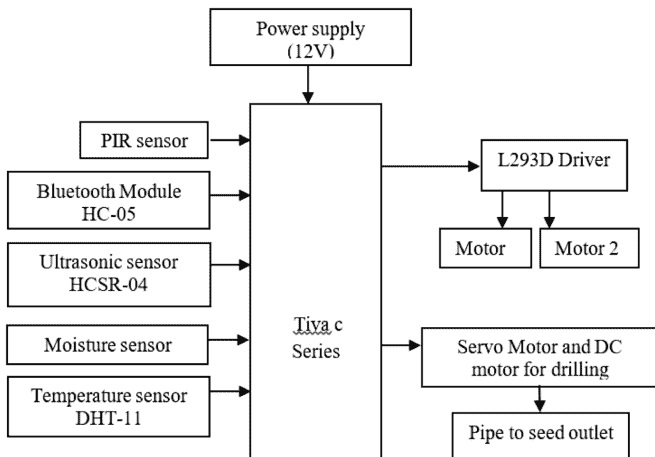

图2.1 块图。

两个电机用于犁地和播种，然后两个电机用于割草和喷洒。所有这些都连接到一个控制AGRIBOT速度的电机驱动电路[L293D IC]。现在机器人的运动使用蓝牙应用控制，该应用发送诸如前进、喷洒、切割、后退、左转、右转、犁地、播种以及识别障碍物等命令。因此，割草、种子播种、农药喷洒和犁地等操作已成功完成。为防止机器人与不需要的障碍物碰撞，已使用超声波传感器，它们是每个移动机器人的主要要求。在播种过程中，超声波传感器向落在机器人路径上的任何物体发送信号。设备记录了障碍物与设备之间的精确间隙。因此，控制器现在可以停止机器人的运动以播种更多种子。

### 2.2 提出的工作

#### 2.2.1 块图

图2.1表示所提议的块图，并显示与TIVA板的接口。

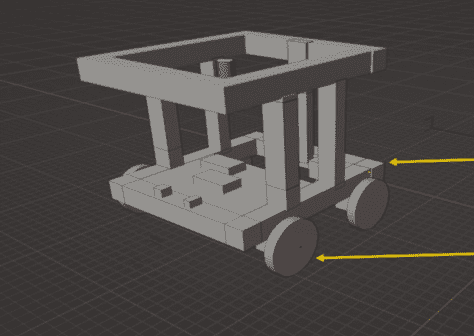

图2.2 机器人的CAD模型。

#### 2.2.2 机器人设计

目标是设计一个底盘模型，能够在大多数田地里无故障地运行，并且该机构应能够根据需要挖掘土壤和播种[7–10]。

图2.2和2.3展示了我们种子播种机器人的CAD（计算机辅助设计）模型。

主要零件如下：

- 1. 机器人的结构底盘
- 2. 蓝牙控制轮子
- 3. 种子储存容器
- 4. 种子播种机构（齿条齿轮）
- 5. 伺服电机
- 6. 蓝牙模块HC-05
- 7. 传感器（温湿度、超声波传感器HC-SR04、湿度传感器、PIR传感器）
- 8. TIVA TM4C123GXL开发板

HC-05蓝牙模块与TIVA TM4C123GXL接口，能够监控传感器读数，并使用蓝牙Android应用控制机器人运动。种子罐组装到固定在机器人前侧的伺服电机上[11–14]。然后将种子倒入罐中，以便机器人通过操作伺服电机播种。

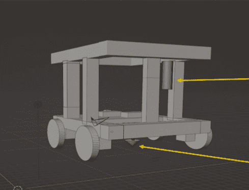

图2.3 机器人CAD模型的另一个视图。

使用钻机顺时针和逆时针钻取土壤以将土壤卷上来。在大多数农场，犁地和播种的不同方法通常是顺序进行的，需要大量时间。钻孔机构（齿条齿轮）使机器人能够在任何土壤条件下播种。

精准农业成本低廉，并且与多种土壤类型兼容[15–17]。

#### 2.2.3 种子播种机构

使用齿条齿轮机构进行种子播种。齿条齿轮线性执行器由一个与直线齿轮啮合的圆形齿轮组成，用于将旋转运动转换为线性运动。当齿轮转动时，齿条沿直线方向驱动[18–20]。如果齿条沿直线驱动，齿轮将被推动旋转。图2.4类似于齿条齿轮机构；箭头代表齿条的直线运动和齿轮的圆形运动。

#### 2.2.4 种子分发

伺服电机与种子容器耦合以播种。伺服电机的机制是顺时针和逆时针两个方向各旋转30°，在播种过程中落下种子。


![img/d1f13ee8a5e334af2b540a0b952cbea1_72_0.png]

图 2.4 齿条和齿轮机构。

- 种子播种机构可以以最小损耗控制种子深度并正确利用种子。
- Bluetooth 模块通过串行端口与 TIVA 板接口。
- Bluetooth 模块通过串行端口与 TIVA 板接口。
- HC-05 是一款用于无线通信的 Bluetooth 模块，它通过串行端口与设备通信。

#### 2.2.5 TIVA C 系列

TIVA TM4C 系列 TM4C123G 评估板 (EK-TM4C123GXL) 可作为基于 ARM® Cortex-M4F 的微控制器的经济实惠平台。针对特殊应用，TIVA C 系列板载 RGB 半导体二极管和可编程用户按键。TIVA C 系列 TM4C123G 板的 Booster Pack XL 用于通过连接众多现有 Booster Pack 加载板和即将推出产品上的各种外围设备，扩展 TIVA C 系列板的实用性。

图 2.5 显示 TIVA C 系列板 TM4C123GXL；它具有可编程用户按键和 RGB 半导体二极管。

![img/d1f13ee8a5e334af2b540a0b952cbea1_73_0.png]

图 2.5 TIVA C 系列 TM4C123GXL 板。

#### 2.2.6 BoosterPacks

TIVA C 系列板使得使用 TM4C123GH6PM 微控制器设计应用变得简单且合理。TIVA C 系列 BoosterPacks 和 MSP430 BoosterPacks 扩展了 TIVA C 系列板的外围设备和可能用途。BoosterPacks 将与 TIVA C 系列板一起使用；否则，板载 TM4C123GH6PM 微控制器将用作 CPU。

#### 2.2.7 使用的软件：ENERGIA 集成开发环境 (IDE)

Energia 平台是一个开源 IDE。Energia 拥有大量用于编程最常用微控制器的库。与许多编码平台不同，它为 Windows、Linux 和 Mac 等多种主机平台提供工具版本。

这样做的主要原因是 Energia IDE 完全使用 Java 编程语言编写。IDE 的主要目的是将常见开发者工具整合到单个 GUI（图形用户界面）中，以构建应用程序。图 2.6 显示 Energia IDE 平台的用户界面窗口。

![img/d1f13ee8a5e334af2b540a0b952cbea1_74_0.png]

图 2.6 Energia IDE 窗口。

#### 2.2.8 使用的组件

##### 2.2.8.1 Bluetooth 模块

HC-05 模块 (+5V VCC) 是一个简单的 Bluetooth SPP 模块。术语 Bluetooth 模块 (HC-05) 用于移动设备与微控制器之间的配对。它从移动设备接收数据，并以二进制比特形式向微控制器发送信息。

图 2.7 显示 HC-05，专为无线通信设计，发射功率高达 4 dBm。Bluetooth 模块由 3 V 供电。它有两种工作模式：命令响应和自动关联。模块完成自动关联任务后，将使用定义的方法自动通信信息。模块处于命令响应模式时，用户可以向串行接口发送 AT 命令，以设置管理限制并发送管理命令。

![img/d1f13ee8a5e334af2b540a0b952cbea1_75_0.png]

图 2.7 Bluetooth 模块 (HC-05)。

##### 2.2.8.2 运动 PIR 感应元件

PIR 传感器用于检测运动，常用于判断有人是否进入或移出传感器范围。这些传感器体积小、成本低、功耗低且易于操作。因此，它们通常出现在家庭或公司使用的应用和设备中。此传感器通常被称为 PIR、被动红外或热释电传感器。

PIR 通常由检测红外光辐射量的热释电感应元件组成。一切事物都会产生低水平辐射；物体越热，发射的辐射越多。运动探测器的感应元件分为两半。由于目标是识别运动而非平均 IR 电平，这两部分以相互抵消的方式连接。当一方观察到的 IR 辐射比另一方多或少时，输出可能会变高或变低。

除了热释电感应元件外，可能还会包含一些辅助电气元件，例如电阻和电容。大多数小型业余传感器（“微功率 PIR 运动探测器 IC”）似乎都使用 BISS0001。该芯片接收感应元件的输出，并进行一些处理，从模拟感应元件生成数字输出脉冲。

基本统计信息：

- 尺寸：紧凑。
- 触发时数字脉冲高电平 (3 V)，空闲时低电平。脉冲长度因感应元件而异，并由 PCB 上的电阻和电容控制。
- 灵敏度各异：探测范围可达 20 英尺（6 米），视角为 110° × 70°。
- 电源：许多模块的输入电压为 5 V–12 V，但如果稳压器有其他规格，5 V 也可正常工作。

![img/d1f13ee8a5e334af2b540a0b952cbea1_76_0.png]

图 2.8 DC 微型电机（12,000 rpm，12 V）。

##### PIR 的工作原理

PIR 设备本身有两个槽，每个槽由独特的 IR 敏感可测量元件组成。观察发现，这两个槽可以看到远处，因为这里使用的镜片不起多大作用。设备处于静止状态，每个槽接收到的来自区域、墙壁和外部的 IR 辐射量相等。当温暖的物体（例如人或动物）经过时，PIR 设备的一半被遮挡，导致两半之间出现正差分变化。当温暖的物体离开检测区域时，设备产生负微分变化，导致设备产生负差分变化。感应到的脉冲被检测到。

IR 设备由由红外透射材料制成的窗口保护，该窗口经过密封处理，以改善噪声/温度/湿度。

##### 2.2.8.3 DC 电机

直流 (DC) 电机是一种将电压转换为能量的旋转电气设备。最常见的形式依赖磁场力。几乎所有直流电机都有内部机制（机械式或电子式），用于定期改变电机电流流动的方向。

微型直流电机以 12,000 rpm 的相关转速运行。对于这种机制，四个直流电机在 12 V 下运行，一个在 6 V 下运行。

图 2.8 显示位于机器人底部的 DC 微型电机，专为前进、后退、向左转和向右转而设计。还有一个电机用于向上和向下钻土。

图 2.9 显示 DC 微型电机 (6 V)，用于将轴向上和向下移动最多 5 厘米。

![img/d1f13ee8a5e334af2b540a0b952cbea1_77_0.png]

图 2.9 DC 微型电机 (6 V)。

##### 2.2.8.4 L293D 电机驱动器

L293 和 L293D 是高功率四路半 H 桥驱动器。L293 旨在提供高达 1 安培、电压范围从 4.5 V 到 36 V 的双向驱动电流。L293D 旨在产生电压范围从 4.5 V 到 36 V 时的 600 mA 双向驱动功率。

##### 2.2.8.5 伺服电机

旋转或线性执行器伺服电机可以精确控制角度或线性位置、速度和加速度。它由合适的电机和位置反馈装置组成。它还需要使用复杂控制器，该控制器通常是主要为伺服电机开发的独立模块。

伺服电机一词广泛用于描述适合在闭环控制系统中使用的电机，但不特指某一明确的电机类型。

##### 2.2.8.6 双电源电池

电池存储电能并释放电能，因此用作包含 12 V 直流电和 6 V 直流电的双电源电池。在此，12 V 用于驱动驱动电机，6 V 用于伺服电机和其他一些电机。双电源电池可以是锂离子电池或铅酸蓄电池。铅酸电池由电池单元组成。每个电池单元约为两伏特，因此 12 V 电池有六个单独的电池单元。似乎


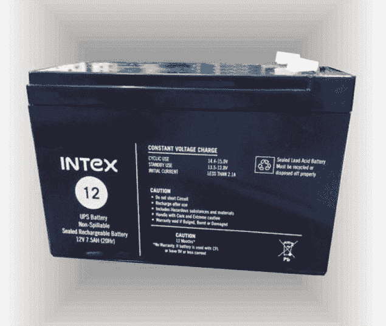

图 2.10 电池（12 V 和 6 V）直流电源。

带电两伏电芯的电压约为 2.15 V。值得指出的是，放电的 2 伏电芯电压为 1.9 V。电池旨在储存能量，并在需要时将此能量转换为功率。图 2.10 显示了一张 12 V 电池的图像。

##### 2.2.8.7 湿度传感器

温度与湿度的测量以及管理在多种应用中得到广泛应用。最近可购得集信号采集、ADC 以及消息边缘接口于一体的温湿度传感器设备。采用智能传感器显著改善了外观并降低了整体成本。前文已提及关于湿度与温度测量的 Sensirion SHT1x/SHT7x 等传感器。Sensirion 传感器能够同时测量温度和湿度并输出基于数字的信号，而 SHT1x/SHT7x 是精确的传感器读数。DHT11 设备为温度和湿度提供数字输出，但与 Sensirion 传感器相比，价格相对更低、更便宜。DHT11 设备使用专有的单总线协议，此处将探讨该协议，并与 PIC16F628A 微控制器配合使用，以通过设备获取温度和湿度值并在 16 x 2 字符型 LCD 上显示输出。

##### 2.2.8.8 超声波（UV）传感器

蝙蝠是奇妙的生物。尽管视而不见，但它们的图像极为精确，即使在飞掠而过的瞬间，也能区分鳞翅目昆虫和枯萎的叶子。毫无疑问，与人类相比，这种图像具有欺骗性，并且远远超出了人类远距离视觉的能力，但这并未超出我们的理解范围。超声波回声定位是 Nutty 及动物界众多其他个体用于导航的技术。

土壤湿度检测器：土壤湿度检测器用于测量土壤中液体的体积含量，并将湿度水平作为输出。由于该检测器同时具有模拟和数字输出，因此常以模拟和数字模式使用。

传感器工作原理：土壤湿度传感器中包含两个用于测量体积含量（液体）的探头。这两个探头允许电流沿土壤通过，电阻水平用于计算湿度水平。

如果土壤中含水量较多，则土壤可导通大量电量，这意味着电阻会较小。这表示湿度水平较高。干燥土壤导电性能较差，因此当有水分时，该土壤导电量较少，这意味着会出现较大的电阻。这表示湿度水平较低。检测器通常有两种连接模式：（a）模拟模式和（b）数字模式。模拟模式连接优先，随后是数字模式连接。

#### 2.2.9 性能分析

在表 2.1 中，整项工作被划分为若干部分，以清晰描述已完成的工作和项目的成果。

##### 2.2.9.1 使用蓝牙模块的传感应用结果分析

通过与 TIVA 开发板和蓝牙模块对接，并利用传感器对数据进行实时监测，传感器读数将显示在通过蓝牙连接的 Android 应用中。

### 表 2.1 分段式工作描述。

| 序号 | 分段结果 | 描述 |
| :--- | :--- | :--- |
| 1 | 使用蓝牙模块的传感应用 | 与 tm4cgxl 开发板对接传感器：<br>1. PIR 传感器<br>2. 超声波传感器<br>3. 湿度传感器<br>4. 温度传感器<br>通过蓝牙模块 HC-05 记录传感器读数 |
| 2 | 种子播种机构及种子分散 | 与 tm4cgxl 开发板对接伺服电机和直流电机，以完成齿条齿轮机构，用于播种和分散种子，由蓝牙应用控制。 |
| 3 | 使用蓝牙模块的机器人运动控制 | 将 tm4cgxl 开发板与直流电机对接以实现机器人运动，通过蓝牙应用发送播种和运动控制（左/右、前/后）等操作指令来启动。 |

与 TIVA tm4cgxl 开发板对接的传感器包括 PIR 传感器、超声波传感器、湿度传感器和温度传感器：

上述各种传感器收集数据，并通过蓝牙模块连接的 Android 手机上显示。

图 2.11 显示了 Android 应用的界面。点击终端模块后，传感器读数将在 Android 应用上显示。

图 2.12 显示了通过蓝牙连接的 Android 应用中显示的传感器读数。传感器读数将每 30 m 更新一次。

##### 2.2.9.2 种子播种机构及种子分散结果分析

采用 V 形钻头顺时针和逆时针钻取土壤，以将土壤带上来。所用的钻取机构为齿条齿轮机构，使机器人能够在任何土壤条件下播种。连接到种子容器的伺服电机通过顺时针和逆时针方向转动 30° 角来播种种子。这些动作将由蓝牙模块同时控制并执行。

图 2.13 表示用于种子播种的齿条齿轮钻取机构。钻头用于顺时针和逆时针钻取土壤，以将土壤带上来。

图 2.14 表示从容器中分散种子。连接到种子容器的伺服电机以 30° 角在


### 图 2.11 Android 应用。

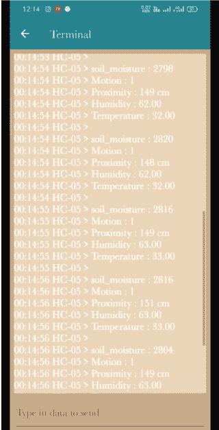

### 图 2.12 传感器读数。

顺时针和逆时针方向，在播种时投放种子。

##### 2.2.9.3 CAD 模型设计

图 2.15 显示了 CAD 模型设计窗口以及项目的 CAD 设计工作。

图 2.16 显示了项目在田间的工作情况，并比较了钻取前后齿条齿轮的运动。

图 2.17 显示了项目在田间执行操作的工作情况。

钻取机构工作原理：如图 2.16 所示，V 形钻头顺时针和逆时针旋转以挖掘土壤，V 形钻头钻取的特定深度设定为 5 厘米。

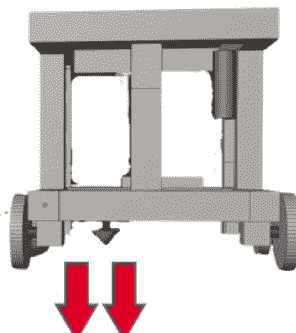

### 图 2.13 钻取机制。

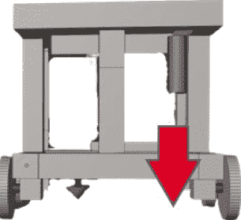

### 图 2.14 种子分散。

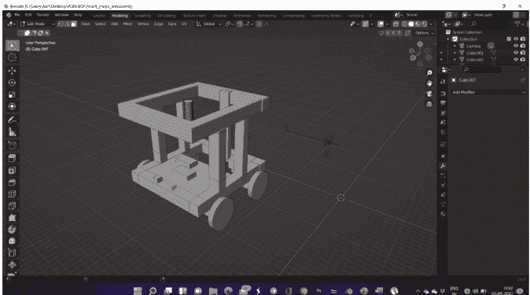

### 图 2.15 CAD 设计窗口。

可根据土壤类型和分散的种子数量，在 Energia 代码中修改深度。

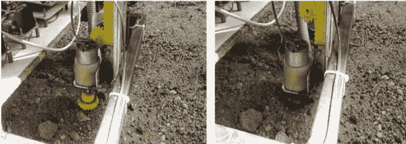

图 2.16 钻取前后齿条齿轮运动。

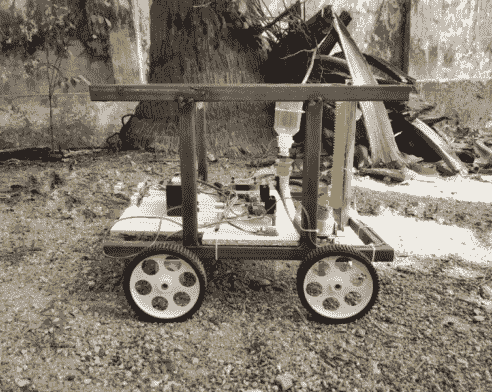

图 2.17 机器人在田间的工作情况。

### 2.3 结论

本程序的主要重点是其默认的播种方法。种子按顺序播种，以达到良好发芽的效果。这种播种方法使用了一台机器人，减少了对雇佣工人的需求。在此过程中，种子损失也大幅减少。该机器人设计用于自动播种。借助机器人，种子按正确顺序撒入地面，从而减少种子浪费。这台机器人将帮助农民采用良好的耕作方式。

#### 表 2.2 显示了项目的 PYP。

| 问题 | 解决方案 | 独特价值主张 | 独特优势 | 客户细分 |
| :--- | :--- | :--- | :--- | :--- |
| 人工播种在行距和株距方面缺乏可接受的间距。所提模型专注于均匀且精确的种子播种过程，以克服该问题。 | 使用 HC-05 远程监测传感读数，按可接受的图案进行多种种子沉积。4 | 以可负担的成本实现精准农业，适用于多种土壤类型，减少浪费并提高效率。3 | 农业精准度、远程监测、可扩展性、减少浪费、多作物适应性。9 | 小农和边际农户、早期采用者、新时代农民、农民合作社、NGOs/MFIs。2 |
| 现有替代方案 固定 x-y 轴底盘模型 1 | 关键指标 触达农民数量（Nos）服务亩数 效率 效率参数与节省成本对比。8 | | 渠道 直销 B2C（数字化）B2B 与 Big Basket 等合作 农民合作社 NGOs/MFIs 农博会展览。5 | |
| 成本结构 制造成本 批量价格：Rs.6000 原型成本：Rs. 7000 6 | | | 收入流 资产销售 订阅模式：租赁/租赁/按次付费 维护与更换 制造许可 7 | |

在了解种子播种机的局限性后，得出结论：自动种子播种机可以完成以下操作：

- 该模型可使用 HC-05 蓝牙模块在田间保持所需间距。
- 代码设定了使用 TIVA 开发板挖掘土壤的特定深度，伺服电机有助于将种子放入其中，伺服电机在特定毫秒内打开，因此机器人每次都能放置准确数量的种子，有助于防止种子损失。
- 机器人可以同时执行各种操作，这有助于农民节省大量资金，例如人工需求和人工成本，最重要的是该机器人对农民来说价格可负担。

### 致谢

作者感谢 PALS 对模型进行评估，并在 PALS INNOWAH 2022 中授予值得孵化的项目。作者感谢边际农户在其农业用地上进行各种作物和田地的演示过程。作者感谢印度斯坦科技学院（Hindustan Institute of Technology & Science）的德州仪器创新实验室为完成项目提供所需的处理器和支持软件。


### References

- [1] ICCEMME 2019 IOP 会议系列：材料科学与工程 691 (2019) 012023 IOP Publishing doi:10.1088/1757-899X/691/1/012023
- [2] 应用工程研究国际期刊 ISSN 0973-4562 第13卷，第6期 (2018) pp. 259–262
- [3] P. Kumar 和 G. Ashok，智能播种机器人的设计与制造，Materials Today: Proceedings, https://doi.org/10.1016/j.matpr(2020)
- [4] Suibing Li, Shuai Li, Long Jin，“沙漠中播种机器人的设计与物理实现”，中国控制会议 (CCC) 2020 第39届，pp. 3892–3897, 2020.
- [5] 工程与技术国际研究期刊 (IRJET) e-ISSN: 2395-0056 第06卷 第04期 | 2019年4月
- [6] 第四届电子与信息学趋势国际会议论文集 (ICOEI 2020) IEEE Xplore 部件编号: CFP20J32-ART; ISBN: 978-1-7281-5518-0
- [7] 第二届计算应用创新研究国际会议论文集 (ICIRCA-2020) IEEE Xplore 部件编号: CFP20N67-ART; ISBN: 978-1-7281-5374-2
- [8] 先进工程与研究开发国际期刊 (IJAERD) 第6卷，第02期，2019年2月，e-ISSN: 2348-4470，print-ISSN: 2348-6406.
- [9] Kavitha. B.C. 和 Valikannu. R，“基于 Raspberry-Pi 的 IoT 智能工业监测系统”，第6届 IEEE 信号处理与集成网络国际会议论文集 SPIN 2019. (Scopus 收录).
- [10] Kavitha, B.C. 和 Vallikannu, R. (2020)，“面向 IoT 协作移动边缘计算环境的延迟感知并发数据管理方法”，微处理器与微系统. Elsevier., 74(1): 842–852. (SCI 期刊 – WoS 和 Scopus 收录).
- [11] Kavitha, BC. 和 Vallikannu, R.，“IoT 辅助预测性维护与工人安全：一项倡议”，第5届信息与通信技术竞争性策略国际会议 (ICTCS 2020), 斋普尔, 印度, 2020. (Scopus 收录的 Springer)
- [12] 基于 AGRIBOT 的 IoT 农业, 2018 年第 3 届 IEEE 电子、信息与通信技术最新趋势国际会议 (RTEICT-2018), 2018 年 5 月 18 日 & 19 日.
- [13] 太阳能自动多用途农业机器人使用蓝牙/安卓应用, 第三届电子通信与航空航天技术国际会议论文集 [ICECA 2019] IEEE 会议记录 #45616; IEEE Xplore ISBN: 978-1-7281-0167-5.
- [14] 使用 Agrobot 的 AI 传感器智能农业, 2020 年第四届计算方法与通信国际会议 (ICCMC) 978-1-7281-4889-2/20.
- [15] 使用智能农业机器人的种子播种自动化, 应用科学与工程技术研究国际期刊 (IJRASET), ISSN: 2321-9653; IC 值: 45.98; SJ 影响因子: 6.887, 第7卷 第IV期, 2019年4月.
- [16] Aditya R. Rao, Ajay H., Balavanan M., Lalit R., 和 J. Anand，“一种基于 IoT 的新型心脏骤停警报系统”，科学技术与工程国际期刊, 第3卷, 第10期, pp. 78–83, 2017年4月.
- [17] Dhanalakshmi R., Jose Anand, Arun Kumar Sivaraman, 和 Sita Rani，“面向农业应用的基于云的 IoT 水质监测系统”，物联网的云与雾计算平台, 由 Pankaj Bhambri, Sita Rani, Gaurav Gupta, Alex Khang 编辑, Routledge Taylor & Francis Group, 2022年5月.
- [18] J. Anand, 和 J. Raja Paul Perinbam，“使用模糊逻辑的自动灌溉系统”，AE 多学科研究国际期刊, 第2卷, 第8期, pp. 1–9, 2014年8月.
- [19] K. Nirmala Devi, J. Anand, R. Kothai, J. M. Ajai Krishna, 和 R. Muthurampandian，“基于传感器的姿态检测系统”，Materials Today 论文集, 第55卷, 第2部分, pp. 359–364, 2022.
- [20] S. Prema, J. Anand, P. Vanitha, Nirmala Devi K., M. Mohamed Yaseen, 和 Rajeswari C.，“面向视障人士的超声波传感器智能手杖”，并行计算算法、工具和范式的进展, 第41卷, pp. 43–441, 2022年11月.

## 作物管理系统

L. Jubair Ahmed¹, S. Dhanasekar², V. Govindaraj³, 和 C. Ezhilazhagan³

¹阿克沙亚工程与技术学院电子与通信系, 印度
²斯里埃斯瓦工程学院, 印度
³Dr. N.G.P. 技术学院电子与通信工程系, 印度
Email: jubaircb@gmail.com; dhanasekar.sm@gmail.com; see1govind@gmail.com; ezhisang20@gmail.com

### 摘要

近年来，智能农业正以显著的速度发展。它是信息与通信技术（ICT）运动的一部分，该运动正在多方面推动农业发展，被称为第三次绿色革命。通过丰富作物产量流程，智能农业提升了高质量食品的制造。本文重点研究作物栽培技术，并应用深度学习（DL）和机器学习（ML）算法，以应对栽培过程中出现的诸多挑战。机器学习是一项前沿的技术创新，通过提供特定的作物建议和敏锐洞察，帮助农民减少作物损失。土壤与水管理、作物栽培、作物病害检测、杂草控制、作物分布、稳健的果实计数和产量预测，都是采用深度学习的智能农业应用示例。最近，农民们面临着诸多新挑战，加上因降雨稀缺、土壤肥力问题等导致的作物歉收。鉴于环境的变化，本拟议研究将通过寻找处理和收获作物的最有效方式来提供帮助。

### 3.1 引言

在过去二十年中，大量研究集中于未来农艺作物的耕作技术。种植系统的变化将对昆虫种群趋势和管理产生重大影响 [1]。作物生产一直是农业最重要的分支之一。作物生产对于为畜牧业提供饲料以及为普通人提供食物至关重要。提高农业活动的经济效益一直是人类农耕史上的主要目标。必须定期检查农业生产场地，以获得高质量产品，并且可以采取所有必要的作物生产措施。农民通过花费时间和资源进行每次访问来增加作物成本。由于农民进行密集的作物监测和评估，智能农业已成为一种必需。数字化将涵盖大多数工程领域，并对涉及快速数据传输的广域通信网络产生更大影响 [2–4]。

智能农业将是一种新模式，利用先进的信息技术使农业高度高效和高效 [5]。由于人工智能、自动化和连接性的最新进展，农民可以更好地监测各种流程，并通过超人效率的机器应用特定的治疗方案。工程师、数据科学家和农民都在努力减少农业中所需的人工劳动量。作物产品已被用作广泛领域（包括制药、食品和燃料）中的植物基原材料。作物生产是农业的一个子集，涉及田间作物栽培、蔬菜生产和水果生产等 [6]。

人工智能最初被引入以在计算机编程任务中智能地解决简单的数学或逻辑规则。机器学习作为人工智能的一个子集，采用自学习方法来提取数据。机器学习采用强化学习、监督学习、混合学习和无监督学习等学习规则，以获取数据的有用关联 [7]。人工神经网络概念已应用于机器学习，这被称为深度学习。深度网络因其深度而区别于神经网络。基于这些特性，深度学习网络可以检测未标记和非结构化数据中的潜在结构。深度学习网络特别执行特征提取，同时需要人工交互，与早期技术相比具有显著优势。随着宽带无线


transmission networks, customer demands in high-speed wireless communication have risen significantly [8–10].

The deep anomaly method is more effective than region-based convolutional neural networks at detecting humans at distances of 45–90 m (RCNN) [11]. This algorithm generates homogeneous field characteristics and detects anomaly. The deep learning categorization for land cover as well as crop types employing remote sensing data was described in this article [12]. CNN was compared to a traditional fully connected MLP as well as random forest. The use of self-learning convolutional neural networks to recognize individual plant classes based on visual sensor data is discussed [13]. In UAV images of line crops, automatic weed detection employing deep learning using unsupervised data labeling is presented [14]. Therefore, the fully automatic weed detection will be conducted when CNNs are used to unsupervised training datasets. A crop disease classification system based on a mobile capture device due to deep residual neural network was introduced. Extensive testing improved the balancing accuracy between 0.78 and 0.8 [15].

The deep neural network including transfer learning is used to detect the mildew illness on millet crop images in order to identify the mildew disease [16]. The experimental result accuracy is 95%, precision is 90.0%, recall got 94.50% as well as the F1-score has been 91.75%. NDVI and RGB data collected through UAVs were used to estimate crop yields using deep convolutional neural network [17]. The RGB images outperform NDVI images while using CNN architecture. Rice grain productivity, CNN architecture as well as low-altitude remote sensing-based images were discussed as essential features [18]. Deep CNN performed much better and was more stable during the ripening stage. A multi-temporal crop classification based on deep learning has been studied [19]. XGBoost, SVM and RF parameters were compared to LSTM and Conv1D deep learning models. Another crop vision collection using deep learning categorization as well as precise farming recognition has been developed [20]. This suggested methodology outperformed VGG, DenseNet, ResNet, SqueezeNet and Inception on crop datasets, with the precision of 99.81%. The deep learning technology is used to properly recognize as well as distinguish crops in soil. As a data source, data from a high-resolution digital surface model is used. The transfer learning methodologies with convolutional neural networks are employed with automatic feature extraction for crop pest categorization [21]. Xie1, NBAUR and Xie2 datasets have the highest accuracy of 94.47%, 96.75% and 95.9%, respectively.

We evaluate the specific crop management system using deep learning technique and its model as well as frameworks used, nature, pre-processing and data sources as well as the performance attained using the metrics are studied. Since most agricultural firms have switched completely to crop production, the problem of crop production management has become increasingly relevant. The original study goal is to develop suggestions for enhancing crop production planning and management with modern business situations using deep learning models. The purpose of the study will be whether the deep learning technique has been utilized to improve crop management systems and rank the areas to encourage new researchers, to guide future research in agriculture production.

This article is structured such that Section 3.2 introduces the deep learning architecture using CNN. In Section 3.3, the role of deep learning in crop management system is discussed. The scope and challenges of artificial intelligence and deep learning in the crop management system have been described through Section 3.4. In the end, Section 3.5 concludes with remarks and future work for crop management system.

### 3.2 Insights of Deep Learning

Deep structured learning or hierarchical learning is a subset of the machine learning which focuses upon artificial neural network (ANN) algorithms that are inspired by the structure as well as activity of the human brain [22]. It performs exceptionally on a variety of complex cognitive tasks, approximating and even outperforming human performance. The ability to learn huge quantities of data is the advantages in deep learning technique. Deep learning popularity has been increased over the last decade, and it is effectively used for various traditional applications. In several sectors, including natural language processing, cyber security, bioinformatics, medical information processing and robotics and control, deep learning has excelled over well-known machine learning techniques.

The three main deep learning techniques are partially supervised (semi-supervised), supervised and unsupervised. Additionally, deep reinforcement learning (DRL), commonly referred to Recursive Learning, would be a form of learning approach that is typically classified as occasionally unsupervised and partially supervised techniques. Recurrent neural networks (RNNs), convolutional neural networks (CNNs) and recursive neural networks (RvNNs) are among three most well-known types of deep learning networks used. The most extensively used algorithm CNN which has key advantage over its predecessors would be automatically detecting significant features without the need for human intervention. The features have been extracted by various approaches in traditional machine learning algorithms; however, the convolutional neural network trains the filters for itself, indicating that the network extracts features autonomously. CNNs have now employed in various applications, such as computer vision, audio processing and facial recognition. CNNs are closely related neural networks in their structure which is inspired from neurons in animal and human brains. Convolutional neural networks were extensively deployed in the deep learning network type, which discusses the evolution for CNN architectures as well as their main characteristics. The model of a basic convolutional neural network architecture is shown in Figure 3.1.

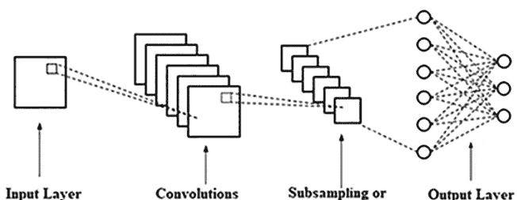

Figure 3.1 Convolutional neural network architecture.

A convolution layer is typically used in CNN, and it employs convolutional filter collections to recover numerous local features from each input region, resulting in a large number of feature maps. The layer has been represented mathematically as [23]

$(cn)_{ij} = (Xn * q)_{ij} + dk,$ (3.1)

where $(cn)_{ij}$ indicates the $nth$ output feature map of $(i, j)$ element.
The input feature maps are represented by $q$. The $nth$ filter and bias are indicated by $Xn$ and $dk$, respectively. A 2D spatial convolution operation is represented by the * symbol.

CNN architecture is divided into two components. Feature extraction is a convolution method which extracts and detects the image distinct characteristics of an image during evaluation. The fully connected network employs its convolution result for predicting image classification based on characteristics obtained earlier in the process. A CNN is made up of three layers namely pooling layers, fully connected (FC) layers and convolutional layers. These layers are combined to form the CNN architecture. The convolutional layer is being used to extract input image information. The mathematical operation of convolution has been carried out among the input images as well as filter of M × M size. A pooling or sub-sampling layer has been commonly used after our convolutional layer. The pooling layer reduces convolved feature map size with the reduced computational costs. While connecting both weights and biases in neurons, the fully connected (FC) layer will be connected with neurons between two layers. The CNN architecture's final few layers were usually placed prior to output layer. Finally, in the CNN model, an activation function employs important component which estimates any kind of continuous and complex link across network variables.

The CNN includes three distinguishing characteristics which make a potentially valuable tool in additional crop yield modeling:
- (i) A CNN model has been developed which represents environmental elements as well as the genetic transformation in seeds through time despite knowing their genotype.
- (ii) The model has proven the capacity that extends yield prediction across untested conditions while maintaining high accuracy.
- (iii) When combined with the back propagation approach, the model was able to demonstrate the level towards which weather prediction accuracy, weather conditions, management practices and soil characteristics may influence crop production variation.

During 2008 and 2016, Khaki and Wang [24] developed the deep convolutional neural network technique which estimates the corn yield in 2247 locations. A deep learning architecture was developed by Kim et al. [25] during 2006 and 2015 on agricultural yield prediction. The soybean crop production in Argentina and Brazil, which uses deep learning and transfer learning approach, has been estimated by Wang et al. [26]. With remote sensed pictures, Yang et al. [27] evaluated effectiveness for yield of rice grain and yield prediction in ripening process by the CNN model.

### 3.3 Crop Management System: A Deep Learning Approach

As the world's population continues to grow, a significant increase in food production is required to ensure worldwide availability and good nutritional quality while also safeguarding natural ecosystems through sustainable agricultural practices [28]. The application of crop management methods guarantees the crop's productivity with higher yields and better quality. Crop management is a set of agricultural operations aimed at improving crop growth, development and yield. As indicated in Figure 3.2, it begins with land preparation, seed selection, seed sowing, irrigation, crop development, together with crop management and concludes with crop harvest, storage, along with commercialization.


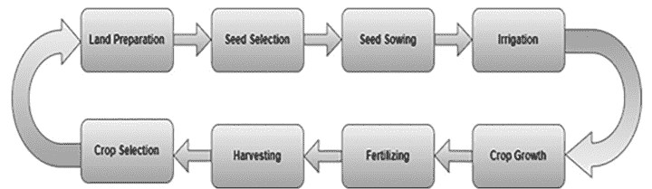

图 3.2 作物管理系统。

植株生长期、土壤、气候和天气条件均会影响农业过程的时序和顺序。撒播播种方式和行作物、冬季或春季作物（收获产品如谷物、干草和青贮饲料），以及天气条件、植株生长期、土壤和气候均是影响农业过程时序和顺序的因素 [29]。农业中计算机视觉应用及常用技术如表 3.1 所示。

#### 3.3.1 土壤健康监测系统

改善作物生长的首要步骤是准备苗床。理想的苗床应保持坚实、表面湿润且无杂草。根据播种记录中的常见评论，“良好的种子与土壤接触至关重要”。当种子与土壤有足够接触时，发芽率会得到提高。另一方面，过于坚实的苗床会使种子更难入土。[30]。在当前竞争环境中，农业物联网可与传感器、通信协议和微控制器连接，以实现流程执行自动化并提升产量。深度学习性能可得出可接受的发现，并解决农业发展相关的许多实时挑战。Sumathi 等人 [28] 讨论了基于物联网通信系统的土壤条件估计系统的设计。在现代农业中，土壤质量是提高产量和调节水文循环的关键方面。一种用于基于物联网的土壤质量自动评估的改进型深度学习模型，可跟踪导致这些问题的各种土壤特性和气候要素。针对土壤质量预测，创建了一种能够拟合海量数据的深度学习模型。为精确测量土壤质量，计算了权重因子。

表 3.1 利用计算机视觉及常用方法的农业应用。

| 序号 | 农业应用 | 数据分析技术 |
|---|---|---|
| 1 | 作物测绘/土壤及植被 | SVM、终极成员提取技术、线性极化（HH、VV、HV）、图像融合、同极化相位差（PPD）、线性混合模型、逻辑回归、基于距离的分类、决策树、ANN、基于 NDVI 的分类、决策树、ANN、NDVI |
| 2 | 作物冠层及叶面积指数 | NDVI、线性回归分析 |
| 3 | 作物物候 | NDVI、傅里叶变换及小波滤波 |
| 4 | 肥料效应及生物量、作物高度、产量估算 | 植被指数（NDVI、ICWSI）、小波滤波、线性极化（VV）、线性和指数回归分析 |
| 5 | 作物监测 | 逐步判别分析（DISCRIM）、线性回归、同极化相位差（PPD）、线性极化（HH、VV、HV、RR 及 RL）以及分类器树分析是特征提取方法 |
| 6 | 种子鉴定及物种重排列 | 线性回归分析、主成分分析、特征提取 |
| 7 | 土壤和叶片中的氮含量及处理，以及盐度检测 | 线性和指数回归分析 |
| 8 | 灌溉 | 图像分类方法（基于阈值的密度分割、无监督聚类）、NDVI 和线性回归分析均用于决策树 |
| 9 | 病虫害检测与管理 | CEM 非线性信号处理、线性和指数回归分析、NDVI、使用样本图像的图像处理、统计分析 |

#### 3.3.2 基于深度学习的种子分选

种子分选将是一种机械化过程，旨在生产高纯度、高质量的最终产品。此类过程极难预测和调控。混合播种种子分类器连同质量测试仪是一种基于深度学习的系统，用于基于结构和颜色（连同纹理）质量测试的精确种子分类。该数据集包括健康和受损的珍珠粟及玉米种子的标注图片。其区分感染和健康玉米种子的能力提升了其在食品行业的应用。Chunlei Li 等人 [30] 提出了 SeedSortNet，一种与视觉注意相关的紧凑型 CNN，快速高效。首先，介绍了具有两个分支的轻量特征提取模块块。盾牌块通过执行高维空间变换、恒等映射和不同感受野建模进行详细开发，因此，参数更少、计算复杂度更低，它可以在正确定义多尺度特征的同时减少信息损失。

#### 3.3.3 基于深度学习的种子播种

苗床准备好后，种子应播种 1.5–2.0 英寸深，以确保有效种子发芽所需的足够水分供应。种子发芽需要最佳水分和温度条件，因此需多次检查土壤温度和水分需求 [29]。农业机会是迈向更好生活的起点，农业工具发展是农业进步的基础。Renuka Dhvale 等人 [31] 提议采用农业机器人（agribot）设计一个系统，以节省运营成本、缩短挖掘时间并提高种子播种性能。直流电机、湿度传感器、IR 传感器和超声波传感器用于该机器中，并配合 Wi-Fi 界面，在田地作业机器人上运行 Android 应用程序。播种挖掘机器人将穿过几行土壤，进行挖掘、播种种子并用覆盖物覆盖土壤。

Lukasz Gierz 等人 [32] 对不同质量的三裂小麦种子样本进行了调查。种子是在模拟实际播种情况的测试中收集的。相关作者在专门开发的测试设施上进行了实验。为播种调整了输送种子的气力输送管中的气速。播种时，输送种子的气力输送管道中的气速（15、20 和 25 m/s）有所变化。生成的视觉数据库允许根据播种速度和质量对六个种子类别进行分类。该数据库似乎是为构建训练和验证以及测试集而构建的。神经模型是使用统计分析和多层感知网络创建的。

#### 3.3.4 基于深度学习的智能灌溉系统

水是农作物生产的重要资源，且由于全球人口扩张导致农地不断增加，水资源日益有限。研究发现，合理的灌溉计划能让农民在作物质量和生产力以及减少用水量方面获益。土壤湿度（SM）是作物灌溉最关键的因素之一。这代表土壤中的总水量。估算未来土壤湿度（预测）是作物灌溉中优化水耗和作物产量的重要工作。土壤湿度随湿度、天气和时间而变化很大。作为一种可能的解决方案，Paweena Suebsonbut 等人 [35] 提出了一种基于长短期记忆网络（LSTM）的新方法，用于根据多个传感器收集的信息估算未来土壤湿度水平。使用了一个来自现实世界的数据集，其中包括与天气预报、土壤湿度以及其他相关智能传感器相关的多个因素，用于在泰国清迈省的一个温室中收集参数，以训练和验证该模型。

Thomas Henry Colligan 等人 [34] 提出了一种灌溉制图的新方法，并将其应用于 2000 年至 2019 年的蒙大拿州。该方法完全依赖原始 Landsat 表面反射率数据，并基于卷积神经网络构建了一个集成模型。在没有监督的情况下，该网络集成技术学会了屏蔽云层并忽略 Landsat 7 扫描线故障，避免了数据预处理或特征工程的要求。Jessica Kwok 等人 [35] 开发了一种基于深度学习的灌溉系统，可根据植物识别为每种植物调整水量。软件和硬件是该解决方案的两个主要组成部分。前者连接摄像头用于植物识别，并利用数据库估算适当水量；后者限制可能流出的水量。

#### 3.3.5 基于深度学习的作物生长识别

对温室种植者和农民而言，植物生长和产量预测是关键任务。开发能够准确估算生长和产量的模型，可以帮助生产者改进环境管理、匹配供需并降低价格。机器学习，特别是深度学习，近来取得了显著进步，可预见将成为强大的新型分析工具。据 Yi Xie 等人 [36] 介绍，深度学习方法被用于将作物生长方法与基于遥感数据的时间序列相结合，以提高中国河南省小麦产量估算的准确性。诸如 LSTM、一维卷积神经网络以及随机森林等模型，使用叶面积指数连同谷物


产出时间序列模拟作物环境资源以纳入小麦模型。最后，利用田地测量LAI与MODIS NDVI之间指数连接模型计算了区域LAI，随后将其输入训练有素的LSTM、1D CNN及RF模型，以预测特定小麦种植区域的小麦产量。

Bashar Alhnaity 等人[37]提出的工作采用机器学习及深度学习方法，在受控温室条件下预测两种不同场景的产量及植物生长差异：番茄产量预测以及榕树（Ficus benjamina）茎干发育。

在预测公式中使用了新开发的深度循环神经网络，该方法利用长短期记忆神经元框架，整合了不同的领先时序处理网络——时序卷积网络及循环神经网络。

Liyun Gong 等人[38]建立了一种新的温室作物产量预测系统。

从多个真实温室站点获取了不同数据集，番茄生长被用于深入评估所提方法。

Hafiza Ufaq Rehman 等人[39]提供了一种观点规划方法，使收获机器人能够提高水果检测效果。

机器人系统可以使用观点规划来考虑主动感知技术，而不仅仅是单一的标准观点。

因此，规划器使用当前环境作为输入，并从预定义选项列表中生成最佳观点：向右移动、向左移动或保持静止。

透视规划问题被制定为分类问题，并使用深度神经网络实现。

使用水果检测器，他们首先从每个当前场景中提取局部水果区域及水果周围的邻近区域。

进行水果分割后，他们接着在观点规划器中使用分类器的标签来选择最佳视角。

#### 3.3.6 使用深度学习进行肥料估算

作物管理可能包括施肥。在向每种作物添加肥料之前，应对其土壤进行植物营养测试。

根据土壤和/或植物分析使用合适的肥料，有助于确保满足所种植作物的营养需求。

水稻、小麦、大麦、玉米、燕麦、黑麦、高粱和谷子都是在世界各地广泛种植的粮食作物。

可持续农业的一项关键职责是监测粮食作物健康状况并早期发现疾病。

早期发现各种疾病可以通过采用适当的病虫害防治技术来帮助病害防控，从而提高粮食产量。

粮食作物问题的人工诊断可能导致错误的农药用量。

JuhiReshma 等人[40]利用神经网络提出了预测特定香蕉作物所需肥料数量以及用于未来种植园的回归方法。

植物疾病是影响粮食生产并减少损失的最重要变量之一。

深度学习方法在植物疾病诊断中的实用性显著提高，从而形成了一种结果异常准确的完整工具。

Andre Abade 等人[41]提出了关于在植物疾病诊断与分类中使用卷积神经网络（CNN）的当前前沿技术，以及识别趋势和不足。

#### 3.3.7 使用深度学习进行作物收获

Abozar Nasirahmadi 等人[37]建议使用集成卷积方法的数字化二维成像系统，在使用收获机收获时识别甜菜明显的机械损伤。

Hafiza Ufaq Rehman 等人[39]提出了一种观点设计，使收获机器人能够提高水果检测效果。

机器人可以使用观点规划来推荐主动感知技术，而不仅仅是单一的标准观点。

因此，观点规划的难题被重新表述为分类问题，并使用深度神经网络实现。

使用水果检测器，我们从每个当前场景中提取局部水果区域及水果周围的邻近区域。

然后，分类器提供的标签在透视规划器中用于确定最佳视角，在进行水果分类后（Tanmay U. Sane 等人）[42]。

他的工作考察了各种机器人收获系统，包括那些已采用或旨在应用此类策略以识别作物、前往作物并有效可靠地收获的系统。

这探讨了选择AI/DL方法的标准，以及在其现场应用中遇到的挑战和好处。

基于其耐用性和性能，卷积神经网络是此类应用中常见的DL方法选择。

#### 3.3.8 使用深度学习的作物推荐系统

数字化农业解决方案可以提出作物推荐系统，帮助农民根据天气条件、湿度和季节确定在田地里播种哪种作物。

深度学习和机器学习方法为数据驱动决策提供了实用基础。

使用深度学习/ML推荐引擎，此应用还 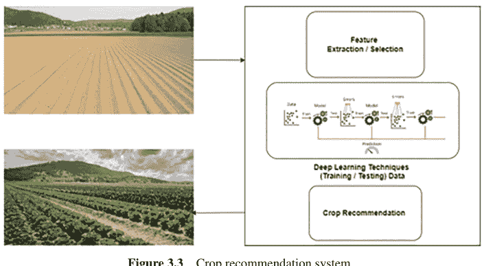 协助识别最佳农药、种子间距和种子，如图3.3所示。

在农业领域，种子质量是关键要素[43]。

由于某些种子天生非常小，可能难以区分和分类不同物种之间的差异。

专家使用基于形态结构、纹理和颜色的传统方法来分类这些差异。

此方法需要昂贵、主观且耗时的分类程序，可能阻碍开发能够自动检测种子类型的系统。

使用深度学习算法之一CNN，构建了一款智能手机应用，能够准确识别和分类种子图像。

作物生产是农业进步和耕作方法不断发展的方法[44]。

应对由于土壤侵蚀和工业排放造成的气候变化是农民面临的两个挑战。

土壤中缺乏钾、氮和磷等重要矿物质导致的营养缺乏，可能会导致作物生长延迟。

农民每年种植相同作物而不尝试新类型会犯错误。

Madhuri Shripati Rao 等人建议农民选择最佳作物预测模型，该模型可以根据气象条件和土壤养分帮助他们决定种植哪种作物。

为了对基尼（Gini）和熵（entropy）两个不同标准进行分类，采用了包括决策树、森林分类器和随机K近邻在内的常用方法。

模糊分类器用于医疗保健和基于物联网的系统[47–52]。

表3.2显示了与农业相关的公开可用数据集。

| 序号 | 数据集/组织/链接 | 数据集特征 |
|---|---|---|
| 1. | ImageNet数据集 http://image-net.org/explore?wnid=n07707451 | 各种植物图像（树木、蔬菜和花卉） |
| 2. | ImageNet大规模视觉识别挑战（ILSVRC） http://image-net.org/challenges/LSVRC/2017/#det | 能够定位和识别对象的图像 |
| 3. | 阿肯色大学植物数据集 https://plants.uaex.edu/herbicide http://www.uaex.edu/yard-garden/resource-library/diseases | 除草剂损伤图像数据库 |
| 4. | PFL，Plant Village数据集 https://www.plantvillage.org/en/crops | 含相关病害的不同作物图像 |
| 5. | Leafsnap数据集 http://leafsnap.com/dataset | 美国东北部185种不同树种的叶片 |
| 6. | LifeCLEF数据集 http://www.imageclef.org/2014/lifeclef/plant | 植物鉴定、地理分布及用途 |
| 7. | PASCAL视觉目标类别数据集 http://host.robots.ox.ac.uk/pascal/VOC | 各种动物图像（鸟类、猫、牛、狗、马、羊等） |
| 8. | 非洲土壤信息服务（AFSIS）数据集 http://africasoils.net/services/data/ | 撒哈拉以南非洲范围的数字土壤图 |
| 9. | UC Merced土地利用数据集 http://vision.ucmerced.edu/datasets/landuse.html | 包含21类土地利用图像的集合 |
| 10. | MalayaKew数据集 http://web.fsktm.um.edu.my/~cschan/downloads_MKLeaf_dataset.html | 代表44个物种类别的类似叶片扫描的照片 |
| 11. | 杂草及作物图像数据集 https://github.com/cwfid/dataset www.semanticscholar.org/pdfs/58a0/9b1351ddb447e6abde7233a4794d538155.pdf | 作物/杂草植物组注释、田间照片以及植被分割掩膜 |


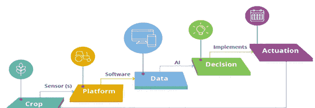

图 3.4 智慧农业中的人工智能。

### 3.4 作物管理系统的范围与挑战

本节对智慧农业中使用的基于深度学习和机器学习的复杂策略进行了完整分析。我们具体考察了机器学习以及智慧农业中使用的基于深度学习的先进方法的范围、近期应用与机遇、问题、局限性及未来研究方向。

#### 3.4.1 人工智能在智慧农业中的作用

多年来，技术重塑了农业，技术突破通过多个方面影响着农业行业。农业是世界上多个国家的主要活动，随着世界人口增长，农业也在增长，根据联合国预测，到 2050 年将从 75.2 亿增加到 97.8 亿；到那时，还将面临额外的土地压力，因为到那时只有 4% 的土地将被耕种 [53–54]。因此，农民将不得不以更少的资源做更多的事情。此外，根据调查，粮食产量需要增加 60% 才能供养额外的 20 亿人口。传统方法无法满足这一巨大需求。这正在迫使农民和农业企业寻找在减少浪费的同时提高产量的创新方法。因此，AI 正逐渐成为农业行业技术增长的一部分。农业中计算机视觉应用的 AI 驱动解决方案不仅可以帮助农民提高效率，还能提升作物产量和质量，并缩短上市时间（图 3.4）。

#### 3.4.2 农民在采用新技术时面临的挑战

许多挑战和因素影响着技术的接受和实施。农民是该技术的主要利益相关者，因为他们将使用它来改进农业系统。由于接受新技术以构建知识交流平台的资源有限，存在兴趣缺乏的问题。缺乏兴趣的关键原因是普遍缺乏对技术如何在财务和环境方面带来具体进展、为所有利益相关者建立可持续发展架构的理解和信息。尽管该领域开展了许多研究工作，但这些研究工作的实用性和应用性有时被忽视。

即使脱离适用性问题，在现场工作中也存在巨大的空白，合格的专业人员可以进入该领域解释技术的价值，这是采用该技术的主要障碍。关键难点在于，安全顾虑可能导致农业收割灾难，进而造成粮食短缺，使相关各方对使用该技术犹豫不决。此外，问题和范围是一个持续的过程，必须通过制衡机制经常加以解决和调整，以便为整个社区提供具有实际成果的可持续发展 [56]。

#### 3.4.3 深度学习中的挑战

深度学习已成为开发智能系统的最重要学习主题之一。深度学习技术利用模仿人类思维的人工神经网络（ANN），逐步学习如何处理给定的特定情况。然而，如图 3.5 所示，我们必须意识到深度学习系统存在重大挑战。

##### 3.4.3.1 海量数据

数据用于以渐进方式训练深度学习算法。为确保机器产生适当结果，需要大型数据集。等效的人工神经网络需要大量数据，因为人脑需要大量经验来学习和解释信息。抽象程度越高，因此需要修改的参数越多，而更多参数则需要更多数据。

##### 3.4.3.2 需要高性能硬件

训练足以支持深度学习解决方案的数据集需要海量数据。为了解决现实世界中的问题，机器必须具备足够的计算能力。数据科学家使用多核高性能 GPU 和等效处理单元，以提高效率并降低时间消耗。此类处理设备成本高昂，且可能消耗更多电力。工业级深度学习系统需要先进的数据中心，而无人机、机器人和移动设备则是需要紧凑但高效计算单元的智能技术示例。因此，在现实世界中部署深度学习系统既昂贵又耗能。

##### 3.4.3.3 神经网络过拟合

训练数据集中遇到的错误与在新解密数据集中识别的问题之间有时存在显著差异。当参数数量相对于数据量过多时，这种情况会出现在复杂框架中。模型的有效性取决于其在未知数据集上有效执行的能力，而非基于其在提供的训练数据上的有效性。通常，模型是通过优化其在特定训练数据集上的效率来开发的。因此，模型记住了训练实例，但不了解如何概括当前情况或数据集。

##### 3.4.3.4 超参数优化

超参数的值在学习过程开始前确定。此类参数值的微小变化可能会导致显著差异，从而影响模型性能。使用默认配置且不进行超参数优化可能会对模型有效性产生重大影响。仅保留很少超参数并手动调整，而不是采用优化方法，也是一种性能限制因素。

##### 3.4.3.5 实现高级认知功能

如果我们知道模型的参数是什么，如何将已知数据输入神经网络以及它们是如何组装的。然而，我们很少理解它们如何得出某个解决方案。研究人员努力理解神经网络如何得出结论，因为它们基本上是黑盒。神经网络无法进行抽象推理，这使得实现高级认知过程具有挑战性。此外，其运作过程对人类大多不透明，使得它们不适用于过程验证至关重要的领域。

##### 3.4.3.6 缺乏多任务处理与灵活性

深度学习方法可以为特定问题提供极其高效和精确的解决方案（训练后）。但在当今世界，神经网络拓扑针对特定应用领域进行了高度定制。大多数系统基于这一概念，并且擅长处理单一问题。即使处理相关情况也需要重新训练和重新评估。研究人员正在广泛研究既能进行多任务处理又无需重新设计整个架构的深度学习框架。

##### 3.4.3.7 数据安全

由于海量数据和强大计算服务中算法的进步，深度学习已在许多领域得到应用，并在结果方面取得了出色表现。它在日常应用中很重要，并正在温和地影响社会习俗、习惯和行为。另一方面，基于数据的学习方法必然会产生可能的安全和隐私风险，并引起公众和政府对其在现实世界中使用的关切。为了中断训练过程或导致模型产生意外结果，数据安全威胁试图破坏数据的完整性或可用性。

黑盒攻击者和白盒攻击者是通常考虑的两类攻击者。黑盒攻击者无法访问 DNN 模型的内部信息，如优化方法、参数排列以及训练集。为了增加对搜索功能的访问，白盒攻击者获取大量信息，例如结构、DNN 模型规范以及某些训练数据。白盒攻击者在有效性方面无疑优于黑盒攻击者。

#### 3.4.4 智慧农业中的近期深度学习算法

随着大量期待涌入 DL 领域，近年来取得了重大进展。图像识别是其农业应用之一，已克服了多个曾减缓机器人技术、自动化农业和农业工业快速进展的困难。许多


农业的部分领域已有所改进，包括杂草控制、植物计数以及植物病害识别。农业研究人员不一定都是熟练的程序员。研究人员通常在仔细分析其学习方法之前，会先使用公开可用的深度学习软件框架。研究深度学习模型将改进数据分析，同时也将促进农业研究的进步。尽管存在许多软件产品架构，但深度学习算法的思想、软件限制、流程图以及示例代码，都能帮助农业研究人员快速而高效地掌握重要的深度学习方法。

深度学习模型中采用了多种技术。尽管网络并不完美，但某些技术比其他技术更适合特定任务。在选择最合适的算法时，理解所有必要的算法至关重要。在当前的发展历程中，循环神经网络（RNN）、卷积神经网络（CNN）和生成对抗网络（GAN）等深度学习技术已被深入研究，并应用于包括农业在内的多个行业。表 3.3 汇总了各种深度学习算法。本研究的重点是让农业研究人员全面了解深度学习（DL），并改进现有的精准农业创新。

### 3.5 结论与未来展望

近年来，研究人员推动的大部分农业发展与生产率及农业的其他所有方面密切相关，旨在提高作物生产力、减少并应对植物病害，并促进机械化和自动化的现代农业及农业工业。本文详细总结了机器学习和深度学习的原理、技术、限制及算法。讨论了深度学习在农业中的应用。深度学习已纳入智慧农业应用的范畴，包括作物管理系统。作物种植、作物病害诊断、水土管理、作物分布、杂草控制、精确的果实计数和产量预测均属于该过程的一部分。本研究的目标是激励更多学者探索深度学习，利用它解决广泛的农业问题，这些问题不仅涉及预测或分类，还包括计算机视觉与图像分析，以及数据的一般化分析。未来，研究人员可能打算将本研究所指示的深度学习广泛理念和知识推广到尚未采用这种当代方法的更多农业领域。由于深度学习未来可应用于更智能、更可持续的农业，进而实现更安全的食品供应，因此其长期效益十分有前景。

### 表 3.3 农业中使用的深度学习算法

| 类型 | BP | CNN | RNN | GAN | MLP | DBN |
|---|---|---|---|---|---|---|
| 不同版本 | RBF<br>GRNN | LeNet,<br>AlexNet<br>VggNet | LSTM | DCGAN | MLP | DBM |
| 网络基础设施 | 输入（I/P）层<br>输出（O/P）层<br>隐藏层 | 输入（I/P）层<br>卷积<br>层<br>池化层 | 输入（I/P）层<br>隐藏层<br>输出（O/P）层 | 判别<br>模型<br>生成<br>模型 | 输入（I/P）层<br>隐藏层<br>输出（O/P）层 | 输入（I/P）层<br>隐藏层 1<br>隐藏层 2<br>隐藏层 3<br>输出层 |
| 各种应用 | 数据拟合<br>模式检测<br>分类 | 图像处理<br>语音信号<br>自然<br>语言<br>处理 | 时间<br>序列分析<br>情感<br>分析<br>自然<br>语言<br>处理 | 图像创建<br>视频创建 | 图像<br>识别，<br>目标<br>检测，路径<br>调整 | 运动捕捉<br>图像生成<br>视频<br>识别<br>图像<br>分类 |

### References

- [1] M. Ngouajioaa, M.E. McGiffen Jr., C.M. Hutchinson, “覆盖作物和管理系统对生菜杂草种群的影响”, Crop Protection 22 (2003) 57–64.
- [2] S. Dhanasekar, T. Jothy Stella, Mani Jayakumar, “电子应用聚合物基复合材料研究”, Journal of Nanomaterials, vol. 2022, Article ID 8605099, 7 pages, 2022. https://doi.org/10.1155/2022/8605099
- [3] Dhanasekar S, Malin Bruntha P, Martin Sagayam K, “用于无线应用的基于维达乘法器的改进型高效16-QAM收发机设计”, International Journal of Recent Technology and Engineering. vol. 8, no. 3, pp. 4419–4425, September 2019. doi: 10.35940/ijrte.C5535.098319
- [4] Dhanasekar, S. Bruntha, P. M. Neebha, T. M. Arunkumar, N. Senathipathi, N. Priya, C, “面向无线应用的多基数FFT/IFFT算法面积高效OFDM收发机系统”, 在2021年第7届先进计算与通信系统国际会议（ICACCS）论文集中，印度科伊姆巴托尔，2021年3月19–20日，第551–556页。doi:10.1109/ICACCS51430.2021.9441694
- [5] Zeynep Unal, “基于深度学习的智慧农业更进一步——文献分析”, IEEE Access, 8, 2020, doi:10.1109/ACCESS.2020.3000175
- [6] Oksana Mamai, Velta Parsova, Natalya Lipatova, Julia Gazizyanova, and Igor Mimai, “现代条件下作物生产有效管理系统”, BIO Web of Conferences 17, 00027 (2020), doi:https://doi.org/10.1051/bioconf/20201700027
- [7] C. Fyfe, “人工神经网络与信息理论”, 博士论文，计算机信息系统系，帕斯利大学，英国帕斯利，2000年。
- [8] Dhanasekar S, Ramesh J, “面向无线应用的多基数FFT/IFFT处理器可变比特率OFDM收发机系统的VLSI实现”, 电气工程杂志, vol. 18, 2018, 版本: 1 – 文章 18.1.22. ISSN:1582-4594.
- [9] Dhanasekar S, Ramesh J, “可变比特率16 QAM收发机系统的FPGA实现”, 应用工程研究国际杂志, vol. 10, pp. 26479–26507, 2015.
- [10] Dhanasekar S, Suriavel Rao R S and Victor Du John H, “面向传感器驱动智能车辆数字信号处理器的快速紧凑型乘法器”, 机械工程与技术国际杂志, vol. 9, no. 10, pp. 157–167, October 2018.
- [11] P. Christiansen, L. N. Nielsen, K. A. Steen, R. N. Jørgensen, and H. Karstoft, “DeepAnomaly：结合背景减法和深度学习检测农田障碍物和异常”, Sensors, vol. 16, no. 11, pp. 2–21, 2016.
- [12] N. Kussul, M. Lavreniuk, S. Skakun, and A. Shelestov, “使用遥感数据的土地覆盖和作物类型深度学习分类”, IEEE Geosci. Remote Sens. Lett., vol. 14, no. 5, pp. 778–782, May 2017.
- [13] F. J. Knoll, V. Czymmek, S. Poczihoski, T. Holtorf, and S. Hussmann, “利用深度学习分类方法提高有机农业效率”, Comput. Electron. Agricult., vol. 153, pp. 347–356, Oct. 2018.
- [14] M. Bah, A. Haane, and R. Canals, “基于无人机图像的行作物杂草检测的无监督数据标记深度学习”, Remote Sens., vol. 10, no. 11, p. 1690, Oct. 2018.
- [15] A. Picon, A. Alvarez-Gila, M. Seitz, A. Ortiz-Barredo, J. Echazarra, and A. Johannes, “面向野外移动捕获设备的作物病害深度卷积神经网络分类”, Comput. Electron. Agricult., vol. 161, pp. 280–290, Jun. 2019.
- [16] S. Coulibaly, B. Kamsu-Foguem, D. Kamissoko, and D. Traore, “基于迁移学习的黍类作物图像深度神经网络”, Comput. Ind., vol. 108, pp. 115–120, Jun. 2019.
- [17] P. Navavuori, N. Narra, and T. Lipping, “基于深度卷积神经网络的作物产量预测”, Comput. Electron. Agricult., vol. 163, Aug. 2019, Art. no. 104859.
- [18] Q. Yang, L. Shi, J. Han, Y. Zha, and P. Zhu, “基于无人机遥感图像的水稻成熟期谷物产量估计深度卷积神经网络”, Field Crops Res., vol. 235, pp. 142–153, Apr. 2019.
- [19] L. Zhong, L. Hu, and H. Zhou, “基于深度学习的多时相作物分类”, Remote Sens. Environ., vol. 221, pp. 430–443, Feb. 2019.
- [20] S. Zhao, X. Liu, C. Ding, S. Liu, C. Wu, and L. Wu, “基于卷积神经网络和物候指标的复杂地貌水稻田制图”, GISci. Remote Sens., vol. 57, no. 1, pp. 37–48, 2019.


- [21] K. Thenmozhi 和 U. Srinivasulu Reddy，“基于深度卷积神经网络和迁移学习的作物病虫害分类”，Comput. Electron. Agricult., vol. 164, Sep. 2019, Art. no. 104906.

- [22] Mayank Dixit, Abhishek Tiwari, Himanshu Pathak, Rani Astya，“深度学习架构、库及其应用领域概述”，计算、通信控制与网络国际会议（ICACCCN2018）2018，pp. 293–297.

- [23] V. Govindaraj, S. Dhanasekar，“用于测试VLSI电路的最低功耗测试模式发生器”，2022年第六届器件、电路与系统国际会议（ICDCS），pp. 27–31. 2022.

- [24] Khaki, S., 和 Wang, L. (2019). 使用深度神经网络的作物产量预测. Front. In Plant Sci. 10, 621. doi: 10.3389/fpls.2019.00621

- [25] Kim, N., Ha, K.-J., Park 和 Lee, Y.-W. (2019). 主要人工智能模型用于作物产量预测的比较：美国中西部2006–2015年案例研究. ISPRS Int. J. Geo-Information 8, 240. doi: 10.3390/ijgi8050240

- [26] Wang, A. X., Tran, C. 和 Ermon, S. (2018). “利用遥感数据的作物产量预测深度迁移学习”，载于第1届ACM SIGCAS计算与可持续社会大会论文集（圣何塞，CA，美国：ACM），50

- [27] Yang, Q., Shi, L., Han, J., Zha, Y., 和 Zhu, P. (2019). 使用基于无人机的遥感图像进行水稻成熟期谷物产量估计的深度卷积神经网络. Field Crops Res. 235, 142–153. doi: 10.1016/j.fcr.2019.02.022

- [28] P. Sumathi, R. Subramanian, V. V. Karthikeyan, 和 S. Karthik，“使用EDL-ASQE的土壤监测与评估系统：面向IoT智能农业网络的增强深度学习模型”，Int. J. Commun. Syst., vol. 34, no. 11, pp. 1–12, 2021, doi: 10.1002/dac.4859.

- [29] Y. Gulzar, Y. Hamid, A. B. Soomro, A. A. Alwan, 和 L. Journaux，“基于卷积神经网络的种子分类系统”，Symmetry (Basel)., vol. 12, no. 12, pp. 1–18, 2020, doi: 10.3390/sym12122018.

- [30] C. Li, H. Li, Z. Liu, B. Li, 和 Y. Huang，“SeedSortNet：基于视觉注意力的用于种子分类的快速高效轻量级CNN”，PeerJ Comput. Sci., vol. 7, pp. 1–21, 2021, doi: 10.7717/peerj-cs.639.

- [31] S. K. B. P. P. C. A. P. S. Renuka Dhavale，“IRJET-挖掘和播种农业机器人”，Irjet, vol. 8, no. 7, pp. 3314–3319, 2021.

- [32] L. Gierz, K. Przybyl, K. Koszela, A. Duda, 和 W. Ostrowicz，“使用图像分析检测种子污染——冬黑麦案例研究”，Sensors (Switzerland), vol. 21, no. 1, pp. 1–14, 2021, doi: 10.3390/s21010151.

- [33] P. Suebsombut, A. Sekhari, P. Sureephong, A. Belhi, 和 A. Bouaras，“使用LSTM和Bi-LSTM方法进行田间数据预测”，Appl. Sci., vol. 11, no. 24, 2021, doi: 10.3390/app112411820.

- [34] G. S. Theses 和 A. N. Lommen，“蒙大拿大学ScholarWorks复垦：一种现象学研究，告诉我们访问本文档对您有何益处”，2014.

- [35] J. Kwok 和 Y. Sun，“使用深度学习的基于智能IoT的自动植物识别灌溉系统”，ACM Int. Conf. Proceeding Ser., pp. 87–91, 2018, doi: 10.1145/3177457.3177506.

- [36] Y. Xie 和 J. Huang，“整合作物生长模型和深度学习方法以改善中国河南省冬小麦卫星基础产量估计”，Remote Sens., vol. 13, no. 21, 2021, doi: 10.3390/rs13214372.

- [37] A. Nasirahmadi, U. Wilczek, 和 O. Hensel，“收获期间使用不同卷积神经网络模型的甜菜损伤检测”，Agric., vol. 11, no. 11, 2021, doi: 10.3390/agriculture11111111.

- [38] L. Gong, M. Yu, S. Jiang, V. Cutsuridis, 和 S. Pearson，“基于深度学习的温室作物产量预测，结合TCN和RNN”，Sensors, vol. 21, no. 13, pp. 1–16, 2021, doi: 10.3390/s21134537.

- [39] H. U. Rehman 和 J. Miura，“使用深度学习的自动化水果收获视角规划”，2021 IEEE/SICE国际系统集成研讨会 SII 2021, pp. 409–414, 2021, doi: 10.1109/IEEECONF49454.2021.9382628.

- [40] D. J. Aravindhar，“使用深度学习方法的肥料估计”，vol. 8, no. 4, pp. 5745–5752, 2021.

- [41] A. Abade, P. A. Ferreira, 和 F. de Barros Vidal，“使用卷积神经网络进行图像植物病害识别：系统综述”，Comput. Electron. Agric., vol. 185, no. March, 2021, doi: 10.1016/j.compag.2021.106125.

- [42] T. U. Sane 和 T. U. Sane，“作物收获机器人中人工智能和深度学习应用——综述”，第3届电气通信计算机工程国际会议 ICECCE 2021, no. June, 2021, doi: 10.1109/ICECCE52056.2021.9514232.

- [43] Y. BAŞOL 和 S. TOKLU，“基于深度学习的带移动应用程序的种子分类”，Turkish J. Math. Comput. Sci., vol. 13, no. 1, pp. 192–203, 2021, doi: 10.47000/tjmcs.897631.

- [44] A. Kamilaris 和 F. X. Prenafeta-Boldú，“农业中的深度学习：综述”，Comput. Electron. Agric., vol. 147, pp. 70–90, 2018, doi: 10.1016/j.compag.2018.02.016.

- [45] L. J. Ahmed，“基于离散剪切变换的超声图像斑点噪声去除”，Natl. Acad. Sci. Lett., vol. 41, no. 2, 2018, doi: 10.1007/s40009-018-0620-7.

- [46] L. Jubairahmad, S. Satheeskumaran, 和 C. Venkatesan，“用于超声图像斑点噪声去除的基于轮廓变换的自适应非线性扩散滤波”，Cluster Comput., vol. 22, 2019, doi: 10.1007/s10586-017-1370-x.

- [47] Ahmed, L.J., Anishfathima, B., Gokulavasan, B., Mahaboob, M. (2022). 基于IoT的医疗系统中冠心病风险实时检测的雾计算辅助. In: Haldorai, A., Ramu, A., Mohanram, S., Lu, J. (eds) 第3届EAI大数据助力可持续认知计算国际会议. EAI/Springer通信与计算创新. Springer, Cham. https://doi.org/10.1007/978-3-030-78750-9_8

- [48] Jubair Ahmed, L., Anish Fathima, B., Dhanasekar, S., Martin Sagayam, K. (2022). 使用引力搜索算法的基于模糊逻辑的分类系统建模. In: Kumar, R., Sharma, R., Pattnaik, P.K. (eds) 物联网环境下的多媒体技术，第3卷. 大数据研究，vol 108. Springer, 新加坡. https://doi.org/10.1007/978-981-19-0924-5_5

- [49] J. Anand 和 J. Raja Paul Perinbam，“使用模糊逻辑的自动灌溉系统”，AE国际多学科研究期刊, Vol. 2, Issue 8, pp. 1–9, August 2014.

- [50] Dhanalakshmi R., J. Anand, Arun Kumar Sivaraman, 和 Sita Rani，“面向农业用途的基于云的IoT水质监测系统”，载于 Pankaj Bhambri, Sita Rani, Gaurav Gupta, Alex Khang (编) 物联网的云与雾计算平台. Routledge Taylor & Francis Group, May 2022.

- [51] Govindaraj, V & Ramesh, J 2017，‘面向低功耗应用的改进型低转换测试模式发生器’，嵌入式系统设计自动化, vol. 21, no. 3, December, pp. 247–263.

- [52] Govindaraj, V., Dhanasekar, S., Martinsagayam, K. et al. 使用修改型LFSR的低功耗测试模式发生器. AS (2023). https://doi.org/10.1007/s42401-022-00191-5

- [53] Govindaraj, V & Ramesh, J 2018，‘CMOS VLSI电路基于自适应神经模糊推理系统的功率估计方法’，电子学国际期刊, vol. 105, no.3, November, pp. 398–411.

- [54] Govindaraj, V & Dr Aruna Devi B, J 2021，‘CMOS VLSI电路基于机器学习的功率估计方法’，应用人工智能, vol. 35, no. 13, October, pp. 1043–1055.


## Taylor & Francis

泰勒和弗朗西斯集团

http://taylorandfrancis.com

## 智慧农业中的自主设备

T. Manikandan¹, E. Duraiarasu¹, C. Ganesh Kumar¹, S. Jeevitha¹,
S. Harihara Sudhan¹, and Olabiyi Stephen Olatunde²

¹Rajalakshmi工程学院电子与通信工程系，印度
²拉多克·阿金托拉理工大学计算机科学与工程系，尼日利亚
Email: manikandan.t@rajalakshmi.edu.in; 200801064@rajalakshmi.edu.in;
200801066@rajalakshmi.edu.in; 200801087@rajalakshmi.edu.in;
20080101074@rajalakshmi.edu.in; soolabiyi@lautech.edu.ng

### 摘要

间作或套作是指在同一田地里种植两种或以上作物。间作的主要目的是通过利用资源，从露天农场中获得更多净产出，而这些技术不会用于种植单一作物。基于间作的农业使同时种植各种作物变得更加容易。这在小块土地上会更高效、更省时。获得两种截然不同作物产量的可能性需要两个条件：适当的灌溉和营养。需要针对安全性和物理现象的警报系统，因此需要一个自主系统。该系统能够向田间不同品种的作物提供适量的水。为此，还需考虑气候监测与预测、智能病虫害管理、智能温室、远程作物监测等其他功能。智慧农业通过使用大数据、虚拟数据库和基于互联网的技术等先进技术，来操作、监控、自动化和分析农业作业，从而帮助改善农业。这仅是一个管理概念。换句话说，智慧农业也称为精准农业，它通过许多传感器的协调工作来运行。


全球人口的持续增长增加了粮食需求，随之而来的是对自然资源高效利用的需求；与此同时，复杂信息和通信技术的使用也在增加，从而导致对智能气候追踪设备的需求不断增加。智能农业在日常生活中的重要性正在呈指数级增长。植物监测系统有助于给植物浇水并监测与植物生长相关的某些参数。该系统在苗圃和农业等少数领域被广泛接受。系统框架包含固定在植物根区的电位计传感器和物理传感器，并在水箱中安装了振动频率传感器以检查水箱中的水位。智能系统具有内置的检测、行动和控制能力，可以描述和分析情况，并基于可用数据以预测或自适应的方式做出决策，从而实现智能行动。在大多数情况下，系统的“智能”可以归结为基于网络能力控制能源效率和自主运行。使用互联设备技术的智能监测系统适合有效、高效地监测植物。它也适合检查土壤状况。这有助于获得更好的作物生长。它可能有助于高效控制用水量。

自主系统（AS）是一组基于互联网的连接对象和前缀，属于网络或一组网络，由单个实体或组织统一管理、控制和监督。AS使用由该实体控制的共同路由策略。该系统能够同时监测两种以上的作物品种，并为在各种条件下高效管理作物准确定义了物理约束。因此，这种农业的要求将随数据给出，该数据是特定作物品种高产量的专门适用参数，并将这些作为阈值。自主系统将针对不同情况做出相应反应，系统将给出有利于保护特定类型作物的响应。此外，这种自主系统将帮助不同的作物品种维持原本不适合该作物品种的状况。因此，本章探讨其中涉及的各种技术和方法，并解释这种自主系统将如何能够克服这种耕作方式中面临的这些问题。

### 4.1 简介

间作是在同一块田地里同时种植两种以上不同品种作物的常见做法。换句话说，间作是在同一特定田地上同时种植多种作物的做法。间作最有益的优势是，它能在短时间内在一块土地上产生更高的产出。在该特定土地上种植的作物充分利用了可用资源，而单一种植则无法利用所有资源。因此，间作方法被视为在小块田地里在更短时间内种植作物并产生更高产量的强大方式之一。这些技术的一些著名实施方式是将深根作物与浅根作物一起种植，还将高大作物与矮小作物一起种植，在这种情况下需要最小限度的遮荫。存在各种类型的间作系统，它们在空间和时间混合等因素上有所不同。作物中这种时间和空间干扰的程度可能不同，但主要的是两种条件都应满足才能存在合适的间作系统。举几例，有混间作系统、套种系统和行间作系统。需要注意的是，轮作确实相关，但不属于间作系统。原因是不同品种的作物在不同季节种植，而不是在单一季节内种植。在实施此方法时，应牢记最重要的一点，即仔细规划。该计划应考虑土壤质量、气候条件以及作物及其品种。此外，作物不应争夺区域、矿物质、H2O和阳光等自然光源。在检查这些条件后，还可以实现其他相关的农艺效果。

间作系统有许多优势，例如种植兼容且合适的植物有助于实现生物多样性和土壤多样性，或者为各种昆虫和土壤生物提供一个适当的健康环境，而这些在单一种植环境中可能不存在。微生物可能为作物提供合适且有价值的养分，例如通过（氮）N2固定。其他此类好处是农民在收获期间可在短时间内期望更高的产量百分比。此外，它还通过提高农业生产率和减少农民面临的挑战和贫困来增加我们的整体经济价值。尽管这种系统有许多优势，但仍有一些需要考虑的缺点。这种系统的主要缺点包括病虫害管理不善、作物生长管理困难，尤其是在灌溉过程中，当需要向合适类型的作物提供合适水量时，监测气候以跟踪和控制植物的行为，以及控制和防止病虫害损害作物并破坏其质量。所有这些问题都会导致金钱、能源、人力、水、时间和其他资源的浪费。勇敢农民的所有辛勤工作和努力都会因上述因素的不当管理而受到影响。这会导致农业部门作物整体经济增长下降和作物退化，以及总产量和质量大幅下降。因此，一个国家可能会面临全球变暖、贫困和饥荒等严重问题，以及其他此类毁灭性灾难。

随着农业领域的持续发展，智能农业对农业部门可以带来巨大益处。这确实将提升整个农业部门的整体生产力、质量、资源管理和使用。精准农业/精准农耕是一种类似的智能农业，区别在于整个农业过程的精度方式（例如，向作物输送精确水量）。这是一种农业类型，包括收集、处理和分析空间、时间和个体数据的管理策略，将其与其他信息相结合，根据预估的变化和变异性支持管理决策，以有效、高效地改善资源利用，并通过提高生产力、质量和可持续性来增加盈利能力。精准农业是最有效的农业方式，因为它呈现出农业领域各种实验和研究所产生的最具创新性和预期的结果。此外，它为在这个快速发展的领域传播原创和基础经验与研究提供了一个有效平台。这种农业的目标是建立一个农场整体管理的决策支持系统（DSS），在考虑输入的最佳最优回报的同时保护可用资源。

在智能农业的帮助下，精准农业可以借助包含各种现代增强技术的自动化系统在农业部门取得巨大成就。该系统可以根据个人需求（因工作地点而异）部署大量传感器。安装在该特定系统上的传感器可用于收集和汇总各个方面和参数的数据。其中一些参数是土壤湿度，


其质量和监测气候，追踪水分和养分供应。最后，这些收集到的数据可以借助便携式数据采集系统处理为信息。借助物联网（IoT），通过安装简单的互联网连接网络并借助无线 Wi-Fi 模块，该系统可以实现无线使用和访问 [1–3]。通过此网络，借助传感器收集的数据可以存储并在在线平台上获取，该平台是类似 Amazon 云盘的在线云服务。此外，这些获取的数据可以使用 LabView 等各种应用程序和软件转换为信息。信息处理完成后，整个信息集可以馈送到人工智能框架中，该框架确实使用机器学习模型和算法。借助这些馈送的信息，该机器学习模型将根据给定的数据集进行训练。训练过程将重复进行，直到这些模型找到一种新方法来自动化各种系统，例如灌溉系统和气候监测系统。

### 4.2 相关工作

由于现代世界的进步，农业部门面临许多变化，例如土地和劳动力短缺，导致产量不足。为了克服这些问题，需要一种成本效益高且现代化的技术。针对这些挑战，找到了一种解决方案，即利用 IoT 技术进行作物在线监测，这有助于了解所有信息，例如动物入侵、作物健康、杂草生长以及水箱中的水位。主要目标是农民可以随时随地访问此网络。使用无线网络，可以访问农场状况，并可使用微控制器了解农场的运行过程。无线摄像头也已用于拍摄农场的图像和视频。为了检测环境条件（如温度和湿度），已使用传感器来检索和存储数据库。本系统中使用了 ATMEGA8535 和 IC8817BS、基于 Zig 协议的模数转换和无线收发模块。WSN 用于确定及时浇水的需求，从而高效利用水资源。智能技术及其组合的使用帮助农民有效进行农耕 [4]。

气候变化对各个方面都有重大影响，尤其是对农业领域，这对人们的生活产生重大影响，导致农民贫困和粮食短缺。这种智慧农业是一个极好的解决方案；主要目标是使用 Rotronic 监测系统（RMS）向农民发送关于农场精确天气状况的短信，以便农民可以轻松采取一些预防措施来保护作物。通过使用某些参数，可以实现对本地农业参数的检测。WINGZ（无线 IP 网关）使用 Zigbee 技术，作为 WPAN 网络的协调器。该系统有助于获取农场的当前天气状况，包括前几天的天气预报，并为用户提供监控数据的环境。一些研究人员专注于作物监测，并收集了一些关于温度和降雨量的空间数据，以减少作物损失并增加作物产量 [5]。为了提高产量，需要不时监测作物，使用 IoT 监测农场的主要因素，如土壤湿度和某些其他因素，这有助于更好地规划未来的作物生产。这种技术作为一种节能技术具有重大优势，还可以在不同模式下使用，例如待机模式、睡眠模式和省电模式。当系统为微控制器单元通电时，系统会激活外围设备以进行设备间通信。然后检查传感器之间的连接，信息通过传感器共享，再共享到计算机。如果发生偏差，可以发送所需操作来向农民发出警告，并且如果需要，还可以借助传感器自动打开电机。为了存储信息，使用无线传感器。带有 ATmega 微控制器的 Arduino 板可以对环境变化做出反应 [6]。

另一种用于改善农业的新型现代技术是 CupCarbon 模拟器，与其他技术相比，它显示出更高的效率。土壤湿度是植物生长的重要因素。土壤中过多的水分含量会导致植物根系膨胀，进而导致植物死亡或产量低下。该技术有助于提高产量 70%，同时节水 20.9%，生长率也提高了 41.2%。使用湿度和温度传感器（DHT22）来测量湿度和温度，电磁阀有助于控制田间水流；该阀目前帮助线圈打开和关闭流体流动阀门。当水流过转子时，传感器将检测输出脉冲。在该拟议系统中，NodeMCU ESP8266 用作主处理单元，所有传感器协同工作，借助云端 Firebase 和数据存储发送和接收信息，以监测农田，追踪和记录高度、花朵和果实等因素一段时间，以了解差异 [7]。

鉴于先前的研究使用了 IoT 及其进展，此处介绍了利用云计算概念和 LEACH 协议的新技术，以纠正先前案例中的缺点。跳频 Zigbee 和 LEACH 协议与机器学习一起使用，有助于从系统获取数据，然后进行交叉检查和分析，再发送给农民以监测土壤状况；NPK 传感器用于测量土壤的营养含量，光伏模块将光能转换为电能，以帮助为传感器供电。为传感器供电（Arduino Mega 2560，SKU: SEN0114，DHT11 传感器）时，最大 5 V 电压足以让光伏和太阳能技术有效工作。该系统有助于了解作物生长的主要因素、精确温度、湿度和养分，如果这些能够匹配为高产量设定的预期，则会更有用。该系统的主要优势在于它主要关注土壤的养分含量和 pH 值；这一点很重要，因为土壤养分不足和过量都会对植物生长产生重大影响。因此，该系统被广泛接受，因为它在很大程度上满足了农民的所有期望 [8]。

物联网（IoT）及其技术进步有助于解决各种环境问题，如控制污染和解决农业日常问题；同样，借助 IoT、现代传感器以及机器学习进行智能环境监测，有助于推动农业领域的发展。SEM（智能环境监测）有助于监测空气、水和辐射的质量。在农业中，这种机器学习也具有许多优势，尤其是在环境监测方面。SEM 的不同方面包括带有智能监测的农业系统技术、带有所需和智能进步的家居技术、带有进步以满足患者最大需求的健康监测系统、生态系统、带有 IoT 管理的海洋环境监测，以及污染监测 [9]。

农民借助 SAR 数据了解作物质量以了解植物质量。机器学习技术和高斯过程模型产生 89% 的输出，准确率最高。AI 与朴素贝叶斯和机器学习一起帮助操作传感器数据。这有助于纠正诸如最大限度减少农药使用量以及在不浪费的情况下灌溉作物所需的最大水量等问题。SEM 的各种应用包括先进的农耕、病虫害防治、监测和作物区域需求 [10]。

环境变化、温度、农田上的害虫和昆虫等许多其他因素都会影响农民。即使拥有当前先进的技术，也没有针对该问题的完整解决方案且没有副作用。


农药被广泛用于控制害虫，但对人体健康产生不利影响，导致癌症等许多有害疾病甚至改变遗传物质。图形处理单元（GPU）除了害虫控制和监测系统外，还连接所有传感器。分布式并行仿真框架（DPSF）结合物联网用于害虫控制和监测。这有助于在不崩溃的情况下处理数据，缩短执行时间。DPSF 结合多线程概念，有助于将一个核心的任务共享到另一个核心，执行任务需要四个层。第 1 层用于作物管理。第 2 层用于害虫检测和控制，第 3 层和第 4 层用于输入和输出。人工智能有助于远程控制，也有助于实时处理大气数据 [11]。农业领域的创新日益增加，以纠正新问题并满足我们的需求。这里通过基于 LoRaWAN 的远程作物监测机制实施了一项新技术；其主要目标是利用物联网传感器网络和 LoRaWAN 协议改进传统农业技术。使用该系统，环境温度通过基于物联网的传感器进行通知，该传感器有助于感知茄子等植物室内大气中的温室气体，以考虑食品生产和植物生长 [12]。

农业改善对经济状况的发展有用。通过使用 NodeMCU ESP8266，传感器和云计算用于监测土壤湿度、温度和水控制。研究了作物种植的生长速率、生产率和节水率的影响，并使用定时器自动控制土壤湿度和温室。采用这种技术，生长速率提高了 41.2%，土壤湿度提高了 23.1%，生产力提高了 70%。湿度和温度传感器（DHT22）有助于测量农场周围空气的湿度和温度。电磁阀基于电机驱动阀的机制工作，利用电流产生磁场来开启和关闭流体流动阀。NodeMCU ESP8266 系统是系统的主要部分。所有传感器相互交互，它充当附近服务器，使用云端 Firebase 接收传感器数据以实现实时数据。为了监测和控制系统，上述系统可以将数据发送到云端，并从云端用户接收数据 [13]。

物联网的发展有助于了解植物的许多因素，尤其是相对湿度、温度和 pH 值。通过使用物联网，将这些信息与当前时间数据进行比较，以发现问题并提供解决方案。此处使用的系统支持添加当前存在的新传感器。Raspberry Pi 卡有助于根据数据请求扫描网络中传感器的数据。然后将数据添加到连接到主板的传感器中，并通过自由软件进行通信。整个项目是微控制器和服务器的结合。传感器将数据发送到 Raspberry Pi 3 卡，该卡在自身中存储数据，服务器位于微控制器中。服务器上包含信息的各种网页从数据库读取这些详细信息，并帮助生成用户可使用的图表。微控制器向用户发送有关信息的消息。设计了一种无线系统，以便所使用的传感器具有低功耗微控制器。发射器的最大消耗能力为 50 mA，低消耗为 30 μA。由于带宽消耗不同，存储的数据也不同。借助四个传感器，从数百个传感器中提取数据并不容易。因此，使用数据包检测算法稍后传输数据。循环冗余码用于确认接收，并将在 TCP 协议中实现。该系统的主要优势是可以监控任何对象、自动控制数量，从而有助于以各种详细信息获取大量信息 [14]。

现代世界的进步不仅增加了新技术，还增加了人们的懒惰，因此各个领域的自动化满足了人类需求。在农业中，需要自动化。相比之下，印度农业部门由于多种因素（包括人力损失）面临损失，这影响了生态系统的生产能力，而这种自动化就是解决方案。亟需解决问题，以保持活力并提高更高的增长。对于大规模生产，需要大量的维护、知识和监督。开发的系统主要关注维护、杀虫剂和农药控制、水资源管理和作物监测，所有这些都将实现自动化。这里的主要优势是连接各种设备，最大限度地减少人力劳动，节省时间，实现高效通信和分析 [15, 16]。

无线技术与农艺学相结合有助于改进传统技术。这里使用了一种名为 AGRO-TECH 的新物联网技术，用于存储和更新活动，农民可以访问这些活动以了解土壤和作物监测的详细信息。不同的传感器有助于了解农场的特定需求；这些因素是土壤湿度、pH 值、温度、湿度、光敏电阻和水位，所有这些因素都受到监测和观察。借助这些传感器，我们可以增加田地的产量。传感器继电器启动电机或灌溉喷洒，但仅根据土壤湿度阈值启动，通过水位监测克服水资源短缺的影响，并且还使用温度传感器了解周围温度。

如果周围保持湿润条件，则不需要供水，因此在此使用该传感器。关于上述因素的信息将通过我们的系统方法进行更新。然后通过嵌入式硬件套件和软件将这些信息发送给农民。使用名为 AGRO-TECH 的物联网软件，系统在嵌入式套件中创建大量传感器，以检测土壤和作物生长来更新传感器。在水资源短缺期间，灌溉喷头将根据土壤湿度传感器的值启动。在紧急情况下，将向农民发出基于移动的 SMS 系统。简而言之，关于农民详细信息的上述注册流程以及传感器之间的连接已在系统中更新。井中的水位传感器和灌溉喷头存储数据，然后 AGRO-TECH 软件帮助协调传感器 [17]。

物联网对所有领域（尤其是农业）有重大影响，可为问题提供解决方案。所使用的技术是基于物联网的精准作物监测，它将对农业革命产生重大影响。物联网的负担得起的框架对所有农民都有用，帮助他们监测不同季节的植物，并通过这种技术将产量提高 10% [18]。物联网是一个全球数据网络，包括 Web 连接的产品、软件、传感器和其他仪器，被视为基于未来的互联网的关键组件。该解决方案协助自主农业田间监测系统，并使用 Raspberry Pi 摄像头对服务器进行即时更新。根据环境温度、湿度和土壤湿度，对农业田地进行监测。然后将根据土壤湿度传感器的结果执行自动灌溉。田间收集的数据由物联网监测和处理，并将相关信息提供给所有者。此处使用的 Raspberry Pi 有助于拍摄农场的即时照片。DC 电机用于根据农场的用水必要性进行灌溉。农场的实时视频监控由授权人员查看，在此情况下，农场所有者获得密码和用户名。python、HTML、Raspberry OS 等编程语言的协调，以及 Raspberry Pi 摄像头、模数转换器（ADC）、嵌入式主板模块、ARM 处理器和湿度/温度传感器等其他硬件，有助于系统的运行 [19, 20]。

在印度，农业是主要部门的支柱，既关系经济，也关系健康食品的供应，而食物是生存所必需的最重要的东西。农业始终是我们国家的优先事项。食物在这其中起着重要作用，因为它涉及安全粮食供应水平的要求


这可能会导致食物短缺和浪费。有关此问题的报告显示，全球生产的食物中，高达 50% 由于在运输和储存过程中浪费，甚至无法满足人们的需求。这是对农民的主要威胁。通过减少作物生产中的损失并纠正浪费问题，它提供了增加可用食物数量的解决方案。我们的研究考虑到了影响全球许多人的这一问题，并实施了高效的技巧，通过构建一个帮助监控和控制粮仓团队的模块，找出一种简单的方法。为了帮助农民，世卫组织计划了一种利用物联网系统保护仓库中储存作物的有效方法，并计划在偏远地区实施，这有助于提高食品安全 [21]。

在这个现代世界中，新兴的技术是 AI（人工智能），它在软件和硬件领域都发挥着作用。现在它也应用于农业领域，帮助农民提高生产力。没有农业，印度经济就不会好，因此技术发展主要针对这一领域。智慧农场操作系统主要由移动自动控制、集成控制系统和种植管理系统组成，并基于机器学习，通过考虑用于种植的植物图像、天气条件以及存储为数据的整个种植历史来监控。许多放置在室外的传感器，尤其是外部传感器，帮助用户了解外部环境活动和内部活动，从而使用户了解土壤的内部信息，例如养分含量、CO2 含量和 pH 值。主控制器引导环境控制器（EC）节点，并基于从节点获得的数据，EC 节点自动打开/关闭电气开关（电动机、电力等）；EC 节点的其他工作是灌溉更换以及温度控制和 CCTV 实时监控。该模型有助于获取关于田地位置、时间和天气条件的数据。该自动灌溉系统模型一天内定期读取土壤湿度。该演示帮助在不同天气条件和季节下处理各种类型的土壤和作物品种，并提高可行性。智能控制器通过移动智能手机使田地和家庭的灌溉实现自动化。借助传感器，数据被收集、处理并发送给用户以供未来使用 [22]。

现有的物联网农业应用有助于提高作物产量，但也存在一些缺点。为了减少影响，许多研究正在开展，以通过实施绿色物联网（G-IoT）和绿色纳米技术等未来主义方法来克服挑战，这些创新技术对环境或人类健康没有影响；尽管如此，它们并不容易被农民采用。因此，这专注于构建一个实时、成本效益高的精准农业监控系统，功耗较低，温室气体（GHG）排放较少，并帮助农民借助智能手机从任何地方了解天气、水、土壤、病虫害检测、入侵检测、火灾检测。现有的系统（如 Zigbee 和 GSM 协议）提供短距离通信来克服这一问题。添加了 LoRa SX1276 技术的额外功能来纠正问题，因为它有助于提供长距离通信：城市地区可达 8–10 公里，农村地区可达 12 公里，速率为 600 bps。为设计六级系统，所需条件是需求级、规格级、架构级、组件级、集成级和应用级。此外，这些模块有助于火灾检测、田地内动物或昆虫入侵以及远程监控 [23]。

印度农民在大多数地方采用了不同的方式和方法的农业技术来提高产量。我们的农民缺乏技术知识，由于天气和环境变化的这种不确定性，农民在他们的田地里面临重大损失。光照强度、湿度水平和温度的特性都是帮助作物生长的因素。借助物联网、云和机器学习进行智能作物监控，有助于其稳定性和自动监控。借助现代技术进行农业，有助于通过处理这一问题来规划和改进其农业活动，植物生长可以被预测，从而帮助达到新的成就，并有助于获得越来越多的产量 [24, 25]。

农业环境因素的主要因素是气候和环境。气象条件的变化可能导致产量损失。针对这些问题，通过物联网与深度学习的结合工作找到了一种简化方法。系统通过传感器收集数据并对信息进行编码，然后将其传输到云端，以了解土壤状况、营养失衡和作物疾病。生产阶段分为三大类：穗期引发、开花的穗期引发以及开花到成熟。为了提高生产力，深度学习被用于疾病预测系统。该系统旨在保持水分和水位，以实现健康的作物生产和更好的产量。物联网中的深度学习有助于对作物疾病进行分类，如黑穗病、细菌性条斑病和褐斑病 [26–28]。

农业领域存在许多问题：作物缺乏适当的维护和水分传导，忽视土壤质量和水资源短缺；有时给作物的水量超过了其需求量。这些是一些令人棘手的因素，尤其是对初涉农业领域的人来说。基于技术的物联网有助于实现对所有常见问题的高级解决方案。它使用 NodeMCU 和各种连接的传感器来监测土壤条件、大气条件和湿度等其他必要条件。该系统还使用无线 Wi-Fi 模块以短信形式向农民的手机发送关于环境条件和情况的通知 [29]。

精准农业灌溉系统已使用低复杂度电路开发而成。云计算被称为一种新型计算，通过互联网提供动态扩展和虚拟资源作为额外支持。这里使用了两个传感器来控制灌溉过程，以便在需要时可以轻松进行故障排除。所获得的基于算法的相关数据与其他系统相比，最大限度地降低了硬件的复杂性。传感器的阈值电压已特别设置用于校准/修正目的，同时考虑了之前的温度和土壤湿度值。阈值的值可能因作物和种植地而异。因此，这里引入了机器学习来简化复杂过程并自动化各种农业相关工作 [30]。

### 4.3 拟议方法论

根据文献，发现为农业植物监控系统开发的自主设备集中于一种作物品种。图 4.1 所示的拟议方法同时专注于两种或更多类型的植被，从而可以同时监控更多的参数和要求变化。因此，将初始化不同的参数来监控农业田地，以根据作物品种的要求进行操作并滋养土地。因此，这里建立了 Arduino Mega 微控制器，因为它具有多样的选择以及可用于传感器到微控制器输入信号交换的模拟引脚。这些输入信号是用于作物监控的不同传感器的输入。这种 Mega Wi-Fi R3 型变体是一种独特的微控制器，ESP32 也与之关联。因此，这个监控系统可以从世界各地进行监控。这一优势满足了如果监控需要在长距离进行且如果作物田地是


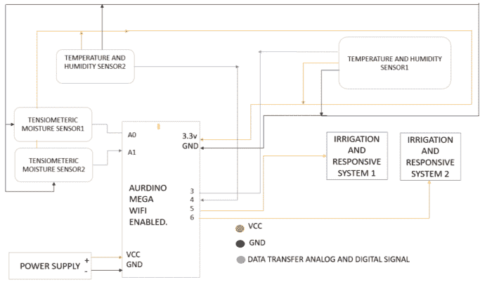

Figure 4.1 提议的农业田地监测自主系统的电路图。

远离居民区，甚至可用于耕地、园艺农场和田地，高层人员甚至可以在不依赖负责监测人员的情况下查看耕地状态。这可以通过基于 Web 的应用程序实现，实时监测数据将按时间间隔显示，例如在雨季防止植物因积水过多而腐烂的情况下，并且还可用紧急指示来表示这些情况。

在图 4.1 中，第一个传感器是 tensiometer（张力计），即土壤水分或水位指示传感器。它用于测量土壤水分含量，并使用土壤水分传感器估计地面储存的水量。该 tensiometer 传感器将通过利用电容效应测量土壤水分含量，并测量其放置的土壤层或区域的水位。土壤水分传感器有两个探头，用于测量土壤垂直表面上整个水分含量材料，通常跨越 30–120 cm。该土壤传感器将密集地负责监测水分含量。这类传感器应根据将在农业田地播种的作物和土壤品种，放置或埋设在土壤表面适当的深度。为了获得较长的使用寿命并减少传感器质量的降低，这些传感器大多优先选用基于塑料和 PVC 材料制造的。为了在感应中获得更高精度，传感器上设有穿孔，以通过传感器探头建立外围气流。

这类传感器通常具有 0–100% 的检测范围，外部模块将作为互连与探头中的土壤和微控制器连接，将转换后的电信号转换为模拟和数字信号。这类灌溉和监测系统还需要其他参数，以使作物生长更高效、更快。现在，监测所需的另一种传感器很简单，使用 DHT22 版本的 DHT 传感器，用于提高湿度和温度测量的精度，这些传感器的范围远大于 DHT11 传感器，且该模块的数据检索更快、更高效。该传感器非常知名，能够测量和比例周围或固定范围区域内存在的湿度量，温度传感器将与 DHT22 传感器集成，从而以模拟和数字数据格式提取数据，数据检索时间更少。使用这种传感器更有益，因为它提供了同时感应或测量温度和湿度的能力，而这两者原本应分别建立以测量农业土地中作物监测的数据。这将显著减少电路问题和复杂连接，并使以模拟和数字信号提取不同换能器数据变得高效。然后，传感器将根据能够对多个输入进行精确测量的位置放置。然后这些数据将发送到 Arduino Mega 控制器，然后根据微控制器中初始化的算法（考虑所有参数）对发送的数据进行评估。该参数将根据决定种植的作物品种的要求，固定为不同作物品种的阈值。电机泵和灌溉系统根据监测土地的物理变化初始化的参数进行操作。种植不同作物品种需要土壤中不同的水分水平。然后，如果初始化了滴灌系统，水将被释放并移动到选定区域；如果是普通灌溉土地，水将根据增加水分水平或种植作物的土地面积所需的计算水量释放。

所提议的自主设备的流程图如图 4.2 所示。我们可以从图 4.2 看到，只要需要，泵将使用继电器开关开启和关闭，该继电器将在需要时以及当输入参数满足约束时开启和关闭。现在，数据将作为平台的

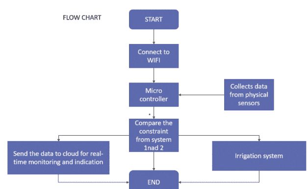

Figure 4.2 提议系统的流程图

输入，用于对这些作物品种进行连续概览，以及对作物和部署田地中观察到的物理和环境变化的时间对比分析。其他植物和人工制品将能够处理互联网协议（IP）并在网络上切换数据。越来越多的比较器在更多行业中使用物联网（IoT）来更高效地工作、更好地识别消费者、提供良好的买家支持、改进决策，并且进行交易和获利的成本正在增加。基于互联网的连接设备环境包括用于广播的 Web 智能设备。这通过嵌入式处理器、传感器和一些额外硬件响应从环境中收集的数据。这些基于物联网的设备通过连接到动态 IP 生成器或另一个子工具，将收集的传感器数据显示为百分比，其中数据发送到云数据库进行分析或本地分析。这些设备可能与各种相关设备连接，并根据从彼此获得的信息采取行动。该设备执行各种成像，无需人工监督，例如，与设备交互以设置设备、发出命令并了解数据。因此，数据现已建立，自动灌溉系统和间作农业田地监测的警报也已建立；这主要只有通过启动连接有传感器的微控制器输出的两个独立操作版本才能实现。输出决策将基于观察到输入的传感器及其提供的范围，因为我们从微控制器中有广泛的选择，因为它有

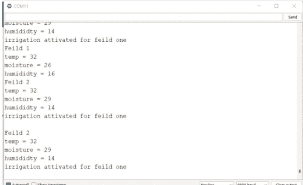

Figure 4.3 农业田地参数的状态。

更多数量的输入和输出引脚。因此，灌溉系统将建立相同的约束，不同的灌溉路径将根据来自微控制器的命令打开，并且在初始化间作监测系统之前将固定参数，这将需要不同作物品种的不同参数。

### 4.4 结果与讨论

我们已经针对两种不同的作物品种实施了灌溉和监测系统，根据所选的作物品种，作物监测的参数或物理约束会有所不同，因此在初始化作物要求概览的参数时，提供了两组不同的参数，并根据此采取行动，就像会有两种作物一样。系统将具有获取和分析数据的不同场景。

从图 4.3，不同作物的数据将被频繁分析，每当需要作物灌溉时，都将相应地激活，因为参数对作物品种的生长和获得更高产量非常重要。即使作物品种也可以采用这种方法使用滴灌，通过增加 tensiometer 传感器，作物品种可以被更准确地监测；灌溉作物所需的水量将减少，因为在这个时代资源节约至关重要。

另一组作物品种的灌溉激活如下图 4.4 所示。这确保了基于参数


```
moisture = 21
humidity = 14
Field 2
temp = 34
moisture = 23
humidity = 19
irrigation not activated for field one
irrigation activated for field two
Field 1
temp = 32
moisture = 21
humidity = 19
Field 2
temp = 34
moisture = 23
humidity = 19
irrigation activated for field one
irrigation activated for field two
```

#### 图 4.4 其他作物品种灌溉的状态和参数。

通过对此处作物品种的分离分区进行田间观察，这使我们能够在不出现问题的情况下监测两种作物品种。

从图 4.4 可以看出，当作物有需求且种植土地变为不适合种植特定部分土地所选作物的条件时，就会为另一种类型的作物建立灌溉。如果我们还希望在间隔期间输送植物所需的养分，那么将它们添加到灌溉水箱中会方便得多，这样它们就会与用于灌溉的水混合。因此，水将直接放置在其周围，作物产出将更高效。

在另一种情况下，分区土地将达到植物或作物的基本需求水平。两个灌溉系统将同时激活。在此处，这不是罕见情况，因为同一块土地在此物理参数上不会差异很大。两种植物生长所需的阳光量也不会相同。图 4.5 描绘了灌溉区同时激活的情形，两种不同的参数将基于作物所需的最低水平进行计算，当达到作物所需阈值时停止灌溉。

此处使用的控制器具备 Wi-Fi 连接功能；数据可以通过您随身携带的任何设备（如 PC、笔记本电脑、手机和平板电脑）进行监控。灌溉系统中使用的指示灯用于指示系统是开启还是关闭。

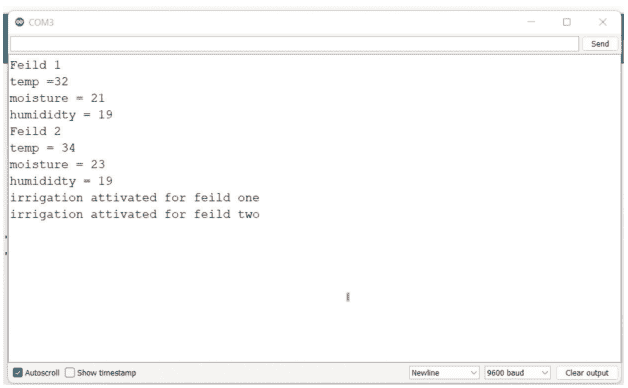

#### 图 4.5 两个灌溉系统的激活。

指示灯也可用于显示灌溉时间；同时，可以查看不同时间间隔收集的数据，数据将存储在云数据库中，以显示实时图表来绘制不同参数的数据。

从图 4.6 可以明显看出，整个仪表板由湿度数据表示、灌溉系统的指示或激活组成。温度和湿度数据根据数据及其时间进行绘图。如果监控人员有兴趣查看特定数据点，图例将出现，数据将显示特定的日期、时间和参数数据。这些数据可用于分析作物的生长及高效生长所需的条件，并可以通过分析收集的数据来改进这些因素。

### 4.5 结论

该系统的间作方法将在土地资源高效利用方面带来显著变化，从而实现提高产量的目标。即使主作物失败，次要作物品种也能提供更多回报。在实施此系统时，通过间作系统防止作物失败。土地的人体工程学使用被视为高效利用土地的主要优势，因为在这种情况下，即使是单一种植中植株之间的死空间也会被利用。在此系统中，间作方法执行各种功能，并通过其实施性质增加更多价值。通过这种方法，害虫被捕获，病虫害管理的额外功能减少了化肥施用并节省了资金。这种灌溉监控水平和水的使用将减少土壤侵蚀并节约用水；资源不是随意使用，而是根据需要保守使用。采用这种农业模式为使用这种方法增加了价值，因为在间作方法中，豆科植物以固氮著称，可为邻近作物品种提供氮素。

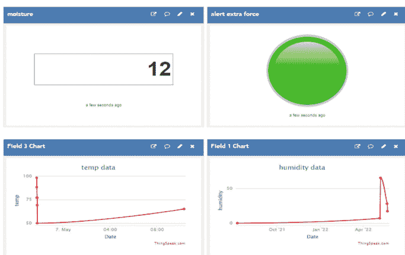

#### 图 4.6 整个仪表板。

由于间作采用在同一块土地上种植不同作物，这使我们能够减少对作物和肥沃土地健康有害的合成肥料的使用。使用这种自动化设备进行间作的主要优势是，它通常会减少太阳能和水等资源的使用。如果也建立这种间作系统，风险因素将再次比其风险依赖的系统降低 50%。该系统还提供了改进的杂草管理，因为有益植物占据空闲空间，因此留出空间种植不同作物品种的可能性大大降低。在此处，生物多样性和生态稳定性得到了稳定。不同物种越多，农田的环境、健康和性质就越得到保护。

### 参考文献

- [1] R. Dhanalakshmi, J. Anand, Arun Kumar Sivaraman, Sita Rani, ‘基于云的农业用水质量监测物联网系统’, 物联网的云与雾计算平台，Pankaj Bhambri, Sita Rani, Gaurav Gupta, Alex Khang 编，Routledge Taylor & Francis Group，2022。

- [2] J. Anand, J. Raja Paul Perinbam, ‘基于模糊逻辑的自动灌溉系统', AE 国际多学科研究期刊，vol. 2(8)，pp. 1–9，2014。

- [3] T. Manikanadan, V. Nandalal, J.L. Mazher Iqbal, S. Joshua Kumaresan, S. Karthikeyan, ‘利用无线传感器网络保护种植园免受野生动物侵害', Int. J. of psychosocial rehabilitation，vol. 24(5)，pp. 2719–2723，2020。

- [4] D.K. Sreekantha. A. Kavya, ‘基于物联网的农作物监测——一项研究', 第 11 届智能系统与控制国际会议 (ISCO) 论文集，pp. 134–139，2017。

- [5] K.A. KPatil, N.R. Kale. N.R, ‘基于物联网的智能农业模型', 全球信号处理、信息计算与通信国际会议论文集，pp. 543–545，2016。

- [6] Ram Krishna Jha, Santosh Kumar, Kirreet Joshi, Rajneesh Pandey, ‘农业中基于物联网的田间监测', 智能计算、仪器与控制技术国际会议论文集，pp. 1417–1420，2017。

- [7] Kamal Kumar Ghanshala, Rahul Chauhan, R.C Joshi, ‘基于物联网的智能作物监测新框架', 第一届安全网络计算与通信国际会议论文集，pp. 62–67，2018。

- [8] S.S. Ramaprasad, B.S. Sunil Kumar, Sivaprasad Lebaka, P. Rajendra Prasad, K.N. Sunil Kumar, G.N. Manohar, ‘利用物联网的农田智能作物监测与保护系统', 第四届电子、信息、通信与技术最新趋势国际会议论文集，pp. 1527–1531，2019。

- [9] S.L. Ullo, G.R. Sinha, ‘利用物联网和传感器的智能环境监测系统的进展', Sensors，vol. 20(11)，pp. 1–18，2020。

- [10] Tian Erlin, Li Zuhe, Huang Wei, Ma Haizhen, ‘基于物联网辅助的病虫害防治和作物监测的分布式与并行仿真方法', Acta Agriculturae Scandinavica, Section B-Soil & Plant Science', Taylor and Francis，vol. 71，pp. 884–898，2021。

- [11] N. Kaur, G. Deep, ‘基于物联网的茄子作物监测系统', 工业物联网智能传感器，Springer 出版社，2021。

- [12] Khampheth Boundary, Pouthasone Sibounnavong, Khampasith Chanthavong, Savath Saypadith, ‘利用物联网的智能作物种植监测系统', 第五届工程、应用科学与技术国际会议论文集，pp. 100–110，2019。

- [13] Liqiang Zhao, Shouyi Yin, Leibo Liu, Zhen Zhang, Shaojun Wei, ‘基于无线传感器网络的作物监测系统', Procedia Environmental Sciences，Elsevier，vol. 11，pp. 558–565，2011。

- [14] Amaya Diaz Juan Carlos, Luzmila Rojas Estrada, Cardenas-Ruiz César Augusto, Ariza-Colpas Paola Patricia, Piñeres-Meloo Marlon Alberto, Ramón Enrique, Ramayo González, Morales-Ortega Roberto César, Ovallos-Gazabon David Alfredo, Carlos Andréa, Collazos-Morales, ‘利用物联网工具的草莓作物环境变量监测系统', Elsevier，vol. 170，1083–1089，2020。

- [15] Manasa Reddy M, M.K Saiteja, Gurupriyanka J, Sridhar N, Naveen Kumar G N, ‘面向智慧农业的基于物联网的作物监测系统', 第六届通信与电子系统国际会议论文集，Coimbatore, India，pp. 562–568，2021。

- [16] Vaishali Purania, Sharmila, Ankit Ranjan, Anamika Kumari, ‘农业自动化与物联网', 第四届物联网：智能创新与应用 (IoT-SIU) 国际会议论文集，Ghaziabad, India，pp. 1–6，2019。

- [17] O. Pandithurai, S. Aishwarya, B. Aparna, K. Kavitha, ‘Agro-tech：基于物联网的土壤和作物监测数字模型', 第三届科学技术工程与管理国际会议论文集，Chennai, India，pp. 342–346，2017。

- [18] Swagatam Bose Choudhury, Prachin Jain, Sujal Kallamkuth, Saranya Ramanath, Prakruti V. Bhat, ‘经济型物联网精准作物监测', IEEE 物联网全球峰会 (GIoTS)，pp. 1–6，2019。

- [19] Ramya Venkatesan, Anandhi Tamilvanan, ‘基于物联网的可持续农业系统', 通信与信号处理国际会议论文集，Chennai，pp. 763–767，2017。

- [20] S.R. Prathibha, A. Hongal, and M.P. Jyothi, ‘智慧农业中的基于物联网的监测系统', 电子与通信技术最近进展国际会议论文集，Bangalore, India，pp. 81–84，2017。

- [21] J. Jose, B. K. Samhitha, M. Maheswari, M. Selvi 和 S. C. Mana, ‘基于物联网的智能仓库和作物监测系统', Proc. In


第五届电子与信息学趋势国际会议，pp. 473–476，2021 年。

- [22] Sanwta Ram Dogiwala, Pankaj Dadheech, Ankit Kumar, Dinesh Raja, Abhishek Kumar 和 Mahender Kumar Beniwal, ‘利用 IoT 实现农业水资源自动化优化利用与作物监测’, IOP Conference Series, vol. 1131(1), 2021 年。

- [23] Ali, A.A Terteil, Choksi, Viraj, M.B Potdar, ‘基于绿色物联网（G-IoT）的精准农业监测系统’, 第二届电子与信息学趋势国际会议论文集, Tirunelveli, 印度, pp. 481–487.

- [24] B.P. Sreeja, S. Manoj Kumar, P. Sherubha, S.P. Sasirekha, ‘基于无线传感器网络的作物监测’, Materials Today: Proceedings, Elsevier, pp. 2214–7853, 2020 年。

- [25] S. Geetha, P. Deepalakshmi, Pande, Shilpa, ‘利用 IoT 管理印度农业作物’, 可持续发展清洁能源与节能电子电路国际会议论文集, 印度, pp. 1–5.

- [26] C. Suresh, M. Ravikanth, G. Nikhil Reddy, K. Balaji Sri Ranga, A.A Rao, K. Maheshwari, ‘利用 IoT 和深度学习的水稻作物监测系统’, Springer, pp. 791–807, 2022 年。

- [27] I. Mohanraj, Ashokumar, Kirthika, J. Naren, ‘农业领域利用 IoT 的田地监测与自动化’, Procedia Computer Science, Elsevier, vol. 93, pp. 931–939.

- [28] S. Rajalakshmi, J. Dharani, ‘利用 IOT 监测农业土壤中的作物产量和养分水平’, 软计算与网络安全国际会议论文集, Coimbatore, 印度, pp. 1–10, 2018 年。

- [29] A. MSD, J. Kuppili J., N.A. Manga, ‘利用 IoT 实现高效作物生长的智能农业系统’, 电气、电子与计算机科学国际会议论文集, 2020 年。

- [30] Rao, R. Nageswara, B. Sridhar. B, ‘基于 IoT 的智能农田监测与自动灌溉系统’, 第二届创新系统与控制国际会议（ICISC）- Coimbatore, 印度论文集, pp. 478–483, 2018 年.


## Taylor & Francis

Taylor & Francis Group

http://taylorandfrancis.com

## 智慧农业预测分析

S. Balaji¹, J. Ashok², P. Selvaraju³, 和 Veer P. Gangwar⁴

¹电气与电子工程系，SRM Valliammai 工程学院，印度
²商业与管理学院，CHRIST（被认可的大学），印度
³数学系，Rajalakshmi 技术学院，印度
⁴一般市场营销系，Mittal 商学院，Lovely Professional University，印度

Email: sribalaji06@gmail.com; ashok.j@christuniversity.in; pselvar@yahoo.com; gangwarveer@gmail.com

### 摘要

分析大型数据库以发现隐藏的关联、相关性和洞察，称为大数据分析。尽管许多国家仍然使用过时的耕作方法，但技术进步已经允许特定的改进（尤其是在发展中国家）。大数据分析有潜力在这方面显著扩大农业部门。农民在决定种植什么以及如何耕作时，很大程度上依赖旧方法。穿过田地、选取土壤样本进行水分分析以及目视检查植物叶子，是这些长期实践的典型示例。理解技术在获取大量作物信息并将其转化为可用知识方面的重要性，对于农业从业者（主要是农民）来说至关重要。大数据的整合可以帮助农业改变其当前做法。如果正确使用，大数据分析可以揭示最有效的作物耕作方法。在三个领域——作物预测、精准农业和种子生产——的广泛发展正在重塑农业行业。本章共有四个部分。本文的第一部分介绍了农业大数据分析。第二部分将重点介绍农业部门使用的各种大数据方法。第三部分提供了大数据分析方法在农业领域应用的两个示例。在第四部分，作者考察了学者和科学家可选的几条农业研究路径。本章以简要概述结束。

### 5.1 引言

农业是通过生产足够食物来满足所有人需求的行业。然而，农民被视为二等公民 [1]。在机构未能推动变革之后，是时候让技术接管变革的缰绳了。每天，农业行业的人员，尤其是农民，都会遇到新问题，需要采用尖端技术 [2]。

由于农村地区地下水供应减少、季风或其不足、气候变化、洪水、农民为了寻找报酬更高的工作而移居城市、农产品不公平的价格固定政策等因素，若干国家的农业缺乏有组织的关注、银行贷款支持，并遭受各种灾害 [3]。

大数据分析用于分析大型数据库，以发现隐藏的关联、相关性和洞察。尽管技术取得了重大进步（尤其是在发展中国家），一些国家仍在使用传统农业方法。大数据分析可能在这方面显著帮助农业部门。农民在决定种植什么以及如何耕作时，很大程度上依赖旧方法。穿过田地、选取土壤样本进行水分分析以及目视检查植物叶子，是典型的传统做法 [4]。

但是，农业从业者（特别是农民）必须认识到技术在获取大量作物信息并将这些数据转化为宝贵知识方面的重要性 [5]。大数据的整合可以帮助农业改变其当前做法。理解有效的农业生产做法需要使用大数据分析。我们强调了当今正在显著影响农业的三个广泛主题：

- 准确的作物预测：作物的成功是农民的主要担忧来源。作物预测错误有着悠久的历史。借助尖端算法，当今的农民可以更准确地预测作物产量。为了进行准确预测，这些算法处理大量的作物和气候数据 [6]。即使在种子种下之前，农民现在也可以估计收获。由于大数据分析提供的洞察，在最佳时间收获以获得最大产量成为可能。准确的作物预测可以缓解农民对收获的许多焦虑。

- **精准农业：** 这是培育植物的最先进方法。农业中的几项任务可以通过使用 IoT 变得更加高效 [7]。各国农民，尤其是富裕国家的农民，通过精准农业获得的收入比没有使用时更多。精准农业还提高了收获产品的质量 [8]。

- **生产高质量种子并减少粮食不安全：** 根据最近的研究 [9]，面临饥饿风险的人数正以指数增长，与世界人口和平均气温一样。这在非洲尤其明显，目前有 2000 万人的生命处于危险之中。世界各地的许多人正在努力确保每个人都有足够食物，但他们的努力可能更好地指向确保农业部门高效利用大数据分析 [10]。过去几十年来，一些研究人员和农业科学家一直在研究植物数据，以开发更具生产力和更健康的植物生命。大数据分析的最新进展使得作物发展更加迅速、实质性和高质量。利用转基因种子和大数据分析，消除世界饥饿可能成为可能 [11]。

### 5.2 农业大数据

下一部分阐述了大数据在农业中为什么如此重要。还讨论了处理大型数据集的几种标准方法。在深入探讨处理大数据的策略之前，作者简要地考察了什么是大数据。

#### 5.2.1 大数据对农业的影响

文献中广泛提及大数据的以下五个特征。

- 数据量由 V1 表示。在此分析中，数据的总量由 V1 的值表示。


- 具体而言，V2 是数据最具相关性和有效性的时间范围。例如，某些数据如果不立即分析，其价值会随时间流失。例如，在动物一生中，可以识别出几种常见的害虫和疾病。

- 字母 V3 可代表多种多样的数据。数据可来自多个来源（例如，视频、遥感数据和图片），在不同时间获取并具有不同分辨率，所有这些都可能导致所观察到的差异（例如，图像分辨率的空间差异数据）。为不同用途获取的数据也具有独特的特性。

- V4 表示信息可靠。V4 值涵盖数据的潜力、质量、可靠性、正确性以及整体置信度。

- 数据的“价值化”，即其在培育欣赏、创新和知识方面的价值，用记号“V5”表示。

五个“V”可用于定义大数据，尽管它们并非成功大数据研究所必需的 [12]。大数据会削弱第四个 V，因为其普遍倾向于降低准确性和稳定性。根据 [13–15]，作者需要增加另一个“V”用于可视化，以通过使用复杂的数据结构和信息密集型场景来展示或说明数据。

根据作者 [16]，大数据的主要焦点是提高引用、搜索、可视化和汇总大型数据集的速度。它强烈强调数据挖掘，特别是在以前实施成本过高或无法实施的领域 [17]。

DIKW 层次结构通过使用字母 D、I、K 和 W 分别代表数据、洞察、专业知识和智慧，来说明数据、专业知识和知识之间的联系。本质上，它传达的理念是：数据描述信息，知识描述信息，智慧描述知识。图 5.1 描绘了 DIKW 层次结构。

数据被转换为一个实体（信息），如图 5.1 所示。负责这种变化的程序也已指定。本质上，“智慧”是指权衡竞争选项并基于个人认为最合理的内容进行判断的能力。在价值观、伦理、兴趣和偏好等无形资源较少的情况下，智慧与已有的知识相结合。知识库是从收集的数据构建而成的。可用于推导信息和意义的原材料

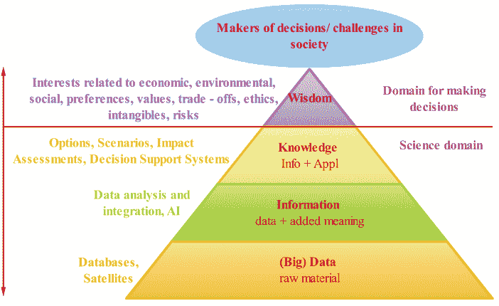

图 5.1 DIKW 层次结构。

是数据。集成模型、影响评估和决策辅助系统等政策与决策应用可以共同使用，以生成可用于丰富数据的信息。

易腐物种和商品（包括人类、植物、农产品和动物）均与其环境存在复杂的互动，使农业和环境研究系统本质上具有动态性。要完整描述此类设置，需要大量有关实体状态与行为以及其与环境互动的详细信息。这些结构可以存储当前条件以及历史或假设条件。空间-时域实体行为数据至关重要，因为生物系统表现出空间和时间上的变异性。此外，理解这些互连需要对所涉及的各个子系统有深入的了解。气候、水、生命和地面本身都是潜在的组成部分。

为更好地理解如何将价值较低的原始数据转化为对最终用户更有用的知识，DIKW 层次结构已被调整以适应大数据环境。在此语境下，“知识”指的是可用于做出正确判断的信息片段。用户依赖这些准确且及时的数据，并假设这些数据是使用可用大数据中的最佳来源编制、推断，并根据用户的特定决策上下文进行处理的。致力于解决这一问题的 ICT 专家、领域专家和数据科学家社区

| 农业领域 | V1 | V2 | V3 | 论文数量 |
|---|---|---|---|---|
| 气候变化 | 中等 | 中等 | 高 | 4 |
| 土地 | 高 | 低 | 中等 | 5 |
| 动物研究 | 中等 | 高 | 低 | 4 |
| 土壤 | 中等 | 低 | 低 | 2 |
| 作物 | 中等 | 中等 | 低 | 3 |
| 食品可获得性与安全性 | 中等 | 低 | 中等 | 4 |
| 杂草 | 低 | 高 | 低 | 1 |
| 农民决策 | 高 | M | 高 | 2 |
| 不同动植物物种的研究 | 中等 | 低 | 高 | 1 |
| 遥感 | 高 | 中等 | 中等 | 3 |
| 农民财务与保险 | 高 | 中等 | 中等 | 5 |

在做出此类假设时面临重大障碍。大数据分析的后续步骤只能通过团队合作以及结合自底向上和自顶向下方法的能力共同确定 [18]。

表 5.1 展示了大数据三个值与农业劳动力需求之间的关系。第三列列出了解决特定农业领域问题的文章总数。关于食品可获得性和安全性、农民的保险和财务忧虑、气候和天气变化的后果以及土地和牲畜管理方面，已经有大量研究。表 5.1 的第 4 至 6 列显示了作者 [19] 为各农业领域提供的平均体量、速度和多样性评级。

研究人员基于对 34 项调查的元分析，使用低、中、高指数评估了前三个大数据 [20]。论文使用 L、M 和 H 等级从好到坏进行排序。数据体量存在中等至较大范围，而分析中包含的出版物总数存在中等至较小范围。

需要高速度的规则例外包括处理杂草和动物的项目，因为在发现疾病或杂草证据时，快速响应至关重要 [21]。由于准确的气候、天气等预测有助于农民进行日常运营，与这些主题相关的项目以及涉及农民决策的应用需要广泛的信息。由于照片体积巨大，遥感应用消耗了最多数据。包括土地管理、食品可获得性与安全性、土壤分析和生物多样性的项目平均速度最慢。

#### 表 5.2 大数据在农业行业以多种方式被利用。

| 大数据维度 | “V” 的描述 | 农业应用 |
| :--- | :--- | :--- |
| V1 | 数据体量 | 用于地球观测、天气预报、每日畜群淘汰、提高农民生产力、小农保护与保险、农民融资、基于遥感的粮食安全估算、土地利用与土地覆盖分类等的数据共享。 |
| V2 | 针对时间的高速度应用 | 改进天气预报、动物食品安全、杂草鉴别、动物疾病诊断、提高产量、偏远地区农民的货币交易以及地球观测数据共享。 |
| V3 | 不同来源数据的高度变化 | 作物抗旱性、气候科学、识别管理区域、估算发展中国家的粮食、评估野生动物种群、为农民投保和保护、提高农民生产力、了解农民如何在其运营中实现可持续和高效等。 |
| V4 | 对需要准确数据的用途的高度可靠性 | 涵盖的主题包括奶牛群淘汰、杂草鉴别、动物食品质量和安全、发展中国家粮食可用性估算、动物疾病识别、小农保险、提高农民生产力、共享地球观测数据以及评估野生动物种群的可行性。 |

土壤、动物研究、杂草研究、作物研究和遥感领域的多样性最低。表 5.2 说明了大数据的“V”属性及其与农业应用的相关性，总结了上述文献综述的描述。

获取大量数据对于天气预报、粮食安全、农业产出估算和土地制图应用至关重要。涉及动物疾病检测、植物营养不良诊断以及关于农业产出、产品质量和消费者健康的政策制定的应用都需要高速度，因为


它们必须实时实施。在这种情况下，长期战略规划必须让位于更直接、更具战术性的决策（速率较低）。数据的多样性构成了大数据的第四维度，对于保险费率和农业产量估算等用途至关重要。第五个也是最后一个 V，数据可靠性，对于检测动植物疾病、淘汰牲畜群、提高农业产量和预测收获产量等应用至关重要。大数据分析在农业领域仍处于起步阶段，这从相关学术文献和行业主导的努力稀缺中可见一斑。

### 5.2.2 大数据的来源和方法

- 分析大数据时，牢记数据来源至关重要。以下是查找海量数据的常见地点示例：
- 农业，包括地面化学检测设备、生物传感器、气象站等。
- 数据汇编自公共和私营等多种来源，包括公司和政府年度报告、数据汇编、公共规则和法规、官方公告等。
- 基于互联网的图书馆和其他去中心化的 Web 服务
- 空中传感器收集的信息，例如卫星、飞机和无人驾驶航空器
- 公司通过其网站、社交媒体信息流和其他在线渠道收集的在线信息可供访问。

上述来源展示了各种数据速率和数量。此类数据可能位于多个潜在位置，包括静态存储库、Web 服务、实时数据源、档案、文件等等。信息的结构和呈现方式各不相同，但其格式差异很大。

表 5.3 展示了多种农业类型、大数据来源和相关技术。

为了应对每种农业应用中出现的问题，作者需要访问各种大型数据集。静态存储库、地理数据和基于卫星的遥感构成了大多数农业领域所用大数据的大部分。为开展研究，土壤、动物和作物科学家使用地面传感器。气象站收集的数据也用于农业、银行和保险等领域，以及气候变化研究、景观制图和农民决策的形成。这些大多数工作都整合了来自多个来源的信息，以解决各种问题。

| 领域 | 大数据来源 | 大数据分析方法 |
| :--- | :--- | :--- |
| 天气和气候变化 | 气象站数据、静态信息研究（气候和天气记录）、卫星遥感和地理空间信息 | 支持向量机（SVM）分析、基于统计的分析、云计算、GIS 分析和 MapReduce 分析均为机器学习技术的示例 |
| 土地 | 空中遥感、雷达数据、地理区域数据、与土地表征相关的历史数据集、作物物候、温度和降雨、全球树木覆盖图、海拔和相机中的传感器 | 与 NDVI 相关的植被指数、SVM、k-means 聚类、随机树和其他机器学习技术 |
| 动物研究 | 摄像头传感器、地面传感器（用于追踪放牧活动、采食量、温度、产奶量等，以及动物和土壤在生理参数方面的历史数据） | 与决策树、神经网络、SVM 相关的机器学习技术 |
| 作物 | 地面代谢物传感器、卫星图像和归档数据 | 植被指数（NDVI、小波和傅里叶变换）和机器学习技术（SVM、K-means 聚类） |
| 土壤 | 地面传感器（电导率、盐度和湿度）和感光相机 | 机器学习（K-means 聚类） |
| 杂草 | 基于历史的信息（数字化植物和杂草照片库、植物特定数据）、遥感（飞机和无人机） | 图像处理方法、ML 方法和 NDVI |
| 食品安全与供应 | 通过调查收集的数据、统计数据、GIS 地理数据、遥感（合成孔径雷达和历史信息）和数据库（如 ENAR、CIALCA 和水稻作物生长数据） | 基于统计的分析、仿真和建模、网络分析、GIS 空间数据分析、图像处理和机器学习（神经网络） |
| 动植物遗传学研究 | 地理信息系统（GIS）和数据库 | 统计学 |
| 农民决策 | 包含历史信息的数据集、气象站、基于 Web 的数据、基于人类的传感器以及与卫星和无人机相关的遥感 | 基于云的系统、基于 Web 的服务、移动应用、统计分析、建模、基准测试、模拟、大数据存储、面向消息的中间件 |
| 农民保险和金融 | 基于 Web 的数据、人类作为传感器、历史信息、气象站 | 云平台、移动应用程序、Web 服务 |
| 遥感 | 通过飞机、无人机和卫星收集的数据；基于 Web 的数据，包括地图和影像；包含历史信息的数据集，包括包含图像的地表土地数据集；MODIS 地表反射率数据集 | 连接的基于云的平台、统计数据分析、基于 GIS 地图的空间数据分析、图像处理、与 NDVI 相关的植被指数、决策系统、大数据存储、基于社区和 Web 的门户、移动、计算机视觉、基于 MapReduce 的分析和基于 AI 的应用 |

### 5.2.3 农业大数据分析的方法和软件

特定农业领域使用的方法列于表 5.2 第 4 列。作者审阅了 34 项研究 [22, 23]，其中 13 项采用了 ML，9 项采用了基于云的平台，8 项采用了图像处理，7 项采用了仿真和建模，6 项采用了统计分析，6 项采用了植被指数（NDVI）。此外，四篇出版物涉及地理信息系统，而五项使用了互联网服务（GIS）。除少数针对土壤的应用外，大多数基于土地的遥感应用采用混合方法。

根据研究，各相关项目采用以下资源：

- 作者 [24] 都在农业领域使用机器学习来生成预测。
- 作者 [25] 在农业中使用了聚类分析。
- 包括研究者 [26] 在内的学者已在农业领域使用分类策略。
- 作者 [27] 在农业环境中应用了包括谐波和傅里叶分析、小波分解和曲线拟合在内的图像处理方法。
- 研究者 [28] 将遥感方法与图像处理相结合，并将生成的图像输入机器学习模型。
- 文献 [29] 表明，耦合 MapReduce 的云平台可用于农业中的大规模存储。作者 [30] 应用 GIS 来解决空间问题。

对于归档本质上异构的海量数据，支持数组数据模型的 DBMS 是理想的选择。为了管理和存储大量非结构化数据，可以使用 NoSQL 平台。为这一特定目的开发的数组 DBMS 系统用于处理大型栅格数据集的存储。

此外，遥感应用广泛使用植被指数（VI）来绘制土壤和作物图。VI 呈现为一组单独的图形，每个图形代表不同的地表反射率

表 5.4 农业大数据处理中广泛使用的软件包。

| 类别 | 应用软件 |
|---|---|
| 图像处理工具 | OpenCV 库、VTK 和 IM Toolkits |
| 机器学习工具 | Weka 工具、Google TensorFlow、mlPy、Flavia、Mlpack、Apache Mahout、R、Oryx、SHOGUN 和 Mllib |
| 可同时处理和存储大量数据以供日后分析的基于云的系统 | Cloudera、IBM Pure data system for analytics、IBM InfoSphere Big Insights、EMC Corporation、Apache Pig 和 Aster SQL MapReduce |
| 大数据和 GIS 中使用的数据库 | ArcGIS、Autodesk、MiraMon 和 MapInfo |
| 用于基于消息的系统的连接中间件 | Apache HAWQ、Post-GIS、MongoDB、Cassandra、HadoopDB、Oracle Geo Raster、MonetDB/SciQL、Google Big Table、Oracle Geo Raster、Hive 和 SciDB |
| 建模和仿真 | MQTT 和 RabbitMQ |
| 统计工具 | NorsysNetica、R 和 Weka |
| 时间序列数据分析 | MATLAB、RATS、BFAST 和 Stata |

模式，跨越两个或多个波长。作为使用遥感分析确定目标是否被植被覆盖的最流行图形指标，归一化植被指数（NDVI）极其宝贵。基于事件的系统的快速警报传播由面向消息的中间件促进，该中间件在自然灾害预测等领域有应用。

表 5.4 显示了用于大数据分析的几种软件包。这些软件包因所执行的分析类型而异。

使用遥感照片进行图像分析以近似农业问题是一种相对较新的方法。自 2008 年起，由于其易于获取且成本低廉，对 Landsat 卫星数据的需求呈爆炸式增长。遥感因其无损特性以及能够在广阔区域内系统地收集数据的能力，在农业中被广泛使用。几篇最近的文章 [27, 31] 探讨了作物损失情况下保险产品的分销，以及与火灾、洪水、极端降雨或干旱相关的风险评估。

AVHRR、MODIS、MERIS 和 SPOT VEGETATION 卫星分辨率较粗，已成为监测大区域的主要数据来源。将遥感与其他数据源（例如 GIS 信息、地面传感器和历史记录）相结合，可以大大增强

分析，尤其是作物识别和草地分类等预测应用。作者[32]发现，由于该领域的研究很少，农业部门的大数据分析仍处于起步阶段。然而，由于参与者众多且系统变化率高，该领域拥有大量未开发的潜力。近年来，许多新企业涌现出来，以利用大数据分析带来的农业市场前景。云计算在存储和处理能力方面的可扩展性有望推动新型农业商业模式的发展。

### 5.3 农业中大数据分析方法的案例研究

在本节中，作者考察了大数据分析在农业领域的应用实例。重点放在近期和相关文献上。

#### 5.3.1 案例研究1

内容、存储格式和组织结构各异的数据集对于农业和环境科学研究至关重要。得益于支持链接开放数据（LOD）的云架构，近期多个数据集已公开发布，导致出现大量分散的数据源。不幸的是，LOD难以访问，且无法跟上数据科学的快速发展。这需要先进的大数据查询基础设施。在本文中，作者分析了研究项目SemaGrow，该项目由ERFP7设立，旨在提供访问远程数据的有效方法。构建用于搜索分散数据源（如LOD节点）的高效系统和技术是该项目的主要目标。为了便于科学项目间的数据复用和共享，它实现了包括SPARQL查询语言和RDF在内的语义网概念。这使得LOD相关的云数据共享成为可能。

SemaGrow系统通过一套量身定制的数据试点引用各种用例，克服了与农业数据相关的独特问题。SemaGrow克服了从不同时空数据集中检测和整合大数据所面临的障碍。适应气候变化是SemaGrow管理的用例的重要组成部分，例如建模与农业相关的气候变量。

不同维度的大量文件包含了区域建模所需的气候参数。作者使用了连接到各个地区的长期时域覆盖和空间覆盖。许多科学调查旨在为了实验而生成冗余数据。这导致资源使用浪费，尤其在数据存储、处理能力和通信基础设施匮乏的地区问题更为严重。SemaGrow通过查询结合时域、主题和空间要求，高效地构建了紧凑的数据集。SemaGrow系统使农业科学家即使在加纳存储和网络选择较少的偏远地区，也能访问温度、土壤和降水参数的集中式数据集。

SemaGrow的主要目标是让农业专家能够无障碍地访问大量分散的数据集，以便他们轻松汇总和下载这些数据。由于实施了合理的解决方案，人工大数据集成所需的时间和资源更少。通过系统及时交付相关数据，便利了利益相关者的决策。DIKW方法通过在更深层次上协调和处理信息来缩小信息差距。结果，处理多个数据源之间的集成困难以及从原始数据中提取有价值的洞察所需的时间和精力更少。

##### 5.3.1.1 方法论

SemaGrow技术已集成到Trees4Future Clearinghouse中，以增强系统在农业环境中使用的大数据查询能力。SemaGrow（一套用于构建和部署分布式系统以及存储数据和元数据的RDF数据库工具栈）已取代了Trees4Future之前的后端。因此，可以在应用程序中对元数据和实际数据运行语义查询。作者借助SemaGrow Stack拥有高效的查询和混合类型数据节点集群，你可以在GitHub上获取该栈：https://github.com/semagrow/semagrow。简单来说，The Stack是一个联邦SPARQL查询处理器。查询执行优化由内置查询规划器促进，该规划器使用各个节点的元数据。原始VoID词汇表中缺少统计数据（如数据库直方图），因此创建了Sevod词汇表来填补这一空白。有关该项目的更多详情，请访问 http://www.w3.org/2015/03/sevod。由于采用了响应式软件范式，Stack可以处理缓慢的数据节点。Stack通过允许用户在不了解底层三元存储各种模式的情况下对其执行查询来实现这一点。

ISIMIP和AgMIP通过同步各自的数据集合作建立了三元存储。ISIMIP已将其输入/输出数据以NetCDF文件格式提供，该格式经常用于气候和预测领域。通过汇集经济、气象和农业专家，AgMIP可以开发更准确的经济和作物模型，以预测气候变化将如何影响未来几代人。这项工作利用了现有的通信和信息存储手段。AgMIP采用JSON数据格式来描述数据，并使用ICASA变量列表来描述数据。来自多个来源的数据被放大到三元存储中，扩展了原始数据集的可用性。因此，SPARQL现在可以查询这些信息。

在节点整合之后，一个名为Strabo的时空三元存储被整合进来，以解决点在多边形内等空间查询问题。演示的前端使用中间件连接到Stack上的SemaGrow实例以交换数据。它是查询结果的预处理器，将原始数据转换为演示程序可处理的格式。此外，它还充当翻译器，将传入的URL请求转换为Stack的正确SPARQL查询。Strabo生成可接受的NetCDF文件，从而有效地满足其用户的需求。

##### 5.3.1.2 结果

测试演示应用的用户寥寥无几。用户称赞了其有用性。然而，用户希望元数据搜索能更快得出结果，这类搜索大约需要5–30秒。此外，尽管用户期望下载不超过30分钟，但系统的下载速度却极其缓慢（需要数天）。因此，需要大幅提升基础设施的可扩展性。尽管需要数天，但该方法仍比手动技术快，该技术需要远程和本地专家之间持续的咨询和协调，因此根据该领域专家的说法，手动技术要慢得多。因此，与手动程序相比，融合查询节省了时间，只需几小时或几天，而不是许多天。

#### 5.3.2 案例研究2

要了解有关名为“Trees4Future”的正在进行的欧洲研究工作的更多信息，请访问网站 www.trees4future.eurepresents。作为该项目的一部分，关键的林业遗传学和林业研究基础设施将得到整合、加强和改进。该举措扩大了农民和政策制定者获取林业数据的途径。林业研究人员依赖于从其专业和学术网络中获取的信息。然而，最近已有工作致力于改善林业（尤其是遗传学）中的数据分发。尽管如此，重要数据仍存储在孤立的位置，例如私有或本地数据库中。元数据文档也不完整。

在许多情况下，研究人员未能妥善记录数据或保护数据，要么是因为底层研究结果未公布，要么是因为他们担心数据被利用的前景。即使在可靠网络内，共享信息也未必能带来多大益处。因此，很难获取用于农业研究的相关数据。林业建模研究人员作为Trees4Future举措的一部分聚集在一起。为了应对农业中的当前问题（如气候变化），需要集成建模。必须结合解释不同子领域并在时间和空间层面提供覆盖的模型，以准确评估气候变化并选择适当的适应策略。通过与Trees4Future以及建模环境ForGEM、EFISCEN和Tosia合作，实现了这一组合模型集。树木适应性响应（ForGEM）模型是一种用于估计选择性育种对森林生态系统影响的模拟工具。EFISCEN模型预测欧洲和区域尺度的森林资源增长。Tosia模型从社会影响、环境修改和经济转变的角度研究森林-木材供应链的影响。

来自遗传学、土壤、统计学、市场和环境等多样化领域的异构数据是集成建模所面临许多困难的根源。对于林业管理目的，这类信息难以获取。Trees4Future举措通过创建林业数据基础设施，为这一问题提供了技术解决方案，通过便利林业数据的发布、可发现性和文档化。此外，该基础设施还可以帮助实现数据共享和文档化等功能。

在这项工作中，还有必要解决信任和质量问题。如果数据的原始所有者担心数据共享后将如何被使用，这种担忧是合理的。为了消费者的利益，提供真实且全面的信息至关重要。由于数据可能来自各种异构来源和领域，因此处理处理此类数据时出现的多样性挑战非常重要。元数据和底层数据必须具有稳固的语义连接。

##### 5.3.2.1 方法论与实施

用于查找和导航数据的技术极大地改善了用户对数据的访问。主要目标是提供对高质量


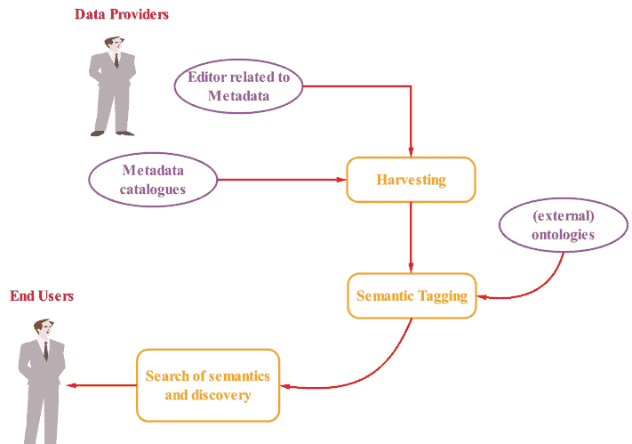

图 5.2 Trees4Future 管理发布流程的方法。

这些数据集要么文档记录不佳，要么不可用。现在用户更容易在数据集中导航，找到已公开的林业数据。最终用户和数据发布者/所有者都认为此搜索功能既用户友好又简单直接。

图 5.2 描绘了 Trees4Future 项目既定的流程。

- 森林行业特有的元数据将从基于 Dublin Core 标准的简洁模式中获益良多。
- 开放存档倡议元数据收集协议（OAI-PMH）提供元数据编辑器（在线）和嵌入式存储库，以使元数据记录保持一致且可收集。
- 林业本体为数据集提供概念框架，并与外部本体建立链接，例如描述遗传特征的 AGROVOC。
- 元数据林业模式和元数据（标准化）与注释、收集和简化技术结合使用，以便于元数据收集。
- 在提供的 INSPIRE 和 ISO 标准以及其中使用的 NLP 技术的帮助下，元数据可以分解为本体概念。随后将其保存到 RDF 数据库中，并在生成的数据集中的概念与外部本体之间建立关联。
- 使用此系统和用户界面，可通过基于 RDF 存储中包含的语义的查询快速访问已注册的数据集。

##### 5.3.2.2 结果

随着新基础设施的建立，查找林业相关研究材料现在比以往任何时候都更容易，且更多人可访问。林业中的综合建模（包括上述用例）包含气候适应，而该基础设施因其支持多种异构数据源的灵活性而出色。该系统的主要好处是能够收集当前分散在多处的所有林业相关信息，并将其组织在一个中心位置。该平台已提供来自欧洲数据存档的 300 多个数据集。中小企业和个人也可使用其元数据的发布门户。此外，新建模者被允许提交用于综合建模的参考数据集。

由于数量和质量不足，将元数据中的概念与外部本体中的想法关联起来很困难。该系统还可能自动选择学者认为有用的数据集，例如来自仿真和建模相关技术学科的数据集。元数据中深度和结构不足，无法传达科学数据集的复杂性。像世系（lineage）这样常用但至关重要的领域缺乏处理复杂数据生成操作所需的结构。元数据结构的浅薄性阻碍了对数据的系统化寻址。所述系统通过在独立的 AGROVOC 词汇片段和具有领域特定语义的综合子域之间建立关联，解决了这一问题。从表面上看，这不是一种放之四海而皆准的答案，而是显示了一个复杂且个性化的系统。

### 5.4 农业大数据分析：相关研究领域

在本部分，作者列出了在分析大量农业数据时仍需解决的一些问题。

#### 5.4.1 开放性问题

如果大数据分析技术得到更广泛的应用，农业部门面临的问题可能会变得更加严重。以下是仅列举的几个主要问题：

- 由于存储和传播农业数据的成本高昂，只有最大的农业公司才能负担得起垄断这些信息。作者指出，这导致农民对大型农业集团产生严重依赖。大公司的数据垄断可能会限制新技术向较小竞争对手传播。
- 所有权问题源于对谁将控制数据以及与该数据相关的货币化问题的不确定性，可能会出现。种子公司和农场可能会处理不当农业数据。对冲基金可能由于获取实时农业数据而导致商品市场出现不必要的投机。
- 在分析和收集过程中，可能会出现与大数据隐私、可用性和真实性相关的一些潜在问题。
- 由于无法平等获取软件、处理能力、互联网速度和合格专业人员等资源，发展中国家与发达国家之间的数字鸿沟加剧了。然而，重要的大数据益处只有在农民能够获得高质量教育和数字技术时才能实现，而这两者在发展中国家通常都不存在。
- 产品设计师可获得的现实世界数据不足。然而，现实世界数据对于在各种环境中测试和评估产品和服务至关重要，包括经历极端温度、湿度和其他环境因素的环境。大数据可视化同样复杂。

#### 5.4.2 农业大数据分析方法的限制

采用大数据分析技术面临以下困难：由于缺乏知识和工具，

- 用于获取和解释大量数据的系统不可靠。高维数据集和大数据需要高效存储和管理的基础设施。
- 负责分析大数据的人通常缺乏准确执行此任务所需的专业知识和培训。
- 大数据缺乏有效的治理和组织。
- 需要有吸引力的商业模式，以确保农业中所有相关方都能公平分享收益。
- 由于缺乏确定的语义，组织和学者发现很难重复使用和理解大数据。

作者的研究[3]中的表 5.1 表明，他们对极大型数据集（例如气候和天气变化研究、土地识别、农民决策、金融和保险市场以及遥感应用生成的数据集）几乎不予关注。大数据不仅因其数量庞大而有价值，还因其速度、真实性、价值性和多样性而有价值。由于忽视了这些考虑因素，农业中大数据的使用一直是通过有偏见和有限的视角来看待的。

采样错误、缺乏具有可接受空间分辨率的数据，以及在允许的时间限制内收集和分发图片，只是农场管理遥感系统面临的一些现实问题。与数据提取、图像解释和天气影响相关的困难也一直存在。最后，农业领域的许多研究人员指出，数据缺乏（或数据量不足）及其不可靠性是他们面临的两个最常见挑战。由于农业数据的时效性和异质性，农业大数据分析面临重大障碍。

#### 5.4.3 解决复杂问题并克服障碍

来自世界各地的许多农民和农业工作者最近聚集在一起，成立了在线论坛和合作社，他们可以在其中分享在农业中使用大数据的知识和经验，同时也讨论影响其职业的社会和政治问题。必须保护数据版权，并通过明确的谁拥有什么政策来管理用户对数据的访问。保护大数据并通过采用合适的技术最大化其用途，需要政策来规范数据的安全性和管理。有必要投资建设农场云基础设施，以保存、展示和分析农业数据。此外，有必要更快速、更大规模地执行分析。应合理定价农业数据，或者更好的是，使


它是开源的，因此可以用于推动重要研究。通过合并和简化数据并应用正确的分析，有可能为用户构建直观的平台。

像 RDF、链接数据和本体学这样的数据语义技术可以被利用来促进信息交换。开源工具，例如作物识别地图、作物日历、植被指数、产量预测模型、作物面积估算和季节性天气报告，在农业中可能很有用。结合这些资源应该有助于大规模活动和不同类型数据的分析。在农业中，必须公开大型数据集以进行深入研究。

### 5.4.4 大数据分析在农业中的潜在应用

本节讨论了大数据分析在解决农业部门广泛问题方面的潜力。以下是该技术的一些可行应用场景示例：

- 1. 为了让农业满足国际要求，至关重要的是要访问那些能够保证供应链所有参与者都拥有最高质量商品和流程的平台。
- 2. 更准确地预测未来需求和改进未来产量预测的方法论，在未来都是必不可少的。
- 3. 为了改善作物生长，农民需要知道如何准确使用除草剂、肥料和农药。
- 4. 植物层面扫描、货物运输跟踪和客户层面购买跟踪工具，都是食品供应链追踪中可能需要改进的领域。
- 5. 农业领域需要大数据分析解决方案来降低食源性疾病的流行率。
- 6. 由于农产品通常在收获后会变质，因此需要有效的优化方法。这对于提高食品质量和减少浪费至关重要。食品加工商越来越多地转向流行的优化工具，包括神经网络、遗传算法和元启发式算法。
- 7. 使用先进的遥感技术对于准确绘制大面积农田地图至关重要。需要更精确地监测全球农田以提高产量。
- 8. 为了准确模拟环境过程，必须构建最先进的科学和仿真模型。政策制定者在做出有助于生态可持续性的农业决策时可以利用这些模型。
- 9. 需要高通量筛选方法来准确捕捉环境与植物之间的相互作用。这些方法需要更加精确和准确，并且必须能够对数据进行定量分析。
- 10. 农业机器人可用于自动杂草检测和清除、害虫识别和预防以及收割。这些机器人可以帮助农业从目前的不确定性逐步转向更加可预测的未来。
- 11. “基因组编辑”是遗传工程的一个子集，可用于改变植物或动物的基因代码，直至单个基因水平。它可以模拟植物育种中必需的突变过程。它也不会导致后代成为不同物种。这项技术在增强表观遗传学研究方面可能很有用。

上述应用可以产生海量大数据，政策制定者可利用这些数据在粮食作物的供需之间达到更好的平衡。提供农业数据还将促进重要的智慧农业研究和开发机会。

### 5.5 结论

本章深入探讨了大数据分析的方法及其在农业中的应用。贯穿所有应用的几种探究策略及其相应结果均已详细讨论。读者将从本章了解到当前使用大数据分析方法的农业项目。本文对大数据的特征、所采用的分析方法以及它们最有用的情境进行了广泛讨论。作者还讨论了将大数据方法应用于农业所面临的困难和未解之题。正如所示，由于开源软件和硬件、大数据分析工具和技术以及农业数据集的广泛可用性，农业实践可能出现重大转变。致力于为农业目的使用大数据的新企业层出不穷。为数据集采用开放标准可以改善农业发展和研究可能性。作者可以利用大数据分析方法有效平衡粮食需求和供应，终结粮食短缺。

### 参考文献

- [1] M. Manideep, R. Thukaram, and M. Supriya, “带有图像采集模块的智能农业农场,” in 2019 Global Conference for Advancement in Technology, GCAT 2019, 2019.
- [2] B. Kalantar, S. B. Mansor, H. Z. M. Shafri, and A. A. Halin, “用于 UAV 图像中半自动油棕树计数的模板匹配与基于对象的图像分析集成,” in 37th Asian Conference on Remote Sensing, ACRS 2016, 2016, vol. 3, pp. 2333–2340.
- [3] Dhanalakshmi R., Jose Anand, Arun Kumar Sivaraman, and Sita Rani, “用于农业用途的基于云的 IoT 水质监测系统,” Cloud and Fog Computing Platforms for Internet of Things, Edited by Pankaj Bhambri, Sita Rani, Gaurav Gupta, Alex Khang, Routledge Taylor & Francis Group, May 2022.
- [4] C. Bruno et al., “使用低成本 MOX 气体传感器的智能农业应用气体识别嵌入式人工智能方法,” in 2021 Smart Systems Integration, SSI 2021, 2021.
- [5] C. Huang and Y. Chen, “智能农业中使用大数据分析对农业商业和产品营销的影响,” Acta Agric. Scand. B Soil Plant Sci., vol. 71, no. 9, pp. 980–991, 2021.
- [6] N. Jain and Y. Awasthi, “具有大数据分析的节能气候智慧型农业 WSN-AI 基础云计算架构,” Int. J. Adv. Trends Comput. Sci. Eng., vol. 8, no. 1, pp. 91–97, 2019.
- [7] R. Popli, D. Singh, R. Kumar, G. S. Saini, and K. Garg, “农业发展中当代技术的作用：系统综述,” in 2022 2nd International Conference on Advance Computing and Innovative Technologies in Engineering, ICACITE 2022, 2022, pp. 1677–1681.
- [8] W. Liu, “通过大数据分析实现的可持续智慧农业智能传感器、感知机制和平台,” Cluster Comput., 2021.
- [9] M. Kumarasamy, B. Patnaik, J. N. Dwivedi, B. R. Ramji, M. Ponsusamy, and V. Nagaraj, “使用基于 IoT 的 UAV 和机器学习传播模型的智能农业预测分析,” Int. J. Eng. Syst. Model. Simul., vol. 14, no. 1, pp. 16–23, 2022.
- [10] I. Marcu, A.-M. Drăgulinescu, C. Oprea, G. Suciu, and C. Bălăceanu, “基于大气参数和精准农业平台的葡萄酒葡萄病害风险评估的预测分析,” Sustain., vol. 14, no. 18, 2022.
- [11] S. Rajkumar, M. Arun, J. Hirwani, and S. S. Sanjeev, “使用 Azure 服务构建智能绿色环境的作物种植预测分析,” Int. J. Recent Technol. Eng., vol. 7, no. 5, pp. 295–298, 2019.
- [12] M. Salah Uddin, M. Asaduzzaman, R. Farzana, M. Samuun Hasan, M. Rahman, and S. M. Allayear, “智能室内农业系统与预测分析的实现,” in Communications in Computer and Information Science, 2019, vol. 1045, pp. 424–435.
- [13] K. Sharma, C. Sharma, S. Sharma, and E. Asenso, “拓展智慧农业的研究路径：使用半自动信息建模的预测分析,” J. Sensors, vol. 2022, 2022.
- [14] S. Bouarourou, A. Zannou, A. Boulaalam, and E. H. Nfaoui, “具有预测分析的基于 IoT 的智能农业监测系统,” in 2022 2nd International Conference on Innovative Research in Applied Science, Engineering and Technology, IRASET 2022, 2022.
- [15] K. Priyadharshini, R. Prabavathi, V. B. Devi, P. Subha, S. M. Saranya, and K. Kiruthika, “使用线性支持向量机模型的作物产量预测系统改进方法,” in 2022 International Conference on Communication, Computing and Internet of Things, IC3IoT 2022 - Proceedings, 2022.
- [16] Y. Tang, S. Dananjayan, C. Hou, Q. Guo, S. Luo, and Y. He, “5G 网络及其对农业影响的调查：挑战与机遇,” Comput. Electron. Agric., vol. 180, 2021.
- [17] S. M. Patil and R. Sakkaravarthi, “使用预测分析的基于物联网的智能农业系统,” Asian J. Pharm. Clin. Res., vol. 10, pp. 148–152, 2017, doi: 10.22159/ajpcr.2017.v10s1.19601.
- [18] C. Kulatunga, L. Shalloo, W. Donnelly, E. Robson, and S. Ivanov, “智能奶牛养殖的机会性无线网络,” IT Prof., vol. 19, no. 2, pp. 16–23, 2017.
- [19] M. Pyingkodi et al., “基于传感器的 IoT 技术智慧农业：综述,” in 2022 International Conference on Computer Communication and Informatics, ICCCI 2022, 2022.
- [20] V. R. R. Kolipaka, “精准农业中使用跨媒体特征的预测分析,” Int. J. Speech Technol., vol. 23, no. 1, pp. 57–69, 2020.
- [21] J. Bastos, P. M. Shepherd, P. Castillejo, M. S. Emeterio, V. H. Diaz, and J. Rodriguez, “精准农业物联网网络的基于位置的数据审计,” in IEEE International Workshop on Computer Aided Modeling and Design of Communication Links and Networks, CAMAD, 2021, vol. 2021-October.
- [22] A. I. Rokade, A. D. Kadu, and K. S. Belsare, “使用 IoT 的计算数据分析自主智能农业系统,” in Journal of Physics: Conference Series, 2022, vol. 2327, no. 1.


泰勒·弗朗西斯
泰勒·弗朗西斯集团
http://taylorandfrancis.com

## 智慧农业中的机器学习

A. Thirumurthi Raja¹, A.S. Arunachalam², and R. Gobinath³

¹远程教育司（DDE），SRM科学技术学院（SRMIST），印度
²计算机科学系，维尔科学技术与先进研究学院（VISTAS），印度
³计算机科学系，基督大学，印度
电子邮件：thirumurthiraja@gmail.com; arunachalam1976@gmail.com; iamgobinathmca@gmail.com

### 摘要

农业是土壤耕作、作物生长和牲畜饲养。农业对一国经济发展至关重要。农业产生了国家近58%的主要收入。此前，种植者接受了传统的农业耕作方式。由于这些方法不精确，产量低且耗时较长。精准农业通过精确确定必须在何时完成哪些步骤来提高生产力。精准农业包括天气预报、土壤分析、推荐种植作物以及计算必须使用的肥料和农药的用量。精准农业使用物联网、数据挖掘、数据分析和机器学习（ML）等先进技术来收集数据、训练系统和预测结果。精准农业利用技术减少人工劳动并提高生产力。农民最近面临多种困难，例如因降雨不足导致的歉收、土壤贫瘠等等。拟议的工作在土壤鉴定、作物管理和高效收获方面可以解决环境变化引起的问题。它通过适当的预测过程指导一个人的农业策略，以产生更好的结果。这项研究的目标是协助个人高效种植作物，以低成本实现高产量。它还协助估算种植总成本并预测可能的经济障碍。这将帮助个人在种植前规划活动，从而形成一体化的农业解决方案。

### 6.1 引言

农民和农业被视为一国经济增长的支柱。农业不仅有助于提高一国的财富，还对各种依赖农产品的后续商业有贡献。适当的作物生长提高了人类时代的生计，并为农民创造了最佳产量条件。熟练的农民更高效地种植作物，增加了农业中培育新品种的可能性。现代农业和科学中的许多理念基于科学原理被应用于新技术，以培育更好的作物。

农业工业生产的食品在解决许多经济危机和作物浪费方面极其有益。番茄作物就是这样一种农业作物的例子，它从农场收获后很快就会进入浪费阶段。许多劳动者、商人和食品工业依赖农场谋生。农民将大部分时间花在农田上以提高产量，而很少关注节水。农田是人类和牛群生产健康生活方式的最重要资源。从农田中收集的废弃物大多用作肥料和牛饲料。农业田地官员和研究人员非常有兴趣了解不受各种作物疾病影响的作物发展生长的重要性。

病害作物更有可能将疾病传播到邻近的植物和田地，从而可能降低作物产量。作物病害影响日益普遍，导致农业田间研究出现各种变化。疾病识别过程中使用的疾病识别程序涉及多个假设步骤，并为农民及时采取必要预防措施制造了多个障碍。临床方法在克服这些障碍方面至关重要，可以消除农业中许多复杂的疾病识别程序。

研究人员不仅努力识别植物上的疾病感染类型，还致力于从根源上解决问题。许多农业研究对于解释耗时的疾病识别程序的重要性具有重要意义。各领域的临床科学家和研究人员正在合作，以在农作物疾病感染识别方面取得更好的成果。在识别植物疾病感染类型以及为农田中的许多未识别问题提供适当解决方案方面发挥重要作用的领域之一是计算机视觉和图像处理。

在农业领域，基于计算机视觉的方法对于识别农作物中发生的感染类型最有用。应该提供一个完整的解决方案，既能进行疾病识别，又能针对感染类型给出适当的解决方案。图像处理和传感是两个可以帮助解决从农田中收集图像样本后出现的问题的领域。在识别疾病类型和预测疾病类型的过程中，使用了许多技术和方法。许多计算机技术的算法表现和整合可以解决图像处理识别程序中的问题。

机器学习（ML）和图像处理经常联合使用来解决许多农业问题。智慧农业设备和应用正在为那些花更多时间确定作物病害类型的农民和研究人员开发。机器学习程序可以解决农民田地中的许多问题，但对于农业官员来说，识别感染类型并提供及时适当的补救措施可能是一项耗时的策略。

机器学习在实现显著目标和改善农业领域的识别过程中发挥着重要作用。算法的主要效果在提供疾病预测程序中的适当解决方案方面至关重要。机器学习和深度学习中的激活函数可以为我们提供将数据转换为适合最终预测阶段的最佳形式的最佳解决方案。为农业革命创建的智能设备需要对最终用户进行适当培训。许多后续领域，如大数据、云计算和物联网，在农业中实施智能设备方面也非常有用，可以创造充分的优势。向最终用户提供适当的沟通和培训可以提高农民和农业官员对保护作物免受有害和致命疾病侵害的重要性的认识。

开发的农业应用提供了准确跟踪系统、及时监测系统和完美预测机制的最大好处。许多使用机器学习的研究工作提供了预测程序以及农业中发生的温室效应计算。这些应用程序设计用于抵御各种气候问题以及新的疾病攻击。有些研究工作也用于计算气体排放和气体排放可能性，这也是农民的一种趋势。在应用程序中实施机器学习程序将始终是为农民生产产品结果和更好经济的更好方式。

在基于计算机视觉的方法中使用各种传感器设备可以预测一系列问题，包括土壤温度、有害辐射排放、空气湿度、土壤水势、空气温度、太阳辐射和光度。基于计算机视觉的方法还能及时以用户友好的方式提供准确结果。使用基于计算机视觉的方法创建的应用程序效率高且成本效益好。位于田地附近的地面控制站从固定传感器收集准确结果并完美预测排放率。该系统还有助于为田间工作人员生成关于辐射水平和影响的警告消息。

深度学习与机器学习非常相似，因为它在划分像素时会产生手动激活函数。深度学习和机器学习在预测过程的初始阶段遵循非常相似的程序。在将图像转换为512 × 512大小时，深度学习和机器学习中使用的图像大小调整和特征提取程序非常相似。两种学习策略都使用相似的图像比较和大小调整技术。学习过程中使用的特征提取过程可能彼此不同。卷积方法在分类过程中常用于将图像分为不同级别，以便更好地识别。

例如ReLU和卷积神经网络等算法在分类过程中非常有用，并在激活过程中提供最佳触发函数。在识别阶段，图像对象预测过程中的人工智能有助于确定叶片表面存在的物体中色素的变化。在人工智能过程中，使用了许多异构滤波技术来找到副作用最少的最佳解决方案。在某些情况下，自动触发函数用于在层级划分期间自动激活函数。训练和测试数据是从用于监测田地的各种传感器收集的图像中检查的。

### 6.2 农业起源

人们过去大部分时间都在森林里寻找食物。他们通过猎杀和食用森林中发现的各种野生动物来做到这一点。几个世纪前，人们决定参与农业并学习如何在自己的土地上种植谷类和根茎类作物。之后，他们发现通过……在同一个地方定居下来度过余生很方便。


farming. It is extremely difficult for living beings to survive in this world without agriculture and farmlands [15].

When people became involved in agriculture, they began to grow natural crops and practiced herding and breeding wild animals for their agricultural work. Domestication is the process of adapting wild plants and animals for human consumption. Rice or corn was most likely the first domesticated plant cultivated by Chinese farmers after domestication.

People were used to eating mostly plants and crops before the discovery of domestication. As a result, wild animals are being domesticated, which will benefit people. Dogs were the first domesticated animals, and they are still used by humans to hunt other animals. Likewise, sheep and goats have been domesticated, following cattle and pigs. The majority of these domesticated animals used to hunt for food. However, milk, cheese and butter are now produced by all domesticated animals. People eventually domesticated various animals such as oxen for ploughing, pulling and transportation. Agriculture enables people to produce more food than they require. As a result, people could use the extra food to trade for other goods if crops failed. This scenario will require people to perform tasks unrelated to farming and cultivation [15].

Agriculture caused a revolution, causing people to live near their fields and cultivate in the same spot regularly. As a result, agriculture led to the growth of permanent villages. They conduct trade with the goods of other villages from these villages. Based solely on agriculture, new economies have been developed and have proven to be very successful in some areas, resulting in the growth of cities and civilizations. According to history, the first civilizations based on extensive agriculture arose near the Tigris and Euphrates Rivers in Mesopotamia (now known as Iraq and Iran) and along the Nile River in Egypt [15].

#### 6.2.1 技术进步

The agricultural sector’s progress was glacial. Agriculture had a tool called the fire in ancient times. The Americans were the first to use fire as an agricultural tool to manage the growth of berry-producing plants, as the plants grew quickly whenever a wildfire occurred. So they gather the berry plants and set fire to them. The farmers will then cultivate small plots of land on their own using axes, which are useful for cutting trees as well as digging sticks into the soil. After a few centuries, farmers began to use various farming tools such as bone, stone, bronze and iron to perform cultivation. They are developing new farming methods. Farmers then consider the future and decide to store the crops safely. So they are attempting to create jars and pits out of clay soil

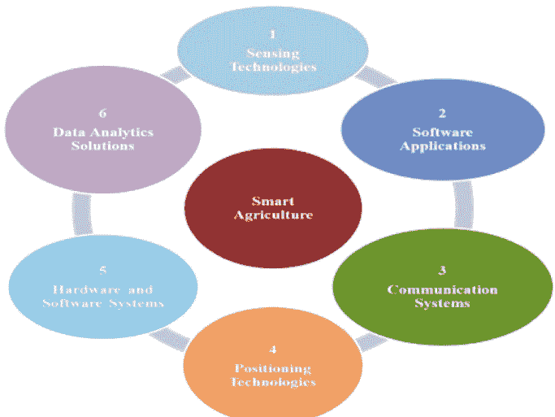

图 6.1 智慧农业中使用的技术。

to store food in. That food is extremely useful in times of scarcity or natural disaster. They were also interested in making clay pots and other containers to transport food from one location to another. They are also used to cook food with the help of fire.

Farmers in Mesopotamia developed simple irrigation systems for cultivation around 5000 BCE. That irrigation system involved channeling water from nearby streams onto their fields. Farmers decide to settle in one area and practice agriculture after irrigation. The people then decided to join forces and work together to perform agriculture over a large area while also efficiently maintaining better irrigation systems [15].

Smart applications in agriculture are useful in managing the practical difficulties of collecting information from agriculture fields and sending it to ground control in time to avoid the complexity of predicting the type of disease attacks in agriculture crops. The communication between the farmers and the control room is very simple to achieve the desired result. The process of verifying the solution to the problem is very quick, and many practical issues in missed communications are resolved (Figure 6.1).

The technologies available for today’s smart farmers are:

- (i) 感知技术
- (ii) 软件应用
- (iii) 通信系统
- (iv) 定位技术
- (v) 硬件和软件系统
- (vi) 数据分析解决方案。

##### (i) 感知技术

In precision agriculture, several sensing technologies are used to provide data that helps farmers monitor and optimize crops, as well as adapt to changing environmental factors, including:

- Location sensors use GPS satellite signals to determine latitude, longitude and altitude within a few feet. To triangulate a location, at least three satellites are necessary. Precision placement is the foundation of precision agriculture. The NJR NJG1157PCD-TE1 is an example of a GPS-integrated circuit used in location sensors.
- Optical sensors utilize light to assess soil qualities. The sensors detect near-infrared, mid-infrared and polarized light reflectance frequencies. Sensors may be installed on automobiles, aircraft and even satellites. Soil reflectance and plant color are only two examples of optical sensor data variables that may be pooled and analyzed. Optical sensors have been created to measure the clay, organic matter and moisture content of the soil. For instance, Vishay offers hundreds of photodetectors and photodiodes, which serve as the basis for optical sensors.
- Electrochemical sensors offer crucial data for precision agriculture, including pH and nutrient levels in the soil. In the soil, sensor electrodes detect particular ions. Currently, sensors placed on specifically constructed “sleds” are utilized to gather, analyze and map chemical data from the soil.
- Mechanical sensors monitor soil compaction, which is often referred to as “mechanical resistance.” The sensors use a probe that enters the soil and load cells or strain gauges to assess soil resistance. On big tractors, a comparable version of this technique is used to forecast the pulling needs for ground-engaging equipment. Tensiometers, such as the Honeywell FSG15N1A, detect the force produced by the roots during water absorption and are extraordinarily beneficial for irrigation interventions.
- Dielectric soil moisture sensors detect the dielectric constant (an electrical characteristic that varies with the amount of existing moisture) in the soil to assess moisture levels.
- Airflow sensors detect the soil’s air permeability. It is possible to collect measurements at particular sites or while in motion. The targeted output is the pressure necessary to push a predefined quantity of air into the earth at a particular depth. Soil characteristics, such as compaction, structure, soil type and soil moisture level, result in the production of unique identifying units that are strategically scattered across agricultural areas. These stations are equipped with a range of sensors that are suited to the local climate and crops. Air temperature, soil temperature at different depths, rainfall, leaf wetness, chlorophyll, wind speed, dew point temperature, wind direction, relative humidity, solar radiation and atmospheric pressure are monitored and recorded at predefined intervals. This data is collated and transferred wirelessly to a central location.

##### (ii) 软件应用

Specialized software solutions for certain farm kinds or IoT platforms that are application independent. Based on the junction of cybernetics and agronomy, agriculture software is a recent, advantageous digital world invention. The lives of farmers are facilitated by digital apps. Their company is more comfortable, predictable, confident and prosperous due to their innovative ideas.

FarmLogs, Climate FieldView, Farmers Edge, Agrian, Trimble, Agrivi, Granular, FarmShots, Strider, Proagrica, AgriEdge and EOS Crop Monitoring are among the most effective agricultural applications now available.

The intelligent agricultural system facilitates the execution of several complicated tasks. Diverse tools are developed to assist individuals in making crucial choices quickly. In addition to accelerating the process, farming applications also give background information. This improves the probability that the answer is right. Agronomy software facilitates intelligent agriculture management by encompassing a vast array of agricultural activities, including: loss prevention, track farming, pest control, risk management, weather precipitation, crop rotation, resources optimization, fertilizer/water saturation, yield prediction, seeding/harvesting time and record-keeping/maintenance.

##### (iii) 通信系统

As information technology has improved, several wireless communication systems have been suggested for a range of purposes. In general, these technologies are categorized as short-distance wireless communication (10 m), medium-distance wireless communication (10–100 m),


和长距离无线通信（超过 100 米）（距离 100 米）。RFID、Bluetooth 和超宽带（UWB）是短距离无线通信典型技术的示例。Wi-Fi 和 ZigBee 是两种最流行的中距离无线通信技术。除了众所周知的蜂窝网络（2G/3G/4G）之外，低功耗广域网（LPWA）是一种新型技术，有多种用于长距离无线通信技术的应用。近年来，包括 LoRa、NB-IoT 和 Sigfox 在内的许多 LPWA 技术已经发展。

与传统的长距离无线通信技术（2G/3G/4G）相比，LPWA 技术具有低功耗、低数据速率、深/广覆盖和多连接的特点。因此，LPWA 技术不可用于流式传输音乐或视频数据，但它们适合连接那些只需要在广阔距离上传输少量数据同时保持电池寿命的设备。LPWA 技术的增强性能，例如延长传输距离和低功耗，是以低数据速率和显著延迟为代价的。因此，常见的 LPWA 应用场景是可容忍延迟、不需要大数据速率、功耗低且成本低廉的。

- (iv) 定位技术

全球定位系统（GPS）和地理信息系统（GIS）能够同时收集实时数据和精确位置信息，从而对大量地理空间数据进行有效的映射和分析。对于农场规划、田地测绘、土壤采样、拖拉机导航、作物勘察、变量率应用和产量测绘，精准农业采用基于 GPS 的应用。GPS 接收器收集位置数据以绘制田地边界、道路、灌溉系统以及农田问题区域（如杂草和疾病）的地图。GPS 精度使农民能够生成具有特定亩数的农场地图，用于田地区域、道路位置以及到感兴趣对象的距离。

GPS 帮助农民年复一年地准确前往田地中的特定地点采集土壤样本。在农业中，卫星以多种方式被利用，首先是用于估算作物产量。光学和雷达传感器可以对农业区域提供准确的描述，以及区分作物品种并评估作物健康和成熟度。这些信息有助于教育市场，并为作物歉收或饥荒提供早期预警。在精准农业中，卫星照片被用来精确定义农民的田地，有时结合地理信息系统（GIS），以提供更强烈和更有效的农业操作。

归一化差值植被指数（NDVI）是一种典型的农业遥感指标，用于量化反射的近红外光比可见红光多多少。NDVI 的原理是叶片反射大量近红外光（NIR）。当植物脱水或处于胁迫状态时，其叶片反射的近红外光减少，但可见光量相同。这有助于远程监测植物。

##### (v) 硬件和软件系统

最近的技术进步促成了下文提到的一些机器人的诞生。农业机器人的多项进步依赖于机器视觉技术，用于避免风险、识别作物并确定收获时间。

通常，使用一台或多台摄像头向机器人提供信息，使其能够找到并接触附近的作物。利用机器视觉，机器人现在可以执行除草、生长监测、收获、分选和包装等工作。

##### (vi) 数据分析解决方案

农民使用数据来评估收获产量、肥料需求、成本节约甚至未来作物优化计划。智慧农业结合数据分析技术，从多样化的农业实践中收集信息，生成可供各种农场使用的算法，以提供高产且可持续的作物产量。有了这些信息，农民将能够更准确地估算农业活动，并采用不仅对作物更健康、而且对生态更有益的策略。

从数据中提取洞察、开发算法和构建新技术的能力正在以令人眼花缭乱的速度不断扩大。共享知识、智能技术和大胆创新的结合有潜力使农业部门取得非凡成就。要通过数据分析获得竞争优势，评估项目的战略和长期目标至关重要。在建立数据分析战略之前，农业企业必须具备以下工具：

- 收集数据。这使您能够从可靠且经过精心挑选的来源收集数据，并将其存储在单一的安全位置，以简化流程。
- 标准化数据。将各种数据集合并为单一数据结构的能力，能够实现实时比较、趋势监测以及在数据中发现模式，从而帮助识别新的可能性。
- 清洁数据。确保您的数据干净、准确且全面，才能信赖您的决策能力。
- 丰富数据。连接外部信息，例如气象数据、当地土壤分析和昆虫监测。
- 分析数据。分析数据的能力对于从收集的信息中获取价值至关重要。确定用于构建分析的可用工具，并验证它们是否支持所需结果。一旦所需的技术和通信工具已实施，就可以考虑业务战略了。这些是在之前必须采取的最重要措施。
  - 理解数据分析平台将如何帮助公司的整个业务计划。
  - 为分析建立愿景，并为基本流程设定成熟度目标。
  - 制定并开发包含短期和长期目标的战略路线图。
  - 为最终架构目标制定计划。

#### 6.2.2 智慧农业的优势

加强生产控制可以改善成本管理并减少浪费。例如，能够识别作物生长或动物健康方面的异常，可降低产品损失的风险。此外，自动化可提高生产力 [2]。

### 6.3 机器学习

机器学习（ML）是人工智能（AI）的一个子领域，其理论认为计算机程序可以在无需人工干预的情况下获取新信息并自行调整。计算机复杂的算法或源代码使设备能够识别数据并基于该数据生成预测。为了辅助决策，ML 对分类世界中持续且易于获取的海量信息非常有效。ML 可以应用于广泛的行业，包括贷款、新闻报道、投资、广告等 [7]。

换句话说，机器学习（ML）是 AI 的一种应用，它使系统能够从自身经验中学习并发展，而无需明确编程。制造可以访问数据并利用数据自主学习的计算机程序是机器学习的目标 [14]。

机器学习可以从观察或数据（例如现实世界示例、个人经验或说明）开始启动。它会在数据中寻找模式，以便从给定示例得出结论。机器学习的主要目标是使计算机能够在无需人工协助的情况下自主学习，并相应地修改其行为 [14]。

#### 6.3.1 机器学习方法

基于学习系统可访问的输入或反馈类型，传统机器学习算法可分为三种主要类型 [4]。它们接受有监督的指导。

##### 6.3.1.1 监督学习

监督机器学习算法通过利用带标签的示例，将过去的经验应用于新数据，从而对未来进行预测。通过检查已知的训练数据集，学习算法会创建一个推断函数来预测输出值。系统在接受足够训练后，可以为任何新输入提供目标。此外，为了识别故障并校正模型，它可以将其输出与预期输出进行比较 [14]。

##### 6.3.1.2 无监督学习

当用于训练的数据既未分类也未打标签时，会采用无监督机器学习技术。无监督学习研究系统如何从未标记的数据中推断出一个函数来描述隐藏结构。系统从未对正确输出有确切的理解。相反，它使用数据集来推断结果应该是什么 [14]。

##### 6.3.1.3 强化学习

强化机器学习中使用的算法通过采取行动并识别奖励或错误，与其环境进行交互。最关键的


增强学习的组成部分是延迟奖励和试错搜索。借助这项技术，机器人和软件代理可以自主决定在特定情况下如何行动，以最大限度地提升其性能。增强信号（一种直接的奖励信号）对于代理学习哪种行为是最优的至关重要 [14]。

##### 6.3.1.4 机器学习中的其他方法

机器学习有能力应用一些在现有方法中不常用的额外方法，有时同一个机器学习系统会使用不止一种方法 [4]。

##### 6.3.1.5 自学习

另一种应用机器学习原理的策略是自学习。它最初于 1982 年提出，借助神经网络实现。交叉自适应阵列神经网络具有自学习能力（CAA）。这是一种学习过程，没有外部激励或他人建议。CAA 自学习算法以交叉阵列的形式实现，这限制了对行为和情感（感觉）决策的考虑，仅限于有后果的场景。该系统由智力和情感的相互作用方式决定 [5]。

##### 6.3.1.6 特征学习

一种基于机器学习的策略被称为特征学习算法，通常也称为表征学习算法。作为预处理阶段，该算法既保护又转换输入中的信息。换句话说，预处理位于分类或预测之前。使用特征学习方法，可以从未知的数据生成分布中重建输入，表明输入并非用于不太可能配置的真实数据。因此，这种方法消除了手动特征工程以防止错误的输入数据，使机器能够学习特征，并利用它们来执行给定任务 [6]。

特征学习适用于监督学习和无监督学习。在监督特征学习中，特征使用带标签的输入数据进行训练。示例包括监督字典学习、多层感知机和人工神经网络。特征使用无监督特征学习从未标记的输入数据中学习。示例包括词汇学习、独立成分分析、自编码器、矩阵分解和其他类型的聚类 [6]。

#### 6.3.2 农业中的机器学习

农业正在利用机器学习原理来提高作物产量和质量。应用机器学习理念的农业领域如下 [8]：

- 农民越来越多地实施机器学习概念并加以改进，因为他们对其充满信心。在食品行业中实施人工智能和机器学习概念，以提高效率和生产可预测性。
- 农民商业网络是一个主要为农民内部交流而创建的社交网络。为了更好地对数据定价，该网络将使用机器学习原理和分析工具。
- 机器学习（ML）创建用于监测作物生长的机器人。
- 通过利用机器学习理念，传感器用于收集作物数据。
- 一项最新研究发现，为了满足人类需求，人工智能和机器学习在农业领域至关重要。

智慧农业是一个新兴概念，利用高度精确的算法提高农业的资源利用率和生产力。机器学习（ML）是科学的一个分支，它赋予计算机在没有明确编程的情况下学习的能力。机器学习已与大数据技术和高性能计算合作，为农业运行环境中数据密集型过程的解析、计算和理解创造了新的机遇 [12]。

种植和收获过程的每一步都涉及机器学习。机器学习帮助土壤准备、种子育种、水肥计量和种子播种。机器学习将使用机器人收获庄稼，并利用计算机视觉评估作物的成熟度 [12]。

### 6.4 智慧农业中 ML 的应用

人工智能（AI）和机器学习（ML）有着广泛的应用。农民现在可以访问大量的复杂数据和众多分析工具，这将帮助我们取得更好的结果、更高的效率，减少食物浪费，并最终最大限度地降低对环境的有害影响。

以下是农业领域专家正在采用机器学习的一些创新方法。

#### 6.4.1 植物育种

植物和人一样，含有影响其外观的基因。有些植物具有基因，能让它们比其他植物吸收更多的土壤水分和养分。某些植物基因在抵抗疾病方面比其他基因更成功。有些植物基因甚至会影响植物的味道、气味、质地等。整个农业经济都专注于生产成功的种子产品，以结合众多植物品种的最佳特性。没有机器学习技术的帮助，科学家需要等待 10 年才能完成一个杂交育种周期。（不过，这仍然比自然完成该过程的速度要快。）

利用大量数据，分析了植物在不同环境下随时间的表现。现在，机器学习算法能够有效分析表现，提供更优的优化，并识别出在特定季节（如恶劣天气条件和昆虫种群）下，为最大化产量利润所必需的生物技术行为。机器学习算法的改进可以通过降低抗性积累，提高这些极具优势且创建成本高昂的生物技术行为的稳定性。科学家可以使用机器学习来预测哪些基因组合会在新植物中产生所需行为，为植物开发提供理想的起点 [9]。

#### 6.4.2 物种管理

我们将在物种管理中了解物种识别、育种和识别。

##### 6.4.2.1 物种育种

由于大多数植物的叶片成分、颜色和形状相似，肉眼识别它们可能具有挑战性。农民现在可以通过分析复杂模式，并使用机器学习精确识别相关植物和杂草物种，从而快速区分植物。计算机化的植物物种识别将使农民获益匪浅，因为它将节省时间，并在其他关键领域提升产量 [9]。

##### 6.4.2.2 物种育种

物种选择的过程需要时间。因为我们需要找到影响该物种水分和养分效率、气候变化适应性、抗病性、营养含量或更好风味的特定基因。机器学习算法在物种选择方面很有效，因为它们分析不同气候下的作物表现，并利用数十年的田间数据识别新特性。基于机器学习数据，它们可以构建概率模型，预测哪些基因最有可能为植物提供有利属性 [12]。

##### 6.4.2.3 物种识别

人类的物种识别方法仅基于叶片颜色和形状对植物进行分类。机器学习可以通过利用叶脉形态分析物种叶片，提供更精确、更快速的答案，叶脉形态包含关于独特物种叶片及其特性的更准确信息 [12]。

#### 6.4.3 田间条件管理

我们在田间管理中非常重视土壤和水的性质。在田间管理中，我们非常重视土壤和水的性质。

##### 6.4.3.1 土壤管理

土壤是宝贵的农业资源，包含复杂的过程和不清楚的机制。仅土壤温度就能提供关于气候变化对当地生产影响的信息。在农业中，机器学习算法用于确定蒸发过程、土壤湿度和温度，以更好地理解生态系统动态 [12]。

机器学习在分析土壤条件、土壤湿度、土壤温度、土壤化合物以及土壤对作物发展和动物福祉的影响方面经验丰富 [9]。

##### 6.4.3.2 水资源管理

农业高度依赖水资源管理。水文、气候和农艺平衡由水资源管理决定。最现代的机器学习应用用于按天、周或月确定水位蒸散量，从而实现更规范的灌溉系统使用。然后，机器学习应用预测每日露点温度，这有助于预测天气并测量蒸散和蒸发 [12]。机器学习可以用于分析降水和蒸散。这是水通过土壤和植物蒸腾进入大气的过程，随后技术人员开发机器学习应用，以实现更好的资源管理和灌溉系统 [9]。


#### 6.4.4 作物管理

作物管理教导我们关于产量生产、作物质量和作物评估。

##### 6.4.4.1 产量预测

农业的最终结果是产量。只有通过精确估算产量，才能平衡供需。精准农业是一种新兴的机器学习范式，将定义产量映射与估算、作物供需匹配以及作物管理。用于预测的先进机器学习技术已被部署，利用计算机视觉技术对作物、天气和经济状况进行多维数据分析，以最大限度地提高农民的产量 [12]。

##### 6.4.4.2 作物质量

在作物管理中，我们必须将作物质量作为一个重要因素来确定。我们必须通过对所有作物进行精确检测和分类，来确定不同的作物质量等级。作物质量的独特性只会提升产品定价并最大限度地减少浪费。与人类专家不同，机器学习方法将从表面毫无意义的数据中进行更准确的作物识别与分类，并与其他作物互联，以揭示和发现对作物整体质量起作用的新特征 [12]。

##### 6.4.4.3 质量评估

农民可以利用机器学习技术来确定特定日哪些作物可收获、哪些不可收获。通过在电脑或平板电脑上登录自定义仪表板，农民可以立即获得准确的评估。可收获作物的重量和成熟度也可以被测量和预测。图像分析方法被用于在收获前后评估作物，以了解其理想特征的存在情况、损伤程度、营养含量以及可能影响最终可行产量和产品定价的其他方面 [9]。

#### 6.4.5 病害管理

在病害管理中，我们学习作物病害识别和杂草检测。

##### 6.4.5.1 作物病害检测

作物需要防范病虫害。因此我们会在种植区域内持续喷洒杀虫剂，无论是在露天还是在

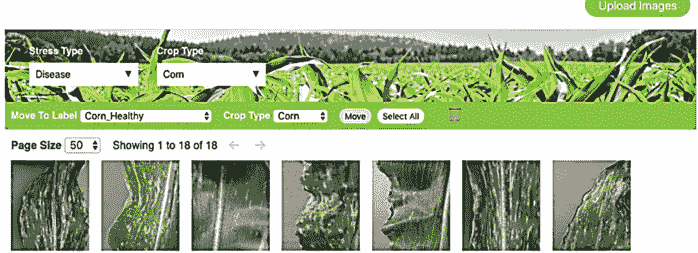

图 6.2 作物病害检测识别。

温室。此外，为了成功，这种策略需要喷洒大量农药，这对农民来说成本高昂，并对环境造成影响。机器学习实施精准农业管理，其中农用化学品投入专门集中在受害植物上，并减少了喷洒农药所需的时间。因此，这将使农民受益 [12]（图 6.2）。

机器学习应用可用于分析作物以进行病害检测，提供准确的病害诊断，并提出最佳治疗方法。机器学习方法帮助农民识别特定植物和位置的农业病害，使农民能够避免对整个农场进行处理。如果对所有农场实施治疗，可能会产生意想不到的后果，例如污染环境或减少蜜蜂种群。机器学习帮助企业更高效地生产作物病害治疗方案，并为其客户提供更好的服务 [9]。

##### 6.4.5.2 杂草检测

杂草是一种与作物相似的植物，但其生长不受欢迎且会危害原生植物。作物中的杂草难以识别和消除。杂草对农业产量构成巨大风险。利用计算机视觉和机器学习技术，可以以合理的成本检测和区分杂草，且无环境危害或负面影响。机器学习算法正被用于创造能够消除杂草的机器人，从而减少未来对农药的需求 [12]。农民可以使用基于机器学习的图像处理算法来检测杂草物种，并评估哪些作物无病，哪些作物受到真菌、细菌或病毒的侵害。利用数字技术对杂草进行分类的能力使农民能够指挥机械设备清除田间杂草，既避免了农药使用对环境的有害影响，又节省了农民的时间、劳动力和资金 [9]。

#### 6.4.6 畜牧管理

畜牧管理涵盖的主题包括畜禽生产、畜禽健康维护、动物放牧及其整体福利。

##### 6.4.6.1 畜禽生产

机器学习允许对许多农业因素进行精确预测和评估，以提高畜禽生产系统（如肉牛和蛋品生产）的经济效率。机器学习利用的体重预测系统可以在屠宰前大约 100 天预测未来体重，使农民能够相应调整饮食和环境条件 [12]。

##### 6.4.6.2 动物福利

由于生活条件的低效，当今畜牧业中的动物既没有自由也没有幸福。它们仅被用作食物容器。机器学习中的分类器被用来识别动物行为，例如咀嚼信号以预测饮食变化，以及站立、移动、进食和饮水等运动模式。机器学习将评估并报告动物的压力、疾病、体重增加和生产力 [12]。

##### 6.4.6.3 畜禽健康维护

机器学习帮助农民维持一群快乐健康的农场动物。我们可以从以下示例中了解这一点。在一个案例中，一个组织使用传感器监测奶牛行为。利用机器学习，收集的数据将用于预测繁殖趋势、识别进食习惯和疾病，并向农民发出热应激指标的警告。在另一个场景中，可以通过将深度学习算法应用于从奶牛血液或牛奶中采集的白细胞照片来确定奶牛的健康状况。在基本检查之前，这些方法会揭示重大健康状况的迹象。农民随后可以在需要抗生素之前采取适当的健康措施 [9]。

##### 6.4.6.4 动物放牧

自主机器人在多个阶段被使用，例如监测农田、检测作物间的杂草以及识别受损植物，随后被训练去聚拢农场动物。它还协助在动物前往预定目标的路线上进行物理放牧；这些机器学习驱动的设备可以将大件货物从一个地方拖到另一个地方，并与无人机协作向农民传递重要信息 [9]。

##### 6.4.6.5 选择性育种

选择性育种是一种利用遗传数据优化来支持保留奶牛理想特征（如乳品质量、抗病性、生育能力等）的方法。牧场主自古以来就一直在实践选择性育种。牧场主已预期特定的监测标准，数代以来培育出具有所需特性的牛群。借助传感器和应用程序等机器学习技术，我们可以利用海量数据调查遗传分子标记、环境、饲料配比和出生趋势，牧场主可以根据显著更准确的发现制定畜牧相关决策 [9]。

#### 6.4.7 牧场管理

处理动物的农民可以利用机器学习来节省牧场管理的时间和开支。机器学习技术有助于畜禽保健、乳品和蛋品生产、动物放牧以及选择性育种等农业和牧场活动 [9]。

##### 6.4.7.1 乳品和蛋品生产

机器学习数据分析将通过提供更准确和高效的结果来帮助牧场主。他们负责生产牛奶、鸡蛋和其他食品。奶牛活动数据通过机器学习技术收集和分析。它还使农民能够做出运营决策，使产奶量提高高达 40% [9]。

牧场主依赖于增强型机器学习技术来：

- 检查牛群行为趋势并提供更好的护理和喂养建议。
- 预测疾病并采用合适的治疗方法。
- 提高产奶量和产蛋量。
- 管理牛和羊等农场动物。
- 分析并传播农场状况数据。
- 预测繁殖趋势以改进育种选择并培育更健壮的牛群。


- 提高生产力、节省时间并更流畅地操作 [9]。
- 执行体力工作。

#### 6.4.8 农用化学品生产与应用

预测分析是机器学习（ML）技术的主要优势。ML技术广泛用于为农民和牧场主制造杀虫剂、农作物病害补救剂、抗生素、微生物制剂及其他化学和生化产品。这项技术将帮助他们以尽可能高效的方式生产产品，同时不对环境产生负面影响。此外，机器学习简化并合理化了农作物病害检测、诊断和治疗等活动 [9]。

农民将能够使用智能手机应用程序了解不同的植物病害以及如何诊断它们。同样，ML移动应用程序被用于数字活动，例如确定何时在农作物上喷洒农药，并在不打扰附近健康或未受影响植物的情况下识别农场上受害植物。喷洒无人机使用ML技术进行训练，以便选择性地对需要治疗的植物喷洒农药。ML不仅能检测植物病害，还能检测作物和动物面临的其他危险。

为了检测更多风险，ML应用图像分析算法，而病虫害防治公司为其人员配备可靠的实时工具来识别害虫，从而使其能够提供针对性的灭虫服务 [9]。

#### 6.4.9 远程天气监测

天气和自然环境条件是农民面临的最具挑战性的方面。农民将能够了解不同的气象变量，如温度、降雨量、湿度、土壤湿度和特定化学成分，以全年最大化产量。这是为了增加作物产量。利用ML方法，研究人员发现了几种可定制的传感器，这些传感器可能帮助农民从远处监测作物状况和天气。由于这些传感器，农民需要亲自在农场度过的时间将会减少。在某些方面，传感器的使用可能会使产量翻倍，因为它使农民能够在投入更少劳动力的同时增加农业产量 [11]。

#### 6.4.10 农民的小帮手

这是一种移动设备应用程序，可以被视为一种额外福利。例如，农民可以留在家中，考虑在管理收获的作物时下一步该采取什么措施。他不确定是将作物卖给当地生产商还是区域企业。在做出最终选择之前，他想了解各种可选方案的建议。各行业目前专注于构建定制聊天机器人，以支持他实现这一目标。聊天机器人将能够与农民交谈，并为他们提供有用的数据和见解。预计农民的聊天机器人将比面向消费者的Alexa及类似助手更智能，因为它们不仅能提供数字，还能对其进行评估，并就棘手问题向农民提供建议 [12]。

### 6.5 结论

农业是这个世界上一项基本技能。农业是所有生物的营养来源。人们过去花费大量时间寻找食物。随后，人们发现了农作物并能够种植它们，从而产生了可以从一个地区出口到另一个地区的过剩食物。人口扩张以及为人类生存而毁坏农业地区增加了粮食需求。气候变化和众多企业的发展导致土地退化。为了防止饥饿问题，我们必须使用尖端技术来保护和增强食品供应。机器学习就是这样一种可以帮助我们克服所有这些粮食短缺挑战的技术。智能农业正在利用机器学习实施，它将帮助农民更有效地完成工作并生产更多的食品作物和其他产品。本章解释了机器学习如何帮助农民提高产量，同时提供精确且预先确定的响应。

### 参考文献

- [1] J. Angel Ida Chellam, M. Siva Sangari and R. Rajendra Kumar, “基于AI多元回归技术的干旱预测”, Journal of Cardiovascular Disease Research, vol. 12, pp. 305–310, 2021.
- [2] C. Encinas, E. Ruiz, J. Cortez and A. Espinoza, “用于水产养殖水质监测的分布式IoT系统的设计与实现”, 2017 Wireless Telecommunications Symposium (WTS), pp. 1–7, 2017.
- [3] G.K. Ganejgunte, Z. Sheng and J.A. Clark, “用于灌溉调度以节约淡水的土壤水分传感器准确性评估”, *Appl Water Sci*, vol. 2, pp. 119–125, 2012.
- [4] A.Gupta, S. Mishra, N. Bokde and K. Kulat, “印度需要智能水系统”, *International Journal of Applied Engineering Research*, vol. 11, no. 4, pp. 2216–2223, 2016.
- [5] S. Das and S. Kar, “医疗系统中的群体决策：直觉模糊软集方法”, *Appl. SoftComput*, vol. 24, pp. 196–211, 2014.
- [6] D. Stanjukic, B. Djordjevic and M. Djordjevic, “一些著名MCDM方法的比较分析：排名案例”, *Serbian J Manag*, vol. 8, no. 2, pp. 213–241, 2013.
- [7] A. De Gelder, J.A. Dieleman, G.P.A. Bot and L.F.M. Marcelis, “封闭温室中气候和作物产量概览”, *J. Hortic. Sci. Biotechnol*, vol. 87, pp. 193–202, 2012.
- [8] M.K. Gupta, P. Chandra, D.V.K. Samuel, B. Singh, A. Singh and M.K. Garg, “温室中番茄幼苗生长模型”, *Agric. Res*, vol. 1, pp. 362–369, 2012.
- [9] https://objectcomputing.com/expertise/machine-learning/machine-learning-in-agriculture
- [10] M. Azaza, K. Echaieb, F. Tadeo, E. Fabrizio, A. Iqbal and A. Mami, “温室气候模糊解耦控制”, *Arab. J. Sci. Eng*, vol. 40, pp. 2805–2812, 2015.
- [11] https://readwrite.com/smart-farming-solutions-how-iot-transforms-agriculture-sector/
- [12] https://www.kdnuggets.com/2019/05/machine-learning-agriculture-applications-techniques.html
- [13] R. Ben Ali, S. Bouadila and A. Mami, “地中海背景下两种农业温室动态热行为的实验验证”, *Renew. Energy*, vol. 147, pp. 118–129, 2020.
- [14] M.H. Liang, L.J. Chen, Y.F. He and S.F. Du, “使用开关执行器的温室温度预测控制以节约能源”, *IFAC PapersOnLine*, vol. 51, pp. 747–751, 2018.


## Taylor & Francis

Taylor & Francis Group

http://taylorandfrancis.com

## 智能农业中的深度学习

K. Nisha^1, C. Augustine^2, A. Jose Anand^3, and M. Kamesh^4

1 印度钦奈技术学院计算机科学与工程系
2 印度GRT工程与技术学院电子与通信工程系
3 印度KCG技术学院电子与通信工程系
4 印度Velammal技术学院电子与通信工程系
Email: nishak.mecse@gmail.com; austynineeleven@gmail.com; joseanandme@yahoo.co.in; kameshm90@gmail.com

### 摘要

深度学习（DL）是机器学习（ML）的一项创新技术；它是人工智能（AI）的一个子集。由于神经网络（NN）模拟人脑的活动，DL将执行相同的任务。在DL中，没有任何内容是显式编程的。它是一种使用许多非线性处理单元来执行特征提取和转换的ML类别。每一前馈层的输出都作为每一后继层的输入。DL模型足够强大，能够专注于精确特征本身，这些特征需要较少的程序员指导，并且在解决维度问题方面非常有帮助。智能农业是农业中的一个新理念，它使农业成为一种继承新技术的生产性和结构化方法。如今，DL涉及各种研究活动，这些活动用于帮助农民减少农业中的损失。这项技术用于预测哪种作物适合哪种天气条件。目前，DL、PC视觉、图像处理、先进机械和物联网（IoT）创新对农民非常有用。基于计算机智能控制的无人机技术对园艺非常有价值，因为它提供高质量图像，使监控、检查和分析作物变得更加简单。这种方法有助于决定作物的进展。此外，农民可以得出结论，无论收获是否准备好产出。有


对农业中深度学习（DL）参与的描绘没有限制。该研究考察了深度学习在农业中的典型应用。卷积神经网络（CNNs）、循环神经网络（RNNs）、长短期记忆（LSTM）网络、生成对抗网络（GANs）、径向基函数网络（RBFNs）、多层感知机（MLPs）、自组织映射（SOM）、深度信念网络（DBNs）和受限玻尔兹曼机（RBMs）等DL算法已得到广泛研究，并在农业的众多领域有用。具体来说，基于CNN的监督学习（CNN-SL）和迁移学习的应用推动了现代农业的发展。

### 7.1 引言

农业保障粮食安全，因此是国家的支柱。它在该国大部分外贸中发挥着重要作用。在世界大部分地区，约75%的人口依赖农业维持生计。人口增长要求农业部门实现更高产量和更好的农业条件。农民正在寻求有效的方法，以降低成本并更有效地利用现有资源来增加作物产量。这正在推动农业部门数字技术的新应用，以帮助农民做出更好的决策并提高产量。如今，我们使用深度学习方法来克服农业部门的各种问题和挑战。随着提高粮食生产效率的需求不断增长，技术可以提供和执行农场作业以增加产量[1]。现代农业可以收集和处理数据，从土地准备和种植到收获后的收获，自动化整个耕种过程。这意味着大量的农业/农场数据可以使用新的信息和通信技术进行分析。本章采用一种精准农业技术，以配备光学和辐射计传感器的无人机形式，在正常生产/生长周期中捕获田间环境的最准确图像。然后，使用卷积神经网络的深入研究进行图像训练，以开发一种多类组织方案来调节植物的完整健康突出度。使用预训练的新图像已显示，该模型可以以99%的准确率准确预测任何植物失调[2]。

#### 7.1.1 DL算法的应用

与支持向量机（SVM）和随机森林等其他方法结合，深度学习模型预测大豆作物的产量。这项工作使用深入研究方法来预测作物产量。首先，他们创建了一个大豆产量预测模型，其中可用数据足以实现该目的。当数据受限时，他们使用迁移学习来预测大豆作物的产量。他们已证明遥感数据的成本效益以及知识传输的使用，以有效地预测作物产量，其范围在于可获得的数据很少。如何预测气候指标以识别干旱对农业的影响？这种学习使用合成神经网络来预测利用归一化差值植被指数（NDVI）的植物差异的正常指示。基于卫星指示的预测NDVI被用来预测农业干旱及其即将到来的影响。该原型在沙漠环境中效果最好。这些结果帮助做出了关于植物和牲畜的明智决策[3]。

他们的预测建立在农场的当地结构以及生长期使用的氮肥数量之上。卷积神经网络已被开发，以捕捉区域特征的局部属性，并显示作物产量对营养控制和种子比例的反应。原型从由九个玉米地形成的数据库中合格。随后，氮肥和营养物质的过量处理会降低作物产量和作物品质，后果被回收以理解和调节营养利用。自动分析平台利用高分辨率航空影像测量生产莴苣相关的产量表型。他们回收了超大比例尺的NDVI航空照片以提取产量相关表型。首先，基于CNN组装的复制构造被开发用于计算莴苣。那时，使用无监督机器学习过程将获取的莴苣分为三个维度[4]。最后，基于莴苣大小生成的代表收获区域的全球定位系统（GPS）地图被制作出来。他们通过在各个生长阶段进行实时作物观察证明了这一点，这使得在变化的农业条件下改进作物管理以提高生产力。重要的是，mask R-CNN（掩码基于区域的卷积神经网络）是R-CNN物体查找器家族中最新的扩展，包括分割系统和发现系统。R-CNN掩码可以端到端运行，但通过迁移学习可以实现更好的展示和更快的转换。在迁移学习中，NN开始在COCO和ImageNet等不同数据集上进行训练，以研究图像的简单特征。在准备远程数据传感器网络时，可以使用权重衰减或退出控制等技术，以确保系统对遥感图像的需求量最小[5]。

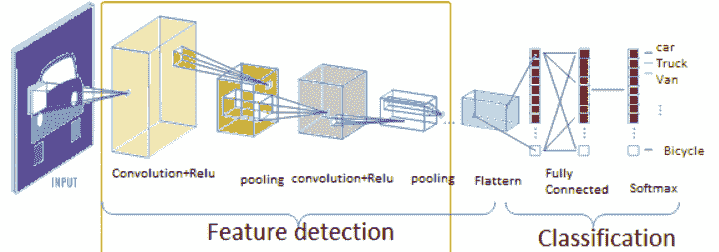

图 7.1 CNN结构。

### 7.2 深度学习算法

以下是各种DL算法。

#### 7.2.1 卷积神经网络

深度神经网络并行运行，将多层非线性处理与源自生物神经系统的简单元素相结合。它有一个输入层、多个隐藏层和一个输出层。层通过节点或神经元相互连接，每个隐藏层都将前一层的输出作为输入。CNN和ConvNet是最常见的两种DL算法。像其他神经网络一样，CNN有一个输入层、一个输出层以及中间的许多隐藏层[6]。图7.1显示了CNN架构的处理流程。

**特征检测层：** 这些层以三种方式之一对数据进行操作：卷积、池化或整流线性单元（ReLU）。卷积对输入图像应用一系列卷积滤波器。每个滤波器激活图像的不同方面。池化通过非线性下采样简化输出，从而减少网络必须学习的限制数量。为了更快、更有效的训练，ReLU将负值转换为零并保留正值。这三个过程重复数百或数千次，每个层都学习识别不同的功能[7]。

**分类层：** CNN架构在检测特征后进入分类阶段。产生K维向量的全连接层是倒数第二层。K表示模型可以预测的类别数量。该向量包含每个图像类别的顺序概率。softmax任务用于CNN设计的最后一层，以给出分类输出[8]。

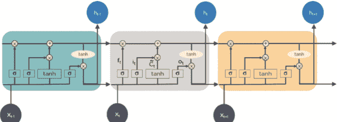

图 7.2 LSTM架构。

#### 7.2.2 长短期记忆网络

LSTM可以被描述为经过修改以随时间学习并适应条件的RNN。过去的数据可以存储和检索很长一段时间，这是默认的唯一行为。LSTM专为长期存储而设计，可以限制记忆或先前输入；因此，它们将主要在未来用于时间序列预测。这种类比源自由四个交互层组成的链式结构，这些层以不同方式通信。除了时间序列预测应用外，它还可用于构建语音识别、药物开发和音乐循环创建。LSTM对一系列事件进行操作。首先，它们倾向于不记得在之前状态中获得的不相关细节。然后，它有选择地更新特定的单元状态值，最后将单元状态的特定部分作为输出。以下是其行为图[9]。LSTM的结构如图7.2所示。

#### 7.2.3 循环神经网络

RNN由多个有向连接组成，形成一个循环，允许LSTM提供的输入在RNN的当前阶段用作输入。由于这些输入被深度嵌入为输入，我们记住LSTM，以便它们被吸收到内部记忆中一段时间。因此，RNN依赖于LSTM持有的输入，并在LSTM同步现象下运行。RNNs主要


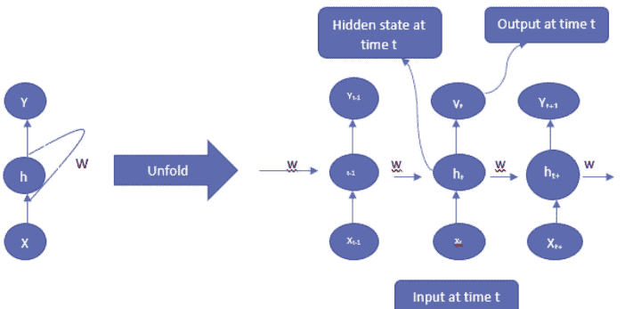

图 7.3 RNN 架构。

用于图像字幕、时间序列分析、手写数据识别和数据的机器翻译。当时间定义为 t 时，RNN 通过调整输出馈送（r1）的时序来遵循工作方式。由 t 确定的输出随后在输入时间 t + 1 时馈送。同样，这些过程重复用于任何长度的所有输入。还有一个事实是，RNN 存储历史信息，即使模型大小增加，输入大小也不会增加 [10]。图 7.3 显示了 RNN 的架构。

#### 7.2.4 生成对抗网络

生成对抗网络（GAN）被描述为用于为该过程生成新信息的深度学习算法。GAN 通常包括，具体来说，一个学习生成虚假信息的生成器和一个通过学习这种虚假信息来自我适应的判别器。随着时间的推移，GANs 获得了大规模应用，因为它们经常被用于制作清晰的天文图像和引力暗物质的模拟透镜。它们同样被用于视频游戏中，通过在 4K 等更高分辨率下重建 2D 纹理来提升 2D 纹理的图像。它们还用于开发逼真的卡通人物，以及进一步渲染人脸和 3D 物体。GAN 通过生成和理解虚假与实际信息出现在模拟中。在该过程中，为了理解这些信息，

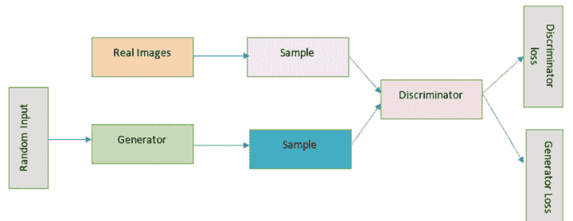

图 7.4 GAN 架构。

生成器产生各种各样的虚假信息，判别器快速学习适应并将其识别为虚假信息。然后 GAN 将这些识别结果发送以进行更新。考虑以下图片以可视化其运作 [11]。图 7.4 显示了 GAN 的架构。

#### 7.2.5 径向基函数网络

径向基函数网络（RBFN）是特殊的神经网络，采用前馈技术并使用径向特征作为激活特征。它们包含三层，具体为输入层、隐藏层和输出层，这些层通常用于时间序列预测、回归测试和分类。RBFN 通过测量训练数据集中存在的相似性来完成这些任务。它们通常有一个将信息馈送到输入层的输入向量，从而确认身份并通过评估先前的数据集来推导结果。具体来说，输入层具有对该信息敏感的神经元，该层中的节点擅长分类信息类别。神经元最初位于隐藏层中，尽管它们的工作与输入层紧密集成。隐藏层包含高斯传递特征，这些特征与输出到神经元中心的距离成反比。输出层具有线性信息，其中高斯特征作为参数传入神经元并生成输出。考虑以下图形以彻底理解该方式 [12]。图 7.5 显示了 RBFN 的架构。

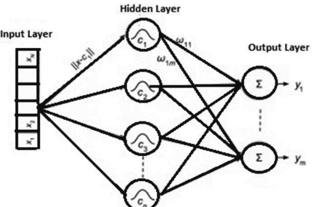

图 7.5 RBFN 架构。

#### 7.2.6 多层感知机

多层感知机（MLP）是深度学习创新的基础。它属于具有多层感知器的前馈神经网络类别。这些感知器内部具有不同的处理任务。MLP 同样具有相关联的输入层和输出层，且两者数量相同。同样，在这两层之间存在一个保持隐藏的层。MLP 主要用于构建图像和语音识别框架或其他几种解释性编程。MLP 的工作始于将信息馈送到输入层。层中存在的神经元构建一个图表以建立单向传递的关联。此输入信息的权重被发现存在于隐藏层和输入层之间。MLP 使用激活函数来确定哪些节点准备好触发。这些激活函数包括 tanh 功能、sigmoid 和 ReLU。MLP 主要用于训练模型以理解层从给定数据集中实现理想结果所建立的连接类型。请参阅以下图片以更好地了解 [13]。图 7.6 显示了 MLP 的设计。

#### 7.2.7 自组织映射（SOM）

自组织映射（SOM）由 Teuvo Kohonen 构思，旨在通过人工和自组织神经网络实现信息感知，以识别信息的元素。实现信息表示以处理问题的努力，主要是由人们无法想象的方式完成的。这些信息大多是高维的，因此人类参与的可能性较小，且造成的错误较少。SOM 通过引入各种节点的权重，然后从给定的训练信息中选取随机向量，来帮助可视化信息。它们检查每个节点以找到相对权重；这样，条件就可以被感知。

选择获胜节点，这称为最佳匹配单元（BMU）。之后，SOM 找到这些获胜节点；然而，节点随时间从示例向量减少。随后，节点离 BMU 越近，就越有可能识别权重并采取更大行动。还会执行不同的迭代，以确保靠近 BMU 的节点不会丢失。这个示例是日常工作中使用的 RGB 颜色组合。请参阅以下图片以了解其工作原理。[14]。图 7.7 显示了 SOM 的架构。

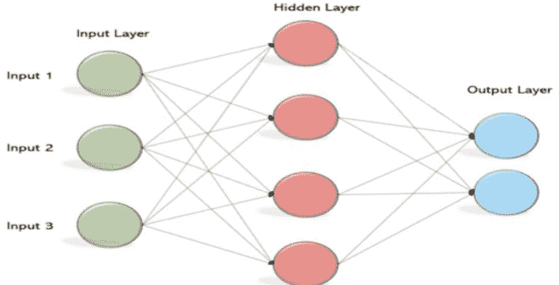

图 7.6 MLP 架构。

#### 7.2.8 深度置信网络

深度置信网络（DBN）被称为生成模型，因为它们具有不同层的隐含变量和随机因素。隐含变量称为隐藏单元，因为它们具有二进制值。DBN 同样被称为玻尔兹曼机，因为 RBM 层相互堆叠以与过去和后续层建立通信。DBN 用于视频和图像识别等应用，以及捕获深层对象。DBN 由贪婪算法支持。该层对层方法，利用层次方式来生成权重，是 DBN 工作最常见的方式。DBN 采用逐位方式来处理在两个隐藏层之上的吉布斯采样。


这些阶段随后使用遵循其祖先采样方法的模型，从显示的单元中提取样本。DBN 通过遵循自底向上的路径方式，从每一层的潜在值中学习当前存在的值 [15]。图 7.8 显示了 DBN 的架构。

#### 7.2.9 受限玻尔兹曼机

受限玻尔兹曼机（RBM）遵循自底向上传递方式，从每一层获取隐含值，如图 7.9 所示。受限玻尔兹曼机（RBM）：RBM 由 Geoffrey Hinton 创建，看起来像是从给定数据集中的概率分布获取知识的随机神经网络。该计算基本上用于


图 7.9 RBM 架构。

降维、回归和分类，以及主题建模领域，并被视为 DBN 的结构基块。RBM 包含两层，具体为可见层和隐藏层。这两层都与隐藏单元关联，并具有与产生结果的节点关联的偏置单元。通常，RBM 有两个阶段，具体为前向传递和后向传递。RBM 的工作通过接受输入并将其转换为数字来完成，以便在前向传递中对输入进行编码。RBM 考虑每个输入的权重，后向传递获取这些输入权重并将其进一步转换为重建输入。之后，这些转换后的贡献及单独权重被合并。这些输入随后被推送到可见层，在那里完成激活，并生成可以轻松重建的输出。要了解这个循环，请考虑下图。自动编码器是一种独特的神经网络，其中输入被视为通常相同的输出。它旨在基本解决与无监督学习相关的问题。

### 7.3 农业中的深度学习应用

该列表识别相关活动，显示农业研究领域、具体问题、使用的 DL 模型和设施、使用的数据源、类和数据标签、预处理数据和/或添加内容，以及整体性能，


在公认指标方面取得了成就，并在有可用策略的情况下与其他策略进行比较。共十六个站点已被识别用于杂草识别和杂草识别、作物识别、果实计数以及作物分类 [17]。DL在智慧农业中的应用有很多可能性，包括农业信息处理。观察动植物的状况对农业建设至关重要。某些植物和动物状态变量无法直接仓促处理。在这种情况下，不同的植物状态变量可能存在一些依赖关系；因此，您可以使用DP来处理来自松散信息的海量信息。植物和动物在农业生产中与环境因素相互作用。这使得农业信息处理更加容易。农业生产系统的最优控制。农业生产系统管理策略通常基于农民的经验和专家的知识，这些专家不考虑植物（动物）的生理状态或实时需求。这不可避免地意味着该策略不是最优的。DP的好处在于，它使您能够在不太依赖机制信息的情况下完善复杂方案。因此，使用DP对农业生产系统进行建模，使得能够利用植物（动物）生物状态的实时测量和历史数据来开发最优控制策略。农业制造包含多种任务。这些任务通常是劳动密集型的，且工作环境非常艰苦。使用DP来模拟人类表现和动力农业机械，已在农业的众多领域得到广泛应用，包括播种、收割和收获后处理。例如，一个苹果采摘机器人是非常有价值的。在自然条件下，背景光线、树枝和树叶都会显著干扰计算机视觉信号。机械臂到达目标的路径也需要优化。DP方法对所有这些问题都非常有用。

农业财务管理。农业产量本身并不总是足以支持农业。除了农产品的成本和质量之外，还有许多其他因素需要考虑。预计农产品费用将是显著的。然而，费用受多种因素影响。在这种情况下，可以使用DP根据特定变量进行费用调整。农业中的大多数DL应用被分类为某些类别。它们用于病虫害防治、收割机器人、产量预测、灾害监测等应用。手动检测植物病害可能耗时。幸运的是，人工智能（AI）的进步可以通过图像处理检测植物病害。植物病害检测模型主要基于叶片图像分类和模式识别。使用新的DL框架，我们创建了一个作物病害检测模型。该模型可以检测健康叶片中13种多样的植物病害，并区分植物叶片与其周围环境。另一项关于使用DL检测植物病害的研究发现，可能的总体准确率可达95.8%或100%训练迭代，并可进一步微调至96.3%的改进。结果优于手动检测。所有这些都表明，DL在植物病害检测中表现出色。作物分类和杂草检测尤为重要，因为许多国家正在制定建设国家农业监测网络系统的倡议，这对农业自动化产生了影响。由于图像识别可以用来识别植物的许多特征，CNNs已被广泛用于杂草识别和植物分类。有人提出了一种结合CNN和K-均值特征学习的杂草识别与控制的新方法。杂草检测的手动设计能力可能导致检测结果不稳定和特征提取泛化能力差。由于使用了DL和K-means预训练，识别准确率为92.89%。AlexNet是植物分类学中最广泛使用的预训练CNN架构之一。伊斯坦布尔理工大学的实验结果表明，ML过程基于手工制作的结构来区分现象学阶段。另一项研究使用自组织映射（SOM）来分割光学影像，然后从卫星接收的影像中恢复错位内容。该特定方法包括一种后处理方式，包含多种校正方法以及基于可用信息的地理空间分析。最重要的作物分类准确率为85%。然而，障碍阻碍了CNN在植物分类中的应用。基于空间的合成孔径雷达（SAR）影像中的每个像素。

### 7.4 DL信息检索方法

本专著总体上介绍了DL方法论及其在不同信号和数据调节任务上的实现。需求部分根据由此产生的三项原则以不同形式选择：数据理解；已利用DL技术有效应用而转化的产品领域，如语音识别和计算机视觉；以及可能受DL显著影响的应用区域。我们接触到了包括自然语言处理和文本处理、数据恢复以及DL支持的多模态数据处理在内的DL研发，以执行多项任务。后来，在2006年，DL或分层学习作为一种新兴的ML探索领域出现。多年来，通过DL探索建立的方法正在影响传统和新扩展领域中大量信号和信息处理工作，包含ML和AI的重要特征；请参见有关此类进展的媒体报道的概览文章。近年来，许多关于DL及其在众多信号和信息处理领域应用的研讨会、教程和会议环节已经举办并正在举行 [18]。

创作者积极参与DL研究，并组织或提供上述一些活动、教学特色和出版物。具体来说，我们在各种情况下进行了教学培训，并邀请他们就该主题进行讲座。本专著的大部分内容主要基于她的信息练习和教学材料。通常，DL的各种高层隐喻具有以下两个关键特征：

- 包含多个层或阶段的非线性证据记录的模型；
- 在逐步更高级或更抽象的层上学习特征表示的技术，无论是有监督还是无监督。

DL处于神经网络（NN）、人工智能（AI）、图形模型、优化、模式识别和信号处理研究的交汇处。芯片处理能力的大幅提升（例如，通用图形处理单元或GPGPU）、用于训练的数据规模有意扩大，以及ML和信号/证据处理研究的现代改进，是目前DL被接受的三个关键原因。这些进步使得DL程序能够成功地开发多方面的、组成性的非线性应用，学习分布和分级的特征表示，并有效地使用标记和未标记数据 [19]。

### 7.5 DL网络的类别

如前所述，DL表示一类相当广泛的ML实践和结构设计，这些设计使用多层在各处分级的非线性事实处理。基于拟议用途的结构和概念，例如合成/生成或识别/分类，该领域的大部分工作可以大致分为三大类。最终类别标签的信息不可用，但使用深度无监督或生成式知识系统来内化功能性或可观测数据的高层关联，以用于模式研究或合成

分辨率。此类深度系统在文献中被称为不确定特征或表达式学习。在生成模式下，建议描述可检测的事实及其对应类别的一般统计分布，这些数据可访问并存储为可见数据。在第二种情况下，将贝叶斯定理应用于此类生成网络，可以将其转化为用于学习的判别网络 [20]。

- 1. 针对监督学习提出的深度学习网络坚定地为轮廓布局分辨率提供判别控制，通常通过区分基于可见统计数据硬化的类别后续输出来实现。对于此类监督学习，终端标签数据在直接或间接过程中持续可用，称为判别深度网络。
- 2. 混合深度网络，其目标是辨别，并且经常显著受益于无监督或生成网络的结果。

这是通过改善组 (2) 中 DL 网络的优化来实现的。当监督学习判别标准可用于推断上述类别 (1) 中某些深度生成或无监督深度网络的局限性时，即可实现目标。上述中“混合”一词的用法与非虚构作品中的用法不同，在后者中，它表示将神经网络的输出似然输入 HMM 的语音检测混合方案。深度判别原型（例如，DNN、RNN、CNN 等）和生成/无监督模型（例如，受限玻尔兹曼机或 RBM、深度信念网络或 DBN、深度玻尔兹曼机（DBM）、正则化自编码器等）是常用的 ML 技术。这种双向表征技术在深度学习研究中持续忽略一个重要发现：再生或无监督学习机制如何通过更优增强从根本上改进 DNN 和其他深度监督知识副本的训练。此外，用于无辅助学习的深度组织不一定保证、应为概率性，或有能力从模型中真正采样（例如，常规自编码器、编码不足的组织等）。我们在此指出，后续研究已对常规变分自编码器进行了总结，使其能够高效采样，因此已成为生成模型。然而，传统的双向组织在用于无监督和监督学习的 DNN 之间存在一些重要差异。比较两种高度监督的模型（例如 DNN）通常对训练和测试很有用。无监督和监督学习深度网络之间存在一些重要差异。比较两种高度监督的模型（DNN），它们通常对训练和测试有效，具有弹性概念，并适合在复杂架构（例如，环式信念传播等）中进行端到端训练。另一方面，深度无监督学习模型，尤其是随机生成模型，易于理解、集成、配置和处理不确定性，但在采用和训练复杂系统时天生固执。本专著中使用这些差异，因为它们专为拟议的三向安排保留 [21]。

### 7.6 深度自编码器

深度自编码器是 DNN 的一种罕见变体，其输出向量的维度与输入向量相似。它在隐藏层中以输入向量方式研究、解释或高效编码创新数据方面非常有用。请注意，自编码器是一种不使用类标签的非线性质量去除方法。因此，提取的特征旨在存储信息并更好地表示它，而不是执行分类任务，但这两个目标可能相关。按定义，自编码器具有一个输入层，用于体现发明的输入参数向量，带有表示修改特征的多个隐藏层，以及与输入层竞争以进行重建的输出层。如果隐藏层数量超过一层，则该自编码器被认为是深度的。隐藏层的测量值与输入参数相比可能较小或较大 [22]。

反向传播的一种变体通常采用随机梯度下降技术，用于训练自编码器。通过反向传播，系统可以使用多个隐藏层进行训练，以解决需要解决的基本问题。将每一层预训练为一个小型自编码器可以解决该问题。该方法被用来创建一个深度自编码器，它将图像映射为快速的微小二进制代码，也用于图像检索系统，以对报告进行编码（称为语义哈希），并用于预测类似曝光的语音地形 [23]。

此时，考虑一系列任务，以开发一种自编码器，以无监督方式（即，不使用语音类标签）从原始语音声谱图数据中提取重复语音代码。该原型挖掘的各种二进制密码表示用于恢复语音信息，或作为语音识别的瓶颈特征。图 7.10 描述了一种深度自编码器系统架构，它覆盖包围 256 个频率容器和 1、3、


#### 图 7.10 用于提取二进制语音代码的深度自编码器架构。

9、或 13 个边缘。高斯-伯努利 RBM 是一种无向图形表示，具有一个带有高斯噪声的线性变量可见层和一个 500–3000 个二进制随机变量的离散层。在学习高斯-伯努利 RBM 后，其不可见元素的生成似然被保存为数据，用于训练其他伯努利-伯努利 RBM。两个 RBM 组合形成深度信念网络 (DBN)，第二层二进制隐藏元素的状态可以从输入中在单次传递中轻松推断。DBN 显示在图的左侧，两个 RBM 分别位于不同的框中。深度自编码器通过使用其自身权重矩阵“展开” DBN，在三个隐藏层中创建。这些矩阵用于在深度自编码器的较低层中对输入进行编码，条件用于在上级阶段解码输入。深度自编码器通过使用误差反向传播进行调整，以最小化重建错误，如图 7.10 右侧所示。训练完成后，任何可变长度的声谱图都会预先排列并重建。每个特征的 256 点对数功率范围的前 N 个连续重叠边缘被正则化为零均值

和单位方差归一化示例 [24]。考虑到用于训练 DL 模型的回收数据的基础，主要使用大量图像数据集，包含大量图像或由作者生成。某些数据集源自 Plant Village、LifeCLEF、MalayaKew、UC Merced 和 Flavia 等著名且广泛的数据集，而其他数据集则是研究人员收集的真实图像集。

### 7.7 基于图像的信息

TensorFlow 使用数据流图表示更改计算、共享状态和状态的操作。此函数表示跨越多个计算设备的数据流图中的一个节点。例如，多核 CPU、通用 GPU 和张量处理单元自定义 ASIC (OPUS)。该模型具有许多数学层，这些层以并行方式操作。卷积层通常对层输入的所有子集应用局部聚合。Caffe 模型及相关优化方法以文本形式而非代码形式提供。训练之前，Caffe 提供模型定义、最佳设置和权重。Caffe 可快速处理大量数据。Caffe 也是模块化的，可以轻松扩展到新任务。客户通过组合 Caffe 提供的不同类别的神经元层来创建自己的表示，Caffe 是一个干净且可修改的框架，适用于一系列前沿深度学习算法以及多媒体科学家和从业者的参考模型 [25]。

### 7.8 DL 框架

卫星数据对于减少碳排放、最大化经济效益和最大限度地减少土地退化的可持续土地利用规划而言极其宝贵且至关重要。使用数据的困难在于解读收集到的图像。利用 CNN、遗传算法 (GA) [26] 和其他优化算法 [27, 28] 进行卫星图像分类已被证明是精准农业和农业企业决策的一种特别有价值的方法。您可以用作物类型和其他信息填充网格表单。我们使用网格模型来评估目标，并使用遗传算法来找到最佳解决方案。类似概念也用于花卉分级。CNN 也可用于提供天气预报，这对农业至关重要。农民、消费者和政府依赖预收获产量预测来制定销售、收购、市场干预和缓解食品短缺的政策。CNN 用它来预测作物产量。它可以


既可用于动物研究也可用于植物研究。例如，CNN 广泛用于对动物行为进行分类。RNN 在智能农业中的应用对处理时间序列数据非常有帮助，并广泛应用于农业、动物试验和事件日期估计。

### 7.9 土地覆盖分类（LCC）方法

LCC 在农业中被公认为一项重要且困难的任务，确定典型土地所属的类别至关重要。在过去，许多应用依赖于单时相观测，忽略了时间序列对某些问题的影响。例如，植被经常改变其空间外观，这会使单时相方法失效。另一方面，单时相方法容易受到天气等因素的偏差影响。因此，采用了深度序列模型，而 LSTM 是一种流行的 RNN 变体。他们得出结论，SVM 与 LSTM 单元配合使用效果最好。此外，RNN 模型不仅检测土地覆盖类别，还包括两组图像输入（同一区域、不同时间戳）、多个 LSTM 单元以及描绘被修改区域的图形输出。它还用于发现变化。REFEREE 能够使用 RNN 模型为二进制和多类变化学习稳定且合理的变化规则。由于精准农业需求的不断增长，植物表型已成为一个热门但困难的话题。简而言之，植物的表型用于根据其外观和特征来识别植物物种。在正常时期，大多数 ML 方法依赖于单次静态观测，导致类似植物的假阳性 [29]。CNN 为检测植物表型创建了一种新的 DL 结构，并将其与 LSTM 单元相结合。根据其结构，CNN 提取了关于智能农业概念、工具、应用和机会的 DL，并将输出馈送到 LSTM 单元以构建序列模型。与以前的仅 CNN 模型相比，根据实验结果，序列模型将准确率从 76.8% 显著提高到 93%。除了 CNN 之外，RNN 还用于利用时间序列数据以较低偏差估计作物产量。RNN 接收输入，预测 Y 成为下一时间步输入的一部分。还开发了一种新的 LSTM 模型来预测城市的 24 小时和 72 小时气象属性（温度、湿度和风速）。

由于 NN 能够推断复杂函数和时间序列输入，它们天然适用于此任务。当图像被压缩时，某些功能会丢失或变得不准确，必须恢复逼真的纹理。为了实现这一目标，他们设计了一种由对抗损失和内容损失组成的感知损失函数。与广泛的逐像素 MSE 损失相比，感知相似性用于逼近内容损失的目的。该模型在使用 350,000 张图像进行训练后，能够恢复高度压缩的图像，其性能优于当时的一些前沿模型。该任务广泛应用于包括图像分析在内的领域，尤其是在农业或遥感图像中特别有用。根据结果，合成图像成功转换为颜色、光散射、纹理等局部特征，从而实现全局特征转换 [30]。

### 7.10 结论与未来工作

本研究的结果可用于解决许多农业问题，包括分类和预测，以及与计算机视觉、图像分析和数据分析相关的问题。在此简要概述中，总结了 DL 的概念、工具、局限性和算法。本文回顾了 DL 在农业中的应用。DL 已广泛应用于农业的各个领域，例如检测植物疾病、分类植物和杂草、计数水果、土地分类、预测产量和跟踪动物行为。虽然 DL 研究越来越受欢迎，但针对农业的 DL 研究取决于所分析的数据，存在很大差异。由于人口增长，世界对农产品的需求巨大。这就是为什么我们需要增加农业产量以满足全球粮食需求。机器学习、深度学习、物联网和机器人技术等尖端技术正在被用来增加农业产量、降低生产成本并增加收入。雨水、类似气旋的暴风雨、洪水和气候变化都对农田作物产生负面影响。为了减轻这些事件的影响，农民通常求助于深度学习等先进技术。未来，深度学习在农业领域将取得巨大成功。深度学习在农业中的总体效益为其进一步应用以确保粮食安全和更智能的农业提供了鼓舞。

未来的工作还可以着眼于创建机制，加速并加强农民和植物病理学家参与图像采集和标注过程。另一个值得进一步调查的可能性是使用除叶片以外的植物部分。还注意的是，即使当前的 CNN 架构在植物病害识别方面效果良好，也有可能开发出更适合此应用的新的、更精简的配置。深度学习需要大型数据集，这些数据集将在训练过程中用作输入。尽管存在可以保留图像标签的数据增强技术，但在现实中，通常需要使用数百张图像来准确捕获数据。来自不同类型传感器的图像可以使深度学习算法适用于更广泛的农业应用。DL 模型的另一个局限性是，它们可以很好地学习某些问题，但无法将其泛化到数据集表达能力的边界之外。

### References

- [1] Firdaus, Y. Arkeman, A. Buono, and Hermida, “基于卷积神经网络和遗传算法的精准农业与农工业卫星图像处理”, IOP Conference Series: Earth and Environmental Science, Vol. 54, 25–26 Oct. 2016.
- [2] P. Samuel S., K. Malarvizhi, S. Karthik and M. Gowri S.G., “基于机器学习和物联网的智能农业,” 6th International Conference on Advanced Computing and Communication Systems, pp. 1101–1106, 2020.
- [3] R. Nikhil, B. S. Anisha, and R. Kumar P., “基于物联网和边缘机器学习的农业土地实时监测与作物预测和动物入侵预防,” IEEE International Conference on Electronics, Computing, and Communication Technologies, pp. 1–6, 2020.
- [4] J. Anand, and J. R. P. Perinbam, “基于模糊逻辑的自动灌溉系统”, AE International Journal of Multidisciplinary Research, Vol. 2, Issue 8, pp. 1–9, August 2014.
- [5] P. S. Nishant, P. S. Venkat, B. L. Avinash and B. Jabber, “基于印度农业的机器学习作物产量预测,” International Conference for Emerging Technology, pp. 1–4, 2020.
- [6] S. Albawi, T. A. Mohammed and S. Al-Zawi, “卷积神经网络理解,” International Conference on Engineering and Technology, pp. 1–6, 2017.
- [7] Z. Lin and L. Lei, “基于卷积神经网络的人脸图像特征提取,” International Conference on Virtual Reality and Intelligent Systems, pp. 427–429, 2020.
- [8] S. I. Shahid and M. Shahjahan, “基于卷积神经网络的图像分类新方法,” 3rd International Conference on Electrical Information and Communication Technology, pp. 1–5, 2017.
- [9] N. S. Malinović, B. B. Predić and M. Roganović, “时间序列分析中的多层长短期记忆神经网络,” 55th International Scientific Conference on Information, Communication and Energy Systems and Technologies, pp. 11–14, 2020.


- [10] A. N. Michel，“循环神经网络：概述与展望”，电路与系统国际研讨会，pp. III–III，2003。

- [11] A. Creswell, T. White, V. Dumoulin, K. Arulkumaran, B. Sengupta 和 A. A. Bharath，“生成对抗网络：概述”，IEEE信号处理杂志，第35卷，第1期，pp. 53–65，2018年1月。

- [12] M. George，“用于模式分类的径向基函数神经网络与主成分分析”，计算智能与多媒体应用国际会议，pp. 200–206，2007。

- [13] R. Rezvani, M. Katriaee, A. H. Jamalían, S. Mehrabi 和 A. Vezvaei，“带在线训练的多层感知神经网络硬件设计新方法”，第11届认知信息学与认知计算国际会议，pp. 527–534，2012。

- [14] P. Klemen 和 V. Snášel，“SOM神经网络：灾害管理中的一片智慧”，自然与生物启发式计算世界大会，pp. 872–877，2009。

- [15] Yuming H., Junhai G. 和 Hua Z.，“深度置信网络与深度学习”，智能计算与物联网国际会议，pp. 1–4，2015。

- [16] M. Tanaka 和 M. Okutomi，“受限玻尔兹曼机的一种新型推断”，第2届模式识别国际会议，pp. 1526–1531，2014。

- [17] Dhanalakshmi R., J. Anand, A. K. Sivaraman 和 S. Rani，“面向农业应用的基于云的IoT水质监测系统”，《物联网云与雾计算平台》，P. Bhambri, S. Rani, G. Gupta, A. Khang 编，泰勒和弗朗西斯集团，2022年5月。

- [18] A. M. Elbir，“DeepMUSIC：基于深度学习的多信号分类”，IEEE传感器期刊，第4卷，第4期，pp. 1–4，2020年4月。

- [19] D. Xie, L. Zhang 和 L. Bai，“视觉计算与信号处理中的深度学习”，应用计算智能与软计算，Hindawi，2017年2月19日。

- [20] M. Sun, T. Zhang, Y. Wang, G. Strbac 和 C. Kang，“利用贝叶斯深度学习捕捉住宅净负荷预测的不确定性”，IEEE电力系统交易，第35卷，第1期，pp. 188–201，2020年1月。

- [21] L. D. C. S. Subhashini, Y. Li, J. Zhang 和 A. S. Atukorale，“三向决策中模糊逻辑与深度学习的集成”，数据挖掘研讨会国际会议，pp. 71–78，2020。

- [22] J. Zhai, S. Zhang, J. Chen 和 Q. He，“自编码器及其各种变体”，IEEE系统、人与控制论国际会议，pp. 415–419，2018。

- [23] W. Wang, Y. Huang, Y. Wang 和 L. Wang，“广义自编码器：用于降维的神经网络框架”，IEEE计算机视觉与模式识别研讨会，pp. 496–503，2014。

- [24] B. Hou 和 R. Yan，“基于卷积自编码器的指纹静脉验证深度特征学习”，IEEE医学测量与应用国际研讨会，pp. 1–5，2018。

- [25] F. Ertam 和 G. Aydın，“使用Tensorflow的深度学习数据分类”，计算机科学与工程国际会议，pp. 755–758，2017。

- [26] J. Anand, J. R. P. Perinbam 和 D. Meganathan，“生物医学无线传感器网络中基于GA的路由设计”，应用工程研究国际期刊，第10卷，第4期，pp. 9281–9292，2015。

- [27] J. Anand, J. R. P. Perinbam 和 D. Meganathan，“使用进化算法的生物医学无线传感器网络优化路由性能”，保加利亚科学院学报，第68卷，第8期，pp. 1049–1054，2015。

- [28] J. Anand, J. R. P. Perinbam 和 D. Meganathan，“基于Q-Learning的生物医学无线传感器网络优化路由”，IETE研究期刊，第63卷，第1期，pp. 89–97，2017。

- [29] E. Balouji, I. Y. H. Gu, M. H. J. Bollen, A. Bagheri 和 M. Nazari，“基于LSTM的电压暂降分类深度学习方法”，第18届谐波与电能质量国际会议，pp. 1–5，2018。

- [30] Liu, T. Wu, M. Wang, M. Fu, J. Kang 和 H. Zhang，“基于LSTM的地磁场预测循环神经网络”，IEEE航空电子与遥感技术国际会议，pp. 1–5，2018。


泰勒和弗朗西斯集团

http://taylorandfrancis.com

## 农业增产图像分析

G. Anbarasi¹ 和 B. Vishnupriya²
¹PSGR Krishnammal女子学院生物技术系，印度
²Kongunadu文理科大学生物技术系，印度
Email: anbarasi.gk08@gmail.com; bvishnupriya_bt@kongunaducollege.ac.in; vinubiotech28@gmail.com

### 摘要

在印度，70%的农民拥有的土地少于0.5公顷，尤其是小农户和边际农民。在高海拔地区，人们无法利用土地进行农业。在此背景下，人们被迫采用多层蔬菜间种，这在当今环境下可能是一种有效且卓越的策略。不同高度、根系模式和生长期的作物在同一空间同时种植。这种创新做法帮助小农户获得比现有模式多得多的收入。此外，它在城市地区还作为厨房花园实践，产出用于家庭目的。农村地区的人们和拥有大型种植园的农民也在采用这一系统，以扩大耕地可用性并种植多种作物。与传统耕作系统一样，它也需要水、肥料和土地来获得单位面积的产量。这些花园很有吸引力，因为它们以极低的管理和维护成本生产农场食品。这种创新技术能获得更高的价格，且性能满足客户需求。进行图像处理的基础组件在图8.1中有所阐述。

### 8.1 引言

低收入和中等收入国家的当前情形是，人口增长导致肉类、水果和蔬菜的摄入量高于谷物，并迫切需要改善食品供应。另一方面，食品

- **图像采集**
  - 使用不同的图像采集设备，例如数码相机、传感器、高光谱成像和红外成像，以捕获感兴趣对象

- **图像增强**
  - 提高图像质量，并使用多种滤波技术从图像中删除不必要的信息

- **图像分析**
  - 分析从图像中收集的定量和定性数据。可使用图表或其他统计测量工具进行检查

- **对象识别**
  - 将前一模块的感兴趣区域转换为用于用户解读和决策的相关数据

图8.1 图像处理的基本模块。

匮乏和营养不良在许多国家仍然是主要障碍。根据粮农组织（FAO）的最新报告，发展中国家约有13%的人口营养不良[1]。事实上，2018年全球人口约为76亿[2]，预计到2050年将达到92亿，这将导致食品消费量增加59%–102%[3, 4]。为促进经济增长和生产力，优化和引入提高作物产量的新型农业实践被视为像印度这样的国家满足指数级增长人口需求的重要措施。

人口过剩是印度当今世界面临的核心问题，正在迅速发展。随着人口增长，耕地变得日益稀缺。印度拥有9300万个小农场，占世界总数的23%。而9200万个农业户被归类为边际农民，经营面积小于1公顷，70%的农民拥有的土地少于0.5公顷。特别是小规模和边际地区的农民，他们通过农业社区最大限度地利用自己的财产，已


成为社区的重要组成部分 [5]。快速城市化、水电项目、水坝和河流、高速公路、水土流失（1.2072亿公顷）、土壤盐渍化及其他因素将在未来减少农业可用土地。在这种情况下，多层种植系统将是为人们提供食物、营养和收入安全的更好选择 [6]。可用的少量耕地可以有效地用于旱地和园艺作物的生产，以实现不断增长的人口的粮食安全和农业社区的可持续收入。由于土地是可再生资源，需要最大限度地利用来种植作物，多样化的种植系统通过回收作物副产品来保持土壤肥力，同时保持可持续生产力。多层种植系统是一种现代园艺作物种植方法，尤其适用于种植园作物，包括椰子、槟榔和咖啡。高大的多年生植物与适当的半多年生和一年生作物相结合，使系统更具适应性。这种耕作策略使农民能够从同一块土地获得收入，同时在同一田地里同时种植不同高度的植物。采用该系统的土地管理可以通过高效利用所有自然资源来保持可持续的生态平衡 [7]。

在这种情况下，多层农业系统将是为人们提供食物、营养和财务稳定的首选方案 [6]。小块耕地可以被高效利用来生产旱地和园艺作物，确保不断增长的人口的粮食安全和农业社区的长期收入。多样化的种植系统通过回收农业副产品来保持土壤肥力，同时保持可持续生产力，这一点很重要，因为土地是必须开发利用来种植作物的可再生资源。由于大多数农场的空间限制，这些技术对边缘地区至关重要。多层种植系统是一种现代方法，一般用于种植园艺作物，特别用于种植园作物，例如椰子、槟榔和咖啡。当高大的多年生植物与适当的半多年生和一年生作物相结合时，该方法变得更具适应性。农民可以通过这种耕作方式在同一田地同时种植不同高度的植物，从而从同一块土地赚取收入。这种土地管理策略可以在最大限度地利用所有自然资源的同时保持健康的生态平衡 [7, 8]。

此外，农民可以通过对多层种植系统中改进产量的农业图像分析，评估农业数据预测并生成作物产量估计值。结果，农民将能够跟踪产量。图像处理技术产生了一项引人入胜的发现，可能有助于农民提高作物生产力。使用普通数码相机和机器学习技术，成像用于正确识别植物中的每个果实。一旦插入输入，树果图像获取、图像处理（包括图像增强、图像提取和图像元素分离）、图像碎片化、多边形方程、果实检测和计算将在几分之一秒内完成，速度将极快，农场劳动者将从中受益 [9]。

### 与 IoT 的多层种植系统的优势：

- 它能最大限度地利用小块土地进行生产。这可以帮助农民应对土地短缺，同时显著提高单位面积收入。
- 农民可以使用实时监控和预测系统，快速响应田地中天气、湿度、空气质量以及作物或土壤健康状况的任何显著变化。结果，农业产出损失的风险较低。
- 改善土壤的物理性质和健康状况。
- 带有传感器的种植模式有助于通过允许氮在土壤中固定来保持土壤肥力。
- 可以在同一地点种植多种作物，确保家庭营养均衡。
- 密集种植减少了杂草的数量。
- 防止作物受到恶劣天气（如干旱）的损害。
- 保护作物免受气候极端情况的影响，包括强降雨、水土流失、滑坡和其他自然灾害。
- 机器人和无人机有助于数据收集以及无线监控和控制。
- 通过创造合适的环境促进冬季作物生长。
- 智能设备生产高质量作物。
- 有助于维持生态平衡。

### 8.2 作物产量图像处理

计算水果或蔬菜的产量需要更多时间和精力。农民可以利用预测技术来提高产量。作物产量可以使用图像处理模型来预测。为了区分输入图像中的果实区域，使用不同的方法去除每幅图像的背景。利用果实的质心来计算其数值。目标是使用基于机器的技术通过评估成熟度水平来筛选果实，从而改变分拣系统。该程序使用机器学习、人工智能和深度学习等新型计算方法来执行预图像处理、特征提取和果实分类。它作为信息来源。它为树木果实获取、计数和分拣中的机器学习提供了计算机化的概念和方法。随着物联网的出现，图像分析可以帮助农民预测产量。结果可以存储在数据库中，使农民能够根据需要进行管理，同时保留生产记录 [9]。

#### 8.2.1 作物产量检测

农业解决方案是一种基于传感器的作物田监测系统。农民可以从启用 IoT 的智能农业应用中受益，以确保最佳产量、盈利能力和环境保护。精准农业是物联网（IoT）技术的应用，旨在确保所有资源得到高效利用、农业产量最大化，同时将运营和行政成本降至最低。农业物联网包括专用硬件、无线通信设备、软件和 IT 启用的服务。传感器、设备、机器和信息技术都在现代农场和农业实践的演变中发挥了作用。

区块系统的设计分为前端和后端两部分。在前端，构建了带有刷新和检测等按钮的图形用户界面（GUI）。当你在后端点击检测按钮时，软件将运行并检测作物，最后呈现估计结果。作物产量检测的框图如图 8.2 所示。

#### 8.2.2 特殊功能

输入视频的帧将加载到此 GUI 中。刷新和检测按钮是可访问的功能按钮。当你按下刷新按钮时，视频将重新开始 [9]。

##### 8.2.2.1 图像处理

图像处理技术常规用于作物生长监测。使用了数字彩色电荷耦合器件（CCD）相机来


图 8.2 作物产量检测的框图。

拍摄图像。报告的天气和自然光照设置包括全阳光且有正面和背面光照、水果处于阴影中的全阳光以及雾天情况。从多个角度拍摄单棵树。所有照片均通过 USB 电缆传输到计算机。用于拍摄树木果实图像的电荷耦合器件（CCD）中的图像传感器，检测照射到 CCD 传感器区域的光线数量以及转换为电信号的光量。较小的相机（GoPro）有时优于带有更灵活光学镜头的大型相机（Canon）[10]。

目前，由 Resonon（美国）等制造的高光谱相机已可商业获取。高光谱相机捕捉可见和非可见光谱中的光。近年来，在农作物生产中，少数研究项目使用了深度或 3D 相机。

##### 8.2.2.2 图像分割

基于图像的精准农业高度依赖于作物分割和识别。该方法涉及划分图像部分；理想情况下，植物


should be separated from other elements like dirt, foreground objects such as machinery, and weeds. The Otsu technique [11] is a popular segmentation method. Crop localization in images is sometimes achieved by combining object recognition with picture segmentation to compel identification of a crop's physically viable structure [12].

##### 8.2.2.3 Machine learning

In recent years, machine learning algorithms that automatically determine the optimal parameter values from manually annotated training data have gained popularity. Typically, the training data is often a subset of the overall image dataset. The support vector machine (SVM) is the most widely utilized mathematically based algorithm for parameter selection [13]. The introduction of high-performance graphics processing units (GPU) has lately made deep neural networks conceivable [14]. As a result, researchers are beginning to investigate the use of deep neural networks in the agriculture industry [15].

### 8.2.3 Smart farming with autonomous movers

The autonomous ground vehicles were taught, redesigned, and reassigned roles for tree trimming and flowering stage processes such as fruit thinning, mowing, pesticide spraying, sensing, fruit harvesting, and post-harvesting. The agricultural environment is detected, regulated, and navigated using a combination of sensors and robotics. Using self-guided vehicles and autonomous execution of farm activities including spraying, pruning, mowing, thinning, and harvesting, the automation system improves farm proficiency. Weed detection and management are typically carried out by autonomous robots. A path-planning robot's dynamic and kinematic restrictions were effectively used to predict and harvest yields.

#### 8.2.3.1 Agricultural drone

Agricultural drones give agricultural information by providing a bird's-eye view perspective with utilizing multispectral images and regular surveys of the area. It gives you a bird's eye view of the agricultural world. Aerial pictures are taken with drones outfitted with a 4K resolution high-definition camera and GPS. In the agricultural industry, ripeness assessment is crucial for identifying the crop's quality and maturity level.

#### 8.2.3.2 Unmanned aerial vehicle

The method of applying the procedure to individual plots in order to suit the needs of breeding programs is known as UAV. Algorithms for imaging employing machines for locating and counting agricultural items were applied to photographs of grapes, tomato, apple, mango, and citrus fruits using harvesting robots and ground surveillance vehicles. From aerial photos, certain UAVs have been developed to distinguish and count sorghum heads. It was utilized to extract 10 morphological sorghum features [16].

- **Area:** The number of pixels in each candidate’s head region: the actual number of pixels.
- **Eccentricity:** The ellipse’s eccentricity is the same as the candidate head region’s second moments.
- **Extent:** The percentage of pixels in the prospective head area that make up the overall bounding box pixels.
- **Perimeter:** The total amount of pixels surrounding the prospective head region’s perimeter.
- **Minor axis length:** The minor axis length of an ellipse with the same normalized second central moments as the candidate head region.
- **Convex area:** The smallest convex polygon with enough pixels to fit the candidate head region.
- **Filled area:** When all holes have been filled, the total number of pixels in each potential head area.
- **Equiv diameter:** The circumference of a circle with the same area as the candidate’s head region.
- **Solidity:** The proportion of convex hull pixels that are also in the candidate head area.
- **Circularity:** The candidate’s head area’s circularity.

### 8.2.4 Applications of image processing

Image processing’s importance and impact in society can be measured by its uses in a variety of sectors, such as medical imaging and aerial photography and industrial inspection, as well as satellite imaging applications for law enforcement, defense, and agriculture sectors. Every field, whether in the corporate or public sector, has a direct or indirect relationship with image processing techniques. In one field, an image processing technology that produces superior performance accuracy may provide inferior performance in another. As a result, choosing the right modules for the application is crucial. This section discusses many image processing applications in the agricultural sector (Figure 8.3).


Figure 8.3 Various applications of image processing in agricultural sector.

### 8.2.5 Multi-storied cropping system

Two or more crops of varied heights are planted on the same plot of land at the same time in a multi-storied cropping system. To maximize sunshine, fertilizer consumption, sustainable land use, and ecological balance, a multi-story cropping system supports crops of varied heights, canopy patterns, and root systems. In this cropping system, the potential of more efficient use of resources like sunlight, water, soil, and fertilizers leads to increased biological variety, more crops per unit area, and production sustainability [17].

#### 8.2.5.1 Principles of multi-cropping system

Coriander, radish, beetroot, cluster bean, cowpea, and other crops with varying growth habits, root depth, and crop length can be used to create multi-tier cropping systems. Farmers reduce soil erosion by cultivating multiple crops in the same area at the same time, which is a key drawback of monoculture cropping.

The basic principles of multi-storied cropping system are as follows:

- (i) Crop diversification options based on scientific, ecological, and economic grounds.
- (ii) Increases system productivity.
- (iii) Improves system productivity.
- (iv) Makes use of high-efficiency resources.
- (v) Intense input utilization.
- (vi) Long-term sustainability of farm resources and the environment.

#### 8.2.5.2 Basic types of multi-storied cropping system

- 1. **Monoculture:** Refers to the year-round cultivation of the same crop in the same field. Rice after rice, for example, or jute after jute.
- 2. **Duoculture:** On a parcel of land, two types of crops are cultivated alternately every year. Jute, for example, comes after the vegetable, and rice comes after the veggie.
- 3. **Polyculture:** When more than two types of crops are cultivated in succession on a plot of land over the course of a year, it is called polyculture.

In addition, there are several types of multiple cropping techniques, which are exciting:

- **Pure stand multiple cropping** is a type of multiple cropping in which crops are produced in succession over a certain length of time in a unit of land owned by farmers. Each crop is sown and harvested separately in this practice, with each crop having its own land preparation; Aus paddy T. Aman Lentil, for example.
- **Multiple cropping of a mixed type:** It is a type of multiple cropping in which two or more crops are produced in the same season and on the same piece of land at the same time. Depending on the maturation period of each crop, it is harvested one after the other in mixed cropping; for example, Aus+B, Aman, Mustard+lentil, and Rai+Barley.
- **Multiple cropping of the intercrop type:** It is a type of multiple cropping when the same minor crop is grown between the major crops.

- Planting nurse trees like Fast-growing nitrogen fixing trees
- Choose an intercrop in each planting season
- After one year plant shade tolerant trees in 3-4 meter apart from the tree crop and 1-2 m away from the nurse trees
- Fertilize, prune and weed as for other crops

Figure 8.4 Steps to develop multi-storeyed system in agroforestry.

#### 8.2.5.3 Key points to design multi-story cropping

- Choose plants that offer a variety of advantages.
- Plants that give both short- and long-term products should be used.
- Plants that compete for the same resources should be avoided.
- Make use of the various canopy layers to expand your options.

#### 8.2.5.4 Steps to develop multi-storied system in agroforestry

Hirall Jana of Burdwan, West Bengal, suggested the following procedures for developing a multi-storied agroforestry system [18].

The above design illustrated in Figure 8.4 was followed at Mt. Kilimanjaro, The Chagga people. Home gardens are multi-story collections of over story forest trees prized for lumber, a middle layer of tiny trees such as coffee and banana, and a rich array of understory herbs and vines utilized for food and medicinal.


### 8.2.6 评估多层间作系统性能的工具

为了提供评估种植系统变化的种植系统框架概览。该框架包含一个基于规则的轮作生成器和一组用于计算影响指标的算法。它分为三个步骤：

- 规划轮作。
- 使用环境、经济和植物检疫指标评估作物生产活动。
- 设计种植系统并评估其影响。种植系统规划与评估由该框架辅助。一些多层作物农业示例已取得成效。

#### 8.2.6.1 土地当量比（LER）

为了提供与间作[19]所产生的相同产量所需的相对作物和单作作物，是评估间作系统的关键工具。LER 大于 1 意味着产量优势，LER 等于 1 表示无增无减，LER 小于 1 意味着产量损失。LER 使用公式 LER = (Ypi/Ymi) 确定，其中 Ypi 表示混作中每种作物的产量，Ymi 表示单作中每种作物的产量。

#### 8.2.6.2 相对产量总和（RYT）

可使用相对产量总和量化替代系列的产量效益。当两个物种间作时，RYT = Xmix/Xsole + Ymix/Ysole，其中 Xmix 和 Ymix 是物种 X 和 Y 的混合产量，而 Xsole 和 Ysole 是物种 X 和 Y 的单作产量。RYT 值大于 1 表明物种以不同方式竞争资源或以某种方式避免竞争，而 RYT 值小于 1 表明相互拮抗。RYT 值为 1 表明各组分完全共享相同的限制性资源，即它们完全竞争且没有拮抗关系 [20]。

### 8.2.7 印度需要多层间作系统的原因

印度平均农场面积在 1970–1971 年为 2.28 公顷，1980–1981 年为 1.82 公顷，1995–1996 年为 1.50 公顷。随着土地持有面积无限细分，农场面积将进一步缩小。


图 8.5 多层椰子种植系统的田地布局。

在高人口密度和密集耕作的地区，如喀拉拉邦、西孟加拉邦、比哈尔邦和北方邦东部，微小且破碎的农场面积问题更加严重，这些地区的平均土地持有面积小于 1 公顷，部分地区甚至小于 0.5 公顷。我们的继承法是这种糟糕局面的首要原因。属于父亲的土地在其儿子之间平均分配。这种土地分配并不意味着集中或整合，而是其性质是破碎的。多层椰子种植系统中的田地配置（归功于菲律宾农业部和菲律宾椰子管理局）已在图 8.5 中以视觉形式呈现。

近年来，乌塔拉卡希邦中等海拔喜马拉雅村庄的边缘农户，基于对当地栖息地和生态多样性的深入了解，率先在其小块田地中实践多层蔬菜种植（由 Prakash Singh 和 GCS Nagi 报告）。为了通过明智利用土壤和水资源来更好地利用有限的土地资源，恰蒂斯加尔邦南部巴斯塔尔县的农民已采用多层园艺农业策略，并收获成果。

根据 [21]，该研究评估了多层蔬菜种植系统中象足芋及伴生作物的产量。评估考虑了以下市场价格：苦瓜每公斤 10 卢比，丝瓜每公斤 6 卢比，葫芦每公斤 5 卢比，象足芋每公斤 15 卢比。

#### 8.2.7.1 部分成功的多层间作系统 [17]

##### 椰子基间作

- 椰子 + 黑胡椒 + 胡萝卜 + 菠萝
- 椰子 + 菠萝蜜 + 咖啡 + 木瓜 + 菠萝
- 椰子 + 木瓜 + 菠萝
- 椰子 + 咖啡 + 木瓜 + 菠萝
- 椰子 + 咖啡 + 黑胡椒
- 椰子 + 香蕉 + 姜
- 椰子 + 牧草
- 椰子 + 木瓜 + 菠萝 + 花生

本信息来源于菲律宾农业部和菲律宾椰子管理局。

##### 其他一些间作

- 玉米 + 绿豆 + 花生
- 苋菜 + 羊角豆 + 芋属植物
- 菠菜 + 萝卜 + 洋葱
- 茄子 + 羊角豆 + 块茎藤 + 芋属植物
- 桉树 + 木瓜 + 埃及三叶草

### 8.2.8 多层花园农业

肯尼亚农民最近实施了多层花园，也称为“奇迹多层花园农法”，用于全年食物种植，尤其是在空间有限的地区。这些花园由高密度聚乙烯（HDPE）制成，呈圆锥形。在改善水和肥料获取的条件下，多层花园可容纳 50 株草莓和多达 120 株蔬菜。它们还需要很少的技术和财务援助，特别适合干旱、非肥沃、土壤不适合传统园艺的地方。由于乡村和城市农民都可以种植自己的食物，该创新鼓励可持续城市和社区。这确保了家庭粮食安全，进而保障城市粮食安全 [21]。

### 8.2.9 多层间作的挑战

尽管在当今农地快速退化的背景下，多层间作是一种非常有效的创新技术，但由于干旱条件、资金不足、缺乏种植系统技术知识、投入品及时供应不足、病虫害事件、缺乏灌溉设施以及劳动力短缺，农民在采用该技术时面临诸多挑战。

### 8.3 结论

在本国，大多数农民是小规模和边缘规模，主要种植季节性作物。因此，在特定间隔期后，他们期望从种植中获得有利可图的产量。不幸的是，多变的天气条件对粮食生产的数量和质量产生负面影响，导致贫困。农民还被迫以高价供应低质量蔬菜。在这方面，多层间作系统为农民提供了全年以最低作物全毁风险获得可观回报的新机遇，同时确保自然资源得到高效利用并维持土壤肥力。因此，这种技术被发现是农业企业长期生产的一种有前景的方法。本报告建议，除了现代农业种植系统外，农民还可以利用基于图像处理的最新预测工具来分析农业数据，并能够预测作物产量预测。

### 参考文献

- [1] Our World in Data，饥饿与营养不良，2020 年 5 月。
- [2] 年度人口，联合国粮食及农业组织统计数据库，2020 年 5 月。
- [3] 全球食品需求上升。我们能否满足？哈佛商业评论，2016 年 4 月。
- [4] E. Fukase, W. Martin，‘经济增长、收敛与世界粮食需求和供应’；政策研究工作文件，世界银行集团，发展研究组农业和农村发展团队，华盛顿，第 8257 页，2017 年。
- [5] O. P. Awasthi 和 O. P. Pareek，‘放牧地管理与农林业’，第 67–75 页，2008 年。
- [6] Asheesh Sharma, N. Chaudhary，作者。S. Anjanawe，园艺中的多层间作系统——提高单位面积产量的方法，药用植物与植物化学杂志，SP6；第 25–28 页，2020 年。
- [7] S.G.S.P. Yadav 等人，‘利用图像处理进行作物产量预测’。天然挥发油与精油，第 4248–4259 页，2021 年。
- [8] S. Rastia 等人，‘谷物作物生长监测高分辨率图像处理技术综述’，农业信息处理，第 300–315 页，2022 年 6 月。
- [9] M.H.J. Vala, A. Baxi，‘Otsu 图像分割算法综述’，国际先进研究计算机工程技术杂志，第 387 页，2013 年。
- [10] E. Hamuda, M. Glavin, E. Jones，‘田间植物提取与分割图像处理技术综述’，计算机与电子农业，第 184–199 页，2016 年。
- [11] Thays Calcari, Osamu Saotome, Ricardo Pires, Alexandre Brincalepe Campo。基于可穿戴设备获取的 sEMG 信号分析手姿识别中多类支持向量机策略和核调整水平的评估。生物医学工程快报，10(2)：第 275–284 页，2020 年。
- [12] S. Aich 等人，‘Deepwheat：利用深度学习从作物图像中估计表型性状’。载于：2018 年 IEEE 计算机视觉应用冬季会议（WACV）。2018 年。
- [13] W. Guo 等人，‘基于无人机的草本植物个体植株表型野外表型分析’。生态与进化，第 12318–12326 页，2020 年。
- [14] Lotus Arise。‘印度的种植系统和种植模式——针对 UPSC IAS。2021 年。
- [15] Jin Zhang, Zhao-Hua Li, Kun Li, Wei Huang, Lian-Hai Sang。中部中国玉米田不同处理下的氮利用效率：测定仪与氮研究。水资源与保护杂志，2012 年。


- [16] A.P. Srivastava et.al., ‘通过改进蔬菜种植提高印度落后地区的生计’, National Agricultural Innovation Project, Indian Council of Agricultural Research, New Delhi, PP. 1–110. 2013.

- [17] P.K. Nimbolkar, C. Awachare, S. Chander, F. Husain. 园艺中的多层种植系统——一种可持续土地利用方法. International Journal of Agriculture Science. 8(55):3016–3019. 2016.

- [18] P.R. Mirjha, D.S. Rana. 受芒果品种和养分水平影响的基于芒果的间作系统产量及产量属性、系统生产力和经济性. Indian Journal of Agronomy. 61(3):307–314. 2016.

- [19] Krishna, Hare 等人. “用于可持续生产的水果基种植系统.” ICAR, 2013.

- [20] R. Arya, O.P. Awasthi, J. Singh, C.K. Arya. 拉贾斯坦邦干旱地区水果基多物种种植系统比较. Indian Journal of Agriculture Science. 80 (5):423–426. 2010.

- [21] 革新性多层花园增强肯尼亚粮食安全. https://www.icfi.nl > News. 2020.


## Taylor & Francis

Taylor & Francis Group

http://taylorandfrancis.com

## 作物预测精准农业

E. Duraiarasu¹, S. Mahalakshmi², A. Jose Anand³, T. Manikandan¹, and Abdennour El Rhalibi⁴

¹拉贾拉克什米工程学院电子与通信工程系，印度
²钦奈技术学院计算机科学与工程系，印度
³KCG技术学院电子与通信工程系，印度
⁴利物浦约翰摩尔大学工程与技术学院计算机科学系，英国
Email: 200801064@rajalakshmi.edu.in; mahalakshmi.ramesh07@gmail.com; joseanandme@yahoo.co.in; manikandan.t@rajalakshmi.edu.in; a.elrhalibi@ljmu.ac.uk

### 摘要

精准农业是一种利用信息技术（IT）来优化并确保作物和土壤健康与生产力的方法。本研究开发的精准农业使用数据采集（DAQ）设备。DAQ由传感器、执行器、信号调节设备以及运行数据采集软件的计算机组成，共同构成了整个信息安全架构。云观察可能是一种在基于云的IT基础架构中检查、监视和监督运营工作流的策略。手动或机械化的管理程序确保网站、服务器、应用程序及其他云基础设施（如跨分散区域监控云信息）的可访问性和执行情况。通过持续观察云并赋予对记录、应用程序和客户端的可见性，以消除潜在泄露，并依据常规检查和报告保证实时记录核查，从而确保使用信息安全措施落实安全措施。信息安全是分析指示现实世界物理条件的信号，并将其转换为计算机可管理的高级数值的过程。直接连接存储（DAS）、DAQ或直接活跃用户（DAU）信息采集系统通常将模拟波形转换为高级值以进行处理。信息采集框架包含多个组件。传感器将物理变量转换为电信号。传感器信号经信号调节电路转换为可被转换为高级值的格式。模数转换器用于将过调后的传感器信号转换为计算机数值。还有包含从各种（常为专用）设备提取数据所需所有工具的开源软件包。这些设备源自逻辑社区，其中复杂的试验很常见。数字数据来源于农田系统及情境的实时分析，这些数据可存储并用于训练机器学习算法，以训练自主系统在不同情境和不同案例场景下的功能。借助AI赋能的预测和精准农业系统，这反过来在开发技术方面发挥重大作用，使得无需人工干预（甚至无需更改物理参数）即可实现监测系统的适当自动化。这些数据甚至正被作为特定场景的数据集出售，用于训练人工智能（AI）模型。不久，我们将对数据采集和数据即时评估产生巨大需求，以训练机器学习模型，将流程自动化提升到新水平。因此，需要一种便捷且便携的数据采集系统，它能适应任何地点的不同土壤类型和植被，并适用于任何气候条件下的数据采集。此类采集系统将包含独立传感器的个性化组合。在此系统中，采集系统使用湿度、土壤稠度、土壤湿度和水位传感器采集数据。因此，采集系统被部署在需要获取该植被特定数据的地点。为了实时分析，数据可以下载并以不同格式使用。这些系统不仅在农田，而且在水培农业技术中也非常有帮助，因为数据将有助于控制系统将参数保持在范围内。因此，这是一种便携式数据采集系统，适用于各种农场和农业用地，支持实时云投影，数据将通过电子邮件共享给相应的集中监控系统及政府代表。因此，这将有助于农业部开发更多解决方案，并解决农业领域出现的问题。

### 9.1 引言

食物是人类生存所需的基本必需品之一。随着人口增长，对食物的需求也在增加。为增加粮食供应，我们的农业部门需要大幅改进和提高粮食产量及其质量。粮食产量应增加以满足日常生活的需求。因此，需要一个合适的系统，不仅改进农业产量的整体方面，也提升质量标准，而数据采集系统就是这样一个系统。

数据采集系统由一套可测量或控制实际对象物理参数和属性的软硬件组成。此外，测量数据和参数可以轻松保存和检索。数据采集硬件（DAQ）、传感器和执行器、信号处理与调节设备，以及运行DAQ软件的计算机，共同构成了完整的数据采集系统。采集/采样测量现实世界参数的数据或信号，并将样本/数据转换为计算机可理解和处理的数字值的过程，称为数据采集。为了处理和调节，数据采集系统将接收到的模拟波形转换为所需的数字值。

DAQ应用程序通常由用汇编语言、C、BASIC、Java、C++和Fortran等通用编程语言编写的软件程序驱动。它是免费软件，附带从各种硬件设备收集数据所需的所有工具。这些软件包大多是定制的，尽管也有少数例外。使用信号调节电路，传感器信号被转换为带有调节数据和高级值的格式。从传感器获得的这些经调节的电信号可使用模数转换器转换并计算机化为数字格式数据，以便作为输出显示，用于跟踪和监控参数。使用各种传感器在农田中对系统进行实时分析所获取的数据可以存储，这些数据可用于训练机器学习算法，以训练自主系统的功能并为不同情境和不同案例场景高效改进它，并且它可以与AI赋能的预测和精准农业系统实施。这反过来在开发农业系统技术方面发挥重大作用，使得无需人工干预、无需手动操作，甚至能更改物理参数，从而实现监测系统的适当自动化。借助Amazon Drive等经过良好授权和可信赖的云服务器平台，可以轻松存储、维护、访问和使用数据。


云存储被呈现为一种面向计算机的数据存储模型/系统，其中数据以逻辑堆的形式被数字化收集和存储。实际物理存储包含多台各异的服务器，尤其是由托管公司拥有和管理的服务器。这些云存储提供商确保您的数据在安全、运行良好且私密的位置全天候（24/7）可用且可访问。通常，我们知道可以通过各种集成的云计算助手来访问云服务器平台。例如，在此情况下，我们拥有一些经过授权的Web服务，如API，或者可以简单地使用使用API的软件，例如云动态IP生成器。此类数据采集系统可设计为包含一组各种类型的传感器。因此，借助湿度、土壤一致性、土壤湿度和水位传感器收集的数据被用于采集系统，以便在放置采集系统的位置需要特定植被数据或需要改善时，农田的各种因素可以轻松获取和采购。借助采购的数据，我们可以研究土壤和农田的各种参数，例如湿度、湿度及其他此类参数。

为了进行实时分析和处理，数据可以下载并以不同格式使用。通过使用此类基于云的采集系统，我们可以在任何拥有正常工作互联网连接的世界各地访问数据，并以多种方式使用这些数据，例如在农田中监测土壤质量、土壤湿度、湿度和其他此类因素。借助这些获取的数据，我们可以将这些数据馈送或部署到机器学习模块和系统中，以训练机器不仅提升和改善农田的总体产量，而且将这些训练有素的机器学习模块部署到其他此类系统中以实现高效使用。借助这种有利的方法，可以使用智能手机等设备打开和关闭喷头，并且我们可以借助土壤湿度和密度基质、红外作物健康监测设备基质等来监测产量质量并测量收获量。考虑到多功能性和灵活性，对数据采集系统以及对数据进行实时评估以训练机器学习模型以将自动化流程提升到下一个水平有着巨大的需求。因此，需要一个合适且便携的系统，它可以响应任何类型地方的不同土壤类型和植被，并且应该适合在任何气候条件下获取数据。

### 9.2 文献综述

农业部门不断面临气候条件、土壤肥力和经济短缺等众多因素带来的挑战。因此，为了克服这些挑战，需要一个合适且智能的农业系统。考虑到这一点，我们有一种令人惊叹的方法来监测和操纵智能农业中涉及的各种参数，即数据采集系统。这些数据可以通过从各种传感器获取并存储在开发的系统中。这些基于智能技术的设备，结合数据驱动的农业，将帮助农民降低成本，从而增加产量和利润。智能和精准农业所需的最不可或缺的事物是一些参数和影响因素，例如监测环境条件和监测水资源的可用性。这些与农业市场数据相关的测量成为数据驱动因素。许多研究人员开发了各种设备和技术，用于检测、跟踪和收集关键影响因素，并借助这些，他们了解使用此模型作为智能农业的基本定制系统的任务 [1–3]。

物联网（IoT）的使用基本上有助于通过为不同领域和部门建立共同平台来创建吸引人且具有问题解决能力的创新应用程序和软件。该系统是手动设计和开发的，用于测量一些最需要的因素，例如土壤含水量、其灵敏度、温度、湿度和整体日照强度。它还有助于自动化农田中作物的灌溉过程。此外，这个目前存在的系统为监测和可视化所需可用数据的流程提供了更加增强和开阔的未来，并有助于在传输过程中无任何数据丢失的情况下控制实时实体中的灌溉过程。灌溉系统可以通过智能手机从任何地方以两种方式控制——要么通过智能自动控制，要么通过手动控制。该系统非常便宜，因为它利用太阳能来增强自主性以及执行复杂操作的新颖性 [4]。该数据采集系统还用于基于模拟控制谷物储存的通气策略。数据采集系统在田间试验中使用，并基于数字寻址设备。该策略包括一组传感器，用于监测环境条件，如温度、环境空气条件和其他可存储在数据采集系统中的参数，使我们能够监测谷物散装储存，并根据模拟结果自动打开或关闭风扇。这种控制方法也可以轻松适应其他数据采集系统设备，因为它可以用于监测和控制许多储存系统 [5]。

精准农业不过是一个全面的系统，它通过根据每个田块中检测到的异常条件仔细修改土壤和作物管理，同时保持环境质量和稳定性，以（以精度水平的形式）提升农业生产。通过使用物联网，通过传感器收集的信息可以无线上传到云服务器，使用者可以借助具有正常工作互联网连接的设备，仅仅从世界任何地方查看和控制这些信息。该DAQ单元包含传感器和微控制器，可准确获取环境参数。随后，由数据采集系统（DAQ）转换的处理后的信息连同机器学习模块可用于基于用户定义的阈值自动控制开关按钮，使用继电器打开或关闭控制系统执行器。这些设计的DAQ单元旨在在监督和受控条件下使用，以确保和监测温室等环境，并且它缺乏在户外长时间使用的耐用性 [6]。

已开发出一种基于Arduino的自动化DAQ，以便轻松诊断和纠正现有水耕系统中存在的错误和故障。它反过来测量相对湿度、水温、水位、pH值等。获得的结果已通过准确的标准说明进行了适当校准。此外，系统中通过收集的数据已为每个参数生成了绘图曲线和图表。数据采集系统被视为水耕系统成功的一个重要且转折性的方面，因为它确实显著帮助证明了许多系统的研究和分析。通过传感器收集的数据已存储在SD卡或任何其他存储设备中，在发生这种情况时，发现了某些波动，这些波动发生在实时系统中，有时证明了此类系统在系统监测中的易用性。DAQ的性能以必要参数（如湿度和光强度）来衡量。输出图表确认准确结果，这有助于通过与一些标准仪器进行比较来验证DAQ系统。已借助传感器测量了几个影响因素，并且误差百分比发现相对非常小，仅为5% [7]。

数据采集系统与农田中的无人驾驶飞行器（UAV）一起使用，以实质性地改善当前的耕作方法。这个创新平台简化了数据采集，具有高


空间和时间分辨率以及高精度且成本可负担，因此能惠及更广泛的社区。目标是创建一个能够通过单个单元分析多个关键土壤参数，并将累积的预处理数据传输到空中移动子系统的产品。该系统由两个协同工作的工作模块组成。土壤数据监测探针（SDMP）是一个容纳各种土壤探针的固定单元，而空中数据采集系统（ADAS）是一个可安装在无人机上的移动单元。SDMP 捕获土壤指标，对其进行预处理，并将数据存储在 SD 卡上，通过 nRF24 收发器传输。该单元本身由电池和太阳能供电；受控电源通过定制设计的主板供给给 Arduino Mega 控制器（ATmega-2560）和内部/外部模块。据估计，凭借其低功耗设计和互补的太阳能供电，它可以不间断工作数月。ADAS 是一个轻量级设备，已安装在无人机上以开始数据收集。它通过基于地质标记唤醒休眠的 SDMP 来启动数据收集，使用中断将其从深度睡眠模式中唤醒。ADAS 由定制主板支持，以支持具有 Wi-Fi 功能的 Raspberry Pi Zero [8]。

为监测有助于生长和收入的重要部分，已开发出一种基于传感器的现代 IoT 技术。此外，还实施了一种用于识别作物损失的优化技术，以最大化系统边界，并向农民传达各地点系统边界的数据。为了验证所提方法的有效性，研究人员考察了某些现有方法，结果表明所提策略使结果提升了 58%。尽管许多作者提出了许多解决方案，但在作物高度、重量和厚度等多个参数目标的农业解答方面仍存在差距。此外，尚未开发出适合使用传感器实现此类实时应用的适当公式或方法。因此，作者们合作开发了一种用于监测作物生长所有重要因素的新型独特模型，并通过基于网络的监控应用向所有农民提供足够的每日信息。作为所提系统的额外好处，信息可以用农民的本地语言发送给所有农民，并可被保存。此外，所提工作源于对农民日常生活中所面临问题的分析，其网络/系统最初构建时考虑了收入金额。因此，在应用传感器之前设定了某些限制，这对所有农民大有裨益。同时，使用监测可持续性的智能设备进行耕种时，会进行基本支付 [9]。

精准农业需要大量数据，其可用性被视为一个重要因素。人们相信，精准农业数据采集方法可以从真值采集演进到传感器。遥感是收集精准农业数据的一种重要且便捷的方式。该系统通过提取 NPP、NDVI 和 LAI 等指标来获取精准农业数据，从而构建与地面真值相关的管理决策支持系统模型，并告知如何、何时、何地使用这些精准农业技术等易于使用的信息，以帮助最终用户构建灌溉、肥料和喷洒农药系统。此外，还将创建提供数据更新、数据编辑、数据输出和管理决策支持等功能的程序。这是一种向最终用户提供精准农业数据的快速方式 [10]。

为监测信息，将针对不同作物生理情况采用不同制造商的多种传感器设备。然而，对于众多物联网（IoT）通信协议和应用层协议似乎没有统一标准，导致物联网基础设备和网关源的多样化。随着农业物联网行业的发展，有必要升级现有的监测信息采集系统架构，并创建一个可靠的数据采集与控制系统，以克服当前采集链路处理异构数据的局限性。这有助于改善当前信息资源和数据的利用。农业气候参数监测系统和用于实时数据采集的物联网的近期发展已为农民、气象学家等带来益处。各种模块经过集成，在无处不在的平台上发挥互操作性和实时远程监控的高效作用。该系统还使用 RESTful Web Services 应用层协议和 Wi-Fi 技术进行现场传感器与远程用户之间的通信。人工智能被用于在未来技术中分析关键土壤养分数据，以确定土壤肥力 [11]。

现代精准农业依赖于使用理化参数及其环境条件的可靠生产信息，而连接到无线传感器网络（WSN）的传感器可以提供一系列大气参数，包括若干点、温度和湿度。WSN 因其低成本和低功耗而被广泛用于各个领域的追踪和监测。环境监测、精准农业、过程控制与机械、以及系统和厂房自动化是这些传感器网络和追溯系统的知名应用之一。其中一种应用是：农民仅在感兴趣的点位放置传感器节点，机器人自动接管数据采集。由于机器人可以靠近传感器节点移动，可将节点的传输成本和数据丢失率降至最低。如果自主系统能够对传输的传感器数据进行地理参考和映射，分析将自动完成。除了赋值外，节点位置还有助于缩短机器人的行程时间并扩大自主机器的运动半径 [12]。

基于航空的机器人平台与地面智能传感器系统网络的集成，近来已成为各类专用应用中数据采集、分析与控制的坚实解决方案。该系统代表了一种基于无人机机组与联盟无线传感器网络框架之间协作的精准农业作物监测层次结构。其关键优势在于：数据被采集并实时传输至中央监测点，同时得益于优化的无人机轨迹和田间数据处理，网络负载和延迟得到良好管理，在此过程中不同作物和方法得到改进与发展。结果表明，罗马尼亚 MUWI 项目中实现的协作无人机–WSN 方法在精准农业和有机农业中均提升了性能。现代农业中的潜在应用有助于农民通过针对性干预、降低投入、疾病预防以及显著提升经济效益，更好地了解作物发展情况 [13]。

物联网（IoT）是与网络服务通信的互联网连接设备网络。RFID（射频识别）、传感器和手机都属于物联网。物联网的理念是将世界上几乎每台设备连接起来，使其作为基于互联网的系统充当连接。首先，为了将物体和设备连接到大型数据库甚至网络，存在一种用于识别物体的简单、高效、可靠且经济实惠的系统。只有共享数据才能提供当前状态和正在进行的过程的信息。射频识别（RFID）提供此功能。其次，数据采集受益于使用传感器检测和跟踪身体变化的能力。内置于物体本身的智能可以进一步增强互联网连接设备的功能，通过增强网络边缘的信息处理能力。所有这些技术进步的结合将使物联网能够以感知和智能的方式连接世界上的不同设备。该系统通过无线模块收集数据，保证长距离可靠数据传输，并使用无线传输技术接入互联网 [14]。


在过去的几十年中，嵌入式物联网设备改变了农业领域。通过一个能够自动化并动态调整园艺过程的嵌入式系统，基于当今物联网（IoT）技术的智能花园系统是一项突破性的工程。农业与不同技术相结合，通过不同的通信协议连接大量小型设备。预计到2025年，农业产量将翻一番。农业中最大的挑战之一是手动收集和组织数据。这种人工数据收集可以由自动数据采集系统取代，该系统将收集的原始数据发送到基于云的移动应用程序。这项任务可以通过名为Blynk的可在移动设备上使用的应用程序来完成。这有助于快速无缝的数据收集，并减少为个性化Web服务器进行开发和编程的工作量。此外，实时传输原始数据的能力已被证明在开发高效便携式嵌入式系统方面取得了成功 [15]。

由于最近的进展，硬件和软件工具可以进行修改，以赋予数据采集系统一定的智能，这些智能由机器学习模块提供。凭借这一特性，多传感器数据融合将结合许多传感器的数据以及关联数据库中的相关信息，以获得比单个传感器所能提供的更高精度和更具体的推断。这得益于改进的处理硬件和可用的先进处理技术，现在已成为可能。所提供的不同无线链路以及网络的开放架构允许其与其他系统轻松集成，为高要求的农业用途提供极大的灵活性和功能性。控制任务也得到了增强，因为它们可以远程分发或本地执行。此外，其应用于一组温室效应的环境控制的结果是高效的。该拟议架构已在几次商业探索中部署，以评估其有效性并做出用户要求的任何更改 [16]。

Zigbee是农业领域使用的新兴无线技术之一。这项技术已被中国有效用作遥感、分散和变异检测的无线系统。众所周知，存在许多数据采集系统，它们过时且耗时。由于现有系统的这些局限性，需要现代无线技术与智能应用相结合来改善农业领域。该Zigbee模块由各种已安装在监测部分的微型传感器组件组成。Zigbee是一种更好的无线系统，因为它体积小、功耗低、数据传输速率较低且成本更低。因为它是一种将无线技术与蓝牙相结合的连接解决方案，主要用于短距离发送数据。数据采集系统被用作远程系统以改善滴灌和土壤湿度。这一改进背后的基本概念是部署土壤湿度传感器来检测和测量湿度含量，然后使用数据采集系统处理数据，以根据作物需求控制灌溉。使用信号调理电路来提高信号质量，模拟输出经过调理和处理，在许多微型传感器之间进行通信。这种通信效率很高，因为信号以中继的形式通过无线电波传输。部署节点时必须考虑两个主要因素，即网络存储能力和网络延迟。在Zigbee中，有近65,000个支持的网络节点，每两个节点至少需要15 ms来进行数据传输。在实际条件下，另一个必须考虑的主要因素是其网络覆盖和响应时间。节点容量与网络覆盖成正比，但不与响应时间更长的系统成正比。因此，这需要一个合适的网络设计结构来容纳各种应用。因此，在根据环境开发新系统时，这些是需要考虑的主要因素 [17]。

远程射频模块已在农业领域用于控制和数据信号的传输和接收过程。之后，这些数据可以进一步处理，以减少灌溉过程中面临的困难，并且可以使用人工智能配合最佳数据库系统来自动化此过程。该系统确实可以在各种操作领域实施，并可高效用于节省时间、金钱、水、电能、人力和所需成本 [18]。

畜牧业的主要问题之一是热应激对家畜生产有重大影响。经过许多开发和研究，已开发出某种猪用降温垫，热应激已得到显著降低。但是为了研究热量如何从系统流向牲畜，需要一个数据采集系统来收集数据并研究热传递特征。从两个系统中收集了温度数据以跟踪准确性和响应性。这两个温度传感系统在不同间隔下运行，并在实验开始时收集了相关数据。在确定有效性后，同一实验已多次运行以创建一个数据集，该数据集将特定冷却液流动系统的开发与数字和热电偶温度传感系统的性能相结合 [19]。

在农业领域，已实施基于Arduino-UNO微控制器的数据采集策略，并结合模拟传感器和数字传感器的接口。温度、湿度、光照强度和气体浓度等各种参数已被同时监测和计算。LabView有助于提供更好的用户界面，并充当一种系统，以更快、更高效地了解情况和环境。该系统可用于农业领域、工业以及实时环境监测领域。借助提取的数据，可以使用该系统将此数据处理为信息。作为将此数据存储到云服务器的一种方式，可以使用Wi-Fi系统。由于应用和使用量大，此数据采集系统可以在世界各地用于各种应用，并且可以随时访问。该系统易于制造，也易于实施，因为它使用名为Arduino-UNO的开源平台，成本较低。该系统中使用的图形用户界面甚至不了解技术的人也可以理解。存储在云服务器中的数据可以稍后用于更长时间的进一步处理和分析。可以将各种警告系统与该设备一起部署，以向农民和土地所有者等用户发出通知。可以通过与机器学习算法和模块耦合来实现自动化，从而加快流程并减少时间 [20]。

数据采集系统和传感器在农业领域的监测和控制部门发挥着重大作用，尤其是植物方面。Microchip PIC16C71和Intel 87C592微控制器已在农业应用的无线数据采集设备中实现。除了这些微控制器和微芯片外，链接到基站的射频已在一组SPWAS中使用。基站控制数据采集站和收集数据的存储。开发的系统可用于收集和获取室内外气候数据。因此，该系统在葡萄牙用于监测室内外气候的温室效应。考虑到SPWAS站的低成本，它可以作为数据获取过程的灵活系统使用 [21]。

### 9.3 拟议方法论

为精准农业开发的拟议系统使用了DAQ设备，该设备将充当便携式设备，能够放置在不同的农业领域。为精准农业拟议的便携式数据采集系统的电路图如图9.1所示。拟议模型的主要目标是确保农业用地物理参数的数据传输。DAQ具有与微控制器关联的不同传感器，从各种传感器中提取数据；首先使用的传感器是体积湿度传感器。


图 9.1 精准农业便携式数据采集系统的电路图。

体积含水率传感器用于测量湿度水平，从而测量土壤中水的体积含量，并可测量土壤干旱、干燥和湿润状态的湿度。通过利用其他一些土壤参数，如介电常数、电阻、中子相互作用和替代湿度含量，系统中部署的传感器能够确定体积含水率。这里设备中使用的不同传感器建立在独特传感器的基础上。因此，每个传感器将专注于土壤健康的独特参数以及随时间需要测量的参数的数据采集。体积传感器也称为土壤湿度检测模块。这些传感器常用于测量体积含水率，而另一组传感器估计水势，这是土壤湿度的一个新特征。因为它们使用张力计，这些传感器通常被称为土壤水势传感器。该传感器使用电容来测量土壤中的水分含量。初始化该模块时，土壤中的水分含量可以以百分比显示。当该传感器插入土壤内部时，它有助于执行检测未知湿度水平的测试。

温度和湿度等初步参数决定作物的生长和产量的可能性。不同位置对该设备DHT传感器的量程会有所不同。DHT 22可能是一种价格实惠的数字形式温湿度测量传感器。这些传感器基本上是兼容连接树莓派（Raspberry Pi）和Arduino微控制器的换能器。该传感器利用温度灵敏度和电容式湿度检测来测量相对湿度。在湿度检测传感器中，两个阳极之间夹有一种持湿性介电体。集成电路处理这些不同的电阻值并将其转换为数字数据。该传感器通过热敏电阻测量负温度系数，电阻会随温度升高而降低。为了在温度变化不大的情况下获得更高的电阻值，该传感器通常由半导体陶瓷或聚合物制成。该传感器可用于监测供暖、通风和空调系统等中的湿度和温度；因此，它适用于根据温度等参数所用换能器的尺寸在农业领域测量数据。气象站也使用这些传感器来预测天气状况；因此，这些传感器非常适合监测农田。这些传感器将以模拟或数字读数的形式向微控制器提供不同的参数值。所提方法的流程图如图9.2所示。

该设备将放置在需要采集数据以分析或提取土壤和农田当前状态和条件的农业用地上。所提设备首先连接到Wi-Fi以建立可访问网关以无线传输数据的连接，这将使用MQTT协议，使我们能够以较低延迟实时传输大量数据，为此需要一个接口。代理在MQTT中处理客户端方面起着关键作用。它一次可以管理数百、数千或数百万个关联的MQTT客户端，具体取决于使用情况。其基本功能包括：接收信息、解码和筛选接收到的消息、确定哪个客户端对哪条消息感兴趣，并根据客户的兴趣将这些消息传输给客户端。MQTT网关充当所有MQTT设备和传感器或Web设备之间的桥梁。此外，云IoT中心可以使用MQTT作为桥梁与设备通信。MQTT门户可以通过在中心区域汇总信息来充当桥梁。下图显示了MQTT门户作为桥梁的功能。在此，建立了一个集中式基于云的数据采集平台，以保存从不同农田收集的数据。这些存储云功能使用配备巨大计算机服务器的数据中心来物理存储信息，并通过互联网在线向客户提供访问。它为用户提供远程传输和存储数据以及按需检索信息的功能。

由于所提DAQ设备使用云技术，因此无需购买服务器、外部驱动器或内存条来将信息从一个位置传输到另一个位置。云存储的工作原理基本简单


图 9.2 所提方法流程图。

数据被发送到云存储，信息存储在分布在世界各地的信息中心中，并由第三方维护。信息位于受支持的服务器上，并可通过Web界面轻松访问。云存储使用一组服务器，包括控制服务器和其他存储服务器。然后从那里，传递数据进行可视化并实时分析。数据甚至可以发送到JSON等其他应用，并且能够以CSV格式提取。对于XML数据形式，数据使用SMTP协议发送给管理部门。SMTP或简单邮件传输协议是一种用于在发送方和接收方之间发送、接收和传递活跃电子邮件的应用程序。发送电子邮件时，它通过服务器之间的简单信息传输在Web上交换。因此，数据采集系统的工作以及通过云无线传输数据需要更多关注。为了使其可持续并提高效率，一个额外的迷你太阳能


图 9.3 温度显示。

面板也嵌入到现有设备中，使其成为高效且环保的设备。由于此功能，设备将自动由存储在运行时产生的电流供电，并为电池充电。

### 9.4 结果与讨论

所提系统已实现，结果已从便携式DAQ设备中提取，其中在不同时间间隔内观察不同参数。图9.3–9.5显示了通过各种传感设备部署的相应传感器提取的数据。测量的参数是温度、湿度和水分，这些基本上是定义土壤性质、其特性及其在种植作物上的可用性的主要参数。不同图表（如条线图、柱状图和柱形图）描绘了设备为特定参数收集的数据的实时表示，如图9.6–9.8所示，其中可以点击图表查看特定时间的数据，图例将出现，并显示该特定时间、特定日期和持续时间的数据。

图9.9显示了从设备收集并以CSV格式存储的数据。数据也可以存储在云平台中。这些数据可以直接用于ML部署，从而提高在特定土壤类型上进行的农业种植产量的精度效率。

数据还可以提取为XML和JSON等不同格式，如图9.10和图9.11所示，这两种数据在创建应用程序或基于Web的应用程序并需要使用实时数据进行更新时将更加有用


图 9.4 水分水平显示。


图 9.5 湿度水平显示。

和高效。该系统将支持此功能，因为它能够解析不同类型的数据格式。并且可以下载这些格式的数据，以便在需要时与其他应用程序关联并实时使用。

### 9.5 结论

为精准农业开发的DAQ设备能够分析和提取农田的物理数据。因此，该系统


图 9.6 表示参数湿度数据的图表。


图 9.7 表示参数温度数据的图表。

可提供不同的字符分析功能，并能与不同的应用集成；它完全兼容且便携，可在需要时随时激活和停用。该设备可用于不同的地点和目标，例如精准农业，其中数据至关重要，并用于使用人工智能进行分析。对于人工智能而言，数据在智慧农业中发挥着重要作用，用于检测农业参数的异常。


图 9.8 表示参数水分数据的图表。

| 日期 | 列2 | 列3 | 列4 |
|------|------|------|------|
| 2022-02-04 | 28 | 25 | 17 |
| 2022-02-06 | 28 | 25 | 14 |
| 2022-02-09 | 27 | 25 | 17 |
| 2022-02-10 | 26 | 24 | 17 |
| 2022-02-12 | 26 | 26 | 17 |
| 2022-02-14 | 26 | 26 | 17 |
| 2022-02-15 | 28 | 30 | 17 |
| 2022-02-16 | 27 | 27 | 17 |
| 2022-02-17 | 27 | 33 | 17 |

图 9.9 CSV 格式的提取数据。

土地或土壤。该设备在同时充电的情况下，甚至能够充当阳台花园以及种植在袋子中的植物的智能植物或作物监测系统。然后，它还可以通过改变不同阈值的参数，用于水培方式种植植物。

不同土地的数据存储在云端，这些数据会实时变化。同样，多个便携设备用于收集不同数据，并为各种监测领域或农业部提供数据，以展望农业的未来发展并


图 9.10 XML 格式的提取数据。


图 9.11 JSON 格式的提取数据。

特定地区作物的产量。这些数据将成为政府和农场的资产，因为即使在精准农业技术和人工智能中使用机器学习算法，也应购买数据以获得更精确的农田数据，且对不同土壤类型和作物品种的不同数据样本或数据收集无法确定；因此，这种排序设备需求量大，它本身建立了所有这些功能，并适用于不同情况。该系统的主要优点是可以从同一位置进行监控；数据可以从不同地点收集，也可以在同一位置查看，作为区域农业现场测试和增强中心的集中式监控系统。由于数据被提取并转换为不同格式，未来有广泛的机会将其用于各种应用，例如专为村级行政官员（VAOs）和农业部门区域官员设计的应用程序，用于拥有迷你数据中心和农业田地的数据分析报告，这些田地负责监督。此外，如果农业部门的现场检查员需要转移数据并立即向农业现场报告，这也非常方便。如果他或她将便携设备放置在田地里，将收集数据；之后，数据将被收集并转交给上级机构。因此，与市场上其他可用系统相比，这种便携式数据采集系统将更高效、更具成本效益，并将对政府和农业产业更有用。

### 参考文献

- [1] R. Dhanalakshmi, J. Anand, Arun Kumar Sivaraman, Sita Rani, ‘农业用基于云的物联网水质监测系统’, Cloud and Fog Computing Platforms for Internet of Things, 由 PankajBhambri, Sita Rani, Gaurav Gupta, Alex Khang 编辑, Routledge Taylor & Francis Group, 2022.
- [2] J. Anand, J. Raja Paul Perinbam, ‘使用模糊逻辑的自动灌溉系统’, AE International Journal of Multidisciplinary Research, vol. 2(8), pp. 1–9, 2014.
- [3] T. Manikandan, V. Nandalal, J.L. Mazher Iqbal, S. Joshua Kumaresan, S. Karthikeyan, ‘使用无线传感器网络保护种植园免受野生动物侵害’, Int.J. of psychosocial rehabilitation, vol. 24(5), pp. 2719–2723, 2020.
- [4] Saurabh Kumar, Nagesh C. H, ‘智能农业应用的基于物联网的多传感器数据采集系统’, Springer Advances in Computational Intelligence, Security and Internet of Things, ICCCISIoT 2019, Communications in Computer and Information Science, vol. 1192, pp. 329–342, 2020.
- [5] Daniela de Carvalho Lopes, José Helvecio Martins, Adílio Flauzino Lacerda Filho, Evandro de Castro Melo, Paulo Marcos de Barros Monteiro, Daniel Marçal de Queiroz, ‘基于仿真和真实数据采集的谷物储存通气控制策略’, Elsevier, vol. 63(2), pp. 140–146, 2008.
- [6] Gsangaya K.R, Haijaj S.S.H, Sultan, ‘精准农业用便携、无线且高效的物联网传感器’, IJERT, vol. 17(9), pp. 3901–3916, 2020.
- [7] Sean Tagle, Rica Pena, Frances Oblea, Hans Benoza, Nadine Ledesma, Jeremias Gonzaga, Laurence Lim, Gan A, ‘水培农业自动化数据采集系统的开发’, 第10届人形、纳米技术、信息技术、通信与控制、环境与管理国际会议(HNICEM)论文集 - 菲律宾巴焦市, pp. 1–5, 2018.
- [8] S. Casteleira, T. Delwar, R. Duran and N. Pala, ‘精准农业用基于无人机的农业监测和数据采集系统’, SPIE 论文集, vol. 11754, 2021.
- [9] SulaimanLebbe Abdul Haleem, Pravin R. Kshirsagar, Hariprasath Manoharan, Boppuru Rudra Prathap, Hemalatha S, Kukatlapalli Pradeep Kumar, Vineet Tirth, Saiful Islam, Raghuveer Katragadda, Temesgen Abeto Amibo, ‘物联网应用的无线传感器数据采集和控制监测模型’, Hindawi, Scientific Programming, vol. 20, 2022.
- [10] Ma, Qingyuan, Chen, Qiang, Shang, Qingsheng, Zhang, Chao, ‘基于遥感的精准农业数据采集’, 国际遥感与地球科学研讨会论文集, pp. 888–891, 2006.
- [11] Ajao.L.A, Agajo.J, Kolo.J.G, Maliki.D&Adegboye.M.A, ‘基于无线传感器网络的农业气候参数监测和实时数据采集物联网', JASR, vol. 7(6), 240–252, 2017.
- [12] Reiser. D, Paraforos. D.S, Khan. M.T , Griepentrog. H.W, Vázquez-Arellano. M , ‘无线传感器网络中的自主田间导航、数据采集和节点定位’, Springer, Precision Agriculture, vol. 18(3), 279–292, 2017.
- [13] Dan Popescu, Florin Stoican, Loretta Ichim, Grigore Stamatescu, Dragana, Cristian, ‘农业数据采集与处理协作无人机-无线传感器网络系统’, 第10届智能数据采集与先进计算系统：技术与应用国际会议(IDAACS)论文集 - 法国梅斯, pp. 514–519, 2019.
- [14] Ji-chun Zhao, Jun-feng Zhang ,Yu Feng, Jian-xin Guo, ‘农业中物联网技术的研究与应用', 第3届计算机科学与信息技术国际会议(ICCSIT)论文集 - 中国成都, pp. 462–465, 2010.
- [15] Chwan-Lu Tseng, Joe-Air Jiang, Ren-Guey Lee, Fu-Ming Lu, Cheng-Shiou Ouyang, Yih-Shaiing Chen, Chih-Hsiang Chang, ‘将GSM-SMS技术应用于野外数据采集的可行性研究', Elsevier, vol. 53(1), pp. 45–59, 2006.
- [16] N. Sharma, N. Sharma, P. Verma and R. Sharma, ‘农业科技：农业中的数据采集', 工业电子研究与应用国际会议(ICIERA)论文集, pp. 1–6, 2021.
- [17] Li, Daoliang; Zhao, Chunjiang, ‘数字农业数据采集中 Zigbee 无线传感器网络节点部署策略', Springer, IFIP 信息与通信技术进展 计算机与农业计算技术, vol. 317, 2010.
- [18] Tapankumar Basu, Vijaya Ravindra Thool, Ravindra C. Thool, Anjali C. Birajdar, ‘带有远程数据采集系统的基于计算机的滴灌控制系统', 农业和自然资源中的计算机, pp. 1–10, 2006.
- [19] Seidel, Darren S. Field, Tyler C, Schinckel, Allan P, Stwalley, Carol S, Stwalley, Robert M, ‘温度探头方向对普渡大学猪舍降温垫数据采集的影响', Elsevier 农业计算机与电子学, vol. 175, pp. 105609, 2020.
- [20] Muthu V. R, Kumar N, & Pareek P, ‘环境数据的实时独立数据采集系统', 第1届电力电子、智能控制与能源系统国际会议(ICPEICES)论文集 - 印度德里, pp. 1–4, 2016.
- [21] Morais. R, Boaventura Cunha. J, Cordeiro. M, Serodio. C, Salgado. P, Couto. C, ‘农业应用的太阳能数据采集无线网络', 以色列电气和电子工程师第19届大会论文集 - 以色列耶路撒冷, pp. 527–530, 1996.


泰和弗朗西斯（Taylor & Francis）

泰和弗朗西斯集团（Taylor & Francis Group）

http://taylorandfrancis.com

## 智慧农业中的决策支持

A. Jose Anand¹, K. Nirmala Devi¹, S. Vijayakumar², and Shiju C. Chacko³

¹电子与通信工程系，KCG技术学院，印度
²电子与通信工程系，Paavai工程学院，印度
³电气与电子工程系，Uxbridge学院，伦敦
电子邮件：joseanandme@yahoo.co.in; nirmalnkl03@gmail.com; svijieee@gmail.com; shiju83jose@gmail.com

### 摘要

现代农业主要由自动化技术组成，这些技术会导致水等重要资源的浪费。水在植物生长中起着重要作用，并且也被视为我们星球上日益稀缺的资源。本章提出了对上述问题的解决方案。在这个系统中，用户可以借助用户友好的安卓应用程序来管理喷灌系统的实施，从而减少水的损失。只有在土壤湿度较低时，他们才能启动喷灌器。土壤中存在的水分量借助土壤湿度传感器每24小时受限监测两次，如果数值低于阈值，则通过全球移动通信系统（GSM）通信模块触发的通知将发送到客户的手持设备。然后用户可以连接到互联网，并通过简单按下在线应用程序中可用的按钮来打开喷灌器。该按钮通过调用打开喷灌器的Web服务来激活喷灌器。这种方法论有助于农民有效利用水资源。

### 10.1 引言

农业是用于描述通过林业和农业生产食物、纤维和其他事物的词汇。农业的引入是文明出现和动物驯化过程中的关键进步。农业科学是对农业的研究。园艺学研究园艺，这是一项相关活动。农业有许多分支学科。农业继续基于可耕地上的农作物种植和牧场上农场动物的粗放饲养。可持续农业和集约农业在上个世纪得到了区分 [1]。使用现代农艺、植物育种、除草剂、肥料和技术进步，显著提高了作物产量。农业在人类文明的发展中发挥了重要作用。直到工业革命，对大多数人来说，农业都是一项艰苦的职业。这些做法的传播一段时间后，经常被称为农业革命。随着农业系统的发展，农业产量不断增加。在过去的一个世纪里，由于新技术的出现，农业方法发生了显著变化。特别是，用于生产硝酸铵的哈伯-博世法减少了通过轮作和动物粪便回收养分的传统方法的需求 [2]。世界水资源面临严重压力。用于农业、饮用水和卫生设施的淡水来自河流、湖泊和地下含水层，而世界粮食供应的相当一部分来自海洋。然而，由于污染、农业扩张、筑坝、引水、过度使用和转用，世界许多地区的这些独特资源现在面临危险 [3]。

特别是，在如今被称为阿拉伯河（Shatt al-Arab）的水道旁，该河从波斯湾三角洲流到底格里斯河和幼发拉底河汇合处，苏美尔人早在公元前5000年就已发展出核心农业方法，并伴有大规模集约化耕作、单一种植、有组织的灌溉以及专业劳动力的利用。将未驯化的野牛和野羊分别驯化为牲畜和绵羊，使动物被广泛用作食物来源、纤维来源和驮畜。对于定居和半游牧社区，牧羊人与农民一起成为重要的供给者。早在公元前5200年，玉米、木薯和箭根在美国就已种植 [4]。中世纪时，北非和中东的农民创造并传播了农业技术，并配有基于水力学和流体静力学原理的灌溉方案、诺利亚机械的使用，以及大坝、水库和提水机械的建设。他们促进了甘蔗、水稻、柑橘类水果、杏子、棉花等农场的广泛使用，以及编写特定地点的农业指南。穆斯林还将包括香蕉、棉花、杏仁、无花果、柠檬、橙子和其他水果蔬菜在内的亚热带作物引入西班牙。中国发明的犁在中世纪引入，并建立了三熟制轮作系统，显著提高了农业生产力。对饲料作物的发现及随后种植，使动物能够越冬，这是该时期结束前的另一项重要进展 [5]。1492年之后，此前特有的食物和牲畜品种在世界各地进行了交易。番茄、玉米、土豆、可可和烟草是在这一冲突中交织的重要作物，还有从古老星球带到现代星球的多种甘蔗、小麦等品种。马和狗是从古代至今最重要的两种动物出口。马和狗虽然通常不被用作食物动物，但迅速在西半球的农场上承担了关键的生产力责任 [6]。到19世纪初，农业方法、工具、种子库和驯化植物已被选择并赋予独特的名称，因为其装饰性或实用性的品质已达到每单位土地产量是中世纪所认为可能的几倍的地步。得益于19世纪末和20世纪技术的迅速扩张（主要以拖拉机为形式），农业工作以此前无法想象的速度和规模被创造出来。由于产量提高，美国、阿根廷和其他一些国家的现代农场现在能够在给定的土地面积上生产大量优质产品 [7]。

用于生产硝酸铵的哈伯-博世技术标志着一种变革，并使作物产量得以超过先前的限制。过去一个世纪的农业以生产力提高、使用节省劳动力的合成肥料和农药代替天然肥料和农药、选择性育种、机械化、水资源压力和农场补贴为特征。有机运动近年来是对传统农业负面外部生态影响的反应而诞生的 [8]。与此同时，在世界许多地区，19世纪末组织了农业考察旅行，以发现新技术和农业标准。弗兰克·N·迈耶（Frank N. Meyer）赴中国和日本采集水果和坚果的旅行，以及多塞特-摩斯东方农业考察考察团（Dorsett–Morse Oriental Agricultural Exploration Expedition）前往中国、日本和韩国收集大豆种质以支持美国大豆种植扩张，是早期考察的两个例子 [9]。根据国际货币基金组织的数据，中国在2005年的农业产量最高，占全球总产量的六分之一以上。欧盟、印度和美国位居其后。根据经济学家对农业全要素生产率的衡量，美国目前的生产率比1948年高2.6倍。Agri Surveil通过频繁检查植物的含水量来监测作物需水情况，从而帮助减少重要资源的浪费，积极处理肥料，进而提高作物产量 [10]。水在几乎所有地方的农业领域都至关重要，对最终产量有形成性影响。因此，有必要高效利用可用资源，以便后代不被剥夺这种资源。土壤湿度已被使用，它将铺设在农田中，并设定为每天监测两次。如果湿度水平被发现较低，则消费者将通过手机安卓应用程序接收移动通知。消费者有权控制铺设在农田中喷灌器。处理后的数据存储在云端，农田与应用程序之间的通信将通过这个云端进行。该项目提案的主要优势是消费者无需亲自在场即可灌溉农田 [11]。以极低的成本，田间监测为粮食生产问题提供了解决方案。投资回报将在合理的时间内实现，具体取决于您种植的作物。农业水技术适应性影响产量和成本节约。水是我们最宝贵的资源，用更少的水生产更多的食物不再只是空想。每天，这一现实都在得到验证。Agri Surveil的应用包括 [12] 低成本田间灌溉系统、病虫害控制系统、作物保护系统和家庭园艺系统。本章结构如下：第10.2节对相关工作进行了简要描述。第10.3节详细介绍了系统设计与实现。第10.4节展示了输出结果。在第10.5节中，提供了结论。

### 10.2 相关工作

本节讨论了智慧农业领域的相关工作。一个面向物联网（IoT）服务的农业观察系统 [13] 简要讨论了精准农业、低能耗 [14]、无线网状网络 [15]、空中图像映射传感器（如带高清（HD）摄像头的增强现实（AR）无人机）以及基于规则引擎的全数据采集与集成。对于Agri Surveil，已采用精准农业，这使过程变得简单，并且可以手动或定期控制。由于成本限制，未采用无人机空中图像映射方法。由于设备连接的灵活性，已采用无线网状网络连接设备的方法。


连接、添加或移除设备 [16]。精准农业中的物联网使用无线湿度传感器网络，处理传感器数据如何定期采样并通过网络共享到物联网 [17]。它简要讨论了数据如何基于接触式或非接触式生成，这限制了不同的参数集。此外，它定义了如何通过各种方式生成值以及随后的处理步骤。数据通过 ZigBee 无线通信协议共享，该提案未采用该协议，因为已改为开发 Android 应用程序 [18]。一种用于监测土壤湿度状况的 Android 应用程序，使用树莓派，将从传感器和发光二极管 (LED) 发送的数据，并根据从 Android 应用程序检索的数据采取行动 [19]。在这里，LED 设置的方式是根据从 Android 检索的百分比使绿色、红色和蓝色 LED 发光。Android 应用程序会不定期通知状态，而在设计的应用程序中，这是每 12 小时进行一次。但用户只有在应用程序运行时才能知道状态 [20]。灌溉方案已成为向农民提供更智能设备的主要考虑因素。这将帮助他们生产出高质量的产品。在这个系统中，使用 Arduino 利用各种类型的传感器来监测田地情况。在这里，连接到基于 Arduino-UNO 的控制器上的 Wi-Fi 模块被用来在瞬间与远距离传感器通信，使用户更高效。远距离通信是可能的，并且使用低成本微控制器。总成本也会更低。由于使用低成本微控制器，可靠性会降低 [21]。

### 10.3 系统设计与实现

下文提出了一种系统，利用上述组件，按图 10.1 和图 10.2 分别所示的架构图和电路图进行排列。所提方案包含硬件和软件。软件部分包括必须安装在用户 Android 手机上的 Android 应用程序。该 Android 应用程序使用 Visual Studio 开发。Android 应用程序的功能是包含一个单按钮。点击时，它被编码为调用包含网站的 Web 服务器。Web 服务器是一种程序，带有 HTTP，以响应客户端的需求提供构成 Web 内容的文件，这些文件由计算机上的 HTTP 用户传输。这个网站是在 IIS (Internet Information Services) 中创建的网络之一。图 10.1 所示的 Web 服务器将在 Android 应用程序和结构化查询语言 (SQL) 数据库之间充当中间体 [22]。


图 10.1 所提系统的架构。

在 SQL 数据库中，已创建一个表，用于保存喷洒器的状态（无论是开启还是关闭）。它还包含一个用于记录开启或关闭时间的列。该表会被更新，并调用相应的 Web 服务器。Android 应用程序中的按钮会被持续监控，以查看是否被点击。一旦被点击，Web 服务中的网站会被调用，并且 SQL 服务器中数据库的表也会更新为喷洒器的当前状态。被调用的网站取决于按钮被点击的次数。如果是奇数次，则向喷洒器引脚发送模拟高电平信号以启动它。否则，它会被关闭。硬件部分包括 Arduino-UNO/Ethernet Shield 以及土壤湿度和喷洒系统。Ethernet Shield 与 UNO 板集成，一旦建立以太网连接，即会分配一个 IP 地址。通过此分配的 IP 地址，服务器可以与板子通信，从传感器感知数据，并控制喷洒器动作。如果检测到的土壤湿度传感器电平低于阈值，并且在发送通知并按下按钮后，则喷洒器会被激活。从电路图来看，以太网电缆从 Arduino Ethernet Shield 连接到以太网互联网连接。土壤湿度传感器 LM393 已安装到 Arduino 的第三个引脚 [23]。

图 10.2 显示了所提架构的电路图。有一个模拟输入引脚，使用第二个引脚进行了连接。喷洒器连接到第三个引脚，在编码中被赋予 0 或 255 作为输入来驱动它。如上所示，喷洒器通过继电器系统连接。Ethernet Shield 使用 RJ45 电缆连接到互联网。因此，为 Shield 分配了一个 IP 地址。喷洒器连接到 Arduino 的第三个引脚，Arduino 是一个具有简单硬件组件和软件语言的免费开源平台。板子可以读取诸如手指按压按钮或传感器上的光线等输入，并可以将这些输入转换为输出，例如打开或关闭 LED、启动电机或在线发布内容。板子上的输入/输出 (I/O) 引脚（包括数字和模拟）可用于连接到其他电路和扩展板 (Shields)。该板有 6 个模拟引脚和 14 个数字引脚。可以使用带有 Type B USB 连接器的 Arduino 集成开发环境 (IDE) 对其进行编程。Arduino Ethernet Shield 使 Arduino 板能够建立互联网连接。它使用 Wiznet W5100 以太网芯片 (datasheet)。Wiznet W5100 随附的 IP 堆栈同时支持 TCP 和 UDP。它可以同时管理多达四个套接字连接。使用 Ethernet 库创建通过 Shield 连接到互联网的草图。借助穿过 Ethernet Shield 的长线缠绕头，Ethernet Shield 连接到 Arduino 板，如图 10.2 所示。这保留了引脚布局，并允许在顶部堆叠另一个 Shield [24]。


图 10.2 所提系统的电路图。

检测土壤湿度的传感器测量土壤的体积含水量。使用其他来源的土壤湿度传感器通过比较传感器和其他电子电路中的土壤污染物来量化水分需求。之所以这样做，是因为直接测量自由土壤湿度的重量需移除、加热和称重样品。有必要校准量化属性与土壤湿度之间的关系，因为它可能取决于土壤类型、温度和电导率。用于农业和水文学遥感的反射微波辐射受土壤湿度影响。便携式探测仪器对农民和园丁有用。土壤湿度传感器广泛用于描述估计体积含水量的传感器。土壤湿度测量在农业应用中至关重要，因为它使农民能够更好地管理灌溉系统。当农民了解其农场上准确的土壤湿度情况时，他们不仅可以使用最少的水来种植作物（这可以像图 10.3 所示使用电容来测量），还可以通过在植物生长的各种状态下更好地管理土壤湿度来提高产量和作物质量。

关系数据流管理系统 (RDSMS) 和关系数据库管理系统 (RDBMS) 均使用编程语言 SQL 来处理数据。SQL 提供了使用单个命令连接多条记录的概念，并且免除了提及记录字段的要求。这两个特性使 SQL 优于早期的读/写 API。数据查询语言 (DQL)、数据定义语言 (DDL)、数据控制语言 (DCL) 和数据操纵语言 (DML) 只是构成 SQL 的各种语句类型的几个示例。尽管 SQL 有时被称为声明式语言，在很大程度上是这样，但它也包含过程式组件。尽管不完全遵循 Codd 的关系范式，它还是成为了最常用的数据库语言。1986 年，美国国家标准学会 (ANSI) 和国际标准化组织 (ISO) 将 SQL 承认为标准。自那时起，更广泛的功能已被添加到标准中。尽管有此类标准可用，但大多数 SQL 代码需要修改才能在多个数据库方案中工作 [25]。

唐纳德·D·钱伯林和雷蒙德·F·博伊斯在 20 世纪 70 年代初在 IBM 创建了 SQL，在从泰德·科德那里了解关系范式之后。这个版本最初称为 SEQUEL (结构化英语查询语言)，旨在访问和处理 System R 中保存的数据，System R 是 IBM 圣何塞研究实验室团队的一个准关系数据库管理系统。Square 是钱伯林和博伊斯最初针对 an 的尝试


RDBMS，但其下标记法使其难以使用，并开发出了 SEQUEL。由于“SEQUEL”是英国飞机制造商霍克·西德利（Hawker Siddeley）的商标，缩写 SEQUEL 后来被改为 SQL。看到 20 世纪 70 年代末 Codd、Chamberlin 和 Boyce 的工作成果后，关系软件公司（Relational Software, Inc.，现为 Oracle 公司）开发了自己的基于 SQL 的 RDBMS，意图将其出售给美国海军、中央情报署和其他美国政府机构。Oracle V2（版本 2）针对 VAX 系统，是第一款商用可用的 SQL 实现，于 1979 年 6 月由关系软件公司发布。标准“数据库语言 SQL”语言定义于 1986 年正式被 ANSI 和 ISO 标准组织采纳。在 1989、1992、1996、1999、2003、2006、2008、2011 年以及最近（2016 年），该标准均有更新。

基于特定条件的数据检索通过查询来完成。这是 SQL 的关键组成部分。能够长期管理事务、程序流程、连接、会话、诊断以及架构和数据的语句。SQL 语句也可以用分号（“;”）终止。即使在不需要的平台上，它也被视为 SQL 语法的标准组成部分。SQL 语句和查询通常忽略少量空白字符，这使得准备 SQL 代码以提高可读性变得更简单。SQL 有助于数据操纵，通过消除所有可能的威胁来生成 SQL 表，这至关重要。图 10.3 显示整个过程基于云和 Web 服务器，仅基于应用程序的实时数据运行并提供服务。

用于浇灌农作物、草坪、景观、高尔夫球场和其他地点的工具是灌溉喷头。它们还用于防止灰尘进入空气并保持事物凉爽。喷头灌溉是一种模拟自然降雨的灌溉技术。水通过水泵在管道网络中分布。喷头用于将水喷入空中，水在空中碎裂成微小的水滴落到地面。具有固定喷洒模式的喷头通常称为喷雾头或喷头。喷雾头通常不设计为在压力下运行，因为可能会出现雾化问题。球形驱动、齿轮驱动或冲击机构可推动自转的高压喷头（冲击喷头）。这些喷头可以设计为全圆或部分圆喷洒。浇灌住宅草坪通常需要根据需要移动摆动喷头。家用草坪喷头的尺寸、价格和复杂程度各不相同。它们包括地下喷灌系统、冲击喷头、摆动喷头、滴灌喷头等。五金店和家居园艺零售商以实惠的价格出售小型喷头。这些喷头通常临时放置并连接到室外水龙头。地下安装的喷头


图 10.3 SQL 数据库的实时用途。

使用简单的电子和液压系统运行。区域是指该阀门及其将触发的所有喷头的总称。当阀门打开时，阀中心的一个小不锈钢柱塞由安装在阀顶部的磁性电磁铁提升。这允许空气从位于阀中部的橡胶隔膜顶部排出，这是由于被触发（或抬起）的柱塞造成的。隔膜由位于同一隔膜底部的加压水抬起。农民最初采用住宅和高尔夫球场喷头形式使用喷灌。在更换地下管道和固定喷头时，这些临时系统干扰了农业并且运行成本高昂。滚动管道式灌溉系统是 20 世纪 50 年代由位于俄勒冈州波特兰的 Stout-Wyss 灌溉系统公司为农场开发的，现已成为农民灌溉大田最常见的形式。采用这种方法，安装有喷头的大管道会缓慢穿过田地。

微软 IDE 是 Microsoft Visual Studio。它用于创建网站、Web 应用程序、在线服务和移动应用程序等。Visual Studio 使用的微软软件开发跟踪包括 Windows API、Windows Forms、Windows Presentation Foundation、Windows Store 和 Microsoft Silverlight。它可以生成本机代码和托管代码。Visual Studio 自带的代码编辑器支持代码重构和 IntelliSense（代码补全）。集成调试器支持源代码级和机器级调试。此外还可使用现成工具，例如代码分析器、用于通过 GUI 应用程序设计表单的工具、Web 设计工具、类设计工具和数据库设计应用程序。它支持插件，可在几乎所有阶段激励功能，例如为源代码管理程序提供支持，以及为具有专门功能（如编辑器和可视化设计工具）的编程语言提供新工具包，或为软件开发生命周期的不同阶段提供工具包。通过插件，还可以支持包括 M、Node.js、Ruby、Python 等在内的其他语言。过去，Java 和 J# 曾受支持。

微软针对 Windows NT 操作系统的可扩展 Web 服务器称为 Internet Information Services (IIS)，最初名为 Internet Information Server。IIS 支持以下协议：FTP、HTTP、HTTP/2、HTTPS 等。尽管默认未激活且在某些版本中可能不存在，但它一直是 Windows NT 家族的一员。尽管导致臭名昭著的 Code Red 攻击的安全漏洞 CA-2001-13 影响了 IIS 4 和 IIS 5，但 6.0 和 7.0 版本与此特定漏洞无已知问题。微软决定更改 IIS 6.0 中预安装的 ISAPI 处理程序的行为，以减少 IIS 的攻击面。其中许多处理程序导致了 4.0 和 5.0 版本的漏洞。图 10.4 展示了 IIS 管理器的典型屏幕截图。

默认情况下，IIS 5.1 及更早版本运行图 10.4 中所示的网站，该图显示了系统规格场景，即具有管理权限的 Windows 登录。在特殊情况下，如果工作进程在 IIS 6.0 下运行，漏洞特性可能无法完全提供整体系统性能，因为每个操作处理进程都使用权限较低的 Network Service 帐户执行。此外，IIS 6.0 在内核中包含了新的 HTTP 堆栈，其中包括用于静态和动态内容的响应缓存以及更严格的 HTTP 请求解析器。此外，IIS 6.0 引入了一种称为“Web 服务扩展”的功能，可防止 IIS 在未获得管理员特定授权的情况下启动任何程序。

Android 应用程序使用适用于 Google Android 操作系统的 Android Studio IDE 创建，并基于 JetBrains 的 IntelliJ IDEA 软件。Windows、macOS 和 Linux 用户均可获取它。作为创建原生 Android 应用的主要 IDE，它取代了 Eclipse Android 开发工具 (ADT)。Android Studio 于 2013 年 5 月 16 日在 Google I/O 会议上推出。自 2013 年 5 月的 0.1 版本起，


图 10.4 典型的 IIS 管理器。

它一直处于早期访问预览阶段，直到 2014 年 6 月的 0.8 版本进入测试阶段。

图 10.5 描述并以列表形式显示了与承诺的原型相关的各种可用模拟器。要运行特定模拟器，请按下绿色小按钮。Android Studio 还支持 PyCharm 和 IntelliJ 支持的相同编程语言，例如 Python 和 Kotlin。Android Studio 3.0 还支持“Java 7 语言功能以及部分 Java 8 语言区域（按策略定义，这些区域与 SQL 不同）”。外部项目已将一些 Java 9 特性移植回。

### 10.4 执行输出

图 10.6 显示了测试流程的流程图。首先，使用 LM393 土壤湿度


#### 图 10.5 Android 模拟器中虚拟模拟器列表。

sensor. 当传感器检测到大于阈值的值时执行此操作；之后不会再采取进一步操作。它重新开始监测田地。如果不大于阈值，则将通知发送到用户的 Android 移动设备。之后，用户需要对进一步步骤进行身份验证。当用户按下按钮时，检查 Web 服务器，确定其是 A.B.C.D/$1 还是 A.B.C.D/$2。被调用的网站取决于按钮被点击的次数。如果是奇数次，则向喷洒器引脚发送模拟高电平信号以启动它。否则，将其关闭。硬件部分包括 Arduino-UNO/Ethernet Shield 以及土壤湿度和喷洒系统。Ethernet Shield 与 UNO 板集成，一旦获得以太网连接，就会分配一个 IP 地址。通过这个分配的 IP 地址，服务器可以与板通信，从传感器感知数据，并控制喷洒操作。如果土壤湿度传感器检测到的水平低于阈值，并且在发送通知并按下按钮后，则喷洒器被激活。表 10.1 列出了被调用的 Web 服务和喷洒器的状态。

开始
使用土壤湿度传感器 LMS303 监测田地中的湿度水平
大于阈值？
向用户的 Android 移动设备发送通知
喷洒器按钮被显示
按钮被按下？
检查 Web 服务器
关闭喷洒器
打开喷洒器
更新 SQL
更新 SQL

#### 图 10.6 测试流程图。

#### 表 10.1 被调用的 Web 服务和喷洒器状态。

| 传感器状态 | 被调用的 Web 服务 | 喷洒器动作 |
|---|---|---|
| HIGH | A.B.C.D/$1 | ON |
| LOW | A.B.C.D/$2 | OFF |


#### 图 10.7 刷新本地网络。

Arduino 代码中已启动的喷洒器。当传感器检测到的数字信号为 HIGH 时，会自动调用 Web 服务 A.B.C.D/$1。否则，喷洒器通过调用 A.B.C.D/$2 保持关闭状态。在实现电路图后，记录了以下实现结果。

如图 10.7 所示，刷新本地网络。包含正在使用的 Web 服务器的本地网络会被重新启动以刷新网站。这个本地网络是 PC 连接的网络。

如图 10.8 所示，分配给 Arduino Ethernet Shield 的 IP 地址是 192.168.1.4。Arduino 串行监视器显示此信息，以及应用程序中按钮的开关情况。

```
LocalIP address of the arduino:192.168.1.4
Server Started !!!
ON
OFF
ON
```

#### 图 10.8 Arduino 串行监视器中的 IP 地址分配。

图 10.9 显示了使用模拟器获得的虚拟设备中的按钮，以及通过模拟器的应用程序截图。此处显示的按钮已被点击三次，仅当通过连接到 Arduino 的水传感器感知到低于阈值的水位时，才会依次打开、关闭、再打开喷洒器。

如图 10.10 所示，启动了 SQL Management Studio 2014 以显示上述登录详细信息。输入诸如服务器类型、服务器名称、登录名和密码等登录详细信息，并连接到服务器。

每当在应用程序中按下按钮时，数据库将如图 10.11 所示更新“ON”和“OFF”状态，并记录准确的点击时间。可以在 SQL Server 中通过在左侧数据库下查找表格来打开数据库。该表已更新三次，如上图左侧所示。

### 10.5 结论

灌溉是在所需间隔向植物施加定量水分。这有助于培育作物、维护景观，并在干旱地区及降雨量低于平均水平的期间重新植被受干扰的土壤。本项目与上述问题相关。当土地变得干燥时，用户在应用中点击按钮，设定时间后会向土地注水，然后停止注水。农业是动物、植物和人类的养殖与繁殖，但最近的一项调查显示，2001 年至 2010 年间，该州有超过 2600 名农民因土地缺水而自杀。拟议项目无疑将有助于农田和农业发展。

在即将到来的世代，云也可以用来代替数据库以实现更快的通信。此外，许多传感器，如 NPK 传感器、自动作物收割机和农药水平传感器，可以使用 Arduino Mega 集成。NPK 传感器可用于检测养分水平的下降。不幸的是，市场上没有单一传感器可以


#### 图 10.9 使用模拟器的虚拟设备中的按钮图像。

用于检测土壤中 NPK 水平。这些传感器读数准确且非常昂贵。除草剂、杀虫剂和农药等其他水平有助于改善植物生长环境并消灭植物。这些水平被测量并在应用程序中以警告形式显示。未来，可使用先进的微型传感器来节省电力。


#### 图 10.10 通过输入详细信息连接到 SQL 服务器。


#### 图 10.11 SQL 数据库中更新的喷洒器状态。

### 参考文献

- [1] S. Sushitha 和 H. Hegde, “智慧农业——印度可持续农业发展的关键：一项研究,” 2022 年第 4 届智能系统与创新技术国际会议 (ICSSIT), 第 63–71 页, 2022.
- [2] A. Khomenko, Z. Shen 和 S. O. Macheret, “利用短重复脉冲驱动的大气空气等离子体生产液态硝酸,” 2018 年 IEEE 等离子体科学国际会议 (ICOPS), 第 1–1 页, 2018.
- [3] Dhanalakshmi R., J. Anand, A. K. Sivaraman, 和 S. Rani, “面向农业应用的基于云的 IoT 水质监测系统,” 物联网的云和雾计算平台, Pankaj Bhambri, Sita Rani, Gaurav Gupta, Alex Khang 编, Routledge Taylor & Francis Group, 2022 年 5 月.
- [4] Simon F., Bruce T., 和 Emma J., “农业知识与建议网络的数字化：一项现状综述,” 农业系统, 第 108 卷, 第 102763 页, 2020 年 4 月.
- [5] Evans A., Luyong Z., Lingmao T., Fuseini I., Kai T., Jiuhao L., 和 Lian H., “直播与翻转犁耕作改善中国南部茬季稻田土壤性质与可持续生产力,” 可持续性, 第 11 卷, 第 22 期, 2019.
- [6] Evangelos D. Lioutas, Chrysanthi C., Giuseppe L. R., 和 Marcello D. R., “农业中大数据使用的关键问题：一种活动理论方法,” NJAS – 沃赫宁根生命科学杂志, Elsevier, 第 90–91 卷, 2019 年 12 月.
- [7] R. Eaton, J. Katupitiya, K. W. Siew 和 K. S. Dang, “自主农业农业拖拉机精密导航,” 2008 年第 2 届年度 IEEE 系统会议, 第 1–8 页, 2008.
- [8] E. Ramya, J. Anand, R. Renugha Devi, N. A. Issac, 和 K. R. Prasenth, “带水喷洒车辆的太阳能割草机,” 2021 年电气、电子、通信、计算和自动化进步国际会议 (ICAECA), 第 1–6 页, 2021.
- [9] Sushant W., Nishtha T., Ruturaj H., 和 Pragati T., “面向村庄政府资助计划资源映射的农民友好型应用,” 工程科学与计算国际期刊, 第 7 卷, 第 12 期, 第 15736–15639 页, 2017.
- [10] T. A. Khare 和 A. C. Phadke, “基于计算机视觉的自动化农田监控,” 2020 年 IEEE 分布式计算、VLSI、电气电路和机器人国际会议 (DISCOVER), 第 105–110 页, 2020.
- [11] J. Anand, 和 J. Raja Paul Perinbam, “基于模糊逻辑的自动灌溉系统,” AE 多学科研究国际期刊, 第 2 卷, 第 8 期, 第 1–9 页, 2014 年 8 月.
- [12] M. Ayaz, M. Ammad-Uddin, Z. Sharif, A. Mansour, 和 E. -H. M. Aggoune, “基于物联网 (IoT) 的智能农业：让田野‘开说话’,” IEEE Access, 第 7 卷, 第 129551–129583 页, 2019.
- [13] Jose A., Gowtham H., Lingeshwaran R., Ajin J., 和 Karthikeyan J., “基于物联网的智能电解瓶监测,” 并行方面的进展


计算技术与应用, IOS Press, Vol. 40, pp. 391–399, 2021年11月.

[14] J. Anand, 和 J. Raja Paul Perinbam, “节能生物医学无线传感器网络综述”, 美国科学、技术、工程与数学研究国际期刊, Vol. 3, Issue 7, pp. 212–216, 2014年6-8月.

[15] Helen Samuel, Sharnee Kaul, 和 J. Anand, “无线传感器网络的安全路由技术”, 工程研究与技术国际期刊, Vol. 3, Issue 3, pp. 275–279, 2014年3月.

[16] C. Cambra, S. Sendra, J. Lloret, 和 L. Garcia, “农业监测的面向服务的物联网系统,” 2017 IEEE通信国际会议（ICC）, pp. 1–6, 2017.

[17] J. Anand, A. Jones, T. K. Sandhya, 和 K. Besna, “基于无线传感器网络热点算法保护国家动物,” 2013绿色高性能计算国际会议（ICGHPC）, pp. 1–6, 2013.

[18] I. Mat, M. R. Mohd Kassim, A. N. Harun, 和 I. Mat Yusoff, “利用无线湿度传感器网络的精准农业物联网应用,” 2016 IEEE开放系统国际会议（ICOS）, pp. 24–29, 2016.

[19] J. Anand, T. G. A. Flora, 和 A. S. Philip, “基于指静脉的生物识别安全系统” 工程与技术研究国际期刊, Vol. 2, Issue 12, pp. 197–200, 2013年12月.

[20] L. P. Dewi, J. Andjarwirawan, 和 R. P. WardoJo, “基于树莓派的土壤湿度监测安卓应用,” 2017软计算、智能系统与信息技术国际会议（ICSIIT）, pp. 178–184, 2017.

[21] P. Singh 和 S. Saikia, “基于水流传感器、土壤湿度传感器、温度传感器和ESP8266 WiFi模块的Arduino智能灌溉,” 2016 IEEE第10区人道技术国际会议（R10-HTC）, pp. 1–4, 2016.

[22] O. Friha, M. A. Ferrag, L. Shu, L. Maglaras, 和 X. Wang, “面向智慧农业未来的物联网：新兴技术综合调查,” IEEE/CAA自动化学报, Vol. 8, no. 4, pp. 718–752, 2021年4月.

[23] M. Rohith, R. Sainivedhana 和 N. Sabiyath Fatima, “物联网使能的智慧农业和灌溉系统,” 2021第5届智能计算与控制系统国际会议（ICICCS）, pp. 434–439, 2021.

[24] Ajesh, Mubeena Perveen T., Prashanth K. H. R., Abdul Jabbar, “基于物联网的智能农业”, 新兴技术与创新研究期刊（JETIR）, Vol. 6, Issue 5, pp. 75–79, 2019.

[25] Xing Yang, Lei Shu, Jianing Chen, Mohamed A. F., Jun Wu, Edmond Nurellari, 和 Kai Huang, “智慧农业综述：发展模式、技术以及安全与隐私挑战”, IEEE/CAA自动化学报, Vol. 8, Issue 2, pp. 273–302, 2021年2月.


泰勒弗朗西斯
泰勒弗朗西斯集团
http://taylorandfrancis.com

## 智慧农业中的土著知识

Pritam R. Ahire¹, Rohini Hanchate¹, and Vijayakumar Varadarajan²

¹计算机工程系，纳坦马哈拉什特拉工程技术学院，萨维特里巴伊·普尔大学（SPPU），印度 ²计算机科学与工程学院，新南威尔士大学，悉尼，澳大利亚（UNSW在2022年QS世界大学排名中位列第43位，澳大利亚研究卓越与影响力排名第1）Email: pritamahire33@gmail.com; rohini.shanchate@gmail.com; v.varadarajan@unsw.edu.au

### 摘要

农业不仅受全球变暖影响，还贡献了约24%的温室气体排放。另一个令人不安的事实是，自工业革命以来，温室气体的成分急剧上升。一些变化是由于人类活动和/或自然资源过度利用所致。气候变化的影响类型和程度或危险程度因居住地而异。另一方面，农业本身也受到社会其他方面的影响，包括其文化和经济价值。人类世代与生态系统建立了紧密联系，在“西方科学”出现之前，甚至在科学有名称之前，就已识别自然模式并发明获取自然优势的技术。林业、农业和水产养殖实践经过时间的推移不断演变，这是通过试错来确定最佳农业实践方式以提取生存资源的结果，有些方法比其他方法更具可持续性。

比哈尔是印度-恒河平原受气候变化负面影响的邦之一，原因是土地持有规模小且分散，即约1610万个农业资产，其中91%微不足道。因此，亟需制定因地制宜的可持续农业方法，以减轻气候变化的影响。作为现代农业和不同农产品全球需求的一个过程，观察到与农业系统快速转型和集约化相关的传统农业知识突然丢失。更重要的是，促进此类农民实验的文化至今仍然存在，反过来推动了农业的可持续性。不依赖技术解决方案的农民通常使用传统方法来解决问题。亟需解决以下问题：首先，可持续农业的土著知识实践；其次，利用无线传感器网络和物联网的智慧农业如何帮助农业；第三，气候变化对智慧农业的影响；最后，如何利用机器学习概念处理土著知识（IK），并与当前科学技术解决方案相关联以应对气候变化。

### 11.1 引言

对土著知识（IK）有多种关键定义。它被定义为从祖先传给未来几代人的、经过相当长一段时间的知识。IK是“通过总结基于最佳实践或人民经验的知识和实践，来解决或处理生活中问题的能力。”土著传统知识[1]关注任何文化或社会中存在的独特、传统和本地知识，其建立在特定地理区域内土著男女明确的环境之上，并以神话、文化故事、较古老的方法、法律、农业实践（如土地整备、播种、种植、管理实践等）的形式表达，然后传给后代。

IK的根本性质防止了自然资源的过度开发[2]，以及对现有自然资源的适当利用和保护，以及对当前资源的应用等。ITKs通常因地制宜，基于资源和本地化材料的可用性，是长期熟悉的研究方法的结果。

#### 11.1.1 土著知识被发现具有以下特点：

- 社会期望的
- 经济实惠且可持续的
- 长期的
- 对最终用户危害小
- 资源保护
- 环境友好
- 资本密集度低
- 劳动密集度高
- 盈利性强
- 副产品使用熟练
- 废弃物再处理

#### 11.1.2 为什么可持续农业需要土著知识？

开展了对农业中IKs应用的调查；发现其中大部分用于复杂、高风险的地区，且通常由发展中的城市中的小规模和边缘农民使用[3]。IKs具有科学绩效指标，现代农业技术时代的最新战略包括将IKs整合到定性研究中，并评估其科学可信度，以提供高质量且高效的因地制宜的农业替代方案。

每当计划集体行动以推动发展计划并为信息交流和技术转移提供适宜气候时，都期望农民参与最高层次。当农民能够获得IKs和本地专业知识时，他们更有可能参与集体行动。同样值得注意的是，维持IKs对原住民社区和农民的生存至关重要，因为它们深深植根于其文化和习俗中。

可持续发展的概念是指对农业资源的长期管理，例如常规和定期的耕作、农林业和牲畜，以及确保其长期可用性所需的保护措施。

侵蚀、过度放牧、荒漠化、过度农业集约化、过度捕捞以及边缘地区的耕作都会导致非可再生资源基础的枯竭，降低农业产量潜力并降低/维持农业的可用能力[4]。为了避免可再生或不可再生资源的退化，需要更好的管理来构建支持我们生态系统的农业生产系统。


#### 11.1.3 可持续农业的主要 IK 实践

- Water management
- Nutrient management
- Pest management
- Soil conservation
- Crop management

##### 11.1.3.1 Water management

Techniques for predicting rain and preserving water are classic instances of information that will be handed down across generations in many conventional farming systems [5]. It is difficult to save water resources along with knowledge of rain and its different patterns, different time zones, and quantity in which it falls. Farmers might choose which crops and crop varieties to grow if they could predict how much rain will fall in the future season.

Major water management practices are:

- Inter-row and inter-plot water harvesting: Plants are typically planted in ridges in heavy soil, and ridges and furrows are usually constructed on cultivated fields. Such activities aid in the collection of rainwater in furrows rather than surface runoff. Inter-plot harvesting rainwater also entails the building of a cultivating plot on one side and a fallow plot on the other, with the fallow plot sloped to induce runoff to the next cropping plot.
- Rainwater harvest: During dry weather, harvesting periodical rain in reservoirs or canals can make water available for the rest of the season [6]. Large canals or water breaks, ponds in mountain terrains are useful for collecting and storing rainwater.
- Trenches for water conservation: The construction of several trenches along the slopes of hills aids in the collection and storage of excess rainwater, which later percolates as underground water and aids in the conservation of moisture in such places.
- Land leveling and bund making: The leveling up and construction of bunds on the field minimizes excessive water loss through runoff.
- Broad beds and furrows to minimize runoff: Excess water from the beds is collected in the furrows between the beds and routed to neighboring ponds or streams, where it can be utilized for future agricultural production.

##### 11.1.3.2 Nutrient management

- Organic manure: For example, in several parts of Nepal, farm yard manure was commonly used as a source of nitrogen. Farm yard manure was typically the primary source of nutrition applied to the field prior to the advent of artificial fertilizer [7]. Cow urine also includes potassium, which could also help crops meet their potassium needs.

- Green and brown manures: Sun hemp (_Crotolaria juncea_), dhaincha (_Sesbania rostrata_), mung bean, and cowpea are also employed as fertilizers for the harvests.

##### 11.1.3.3 Bio-pesticide for pest management

For several decades, pest management has included the use of neem leaves as a bio-pesticide and storage [8]. Bio-pesticide is made from neem leaves, as well as other locally accessible herbs and animal manure, and it is used to control insect infestation in the field. Neem leaves, titepati, aloe vera, aakh leaves, ginger, garlic, kapur, turmeric, cow dung, and cow urine are blended in suitable proportions to make a simple DIY bio-pesticide that is resistant to a variety of pests in the field. Similarly, neem leaves and kapur are employed to combat pests in storage.

##### 11.1.3.4 Soil conservation

Low-tech instruments, such as the indigenous plough, or halo, minimize the erosion of soil and are environmentally friendly. Cultivation of leguminous crops in the field’s bunds also aids in soil erosion reduction and nitrogen fixation [9], increasing the microbial activity of the soil microorganisms. Crop rotation is also conducted in the traditional way, which aids in soil protection. Other indigenous traditional practices include the following:

- Pests are controlled by burning stubbles in the field.
- Termite control is accomplished by burying neem leaves in soil [10].
- Ash is applied for seedbeds and fields of onion before sowing and planting to promote bulb growth and quality [11].
- Tobacco residues are integrated into soil to prevent organisms.
- During summer season, deep ploughing is done in drylands to prevent hardpan in the soil, increase water absorption, and manage pests.
- Mixing up the seeds like coriander seeds are mixed with sorghum seed before sowing to completely control Striga (parasitic weed).
- To promote the alkalization of water and fish growth, banana stems are placed in ponds.
- To improve germination, using cow dung is one of the most effective methods for sowing.
- Intercropping Sesbania with tomato during the summer has been shown to increase the tomato crop yield.
- Cotton pest and disease incidence was reduced by sowing methods.
- To avoid pest damage, neem leaves and Pungam are used.
- To control pests, cow dung is one of the effective ways.

#### 11.1.4 Smart agriculture using WSN and IoT

The understanding that precision farming methods might help to resuscitate the failing traditional agricultural sector. Water management, moisture & humidity measurements, precision farming, are all sure-fire ways to enhance production per acre of land [12]. Precision agriculture reduces the overuse of pesticides and fertilizers by allowing farmers to use land according to its quality and natural characteristics. Precision farming could be a lifesaver at a time when India’s water levels are rapidly dwindling due to enormous demand from the agricultural and industrial sectors. Farmers are still delaying or refusing to change their traditional techniques, which might further depress India’s GDP. Migrants from all across the world have recently gained new skills.

In the current pandemic situations, majorly skilled migrants across India selected agriculture as a profession and had no plans to return [13]. These migrants can now move closer to smart agricultural systems since it saves a lot of time to persuade them to use modern agricultural systems than it does for traditional farmers.

Wireless sensor network is used for IoT smart agriculture to monitor the weather conditions like temperature, humidity, rain dampness of soil, etc. [14]. WSN can also work as controller for providing inputs for seeds, harvesting, fertilizing, pesticides, etc.

The WSN based application development farmers in need of information for cultivation, as well as an input feeder control system on agricultural machinery. Inadequacies and breakdowns [15], such as sensor devices and power supply problems, as well as data security, can all be a serious challenge in WSN systems.

Based on the soil moisture in the sensors, there is the need of maintaining water level and flow of water so that pump can be switched on/off. To identify moisture in the soil, soil sensor is installed beneath the ground in the field. Initially, a reading of the water level is taken and decisions are made based on it.

Using soil temperature, the sensor is fixed to get the reading of the temperature of soil [16]. To gather data, several sensors are linked to an Arduino UNO, and further, it is forwarded to WSN. Depending on the crop cultivation threshold values, once threshold value is reached, alarm system gives alert and corresponding action will be taken according to it.

Indigenous smart agriculture uses various smart solutions like smart agriculture application using IoT. There are various apps that are designed to provide the agricultural solutions by monitoring soil conditions, water levels, temperature, and humidity and to perform analysis of the level of fertilizers, equal proportions of pesticides needed for land area, etc. They remotely monitor and measure soil water humidity levels in order to make the water supply to crops [17] and to avoid crop damage or loss by automated sprinkling systems. This concept will enhance crop yield and management.

#### 11.1.5 Applications of IoT in smart farming with the adoption of IoT

With the adoption of multiple areas such as industry, homes, vehicles, and even cities, there is a large potential to make everything intelligent and smart. The agricultural industry is also adopting the IoT technology, which has resulted in the development of smart farming using Internet of Things (IoT) or precision farming [18] (see Figure 11.1). The diagram depicts the various application areas where IoT is used to create smart agriculture. Crop management with an IoT: Multiple cropping system allows for disease detection in the leaf, weed, and water level detection, pest detection, and animal intrusion into the field of crop growth in an agricultural field [19]. Farmers can effectively predict crop growth by understanding nutrient requirement.

Soil characteristics, weather conditions, moisture, temperature, and other parameters must be monitored in farmlands. To identify the crop health and to identify diseases, various sensors and RFID chips are attached to plants. Intelligent irrigation system or smart irrigation, also known as automated irrigation, recognizes the water requirements of a plant or field [20]. It has an efficient and smart way to determine the necessity of water in each plant. The automated smart irrigation system in smart agriculture saves time, water, and effort of the farmer. Traditional irrigation techniques necessitate


### 图 11.1 智慧农业中 IoT 的应用

人工干预。这种自动灌溉技术可以减少对人工干预的需求。

利用 IoT 进行土壤管理和监测是主要任务之一，用以展示生长条件和特性如何随时间变化 [21]。为创造适宜的作物生长条件，每位农民都必须探索土壤的基本类型及土壤矿物质前提条件。土壤的温度、pH 值和湿度含量是帮助表征土壤的基本参数，从而有助于就施肥和作物选择做出最佳决策。

无人机监测已成为该领域的一种知名技术。农业无人机（也称为 UAVs，即无人驾驶航空器）被应用于智慧农业，用于收集农业数据。除了监测能力外，无人机还可承担传统上需要人工完成的工作，例如农业种植、病虫害管理、农药喷洒、安全防护、作物监测等。

农场牛只可以配备 IoT 农业传感器，类似于其他应用中使用的传感器，以通过传感器测量其整体健康和体能状况。

家畜追踪与监测有助于收集奶牛健康、福祉及地理位置信息。牛只追踪传感器可检测生病或受伤的动物，让农民将个体从牛群中隔离出来，防止疾病传播。利用无人机进行牛只追踪可为农场节省人力成本。

农药和施肥管理：监测作物上的农药含量可帮助农民提高作物产量。下雨时，农民可能需要更频繁地施用农药；然而，暴风雨对田地不同部分的影响可能导致不同地点农药施用过量或不足。可通过放置在土壤中或地面植物附近的传感器测量化学物质含量。通过农药和肥料控制，可以了解害虫及其活动、位置和模式。

#### 11.1.6 智慧农业中 IoT 的实施挑战

本节中，必须处理众多障碍。在农场部署 IoT 的挑战取决于农田中的技术挑战。在基本互联网连接存在障碍 [22] 的农田中实施 IoT、大数据和云计算等前沿技术时亦面临此类挑战。如果农民决定投资于智慧农业，就必须了解某些问题。农业行业在使用 IoT 技术时遇到的问题，类似于农业 IoT 用例中的互操作性标准问题，所有相关 IoT 设备之间都需要进行信息共享。

这些设备可以使用通用协议以及必要的连接和标准进行通信。因此，最困难的事实是互操作性。将来自各种传感器（如湿度传感器、土壤传感器、温度传感器等）的异构数据整合在一起具有挑战性。我们必须投入大量时间和成本来为所有 IoT 设备构建标准化通用协议。巨大农业数据的存储问题：连接在农田中的各种 IoT 设备（如传感器、摄像头、气象站等）会产生大量数据。需要一个庞大的存储库来存储如此大量的数据。

将数据存储在数据库中不足以处理如此庞大的数据。云计算和雾计算等技术可提供更好的存储和延迟性能。连接问题：由于无线通信难以实现，在 IoT 设备与数据库或云之间提供具有数据交换能力的连接是一项关键难题 [23]。

根本问题是农场缺乏互联网连接。大多数农场位于偏远地区，互联网接入可能无法提供足够快的传输速度。此外，作物、恶劣天气和其他物理障碍可能会破坏通信电缆。未来，利用空间互联网的 5G 技术可能是解决方案。要构建基于农业的解决方案，我们必须首先确定合适的硬件和软件工具及流程，并对其进行维护。传感器质量、改进的数据存储系统和先进的数据分析工具。

因为结果将取决于数据的准确性和可靠性。由于用于监测田地的传感器可能受动物、强风、雨水及其他因素影响，因此农业中的硬件维护是一项艰巨的任务。结果，我们必须确保硬件耐用且易于维修。否则，我们将不得不更频繁地更换传感器，从而产生额外成本 [24]。安全问题：在农场采用 IoT 时，农民必须了解安全概念并制定安全法规。

智慧农业和嵌入式系统需要处理来自各种传感器的海量数据，这增加了犯罪分子可用于数据窃取和黑客攻击的潜在安全漏洞数量。在农业中提供安全是一项未知且艰巨的任务。许多农场使用向农场设备广播数据的无人机。这些设备已连接到互联网，但缺乏安全功能，如安全密码或远程访问身份验证。

##### 11.1.6.1 智慧农业中 IoT 气候挑战的影响

- 气候变化以多种方式影响撒哈拉以南非洲（SSA）的土著社区，包括适应和减轻影响，以及观察天气模式和气候变化。在小农户农业社区中建立气候适应能力的一些经过验证的实用技术包括梯田农业、农林复合、覆盖、轮作、混合农业、间作、垄作与反向深耕、天气预报、截水沟和改良放牧 [25]。

- 间作与轮作：轮作和间作是基于覆盖物和生物耕作的栽培技术或系统，需要较少的机械犁耕；必须开发替代的病虫害和杂草控制方法。轮作和间作可带来多种好处，包括减少昆虫和杂草侵染，以及改善土壤剖面中的水分和养分分布。

- 天气预报与研究社区中的预报天气相关联，通过观察野生动物和家畜以及天象来预测，这对于理解人类行为至关重要。有多种预报类型可用：从针对预计有降雨月份的长期预报，到当前天气状况、未来几天或季节预报的短期预报。

- 综合农业：将作物生产与畜牧养殖相结合的做法被称为多样化农业。在同一农业场地上种植粮食、经济饲料作物等并饲养牛只 [26]。畜牧业务补充农业产出，从而形成更加平衡和高效的农业系统。因为农场的作物和动物组成部分相互支持，所以减少了对肥料等外部来源的依赖。

- 园艺作物种植在山丘或山脉的斜坡上，建有梯级台地。尽管该方法劳动密集，但已被有效用于在多样地形上增加耕地面积，同时最大限度地减少水土流失和水分流失。

- 在等高线耕作中，径流水得到调节，水分被吸收和保持，从而改善土壤质量和组成，进而减少洪水、风暴和滑坡对作物的影响 [27]。等高线耕作方法可以结合条间作概念，以最大限度地发挥水土保持作用。

- 截水沟：截水沟是一种历史悠久的策略，用于减少径流造成的水土流失。它沿等高线和横跨斜坡建造，以拦截地表径流并将其引导至合适的出口。截水沟是丘陵地区的水土保持措施。

- 农业在地方和全球经济中发挥着非常重要的作用。在印度，大量人口居住在农村地区，随着人口压力增大，对农业方法（如数字农业、智慧农业）的需求也在增长，以提高产量。使用智慧农业时，会产生数据，这是各种传感器、设备、执行器等的集合，用于了解运营环境（动态作物、土壤和天气条件的相互作用）以及运营本身（机械数据），从而为智慧农业执行准确高效的决策系统 [28]。

- 智慧农业是一种新模式，利用高精度计算机使农业预测更高效、更可靠。机器学习——the


为机器人提供无需严格编程即可成为智能学习系统能力的科学领域——是推动其运行的机制。它随着大数据技术和高性能计算机的发展而兴起，为农业运营场景中数据密集型过程的解码、量化和理解开辟了新途径。

#### 11.1.7 机器学习在智慧农业中的作用

机器学习是一种可应用于当前农业业务的流行技术。ML 在农业中的应用有助于培育健康种子。机器学习农业中的方法源于学习活动。为了完成特定任务，这些方法必须通过经验进行学习。ML 由基于一组示例的数据组成。单个示例定义为特征的集合。属性或特征是赋予这些品质组的名称。特征可能是二进制、数值或有序性质的。绩效指标用于计算机器学习的有效性。随着 ML 模型积累经验，其性能会提升。各种数学和机器学习模型在农业中采用静态评估。学习过程完成后，模型可用于做出假设、分类和测试数据。这是在累积持续训练经验后完成的。

机器学习贯穿生长和收获的全过程。一切始于在地面种植一颗种子 [29] ——从土壤准备到种子孵化和水分投喂评估——并以机器人采摘产量并利用机器学习判断成熟度而结束。

##### 11.1.7.1 物种管理

物种育种：这是我们偏好的技术，因为它既合理又难以预料，考虑到你通常在后期阶段听到的作物估算或环境条件管理。物种选择耗时，影响水分和养分利用效率、环境变化适应性、抗病性以及营养含量或风味 [30]。特别是，深度学习方法利用历史田间事实来检验不同气候下的作物表现以及过程中产生的新特征。基于这些信息，科学家可以创建一个可能性模型，预测哪些基因最有可能使植物获得积极特征。

物种识别：虽然典型的人类幼苗分类技术比较叶片颜色和形状，但计算机视觉通过研究叶脉结构可以提供更精确、更及时的响应，这能提供更多关于叶片特性的信息。

##### 11.1.7.2 田间条件管理

土壤管理：农业专家将土壤描述为一种具有混乱方法和机制的多样可再生资源。其温度可以提供气候变化如何影响区域产量的信息。为了更好地理解环境动态和农业影响，深度学习方法研究蒸发过程、土壤湿度和天气 [31]。

水资源管理：农业的水资源管理影响着水文、大气和农学平衡。迄今为止，开发的基于 ML 的应用程序与各种蒸散量估算相关联，从而允许更高效地使用灌溉系统并预测每日蒸汽压力，这有助于识别预测的天气条件并估算吸收和对流冷却。

##### 11.1.7.3 作物管理

作物预测是智慧农业中最重要且常被讨论的主题之一，因为它影响产量建模和估算、作物供给与需求匹配以及种植策略。现代系统远远超越了基于历史数据的基本预测，包括机器学习技术。

作物质量：准确识别和分类作物质量因素可以提高产品定价，同时减少浪费。与人类专家相比，机器人可以利用看似无用的数据和关联，揭示和发现对作物定性生产起主要作用的新属性。

病虫害检测：在露天和温室情况下，最广泛的病虫害管理做法是在作物区域均匀喷洒杀虫剂。这种方法需要大量农药才能成功，这伴随着巨大的财务和环境成本 [32]。ML 用于一般精准农业控制，以按时长、区域和受影响植物为目标定向投入农药。

杂草检测：除病害外，杂草是对农业产量最大的严重威胁。杂草控制中最具挑战性的问题是识别和区分作物。计算机化解决方案和机器学习技术可以以低成本、无环境影响的方式增强识别和分类。这些技术未来将驱动除草机器人，最大限度地减少对农药的需求。

##### 11.1.7.4 畜牧管理

畜牧生产：计算机视觉，如同农学实践一样，允许农业参数预测和估算，以改进和开发经济可行的系统，例如体重预测系统，可在屠宰前 150 天预测未来体重，让农民相应地调整饲料和环境。

动物福利：目前，牛不再仅仅被视为食物容器，还被视为能够在农场中悲伤和疲倦的生物。动物行为分析人士可以将咀嚼症状与饮食改变的需求联系起来，而它们的运动模式（包括姿态、运动、进食和饮水）可以检测动物的压力水平，并预测其发病机制、体重增加和生产力。

农民的小助手：将此视为一种辅助应用。对于农业从业者来说，很难弄清楚作物管理的下一步。首先要问的问题是，他是否能立即卖给当地生产商或参加地区性展会。他在做出最终选择前，需要有人引导他了解众多可能性。公司目前正在开发专门的聊天机器人，可以与农民交谈并为他们提供重要统计数据和分析以提供帮助。预计农民聊天机器人将比面向消费者的 Alexa 及类似助手更智能，因为它们不仅能提供数字，还能对其进行评估，并就棘手问题向农民提供建议。

背后的模型：虽然阅读未来总是令人兴奋，但最重要的方面是为其铺平道路的创新。例如，农业机器学习是一组明确定义的模型，用于收集相关数据并采用某些方法以获得所需结果。迄今为止，智能算法的分布不均匀 [33]。机器学习方法最常用于农业管理操作，其次是农业条件管理和动物管理。

根据文献研究，最流行的农业模型包括人工智能、神经网络以及像 ANN 和 SVM 这样的深度学习模型等。

ANN 就像受人类智能特征和功能影响一样，也模拟大脑中神经过程的复杂性。它们可以创建模式，并学习和做出决策。此类模型通常用于回归和分类任务，体现了它们在作物管理、检测杂草和疾病以及识别独特特征方面的用途。ANN 的深度学习近期扩大了此类模型在广泛任务中的应用。

SVM 是二元分类器，通过构建线性分离超平面对数据实例进行分类。SVM 用于回归模型、算法分类 [34] 和聚类任务。它们用于农业中预测作物产量和质量，以及畜牧生产。

使用贝叶斯等机器学习模型，贝叶斯推断用于不同复杂任务（例如评估动物福利），涉及许多分类器方法在集成学习或贝叶斯模型中的组合——贝叶斯模型是图形模型，其中分析是使用贝叶斯推断进行的。

发展人工智能使农场（尽管处于早期阶段）受益。目前，为了提供将机器学习与数据分析、决策系统、自动化系统等各种互联系统集成的农业解决方案，各种耕作方式将转向基于知识的农业，这将提高能力、生产水平和产品质量。

### 11.2 结论

本文定义了智慧农业所需的本土知识，并探讨了需要通过物联网或智慧农业方法以及机器学习或深度学习过程来解决的实施问题，以实现更有效并取得最佳效果的智慧农业。进一步定义了不同的智慧农业方法，以使用机器学习算法的预测模型获得改进的智慧农业分析模型。

### 参考文献

- [1] Hart, T. 和 Mouton, J. 农业中的本土知识及其相关性：乌干达案例研究，Indilinga: 非洲本土知识系统杂志，第 4 卷，第 1 期：第 249–263 页，2005年。

- [2] UNFCCC（联合国气候变化框架公约）。联合国气候变化框架公约（FCC/ INFORMAL/ 84/ Rev.1），德国波恩，1992年。

- [3] FAO（粮农组织）。气候智慧农业：增强气候变化适应能力。自然资源管理与政策，Springer International Publishing AG，Cham，第 52 卷，2018年。


- [4] Tekleleold Haile Mariam, Menale Kassie, 和 Bekele Shiferaw。农村埃塞俄比亚多种可持续农业实践的采用，《农业经济学杂志》，第 64 卷，第 3 期：第 597–623 页，2013。

- [5] Orlove, B., Lazrus, H., Hovelsrud, G. K., 和 Giannini, A。认识与责任：全球范围内对气候变化关注不均的起源。《当代人类学》，55(3)：249–75，2014。

- [6] Nkonya, E., Jawoo, K., Edward, K., Timothy, J., 等人。通过可持续土地和水资源管理在撒哈拉以南非洲进行气候风险管理。收录于 Lipper, L., McCarthy, N., Zilberman, D., Asfaw, S. 和 Branca, G.（编）。气候智慧型农业、自然资源管理与政策，Springer，Cham，第 52 卷，第 445–476 页，2018。

- [7] Odero, K。土著知识在应对气候变化中的作用：本地-全球视角。第 10 个小组：应对气候变化中的本地和土著知识作用。收录于《非洲适应气候变化研讨会论文集》，亚的斯亚贝巴，埃塞俄比亚：第 9–11 页，2011。

- [8] Mafongoya, P., Jiri, O., Mubaya, C., 和 Mafongoya, O。在撒哈拉以南非洲利用土著知识管理气候风险的季节性质量预测。《非洲土著知识系统与气候变化管理》，农业与农村合作中心（CTA），瓦赫宁根：第 43 页，2017。

- [9] K. Gunasekera, A. N. Borrero, F. Vasuian, 和 K. P. Bryceson，「构建农业教育物联网基础设施的经验」，收录于第 3 届计算机科学与计算智能国际会议论文集，Alam Sutera，第 135 卷，第 155–162 页，2018。

- [10] Khanna 和 S. Kaur，「物联网（IOT）的发展及其在精准农业领域的重大影响」，《计算机与农业电子学》，第 157 卷，第 3 期，第 218–231 页，2019。

- [11] J. Muangprathub, N. Boonnam, S. Kajornkasirat, N. Lekbangpong, A. Wanichsombat, 和 P. Nillaor，「物联网与农业数据分析用于智慧农场」，《计算机与农业电子学》，第 156 卷，第 467–474 页，2019 年 1 月。

- [12] N. Suma 博士，Sandra Rhea Samson，S. Saranya，G. Shanmugapriya，R. Subhashri，基于物联网的智慧农业监测系统。《计算、能源效率与通信最近与创新趋势国际期刊-IJRITCC》，第 5 卷，2017 年。

- [13] M. K. Gayatri，J. Jayasakthi，G. S. Anandha Mala 博士，利用物联网为农民提供更好产出的智慧农业解决方案。IEEE 农业与农村发展 ICT 技术创新国际会议（TIAR 2015）。

- [14] Nikesh Gondchawar，R. Complexion Kawitkar 博士，「基于物联网的农业」，《IJARCCE 综合年鉴，包含当代分析智能小型计算机及对话规划》，第 5 卷，《计算与通信最近与创新趋势综合期刊》ISSN：2321-8169，第 5 卷，第 2 期，第 177–181 页，2016。

- [15] Soumil Heble，Ajay Kumar，K. V. V. Durga Prasad，Soumya Samirana，P. Rajalakshmi，U. B. Desai。面向智慧农业的低功耗物联网。Rajesh M，Salem S，Veena 博士，2015。

- [16] Vidya Devi 博士，lockup。Meena Kumari，「最具空气动力学农业管理下的连续机械化与巡逻过程」，《基于评估与探测的当代科学知识与结构通用报纸（IJRRASE）》，第 3 卷，第 1 期，第 7–12 页，2013。

- [17] Belachew Agere，Mekuria Wuletaw，Nachimuthu K.（2020）。影响埃塞俄比亚西北部高原土壤与水资源保护实践采用的因素，《国际土壤与水资源保护研究》，8：80–89。https://doi.org/10.1016/j.iswcr.2020.01.005，2020。

- [18] Collier, P. 和 Dercon, S。50 年后的非洲农业：快速变化世界中的小农户？《世界发展》，63：92–101，2014。

- [19] Kagoya, S., Paudel, K. P., Daniel, N. L。发展中国家土壤与水资源保护技术的认知与采用：中乌干达纳巴朱齐流域个案。《环境管理》，61(2)：188–196，2017。

- [20] IPCC（政府间气候变化专门委员会）。气候变化：影响、适应与脆弱性。A 部分：全球与部门层面，IPCC 第五次评估报告工作组 II 的贡献，第 12 卷，第 284 页，剑桥大学出版社，纽约，纽约：第 1132 页，2014。

- [21] Mafongoya, P. 和 Ajayi, O. C。非洲土著知识系统与气候变化管理，CTA，瓦赫宁根，2017。

- [22] Nchu, I. N., Kimengsi, J. N., 和 Kapp, G。喀麦隆农村自给农业系统中气候适应限制的诊断：性别与制度视角。《可持续性》，11(14)：第 3767 页，2019。

- [23] Boansi, D., Tambo, J. A., 和 Müller, M.（2017）。西非苏丹稀树草原农民对极端天气适应性分析。《天气与气候极端》，16：1–13，2017。

- [24] Tume, S. J. P., Jumbam, M. S., Nsoseka, N. A., Nyarka, N. D., Yenla, L. J., Njordzeka, N. G.（2018）。喀麦隆西北区气候变化传播中的媒体作用。收录于《气候变化传播手册：第 2 卷，气候变化管理》；Leal Filho, W., Manola, E., Azul, A., Azeiteiro, U., McGhie, H.（编），Springer，瑞士 Cham，第 47–60 页，2018。

- [25] Kronik, J., Verner, D., Mearns, R., 和 Norton, A.（2010）。土著知识在拉丁美洲气候变化适应与减缓策略制定中的作用。《气候变化的社会维度》。世界银行，华盛顿特区：第 145 页，2010。

- [26] Nyong, A., Adesina, F., 和 Elasha, B. O。非洲萨赫勒地区气候变化减缓与适应策略中土著知识的价值。《全球变化减缓与适应策略》，第 12 卷，第 5 期：第 787–797 页，2007。

- [27] Odero, K。土著知识在应对气候变化中的作用：本地-全球视角。第 10 个小组：应对气候变化中的本地和土著知识作用。收录于《非洲适应气候变化研讨会论文集》，亚的斯亚贝巴，埃塞俄比亚：第 9–11 页，2011。

- [28] Mafongoya, P., Jiri, O., Mubaya, C., 和 Mafongoya, O。在撒哈拉以南非洲利用土著知识管理气候风险的季节性质量预测。《非洲土著知识系统与气候变化管理》，农业与农村合作中心（CTA），瓦赫宁根：第 43 页，2017。

- [29] Nkone, E., Jawoo, K., Edward, K., Timothy, J., 等人。通过可持续土地和水资源管理在撒哈拉以南非洲进行气候风险管理。收录于 Lipper, L., McCarthy, N., Zilberman, D., Asfaw, S. 和 Branca, G.（编）。气候智慧型农业、自然资源管理与政策，Springer，Cham，第 52 卷，第 445–476 页，2018。

- [30] 粮农组织 与干旱相关的粮食不安全：聚焦非洲之角。干旱紧急情况，紧急部长级会议，罗马，2011。

- [31] Lipper, L。气候智慧型农业——粮食安全、适应与减缓的政策、实践与融资。联合国粮食及农业组织，2010。

- [32] Gyampoh BA，Idinoba M，Amisah S。气候变化下加纳的水资源短缺：生计适应选择。《发展》，51：415–417，2008。

- [33] 环境保护局–EPA 加纳的气候变化：灾害风险日益成为所有人的关切——加纳的气候变化相关灾害，”EPA 政策简报 第 3 号：1–4，2010。

- [34] Shridhar M，Chinmay P，Piyush W，Aniket P，Vaishali D，「利用物联网预测适宜耕作作物的调查」，《计算机与通信工程创新研究国际期刊》，2017 年 1 月。

## 气候变化及其对农业的影响

M. Gomathy¹ 和 K. Kalaiselvi²

¹维拉斯科学技术与先进研究学院（VISTAS）计算机科学学院，印度  
²塞思文理科学院（SIMATS）计算机应用系，印度  
Email: marimuthu.gomathy@gmail.com; kalaiselvik.sclas@saveetha.com

### 摘要

天气模式的变化目前是全球最大的挑战。气候变化对农业产生了不利影响。作物产量和营养质量的下降归因于多种导致气候变化的因素。它对某些粮食作物产生了负面影响，可能在不久的将来导致粮食短缺。气候变化、降水、温室气体排放和自然灾害都是造成这些影响的原因。所有这些负面效应都损害环境，而环境是环境问题的根源。气候变化对地球上的所有生命形式产生重大影响，尤其是农业。基于机器学习算法构建的物联网设备加速了不同气候条件下的智慧农业。机器学习在各个领域的数据预测与分析方面做出了重大贡献。它是一门科学领域，其中机器可以在未经编程的情况下获得知识。它与大数据技术和高性能机器同步发展，为处理、分析和理解数据密集型农业活动开辟了新途径。机器学习在农业的所有阶段都有应用，从种植到收获。该过程包括土地准备、种子预后、天气预报、灌溉供给监测以及协助机器人评估生长或成熟结果。本章描述了气候变化将如何影响农业的全球情景，以及一些物联网工具的应用。


智慧农业及其面临的挑战。本章还简要说明了如何实施机器学习以提高农业生产水平，以应对天气条件的变化。

### 12.1 简介

天气模式的变化是指环境温度和气候变率的长期变化。这可能是自然灾害或人类行为的结果。气候变化的一些后果包括冰川融化导致水位上升、热浪增加导致夏季延长，以及各地区降水模式的变化。由于海平面上升和盐水入侵，人们被迫迁移，社区也因反复干旱而担心饥荒。

环境问题正在对农业生产产生不利影响。气候模式的变化影响土壤和农作物的生产力。天然植被的优势地位受到环境变化的影响。然而，人们担心作物可能会因使用化肥和粪肥（有助于提高生产力）而失去其营养品质。

保护性农业致力于在提高作物产量的同时，同时增强经济和环境效益。由于采用物联网（IoT）保护性耕作方式，燃油效率、土壤墒情和作物水分均有所提高。因此，人为全球变暖的影响已得到缓解。尽管基础设施和财务障碍仍然存在，但传感器和网络设备的普及可能会鼓励采用诸如智慧农业等创新方法，智慧农业使用最少的化学农药、化肥和水分潜力，并结合天气预报系统，这一点尤其重要，考虑到干旱等极端天气事件对当地社区福祉及其经济发展的毁灭性影响。因此，自然和人为全球变暖的影响已得到缓解。

### 12.2 全球情景与不断变化的背景

#### 12.2.1 气候变化

人类行为对气候变化的贡献影响着自然环境、生物多样性和人类社会。基于温室气体排放的减少，可以预测各国未来气候变化的影响。如今，正如专家早先预测的那样，海冰消失、海平面快速上升以及更长时间且更强烈的热浪正在发生。据称，环境挑战在世界各地并非均匀普遍。例如，海洋变化比陆地区域慢，北部高纬度地区变化比赤道地区快。全球变暖对地区气候的影响主要有三种方式：冰川融化、水循环（湿度和降雨）改变以及海洋洋流中断。

##### 菲律宾受气候变化影响：

菲律宾有着特别易受极端天气影响的悠久历史。然而，近年来该国遭受了更强风暴的袭击，如海燕台风。每年约有20个热带气旋登陆并影响菲律宾水域，其中八九个是由于气候变化的影响。然而，由于气候变化导致海洋表面温度升高，更多热量释放到大气中，使菲律宾的年度债务增加至少4%。

##### 加拿大受气候变化影响：

自1948年以来，加拿大的平均全球气温上升了1.7 °C。海平面随气温升高和降雨增加而同步上升。北极变暖速度远快于世界其他地区。科学家已经注意到北极海冰覆盖面积显著减少，尤其是在夏季。海冰融化扰乱了正常的海洋环流，导致全球各地的温度和天气变化。加拿大西部的野火蔓延速度和强度比以往任何时候都更快、更猛烈。由于气候变化带来的变化情境，人民和国家的经济都遭受了损失。

##### 气候变化对墨西哥的影响：

气候变化已成为墨西哥城最大的长期威胁。它与地下水、卫生、空气质量、洪水相关的交通中断以及易发生滑坡的房屋有关。大量墨西哥人面临着因气候变化导致的水资源短缺威胁。水资源短缺导致粮食不安全。气温升高增加了土壤蒸发，影响植物生长并进一步减少降雨。由于气候变化，墨西哥的土壤变得明显不再适合种植食物和农作物，这正在影响当今的墨西哥家庭。

##### 气候变化对德国的影响：

在过去几十年中，德国经历了创纪录高温天数频率的增加。当吸收和储存更多热量的建筑取代自然景观时，城市会比周围环境更温暖。德国城市的仲夏气温可能比该国偏远地区高出多达10 °C。河流流域正在缩小，这对德国农业和能源生产有重大后果。由于气候变化带来的干旱及其伴随的一切，阿尔卑斯山的野火风险有所增加。

##### 英国受气候变化影响：

气候危机的后果在整个英国都有所体现，包括季节更加严酷、海平面上升以及降水模式改变。新出现和新兴的害虫和疾病，以及入侵性非本地物种，对英国人民、动物和自然环境构成严重威胁。

#### 12.2.2 农业

气候变化通过升高气温、使土壤干燥和增加野火风险改变了自然。由于气温上升，农业生产和淡水资源的可用性面临危险。气候变化通过热应激和传染病的发展，对人类健康产生内在和外在的重大影响。

空气中二氧化碳增加、高温、季风和蒸腾模式改变、灾难性天气发生率增加，以及杂草、害虫和病原体压力增强的后果，都将影响全球的农业和粮食生产。干旱导致农作物歉收和牲畜放牧损失。在实行免耕农业的农田里，土壤侵蚀发生频率比土壤淤积高10–20倍。由于全球气候变化，土壤侵蚀和荒漠化正变得越来越普遍。

##### 巴西农业：

农业是巴西最重要的经济支柱之一。巴西农业和食品生产分别位居世界第一和第四位（如大豆、甘蔗和玉米）。巴西是世界上咖啡、牛肉、乙醇和大豆出口量最大的国家。巴西约7%的地理面积用于作物生产，包括大豆。巴西生产世界13%的橙子。

##### 墨西哥农业：

尽管在整体经济中占比较小，农业在墨西哥经济中发挥着重要作用。它对于与美国建立商业联系以及在墨西哥创造就业至关重要。墨西哥一些最重要的作物包括谷物、甘蔗、胡椒、玉米、香蕉、高粱、蓝龙舌兰、牛油果、豆类、其他热带水果等。在墨西哥，农业占用约15%的土地，牛肉占剩余的50%。

##### 法国农业：

法国经济三分之一基于农业用地。它是该国最繁荣的产业之一。其主要产品是小麦、大麦和葡萄。农业实际收入较上年增长4%。法国是欧洲肉类、牛奶、葡萄酒、甜菜、油料种子和谷物的主要生产国。法国甜菜产量约为2900万吨公吨。

##### 加拿大农业：

加拿大的农业和农业食品体系是主要的经济驱动力。2018年，该体系产生了1430亿美元（占GDP的7.4%），并雇佣了每八个加拿大人中的一个。农业是一个强大且繁荣的产业，在过去十年中取得了显著扩张。

##### 德国农业：

农业和林业覆盖了德国超过80%的国土。大约10%的德国人从事有机农业。德国是全球第三大农产品供应国。

#### 12.2.3 农业对气候变化的影响

##### 加拿大：

由于人为气候变化，预计在未来几十年内，加拿大和其他北极国家的变暖速度将快于地球上任何其他地区。变暖可能为加拿大部分气温较低、生长季较短的地区带来新的农业机会，因为生长季延长了。多年生作物和放牧牧场可能会超过一年生作物产量，改变现有的碳汇。气候变化是加拿大农业面临的主要挑战之一。研究人员声称，未来气候变化可能导致干旱更加剧烈和频繁，而风暴可能变得更加猛烈和具有破坏性。由于天气模式的变化，加拿大半干旱地区的作物产量将受到影响。干旱和洪水在加拿大各地的众多农作物中造成了破坏，导致平均产量损失50%，原因是气候变化。


##### Germany:

农业是德国最大的土地使用者，也是导致环境恶化的主要因素。另一方面，农业也受到气候变化后果的影响。过量的氮化合物投入对气候、生物多样性和景观质量具有有害后果。如果粪肥（来自畜牧业或矿物肥料）向农业土壤施加的氮量超过栽培植物所吸收的量，则过量氮化合物可能渗入周围的河流或空气。在德国北部大规模畜牧业盛行的地区，临界负荷已被超标。由于气候变化导致降雨不足，小麦产量锐减。德国农民对畜牧业十分担忧，因为用于喂养动物的草和玉米已经所剩无几，德国部分地区不得不收割一些未成熟的小麦。在春季和夏季，德国北部和东部地区会出现长时间的高温天气，这加剧了干旱状况。干旱也在东南地区造成了严重破坏，毁坏了大量农作物。一些农田出现了干旱，而仅相隔 2 公里的农民却正在为全球变暖引发的过量降雨影响而苦苦挣扎。

##### Mexico:

气候变化已经开始扰乱墨西哥的农业，减少了当地饮食中某些关键物品的产量。干旱、气候不可预测、昆虫大量繁殖、偶尔但更大的降水、冰雹以及人类活动的影响，都在危害墨西哥首都附近一个对食品和水供应及气候调节至关重要的地区。农业极度依赖当地气象条件，预计将极易受到气候变化的影响。墨西哥的气候变化导致真菌和昆虫频率增加、土壤改变、农业用地面积和地下水可用性减少，以及农业生物多样性的变化。

##### Philippines:

由于位于赤道，菲律宾拥有热带海洋性气候。近年来，由于天气模式的变化，台风在菲律宾变得更加频繁。尽管自然灾害频繁发生，农民仍依赖这一模式的稳定性来预测种植的最佳时机以获得最佳收成。气候变暖已显著改变当地天气模式，使农民更难确定种植农作物的时间。此外，旱季延长，增加了干旱的可能性。由于短缺，这一危险将直接影响可用于家庭和农业用途的水量。对于收入本已微薄的农民来说，随着支出增加，获取农作物用水将变得越来越困难。此外，缺雨将限制农民能种植的作物种类，因为该国大多数主要作物都依赖降雨。

### 12.3 印度情景概述

#### 12.3.1 印度的气候变化

印度是世界上对气候变化极度脆弱的第五大国家。2018 年，气候变化给印度造成了近 370 亿美元的损失（几乎是 1998 年至 2017 年间损失的两倍）。根据 NITI Aayog（2018 年）的报告，未来几年将有超过 6 亿印度人面临“严重水资源短缺”。根据麻省理工学院的一份报告，如果地表升温较工业化前水平上升 2°C，印度 89 个以上的城市地区预计将出现更严重的洪水。热浪增多，导致暴烈气旋和海平面上升。

气候变化影响了年轻一代接受、改变并成功生活的能力。包括气旋在内的恶劣天气状况甚至危及他们的生命，并危及他们的生存能力。洪水对清洁和排污系统及服务的获取构成威胁，导致霍乱等疾病，儿童尤其容易感染。干旱导致农作物绝收、食品价格上涨和穷人营养不良，所有这些都可能产生粮食不安全和营养不良等长期影响。由于气候变化，表土和林业等环境资源正在被破坏。由于自然灾害的频率和严重性增加，以及更广泛的生态污染，儿童对生态系统服务的获取正面临威胁。

在印度，关于生态可持续性和空气质量不佳存在严重担忧。世界上大部分高度污染的城市都位于印度（IQ Air Report，2020），2018 年一项《柳叶刀》研究估计，2017 年印度有 124 万人死于空气污染。根据 2018 年考察的四项绩效指标，印度在耶鲁大学环境绩效指数中排在 180 个国家中的第 177 位。气候变化对我们的日常生活产生高度影响，因此，必须在当前和未来的联合国儿童基金会项目中纳入应对其影响的适应和预防策略。

#### 12.3.2 印度的农业

农业近 1000 年来一直是印度的支柱，为绝大多数人口提供生计。它在国家经济中也发挥着重要作用，并提供大量就业机会。与全球其他地区相比，印度的农产品产量排名第二。旁遮普邦、北方邦、中央邦、哈里亚纳邦、比哈尔邦、安得拉邦、马哈拉施特拉邦、西孟加拉邦和古吉拉特邦是印度农业较为发达的州。这些州对印度的农产品生产至关重要。印度的可耕地总面积为 15,73,50,000 km²，约占该国总面积的 52.92%。由于人口持续增长和城市化扩张的不断压力，印度的可耕地正在减少。

印度产量名列前茅的一些作物包括：茴香、鲜果、八角、小茴香、热带鲜果、芫荽、鸽子豆、黄麻、香料、豆类、蓖麻籽、小米、红花籽、芝麻、青柠檬、柠檬、干辣椒和胡椒、牛奶、腰果、鹰嘴豆、姜、秋葵、番石榴、姜黄、山羊、奶、芒果、肉类和水牛奶。

此外，该国还是珍珠粟、高粱和手指黍等谷物作物的主要生产国。印度是中国之后的世界第二大稻米生产国。印度生产了全球约 10% 的水果。在小麦、水稻、棉花、甘蔗和花生的生产中，印度位居第二。印度是丝绸的主要生产国和消费国。

### 12.4 气候变化的影响

#### 12.4.1 对农业用地的影响

印度三分之二的农业用地依赖雨水，灌溉网络依赖季风降雨。因此，干旱等气候变化问题对印度的农业实践构成重大威胁。近年来，由于空气温度升高，极端气候事件的频率有所增加，导致危险增大，农作物种植面积大幅减少。

农业直接或间接地受到气候变化对货物、土地、动物和昆虫影响的制约。较高 CO₂ 浓度会替代 C₃ 光合作用活跃作物，刺激其生长和产量。过度高温缩短了生长季，还倾向于增加农作物代谢活动，在辐射能的帮助下扭曲化合物的合成，并影响昆虫种群的生存和扩张，从而在农作物生产和害虫之间形成新的平衡，促进土壤性质中营养物质的快速矿化，在消除曾用于提高土地生产力的肥料需求的同时，显著改善土壤的营养价值。全球变暖对印度农业产生重大而矛盾的影响。土壤有机质的变化正在下降，由于


缺乏灌溉用水，以及干旱和洪水的频率和严重程度。由于土壤退化和沿海土地淹没，农业区中昆虫特征的变化也变得更加普遍。

农业部门将因气候变化而面临重大障碍，具体如下：

- (i) 降水变化、径流波动以及作物需水量增加都会影响水资源可用性。
- (ii) 由于海水入侵、不当灌溉方式导致底层沉积物中的盐分移动，以及含水层的过度开采，导致水质劣化。
- (iii) 干旱、洪水和气旋等不可预测的天气状况变得越来越普遍和剧烈，影响生产率。
- (iv) 农业生产剧烈阶段气温升高导致热浪。
- (v) 昆虫和植物病害的增加变化具有不可预测的变异性。随着气候条件的变化，小害虫也有可能成为大害虫。

### 12.4.2 对农作物、水、牲畜、渔业和病虫害的影响

#### 农作物：

包括洪水、饥荒、雷暴和极端高温天气在内的不可预测天气事件发生得更加频繁且持续时间更长，从而降低了农业生产力。季风季节作物产能利用率提高及天气模式变化，导致雨养地区产量降低。水果、蔬菜、茶叶、咖啡、香料和药用植物的质量也因天气条件的变化而下降。

#### 水资源：

气温升高会导致水分损失增加，从而增加灌溉需求。在某些地区，这可能导致地下水位下降。在短期内，喜马拉雅山冰川融化可能会改善恒河、布拉马普特拉河及其支流的水供应，但从长远来看，水资源可用性将显著下降。洪水可能会变得更加频繁并持续更长时间，同时伴随土壤退化。由于海水入侵，沿海地区的含水层特征将恶化。

#### 牲畜：

天气模式的变化对饲料生产以及牛的营养有着相当大的影响。如果水资源短缺加剧，食物和饲料产量将下降。气候变化对较冷地区牛的虫媒疾病有显著影响，因为病媒种群的增加。预计气候变化将加剧反刍动物的热应激，损害其生殖功能。

#### 渔业：

鱼类产卵、迁徙和捕捞可能会受到海水和河水温度升高的影响。由于海表温度上升，珊瑚白化预计将加剧。

#### 病虫害：

- 昆虫害虫和疾病的地理分布范围正在扩大。
- 感染和节肢动物生长速率的变化。
- 引入新的疾病问题，以及迁移性害虫和疾病带来的更高危险。
- 各种病原体和白粉虱预防系统的效率较低

### 12.5 农业中用于克服问题的技术

在大多数新兴经济体中，农业是收入的主要来源。农业在这些国家提供了近 70% 的就业机会。肥沃的土壤是关键原因之一。由于不同地区气候变化的多样性，它确保了各种作物的高可用性。尽管资源丰富，但由于资源匮乏、技术使用不善、农民的无知和知识缺乏，以及一些过时做法的应用，它未能满足需求。

此外，大多数作物正受到新害虫和疾病的侵袭，导致产量降低。用于管理昆虫的肥料对种植的谷物质量有不利影响。气象条件的变化导致由于害虫和疾病，农业生产出现了相当大的损失。因此，需要高效的资源管理来设计一项对农民有益的可行技术。

农民应该能够使用技术预测和预防农业疾病，并提高收获效率。借助一些传感器设备，这些智能技术应该能够远程分析环境、土壤和生长模式。每当任何存储参数发生变化时，警报就会发送给农民。这可以帮助他们采取必要措施来对抗害虫、疾病或其他阻碍生长的因素。这些技术和准确的预测有助于限制化学品的使用，从而提高产量和产品质量，进而降低了损失百分比。


图 12.1 物联网工作原理。

#### 12.5.1 物联网概述

智能农业高度依赖无线技术和嵌入传感器的物体。通过互联网与其他设备交互，配备传感器、算法和其他工具的大量连接设备网络被称为“物联网”（IoT）。物联网设备能够感知周围环境，并帮助随时随地获取任何事物。物联网设备的工作原理在图 12.1 中有所说明。

能够连接互联网的数字传感器构成了物联网生态系统。这些集成传感器使用植入式设备来收集、传播和响应来自环境的数据。为了发送传感器的数据，物联网设备连接到物联网网络或其他边缘机器。这些上传的信息要么在本地处理，要么发送到云端进行分析。这些设备可以定期交换消息并检查它们获取的数据。

物联网使用无线技术从多种来源收集数据并将其传输到其他设备。无线传感器网络和射频识别是物联网中用于感应和通信的两种最常用技术。

#### 12.5.2 物联网对企业的重要性和益处

物联网可以使人类居住更加智能，并全面控制局面。除了提供用于调节家居的智能设备外，物联网在任何组织中都是必不可少的。物联网提供了从设备性能到制造、分销和行政流程的一切信息，使企业能够正确了解其系统的运行情况。

企业可以利用物联网简化流程并节省人工成本。降低生产和运输商品的成本，并为消费者互动带来透明度，有助于减少浪费并提高服务质量。

因此，物联网是日常生活中最重要的技术之一，并且随着越来越多的企业认识到智能设备在保持竞争力方面的重要性，它的地位将不断提升。

企业有许多机会从物联网中获益。有些好处是特定行业的，而另一些则适用于广泛的行业。

- 物联网（IoT）可以通过让农业工作者的工作更轻松来帮助他们。传感器设备可以收集降雨、湿度、热量和土壤成分等方面的信息，以促进农业技术的自动化。
- 监控设备运行的能力是物联网展示其效率的另一项功能。可以利用传感器来监测结构建筑、管道和其他基础设施中的事件或变化。适用的各种优势包括降低成本、提高效率、工作流程修改的可靠性以及数字化工作流程。
- 任何设备、任何时间、任何地区均可访问数据。
- 连接的电子设备之间的信息交换得到增强。
- 通过跨网络系统发送数据包来减少时间和成本。
- 使用自动化机器减少人工干预并提高服务质量。

#### 12.5.3 农业中的物联网（IoT）

通过收集实时数据，物联网传感器节点在预测农业情况方面发挥着关键作用。这些节点可以从田地中收集土地或植物特性等信息，以帮助农民做出理性


图 12.2 智慧农业不同阶段的模型。

决策。随着机器学习和数据分析的发展，农业企业也在不断进步。物联网和机器学习在其他行业也得到了爆发式增长。

物联网设备用于智慧农业，以便以周期性间隔让农民了解作物状况。精准农业的范式包含不同阶段，如图 12.2 所示。

起初，无线传感器集线器使用传感器来识别和检测土壤条件、植被和养分水平等因素。在第二阶段，获取的信息随后通过路由器传送到云端。云端信息可用于更复杂的计算以及远程数据监控。在第三阶段，分析程序用于确定作物的精确性质，并判断计算值是否已降至阈值。分析结果随后传达给农民（即最终用户）。因此，执行器将执行关键步骤，例如提高水面土层水平或撒施堆肥以提高作物产量。智能传感器设备和执行器实时交互，以检测或预测紧急情况。

#### 12.5.4 农业中物联网与无线传感器网络的应用

- 1) 选择合适的土壤：

农民的初步步骤是识别和分析土壤特性。土壤检测可以揭示关于土壤性质的信息，例如现有养分、需要灌溉水平的肥料以及待种植的生物量植物。农民可以根据获得的信息为自己的田地做出最佳选择。从最少耕地面积中产出更多产出的愿望是精准农业的主要驱动力。基于传感器的技术在确定健康植物的理想土壤方面非常有用。

任何农业从业者都可以使用 Lab-in-a-Box 土壤检测工具包来了解土壤性质。使用基于视觉的技术和传感器，可了解幼苗植入的深度和距离。用于种植种子的物联网技术包括 GPS（全球定位系统）、传感器以及一种名为 Agribot 的自主机器人。这些技术帮助农民为特定作物选择最佳种植面积。图 12.3 解释了物联网与无线传感器网络在智慧农业中的应用。

- 2) 灌溉：

水对于高质量作物的生长至关重要。由于气候变化导致水资源短缺，现有灌溉系统不足以满足植物对水的需求。通过在农田安装物联网和无线传感器网络（WSN）等技术，农民可以立即评估土壤湿度，并决定何时提高水位。物联网传感器设备（作物水分胁迫指数）用于采集土壤湿度。随后，数据被传输到云端或中央处理器。系统将气象站的数据与收集的信息进行比较，并向农民发送通知。随后，农民将决定是否给土壤补水。

- 3) 肥料：

肥料有助于提高作物的营养价值。氮、钾和磷（NPK）是三种对维持动植物健康起重要作用的肥料。过量使用这些肥料也会导致植物发育失衡。NDVI（归一化植被差值指数）、VRT（可变施肥技术）、地图测绘和 GPS 等新兴物联网技术可帮助农民确定土壤养分水平，并据此确定所需肥料的类型和比例，以促进作物和植物的生长。

- 4) 作物疾病：

存在多种作物疾病，如黑斑病、其他叶斑病、白粉病、霜霉病、枯萎病和 Cake，这些疾病会对整个作物造成损害。农民也因此遭受经济损失。为获取作物状况，使用无线传感器和无人机等先进技术。


图 12.3 物联网与无线传感器网络在智慧农业中的应用。

获取的信息被转发到后端处理器。机器学习中的决策支持系统提供了关于疾病性质的概念以及应对疾病的纠正策略。

- 5) 害虫控制：

过量使用农用化学品、杀菌剂和杀虫剂会破坏生态。这些方法可能有助于植物或植物群快速生长。另一方面，食用这些物品可能导致人类患上致命和慢性疾病。因此，利用物联网设备进行病虫害管理有助于控制这些肥料的使用。现代物联网系统可以帮助监测农药使用情况、确定农业病害类型以及进行早期疾病预测。

- 6) 产量监测：

农民的最终目标是提高作物的质量和数量。从播种到交付监测田地，包括收获时间、收获作物的储存位置以及处理农业病害，是一项重大工作。大多数障碍无法仅靠体力劳动来解决。为了监测产量，农民必须使用当前技术，如许多光学传感器和物联网设备。

#### 12.5.5 预测气候变化中的物联网技术

气候变化是当前环境下的全球性关注问题。城市化和人口增长都会导致气候变化。温室气体排放对健康和农业企业产生负面影响。没有人有权改变当前的气候状况。然而，预测和监测气候变化可能会为农业公司带来可观的财务节省。

极端天气会导致气温和水位上升，进而导致某些地区干旱、其他地区洪水。使用物联网技术预测天气预报可以帮助农民做好应对困难的准备。

##### 天气监测技术：

所有智能天气预报技术都需要大量数据。这些数据不仅用于预测极端天气事件，还用于监测影响作物生长的正常天气状况。用于预测天气状况的技术包括物联网气象站、气象数据和人工智能天气预报。农业企业利用这些数据来预测气候变化并迅速做出反应，支持采取必要的主动措施。

##### 物联网气象站：

这是一种智能设备，用于监测其所在位置的天气状况。气压、空气湿度、降雨量、风力和紫外线均通过传感器计算。这些因素用于描述当前位置的气候。数据被收集并发送到云端进行处理。分析后的信息有助于从偏远气象站收集关键天气数据，并在中心位置公开提供。农民可以提前获取环境和土壤数据，从而为季节变化做好前期管理。在接收到天气传感器的警报数据后，系统可能会发送关于即将发生的霜冻或降雨的警报。图 12.4 直观地说明了用于获取气候状况信息的基于物联网的气象站的工作原理。


图 12.4 基于物联网的气象站工作原理。

##### 农民使用物联网气象站的好处：

通过监测恶劣天气状况可以减少作物危害。它还可以帮助农民充分利用资源并保护作物。物联网传感器可以通过推荐最佳收获时间来提高生产质量。它还可以向众多平台和操作系统发送实时提醒。使用气象站收集的信息有助于获取与农场位置和即将到来的季节相适应的现场准确数据。它还可以通过与第三方来源和服务协作来帮助访问社区数据。

##### 农业天气预报技术中使用的空间数据和硬件站：

卫星帮助农业行业的农民收集气候预测数据。农民可以使用这些数据来预测气候变化并了解所在地区的当前气候状况。决策支持系统帮助农民或用户根据所呈现的信息采取合适的行动。

农民可能使用卫星来传输其手机或电脑上的应用程序信息，甚至传输到面向农民的在线支持服务。它还充当广播站，将农业气象站的数据传回地面。图 12.5 显示了卫星在农业天气预报中的应用。尽管卫星由政府控制，但它们收集的信息对根据当时天气预测农业产量和发出气候变化预警非常有帮助。此外，这些数据还可用于预测作物的未来产量，并提前规划应对自然灾害。它还有助于根据天气波动进行智能灌溉管理。


图 12.5 用于农业天气预报的卫星。

### 用于天气预测的机器学习

随着更精准的天气预测，农民可以做出明智的作物管理决策。为了制定可靠的本地化天气预测，大量气象相关数据从联网传感器、卫星和本地硬件气象站中收集。为了精确预测，机器学习算法高度依赖数据集的质量；因此，数据质量和分类至关重要。

对数据进行分类并识别天气模式，有助于提取关于确定天气状况的精确洞察。机器学习模型应经过训练以识别天气模式。增加对可靠数据源的访问对于精确天气预报至关重要。图 12.6 展示了机器学习模型在天气变化预测中的工作原理。

### 12.6 种植者衡量的举措

#### 12.6.1 农业气候变化适应

过去天气模式的变化对种植者产生了不利影响。然而，当今的农民可以通过使用干预计划来减轻气候变化的影响。农民可以通过修改作物管理实践、改善水资源管理以及采用包括节资源技术（RCTs）在内的创新农业技术，来提高对其作物的技术理解。间作或作物多样化、加强病虫害防治、更新天气预报、农业补贴以及利用本地种子和作物都属于RCT的一部分。下一节将讨论其中的几种方法。

农民的主要目标是保持产品稳定性，并创造产量更高、抗逆性更强（抗饥荒、抗洪涝、抗盐碱）的新作物品种，以适应不断变化的气候。人工繁育的目标之一应该是改良主要作物的种质资源，以增强散热能力。同样，培育对各类生物刺激的耐受性也至关重要。基因叠加在很大程度上受益于基因工程。它通过融合植物中所有有吸引力的性状来创造“理想植物类型”。该基因可能是一种能够适应恶劣环境的基因型。

利用地球资源，例如水，对于应对气候变化至关重要。随着气温升高和降水模式的变化，水资源将变得更加匮乏。推广农业节水措施、微灌技术和基于作物的灌溉决策非常重要。如果要使水资源管理更加高效，必须采用新技术。雨水收集可以帮助满足缺水地区的水资源需求。先进的灌溉系统，如激光辅助土地平整、滴灌和喷灌，也有助于节水。激光辅助平整可以创建平坦光滑的田地，从而在最小水量损失的情况下实现最佳水分分布。采用这些策略能使生产者在种子/幼苗和肥料的种植中实现均匀性，从而改善植株位置、养分利用率和产量。

修改收获策略以利用雨季并避免在营养生长阶段遭遇极端天气（例如台风和风暴），是缓解沙漠和半干旱地区所见的高气候变率所带来不利影响的适应技术示例。

#### 12.6.2 农民的预测与技术适应

作为回应，了解天气趋势的农民可以种植更合适的作物或品种。在天气预测的帮助下，农民可以选择最佳的可持续农业实践。为了减少作物损失，恶劣气候事件应提前预测。来自全球监测和预测的改进知识将是应对气候变率的突破。增强的微气候建模在更精确地理解天气灾害机制方面发挥着重要作用。关于气候变化的农业信息可以通过视听技术以及移动电话向农民传播。天气预测和预警将在减少气候变化带来的威胁方面发挥极其重要的作用。研究人员和管理人员在制定减缓策略时，利用数字化技术可获益良多。几个世纪以来，南亚的贫困和边缘化农民一直在尝试应对气候的不可预测性。有大量关于各种指标的信息，有助于开发应对气候风险的解决方案。有必要利用这些信息并对其进行微调，以满足当前需求。人们的传统和本地意识在多年中始终经受住考验，并可能为改善行为提供背景和可行的选择。关于人类生物和生理特征的研究强调了基于社区的环境管理和社会教育学在提高社区适应未来气候变化后果的能力方面的重要性。雨水保留与保护、矿物和病虫害管理、作物生产以及植物育种的潜在本地策略，都是部落和山地知识体系的一部分。对于农民来说，这些技术在天气预报和作物风险管理方面非常有帮助。

### 12.7 结论

全球农业在很大程度上取决于天气条件。农业部门的扩张直接受到天气模式变化的影响。由于天气模式不可预测，全球粮食安全因粮食生产不足和粮食获取受限而恶化。由于种植季节内的年代际天气变化，戏剧性的气候转变对农业生产和产量的影响在雨养农业中将更为显著。植物对洪涝和干旱极其脆弱，两者都会窒息其生长。极端温度会增加害虫种群，从而需要更多的农药处理和更多的用水。

气候变化产生广泛的影响，影响环境、人类健康和生物多样性。适应天气模式的变化可以帮助农民在提高产量的同时生产更高品质的作物。植物学家也在努力为农民提供能够承受恶劣天气条件的物种。环保主义者也在推广土壤管理措施，以限制农田的温室气体排放。为克服气候变化问题，应采用当代技术和程序进行适应。农民可以使用提供天气模式信息的在线网站，为自己、自己的土地以及应对气候变化做好准备。

智慧农业是气候变化和农业解决方案中最重要的成就之一。这既帮助农民节省资源，又提高了农业产量。精准农业还有助于减少环境中的污染物。精准农业采用越来越多的现代技术，有助于最大限度地降低劳动力成本、增强作物预测，并快速高效地解决问题。使用物联网（IoT）设备的农业技术使研究人员能够关注特定问题区域，而不是整个区域。无人机和其他当代物联网设备被用于浇灌作物、喷洒除草剂，甚至检查受损作物。此外，卫星被用来帮助农民在线处理和解释他们的数据，并从航空图像中获取信息。EOS农业管理方法帮助农民精确计算所需投入，并实现短期成本降低以保护长期环境。通过利用当前的物联网方法，农业可以减少气候变化的有害影响。


政府农业政策的主要目标是以合理价格提高农业产量和生产率。印度的农业策略优先考虑现代化该国的农业工业。在这种情况下，政策协助涉及在农业作业中实施当代技术，以及使用改良商品用于农业业务，例如高产品种种子（HYV）、肥料以及滴灌和喷灌系统，以确保更具成本效益和高效的水资源利用。农民必须利用政府举措来提高生产率并解决气候变化问题。

### Acknowledgement

> “相信的人会得到好事，
> 有耐心的人会得到更好的事，
> 不放弃的人会得到最好的事”

我们感谢全能者在我们生活方方面面赐予的无数祝福。我们由衷感谢维尔斯科学、技术与先进研究学院院长的支持，以及为我们提供了解和实施当代科学技术的机会。

我们谨向维尔斯科学、技术与先进研究学院的行政人员和工作人员致以深切谢意，感谢他们在本章撰写过程中给予的坚定支持与启发。我们非常高兴向所有支持我们完成这项工作的人表达诚挚的感谢。

### References

- [1] M. A. Hossain, M. N. Amin, J. Sultana and M. N. A. Siddique “孟加拉国农业气候变化影响及相关可持续土地管理实践——综述”, International Journal of Environment and Climate Change, vol. 10, no. 2, pp. 53–69, 2020, DOI: 10.9734/IJECC/2020/v10i230181.

- [2] Gurdeep Singh Malhi, Manpreet Kaur, and Prashant Kaushik, “农业气候变化影响及其减缓策略：综述,” Sustainability, 2021, Vol. 13, Page 1318, vol. 13, no. 3, p. 1318, Jan. 2021, doi: 10.3390/SU13031318.

- [3] C. Carter, X. Cui, D. Ghanem, and P. Mérél, “识别气候变化对农业的经济影响,” Annual Review of Resource Economics, vol. 10, no. 1, pp. 361–380, Oct. 2018, doi: 10.1146/ANNUREV-RESOURCE-100517-022938.

- [4] Raza et al., “作物气候变化适应影响及应对其结果的策略：综述,” Plants 2019, Vol. 8, Page 34, vol. 8, no. 2, p. 34, Jan. 2019, DOI: 10.3390/PLANTS8020034.

- [5] M.D.M.Kadiyala et al., “建模气候变化及适应策略对印度花生产量的潜在影响,” Science of the Total Environment., vol. 776, p. 145996, Jul. 2021, doi: 10.1016/J.SCITOTENV.2021.145996.

- [6] Pushan Kumar Dutta, Susanta Mitra, “应用农业无人机和物联网了解后 COVID-19 期间的食品供应链,” Agric. Informatics, pp. 67–87, Mar. 2021, doi: 10.1002/9781119769231. CH4

- [7] Kanderp Narayan Mishra, Shishir Kumar, and Nileshkumar R. Patel, “物联网及其在农业中的应用综述,” Journal of Physics: Conference Series, vol. 1714, no. 1, p. 012025, Jan. 2021, doi: 10.1088/1742-6596/1714/1/012025.

- [8] Chrysanthos Maraveas and Thomas Bartzanas, “应用物联网优化温室环境,” AgriEngineering 2021, Vol. 3, no. 4, pp. 954–970, Nov. 2021, doi: 10.3390/AGRIENGINEERING3040060

- [9] Siddhartha Vadlamudi, Harish Paruchuri, Alim Al Ayub Ahmed, Md. Shakawat Hussain, Praveen Kumar Donepudi “基于物联网的智慧农业粮食自给再思考,” Turkish Journal of Computer and Mathematics Education, vol. 12, no. 9, pp. 2541–2551, May 2021, doi: 10.17762/TURCOMAT.V12I9.3738

- [10] Pradeep Kumar Singh and Amit Sharma, “面向精准农业应用的基于 WSN-UAV 的智能物联网框架,” Computers and Electrical Engineering, vol. 100, p. 107912, May 2022, doi: 10.1016/J.COMPELECENG.2022.107912.

- [11] Chander Prakash, Lakhwinder Pal Singh, Ajay Gupta & Amandeep Singh, “智慧农业：物联网系统的应用,” Lect. Notes Networks Syst., vol. 221 LNNS, pp. 233–240, 2021, doi: 10.1007/978-3-030-74608-7_30/COVER/.

- [12] Abhishek Khanna, Sangeet Kaur, “物联网演进及其在精准农业领域的重大影响,” Computers and Electronics in Agriculture, vol. 157, pp. 218–231, Feb. 2019, doi: 10.1016/J.COMPAG.2018.12.039.

- [13] Antonis Tzounis, Nikolaos Katsoulas, Thomas Bartzanas, Constantinos Kittas “农业中的物联网：最新进展与未来挑战”, Biosystems Engineering, vol. 164, pp. 31–48, Dec. 2017, doi: 10.1016/J.BIOSYSTEMSENG.2017.09.007.

- [14] Vincent Blok, Bart Gremmen, “农业技术作为活机器：迈向智慧农业技术的生物仿生概念化,” Ethics, Policy & Environment, vol. 21, no. 2, pp. 246–263, 2018, doi: 10.1080/21550085.2018.1509491.

- [15] E. Navarro, N. Costa, and A. Pereira, “智慧农业物联网解决方案的系统综述,” Sensors, vol. 20, no. 15, p. 4231, Jul. 2020, doi: 10.3390/s20154231.

## 农业中的种植模式

K. Kalaiselvi¹, Pulla Sujarani², and V. Sakthivel³

¹萨维塔文理科学院计算机应用系，SIMATS 认定大学，印度

²维尔斯科学、技术与先进研究学院计算机科学系（原维尔斯大学），印度

³建国大学航空航天设计-适航研究所，建国大学，韩国

Email: kalaiselvik.sclas@saveetha.com; sujiraji873@gmail.com; sakthivel@konkuk.ac.kr

### 摘要

农业在给定经济的整个生活中发挥着至关重要的作用。种植模式是农业中最重要的工艺过程。种植模式有助于防止土壤板结，从而改善土壤的物理状态。轮作既能改善土壤质地，也能改善土壤结构。这为根系生长和种子萌发创造了有利条件。种植模式，通常被称为某地区正在种植的作物清单及其时间顺序，是轮作的空间表示。由于使用了多种作物品种，人们每季不仅能获得丰收，还能获得多种作物。农民根据物理、社会和经济因素作出作物选择。由于天气不利、播种不当、灌溉不可预测以及意外的蝗虫侵袭，作物产量是农民面临的重大问题。土壤侵蚀、生物多样性下降以及消费者对更高质量食品需求的增加，是当今农民面临的更大问题。这些问题通常让农民对未来感到悲观，并不得不将就求成。最后，本章讨论了种植模式的类型、影响种植模式的因素以及提高作物产量的方法。因此，农民现在迫切需要选择物联网等技术来实时监控农场，并优先生产高质量食品。最后，本章简要介绍了种植模式，以及利用物联网等现代农业技术提高作物产量。

### 13.1 引言

种植模式是一项有助于每年生产更多谷物的技术。由于它随时间和空间而变化，种植模式是一个强大的概念。它可以描述为当前种植不同作物的土地百分比。特定地区播种和休耕的季节性进程和空间布局被称为种植模式。降雨、温度、气候、土壤类型和技术都会影响印度的种植模式。

规划中的主要因素，如产量价格、气候条件、土地类型、作物需求、农业投入品和生产成本，均可衡量和评估。很难预测暴雨、气旋、洪水、恶劣天气状况等自然灾害 [3]。快速绘制区域和全球耕地分布图至关重要，但由于其光谱相似性，区分不同类型的作物和多样的种植模式颇为困难。在过去三十年中，巴西的农业产量因技术进步、有利的商品成本和不断增长的全球需求而大幅扩张 [7]。产量增长基于种植模式（CPs）。全球种植最广泛的作物是水稻。它占据了总耕地面积的约 75%，剩余 25% 由所有其他作物分割。该国存在多种环境变量，影响土地利用模式。单茬、双茬、三茬和四茬作物均可在一块土地上种植。在孟加拉国，农业用地的利用十分普遍 [5]。

提高土壤肥力是获得更高农业产量所必需的。土壤有机质对于维持长期土壤肥力至关重要，因为它是土壤中影响养分可用性的生物活动的代谢能源。肥料使用与粮食生产密切相关。为了维持当前的人均谷物产量，到 2030 年，全球每年肥料使用量需要从 20 世纪 90 年代左右的 1.3 亿吨增加到四倍。近年来，肥料总体使用量显著增加，但尿素使用量增长幅度远超其他肥料 [4]。每年，农民都必须为各种作物指定田地，并决定作物管理措施。这些远非显而易见的选择至关重要，因为它们会影响


短期和长期农场生产力及盈利能力。决策支持模型旨在帮助农民并有效分配有限资源 [1]。

棉基种植系统在安得拉邦、旁遮普邦、马哈拉施特拉邦和古吉拉特邦非常流行。旁遮普邦 90.1% 的土地用于种植小麦和水稻，这些作物在 2014 年至 2015 年间产生了 76.9% 的产出 [6]。将调查种植模式、播种日期和氮素对荞麦籽粒产量的影响。结果表明，种植模式既影响穗数，也影响每穗的种子数量。CGR 受千粒重、收获指数以及荞麦种子产量播种日期的影响。CGR 的氮含量、千粒重、每株穗数、每穗种子数、种植模式、氮素对种子产量的影响以及 CGR 均已考虑 [2]。

### 13.2 种植模式概述

农民在选择种植作物时会依据物理、社会和经济等多种因素进行考量。他们可能在农场上种植多种作物，并随时间轮作特定的作物组合。然而，值得注意的是，最佳耕作技术始终包含特定的种植模式和种植系统，以提高生产力并保持土壤肥力。

种植模式是指在不同时间用于种植不同作物的土地百分比。这表明在特定亩数上作物种植的时间和方式。随着种植模式的改变，种植各种作物的土地数量以及它们在时空上的种植顺序都会发生改变。

印度是一个幅员辽阔的国家。温度、湿度和降雨量等气候因素因地区而异，影响着当地种植的作物类型。为了获得最高产量，印度采用了多种种植方法。降雨量、温度、气候、土壤类型和技术都会影响印度的作物种植模式。

根据作物生长的季节不同，作物可分为以下几种：

#### 卡里夫作物：

季风季节（通常因作物和耕作地区而异）是播种这些作物的时期。在印度，卡里夫作物在雨季开始的六月至七月之间播种。在季风季节结束的九月至十月之间收获这些作物。水稻、玉米、珍珠粟、高粱、棉花、黄麻、花生等作物属于卡里夫作物的示例。


#### 拉比作物：

这些作物在十月至十一月的冬季（季风过后）播种。印度的拉比季节作物在三月至四月之间收获。小麦、大麦、芥菜、豌豆及其他作物属于拉比作物的示例。

#### 扎伊德作物：

这些作物在夏季短暂的播种季节（三月至四月）种植。印度的扎伊德作物在五月至六月之间收获。西瓜、香瓜、蔬菜和饲料作物等均属于扎伊德作物的示例。

### 13.3 种植模式类型

任何地区的作物种植模式均受土壤、气候、降雨量等地理因素的影响。此外，还必须考虑灌溉设施的类型和可及性。存在四种不同的种植模式：

- 单一种植
- 混种
- 间作
- 轮作

#### 13.3.1 单一种植

单一种植会降低土壤肥力并破坏土壤结构。使用化学肥料是


提高产量所必需的。这种方法会导致病虫害的传播。

#### 13.3.2 混种

在同一块土地上同时种植两种或两种以上作物的做法称为混种。例如，在同一块土地上同时种植小麦和鹰嘴豆属于混种。这种方法降低了某种作物失败的可能性，并可防范因异常天气导致的作物歉收。

拟共同栽培的作物应对水分和生育期有不同的需求。最好将一种高茎作物和一种矮茎作物一起种植。一种作物所需的养分应低于另一种作物所需的养分。一种作物需要深根，而另一种需要浅根。所有这些因素共同构成了成功的混种模式。

#### 13.3.3 间作

间作是在同一块土地上按预定行模式同时种植多种作物的做法。在一行主作物之后可以种植三行间作物。因此，单位面积产量提高。

间作的不同类型如下：

- **行间作：**

行间作是将组成作物种植在不同行中的做法。它有助于最有效地利用土地面积，并在主作物初期控制杂草。

##### 条间作：

条作是将两种或两种以上作物种植在宽条带中的做法，以便它们可以独立维护。作物彼此仍然足够近，可以相互作用。

##### 套种间作：

当现有作物已开花但尚未收获时，这种间作方法涉及种植第二种作物。例如，水稻、花椰菜、洋葱和夏季南瓜。

##### 间作的优势：

- 保持土壤肥力。
- 防止病虫害传播。
- 最佳利用现有资源。
- 种植多种作物可节省时间和空间。
- 最大限度利用土壤养分资源。

作为间作物生产的一些作物包括玉米、大豆、珍珠粟和豇豆。

#### 轮作：

在这种模式下，各种作物在同一块土地上按预定顺序种植。根据生长周期长短，作物分为三类：一年一轮、两年一轮和三年一轮。

轮作计划包括豆科植物，以改善土壤肥力。在豆科植物之后，可以种植需要高肥力的作物（如小麦）。在建立需要大量投入的作物后，可以种植低投入作物。

选择轮作作物时应遵循以下标准：

- 土地应有足够的水分。
- 存在肥料、劳动力和机械。
- 具有加工和营销设施。


图 13.6 种植模式因素。

- 土壤中养分的可用性。
- 作物生长期长短。

轮作的好处如下：

- 长期保持土壤肥力。
- 防止杂草和病虫害传播。
- 无需多种化学肥料。
- 不改变土壤的化学性质和物理组成。

### 13.4 影响种植模式的因素

以下因素会影响各种种植模式：

- 种植模式是估算农业产出的一个因素。这反映了当地的农业经济。
- 由于农业政策变化、农业投入品供应情况以及技术进步，种植模式正在发生变化。
- 因此，通过提高作物产量，种植模式在增强土壤肥力方面发挥着关键作用。它既保证了作物保护，也保证了作物对养分的获取。

种植模式的重要因素如下：

- 地理因素


- 经济因素
- 政治因素
- 历史因素
- 社会因素

#### 地理因素：

影响某地区种植模式的不同自然元素包括以下内容：

降雨量：降雨量是决定某地区种植模式的关键因素。根据降雨量区域，例如低、中、高降雨量，会产生不同的种植模式。

气候：由于某些干燥地区依赖高粱和珍珠谷，可能降雨量不足，且季风具有较大不确定性。

土壤：特定类型的作物应在特定类型的土壤中种植，该土壤类型由土壤成分和区域气候影响决定。

#### 经济因素：

这些因素在定义国家种植模式方面起着最大作用。

众多经济因素包括：

灌溉：北印度平原灌溉设施完善；每年可在那里种植两到三季作物。

土地规模：小农最初专注于生产粮食以满足自身需求。与大地主相比，小地主用于经济作物的土地更少。

投入品的可用性：种子、水储存、营销和运输会影响某地区的种植模式。

#### 政治因素：

种植模式还可能受政府立法和政策的影响。管理粮食作物、土地利用以及棉花、油料作物和水稻密集计划等法案会影响种植模式。

农民偏爱水稻和小麦而非粮食作物，因为它们获得更高的最低支持价格（MSP）。

政府基于洪水、干旱等不同因素，决定鼓励或不鼓励种植某类作物。

影响种植模式的各种政治因素包括税收、补贴、MSP、出口政策等。

#### 历史因素：

历史因素——即由于不同历史地区而长期种植各种作物——也描述了该地区的种植模式。

尽管甘蔗在北印度种植更为普遍，但南印度的条件最为理想。

土地类型、所有权类型、土地占有制度及其他历史情况都会影响种植模式。

#### 社会因素：

不同地区的饮食习惯不同。东印度和南印度偏爱大米，而北印度偏爱小麦。

各种因素包括习俗、传统、社会环境等。

### 13.5 作物生产与管理

“作物生产与管理”一词是指用于高效种植和收获作物的各种技术。它是在作物生长期间或刚收获后保护作物的过程。通过管理养分、使用灌溉和改变种植方式，可以提高作物产量。作物种植要求农民长期参与多项行动。下面的列表包含一些被称为农业措施的行动或活动：

- (i) 土壤准备
- (ii) 播种
- (iii) 施入农家肥和化肥
- (iv) 灌溉
- (v) 除草
- (vi) 收获
- (vii) 储存

#### 13.5.1 土壤准备

种植作物的第一步是土壤准备。翻耕和松土是农业中最关键的工作之一。这样根系就能深入土壤。即使根系深埋，松土也能让它们轻松呼吸。由于土壤松散，即使根系深埋在土壤中，也能轻松呼吸。蚯蚓和其他土栖细菌受益于土壤松散而生长。

土壤中含有空气、水、矿物质和一些生物。土壤生物分解死亡的动植物。死亡生物体中的各种养分被释放回土壤中。植物再次吸收这些养分。土壤表层仅几厘米支持植物生长，但翻耕和松土有助于将养分带到地表，供植物吸收。对于作物种植，翻耕和松土至关重要。

翻耕和犁松是松土和翻土操作的两个术语。犁用于此操作，铁或木材用于制作犁。犁耕前，如果土壤太干，可能需要先浇水。犁过的田地里可能会有称为“土块”的大土块。显然，这些土块需要被打碎。土地平整对灌溉和播种都有好处。使用平整机可以使土壤平整。

为了获得更高产量，播种前打碎土块至关重要，并会使用多种工具。犁、锄和耕作机是为此目的使用的主要工具。

**犁：** 自古以来，犁就被用于耕地、翻土、施肥和除草。一对公牛或其他动物（如马和骆驼）拉动这件木制器具。它有犁铧，一条坚固的三角形铁条。犁杆（一根长木条）是犁的主要部件。轴的一端带有把手。绳子的另一端固定在搁在公牛脖子上的横梁上。一人配一对公牛即可轻松驾驶犁。

**锄：** 锄是一种用于除草和土壤通气的简单工具。强壮、宽大且弯曲的铁板两端一致，其作用如刀片。动物拖动它。动物将其拖过田地。

**耕作机：** 拖拉机驱动的耕作机用于犁耕。使用耕作机可降低人工和时间成本。

#### 13.5.2 播种

播种是作物生产的重要组成部分。播种前会选用一系列干净、健康、高质量的种子。农民偏爱使用高产种子。因此，受损种子较轻并漂浮在水面上。此方法能有效将健康优质种子与受损种子分开。播种前，了解播种所需设备是关键职责之一。

传统工具：这种漏斗形工具用于传统播种。漏斗装入种子，种子通过两三根带尖端的管子送出。它们的末端刺入地面以播种。

播种机：利用拖拉机通过播种机播种。这能均匀分布种子的播种深度和间距。它确保播种后泥土会覆盖种子。这样可防止鸟类啄食种子。使用播种机播种可减少劳动力和准备时间。

#### 13.5.3 施入农家肥和化肥

农家肥和化肥是施入土壤作为养分以支持植物健康生长的材料。农作物从土壤中获取矿物质养分。这些成分对植物生长至关重要。有些地区农民在同一块土地上连续种植作物。田地从不休耕或荒废。

由于持续的农业种植，土壤中的养分会被耗尽。为了补充土壤养分，农民必须向田地施用农家肥。此过程称为施肥。施肥不当或不足的植物会生长脆弱。农家肥是动植物废弃物分解形成的有机材料。农民将动植物废弃物倾倒在露天坑中并让其分解。某些微生物是分解的原因。有机肥由分解物制成。

称为化肥的化学物质富含某种养分。化肥的使用帮助农民提高了水稻、小麦和玉米等作物的产量。然而，过度使用化肥降低了土壤肥力。此外，化肥正成为造成水污染的原因。

农家肥的好处包括：有机材料制成的农家肥优于化肥。这是因为以下原因：

- 它增加土壤的持水能力。
- 它使土壤透气，促进气体自由交换。
- 它增加有益微生物的数量。
- 它改善土壤的质地。

#### 13.5.4 灌溉

灌溉是定期向作物供水的过程。根据作物、土壤和季节，灌溉应在不同时间进行，且频率不同。灌溉水源包括水井、管井、池塘、湖泊、河流、水坝和运河等。


现代灌溉技术：我们可以利用现代灌溉技术更高效地使用水资源。下文介绍了主要使用的技术：

- 喷灌系统：当水资源不足时，该技术在不平坦地形上的效果更好。顶部带有旋转喷嘴的垂直管道以固定间隔连接到主干管道。当水被泵推动通过主管道时，水会从旋转喷嘴喷出。作物被喷水以模拟降雨。喷灌对草坪、咖啡种植园及各种其他作物都非常有帮助。

- 滴灌系统：在此机制中，水一滴一滴地向根部渗透。因此，该系统被称为滴灌系统。它是浇灌树木、花园和果树的理想方法。水资源完全不会被浪费。

#### 13.5.5 杂草防治

不想要的植物可能不可避免地与作物一起生长。这些不受欢迎的植物被称为杂草。除草指的是清除杂草的过程。即使在收获期间，某些杂草也可能产生相互作用，对人类和动物构成中毒风险。农民采用各种技术来消灭杂草并限制其生长。在种植作物之前，耕作有助于清除和消除杂草，这些杂草后来可能会干枯并与土壤混合。最好在杂草开花并产生种子之前将其清除。

控制杂草的其他方法包括使用称为除草剂的化学品，例如 2,4-D。为杀死杂草，将其喷洒在田地上。它们不会伤害作物。在用喷雾器喷洒到田地之前，先用必要量的水稀释除草剂。使用除草剂可能会影响农民的健康。因此，农民应谨慎使用这些化学品。在喷洒这些化学品时，他们应该用一块布保护口鼻。

#### 13.5.6 收获

作物收获是一项关键任务。收获是指在作物成熟后将其割下的行为。收获期间，作物被连根拔起或靠近地面切割。谷物作物通常需要 3–4 个月才能成熟。收获后的作物中必须区分谷粒种子与秕壳。这一过程称为脱粒。这通过一种称为“联合收割机”的设备来完成，该设备既充当收割机又充当脱粒机。拥有小块土地的农民使用扬簸法将谷粒与秕壳分离。


图 13.7 半自动机器人。

图 13.8 无人机。

#### 13.5.7 储存

农产品储存是一项重要职责。如果要长期储存，储存的谷物必须受到防潮、防虫、防鼠和防微生物的保护。谷物收获物含水量较高。新收获的谷物和种子应在储存前晾干，以防止变质和微生物侵袭，从而使其无法使用或发芽。

为获得更好的效果，谷物在储存前应在阳光下充分晾干以去除水分。这可防止细菌、真菌和昆虫害虫的侵袭。农民使用麻袋或金属储粮箱来储存作物。为了保护谷物免受老鼠和昆虫等害虫侵害，大规模储存会将谷物存放在粮仓和筒仓中。在家庭保存谷物时，会使用晒干的苦楝叶。为了在大型仓库储存期间保护谷物免受害虫和细菌侵害，需要某些化学处理。

### 13.6 现代农业技术

#### 13.6.1 半自动机器人

配备可检测杂草并向受害植物喷洒农药的机械臂的机器人可以防止重大损害并降低农药总体成本。这些机器还可用于搬运和收获。重型农业设备可以通过手机显示屏在家中轻松操作，并且 GPS 可以持续追踪其位置。

#### 13.6.2 无人机

为了对农场进行成像、制图和扫描，会使用配备传感器和摄像头的无人机。它们可以远程控制，也可以利用农业软件和嵌入式系统中的 GPS 控制的飞行计划自主飞行。


从无人机数据中可以获取关于作物健康、灌溉、喷洒、种植、土壤和田地、植株数量及产量预测等多个主题的洞察。

#### 13.6.3 基于物联网的遥感

基于物联网的遥感使用传感器（例如安装在农场上的气象站）收集数据，然后将其发送到分析工具进行研究。它们会监测作物温度、光照、湿度、形态和大小的变化。传感器收集的关于湿度、温度、湿度降水和露点检测的信息有助于预测农场天气，从而种植合适的作物。土壤质量分析有助于识别养分价值、较干燥的农田、土壤排水能力或土壤酸碱度，从而调整灌溉水分需求并选择最有利的耕作方式。

#### 13.6.4 计算机成像

计算机成像需要使用放置在农场各个位置的传感器摄像头或配备摄像头的无人机。它们会对拍摄的照片进行数字处理，以便从中提取有价值的洞察。它们用于收获后的农产品分选和分级，以及质量控制、病害检测、灌溉监测和作物分级。为了利用机器学习控制图像处理质量，通过将数据库中的照片与这些作物的图像进行比对，来识别立茎作物的大小、形状、颜色和生长情况。

### 13.7 在农场实施智能解决方案的益处

- **远程控制：**
  由于农场位于偏远地区和遥远的土地上，农民正在寻求更好的管理解决方案。物联网技术提供了一种智能农业解决方案，使农民能够使用智能设备远程管理农田。此外，尽管健康状况不佳、天气恶劣、出行受限或劳动力短缺，农场经理仍需要清晰地了解农田情况。智能技术实现的远程作物管理提供了透明度和作物实时监控，从而提高产量。

- **实时作物监控：**
  许多地方由于农民缺乏适当知识，仍在使用土著耕作方法。农业状况最近变得更加关键，涉及天气预报和土壤质量检查等复杂操作。这种情况需要农业采用新的愿景，包括利用传感器进行实时监控。此类设备在提供准确结果方面发挥着重要作用，这些结果直接影响作物产量。

- **土壤检测质量：**
  基于物联网的传感器安装在地下，用于监测土壤质量并测试其对各种作物的适宜性。这通过为实现无误结果提供最佳解决方案，改善了农业部门的运作方式。技术的进步为分析土壤质量并向农民推荐耕作方案提供了一整套方案。精准农业涵盖了此类过程，能够在各个方面采取智能措施来提高农业效率。

- **实时土壤需求分析：**
  物联网为更高效、更高产的耕作实践提供了精准技术。准确的土壤数据是农民种植高质量作物的最重要工具之一。此外，物联网为农民提供播种种子的前沿方法，以及关于天气预报、所需土壤含水量、适宜温度和湿度的教育数据。所有这些分析均实时进行，以确保农业生产力。

- **作物保护：**
  现代农场经理可以利用采用数据驱动方法的物联网技术，彻底检查其作物。这使农民能够对抗不想要的害虫，并保护作物免受各种疾病侵害，通过


采取适当措施。此外，智慧农业解决方案监测作物生产的每一个步骤，发送关于作物健康、状况和温度要求的即时通知，并将所有信息显示在连接的智能设备网络上。

#### 智慧温室

物联网技术和连接设备用于智慧温室中，以自主调整农业生产的环境。这样的氛围降低了天敌入侵农田和天气影响的可能性，不惜一切代价保护作物。智慧温室的自主功能通过为农民提供实时洞察，帮助实现最大效率。它还拥有精密传感器、网关连接和直观的用户界面，可提供各种作物作业的实时更新，以及关于灌溉、照明、湿度和温度的定期洞察。

### 13.8 结论

种植模式是作物在时间和空间上排列方式的分类。不同植物需要不同的气候条件、生长温度、完整生命周期和改良的植物多样性，这些可通过选择过程实现。为了一年生产更多粮食，生产过程中会采用不同的种植模式。凭借提供准确作物数据的能力，物联网技术正在引领农业领域。还预计到2023年，全球将安装近1200万个农业传感器，这意味着一个典型农田每天可产生50万个数据点。这就是农业的种植模式，物联网提高作物产量和盈利能力。此外，融入物联网技术使农民能够通过自动化处理减少工作量。物联网主要帮助分析和优化农业中的大数据，最大限度地提高运营效率并降低劳动力成本。

### 参考文献

- [1] Jerome Dury, Noemie Schaller, Frederick Garcia, Arnaud Reynaud, Jacques Eric Bergez, 支持耕作计划和轮作决策的模型：综述, Agronomy for Sustainable Development 2012, 卷32, 页567–580.
- [2] Mohammad Reza Sobhani, Gulahmad Rahmikhdoev, Dariush Mazaheri, Majid Majidian, 播种日期、种植模式和氮对夏播荞麦CGR、产量和产量构成的影响, 应用环境与生物科学杂志 2012, 2(1): 35–46.
- [3] Mohammad Mansourifar, Morteza Almassi, Ali-Mohammad Borghaee, Reza Moghadassi, 变动田地所有权下的作物模式优化, 世界应用科学杂志 2013, 21(4): 492–497.
- [4] M. H. Rahman, M. R. Islam, M. Jahiruddin, M. Y. Rafii, M. M. Hanafi 和 M. A. Malek, 玉米-豆科-水稻种植模式中的综合养分管理及其对土壤肥力的影响, 食品、农业与环境杂志 2013, 第11卷第1期: 648–652.
- [5] M Nasim, S M Shahidullah, A Saha, M A Muttaleb, T L Aditya², M A Ali 和 M S Kabir, 孟加拉国的作物分布和种植模式, 孟加拉国水稻 2017, J. 21(2): 1–55.
- [6] R. S. Mann, 旁遮普的种植模式（1966–67至2014–15）, 旁遮普探索产品 2017, 第3卷.
- [7] Yaoliang, Dengsheng Lu Chen, Emilio Moran, 使用MODIS时间序列数据绘制耕地、种植模式和作物类型图, 国际应用地球观测与地理信息杂志 2018, 第69卷, 页133–147.
- [8] Sylvain Ferrant, A. Selles, Mael Le Page, Al Bitar Ahmad, S. Mermoz, Simon Gascoin, Alexandre Bouvet, 基于Sentinel-1&2的干旱易发区近实时种植模式监测。应用于南印度特伦甘纳邦的灌溉水分需求, 摄影测量、遥感与空间信息科学国际档案 2019, XLII-3/W6, pp. 285–292.
- [9] Peter L. O’Brien, Jerry L. Hatfield, Christian Dold, Erica J. Kistner-Thomas, Kenneth M. Wacha, 种植模式变化削弱美国北达科他州和南达科他州的农业生态系统服务, 农学杂志 2019, 第112卷, 第1期.
- [10] Maria Kernecker, Andrea Knierim, Angelika Wurbs, Teresa Kraus, Friederike Borges, 经验与期望：欧洲农民对作物系统智慧农业技术的看法, 精准农业 2019, 21, 34–50.
- [11] Muhammad Shoaib Farooq, Shamyla Riaz, Adnan Abid, Kamran Abid, Muhammad Azhar Naeem, 物联网在实现智慧农业中的作用调查, IEEE Access, 2019, 第7卷.
- [12] K. A. Chavan, P. S. Bodake, C. B. Pande, A. A. Atre, S. D. Gorantiwar 和 A. D. Raut, 使用Sentinel 2影像和Arc GIS软件识别Khadambe bk.的种植模式, 当前微生物学与应用科学国际杂志 2020, 第9卷第9期: 1139–1145.
- [13] Sangeetha K, Narmada C, Karishma, Kishore Karthi V, 基于物联网的智慧农业, 先进科学中心国际研究杂志 2021, 第3卷, 页63–67.
- [14] Benjamin Richard, Aiming Qi, Bruce D. L. Fitt, 通过综合作物管理控制作物病害，以提供低投入和高投入作物生产的气候智慧型农业系统, 英国植物病理学会编辑的国际期刊 2021, 第71卷, 第1期.
- [15] Dorna Jahangirpour, Mansour Zibaei, 气候智慧型农业背景下的种植模式优化：Dorooodzan灌溉网络-伊朗案例研究, 农业经济学系 2022, 第35卷, 第4期, 第407–422页.

## 农民作物福利与安全

Panem Charanaruru¹, Srinivasa Rao Gundu², J. Vijaylaxmi³, and Debabrata Samanta⁴

¹网络安全与数字取证学院，国家司法科学大学（NFSU），印度
²计算机科学系，Sitaphalmandi政府学位学院，印度
³PVKK学位及研究生学院，印度
⁴计算信息技术系，科索沃理工学院（A.U.K.），罗切斯特理工学院－RIT Global，Dr. Shpetim Robaj，科索沃
Email: panem.charan@gmail.com; srinivasarao.gundu@gmail.com; luckyvj2012@gmail.com; debabrata.samanta369@gmail.com

### 摘要

贫困国家和农村地区每九人中就有一人遭受营养不良，影响了7.95亿人。粮食安全的四个领域均可能从技术进步中受益。可以通过基因工程以及土壤肥力增强方法和灌溉技术来增加粮食供应。可以利用基于科学、技术和创新（STI）的气候解决方案、精准农业和预警系统以及收获后技术来解决粮食可及性和营养价值问题。生物强化和气候智慧型解决方案也有助于缓解粮食贫困。人工智能、合成生物学和组织工程可能威胁农业的未来。研究与开发、人力资源、基础设施和信息流是利用这些技术潜力以改善粮食安全所必需的。具有性别敏感性的技术创建和传播技术，以及区域和全球合作和农业创新技术预测与评估，都有助于为农业创新创造有利环境。科学和技术的帮助可以改善粮食安全的所有方面。通过使用现实世界实例，说明了一些新兴和发展中的农业技术，重点关注小农户。只有那些有能力修改和共享这些工具和流程以满足当地粮食安全问题的人，才能使用这些工具和流程。

### 14.1 引言

他们在农村地区更容易饥饿，因为食物和资金供应较少。这些人中的大多数是小规模农民，由于其作物种植在边际土地上，他们容易受到干旱和洪水等极端天气的影响。无地农民占人口的20%，而生活在游牧、渔民和采集者社区的人占10%。发展中国家约有20%的人口生活在主要城市之外。据联合国粮食及农业组织称，全球超过70%的贫困人口是小农户。农村社区饱受饥饿和营养不良之苦 [1]。

联合国粮食及农业组织（FAO）表示，全球5.7亿个农场中超过90%由单个人或家庭经营，并且严重依赖家庭劳动力。截至2013年，全球超过80%的粮食供应来自亚洲和撒哈拉以南非洲的农场；84%的家庭农场面积小于2公顷，仅12%由家庭农民管理。由于大规模农业一直是富裕国家的标准，且近年来从事农业的人数减少，发展中国家小农场的作用可能变得更加棘手。然而，全球化和市场自由化预计将促进越来越专业化和大规模工业化生产过程的发展。小农耕作基于知识密集型农业生态生产系统和生态功能集约化，在面临环境和社会经济问题以及快速人口扩张时，可能需要发挥更重要的作用。这意味着，尽管确保粮食安全中小农场的重要性可能因结构性变化而随时间波动 [2]，但其贡献仍然至关重要。

减少饥饿只能通过包容性经济增长来实现，这为贫困人群提供了改善自身状况的机会。FAO等人认为，全球粮食系统的成功取决于小家庭农民、投资和社会保护（2015）。小农户


世界各地的农民都在感受到全球化、市场自由化、技术进步和气候变化的影响。维持政治、社会、经济和环境的稳定变得越来越困难。近年来，由于全球化、粮食贸易增加、技术进步、更长的食品供应和加工链以及不可预测的食品商品价格，粮食系统经历了相当大的转变。生物燃料生产增加了森林砍伐加剧和粮食作物被取代的可能性。为了满足国内对农产品的需求，各国必须参与国际贸易。贸易在绝对成本和相对成本方面也可能带来好处。因此，农民的收入可能会增加。气候变化将增加当地生产的不确定性，而贸易可能有助于缓解这一问题。由于贸易过程使某些生产者的状况恶化，贸易可能是一把双刃剑（例如，其他生产者的产品以更低成本进入市场的情况）。

世贸组织及其支持的双边、区域或多边自由化协议对国际贸易法至关重要。农业产出、出口和消费均受其影响。在贫穷国家，农业对GDP的贡献不到10%。在非市场和自给生产下，该部门在许多发展中国家产生50%–80%的国内生产总值，并雇佣一半或更多的人口。与采矿业一起，农业是许多国家的主要经济部门，并对社会产生重大影响（就业、收入创造、营养、农村发展和社会结构）。这意味着在许多国家在不久的将来，推动经济和社会进步的唯一可能动力将是初级生产、选定的服务部门，主要是农业 [3]。

全球人口增长及其导致的粮食消费增加是全球气候变化的主要推动者。根据粮食及农业组织（FAO）的数据，过去50年中，粮食产量的增长速度大约是人口增长的2.2倍。尽管谷物产量提高了2.2倍，但肥料使用量却增加了五倍。在工业化国家，过度消耗和生态系统富营养化与生物量生产（食品、饲料、纤维和能源）直接相关，而供应地区的生物量生产导致了环境挑战、土地竞争和养分耗竭。全球粮食生产既是气候变化的原因，也是其影响因素。由于气候变化，粮食不安全的最常见原因是洪水、热带风暴、长期干旱以及新的害虫物种和疾病等自然灾害。由于全球干旱，粮食短缺是一个普遍问题。2011年，由于反复干旱，东非的农作物歉收和大量动物死亡是常见现象。2012年，西非的萨赫勒地区也出现了类似情况。澳大利亚、中欧、俄罗斯和美国也都经历了类似规模的干旱。由于风蚀和水蚀导致的土壤流失、昆虫和疾病对日益增多的农用化学品的抗性以及生物多样性的丧失，只是农业生产面临的一些问题。根据预测，气候变化可能对未来的产量增长产生负面影响 [4]。

根据该机构的未来预测，气候变化可能会影响粮农组织未来的粮食需求预测。头一次，农业是环境变化的主要驱动力，但也是这些变化的最大受害者。作者们利用一种强调在行星边界内进行可持续集约化的新农业增长范式，主张基于可持续集约化的全球粮食革命。除非发生重大转变，否则我们将无法在仍维持健康且具有韧性的地球系统的同时养活世界人口。如果我们希望到2030年消除世界饥饿，就必须在粮食系统的每个部分使用科学、技术和创新。这项研究还强调了政府投资于人才发展的必要性，尤其是在较贫穷的国家，以鼓励创新。利用农业企业和更广泛粮食系统的创造力可能促进长期经济增长和可持续性 [5]。

根据粮农组织（2006年）的数据，2006年可用作物热量几乎比预测的2050年热量需求低近70%。为了缩小这一粮食生产缺口，以及减少粮食损失和浪费和改变饮食，必须改善或维持土壤肥力和牧草地生产力并修复受损土地（Ranganathan et al., 2016）。根据现有的最新数据（Ranganathan et al.），在处理这种情况下的粮食可得性时，必须考虑环境、生态和农艺限制。满足这一短缺取决于粮食供应。据估计，污染或侵蚀在过去40年中导致世界约三分之一的耕地消失。科学、技术和创新可以通过发现新的植物品种并优化最大化农业产量所需的投入，大幅提高粮食产量 [6]。例如，植物基因改造可用于增强营养强化以及对干旱、除草剂、疾病和害虫的抗性。农业基因改造一直依赖于常规杂交育种方法。在19世纪中期，格雷戈尔·门德尔通过将一个主要栽培品种与一种具有所需特性的“相关作物”杂交，成功创造了新的作物类型。改良只能在同一作物家族内进行（Buluswar et al., 2014）；然而，这种技术对全世界的小农户，特别是贫穷国家的农户，仍然有益。

“营养玉米为埃塞俄比亚”是一项当前的努力，采用常规杂交育种，帮助农民提高能力，并将南北合作纳入其中。该项目旨在推广高蛋白质玉米（QPM）品种的广泛采用，以提高约398万埃塞俄比亚人的家庭粮食安全和营养。研究人员、推广人员、地方和地方政府官员以及媒体代表在全国各地的1233个地点举办了以农民为中心的研讨会 [7]。

传统杂交育种和技术转让是其他国家在艰难气候和环境条件下提高基础作物生产力的两种方法。自秘鲁政府于1968年开始实施其遗传改良计划以来，秘鲁谷物一直接受该计划。在高海拔地区，气候和土壤条件阻止许多粮食物种生长，农民通常将谷物（如大麦、小麦和燕麦）和本地谷物（如藜麦和苋）作为主食。秘鲁高地的农民与学者、政府官员、商业领袖以及国际社会和公民社会成员合作，利用传统的植物基因改造方法和技术援助，开发出更适合山区条件的土质品种。对改良种子品种的参与性评估有助于将突破性的种子技术传播给农业社区 [8]。

### 14.2 制定土壤管理以提高产量

如果不解决土壤肥力不足的问题，转基因品种可能无法提高产量。使用肥沃的土壤对于保持农业产出和粮食安全至关重要。技术进步主要旨在应对影响作物的病虫害。此外，缺乏对环境友好型土壤管理的关注。健康的植物在不受病虫害侵扰的土壤中茁壮成长；另一方面，大型农业企业几十年来一直依赖合成肥料来提高作物产量，但其高成本、对天然气的依赖以及对环境的负面影响使其不可持续。滥用肥料和水的小规模农民面临财务破产和环境损害的风险。根据政府间土壤技术小组的说法，农民正在过度开采土壤，使其成为不可再生资源。

借助各种现代方法和工具，现在有可能更可持续地利用肥料。新的氮


固氮及其他肥料成分技术，通过绕过现有的高资本和高能耗方法，可能使固氮植物的养分补充更加可持续，根据一项新研究，还可通过增加土壤持水性和渗水性来提高产量（Folberth, 2014; United Nations, 2015b）。非洲豆类作物生产者可能从“N2Africa”中获益，这是一项多国合作项目，旨在通过科学进步和研究提高其作物中的固氮能力 [9]。

生物肥料（堆肥、粪肥或粪便）可能会被淘汰，转而采用更新、更高效的生物肥料。尼日利亚国家化学技术研究所（NRINCT）生产了一种源自辣木（Moringa oleifera）的有机天然肥料。生产可生物降解肥料（尤其是由人类废弃物制成的肥料）可能需要卫生处理。精准农业的可能结果包括提高产量和减少环境影响，可用于根据作物类型和土壤条件精确施用投入品。

作物产量高度依赖水资源可用性和土壤质量。全球超过 70% 的淡水供应被农业使用。由于物理或经济性水资源短缺以及各种其他因素，农民经常无法获得农业用水。低成本钻机、可再生能源驱动的水泵、海水淡化以及节水技术可能有助于解决这些问题并增加农业种植的水资源可用性。随着浅层地下水轻型钻机和地下水检测设备的发展，地下水灌溉可能变得更加容易。

如果手动水泵不足，或带有持续燃料开支的昂贵机动灌溉水泵无力负担，使用太阳能灌溉水泵可能是一个选择（Buluswar et al., 2014）。另一种可能有助于灌溉的发明是低成本雨水储存系统。在柴油或太阳能水泵不可行的地方，可以使用水力驱动水泵来灌溉农田。由于降雨不可预测，通过限制温室内可获取的水量，有可能将生长季节延长至全年。利用数据而非仅仅依靠物理设备和农业投入品，可能提高水资源可用性和效率。秘鲁的天气和气候信息稀缺且昂贵，难以获取。大学合作对卢斯（Institute for University Cooperation Onlus）根据天气、土壤和温度数据，提供合适的灌溉策略。

由于缺乏可靠的作物状况信息，莫桑比克等国家的农民可能不愿投资于昂贵的投入品（如高质量种子、肥料和灌溉）。在作物胁迫可见之前两周，Future Water 的飞行传感器使用近红外传感器尽早识别作物胁迫。在运行的第一年，一些家庭的用水量比前一年减少了 39%。在考虑水与粮食问题时，还需要考虑女性缺乏水和其他投入品获取途径如何影响农业产出，这是最后需要考虑的一点 [11]。为保持稳定的粮食供应，必须减少生产损失以及零售和消费者层面的粮食浪费。由于储存条件差，缺乏市场准入的非洲小农有时最终会得到受损的谷物。对肉类、水果和蔬菜来说，冷藏通常不足。由于该地区没有食品加工设施，有必要进口该地区的许多贵重作物。

由于缺乏农业就业机会，农民被迫为所需的农产品支付更高价格。由于缺乏易于获得、低成本的冷藏和能源，难以生产、储存和销售包括水果、蔬菜、乳制品和肉类在内的高价值易腐物品。由于其性质脆弱，食品必须穿越崎岖不平的地形运输，以保持新鲜度（Buluswar et al., 2014; African Cashew Alliance, 2010）。农业损失可能发生在任何作物上，但易腐物品更容易受损。许多热带地区的小农负担不起收割设备。进口的脱粒机由于成本高、体积大、功耗高和维护要求高，可能成为小农的财务和运营负担。通过投资开发本地专业知识，可以管理中小型脱粒机的维护和生产 [12]。

### 14.3 农业中的图像处理

农业技术在图像处理方面已取得进展。通过使用图像处理，可以提高数字图像的质量或从中提取有用信息。研究表明，在农业中使用图像处理是提高农业产量、满足全球农业需求的一种有效方法。可使用红外和高光谱 X 射线成像识别作物疾病、杂草和土地制图（Feng et al., 2018），这可能为农民节省金钱和精力。为了应对农业疾病，农民必须识别并防止作物病害的传播。为了满足市场需求，并通过不同的自动化农业应用为农民提供及时信息，将使用图像处理技术。农业图像处理有广泛的应用，将在下一节中探讨。

图像处理常用于农业中检测植物疾病。农民面临着多种困难，源于影响其作物及总体作物的害虫和疾病。最常见的感染源是真菌、细菌、病毒和线虫 [13]。

传统上，农民很难识别或怀疑作物疾病，因为他们缺乏相关知识，需要专家的建议和帮助。但是，如果能及早发现疾病，可将作物损失降到最低。植物只能通过视觉输入进行诊断和检测；因此，图像处理在此过程中起着关键作用。使用神经网络进行疾病诊断和分类可能有好处（Jhuria et al., 2013）。研究中使用了苹果和葡萄等植物。该系统使用了两个不同的数据库。作者利用颜色、纹理和形态来分类和绘制疾病分布图。学生根据作者在课程中的表现进行评分。农民可使用等级来计算应使用多少农药 [14]。Anuradha 和 Chahal（2015）开发了一种用于分类和识别植物及叶片疾病的智能系统诊断技术。他们在论文中还提出了一种广泛的图像处理范式。其他高效的分类方法，如神经网络（NN）、K-均值和主成分分析（PCA），也得到了考察。为了创建可变速率化学喷雾器，他们使用了图像处理（Tewari et al., 2020）。

此次调查的主要目标是发现水稻作物的疾病。基于色差的图像分割被用于定位水稻植株中的不健康区域。作者使用诊断技术和变量应用创建了一个既有效又环保的原型机。从环境和经济角度来看，这是双赢的局面。有助于识别植物物种的应用程序可能对植物学家、研究人员甚至普通大众有益。基于内容的图像检索用于识别收藏中的物种照片 [15]。叶片和花朵的形态特征，包括纹理、大小、形状和颜色，用于识别植物。

要识别一个物种，需要专家植物学家。可以使用信息技术，例如实时图像采集设备，来克服这一问题。为了从物种照片集合中识别植物物种，需要特征提取和图像分析。Farmer 和 Jain（2005）表示，可以进行叶片边缘形状分析。叶片分析既有基于区域的技术，也有基于边界的技术。叶片的边缘部分可以通过采用边界签名来用于识别植物物种（Femat-Diaz et al., 2011）。植物根据超过


仅凭其叶片的颜色和纹理。通过结合颜色和形状特征，研究结果的准确性可能会得到提高 [16]。

农业研究和信息技术的数据现在可以用来获得更准确的结果。农民可能能够利用这些信息，就如何最大限度提高作物产量做出更好的判断。需要深入了解该地区的自然资源及其最佳用途。这种方法在要求最少工作量并充分利用现有资源的同时，最大限度地提高利润和产量。在农业方面，农民必须对技术及其工作原理有基本了解。任何有兴趣了解精准农业的人都必须先经过严格的教育过程。GPS和GIS技术广泛可用，并用于精准农业设备 [17]。

GIS和GPS通过卫星信号识别所包含的数据，协同工作以定位全球各地的货物。卫星拍摄的照片可以下载并进行数字分析。随着图像处理技术的进步，遥感和GIS已经独立发展。有一种集成系统使用遥感和图像处理软件来实现更好的精准农业。由于客户对高质量产品的认识和需求不断增加，自动质量分级系统已成为必需。必须评估水果质量，才能大规模上市。颜色、形状、风味、质地和大小都在决定水果质量方面发挥作用（Freixenet et al., 2002）。这项计算机视觉工作包括为分析而捕获、处理和解释图像。将水果与其环境分离并研究其最重要的特征，已成为确定水果质量的必要条件。

根据质量，水果被分为几个类别。分级基于多种模式和分类器。产品的外观在很大程度上受其颜色、大小、质地和形状的影响（Mendoza & Aguilera, 2004）。由于人工检查耗时、带有偏见且容易出错，因此是一种时间浪费。作为解决这些问题的方案，科学家们创造了一种评估水果质量的非破坏性方法，与其他破坏性程序相比，它更准确、更快。许多行业已经在使用这些基于计算机视觉的自动质量评估系统来取代人工检查（Gao et al., 2010）。

水果质量使用包括神经网络、SVM、贝叶斯决策理论、k近邻（KNN）和PCA在内的分类器进行评估（Mans et al., 2010）。许多食品企业发现，自动系统的质量评估结果准确且有价值。在评估产品质量时，颜色、形状和大小是需要考虑的最关键标准（Moreda et al., 2012; Prabha & Kumar, 2013）。根据当前研究，豌豆和其他豆科植物可以制成不含豆腐的大豆（DePalma et al., 2019）[18]。GIS严重依赖卫星的遥感数据。遥感严重依赖从外部来源反射回来的光能量。被动系统依赖太阳作为其外部能量供应。图像传感器使从卫星获取数据变得更加容易。卫星拍摄的照片可以下载并进行数字分析。

由于图像处理技术（例如图像增强和恢复）的进步，GIS对遥感而言已不再必要。遥感的主要目标是监测行星表面并收集其理化地理特征的数据。科学家表示，CaffeNet的玉米产量预测比支持向量回归（SVR）具有更低的均方根误差（RMSE）（Kuwata & Shibasaki, 2015）。气候研究团队利用2001年至2010年玉米产量的光谱辐射计增强图像，能够收集数据集。根据Kamilaris和Prenafeta-Boldú的说法，CNN具有某些优势，但也存在一些缺点（2018）。本研究选择了哥斯达黎加的甘蔗田，但也考察了深度学习（DL）在其他领域的未来潜力。精准农业依赖于集成的农场管理系统来进行处理、规划和决策（Gardasevic et al., 2017）。Elijah et al.（2018）开展了关于利用物联网和数据分析实现智能农业的调查。农业中物联网（IoT）的优缺点已被讨论 [19]。

专注于LPWA通信研究，主要目标是提高对其重要性的认识。对于使用物联网系统的中小型农场，设备、存储、处理和运输的成本将不断降低 [19]。无人机（UAV）有潜力改进农业方法和运营。农业过程包括作物健康评估、氮含量测量、喷洒和土壤状况监测。根据一项研究（Bodake et al., 2018），采用物联网和GIS方法，无人机可用于绘制作物健康图谱和拍摄照片。这种方法可以在农场上检测细菌和真菌孢子 [20]。

### 14.4 农业中的物联网与人工智能应用

这些应用在富裕国家中仍处于起步阶段。无论单独使用还是联合使用，这些技术未来都有可能对粮食产生产生重大影响。得益于最近的科学进展，CRISPR/Cas9已经彻底改变了基因组编辑。通过这种基因操纵，密切相关的野生植物物种的基因可以被引入现代植物。非洲的小农户受益于基于合成生物学的固氮技术的发展。通过使用此类策略，可能会减少合成肥料的消耗。合成生物学可用于制作食品调味剂（如香草），同时保持天然风味。

在某些情况下，新技术有可能显著改变甚至完全取代传统的牛只饲养方法。特拉华大学正在调查非洲光颈鸡的基因密码解码，以看它们是否可以被培育成能够抵御气候变化的小鸡。密歇根州立大学也在研究耐热火鸡。生物技术而非传统的工厂化养殖方法，可用于在实验室中制造动物产品。为在减少水和土地使用的同时保持母鸡培育的蛋清的营养价值，初创公司正在开发不含动物成分的蛋清。不仅仅是企业利用植物制作肉类和奶酪；科学家现在正在使用组织工程成果3D打印肉类。实验室生产牛肉的设想可能会在同时节约水和土地的同时减少温室气体排放。虽然认为这项研究结果将改变贫穷国家饲养奶牛的做法似乎违反直觉，但这是可能的。得益于大数据、物联网、无人机和人工智能的进步，现代农业运营可能需要更少的农药投入，这要归功于精准农业（AI）。许多企业正在结合尖端基因测序与人工智能，以提高农业生产力 [21]。

机器学习正在被用来生成天气预报，农民可以利用无人机和卫星图像通过这些预报来最大限度提高作物产量。植物基因组和表型数据也可用于预测新植物杂交种的表现。机器人正在使行作物除草更加自动化，以力求既环保又经济可行。得益于大数据和物联网，在某些情况下，城市、室内和垂直农业可能无需使用农药、除草剂和肥料即可提高农业产量和水资源利用效率。为了实现完全自动化的精准农业，传感器、人工智能、图像和机器人可以协同工作。有必要建立健全的方法来分析融合技术的影响。为了粮食安全


2030年，风险与不确定性管理至关重要。在决定项目可行性时，评估其对社会的长期影响是需要考虑的最具挑战性的方面之一。

面对新挑战和技术失败时，科学家和机构必须能够利用现有知识快速响应。这导致了对性传播疾病（STI）看法的转变。在过去，新技术因创造新可能性而受到赞扬，但也因扰乱现状而受到指责 [22]。为应对全球粮食安全面临的最紧迫挑战，联合国科学技术发展委员会等联合国机构可能与会员国合作，在评估新兴技术的潜在收益和风险方面发挥更大作用，关注短期和长期影响。与粮食安全相关的STI规划和实施必须考虑更广泛的问题。从国际到地方层面，发达国家和发展中国家都应解决这些问题。如果我们希望到2030年消除世界饥饿和营养不良，每个问题都必须同时得到处理，因为没有任何问题比其他问题更重要 [23]。

#### 保护土壤肥力和防止水土流失的重要性

土壤绝不可流失，土壤肥力必须始终得到保护或改善。STI项目的监测计划可以调整，以包括少数几个易于测量的土壤肥力和土壤保护指标，并在土壤保护指示表明条件恶化时实施实际管理变化。气候变化缓解的指标包括水资源可用性和温度变化的变化。所有STI规划和绩效评估都应考虑这些灾难性事件。应尽快评估其他潜在收入来源。鼓励使用农业生态、低投入和大规模农业技术。实施低投入或无投入的可持续农业实践是确保粮食安全的关键策略。小农户和农业工人可能期待更稳定的生活质量，因为这些系统能够促进农业多样性和韧性。

由于生物多样性丧失，我们的粮食系统面临未来可持续性和韧性的严重威胁。STI方法应包括农业生态生产和生态功能集约化战略，因为功能性生物多样性很重要。在开发孤儿作物育种计划时，必须考虑每个国家和地区培育孤儿作物所需的口味和需求。农民参与未来育种和种子计划的开发对这些计划的成功至关重要。需要大量资金和协调，以确保这些计划由最合适的组织运行 [24]。

从地方到全球层面，应出台政策以帮助向更可持续的粮食生产和农业系统过渡。由于粮食安全与广泛的环境变量、农业实践、市场行为者和消费者行为相关，政策制定者应鼓励自适应系统思维和管理。制造产品投入的一切都是浪费的来源。在不影响环境的情况下生产更多可食用食物，就等同于增加产量并使其可供消费。示例包括促进健康可持续饮食、城乡联通以及当地食品加工和价值创造的政策。首先，农业与环境变化相互交织，如第一章所讨论，可能需要综合战略来解决这两个问题。如果将粮食安全视为更大创新驱动发展战略的组成部分，部际和跨部门的协调与合作将成为可能。为展示ICT和农业部门如何合作，粮农组织和电信联盟制定了一本电子农业战略指南和工具箱 [25]。

通过在开发本地适当的研发计划时纳入并与利益相关方合作，未来的农业生产力和可持续消费可能得到提升。小农户的需求需要立即投资于与小规模耕作实践相关的研究和咨询服务。应追求不断扩大的研究目标范围，包括不仅最新而且最古老的目标（例如，气候变化、可再生能源、能源使用效率、生物多样性和自然资源管理）。打破“为贫困农民提供糟糕的研究和推广”的循环是最重要的教训（CFS and HLPE, 2013）。政府对推广计划的融资是公共政策制定的关键问题。农业研究站和大学以及国家政策必须更好地与农民的需求（例如，女农民和年轻农民）保持一致，以构建以可持续和可信的方式处理技术发展的长期机构。

在粮食安全和可持续农业治理中，应对公共土地和牧场、水域以及渔业的边缘化或弱势用户给予额外考虑。所有土著居民以及习惯协议保护其权利的人都属于此群体。充分有效地参与重要决策和规划至关重要。如果我们要结束“为穷农进行糟糕的研究”的循环，必须立即扩大农业推广服务以及农民和广大公众的教育机会。参与式开发可能会从融入当代技术中受益，例如ICT、大数据和其他相关创新（例如，无人机、三维打印机和遥感）。如果您希望更有效地利用资源和投入，并为生态功能集约化技术进行作物规划，可以利用遥感和大数据。多个项目已调查移动推广服务，但处理这些困难的方式必须有一定协调。

越来越多的作为这些服务入口的关键网站应由长期致力于托管此类网站的组织来开发和维护，使其随更多软件和硬件发展的变化环境保持最新。粮农组织和CGIAR可能发挥协调作用。解决关于数据所有权和访问的问题也很重要 [26]。通过联合国赞助的组织，我们必须继续鼓励小农户通过联合国技术转让机制和联合国技术银行分享重要的农业发现。此类平台可能有助于促进和传播新技术。重点应放在帮助发展中国家和最不发达国家通过此类举措获取能够提高产量、减少农场内外损失并总体上促进更可持续农业的创新技术。只要粮食安全仍然是一个问题，非营利组织和公民社会组织（如非洲农业技术基金会）应继续努力使农业专利技术更广泛地可用。技术可以通过多种不同的路线进行北-北、北-南或南-南转移。如今，1980年代发明的、在非洲仍广泛用于灌溉的孟加拉踏板泵，仍然被广泛使用 [27]。

除了传播技术知识外，联合国体系内外的组织还应调查如何使农业气象学、物联网（IoT）、卫星和其他数据更容易获取，以提高产量并改善农村生活。在被动和主动收集更多数据以改善农业实践的同时，敦促GODAN等公民社会组织继续其工作。新的教育和研究计划以及新机构的建立，都有助于提高农业的创新能力。例如，古巴热带农业研究所正在执行


科学研究，但也培训其他国家（尤其是贫穷国家）的本领域专业人才。应用和研究机构，以及新的大学研究所、系所和课程，都可能提供专业的硕士学位课程。这将花费很长时间和大量资金。CGIAR 和 FAO 中心可能会与国家农业研究机构合作，协助和组织这些倡议。

可以将知识援助作为正式发展援助的一部分，用于提供 STI 帮助。捐助者可以通过多种方式支持农业研究，尤其是在发展中国家。基于知识的援助可用于改善正式发展援助中的行业和物理基础设施。例如，推广国际工程学会和非营利组织，并促进南南互动，可能属于这些策略。特定地区的研究目标可通过区域合作来解决，相关组织包括非洲农业研究论坛（FAAR）、拉美水稻基金以及 FONTAGRO（拉丁美洲和加勒比地区农业技术区域基金）。

Jao et al. (2013) 深入描述了 Tiny OS 的开源特性。WSN 的硬件和软件已得到充分讨论。MDA300CA 驱动程序的性能在一项实验中进行了测试。单个节点和大量节点分别在两项独立实验中得到研究。

传感器检测到了潮湿、饱和和干燥土壤的混合物。作者（Joshi et al., 2017）已请求土壤监测设备。本文提出的 WSN 系统中，使用由树莓派和物联网（IoT）驱动的 Web 服务器来监测和调节土壤参数 [28]。研究人员（Rawidean et al., 2014）创建了用于农业资源优化与监测的 WSN 范式。本文概述的方法旨在获取作物实时信息。WSN 将通过降低水和肥料的使用量来提高农业生产力。另一项研究（Ojha et al., 2015）考察了 WSN 的部署。作者利用文献中的案例研究，探讨了 WSN 在农业中的应用。为了绘制病虫害威胁图，一项研究建议可以使用气象卫星的地表数据构建“累积温日”（Marques da Silva et al., 2015）。此外，缺失数据和月度温日数据分别使用线性回归和逻辑回归进行处理。可使用基于 MLP 神经网络设计的神经分类器识别果园中的害虫，如苹果蛾、蚜虫、苹果花蠹象，以及蛀干害虫和叶吸口昆虫。建议的分类器共有 23 个参数，包含 16 个颜色特征、7 个形状因子和 7 种形式。

研究人员（Sellam & Poovammal, 2016）提出的一种方法和分析可用于关联许多环境变量，包括食品价格指数、农业面积和年降水量。该研究使用了印度的水稻田。一项研究（Balakrishnan and Muthukumarasamy, 2016）采用 AdaSVM 和 AdaNAIVE 构建了基于时间序列分析的精确预测模型。根据一项研究（Varman et al., 2017），存在许多可用于智慧农业和智能灌溉的传感器，包括恒定温湿度传感器。一个模型（Rajeswari and colleagues, 2018）提供了最佳作物序列研究，并推荐在特定感兴趣区域种植下一种作物。C5.0 算法中的分类和关联规则用于从传入数据中获取最大信息增益。利用新方法实时跟踪土壤样本。在未来的几十年里，农业将比以往任何时候都更加重要。

由于精准农业和智慧农业的进步，农业可能正处于革命的边缘。智慧农业的目标是弥合发展中国家农民与工业化国家农民之间的差距。物联网和移动部署对农业技术的使用产生了巨大影响。传统上执行的大多数农业任务都经历了重大变革，这是可以理解的。农业中使用计算机、软件、传感器及其他形式的信息技术，可能与技术的整体进步存在联系。除更高的产量、更好的品质和更低的成本外，只要技术正确实施，农民就能从智慧农业中受益。

要实现这种创新水平，需要许多资源、技能和技术知识。分析农业数据、跟踪进度以及预测需求和价格变化，我们需要不仅仅是对农业的热情。农民和明智的农民可以将本章作为自己研究的起点。已确定，过去五年发表的同行评议出版物质量最高。每项研究都依赖于一组独特的数据集、测量、预处理程序和模型，无法推广或比较。只有研究与自身农业目标和需求相匹配的最佳实践的农民，才能实现更有效的农业系统。

道路、电力、冷藏设施和农产品加工设施以及 ICT、卫生设施等基础设施，使农业实践创新成为可能。为了创建新型食品系统，应将更多公共资金用于针对小农户需求量身定制的农业生态生产方法相关的高质量研究和推广服务。政府可鼓励农业创新。例如，巴基斯坦政府帮助建立了国内拖拉机工业，如今该工业满足了该国 95% 的需求。自政府和私营倡议以来，本地制造业已得到加强。英国北爱尔兰食品创新网络致力于消除阻碍英国农业食品和饮料公司创新、提高生产力或推动发展的障碍。通过使用非专有遗传材料以及研究建立可在恶劣条件下生产的本地适应性基因，来促进遗传技术的传播；改变制造方法，推动农业企业发展，并支持小农户层面增加附加值的活动的发展。

### 14.5 结论

已提出一种用于优化和监测农业资源的 WSN 新范式。另一项研究使用了 MLP 神经网络设计来开发神经分类器，用于检测苹果作物寄生虫。食品价格指数、耕地面积和年降水量等多种环境指标可能相互关联（AP）。该研究以印度的水稻种植为主题。智慧农业的创立旨在帮助发展中国家和发达国家的农民。要实现这种创新水平，需要资源、专业知识和技术技能。尽管智慧农业至关重要，但研究与自身农业目标相符的最佳实践也同样关键。本章的目标是为农业和智慧农业研究人员提供清晰的概述。

### 参考文献

- [1] J. Schöning 和 M. L. Richter, "面向全球可持续农业的 AI 作物轮作," 2021 IEEE 全球人道技术会议 (GHTC), 2021, pp. 142–146, doi: 10.1109/GHTC53159.2021.9612460.
- [2] S. Jain 和 D. Ramesh, "用于作物病害预测的 AI 混合 CNN-LSTM 模型：适用于水稻作物的 ML 专家," 2021 年第 12 届计算、通信与网络技术国际会议 (ICCCNT), 2021, pp. 1–7, doi: 10.1109/ICCCNT51525.2021.9579587.
- [3] S. N 和 J. S, "基于 AI 的自动作物病害检测系统," 2021 IEEE 国际电子、计算


及通信技术（CONECT），2021，第1–6页，doi: 10.1109/CONECT52877.2021.9622700。

- [4] S. Pérez-Carabaza, V. Syris, P. Kempeneers 和 P. Soille, “基于时间卷积神经网络的Sentinel-2时间序列作物分类,” 2021 IEEE国际地球科学与遥感研讨会 IGARSS, 2021, 第6500–6503页, doi: 10.1109/IGARSS47720.2021.9554358。
- [5] A. Nowakowski 等人, “利用Sentinel-2和无人机数据进行作物类型测绘的AI机遇与挑战,” 2021 IEEE国际地球科学与遥感研讨会 IGARSS, 2021, 第258–261页, doi: 10.1109/IGARSS47720.2021.9553609。
- [6] S. Qazi, B. A. Khawaja 和 Q. U. Farooq, “物联网赋能和人工智能驱动的下一代智慧农业：关键综述、当前挑战与未来趋势,” IEEE Access, vol. 10, 第21219–21235页, 2022, doi: 10.1109/ACCESS.2022.3152544。
- [7] P. Savvidis 和 G. A. Papakostas, “边缘物联网与人工智能的远程作物遥感,” 2021 IEEE世界人工智能物联网大会 (AIoT), 2021, 第0048–0054页, doi: 10.1109/AIoT52608.2021.9454237。
- [8] M. Ahmed, T. Mahajan, B. D. Sharma, M. Kumar 和 S. K. Singh, “基于人工智能的病虫害作物和叶片检测,” 2021年第3届信号处理与通信国际会议 (ICPSC), 2021, 第402–406页, doi: 10.1109/ICSPC51351.2021.9451698。
- [9] R. Koppaka 和 T. Moh, “基于机器学习的印度多光谱卫星图像时间序列作物分类,” 2020年第14届普适信息管理与通信国际会议 (IMCOM), 2020, 第1–8页, doi: 10.1109/IMCOM48794.2020.9001718。
- [10] P. Akiva, B. Planche, A. Roy, K. Dana, P. Oudemans 和 M. Mars, “沼泽地上的人工智能：蔓越莓作物风险监测与评估,” 2021 IEEE计算机视觉应用冬季会议 (WACV), 2021, 第2492–2501页, doi: 10.1109/WACV48630.2021.00254。
- [11] A. Lytos, T. Lagks, P. Sarigiannidis, M. Zervakis 和 G. Livanos, “迈向智慧农业：系统框架与多源利用,” 计算机网络, vol. 172, 2020年5月。
- [12] S. Misra 和 A. Chakraborty, “传感器云中虚拟传感器的QoS感知分散动态映射,” IEEE服务计算汇刊, 2019年5月。
- [13] L. Pu, L. Jiao, X. Chin, L. Wang, Q. Xie 和 J. Xu, “面向云无线接入网中成本效益边缘缓存的在线资源分配、内容放置与请求路由,” IEEE特选领域通信杂志, vol. 36, no. 8, 第1751–1767页, 2018年8月。
- [14] T. N. Gia, L. Qingqing, J. P. Queralta, Z. Zou, H. Tenhunen 和 T. Westerlund, “智慧农业物联网中的边缘人工智能：边缘与雾计算的LoRa CNN,” IEEE AFRICON会议录, 第1–7页, 2019年9月。
- [15] C. Sarkar, V. Rao, R. Venkatesha Prasad, S. N. Das, S. Misra 和 A. Vasilakos, “VSF：一种使用虚拟传感器的节能感知框架,” IEEE传感器期刊, vol. 16, no. 12, 第5046–5059页, 2016年6月。
- [16] A. Gupta 和 N. Mukerji, “面向智能边缘计算的带虚拟传感器的云小数据中心平台,” IEEE物联网期刊, vol. 6, no. 5, 第8455–8462页, 2019年10月。
- [17] T. Dinh 和 Y. Kim, “面向信息的传感器云集成：一种提高无线传感器网络寿命的高效模型,” IEEE国际通信会议 (ICC)会议录, 第1–6页, 2017年5月。
- [18] L. Guijarro, V. Pla, J.-R. Vidael 和 M. Naldi, “基于传感器虚拟化的物联网服务提供博弈论分析,” IEEE特选领域通信杂志, vol. 35, no. 3, 第691–706页, 2017年3月。
- [19] T. Wang, G. Zhang, A. Liu, M. Z. Bhuiyan 和 Q. Jin, “一种基于云边缘计算的高效平衡动态安全物联网服务架构,” IEEE物联网期刊, vol. 6, no. 3, 第4831–4843页, 2019年6月。
- [20] F. de Vita, G. Nocera, D. Bruneo, V.A. Tomaselli, D. Giacalone 和 S. K. Das, “Deep Leaf的定量分析：智能边缘上的植物疾病检测器,” IEEE智能计算国际会议 (SMARTCOMP)会议录, 第49–56页, 2020年9月。
- [21] T. Wang 等人, “当传感器云遇到移动边缘计算,” 传感器, vol. 19, no. 23, 第5124页, 2019年12月。
- [22] W. R. Heinzelman, A. Chandrakasan 和 H. Balakrishnan, “无线微传感器网络的节能通信协议,” 第33届夏威夷国际系统科学会议会议录, 第10页, 2000年1月。
- [23] T. D. Burd 和 R. W. Brodersen, “便携式系统的处理器设计,” VLSI信号处理系统期刊, vol. 13, no. 2, 第203–221页, 1996年8月/9月。
- [24] A. Triantafyllou, P. Sarigiannidis, S. Bizie, F. Vakouftsi 和 P. Vassilis, “精准农业监测系统部署成本建模,” 第16届分布式计算传感器系统国际会议 (DCOSS)会议录, 第252–259页, 2020年5月。
- [25] T. Ojha, S. Misra 和 N. S. Raghuwashi, “感知云：利用农业应用的优势,” 计算机与电子农业, vol. 135, 第96–107页, 2017年4月。
- [26] S. Tyagi, M. S. Obadat, S. Tanwar, N. Kumar 和 M. Lal, “基于传感器云的精准灌溉测量至管理系统,” IEEE全球通信会议 (GLOBECOM)会议录, 第1–6页, 2017年12月。
- [27] A. Zervopioules 等人, “精准农业应用的无线传感器网络同步,” 农业, vol. 10, no. 3, 第89页, 2020年3月。
- [28] T. M. Bandara, W. Mudiyanselage 和 M. Raza, “利用无线传感器网络测量环境条件的智能农场与监测系统 - 农业中的物联网技术,” 2020年第5届智能系统与工业应用创新技术国际会议 (CITISIA), 2020, 第1–7页, doi: 10.1109/CITISIA50690.2020.9371830。

## 城市农业：案例研究

C. Augustine^1, K. Balaji^1, S.V. Dhananikumar^1, 和 A. Jose Anand^2

^1印度GRT工程与技术学院
^2印度KCG技术学院
Email: austynineeleven@gmail.com; balaji.k@grt.edu.in; dhananikumar.sv@grt.edu.in; joseanandme@yahoo.co.in

### 摘要

广义上，城市农业是指在都市区边界内对食品及其他商品的创建、分销和营销。

城市智慧农场采用气培法，以更清洁、更简便、更有效的方式种植新鲜健康的食品。

只需90%更少的土地和98%更少的水，我们的尖端技术是在家庭或城市环境中耕作的理想选择。

本章还讨论了温室农业的重要性。

开发了一种借助光照、湿度、温度、土壤湿度等传感器的基于物联网的智慧农业农田监测系统。

农民可以随时随地关注农田状况。

基于物联网的智慧农业比传统农业效果显著更好。

这些模型的实现采用了MQTT和HTTP。

最后，讨论了设备的监督与调度。

### 15.1 简介

当今，基于物联网（IoT）传感器的智慧农业建设或智慧农业是农业领域一项已发展成熟的技术。

在大数据技术和云服务的支持下，农业空间可以大幅扩展[1]。

结果将基于天气状况、湿度、温度、水资源、社会及该国自然环境。

在印度尼西亚，为了在屋顶甚至室内进行农业，我们采用城市农业，因为城市居民可能缺乏足够的专业农业经验。

无论是什么技术，例如云计算、大数据和物联网，都能减少人为干预，并在农业中产生准确性和效益[2]。

此处应用了一种智慧城市农业模型，它改变了TTA智慧农业温室方法，其中云计算技术与基于物联网的传感器相结合。

这种控制方法包括硬件和软件两部分。

这种方法论可供政府用于先进的农业方法。

精准农业是一种配备决策系统的农业控制方法，通过监测、计算和响应农业领域及跨领域农场的变化，在过去20年中已得到应用。

这种用于智慧城市农业的物联网精准方法，支持收集数据、观察、监测，并根据当前情况调整方法，将能够准确产生结果。

这种在智慧城市区域的自动化方法将为农民在作物生产中生产出更好的产品[3]。

基于物联网的农业智慧农业方法将减少人为干预，并为农民创造更多收益。

在基于物联网的智慧城市农业处理中，数据收集由云计算完成，监测过程由传感器完成，自动化过程由执行器完成[4]。

因此，所有美国农民均被指示在其农场上安装主动式射频识别（RFID）标签，并将农场活动上报至在线国家数据库，这是强制性的。

过去5年中，在各种农业情境下应用物联网进行智慧农业方法的过程及相关情况已得到关注。

无线通信技术在智慧城市农业中发挥着关键作用。

在应用全球传感器网络（GSN）后，传感器信息汇总将转换为基于语义传感器网络（SSN）本体学的目的支持形式。

此外，在无线传感器网络中，ZigBee技术和低功耗广域网（LPWAN）用于基于基于物联网的消息队列遥测传输（MQTT）协议下的观察与调节过程。

总体而言，智慧农业已应用于东亚和南非地区。

在日本，智慧农业耕作是日本食品部、农业、林业和渔业部（MFAFF）纳入的前五项国家农业方法之一。

MFAFF计划到2022年，在人工智能（AI）支持的监测下，为5000个设施种植单位（50%的设施更新）、830个养牛场（20%的全职农民）和600个果树园（25%的果园规模农场）提供智慧农业场景服务。


能够自动研究和分析从IoT传感器自动获取的开发情况信息的系统[6]。

在日本，他们采用了一种名为城市农业的替代耕作方式。城市农业是将水果、花卉和蔬菜种植、加工并分割到附近城市地区的过程。面对高龄化社会和年轻人就业危机，如果作为一种方法妥善规划，城市农业可能成为生存地区改善、国家安全整体建设和兼职培训的政策。它是一种将专业农业方法纳入农业教育的方式，同时也手动面向年轻人或老年人提供。

智能城市农业将在政府规划的大都市区中为实现经济效益而被要求应用。一枚硬币有两面。这项技术也存在一些缺点。MFAFF在2016年将个体智能农业设备分发到740个城市农场[7]；然而，评估中仅实现了75个种植者，成功率仅为10.1%。这是因为农业农村人口的原因。大多数农业从业者害怕学习农业新技术。他们担心在常规农业过程中立即产出和偶然收益。此外，产出并非始终如一。它会根据气候、水、土壤和环境而有所不同。举个例子，因此，韩国95%的家庭农场接受切割玻璃温室。由此，日本大部分农业从业者依赖塑料温室[8]。因此，与玻璃温室相比，塑料温室的产量较低。它与玻璃温室相比耐用性也较差。无论是玻璃温室还是塑料温室，在田间实施、传播和扩大数据技术都很困难。

由于城市地区农业用地短缺，人们开始在IoT技术的支持下转向智能城市农业。所提方法形成了城市智能农业，并与云计算服务集成，借助IoT服务平台，这与传统组合控制系统类型不同[9]。因此，传统技术和新技术得以集成。传感器节点、控制节点、IoT和云计算技术被结合在一起。控制器直接干预田间农场。所提组合系统简化了整个系统的形成和构建以及不可靠的连接。

### 15.2 智能城市农业系统配置

智能城市农业系统结合了传感器场和控制场，集成了用于自动化过程的IoT技术

#### 图15.1 智能农业模型。


并利用云计算技术集成所有数据信息，如图15.1所示[10]。该模型的主要目标是实现农业自动化。在云计算的支持下，农场场地可以扩展。此外，该模型需要处理组织方案、信息组织方案、模型组织方案以及农业观测服务和控制技术。组织方案服务必须以(1:n)形式进行多播处理，并在不同组件平台之间提供虚拟化。此外，它应支持与外部通用数据以及外部模型和相关服务的数据接入。出乎意料的是，该模型的目标水平在实时应用中未能实现[11]。

借助该模型，智能城市农业的生产力和服务链已融入城市地区。传统与智能城市农业方法的整合在不同方面具有不同特征。城市农业与传统方法之间更具差异性的特征可以评估，如下所示：

- 在将传统农业与塑料大棚农业进行比较时，智能城市农业没有足够的面积、规模等。
- 在农业中，农业园艺种植面积超过8000平方米，而在智能大棚城市农业中，农业园艺种植面积小于100平方米。

| | | 温室集成控制器 | 传感器节点 | 传感器节点 |
|---|---|---|---|---|
| 温室集成系统/云智能农场 | 温室操作系统 | | 控制节点 | 驱动单元 |
| | | 记录设备 | | CCTV/网络摄像头 |

- 此外，传统农业属于家庭企业，土地可以扩展，而城市农业共享公共土地。

因此，城市农业的配置应简化，并且必须在较小的区域内提供更高的生产力。在我们所提方法中，园艺结构配置可分为几种类型，例如室内花园、屋顶花园和箱式花园。根据不同环境情况下的不同方面，智能城市农业解决方案必须关注湿度、风暴、二氧化碳、水等参数。观察表明，单一的通用管理解决方案不适合城市农业[12]。由于这一缺点，我们提出了一种整合不同技术并提供可靠连接结构的智能城市农业方法。2018年，电信技术协会（TTA）制定了一种标准信息通信技术（ICT）模型，如图15.2所示。

必须确保智能城市农业中不同组件之间具有可靠的通信。该模型必须满足多项原则，例如温室控制数据标准（RUCFS-0009）和智能农场温室控制系统要求规范（TTAK.KO-06.0288）[13]。根据上述标准，所提模型如图15.2所示。它在组件之间提供可靠连接，并在技术之间提供集成。为了扩展农业区域，已集成云技术。该模型在典型要求下，将先前系统的温室控制器、传感器设备和控制设备合并为一个单一智能农场综合监督者。

#### 图15.3 基于IoT的应用。


##### 15.2.1 使用IoT监测智能农业条件的最佳解决方案

智能城市地区农业将在IoT的支持下得以实现。IoT是当今最新兴的技术，无论你身在何处、想要什么，它都能实现。它还支持所有实时应用。它在自动化方法中实现了各种类型的实时应用。IoT支持商业、农业、医疗等所有领域。IoT研究和开发为农业领域提供了更多进步。确保全球人口迅速增长中的粮食安全是必要的。农民最初开始应用基于ICT的技术，以便在有限区域内获得更多收益。得益于IoT技术的农业ICT方法，农业从业者可以在有限区域内获得更多收益[14]。农业需要土壤湿度监测、气候状况感知、温度监测、湿度监测、供应链组织和基础设施组织等应用。各种智能农业应用如图15.3所示。

### 15.3 智能农业中的IoT

在智能城市农业中，借助IoT，农业从业者可以在有限区域内实现更高产量。借助智能农业，农业从业者可以有效利用肥料和其他资源。农业从业者无法时刻在田地里进行监测。此外，农业从业者无法使用不同工具来测量温度、湿度等不同参数。IoT可以在无需人工干预的情况下提供自动化流程。并且它可以监测


同时调节所有参数，并在必要时控制过程。此外，即使农民不在农田里，它也可以将数据信息传输给农民 [15]。

#### 15.3.1 智能农业的优势

农业工作者开始在 IoT 的支持下从事智慧城市农业。借助 IoT，智慧城市农业使自动化过程更加简单。在有限区域内，生产力将得到提高。即使农业工作者不在农田中，数据也会传输给他/她。系统会持续监测田地，在必要时控制过程，并借助云计算传输数据。

#### 15.3.2 智能农业的不足

- 农业是一个依赖自然的自然过程，人类会根据需求预测湿度、降雨、病虫害防治等参数。这是在农业中实施 IoT 系统的一种长青方法。
- 当提供互联网连接时，智慧农业才能得以实现。良好的互联网覆盖在所有地方都不会保持一致。
- 传感器和其他任何设备的故障都会导致水和其他一些资源的浪费。
- 要开展智能农业，农民需要具备 IoT 和智慧城市农业方面的基础教育。在智慧城市农业中扩展大规模农业是一项重大挑战。

#### 15.3.3 智能农业中使用的组件

使用 IoT 进行智能农业的主要功能是监控系统，在必要时采取控制措施，并将数据传输给农民，即使农民不在农田中。对于监控，会使用温度、湿度、土壤、UV、湿度等传感器 [16]。农民将收到不同类型的消息。一旦数据信息传达到农民，农民需要采取快速行动以避免损失并提高生产力。产量将增加；监控系统需要在各种条件下持续观察。不同参数的观察可以在平板电脑和手机上查看。

### 15.4 通过基于智能 IoT 的系统控制和监测温室温度的设计概念

沙特阿拉伯（KSA）的农业面临许多基于高温、湿度、土壤、缺水等参数的问题 [17]。为解决这一问题，沙特政府采取了许多替代方案。自有资源是该国农业的主要支柱。例如，在一个国家，可以通过替代方案并提供水、遮蔽、肥料等替代资源来实现农业自给自足。温室农业很有趣，因为温室农业通过提供替代气候和遮蔽、水、温度等参数，与其他环境隔离。

由于沙特阿拉伯一年有半数时间处于沙漠气候，气温非常高。6 月的综合气温约为 47 °C，2 月的平均气温约为 15 °C。在低于 14–18 °C 的温度下，很难生产西红柿、黄瓜、木瓜、胡萝卜等蔬菜 [18]。由此可以看出，为不同种类的蔬菜和水果提供合适的受监测微环境是强制性的，这些环境需要四个重要的气候参数，例如温度、湿度、二氧化碳浓度和光照密度。温室环境与传统农业隔离。温室环境允许种植各种需要低温生长的水果和蔬菜。这能以快速的过程满足客户对高质量的需求。

#### 15.4.1 大数据

近日，随着信息领域技术的快速发展，信息数据可以随时随地获取和访问，尽管这些数据以各种格式和来自不同来源，以半结构化或非结构化方式收集，数量庞大 [19]。大数据是一种转换或接受不同类型数据格式的技术。即使农民不在农场，它也可以将数据传输给农民。数据可以通过平板电脑或手机可视化。借助 IoT，数据可以传输，并且传感器设备传输了集中的大量数据。借助大数据技术，可以处理海量数据 [20]。信息数据可以以不同格式捕获，例如文本、图像、文档、声音、视频、全球定位系统（GPS）点、路由信息等。另一方面，在过程的后端，这些不同类型的信息数据必须被保存并关联，然后才能进行分析、处理和检索。这些操作以及其他基本 CRUD（create, read, update and delete）在大数据领域带来了不同的挑战。依赖旧的基于关系的信息数据模型无法满足收集和调度兆字节或千兆字节大数据的需求。大数据是一种支持从农场向农业工作者传输海量数据的技术。传感器观察数据并以不同格式传输数据。大数据接受不同格式的数据，并将一种数据格式转换为另一种数据格式。即使农民不在田间，数据也可以从农场传输到农民。农业工作者可以通过笔记本电脑、平板电脑和手机可视化消息 [21]。

数据可以以图表格式观察。根据图论，图表为不同环境和不同情况下的数据提供连接。图论连接了生产力、收益、损失、温度、湿度等不同参数。观察到，智慧城市农业系统已与大数据、云计算、IoT 等集成。Neo4j、TITAN 和 Orient DB 是图数据库的一些示例。该系统遵循分布式系统 [22]。分布式系统接受不同类型的数据格式和数据格式转换。每个系统负责观察、监控、生成数据、收集数据、处理数据、在必要时控制过程，并将数据传输给农业工作者。由于其性质，图形表示是一种完美且易于解释和模拟分布式数据的方法。为旧的和拟议的关系数据库系统辩护，图形数据模型的高效性能为智慧城市农业的性能提供了一个概念。

随着数据的增加，不同的操作者可以加入并维护公共数据库。图形格式数据库提供不同实体和参数（如温度、土壤、湿度、水位等）之间的连接。它提供了不同环境和不同情况下数据之间的关系。支持的图形模型格式 Neo4j、TITAN 和 Orient DB 是图数据库的一些示例。传统农业可以扩大土地面积，而智慧城市农业则不能扩大土地面积。基于 IoT 的智慧城市农业的主要功能是使用温度、土壤、湿度、湿度等传感器来监控和观察农田。在观察数据后，如果有必要，控制过程将发生，并将数据传输到集中式数据库。数据库可以借助云计算和大数据技术进行扩展 [23]。

#### 15.4.2 安全

安全在 IoT 中发挥着重要作用。基于 IoT 的智慧农业是自动化的。因此，基于 IoT 的城市智慧农业需要保密性和身份验证。出于安全目的，会使用不同的算法方法；例如，高级加密方法、数据加密方法、Blowfish、RC5 等。数据可以根据密钥类型进行加密。使用两种类型的密钥。一种是公钥，另一种是私钥算法。在公钥中，加密和解密均由单个密钥完成，而在私钥算法中，加密和解密由不同的密钥完成。随着多种基于区块链的框架的增加，存储和审计访问控制策略变得容易 [24]。

### 15.5 基于 IoT 的印度智慧农业概览

世界人口的增长要求在各个领域（尤其是农业）提供食物方面做出更好的发明。即使在一定时期之后，需求和供应也无法匹配。管理和支持资金、人力仍然是改善农业生产的需求。因此，智慧农业将是并且应该是增加食品发明、供应管理和劳动力的最佳选择 [25]。考虑到农民的先前经验，这些工作对为农业部门多种文化设计的预测分析、IoT 云管理和安全单元提供了一些一般性思路 [26]。在将当前技术整合到传统耕作实践经验中时，预期的挑战和复杂性将被凸显。借助算术和定量方法，这项工作在当前的耕作系统中提供了更好的创新变化。此外，无人机与 IoT 技术的结合使智能农业中的灌溉、植物灌木丛疾病识别和收获变得容易。讨论了通过 IoT 在智慧农业中为不同目的触发的传感器。这项工作的主要思想是利用最新的 IoT 技术发展现代农业。有组织的评估将提供农业部门的现有和未来趋势。根据一项调查，到 2060 年，全球人口的剧烈增长将达到大约 100 亿。另一方面，近年来由于人口增长，对粮食的需求迅速增加。遗憾的是，人口增长与粮食呈间接成比例关系。因此，未来国际上必须改善食品生产。图 15.4 展示了基于 IoT 的优雅农业因素的摘要。


图 15.4 农业中的物联网。

极致物联网近期为农业部门提出了一个完善的构想，使用大量传感器服务于各种智慧种植目标。物联网应用持续逐年快速增长。图 15.4 展示了用于精准农业的物联网设备监测与控制。在农业领域，各类传感器通过连接众多相互关联的流程，在物联网技术中发挥重要作用，将众多传感器、设备驱动程序和精巧物质连接至使用互联网的移动设备。借助无数基于云的远程数据采集，具有智能管理和监督设施的信息分配依赖于物联网基础设施。该能力能够为精明的农业生产供应高效产品。预期的农业策略是通过考察农业领域中物联网关注区域，提升合理化的作物种植。在过去十年结束时，物联网发展在各个领域带来了诸多益处 [27]。物联网是一个重要组成部分，其中可扩展软件、硬件、盈利流程、自持续流程以及面向智慧农业的明智选择将被整合。图 15.4 指示了智能架构的多种测量操作。该发展包括所有活动，例如灌溉、植物生长、通过叶片识别疾病，以及精明农业领域中的制造管理。总体而言，基于物联网的精明农业所有农业解决方案的实施成本都非常合理。研究人员引入了众多集成的高度先进设备，以提升农业领域的生产吞吐量。因此，为了逐步实现目标，无数新发明可以与传统农业相结合。使用文中讨论的若干传感器，物联网可以以时尚的方式整合农业 [28]。

#### 15.5.1 方法论

图 15.4 说明了未来愿景的群组图。这一持久的量体图由民族考察单元、外推调查、物联网云、设备和传感器单元、菌类计算机化机器人以及所有集成组件的防御管理单元组成 [29]。通过物联网系统，可使用传感器从田地轻松采集信息，并使用算法进行分类，进行产量预测，同时信息存储在国家分发服务器上并传输至绿色研究设备。为显示系统输出，所有物联网设备与所有其他传感器子结构、音频和视频接口集成。传感器中的数据从土壤中生成原始统计数据；否则，任何合适位置均由物联网 CPU 按最优计划时间处理 [30]。

执行云计算流程，以基于物联网的大数据处理代表多信念调查，在外推调查中创造需求。概率程序在随后的降雨中交付增强的制造，称为预测性检查 [31]。对拟议系统的调研检查详细块图是传统农业，应考虑草地区域以及表土养分、温度、降雨详情和展望气候条件，并与极其博学的农民社区相结合。此时，外推分析骨架使用基于发现能力的众多分段数据来执行，以预测可能发生的条件。在保守农业中，使用历史数据预测昆虫问题并促进最小的土壤扰动。在大数据检查之前使用最优预测技术来预示情况 [32]。此配置分解还预测了车辆用于运输从植物发明中制造的所有商品，在此我们拥有良好的周转率，并对市场商品销售产生积极影响。这一推测将阐明当前及未来几天发生的收入或损失状况。在此外推方案的支持下，农民将控制众多风险问题。为了新时代农业的成功实施，此方法表达了流程 [33]。

#### 15.5.2 组件与服务

基于 TTA 智能温室标准，智慧城市农业综合控制器（SUFIC）支持执行器设备的互连，并讨论了传感器策略。此处硬件设计旨在满足驱动接口（TTAK.KO-10.0845）和传感器边界（TTAK.KO-10.0903）下的智能温室标准条款。主要控制器采用 STM32-32 位微控制器 MCU 模块，提供 72-MHz 性能，旨在实现快速中断响应，用于实时感测和控制。SUFIC 的硬件配置概述如下 [34]。SUFIC 与服务阶段之间提供了典型的物联网 MQTT 通信流程。我们将用户和控制器信息作为 MQTT 语句的主题，以按顺序处理所有集成控制器设备的状态/控制。它进一步根据功能组织主题，以辨别位置消息和控制消息，并根据智能温室综合控制器与温室操作系统之间的通信标准识别一套规则。在此，我们使用专为监控和控制设备设计的 MQTT 和 HTTP，拟议系统使用 MQTT 协议和 HTTP [35]。

在城市智慧农场平台服务器中，构建了一个基于 MQTT 行为准则及用户与服务数据管理解决方案的 MQTT 代理，用于 Web 服务器环境中的通信交换 [36]。连接到 MQTT 代理的大修提供服务器接收来自集成控制器的可用传感器和设备数据，并根据应用程序的 API 请求提供特定服务 [37]。控制器的控制数据（ID）通过 MQTT 代理传输至相应组织者，由集成管理系统接收到的特定控制器请求发起 [38]。根据主题模式，为每个集成控制器使用唯一 ID 作为主题，允许对每个控制器提供灵活的监控和控制服务 [39]。此类策略服务器操作在图 15.5 中概述。提供用于赋予智慧农业大修的服务请求作为 Web 应用程序，使用 HTML/CSS/JavaScript，并在包括 PC 和移动设备在内的各种客户端环境中提供服务 [40]。该过程通常根据提供板接收到的控制器数据构建模块和边界，从而具备根据用户位置添加/更改机制和边界的能力。


图 15.5 服务应用支持示例。

### 15.6 结论

基于物联网的智慧农业系统在全球进一步普及。截至目前，该领域的进展归功于大数据应用和云技术。另一方面，在韩国，还存在对基于技能的种植系统的额外需求。智慧城市农业不同于以生产/营销为导向的精致农业，它利用收获中的微小集体区域，且作物生长条件在许多方面不同于常规露天农业。因此，需要在城市环境（如屋顶和室内园艺）中拓展一种新型智慧农业模式。本章中，我们提出了一种云方案，支持时尚的都市农业原型，该原型简化了 2016 年 TTA 认可的典型 ICT 温室模型。规定了时尚城市农业综合控制器的硬件蓝图和布局，并澄清了带有消息用途的后续服务请求。因此，将传感器与物联网及其他工具连接的简单流程，使智慧农业过程对农民来说更简单、更容易。智慧城市农业预计将非常时尚，因此，这项工作有助于未来五年全国范围内改进知识的进程。


### 参考文献

- [1] A. McBratney, B. Whelan, T. Ancev, 和 J. Bouma，“精准农业的未来方向”，《精准农业》，第 6 卷，第 7–23 页，2011 年。

- [2] Gershenfeld, N., Krikorian, R. 和 Cohen, D.,“物联网”，《科学美国人》，第 291 卷，第 76–81 页，2014 年。

- [3] A. Kamilaris, F. Gao, F. X. Prenafeta-Boldu, 和 M. I. Ali，“Agri-IoT：面向物联网启用的智慧农业应用的语义框架”，2016 年 IEEE 第 3 届物联网世界论坛，第 442–447 页，2016 年。

- [4] A. Ponnalar, Jose Anand A, P. Saravanan, S. Deeba 和 Jyothi BR，“基于透明太阳能板的物联网支持不衰竭电动汽车”，2022 年通信、计算与物联网国际会议，第 1–5 页，2022 年。

- [5] F. Balducci, D. Impedovo, 和 G. Pirlo，“用于智慧农场增强的农业数据集机器学习应用”，《机器》，第 6 卷，第 1–22 页，2018 年。

- [6] A. A. R. Madushanki, M. N. Halgamuge, W. A. H. Surangi Wirasagoda, 和 A. Syed，“农业和智慧农业中物联网的采用：迈向城市绿化的综述”，《国际先进计算机科学与应用期刊》，第 10 卷，第 11–28 页，2019 年。

- [7] R. Venkatesan 和 A. Tamilvanan，“基于物联网的可持续农业系统”，通信与信号处理国际会议，第 763–767 页，2017 年。

- [8] K. Taylor, C. Griffith, L. Lefort, R. Gaire, M. Compton, T. Wark, 和 D. Lamb，“万物网耕作”，IEEE 智能系统，第 28 卷，第 12–19 页，2013 年。

- [9] J. Anand, Gowtham H., Lingeshwaran R., Ajin J., 和 Karthikeyan J.,“基于物联网的智能电解瓶监控”，并行计算技术与应用进展，IOS Press，第 40 卷，第 391–399 页，2021 年 11 月。

- [10] S. Vaishali, S. Suraj, G. Vignesh, S. Dhivya, 和 S. Udhayakumar，“基于物联网的移动集成智能灌溉管理与监测系统”，通信与信号处理国际会议，第 2164–2167 页，2017 年。

- [11] M. N. Rajkumar, S. Abinaya, 和 V. V. Kumar，“智能灌溉系统——一种基于物联网的方法”，绿色能源与医疗技术创新国际会议，第 1–5 页，2017 年。

- [12] J. Anand, 和 J. R. P. Perinbam，“基于模糊逻辑的自动灌溉系统”，AE 国际多学科研究期刊，第 2 卷，第 8 期，第 1–9 页，2014 年 8 月。

- [13] A. J. Rau, J. Sankar, A. R. Mohan, D. D. Krishna, 和 J. Mathew，“基于物联网的智能灌溉系统及病害分析的养分检测”，IEEE 第 10 区研讨会，第 1–4 页，2017 年。

- [14] S. Salvi, S. A. F. Jain, H. A. Sanjay, T. K. Harshita, M. Farhana, N. Jain, 和 M. V. Suhas，“基于物联网的智能多级灌溉系统的云端数据分析与监测”，社交、移动、分析与云中的物联网国际会议，第 752–757 页，2017 年。

- [15] M. Jhuria, A. Kumar, 和 R. Bose，“智慧农业图像处理：疾病检测与水果分级”，2013 年 IEEE 第二届图像信息处理国际会议，第 521–526 页，2013 年。

- [16] Karl Aberer, Manfred Hauswirth, 和 Ali Salehi. “用于快速灵活传感器网络部署的中间件”，第 32 届超大型数据库国际会议论文集，第 1199–1202 页，2006 年。

- [17] Michael Compton, P. Barnaghi, L. Bermudez, R. G. Castro, O. Corcho, S. Cox, J. Graybeal, M. Hauswirth, C. Henson, 等，“W3C 语义传感器网络孵化器组的 SSN 本体论”，万维网上的科学、服务与代理，第 17 卷，第 25–32 页，2012 年。

- [18] C. Nwabueze, S. A. Akaneme, 和 I. R. Nwabueze，“使用无线传感器网络提高农业产量”，《标志性研究与工程期刊》，第 2 卷，第 274–284 页，2019 年。

- [19] Augustine C., J. Anand, Vinoth K. K., Kaleeswaran D., Muneeswari G., Santhoshkumar S. P.,“基于自适应混合传输的 6G 移动 IPTV”，6G 移动核心网设计、部署、自动化与测试策略研究手册，D. Satish Kumar, G. Prabhakar, R. Anand 编，IGI Global 出版社，第 20 页，2022 年。

- [20] C. Yoon, M. Huh, S.G Kang, J. Park, 和 C. Lee，“使用物联网技术实施智慧农场”，2018 年第 20 届先进通信技术国际会议，第 749–752 页，2018 年。

- [21] Y. Waché, 等，“东南亚食品发酵前景：AsiFood Erasmus+ 项目结束时热带发酵与生物技术网络的主题”，《微生物学前沿》，第 9 卷，2018 年。

- [22] R. Vaishnavi, J. Anand, 和 R. Janarthanan，“基于加密协议的桌面数据网格高效安全”，IEEE 控制、自动化、通信与节能国际会议论文集，Kongu 工程学院，Erode，第 1 卷，第 305–311 页，2009 年 6 月 4–6 日。

- [23] M. V. ArokiaMary, 和 J. Anand，“认知无线电云网络中动态干扰约束分析”，《国际科学、通信与技术先进研究期刊》，第 6 卷，第 1 期，第 815–823 页，2021 年 6 月。

- [24] J. Anand, D. Srinath, R. Janarthanan, 和 C. Uthayakumar，“基于容错弹性内容分发的桌面数据网格高效安全”，《工程研究与工业应用国际期刊》，第 2 卷，第 VII 期，第 301–313 页，2009 年。

- [25] C. Dupont, M. Vecchio, C. Pham, B. Diop, C. Dupont, 和 S. Koffi，“促进西非生态可持续创新的开放物联网平台：真实的城市和农村测试平台”，《无线通信与移动计算》，第 2018 卷，第 1–17 页，2018 年。

- [26] B. Y. Kim, 等，“农业政策前 10 项问题：农业政策聚焦”，韩国农村经济研究院出版，第 142 卷，第 1–27 页，2017 年。

- [27] M. Bailey 和 J. Nasr，“从棕地到绿地：北美城市的食品生产”，社区食品安全新闻，2000 年。

- [28] Aditya R. Rao, Ajay H., Balavanan M., Lalit R., 和 J. Anand，“基于物联网的新型心脏骤停预警系统”，《国际科学技术与工程期刊》，第 3 卷，第 10 期，第 78–83 页，2017 年 4 月。

- [29] C. Jamroen, P. Kumkum, C. Fongkerd, 和 W. Krongpha，“面向可持续精准农业的低成本无线传感器网络智能灌溉调度系统”，IEEE Access，第 8 卷，第 172756–172769 页，2020 年。

- [30] T. Sai, B. Proeung, S. Tep, S. Chhorn, R. Pec, 和 V. Nail，“基于物联网技术的智能灌溉系统原型设计，2021 年第 7 届电气、电子与信息工程国际会议，第 1–5 页，2021 年。”

- [31] J. Anand, K. Sivachandar, 和 M. M. Yaseen，“实时视频中的基于轮廓的目标检测”，《国际计算机趋势与技术期刊》，第 4 卷，第 8 期，第 2615–2618 页，2013 年 8 月。

- [32] I. K. Oh, 等，“基于参与动机、态度与城市农业障碍的就业创造潜力视角：聚焦年轻农民”，《韩国区域发展协会杂志》，第 31 卷，第 55–70 页，2019 年。

- [33] C. Uthayakumar, K. Sarukesi, 和 J. Anand，“知识管理与知识审计综述”，《马来西亚技术世界国际期刊》，第 V 卷，第 I 期，第 228–233 页，2009 年 10–11 月。

- [34] U. Yeo, I. B. Lee, K. S. Kwon, 等，“基于 ICT 的实现智慧农场的研究趋势与核心技术分析”，设施园艺与植物工厂，第 25 卷，第 1 期，第 30–41 页，2016 年。

- [35] S. Y. Lee，“基于云的智慧农场技术”，《韩国通信科学研究所杂志》，第 34 卷，第 1 期，第 51–57 页，2016 年。

- [36] S. Wolfert, L. Ge, C. Verdouw, M. J. Bogaadt，“智慧农业中的大数据——综述”，《农业系统》，第 153 卷，第 69–80 页，2017 年。

- [37] J. Ji, 和 Y. Chung，“基于用户-项目属性偏好的协同过滤算法”，《信息与通信融合工程杂志》，第 17 卷，第 2 期，第 135–141 页，2019 年。

- [38] J. Anand, R. Janarthanan, Ponkoodali Gam Kannan, 和 Amit Konar，“使用实时参数的桌面数据网格计算中高效数据存储”，《国际计算机科学与技术期刊》，第 2 卷，第 3 期，第 392–397 页，2011 年 9 月

- [39] J. Anand, B. Thyia, 和 B. Sharmila，“基于覆盖区域的 MANET 路由”，《国际 IT、工程与应用科学研究期刊》，第 3 卷，第 2 期，第 41–44 页，2014 年 2 月。

- [40] V. Gotarane, 和 S. Raskar，“智能灌溉环境”，智能灌溉系统，2020 年 6 月。


## IoT：智能农业中的应用与案例研究

V. Kanchana Devi^1, E. Umamaheswari^2, A. Karmel^1, Nebojsa Bacanin^3, 和 R. Sreenivas^1

^1维洛尔理工学院，印度
^2维洛尔理工学院网络物理系统中心，印度
^3塞尔维亚贝尔格莱德辛吉杜努姆大学
Email: kanchanadevi@vit.ac.in; umamaheswari.e@vit.ac.in; karmel.a@vit.ac.in; nbacanin@singidunum.ac.rs; sreenivas.r2021@vitsstudent.ac.in

### 摘要

通常，农业部门对印度经济做出重大贡献。农民面临的共同问题是由于动态基础设施、脆弱的储存、缺乏市场准入和适当配送导致的生产下降。存在对数字化转型的需求，以将传统农业系统转变为基于 IoT 技术的智能农业系统。农业中存在多个可实施 IoT 的领域。一些重点领域包括：天气状况预测、田地监测、作物健康与生长分析、育苗、施肥、喷洒农药、灌溉、土壤条件监测、动物入侵等。借助 IoT 传感器，可以收集大量数据。可以手动或自动做出决策来监测田地，旨在实现等效生长和更高产量。基于 IoT 技术的智能农业有助于监测实时数据，从而提高农业系统的智能化水平。本章的主要目标是提出利用 IoT 技术进行智能农业的案例研究。采用此类 IoT 技术可实现数据采集和对内部流程的更好控制，从而降低生产风险、优化成本管理并减少浪费。得益于流程自动化带来的业务效率提升，产品质量和产量的提高是副产品。

### 16.1 简介

有许多使用 IoT 技术进行农业监测的 IoT 应用，其中一些如下：

- 自动气候条件监测与管理。
- 温室自动化的光照、温度、土壤状况和湿度监测。
- 作物健康监测与管理。
- 牲畜监测用于牲畜健康、福祉和位置追踪。
- 精准农业中的效率与精准数据驱动决策。
- 端到端农场管理系统。

人们需要食物生存，从而依赖食物。工业正在占据农业用地，这影响了食品生产。作物无法适应变化的气候条件。农业领域的劳动力也将减少，而城市化仍被视为优先事项。为应对这些问题，智能农业已受到关注 [6]。这涉及各种技术和技术，以提升农业生产力。该方法主要基于被称为“物联网”（IoT）的概念，涉及传感器、执行器、数据处理器等。这还需要网络协议和通信设备来传输数据。最终目标是提高作物产量、作物可持续性和利润。这些取决于云、大数据分析、无人驾驶航空器（UAV）等技术。

智能农业与物联网（IoT）相结合，也正在为所谓的“第三次绿色革命”铺平道路。这场革命包括本章将讨论的所有主题，即 UAV 的作用、数据处理（大数据）的作用、使用的农业设备以及许多其他方面 [7]。根据农业的智能革命（亦即“智能农业”），农药和化肥的使用将大幅下降，总体产量和效率将大幅提升。将 IoT 与农业技术相结合将确保食品安全。它还将以多种方式有利于环境；例如，用水量将减少。智能农业有许多优势。拥有大量土地的农民可以利用无线技术和各种网络协议（本书已讨论）来监测作物生长、牲畜健康等。如已讨论，无人驾驶航空器（UAV），也称为无人机，在监测作物健康、喷洒消毒剂等方面发挥着重要作用。智能农业在近期将发挥重要作用，并具有巨大潜力提供可持续农业和资源高效农业。与传统农业形式相比，它也更加精确和高产。

### 16.2 背景研究

本章深入比较了关键绩效指标以及智能农业在实施过程中将面临的挑战 [1]。它还讨论了各种 IoT 应用层协议。本章还讨论了智能农业的各种应用。应用层协议在智能农业中发挥着重要作用。在 IoT 中，使用的各种应用协议包括 CoAP、MQTT、XMPP、DDS 和 AMQP。这些在消息传递以及硬件受限的应用等方面发挥着重要作用。

本章讨论了将无人驾驶航空器（UAV）与物联网相结合及其短距离连接的使用，以及智能农业中用于实现可持续农业的各种通信技术 [2]。无人驾驶航空器在智能农业中发挥着重要作用。它帮助农民监测作物健康、监测牲畜，并喷洒肥料以确保作物保持健康。它们为农民提供一些重要见解，并在多个方面提供帮助。本章还讨论了互联设备和技术的应用。

本章主要关注无线网络及其技术，以提高智能农业的效率，从而获益 [3]。本章还讨论了使用节点和传感器的控制系统。这些还用于提取数据、处理数据，最后将其发送到控制箱。本章讨论了数据挖掘（涉及数据提取、数据清洗和数据分析的过程）在智能农业中的作用。

本章讨论了数字孪生在提高智能农业效能和推动智能农业发展中的作用 [4]。数字孪生基本上用于解耦物理流并将其与虚拟世界相结合。根据本章，数字孪生帮助农民远程监测作物的各种参数，例如作物生长率、作物健康等。

本章讨论了仿生学及其六项原则在农业中的作用 [5]。仿生学有助于减轻气候变化对作物造成的损害，确保作物健康得到维持。它还讨论了如何使用仿生学概念将智能农业技术描述为生态创新。

### 16.3 应用与用例

#### 16.3.1 无人机在农业领域中的作用

##### 无人驾驶航空器（UAVs）

UAVs 也称为无人机。在考虑可持续性时，UAVs 发挥着重要作用。UAVs 拍摄田地图像并分析这些图像，这对农民将大有帮助。然后对这些图像进行处理。它还充当同一目的的监测工具。田地监测、牲畜监测和堆肥管理是 UAVs 的一些应用。UAVs 中使用无线传感器和其他无线设备。这些被归类为感知层。UAV 也用于在田地上喷洒农药。它用于各种用途，例如杂草检测、田地图像处理等。UAVs 可以与 3D 摄像头集成，以监测作物生长参数。下面列出了几种 UAV 应用。

- A. 监测：
  监测有助于感知作物的不同参数，例如叶面积指数、作物 pH 值、作物盐度等，这对农民将极大帮助。可以获得高分辨率数据。

- B. 制图：
  可以获得富有洞察力的 3D 或 2D 地图。这有助于确定作物的精确盈利能力。它还确定作物状态、土壤条件等。

- C. 杂草检测：
  杂草检测是农业中最重要的因素。杂草会损害作物。为最大限度地减少对作物的损害，借助多光谱相机使用杂草检测。

- D. 播种：
  考虑大型水稻田时，农民种植秧苗会很繁琐。这需要大量劳动力。UAVs 通过均匀分布种子、肥料等来帮助降低劳动力成本。这是使用图像识别技术完成的。


## E. 预测：

在不同机器学习和人工智能算法的帮助下，植物病害检测、土壤湿度预测等已成为可能。因此，预测是智慧农业的重要应用之一。

### 16.3.2 智慧农业的预测分析，例如作物收获时间、疾病和虫害风险以及产量

通常，数据分析在智慧农业中发挥着巨大作用。输入以数据形式呈现，输出也以数据形式生成。由于大量数据参与其中，数据处理无疑是一项巨大的挑战。因此，这里使用知识数据发现（KDD）的概念。该概念属于数据挖掘范畴。KDD涉及各个步骤：

#### I. 数据预处理：

数据可能混乱或不完整，或者可能涉及元数据。为了提高数据的准确性、一致性和完整性，需要对其进行预处理。当大量数据参与其中时，此方法适用。相关数据从元数据中提取并用于该过程。

#### II. 数据缩减：

数据缩减是去除不必要数据的过程。该过程涉及多种缩减技术。智慧农业使用数量缩减技术。直方图也可用于智慧农业。

#### III. 数据发现：

此步骤涉及从缩减后的数据中提取知识。示例包括聚类、分类、关联规则等。在所提到的示例中，关联规则在智慧农业中非常有用。它们找出土壤参数与植物或作物参数之间的关系。关联规则有两个基本标准：(i) 最小支持度 和 (ii) 置信度。

#### IV. 解决方案分析：

这是对智慧农业的实时实施和分析。


#### 图 16.1 数字孪生的基本框图。

### 16.4 数字孪生

数字孪生是通过将对象的现实行为与虚拟世界集成而创建的。这在智慧农业中非常有用。数字孪生也可用于实施智慧农业。数字孪生包括 (i) 领域分析（定义和分类学）和 (ii) 概念框架（实施和设计）。图 16.1 显示了数字孪生的基本框图。

#### 16.4.1 产品生命周期阶段

##### 什么是物联网中的产品？

物联网中的产品设计是指使产品适用于物联网的设计，它将包含传感器、执行器和软件（用于其功能）的产品合并为一体。这些产品还需要一些网络协议，将在本章后面讨论。数据必须存储在云端并进行处理。为此目的使用数据挖掘技术。知识数据发现（KDD）是该过程最重要的方面（本书前文也有讨论）。要使产品良好运行，它必须具备生命周期。这称为产品生命周期。数字孪生的产品生命周期阶段包括以下内容：

- 1. 设计：设计阶段包括产品模型。
- 2. 物理部署：这包括在现场部署模型。
- 3. 运行阶段：这用于跟踪产品的行为。
- 4. 废弃阶段：在此阶段，开发出的产品被处置。

数字孪生由产品模型、实施、产品行为和废弃组成。上述生命周期与数字孪生集成，然后在物理世界中实现。产品生命周期的框图如图 16.2 所示。

数字孪生作为各种来源信息的中心枢纽：


数字孪生充当各种来源信息的中心枢纽。此处讨论的农场管理就是一个例子。其他应用包括商业应用等。图 16.3 显示了来自各种来源信息的中心枢纽。

#### 16.4.2 数字孪生赋能的农业虚拟控制

智慧农业涉及两个来源：(i) 供应商 和 (ii) 消费者或客户。为此有一个中介。中介收集数据并将其传递给传感器。传感器用于监测土壤温度、气候条件等。智慧农业中使用的传感器称为农业传感器。这些传感器协助农民优化和监测作物。传感器数据随后分为输入数据、吞吐量数据和输出数据。输入数据是从传感器获得的测量值。吞吐量数据是成功传输的数据量。传感器的输出也以数据形式生成。这有助于农民评估植物生产力的参数。

#### 16.4.3 基本控制模型

系统传感器（即农业传感器）的基本控制模型用于帮助农民监测作物。然后对其进行鉴别。执行器激活数据，然后将其传递给物理


##### 图 16.3 信息中心枢纽。


##### 图 16.4 基本控制模型。

对象。然后它用于业务目的。基本控制模型的图示表示如图 16.4 所示。

#### 16.4.4 基于数字孪生的概念模型

物理对象将信息发送给传感器。传感器感知信息，并连同收集的数据一起传递给模型。然后将其传递给数字孪生，数字孪生解耦物理流。该


##### 图 16.5 数字孪生框图。

模型随后转换接收到的数据并将其发送给鉴别器。鉴别器是一种分类器，用于对生成器创建的数据中的实时数据进行分类。然后将数据传递给决策者（用于确保一致性）。来自决策者的数据随后根据模型进行转换。执行器是一种基于传感器的补偿单元，可主动测量功能。数据在现实世界中实现，然后用于业务流程。

#### 16.4.5 数字孪生简化控制模型及其类型学

#### 16.4.6 数字孪生集成控制模型

物理对象的数据被传递给参考对象。参考对象将出现在物联网参考架构中。参考架构由传感器、执行器等组成。传感器感知数据，并将额外数据传输到模型。然后数据被传递给数字孪生的组合（虚拟、当前、未来和过去）。所选数据再次被传输到模型，最后传递给鉴别器。基于事实和鉴别后的数据，做出决策，从而为智慧农业提供洞察。数据被模拟，然后传递


##### 图 16.10 自主数字孪生。

##### 图 16.11 回顾数字孪生。

传递到模型，并传递给数字孪生。此过程后计划模型发生变化，传递给执行器，执行器测量数据，并传递给物理对象。这最终已用于业务流程。应用层是最顶层，也是实施智慧农业的层。设备层是最底层。安全层由参考模型和安全管理信息组成。服务层由数据库处理组成，网络层由用作通信介质的设备组成。这也称为功能系统，提供用于识别、感知、驱动、通信和管理的系统 [15]。图 16.6 至 16.11 显示了各种类型的数字孪生，例如成像、监测、预测数字孪生、透视数字孪生、自主数字孪生和回顾数字孪生。

**设备：** 设备包含传感器、执行器和各种其他功能。本章讨论了传感器和执行器的使用。

**通信：** 通信块处理用于通信的模型和设备。通信模型有四种类型，即：

- 1. 请求-响应


- 2. Push–pull
- 3. Publisher–subscribe
- 4. Exclusive pair

The communication devices are used to establish communication between the client and the server.

- 1. **Services:** Various types of services are used in IoT. The most apt example of this would be the monitoring of crops.

- 2. **Security:** Security consists of various protocols that govern the application. Some of the protocols that are used are LoRa, cellular networks, etc.

- 3. **Application:** The application block acts as an interface.

- 4. **Management:** The management block is used to govern various systems in the application.

#### 16.4.7 Implementation model for digital twins (Figure 16.12)

#### 16.4.8 Control model of the weeding use case (Figure 16.13)

The below use case is that of weed control. The decision maker consists of the prediction of yield and the harvest plan. The crop growth is monitored, and the weed pressure is also monitored. The digital twin holds the field, weeds, weeding machine, and lettuce. The effector controls the weeds and the harvesting. These are taken care of by the weeding machine and the harvesting machine, respectively. The sensor is used to sense the weed pressure and crop growth rate from the weeding machine and the field, respectively [14]. These data are collected by the sensor and sent to the digital twins. The physical objects consist of the weeding machine, the planting machine, the field, and the harvesting machine. The planting machine corresponds to young plants. The weeding machine corresponds to the weeds. The harvesting machine displays the amount of lettuce harvested. The field displays the amount of lettuce growth and the weeds. The data is collected from the customers and passed on to the digital twin, which processes the data in the corresponding areas and is then sent to the discriminator. Finally, the source produces the lettuce, which is harvested and finally delivered to the customer from the supplier.

The figure is that of the digital twin implementation model of the above use case. The explanation is going to be a bottom-up approach. The functional block diagram has already been discussed in this chapter. Now, some of the use cases and applications are discussed below. The management and security layers correspond to the suppliers and the customers. The suppliers manage the production. The source plant, harvest, and lettuce fall under the device block. These are the gadgets. The source plant, harvest, and lettuce are considered devices [13]. The communication blocks involve various communication activities, like planting machines, etc. The IoT services block consists of various types of data. These consist of the effector, sensors, and data acquisition. The effectors consist of weed control and harvest control. The sensors consist of data on pressure and the growth rate of the crops. The metadata such as those of weather fall under data acquisition. The digital twin block consists of the weeding machine, field, lettuce harvest, and weeds. The top-most layer is the application layer, which consists of the basic requisites for this use case. These include harvesting, weeding, crops, prediction of yield, and so on.

The most important component is the digital twin. Only if a digital twin is available can smart farming be effective. As discussed earlier in this chapter, a digital twin uses real-world data to create simulations, which are then used for prediction. Smart farming is all about prediction, e.g., crop yield prediction, weed prediction, etc. Only if the prediction is correct, can the application be further processed.


Figure 16.12 Implementation model of a digital twin.


Figure 16.13 Weed use case.

The application layer is the top-most layer, and this is the layer in which the smart farming is implemented. The device layer is the lower-most layer. The security and management layers consist of reference models and security management information. The service layer consists of database processing, and the network layer consists of the devices used for the medium of communication.

#### 16.4.9 Digital twin implementation model of the use case (Figure 16.14)

In general, IoT is combined with agriculture (smart farming) [12]. Smart farming is the future and has many benefits. Some of the benefits are listed below.

- 1. Monitoring of climate conditions is automated, as are monitoring and management.
- 2. Monitoring lighting, temperature, soil condition, and humidity for greenhouse automation. This is achieved with the help of actuators


and UAVs. The electric signals are converted into physical signals. For instance, lighting is an electric signal that is converted into physical signals using an actuator. This information is fetched by the UAV, and the final data is delivered to the farmer using wireless technologies.

- 3. Crop health monitoring and management. For this purpose, sensors are integrated with wireless devices through microcontrollers, and data is transmitted.

- 4. Livestock monitoring is done for stock health, well-being, and location tracking. This can be accomplished by tagging an animal in order to monitor its health and track its location. Sensors, once again, come into play. Sensors are integrated with the network protocols (already discussed in this book). These protocols, which are used by wireless technology devices, send notifications about what is going on with farmers via their cellular devices.

- 5. Efficiency and making exact data-driven decisions in precision farming. This is achieved by KDD with the help of sensors. Data is saved in the cloud. This is, in turn, connected to a network. Sensors monitor this network, known as the Internet of Things. Finally, data is extracted and delivered to the farmers with the help of sensors. The main advantage of using sensors is that data can be retrieved as and when farmers need it.

- 6. End-to-end farm management systems.

Table 16.1 represents the various protocols applicable with its performance parameters such as latency, bandwidth, energy requirements, reliability, computational requirements, and data security. Table 16.2 lists the wireless technology used for short-range applications and long-range applications and its protocol usage, networks type, data rate, frequency value, line of sight distance with an example. Table 16.3 shows the use cases for the various protocols used.

### 16.5 Biomimicry

Biomimicry is the concept of combining agricultural systems with natural ones while leaving the natural species alone. This was brought forward as a sustainable technology [10].

The six principles of biomimicry in agriculture are given below:

- 1. Biomimicry includes the self-perseverance of natural creatures’ identities as self-constitution (autonomy and headstrongness).
- 2. Self-perseverance is included in biomimicry as self-regulation, self-healing/self-repairing, and adaptability of natural entities’ identities to new or changing situations.
- 3. Biomimicry is flawed because it copies or uses the characteristics of natural things that come into being, change, and go away because of nature’s complexity and variety.
- 4. Biomimicry recognizes the limitations of human monitoring and control in human-assisted ecosystems.
- 5. Biomimicry is flexible in how it looks at the identity of natural things; so it can work with new or changing arrangements.
- 6. Biomimicry addresses the ecosystem in which they develop, unfold, and fade away, rather than just imitating or incorporating the esthetic shape or function of a natural organism.

### 16.6 Conclusion

Agriculture is the backbone of almost all the countries around the globe. People require food in order to survive. The use of pesticides and fertilizers


### 表 16.1 适用的各种协议

| 协议 | 延迟 | 带宽 | 能源需求 | 可靠性 | 计算需求 | 数据安全性 |
|---|---|---|---|---|---|---|
| CoAP<br>MQTT<br>AMQP | 最低<br>低<br>显著较低 | 高<br>高<br>显著较低 | 高<br>高<br>显著较低 | -<br>最适合<br>- | 简单<br>简单<br>- | DLS 协议<br>TLS 协议<br>SASL 和 TLS |
| Web Socket<br>XMPP | -<br>显著较低 | -<br>显著较低 | -<br>显著较低 | -<br>- | -<br>- | TLS 协议<br>内置 TLS |
| HTTP | - | - | - | 最适合 | - | - |

### 表 16.2 使用的无线技术 [8]。

| 距离 | 协议 | 网络 | 数据速率 | 频率 | 视距 | 示例 |
|---|---|---|---|---|---|---|
| 短距离应用 | IEEE 802.15.4 | LPWAN | 20–250 kbps | 433 MHz、868 MHz、915 MHz、2.4 GHz | 100 m | 蓝牙、RFID |
| 长距离应用 | IEEE 802.11ah | LoRa/<br>LoRaWAN | 500 Mbps | 900 MHz | 1 Km | 蜂窝应用 |

### 表 16.3 用例 [11]。

| 土壤试验 | 用例 | 用例挑战 | 重点国家 | 链条角色 | 采用者类型 | 土壤类型 |
| :--- | :--- | :--- | :--- | :--- | :--- | :--- |
| 农田 | 田间管理 | 通过外部数据驱动设备来发展田间管理 | NL | 农业和物流 | 早期采用者和大多数 | 常规/有机 |
| 奶业 | 快乐奶牛 | 通过 3D 奶牛活动感知和云端改善奶牛场活动 | NL | 农业 | 早期采用者 | 常规/有机 |
| 蔬菜 | 链条集成温室生产 | 通过全传感器-执行器集成价值链和质量创新 | SP | 农业、物流和压缩 | 大多数 | 常规/有机 |
| 蔬菜 | 增值，除草数据 | 通过收获除草数据提升价值链 | NL, AT | 农业 | 大多数 | 有机 |
| 肉类 | 猪场管理 | 优化猪肉生产管理 | BE, NL | 农业、加工和消费 | 两者 | 有机/常规 |

会降低作物质量，同时也会影响其产量。食用后，这还将反过来影响人类。为克服所有这些问题，物联网（IoT）与农业（智慧农业）相结合。智慧农业是未来，并具有许多益处 [9]。部分益处包括：气候条件监测自动化，同样还包括监测与管理、监测照明、温度、土壤条件及湿度以实现温室自动化、作物健康监测与管理、为牲畜健康、福祉及位置追踪进行的畜群监测、精准农业中的效率提升与精确数据驱动决策，以及端到端农场管理系统。

本章重点介绍智慧农业中使用的技术，例如所需的各种协议、所需的各种实施模型等等。本章还阐述了智慧农业的必要性及其在近期的重要性。本章还讨论了数据的处理方式以及输出的生成方式。本章讨论了各种技术的应用及其必要性。本章还披露了在监测作物健康、监测牲畜等过程中考虑的各种参数。本章包括数字孪生实现及其应用案例的说明。本章展示了各层级数字孪生的图表。本章简要介绍了应用案例以及智慧农业所需的各种无线技术类型。本章通过定义农业中使用的生物模仿及其六项原则来结束。总体而言，本章讨论了所需的各种技术和实施模型，并简要介绍了数字孪生、应用案例以及农业中的生物模仿及其六条规则。本章还讨论了智慧农业的各种应用及所使用的设备。

### 参考文献

- [1] Glaroudis, D.，Iossifides, A. 和 Chatzimisios, P.，2020。面向智慧农业的物联网应用协议的调查、比较与研究挑战。《计算机网络》，168，p.107037。
- [2] Islam, N.，Rashid, M.M.，Pasandideh, F.，Ray, B.，Moore, S. 和 Kadel, R.，2021。基于物联网（IoT）和无人驾驶飞行器（UAV）的可持续智慧农业的应用与通信技术综述。《可持续性》，13(4)，p.1821。
- [3] Muangprathub, J.，Boonnam, N.，Kajornkasirat, S.，Lekbangpong, N.，Wanichsombat, A. 和 Nillaor, P.，2019。智慧农场的物联网与农业数据分析。《农业中的计算机与电子学》，156，pp. 467–474。
- [4] VerDouw, C.，Tekinerdogan, B.，Beulens, A. 和 Wolfert, S.，2021。智慧农业中的数字孪生。《农业系统》，189，p. 103046。
- [5] Blok, V. 和 Gremmen, B.，2018。农业技术作为活机器：面向智慧农业技术的生物仿真概念化。《伦理、政策与环境》，21(2)，pp. 246–263。
- [6] Navarro, E.，Costa, N. 和 Pereira, A.，2020。智慧农业物联网解决方案的系统综述。《传感器》，20(15)，p. 4231
- [7] Balafoutis, A.T.，Beck, B.，Fountas, S.，Tsiropoulos, Z.，Vangeyte, J.，Wal, T.V.D.，Soto-Embodas, I.，Gómez-Barbero, M. 和 Pedersen, S.M.，2017。智慧农业技术——描述、分类学与经济影响。载于《精准农业：技术与经济视角》（第 21–77 页）。Springer，Cham。
- [8] Idoje, G.，Dagiuklas, T. 和 Iqbal, M.，2021。智慧农业技术调查：挑战与问题。《计算机与电气工程》，92，p.107104。
- [9] Virk, A.L.，Noor, M.A.，Fiaz, S.，Hussain, S.，Hussain, H.A.，Rehman, M.，Ahsan, M. 和 Ma, W.，2020。智慧农业：概述。《智慧村庄技术》，pp. 191–201。
- [10] Farooq, M.S.，Riaz, S.，Abid, A.，Abid, K. 和 Naeem, M.A.，2019。物联网在农业中实现智慧农业中的作用调查。《IEEE Access》，7，pp. 156237–156271。
- [11] Walter, A.，Finger, R.，Huber, R. 和 Buchmann, N.，2017。观点：智慧农业是发展可持续农业的关键。《美国国家科学院院刊》，114(24)，pp. 6148–6150。
- [12] Boursianis, A.D.，Papadopoulou, M.S.，Diamantoulakis, P.，Liopa-Tsakalidi, A.，Barouchas, P.，Salahas, G.，Karagiannidis, G.，Wan, S. 和 Goudos, S.K.，2022。智慧农业中的物联网（IoT）与农业无人驾驶飞行器（UAV）：全面综述。《物联网》，18，p.100187。
- [13] Rajasekaran, T. 和 Anandamurugan, S.，2019。智慧农业中无线传感器网络的挑战与应用——调查。载于《大数据与云计算进展》（第 353–361 页）。Springer，Singapore。
- [14] Boursianis, A.D.，Papadopoulou, M.S.，Diamantoulakis, P.，Liopa-Tsakalidi, A.，Barouchas, P.，Salahas, G.，Karagiannidis, G.，Wan, S. 和 Goudos, S.K.，2020。智慧农业中的物联网（IoT）与农业无人驾驶飞行器（UAV）：全面综述。《物联网》，p. 100187。
- [15] Giua, C.，Materia, V.C. 和 Camanzi, L.，2022。智慧农业技术采用：数字化转型中哪些因素起作用？《社会中的技术》，p. 101869。
- [16] Virk, A.L.，Noor, M.A.，Fiaz, S.，Hussain, S.，Hussain, H.A.，Rehman, M.，Ahsan, M. 和 Ma, W.，2020。智慧农业：概述。《智慧村庄技术》，pp. 191–201。

## 农业的未来

M. Gomathy¹, K. Kalaiselvi², 和 V. Sakthivel³

¹维尔斯科学技术与先进研究学院（VISTAS）计算机科学学院，印度
²萨维莎文理科学院计算机应用系，SIMATS 被认定大学，印度
³建国大学航空航天设计-适航研究所，韩国
电子邮件：marimuthu.gomathy@gmail.com；kalaiselvik.sclas@saveetha.com；sakthivel@konkuk.ac.kr

### 摘要

由于全球人口不断增长，农民必须更加努力地生产足够的食物。在这个世纪，农民必须克服众多困难。除了应对气候变化，他们还必须接受并理解新技术，提高农场生产力，并满足不断扩大的人口需求。为了满足全球日益增长的粮食需求，农村地区的农民应在劳动力短缺的情况下增产。生产的大部分食物并未被食用。食物浪费还推高了农业所需的资源和劳动力需求。本章探讨了推动全球粮食需求上升的因素，以及农民如何拥抱农业 4.0（即农业产业的革命）。未来的农业将依赖智慧农业，它采用前沿的物联网技术来解决生产者遇到的所有问题。农业企业应克服人口转型、农业用地温室气体排放的影响以及气候变化的影响。未来的农业应通过以可负担的价格采用现代技术和技术来应对这些挑战。城市农业等新技术通过在消费者附近生产产品来最大限度地减少食品运输距离，而垂直农业则让作物垂直种植，需要更少的水、土壤，


在太空领域，已采用的国家显示出令人印象深刻的成效。基因工程和应用 3D 打印技术帮助开辟了新的可能性：自动化烹饪、诱导营养价值，这些技术还能减少食物浪费。在农业中遵循物联网（IoT）、纳米技术、无人机技术和区块链等综合跨行业技术，有助于通过降低成本来生产高产作物。随着精准农业的扩展和农田联网程度的提高，未来的效率和产量将不断提升。

### 17.1 引言

到 2050 年，地球上将有 97 亿人口。因此，种植者必须生产超过满足粮食需求所需的数量。对农民来说，气候变化是一个持续的挑战。由于城市化导致劳动力可用性下降，农田产出有所降低。由于休耕期管理不当、作物管理不当、化肥施用不均以及牲畜过度放牧，农田退化。过去 50 年，由于农业企业、森林管理和其他土地利用，温室气体排放量增长了近一倍。全球生产的粮食中，约有 30%–50% 从未被消费。景观确实失去了树木，物种已经灭绝，原住民社区已被迁移，土壤已退化，最终生产的食物被浪费。所有这些都给农民的作物生产和产量带来了困难。

为了满足不断增长的人口对粮食的需求，现代农业企业应着眼于全球形势。农业 4.0 和智能农业提供了各种解决方案，帮助农民克服面临的障碍并提高生产水平。实施现代化的农业实践并拥抱新技术，可以帮助农民解决问题，增强其生产更多产品的能力。

垂直农业采用无土栽培方法，在使用最少自然资源的同时最大限度地提高生产力。藻类饲料是富含蛋白质食品的替代品，有助于制作出美味、营养且完全可持续的食物。它们的主要优势包括能够在淡水和海水中生长、对污水具有抵抗力，以及能够自然循环利用水资源。沙漠农业和海水农业已在沙特阿拉伯、澳大利亚等多个国家证明了利用干旱土地和盐碱水进行农业的可行性。采用现代技术适应智能农业，有助于农民在作物和产量方面实现可持续增长。

传感器和无人机将用于精准农业，提高作物质量，使其更加环保且具成本效益。小规模和边缘农民也将使用这些技术，使农业更加盈利、便捷且环保。通过在施肥过程中最大限度地减少养分流失并减少化学废物，纳米技术将被应用于农业，通过病虫害和养分控制来提高产量。即将到来的采用智能农业实践的农业企业有可能将农业的所有困难转化为优势。

### 17.2 农业部门的障碍

农业行业面临的几个问题包括粮食和营养安全、贫困以及农业生态。除了人口压力、资源枯竭、气候变化和粮食安全之外，全球发展也给农业带来了压力。

#### 17.2.1 人口转型将增加粮食需求

- **人口增长：** 虽然地球人口仍在增加，目前已有 73 亿人居住，未来 15 年内还将再增加 10 亿人。到 2050 年，地球上的人口将达到 97 亿。由于人口扩张，经济发达国家的粮食需求将稳步增长。由于人口变化，人们的饮食方式也已发生改变。大多数人喜欢食用高蛋白食物。这是城市化和收入增长的结果。

- **城市化增加：** 随着城市人口增长以及城市居民饮食和偏好的变化，农产品需求发生了显著变化。因此，对期望的满足方式已经并且仍在发生显著变化。农村和城镇的粮食安全可能会受到严重阻碍。

随着市场和房产价值向城市地区移近，都市增长最终将吞噬一些农村土地。许多土地所有者决定将房产闲置，希望在出售时获利或将其用于农业以外的目的。由于缺乏土地使用计划，低收入和中等收入国家的大多数都市地区都在无序扩张。各种住宅、企业和政府相关活动选择合法或非法选址和扩张的地方，决定了这种扩张。

由人口增长导致的更大需求推高了产出。根据粮农组织（FAO）的数据，农民


必须在 2050 年前生产 70% 更多的粮食。必须考虑整个农业商业模式，以使这种粮食符合不断增长的城镇人口的需求。

得益于投资和创新，农业生产力正在提高，但产量增长已放缓到无法令公众满意的水平。尽管人口在下降，但农村地区的粮食需求却在上升。农村人口也在快速老龄化，这对劳动力、生产模式、土地权属和经济增长产生了重大影响。

#### 17.2.2 自然资源的当前利用状况严峻

全球的耕地正变得越来越不产出。根据某些衡量标准，四分之一的农业用地已被认为严重退化，另外 44% 严重或部分受到破坏。农田退化主要由农业企业引起，农业企业也间接遭受其后果。休耕期规划不当、种植不当以及动物过度放牧都是导致水土流失的因素。为了提高产量而不平衡地使用化肥会导致营养失衡。

营养失衡是由不平衡的施肥以恢复产量引起的。农业企业活动占全球森林砍伐的 80% 以上。而且，虽然为寻找作物空间而清除植被对土地清理至关重要且不会直接导致土壤退化，但它会通过耗尽水资源间接导致土壤退化。灌溉技术提高了用水效率，但不断增长的人口对水资源的可用性和安全性提出了合理的担忧。据估计，仅发展中国家的灌溉水管理，到 2050 年就需要高达 1 万亿美元的投资。图 17.1 显示了森林砍伐和退化土地的影响，这增加了灌溉方面的投资。


所有这些问题都是远见和规划不足的产物。土地短缺和贫困导致了不可持续的土地管理实践，即上述退化的直接原因。贫困农民被迫砍伐森林、在陡坡上不经保护措施就进行耕作、过度放牧草地，以及施用不平衡的化肥。

#### 17.2.3 气候变化对农业生产力的影响

气候变化的影响正在引起地球的重大演变。人为造成的温室气体（GHG）排放使温室效应更加强烈，并导致气候变化。温室气体的主要来源之一是农业部门。图 17.2 明确说明，在过去 50 年中，农业企业、森林管理和其他土地利用导致温室气体排放量增加了近一倍。农业产生的甲烷和一氧化二氮排放量占这些排放量的大部分。此外，预测表明到 2050 年将会上升。


- 全球有 33%–50% 的食物被浪费。
- 全球 25% 的淡水使用量用于从未被消费的食物。

图 17.3 食物浪费的影响。

### 17.2.4 食物浪费——巨大的生态危害

全球生产的约 33%–50% 的食物从未被消费，而这一废弃物处理价值超过 1 万亿美元。此外，生物废弃物对生态系统有害。为了生产最终被浪费的食物，需要比中国还大的土地面积。另外，世界 25% 的淡水使用量来自从未被消费的食物。除了是彻底的资源浪费外，剩余食物会进入填埋场，在那里，由于缺乏氧气，有机物分解并释放甲烷，这是一种比二氧化碳致命 23 倍的气体。图 17.3 展示了用于浪费食物的珍贵水资源的浪费情况。

#### 结果：贫困与饥饿：

粮食短缺问题是这些宏观经济变化的结果。全球贫困和饥荒就是后果。8 亿人遭受长期饥饿，7 亿人生活在极端贫困中，20 亿人存在营养不良。8 亿人中的三分之一居住在新兴国家的农村地区。

过去 50 年，食品和农业行业取得了重大进步。自 1960 年以来，绿色革命创新的应用增加了世界农业产量，该行业也变得更加全球多元化。通过利用这些趋势并应对收入差距，我们可以消除全球贫困和饥饿。实施兼顾农业、就业创造和收入多元化的增长战略将至关重要。

必须进行重大投资，以帮助新兴国家的小规模和家庭农场来消除这场饥饿战争，使人们能够了解并获得可持续农业服务。在新兴地区，可持续农业的重点已从环境问题转向农业产量、作物多样化和农民收入等问题。由于粮食供应增加，人们可以通过采用这些耕作方式维持生计。农民被鼓励实施新的有效农业技术，生产大量食物以养活家庭并从市场获利。其中包括昆虫管理技术、开发饮用水源以及强调有效的种植系统。支持人口和国家的农业改进是关键目标。

### 17.3 农业 4.0：采用新技术的未来农业

食品公司的传统战略正经历重大转变。农业的第一次技术革命取得了重大进展。现代耕作技术，如灌溉、使用肥料和农药，以及创造新的、更高产的作物品种，使东亚的谷物产量在 1961 年至 2004 年间增加了近 300%（世界银行 2008 年）。即将到来的农业革命，即农业 4.0，需要在技术上先进且环保。农业 4.0 必须同时考虑粮食短缺问题的消费者和生产者。

农业 4.0 的关键不仅在于创新，更在于重塑价值链并利用技术来回应消费者的真实需求。包括传感器、设备、机械和信息技术在内的技术进步，将彻底改变现代农场和农业企业的运营方式。未来，机器人、湿度和温度传感器、航空照片以及 GPS 技术都将应用于农业。这些创新将使企业能够以更有利可图、更高效、更安全、更可持续的方式运营。

农业 4.0 将消除在整个田地里大量使用水、粪肥和农药的需求。作为替代方案，农民将只使用绝对必要的投入，或者可能完全将其从分销链中剔除。他们将能够在沙漠地区种植作物，并利用太阳和海洋等丰富而纯净的资源生产食物。政府在解决粮食短缺问题方面发挥着重要作用。除了传统的监管和促进角色外，他们必须承担更广泛、更突出的角色。通过采用此类计划并挑战传统的旧有方法，政府可以：

- 确保粮食安全并减少对进口商品的依赖；
- 除商品外，还要增加新思想和知识产权的出口；
- 提高生产率，鼓励向基于知识和创新的经济转型。

技术和数字发展正在重塑该行业，并改善食品生产链的每一个环节。AgriFunder 报告称，自 2012 年以来，开发农业技术的初创公司数量每年增长超过 80%。农业科技行业的初创公司蓬勃发展，企业主和投资者对其赞不绝口。商业巨头杰克和苏西·韦尔奇、理查德·布兰森、比尔·盖茨以及风险投资公司 DFJ，还有食品巨头嘉吉（Cargill），都在前沿的净肉初创公司 Memphis Meats 进行了重大投资。此外，一家垂直室内农业初创公司将获得日本亿万富翁孙正义软银愿景基金（SoftBank Vision Fund）的 2 亿美元投资。农业 4.0 的技术和解决方案为粮食短缺问题带来了希望。

#### 17.3.1 采用新技术以不同方式生产


**水培法：** 在水培法中，作物无需土壤，而是在富含营养的水中生长，该水充当植物的根系。它使农民可以在世界任何地方全年种植食物，投入更少的同时获得更高产量。在水培系统中，使用过的水可以被净化、补充营养，然后再次送回植物。这样，水会持续循环，而不是流失。与传统的土壤种植系统相比，垂直农场节省了 98% 的水。最常见的是，土壤耕作是大多数病虫害的滋生地。然而，由于在水培系统中种植的病虫害侵袭几率较低，生产者避免使用农药。此外，植物通过溶液精确地获得所需的养分，从而能更快地生长且无病虫害。

例如，澳大利亚公司 Sundrop 创造了一种水培海水技术，结合农业、海水淡化和太阳能，可以在任何地方种植蔬菜。该系统不依赖土地，以太阳能为能源，并且可持续。相反，它的创新结合了水培法、淡水生产、电力生产和太阳能。所产生的食物量与使用传统技术相当。通过使用水培法，Sundrop 可以建立一个海水温室——结合太阳能、海水淡化和农业——以在世界任何地方种植蔬菜。


**藻类原料：** 藻类可以作为食材添加到菜肴中。褐藻被收集、研磨和干燥，制成藻类面粉（粥），作为动物饲料补充剂。包括藻类在内的丰富矿物质可改良土壤并提供维生素和矿物质来源，而高纤维含量有助于保持水分。因此，藻类也可以作为优质肥料使用。由于藻类不需要淡水，它们是极佳的替代品，尤其适用于缺水地区。当前全球局势规定，70% 的水用于牲畜饲养和作物灌溉。相比之下，藻类可以在各种环境中茁壮成长，包括沟渠、池塘和海洋。它们生长所需的水量也很少，甚至可以在沙漠中繁茂生长。某些藻类物种蛋白质含量极高，可占其重量的 40%。这表明，这些藻类在相同地区产生的蛋白质是大豆的七倍。因此，未来即将变得既美味又营养，而且完全可持续。它们在淡水和海水中生长的能力、承受废水的能力以及有机过滤水的能力只是其关键优势中的几个。除此之外，藻类自然进行光合作用，将大气中的 CO2 转化为氧气，并通过降低大气中的温室气体数量来净化空气。此外，燃料会自然降解；因此，如果发生泄漏，环境不会受到负面影响。藻类的供应不依赖于鱼类捕捞，使其成为更可靠的原料来源。生产者因此可以估计潜在投资并更好地控制成本。基于藻类的原料是一种良好的替代品，而且价格合理。

#### 沙漠农业与海水农业：

海洋覆盖了地球表面大部分水域。地球剩余的陆地约占其总表面积的 29%。剩余 29% 中的三分之一由各种沙漠组成。世界必须将沙漠和海洋转变为粮食生产区以解决粮食问题，这将需要最优秀人才、学术机构和研究中心的集合智慧。

沙漠农业研究由沙特阿拉伯的阿卜杜拉国王科技大学（KAUST）领导。在 KAUST，沙漠农业倡议旨在应对整个系列具有挑战性的


沙漠环境农业带来的问题。KAUST 正在研究生物和非生物变量。重要的生物研究领域包括用于控制植物和生物系统生长发育的基因组工程技术；增强抗逆性的植物生长调节剂；以及根据养分可用性影响茎和根形态的植物激素。

由于热、盐和干旱，收获产量损失约占 60%。非生物胁迫有助于增加耐受性，这对作物产量至关重要。与特定细菌的相互作用会影响植物应对严峻胁迫情况的能力。KAUST 正在寻求：发现能在饥饿、盐碱和高温环境下生长的与植物相关的细菌；找出植物适应微生物相互作用所带来的不利环境条件的分子过程；并利用合适的根际共生体来帮助提升作物粮食产量，同时改善植物抗逆性。

海水农业和干旱农业是两种原本不可能耕种的场景，但最近的技术进步使一些企业能够仅靠阳光和海水在沙漠中种植食物。海水温室使用已湿润的纸板建筑，空气可以流过它们并冷却环境。尽管这个想法已被用于几代人来保持人体凉爽，但用它来保持植物凉爽是一项较新的发展。

海水由太阳能泵强制抽至纸板建筑顶部，使水沿两侧瀑布式流下。盐分在建筑外蒸发，增加其结构支撑，并提供一种可利用的资源。这种更便宜的沙漠耕作方式甚至可以由小农户在较小规模上实施！

一家澳大利亚、总部位于英国的公司已在世界干旱地区启动种植计划，以种植水果和蔬菜。这些案例表明，即使在一些最干燥的气候中，种植食物也是可行的，尽管在沙漠中生活和耕作存在特定的问题和挑战。

### 17.3.2 运用新技术——提高食品链效率

##### 17.3.2.1 垂直农业与城市农业

食品需求与人口同步增长。随着农民试图利用传统农业实践来缩小作物需求与供应之间的差距，更具创意和有效的耕作技术不断涌现。垂直种植食品就是其中一种技术。垂直农业是指在垂直堆叠的层中种植作物，而不是在田地或温室等平坦区域种植。

利用受控环境农业（CEA）技术，这种耕作技术会监测所需的室内湿度、温度、气体和光照水平。例如，农民使用人造灯光和金属反光板来模拟自然阳光。影响垂直农业的四个主要因素如下：

- **布局：** 为了在使用更少资源的同时提高粮食产量，农民利用塔式结构种植作物。
- **光照：** 为保证最大限度的光照效果，种植者采用人工光和自然光的组合，以及旋转床等工具。
- **可持续性：** 垂直农业的目标是减少自然资源的使用。因此，这种农业方法会重复利用灌溉水，将用水量降低多达 95%。此外，室内耕作几乎不使用化学品和农药，从而节约更多物资。
- **种植基质：** 鱼菜共生、气雾培和水培是垂直农业中使用的免土耕作技术示例。泥炭藓和椰壳是农民使用的另外两种常见种植基质。

垂直农业的主要目标是在尽可能少地使用自然资源的同时最大限度地提高生产力。与传统农业方法相比，它强烈支持可持续农业和精准农业。垂直耕作方式旨在克服传统农业方法带来的困难。这些困难如下：

- **不可预测的气候条件：** 作物在受控气候条件下垂直种植于室内。这有助于农民全年种植作物，而无需担心因恶劣天气导致的产量损失。
- **植物疾病：** 在受控室内生长环境下（采用非土壤种植基质），害虫侵袭或遗传性植物疾病已降至最低。因此，种植者可以使用更少的可持续农业产品。
- **长供应链：** 考虑到垂直农业的性质，农场可以建立在人口稠密且交通基础设施良好的地区。这缩短了将成品送达买家所需的行程时间、地理距离和中间环节。

垂直农业的主要优势如下：

- **空间利用率最高：** 传统耕作技术需要大量平坦且肥沃的土地。然而，采用垂直耕作方法则不需要。这种耕作技术在倾斜垂直的台阶层中种植作物。此外，由于使用非土壤基质，这些作物可以在各种环境和条件下生长。此外，它们还能在极端和不利的环境条件下茁壮成长。
- **通勤成本降低：** 垂直农场的配送点便利地位于市区。与传统农业不同，作物生产者不需要将成品运送到国际边境和海洋彼此。相反，他们可以在客户所在地附近建立农场。供应链缩短，从而降低运输成本并减少碳足迹。
- **可持续且增加作物产量：** 由于这些耕作方法不依赖阳光、季节、水、区域等环境因素，垂直农业最具吸引力的方面可能是其全年稳定的食品产量。因此，这种可靠的作物生产还能整体提高产量。CropIn SmartFarm 和 SmartRisk 是有效的数字技术，可帮助农民精确预测作物产量。
- **用水量减少：** 垂直农业使用水培种植技术，灌溉用水更少。此外，即使使用后，用过的水也非常纯净，可供下一个种植周期回收利用。因此，这些农业技术仅使用可用水量的 10%。
- **不使用农业化学品：** 在受控环境中种植的作物不会受到杂草或传播疾病的害虫侵袭。因此，农民可能需要更少的作物保护产品。反过来，这使成品更安全可食，进一步提高了食品安全性。
- **能源效率：** 有些垂直农场配备内置能源生产系统，可降低能源开支并减少碳排放。其他农场可以与使用绿色能源的企业合作，实现热电联产并产生大量可持续能源。此外，农场可以将多余电力输送到当地电网，或用于为其他商业机械供电。
- **工作场所风险降低：** 除了环保之外，垂直农业还降低了使用大型农业机械相关的职业危害。它们也无需接触危险的农业化学品或致病细菌。由于这种耕作技术对附近的动植物无不良影响，它还支持多样化。
- **劳动力成本降低：** 垂直耕作方法主要依赖技术。因此，采用完全自动化运作方式的农场只需少量人工。农民可以以更低的劳动力成本获得更高产量，从而最大限度地提高回报。

##### 17.3.2.2 基因改造与培养肉

肉类生产是一种被称为“细胞农业”的新业务，它使用基于细胞的纳米技术来替代奶制品、皮革、肉类和鱼类等传统动物源产品。干细胞的发现使得培养肉成为可能，这允许在体外创建细胞。哺乳动物细胞系、细胞和基因治疗产品以及当前的细胞培养和生物制造技术，可用于制造肉类或个人食用的营养成分。

转基因（GM）作物的潜在优势包括提升食品质量（例如维生素或矿物质含量）、改善作物结构和功能以实现更高产量或在恶劣气候中生长、除草剂耐受性以便利用广谱除草剂改善杂草管理，以及抗虫害能力。转基因作物的潜在优势证明了对基因工程研究投资的合理性，特别是对于新兴地区的资源匮乏农民而言。基因工程创新使作物对某些农药更具敏感性并具有抗病性。

##### 17.3.2.3 将 3D 打印技术应用于食品

3D 打印在食品行业的应用开辟了新的可能性，例如个性化营养、自动化烹饪、减少食物浪费等。食品企业可以利用 3D 打印来解决与个性化营养、食物浪费、消费和食品供应相关的未满足需求。这是一种快速发展的技术，提供了包括节省时间、极高效率、环保等在内的广泛优势。为了防止食物浪费，食品生产组织目前正专注于能够帮助他们正确利用食材以制作健康膳食的方法或流程。人口正在快速增长，增加了食品需求。但食物浪费也会导致食品短缺。由于 3D 打印可以高效利用食品资源且几乎不产生浪费，它正被用作解决这一问题的创新方案。各种食品制造原型打印机可在全球平台上获取。随着 3D 打印技术的不断进步，食品行业将从中获益良多。

专家指出，利用水凝胶（与水接触后形成凝胶的材料）的打印机可能会使用藻类、浮萍和草等可再生原材料来打印食品，以替代传统基础成分。微藻是高品质蛋白质、碳水化合物、


colors, and antioxidants. 荷兰应用科学研究组织已开发出一种利用浮游植物生产类似胡萝卜食物的打印技术。本质上，技术正在将“糊状物”转化为食物。在一项研究中，科学家修改了一种黄油饼干配方，以加入磨碎的面包虫。

未来的杂货店可能会储存“食品弹匣”，这些弹匣可以保存数十年，而不是易腐烂的完整食品，从而腾出货架空间并降低运输和仓储需求。肉类替代品可能是最具创新性且技术挑战最大的3D食品打印解决方案。一些科学家正在测试藻类作为牲畜蛋白质的替代品，而另一些科学家则试图从实验室培养的牛细胞中生产肉类。

### 17.3.3 Integrate cross-industry technologies and applications

随着“精准农业”的扩展和农田日益联网，未来几年的效率和产量将提升。预计到2020年，使用中的农业物联网设备数量将超过7500万。到2050年，典型农场每天将产生410万个数据点，而2014年为190,000个。然而，尽管联网设备的增加为农民带来巨大潜力，也带来了复杂性。智能技术有巨大潜力帮助农民生产更高、更优质的产量，并开发更多机会，鼓励资源丰富、生态可持续的农业。也存在比其他更先进的技术。然而，这些进步显示出很多前景。以下列出了一些主要的游戏规则改变者。

##### 17.3.3.1 物联网 (IoT)

物联网解决方案旨在通过保证丰收、财务成功和环境保护，帮助农民弥补资源差距。精准农业是利用物联网技术确保资源得到最佳分配，以生产高作物产量并降低运营费用的过程。先进设备、远程访问、编程和IT服务构成了农业创新中的物联网。基于物联网的智能农业帮助农民和生产者在提高生产力的同时最大限度地减少浪费。通过使用传感器，物联网智能农业技术是一种用于植物田地监测（光照、湿度、温度、过渡水平、作物健康等）的设备，灌溉系统是自动化的。农民可以随时查看田地状态。基于这些数据，他们可以在常规解决方案和自动化解决方案之间选择，以采取适当措施。

- 作物监测
- 畜牧管理
- 种植与播种

图 17.4 智能农业中无人机的重要应用。

##### 17.3.3.2 农业无人机技术

农业无人机技术正在迅速扩展。无人机是实现农业生态生活的高效方法。这简化了操作，并为农民、农业技术人员和农艺师提供了有关作物的有用信息。

- **作物监测**：无人机主要用于监测作物。它包括从播种到收获监测作物的生长。归一化差值植被指数（NDVI）是无人机配备的一种专用成像系统。NDVI提供精确的颜色信息以显示植物的状态。这使农民能够在作物生长过程中密切关注，并及时解决任何问题以保护作物。

- **无人机田地监测**：为了健康的农业，土地的性质需要密切监测。然而，农民很难关注如此广阔的土地。农业无人机监测土壤状况和田地状况。无人机提供精确的田地数据，包括有助于识别田地异常的航空图像。图 17.4 展示了无人机技术在智能农业中的重要应用。

- **种植和播种**：十架无人机每天可种植四百万棵树。目前，自动无人机播种机主要应用于林业领域，但随着更多行业采用它们，未来这一情况可能会改变。无人机可以用于进入工人难以到达的地点，而不会使工人处于危险之中。

- **牲畜管理**：牲畜在农民中很普遍。在这种情况下，可以使用无人机、传感器和摄像头来有效地监测和控制动物。此外，无人机可以在袭击发生前发现掠食者，并能发现生病的动物。

- **喷雾处理**：为了提高效率并降低化学品成本，无人机喷雾器提供非常精细的喷雾处理，可以集中在特定位置。它防止农民在田地里喷洒潜在有害的化学品。

- **安全**：借助无人机，勘测区域可以快速完成，而不是长时间步行。为了确保一切正常运行，无人机摄像头提供农业操作的每日概览。它们还可以用于在远程观察区域寻找物体，并追踪受伤或濒危动物。

无人机在农业中的应用对于土壤和田地分析、水资源管理和作物管理至关重要。无人机飞行并收集多光谱、热成像和可见光图像。农民可以利用这些数据了解更多关于一系列变量的信息，包括植物生长和产量预测、植物高度测量等。

##### 17.3.3.3 农业区块链

区块链与物联网相结合，正在重塑食品生产行业。它将通过简化方法优化水、劳动力和肥料等农业资源，使农业成为一种可持续的做法。区块链与物联网结合可以帮助农民和其他利益相关者做出最优决策。

- **更好的农场库存管理**：许多农业企业缺乏有效管理其供应所需的技术。这可能导致材料和商品的浪费。农民缺乏解决该问题所需的设备。农业区块链技术有可能永久地改变这一状况。库存管理是区块链技术的绝佳用例。

- **提高农业供应链效率**：区块链技术在农业中的另一个绝佳应用是提高整个行业的效率。中小型农民更可能缺乏获取可能改善整个生产过程的昂贵技术的途径。通过使用区块链不可更改的账本系统，它可以迅速解决所有因素，降低农业程序的成本，并提高产出的整体效率。

- **现代化农场管理软件 (FMS)**：区块链在农业中的另一个好处是更新农业软件解决方案的做法。客户端-服务器方法是农场管理软件传统使用的方法。因此，其效率受到影响。区块链将FMS提升到新的水平。此外，随着区块链的保护，FMS软件包含必要的安全功能。因此，农民不再需要担心网络攻击。

- **农业物联网优化的安全性**：农业部门使用物联网设备来监测产量、记录天气和土地状况，并采取纠正措施。也许更重要的是，一些设备可以预测自然灾害。物联网设备将信息存储在云服务中。云数据特别容易受到网络攻击。借助区块链，农业数据可以得到很好的保存，因为它为处理和保护收集的数据提供了更好的网络系统。

- **提供公平定价**：农业领域的区块链允许农业企业获得其产出应得的报酬。他们可以使用已建立的基于区块链的市场向诚实的客户销售商品。他们甚至可以比以前接触到更多客户。这将使他们能够协商价格。然后，农民将得到他们合法应得的款项。

- **农业补贴透明度**：农民获得的补贴金额不等。关于激励措施，没有透明度。因此，较大的团体获得的比小规模农民多。为了提高这一重要问题的透明度，农业领域的区块链技术可以提供帮助。公众可以使用公共区块链帮助政府将补贴转移到正确的农场，从而监控资金是否流向应去之处。

因此，农业领域的区块链技术应用可以帮助改善质量控制和食品安全，提高供应链中的可追溯性，提高农民的效率，并为农民提供更公平的付款。

- **为中小型农民提供微型贷款**：获得微型贷款是区块链农业技术的一个绝佳应用。区块链技术可以用于为基本农民提供低成本的微型贷款。


利率。他们可以通过网络使用区块链从世界各地的债权人那里获取微贷款。他们可以通过承担与小额抵押余额相关的小额抵押利率，长期经营自己的企业。

**消费者向农民的奖励支付：** 直接向农民付款是区块链技术的一个绝佳应用。如果客户对商品满意，他们可以简单地连接到区块链网络来奖励农民。在这里，该技术将保持与农民钱包的连接，以便他们可以从赞助商那里收集小费。大量面向农业的区块链应用程序已经在开发这种功能。

**激励可持续做法：** 虽然许多农业商业做法是不可持续的，但它们仍然存在。实际上，问题是过度使用农药，最终会污染水源。如果不推广可持续方法，这种不良行为将继续。因此，在农业领域使用区块链可以帮助为那些准备采用环保和消费者安全做法而非有害农药的农民提供激励。通常，这种激励功能可以说服发展中国家减少化学品使用，更专注于有机食品。

因此，农业领域的区块链技术应用可以帮助改善质量控制和食品安全，提高供应链的可追溯性，提高农民的效率，并为农民提供更公平的付款。

### 17.3.3.4 农业中的纳米技术

农业部门面临许多困难，包括显著的天气变化、土壤肥力下降、大量和微量营养素缺乏、农用化学品过度使用以及土壤中重金属的积累。但随着世界人口的增长，食物需求也随之增加。通过提高作物产量并补充和改善土壤健康，纳米技术对可持续农业作出了重大贡献。图 17.5 解释了纳米技术在农业中用于促进生长和生产力的应用及其实施。纳米技术被用于农业的几个方面，包括纳米农药施用、含生物肥料纳米颗粒的控制和缓释、纳米生物传感器在快速检测植物病原体和其他生物及非生物胁迫方面的潜在相关性，以及用于作物开发的特定基因转移。


图 17.5 农业中的纳米技术。

#### 通过农业纳米技术显著提高作物产量的实施：

纳米农药和纳米除草剂：使用纳米农药和纳米除草剂进行杂草和害虫管理，使作物产量大幅提高。纳米除草剂的配方使用多种纳米颗粒类型，包括无机纳米颗粒和聚合物纳米颗粒。这种纳米胶囊对物种多样性表现出显著的控制，具有最低水平的基因毒性，并显著降低了土壤中阿特拉津的迁移性。

**用于疾病管理的纳米材料：** 每年，微生物（病毒、真菌和细菌）疾病在农业领域造成重大损失。特定的抗菌纳米材料有助于防止微生物侵染。许多纳米颗粒，包括铜和镍铁氧体纳米颗粒，具有强效的抗真菌特性，并被用于控制感染。壳聚糖纳米颗粒、氧化锌纳米颗粒和二氧化硅纳米颗粒对病毒感染的治疗有益，包括烟草、土豆和苜蓿的花叶病毒。

**纳米肥料：** 为了解决植物营养不足的问题，科学家利用纳米技术创建了一种智能递送系统，可在受控条件下缓慢将营养物质转移到靶位点。通过改善植物对重要营养物质的利用，纳米肥料提高了农业产出。在干旱条件下使用纳米磷肥后，作物产量出现了显著提高。

**种子开发中的纳米技术：** 作物产量取决于多个关键因素，包括种子质量。碳纳米管已被观察到能穿透西红柿坚硬的种皮，大大增强发芽和植物生长。同样，在大豆和玉米幼苗上喷洒多壁碳纳米管促进了幼苗生长。

**纳米生物传感器：** 现代纳米生物传感器要敏感和精确得多。通过使用微处理器，这些设备将生物反应转换为电信号。纳米生物传感器可用于显式或隐式检测传染性微生物、抗药性、杀虫剂、毒素和重金属污染物，提供实时信号监测。此外，作物胁迫、土壤质量、植物发育、营养成分和产品质量也都使用该技术进行监测。

### **使用农业纳米技术进行可持续农业的未来策略：**

- 1. 使用受控绿色合成方法制备的纳米颗粒。
- 2. 了解根内生菌和菌根真菌产生纳米颗粒在植物生长和感染控制中的重要性。
- 3. 纳米颗粒如何与农业生态系统相互作用，例如它们在作物内部移动的方式。
- 4. 对纳米颗粒对各种环境条件的不利影响进行关键性评估。
- 5. 创建轻便、易于使用的纳米生物传感器，以便对水、土壤、植物和农药进行快速分析和决策。

### 17.4 结论

使用物联网的智能精准农业是农业未来的方向。首先，如果不解决全球问题，这些进步都将毫无益处。未来的世代将从明智的农业技术中受益。物联网推动了这样一个理念：由智能传感器、执行器、摄像头、机器人、无人机和其他连接设备组成的网络将为农业提供惊人的影响力和分析决策能力。这将为最成熟的公司铺平一条勇敢的创新生态系统之路。农业物联网和智能农业正在为第三次绿色革命奠定基础。植物杂交和基因组学创新之后是第三次绿色革命，它目前正在改变农业。物联网（IoT）、大数据分析、机器人、无人驾驶飞行器（无人机）和其他数据驱动的分析技术都被应用于精准农业机械的这次复兴中。这一智能农业繁荣预示着一个农业技术使用减少、整体性能更强大的未来。物联网技术将通过改善食品监测来提高粮食安全。此外，它还将改善环境，例如，通过实现更高效的灌溉使用、净化和供应优化。因此，精准农业提供了一种机会，以基于更精确和资源高效的策略，打造更具韧性和盈利性的作物生产方式。人类长期以来的抱负终于要因新型农场而得以实现。它将养活下一代，预计到 2050 年，下一代人口将达到 96 亿。

### 致谢

> "团队合作是让普通人取得非凡成果的秘诀。"

我们感谢全能的上帝，他在生活各个方面都赐予我们丰盛的祝福。

我们向维尔科学、技术与先进研究学院的校长致以深切的感谢，感谢他的支持，并给了我们学习和实施当代科学技术的机会。

我们谨向维尔科学、技术与先进研究学院的行政部门和人员表示深切的感谢

在撰写本章期间得到他们始终如一的支持与启发。

我们很高兴向所有为完成任务付出努力的人表示诚挚的感谢。

### 参考文献

- [1] Muhammad Ayaz, Mohammad Ammad-Uddin, Zubair Sharif, Ali Mansour 和 El-Hadi M. Aggoune，“基于物联网（IoT）的智慧农业：让田野开口说话”，IEEE Access 2019, vol 7, pp 129551–129583

- [2] Heena Panchasara, Nahidul Hoque Samrat 和 Nahina Islam，“澳大利亚农业部门温室气体排放趋势与缓解措施——综述”，Agriculture 2021, Vol 11, no 85

- [3] Andrés Villa-Henriksen, Gareth T.C. Edwards, Liisa A. Pesonen, Ole Green, Claus Aage Grøn Sørensen，“农业中的物联网：实施、应用、挑战与潜力”，Biosystems Engineering 2020, Vol 191, pp 60–84.

- [4] Jeongeun Kim, Seungwon Kim, Chanyoung Ju, Hyoung II Son，“农业中的无人驾驶航空器：平台、控制与应用视角的综述”。IEEE Access 2019, Vol 7, pp 105100–105115

- [5] UM Rao Mogili, B B V L Deepak，“无人机系统在精准农业中的应用综述。”, Procedia Computer Science 2018, Vol 133, pp 502–509.

- [6] Pankaj Agarwal, Vijander Singh, G. L. Saini 和 Deepak Panwar，“可持续智慧农业框架：智慧农业”，In Smart Farming Technologies for Sustainable Agricultural Development; IGI Global: Hershey, PA, USA, 2019; pp. 147–173. Available online: https://www.igi-global.com/chapter/sustainable-smart-farming-framework/209549

- [7] Manlio Bacco, Andrea Berton, Erina Ferro, Claudio Gennaro, Alberto Gotta, Stefania Matteoli，“智慧农业：机遇、挑战与技术支撑”，In Proceedings of the 2018 IoT Vertical and Topical Summit on Agriculture-Tuscany (IOT Tuscany), Tuscany, Italy 2018, pp. 1–6

- [8] Anandhavalli Muniasamy，“面向沙漠农业的智慧农业机器学习”，Published in: 2020 International Conference on Computing and Information Technology (ICCIT-1441), IEEE, doi: 10.1109/ICCIT-144147971.2020.9213759

- [9] Ahmad F. Subahi, Kheir Eddine Bouazza，“用于控制和监测温室温度的智能物联网系统设计”，IEEE 2020, Vol 8.

- [10] Zongyou Lv, Rui Jiang, Junfeng Chen, Wansheng Chen，“植物遗传工程中纳米粒介导的基因转化策略”，The Plant Journal 2020, Vol 104, pp 880–891

- [11] Madhu Kamle, Dipendra Kumar Mahato, Sheetal Devi, Ramendra Soni, Vijay Tripathi, Awdhesh Kumar Mishra & Pradeep Kumar，“用于植物健康改善和可持续农业的纳米技术干预”，3Biotech 2020, Vol 10.

- [12] Henry I. Miller，“农业中的基因工程任重道远”，Biotechnology in Agriculture and the Food Chain 2018, Vol 9, no 1.

- [13] K. Thea, C. Martin, M. Jeffrey, E. Gerhard, Z. Dimitrios, M. Edward, and P. Jeremy，“以食品安全保障粮食安全：全球大趋势与食品安全发展的关系”，Trends Food Sci. Technol. Oct 2017, Vol. 68, pp. 160–175.

- [14] 农业数据共享行为准则签署。访问日期：2019 年 4 月 13 日。[Online]. Available: https://www.ecpa.eu/news/code-conduct-agricultural-data-sharing-signing


## Taylor & Francis

Taylor & Francis Group

http://taylorandfrancis.com

## 索引

- A
- 农业 1, 2, 6–8, 10–17, 20–25, 29, 31–32, 39, 55–56, 58, 61, 63, 65, 67, 69, 73, 81–82, 84–93, 100, 105–107, 110, 112, 114–116, 118–119, 122–125, 129–139, 142, 144–145, 150, 153–155, 163–164, 170–172, 177–179, 181–184, 189–191, 196, 199–200, 202–206, 213, 215, 219–222, 226, 234, 241–255, 259–260, 262–268, 271, 275–276, 279–280, 283–284, 289, 291, 295–298, 301–304, 306–310, 313–317, 321–332, 339–341, 352, 356–357, 359–369, 371–377, 379
- 分析 6, 15, 40, 47–48, 63, 65, 69, 73, 96, 105–107, 110, 114–116, 122, 124–125, 137, 141, 145, 148–149, 155, 158, 165, 172, 179, 181, 196–198, 200–201, 203, 206, 209, 212, 247, 255, 259, 269, 296–298, 308–309, 316, 330, 332, 339, 341, 343–344, 374
- 自动化 12–13, 18, 20–21, 24, 33, 56, 72, 89, 91, 139, 165, 183, 196–197, 202, 270, 322–324, 326–327, 339–340, 352, 356
- 自主系统 81–82, 196, 203

- B
- 大数据分析 24, 105–107, 110, 112, 116, 121, 123–125, 340, 379
- 区块链 330, 360, 374–376

- C
- 气候变化 29, 106, 112, 118–119, 143–144, 150, 172, 241, 250, 253, 259–266, 268, 272, 274–280, 303–304, 311–313, 342, 359–361, 363
- 气候智慧农业 29
- 云服务器 206
- 计算机成像 16, 23, 296
- 作物管理 57–58, 60, 65, 69, 73, 88, 145, 155, 244, 247, 253–254, 276–277, 284, 297, 374
- 作物 1–4, 7, 13–16, 20, 25, 32, 34, 52, 55–57, 61, 65, 67, 81–84, 86–87, 91–93, 95–100, 100, 106, 112, 114, 125, 129–136, 138, 142, 145–147, 149–150, 153, 155, 165, 172, 177, 179–181, 185–186, 190–191, 195, 199–200, 203, 207, 214, 220–221, 227, 234, 244–245, 247, 249–251, 253, 259–261, 263–268, 271–273, 275, 277–279, 283–298, 302–308, 311–312, 315, 340–343, 345, 350–351, 356–357, 359–360, 362, 365–366, 368–371, 373, 378

- D
- 数据分析 15, 106, 114–115, 122, 124–125, 148, 172, 255, 341, 343
- 数据分析 21, 24, 105–107, 110, 112, 116, 121, 123–125, 129, 135, 138–139, 250, 271, 310, 340, 379
- 数据挖掘 108, 129, 341, 343–344
- 决策支持系统 84, 202, 273
- 深度学习 55–67, 69–73, 75, 92, 131–132, 147, 153–156, 158, 167, 170, 172–173, 181, 252–255
- 发展中国家 105–106, 122, 178, 316
- 数字孪生 341, 344, 347, 349–352, 357
- DL 55, 66, 72–73, 153–154, 156, 160, 163–167, 170–173, 310
- 驱动因素 36, 45, 303, 331
- 无人机 15, 18, 153, 183, 201, 248, 296, 311, 330, 360, 373–374
- 无人机 15–16, 23–24, 71, 148–149, 180, 183, 222, 248–250, 272, 279, 295–296, 310–311, 314, 341–342, 360, 373–374, 379, 326–327, 334, 339–342, 345, 353, 356, 359–361, 363, 365–366, 368–376
- 食品 2, 8, 20, 24, 29, 31–33, 55–56, 60, 63, 66, 69–70, 75, 82, 85, 88, 90–91, 106–107, 110–111, 124–125, 130, 132–134, 142, 147, 150, 154, 172, 177–179, 187, 190–191, 197, 219–222, 251, 254, 259, 261–265, 268, 279, 283–284, 290–291, 301–305, 307, 309, 311–314, 316–317, 321–322, 326, 330, 340, 356, 359–362, 364–376, 379

- F
- 农民 1–2, 13, 15, 17–21, 23, 25, 29, 31–34, 50–52, 55–56, 64, 66–67, 69, 83–87, 89–92, 105–107, 110, 118, 122–124, 129–138, 142–143, 145–150, 153–154, 170, 172, 177–181, 185–186, 189–191, 199, 201–203, 206, 219–220, 226, 228, 234, 242–244, 246–247, 249–250, 254, 264–265, 268–280, 283–285, 290–298, 302–303, 305–309, 311–314, 316–317, 321–322

- G
- 地理信息系统 (GIS) 114, 137
- 全球定位系统 (GPS) 137, 155, 272, 328
- 温室农业 321, 328

- H
- HTTP 117, 223, 229, 321, 333

- I
- ICT支持的技术 2
- ICT（信息和通信技术） 2, 55, 109, 316, 325–326, 334
- 图像处理 13–14, 17, 114, 131, 146, 164, 177, 179–181, 184, 191, 296, 307–310, 342
- 本土知识 242–243, 255
- 间作系统 83, 99–100
- 物联网 6, 85, 87, 131, 153, 181, 199–200, 202–204, 222, 247, 269–270, 297, 310, 311, 314–315, 321, 340–341, 344, 353, 372, 379

- IoT 6–15, 17–19, 21–24, 36, 61, 67, 85–93, 96, 107, 129, 136–137, 153, 172, 180–181, 199, 201–204, 208, 222–223, 242, 246–250, 255, 259–260, 269–275, 279, 283–284, 296–298, 310, 314–316, 321–323, 326–334, 339–341, 344, 347, 350–352, 356, 359–360, 372–375, 379
- IoT设备 12, 22, 204, 249, 259, 269, 271, 273–274, 279, 331–332, 372, 375
- 灌溉 2, 4, 12, 15–21, 35, 60, 63–64, 81, 84–85, 87, 89–91, 93, 95–100, 134–135, 137, 144, 191, 199, 202, 205, 220, 222–223, 226–228, 234, 247–248, 253, 259, 267, 272, 275, 277–278, 280, 283, 286, 290–294, 296, 298, 301, 306, 314, 316, 330–331, 339, 362, 365, 367, 369–370, 372, 379

- M
- 机器学习 14, 21, 24, 55–56, 58, 64–66, 69, 73, 85, 87, 91–93, 114, 129, 131–132, 139–150, 153, 172, 180–181, 183, 196–198, 200, 204, 206, 242, 251–255, 259–260, 271, 273, 276, 296, 311, 343
- ML 55, 66, 114, 129, 131, 139–149, 153, 155, 165–167, 171, 210, 214, 252–253
- 修改 254, 304–305, 371
- 土壤湿度 7, 10, 12, 16, 19, 34, 38, 47, 63–64, 66, 84, 86, 88–95, 99, 105–106, 135–136, 144, 149, 196, 198–200, 205–207, 210, 219, 222–224, 226, 230–231, 244, 246–247, 249–261, 270, 272, 288, 295–297, 321, 326–327, 329, 343, 367, 372
- MQTT 208, 321–322, 333, 341
- 多层种植 179–180, 185, 187–188, 190–191

- N
- 纳米技术 92, 361, 371, 376–378
- 营养 150

- P
- 人物 1, 20–21, 56, 69, 85, 89, 91, 94, 106–107, 121, 132–134, 143, 150, 161, 177–179, 187, 200, 220, 242, 260–262, 265, 278, 301–302, 313, 322–323, 340, 356, 360–361, 364–365, 368, 379
- PIR传感器 38, 48
- 植物监测系统 82
- 便携式数据采集系统 196, 206, 215
- 精准农业 23, 39, 81, 84, 92–93, 135, 137–138, 145, 170–171, 181–182, 200, 202–203, 222, 246, 253, 271, 297, 301, 306, 309, 360, 372
- 预测 21, 55, 60–61, 65, 67, 73, 92, 105, 115, 124, 129, 131–132, 136, 141, 145, 147, 155, 157, 159, 171–172, 191, 196–197, 253–254, 259–260, 273–279, 296, 310, 316, 343, 350–351

- R
- 齿条和齿轮 31, 34, 36, 38–39, 48, 49
- 农村地区 106, 177, 251, 305, 359, 362, 364


## S

- 半自动机器人 295
- 伺服电机 31, 34, 38-39, 45, 48, 52
- 智慧农业 2, 6-8, 10, 12, 17, 20-21, 23-24, 29, 55-56, 81-82, 84, 85, 131, 139, 142, 150, 181, 199, 222, 242, 246-248, 250-252, 255, 310, 316, 322-323, 327, 330, 341
- 智能农场 6, 10, 18, 22, 55-56, 69, 72, 81, 125, 138, 142, 153, 164, 171, 183, 199, 212, 247, 249-250, 253, 259-260, 269, 271-272, 279, 297-298, 310, 316, 317, 321-322, 326-327, 330-331, 334, 339-345, 349, 351-352, 356-357, 359-361, 372-373, 379
- 土壤肥力 4, 55, 179-180, 191, 202, 284-286, 288-289, 293, 301, 304-305, 312, 376
- 喷淋器 19, 90, 198, 219, 224, 227-228, 231, 234, 294

## T

- 温度传感器 48, 86, 88-90, 95
- TIVA C 系列 31, 40-41

## U

- 超声波传感器 37-38, 48
- 无人机 24, 154, 183, 200
- 城市农业 322-327, 329, 333-334, 359, 368

## V

- 垂直农业 311, 359-360, 368-370

## 关于编辑

卡莱塞尔维博士（Dr. K. Kalaiselvi）目前任职于印度钦奈 Saveetha College of Liberal Arts and Sciences (SIMATS) 计算机应用系，担任副教授。她在本科和研究生阶段拥有超过 20 年的教学经验。她的研究兴趣包括知识管理、数据挖掘、嵌入式系统、无线传感器网络、大数据分析和知识挖掘。她在各种国际期刊上发表了 90 多篇研究论文，包括 Scopus 索引期刊、Web of Science 和 UGC care list 期刊。她还为 Springer、Wiley 和 Emerald Publishing 等多家出版商撰写了章节。她曾担任多家知名期刊的编辑和审稿人。她于 2022 年担任《智能医疗分析手册——大数据知识工程》一书的编辑。她还出版了包括《学习 C 语言编程协议》、《Tryambaka 编程代码 {C, C++, Java}》、《面向从初学者到专家的 Python 编程手册》和《Java 编程初学者指南》在内的多本书籍。她获得了多家知名机构颁发的最佳研究员奖、青年教育家与学者奖以及最佳教师奖。

A. 乔斯·阿南德博士（Dr. A. Jose Anand）于 1995 年获得泰米尔纳德邦技术教育委员会文凭，2003 年获得印度工程师学会（加尔各答）工程学士学位，2006 年获得安娜大学（钦奈）嵌入式系统技术工程硕士学位，2000 年获得安namalai 大学公共行政文学硕士学位，2007 年获得阿拉加帕大学工商管理硕士学位，以及 2017 年获得安娜大学信息与通信工程博士学位。他在工程学士学位考试中获得州第 3 名。他是 CSI、IEI、IET、IETE、ISTE、INS、QCFI 和 EWB 的会员。他拥有一年工业经验和 23 年教学经验。他在全国性会议和国际会议上发表了多篇论文。他在全国和国际期刊上发表了多篇论文，并出版了多本高专院校和工程学科教材。他被安娜大学认可为研究生导师。

普南姆·坦瓦博士（Dr. Poonam Tanwar）于 2001 年和 2009 年分别获得印度马希希·达亚南德大学计算机科学与工程学士和硕士学位，并于 2015 年获得印度乌塔拉卡亨德技术大学计算机科学与工程博士学位。她在印度法里达巴德的 Manav Rachna International Institute of Research & Studies 担任副教授，拥有 18 年教学经验。她在各种国际期刊和会议上发表了 50 多篇研究论文。她拥有一项版权并申请了 6 项专利。她于 2019 年编辑了由 Emerald 出版的《大数据分析与智能：医疗保健视角》一书。她曾担任《国际近期工程专利杂志》(阿联酋) 特刊“机器学习（ML）与知识挖掘（KM）的进展”的客座编辑。她获得了 VDGOODS Academy 钦奈颁发的女研究者奖。她为农村发展组织了各种科学和技术意识提升项目。她是 ICIC 2018、ICFNN、罗马（意大利）会议、欧洲自然语言处理与信息检索会议、柏林（欧洲）等多个国际会议的技术方案委员会成员。

海德尔·拉扎博士（Dr. Haider Raza），英国阿尔斯特大学计算机科学与电子工程学院（CSEE）。海德尔·拉扎于 2008 年获得印度 Integral University 计算机科学与工程学士学位，2011 年获得印度 Manav Rachna International University 计算机工程硕士学位，以及 2016 年获得英国阿尔斯特大学计算机科学博士学位。攻读博士学位期间，他获得了由 McGraw Hill 赞助的最佳文献综述奖。他目前是英国埃塞克斯大学计算机科学与电子工程学院 AI 决策课程的讲师。拉扎博士拥有出色的学术记录和日益提升的国际影响力。他的工作亮点包括作为首席研究员（PI）获得 Innovate UK、ESRC 和 NHS Trusts 在医疗保健分析、商业和环境科学领域的一系列研究项目资助（62 万英镑）。他在 IEEE TNSRE、IEEE JBHI 和 IEEE TCDS 等同行评审期刊上发表过论文，并在主要国际会议上发表了 16 篇会议论文。他目前正在主持两项由 Innovate UK 资助的知识转移伙伴关系项目（KTP），并指导两名博士后 KTP 研究员，还曾与 East Suffolk North Essex Foundation Trust 合作主持一项关于基于 AI 的癌症路径的医疗保健项目。

