# 应用元启发式计算进展（数据挖掘与数据库管理进展）


## 使命

在当今数字世界中，组织可以获取大量信息，因此需要围绕收集、分析和存储数据的新兴方法和工具开展持续研究。

**数据挖掘与数据库管理进展（ADMDM）**丛书旨在汇集信息检索、数据分析、数据仓储及相关领域的研究，以成为该领域从业者和研究者的理想资源。IT 专业人员、软件工程师、学者和高年级学生会发现 ADMDM 丛书中的书籍对于及时了解数据挖掘和数据库管理领域的新兴研究、理论和应用尤其有用。

## 涵盖领域

- * 数据库测试
- * 关联规则学习
- * 企业系统
- * 定量构效关系
- * 分析实践
- * 决策支持系统
- * 序列分析
- * 数据仓储
- * 数据库安全
- * 客户分析

IGI Global 目前正在接受该丛书的手稿投稿。如需提交该丛书卷的提案，请联系我们的采购编辑，邮箱：Acquisitions@igi-global.com，或访问：http://www.igi-global.com/publish/。

Advances in Data Mining and Database Management (ADMDM) 丛书（ISSN 2327-1981）由 IGI Global 出版，地址：美国宾夕法尼亚州赫希市 E. Chocolate Avenue 701 号 17033-1240，网址 www.igi-global.com。该丛书包含可单独购买的书名；每本书均单独编辑，与丛书中其他任何书籍在内容上互不相同。如需了解定价和订购信息，请访问 http://www.igi-global.com/book-series/advances-data-mining-database-management/37146。邮政主管：所有地址变更请寄送至上述地址。© 2018 IGI Global。出版商保留所有权利，包括翻译成其他语言的权利。未经出版商书面许可，本丛书不得以任何形式或任何方式（图形、电子或机械，包括影印、录音、录像或信息检索系统）复制或使用，但非商业教育用途（包括课堂教学）除外。本丛书表达的观点均为作者的观点，不一定代表 IGI Global 的观点。

## 深度学习创新及其与大数据的融合

S. Karthik（印度安娜大学 SNS 技术学院）安南德·保罗（Anand Paul，韩国庆北国立大学）和 N. Karthikeyan（埃塞俄比亚米津-特皮大学）Information Science Reference • ©2018 • 265 页 • 精装 (ISBN: 9781522530152) • 205.00 美元

## 大数据分类与聚类的现代技术

Hari Seetha（印度维洛尔技术学院-安得拉邦）M. Narasimha Murty（印度科学院，印度）和 B. K. Tripathy（VIT 大学，印度）Information Science Reference • ©2018 • 360 页 • 精装 (ISBN: 9781522528050) • 215.00 美元

## 开放与大数据的数据可视化与统计素养

Theodosia Prodromou（澳大利亚新英格兰大学）Information Science Reference • ©2017 • 365 页 • 精装 (ISBN: 9781522525127) • 205.00 美元

## 文本与视觉信息检索的网络语义学

Aarti Singh（印度亚穆纳纳格尔古鲁·纳纳克女子学院）尼兰詹·戴（Nilanjan Dey，印度泰克诺印度技术学院）阿米拉·S.·阿舒尔（Amira S. Ashour，埃及坦塔大学 & 沙特阿拉伯泰夫大学）和 V. Santhi（VIT 大学，印度）Information Science Reference • ©2017 • 290 页 • 精装 (ISBN: 9781522524830) • 185.00 美元

## 动态应用下的云数据库系统与容量规划的提升

Narendra Kumar Kamila（印度 C.V. 拉曼工程学院）Information Science Reference • ©2017 • 430 页 • 精装 (ISBN: 9781522520139) • 210.00 美元

## 基于知识的决策支持系统的 Web 数据挖掘与开发

G. Sreedhar（印度民族梵语学堂（被认可大学））Information Science Reference • ©2017 • 409 页 • 精装 (ISBN: 97815225218778) • 165.00 美元

## 智能多维数据聚类与分析

Siddhartha Bhattacharyya（印度 RCC 信息技术学院）Sourav De（印度库奇比哈尔政府工程学院）Indrajit Pan（印度 RCC 信息技术学院）和 Paramartha Dutta（印度维斯瓦·巴拉蒂大学）Information Science Reference • ©2017 • 450 页 • 精装 (ISBN: 9781522517764) • 210.00 美元

## 前言

## 引言

Recently, researchers have attracted to study the nature laws as a good source for inspiration of effective meta-heuristic algorithms to provide optimal solutions to develop intelligent systems and complicated problems. Meta-heuristic algorithms have long history back to evolutionary computing and genetic algorithms. Natural phenomena as well as animal behaviors inspired nature-inspired algorithms, such as genetic algorithms, particle swarm optimization algorithms, artificial bee colony algorithms, ant colony optimization algorithms and differential evolution algorithms that have been widely applied in various domains. The living creatures’ ways, such as interaction, movement, and adaption to their environments offer ideas for meta-heuristic designs. Due to their established competence and merits in realizing novel and optimal solutions for complex problems, nature-inspired algorithms have fascinated engineers’ and researchers’ attention in numerous engineering fields.

The meta-heuristic algorithms prevalence is established in several applications for different domains, such as financial optimisation, engineering design, computer network routing and scheduling. These applications are carried out to solve several types of problems, including large-scaled, continuous/discrete/ mixed, combinatorial, multimodal optimisation problems. Different concepts and components in different meta-heuristics algorithms in order to analyze their similarities and differences are considered in this book. In addition, this book includes up-to-date approaches in the domain of nature-inspired algorithms and their engineering applications. It intends a set of high-quality and leading contributions on proposed algorithms, technologies and concepts that use meta-heuristic algorithms in several research areas. The book focuses on exploring different applications for the meta-heuristics optimization algorithms in several applications.

## OBJECTIVE OF THE BOOK

This book considers the foremost optimization algorithms in several applications. It deals primarily with methods and approaches that include meta-heuristics for further systems improvements. This book grants substantial frameworks and the most contemporary empirical research outcomes in employing optimization algorithms. It is edited for researchers, academicians, advanced-level students, and technology developers and professionals working in various disciplines.

## ORGANIZATION OF THE BOOK

The book contains 11 chapters that are organized in two sections as shown below. The first eight chapters outline the various meta-heuristic optimization algorithms in different applications. The second section includes three chapters focusing on the genetic algorithms concept and applications in several domains.

## Section 1: Meta-Heuristic Optimization-Algorithms-Based Advanced Applications (Chapters 1-8)

This section elaborated different meta-heuristic algorithms for solving multi-objective problems. Another context is introduced related to predicting the traffic quality of services in WiMAX network supported by optimization algorithms. Contrast enhancement is also proposed using modified Chaotic Differential Evolution along with Fractal Dimension and Quality Index based on Local Variance objective function. In the medical domain, the role of the intelligent computing and the optimization algorithms is also covered.

## Chapter 1

This chapter included meta-heuristic optimization algorithms have been conducted to solve multi-objective optimal power flow problem in the presence of Unified power flow controller. The results demonstrated the proposed approach robustness with the Unified power flow controller. Firefly algorithm, BAT algorithm, and cuckoo search algorithm provided less total generation cost compared to differential evolution algorithm based optimal power flow.

## Chapter 2

The real and non-real time multimedia applications have a significant role in the WiMAX network. This chapter is carried out to develop a mathematical expression for the network throughput by considering average end-to-end delay, bandwidth, and average jitter. An efficient traffic QoS prediction mechanism for the WiMAX networks is proposed based on Gene Expression Programming technique.

## Chapter 3

This current chapter introduced parameterized Bi-histogram fuzzy contrast stretching method to enhance the image crucially by preserving its original brightness based on associated three parameters with diverse ranges.

## Chapter 4

In biological systems, protein motifs have a significant role to study their characteristics. For the unsupervised protein sequences data, clustering approaches are proposed for protein motif prediction in this chapter. The bio-inspired computing models, such as the particle swarm optimization and genetic algorithms based k-means are proposed.

## Chapter 5

In industry automation, tool wear prediction is imperative to achieve higher productivity and acceptable product quality. This chapter developed the genetic equation in machining process, where the variation of chip radius at different stages of progressive tool wear for the inter-relationships is measured. The chip radius reduction with tool wear progression shows a consistent pattern for the flat faced tool under all used cutting conditions.

## Chapter 6

Intelligent computing methods have great impact in the biomedical image analysis and healthcare. In this chapter, different artificial intelligence based automated biomedical image analysis. Different diagnostic analysis using feed-forward back propagation neural network are considered. Various optimization techniques, such as ant colony optimization, genetic algorithm, particle swarm optimization and other bio-inspired procedures are also frequently conducted for feature extraction/ selection and classification.


## 第 7 章

比例-积分-微分（PID）控制器除超导磁能存储（SMES）单元外，还用作二级控制器。本章提出了一种蚁群优化（ACO）算法，用于调节多互连热电厂系统 PID 控制器增益值。开展了一项对比研究，比较了考虑和未考虑系统中 SMES 单元时的系统响应。

## 第 8 章

人工智能是计算机科学的核心，致力于创建能够像人类一样执行任务的计算机。疾病精确分析、磁共振成像、计算机断层扫描图像及其他模态图像的分割仍然是一个具有挑战性的问题。图像分割被用于医学图像中异常的体积分析，以识别疾病性质。最近，元启发式算法被用于支持分割技术。本章讨论了不同的分割程序。报道了多种元启发式方法，并重点介绍了其程序。最后，讨论了多种使用基于元启发式方法进行分割的医学应用。

## 第 2 节：遗传算法应用（第 9-11 章）

遗传算法在多个领域具有广泛应用。本节报告了遗传算法在多种实际应用中的基本算法。同时重点介绍了多目标遗传算法在水质预测中的应用。此外，本节还讨论了使用遗传算法支持自适应二阶神经网络的金融时间序列预测。

## 第 9 章

本章提出了一种名为跳跃交叉算子（JMPX）的新交叉算子，利用遗传算法求解旅行商问题以获得近似最优解。采用了染色体的路径表示技术（这是最直接的表示方法）以及低突变率，以隔离每个交叉算子的搜索空间探索能力。

## 第 10 章

金融时间序列预测是一项需要高效预测系统的挑战性问题。在本章中，评估了基于遗传算法的自适应单层二阶神经网络的性能。所提模型的效率通过预测一步先行的收盘价来评估。

## 第 11 章

水污染是多种社区疾病的主要原因之一，主要发生在欠发达和发展中国家。测量和检测饮用水质量可以在关键阶段之前防止此类情况。在本章中，使用多目标遗传算法来训练人工神经网络，以提高其相对于传统对照体的性能。所提模型逐步最小化两个不同的目标函数，即均方根误差和最大误差，以找到神经网络的最优权重向量。

尼兰詹·戴
印度 Techno India 理工学院

## 致谢

我深深感谢我的父母、女儿、妻子及家人，感谢他们无私的支持与爱。我将此书献给他们，也献给所有在本书历程中阅读、支持、分享并提供意见的人们。此外，我向所有及时提供无缝知识和技能的作者表示感激。

特别感谢 *应用元启发式计算国际期刊* 主编 Peng-Yeng Yin 教授，在大卷汇编项目下推荐我担任本书编辑。

最后，我感谢 IGI Global 团队的持续支持。我向给予我信任的读者致以感谢，并希望这项工作能够指导和激励他们。

尼兰詹·戴
印度 Techno India 理工学院

## 第 1 节

### 基于元启发式优化算法的高级应用

## 第 1 章

## 采用元启发式优化算法配合统一潮流控制器的多目标最优潮流，以提升电力系统性能

G. V. Nagesh Kumar
印度 Vignan 信息技术学院（自治）

B. Venkateswara Rao
印度 V. R. Siddhartha 工程学院（自治）

D. Deepak Chowdary
印度 Dr. L. Bullayya 工程学院

Polamraju V. S. Sobhan
印度 Vignan 科学、技术与研究基金会大学

### 摘要

在本章中，通过使用最新的元启发式优化技术——蝙蝠搜索算法（BAT）、布谷鸟搜索算法（CSA）和萤火虫算法（FA），结合统一潮流控制器（UPFC），求得多目标最优潮流（OPF）。UPFC 是一种电压源换流器型柔性交流输电系统（FACTS）装置。它能够单独或同时控制电压幅值、电压角度和线路阻抗。为提升电力系统性能，最优潮流已结合 UPFC 以及基于蝙蝠算法、布谷鸟搜索算法和萤火虫算法的多目标函数，该函数包含两个目标：总有功功率损耗和总有功功率发电燃料成本。基于蝙蝠算法、布谷鸟搜索算法和萤火虫算法的 OPF 已在 5 节点测试系统和修正的 IEEE 30 节点系统上进行了不考虑和考虑 UPFC 的考察与测试。利用蝙蝠算法、布谷鸟搜索算法和萤火虫算法获得的结果与差分进化（DE）进行了对比。

### 引言

由于经济增长，电力需求急剧增加，这需要电力系统的最优运行。最优潮流是一种降低有功发电成本和输电线路损耗的策略。通过安装 FACTS 控制器，可以进一步减少输电线路损耗。输电线路的变量和参数（包括线路电抗、电压幅值和相位角）可以使用 FACTS 控制器以快速有效的方式进行控制。控制潮流是 FACTS 控制器的主要功能（Acha et al., 2004; Jirapong, 2013）。根据 IEEE 的定义，FACTS 被定义为“柔性交流输电系统（FACTS）是一种基于功率电子器件的新技术，为提升交流输电系统的可控性、稳定性和输电能力提供了机会”（Hingorani, 2000; Edris, 2000）。

柔性交流输电系统（FACTS）是一种输电系统，其中使用了可靠的高速晶闸管基础可控元件，如 SVC、TCSC 和 UPFC 等，这些元件基于功率半导体器件的最新发展进行设计。问题包括增加现有设施的利用率，例如在现有输电线路中以更高功率传输进行安全系统运行（受稳定性约束限制），开发 FACTS 器件的控制设计，以及确定 FACTS 元件的功能性能要求。使用固定串联或旁路电容器对交流输电系统进行无功功率补偿，可以解决与交流网络相关的一些问题。然而，使用机械开关（断路器）控制的慢特性以及开关频率的限制意味着，需要更快的动态控制来克服上述问题。（Hammons 和 Lim, 1997）发表了一篇综述文献，涉及 FACTS 的应用，以及提升电力系统利用率和性能的概念。涉及电力行业去管制化和重组的最新进展，只有在引入 FACTS 器件使交流输电系统运行变得灵活时才可行。鉴于电力需求的增加，电力工程师正在寻求更好地利用其现有输电系统的方法。系统负载能力和稳定性裕度也需要提高。近年来，功率电子器件的进步促成了为电力传输提供可控性和灵活性的控制器的发展。柔性交流输电系统控制器已被开发，其在控制电力传输中的使用如今日益增加。在 FACTS 控制器中，UPFC 是一种多功能器件，发挥着同时控制所有电力系统参数的重要功能。UPFC 器件的主要功能是控制电力系统的潮流。

最优潮流（OPF）是电力系统运行、控制和规划的重要工具。它最早由（Dommel 和 Tinney, 1968）提出。OPF 程序的主要目的是计算电力系统的最优运行点，并在满足潮流方程、不等式和等式约束的同时，设定优化特定目标函数的变量。最优潮流（OPF）是一种潮流问题，通过调整某些变量来最小化目标函数，如有功发电成本和有功功率损耗（如 Tinney, 1968 所述）。在过去三十年中，已发展出许多成功的 OPF 技术，例如广义缩减梯度法（Stagg, 1968）、线性规划解法、二次规划、牛顿法（Carpentier, 1979）、内点法（IPM）、遗传算法（GA）、进化规划、差分进化算法等。在得到 OPF 解（Sun, 1984；Kumar Roy, 2013）后，实施最优控制变量将使系统达到“最优”状态（Kundur P, 1993；Chung, T. S., & Li, Y. Z, 2001）。

近年来，许多作者在医学、图像处理、无线传感器网络等多种应用中使用元启发式算法来优化其参数。（Dey, N., Samanta, S., Chakraborty, S., Das, A., Chaudhuri, S. S., & Suri, J. S., 2014）介绍了萤火虫算法在医学应用中的使用，这是一种现代的自然启发式元启发式算法。该算法用于寻找嵌入多模态医学信息的最佳缩放因子。（Dey, N., Samanta, S., Yang, X. S., Das, A., & Chaudhuri, S. S., 2013）提出了一种新方法，通过同时使用离散小波变换和布谷鸟搜索（CS）将医院徽标嵌入心电图信号，来设计一个强大的生物医学内容认证系统。自适应元启发式布谷鸟搜索用于寻找徽标嵌入的最优缩放因子设置。为克服无线传感器网络中的困难，（Binh, H. T. T., Hanh, N. T., & Dey, N., 2016）提出了两种基于自然的算法，即改进的布谷鸟搜索（ICS）和混沌花粉传播算法（CFPA）。这两种算法能够提升其性能


无线传感器网络。在 (Samanta, S., Dey, N., Das, P., Acharjee, S., & Chaudhuri, S. S., 2013) 中提出，多级阈值技术已被用于图像分割。一种新的布谷鸟搜索（CS）方法用于选择最优阈值。2015 年，(Ashour, A. S., Samanta, S., Dey, N., Kausar, N., Abdesselamkaraa, W. B., & Hassaniien, A. E., 2015) 表明，为实现准确诊断，医学图像增强对于噪声去除和清晰/锐利图像是必须的。在这项工作中，一种知名的元启发式算法，即布谷鸟搜索（CS）算法，被用于确定对数变换的最优参数设置。(Dey, N., Chakraborty, S., & Samanta, S., 2014) 作者将生物医学信号中的水印嵌入作为优化问题，并使用基于粒子群优化和遗传算法的技术来求解。(Hore, S., Chatterjee, S., Santhi, V., Dey, N., Ashour, A. S., Balas, V. E., & Shi, F., 2017) 最近使用三种新方法，通过将神经网络（NN）分别与遗传算法（GA）、进化算法（EA）和粒子群优化（PSO）相结合，有效解决了 ISL 手势识别问题，从而得到新颖的 NN-GA、NN-EA 和 NN-PSO 方法。2015 年，作者 (Dey, N., Ashour, A. S., Begum, S., Pistola, D. S., Gospodinov, M., Gospodinova, E. P., & Tavares, J. M. R., 2015) 提出了一种基于遗传算法（GA）的 LPA-ICI 滤波器参数优化新技术，用于脑部 MR 图像去噪。从上述文献表明，与 PSO 和遗传算法等其他算法相比，布谷鸟搜索算法和萤火虫算法在各种应用中被有效使用。

在 (H. Ambriz-Perez, E. Acha, C. R. Fuente-Esquivel, A. De la Torre, 1998) 中，展示了在 OPF 求解上下文中的 UPFC 建模问题。非线性优化问题通过牛顿法求解，即使在需要优化数百个变量的大规模电力网络中，也能产生高度鲁棒的迭代解，文献中已对此进行了介绍。文献显示，经过修改以包含多个 UPFC 的网络具有相同的可靠性来求解。UPFC 模型本身非常灵活；它允许同时控制有功和无功功率以及电压幅值。它还可以设置为以任何组合控制一个或多个这些参数，或者不控制其中任何一个。针对常规潮流研究的 UPFC 建模已取得了显著进展，但这是文献中首次针对 OPF 求解的更复杂的 UPFC 建模问题进行了探讨。(R. R. Aparna, 2016) 解释了群体智能技术在不同应用中的使用。2016 年，(Dung A. Le & Dieu N. Vo, 2016) 使用布谷鸟搜索算法（CSA）求解电力系统运行中的最优无功功率调度（ORPD）问题，同时考虑功率损耗和电压偏差。

ORPD 问题的目标是最小化有功功率损耗或节点电压偏差，同时满足有功和无功功率平衡的等式和不等式约束。在此，作者使用单目标函数来求解 ORPD 问题。静态同步串联补偿器（SSSC）是用于增强电力系统安全性的最有效的柔性交流输电系统（FACTS）设备之一。研究了 SSSC 的最优位置和容量，以求解最优无功功率调度（ORPD）问题，从而最小化输电网络中的有功功率损耗。最优无功功率调度（ORPD）是最优潮流（OPF）的一个子问题，对电力系统的经济和安全运行有显著影响。(Susanta Dutta, Provas Kumar Roy & Debashis Nandi, 2016) 使用化学反应优化（CRO）来求解上述问题，并最小化单目标函数。

(Aparajita Mukherjee, Sourav Paul & Provas Kumar Roy, 2015) 求解瞬态稳定性约束最优潮流（TSC-OPF）是一个非线性优化问题，由于其维度很大，不易直接求解。为了高效求解 TSC-OPF 问题，提出了一种名为教学-学习基础优化（TLBO）的相对较新的优化技术。TLBO 算法模拟课堂中的教学-学习现象，以显著的效率求解多维、线性和非线性问题。2014 年，作者 (Samiksha Goel, Arpita Sharma and V. K. Panchal, 2014) 使用预测式多目标布谷鸟搜索（AMOCS）算法来识别敌军部署的最佳可能位置。在第二阶段，开发了一种混合 CS-ACO 算法，以获得第一阶段识别位置的最合适路径。结果表明，该系统使用多目标布谷鸟搜索算法进行了准确预测。

UPFC 是一种先进的电力系统设备，能够以自适应方式同时控制电压幅值以及有功和无功功率流。由于其近乎即时的响应速度和无与伦比的功能，它非常适合解决大多数与潮流控制相关的问题，同时显著提高暂态和动态稳定性。多目标进化算法（MOEAs）开始受到研究人员的关注，以处理多目标问题（MOPs）。虽然第一个 MOEA 发表于八十年代中期 (Schaffer, 1985)，但在过去十年中已取得了显著进展。在存在冲突目标的多目标优化问题中，不存在满足所有目标的单一最优解，而是存在许多解，它们表示多个目标之间的权衡。(Rahul Khandelwal, J. Senthilnath, S. N. Omkar and Narendra Shivanath, 2016)。因此，这表明多目标函数比单目标函数效果更好。在过去十年中，受自然启发的算法被用于提供高效的方法来解决常规方法无法解决的优化问题。这些算法的主要优势在于它们能够高效地执行迭代搜索。在此背景下，本章介绍了三种元启发式算法——萤火虫算法、蝙蝠算法和布谷鸟搜索算法的比较分析。在这些算法中，萤火虫算法具有高收敛率和强鲁棒性，能在较少迭代次数内找到良好的最优解；蝙蝠算法准确高效；布谷鸟搜索算法实现更简单。

本章使用元启发式优化算法求解包含 UPFC 的多目标 OPF 问题。本章旨在选择所有发电机节点的最佳值，并评估 UPFC 对发电重新分配的影响。为了最小化系统中的有功功率生产成本和有功功率损耗，考虑多目标函数，并在功率平衡约束、有功和无功功率生成限制、电压限制、输电线路限制和 UPFC 参数限制条件下将其最小化。本章介绍并分析了适用于基于元启发式优化算法的 OPF 求解的全面 UPFC 模型。使用 MATLAB 对 5 节点测试系统和修改后的 IEEE 30 节点系统进行了计算机仿真。所得结果与差分进化（DE）进行了比较。

本章的其余组织安排如下。第 2 节介绍 UPFC；第 3 节介绍多目标 OPF 问题公式。第 4 节给出了将元启发式优化算法应用于该问题的实现。第 5 节介绍数值结果和讨论。第 6 节介绍未来研究方向；最后，第 7 节给出结论。

## 统一电力流控制器

Gyugyi 于 1991 年提出了统一电力流控制器（UPFC）概念 (Gyugyi L, 1991; Lashkar Ara, 2012)。UPFC 设备用于交流输电系统的实时控制和动态补偿，提供解决输电行业面临的许多问题所需的多功能灵活性。UPFC 提供多功能控制，以求解电力系统中的无功功率补偿和电压稳定性增强问题。UPFC 能够控制电力系统的多个方面，即电压幅值、线路阻抗和相位角，可以单独控制也可以组合控制，从而提高系统性能。因此，术语“统一”已被指定。该设备是并联连接的静态同步补偿器（STATCOM）和串联连接的静态同步串联补偿器（SSSC）的融合。上述两种设备的组合即为 UPFC。在 UPFC 中，通过共享直流链路实现了有功和无功功率的交换。它还能够产生或吸收受控无功功率，从而提供自治并联无功


图 1. FACTS 控制器方框图

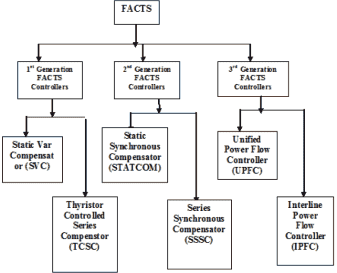

补偿。UPFC 不仅执行 STATCOM、SSSC 和相位调节器的功能，而且通过结合这些控制器的一些功能提供额外的灵活性（Tiwari, 2012；Gyugyi, 1995）。

UPFC 的主要组件是两个共享一个直流储能电容器的电压源逆变器（VSI），并通过耦合变压器连接到电力系统。一个 VSI 通过并联变压器以并联方式连接到输电系统，用于连接点的电压调节，向线路注入所需的无功功率流，并平衡串联逆变器与输电线之间交换的有功功率流，而另一个 VSI 则通过串联变压器以串联方式连接，可以通过在输电线串联插入具有可控幅度和相位的所需电压来控制有功和无功线路功率流（Padiyar, 1998；Padiyar K.R 等，1999）。因此，UPFC 可以实现无功并联补偿、串联补偿和相位移功能。这种安排充当理想的交流到交流功率转换器，其中有功功率可以在两个变换器的交流端子之间自由双向流动，并且每个变换器可以独立在其自身的交流输出端子产生或吸收无功功率。

图 2. 统一潮流控制器的基本电路安排

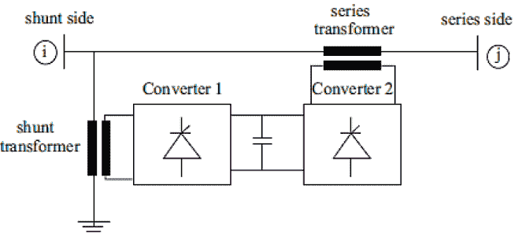

图 3. UPFC 基本方案

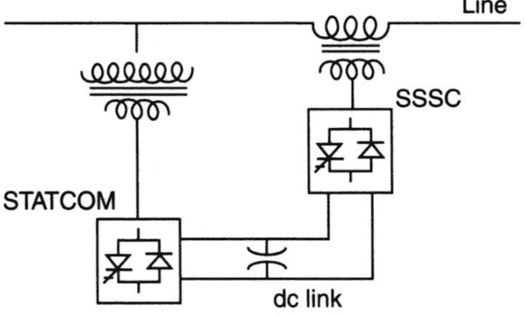

UPFC 的概念使得可以使用固态控制器来处理几乎所有的潮流控制和输电线路补偿问题，这些控制器提供了通常由晶闸管控制的控制器无法获得的功能灵活性（Sanbao Zheng, 2000）。UPFC 电压源在等式 1 和 2 中给出

```
$V_{vR}(\cos \delta_{vR} + j \sin \delta_{vR})$ (1)
```

图 4. 统一潮流控制器的等效电路

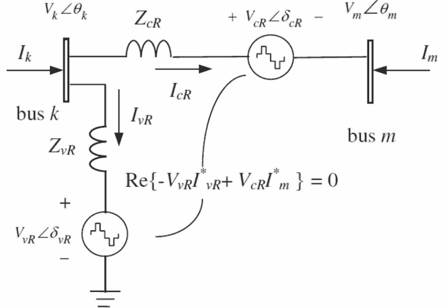

```
V_{cR}(\cos \delta_{cR} + j \sin \delta_{cR})
```

其中，$V_{vR}$ 和 $\delta_{vR}$ 是表示并联变换器的电压源的可控电压幅度和相位角。同样，$V_{cR}$ 和 $\delta_{cR}$ 是表示串联变换器的电压源的可控电压幅度和相位角。源阻抗被认为是无电阻的。

有功功率和无功功率方程如下

### 在母线 k

```
P_k = [V_k V_m B_{km} \sin(\theta_k - \theta_m)] + [V_k V_{cR} B_{km} \sin(\theta_k - \delta_{cR})] + [V_k V_{vR} B_{vR} \sin(\theta_k - \delta_{vR})]
```

```
Q_k = -V_k^2 B_{kk} - [V_k V_m B_{km} \cos(\theta_k - \theta_m)] - [V_k V_{cR} B_{km} \cos(\theta_k - \delta_{cR})] - [V_k V_{vR} B_{vR} \cos(\theta_k - \delta_{vR})]
```

### 在母线 m

$P_m = [V_m V_k B_{mk} \sin(\theta_m - \theta_k)] + [V_m V_{cR} B_{mm} \sin(\theta_m - \delta_{cR})]$ (5)

$Q_m = -V_m^2 B_{mm} - [V_m V_k B_{mk} \cos(\theta_m - \theta_k)] - [V_m V_{cR} B_{mm} \cos(\theta_m - \delta_{cR})]$ (6)

### 在串联变换器处：

$P_{cR} = [V_{cR} V_k B_{km} \sin(\delta_{cR} - \theta_k)] + [V_m V_{cR} B_{mm} \sin(\delta_{cR} - \theta_m)]$ (7)

$Q_{cR} = -V_{cR}^2 B_{mm} - [V_k V_{cR} B_{km} \cos(\theta_k - \delta_{cR})] - [V_m V_{cR} B_{mm} \cos(\theta_m - \delta_{cR})]$ (8)

### 在并联变换器处：

$P_{vR} = [V_{vR} V_k B_{cR} \sin(\delta_{vR} - \theta_k)]$ (9)

$Q_{vR} = V_{vR}^2 B_{vR} - [V_{vR} V_k B_{vR} \cos(\delta_{vR} - \theta_k)]$ (10)

UPFC 电压源的初始值取为 $V_{cR} = 0.06$ p.u，$\delta_{cR} = 90^\circ$，$V_{vR} = 1$ p.u. 和 $\delta_{vR} = 0^\circ$。源阻抗取为 $Z_{cR} = Z_{vR} = 0.1$ p.u。

## 问题表述

### 目标函数

对于给定的系统负载，基于最小化由总有功功率发电燃料成本和总有功功率损耗组成的多目标函数，求取 UPFC 装置和发电站有功功率发电的最佳配置。OPF 问题表述中使用的目标函数包括有功功率发电成本最小化和有功功率损耗最小化。数学上，目标函数可写为：

Min F = Min(W_1 * FC + W_2 * F_PLoss) (11)

其中，$w_1$ 和 $w_2$ 是加权因子，

W_1 + W_2 = 1 (12)

W1=W2= 0.5

- 总有功功率发电的燃料成本：

考虑总有功功率发电成本最小化的目标函数可由以下二次方程表示

FC = min(\sum_{i=1}^{ng} a_i P_{Gi}^2 + b_i P_{Gi} + c_i) (13)

其中，ng 为发电母线数量。a、b、c 为发电机组的燃料成本系数

- 总有功功率损耗：

该目标包括最小化输电线路中的有功功率损耗。可表示为

F_PLoss = min(P_Loss) = min(\sum_{k=1}^{ntl} Real(S_{ij}^k + S_{ji}^k)) (14)

其中，ntl 为输电线路数量

$S_{ij}$ 是线路 k 中从母线 i 到母线 j 的总复功率流。

- 等式约束：

\sum_{i=1}^N P_{Gi} = \sum_{i=1}^N P_{Di} + P_L (15)

- 不等式约束：

$V_{Gi}^{min} \le V_{Gi} \le V_{Gi}^{max}$ (16)

$P_{Gi}^{min} \le P_{Gi} \le P_{Gi}^{max}$ (17)

$Q_{Gi}^{min} \le Q_{Gi} \le Q_{Gi}^{max}$ (18)

- UPFC 设备限制：

$V_{vR}^{min} \le V_{vR} \le V_{vR}^{max}$ (19)

$V_{vR}$ 是并联变换器电压幅度（p.u）

$V_{cR}^{min} \le V_{cR} \le V_{cR}^{max}$ (20)

$V_{cR}$ 是串联变换器电压幅度（p.u）

其中，$P_L$ 是系统中的有功功率损耗，$P_{Gi}$ 是母线 i 处的有功功率发电，$P_{Di}$ 是母线 i 处的功率需求，$N$ 和 $Ng$ 分别是系统中的母线数量和发电母线数量。

## 元启发式优化算法

### 蝙蝠算法

本文使用一种基于自然启发的元启发式方法，该方法基于蝙蝠的回声定位行为，即由 Xin-She Yang 于 2010 年开发的 BAT 算法。蝙蝠是迷人的动物。它们是唯一有翅膀的哺乳动物，并且具有先进的回声定位能力。大多数蝙蝠在某种程度上使用回声定位；微蝙蝠的回声定位能力令人着迷，因为这些蝙蝠即使在完全黑暗中也能找到猎物并区分不同种类的昆虫。在所有物种中，微蝙蝠是著名的例子，因为微蝙蝠广泛使用回声定位，而大蝙蝠则不然。微蝙蝠使用一种称为回声定位的声纳来避免障碍物、探测猎物并在黑暗中定位它们的栖息裂缝。

我们将首先通过理想化蝙蝠的回声定位行为来制定 BAT 算法。这些蝙蝠发出非常大的声音脉冲，并倾听从周围物体反弹回来的回声。蝙蝠算法是通过理想化微蝙蝠的一些特性而开发的。近似或理想化规则如下（Yang, 2008）：

- 1. 所有蝙蝠都使用回声定位来感知距离，并且以某种神奇的方式知道食物/猎物与屏障之间的区别。

- 2. 蝙蝠以位置 xi 和速度 vi 以固定频率 fmin、变化的波长 λ 和响度 A0 随机飞行以搜索猎物。它们可以根据目标的距离自动调整发射脉冲的波长（或频率）和脉冲发射率 r ∈ [0,1]。

- 3. 响度从较大的正值 A0 变化到最小常数值 Amin。

### 种群

BAT 算法的初始种群（即虚拟蝙蝠的数量）是随机生成的。蝙蝠数量可以在 10 到 40 之间。在为给定目标函数计算种群的初始适应度后，数值根据移动、响度和脉冲率进行更新。

### 虚拟蝙蝠的移动

更新虚拟蝙蝠位置 xi 和速度 vi 的规则如下（22）

```
f_i^t = f_{min} + (f_{max} - f_{min})\beta
(21)
```

```
v_i^t = v_i^{t-1} + (x_i^t - x_*) f_i^t
(22)
```

```
x_i^t = x_i^{t-1} + v_i^t
(23)
```

其中，β ∈ [0, 1] 是从均匀分布中绘制的随机向量。这里 x* 是当前全局最佳位置（解），在比较所有 n 只蝙蝠的所有解之后确定。每只蝙蝠的新解是通过随机游走在局部生成的，由等式 (24) 给出


x_{new} = x_{old} + \varepsilon A^t (24)

其中 \(A_t = \langle A_i^t \rangle\) 是此时步骤中所有蝙蝠的平均响度。基于这些近似和理想化，蝙蝠算法的基本步骤可以总结为所示伪代码。（Venkateswara Rao B 等，2014；Yang, X.-S，2010）

## 蝙蝠算法

```
Objective function f(x), x = (x1,x2, ..., xd)T
Initialize the bat population xi (i = 1, 2, ..., n) and vi
Define pulse frequency fi at xi
Initialize pulse rates ri and the loudness Ai
while (t < Max number of iterations)
Generate a new solution by changing frequency,
And modifying velocities and solutions
if (rand > ri)
Select a best solution in the available solutions
Create a local solution around the selected best solution
end if
Create a new solution by flying randomly
if (rand < Ai & f(xi) < f(x*))
Accept the new solutions
Increase ri and reduce Ai
end if
Rank the bats and find the current best x*
End while
Post process results and visualization
Pseudo code of the BAT algorithm.
Loudness and Pulse Emission
```

随着迭代的进行，响度 Ai 和脉冲发射率 ri 相应更新。当蝙蝠接近猎物时，响度降低，脉冲发射率增加，即收敛方程可取为 (25)

```
A_i^{t+1} = \alpha A_i^t (25)
```

$r_i^{t+1} = r_i^0[1 - \exp(-\gamma t)]$ (26)

其中 $\alpha$ 和 $\gamma$ 为常数。初始响度 A0 通常取 (1, 2)，而初始发射率 $r_i^0$ 可取 (0, 1)。

## 萤火虫算法

萤火虫算法由 Dr Xin-She Yang 于 2007 年在剑桥大学开发。FA 基于萤火虫的自然行为，旨在求解多模优化问题 [Yang, 2009; X. S. Yang, 2010]。萤火虫（又称闪光虫）是大自然中最特殊、最迷人的生物之一。为简化起见，FA 开发中引入了以下三条理想规则：1) 所有萤火虫都没有性别之分，即每只萤火虫都会吸引其他萤火虫，无论其性别；2) 吸引力取决于亮度。亮度较低的个体会向亮度较高的个体移动；3) 客观函数的地貌影响萤火虫的亮度 [Dey, N., Samanta, S., Chakraborty, S., Das, A., Chaudhuri, S. S., & Suri, J. S. (2014)]。让我们考虑连续约束优化问题，任务是最小化多目标函数 f(x)。萤火虫算法是一种动态收敛算法。该算法的解取决于种群大小、最大吸引力值、吸收系数值和迭代上限的选择。FA 的基本步骤可通过以下伪代码总结 [Lukasik S and Zak, 2009]。

## 萤火虫算法

```
Objective function f(x), x = (x1,...,xd)T
Generate initial population of fireflies xi (i = 1, 2, ..., n)
Light intensity Ii at xi is determined by f(xi)
Define light absorption coefficient $\gamma$
while (t < MaxGeneration)
for i = 1 : n all n fireflies
for j = 1 : n all n fireflies
if (Ij > Ii), Move firefly i towards j in d-dimension; end if
Attractiveness varies with distance r
Evaluate new solutions and modify the light intensity
end for j
end for i
Rank all the fireflies and find the current best firefly
end while
Post process results and visualization
Pseudo code of the FA.
```

## 杜鹃搜索算法

Yang 和 Deb 开发了一种基于种群的优化算法，该算法基于自然界中某些杜鹃物种的巢寄生行为，并命名为杜鹃搜索算法。该方法模拟了雌性杜鹃鸟将其卵产入邻巢的行为。该方法还考虑了宿主鸟发现并抛弃杜鹃卵的概率。最近的一项研究表明，与其他元启发式方法相比，杜鹃搜索算法能够取得更好的结果（Dey, N., Samanta, S., Yang, X. S., Das, A., & Chaudhuri, S. S., 2013）。

杜鹃搜索算法的伪代码在（Dung A. Le & Dieu N. Vo, 2016）中给出，基于以下三个主要阶段：

- **初始化：** 生成了 Np 个宿主巢穴的种群。此阶段对应于杜鹃鸟将其卵产在其他物种巢穴中的现象。
- **第一个新解生成：** 此阶段通过 Lévy 飞行生成第一个新解，对应于宿主鸟未在其巢中发现异卵，杜鹃卵将孵化并传递至下一代的情况。
- **第二个新解生成：** 此阶段旨在生成第二个新解，对应于宿主鸟在其巢中发现杜鹃卵为异卵，宿主鸟会将杜鹃卵从巢中扔出，或同时抛弃杜鹃卵及其巢穴的情况。

使用 Lévy 飞行算法生成一组随机解：

```
x_i^{t+1} = x_i^t + \alpha \oplus Levy(y) (27)
```

上述方程是随机游走的随机方程，其下一步取决于当前位置（第一项）和转移概率（第二项）。α 是步长，乘积表示逐元素乘法。Lévy 飞行提供了一种随机游走，其随机步长从 Lévy 分布中抽取：

```
Levy \sim t^{-\lambda}, (1 < \lambda < 3) (28)
```

步长构成了具有重尾功率律步长分布的随机游走过程。对新解集的目标函数也进行评估。如果新目标函数优于旧目标函数，则新解集的一部分 Pa 会替换初始解中的等效随机解集。该过程重复直到达到最大迭代次数。初始巢穴集（n 个巢穴）的数量可在 15 到 40 之间变化，Pa 为 0.25 对大多数优化问题是合适的值 [Samanta, S., Dey, N., Das, P., Acharya, S., & Chaudhuri, S. S. (2013)]。

## 整体流程

CSA 求解优化问题的整体流程详细描述如下。

- 步骤 1：读取潮流计算所需的电力系统节点数据和支路数据。
- 步骤 2：选择所有 PV 节点的有功功率发电量和 UPFC 参数作为控制变量，同时选择巢穴数量 Np、最大迭代次数 Iter_max 和概率 pa。初始化宿主巢穴种群。
- 步骤 3：随机获取一只杜鹃/通过 Lévy 飞行算法生成解并评估其目标函数。
- 步骤 4：执行算法中描述的基于最佳解的界限机制，以修复违反上下限的解。
- 步骤 5：由于异卵被抛弃的作用生成新解，并用新解替换旧解。
- 步骤 6：获取当前迭代的最佳巢穴 Gbest。
- 步骤 7：如果当前迭代的最佳巢穴 Gbest 不优于上一迭代，则获取新的一级比率值。否则，保留旧值。
- 步骤 8：如果 Iter < Itermax，则 Iter = Iter + 1 并返回步骤 3。否则，停止流程。
- 步骤 9：如果满足终止准则，则在搜索空间中找到最佳解。

## 结果与讨论

本章考虑了 5 节点测试系统和修正的 IEEE 30 节点系统，以展示无 UPFC 和有 UPFC 情况下蝙蝠算法、杜鹃搜索算法和萤火虫算法的有效性和鲁棒性。

## 5 节点系统

在 5 节点测试系统中，节点 1 被视为滑动节点，节点 2 为 PV 节点，节点 3、4、5 为 PQ 节点。为在网络中引入统一潮流控制器，在节点 3 和节点 4 之间新增节点 6。该装置维持流向节点 4 的 UPFC 有功和无功功率。UPFC 并联变流器设定为将节点 3 的节点电压幅值调节为 1 p.u. 针对该测试系统实现了 MATLAB 程序。对测试系统进行了二十次运行。这二十次运行的最优解结果已列表。蝙蝠算法、杜鹃搜索算法和萤火虫算法的输入参数分别载于表 1、表 2 和表 3，差分进化算法的输入参数载于表 4。

### 表 1. 蝙蝠算法输入参数

| 序号 | 参数 | 数量 |
|---|---|---|
| 1 | 种群大小 | 20 |
| 2 | 代数 | 50 |
| 3 | 响度 | 0.5 |
| 4 | 脉冲率 | 0.5 |

### 表 2. CSA 输入参数

| 序号 | 变量 | 值 |
|---|---|---|
| 1 | 巢穴数量 | 20 |
| 2 | 迭代次数 | 50 |
| 3 | 异卵/解的发现率 | 0.5 |

### 表 3. 萤火虫算法输入参数

| 序号 | 参数 | 数量 |
|---|---|---|
| 1 | 萤火虫数量 | 20 |
| 2 | 最大代数 | 50 |
| 3 | Alpha | 0.5 |
| 4 | Beta | 0.5 |
| 5 | Gamma | 1 |


## 表 4. 差分进化的输入参数

| S.No | Parameters | Quantity |
| :--- | :--- | :--- |
| 1 | 种群规模 | 20 |
| 2 | 代数 | 50 |
| 3 | DE步长 | 0.8 |
| 4 | 交叉概率常数 | 0.8 |

最初，使用提出的BAT算法、布谷鸟搜索算法和萤火虫算法方法（不带UPFC）计算5节点系统的最优潮流解，即有功发电成本和功率损耗。接下来，对同一系统，使用提出的BAT算法、布谷鸟搜索算法和萤火虫算法方法（带UPFC）获得最优潮流解。BAT算法、布谷鸟搜索算法和萤火虫算法获得的结果与差分进化进行比较。不带UPFC的5节点测试系统的有功发电成本和功率损耗如表5所示，表6表示带UPFC的相同上述内容。从表5和6可以看出，由于UPFC，总需有功发电量从151.3557 MW减少到150.0192 MW，功率损耗从6.3557 MW减少到5.0192 MW。此外，可以看出由于UPFC，成本有显著降低。从表7可以清楚地看出，由于UPFC，大多数节点的电压概貌已改善，且UPFC并联换流器设置为将节点3的节点电压幅值调节为1 p.u。

从图5可以看出，在潮流计算中纳入UPFC后，电压概貌有所改善。通过将UPFC放置在节点3和节点4之间，节点3的电压从0.9519增加到1 p.u。从表8可以看出，当UPFC放置在节点3和节点4之间时，有功功率损耗为5.0192 MW，与其他位置相比较小。

## 表 5. 不带UPFC情况下的OPF比较

| Variables | DE-OPF | BAT-OPF | CSA-OPF | FA-OPF |
| :--- | :--- | :--- | :--- | :--- |
| PG1(MW) | 139.0764 | 109.1800 | 91.0192 | 57.5634 |
| PG2(MW) | 12.8518 | 42.1757 | 60.00 | 93.4171 |
| 总有功发电量(MW) | 151.9282 | 151.3557 | 151.0192 | 150.9805 |
| 总有功发电成本 ($/hr) | 1893.3 | 1726.4 | 1769.3 | 1689.8 |
| 总有功功率损耗 (MW) | 6.9282 | 6.3557 | 6.0192 | 5.9805 |

## 表 6. 带UPFC情况下的OPF比较

| Variables | DE-OPF | BAT-OPF | CSA-OPF | FA-OPF |
| :--- | :--- | :--- | :--- | :--- |
| PG1(MW) | 133.8120 | 90.0192 | 60.456 | 62.5170 |
| PG2(MW) | 16.8338 | 60.0000 | 89.6312 | 88.3601 |
| UPFC(p.u.) VcR VvR | 0.0400 1.0759 | 0.0370 1.0436 | 0.038 1.042 | 0.029 1.012 |
| UPFC θcr (角度，度) θvr | -87.1236 -15.2311 | -86.1393 -12.3421 | -86.9576 -13.1258 | -85.456 -10.632 |
| 总有功发电量(MW) | 150.6458 | 150.0192 | 150.0872 | 149.8771 |
| 总有功发电成本 ($/hr) | 1814.804 | 1684.3 | 1688.71 | 1672.56 |
| 总有功功率损耗 (MW) | 5.6458 | 5.0192 | 5.0872 | 4.8771 |

## 表 7. 使用Bat OPF对5节点系统不带和带UPFC的节点电压及其角度比较

| Bus No. | 带UPFC的DE-OPF电压幅值 (伏特) | 带UPFC的DE-OPF电压角度 (弧度) | 带UPFC的BAT-OPF电压幅值 (伏特) | 带UPFC的BAT-OPF电压角度 (弧度) | 带UPFC的CSA-OPF电压幅值 (伏特) | 带UPFC的CSA-OPF电压角度 (弧度) | 带UPFC的FA-OPF电压幅值 (伏特) | 带UPFC的FA-OPF电压角度 (弧度) |
| :--- | :--- | :--- | :--- | :--- | :--- | :--- | :--- | :--- |
| 1 | 1.06 | 0 | 1.06 | 0 | 1.0600 | 0 | 1.0600 | 0 |
| 2 | 1 | -0.83 | 1 | -0.74 | 1.0000 | -2.0356 | 1.0000 | -1.0356 |
| 3 | 1 | -3.32 | 1 | -4.21 | 1.0000 | -4.6213 | 1 | -3.6213 |
| 4 | 0.9536 | -3.67 | 0.9753 | -3.59 | 0.9720 | -3.3370 | 0.9863 | -4.3370 |
| 5 | 0.9622 | -4.52 | 0.9806 | -4.37 | 0.9786 | -5.6541 | 0.9929 | -4.2555 |
| UPFC节点 | 0.9785 | -4.567 | 0.9806 | -3.17 | 0.9689 | -4.5254 | 0.995 | -3.0524 |

与其他位置放置的UPFC相比。图6表明，当UPFC放置在节点3和节点4之间时，有功功率损耗较小。图7显示了在基于BAT算法的最优潮流中，在不同位置纳入UPFC后的有功发电成本比较。

## 对于30节点系统

在修改的IEEE 30节点系统中，节点1被视为平衡节点，节点2、5、8、11、13被视为PV节点，所有其他节点被视为PQ节点。

## 图 5. 带和不带UPFC的电压概貌比较

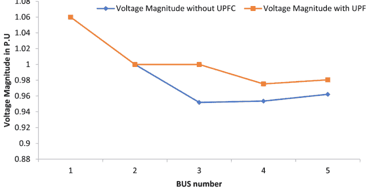

## 表 8. 在5个不同位置将UPFC纳入基于bat算法的OPF

| UPFC放置的节点号 | 总有功发电量 (MW) | 总负载 (MW) | 总有功功率损耗 (MW) |
|---|---|---|---|
| 2-3 | 150.663 | 145 | 5.663 |
| 2-4 | 150.9119 | 145 | 5.9119 |
| 2-5 | 151.3845 | 145 | 6.3845 |
| 3-4 | 150.0192 | 145 | 5.0192 |
| 4-5 | 150.8784 | 145 | 5.8784 |

## 表 9. 在5个不同位置将UPFC纳入基于布谷鸟搜索算法的OPF

| UPFC放置的节点号 | 总有功发电量 (MW) | 总负载 (MW) | 总有功功率损耗 (MW) |
|---|---|---|---|
| 2-3 | 150.7829 | 145 | 5.7829 |
| 2-4 | 150.9829 | 145 | 5.9829 |
| 2-5 | 151.8653 | 145 | 6.8653 |
| 3-4 | 150.0872 | 145 | 5.0872 |
| 4-5 | 150.9489 | 145 | 5.9489 |

## 表 10. 在5个不同位置将UPFC纳入基于萤火虫算法的OPF

| UPFC放置的节点号 | 总有功发电量 (MW) | 总负载 (MW) | 总有功功率损耗 (MW) |
|---|---|---|---|
| 2-3 | 150.4531 | 145 | 5.4531 |
| 2-4 | 150.0123 | 145 | 5.0123 |
| 2-5 | 150.8562 | 145 | 5.8562 |
| 3-4 | 149.8771 | 145 | 4.8771 |
| 4-5 | 150.4854 | 145 | 5.4854 |

## 图 6. 基于BAT算法的最优潮流中UPFC在不同位置的纳入

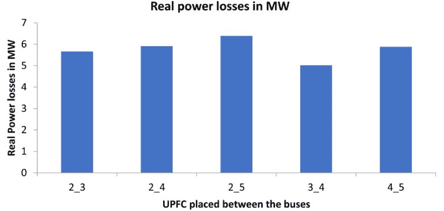

该系统有24个负载节点和41条互连线路。通过在MATLAB中使用BAT算法模拟最优潮流，观察到节点26的电压幅值为0.8159 p.u，低于其他节点。因此，为了改善该节点的电压概貌，需要将UPFC放置在节点25和节点26之间。为了在网络中纳入统一潮流控制器，在节点25和节点26之间额外放置了节点31。它维持离开UPFC向节点25的有功和无功功率。UPFC并联换流器设置为将节点26的节点电压幅值调节为1 p.u。同样，通过在MATLAB中使用布谷鸟搜索算法和萤火虫算法模拟最优潮流，观察到节点26的电压幅值低于其他节点。因此，为了改善该节点的电压概貌，需要将UPFC的并联换流器放置在该节点。为测试系统实现了一个MATLAB程序。对测试系统进行了二十次运行。这些运行的最优解结果已列于表中。

## 图 7. 在BAT-OPF中不同位置纳入UPFC后的有功发电成本比较。

有功发电成本 ($/h)

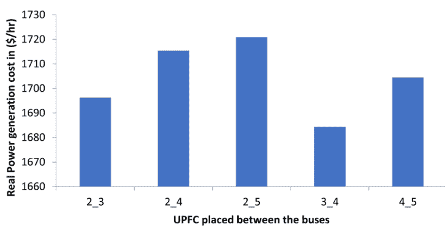

## 表 11. 不带UPFC情况下的OPF比较

| Variables | DE-OPF | BAT-OPF | CSA-OPF | FA-OPF |
|---|---|---|---|---|
| PG1(MW) | 169 | 170.1571 | 170.6130 | 173.8325 |
| PG2(MW) | 48.2537 | 50 | 50.3422 | 49.8952 |
| PG5(MW) | 19 | 25.2113 | 21.960 | 22.6231 |
| PG8(MW) | 30.5948 | 19.1717 | 24.1619 | 22.0648 |
| PG11(MW) | 15.4692 | 16 | 13.8316 | 11.5357 |
| PG13(MW) | 12 | 12.0396 | 13.1734 | 12.0871 |
| 总有功发电量(MW) | 294.3177 | 292.5795 | 294.0821 | 292.0384 |
| 总有功发电成本 ($/hr) | 810.5345 | 804.0134 | 808.4652 | 800.0942 |
| 总有功功率损耗 (MW) | 10.9177 | 9.1795 | 10.6821 | 8.64 |

## 表 12. 带UPFC情况下的OPF比较

| Variables | DE-OPF | BAT-OPF | CSA-OPF | FA-OPF |
| :--- | :--- | :--- | :--- | :--- |
| PG1(MW) | 166.722 | 175.4891 | 174.6537 | 205.7251 |
| PG2(MW) | 50.2537 | 46.9756 | 49.9251 | 31.8026 |
| PG5(MW) | 16 | 21.2113 | 22.0305 | 17.0127 |
| PG8(MW) | 28.7395 | 20.1717 | 21.6118 | 11.8741 |
| PG11(MW) | 17.4692 | 13.5542 | 11.8879 | 10.2405 |
| PG13(MW) | 12 | 12.0396 | 12.0 | 12.7050 |
| UPFC(p.u.) VCr V<sub>R</sub> | 0.0540<br>1.0545 | 0.0410<br>1.0368 | 0.11<br>1.0176 | 0.0945<br>1.0176 |
| UPFC θ<sub>cr</sub> (角度，度) θ<sub>VR</sub> | -92.4571<br>-14.3387 | -104.178<br>-10.3848 | -98.5673<br>-12.856 | -87.515<br>-11.649 |
| 总有功发电量(MW) | 291.1849 | 289.4415 | 292.109 | 289.36 |
| 总有功发电成本 ($/hr) | 801.7493 | 794.5704 | 799.9800 | 793.162 |
| 总有功功率损耗 (MW) | 7.7849 | 6.0415 | 8.7090 | 5.96 |

修改的IEEE 30节点系统的总有功发电量、总有功发电成本和有功功率损耗，使用BAT算法、布谷鸟搜索算法、萤火虫算法和差分进化（不带和带UPFC）获得，如表11和表12所示。从表11和12可以看出，使用BAT算法时，由于UPFC，总需有功发电量从292.5795 MW减少到289.4415 MW，功率损耗从9.1795 MW减少到6.0415 MW。在布谷鸟搜索算法中纳入UPFC后，损耗从10.68 MW减少到8.709 MW；在萤火虫算法中，损耗从8.64 MW减少到5.96 MW，这表明最新的萤火虫算法相比其他所有优化算法效果更好。

此外，可以看出由于UPFC，成本有显著降低。从图8可以看出，通过在基于BAT算法的最优潮流中放置UPFC，有功功率损耗从10.9177 MW减少到6.0415 MW。图9表明，BAT-OPF的有功发电成本低于DE-OPF。从表12可以看出，在修改的IEEE 30节点测试系统的带UPFC的OPF问题中，萤火虫算法相比其他优化算法效果更好。

表13表示网络不带和带UPFC的节点电压。从表13可以清楚地看出，由于UPFC，大多数节点的电压概貌有所改善，且UPFC并联换流器设置为调节


### 图 8. 不同条件下的有功功率损耗比较

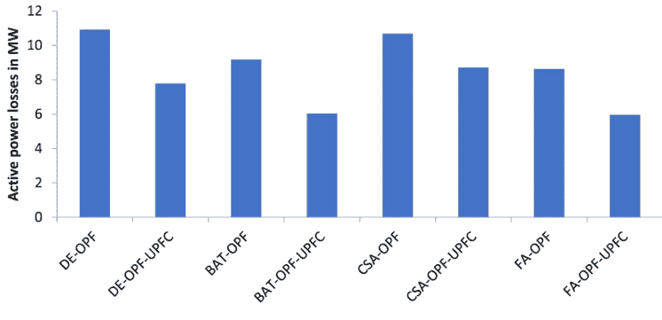

### 图 9. 不同条件下的实际发电成本比较

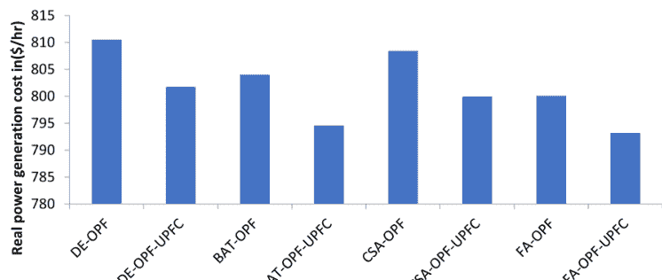

bus 26 节点电压幅值为 1 p.u。从图 10 可以看出，在基于 BAT 算法的最优潮流计算中引入 UPFC 后，电压剖面得到了改善。通过将 UPFC 放置在 25 号母线和 26 号母线之间，26 号母线的电压从 0.8159 p.u 提高到 1 p.u。表 14 表示在 26 号母线加载时的总有功功率损耗。从表中可以看出，随着负载增加，损耗也增加。从图 11 可以看出，通过在基于 BAT 算法的最优潮流中放置 UPFC，损耗更小。同样，从图 12 可以看出，通过在基于 BAT 算法的最优潮流中放置 UPFC，实际发电成本更低，并且在特定母线增加负载时，实际发电成本也会增加。

### 表 13. 使用 BAT OPF 无和有 UPFC 时 30 母线系统母线电压比较

| 母线编号 | 牛顿-拉夫逊方法 | 带 UPFC 的 DE-OPF (UPFC 放置在 25 号母线和 26 号母线之间) | 带 UPFC 的 BAT-OPF (UPFC 放置在 25 号母线和 26 号母线之间) | 带 UPFC 的 CSA-OPF (UPFC 放置在 25 号母线和 26 号母线之间) | 带 UPFC 的 FA-OPF (UPFC 放置在 25 号母线和 26 号母线之间) |
|---|---|---|---|---|---|
| | 电压幅值 (伏特) | 电压幅值 (伏特) | 电压幅值 (伏特) | 电压幅值 (伏特) | 电压幅值 (伏特) |
| 1 | 1.0600 | 1.06 | 1.06 | 1.06 | 1.06 |
| 2 | 1.0430 | 1.0430 | 1.0430 | 1.0430 | 1.0430 |
| 3 | 0.9568 | 0.9641 | 0.9660 | 0.95660 | 0.9710 |
| 4 | 0.9756 | 0.9836 | 0.9869 | 0.9989 | 0.9962 |
| 5 | 1.01 | 1.0100 | 1.0100 | 1.0100 | 1.01 |
| 6 | 1.008 | 1.0118 | 1.0142 | 1.012 | 1.01 |
| 7 | 0.9967 | 0.9985 | 0.9997 | 0.997 | 0.999 |
| 8 | 1.01 | 1.0100 | 1.0100 | 1.0100 | 1.0100 |
| 9 | 0.9536 | 0.9637 | 0.9697 | 0.9978 | 0.9789 |
| 10 | 0.893 | 0.9045 | 0.9199 | 0.9099 | 0.9389 |
| 11 | 1.082 | 1.0820 | 1.0820 | 1.0820 | 1.0820 |
| 12 | 0.9179 | 0.9288 | 0.9396 | 0.9299 | 0.9468 |
| 13 | 1.071 | 1.0710 | 1.0710 | 1.0710 | 1.0710 |
| 14 | 0.8588 | 0.8707 | 0.8872 | 0.8842 | 0.8986 |
| 15 | 0.8521 | 0.8641 | 0.8851 | 0.8765 | 0.8982 |
| 16 | 0.8803 | 0.8920 | 0.9049 | 0.9095 | 0.9493 |
| 17 | 0.87 | 0.8821 | 0.8966 | 0.8912 | 0.8999 |
| 18 | 0.8207 | 0.8335 | 0.8544 | 0.8444 | 0.8964 |
| 19 | 0.8136 | 0.8267 | 0.8468 | 0.8348 | 0.8685 |
| 20 | 0.8374 | 0.8501 | 0.8682 | 0.8620 | 0.8827 |
| 21 | 0.8599 | 0.8717 | 0.8943 | 0.8848 | 0.8993 |
| 22 | 0.8529 | 0.8644 | 0.8933 | 0.8736 | 0.8993 |
| 23 | 0.8298 | 0.8415 | 0.8764 | 0.8664 | 0.8974 |
| 24 | 0.8349 | 0.8455 | 0.8927 | 0.8887 | 0.8978 |
| 25 | 0.8532 | 0.8610 | 0.9360 | 0.9160 | 0.9603 |
| 26 | 0.8075 | 1.0000 | 1.0000 | 1.0000 | 1.0000 |
| 27 | 0.9449 | 0.9480 | 0.9720 | 0.9567 | 0.9956 |
| 28 | 0.9824 | 0.9847 | 0.9934 | 0.9899 | 0.9974 |
| 29 | 0.9617 | 0.9633 | 0.9755 | 0.9711 | 0.9877 |
| 30 | 0.95 | 0.963 | 0.972 | 0.9700 | 0.9889 |
| 31 | ---- | 0.9562 | 0.9678 | 0.9469 | 0.9789 |

### 图 10. 有和无 UPFC 时的电压剖面比较

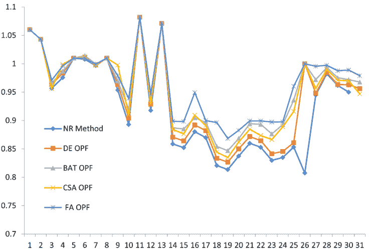

### 表 14. 26 号母线加载时的总有功功率损耗比较

| 序号 | 26 号母线加载 (负载 MW) | 有功功率损耗 MW (带 UPFC 的 DE OPF，UPFC 放置在 25 号母线和 26 号母线之间) | 有功功率损耗 MW (带 UPFC 的 BAT OPF，UPFC 放置在 25 号母线和 26 号母线之间) | 有功功率损耗 MW (带 UPFC 的 CSA OPF，UPFC 放置在 25 号母线和 26 号母线之间) | 有功功率损耗 MW (带 UPFC 的 FA OPF，UPFC 放置在 25 号母线和 26 号母线之间) |
|---|---|---|---|---|---|
| 1 | 10 | 22.123 | 20.9837 | 21.0972 | 20.3217 |
| 2 | 20 | 24.692 | 22.2221 | 23.234 | 21.6546 |
| 3 | 30 | 28.654 | 27.4585 | 28.4298 | 26.9856 |
| 4 | 40 | 32.996 | 31.6879 | 32.8691 | 30.8978 |
| 5 | 50 | 39.578 | 37.6059 | 38.9562 | 36.9746 |

## 未来研究方向

未来工作可以将这些优化技术作为混合优化技术实施，以获得更好的结果。本章仅通过使用单一 FACTS 设备（即 UPFC）提高了电力系统性能。未来工作可以采用多种类型的 FACTS 设备来实现更好的性能。此处针对静态环境进行了优化规划。未来工作中，针对动态环境进行规划可能是一个具有挑战性的课题。

## 结论

本章实现了元启发式优化算法，以在统一潮流控制器存在下解决多目标最优潮流问题。结果表明，所提方法配合统一潮流控制器具有有效性和鲁棒性。对 5 母线测试系统和修正的 IEEE 30 母线系统采用所提方法无和有 UPFC 时的结果进行了比较，观察结果表明，使用 UPFC 时损耗更小。在 5 母线测试系统中，UPFC 放置在 3 号母线和 4 号母线之间；在修正的 IEEE 30 母线系统中，UPFC 放置在 25 号母线和 26 号母线之间，得到了仿真结果，并观察到由于发电重新分配，有功功率损耗已降低。仿真结果表明，测试系统中的 UPFC 设备可以进一步最小化总实际发电成本和实际功率损失。与基于差分进化算法的最优潮流相比，带 UPFC 的基于 BAT 算法、CSA 和萤火虫算法的最优潮流具有更低的总发电成本和实际功率损失。在比较 BAT 算法、布谷鸟搜索算法和萤火虫算法时，布谷鸟搜索算法实现简单，BAT 算法给出准确高效的结果，萤火虫算法具有鲁棒性、高收敛率，并且在更少的迭代次数内给出最佳最优解。

## 参考文献

Acha, E., Fuerte-Esquivel, C., Ambriz-Perez, H., & Angeles, C. (2004). FACTS：电力网络建模与仿真。John Wiley & Sons；doi:10.1002/0470020164

Ambriz-Perez, Acha, Fuerte-Esquivel, & De la Torre. (1998). 在使用牛顿法的最优潮流中纳入 UPFC 模型。IEEE Proc.-Generation Transmission Distribution, 145(3).

Aparna, R. R. (2016). 用于自动视频图像对比度调整的群体智能。粗集与数据分析国际期刊, 3(3), 21–37. doi:10.4018/IJRSDA.2016070102

Ashour, A. S., Samanta, S., Dey, N., Kausar, N., Abdessalemkaraa, W. B., & Hassanien, A. E. (2015). 基于布谷鸟搜索的计算机断层扫描图像增强：一种基于对数变换的方法。信号与信息处理期刊, 6(03), 244–257. doi:10.4236/jsip.2015.63023

Binh, H. T. T., Hanh, N. T., & Dey, N. (2016). 用于最大化无线传感器网络覆盖区域的改进布谷鸟搜索和混沌花授粉优化算法。*神经计算与应用*, 1–13.

Carpentier. (1979). 最优潮流。*电力与能源系统*, *1*, 959-972.

Chung, T. S., & Li, Y. Z. (2001). 考虑 FACTS 设备的 OPF 混合 CA 方法。*IEEE 电力工程评论*, *21*(2), 47–50. doi:10.1109/39.896822

Dey, N., Ashour, A. S., Beagum, S., Pistola, D. S., Gospodinov, M., Gospodinova, E. P., & Tavares, J. M. R. (2015). 基于遗传算法的局部多项式逼近交集置信区间滤波器参数优化：脑 MRI 图像去噪应用。*成像期刊*, *1*(1), 60–84. doi:10.3390/jimaging1010060

Dey, N., Chakraborty, S., & Samanta, S. (2014). 生物医学信号水印优化。Lambert 出版社。Heinrich-Böcking-Straße, 6, 66121.

Dey, N., Samanta, S., Chakraborty, S., Das, A., Chaudhuri, S. S., & Suri, J. S. (2014). 流形医疗信息嵌入过程中缩放因子优化的萤火虫算法：眼科成像应用。*医学影像与健康信息学期刊*, *4*(3), 384–394. doi:10.1166/jmihi.2014.1265

Dey, N., Samanta, S., Yang, X. S., Das, A., & Chaudhuri, S. S. (2013). 使用布谷鸟搜索优化心电图信号水印中的缩放因子。*生物启发计算国际期刊*, *5*(5), 315–326. doi:10.1504/IJBIC.2013.057193

Dutta, S. (2016). 静态同步器最优分配。Academic Press.

Dutta, S., Roy, P. K., & Nandi, D. (2016). 使用化学反应优化的无功功率调度串联补偿器控制器。*能源优化与工程国际期刊*, *5*(3), 43–62. doi:10.4018/IJEOE.2016070103

Edris, A. (2000, 3 月). FACTS 技术发展：更新。*IEEE 电力工程评论*.

Goel, S., Sharma, A., & Panchal, V. K. (2014). 战场上敌方行动预测的多目标布谷鸟搜索。*应用元启发式计算国际期刊*, *5*(4), 26–46. doi:10.4018/ijamc.2014100102


Gyugyi, L. (1992, July). 柔性交流输电系统统一电力控制概念. IEEE 学报-C, 139(4), 323–332.

Gyugyi, Schauder, Williams, Rietman, Torgerson, & Edris. (1995). 统一电力流控制器：电力输电控制的新方法. IEEE 电力传输学报, 10(2), 1085-1097.

Hingorani, N. G., & Gyugyi, L. (2000). 理解 FACTS：柔性交流输电系统的概念与技术. IEEE 出版社.

Hore, S., Chatterjee, S., Santhi, V., Dey, N., Ashour, A. S., Balas, V. E., & Shi, F. (2017). 基于优化神经网络的印度手语识别. 信息技术与智能交通系统（第 553–563 页）. Springer International Publishing. doi:10.1007/978-3-319-38771-0_54

Hsmmns, T. J., & Lim, S. K. (1997). 柔性交流输电系统（FACTS）. 电力机械与电力系统, 25, 73–85.

Jirapong, P. (2013, April-June). 用于电力传输能力增强和电力系统损耗减少的 FACTS 设备分配. 国际能源优化与工程期刊, 2(2), 1–14. doi:10.4018/ijeoe.2013040101

Kaur, P., & Kaur, T. (2014). 各种元启发式算法的比较研究. 计算机科学与信息技术国际期刊, 5(5), 6701–6704.

Kumar Roy, P. (2013, July-September). 基于生物地理学优化与差分进化杂交求解最优潮流问题. 国际能源优化与工程期刊, 2(3), 86–101. doi:10.4018/ijeoe.2013070106

Kundur, P. (1993). 电力系统稳定性与控制. 纽约：麦格劳-希尔公司.

Lashkar Ara, Kazemi, & Nabavi Niaki. (2012). 电力系统运行规划中 FACTS 分串联控制器的多目标最优位置. IEEE 电力传输学报, 27(2), 481-490.

Le, D. A., & Vo, D. N. (2016, January-March). 杜鹃搜索算法用于功率损耗和电压偏差最小化. 国际能源优化与工程期刊, 5(1), 23–34. doi:10.4018/IJEOE.2016010102

Mukherjee, A., Paul, S., & Roy, P. K. (2015). 基于教学学习优化的受暂态稳定性约束的最优潮流. 国际能源优化与工程期刊, 4(1), 18–35. doi:10.4018/ijeoe.2015010102

Padiyar & Uma Rao. (1999). 用于暂态稳定的统一电力流控制器建模与控制. 电力与能源系统, 21.

Padiyar, K. R., & Kulkarni, A. M. (1998). 统一电力流控制器的控制设计与仿真. IEEE 电力传输学报, 13(4), 1348-1354.

Rahul Khandelwal, J. (2016). 基于人工蜂群的水泥稳定软土新型多目标优化. 应用元启发式计算国际期刊, 7(4), 1–17. doi:10.4018/IJAMC.2016100101

Samanta, S., Dey, N., Das, P., Achargee, S., & Chaudhuri, S. S. (2013). 基于杜鹃搜索的多级阈值灰度图像分割. arXiv 预印本 arXiv:1307.0277

Stagg, G. W., & El-Abid, A. H. (1968). 电力系统分析计算机方法. 麦格劳-希尔图书公司.

Sun, D. I., Ashley, B., Brewer, B., Hughes, A., & Tinney, W. F. (1984). 基于牛顿法的最优潮流. IEEE 电力装置与系统学报, 103(10), 2864–2880. doi:10.1109/TPAS.1984.318284

Tinney, W. F., & Hart, C. E. (1967, November). 基于牛顿法的潮流求解. IEEE 学报, 86, 1449.

Tiwari, P. K., & Sood, Y. R. (2012). 去监管电力部门多个统一电力流控制器的位置与参数设置的高效最优方法. IET 发电、输电与分配, 6(10), 958–967. doi:10.1049/iet-gtd.2011.0722

Venkateswara Rao, B., & Nagesh Kumar, G. V. (2014). 基于蝙蝠搜索算法的晶闸管控制串联电容器最优位置以降低输电线路损耗. WSEAS 电力系统学报, 9, 459–470.

Yang, X.-S. (2008). 自然启发元启发式算法. Luniver 出版社.

Yang, X.-S. (2010). 一种新的蝙蝠启发元启发式算法. 优化自然启发协作策略. Springer Berlin 出版社. doi:10.1007/978-3-642-12538-6_6

Zheng & Tan. (2000). 基于详细仿真模型的 UPFC 动态特性研究. IEEE 电力会议 2000.

## KEY TERMS AND DEFINITIONS

**BAT 算法:** BAT 算法由 X S Yang 于 2010 年开发，其工作原理基于微型蝙蝠的回声定位行为。

**杜鹃搜索算法 (CSA):** 杜鹃搜索算法由 X S Yang 和 Suash Deb 于 2009 年开发，其工作原理基于杜鹃的强制巢寄生行为。

**差分进化 (DE):** 差分进化（DE）是一种通过迭代改进候选解来优化问题的方法，相对于给定的质量度量。

**萤火虫算法 (FA):** 萤火虫算法由 X S Yang 于 2008 年开发，其工作原理基于萤火虫的闪烁行为。

**FACTS:** 交流输电系统，结合基于功率电子和其他静态控制器，以增强可控性并增加电力传输能力。

**FACTS 设备或 FACTS 控制器:** 基于功率电子的系统和其他静态设备，用于提供对一项或多项交流输电系统参数的控制。

**OPF:** 最优潮流（OPF）是电力系统运行、控制和规划的重要工具。它最早由（Dommel and Tinney, 1968）提出。OPF 程序的主要目的是计算电力系统的最优运行点，并设置变量以优化某个目标函数，同时满足潮流方程、等式和不等式约束。

**优化:** 这是对情况或资源进行最佳或最有效利用的行动。

**UPFC:** 静态同步补偿器（STATCOM）与静态串联补偿器（SSSC）的组合，二者通过共直流环节耦合，允许 SSSC 的串联输出端子与 STATCOM 的并联输出端子之间双向传输有功功率，并受控以在不借助外部电能源的情况下提供同步的实功和无功串联线路补偿。

## 第 2 章

## 基于基因表达编程分析和预测 WiMAX 网络中流量的 QoS

J. Sangeetha
印度 PES 大学

Keerthiraj Nagaraj
美国佛罗里达大学

K. N. Balasubramanya Murthy
印度 PES 大学

Ram P. Rustagi
印度 PES 大学

### 摘要

WiMAX 网络为大量用户提供高效的 QoS。实时和非实时多媒体应用在 WiMAX 网络中日益重要。为支持此类应用，有必要为 WiMAX 网络提出一种高效的流量 QoS 预测机制。为解决这一问题，作者在 WiMAX 网络中针对基于 CBR 的流量和文件传输应用应用了基因表达编程技术。本章的主要重点是开发网络吞吐量的数学表达式，以带宽、平均端到端延迟和平均抖动作为基于 CBR 的流量和文件传输应用的输入。该表达式有助于分析和预测给定网络的流量 QoS。仿真结果表明，模型值与目标值具有更好的拟合度。实验表明，GEP 优于其他现有算法。此外，已对两种应用进行了灵敏度分析

DOI: 10.4018/978-1-5225-4151-6.ch002

### 引言

IEEE 802.16 空口标准（Jeffrey et al., 2007）提供了无线通信系统物理层和媒体接入控制（MAC）层的详细信息，旨在利用全球微波互操作性（WiMAX）技术构建多服务网络。WiMAX 网络的不同标准包括 IEEE 802.16a、IEEE 802.16d、IEEE 802.16e 和 IEEE 802.16j。

随着对恒定比特率（CBR）流量、视频流和互联网协议语音（VoIP）等实时多媒体应用，以及文件传输、网页浏览和电子邮件等非实时多媒体应用的需求，不同标准不断演进。为支持这些多媒体应用，标准必须对高速接入、大范围网络覆盖以及为大量用户提供良好服务质量（QoS）的带宽需求保持敏感。

WiMAX 网络的基本拓扑由两个参与实体组成，称为基站（BS）和用户站（SS）。BS 是中心节点，负责协调所有通信并为 SS 提供连接。BS 是提供公共网络接入的基站。该网络可分为两种运行模式：强制点对多点（PMP）模式和可选网状模式。

在 PMP 模式（Akashdeep et al., 2014; Ali et al., 2009）中，所有 SS 距离 BS 仅一跳，并以集中方式直接与 BS 通信，而不通过其他相邻 SS。Akashdeep et al. (2014) 研究了调度器开发的设计问题，并确保了 WiMAX 网络中的 QoS 支持。

在可选网状模式（Akyildiz et al., 2005; Kas et al., 2010）中，所有 SS 距离 BS 有一跳或多跳，因此 SS 以分布式方式直接或间接（即通过其他 SS）与 BS 通信。

在文献（Sharma et al., 2014; Sharma et al., 2017）中，许多研究人员已经研究过无线网状网络。由于无线网状网络的动态行为，路由处理是一个关键问题。Sharma et al. (2017) 在该网络上应用了一种名为白蚁群优化（TCO）的自然启发技术。TCO 算法用于基于链路成本寻找最优路由。

在本章中，研究人员专注于集中式 PMP 模式，与分布式网状模式（Ni et al., 2007）相比，该模式提供了更好的 QoS 性能。

提供 QoS 有两种方式（Sekercioğlu et al., 2009），即以用户为中心的 QoS 和以网络为中心的 QoS。以用户为中心的 QoS 包括用户对服务的满意程度。

以网络为中心的 QoS 包括控制网络中带宽、平均端到端延迟和平均抖动的组合的能力，以便提供基于 CBR 的流量、文件传输


应用程序和VoIP。本章主要关注以网络为中心的QoS。带宽、分组投递比、平均端到端延迟、平均抖动和吞吐量等QoS参数通常用于测量多媒体流对QoS水平的影响。这些QoS参数仅针对以网络为中心的QoS，而非用户为中心的QoS。WiMAX网络（Carvalho et al., 2013）主要依赖带宽、延迟、抖动和吞吐量等参数来实现高效通信。这通过管理MAC层和网络层，为多媒体应用提供一定水平的端到端质量，从而影响QoS，以提供更好的QoS服务。

QoS（Cicconetti et al., 2006; Grewal et al., 2010; Liu et al., 2006）在IEEE 802.16 MAC层中起着重要作用。MAC层使用面向连接的方法。为了在特定链路上进行数据传输，特定BS控制下行链路（从BS到SS）和上行链路（从SS到BS）连接。每个连接由连接标识符（CID）标识，网络中的连接与服务流标识符（SFID）相关联，SFID由一组QoS参数组成，即带宽、平均端到端延迟、平均抖动和吞吐量。BS负责发布SFID并将其映射到唯一的CID，并将数据包发送到适当的SS。

为了支持实时和非实时多媒体应用，WiMAX网络定义了五种调度服务类（Kuran et al., 2007; Li et al., 2007; Sekercioglu et al., 2009）。五种调度服务类分别是未请求授予服务（UGS）、实时轮询服务（rtPS）、非实时轮询服务（nrtPS）、最佳努力（BE）和扩展实时轮询服务（ertPS）。这些调度服务类定义了所支持数据服务的性质，其详细描述如下：

- UGS调度服务类支持实时服务流，该服务流定期生成固定大小的数据包，因此用于携带基于恒定比特率（CBR）的流量，例如不带静音抑制的VoIP。
- rtPS调度服务类支持实时服务流，该服务流定期生成可变大小的数据包，因此用于携带实时可变比特率（VBR）流量，例如流式音频和视频。
- nrtPS调度服务类支持非实时服务流，该服务流定期生成可变大小的数据包，因此用于携带非实时可变比特率（VBR）流量，例如文件传输。此服务类最适合延迟容忍型应用程序。
- BE调度服务类支持非实时服务流，该服务流定期生成平均大小的数据包，因此用于携带非实时平均比特率（ABR）流量，例如数据传输、Web浏览和电子邮件。此服务类仅适用于对QoS要求不严格的服务。
- ertPS调度服务类（由IEEE 802.16e引入）支持实时服务流，该服务流定期生成可变大小的数据包，因此用于携带实时可变比特率（VBR）流量，例如带静音抑制的VoIP。

这些调度服务类只能在PMP模式下使用。Cicconetti et al.（2006）的工作评估了这些调度服务的性能。应用层服务针对给定服务使用这些调度服务类中最合适的一种。因此，QoS保障并非专用于单层功能，而是需要所有层的共同努力。因此，网络工程师需要利用现有资源实现能够提供高效QoS的网络。

本章的目标是分析和预测WiMAX网络流量预测机制的QoS。这是一个重要且具有挑战性的问题，因此需要可靠的工具。在本章中，作者提供了基于自然启发的技术作为高效分析的一种替代方案。在此，作者使用了GEP技术。他们还考虑了一些常规方法，例如人工神经网络。

## 背景

最近，许多研究人员正在关注各种基于自然启发的技术（Binh et al., 2016; Dey et al., 2014; Hore et al., 2017）以解决不同领域的问题。Ferreira（2001）开发的一种称为基因表达编程（GEP）的此类自然启发技术已应用于求解函数逼近问题。GEP技术（Ferreira, 2001; Ferreira, 2002）直接揭示了未来与历史数据之间的关系。这种技术是计算模型；它从数据中发现知识并将其表示为数学表达式。个体种群的性质被编码为称为染色体的固定长度线性字符串，随后被表示为称为表达式树的非线性实体，具有不同的大小和形状。Senthilnath et al.（2014）提出了一种基于GEP技术用于卫星图像多时序时间序列分析的河流制图和洪水评估方法。在他们的研究中，结果表明，图像分类和基于区域的分割对于水域区域提取是准确可靠的。最后，评估并比较了人工神经网络（ANN）和GEP技术的性能。

Omkar et al.（2013）提出了一种精确的农作物分类，可提供特定区域内作物类型及其种植范围的重要信息。在他们的研究中，结果表明，GEP技术用于对从卫星图像中获得的作物数据进行分类。这种技术为获取给定数据集（包含输入和输出变量）的分类规则（以数学表达式形式）提供了一种有效方法。Kubusada et al.（2013）提出了一种基于GEP技术的移动自组网（MANET）高效QoS感知路由协议。Lee et al.（2013）提出了一种称为GEP预测的预测方法，以解决以太网无源光网络（EPON）中等待时间的队列变化以及减少高优先级数据包延迟。在他们的研究中，结果表明，动态带宽分配中的GEP预测可以减少数据包延迟、缩短队列长度、提高服务质量并保持光网络单元之间的公平性。Xu et al.（2017）引入了一种有效的函数挖掘算法，即基因表达编程算法。他们提高了GEP在大数据处理大规模分类任务中的效率。Sabar et al.（2015）采用GEP设计了一个超启发式框架，以解决组合优化问题。他们的结果表明，所提工作解决了组合优化问题。对于网络物理电力系统的风险评估，Deng et al.（2015）提出了GEP算法。他们的研究表明，使用所提算法对网络物理电力系统的安全风险等级进行了预测和分析。

根据文献（Nayak et al., 2016; Chatterjee et al., 2016; Bag et al., 2017; Manogaran et al., 2017; Achariya et al., 2017），已揭示来自不同领域的许多研究人员正在开展基于预测的系统工作。在股票市场领域，需要一个高效的基于预测的系统来产生可观利润。因此，Nayak et al.（2016）提出了一种带遗传算法的自适应单层二阶神经网络（ASONN-GA），并将其结果与循环神经网络（RNN）和多层感知器神经网络（MLP-NN）进行了比较。基于预测的系统也应用于多层钢筋混凝土（RC）建筑结构失效中。Chatterjee et al.（2016）提出了神经网络-粒子群优化（NN-PSO）分类器，以解决未来预测和检测多层钢筋混凝土建筑结构失效可能性的问题。NN-PSO模型与NN（神经网络）和多层感知器前馈神经网络（MLP-FFN）分类器进行了比较，以发现其独创性。

在本章中，作者提出了一种基于GEP技术的WiMAX网络流量预测高效QoS机制。此外，作者正在分析WiMAX网络针对实时服务（如基于CBR的流量）和非实时服务（如文件传输）的吞吐量。为进行此项研究，


作者使用 QUALNET 7.1 网络仿真器生成了两个数据集，一个用于基于 CBR 的流量，另一个用于文件传输应用。从文献（Kubasada et al., 2013; Lee et al., 2013）中观察到，与其他自然启发技术相比，通过生成数学表达式，GEP 技术在预测 QoS 参数未来值方面更高效。

将网络仿真器获得的基于 CBR 的流量和文件传输应用数据集应用 GEP 技术，以带宽、平均端到端延迟和平均抖动为自变量制定吞吐量的数学表达式。基于 CBR 的流量和文件传输应用所得结果的性能评估与常规方法多层感知器神经网络（MLP-NN）（Marchant et al., 2003）进行了比较。

此外，在本章中，作者还关注敏感性分析。敏感性分析用于检查吞吐量是否对基于 CBR 的流量和文件传输应用中所考虑的输入参数敏感。这项研究有助于研究人员和网络工程师分析网络的性能。

## WiMAX 网络拓扑

作者考虑了一个使用 QUALNET® 7.1 网络仿真器的 WiMAX 网络场景。如图 1 所示，100 个移动节点随机分布在 1500m x 1500m 的区域中。模拟期间使用的参数列表如表 1 所示。在本章中，研究人员考虑了两种调度服务类别，即未请求授权服务（UGS）和非实时轮询服务（nrtPS）（Kuran et al., 2007; Li et al., 2007）。UGS 服务类别支持实时服务，如基于 CBR 的流量，该流量周期性地生成固定大小的数据包。nrtPS 调度服务类别支持非实时服务，如文件传输应用，这些应用周期性地生成可变大小的数据包。在此，作者考虑了两个应用，即基于 CBR 的流量和文件传输。

在（Carvalho et al., 2013; Kubasada et al., 2013; Lee et al., 2013）中，研究人员专注于分析网络性能。为了提供更好的性能，QoS 参数的选择起着重要作用。就作者所知，文献中常用的 QoS 参数是带宽、平均端到端延迟、平均抖动和吞吐量。这些 QoS 参数通常用于测量多媒体流对 QoS 水平的影响。WiMAX 网络（Jeffrey et al., 2007; Carvalho et al., 2013）主要依赖这些参数来实现高效通信并为大量用户提供良好的 QoS。

### 图 1. WiMAX 网络场景

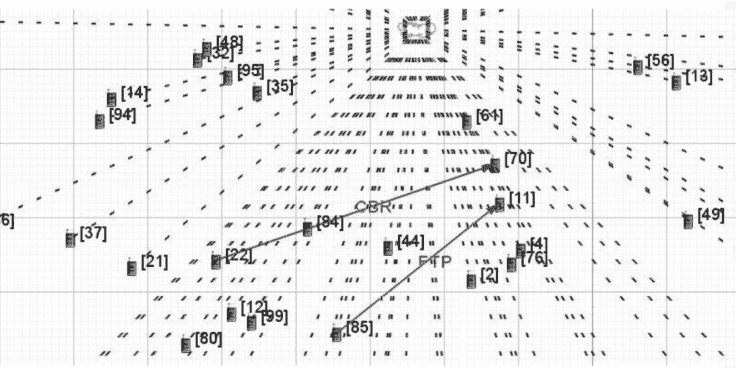

### 表 1. 网络仿真器中使用的参数

| 仿真区域 | 1500m x 1500m |
|---|---|
| 移动节点数量 | 100 |
| 传输功率 | 20dB |
| 仿真时间 | 150 秒 |
| 调度服务类别 | UGS, nrtPS |

因此，作者通过考虑因变量/输出参数（如吞吐量）和自变量/输入参数（如带宽、平均端到端延迟和平均抖动）分析了 WiMAX 网络的性能。这些参数的影响如下：

- 1. **吞吐量**：它是通过通信信道成功传输数据的速率。吞吐量通常以每秒比特数（bit/s 或 bps）为单位进行测量。
- 2. **带宽**：它是给定网络中数据流量速率的度量。这通常以 MHz 为单位进行测量。
- 3. **平均端到端延迟**：它是指数据从源点到目的点通过网络传输所需的平均时间。这通常以秒为单位进行测量。
- 4. **平均抖动**：它是数据包传输延迟与其前一个数据包传输延迟之间所有时间差的平均值。只有在至少接收到两个数据包时才能计算抖动。这通常以秒为单位进行测量。

最初，研究人员使用网络仿真器为基于 CBR 的流量和文件传输应用生成了两个数据集（即训练数据集和测试数据集）。在这两个应用中，数据集是通过考虑三个输入参数（即带宽、平均端到端延迟和平均抖动）和一个输出参数（即吞吐量）生成的。训练数据集采用基因表达式编程（GEP）技术进行符号回归处理。作者采用此技术来分析和预测基于 CBR 的流量和文件传输应用中的流量 QoS。

## 基因表达式编程

基因表达式编程（GEP）是一种基于种群的方法，由 Candida Ferreira（2001）引入和开发。GEP 是一种自然启发技术，如同遗传算法（GA）（Goldberg, 1989; Hamdan et al., 2016; El Hassani et al., 2017; Hore et al., 2017; Dey et al., 2015）和遗传编程（GP）（Koza, 1994; Zadshakoyan et al., 2015），用于创建计算机程序以解决符号回归（Kubasada et al., 2013）、序列诱导、块堆叠和密度分类（Omkar et al., 2013; Omkar et al., 2012; Omkar et al., 2015）、函数挖掘（Xu et al., 2017）、组合优化（Sabar et al., 2015）、安全风险（Deng et al., 2015）等问题。

GEP 技术与其他自适应技术的不同之处在于，它最初将个体视为固定长度的线性字符串，然后将其编码为长度和结构不同的非线性实体。固定长度的线性字符串被视为染色体或基因组，而可变长度的非线性字符串被视为表达式树（ETs）或表现型。GEP 技术（Hu et al., 2007; Song et al., 2010）通过修改其突变率、转座率和重组率，确保在连续代际中对个体进行修改。

GEP 技术最有用的应用之一（Bakhshaii et al., 2009; Zuo et al., 2002）是符号回归或函数查找。符号回归主要涉及为给定输入变量集制定满足适应度值的输出变量的新符号表达式。必须固定不同参数，如适应度函数、函数集 {+, -, *, /, Q, sin, cos...}、种群大小、代数、链接函数、基因数量、突变率、转座率和重组率，以解决此问题。GEP 算法的一般步骤如下：

- **步骤 1：** 初始种群随机分布。
- **步骤 2：** 在每一代中，评估每个个体的适应度值。
- **步骤 3：** 选择适应度值最佳的个体，以及在定义的适应度值范围内的其他个体。
- **步骤 4：** 然后将选定的个体置于突变、转座和重组等影响之下，以产生下一代的个体。

在本章中，作者应用 GEP 技术为 WiMAX 网络中 QoS 参数吞吐量生成表达式树，以带宽、平均端到端延迟和平均抖动为自变量。在 WiMAX 网络中预测流量 QoS 的 GEP 实现涉及的步骤如下：

- **步骤 1：** 对于训练数据集，代表三个输入参数（即带宽、平均端到端延迟和平均抖动）的初始种群染色体随机分布。
- **步骤 2：** 在每一代中，评估所有这些染色体的适应度值，并将其与目标吞吐量值进行比较。
- **步骤 3：** 评估映射到各自输出参数的输入参数染色体，以获得最佳适应度值（即最小相对均方误差值）。
- **步骤 4：** 在连续代数中，应用突变、重组和转座等遗传算子来改变染色体的字符，以产生与目标值具有更好近似的吞吐量值。在我们的问题中，不同遗传算子的执行方式如下：

  - **突变：** 作者考虑了这种遗传算子，以解释网络中带宽、平均端到端延迟和平均抖动值的突然和剧烈变化。
  - **重组：** 这种遗传算子被考虑用于在构建网络吞吐量模型时解释单个输入参数的随机变化。
  - **转座：** 该算子在保持遗传变异和可进化性方面起着主要作用，因为它们在连续迭代中引起必要的修改。这种迭代过程在所有迭代中都比其前一个迭代产生更好的吞吐量模型。

- **步骤 5：** 上述步骤重复相当大次数的代数，并将最终代数中带宽、平均端到端延迟和平均抖动的染色体用于查找网络的吞吐量值。


## 符号回归示例性示例

为了理解，让我们考虑表2和表3所示的非常简单的训练和测试数据集。研究人员已针对该数据集应用符号回归问题，利用GEP技术获得输出(Y)关于输入(d₀)的表达式。

要进行符号回归，必须固定GEP参数，如突变率、重组率、转座率、代数、链接函数、种群大小（即染色体数量）、每个染色体的基因数量和适应度函数。作者在多次运行GEP后对这些参数的值进行了经验分析。不同运行后最有利的遗传算子值如表4所示，这是通过考虑给定数据集的最小rMSE值得出的。

### 表2. 示例性示例的训练数据集

| d₀ | Y |
|---|---|
| 1 | 2 |
| 3 | 12 |
| 5 | 30 |
| 7 | 56 |
| 9 | 90 |
| 11 | 132 |
| 13 | 182 |
| 15 | 240 |
| 17 | 306 |
| 19 | 380 |

### 表3. 示例性示例的测试数据集

| d₀ | Y |
|---|---|
| 2 | 6 |
| 4 | 20 |
| 6 | 42 |
| 8 | 72 |
| 10 | 110 |
| 12 | 156 |
| 14 | 210 |
| 16 | 272 |
| 18 | 342 |
| 20 | 420 |

对于所考虑的数据集，研究人员假设每个染色体有两个基因，每个基因有一个常数；因此得到两个子表达式树（即两个基因），如图2所示，以及两个数值常数，如表5所示。

在本示例中，作者考虑了30个染色体，每个染色体有2个基因。因此，共有60个基因。这60个基因在1000代中进化（即发生突变、重组和转座），并选出最佳的2个基因（即与目标值匹配的模型值）。最佳的2个基因产生以下方程：

### 表4. 示例性示例的GEP参数

| GEP参数 | 值 |
| :--- | :--- |
| 代数 | 1000 |
| 种群大小 | 30 |
| 突变率 | 0.044 |
| 重组率 | 0.1 |
| 转座率 | 0.1 |
| 链接函数 | + |
| 基因数量 | 2 |
| 适应度函数 | 相对均方误差（rMSE） |
| 函数集 | +,-.*./ |

### 图2. 示例性示例的子表达式树

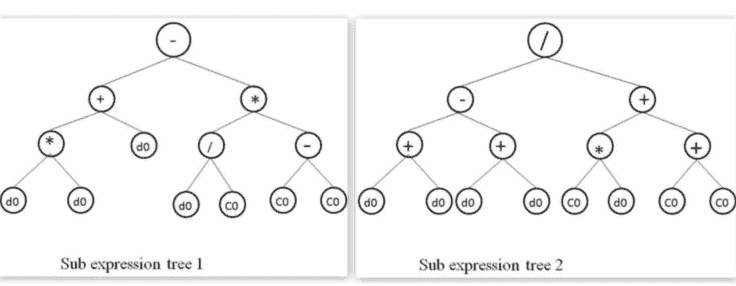

### 表5. 表达式中使用的常数值

| 常数 | 值 | 常数说明 |
|---|---|---|
| $G_1 C_0$ | -1.640137 | 基因1的第1个常数 |
| $G_2 C_0$ | -1.640137 | 基因2的第1个常数 |

$Y_1 = ((d_0 \times d_0) + d_0) - \left( \frac{d_0}{C_0} \times (G_1 C_0 - G_1 C_0) \right)$ (1)

$Y_2 = \left| \frac{(d_0 + d_0) - (d_0 + d_0)}{((G_2 C_0 \times d_0) + (G_2 C_0 + G_2 C_0))} \right|$ (2)

其中，$d_0$是输入参数，$G_1 C_0$是基因1的第一个常数，$G_2 C_0$是基因2的第一个常数。$Y_1$和$Y_2$分别是基因1和基因2。

作者假设“加法”作为两个基因的链接函数。因此，关于$d_0$的Y（即染色体）表达式是通过将$Y_1$（即基因1）与$Y_2$（即基因2）相加得到的，如图3所示。

$Y = Y_1 + Y_2$

### 图3. 示例性示例的表达式树

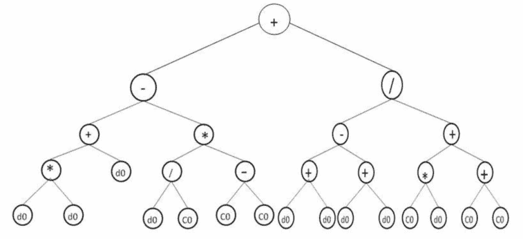

Y = ((d_0 \times d_0) + d_0) (3)

使用表3中给出的测试数据集验证了方程3（即染色体）；使用此方程获得的值被证明与目标值完全匹配。

## 人工神经网络

人工神经网络（ANN）技术主要用于函数逼近等问题，其中函数依赖于大量输入。该技术也用于解决基于预测的问题。为了更好的逼近，ANN需要训练数据来通过生成最优权重将输入数据与相应的输出映射。ANN由一组人工神经元互连组成。

在大多数情况下，ANN采用非线性函数逼近（即从数据中学习执行函数）。该神经网络通过调整处理元素之间的权重值进行训练（即输入及其相应的输出样本）。训练神经网络后，给定特定输入时，即可获得预期输出。ANN参数（如隐藏层数量和学习率）是经验选择的。训练阶段获得的最优权重可用于测试阶段。

本章中使用的ANN方法是多层感知器神经网络（MLPNN）。这也用于解决基于预测的问题。MLP-NN是一种自适应非线性系统，根据输入参数的观测值制定输出函数。MLP-NN使用反向传播算法。输入神经元的数量代表输入参数或自变量的数量（在本章中为带宽、平均端到端延迟和平均抖动），输出神经元代表响应（在本章中为吞吐量）。使用MLP-NN技术，作者预测了吞吐量的值，将带宽、平均端到端延迟和平均抖动作为输入参数。

根据文献，我们了解到MLP-NN技术只能收敛到局部最优解。因此，在本章中，针对所考虑的基于预测的问题，作者应用了GEP技术，该技术收敛到全局最优解。

## 本章主要关注点

在本章中，作者提出了一种基于GEP技术的WiMAX网络高效QoS流量预测机制。在此，针对CBR基础流量等实时服务以及文件传输应用等非实时服务，对WiMAX网络的吞吐量进行了分析。此外，本研究还关注网络的QoS流量预测。为进行此项研究，研究人员使用QUALNET® 7.1网络仿真器为CBR基础流量和文件传输应用生成了两个数据集。

所考虑的QoS参数为带宽、平均端到端延迟和平均抖动（作为输入参数）以及吞吐量（作为输出参数）。GEP技术已被应用于分析和预测CBR基础流量和文件传输应用中的QoS流量。根据文献，观察到与其他自然启发技术相比，GEP技术通过生成数学表达式来预测QoS参数的未来值更为高效。GEP技术应用于从网络仿真器获得的CBR基础流量和文件传输数据集，以制定关于带宽、平均端到端延迟和平均抖动的吞吐量数学表达式。CBR基础流量和文件传输应用获得结果的性能评估与MLP-NN技术进行了比较。

此外，本研究还关注敏感性分析。使用GEP技术进行敏感性分析，以检查在CBR基础流量和文件传输应用中，吞吐量是否对所考虑的输入参数敏感。据我们所知，GEP技术之前未被用于解决WiMAX网络中的QoS流量预测机制。本研究被确定为对研究人员和网络工程师很重要，为他们的工作提供必要的背景。本章的主要优势包括：高效利用网络、适当监控网络、在网络中高效路由数据包以及为大量用户提供良好的QoS。

## 解决方案和建议

在本章中，作者专注于分析WiMAX网络的吞吐量性能，将带宽、平均端到端延迟和平均抖动作为输入参数。利用这些参数，预测给定网络的QoS流量。为解决这些问题，使用了基因表达编程（GEP）技术。GEP技术应用于CBR基础流量和


文件传输应用程序。GEP 获得的结果与 MLP-NN 技术进行了比较。此外，针对基于 CBR 的流量和文件传输应用程序进行了敏感性分析。

## 使用网络模拟器进行数据集准备

数据集使用 QUALNET® 7.1 网络模拟器针对 WiMAX 网络生成，考虑了两种应用，即基于 CBR 的流量和文件传输。这些数据集分为 69 个训练样本和 71 个测试样本。这些样本包含一个输出参数：吞吐量，以及一组三个输入参数：带宽、平均端到端延迟和平均抖动。训练样本用于 GEP 技术以生成表达式树。使用测试样本分析表达式树的性能。

## WiMAX 网络的基因表达编程

基因表达编程 (GEP) 技术 (Sangeetha et al., 2016) 应用于数据集，以获取以带宽、平均端到端延迟和平均抖动为函数的吞吐量数学表达式。为采用 GEP 技术，定义了适应度函数。作者针对函数求值问题考虑了最常用的适应度函数，即相对均方误差 (rMSE) (Kubusada et al., 2013)。个体程序 i 的 rMSE 适应度函数 E_i 根据公式 4 计算。

$$
E_i = \frac{1}{n} \sum_{j=1}^{n} \left( \frac{P_{(ij)} - T_j}{T_j} \right)^2 \qquad \text{(4)}
$$

其中，P_{(ij)} 是个体程序 i 对适应度情况 j（共 n 个适应度情况）的预测值，T_j 是适应度情况 j 的目标值。

所考虑的 rMSE 适应度函数由于使用了平方项，因此对较大误差给予更高权重。该函数有助于得到更准确的模型，其预测的吞吐量值更接近目标值。该函数还有助于计算相对于目标值的误差，因此当目标值较低时，即使预测误差较低，也会导致较高的 rMSE 值。rMSE 值越小，得到的表达式树越好。

为了使用 GEP 技术进行符号回归，必须固定其他参数，如突变率、转位率和重组率、代数、链接函数、种群大小（即染色体数量）、基因数量和适应度函数。研究人员在多次运行 GEP 后对这些参数的值进行了经验分析。在此，作者经过多次运行后观察到遗传算子的最佳值，如表 6 所示，针对给定数据集考虑了最小 rMSE 值。

如果基因数量较少，则连续代之间的变化较少，因此需要更多代数才能达到理想结果。如果基因数量较多，则连续代之间的变化机会会非常高，因此获得不理想结果的机会也较高。通过试错法并在多次运行后，作者得出结论：每个染色体三个基因、每个基因两个常数为理想结果。因此，对于基于 CBR 的流量和文件传输应用程序，在表达式树 (ET) 中得到了三个子表达式树（即 3 个基因）和六个数值常数。

## 基于 CBR 的流量

在此情况下，总共传输了 100 个数据项，每个 512 字节，采用基于 CBR 的流量。将 GEP 技术应用于基于 CBR 的流量的训练数据集。从图 4 可以看出，在进行了五次不同的运行后，通过比较每次运行的 rMSE 均值和标准差值来选择最佳运行。与所有其他运行相比，第 3 次运行产生了最小的 rMSE 值。因此，训练数据集的 rMSE 值均值和标准差分别为 68.21 和 50.50，测试数据集的均值和标准差值分别为 71.12 和 48.66。

### 表 6. GEP 参数值

| GEP 参数 | 值 |
| :--- | :--- |
| 代数 | 2000 |
| 种群大小 | 30 |
| 突变率 | 0.044 |
| 重组率 | 0.1 |
| 转位率 | 0.1 |
| 链接函数 | + |
| 基因数量 | 3 |
| 适应度函数 | rMSE |
| 函数集 | +, -, *, /, sqrt, x2, x3, 自然对数 |

### 图 4. 使用 GEP 技术对训练和测试数据集中基于 CBR 的流量的 rMSE 值均值和标准差

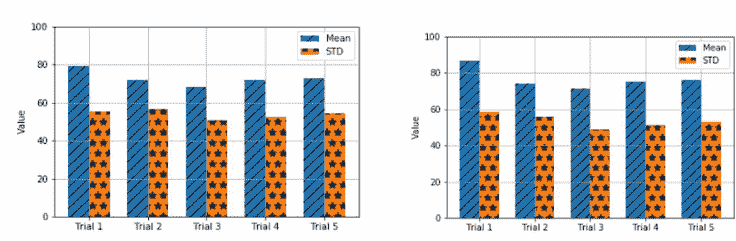

通过基于 CBR 的流量的训练数据集评估的吞吐量 (T_{CBR}) 的第 3 次运行得到的子表达式树、数学表达式和数值常数值，以带宽 (b)、平均端到端延迟 (d) 和平均抖动 (j) 为变量。子表达式树如图 5 所示。数学表达式如公式 5、6、7 和 8 所示。

作者考虑了 30 条染色体，每条染色体 3 个基因。因此，随机生成了总共 90 个基因。在假设的 2000 代中，90 个基因会演变（经历突变、重组和转位）。根据模型和目标值匹配且 rMSE 值最小选择了最佳 3 个基因，如下方公式所示：

$$
T_{CBR1} = \left( G_1 C_1 \right) + \left( \left( G_1 C_0 \times G_1 C_1 \right)^2 + \left( \frac{d - G_1 C_1}{d} \right) \right) \qquad (5)
$$

### 图 5. 基于 CBR 的流量的子表达式树

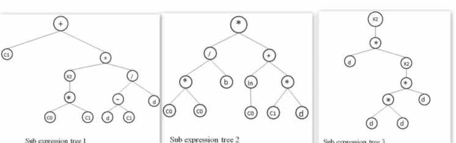

$$
T_{CBR2} = \left( \frac{\left( G_2 C_0 \right)^2}{b} \right) \times \left( \left( \ln \left( G_2 C_0 \right) \right) + \left( G_2 C_1 \times d \right) \right)
$$

$$
T_{CBR3} = \left( \left( d \times \left( d^2 \times d \right)^2 \right)^2 \right)
$$

其中，$b$ 为带宽，$d$ 为平均端到端延迟，均为输入参数；数值常数如 $G_1 C_0, G_1 C_1, G_2 C_0, G_2 C_1, G_3 C_0, G_3 C_1$ 列于表 7 中。

GEP 中使用“加法”作为链接函数；得到的表达式树如图 6 所示。给定网络中基于 CBR 的流量的吞吐量数学表达式如下：

T_{CBR} = T_{CBR1} + T_{CBR2} + T_{CBR3}

从图 7 可以看出，基于 CBR 的流量中，模型吞吐量值（使用 GEP 技术获得）和目标吞吐量值（从 QUALNET 7.1 网络模拟器获得）的变化情况。可以观察到，模型值和目标值非常接近。在近似过程中，GEP 技术通过训练数据集将输入参数与相应的输出参数映射来生成数学表达式。该数学表达式（即公式 8）使用测试数据集进行验证。同样，从图 8 可以观察到，对于测试数据集，模型值与目标值匹配得更好。

### 表 7. 基于 CBR 的流量吞吐量表达式中使用的常数值

| 常数 | 值 | 常数说明 |
|---|---|---|
| $G_1 C_0$ | 7.223358 | 基因 1 的第 1 个常数 |
| $G_1 C_1$ | 9.026275 | 基因 1 的第 2 个常数 |
| $G_2 C_0$ | 7.223358 | 基因 2 的第 1 个常数 |
| $G_2 C_1$ | 6.719025 | 基因 2 的第 2 个常数 |
| $G_3 C_0$ | 0.125396 | 基因 3 的第 1 个常数 |
| $G_3 C_1$ | 7.150665 | 基因 3 的第 2 个常数 |

### 图 6. 基于 CBR 的流量的表达式树

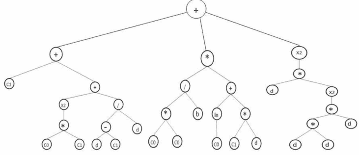

### 图 7. 基于 CBR 的流量中训练样本的网络吞吐量

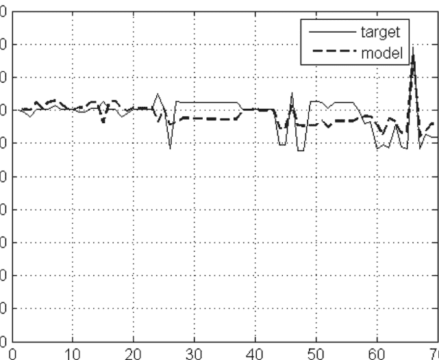

### 图 8. 基于 CBR 的流量中测试样本的网络吞吐量

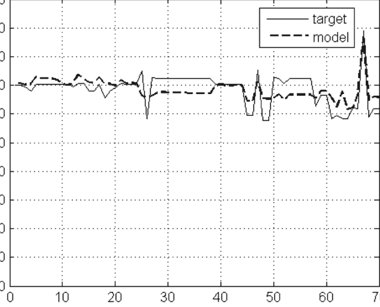

## 基于 CBR 的流量中 GEP 与 ANN 技术的比较

作者将所提议的 GEP 技术与多层感知器神经网络 (MLP-NN) (Omarkar et al., 2010; Senthilnath et al., 2012) 进行了比较。在使用 GEP 技术的基于 CBR 的流量下，对于训练数据集，均值和标准差值分别为 68.21 和 50.50，对于测试数据集，均值和标准差值分别为 71.12 和 48.66。使用 MLP-NN 技术，计算了训练和测试数据集的均值和标准差值，如图 9 所示。

从图 9 可以看出，在进行了五次不同的运行后，通过比较每次运行的 rMSE 均值和标准差值来选择最佳运行。与所有其他运行相比，第 3 次运行产生了最小的 rMSE 值。因此，对于训练数据集，均值和标准差值分别为 58.42 和 68.36，对于测试数据集，均值和标准差值分别为 66.92 和 67.22。


### 图9. 基于MLP-NN技术的CBR流量训练和测试数据集的rMSE值的均值和标准差

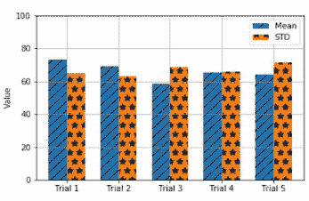

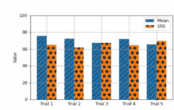

使用MLP-NN获得的吞吐量值与使用GEP技术获得的吞吐量值进行比较。从比较中可以看出，使用GEP技术可以生成与吞吐量目标值具有更好拟合度的模型。表8显示了通过GEP和MLP-NN技术获得的模型值与吞吐量目标值之间的误差均值和标准差。

从表8可以看出，MLP-NN技术的均值低于GEP技术的均值，但与GEP技术相比，MLP-NN具有更大的标准差值。这表明，与CBR流量的GEP技术相比，MLP-NN不适合提供一致的吞吐量模型值。从获得的结果可以看出，MLP-NN技术仅收敛于局部最优解。因此，对于所考虑的问题，作者得出结论GEP的性能优于MLP-NN。

### 表8. CBR流量的GEP和MLP-NN技术比较

| 技术 | 训练均值 | 训练标准差 | 测试均值 | 测试标准差 |
|---|---|---|---|---|
| GEP | 68.21 | 50.50 | 71.12 | 48.66 |
| MLP-NN | 58.42 | 68.36 | 66.92 | 67.22 |

## 文件传输应用

与基于CBR的流量类似，共传输了100个数据项，每个512字节。对文件传输应用的训练数据集应用GEP技术。从图10可以看出，在进行的五次不同运行中，通过比较每次运行的rMSE均值和标准差值来选择最佳运行。与所有其他运行相比，第1次运行产生了最小误差值。因此，训练数据集的rMSE值均值和标准差分别为2.1393e003和2.1690e003，测试数据集的均值和标准差值分别为1.9023e003和2.0748e003。

基于文件传输应用训练数据集，以带宽（b）、平均端到端延迟（d）和平均抖动（j）为指标评估吞吐量（T_FT）的第1次运行得到的子表达式树如图11所示。

### 图10. 基于GEP技术的文件传输应用训练和测试数据集的rMSE值的均值和标准差

### 训练数据集

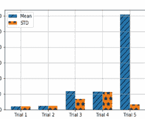

### 测试数据集

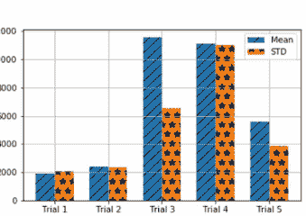

### 图11. 文件传输应用的子表达式树

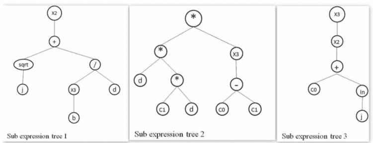

与基于CBR的流量类似，作者选择了最佳的3个基因（即数学表达式），如下方的公式9、10、11和12所示。

$$T_{FT_1} = \left( \sqrt{j + \left(\frac{b^3}{d}\right)^2} \right)$$ (9)

$$T_{FT_2} = \left( d^2 \times G_2 C_1 \times \left(G_2 C_o - G_2 C_1\right)^3 \right)$$ (10)

$$T_{FT_3} = \left( \left( G_3 C_o + ln(j) \right)^2 \right)^3$$ (11)

其中，b（即带宽）、d（即平均端到端延迟）和 j（即平均抖动）为输入参数，数值常量如 $G_1 C_o, G_1 C_1, G_2 C_o, G_2 C_1, G_3 C_o, G_3 C_1$ 列于表9中。

此处同样使用“加法”作为链接函数；得到的表达式树如图12所示。文件传输应用给定网络吞吐量的数学表达式为：

$$T_{FT} = T_{FT_1} + T_{FT_2} + T_{FT_3}$$ (12)

在文件传输应用中，从图13可以看出模型值和目标值具有更好的拟合度。GEP技术通过使用训练数据集将输入参数与相应的输出参数映射，生成数学表达式（即公式12）。该表达式使用测试数据集进行验证。同样，对于测试数据集，从图14可以看出模型值和目标值几乎匹配。

### 表9. 文件传输应用吞吐量表达式中使用的常量值

| 常量 | 值 | 常量说明 |
|---|---|---|
| $G_1 C_o$ | -6.524719 | 基因1的第1个常量 |
| $G_1 C_1$ | 3.18808 | 基因1的第2个常量 |
| $G_2 C_o$ | 2.508759 | 基因2的第1个常量 |
| $G_2 C_1$ | -6.651825 | 基因2的第2个常量 |
| $G_3 C_o$ | -4.350281 | 基因3的第1个常量 |
| $G_3 C_1$ | -7.314789 | 基因3的第2个常量 |

### 图12. 文件传输应用的表达式树

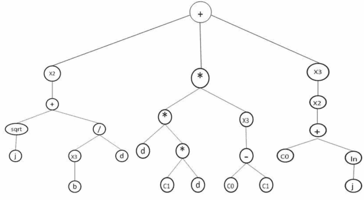

## 文件传输应用中GEP与ANN技术的比较

作者同样对文件传输应用中的GEP技术与MLP-NN进行了比较。在使用GEP技术的文件传输应用下，训练数据集的均值和标准差值分别为2.1393e003和2.1690e003，测试数据集的均值和标准差值分别为1.9023e003和2.0748e003。使用MLP-NN技术计算并显示了该训练和测试数据集的均值和标准差值，如图15所示。从图15可以看出，第4次运行产生了最小的rMSE值。因此，使用MLP-NN技术，训练数据集的均值和标准差值分别为2.7355e004和1.5944e004，测试数据集的均值和标准差值分别为2.9672e004和1.6232e004。

从比较中，作者发现GEP技术生成的模型与吞吐量目标值具有更好的拟合度。从表10可以看出，通过获得的误差均值和标准差值

### 图13. 文件传输应用训练样本的网络吞吐量

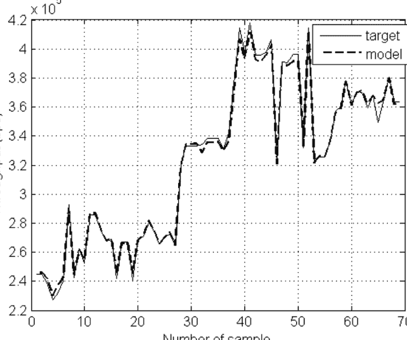

通过GEP技术获得的值低于通过MLP-NN获得的值。从获得的结果来看，这里同样观察到MLP-NN技术仅收敛于局部最优解。因此，这里作者同样得出结论GEP性能优于MLP-NN技术。

## 敏感性分析

在先前的案例中，研究人员试图通过将输入参数（即带宽、平均端到端延迟和平均抖动）与输出参数（即吞吐量）映射，为基于CBR的流量和文件传输应用获得数学表达式。从公式5、6、7和8可以看出，数学表达式与平均抖动无关（即，与其他参数相比，基于CBR的流量的吞吐量对平均抖动最不敏感）。

因此，使用GEP技术进行敏感性分析，将带宽和平均端到端延迟（即忽略平均抖动）作为输入参数及其输出参数对样本进行训练，以获得表达式树。

### 图14. 文件传输应用测试样本的网络吞吐量

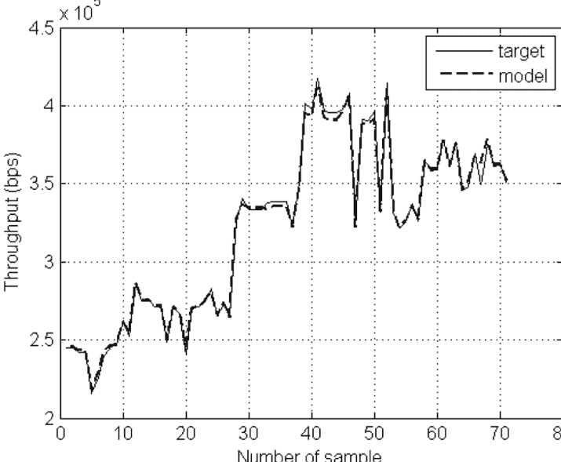

### 图15. 基于MLP-NN技术的文件传输应用训练和测试数据集的rMSE值的均值和标准差

### 训练数据集

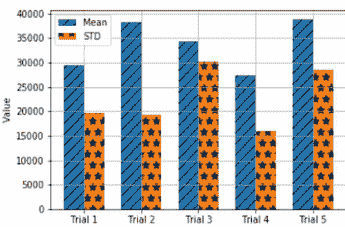

### 测试数据集

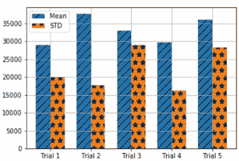

### 表10. 文件传输应用中GEP与MLP-NN技术的比较

| 技术 | 训练均值 | 训练标准差 | 测试均值 | 测试标准差 |
|---|---|---|---|---|
| GEP | 2.1393x10³ | 2.1690x10³ | 1.9023x10³ | 2.0748x10³ |
| MLP-NN | 2.7355x10⁴ | 1.5944x10⁴ | 2.9672x10⁴ | 1.6232x10⁴ |

作者进行了多次运行的实验，并选择最佳运行，将其与所有输入参数的基于CBR的流量进行比较。从表11可以看出，具有两个输入参数（即带宽和平均端到端延迟）的基于CBR的流量具有较低的rMSE值。

子表达式树如图16所示，数学表达式如公式13、14、15和16所示。

与其他应用（即基于CBR的流量和文件传输）类似，这里作者同样选择了最佳的3个基因，如下所示：

### 表11. 基于CBR流量的rMSE值的均值和标准差

| 情况 | 训练均值 | 训练标准差 | 测试均值 | 测试标准差 |
|---|---|---|---|---|
| 具有所有输入参数的CBR应用 | 68.21 | 50.50 | 71.12 | 48.66 |
| 具有两个输入参数（即带宽和平均端到端延迟）的CBR应用 | 66.30 | 49.44 | 69.36 | 48.82 |

### 图16. 具有两个输入参数的基于CBR流量的子表达式树

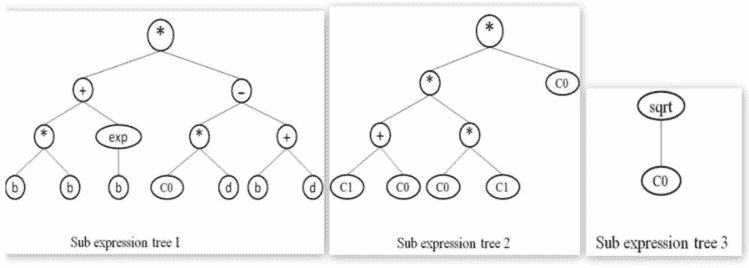


\( T_{CBR\_SA1} = \left( b^2 + e^b \right) \times \left( \left( G_1 C_0 \times d \right) - \left( b + d \right) \right) \) (13)

\( T_{CBR\_SA2} = \left( \left( \left( G_2 C_1 + G_2 C_0 \right) \times \left( G_2 C_0 \times G_2 C_1 \right) \right) \times G_2 C_0 \right) \) (14)

\( T_{CBR\_SA3} = \sqrt{G_3 C_0} \) (15)

其中 \( b \)（带宽）和 \( d \)（平均端到端延迟）是输入参数，\( G_1 C_0, G_1 C_1, G_2 C_0, G_2 C_1, G_3 C_0, G_3 C_1 \) 等数值常量在表 12 中给出并解释。

同样，在 GEP 中也使用了链接函数（即加法）。得到的表达式树如图 17 所示。吞吐量的数学表达式为：

\( T_{CBR\_SA} = T_{CBR\_SA1} + T_{CBR\_SA2} + T_{CBR\_SA3} \) (16)

同样，从图 18 可以得出结论，模型值和目标值匹配得更好。使用训练数据集，同样生成了数学表达式（即公式 16）并用测试数据集进行验证。对于测试数据集，也发现模型值与目标值匹配得更好，如图 19 所示。

从灵敏度分析来看，作者得出结论：在基于 CBR 的流量中，从训练数据集和测试数据集中忽略平均抖动参数后，rMSE 值下降，且数学表达式得到的吞吐量值与目标值匹配更好。因此，吞吐量对平均抖动参数最不敏感。

表 12. 基于 CBR 的流量吞吐量表达式中使用的常数值

| 常数 | 值 | 常数说明 |
|---|---|---|
| \( G_1 C_0 \) | 5.814789 | Gene 1 的第 1 个常数 |
| \( G_1 C_1 \) | -0.279754 | Gene 1 的第 2 个常数 |
| \( G_2 C_0 \) | -8.953431 | Gene 2 的第 1 个常数 |
| \( G_2 C_1 \) | -4.159057 | Gene 2 的第 2 个常数 |
| \( G_3 C_0 \) | 5.814789 | Gene 3 的第 1 个常数 |
| \( G_3 C_1 \) | -0.279754 | Gene 3 的第 2 个常数 |

图 17. 具有两个输入参数的基于 CBR 的流量的表达式树

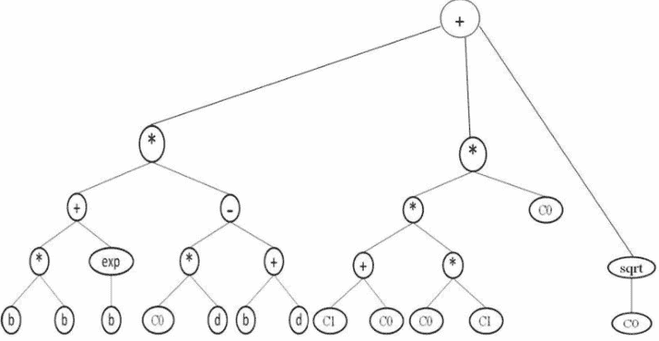

图 18. 具有两个输入参数的基于 CBR 的流量训练样本的网络吞吐量

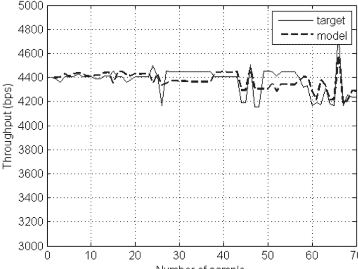

图 19. 具有两个输入参数的基于 CBR 的流量测试样本的网络吞吐量

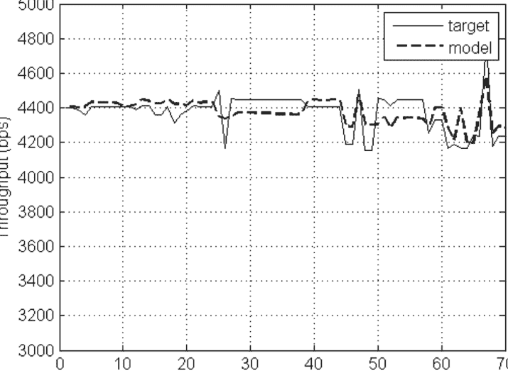

此外，从公式 9、10 和 11 可以观察到，在文件传输应用中，吞吐量对所有输入参数（即带宽、平均端到端延迟和平均抖动）都敏感。

## 未来研究方向

本章主要针对给定的 WiMAX 网络聚焦于流量 QoS 预测。使用 GEP 技术得到的数学方程也可用于决策制定。使用公式化的数学方程可以预测的吞吐量值，可在网络管理和 QoS 监控等场景中做决策时作为参考。该技术可应用于 MANETs、认知网络和 EPONs 等不同领域的网络。

## 结论

本章中，作者提出了一种基于基因表达编程（GEP）等自然启发技术的 WiMAX 网络流量 QoS 高效预测机制。这里，作者通过预测流量 QoS 来分析网络的吞吐量性能。已生成两个数据集，一个用于基于 CBR 的流量，另一个使用 QUALNET® 7.1 网络仿真器用于文件传输应用。数据集各包含 69 个训练样本和 71 个测试样本，每个数据集总计 140 个样本。生成的数据集包含吞吐量作为输出参数，针对基于 CBR 的流量和文件传输应用中带宽、平均端到端延迟和平均抖动等多个输入参数的多个值。该数据集使用 GEP 技术进行符号回归。使用 GEP 技术的关键点在于其提供的未来预测。

所提技术用于获取基于 CBR 的流量和文件传输应用中 QoS 定义参数（如带宽、平均端到端延迟、平均抖动和吞吐量）的数学表达式。实验结果表明，模型值（即从数学表达式得到）与目标值（即生成的数据集）几乎匹配，且 rMSE 值较低。较低的 rMSE 值表明，所提技术针对基于 CBR 的流量和文件传输应用吞吐量所得到的模型是高效的。GEP 技术的结果还与人工神经网络技术（即多层感知器神经网络）进行了比较，适用于基于 CBR 的流量和文件传输应用，发现 GEP 技术提供的模型值与目标值具有更好的近似匹配。

此外，本研究还聚焦于基于 CBR 的流量和文件传输应用中的灵敏度分析。灵敏度分析使用 GEP 技术进行。在基于 CBR 的流量中，吞吐量对平均抖动参数最不敏感，而在文件传输应用中，吞吐量对所有输入参数（即带宽、平均端到端延迟和平均抖动）都敏感。从得到的结果来看，作者得出结论，所提技术高效可靠，可用于通过流量 QoS 预测机制分析 WiMAX 网络的性能。

## 致谢

作者向 IISC 班加罗尔航空航天工程系 V. Mani 教授致以由衷的感谢，感谢其提供在进化计算实验室工作的宝贵机会。作者们感谢 PES 大学为完成本工作提供资源。作者 J. Sangeetha 感谢 PESIT 班加罗尔信息科学与工程系系主任 Shylaja. S. S 博士在完成所提工作方面提供的大力支持。本研究未获得公共、商业或非营利部门任何资助机构的特定资助。

## 参考文献

Achariya, D., & Anitha. A. (2017). 预测数据分析中统计与粗糙计算模型的比较研究。*环境计算与智能国际期刊*，8(2), 32–51. doi:10.4018/IJACI.2017040103

Akashdeep, K., Kahion, K. S., & Kumar, H. (2014). IEEE 802.16 PMP 网络调度算法综述。*埃及信息学期刊*，15(1), 25–36. doi:10.1016/j.eij.2013.12.001

Akyildiz, I. F., Wang, X., & Wang, W. (2005). 无线 mesh 网络：综述。*计算机网络期刊 (Elsevier)*，47(4), 445–487. doi:10.1016/j.comnet.2004.12.001

Ali, N. A., Dhrona, P., & Hassanein, H. (2009). 点对多点 WiMAX 网络中上行链路调度算法性能研究。*计算机通信*，32(3), 511–521. doi:10.1016/j.comcom.2008.09.015

Anderson, J. A. (1972). 生成交互记忆的简单神经网络。*数学生物科学*，14(3–4), 197–200. doi:10.1016/0025-5564(72)90075-2

Bag, V., & Kulkarni, U. V. (2017). 使用认知过程进行股票价格趋势预测与推荐。*粗糙集与数据分析国际期刊*，4(2), 36–48. doi:10.4018/IJRSDA.2017040103

Bakhshaii, A., & Stull, R. (2009). 使用基因表达编程进行确定性集合预报。*天气与预报*，24(5), 1431–1451. doi:10.1175/2009WAF2222192.1

Bashiri, M., & Geranmayeh, A. F. (2011). 使用中心复合设计和遗传算法调整人工神经网络参数。*伊朗科学*，18(6), 1600–1608. doi:10.1016/j.scient.2011.08.031

Binh, H. T. T., Hanh, N. T., & Dey, N. (2016). 改进布谷鸟搜索和混沌花粉授粉优化算法，用于最大化无线传感器网络的覆盖区域。*神经计算与应用*，1–13.


Carvalho, T., Junior, J. J., Valente, W., Natalino, C., Francês, R., & Dias, K. L. (2013). 具有路由技术和服务质量机制的移动 WiMAX 网状网络. 载于 WiMAX 专题 (pp. 61–84). InTech.

Chatterjee, S., Sarkar, S., Hore, S., Dey, N., Ashour, A. S., & Balas, V. E. (2016). 基于粒子群优化训练神经网络的多层钢筋混凝土建筑结构失效预测. 神经计算与应用, 1–12.

Cicconetti, C., Lenzini, L., Mingozzi, E., & Eklund, C. (2006). IEEE 802.16 网络中的服务质量支持. IEEE 网络, 20(2), 50–55. doi:10.1109/MNET.2006.1607896

Deng, S., Yue, D., Fu, X., & Zhou, A. (2015). 基于粗糙集和基因表达编程的网物理电力系统安全风险评估. IEEE/CAA 自动化学报, 2(4), 431-439.

Dey, N., Ashour, A. S., Beagum, S., Pistola, D. S., Gospodinov, M., Gospodinova, E. P., & Tavares, J. M. R. (2015). 使用遗传算法对基于局部多项式逼近的交界置信区间滤波器进行参数优化：脑 MRI 图像去噪的应用. 成像杂志, 1(1), 60–84. doi:10.3390/jimaging1010060

Dey, N., Samanta, S., Chakraborty, S., Das, A., Chaudhuri, S. S., & Suri, J. S. (2014). 嵌入多流形医学信息期间缩放因子优化的萤火虫算法：眼科成像应用. 医学成像与健康信息学杂志, 4(3), 384–394. doi:10.1166/jmihi.2014.1265

El Hassani, H., Benkachcha, S., & Benhra, J. (2017). 旅行商问题的新遗传算子（跳跃交叉）. 载于自然启发式计算：概念、方法论、工具和应用 (pp. 1739-1752). IGI Global.

Ferreira, C. (2001). 基因表达编程：解决问题的一种新型自适应算法. 复杂系统, 13(2), 87–129.

Ferreira, C. (2002). 基因表达编程：人工智能的数学建模. Angra do Heroismo.

Goldberg, D. E. (1989). 搜索、优化与机器学习中的遗传算法. Addison-Wesley 出版公司.

Grewal, V., & Sharma, A. K. (2010). 基于 IEEE 802.16 的 WiMAX 网络不同 QoS 机制和 AMC 方案性能评估. 国际计算机应用杂志, 6(7), 12 – 17.

Hamdan, M., & Abderrazzaq, M. H. (2016). 使用遗传算法优化小型风力涡轮机. 国际应用元启发式计算杂志, 7(4), 50–65. doi:10.4018/IJAMC.2016100104

Hore, S., Chatterjee, S., Santhi, V., Dey, N., Ashour, A. S., Balas, V. E., & Shi, F. (2017). 使用优化神经网络的印度手语识别. 载于信息技术与智能交通系统 (pp. 553–563). Springer 国际出版. doi:10.1007/978-3-319-38771-0_54

Hu, J. J., Tang, C. J., Duan, L., Zuo, J., Peng, J., & Yuan, C. A. (2007). 基因表达编程初始种群多样化策略. 计算机学报·中文版, 30(2), 305.

Jeffrey, G. A., Ghosh, A., & Muhamed, R. (2007). WiMAX 基础：理解宽带无线网络. Prentice-Hall.

Kas, M., Yargicoglu, B., Korpeoglu, I., & Karasan, E. (2010). IEEE 802.16 网状模式调度综述. IEEE 通信调查与教程, 12(2), 205–221. doi:10.1109/SURV.2010.021110.00053

Koza, J. R. (1994 In press). 遗传编程 II：可重用程序的自动发现. 剑桥，马萨诸塞州：MIT 出版社.

Kubusuda, Y., Mohan, G., Manjappa, K., & Reddy, G. R. M. (2013). 面向移动自组网的基于基因表达的服务质量感知路由协议. 载于计算机网络与通信 (pp. 283–290). NetCom.

Kuran, M. S., & Tugcu, T. (2007). 新兴宽带无线接入技术综述. 计算机网络, 51(11), 3013–3046. doi:10.1016/j.comnet.2006.12.009

Lee, J. Y., Hwang, I. S., Liem, A. T., Lai, K. R., & Nikoukar, A. (2013). 基因表达编程：EPON 中 QoS 流量预测的新方法. 光子网络通信, 25(3), 156–165. doi:10.1007/s11107-013-0399-x

Li, B., Qin, Y., Low, C. P., & Gwee, C. L. (2007). 无线宽带接入：移动 WiMAX 调查. IEEE 通信杂志, 70–75. doi:10.1109/MCOM.2007.4395368

Liu, Q., Wang, X., & Giannakis, G. B. (2006). 支持服务质量的无线网络跨层调度算法. IEEE 车辆技术汇刊, 55(3), 839–846. doi:10.1109/TVT.2006.873832

Manogaran, G., & Lopez, D. (2017). 面向大气候数据处理和登革热传播的疾病监测系统. 国际环境计算与智能杂志, 8(2), 88–105. doi:10.4018/IJACI.2017040106

Marchant, J. A., & Onyango, C. M. (2003). 基于植物/杂草/土壤歧视示例的贝叶斯分类器与多层前馈神经网络比较. 农业计算机与电子学, 39(1), 3–22. doi:10.1016/S0168-1699(02)00223-5

Nayak, S. C., Misra, B. B., & Behera, H. S. (2016). 用于预测股市收盘价的基于遗传算法训练的自适应二阶神经网络（ASONN-GA）. 国际应用元启发式计算杂志, 7(2), 39–57. doi:10.4018/IJAMC.2016040103

Ni, Q., Vinel, A., Xiao, Y., Turlikov, A., & Jiang, T. (2007). 无线宽带接入：WiMax 及其以后 - WiMax 网络点到多点模式下带宽请求机制研究. IEEE 通信杂志, 45(5), 132–138. doi:10.1109/MCOM.2007.358860

Omkar, S. N., John, R. L., Choudhry, N., Kubusada, Y., & Bhageshpur, G. (2013). 使用基因表达编程技术的作物分类. Springer-Verlag 柏林海德堡.

Omkar, S. N., Mudigere, D., Senthilnath, J., & Kumar, M. V. (2015). 基于飞行数据的自然启发式技术直升机动力学辨识. 国际应用元启发式计算杂志, 6(3), 15. doi:10.4018/ijamc.2015070102

Omkar, S. N., Ramaswamy, N., Senthilnath, J., Bharath, S., & Anuradha, N. S. (2012). 作物类型分类的基因表达编程-模糊逻辑方法. 载于 2012 第六届国际遗传与进化计算会议 (ICGEC) (pp. 136-139). IEEE. doi:10.1109/ICGEC.2012.97

Omkar, S. N., Sivaranjani, V., Senthilnath, J., & Mukherjee, S. (2010). 高光谱数据降维与分类. 国际航空创新多科学杂志, 2(3), 157–163.

Sabar, N. R., Ayob, M., Kendall, G., & Qu, R. (2015). 用于组合优化问题的基于基因表达编程的超启发式框架自动设计. IEEE 进化计算汇刊, 19(3), 309–325. doi:10.1109/TEVC.2014.2319051

Sangeetha, J., Nagaraj, K., Murthy, K. B., & Rustagi, R. P. (2016). 基于基因表达编程的 QoS 流量预测路由协议下 WiMAX 网络性能分析新方法. 国际应用元启发式计算杂志, 7(2), 16–38. doi:10.4018/IJAMC.2016040102

Sekercioglu, Y. A., Ivanovich, M., & Yegin, A. (2009). WiMAX 网络基于 MAC 的 QoS 实现综述. 计算机网络, 53(14), 2517–2536. doi:10.1016/j.comnet.2009.05.001

Senthilnath, J., Bajpai, S., Omkar, S. N., Diwakar, P. G., & Mani, V. (2012). 使用图像分类和分割的多时相 MODIS 图像分析方法. 空间研究进展, Elsevier, 50(9), 1274–1287. doi:10.1016/j.asr.2012.07.003

Senthilnath, J., Omkar, S. N., Mani, V., Vanjare, A., & Diwakar, P. G. (2014). 使用基因表达编程的多时相卫星图像分析. 第二届国际问题求解软计算会议论文集, 236, 1039 – 1045. doi:10.1007/978-81-322-1602-5_109

Sharma, S., Kumar, S., & Singh, B. (2014). AntMeshNet：面向无线网状网络的蚁群优化路由方法. 国际应用元启发式计算杂志, 5(1), 20–45. doi:10.4018/ijamc.2014010102

Sharma, S., & Malik, A. (2017). 基于白蚁智能的无线网状网络路由. 国际应用元启发式计算杂志, 8(2), 1–21. doi:10.4018/IJAMC.2017040101

Song, D., Ru-Chuan, W., Xiong, F., & Le-Chan, Y. (2010). 粗糙集属性约简的基因表达编程. 国际计算机与应用杂志, 32(2), 226–231. doi:10.2316/Journal.202.2010.2.202-2842

Xu, L., Huang, Y., Shen, X., & Liu, Y. (2017). 大规模分类的基因表达编程算法并行化. 科学编程, 2017.

Zadshakoyan, M., & Pourmostaghi, V. (2015). 使用切削刀具几何和遗传编程的车削中切削工具坑洼磨损测量. 国际应用元启发式计算杂志, 6(1), 47–60. doi:10.4018/ijamc.2015010104

Zuo, J., Tang, C., Li, C., Yuan, C., & Chen, A. (2002). 基于基因表达编程的时间序列预测. 网络时代信息与管理进展国际会议, 3129(1), 55–56.


## 关键术语和定义

**基于恒定比特率的流量:** 一种实时多媒体应用，在整个数据传输过程中必须保持比特率不变。它对多媒体流很有用。

**经验值:** 通过观察、经验和实验而非科学证明获得的值。

**表达式树:** 树结构，其叶子包含变量，其他分支包含数学函数，根包含链接函数，并可以转换为数学表达式。

**文件传输应用:** 一种非实时多媒体应用，支持在无需保持恒定数据速率的情况下传输数据，并用于在网络节点之间传输多媒体文件。

**链接函数:** 一种数学函数，如加法、减法或乘法，用于连接表达式树的各个子分支。

**变异率:** 进化过程中染色体中发生随机和剧烈变化的速率。

**重组率:** 由于染色体间交叉导致亲本遗传物质重新排列的速率，可能导致后代性状与亲本完全不同。

**敏感性分析:** 研究数学模型输出不确定性如何依赖于其输入参数不确定性的研究。

**符号回归:** 一种回归分析类型，其中最初随机生成数学表达式，并在迭代过程中逐步改进以最佳拟合给定数据集。

**转位率:** 染色体的一部分改变位置导致具有不同遗传特性的染色体的速率。

**WiMAX:** WiMAX代表微波接入全球互操作性，是一种点对多点宽带无线技术，主要集中在IEEE 802.16e标准周围，旨在广域提供高速数据访问。

## 第3章 基于混沌差分进化的模糊对比度伸展法

克里希纳·戈帕尔·达尔
米德纳浦学院（自治），印度

桑乔伊·达斯
卡利亚尼大学，印度

### 摘要

本研究旨在开发一种新型参数化双直方图模糊对比度伸展（BHFCS）方法，以适当增强灰度图像和彩色图像的对比度。该方法的参数通过采用一种修正的混沌差分进化（CDE），并结合分形维（FD）和基于局部方差的质量指数（QILV）作为目标函数进行了优化。实验结果证明，修正的DE在此增强领域优于粒子群优化（PSO）、遗传算法（GA）和传统DE，所使用的目标函数也非常有助于保留图像的原始亮度，这是消费电子领域的主要标准之一。

### 引言

在数字图像处理领域，所有本土算法都必须意识到两个主要方面，即所试验图像的对比度增强和亮度保存。增强算法的努力是通过使用目标函数达到最佳条件，使图像获得最大清晰度状态，从而可以进行良好的视觉分析。只有这样，它才能与对比度差和其他技术异常的原始图像区分开来。

实现对比度增强的第一种方法是直方图均衡化（HE）技术（Gonzalez, R.C., Woods, R.E.（2002））。基于HE的技术已用于医学图像处理、卫星图像处理等。基本上，HE程序将原始图像的直方图变平。理论上，所有灰度级都以均匀分布分布。结果是它提高了图像的对比度，最大化了图像熵。由于输出图像的直方图均匀分布，平均亮度大约变为灰度级中点，与输入图像的平均值无关（Chen, S. D., Ramli, A. R.（2004），Kim, Y.T.（1997））。为了克服HE方法中直方图变平的效果（有时会导致褪色图像、不自然的增强和一些不想要的伪影），Kim提出了一种新方法，即亮度保存双直方图均衡化（BBHE）（Kim, Y.T.（1997））。在BBHE中，图像的直方图围绕其均值分离，然后两个分开的部分分别进行均衡化（Chen, S. D., Ramli, A. R.（2004），Shanmugavadivu, P., Balasubramanian, K., Muruganandam, A.（2014））。在Wan提出的双重子图像直方图均衡化（DSIHE）中（Chen, S. D., Ramli, A. R.（2004），Shanmugavadivu, P., Balasubramanian, K., Muruganandam, A.（2014）），程序与BBHE相同，但直方图是按中位数而非均值分离的（Chen, S. D., Ramli, A. R.（2004），Shanmugavadivu, P., Balasubramanian, K., Muruganandam, A.（2014），Chen, S. D., Ramli, A. R.（2003），Chen, S. D., Ramli, A. R.（2003））。Chen和Ramli提出了最小平均亮度误差双直方图均衡化（MMBEBHE）方法（Chen, S. D., Ramli, A. R.（2004），Chen, S. D., Ramli, A. R.（2003）），其中直方图使用指定阈值分离，该阈值保留了输入和输出图像之间的最小平均亮度误差，然后两个部分独立进行均衡化。这种技术优于BBHE和DSIHE，但它仍然存在对比度和亮度不足的缺陷（Shanmugavadivu, P., Balasubramanian, K., Muruganandam, A.（2014））。文献中还报道了用于图像增强的参数化对比度伸展函数，其效果优于传统HE（Gorai, A., Ghosh, A.（2009），Gorai, A., Ghosh, A.（2011），Barik, M., Sheta, A., Ayesh, A.（2007），Dhal, K.G, Quraishi, I. M., Das, S.（2015），Dhal, K., G., Das, S.（2015），Dhal, K.G Quraishi, I. M., Das, S.（2015），Dhal, K.G, Quraishi, I. M., Das, S.（2015），Dhal, K.G, Quraishi, I. M., Das, S.（2015））。这些参数的最优值已通过采用不同的元启发式算法并借助恰当选择的目标函数来找到（Gorai, A., Ghosh, A.（2009），Gorai, A., Ghosh, A.（2011），Barik, M., Sheta, A., Ayesh, A.（2007），Dhal, K.G, Quraishi, I. M., Das, S.（2015），Dhal, K., G., Das, S.（2015），Dhal, K.G Quraishi, I. M., Das, S.（2015），Dhal, K.G, Quraishi, I. M., Das, S.（2015），Dhal, K.G, Quraishi, I. M., Das, S.（2015））。在本研究中，采用了一种新型基于模糊的双直方图对比度伸展函数来增强灰度图像和彩色图像，并通过将增强问题制定为优化问题来计算最优参数。

近来，受自然启发的优化算法在不同领域广泛应用，例如金融（Vijayalakshmi Pai, G. A., Michel, T.（2017））、聚类（Benmounah, Z., Meshoul, S., Batouche, M.（2017），Nizar Banul, P.K., Andrews, S.（2015），Hamou, R. M., Bouarara, H. A., Amine, A.（2015））、网络（Binh（2016））、医学领域（Dey（2013），Dey（2014a），Dey（2014b），Dey（2015））、图像处理（Pal, S., K., Bhandari, D., Kundu, M., K.（1994），Hashemi, S.（2010），Coelho, L. D. S., Sauer, J.G., Rudek, M.（2009），Samantaa 等人（2013），Dhal, K.G, Quraishi, I. M., Das, S.（2015），Gorai, A., Ghosh, A.（2009），Ashour（2015））、神经网络领域（Hore（2017））等。在图像增强领域，不同参数化变换函数的最优参数通过最小化或最大化适当的目标函数进行优化。遗传算法（GA）（Pal, S., K., Bhandari, D., Kundu, M., K.（1994），Hashemi, S.，et al.（2010））和差分进化（DE）（Coelho, L. D. S., Sauer, J.G., Rudek, M.（2009），Dhal, K.G, Quraishi, I. M., Das, S.（2015））等进化算法已在该领域成功应用。Pal等人开发了一种基于GA的图像增强程序，将熵、紧凑性、索引面积覆盖及其组合作为目标函数（Pal, S., K., Bhandari, D., Kundu, M., K.（1994））。Hashemi等人还提出了一种基于GA的方法，但目标函数基于边缘信息开发（Hashemi, S.（2010））。Coelho等人提出了一种DE算法的变体，通过混沌序列的帮助修改交叉率（CR）和变异因子（MF），其性能优于传统DE（Coelho, L. D. S., Sauer, J.G., Rudek, M.（2009））。Dhal等人通过引入Lévy飞行、混沌序列和种群多样性信息，提出了两种DE算法变体，修正的DE优于传统算法（Dhal, K.G, Quraishi, I. M., Das, S.（2015））。两位作者都将熵和边缘信息的组合作为目标函数。像PSO这样的群智能优化算法也已广泛应用于图像增强领域（Gorai, A., Ghosh, A.（2009），Gorai, A., Ghosh, A.（2011），Barik, M., Sheta, A., Ayesh, A.（2007），Quraishi, I. M.（2014），Quraishi, I. M.（2013），Dhal, K. G.（2015），Eutamene, A.（2017））。Shanmugavadivu等人提出了一种基于PSO的亮度保存增强模型，以熵作为目标函数（Shanmugavadivu, P.（2014））。混沌序列、Lévy飞行和种群生成机制已被纳入萤火虫算法（FA），以提高其在图像增强领域的效率（Dhal, K.G, Quraishi, I. M., Das, S.（2015））。修正的


FA通过最大化熵、能量和对比度的组合作为目标函数，优于基于Lévy飞行算法的FA、PSO和GA。Benala et al.提出了基于人工蜂群（ABC）算法的边缘图像增强模型，且ABC在此领域优于GA（Benala, T. R. et al. (2009)）。基于混沌序列的ABC算法也已应用于保持亮度的图像增强领域（Dhal, K. G., Das, S. (2015)）。所提ABC通过考虑所用目标函数的效率，优于传统的ABC和PSO。基于Lévy飞行和混沌序列的CS算法已应用于图像增强领域（Dhal, K. G., Quraishi, I. M., Das, S. (2017), Dhal, K. G., Sen, M., Das, S. (2017), Dhal, K. G., Das, S. (2017), Bhandaria, A. K. (2014)）。作者提出了一种混沌版本的蝙蝠算法（Dhal, K. G., Quraishi, I. M., Das, S. (2015), Dhal, K. G., Quraishi, I. M., Das, S. (2015)），该算法在图像增强领域优于混沌CS算法和混沌版本的FA。下一节将介绍所提图像增强方法。

## 所提双直方图模糊对比度拉伸（BHFCS）方法

本文展示了一种用于图像增强的新参数化双直方图模糊对比度拉伸模型（BHFCS），如下所述：

- 1. 查找相应图像的直方图。
- 2. 基于阈值\(X_T\)划分直方图，该阈值使输入和输出图像之间的亮度误差最小（Chen, S. D., Ramli, A. R. (2004), Chen, S. D., Ramli, A. R. (2003)）。已证明该阈值有助于保持图像的原始亮度（Dhal, K. G., Sen, S., Sarkar, K., Das, S. (2016), Dhal, K. G., Das, S. (2017a)）。
- 3. 如果任意像素，即\(X_i \le X_T\)，则\(X_i \in C_1\)；如果\(X_i \ge X_T\)，则\(X_i \in C_2\)，其中\(C_1\)和\(C_2\)分别对应背景和前景类。因此，类\(C_1\)和\(C_2\)对应像素的隶属度计算如下：

\(\mu_{c1}(X_i) = 1 - \frac{X_T - X_i}{X_T}, \mu_{c2}(X_i) = 1 - \frac{E - X_i}{E - X_T}\) (1)

其中，E ≤ 255，并通过优化设置。\(\mu_{c1}\)和\(\mu_{c2}\)分别是类\(C_1\)和\(C_2\)的隶属度，隶属度值介于

$$0 \le \begin{cases} \mu_{c1}(X_i) \\ \mu_{c2}(X_i) \end{cases} \le 1$$

- 4. 类\(C_1\)（即\(X_{ie}^{c1}\)）和类\(C_2\)（即\(X_{ie}^{c2}\)）的增强像素值计算如下：
  - \(X_{ie}^{c1} = X_i + \mu_{c1}(X_i) \cdot K_1,\)
  - \(X_{ie}^{c2} = X_i \cdot \mu_{c2}(X_i) + (E - \mu_{c2}(X_i) \cdot K_2)\) (2)
  - 如果（\(X_{ie}^{c1}\)或\(X_{ie}^{c2} > 255\)），则执行归一化。
  - 这里，\(X_{ie}^{c1}\)和\(X_{ie}^{c2}\)是增强像素值，它们极大地依赖于属于[0, 255]且由修改DE算法优化的参数\(K_1\)和\(K_2\)。

- 5. 合并\(X_{ie}^{c1}\)和\(X_{ie}^{c2}\)两个分量，得到增强图像。

因此，所提增强方法清楚地表明，适当的增强在很大程度上取决于三个相关参数，即E、\(K_1\)和\(K_2\)，它们具有不同的范围。这些参数的最优值通过采用一种修改的DE算法计算得出，以FD和QILV的组合作为目标函数，这将在下一节中讨论。

## 目标函数

本文还致力于寻找一个适当的目标函数以保存图像的原始亮度。本研究中提出了一种新颖的目标函数来满足这一需求。所提目标函数是分形维数（FD）（Al-Kadi, O., S., Watson, D. (2008)）和基于局部方差的质量指数（QILV）（Aja-Fern´andez, S. (2006)）的组合。

## 分形维数（FD）

分形基于自相似性，而分形维数是图像固有维度的定量表达式（Al-Kadi, O., S., Watson, D. (2008)）。推导分形维数的基本方法是箱计数法。箱计数是通过计算确定框或网格内的点数来构建整个维度。在数学上，FD使用以下公式计算：

\( D = \frac{\log N_r}{\log \left( \frac{1}{r} \right)} \)

其中，D是分形维数。通过求出每个框（2×2）的最大和最小强度并求和其差，得到N和 r，如下所示：

\( r = \frac{s}{M} \text{ Where, } M= min (R, C) \)

其中，s表示缩放因子，R和C分别表示网格尺寸加倍时的行数和列数，R和C减为原值的一半，上述过程迭代重复，直到max(R, C)大于2。线性回归模型用于拟合log(N)与log(1/r)图中的直线，斜率给出FD，如下所示：

\( log N_r = D log \left( \frac{1}{r} \right) \)

## 基于局部方差的质量指数（QILV）

QILV用于测量图像的结构信息（Aja-Fern´andez, S. (2006)）。图像大量结构信息编码在其局部方差分布中。图像的局部方差特征有助于正确比较两幅图像。图像I的局部方差定义为\( Var \left( I_{i,j} \right) = E \left( \left( I_{i,j} - \overline{I_{i,j}} \right)^2 \right) \)，其中\(\overline{I_{i,j}} = E \left( I_{i,j} \right)\)为图像的局部均值。可使用待分析像素的加权邻域\(\eta_{i,j}\)及其相应权重\(\omega_p\)来估计，如下所示：

\( Var \left( I_{i,j} \right) = \frac{ \sum_{p \in \eta_{i,j}} \omega_p \left( I_{i,j} - \overline{I_{i,j}} \right)^2 }{ \sum_{p \in \eta_{i,j}} \omega_p } ; \overline{I_{i,j}} = \frac{ \sum_{p \in \eta_{i,j}} \omega_p I_p }{ \sum_{p \in \eta_{i,j}} \omega_p } \quad (6)\)

估计的图像局部方差将用作两幅图像之间结构相似性的质量度量。局部方差的均值\(\mu_{V_I}\)估计如下：

\(\mu_{V_I} = \frac{1}{MN} \sum_{i=1}^M \sum_{j=1}^N Var \left( I_{i,j} \right) \quad (7)\)

局部方差的（全局）标准差定义为：

\(\sigma_{V_I} = \left( \frac{1}{MN-1} \sum_{i=1}^M \sum_{j=1}^N \left( Var \left( I_{i,j} \right) - \mu_{V_I} \right)^2 \right)^{\frac{1}{2}} \quad (8)\)

最后，两幅图像\(I\)和\(J\)的方差之间的协方差定义为：

\(\sigma_{V_I V_J} = \frac{1}{MN-1} \sum_{i=1}^M \sum_{j=1}^N \left( Var \left( I_{i,j} \right) - \mu_{V_I} \right) \left( Var \left( J_{i,j} \right) - \mu_{V_J} \right) \quad (9)\)

两幅图像\(I\)和\(J\)之间的基于局部方差的质量指数（QILV）如下：

\( QILV \left( I, J \right) = \frac{ 2 \mu_{V_I} \mu_{V_J} }{ \mu_{V_I}^2 + \mu_{V_J}^2 } \cdot \frac{ 2 \sigma_{V_I} \sigma_{V_J} }{ \sigma_{V_I}^2 + \sigma_{V_J}^2 } \cdot \frac{ \sigma_{V_I V_J} }{ \sigma_{V_I} \sigma_{V_J} } \quad (10)\)

其中，\( 0 < QILV \le 1 \)

QILV方程的第一项比较两幅图像的局部方差分布的均值。第二项比较局部方差的标准差。第三项用于引入空间连贯性。为了避免小值引起的某些计算问题，方程中的每一项可以添加一些常数。

分形维数（FD）测量图像的粗糙度。有报道指出，局部方差分布提供了关于图像结构的信息（Dhal, K. G., Sen, M., Das, S. (2017)）。如果QILV增加，则增强图像的结构信息得到保存。因此，为了进行适当的增强，FD和QILV的组合被作为目标函数。

目标函数定义为：

$$Fit\left(E,K_{1}, K_{2}\right)=\left\{\exp\left(FD\right)+\exp\left(QILV\right)\right\}$$

其中，Fit(.)是目标函数。FD和QILV分别表示相应图像的分形维数和基于局部方差的质量指数。exp是指数运算符。因此，从目标函数的定义可以轻易验证，如果所提目标函数被最大化，则相应图像的FD和QILV被最大化，即图像的结构信息和原始亮度得到保存。

因此，优化问题定义如下：

$$\{E_{0}, K_{10}, K_{20}\} = arg[max_{E, K_{1}, K_{2}} \{ Fit\left(E, K_{1}, K_{2}\right) \}]$$

该最大化问题已通过采用修改的混沌DE算法求解，该算法将在下一节中讨论。

## 混沌差分进化（CDE）

本研究采用了一种新的步长来控制差分进化的变异因子。该步长背后的方法如下讨论：

$$Step Size (SS_{i}^{t}) = \left| \frac{Fit\left(X_{gbest}^{t}\right) - Fit^{t}\left(X_{i}\right)}{max\left(Fit\left(X_{gbest}^{t}\right), Fit^{t}\left(X_{i}\right)\right)} \right|$$

其中，Fit\left(X_{gbest}^{t}\right)是截至第t代的全局最佳解的适应度值。Fit^{t}\left(X_{i}\right)是第t代第i个个体的适应度值。很容易理解（0 <= SS <= 1）。还很明显，SS执行主要的


任何元启发式算法的步长根据解的好坏而减小或增大的准则都非常好。因此SS可称为基于适应度的步长。

## 混沌序列

最近，混沌序列已被融入自然启发式算法以增强其性能（Dhal, K.G, Quraishi, I. M., Das, S. (2017), Dhal, K.G, Quraishi, I. M., Das, S. (2015), Dhal, K., G., Das, S. (2015), Leandro, C., S., d., Viviana, C., M (2009), Sheikoleslami, R., Kaveh, A. (2013), Coelho, L. d. S., Mariani, V. C. (2008), Caponetto, R. (2003)）。混沌序列在元启发式算法中用于三个目的：1. 生成随机数 2. 生成惯性权重 3. 执行局部搜索。在本研究中，混沌序列已成功应用于更新DE算法的突变因子和交叉率，这两者负责控制勘探与开发之间的权衡。存在多种混沌发生器，如Logistic映射、帐篷映射、高斯映射、正弦迭代器、Lozi映射、Chua振荡器等（Dhal, K.G, Quraishi, I. M., Das, S. (2017), Sheikoleslami, R., Kaveh, A. (2013)）。其中，本文采用Logistic方程，因为它具有更大的方差并优于其他方法（Dhal, K.G, Quraishi, I. M., Das, S. (2017), Dhal, K. G., Das, S. (2017), Dhal, K., G., Das, S. (2015)）。Logistic映射的方程如下：

```
L_{m+1} = aL_m (1 - L_m)
```

a是控制参数，0 < a ≤ 4，L_m是第m次迭代的混沌值。系统的行为主要取决于a的变化。a的值设置为4，且L_0不属于{0, 0.25, 0.5, 0.75, 1}，否则Logistic方程不会表现出混沌行为（Coelho, L. D. S., Sauer, J.G., Rudek, M. (2009)）。

## 初始种群生成

初始种群通常随机生成。标准方法的方程如下：

```
x_i = low + (up - low) × ∂
```

x_i是第i个个体。up和low分别是目标函数搜索空间的上界和下界。∂是属于[0,1]的随机变量。

如果初始种群具有较大的方差，则有助于限制算法的过早收敛。当使用Logistic方程生成∂时，平均种群多样性较好（Dhal, K.G, Quraishi, I. M., Das, S. (2017), Dhal, K., G., Das, S. (2015)）。在本研究中，采用了基于Logistic方程的初始种群。

混沌差分进化算法如下

### 步骤1：使用Logistic方程初始化种群。

### 步骤2：根据方程11采用目标函数\(Fit\)

### 步骤3：使用基于Logistic方程的混沌序列初始化突变因子F和交叉率CR。

### 步骤4：突变步骤：对于每张增强图像，任选三张随机选择的图像，即\(X_{r1}^{(t)}\)、\(X_{r2}^{(t)}\)和\(X_{r3}^{(t)}\)。

现在，对于每个参数，通过以下方式获得新参数：

```
\(V_i^{(t+1)} = X_{r3}^{(t)} + F \times SS_i^t.\left(X_{r1}^{(t)} - X_{r2}^{(t)}\right)\) (16)
```

其中r1≠r2≠r3，\(SS_i^t\)是第t次迭代的步长。

F = 突变因子，用于控制两个个体之间差异的放大，以避免搜索停滞。

### 步骤5：交叉：交叉增加种群的多样性。

```
\(H_i^{(t+1)} = V_i^{(t+1)}\) if rand \([0, 1] \le CR\) ,
\(= X_i^{(t)}\) if rand \([0, 1] > CR\) . (17)
```

### 步骤6：选择：使用参数H_i创建新的增强图像

```
\(X_i^{(t+1)} = H_i^{(t+1)}\) if \(H_i^{(t+1)} > Fit(X_i^{(t)})\),
\(= X_i^{(t)}\) if \(H_i^{(t+1)} \le Fit(X_i^{(t)})\). (18)
```

这意味着如果修改后的参数创建了一个适应度值大于前一个的增强图像，则替换它，否则不替换。

### 步骤7：使用基于Logistic方程的混沌序列更新CR和F，并找到全局最优解。

### 步骤8：重复步骤4至7，直到满足停止准则。

## 停止条件

寻找最优停止条件是一项具有挑战性的工作。已通过实验选择。停止条件如下：

- 1. 对于特定图像，当全局最优解的适应度值连续10次迭代不变时。
- 2. 但为了找到最优参数，迭代次数的最大上限为150。

## 实验结果

实验在100张灰度图像和50张彩色图像上进行，计算得到的实验结果如下：

### 质量评估参数

定量性能测量对于比较不同的图像增强技术和所用模型至关重要。下面讨论了适用于灰度图像和彩色图像的知名原始亮度保持质量测量指标。

### 绝对平均亮度误差（AMBE）

AMBE基本上用于衡量亮度保持的程度（Dhal, K.G, Quraishi, I. M., Das, S. (2017), Dhal, K., G., Das, S. (2015)）。设输入图像为f，输出图像为G，则AMBE计算如下：

```
AMBE = |Mean_f - Mean_G| (19)
```

其中，Mean_f和Mean_g分别是输入图像和输出图像的均值。如果AMBE值较低，则亮度保持效果更好。

### 峰值信噪比（PSNR）

该统计指标也用于衡量图像增强方法的性能。PSNR是信号最大可能功率与噪声功率之比（Dhal, K.G., Quraishi, I. M., Das, S. (2017), Dhal, K. G., Das, S. (2015)）。它实际上是一种畸变指标，关键取决于均方误差（MSE）。MSE定义如下：

```
MSE(f, G) = \frac{\sum_{i=0}^{N-1} \sum_{j=0}^{M-1} [f(i, j) - G(i, j)]^2}{M \times N} (20)
```

其中，f和G分别是输入图像和输出图像。M和N分别是图像的行数和列数。

PSNR计算如下：

```
PSNR(f, G) = 10 \log_{10} \left\{ \frac{(L-1)^2}{MSE(f, G)} \right\} (21)
```

L是离散灰度级的数量。对于8位图像，其值为256。

如果PSNR值增加，图像的对比度也会增强，绝对平均亮度误差（AMBE）也会在某种程度上降低。

用于灰度图像增强的简单流行指标（如绝对平均亮度误差AMBE）不能用于彩色图像领域，因为每个颜色模型对亮度分量都有其自身的表示（Kong, N. S. P., Ibrahim, H. (2008)）。因此，除了视觉结果外，还考虑了一种流行的引用图像质量评估指标PSNR-HVS-M（Ponomarenko N. (2007)）和一种著名的非引用质量评估指标立方根平均增强（CRME）（Gao, C., Panetta, K., Agaian, S. (2013), Panetta, K, Gao, C., Agaian, S. (2013)），其说明如下：

### 立方根平均增强（CRME）

CRME是一种用于彩色图像的对比度测量技术，它不仅测量每个颜色平面内的对比度，还测量颜色平面之间的对比度（Gao, C., Panetta, K., Agaian, S. (2013), Panetta, K, Gao, C., Agaian, S. (2013)）。CRME通过测量颜色立方体中心与该立方体中所有邻居的相对差异来计算对比度。它还与HVS特性相关。因此，CRME值越大，表示在自然增强下的对比度越大（Gao, C., Panetta, K., Agaian, S. (2013), Panetta, K, Gao, C., Agaian, S. (2013)）。

### PSNR-HVS-M

该指标是考虑DCT基函数开发的（Ponomarenko N. (2007)）。PSNR-HVS-M已被用于评估质量，因为它代表了HVS的两个重要特征。首先，它揭示了低空间频率的失真敏感度高于高空间频率的失真这一事实。其次，考虑了掩蔽效应（人类视觉系统在异质和纹理图像区域注意到失真的能力较差）。

### 灰度图像结果部分

带有BHFCS的混沌DE算法已应用于100张灰度图像，增强后的图像如图1所示。100张图像的质量参数平均值列于表1中。

实验使用基于x64的PC上的MATLAB R2012b，利用100张图像完成。不同方法的平均执行时间和Friedman排名（Derrac, J. (2011)）列于表2中。

图1. 飞机图像（a）原始图像（b）CDE结果（c）DE结果（d）PSO结果（e）GA结果（f）BBHE结果（g）DSIHE结果（h）MMBEBHE结果（i）HE结果

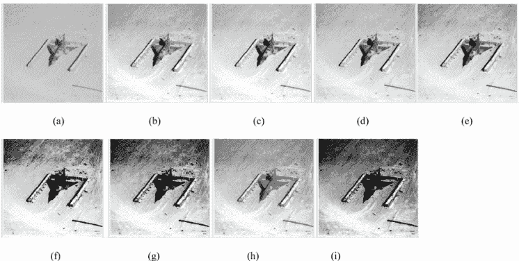


表 1. 灰度图像增强质量参数值

| 变体 | 平均适应度 | 平均 AMBE | 平均 PSNR | 平均 QILV |
|---|---|---|---|---|
| 混沌 DE | 8.6799 | 2.030 | 26.2767 | 0.9523 |
| DE | 8.6510 | 2.8706 | 25.9078 | 0.9501 |
| PSO | 8.6432 | 2.9892 | 25.7787 | 0.9411 |
| GA | 8.4770 | 4.001 | 25.715 | 0.9403 |

表 2. 弗里德曼排名和平均执行时间

| 变体 | 100 张图像的平均适应度 | 基于平均适应度的弗里德曼排名 | 平均执行时间（秒） | 基于执行时间的弗里德曼排名 |
|---|---|---|---|---|
| 混沌 DE | 8.6799 | 1 | 30.21 | 1 |
| DE | 8.6510 | 2 | 35.56 | 2 |
| PSO | 8.6432 | 3 | 36.01 | 3 |
| GA | 8.4770 | 4 | 61.17 | 4 |

## 彩色图像结果部分

在本研究中，提出的灰度图像增强方法也应用于彩色图像增强领域。Chien 等人提出了精确色相-饱和度-明度（eHSI）模型来增强彩色图像（Chien, C. L., Tseng, D. C. (2011), Chien, C. L., Tsai, W. H. (2014)）。任何灰度对比度增强方法都可以通过使用 eHSI 模型成功应用于彩色图像。eHSI 模型是一种保持色相的模型，具有解决超出色域问题的能力，即输出 RGB 图像的像素值始终位于各自的区间内。作者将传统 HE 应用于增强目的（Chien, C. L., Tseng, D. C. (2011)）。但本文采用了带混沌 DE 的 BHFCS 和所述客观函数，以获得自然的增强图像。增强过程的流程图如图 2 所示。

图 2. 彩色图像增强方案的框图

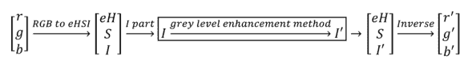

增强后的彩色图像如图 3 所示，50 张彩色图像的质量参数平均值如表 3 所示。

## 所用元启发式算法的一致性分析

混沌 DE 的一致性已通过迭代最大化所提客观函数来测量。每个变体对每幅图像执行 10 次，且

图 3. 女性图像 (a) 原始图像 (b) 混沌 DE 的结果 (c) DE 的结果 (d) PSO 的结果 (e) GA 的结果 (f) 带 HE 的 eHSI 的结果 (g) Naik 模型的结果 (Naik, S. K., Murthy, C. A. (2003)) (h) 自动颜色均衡化 (ACE) 方法的结果 (Gatta, C., Rizzi, A., Marini, D. (2002))。

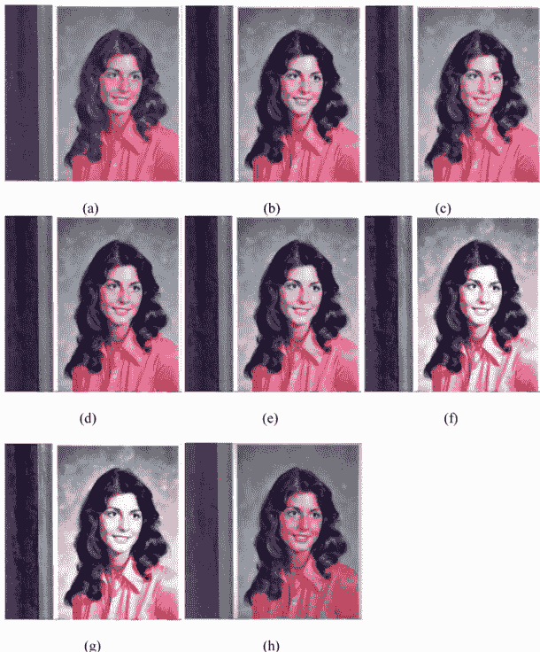

这些 10 次运行的最大适应度值（Max Obj.）、最小适应度值（Min Obj.）以及 Max Obj. 与 Min Obj. 之间的差值（即 Diff）均已测量。一致性代表算法的稳定性或鲁棒性。此处，其被定义为 Max Obj. 与 Min Obj. 之间的差值。因此，差值越小表示一致性越好。同样的方法也用于 100 张图像。随后，通过以下方程计算了 100 张图像的平均差值（AD）：

平均差值(AD) = \(\frac{1}{p} \sum_{i=1}^{p} Diff(X_i)\),

Diff \(\left( X_i \right) = \left[ \text{MaxObj}\left( X_i \right) - \text{MinObj}\left( X_i \right) \right]; \quad p = 100 \quad . \quad (22)\)

其中，\(\text{MaxObj}\left( X_i \right)\) 和 \(\text{MinObj}\left( X_i \right)\) 分别是第 \(i\) 幅图像在 10 次迭代中的最大和最小客观函数值，\(\text{Diff}\left( X_i \right)\) 是这两个值之间的差值。每种算法的 AD 值已列于表 4，并且也根据 AD 进行了排名。根据 AD，混沌 DE 获得最佳排名，因此可以说混沌 DE 也是一种非常一致的元启发式算法。

## 结果分析

对图 1 的视觉分析表明，当将所提 BHFCS 与元启发式算法及所述客观函数一起应用时，灰度图像会发生适当的亮度保持增强。因此，图 1(b)-(e) 远优于使用 BBHE、DSIHE、MMBEBHE 和 HE 等现有方法的其他增强结果。但混沌 DE 在视觉和定量上均产生了最佳增强图像，如表 1 所示，表 1 也表明混沌 DE 具有最优的客观函数最大化效率。此外，使用混沌 DE 增强的图像还具有最低的 AMBE 值和最高的 PSNR 值。表 2 表示基于客观函数最大化能力和执行时间的弗里德曼排名。在此，混沌 DE 也获得了最佳排名。

所提灰度图像增强模型通过 eHSI 模型用于增强彩色图像，产生保持色相且无超出色域问题的增强图像。图 3 表示使用不同方法（例如著名的 Naik 模型 (Naik, S. K., Murthy, C. A. (2003)) 和自动颜色均衡化 (ACE) 方法 (Gatta, C., Rizzi, A., Marini, D. (2002))）增强的彩色图像。视觉分析和表 3 的质量参数表明，所提增强模型对于产生自然的增强彩色图像也非常有效。基于混沌 DE 的模型的平均 CREM 和 PSNR-HVS-M 优于其他基于元启发式的模型。根据表 2 和表 4，混沌 DE 是一种计算时间较短的一致性算法。

表 3. 50 张彩色图像的质量参数平均值

| 参数 | 混沌 DE | DE | PSO | GA | 带 HE 的 eHSI | 带 HE 的 Naik 模型 | 自动颜色均衡化 (ACE) |
| :--- | :--- | :--- | :--- | :--- | :--- | :--- | :--- |
| 平均 CRME | 0.8553 | 0.8401 | 0.8387 | 0.8187 | 0.4007 | 0.4012 | 0.6270 |
| 平均 PSNR-HVS-M | 26.82 | 26.75 | 26.71 | 24.10 | 21.97 | 22.01 | 23.71 |

表 4. 基于 AD 值的排名

| 变体 | 混沌 DE | DE | PSO | GA |
| :--- | :--- | :--- | :--- | :--- |
| 排名 | **1** | 3 | 2 | 4 |
| AD | **0.1787** | 0.2063 | 0.1971 | 0.2998 |

所用客观函数的亮度保持能力也已测量并以图 4 表示，图 4 指出当客观函数值增加时，AMBE 始终降低且 PSNR 增加。因此，开发的客观函数在亮度保持图像增强领域的应用是有效的，这是消费电子领域的主要标准。

## 结论

本文提出了一种参数化的双直方图模糊对比度拉伸（BHFCS）方法，其中图像的适当增强至关重要地取决于具有不同范围的三个相关参数。因此，增强模型被制定为最大化问题，并采用一种改进的混沌 DE 及一种新颖客观函数来在合理时间内优化这三个参数。本研究的主要目标是在保持图像原始亮度的同时增强图像。视觉分析和质量参数值证明所提增强模型表现非常出色。此外，所提灰度图像增强模型也通过 eHSI 色彩模型应用于彩色图像。在此，它也产生自然的增强彩色图像，并优于其他一些著名的彩色图像增强方法，例如自动颜色均衡化 (ACE) 方法。本研究还证明，所用混沌 DE 非常一致且比传统 DE 算法耗时更少。基于混沌序列的变异因子和交叉率以及所提步长帮助传统 DE 提高其效率。在基于元启发式算法的图像增强模型中，适当的增强也显著取决于所用客观函数。在此，本研究还定量测量了所用客观函数的亮度保持能力，证明客观函数在上述领域非常有效。未来，该增强模型可以应用于其他图像增强领域，并且混沌 DE 可以与其他现有元启发式算法在不同优化领域进行比较。

## 参考文献

Aja-Fern´andez, S., Jos´e Est´epar, R. S., Alberola-L´opez, C., & Westin, C. F. (2006). 基于局部方差的图像质量评估. 第 28 届 IEEE EMBS 年度国际会议, 4815-4818.


- Al-Kadi, O. S., & Watson, D. (2008). 侵袭性和非侵袭性肺肿瘤增强 CT 图像的纹理分析. IEEE 生物医学工程学报, 55, 1822-1830.

- Ashour, A. S., Samanta, S., Dey, N., Kausar, N., Abdessalemkaraa, W. B., & Hassaniien, A. E. (2015). 基于布谷鸟搜索的计算机断层扫描图像增强：一种基于对数变换的方法. 信号与信息处理期刊, 6(03), 244–257. doi:10.4236/jsip.2015.63023

- Barik, M., Sheta, A., & Ayesh, A. (2007). 基于粒子群优化的图像增强. 世界工程大会论文集.

- Benala, T. R., Jampala, S. D., Villa, S. H., & Konathala, B. (2009). 一种用于混合平滑滤波器的基于人工蜂群优化算法的图像边缘增强新方法. 自然与生物启发计算世界大会 (NaBIC), 1071–1076. doi:10.1109/NABIC.2009.5393866

- Benmounah, Z., Meshoul, S., & Batouche, M. (2017). 基于 Map-Reduce 范式的大数据可扩展差分进化聚类算法. 应用元启发式计算国际期刊, 8(1).

- Bhandaria, A. K., Sonia, V. A., Kumar, A., & Singh, G. K. (2014). 基于 DWT–SVD 的布谷鸟搜索算法卫星图像对比度与亮度增强. ISA 事务, 53, 1286–1296.

- Binh, H. T. T., Hanh, N. T., & Dey, N. (2016). 用于无线传感器网络中最大化区域覆盖的改进布谷鸟搜索与混沌花粉传播优化算法. 神经计算与应用, 1–13.

- Caponetto, R., Fortuna, L., Fazzino, S., & Xibilia, M. G. (2003). 用于改进进化算法性能的混沌序列. IEEE 进化计算学报, 7(3), 289–304. doi:10.1109/TEVC.2003.810069

- Chen, S. D., & Ramli, A. R. (2003). 对比度增强中的最小平均亮度误差双直方图均衡化. IEEE 消费电子学报, 49(4), 1310–1319. doi:10.1109/TCE.2003.1261234

- Chen, S. D., & Ramli, A. R. (2003). 基于递归均值分离直方图均衡化的可扩展亮度保存对比度增强. 学术出版社.

- Chen, S. D., & Ramli, A. R. (2004). 基于直方图均衡化的对比度增强技术中的亮度保存. 数字信号处理, 14(5), 413–428. doi:10.1016/j.dsp.2004.04.001

- Chien, C. L., & Tsai, W. H. (2014). 用于遥感的无色域问题改进非线性 HIS 变换图像融合. IEEE 地球科学与遥感汇刊, 52, 651-663.

- Chien, C. L., & Tseng, D. C. (2011). 基于精确 HIS 色彩模型的彩色图像增强. 创新计算、信息与控制国际期刊, 7, 6691-6710.

- Coelho, L. D. S., Sauer, J. G., & Rudek, M. (2009). 结合混沌序列的图像对比度增强差分进化优化. 混沌、孤子与分形, 42(1), 522–529. doi:10.1016/j.chaos.2009.01.012

- Coelho, L. S., & Mariani, V. C. (2008). 工程设计优化中生物启发算法中混沌序列的应用. 应用专家系统, 34(3), 1905–1913. doi:10.1016/j.eswa.2007.02.002

- Derrac, J., Garcia, S., Molina, D., & Herrera, F. (2011). 使用非参数统计测试作为比较进化和群体智能算法的方法论的实用教程. 群体与进化计算, 1, 3–18.

- Dey, N., Ashour, A. S., Beagum, S., Pistola, D. S., Gospodinov, M., Gospodinova, E. P., & Tavares, J. M. R. (2015). 基于遗传算法的局部多项式逼近交界置信区间滤波器参数优化：脑 MRI 图像去噪应用. 成像期刊, 1(1), 60–84. doi:10.3390/jimaging1010060

- Dey, N., Chakraborty, S., & Samanta, S. (2014b). 生物医学信号水印优化. 兰伯特出版. Heinrich-Böcking-Straße, 6, 66121.

- Dey, N., Samanta, S., Chakraborty, S., Das, A., Chaudhuri, S. S., & Suri, J. S. (2014a). 流形医学信息嵌入过程中缩放因子优化的萤火虫算法：眼科成像应用. 医学影像与健康信息学期刊, 4(3), 384–394. doi:10.1166/jmihi.2014.1265

- Dey, N., Samanta, S., Yang, X. S., Das, A., & Chaudhuri, S. S. (2013). 使用布谷鸟搜索的心电图信号水印缩放因子优化. 生物启发计算国际期刊, 5(5), 315–326. doi:10.1504/IJBIC.2013.057193

- Dhal, K. G., Namtirtha, A., Quraishi, I. M., & Das, S. (无日期). 基于带 Lévy 飞行粒子群优化的鹰策略灰度图像增强. 科学、工程与技术创新研究国际期刊, 5, 79-86.

- Dhal, K. G., & Das, S. (2015). 基于多样性保守混沌人工蜂群算法的亮度保存直方图均衡化和对比度拉伸方法. 自然计算研究国际期刊, 5, 45-73.

- Dhal, K. G., & Das, S. (2017). 带搜索策略的布谷鸟搜索. 模式识别与图像分析. (录用)

- Dhal, K. G., & Das, S. (2017a). 保存图像原始亮度的直方图分割与修改组合. 模式识别与图像分析, 27(2), 200–212. doi:10.1134/S1054661817020031

- Dhal, K. G., Quraishi, I. M., & Das, S. (2015). 针对卫星图像案例结合 Lévy 飞行和混沌序列的差分进化性能增强. 应用元启发式计算国际期刊, 6, 69-81.

- Dhal, K. G., Quraishi, I. M., & Das, S. (2015). 通过混沌序列和种群多样性开发萤火虫算法以增强图像对比度. 自然计算, 14, 1–12.

- Dhal, K. G., Quraishi, I. M., & Das, S. (2015). 灰度图像增强中混沌 Lévy 蝙蝠算法和混沌布谷鸟搜索算法的性能分析. 信息系统设计与智能应用, 233-244.

- Dhal, K. G., Quraishi, I. M., & Das, S. (2015). 蝙蝠和萤火虫算法中用于灰度图像增强的混沌 Lévy 飞行方法. 图像、图形与信号处理国际期刊, 7, 69–76.

- Dhal, K. G., Quraishi, I. M., & Das, S. (2017). 基于改进布谷鸟搜索的最优范围亮度保存直方图均衡化和对比度拉伸方法. 群体智能研究国际期刊, 8, 1-29.

- Dhal, K. G., Sen, M., & Das, S. (2017). 用于增强乳腺X线摄影图像中癌变组织的基于布谷鸟搜索的修改双直方图均衡化方法. 医学工程与信息学国际期刊. (录用)

- Dhal, K. G., Sen, S., Sarkar, K., Das, S. (2016). 基于熵的范围优化亮度保存直方图均衡化用于图像对比度增强. 计算机视觉与图像处理国际期刊, 6(1), 59-72.

- Eutamene, A., Kholladi, M. K., Gaceb, D., & Belhadef, H. (2017). 用于降级文档图像预处理优化的双 PSO-自适应均值漂移. 应用元启发式计算国际期刊, 8(1).

- Gao, C., Panetta, K., & Agaian, S. (2013). 无参考彩色图像质量度量. 2013 论控大会, 243-248.

- Gatta, C., Rizzi, A., & Marini, D. (2002). ACE：一种自动颜色均衡化算法. 第一届欧洲图形图像与视觉色彩会议论文集 (CGIV02).

- Gonzalez, R. C., & Woods, R. E. (2002). 数字图像处理（第2版）. 纽约：Prentice Hall.

- Gorai, A., & Ghosh, A. (2009). 基于粒子群优化的灰度图像增强. 自然与生物启发计算世界大会论文集. doi:10.1109/NABIC.2009.5393603

- Gorai, A., & Ghosh, A. (2011). 基于粒子群优化的色相保持彩色图像增强. IEEE. doi:10.1109/RAICS.2011.6069375

- Hamou, R. M., Bouarara, H. A., & Amine, A. (2015). 文本聚类中的生物启发技术：综合与比较研究. 应用元启发式计算国际期刊, 6(4).

- Hashemi, S., Kiani, S., Noroozi, N., & Moghaddam, M. E. (2010). 基于遗传算法的图像对比度增强方法. 模式识别字报, 31(13), 1816–1824. doi:10.1016/j.patrec.2009.12.006

- Hore, S., Chatterjee, S., Santhi, V., Dey, N., Ashour, A. S., Balas, V. E., & Shi, F. (2017). 使用优化神经网络的印度手语识别. 在《信息技术与智能交通系统》（第 553–563 页）. Springer 国际出版. doi:10.1007/978-3-319-38771-0_54

- Kim, Y.T. (1997). 基于亮度保存双直方图均衡化的对比度增强. IEEE 消费电子汇刊, 43(1), 1–8.

- Kong, N. S. P., & Ibrahim, H. (2008). 使用亮度保存动态直方图均衡化的彩色图像增强. IEEE 消费电子学报, 54, 1962-1968.

- Leandro, C. (2009). 一种使用 Henon 映射和隐式过滤局部搜索的经济负荷调度新粒子群优化方法. 混沌、孤子与分形, 39(2), 510–518. doi:10.1016/j.chaos.2007.01.093

- Naik, S. K., & Murthy, C. A. (2003). 无色域问题的色相保持彩色图像增强. IEEE 图像处理汇刊, 12, 1591-1598.

- Nizar Banu. (2015). 使用元启发式优化算法的基因聚类. 应用元启发式计算国际期刊, 6(4).


Pal, S. K., Bhandari, D., & Kundu, M. K. (1994). 用于最佳图像增强的遗传算法。 *模式识别快报*, 15(3), 261–271. doi:10.1016/0167-8655(94)90058-2

Panetta, K., Gao, C., & Agaian, S. (2013). 无参考彩色图像对比度和质量度量。 *IEEE 消费电子交易*, 59, 643-651.

Ponomarenko, N., Silvestri, F., Egiazarian, K., Carli, M., Astola, J., & Lukin, V. (2007). DCT基函数的系数间对比度掩蔽。第三届视频处理与质量度量国际研讨会论文集。

Quraishi, I. M., De, M., Dhal, K. G., Mondal, S., & Das, G. (2013). 恢复历史退化文档的新型混合方法。IEEE。DOI: 10.1109/ISSP.2013.6526899

Quraishi, I. M., Dhal, K. G., Paul Chowdhury, J., Pattanayak, K., & De, M. (2012). 使用粒子群优化增强低分辨率图像的新型混合方法。IEEE。DOI: 10.1109/PDGC.2012.6449941

Samanta, S., Dey, N., Das, P., Acharjee, S., & Chaudhuri, S. S. (2013). *基于布谷鸟搜索的多级阈值灰度图像分割*. arXiv预印本 arXiv:1307.0277

Shanmugavadivu, P., Balasubramanian, K., & Muruganandam, A. (2014). 用于图像对比度增强和亮度保存的粒子群优化双直方图均衡化。 *可视化计算机*, 30(4), 387–399. doi:10.1007/s00371-013-0863-8

Sheikoholeslami, R., & Kaveh, A. (2013). 嵌入混沌元启发式算法综述。 *土木工程优化国际期刊*, 3(4), 617–633.

Vijayalakshmi Pai, G. A., & Michel, T. (2017). 使用混合粒子群优化对受限大型投资组合进行元启发式优化。 *应用元启发式计算国际期刊*, 8(1).

## KEY TERMS AND DEFINITIONS

**混沌序列：** 混沌定义了具有遍历性质的非线性确定性系统的复杂行为。

**分形维：** 分形维是图像固有维度的量化表达。

**色域问题：** 色彩空间通道的像素值不在其各自的区间内。

**色调：** 色调表示颜色的种类，即颜色混合中存在的主波长。

**图像增强：** 图像增强是根据要求将一张图像转换为更高质量图像的技术。

## 第 4 章

## 基于生物启发式双向K-Means的蛋白质基序比较器

R. Gowri
佩里亚尔大学，印度

R. Rathipriya
佩里亚尔大学，印度

### 摘要

在这个科学世界中，疾病的演变主要高于药物。此类疾病的诊断和预后因患者而异。在这种情况下，蛋白质基序对于理解疾病的功能和致死性非常有用。大多数现有技术是需要事先了解数据的监督方法。由于蛋白质序列是无监督数据，因此选择聚类和双向聚类等无监督数据挖掘技术来挖掘同源蛋白质基序。研究结果的质量进一步通过生物启发式计算模型（如粒子群优化、遗传算法和捕蝇草优化）进行改进。现有方法可以挖掘75%结构相似性的同源模式，而该比例在所提方法中有所提高。这三种不同方法的结果表明，基于生物启发式的双向聚类方法比聚类方法能挖掘更多的同源基序。

### 引言

蛋白质（Y.Vincent, Bernard, & Sinan Kockara）（生命结构，2007）存在于生物体的每个细胞中。它们几乎参与所有细胞活动。它们负责各种代谢活动、营养运输、调节等。它们以单链分子、三维结构甚至束状或复合形式存在。蛋白质在细胞过程中起着至关重要的作用。蛋白质由二十种氨基酸组成。它们具有疏水、亲水、极性、非极性等不同特征。对于生物信息学研究人员来说，找出哪种蛋白质组合负责哪种活动是一项巨大的挑战。活体生物中蛋白质的结构和功能发现对于理解各种细胞过程的背景起着至关重要的作用。这对治疗各种疾病和检测特定疾病的药物很有帮助。

该基序比较器的目的是通过对蛋白质序列进行聚类和双向聚类，来检测基序信息（Zhao-Xing-Ming, 2005）（Kunik.V, Solan.Z, Edelman.S, Ruppin.E, & Horn.D, 2005）。K-means是基准聚类技术，用于对类似的数据元素进行分组（Bapuji Rao, 2017）。它用于从大量数据中发现相似模式，图1显示了一个玩具示例。它广泛应用于生物信息学、模式识别、统计、图像分析和机器学习等许多研究领域。由于所有这些领域都处理未分类数据，聚类非常适合这些研究领域。簇可以基于数据之间的各种相似性来发现，例如簇内距离和簇间距离（R.Gowri & R.Rathipriya, 2016-c）（Duggirala Raja Kishor, 2016）。簇的质量将根据我们的目标进行评估。

图 1. 聚类方法：玩具示例

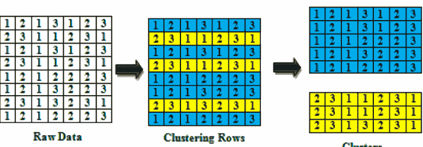

双向聚类（Madeira.S.C & OliveiraA.L., 2004）是一种数据挖掘技术。它也被称为共聚类（R.Gowri & R.Rathipriya, 2017），双聚类。在本章中，双聚类和双向聚类混用。该方法生成不同大小和特征的双簇，如图2所示。这是一种基于样本和属性对数据进行分组的过程。在所提方法中，K-means用于双向聚类。K-means同时应用于行和列，并通过组合这些行和列簇来提取局部模式（双簇）。

聚类和双向聚类之间的主要区别（Madeira.S.C & OliveiraA.L., 2004）（Berkhin, 2002）如下。

- 聚类应用于数据集的行或列之一，但双聚类应用于行和列。
- 所有簇中任何一个维度的大小将相同，但双簇的大小不同。
- 双向聚类比聚类过程分组更多相似元素。
- 双向聚类可以预测全局和局部模型，但聚类方法仅预测全局模型。

通常，K-means方法的结果取决于所选的初始种子。因此，不同运行的结果会有所不同。因此，在所提方法中，使用生物启发式优化模型（Nizar Banu & Andrews, 2015）根据簇内距离来改进结果。粒子群

图 2. 双向聚类：玩具示例

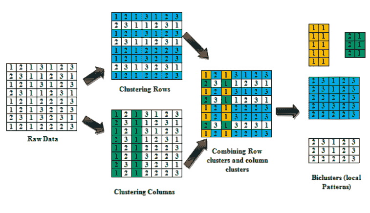

优化（PSO）（R.Gowri & R.Rathipriya, 2016-b）、遗传算法（GA）（R.Gowri & R.Rathipriya, 2016-d）和捕蝇草优化（VFO）（R.Gowri & R.Rathipriya, 2015-a）（R.Gowri & R.Rathipriya, 2015-b）在此工作中被尝试。PSO是事实上的优化技术之一，但容易陷入局部最优。遗传算法也存在局部最优问题，但它们在随机场景中搜索最优解。因此，局部最优问题比PSO小。此外，VFO算法是一种近期兴起的优化技术，不存在局部最优问题，也被选用于改进结果。在这项工作中，基序是从使用所提PSO K-means（R.Gowri & R.Rathipriya, 2016-b）、GA K-means（R.Gowri & R.Rathipriya, 2016-d）和VFO K-means（R.Gowri & R.Rathipriya, 2015-a）方法检测到的簇和双簇中提取的。二级结构相似性用于衡量结果的生物质量。比较了从簇和双簇中提取的基序的质量。蛋白质序列和基序有多种数据库可用，例如BLOCKS（S.Pietrokovski, JG.Henikoff, & S.Henikoff, 1996）、PROSITE（Bairoch.A, Bucher.P, & Hofmann.K, 1996）、PISCES（Wang.G & Dunbrack.R, 2003）等等。蛋白质序列对聚类和双向聚类过程进行预处理。簇和双簇基于其二级结构相似性进行比较。

### 背景

在这项工作（Zhao-Xing-Ming, 2005）中，他们提出了一种从基序内容和蛋白质组成中提取特征的新方法。他们使用支持向量机（SVM）结合遗传算法（GA）和主成分分析（PCA）来提取蛋白质基序。

在这项工作（Y.Fujiwara & A.Konagaya, 2008）中，他们在工作中提出了一种蛋白质提取方法论，他们使用隐马尔可夫模型（HMM）来检测具有未识别基序的蛋白质中的蛋白质基序。他们用各种类别的蛋白质基序测试样本训练HMM，以检测与训练数据集相似的蛋白质基序。

在这项工作（B.Chen, S.Pellicer, P.C.Tai, R.Harrison, & Y.Pan, 2009）中，作者提出了一种新型高效的颗粒计算模型，用于蛋白质序列基序和结构信息发现。蛋白质序列基序是使用与模糊改进K-Means模型和模糊贪婪K-Means模型的颗粒计算提取的。

在这项工作（B.Cheng, C.Hudson, M.Kim, A.Crawford, J.Wright, & D.Che, 2011）中，他们定义了另一种用于蛋白质序列基序提取的方法，使用


决策森林。他们将决策森林与模糊逻辑和粒计算相结合，以获得比以前工作更高效的结果。

在这项工作中（Y.Vincent, Bernard, & SinanKockara），作者提出了一种用于提取蛋白质motif的双聚类算法。他们使用模糊贪婪K-Means（FGK）模型结合粒计算获得了聚类。他们使用Cheng和Church方法来缩小聚类，以获得高质量的双聚类。

在这项工作中（Elayaraja, Thangavel, Ramya, & Chitralekha, 2011），作者设计了一种使用粗糙K-Means的motif提取方法。他们在其工作“使用粗糙K-Means从蛋白质序列中提取Motif信息”中，使用粗糙K-Means获得了比简单K-Means更好的结果，该工作发表于2011年。

在这项工作中（Elayaraja E, 2012），他们进一步建议使用SVD结合粗糙K-Means的另一种motif提取方法，以获得更好的结果。他们的工作“使用SVD结合粗糙K-Means算法从蛋白质序列中提取motif模式”发表于2011年。

在这项工作中（Bill.C.H.Chang, 2012），他们在2002年提出了一种使用神经-模糊优化进行蛋白质motif提取的方法，他们试图提高蛋白质motif识别的速度和灵活性。他们提出了一种算法，用于提取刚性和柔性蛋白质motif，并从一组相关蛋白质序列中检测共识模式（即motif）。

在这项工作中（Chen Yi-Cheng, 2011），他们提出了一种通过探索性数据分析发现蛋白质磷酸化motif的方法，他们在2011年提出了一种使用聚类方法进行motif提取的F-Motif算法。

在这项工作中（R.Gowri & R.Rathipriya, 2015），他们建议PSO算法可以比现有方法进一步改进结果。双聚类方法可以比聚类方法挖掘更多局部模式，该工作发表于2015年。

文献中的各项工作表明，不同的混合方法已被用于提取Motif信息。这些方法是支持向量机（SVM）、隐马尔可夫模型（HMM）、神经网络、模糊系统、粗糙集、聚类技术等的任何组合。一些作者使用优化技术来改进提取过程。从文献中可以看出，优化技术的组合可以改进结果，但有时会陷入局部最优。聚类技术更适合未知数据。双聚类比聚类过程进一步改进了结果，提出了将生物启发模型与聚类以及蛋白质序列上的双向聚类相结合的方法，并取得了更好的结果。本文提出的工作将在以下各节中进一步讨论。

## 蛋白质motif比较器

### Motif比较器的目标

蛋白质motif比较器的目标是从聚类或双聚类中检测motif。聚类（L. Youcheng, et al., 2012）（AshaGowdaKaregowda & SeemaKumari, 2013）和双聚类（Rathipriya, Thangavel, & J.Bagyamani, 2011）（Cui Xiaohui, 2005）（Das Shyama, 2010）是通过对预处理的蛋白质序列应用基于生物启发的方法（如粒子群优化（PSO）k-means、遗传算法（GA）k-means和捕蝇草优化（VFO）k-means）获得的。

这些生物启发K-Means的主要目标是减少类内距离并增加类间距离。序列的结构相似性用于寻找高度同源的序列。

在任何聚类和双聚类中起重要作用的显著氨基酸（Chen Yi-Cheng, 2011）可以使用序列logo表示法进行可视化。可以检测出具有选定相似度百分比的聚类/双聚类数量。motif比较器的工作流如图3所示。

> 图3. Motif比较器概览

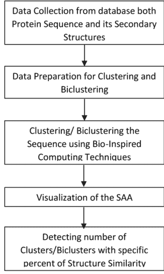

## 生物启发计算技术

### 遗传算法

遗传算法（GA）（Holland）（Forrest, 1993）（DE, 1989）是一种基准元启发式优化技术，几乎适用于多个领域中的各种问题。遗传算法由John Holland设计。遗传算法的伪代码如图4所示。它是进化算法之一，模拟自然选择过程。GA的个体（染色体）通常表示为比特串，但也可以使用其他类型的表示。它是一个从初始随机种群开始、直到最大代数结束的迭代过程。个体的适应度根据所讨论优化问题的目标函数进行评估。它具有各种遗传进化过程，如遗传、突变、选择和交叉。

选择算子是在每个连续代中选择一定比例个体以繁衍新一代的过程（Holland）（Forrest, 1993）（DE, 1989）。它基于解的适应度进行。适应度函数取决于问题。研究适应度值的比率，适应度较高的个体更有可能被选中。有多种不同的选择算子可用。

交叉和突变操作用于生成新一代（Holland）（Forrest, 1993）（DE, 1989）。选择一对亲代个体以生成新的子代个体。同样，生成一个子代个体池。子代个体共享两个亲代的特征。有多种不同的交叉算子可用，如单点交叉、多点交叉。突变算子用于对种群进行突变以生成新性状。这些过程最终导致与初始一代不同的下一代染色体种群。尽管交叉和突变被称为主要遗传算子，但在遗传算法中也可以使用其他算子，如重组、定殖-灭绝或迁移。

这种代际过程会重复进行，直到达到终止条件。常见的终止条件（Holland）（Forrest, 1993）（DE, 1989）为：找到满足最低标准的解、达到固定代数、分配的预算（计算时间/金额）已用完、最高排名解的适应度达到或已达到平台期（即后续迭代不再产生更好结果）、人工检查或这些条件的组合。

它是一种用于采样大型解空间的最强大的无偏优化技术。它能以最小变化适应任何类型的环境。典型的优化技术需要更多空间和时间来挖掘所有可行解。

### 图4. 遗传算法伪代码

```
Genetic algorithm
choose initial population
evaluate each individual's fitness
determine population's average fitness
repeat
select best-ranking individuals to reproduce
mate pairs at random
apply crossover operator
apply mutation operator
evaluate each individual's fitness
determine population's average fitness
until terminating condition
```

### 粒子群优化

粒子群优化（AshaGowdaKaregowda & SeemaKumari, 2013）是一种群智能技术。它是一种随机优化技术。它是一种基于鸟群行为设计的基于种群的方法。初始种群的选择基于问题标准决定。PSO算法涉及的步骤如图5所示。种群中个体的数量基于问题的目标决定。粒子在每个时间间隔根据自身迄今达到的最佳位置及其群体中任何粒子达到的全局最佳位置更新其位置和速度。随机项用于对粒子的加速度进行加权。最佳位置根据问题的目标函数进行评估。基本粒子群优化算法（PriteshVora, 2013）（P.Riccardo, K.James, & B.Tim, 2007）如图0所示。

粒子的速度根据方程1更新，其中第一项基于前一次迭代t的速度，第二项是认知部分，基于粒子的局部最佳位置，第三项是社会部分，基于粒子的全局最佳位置。w表示粒子先前速度的惯性权重，使用方程2计算。c1和c2是随机选择的常数值，R1和R2是随机数，其中R1, R2 [0, 1]。

```
$vel_{ij}(t + 1) = wv_{ij}(t) + c_{1}R_{1} \left( pbest_{ij} - x_{ij}(t) \right) + c_{2}R_{2} \left( gbest_{ij} - x_{ij}(t) \right) \quad (1)$
```


## Figure 5. 粒子群优化伪代码

```
Particle Swarm optimization
Create a swarm with P particles
Initialize the position and velocity of each particle randomly
Calculate fitness value of each position
Calculate pbest and gbest for each particle
Repeat
    Update velocity and position of each particle
    Evaluate the fitness of each particle
    Update pbest and gbest for each particle
Until Stopping criteria is true;
```

其中，

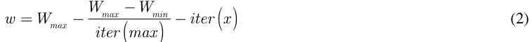

w_max 是粒子的初始权重，w_min 是粒子的最终权重。粒子在每次迭代中的位置根据粒子更新后的速度，使用公式 3 进行更新。

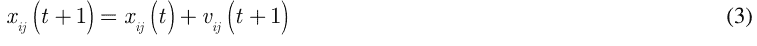

## 捕蝇草优化算法

蝇夹草优化算法（R.Gowri & R.Rathipriya, 2015-b）也是一种元启发式算法，可应用于任何类型的优化问题。该算法模拟了蝇夹草叶片（捕虫笼）快速闭合以捕获猎物的行为。闭合动作通过叶瓣表面的触发毛受到猎物（对象）刺激而触发。VFO 的伪代码如下图所示。该算法包含初始阶段、捕获阶段和封闭阶段。VFO 算法的伪代码如图 6 所示。

## Figure 6. VFO 伪代码

```
Venus Flytrap Algorithm //Initial phase
Objective function f(x), x = (x1, ..., xd) ∈ S
Initialize a population of flytraps xi (i = 1, 2, ..., n)
While iter <= S
For i=1 : n all n flytraps //trapping phase
At t=0, //first stimulation
Evaluate Action Potential u_t of flytrap i
Charge Accumulation C of flytrap i is determined by f(x_i)
At t=rand() //second stimulation
if t<=T then
update u_t C of flytrap i
evaluate the Object Status
end if
end for
Rank the flytraps and find the current best //sealing phase
Seal the best flytrap until another best flytrap arrives
end while
Post process results and visualization
```

触发毛的模拟产生了叶片闭合所需的动作电位。产生的电位以特定速率耗散并降至零。其计算使用公式 (4)。

```
$u_t = \begin{cases} 0.15e^{-2000t}, t \ge 0 \\ 0, t < 0 \end{cases}$ (4)
```

其中，t 是触发毛受到刺激的触发时间，第一次刺激前 t<0，连续第一次刺激时 t=0，第二次刺激时 t>0。为了启动蝇夹草闭合，两次连续刺激之间的时间将小于 30 秒。因此，第一次刺激前的时间取为小于零，第一次刺激时的时间取为零，触发第二次刺激时的时间取为大于零。因此，在第一次刺激前蝇夹草没有动作电位。这如公式 (4) 所示。

电荷积累可能与生物活性物质的逐步积累有关，导致动作电位激活离子通道。其使用公式 (5) 进行评估。

```
C = -k_c C + k_a u_t
```

其中，C 是叶瓣为陷阱闭合积累的电荷。k_a 是电荷的积累速率，即根据模拟中获得的动作电位积累电荷的速率。对于第一次刺激，耗散部分为零，因为第一次刺激前蝇夹草的初始电荷为零，它将用于第二次刺激以将先前获得的电荷与其相加。这就是真实蝇夹草中电荷的计算方式。在这些计算蝇夹草中，电荷基于客观函数 f(x) 进行计算。下一个参数是蝇夹草状态（δ），用于了解蝇夹草的当前状态。蝇夹草的状态将为 0、1 或 2（开放、闭合或封闭）。

```
δ(ft) = { 2, S(C) = 1, δ(ft) = 1 1, 0 ≤ t ≤ T 0, otherwise }
```

蝇夹草最初将处于开放（0）状态。如果陷阱闭合由猎物（对象）触发，则陷阱将处于闭合（1）状态。第一次刺激的时间点取为零，这里 t 表示第二次刺激时间。T 是两次刺激之间的时间阈值。

## 混合生物启发式 K-Means

混合生物启发式 k-means 表示通过采用生物启发式优化技术（如 PSO、GA 和 VFO，如前几节所讨论）来优化 k-means 算法（R.Gowri & R.Rathipriya, 2016-b）。这种生物启发模型的组合（即 PSO k-means（R.Gowri & R.Rathipriya, 2016-a）、GA k-means 和 VFO k-means）提高了 k-means 算法的性能。这些随机算法用于在随机解空间中搜索最优基序。

在 PSO k-means（R.Gowri & R.Rathipriya, 2015）算法中，一组质心被映射为粒子的位置，粒子的适应度是簇内距离。粒子的速度被随机初始化。粒子数量 n_p 选为 50，这些粒子最多迭代 1000 次（maxiter）。在 PSO 算法中，粒子受全局最优和粒子个体最优位置的影响，因此粒子更有可能陷入局部最优值。

## Figure 7. 混合生物启发式 K-Means 工作流

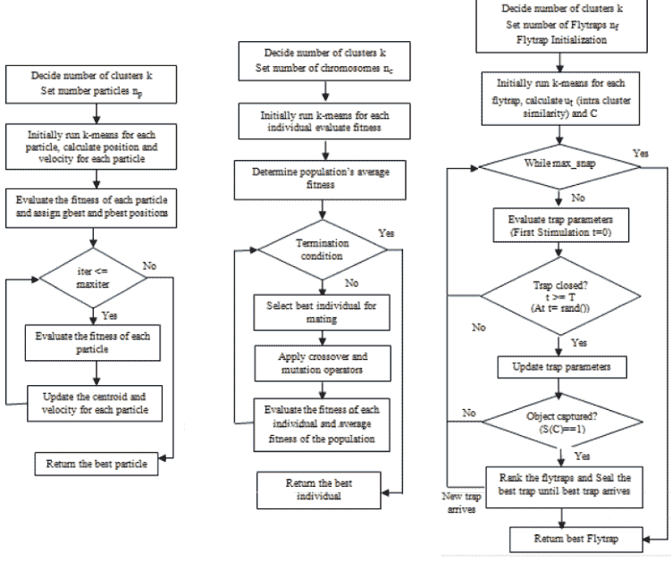

在基于 GA 的 k-means 中，染色体表示为二进制字符串。一组簇的隶属度值为个体。字符串长度与生成的残基簇数量相同。簇内距离是个体的适应度。选用的交叉概率为 0.7。与 PSO 相比，遗传算法具有更随机的搜索特性。尽管它随机搜索解，但有时个体可能会陷入局部最优。

为避免此局部最优问题，选择 VFO 来实现此方法。在 VFO 算法中，最佳解会被保留，直到获得新的最佳解。因此，这种优化技术避免了局部最优问题。簇内距离被选为适应度度量。积累的电荷（C）映射簇内距离。最大适应度值被选为电荷阈值。

不同蛋白质序列之间的距离（Elayaraja, K.Thangavel, M.Chitralega, & T.Chandrasekhar, 2012）（Y.Vincent, Bernard, & SinanKockara）使用城市街区距离进行评估，使用公式 (1)。V_k 是第 k 个序列，V_c 是质心序列。

city block distance = \(\sum_{i=1}^{R} \sum_{j=1}^{A} V_k(i,j) - V_c(i,j)\) (7)

簇内距离被选为针对 Motif Comparator 提出的所有三种生物启发式 k-means 方法的适应度。距离使用公式 (7) 计算。簇中每个序列与其质心之间的距离的均值被取为簇的适应度。适应度（Ahmadyfard.A & Modares.H, 2008）使用公式 (8) 计算。这里 \(V_k\) 是簇 k 中的序列，cent 是簇的质心。

fitness = \(1 / n \left( \sum_{i=1}^{n} distance(V_k(i), cent) \right)\) (8)

每个簇和双簇的结构相似度（Y.Vincent, Bernard, & SinanKockara）使用公式 (9) 计算。这里 ws 是窗口大小，\(P_{i,H}\) 显示簇在位置 i 的片段中螺旋的出现频率。\(P_{i,E}\) 和 \(P_{i,C}\) 的定义方式相似。基序为

similarity = \(\frac{\sum_{i=1}^{ws} max(P_{i,H}, P_{i,E}, P_{i,C})}{ws}\) (9)

## 数据集描述

蛋白质序列及其二级结构从不同数据库中收集。通常，二级结构来自 DSSP。采集了酵母蛋白质及其结构。蛋白质及其二级结构存储在单独的文件中，顺序相同。文件以文本文件中的 FASTA 格式存储。这些文件加载到该工具中。比较器用于模拟第一种方法 PSO k-means 的结果。其余两种方法使用 MATLAB 类似地实现，但没有 GUI。

## 数据准备

蛋白质序列长度不同，是氨基酸的集合。为了使序列长度相等并将其转换为数值数据，序列被排列为 9 或 10 个残基（列）。采用这些氨基酸残基的频率谱来实施所提出的方法。这些列


且行代表氨基酸和残基。现在每个序列（Elayaraja, K. Thangavel, M. Chitraleka, & T. Chandrasekhar, 2012）（Y. Vincent, Bernard, & Sinan Kockara）均被转换为 9×20 矩阵。这些矩阵用于聚类目的；如图 8 所示。

对于双向聚类，这些矩阵中的序列进一步归一化为单行，如图 9 所示，采用平均归一化。

二级结构中有八个类别，通过以下转换模型映射为三个类别：将 H、G 和 I 分配给 H（螺旋），将 B 和 E 分配给 E（片层），将所有其他项分配给 C（卷曲）。

## 聚类序列数据

对蛋白质序列进行聚类，以将高度同源的序列分组在一起并检测其中的重要氨基酸。这些重要氨基酸用于进一步研究蛋白质的功能。

图 8. Motif Comparator 用于聚类的蛋白质序列预处理

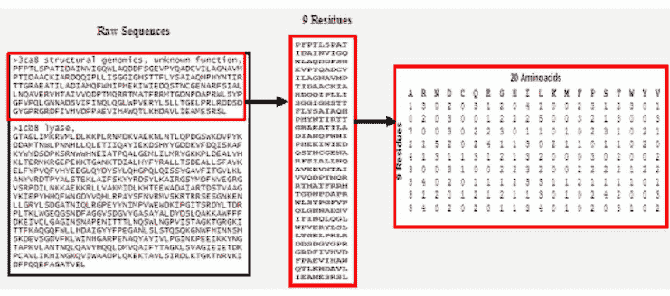

图 9. Motif Comparator 用于双向聚类的蛋白质序列预处理

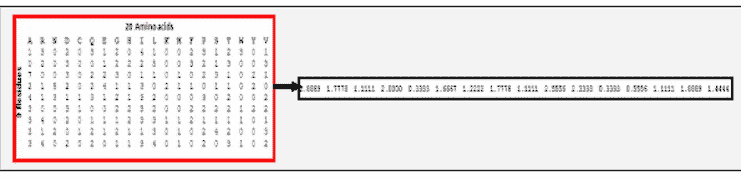

PSO k-means 的执行步骤如下：除序列数据外，在界面（如图 10(a) 所示）中给出待检测的簇数量和待处理的粒子数量作为聚类输入。单击结果按钮对给定序列进行聚类，可视化面板将如图 10(b) 所示显示。其余两种方法已实现，比较结果在图 10 中可视化。

## 图 10. Motif Comparator (PSO k-means)：(a) 簇规格 (b) 获得的结果


## 图 11. Motif Comparator (PSO k-means) – (a) 输入双簇规格 (b) 和双簇结果

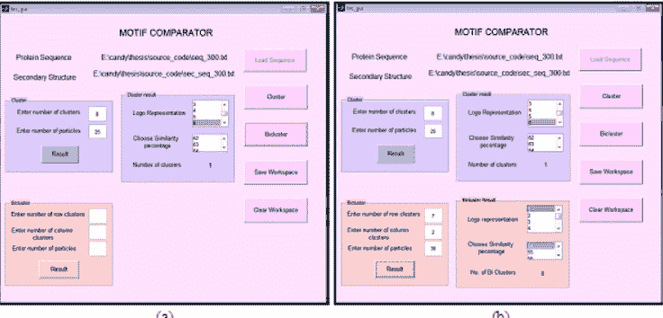

## 双聚类序列数据

蛋白质序列进行双聚类（Madeira, S. C. & Oliveira, A. L., 2004），旨在比聚类过程更好地将高度同源序列分组在一起并检测其中的重要氨基酸。这些重要氨基酸用于进一步研究蛋白质的功能。除序列数据外，待检测的行簇数量和列簇数量以及待处理的粒子数量作为输入给出用于双向聚类过程（如图 11(a) 所示）。单击结果按钮对给定序列进行双聚类，可视化面板将如图 11(b) 所示显示。其余两种方法已实现，比较结果在图 11 中可视化。

图 12. 所有提议方法发现的一些常见基序的 Logo 表示

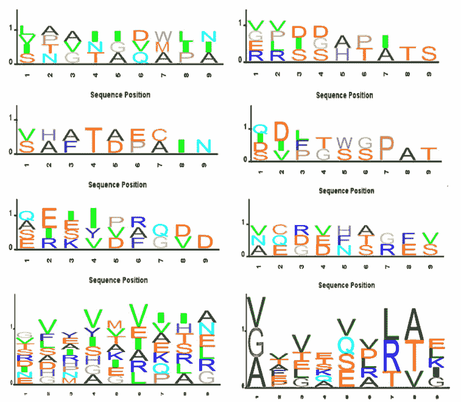

## 基序可视化与比较分析

获得的簇使用 Logo 表示进行可视化。通过在簇结果面板的列表中选择给定的簇 ID，每个簇中存在的重要氨基酸将显示在 Logo 窗口中。图 12 显示了提取的一些常见基序的示例 Logo 表示。

获得的双簇使用 Logo 表示进行可视化。通过在双簇结果面板的列表中选择给定的双簇 ID，每个双簇中存在的重要氨基酸将显示在 Logo 窗口中。图 13 显示了所有提议方法提取的一些常见双簇的示例 Logo 表示。可以通过选择列表中显示的相似度值（如图 11 所示）来检测具有所需相似度百分比的双簇数量。

图 13. 所有提议方法发现的一些常见基序的 Logo 表示

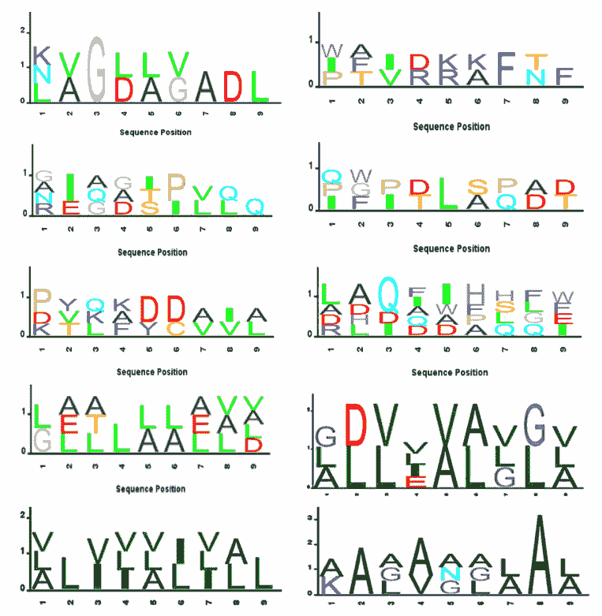

## 图 14. 基于结构相似性，使用所提议的生物启发式 k-means 方法提取的簇和双簇数量比较

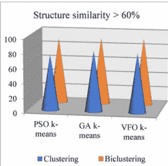

(a)

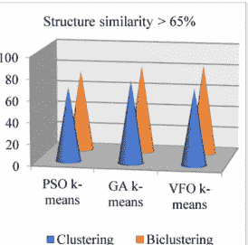

(b)

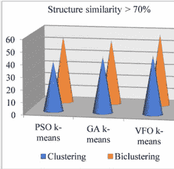

(c)

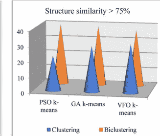

(d)


(e)

比较分析通过在指定结构相似度百分比下比较所有提议方法预测的簇和双簇数量来进行。结果表明，与 PSO k-means 相比，基于 GA 和 VFO 的 k-means 方法可以预测具有更高结构相似性的更多模式。在所有三种提议方法中，双向聚类优于聚类方法。结果如图 14 所示。

## 结论

蛋白质基序在研究生物系统特性方面发挥着重要作用。现有方法需要先验知识来预测蛋白质基序。它们可以挖掘结构相似度高达 75% 的基序。由于蛋白质序列是无监督数据，本研究工作提出了聚类和双向聚类方法用于蛋白质基序预测。已提出基于 PSO、GA 和 VFO 的 k-means 等生物启发式计算模型，以进一步完善结果。实验结果表明，双向聚类模型可以比聚类模型预测更多同源蛋白质基序。GA k-means 和 VFO-k-means 方法的性能优于 PSO k-means 方法。使用二级结构相似度度量从获得的簇和双簇中提取生物学上显著的模式。未来，该度量可以进一步纳入这些方法中，作为更精细结果的适应度度量。

## 参考文献

- Ahmadyfard, A., & Modares, H. (2008). 结合 PSO 和 K-Means 以增强数据聚类。*国际电信研讨会*, 688–691. doi:10.1109/ISTEL.2008.4651388

- Bairoch, A., Bucher, P., & Hofmann, K. (1996). PROSITE：新进展。*核酸研究*, 189–196.

- Bapuji Rao, B. K. (2017). 使用图挖掘技术对文本文档进行聚类的方法。*粗糙集与数据分析国际期刊*, 4(1).

- Berkhin, P. (2002). 聚类数据挖掘技术综述。Accrue Software.

- Bill, C. H., & Chang, S. (2012). 使用神经模糊优化提取蛋白质基序。*Bioinformatics*（牛津，英国）, 18(8), 1084–1090. PMID 12176831

- Chen, Pellicer, Tai, Harrison, & Pan. (2009). 用于蛋白质序列基序和结构信息发现的新型高效粒计算模型。*计算生物学与药物设计国际期刊*.

- Chen Yi-Cheng, K. Y.-W.-T.-F. (2011). 通过探索性数据分析发现蛋白质磷酸化基序。*蛋白质磷酸化基序的发现*（PLoS ONE）, 6.

- Cheng, B., Hudson, C., Kim, M., Crawford, A., Wright, J., & Che, D. (2011). 使用决策森林提取蛋白质序列基序。*计算机科学与计算机工程世界大会*.

- Cui Xiaohui, P. T. (2005). 基于混合 PSO K-means 算法的文档聚类分析。*计算机科学期刊*, 27–33.

- Das Shyama, I. S. (2010). 用于双聚类基因表达数据的贪婪搜索-二进制 PSO 混合。*计算机与应用国际期刊*, 2(3), 1–5. doi:10.5120/651-908

- De, G. (1989). *搜索、优化和机器学习中的遗传算法*. Reading, MA: Addison-Wesley.

- Duggirala Raja Kishor, N. V. (2016). 一种用于更好聚类性能的期望-最大化与 K-Means 算法的新型混合。*环境计算与智能国际期刊*, 7(2).

- Elayaraja, E., Thangavel, K., Chitraleka, M., & Chandrasekhar, T. (2012). 使用带有粗糙 K-Means 算法的 SVD 从蛋白质序列中提取基序模式。*IJCSI 计算机科学问题国际期刊*, 9(6), 350–356.

- Elayaraja, E., Thangavel, K., Ramya, B., & Chitralegha, M. (2011). 使用粗糙 K-Means 算法从蛋白质序列中提取基序模式。*程序工程*, 30, 814–820. doi:10.1016/j.proeng.2012.01.932

- Forrest, S. (1993). 遗传算法：应用于计算的自然选择原理。*科学*, 872–878.

- Fujiwara & Konagaya. (2008). 使用隐马尔可夫模型提取蛋白质基序。*基因组信息学*, 57–64.


Gowri & Rathipriya. (2015). 基于PSO K-Means的蛋白质序列Motif信息提取. 网络与信息安全期刊.

Gowri & Rathipriya. (2015a). 使用捕蝇草优化算法的双聚类. 数据挖掘中的计算智能——第1卷. 智能系统与计算系列丛书, 410.

Gowri, R., & Rathipriya, R. (2016d). MR-GABiT: 基于MapReduce的时间序列数据双聚类遗传算法. 计算机应用进步国际会议. IEEE.

Gowri, R., & Rathipriya, R. (2017). 基于评分协同聚类与MapReduce模型的蛋白质交互网络中凝聚子网络挖掘 (MR-CoC). 大数据分析与云计算国际会议. Springer.

Gowri, R., & Rathipriya, R. (2016b). 使用生物启发计算提取蛋白质序列Motif信息. 载于《生物信息学中计算智能应用研究手册》（第240–262页）. IGI Global.

Gowri, R., & Rathipriya, R. (2016c). 基于MapReduce框架的质量导向聚类. 绿色工程与技术国际会议. IEEE.

Gowri, R., & Rathipriya, R. (2015b). 捕蝇草优化算法. 计算智能、网络安全与计算模型国际会议. 智能系统与计算系列丛书, 412.

Gowri & Rathipriya. (2016a). 基于PSO K-Means的蛋白质Motif比较器. 应用元启发式计算国际期刊, 7(3), 56–68.

Holland, J. H. (n.d.). 遗传算法与自适应. 不良定义系统的自适应控制, 北约会议系列, 16, 317-333.

Karegowda & Kumari. (2013). 基于粒子群优化算法的K-Means和模糊c-means聚类. 计算机科学与软件工程先进研究国际期刊, 3(7).

Kunik, V., Solan, Z., Edelman, S., Ruppin, E., & Horn, D. (2005). Motif提取与蛋白质分类：计算系统. IEEE计算系统生物信息学/生命科学学会会议录.

Madeira, S. C., & Oliveira, A. L. (2004). 生物数据分析双聚类算法. 调查（伦敦，英国）, 1–31. PMID:17048406

NizarBaniu, P. K., & Andrews, S. (2015). 使用元启发式优化算法进行基因聚类. *应用元启发式计算国际期刊*, 6(4).

Pietrokovski, S., Henikoff, J. G., & Henikoff, S. (1996). BLOCKS数据库 - 一种蛋白质分类系统. *核酸研究*, 24(1), 197–200. doi:10.1093/nar/24.1.197 PMID:8594578

PriteshVora. (2013). K-means聚类和粒子群优化综述. *科学与现代工程国际期刊*, 1(3), 24–26.

Rathipriya, R., Thangavel, K., & Bagyamani, J. (2011). 基于二进制粒子群优化的Web使用数据双聚类. *计算机与应用国际期刊*, 25(2), 43–49. doi:10.5120/3001-4036

Riccardo, P., James, K., & Tim, B. (2007). 粒子群优化概述. *群体智能*, 33–57.

Structures of life. (2007). 美国卫生与公众服务部.

Vincent, Bernard, & Kockara. (n.d.). 通过双聚类算法提取蛋白质序列Motifs信息. 学术出版社.

Wang, G., & Dunbrack, R. (2003). PISCES：蛋白质序列筛选服务器. *生物信息学*, 1589-1591.

Youcheng, Nan, Majie, Kedi, Yuan, & Qu. (2012). 基于粒子群优化和多类合并的K-means优化聚类算法. *CSIE进展*, 1, 569-578.

Zhao-Xing-Ming. (2005). 一种从Motif内容和蛋白质组成中提取特征的蛋白质序列分类新方法. *神经网络*, 1019–1028. PMID:16153801

## KEY TERMS AND DEFINITIONS

**氨基酸：** 氨基酸是构成蛋白质序列或肽的基本元素的有机化合物。蛋白质由二十种氨基酸组成。它们具有疏水性、亲水性、极性、非极性等不同特征。

**同源蛋白质：** 同源蛋白质是指在结构或功能上具有相似特征的一组蛋白质。

**Logo表示法：** 它是氨基酸和核酸的一种图形表示，用于蛋白质序列比对处理。特定位置氨基酸的权重由氨基酸的高度表示。

**元启发式模型：** 元启发式模型是一种高级别的、与问题无关的算法框架，为开发启发式优化算法提供一套指导原则或策略。

**蛋白质Motif：** 存在于蛋白质序列中、具有某些特定特征的连续氨基酸序列。

**蛋白质序列：** 蛋白质序列是生物结构和功能的基本决定因素。它是氨基酸序列。

**显著氨基酸（SAA）：** SAA存在于蛋白质Motif中，在同源蛋白质Motif中具有特定特征。SAA使用Logo表示法突出显示。

## 第5章
制造业中的元启发式：
使用遗传编程进行加工
刀具磨损预测建模

Mohammad Zadshakoyan
伊朗不里莱大学，伊朗

Vahid Pourmostaghimi
伊朗不里莱大学，伊朗

## 摘要

切削刀具的状态是任何金属切削过程中的重要因素，因为使用磨损刀具会导致报废零件、机床损坏和非计划停机等额外成本。因此，刀具磨损预测在工业自动化中发挥着重要作用，以提高生产率和可接受的产品质量。因此，为了提高车削过程的生产率，最近针对车削过程中的刀具磨损估计和分类开展了大量研究。切屑形状是评价加工过程性能时通常考虑的最重要因素之一。由于渐进刀具磨损对所产生切屑的形状和几何特征有影响，因此有可能预测一些可测量的加工输出，如坑洼磨损。根据实验研究，切削速度和切削时间是两种对刀具前刀面坑洼磨损发展有极大贡献的参数。因此，这些参数将改变切屑半径和几何形状。本章介绍了通过车削过程中切屑半径的变化开发刀具磨损遗传方程的过程。该方程的开发结合了进化方法、制造技术、测量与控制技术以及足够的硬件和软件支持等不同方法和技术。遗传方程和实验得到的结果表明，所得遗传方程与实验数据相关性良好。此外，它可用于切削过程中的刀具磨损估计，并且由于其参数形式，遗传方程使我们能够分析输入参数对坑洼磨损参数的影响。

## 引言

像钻削、铣削或车削这样的制造过程，可以使用可靠且灵活的刀具监测系统进行显著优化。在此背景下，最重要的任务是（Golz, Schillo, Wolf, & Kaufeld, 1995）：

- 快速检测碰撞，即刀具或刀具持夹件与工件或机床部件之间的意外接触，
- 识别刀具断裂（断折），例如切削刃上的崩口，
- 估计或分类由磨损或其他影响引起的刀具磨损。

请注意，碰撞和刀具断裂通常是突然且大多出乎意料的事件，需要实时响应，而磨损的发展或多或少是缓慢进行的。本章侧重于磨损的确定，这是三项任务中最困难的一项。刀具磨损监测的重要性体现在可能带来的经济效益。通过及时更换磨损的刀具（例如考虑当前的加工过程，如粗车或精车），可以避免生产废品。此外，通过精确利用刀具寿命，可以显著降低刀具成本。通过对刀具磨损的准确估计，甚至可以调整刀具位置以满足几何规格，并控制刀具磨损率，以保证工件的某些表面质量或粗糙度。

切屑形式和刀具磨损是两大主要加工性能指标，几十年来一直是广泛研究的对象。必须指出，对切屑形成和切屑运动有正确的认识是预测切屑可折断性的关键任务。此外，所产生切屑的几何特征为切削区中的摩擦学现象（如刀具磨损、切削区温度等）提供了宝贵信息。


另一方面，刀具磨损及与刀具寿命相关的经济估算是加工优化中的关键问题，因为在自动化制造操作中，刀具必须在失效前很早就从切削过程中移除，否则所生产的零件将超出允许公差（Devliez, Lesko, & Mozer, 2004）。因此，刀具磨损在制造中至关重要，因为它影响着零部件质量、刀具寿命和机器成本。

导致刀具失效的机制包括磨粒磨损、粘着磨损和扩散磨损（Devliez et al., 2004）。考虑到切屑半径与坑洼磨损的形式直接相关，而这种磨损是由粘着和扩散因素形成的，因此可以得出结论：这些因素显著影响切屑几何形状。

通过考虑加工操作中通常观察到的各种磨损机制的基本性质，已表明在刀具逐渐磨损过程中，某些主要磨损参数会导致金属加工（尤其是车削操作）中切屑流动、切屑卷曲和切屑可断性的变化。图1展示了上述研究中考察的各种磨损特征。

在本工作中，为了预测刀具坑洼磨损，基于测量获得了两个独立的数据集：训练数据集和测试数据集。切屑半径被用作独立输入变量，而坑洼磨损是因变量输出。基于训练数据集开发了刀具坑洼磨损方程，并使用适应度函数在测试数据集上证明了所得模型的准确性。

因此在本章中，基于实际实验获得的结果，利用其几何

Figure 1. 车削操作中影响切屑几何形状的主要刀具磨损参数，VB：主要后刀面磨损；KT：坑洼磨损深度；KB：坑洼磨损长度；KS：切削刃磨损退缩量；KK：坑洼磨损宽度；N：刀尖磨损（Devliez et al., 2004）。


Figure 2. 本研究所用方法的示意概览

- 1. 选择合适的切削参数
- 2. 进行实验
- 3. 对所得数据进行分类，以训练GP模型、测试GP模型并启动先前提出的模型
- 4. 针对训练数据集进行GP建模
- 5. 根据实验数据计算模型输出的适应度函数
- 6. 比较适应度函数的值以评估GP模型的性能

特征已被研究，然后使用GP提出了一种模型来估计坑洼磨损深度KT和坑洼磨损长度KB的值。

## 遗传编程（GP）

遗传算法（GA）通常用作搜索函数全局最优解的优化技术。然而，这并非GA的唯一可能用途。其他需要鲁棒性和全局优化的应用领域也能从GA中获益匪浅。GA的两个最重要的替代应用领域是基于遗传的机器学习（GBML）和遗传编程（Settea & Boullart, 2001）。GP基本上是一种应用于种群成员或计算机程序的GA，而GA通常对（编码的）数字字符串进行操作，GP则必须对成员进行操作。与GA相比，GP允许优化更复杂的结构，因此可以应用于更广泛的问题（Koza, 1992）。图3给出了GP模型的示意概览，展示了其不同阶段。在编程的每个阶段都会执行以下步骤。GP的目标是找出最能解决问题的成员或后代。GP中的可能解是所有可以从一组函数基因（记为F = {f1, f2 ... , fm}，其中m为函数基因的数量）和一组终端基因（记为T = {a1, a2 ... , an}，其中n为终端基因的数量）以递归方式组合而成的所有可能计算机程序。集合F中的每个单独函数fi都有一定数量的参数z(fi)。因此，集合F中函数基因的适当参数数量由列表{z(f1), z(f2), ..., z(fm)}确定。

Figure 3. GP模型应用的示意概览（Zadshakoyan & Pourmostaghi, 2013）


函数基因集合F可以包含基本数学函数、布尔函数、关系函数、程序流程控制函数、递归函数以及针对所研究问题领域定义的函数。终端基因集合T可以包含数值常数、逻辑常数、变量等。终端基因实际上是没有参数的函数基因。使用F和T的此类树示例如图4所示。

初始种群是通过从集合F中使用可用的函数基因和从集合T中使用可用的终端基因，随机创建成员而获得的。每一代的每个成员代表搜索空间中的一个随机点。

初始种群的创建是在巨大的可能解空间中盲目随机搜索解决方案。下一步是计算个体对环境的适应度（即，计算每一代每个成员的适应度）。适应度是修改正在适应的结构的指导准则。在GP中，计算机程序主要通过两种遗传操作发生变化：复制和交叉。复制操作使更成功的生物具有更高的选择概率。

在每一代中，最佳染色体被原样复制到下一代。交叉操作确保后代之间遗传物质的交换。图5展示了由若干函数基因和终端基因组成的两个亲本染色体的交叉操作以及变异操作。

Figure 4. 对应方程(2-x)*(y+5)的成员树状表示示例


Figure 5. GP方法的数学运算（Zadshakoyan & Pourmostaghimi, 2013）


然后对计算机程序进行第二阶段和第三阶段的迭代重复。经过一定数量的代数后，新生的后代通常对环境适应得更好。

环境的含义取决于所处理的问题。当满足终止标准时，进程终止。

这可以是规定的代数或解的足够质量。由于进化是一个非确定性过程，每次运行并不一定以成功的解决方案结束。为了获得成功的解决方案，问题必须在多次独立运行中处理。获得满意解所需的运行次数取决于问题的难度（Zadshakoyan & Pourmostaghimi, 2013）。

在本章中，为了确定坑洼磨损参数与切屑半径之间的关系，已使用遗传编程开发了遗传方程。磨损特征的遗传方程开发如下：

$KT = F_1(R)$

(1)

$KB = F_2(R)$

(2)

其中，$KT$是坑洼磨损深度，$KB$是坑洼磨损长度，而F1和F2分别将切屑半径$R$与$KT$和$KB$关联起来的函数。确定遗传方程的进化参数为种群规模（染色体数量）Ms=40和代数G=3000。染色体数量选为30，即一个非常小的种群，因为它对几乎所有问题都能产生非常好的结果，即使对于像包含超过25000个变量的DNA微阵列这样高维的问题也是如此。使用了交叉和变异等遗传操作。变异率为P$_m$=0.044，交叉率为P$_c$=0.1。此外，根据磨损机制和磨损率的性质，设置的算术运算如下：

$F = {+, -, \times, Ln, exp}$

(3)

## 背景

当今在刀具磨损监测领域的科学方法通常测量几种与刀具磨损间接相关的工艺参数（如力或振动信号）。这些信号是在线测量的，即在切削过程中测量。该过程本身受许多切削条件的影响，如刀具几何形状或工件材料。例如，关于金属切削制造过程的详细描述可参见(Milton & Shaw, 1984)。非常常见的是，人工神经网络（ANN）、模糊系统或两者的组合被用来建模从测量信号提取的特征与切削条件（一方面）以及刀具磨损或刀具断裂（另一方面）之间的非线性依赖关系。近年来已经进行了大量有前景的研究。然而，特别是由于泛化能力不足（例如，使用仅限于特定机床、只允许较小范围的切削条件，或需要耗时的“教学”周期）或仅仅是精度不足，即使


迄今，有前景的方法尚未实现市场化。这些不足促使研究人员探索其他建模和分析方法。

刀具磨损估计可分为两类讨论：

- 1. 在线或基于传感器的监测系统，旨在测量加工过程中的磨损。
- 2. 离线或无传感器监测过程，它提出了刀具磨损的预测建模（Sick, 2002）。

第一类由在线刀具磨损监测方法组成，可进一步分为直接法和间接法两类。直接法基于使用光学（Jianfeng, Yongqing, Fangrong, Zhiren, & Yao）、放射性、电阻法或视觉系统（Sortino, 2003）（Lanzetta, 2001）等直接测量刀具磨损。这些方法具有高精度的优点，但在经济或技术方面尚未证明非常有吸引力。间接法基于刀具状态与切削过程中可测量信号之间的关系。已使用了不同的可测量信号，包括力（Gosh et al., 2007）、振动（Abu-Mahfouz, 2003）、声发射（Lu & Kannatey-Asibu, 2004）、切削温度（D’Errico, 1998）等，用于检测刀具磨损。然而，用于工业应用的可靠间接方法非常少。这主要是因为监测信号在本质上可被视为随机和非平稳的，而非确定性，以及由于测量特征与刀具磨损之间存在非线性关系。

已发展出若干方法用于高效的刀具状态监测（TCM），其中一些已在工业界成功应用。基于传感器的系统被认为更具优势，并被优先用于收集加工过程中刀具状态的信息。传感器的信息或信号经过不同方法处理，识别出关键参数以确定刀具磨损状态。基于这些参数，设计出高效的决策策略。目前已应用若干TCM政策和方法，但大多数方法仅能检测与某些特定故障类型相关的刀具磨损和失效。一种能够区分各种失效模式的通用方法尚待开发（Dan & Mathew, 1990）。

直接法可描述如下：

- 1. 使用传感器收集关于刀具磨损状态的信息：在加工过程中，可使用单个或多个传感器来感知与刀具磨损状态相关的信号。多传感器作为后续传感器融合策略的一部分，似乎更具优势。传感器融合是将来自多个来源的感官数据组合成单一信息或知识元素的过程（Tanner & Loh, 1992）。
- 2. 从感官信息中提取显著特征：有时有必要分析通过传感器收集的信息，并提取与刀具磨损状态显著相关的相关特征。这些信息要么是失效状态的直接指示，要么作为后续决策策略的一部分进行进一步处理。
- 3. 开发用于控制加工过程并指示刀具更换状态要求的决策策略：神经网络因其高效的分类和优化能力，作为决策策略的一部分享有非常高的地位。计算机技术的发展使得更快的计算成为可能，并对普通用户在经济上可行。此外，故障容错和噪声抑制的固有特性以及其他方法的局限性，使得神经网络成为TCM中非常受欢迎的选择（Dutta, Paul, & Chattopadhyay, 2000）。

第二类基于预测模型且无传感器，可分为两类：经验建模和智能建模。例如，Taylor刀具寿命方程属于第一类（参见，例如（Ghani, Rizal, Nuawi, Ghazali, & Haron, 2011））。其他数学模型（如回归）可归为此类。另一类使用智能建模技术，如遗传编程、人工神经网络和其他建模方法。无传感器监测技术的示例包括：基于多层感知器的寿命预测（Chao & Hwang, 1997）、基于多层感知器的 flank wear width 和 crater wear depth 预测（Prasad & Ramamoorthy, 2001）、基于多层感知器的寿命预测及切削条件优化（Li & Nee, 1996）、基于遗传编程的钻削刀具磨损建模（Zakeri & Pourmostaghim, 2017）以及其他智能方法。然而，这些方法中的大部分旨在评估 flank wear（VB），而对 crater wear 建模的研究进展甚微（Sick, 2002）。

过去几年来，已有一些关于刀具磨损估计的研究，并提出了一些解析（Dawson & Kurfess, 2005）和经验模型用于评估坑洼深度和长度，但其中大多数缺乏实际应用。

已提出多种直接和间接测量技术来评估硬质合金刀片的 crater wear。直接方法基于使用光学（Dawson & Kurfess, 2005）和视觉系统（Jurkovic, Korosec, & Kopac, 2005）直接测量刀具磨损区域。这些方法具有高测量精度的优点，但不易应用于在线应用，主要是由于冷却液和切屑的中断（Lister & Barrow, 1986）。出于此原因，多位作者提出了用于磨损监测的间接技术。

尽管在切屑半径和刀具磨损领域已进行了大量研究，但考虑刀具磨损对所产生切屑半径影响的研究很少。Fang 和 Jawahir（Fang & Jawahir, 1993）研究了车削操作中渐进式刀具磨损对切屑可断性和切屑形态的影响。该研究的实验结果表明，刀具前刀面上发展出的 crater wear 充当切屑破断槽，因此随着时间推移和 crater 扩大，切屑半径将减小。

K.C.Ea 等人利用等效刀具面（ET）模型，研究了带槽刀具加工中刀具磨损机制及其对切屑卷曲/切屑形态的影响。在上述工作中，提出了一种新方法，用于关联带槽刀具渐进式刀具磨损机制下的切屑卷曲（Ee, Balaji, & Jawahir, 2003）。

目前，由于该领域研究不足，且难以建立理想的解析模型，因此使用遗传编程等智能或元启发式方法是不可避免的。

在计算机科学和数学优化中，元启发式是一种高层程序或启发式，旨在查找、生成或选择一种启发式（部分搜索算法），该算法可能为优化问题提供足够好的解，尤其是在信息不完整或不完美，或计算能力有限的情况下。元启发式对一个过大而无法完全采样的解集进行采样。元启发式对所求解的优化问题做出的假设很少，因此它们可用于各种问题（Osman & Kelly, 1996）。

元启发式已应用于广泛的研究领域，例如受监督机器学习（Abinash & Santanu Kumar, 2017）、汇率预测（Ahmed, Mahmoud, Mohammed, & Aboul Ella, 2015）、建筑学（Alexiei, Daniel, & Ruben, 2012）、遗传工程（Banu & Andrews, 2015）、老年人护理（Claas, Daniel, Michael, & Gerrit, 2011）、医疗目的（Ashour et al., 2015）、健康科学（Nilanjan Dey, Samanta, Yang, Das, & Chaudhuri, 2013）、优化算法（Gerald, 2016）、人类行为识别（Hans & Stephen, 2016）、Wi-Fi 系统（Heba & Moustafa, 2014）、制造业（Z. Mohammad & Vahid, 2015）、能源和风力涡轮机（H. Mohammad & Mohammad Hassan, 2016）、图像处理（Samanta, Dey, Das, Acharijee, & Chaudhuri, 2013）、智能语言识别（Hore et al., 2017）、复杂数学问题（Hicham El, Said, & Jamal, 2015）、学习技术（Jennifer, Tom, & Paul Mc, 2011）、数据聚类（Kanungo, Janmenjoy, Bighnaraj, & Behera, 2016）、无线传感器网络（Binh, Hanh, & Dey）、生物工程技术，例如心电图（Nilanjan Dey et al., 2013）、视网膜成像（Nilanjan Dey et


al., 2014), 医学信号处理 (N Dey, Chakraborty, & Samanta, 2014), MRI去噪 (Nilanjian Dey et al., 2015), 脑疾病检测 (Ashour et al., 2015), 土木工程 (Rahul, Senthilnath, Omkar, & Narendra, 2016), 跟踪系统 (Sean & Kevin, 2014), 股价预测 (Vipul & Kulkarni, 2017), 教育方法 (Vladimír, Petr, Peter, Karel, & Petr, 2016), 和大数据分析 (Zakaria, Souham, & Mohamed, 2017).

属于进化计算和元启发式方法家族，GP模仿自然界生物体的生物进化。这种相对较新的自动编程技术最初由 Koza 在其方法中描述，该方法有效地结合了进化计算和自动编程的概念（Koza, 1992）。在工程领域，尤其是制造工程中，GP经常被应用于模拟各种过程和条件。GP的一些应用已在表面粗糙度预测（Brezocnik, Kovacic, & Ficko, 2004）、非线性系统建模（Metenidis, Witzczak, & Korczbiz, 2004）、切削力研究（Milfelner, Kopac, Cus, & Zuperl, 2005）、刀具-芯片接触长度建模（Zadshakoyan & Pourmostaghimi, 2013）以及机器排程问题（Dimopoulos & Zalzala, 2001）中被报道。

## 本章主要研究重点

制造业界始终致力于降低运营成本，同时努力提高产品质量并满足或超越客户满意度。这些目标是推动自动化和采用高产量无人设备的动力所在。金属切削过程高度非线性，涉及塑性变形、断裂、冲击、连续和间歇多接触点、摩擦和磨损等现象。在加工过程中直接目视检查刀尖是不可行的，因为工件和切屑会遮挡视线。为克服这一困难，需要采用间接方法。另一方面，使用传感系统成本高昂且存在一些局限性。因此，寻找一个可靠的模型来预测磨损并确定切削参数与刀具磨损之间的关系显得极为必要。

在本章中，提出了一种精确且更快速的刀具寿命估计方法，该方法需消耗较少的工件材料和刀具。在该方法中，通过使用遗传编程并通过外推法寻找刀具失效时间来估计刀具寿命。遗传编程用于预测刀具坑洼磨损。刀具磨损估计需要在不同的切削条件下进行多次测试，直至切削刀具失效。记录每次切削后的磨损，并通过外推磨损-时间曲线来估计达到限制性坑洼磨损的时间。

### 实验工作

所有实验测试均在CNC车床上进行，且在干式条件下进行。为减小切削刃上的切削速度变化，使用了大直径工件。为建立遗传方程，选择了不同的切削速度 V 和切削时间 t 值，而进给率和切削深度分别选取为恒定值 0.07 mm/rev 和 1.5 mm。所选的切削速度值为 65 (m/min)、75 (m/min) 和 85 (m/min)，切削时间为 1 (min)、3 (min)、5 (min) 和 7 (min)。除了上述用于训练遗传方程的 12 项实验外，还进行了 5 项额外实验以定量测试该方程，其条件如表 1 所示。

这些测试中使用了市售的无涂层硬质合金刀片（Tizit, TNMA 220408，牌号 P20）。AISI 4140（硬度约为 187 BHN）被选为工件材料，因为其应用广泛且可加工性良好。为测量磨损参数，使用配备图像处理软件的光学显微镜仔细检查了切削刀片。

所得切屑的半径使用游标卡尺测量，然而，对于半径较大的切屑，则使用投影仪进行精确测量。

所开发方程的准确性采用两项统计指标进行分析。这些指标是均方根误差 RMSE 和方差绝对拟合优度 R^2，其定义如下：

```
RMSE = \sqrt{\sum_{m=1}^{n} \frac{(Y_{predicted,m} - Y_{experimental,m})^2}{n}}
```

```
R^2 = 1 - \frac{\sum_{m=1}^{n}(Y_{predicted,m} - Y_{experimental,m})^2}{\sum_{m=1}^{n}(Y_{experimental,m})^2}
```

表 1. GP 测试步骤的切削参数

| | 测试 1 | 测试 2 | 测试 3 | 测试 4 | 测试 5 |
|---|---|---|---|---|---|
| V(m/min) | 80 | 60 | 50 | 60 | 70 |
| t (min) | 3 | 2 | 4 | 4 | 3 |

其中 n 为数据点数量，Ypredicted,m 和 Yexperimental,m 分别表示单个数据点 m 的预测值和来自实验数据的目标值。RMSE 表示实验值与预测值之间的偏差。拟合优良时 R2 值为 1，而拟合不佳时则接近零。

## 结果与讨论

在本章中，利用切屑半径对车削过程中的坑洼磨损状况进行建模，采用了 GP 的进化算法。已进行 12 次实际实验来训练和建模方程，并进行了 5 次其他实验来验证所建立的模型。与切削条件对应的实验结果如图 6 所示。

图 7 展示了在切削速度为 75 (m/min) 下不同时间产生的切屑。图 8 和图 9 展示了不同切削条件下的刀具磨损测量结果。可以看出，随着时间的推移和切削速度的增加，坑洼深度 KT 和坑洼长度 KB 将增加。坑洼深度 KT 的值增加得比另一个更快。这种快速增加将导致切屑曲率增加。

Figure 6. Chip radii obtained from experiments t=1(min) t=3(min) t=5(min) t=7(min)


Figure 7. Produced chips in cutting speed of 75 (m/min)


Figure 8. Experimental data For KT (training data set)


另一方面，坑洼深度 KT 越深，切屑卷曲半径越小。通常，坑洼长度 KB 和坑洼宽度 KK 在前几分钟内会在刀具前刀面上迅速形成，然后继续缓慢发展。已进行测试的结果如表 2 所示。

为执行遗传编程，可以使用各种算术运算。在本章中，算术-函数集如方程 3 所示。基于获得的 RMSE 和 R2 值，KT 和 KB 的最佳遗传方程如下：

```
KT = 77.77 − 3.17R − 28Ln(R) + exp(0.06R) + \frac{816}{exp(R)} − \frac{20952}{exp(2R)}   (6)
```

Figure 9. Experimental data For KB (training data set)


表 2. 测试数据集的实验数据和条件

| | 测试 1 | 测试 2 | 测试 3 | 测试 4 | 测试 5 |
|---|---|---|---|---|---|
| V (m/min) | 80 | 60 | 50 | 60 | 70 |
| t (min) | 3 | 2 | 4 | 4 | 3 |
| R (mm) | 12.96 | 17.27 | 12.33 | 11.76 | 12.64 |
| KT (µm) | 15 | 10 | 15 | 18 | 17 |
| KB (mm) | 1 | 0.89 | 0.99 | 1.03 | 0.98 |

KB = 1.008 - 0.009R + \frac{1.63}{R + 0.75} + \frac{\exp(R)}{\exp(32)} + 2 \exp(R) \quad (7)

其中 R 为切屑半径，KT 为坑洼磨损深度，KB 为坑洼磨损长度。图 10 和图 11 展示了与所得遗传方程对应的曲线。如所示，切屑半径的任何减少都对应 KT 和 KB 值的增加。因此，可以得出结论，所开发的遗传方程准确地指示了 AISI 4140 车削过程中的磨损方式。

表 3 显示了所选遗传方程的 RMSE 和 $R^2$ 值。根据此表，可以得出结论，针对 KT 和 KB 提出的遗传方程与给定切削参数范围内的实验数据吻合良好，因此它在预测伴随刀具坑洼磨损进展的切屑半径方面具有独特的能力。


## 图 10. 根据公式 6，KT 与芯片半径 R 的变化


## 图 11. 根据公式 7，KB 与芯片半径 R 的变化


## 表 3. 选定遗传模型的 RMSE 和 R²

| | KT(µm) | | | KB(mm) | | |
|---|---|---|---|---|---|---|
| 训练 | 测试 | 训练 | 测试 | 训练 | 测试 | 训练 | 测试 |
| R² | RMSE | R² | RMSE | R² | RMSE | R² | RMSE |
| 0.95 | 2.56 | 0.98 | 2.11 | 0.96 | 0.029 | 0.95 | 0.036 |

## 未来研究方向

虽然该领域已有大量工作，但在加工行业中，对于能够可靠预测各种参数对刀具磨损影响的适用模型仍有巨大需求。作为未来工作的纲要，可注意以下指南：

- 比较各种智能方法和元启发式方法的准确性和可靠性。
- 用更多材料和刀具扩展模型。
- 对铣削和钻削等其他加工工艺中的刀具磨损进行建模。
- 寻找加工过程中各种磨损类型之间的关系。
- 使用各种元启发式方法寻找优化切削参数。
- 将所提出的方法与智能制造系统集成

## 结论

在本章中，研究了两种主要加工性能指标——芯片形态和刀具磨损——之间的相互作用。该工作探讨了递进式刀具磨损不同阶段芯片半径的变化，为这两种主要加工性能因素的相互关系提供了实验证据。随着刀具磨损的进展，芯片半径的减少显示出在本实验所使用的所有切削条件下，平面刀具具有一致的模式。

本章还介绍了加工过程中遗传方程的开发。所提出的遗传编程方法获得的结果证明了其有效性。当前方法获得的鼓舞人心的结果意味着，该方法可以在线集成到智能制造系统中，用于自动化过程规划。由于基于遗传编程的方法可以获得近似最优解，它可用于需要许多加工约束的复杂加工零件的加工参数选择。将所提出的方法与智能制造系统集成将降低生产成本和生产时间，并提高产品质量。

## 参考文献

Abinash, T., & Santanu Kumar, R. (2017). 使用监督机器学习技术对评论情感进行分类. *国际粗糙集与数据分析期刊*, 4(1), 56–74. doi:10.4018/IJRSDA.201701010104

Abu-Mahfouz, I. (2003). 使用振动信号和人工神经网络进行钻削磨损检测与分类. *国际机床与制造技术期刊*, 43(7), 707–720. doi:10.1016/S0890-6955(03)00023-3

Ahmed, R., Mahmoud, K., Mohammed, Y. D., & Aboul Ella, H. (2015). 汇率预测：一种基于混沌的回归方法. *国际粗糙集与数据分析期刊*, 2(1), 38–57. doi:10.4018/ijrsda.2015010103

Alexiei, D., Daniel, A., & Ruben, M. (2012). 将家庭转变为低成本环境辅助生活环境. *国际环境计算与智能期刊*, 4(2), 1–23. doi:10.4018/jaci.2012040101

Ashour, A. S., Samanta, S., Dey, N., Kausar, N., Abdessalemkaraa, W. B., & Hassanien, A. E. (2015). 基于布谷鸟搜索的计算机断层扫描图像增强：一种基于对数变换的方法. *信号与信息处理期刊*, 6(03), 244–257. doi:10.4236/jsip.2015.63023

Banu, P. K. N., & Andrews, S. (2015). 使用元启发式优化算法进行基因聚类. *国际应用元启发式计算期刊*, 6(4), 14–38. doi:10.4018/IJAMC.2015100102

Binh, H. T. T., Hanh, N. T., & Dey, N. (n.d.). 用于无线传感器网络中最大化覆盖区域的改进布谷鸟搜索与混沌花授粉优化算法. *神经计算与应用期刊*, 1–13.

Brezocnik, M., Kovacic, M., & Ficko, M. (2004). 使用遗传编程预测表面粗糙度. *材料加工技术期刊*, 157, 28–36. doi:10.1016/j.jmatprotec.2004.09.004

Chao, P. Y., & Hwang, Y. D. (1997). 用于切削刀具寿命预测的改进神经网络模型. *智能制造期刊*, 8(2), 107–115. doi:10.1023/A:1018552620196

Claas, A., Daniel, K., Michael, L., & Gerrit, K. (2011). IT-ASSIST：面向老年人的可用应用迈进. *国际环境计算与智能期刊*, 3(1), 33–41. doi:10.4018/jaci.201101010104

Dan, L., & Mathew, J. (1990). 车削刀具磨损和失效监测技术——综述. International Journal of Machine Tools & Manufacture, 30(4), 579–598. doi:10.1016/0890-6955(90)90009-8

Dawson, T. G., & Kurfess, T. R. (2005). 使用白光干涉仪和三维计算测量学对刀具磨损进行量化. International Journal of Machine Tools & Manufacture, 45(4), 591–596. doi:10.1016/j.ijmachtools.2004.08.022

Derrrico, G. (1998). 基于刀具温度反馈的车削过程控制自适应系统. Journal of Materials Processing Technology, 78(1), 43–47. doi:10.1016/S0924-0136(97)00461-5

Devillez, A., Lesko, S., & Mozer, W. (2004). 使用白光干涉仪进行切削刀具坑磨损测量. Wear, 256(1), 56–65. doi:10.1016/S0043-1648(03)00384-3

Dey, N., Ashour, A. S., Beagum, S., Pistola, D. S., Gospodinov, M., Gospodinova, E. P., & Tavares, J. M. R. (2015). 使用遗传算法对基于局部多项式逼近的交界置信区间滤波器进行参数优化：脑 MRI 置信图像去噪的应用. Journal of Imaging, 1(1), 60–84. doi:10.3390/jimaging1010060

Dey, N., Chakraborty, S., & Samanta, S. (2014). 生物医学信号中水印的优化. Heinrich-Böcking-Straße, 6, 66121.

Dey, N., Samanta, S., Chakraborty, S., Das, A., Chaudhuri, S. S., & Suri, J. S. (2014). 萤火虫算法用于流形医学信息嵌入过程中的缩放因子优化：眼科成像中的应用. Journal of Medical Imaging and Health Informatics, 4(3), 384–394. doi:10.1166/jmihi.2014.1265

Dey, N., Samanta, S., Yang, X.-S., Das, A., & Chaudhuri, S. S. (2013). 使用布谷鸟搜索对心电图信号水印中的缩放因子进行优化. International Journal of Bio-inspired Computation, 5(5), 315–326. doi:10.1504/IJBIC.2013.057193

Dimopoulos, C., & Zalzala, A. M. (2001). 研究遗传编程在经典单机调度问题中的应用. Advances in Engineering Software, 32(6), 489–498. doi:10.1016/S0965-9978(00)00109-5

Dutta, R., Paul, S., & Chattopadhyay, A. (2000). 修改后的反向传播算法在刀具状态监测中的适用性，用于加速收敛. Journal of Materials Processing Technology, 98(3), 299–309. doi:10.1016/S0924-0136(99)00295-2

Ee, K., Balaji, A., & Jawahir, I. (2003). 带槽刀具加工中渐进式刀具磨损机理及其对芯片卷曲/芯片形态的影响：等效刀面（ET）模型的扩展应用. Wear, 255(7), 1404–1413. doi:10.1016/S0043-1648(03)00112-1

Fang, X., & Jawahir, I. (1993). 渐进式刀具磨损和刀具受限接触对加工中芯片可断性的影响. Wear, 160(2), 243–252. doi:10.1016/0043-1648(93)90427-N

Gerald, S. (2016). 基于蚁群优化分类的基因表达分析. International Journal of Rough Sets and Data Analysis, 3(3), 51–59. doi:10.4018/IJRSDA.2016070104

Ghani, J. A., Rizal, M., Nuawi, M. Z., Ghazali, M. J., & Haron, C. H. C. (2011). 使用低成本技术和用户友好的 GUI 进行在线切削刀具磨损监测. Wear, 271(9), 2619–2624. doi:10.1016/j.wear.2011.01.038

Ghosh, N., Ravi, Y., Patra, A., Mukhopadhyay, S., Paul, S., Mohanty, A., & Chattopadhyay, A. (2007). 使用基于神经网络的传感器融合对 CNC 铣削过程中的刀具磨损进行估计. Mechanical Systems and Signal Processing, 21(1), 466–479. doi:10.1016/j.ymssp.2005.10.010

Golz, H., Schillo, E., Wolf, A., & Kaufeld, M. (1995). 从用户角度评估刀具监测系统. VDI-Berichte, 1179, 309–309.

Hans, W. G., & Stephen, M. (2016). 使用上下文信息识别人类行为. International Journal of Ambient Computing and Intelligence, 7(1), 27–44. doi:10.4018/IJACI.2016010102

Heba, A., & Moustafa, Y. (2014). 无设备和基于设备的 WiFi 定位系统分析. International Journal of Ambient Computing and Intelligence, 6(1), 1–19. doi:10.4018/ijaci.2014010101

Hicham El, H., Said, B., & Jamal, B. (2015). 旅行售货员问题的新遗传算子（跳跃交叉）. International Journal of Applied Metaheuristic Computing, 6(2), 33–44. doi:10.4018/IJAMC.2015040103

Hore, S., Chatterjee, S., Santhi, V., Dey, N., Ashour, A. S., Balas, V. E., & Shi, F. (2017). 使用优化神经网络的印度手语识别. In Information Technology and Intelligent Transportation Systems (pp. 553–563). Springer. doi:10.1007/978-3-319-38771-0_54


Jennifer H., Tom L., & Paul McK. (2011). AmbiLearn：多模态辅助学习. International Journal of Ambient Computing and Intelligence, 3(1), 53–59. doi:10.4018/jaci.2011010106

Jianfeng, L., Yongqing, Z., Fangrong, C., Zhiren, T., & Yao, W. (n.d.). 基于光学方法的切削工具磨损与断裂监测（第1部分：理论）. Academic Press.

Jurkovic, J., Korosec, M., & Kopac, J. (2005). 利用CCD视觉系统的工具磨损测量技术新方法. International Journal of Machine Tools & Manufacture, 45(9), 1023–1030. doi:10.1016/j.ijmachtools.2004.11.030

Kanungo, D. P., Janmenjoy, N., Bighnaraj, N., & Behera, H. S. (2016). 基于精英教学学习优化的混合聚类：TLBO 的改进混合方法. International Journal of Rough Sets and Data Analysis, 3(1), 1–19. doi:10.4018/IJRSDA.2016010101

Koza, J. R. (1992). 遗传编程：基于自然选择的计算机程序设计（第1卷）. MIT Press.

Lanzetta, M. (2001). 用于刀具状态监测的新型柔性高分辨率视觉传感器. Journal of Materials Processing Technology, 119(1), 73–82. doi:10.1016/S0924-0136(01)00878-0

Li, X., & Nee, A. (1996). CNC加工中用于刀具排程的切削条件监测. Manuf Syst, 25(4), 377–383.

Lister, P., & Barrow, G. (1986). 刀具状态监测系统. 第26届国际机床设计与研究会议论文集. doi:10.1007/978-1-349-08114-1_36

Lu, M.-C., & Kannatey-Asibu, E. (2004). 车削中系统动力学对侧面磨损和工艺特性的影响. Transactions-American Society of Mechanical Engineers Journal of Manufacturing Science and Engineering, 126(1), 131–140. doi:10.1115/1.1643082

Metenidis, M. F., Witzak, M., & Korbicz, J. (2004). 一种新型遗传编程非线性系统建模方法：应用于DAMADICS基准问题. Engineering Applications of Artificial Intelligence, 17(4), 363–370. doi:10.1016/j.engappai.2004.04.009

Milfelner, M., Kopac, J., Cus, F., & Zuperl, U. (2005). 球头铣削中切削力的遗传方程. Journal of Materials Processing Technology, 164, 1554–1560. doi:10.1016/j.jmatprotec.2005.02.147

Milton, C., & Shaw, M. (1984). 金属切削原理. Oxford Science Publication.

Mohammad, H., & Mohammad Hassan, A. (2016). 使用遗传算法优化小型风力涡轮机. International Journal of Applied Metaheuristic Computing, 7(4), 50–65. doi:10.4018/IJAMC.2016100104

Mohammad, Z., & Vahid, P. (2015). 利用切屑几何和遗传编程进行车削中切削工具坑洼磨损测量. International Journal of Applied Metaheuristic Computing, 6(1), 47–60. doi:10.4018/ijamc.2015010104

Osman, I. H., & Kelly, J. P. (1996). 元启发式：概述. 在《元启发式》（第1–21页）中. Springer. doi:10.1007/978-1-4613-1361-8

Prasad, K. N., & Ramamoorthy, B. (2001). 基于立体视觉的刀具磨损评估及人工神经网络预测. Journal of Materials Processing Technology, 112(1), 43–52. doi:10.1016/S0924-0136(00)00896-7

Rahul, K., Senthilnath, J., Omkar, S. N., & Narendra, S. (2016). 基于人工蜂群的水泥稳定软土新型多目标优化. International Journal of Applied Metaheuristic Computing, 7(4), 1–17. doi:10.4018/IJAMC.2016100101

Samanta, S., Dey, N., Das, P., Acharjee, S., & Chaudhuri, S. S. (2013). 基于布谷鸟搜索的多阈值灰度图像分割. arXiv预印本 arXiv:1307.0277

Sean, C., & Kevin, C. (2014). 一种主动低成本网状网络室内追踪系统. International Journal of Ambient Computing and Intelligence, 6(1), 45–79. doi:10.4018/ijaci.2014010104

Sick, B. (2002). 车削中基于人工神经网络的在线间接刀具磨损监测：十多年研究综述. Mechanical Systems and Signal Processing, 16(4), 487–546. doi:10.1006/mssp.2001.1460

Sortino, M. (2003). 光学检测刀具磨损中统计滤波的应用. International Journal of Machine Tools & Manufacture, 43(5), 493–497. doi:10.1016/S0890-6955(02)00266-3

Tanner, R., & Loh, N. K. (1992). 多传感器融合的分类学. Journal of Manufacturing Systems, 11(5), 314–325. doi:10.1016/0278-6125(92)90060-S

Vipul, B., & Kulkarni, U. V. (2017). 使用认知过程进行股票价格趋势预测与推荐. International Journal of Rough Sets and Data Analysis, 4(2), 36–48. doi:10.4018/IJRSDA.2017040103

Vladimír, B., Petr, T., Peter, M., Karel, M., & Petr, B. (2016). 教育机构中环境智能的应用：愿景与架构. International Journal of Ambient Computing and Intelligence, 7(1), 94–120. doi:10.4018/IJACI.2016010105

Zadshakoyan, M., & Poumostaghimi, V. (2013). 正交切削中刀屑接触长度预测的遗传方程. Engineering Applications of Artificial Intelligence, 26(7), 1725–1730. doi:10.1016/j.engappai.2012.10.016

Zakaria, B., Souham, M., & Mohamed, B. (2017). 基于 Map-Reduce 范式的大数据可微分进化聚类算法. International Journal of Applied Metaheuristic Computing, 8(1), 45–60. doi:10.4018/IJAMC.2017010103

## 关键术语与定义

坑洼磨损：切屑与前刀面接触导致的磨损。这在刀具磨损中属于正常现象，除非发展到足以导致切削刃失效的程度，否则不会严重影响刀具的使用。

遗传编程：在人工智能中，遗传编程（GP）是一种技术，其中计算机程序被编码为一组基因，然后使用进化算法（通常是遗传算法，“GA”）进行修改（进化）——它是遗传算法的一种应用，其解空间由计算机程序组成。

机械加工：机械加工是描述从工件上去除材料的广义术语，它涵盖多种工艺，通常分为以下类别：切削，一般涉及单点或多点切削刀具，每种都有明确定义的几何形状。

元启发式：元启发式是一种高层程序或启发式方法，旨在查找、生成或选择一种启发式（部分搜索算法），以便为优化问题提供足够好的解，尤其是在信息不完整或不完美或计算能力有限的情况下。

预测建模：是一个使用数据挖掘和概率来预测结果的过程。每个模型由许多预测因子组成，这些预测因子是可能影响未来结果的变量。一旦为相关预测因子收集了数据，就会制定一个统计模型。

刀具磨损：刀具磨损描述了切削工具因正常操作而逐渐失效。这个术语通常与用于机床的刀片、刀具或钻头相关。

车削：车削是一种机械加工过程，在该过程中，切削工具（通常是非旋转刀具）在工件旋转时通过近似直线运动描述螺旋形刀具路径。

## 第6章
## 医学影像中的智能计算：一项研究

**肖维克·查克拉博蒂**
加尔多分校大学，印度

**桑卡德耶夫·查特吉**
加尔各答大学，印度

**阿米拉·S·阿舒尔**
坦塔大学，埃及

**卡利亚尼·马利**
加尔多分校大学，印度

**尼兰詹·戴**
科技印度技术学院，印度

### 摘要

生物医学成像被认为是获取人体及其他生物物种宝贵物理信息的主要程序。它生成不同生物物种部位的专用图像以用于临床分析。它涵盖包括核医学、放射学成像、正电子发射断层扫描（PET）和显微镜在内的多个专业领域。从X射线的早期发现开始，生物医学成像的进步持续进行，最终形成高度复杂的医学成像模式，例如磁共振成像（MRI）、超声、计算机断层扫描（CT）和肺部监测。这些生物医学成像技术协助医生进行更快、更准确的分析和治疗。本章讨论了智能计算方法在生物医学图像分析和医疗保健方面的影响。不同的人工智能（AI）

DOI: 10.4018/978-1-5225-4151-6.ch006


基于自动化生物医学图像分析被讨论。讨论了不同的方法，包括人工智能解决各种医学影像问题的能力。还介绍了用于解决医学中某些特殊问题的流行人工智能程序。人工神经网络（ANN）和支持向量机（SVM）被用于分类来自各种成像模态的不同类型的图像。使用ANN、前馈反向传播ANN、概率ANN和极限学习机持续进行不同的诊断分析，如乳腺X线摄影分析、MRI脑图像分析、CT图像、PET图像以及骨/视网膜分析。蚁群优化（ACO）、遗传算法（GA）、粒子群优化（PSO）和其他生物启发程序的各种优化技术也经常用于特征提取/选择和分类。本章讨论了一些人工智能方法的优缺点，并提出了一些未来研究的视角。

## 引言

医学图像分析在检测和诊断不同疾病方面发挥着重要作用。最近，研究人员对生物医学图像分析（Doi, 2007）产生了兴趣。主要，基于机器学习的技术（包括人工神经网络（ANN）和生物启发算法）引起了多位研究人员的关注。计算机辅助诊断（CAD）被认为是在现代计算机基础方法和新医学成像模态的帮助下迅速发展的活跃领域。决策支持工具和智能分析框架在生物医学成像中的CAD、检测和评估方面具有重要意义，而准确性是主要问题之一。CAD通过计算机系统获得的结果帮助医生检测和诊断不同疾病，如病变和肿瘤，以及测量特定疾病的范围和影响。这些人工系统的首要目标之一是提高诊断的一致性和准确性，从而降低假阴性率。一般来说，CAD系统涉及训练样本的初始选择、用于增强的图像预处理、感兴趣区域（ROI）的选择、特征提取、特征选择、分类和分割。CAD系统通常试图定位和识别疾病以进行诊断。CAD系统包含两个最重要的过程，即图像分割和图像分类。在图像分割过程中，像素根据图像的某些特征被分组为某些域，生成一组可以单独研究和量化的不同区域或对象，代表实际图像的特定ROC（受试者工作特性）。在分类阶段，提取特征并根据这些特征对对象进行分类，即正常或异常、恶性或良性。

计算智能的首要目标是理解和学习有助于机器或人工系统智能行为的原理和逻辑。图1展示了在医学图像分析各个阶段应用的通用方法和技术。

为了应用上述医学图像分析/处理阶段，ANN被认为是一种流行且有效的非线性信息处理系统，由互连的基本处理模块（即神经元）设计而成。ANN的一些基本优势包括容错性、自适应学习、并行性和自调节。ANN在知识提取和分类、模式识别、根据某些当前结果预测某些结果、临床诊断和分析等方面有多种应用。本章对NN和其他人工智能系统在诊断科学中的应用进行了研究。

理想情况下，生物医学成像系统的主要目标是提高对人类和其他生物物种状况进行高效监测的效率，以便检测和治疗可能的疾病和/或疾病。基于人工智能的技术被广泛用于生物医学成像的改进。为了执行生物医学图像分析以检索有用信息并处理相关不确定性。它通常使用人工计算智能方法进行，例如模糊逻辑（FL）、GA、生物启发算法、SVM、ANN和深度神经网络。近期研究涉及基于人工智能的不同工具和方法，这些方法有效且以非常高的分类准确率而闻名。应用基于人工智能的方法，可以更精确地执行一些相关任务，例如生物特征识别和分割。因此，这些技术在生物医学图像分析中对于准确分析非常宝贵（Rastgarpour & Shanbehzadeh, 2013）。因此，用于自动化生物医学图像分析的先进程序和系统对提高生物医学图像的一致性和精确解释非常有帮助。集成了模糊逻辑、机器学习和深度学习的人工智能方法在解释、分析和从生物医学图像数据中挖掘某些有用信息方面非常宝贵。人工智能在数字成像中已被测试以获得有前景的结果。此外，生物医学图像的结构信息性质可以通过使用人工智能的工具和技术高效地处理。在生物医学成像领域，冲突、模糊、不确定、不精确和互补非常普遍，而数据融合技术可以高效地应对这些问题。

以下各部分详细说明了ANN如何用于图像分类和分析。通常，ANN在医学图像分析领域发挥着重要作用（Miller et al., 1992）。因此，本章的主要重点在于生物医学图像的预处理、分割和生物医学图像中的物体识别，而不是试图涵盖生物医学图像分析中人工计算的研究方面。

### 图1. 生物医学图像分析的不同阶段

- 生物医学图像获取
  - 模态：
    - CT
    - MRI
    - PET
    - X-RAY
    - MICROSCOPIC
    - SPEC
    - ULTRASOUND
- 预处理
  - 预处理操作：
    - 裁剪
    - 滤波
    - 缩放
    - 旋转
- 增强
  - 增强操作：
    - 直方图均衡化
    - 平滑
    - 对比度拉伸
    - 噪声去除
    - 锐化
- 分割
  - 基于区域
  - 聚类和其他
- 特征提取
  - 特征类型：
    - 基于直方图
    - 基于小波
    - 基于区域
    - 基于纹理
    - 基于GLCM
- 特征选择
  - 选择方法：
    - 进化方法
    - PCA分析
    - 谱分析
    - 基于分类器
- 分类
  - 监督学习
  - 无监督学习

## 生物医学成像中的神经网络

ANN因其在分类和函数近似中的高性能和准确性而非常流行并被大量使用。ANN已成功应用于生物医学图像分析的各种应用中，更具体地说，在预处理、分割、识别和分类方面。表1报告了本领域中使用的一些类型的ANN的概述。

## 人工神经网络辅助生物医学图像预处理

ANN辅助生物医学图像预处理用于图像恢复，包括噪声去除/质量增强和重构。Hopfield神经网络被认为是生物医学图像重构阶段的高效神经网络（Warsito & Fan, 2001）。重构过程可以被视为使用NN解决的优化问题，通过使其收敛到稳定状态

表1. 生物医学图像处理中使用的一些NN类型

| | 图像预处理 | 图像分割 | 分类/识别 |
|---|---|---|---|
| 前馈神经网络 | 是 | 是 | 是 |
| 模糊神经网络 | 是 | 是 | 是 |
| 概率神经网络 | × | 是 | 是 |
| 卷积神经网络 | × | × | 是 |
| 基于径向基函数的神经网络 | × | × | 是 |
| Hopfield神经网络 | 是 | 是 | 是 |
| 基于自组织特征的神经网络 | 是 | 是 | 是 |
| 基于自适应共振理论的神经网络 | × | × | 是 |
| 人工神经网络集成 | × | 是 | 是 |
| 大规模训练神经网络 | 是 | × | 是 |
| 细胞神经网络 | 是 | × | × |


优化能量函数。Wang et al. (2003) 对重建形状与常规卷积技术和代数重建方法生成的输出进行了比较研究。该研究证实了Hopfield神经网络在生物医学图像重建中的效率。

电阻抗断层扫描获取图像的重建需要对受噪声污染的数据进行非线性逆变换的去除。这需要基于一些先前知识的假设或泛化。与某些其他方法（Adler & Guardo, 1994）相比，前馈ANN和自组织ANN在重建此类医学图像方面可能更有优势。通常，噪声是生物医学图像中的主要问题之一，在恢复阶段会进行噪声去除。Suzuki et al. (2003) 提出了一种基于NN的滤波器来解决该问题。所提滤波器中采用了具有多层的ANN。该滤波器通过适当训练可以获得不同线性和非线性滤波器的功能。

边缘检测非常流行，并有流行的有效解决方案。例如拉普拉斯、Prewitt、Sobel以及一些其他高级算子。Suzuki et al. (2003) 开发了一种基于自适应多层NN的神经边缘增强方法。它可以从噪声图像中显著增强所需边缘。该方法已被验证为鲁棒，对噪声不那么敏感，并优于其他常规方法。它具有从噪声图像中增强连续边缘的能力。

## 基于神经网络的生物医学图像分割

基于前馈ANN的分割比常规分割方法（类似于基于最大似然分类器（MLC）的方法）更强大且噪声更小。与MLC分类器相比，前馈ANN对训练集选择不敏感。表2概述了用于生物医学图像分割的ANN。

从前文的文献综述可以得出结论，NN对生物医学图像分割是有效的。然而，它存在收敛速度慢的问题，且其学习参数应事先定义。这些缺点限制了前馈ANN在生物医学图像分割中的应用。然而，最近的研究表明，通过使用元启发式可以提高ANN的性能。训练ANN本质上意味着为网络找到最优的权重向量集，以最小化某些误差函数。因此，训练可以被视为一个优化问题。基于传统的反向传播学习算法可能会导致ANN的一组非最优权重向量。这种情况发生在寻找最优权重向量时收敛到局部最优。该问题已在多篇文献中得到解决

Table 2. Overview of the artificial neural networks applied for biomedical image segmentation

| 算法 | 描述 |
| :--- | :--- |
| Du–Yih et al. (1994) | 应用于肝脏结构的CT图像。已使用三层BP人工神经网络进行分割。 |
| Hasegawa et al. (1998) | 应用于胸部X线图像。已使用平移不变ANN。 |
| Ozkan et al. (1993) | 在从脑组织获取的磁共振图像上进行了测试。已采用基于BP NN的方法进行表征。 |
| Li et al. (1999) | 阐述了一种基于LSB ANN的方法。 |
| Middleton & Damper (2004) | 应用于磁共振图像。在此，多层感知机与主动轮廓模型相结合。 |
| Koss et al. (1999) | 应用于从腹部区域获取的CT图像。考虑了肝脏图像。Hopfield NN已用于分割。 |
| Chang & Ching (2002) | 描述了一种基于模糊Hopfield NN的分割技术。 |
| Cheng et al. (1996) | 讨论了一种用于生物医学图像分割的竞争性Hopfield神经网络 |
| Sun & Wang (2005) | 应用于MRI，其中模糊高斯基NN已用于分割。 |
| Lee & Chung (2002) | 描述了一种基于上下文NN的分割方法。 |
| Wang et al. (1998) | 描述了一种基于概率NN的分割方法。 |
| Pitiot et al. (2002) | 应用于MRI/CT图像，其中提出了混合NN。 |

(Chatterjee et al., 2016a; 2016b; 2017; Hore et al., 2015a; 2016a; 2017)。可以通过使用元启发式求解ANN训练阶段的优化问题来解决（Hore et al., 2016b; Chatterjee et al., 2017a）。已提出多种元启发式来训练ANN，从而产生在图像处理应用中极其有效的混合ANN模型。通常，Hopfield ANN已被提议作为计算困难优化问题高效输出的工具。这使得它成为生物医学图像重建过程中常规优化程序的一个有吸引力的选择。其他一些ANN，如模糊高斯基ANN、上下文ANN、基于混合ANN的方法也用于医学图像分割。

## 基于神经网络的物体检测

在生物医学成像中，不同形状和物体（如肿瘤）的检测与识别被认为在各种应用中很重要且是前提。它在疾病检测中也很重要，并有助于从生物医学图像中解释和检索信息。有时它也是生物医学图像分析的最终阶段。它是ANN应用潜力最大的领域，因为可以通过应用NN结合多个前序阶段（例如预处理和特征提取）。主要优势是其能够将整个系统作为单一系统进行训练。已在物体检测和识别中采用的ANN摘要在表3中报告。

基于前馈NN的技术已被证明效率较高，并且由于其在识别方面的准确性，优于常规图像检测和识别方法。ANN集成被用于利用两层结构检测癌症，该结构用于判断一个细胞是否为正常细胞并具有高置信度。每个网络可以产生与正常细胞或异常细胞相关的两个输出。此外，第二级用于处理由第一级计算的癌细胞。这些独立网络的判断被合并

Table 3. Summary of the ANN applied for biomedical image detection

| 算法 | 描述 |
| --- | --- |
| Maclin & Dempsey (1992) | 一种基于前馈神经网络的技术已应用于超声成像获得的肝脏图像，并用于肝脏图像分类。 |
| Wu et al. (1993) | 提出了一种基于前馈NN的技术用于乳腺X线图像的解释和识别。 |
| Tourassi & Floyd (1993) | 开发了一种基于前馈NN的技术用于冷灶定位，图像为SPECT模态。 |
| Ercal et al. (1994) | 该方法基于带有皮肤数据集的BP NN，用于黑色素瘤检测。 |
| Wolberg et al. (1995) | 开展了一种基于前馈NN的技术用于乳腺癌诊断。 |
| Kadah et al. (1996) | 开发了一种基于径向基函数的神经网络，用于超声模态获得的肝脏相关疾病诊断。 |
| Zhu & Yan (1997) | 该方法基于Hopfield NN，用于检测脑肿瘤边界。 |
| Innocent et al. (1997) | 提出了一种基于ART NN的方法用于X线图像分类。 |
| Chan et al. (1997) | 一种卷积NN已应用于簇状微钙化检测。 |
| Chen et al. (1998) | 开发了一种基于概率NN的模型用于肝肿瘤识别。 |
| Ashizawa et al. (1999) | 一种BP NN方法已在肺部疾病分类上进行了测试。 |
| Pavlopoulos et al. (2000) | 一种基于模糊NN的模型已应用于肝脏超声图像。 |
| Verma & Zakos (2001) | 一种基于模糊NN的模型已用于检测乳腺X线图像中的微钙化。 |
| Suzuki et al. (2005) | 讨论了一种改进的基于BP NN的方法以减少假阳性。该方法已在计算机肺结节检测中得到说明。 |


采用多重投票法。实验结果证明，ANN集成可以实现良好的分类和识别率，并能最大限度地减少假阴性。

## 生物医学图像分析中人工神经网络的优势

从前文献可以得出，Hopfield ANN和前馈ANN是两种在生物医学图像分析中可高效使用的主要模型。Hopfield ANN模型在生物医学图像分析领域的主要优势在于，该领域的问题可被视为优化问题。此类基于NN的技术的主要优势在于其高效处理噪声敏感度与图像重建分辨率之间权衡的能力。此外，自组织特征映射（SOM）是监督方法的一个有吸引力的替代方案。它具有学习和分类生物医学图像信息的能力。

## 生物医学图像分析中人工神经网络的劣势

除了成功历史，与某些其他方法相比，基于ANN的方法还有几个劣势。首先可提及的问题是选择最佳ANN模型及其相关架构。没有适当数据可用于为特定应用选择要使用的ANN类型，也没有找到可确保特定训练样本量下方差与偏差之间最佳权衡的适当指南。这些网络必须通过经验性试错法开发，且难以克服。此外，ANN存在过拟合的风险。有时优化客观度量并不能导致获得泛化的ANN。第二个问题是内部实现是隐藏的，例如黑盒。对于某个输入，会生成相应的输出，而不解释所做的决策。与生物医学图像分析相关的第三个问题是输入数据量巨大。如果神经网络仅用少量测试实例进行训练，则其泛化能力将下降，可能不适用于测试用例。为了确保高可靠性，充足的训练样本至关重要。在生物医学图像分析中，准确性对于计算机辅助诊断系统至关重要。

最后，用大量数据进行训练可能会耗费大量时间，而时间在诊断职业中非常重要，及时准确的结果也很重要。此外，对所提算法进行详细验证具有突出的必要性。另外，在用于生物医学图像分析的Hopfield ANN中，实际问题是在将其用于求解Hopfield网络组织的解决方案之前需要对其进行修改。

## 生物启发和进化算法在生物医学成像中的影响

进化算法受生物启发。基于进化论的有效优化技术之一是遗传算法（GA）。GA的学习技术利用自然适应的计算模型，通过模拟种群遗传学来提高其效率。GA被称为基于种群的方法，因为它不仅考虑单个潜在解。它在生物医学成像中有多种应用，已被证明高效且有效。在乳腺X线图像分类中，医生关注三类类别，即正常、良性和恶性。Vasantha等人（2010）开发了一种用于特征选择和降维的混合方法。该方法可将特征减少高达75%。已开发一种贪婪逐步技术与GA的混合方法，以选择用于进一步分类的最优特征。

卡特斯遗传编程（CGP）是一种高效方法，其中采用多个网络来对乳腺X线图像进行分类（Nandi等人，2006），遗传编程已被用于隐式特征选择。现在，从可用特征池中选择特征时，采用了带有三个统计参数的特征选择方法，即Kolmogorov–Smirnov检验、Student's t检验和Kullback–Leibler偏差。所提方法的系统准确率达到98%。Hernández-Cisneros & Terashima-Marín（2006）开发了一种使用连续高斯差分滤波器（DoG）的微钙化簇分类方法。三种进化ANN与反向传播前馈ANN进行了比较。GA已被用于寻找ANN的最优权重。

Das & Bhattacharya（2008）开发了一种基于GA的神经模糊方法计算机引导的治疗开发系统。肿瘤特征已基于边界使用傅里叶描述子提取以表示特征。所提方法达到87%的分类准确率。Kharrat等人（2010）提出了一种用于MRI图像获取的脑组织分类的混合方法。该方法基于GA和SVM分类器，使用基于小波的纹理特征。空间灰度依赖法用于从正常和肿瘤分段中提取特征。这些获取的特征已提供给SVM。RBF核已被采用，准确率范围为96.38%至98.78%。Hong & Cho（2006）开发了一种使用GA选择特征的高级技术。Yeh & Fu（2008）开发了一种基于层次GA并与模糊学习向量量化网络相关联的优化方法，以对MRI模态的多光谱人脑图像进行分割。HGALVQ方法与其他一些知名方法进行了比较，即模糊c均值、k均值、FALVQ和LVQ。HGALVQ提供了精确的聚类数量。此外，它在特异性方面优于其他一些技术。Saha & Bandyopadhyay（2007）提出了一种基于遗传聚类的自动分割方法。该聚类方法基于模糊点对称性，并已应用于脑部多光谱MRI。所提模糊-VGAPS方法可以自动迭代，并可在数据集内演化聚类总数。该方法使用固定代数的精英GA。

Kishore等人（2000）研究了使用关联规则对各种多类问题的GA效率。该方法与最大似然分类器进行了比较。通过训练样本演化出一个分类函数，其中属于同一类的样本被赋予关联强度的关联度。通过每个类演化出一个不同的表达式树。它检查未知测试样本是否属于正在测试的类。Parthiban & Subramanian（2008）提出了一种基于协同神经模糊推理系统（CANFIS）的自动分析系统，利用ANN的自适应特性预测心脏病。模糊逻辑定性方法与GA一起用于检测疾病。GA已被用于提高CANFIS的学习能力。它用于优化独立输入的隶属函数数量以及包括学习率和动量系数在内的其他控制参数。Khazaee & Ebrahimzadeh（2010）提出了一种基于功率谱的混合GA，其中SVM分类器用于对五种不同类型的心电图（ECG）信号进行分类。这五类是正常和四种心律失常表现。在SVM的情况下，自由参数对分类准确率有重大影响。该方法可达到最高96.0%的准确率。

除了GA之外，其他生物启发方法，如PSO、ABC和布谷鸟搜索在生物医学图像分析中也有重大影响。PSO受鸟群群居社会行为启发，其中可能的解被称为粒子。这种技术易于实现且计算成本低。其系统要求（即主要是CPU和内存）较低。Dheeba & T. Selvi（2010）开发了一种从乳腺X线图像中检测微钙化的新方法。该方法基于PSO和聚类。模糊c均值聚类方法与PSO一起用于自动查找聚类中心。这种方法避免了最小局部值。Geetha等人（2010）开发了一个增强乳腺X线图像的模型。已使用中值滤波器进行增强

和归一化。在本研究中，GA已被用于增强边界；此外，PSO已被应用于在乳腺X线图像中找到乳头位置。算法有效性通过真阳性和假阳性进行测量，其中Corel图像数据库已被用于计算分类效率。Ibrahim et al. (2010)应用PSO算法检测脑组织中的异常。该技术基于四个主要阶段，即最初生成的种群粒子，然后使用适应度函数计算适应度，之后更新位置和速度，最后应用停止准则。通常，基于PSO的方法在轻度异常上工作高效，但在暗度异常分割中输出较差。

Maitra, & Chatterjee (2008)开发了一种基于细菌觅食算法的MRI脑图像分割新多阈值处理程序，其中使用了基于图像直方图的阈值处理。Jude et al. (2010)提供了一种用于脑MRI分类的修正反向传播神经网络。为了提高效率，PSO已被与CPN结合使用。Alba et al. (2007)经验评估了一种名为几何PSO的修正PSO。该方法通过在汉明空间中采用二进制表示进行评估。该方法已在高维微阵列数据上进行测试。给出了一项比较研究来比较PSO和GA。两者都与SVM和10倍交叉验证相关联，用于分类目的。通常，几位研究者有兴趣将多种图像处理技术应用于可应用于医学领域的各种应用（Setiawan, 2014; Kumar et al., 2014; Hore et al., 2016; Sambyal, & Abrol, 2016; Ang et al., 2016; Naik et al., 2016, Mohanpurkar, & Joshi, 2016; Wang et al., 2016; Dey et al. 2016; Manogaran, & Lopez, 2017; Li et al., 2017; Khachane, 2017; Tian et al., 2017; Boulmaiz et al., 2017; Satapathy et al., 2017; Juneja et al., 2017; Sharma, & Virmani, 2017）。

## 结论

在本章中，已对智能计算方法在生物医学图像分析中的影响和不同应用领域进行了研究。不同方法及其基本特征、局限性和优势已被论述。这些方法可用作未来开发的平台，并可消除与所讨论方法相关的问题。更高效的系统将确保医疗保健行业更好、更快的性能。

此外，近年来还注意到ANN在生物医学和其他图像分析应用中的一些修改。几种高级技术，如SVM，被用于获得更高效的结果。ANN并不总是被视为分类或回归相关应用的唯一解决方案。存在一些似乎很有前景的NN修正版本。在生物医学图像处理中使用一些新兴ANN技术，例如ANN集成、与某些智能代理结合的混合ANN、生物启发方法与模糊适应度和ANN的结合，代表了增强生物医学图像分析中效率和准确性的有前途选择。

## 参考文献

Adler, A., & Guardo, R. (1994). 用于电阻抗断层扫描的神经网络图像重建技术。IEEE医学影像交易, 13(4), 594–600. doi:10.1109/42.363109 PMID:18218537

Alba, E., Garcia-Nieto, J., Jourdan, L., & Talbi, E. G. (2007, 9月). 使用PSO/SVM和GA/SVM混合算法进行癌症分类中的基因选择。载于进化计算, 2007. CEC 2007. IEEE大会 (第284–290页). IEEE.

Ang, L. M., Seng, K. P., & Heng, T. Z. (2016). 视障人士的信息通信辅助技术。环境计算与智能国际期刊, 7(1), 45–68. doi:10.4018/IJACI.2016010103

Ashizawa, K., Ishida, T., MacMahon, H., Vyborny, C. J., Katsuragawa, S., & Doi, K. (1999). 胸部X线摄影中的人工神经网络：应用于间质性肺病的鉴别诊断。学术放射学, 6(1), 2–9. doi:10.1016/S1076-6332(99)80055-5 PMID:9891146

Boulmaiz, A., Messadeg, D., Doghmane, N., & Taleb-Ahmed, A. (2017). 使用TMS320C6713 DSK设计和实施一种用于水鸟物种的强健声学识别系统。环境计算与智能国际期刊, 8(1), 98–118. doi:10.4018/IJACI.2017010105

Chan, H. P., Sahiner, B., Petrick, N., Helvie, M. A., Lam, K. L., Adler, D. D., & Goodsitt, M. M. (1997). 乳腺X线摄影中恶性和良性微钙化的计算机分类：使用人工神经网络进行纹理分析。医学与生物物理学, 42(3), 549–567. doi:10.1088/0031-9155/42/3/008 PMID:9080535

Chang, C. L., & Ching, Y. T. (2002). 用于医学图像分割的固定权重模糊Hopfield神经网络。光学工程（雷当多海滩，加利福尼亚州）, 41(2), 351–358. doi:10.1117/1.1428298

Chatterjee, S., Ghosh, S., Dawn, S., Hore, S., & Dey, N. (2016b). 森林类型分类：一种基于混合NN-GA模型的方法。载于信息系统设计与智能应用（第227-236页）。Springer India. doi:10.1007/978-81-322-2757-1_23

Chatterjee, S., Hore, S., Dey, N., Chakraborty, S., & Ashour, A. S. (2017). 使用基因表达数据进行登革热分类：一种基于PSO的人工神经网络方法。载于第5届智能计算前沿：理论与应用国际会议论文集（第331-341页）。Springer. doi:10.1007/978-981-10-3156-4_34

Chatterjee, S., Nag, R., Sen, S., & Sarkar, A. (2017a, 6月). 迈向资本积累金律：一种遗传算法方法。载于IFIP国际计算机信息系统和工业管理会议（第481-491页）。Springer. doi:10.1007/978-3-319-59105-6_41

Chatterjee, S., Sarkar, S., Hore, S., Dey, N., Ashour, A. S., & Balas, V. E. (2016a). 用于多层RC建筑结构失效预测的粒子群优化训练神经网络。神经计算与应用, 1–12.

Chen, E. L., Chung, P. C., Chen, C. L., Tsai, H. M., & Chang, C. I. (1998). CT肝脏图像分类的自动诊断系统。IEEE生物医学工程交易, 45(6), 783–794. doi:10.1109/10.678613 PMID:9609943

Cheng, K. S., Lin, J. S., & Mao, C. W. (1996). 竞争Hopfield神经网络在医学图像分割中的应用。IEEE医学影像交易, 15(4), 560–567. doi:10.1109/42.511759 PMID:18215937

Das, A., & Bhattacharya, M. (2008, 9月). 用于乳腺癌识别的GA基础神经模糊技术。载于机器视觉与图像处理会议, 2008. IMVIP'08. 国际（第136-141页）。IEEE. doi:10.1109/IMVIP.2008.19

Dey, N., Ashour, A. S., Chakraborty, S., Samanta, S., Sfikas-Pistolla, D., Ashour, A. S., & Nguyen, G. N. 等人. (2016). 大鼠海马细胞的健康与不健康分类：一种用于阿尔茨海默病分类的基于神经的自动化系统。先进显微镜研究期刊, 11(1), 1–10. doi:10.1166/jamr.2016.1282

Dheeba, J., & Selvi, T. (2010, 12月). 用于数字乳腺X线摄影中肿瘤检测的生物启发群体算法。载于群体、进化和模因计算国际会议（第404-415页）。Springer Berlin Heidelberg. doi:10.1007/978-3-642-17563-3_49

Doi, K. (2007). 医学影像中的计算机辅助诊断：历史回顾、现状与未来潜力。计算机化医学影像与图形, 31(4), 198–211. doi:10.1016/j.compmedimag.2007.02.002 PMID:17349778

Du–Yih, T. S. A. I. (1994). 使用神经网络对CT图像中肝脏结构进行自动分割。IEICE电子、通信与计算机科学基础交易, 77(11), 1892–1895.

Ercal, F., Chawla, A., Stoecker, W. V., Lee, H. C., & Moss, R. H. (1994). 从彩色图像中诊断恶性黑色素瘤的神经网络。IEEE生物医学工程交易, 41(9), 837–845. doi:10.1109/10.312091 PMID:7959811

Hasegawa, A., Lo, S. C. B., Lin, J. S., Freedman, M. T., & Mun, S. K. (1998). 用于胸部X线摄影中肺野分割的移位不变神经网络。VLSI信号处理期刊, 18(3), 241–250. doi:10.1023/A:1007937214367

Hemanth, D. J., Vijila, C. K. S., & Anitha, J. (2010). 用于异常MR脑图像分类的性能改进的基于PSO的修正反向传播神经网络。国际先进软计算与应用期刊, 2(1), 65–84.

Hernández-Cisneros, R., & Terashima-Marín, H. (2006). 使用进化神经网络对数字乳腺X线摄影中个体和聚集微钙化进行分类。MICAI 2006. 人工智能进展, 1200–1210.

Hong, J. H., & Cho, S. B. (2006). 基于物种遗传算法的大规模高效特征选择。模式识别字母, 27(2), 143–150. doi:10.1016/j.patrec.2005.07.009

Hore, S., Chakraborty, S., Chatterjee, S., Dey, N., Ashour, A. S., Van Chung, L., & Le, D. N. (2016a). 一种基于堆栈种子区域生长和阈值处理的图像分割集成交互技术。伊朗电气与计算机工程期刊, 6(6), 2773–2780.

Hore, S., Chatterjee, S., Chakraborty, S., & Shaw, R. K. (2016b). 对象识别中不同特征描述算法的分析。视频处理中的特征检测器和运动检测, 66.

Hore, S., Chatterjee, S., Santhi, V., Dey, N., Ashour, A. S., Balas, V. E., & Shi, F. (2017). 使用优化神经网络进行印度手语识别。载于信息技术与智能交通系统（第553–563页）。Springer International Publishing. doi:10.1007/978-3-319-38771-0_54


Hore, S., Chatterjee, S., Sarkar, S., Dey, N., Ashour, A. S., Balas-Timar, D., & Balas, V. E. (2016). 基于神经网络的多层钢筋混凝土建筑结构失效预测. 结构工程与力学, 58(3), 459–473. doi:10.12989/sem.2016.58.3.459

Hore, S., Chatterjee, S., Shaw, R., Dey, N., & Virmani, J. (2015a, November). 慢性肾脏病检测：一种基于NN-GA的方法. In CSI—2015；第50届金禧年会年会.

Ibrahim, S., Khalid, N. E. A., & Manaf, M. (2010, March). 基于粒子群优化的脑分割实证研究. 在信息检索与知识管理(CAMP)2010国际会议论文集中（第235-239页）. IEEE. doi:10.1109/INFRMKM.2010.5466910

Innocent, P. R., Barnes, M., & John, R. (1997). 模糊ART/MAP和MinMax/MAP神经网络模型在放射图像分类中的应用. 医学人工智能, 11(3), 241–263. doi:10.1016/S0933-3657(97)00032-8 PMID:9413608

Juneja, D., Singh, A., Singh, R., & Mukherjee, S. (2017). 对多代理系统理论和实践发展的深入透视. 环境计算与智能国际期刊, 8(1), 23–49. doi:10.4018/IJACI.2017010102

Kadah, Y. M., Farag, A. A., Zurada, J. M., Badawi, A. M., & Youssef, A. B. (1996). 从超声图像中定量表征弥漫性肝病的分类算法. IEEE医学影像交易, 15(4), 466–478. doi:10.1109/42.511750 PMID:18215928

Khachane, M. Y. (2017). 基于支持向量机的器官基础医学图像分类. 合成情感国际期刊, 8(1), 18–30. doi:10.4018/IJSE.2017010102

Kharrat, A., Gasmi, K., Messaoud, M. B., Benamrane, N., & Abid, M. (2010). 基于遗传算法和支持向量机的脑MRI自动分类混合方法. 达芬奇科学期刊, 17(1), 71–82.

Khazaee, A., & Ebrahimzadeh, A. (2010). 基于功率谱特征利用支持向量机和遗传算法分类心电图信号. 生物医学信号处理与控制, 5(4), 252–263. doi:10.1016/j.bspc.2010.07.006

Kishore, J. K., Patnaik, L. M., Mani, V., & Agrawal, V. K. (2000). 遗传编程在多类模式分类中的应用. IEEE进化计算交易, 4(3), 242–258. doi:10.1109/4235.873235

Koss, J. E., Newman, F. D., Johnson, T. K., & Kirch, D. L. (1999). 利用纹理变换和Hopfield神经网络进行腹部器官分割. IEEE医学影像交易, 18(7), 640–648. doi:10.1109/42.790463 PMID:10504097

Kumar, S. U., Inbarani, H. H., Azar, A. T., & Hassanien, A. E. (2014). 基双射软集理论的心脏瓣膜病识别. [粗糙集与数据分析国际期刊]. 粗糙集与数据分析国际期刊, 1(2), 1–14. doi:10.4018/ijrsda.2014070101

Lee, C. C., & Chung, P. C. (2000). 利用上下文神经网络和模糊规则识别CT图像中的腹部器官. 在IEEE工程在医学与生物学学会，2000年第22届年度国际会议论文集中（第3卷，第1745-1748页）. IEEE.

Li, Y., Wen, P., Powers, D., & Clark, C. R. (1999). 基于LSB神经网络的MR脑图像分割. 在系统、人与控制论，1999。IEEE SMC'99会议录。1999 IEEE国际会议上（第6卷，第822-825页）. IEEE.

Li, Z., Shi, K., Dey, N., Ashour, A. S., Wang, D., Balas, V. E., & Shi, F. et al. (2017). 基于规则的反向传播神经网络用于各种精度粗集所展示的KANSEI知识预测：鞋类产品形态特征提取案例研究. 神经计算与应用, 1–18.

Maclin, P. S., & Dempsey, J. (1992). 使用人工神经网络诊断肝脏肿块. 医学系统期刊, 16(5), 215–225. doi:10.1007/BF01000274 PMID:1289469

Maitra, M., & Chatterjee, A. (2008). 一种基于细菌觅食的多级最优磁共振脑图像阈值化新技术. 测量, 41(10), 1124–1134. doi:10.1016/j.measurement.2008.03.002

Manogaran, G., & Lopez, D. (2017). 大气候数据处理和登革热传播的疾病监测系统. 环境计算与智能国际期刊, 8(2), 88–105. doi:10.4018/IJACI.2017040106

Middleton, I., & Damper, R. I. (2004). 利用神经网络与主动轮廓模型相结合进行磁共振图像分割. 医学工程与物理, 26(1), 71–86. doi:10.1016/S1350-4533(03)00137-1 PMID:14644600

Miller, A. S., Blott, B. H., & Hames, T. K. (1992). 医学成像和信号处理中神经网络应用综述. 医学与生物工程及计算, 30(5), 449–464. doi:10.1007/BF02457822 PMID:1293435

Mohanpurkar, A. A., & Joshi, M. S. (2016). 数值关系数据库中背叛者识别技术，具有畸变最小化和串通避免. 环境计算与智能国际期刊, 7(2), 114–137. doi:10.4018/IJACI.2016070106

Naik, A., Satapathy, S. C., Ashour, A. S., & Dey, N. (2016). 社会群体优化用于多模态函数和数据聚类问题的全局优化. 神经计算与应用, 1–17.

Nandi, R. J., Nandi, A. K., Rangayyan, R. M., & Scutt, D. (2006). 利用遗传编程和特征选择对乳腺X线摄影中的乳腺肿块进行分类. 医学与生物工程及计算, 44(8), 683–694. doi:10.1007/s11517-006-0077-6 PMID:16937210

Ozkan, M., Dawant, B. M., & Maciunas, R. J. (1993). 基于神经网络的多模态医学图像分割：一项比较性和前瞻性研究. IEEE医学影像交易, 12(3), 534–544. doi:10.1109/42.241881 PMID:18218446

Parthiban, L., & Subramanian, R. (2008). 基于CANFIS和遗传算法的智能心脏病预测系统. 生物学、生物医学和医学科学国际期刊, 3(3).

Pavlopoulos, S., Kyriacou, E., Koutsouris, D., Blekas, K., Stafylopatis, A., & Zoupmoulis, P. (2000). 基于模糊神经网络的超声图像纹理分析. IEEE医学与生物学工程杂志, 19(1), 39–47. doi:10.1109/51.816243 PMID:10659429

Pitiot, A., Toga, A. W., Ayache, N., & Thompson, P. (2002). 基于纹理的MRI分割采用两阶段混合神经分类器. 在神经网络，2002。IJCNN'02。2002年国际联合会议论文集中（第3卷，第2053-2058页）. IEEE. doi:10.1109/IJCNN.2002.1007457

Rastgarpour, M., & Shanbezadeh, J. (2013). 自动医学图像分割中人工智能方法的现状. 计算机理论与工程国际期刊, 5(1), 5–8. doi:10.7763/IJCTE.2013.V5.636

Saha, S., & Bandyopadhyay, S. (2007, September). 基于模糊对称性遗传聚类技术的MRI脑图像分割. 在进化计算，2007。CEC 2007。IEEE大会上（第4417-4424页）. IEEE. doi:10.1109/CEC.2007.4425049

Sambyal, N., & Abrol, P. (2016). 基于连通分量法的特征文本提取系统. 合成情感国际期刊, 7(1), 41–57. doi:10.4018/IJSE.2016010104

Satapathy, S. C., Raja, N. S. M., Rajinikanth, V., Ashour, A. S., & Dey, N. (2017). 使用Otsu和混沌蝙蝠算法进行多级图像阈值化. 神经计算与应用, 1–23.

Setiawan, N. A. (2014). 基于粗糙集理论的冠状动脉疾病诊断模糊决策支持系统. 粗糙集与数据分析国际期刊, 1(1), 65–80. doi:10.4018/ijrsda.2014010105

Sharma, K., & Virmani, J. (2017). 利用超声图像进行正常和医学肾病分类的决策支持系统：医学肾病决策支持系统. 环境计算与智能国际期刊, 8(2), 52–69. doi:10.4018/IJACI.2017040104

Sun, W., & Wang, Y. (2005). 基于模糊高斯基神经网络的MRI分割方法. 神经信息处理-评论与评述, 8(2), 19–24.

Suzuki, K., Horiba, I., & Sugie, N. (2003). 用于从噪声图像中进行监督边缘增强的神经边缘增强器. IEEE模式分析与机器智能交易, 25(12), 1582–1596. doi:10.1109/TPAMI.2003.1251151

Suzuki, K., Shiraishi, J., Abe, H., MacMahon, H., & Doi, K. (2005). 通过大规模训练人工神经网络1在计算机辅助诊断方案中减少胸部放射线检查中结节检测的假阳性. 学术放射学, 12(2), 191–201. doi:10.1016/j.acra.2004.11.017 PMID:15721596

Tian, Z., Dey, N., Ashour, A. S., McCauley, P., & Shi, F. (2017). 基于脑fMRI数据集的形态分割和邻域像素局部保持投影用于语义特征提取：一项情感计算研究. 神经计算与应用, 1–16.

Tourassi, G. D., & Floyd, C. Jr. (1993). 用于单光子发射计算机断层扫描的人工神经网络：冷病灶检测和定位研究. 研究性放射学, 28(8), 671–677. doi:10.1097/00004424-199308000-00002 PMID:8375998

Vasantha, M., Bharathi, D. V. S., & Dhamodharan, R. (2010). 医学图像特征提取、选择和分类. 工程科学与技术国际期刊, 1(2), 2071–2076.


Verma, B., & Zakos, J. (2001). 基于模糊神经和特征提取技术的数字乳腺X线摄影计算机辅助诊断系统. IEEE生物医学信息技术交易, 5(1), 46–54. doi:10.1109/4233.908389 PMID:11300216

Wang, D., He, T., Li, Z., Cao, L., Dey, N., Ashour, A. S., & Shi, F. et al. (2016). 采用改进的自适应神经-模糊推理系统参数和结构识别的基于图像特征的情感检索. 神经计算与应用, 1–16.

Wang, Y., Adali, T., Kung, S. Y., & Szabo, Z. (1998). 从MR图像中定量分割脑组织：一种概率神经网络方法. IEEE图像处理交易, 7(8), 1165–1181. doi:10.1109/83.704309 PMID:18172510

Wang, Y., Heng, P. A., & Wahl, F. M. (2003). 基于两个正交投影的图像重建. 影像系统与技术国际期刊, 13(2), 141–145. doi:10.1002/ima.10036

Warsito, W., & Fan, L. S. (2001). 基于电容断层扫描的两相和三相流系统神经网络多准则优化图像重建技术. 测量科学与技术, 12(12), 2198–2210. doi:10.1088/0957-0233/12/12/323

Wolberg, W. H., Street, W. N., & Mangasarian, O. L. (1995). 应用于乳腺癌诊断和预后的图像分析与机器学习. 分析与定量细胞学与组织学, 17(2), 77–87. PMID:7612134

Wu, Y., Giger, M. L., Doi, K., Vyborny, C. J., Schmidt, R. A., & Metz, C. E. (1993). 乳腺X线摄影中的人工神经网络：应用于乳腺癌诊断的决策. 放射学, 187(1), 81–87. doi:10.1148/radiology.187.1.8451441 PMID:8451441

Yeh, J. Y., & Fu, J. C. (2008). 多光谱人脑MRI分割的层次遗传算法. 专家系统与应用, 34(2), 1285–1295. doi:10.1016/j.eswa.2006.12.012

Zhou, Jiang, Yang, & Chen (2002). 基于人工神经网络集成的肺癌细胞识别. 医学人工智能, 24, 25–36.

Zhu, Y., & Yan, Z. (1997). 使用Hopfield神经网络的计算机肿瘤边界检测. IEEE医学影像交易, 16(1), 55–67. doi:10.1109/42.552055 PMID:9050408

## KEY TERMS AND DEFINITIONS

- **分类：** 定义为将物理对象或事件分配到一组已知类别。它被视为用于分类的图像特征数值属性分析。
- **特征提取：** 将属性转换到低维空间。
- **特征选择：** 选择提供有关关注对象重要信息的最重要属性。
- **图像分析：** 使用数字图像处理程序从图像中提取表达性信息。
- **图像处理：** 对数字图像进行操作和分析以改善质量。
- **图像分割：** 将图像分区为多个段的过程。
- **磁共振成像：** 一种利用质子核磁共振生成图像的医疗设备。
- **医学影像：** 生成/捕获医学图像的方法。
- **医学模态：** 用于捕获人体内部器官医学图像以支持诊断的医疗仪器。

## 第7章

## 超导磁储能（SMES）单元对采用ACO调节PID控制器的多区域互联热电厂自动发电控制（AGC）的影响

K. Jagatheesan
帕瓦伊工程学院，印度

B. Anand
印度斯坦工程技术学院，印度

Nilanjjan Dey
科技印度技术学院，印度

Amira S. Ashour
坦塔大学，埃及

### 摘要

互联电力系统中任一系统的负载变化会影响系统响应，使其偏离标称值。采用比例－积分－微分（PID）控制器作为二级控制器，与超导磁储能（SMES）单元一起缓解此问题。在自动发电控制（AGC）中，本文提出了一种蚁群优化（ACO）技术，用于调节多区域互联热电厂系统PID控制器的增益值。PID控制器的增益值通过ACO技术进行调节。对比了考虑和未考虑系统中SMES单元时的系统响应。对比结果清楚地表明，带有SMES单元的系统响应在突发负载扰动期间提高了系统性能。

### 引言

当今，由于技术的巨大发展，全球电力需求迅速增长。为实现能源需求平衡，建立了大规模电力系统。大规模电力系统通过联络线互联多个控制区。在任何一个电力系统中，负载需求增加会导致连接区域之间共享电力，以保持系统处于稳定状态。随着大型控制区域的互联，规模和复杂性都在增加。借助最近发展的现代控制理论，可以降低系统复杂性。

许多研究人员报告了与两个或三个等效或不等效区域的热电-热电和热电-水电系统的AGC或负荷频率控制（LFC）性能相关的互联电力系统AGC。多项研究涉及各种优化技术（Samanta et al., 2013a; 2013b; Jagatheesan & Anand, 2014），而其他研究则针对LFC中使用的不同优化技术的控制器类型，如经典控制、最优控制、模糊逻辑（Ali & Abd-Elazim, 2011）、神经网络（Anand & Jeyakumar, 2009）、变结构控制（VSC）（Das et al., 1991）、最优控制（Moon et al., 2000）和分散控制器（Jagatheesan et al., 2014）。在LFC或AGC中，使用最近开发的进化计算技术优化PID控制器的最佳增益值，如蚁群优化（ACO）（Hsiao et al., 2004）、细菌觅食优化（BFO）（Ali & Abd-Elazim, 2011）、粒子群优化（PSO）（Ebrahim et al., 2009）、人工蜂群（ABC）（Debbarma et al., 2013）、布谷鸟搜索（CS）（Dash et al., 2014）和教学学习优化（TLBO）（Chidambaram & Paramasivam, 2012）。

采用不同经典控制器对三区等效热电-热电-水电系统的AGC进行了研究，并将其性能与模糊积分二阶导（IDD）控制器进行了比较（Taher et al., 2014）。使用与常规PID控制器关联的细菌觅食优化（BFO）优化最优控制器增益值。帝国竞争算法（ICA）与3区电力系统带有分数阶PID（FOPID）控制器的负荷频率控制（LFC）一起实现（Debbarma et al., 2013）。仿真结果表明，与现有控制器相比，基于ICA的控制器具有更优越的系统性能。FOPID控制器已在发布环境中使用BF技术进行优化实现（Roy et al., 2010）。从上述讨论可以清楚地看出，现代进化计算技术已成功开发并应用于三区系统的负荷频率控制中。（Tam & Kumar, 1990）提出了一种能够在短时间内降低系统频率振荡和联络线功率流的储能装置。已对多种储能单元进行建模，即电容储能（CES）、电池储能、超导磁储能（SMES）和飞轮。

在本章中，实现了超导磁储能单元，该单元在磁场模型中存储能量（Tam & Kumar, 1990）。随着负载需求的增加，储存的能量通过功率转换系统突然释放。由于此需求，对涡轮机和其他负荷频率控制（LFC）装置进行了调整，以实现功率平衡和新的平衡。SMES线圈在系统稳态情况下吸收能量。吸收的能量在突发负载变化时释放。SMES单元的控制基于改变变流器触发角。由于使用SMES单元的操作方式基于控制策略方法，因此采用高效的软计算ACO技术来调节三区互联再热热电厂系统AGC中PID控制器的增益值。本研究的主要目标如下：

- 1. 设计一个三区互联再热热电厂系统，分别不考虑和考虑与作为二级控制器的PID控制器关联的SMES单元。
- 2. 为三区等效再热热电厂系统的AGC设计PID控制器，并通过ACO技术优化控制器增益值。
- 3. 计算不考虑和考虑SMES单元时的PID控制器Kp、Ki和Kd增益值。
- 4. 研究带有SMES储能单元的AGC再热热电厂系统性能。
- 5. 对比不包含和包含超导磁储能（SMES）单元影响时的AGC再热热电厂系统性能。

### 研究对象系统

图1（Anand & Jeyakumar, 2009; Jagatheesan & Anand, 2012）说明了未控制三区互联再热热电厂系统的传递函数模型。在这个电力系统中，每个发电厂都配备了调速器、调节器、带再热器的涡轮机和发电机。此外，每个发电厂的额定功率均为2000MW。

所有发电厂通过联络线互联，以便在异常情况下在电厂之间交换功率，保持系统稳定。系统中任一发电厂的负载需求增加都会影响系统的无功/有功功率。与无功功率变化相比，有功功率变化主要影响总互联电力系统的稳定性（联络线功率流和系统频率）。生成用于增强系统稳定性的适当控制信号


**图1. 带SMES的开环三区域传递函数模型**


向连接的电厂馈入的信号非常重要。PID控制器生成的控制信号如下：

$u_1(t) = -K_{p1}ACE_1 - K_{i1}\int ACE_1 dt - T_d K_{d1}\frac{d}{dt}ACE_1$ (1)

$u_2(t) = -K_{p2}ACE_2 - K_{i2}\int ACE_2 dt - T_d K_{d2}\frac{d}{dt}ACE_2$ (2)

$u_3(t) = -K_{p3}ACE_3 - K_{i3}\int ACE_3 dt - T_d K_{d3}\frac{d}{dt}ACE_3$ (3)

区域1、区域2和区域3产生的区域控制误差（ACE）如下：

$ACE_1=\Delta F_1 . B_1 + \Delta P_{tie_{12}}$ (4)

$ACE_2=\Delta F_2 . B_2 + \Delta P_{tie23}$

$ACE_3=\Delta F_3 . B_3 + \Delta P_{tie31}$

## 超导磁能存储（SMES）单元

SMES是一种利用磁场作为储能形式的直流电流器件（Tam & Kumar, 1990）。图2展示了该单元的基本组件。它包含低温系统、超导线圈、变压器以及带有适当控制的功率转换系统（PCS）。在这些组件中，超导线圈是SMES单元的核心。它配备真空容器和液体容器，用于线圈的冷却安排。采用低温系统使线圈温度保持在允许范围内。功率转换系统用于两个目的，即将电能从直流转换为交流，以及对油的充放电。电力系统通过变压器与PCS连接，以将工作电压降低到PCS可接受的水平。

SMES单元中储存在超导线圈（E）中的能量，其额定功率（P）由（Tam & Kumar, 1990）给出：

$E = \frac{1}{2} LI^2$

**图2. SMES单元的组件**


$P = \frac{dE}{dt} = LI \frac{dI}{dt} = VI$ (8)

其中，L是线圈电感（H），V是线圈两端的电压，I是流过线圈的直流电流（A）。当超导线圈达到额定电流时，SMES单元即具备AGC/LFC控制能力。会感应ACE。通过改变斩波器的占空比，对SMES单元进行电压控制。表1报告了SMES在多区域互联电力系统LFC/AGC问题中的一些值得注意的应用。

前期研究涉及互联电力系统中SMES单元的应用，明显表明，电力系统中的突发功率盈余可通过从大型电感线圈汲取功率来克服。它提高了整体动态系统性能和稳定性。

## 比例-积分-微分（PID）控制器

工业PID控制器用于解决AGC问题。采用蚁群优化（ACO）过程获取PID控制器的增益值，并在第4节中讨论。PID控制器结构如图3所示。

**表1. SMES单元在多区域互联电力系统LFC/AGC问题中的应用**

| 电力系统规模 | 作者 | 备注 |
| :--- | :--- | :--- |
| 两区域 | Pothiye et al. (2007) | 采用基于模糊逻辑的PID控制器并结合多禁忌搜索算法，讨论了两区域再热热力发电系统的AGC问题。 |
| 两区域（多机组） | Bhatt et al. (2010) | 通过所有区域中与积分控制器协调的SMES单元，改善了多区域多机组水火联合电力系统的运行。 |
| 两区域 | Joseph et al. (2011) | 通过SMES与TCPS协调，讨论了两区域热力系统中联络线功率和频率的阻尼振荡。 |
| 两区域（多机组） | Roy et al. (2014) | 通过在两个区域中引入SMES单元，改善了每个区域拥有三个多机组的两区域水力发电系统的动态性能。 |
| 两区域（多机组） | Padhan et al. (2014) | 采用基于模糊逻辑的PID控制器，讨论了多区域多机组热力发电系统。它改善了系统响应，减少了调节时间和超调量。 |
| 两区域 | Chine & Tripathy (2015) | 通过从大型电感线圈汲取相同量的功率，补偿了两区域电力系统中的实际功率盈余。在互联的两区域电力系统中采用SMES单元。 |

**图3. PID控制器**


PID控制器结构包含3种不同的控制项（积分项、比例项和微分项）。在电力系统中，所有控制项均连接在一起以解决AGC问题。在此，采用积分时间绝对误差（ITAE）客观函数来获取积分（K_i）、比例（K_p）和微分（K_d）控制器增益的最优值。ITAE表达式如下：

\( J = \int_{0}^{T} t \left\{ \left| \Delta f_i + \Delta P_{tie\ i-j} \right| \right\} dt \quad (9) \)

其中，J代表性能指标，t是仿真时间周期，\(\Delta f\)是频率偏差，\(\Delta P_{tie}\)是联络线功率偏差，i,j = 1, 2, 3。

## 蚁群优化技术

真实蚂蚁的行为启发了多位研究人员解决许多离散优化问题。当蚂蚁寻找食物时，它们最初以随机方式在巢穴周围探索。探索的蚂蚁尽快找到食物源。评估食物源的质量/数量。它们在地面上释放一些信息素化学痕迹。蚂蚁之间利用化学痕迹进行的间接通信使食物和巢穴之间形成最短路径。这些真实蚂蚁的特性被用于求解许多优化问题。第k只蚂蚁从城镇i到j的转移概率表示为：

$$p_{ij}(t) = \frac{\tau_{ij}(t)^\alpha \left(\eta_{ij}\right)^\beta}{\sum_{j \in nodes} \tau_{ij}(t)^\alpha \left(\eta_{ij}\right)^\beta}$$ (10)

针对启发式信息\(\eta_{ij}\)，信息素值为：

$$\eta_{ij} = \frac{1}{d_{ij}}$$ (11)

全局更新规则基于以下表达式应用：

$$\tau_{ij}(t+1) = (1 - \rho)\tau_{ij}(t) + \sum_{k \in colony \ that \ used \ edge \ (i,j)} \frac{Q}{L_k}$$ (12)

其中，P$_{ij}$是城镇i和j之间的概率，\(\tau_{ij}$是连接城市i和j的边相关的信息素，Q是常数，d$_{ij}$是城市i和j之间的距离，L$_k$是第K只蚂蚁执行的巡回路径长度，\(\alpha, \beta\)是确定启发值与信息素之间相对权重的常数，\(\rho\)是蒸发率。

使用ACO算法优化PID控制器参数包括几个步骤。第一步是初始化仿真参数，包括蚂蚁数量、信息素和迭代次数。运行初始化仿真模型后，蚂蚁在地面上通过粘贴信息素化学物质，从源点开始向节点（巢穴到食物源）移动。化学物质的浓度根据食物的数量和质量而变化。在此次巡回中，最短路径具有较高的化学浓度，较长路径具有较低的浓度，几次迭代后信息素会蒸发。当达到最大迭代次数时，仿真停止。最优控制增益值和结果对比如下。

## 仿真结果与讨论

采用MATLAB 7.5(R2007b)获取所有区域中不考虑和考虑SMES单元的电力系统动态响应。通过应用ACO技术调整PID控制器参数，已在第IV节中讨论，增益值如表2所示。

在本节中，展示了所有区域中不考虑和考虑SMES单元的AGC多区域互联再热热力发电系统的仿真性能对比，如图4-12所示。在这些图中，虚线表示不考虑SMES单元的系统响应，实线表示考虑SMES单元的系统响应。

**表2. 使用ACO优化的PID控制器增益值**

| | Ki1 | Ki2 | Ki3 | Kp1 | Kp2 | Kp3 | Kd1 | Kd2 | Kd3 |
|---|---|---|---|---|---|---|---|---|---|
| 不考虑SMES单元 | 9.6 | 6.7 | 5.7 | 10 | 9.6 | 8 | 1.3 | 4.3 | 2.1 |
| 考虑SMES单元 | 0.8 | 9.6 | 9.6 | 6.3 | 9.6 | 9.8 | 8.7 | 2.3 | 3.3 |

**图4. 区域1中不考虑和考虑SMES单元的频率偏差变化对比**


### 图 5. 区域 2 考虑与未考虑 SMES 单元的频率偏差变化对比


图 6 展示了在所有区域考虑与未考虑 SMES 单元的情况下，基于 ACO 的 PID 控制器对三个区域频率偏差系统的评估。结果表明，包含 SMES 单元响应的系统响应能快速稳定，无需考虑储能单元。

图 9 展示了区域 1 出现 1% SLP 时，所有区域考虑与未考虑 SMES 单元的连接电力系统之间的联络线潮流响应。与未考虑所有区域 SMES 单元的系统响应相比，该系统受到有效调节，具有更优的建立时间和最小阻尼振荡。

图 10-12 展示了所有区域考虑与未考虑 SMES 单元的地区控制误差性能对比。很明显，与未考虑 SMES 单元的系统响应相比，ACE 建立更快。表 3 报告了基于时域指标和数值进行的性能分析。

连网电力系统的图形模拟结果对比和表格中时域指标参数对比表明，与所有互联区域未考虑 SMES 单元的系统响应相比，包含 SMES 单元的系统响应建立更快，阻尼振荡更小。

### 图 6. 区域 3 考虑与未考虑 SMES 单元的频率偏差变化对比


### 图 7. 区域 1 与 2 之间考虑与未考虑 SMES 单元的联络线潮流偏差


### 图 8. 区域 1 与 3 之间考虑与未考虑 SMES 单元的联络线潮流偏差


### 图 9. 区域 2 与 3 之间考虑与未考虑 SMES 单元的联络线潮流偏差


### 图 10. 区域 1 考虑与未考虑 SMES 单元的地区控制误差偏差


### 图 11. 区域 2 考虑与未考虑 SMES 单元的地区控制误差偏差


### 图 12. 区域 3 考虑与未考虑 SMES 单元的地区控制误差偏差


### 表 3. 考虑与未考虑 SMES 单元的建立时间数值对比

| 图号 | 响应 | 未考虑 SMES 单元 | 考虑 SMES 单元 |
|---|---|---|---|
| 4 | deIF1 | 10.1 | 10 |
| 5 | deIF2 | 19 | 16 |
| 6 | deIF3 | 16.5 | 10.1 |
| 7 | deIPtie12 | 21.5 | 20 |
| 8 | deIPtie13 | 19 | 18 |
| 9 | deIPtie23 | 18.5 | 17 |
| 10 | ACE1 | 14.5 | 13.5 |
| 11 | ACE2 | 13 | 12.5 |
| 12 | ACE3 | 15.5 | 14.5 |

图 13-15 展示了考虑与未考虑 SMES 的系统建立时间柱状图对比。很明显，配备 SMES 单元的系统比未配备 SMES 单元的系统响应建立得更快。

以下表格 4 至 6 展示了考虑与未考虑 SMES 单元的系统响应中频率偏差、联络线潮流偏差和地区控制误差的百分比改进对比。

表格 4 至 6 及图 16 至 18 明确证明，在突发负载需求期间，与未配备 SMES 单元的系统响应相比，配备 SMES 单元的系统响应在最小建立时间方面得到增强。

### 图 13. 系统频率建立时间柱状图对比


### 表 4. SMES 单相对于未配备 SMES 单元在 delF 建立时间上的改进百分比

| 响应 | 相对于未配备 SMES 单元的改进百分比 |
| :--- | :--- |
| delF1 | 0.99 |
| delF2 | 15.79 |
| delF3 | 38.79 |


### 表 5. SMES 单相对于未配备 SMES 单元在 delPtie 建立时间上的改进百分比

| 响应 | 相对于未配备 SMES 单元的改进百分比 |
| :--- | :--- |
| delP12 | 6.98 |
| delP13 | 5.26 |
| delP23 | 8.11 |

### 表 6. SMES 单相对于未配备 SMES 单元在 ACE 建立时间上的改进百分比

| 响应 | 相对于未配备 SMES 单元的改进百分比 |
| :--- | :--- |
| ACE1 | 6.90 |
| ACE2 | 3.85 |
| ACE3 | 6.45 |

### 图 16. delF 建立时间改进百分比柱状图对比


### 图 17. delPtie 建立时间改进百分比柱状图对比


### 图 18. ACE 建立时间改进百分比柱状图对比


## 结论

在本研究中，针对三区互联再热火力发电系统的 AGC 进行了调研，将 PID 控制器视为二级控制器。采用 ACO 基于 ITAE 目标函数优化 PID 控制器的增益值。优化过程在三个互联区域均未配备和配备 SMES 能量存储单元的情况下进行。

配备 SMES 能量存储单元的系统性能与未配备能量存储单元的系统性能相关联。仿真结果表明，SMES 单元能有效阻尼振荡，并在突发负载扰动期间缩短系统响应建立时间。数值和响应对比见表格和图表。很明显，与所有区域未考虑 SMES 单元的系统响应相比，配备 SMES 单元的系统响应建立更快。

## 参考文献

Ali, E. S., & Abd-Elazim, S. M. (2011). 基于细菌觅食优化算法的互联电力系统负荷频率控制器。_国际电力与能源系统期刊`, _33_(3), 633–638. doi:10.1016/j.ijepes.2010.12.022

Anand, B., & Jeyakumar, A. E. (2009). 考虑非线性和锅炉动态的模糊逻辑控制器负荷频率控制。_ICGST-ACSE 期刊`, _8_(111), 15–20.

Bhatt, P., Ghoshal, S. P., & Roy, R. (2010). 基于晶闸管控制相移器和超导磁能存储协调控制的三种互联两区电力系统负荷频率稳定。_国际电力与能源系统期刊`, _32_(10), 1111–1124. doi:10.1016/j.ijepes.2010.06.009

Chaine, S., & Tripathy, M. (2015). 采用布谷鸟搜索算法设计两区火力发电系统自动发电控制的最优 SMES。_电气系统与信息技术期刊`, _2_(1), 1–13. doi:10.1016/j.jesit.2015.03.001

Chidambaram, I. A., & Paramasivam, B. (2012). 基于控制性能标准并考虑氧化还原液流电池与联络线潮流控制器协调的负荷-频率控制器。_电源期刊`, _219`, 292–304. doi:10.1016/j.jpowsour.2012.06.048

Das, D., Kothari, M. L., Kothari, D. P., & Nanda, P. J. (1991, November). 互联再热热力系统自动发电控制的变结构控制策略。IEEE 论文集。控制理论与应用, 138(6), 579–585. doi:10.1049/ip-d.1991.0080

Dash, P., Saikia, L. C., & Sinha, N. (2014). 多区热力系统 AGC 中几种基于布谷鸟搜索算法的 2DOF 控制器性能比较。International Journal of Electrical Power & Energy Systems, 55, 429–436. doi:10.1016/j.ijepes.2013.09.034

Debbarma, S., Saikia, L. C., & Sinha, N. (2013). 采用非整数控制器的去管制环境下多区热力系统 AGC。Electric Power Systems Research, 95, 175–183. doi:10.1016/j.epsr.2012.09.008

Ebrahim, M. A., Mostafa, H. E., Gawish, S. A., & Bendary, F. M. (2009, November). 采用随机粒子群优化技术设计分散式负荷频率基于 PID 控制器。在《2009 年电力与能源转换系统国际会议 (EPECS'09) 论文集》中 (第 1-6 页)。IEEE.

Hsiao, Y. T., Chuang, C. L., & Chien, C. C. (2004, September). 蚁群优化 PID 控制器设计。在《2004 年 IEEE 计算机辅助控制系统设计国际研讨会论文集》中 (第 321-326 页)。IEEE.

Jagatheesan, K., & Anand, B. (2012, December). 考虑各种性能指标方法并配备积分控制器的多区水热电力系统动态性能。在《2012 年科学、工程与技术新趋势国际会议 (INCOSET) 论文集》中 (第 474-484 页)。IEEE. doi:10.1109/INCOSET.2012.6513952

Jagatheesan, K., & Anand, B. (2014). 考虑电力和机械调速器、常规控制器及蚁群优化技术的三区水热电力系统自动发电控制。Advances in Natural and Applied Sciences, 8(20), 25–34.

Jagatheesan, K., Anand, B., & Ebrahim, M. A. (2014). 单区再热火力发电系统负荷频率控制中 PID 控制器调整的随机粒子群优化。International Journal of Electrical and Power Engineering, 8(2), 33–40.

Joseph, R., Abraham, A., Das, D., & Patra, A. (2011). 配备 SMES-TCPS 组合的热力发电系统中联络线潮流和区域频率的阻尼振荡。Journal of Electrical System, 1(1), 71–80.


Moon, Y. H., Ryu, H. S., Kim, B., & Song, K. B. (2000). 电力系统负荷频率控制的最优跟踪方法. In Power Engineering Society Winter Meeting, 2000. IEEE (Vol. 2, pp. 1371-1376). IEEE.

Padhan, S., Sahu, R. K., & Panda, S. (2014). 包含超导磁储能单元的晶闸管控制串联补偿器的自动发电控制. Ain Shams Engineering Journal, 5(3), 759–774. doi:10.1016/j.asej.2014.03.011

Pothiya, S., Ngamroo, I., & Kongprawechnon, W. (2007, December). 采用多禁忌搜索算法设计包含SMES单元的AGC最优模糊逻辑PID控制器. In Power Engineering Conference, 2007. IPEC 2007. International (pp. 838-843). IEEE.

Roy, A., Dutta, S., & Roy, P. K. (2014, January). 两区水-水系统SMES-SMES控制器的自动发电控制. In Non Conventional Energy (ICONCE), 2014 1st International Conference on (pp. 302-307). IEEE. doi:10.1109/ICONCE.2014.6808731

Roy, R., Bhatt, P., & Ghoshal, S. P. (2010). 基于进化计算的三区自动发电控制. Expert Systems with Applications, 37(8), 5913–5924. doi:10.1016/j.eswa.2010.02.014

Samanta, S., Achajee, S., Mukherjee, A., Das, D., & Dey, N. (2013a, December). 图像分割的蚂蚁举重算法. In Computational Intelligence and Computing Research (ICCIC), 2013 IEEE International Conference on (pp. 1-5). doi:10.1109/ICCIC.2013.6724160

Samanta, S., Chakraborty, S., Achargee, S., Mukherjee, A., & Dey, N. (2013b, December). 使用蚂蚁举重算法求解0/1背包问题. In Computational Intelligence and Computing Research (ICCIC), 2013 IEEE International Conference on (pp. 1-5). IEEE.

Taher, S. A., Fini, M. H., & Aliabadi, S. F. (2014). 采用帝国竞争算法设计电力系统负荷频率控制的分数阶PID控制器. Ain Shams Engineering Journal, 5(1), 121–135. doi:10.1016/j.asej.2013.07.006

Tam, K. S., & Kumar, P. (1990). 超导磁储能在电力系统异步联络中的应用. IEEE Transactions on Energy Conversion, 5(3), 436–444. doi:10.1109/60.105266

## 第8章

## 医学图像分割中的元启发式算法：综述

Nilanjan Dey  
Techno India College of Technology, India  

Amira S. Ashour  
Tanta University, Egypt  

### 摘要

人工智能是计算机科学的一个分支，致力于创建能够像人类一样执行任务的计算机。它包括专家系统、游戏、自然语言和机器人技术。然而，软计算（SC）与硬（常规）计算不同，它容忍部分真理、不确定性、不精确性和近似性，因此模拟了人类思维。最常见的SC技术包括神经网络、模糊系统、机器学习以及元启发式随机算法（例如，元胞自动机、蚁群优化、模仿算法、粒子群、禁忌搜索、进化计算和模拟退化）。由于需要进行精确的疾病分析，磁共振成像、计算机断层扫描图像及其他模态图像的分割仍然是一个挑战性问题。多年来，软计算方法吸引了多位研究人员的关注，用于解决医疗数据应用中的问题。图像分割是基于相似性度量将图像划分为若干组的过程。该过程用于医学图像中异常的体积分析，以识别疾病性质。最近，元启发式算法被用于支持分割技术。在本章中，讨论了不同的分割程序。报告了几种元启发式方法，并重点介绍了它们的程序。最后，讨论了几种使用基于元启发式方法的医学分割应用。

DOI: 10.4018/978-1-5225-4151-6.ch008

### 引言

图像分析、模式识别和图像学科是计算机工程和计算机科学在医疗、军事、天文学及现实世界应用等多个领域中的首要领域。在医疗应用中，图像引导的治疗是准确诊断的重要方法之一。医学影像计算在医疗诊断中日益突出。图像分析系统结合创新的影像计算程序，从医学影像中提取可量化参数，以支持诊断和治疗。为了实现准确的临床常规，自动化和稳健的医学影像计算技术已成为活跃的研究领域。基于模型的图像分析以及基于图像的建模方法成为医学影像中客体准确可评估分析的重要工具。这些方法需要事先了解医学影像的结构，包括骨骼、肿瘤、组织、血管和器官。随后，基于图像的建模方法被应用于自动提取显著特征。为了复杂的可视化和定量措施，对数字指示性影像数据进行处理，以支持疾病进展监测、诊断和术前规划。然而，成功的图像分析需要优化和复杂的处理系统，这是一个挑战性方面。目前，医学图像分析的研究通过不断涌现的成功新临床应用，以实现基于计算技术的强健解决方案（Dey & Ashour, 2016; Kotyk et al., 2016; Saba et al. (2016); Ahmed et al., 2017; Ashour et al., 2016; Dey et al., 2017）。

医学图像分割和分类被认为是主要的图像处理方法。磁共振（MR）图像高软组织对比度的分割在评估脑肿瘤治疗方面发挥着重要作用。医生手动分割仍然是非典型脑图像的分割金标准，然而，它容易受到人为偏见/错误的影响，过程也很繁琐。因此，极度渴望实现医学图像分割可靠的计算机化。这就需要使用聚类算法将医学图像的像素标记为预先安排的若干聚类，在大多数解剖结构中，聚类数量是事先已知的。此外，医学图像分类被广泛用于区分异常和正常图像。高度期望自动分类过程，以支持医生进行单调的分析任务。

人工智能和软计算在多个应用中发挥着重要作用（Mhtre et al., 2016; Bureš et al., 2016; Boulmaiz et al., 2017; Acharyja & Anitha, 2017; Sharma & Virmani, 2017; Manogaran & Lopez, 2017）。计算算法在医学图像分析和处理中起着关键作用，以解决捕获的医学图像数据中固有的不确定性。最近，研究人员开发了用于图像分割的模糊方法、模糊聚类方法以及用于对象勾画和识别的模糊方法（Pham et al., 2000）。通常，计算方法包括支持向量机、神经网络、模糊逻辑、概率方法、混沌理论和进化计算。医学影像计算改进数学建模及相关方法，以解决与医学影像相关的问题（Chan, T. F., & Shen, 2005）。临床上，医学影像计算的主要目标是从医学影像中提取相关信息。医学影像计算专注于图像的计算分析。通常，医学影像计算方法可分为基于图像分割、图像分类和图像配准的计算技术。通常，医学影像计算在具有一致空间空间的采样数据上工作。所涉数据基于所用成像方式，即计算机放射摄影（CT）、磁共振成像（MRI）、功能MRI（fMRI）、X光、光学相干断层扫描（OCT）、正电子发射断层扫描（PET）、单光子发射计算机断层扫描（SPECT）、SPECT-CT、PET-MRI和PET-CT。这些成像方式捕获不同人体器官的图像（Ahmad et al., 2014）。最近，许多元启发式优化算法已被开发并应用于多种医学和现实应用，即杜鹃搜索（CS）、粒子群优化（PSO）、遗传算法（GA）和萤火虫算法（FA）（Samanta et al., 2016; Satapathy et al., 2016; Dey et al., 2016b; Chakraborty et al., 2017）。

### 医学图像分割技术

图像处理和分析技术的自动化对于协助医生进行治疗规划和临床诊断是必不可少的。一致的算法对于感兴趣区域（ROI）和解剖结构的勾画是强制性的。随后，计算机辅助诊断（CAD）发展起来，以获取准确的医学图像分析过程，利用高速计算机实现快速结果，并支持信息技术，以便与偏远地区患者进行更快的沟通。医学图像分割技术特定于所用成像方式、所涉应用和所考虑的身体部位类型。然而，没有一种通用的分割算法能高效地用于所有医学图像类型，每种成像方式都有其自身明确的局限性。

分割被定义为将图像分配到具有相似属性的若干区域的过程，包括颜色、灰度、对比度亮度和纹理。其在医学领域的基本作用是识别感兴趣区域（ROI），如病变、肿瘤及任何异常，以研究解剖结构，测量组织


量以及辅助治疗规划。自动化医学图像分割是复杂的；此外，不均匀强度、低对比度、体积效应、伪影以及不同软组织之间接近的灰度值会影响分割图像。因此，已在医疗应用中采用了多种分割技术，可分为：

- 基于形状的分割
- 交互分割
- 基于图谱的分割
- 基于形状的分割

分割技术的另一种分类如下：

- 基于直方图的分割、基于区域的分割和基于边缘的分割（基于灰度特征）
- 基于纹理特征的分割（Heimann et al., 2009）

## 基于直方图的分割

基于直方图的分割主要取决于直方图的阈值。该技术适用于待处理图像中具有均匀亮度的区域，其中阈值用于分割感兴趣区域（ROI）和背景。阈值可以是单值或多值，具体取决于图像中ROI的数量（Tobias & Seara, 2002）。使用多种计算算法来有效执行阈值分割。通常，整个图像逐像素扫描，根据灰度值与阈值函数（T）的比较，将像素标记为对象或背景。全局阈值处理的主要步骤如下：

```
Algorithm 1. Global thresholding algorithm

Start
Choose an initial threshold value T
Apply T to segment the image leading to two groups of pixels
    R1 are pixels with gray level >T
    R2 are pixels with gray level <=T
Measure the average gray level values mean1 and mean2 for the pixels in R1 and R2.
Calculate the new threshold value Tnew=(mean1+mean2)/2
Repeat the previous steps till the difference in T is smaller than a pre-defined threshold T0 in the successive iterations
End
```

## 基于区域的分割

在基于区域的分割中，主要目标是将图像划分为不相似的区域，以直接确定图像的不相连区域。区域分割和合并分割以及区域生长分割是主要的基于区域的分割技术（Salembier & Marqués, 1999）。基于区域的分割的主要步骤如下：

### 算法 2. 基于区域的分割算法（区域生长）

```
Start
Merge iteratively an initial small area set based on similarity
Select an arbitrary pixel
Compare the arbitrary pixel with the neighboring pixel
Add similar neighboring pixels that increase the region size from the seed pixel
If one region growth stops
Select another seed pixel that does not belong to any region
Repeat
Endif
Repeat the whole process until all pixels fit some region
End
```

### 分割和合并分割

基于分割和合并的分割取决于四叉树数据表示，其中图像段被分为四个象限以提供非均匀的原始段。随后，根据段的一致性融合4个相邻正方形（Freixenet et al., 2002）。这种分割/合并过程是迭代的，并重复直到发生所有可能的分割/合并，使用以下步骤：

### 算法 3. 分割和合并分割算法

```
Start
Delineate homogeneity criterion.
Divide the image into 4 square quadrants
If inhomogeneous square result
    Split it further into 4 quadrants
Endif
Merge the two or more neighbouring regions that satisfy the homogeneity condition at each level
Continue the split/merge until no further split/merge of region is possible
End
```

### 基于边缘的分割

基于边缘的分割被认为是重要的分割方法之一，因为边缘包含大量关于图像的信息。边缘代表任何两个不相似区域之间的边界，提供关于对象位置、大小/形状及其纹理的信息（Tsai et al., 2003）。因此，可以计算梯度以确定区域间像素值的差异，图像强度在这些区域间从高值变为低值或反之亦然。基于霍夫变换、边缘检测和边缘松弛是基于边缘的分割的不同方法（算法 4）。

### 算法 4. 基于边缘的分割算法

```
Start
Use the derivative of the image for detecting the edges
Measure the gradient amplitude to calculate the edges strength
Preserve all edges with greater magnitude than a threshold T
Determine the crack edges
Repeat the previous two steps with different threshold values
to realize the closed boundaries
End
```

## 元启发式

全局优化（GO）算法用于在搜索空间中寻找适应度函数的全局最优解。它在多个领域都有应用，包括医疗保健、经济学和工程学。GO算法有两类，即进化算法和确定性算法。确定性方法定位适应度函数的局部最小值，而进化算法在候选解种群上运行，因此可以比确定性算法更快地定位全局最优解。最近，元启发式（MHs）算法被应用于优化，但由于包括克服局部最优解和过早收敛在内的多种复杂性，这些方法仍被视为一个开放的研究问题（Voß et al., 2012）。

元启发式被定义为一种随机优化过程，它使用蛮力或随机搜索来寻找待处理问题的最优解。算法MHs家族包括模拟退火、遗传算法、蚁群优化、爬山法和粒子群优化。MHs学习/优化算法的首要目标是在多样化和强化之间实现权衡，其中探索（多样化）表示创建不同的解以便在全局范围内发现搜索空间，而利用（强化）则涉及将搜索导向已经建立良好解的局部区域。这些优化算法具有共同特征，例如：

- 可靠且稳健
- 隐式并行性
- 易于实现
- 近似且非确定性
- 高效探索搜索空间
- 全局搜索能力

MHs技术可分为：

- 模因算法
- 基于种群的方法
- 轨迹方法（Onwubolu & Babu, 2013）。

模因算法是混合局部/全局搜索方法，其中局部增强过程集成到基于种群的过程中（Moscato & Cotta, 2003）。基本概念是通过局部增强过程来模拟个体的社会互动/学习效应，该过程应用于全局搜索算子建立的解上。因此，模因算法包含了现有方法的多种潜在混合虚拟形式。基于种群的方法在每次迭代中处理解的种群。搜索过程可以被视为解空间中一组点在离散时间上的进展。此类算法包括遗传算法、进化规划、进化算法和群体智能技术（例如粒子群优化）。通常，群体智能方法模仿分散的、自组织的人工系统的集体活动，其中全局搜索是代理种群不断发展的行动。此外，进化算法依赖于一个计算模型，该模型模仿受生物进化启发的机制，即繁殖、突变、重组和选择，以求解优化问题。

目前，连续优化中最新且最流行的过程是差分进化，它同时继承了群体智能算法和进化算法的特征（Qin et al., 2009）。此外，轨迹过程可以被视为独特动态系统离散时间下的进化算法。在此类算法中，搜索过程在搜索空间中指定一条轨迹。禁忌搜索、迭代局部搜索、可变邻域搜索和模拟退火是几种轨迹过程类型


## 遗传算法

（Osman, & Christofides, 1994）。通常，每个 MHs 类别包含大量方法。通常，最普遍的群体启发式算法包括蜂群优化、蚁群优化、粒子群优化、细菌优化算法、萤火虫算法和布谷鸟搜索算法。

GA 是一种用于优化常见组合问题的搜索过程。它是最普遍的进化算法之一，受达尔文进化论（即“适者生存”）的启发，用于求解困难的优化问题。在 GA 中，一个解称为个体，而“种群”一词用于指代一组个体（Leung, & Wang, 2001）。GA 的算子包括选择、交叉和变异，其中选择与适应度生存相关，交叉表示个体之间的交配，变异表示随机修改。遗传算法步骤如下（算法 5）。

```
Algorithm 5. Genetic Algorithm

Start
Produce random population of n suitable solutions
(chromosomes)
Assess the fitness f(x) of each solution in the population
Generate a new population by repeating following
phases until completing the new population
Choose from the population, two parent chromosomes
based on their fitness (Selection)
Cross over the parents with a crossover probability
to form a new offspring (Crossover)
Mutate new offspring with a mutation probability at
each position in the chromosome (Mutation)
Place in a new population, new offspring
Use new produced population
Test if the end condition is satisfied
stop, and return the best solution
Repeat the previous steps
End
```

## 粒子群优化

PSO 是一种面向非连续和非线性优化问题的当代基于种群的元启发式随机优化方法。它提供一种基于进化的搜索，以发现近似最优/最优解。PSO 的行为源自鸟群寻找最佳食物来源的搜索策略。鸟的移动方向受其当前运动方向的影响，以寻找最佳食物来源。通常，鸟受其个人知识、惯性和群体知识的驱动。因此，在 PSO 算法中，粒子的移动受其个人最佳/全局最佳位置及其惯性的影响（Eberhart, & Kennedy, 1995）。PSO 算法由多个粒子组成，每个粒子都有其位置、速度和当前目标值。它保留全局最佳值（与最佳目标值相关）以及达到全局最佳值的全局最佳位置。PSO 算法包含以下重复步骤，直到达到预定的停止条件（算法 6）。

## 蚁群优化

ACO 元启发式算法是一种现代的基于种群的方法，灵感来自真实蚁群的集体觅食行为。真实蚂蚁从食物来源到巢穴寻找最短路径的能力是 ACO 的主要灵感来源。在 ACO 中，信息素踪迹是指蚂蚁沿连接食物来源和巢穴的直线移动，以从种群中获得最优值。问题解在随机迭代过程中构建，其中每只个体蚂蚁使用信息素创建解的一部分（Dorigo et al., 2006）。

### 算法 6. 粒子群优化

```
Start
Initialize the position and velocity of the particles
Determine stopping criteria
Assess the fitness of each particle using the objective function
Update the individual/global best positions and fitnesses
Update position and velocity of each particle
Stop
```

## 蝙蝠优化算法

BAT 算法基于蝙蝠的回声定位行为。微蝙蝠回声定位的能力很有吸引力，蝙蝠即使在完全黑暗中也能发现猎物并区分不同种类的昆虫。这种蝙蝠行为启发了基于微蝙蝠回声定位特征的 BAT 算法。BAT 算法中使用了一些实现规则，即 i) 蝙蝠能够感知距离、背景障碍物以及猎物/食物之间的差异，并使用回声定位；ii) 蝙蝠以特定位置、固定频率但变化波长的一定速度随机飞行以搜索猎物；iii) 响度从大变为一个最小常数值（Yang, 2010）。BAT 算法的完整伪代码如下（算法 7）。

## 医学图像分割算法

分割是医学图像处理中的基本技术，用于从医学图像中提取可疑区域。最近，多项研究对医学图像中不同器官的分割感兴趣（Pham et al., 2000）。使用监督算法的常见程序包括主动外观模型（AAM）、受监督支持向量机（SVMs）和人工神经网络（ANNs），这些方法被视为医学图像处理方案，需要训练集。人工神经网络（ANNs）和支持向量机（SVMs）是用于建模复杂

### 算法 7. 粒子群优化

```
Start
Delineate the initial population and velocities vector
Choose a pulse frequency, rates and loudness
Do until get to the number of iterations
    Compute new solutions via frequency
    Update velocity and location for each particle (bat)
    Produce a random value and compare to
    If a solution is the best solution, a new local solution
is produced
    Use a random bat's fly to generate a new solution
    Re-evaluate all particles to determine the current new
best
End
```

输入与输出之间的关联。分类器的权重是通过优化由器官、结构、细胞等特征定义的能量函数来选择的。这些权重通过处理训练集中的每个样本进行重新组织。因此，元启发式方法可用于最优权重选择。从训练集中，提取的信息提供了结构（包括形状、位置和强度）的重要线索，这些信息可作为测试图像分割的相应信息。然而，AAM 是结构形状的统计模型，其中训练样本用于提取形状参数范围、平均外观和平均形状。为了确保分割结果与训练样本之间的相似性，需要对形状参数进行限制，其中分割技术旨在基于外观信息找到形状点的最佳位置。因此，在医学图像中，基于分类器建立的算法可以广泛应用于分割器官，例如脑部和心脏图像。

## 基于元启发式的磁共振图像分割

当大脑内部出现不常见的细胞形状时，就会发生脑肿瘤，其主要有两种类型，即良性肿瘤和有害肿瘤。恶性肿瘤可分为基本肿瘤和扩散到其他部位的继发肿瘤。目前，MRI 是脑肿瘤诊断的无与伦比的技术之一。此外，分割在从复杂的脑部医学图像中提取可疑区域方面起着重要作用。通过 MRI 进行自动脑肿瘤检测可以提供有价值的前景，并实现脑肿瘤的早期准确检测。Gopal, N. N., & Karnan (2010) 设计了一种通过 MRI 利用图像处理聚类程序（即模糊 C-Means 以及粒子群优化（PSO）和遗传算法（GA）等优化智能算法）的脑肿瘤诊断智能系统。肿瘤检测已分几个阶段进行，即增强、分割和分类。Karnan, & Logeshwari (2010) 采用了一种最近的基于种群的方法，即受真实蚁群及其集体觅食性能启发的蚁群优化（ACO）元启发式。作者提出了 ACO 与模糊分割的混合技术。最初，使用所提出的方法对脑部 MRI 图像进行分割以提取可疑区域。随后，将所提出的分割过程的像素相似性和肿瘤位置与放射科医生报告进行了比较。Hamdaoui et al. (2014) 比较了两种元启发式群体智能方法（即 PSO 和打散蛙跳算法（SFLA））在脑部 MR 医学图像分割中的性能。改进的 PSO（MPSO）和改进的 SFLA


(MSFLA)技术已通过图像分割过程得到研究，该过程包括将图像分为两个区域。

Ladgham 等人 (2015) 提出了一种新的元启发式算法，称为修正跳跃蟾蜍算法 (MSFLA)，用于快速 MR 脑图像分割。MSFLA 允许在不使用去噪滤波器的情况下进行分割过程。已采用一种新的适应度函数来快速评估粒子青蛙并将其按降序排列。结果包括与其他用于分割的元启发式算法的比较研究，即遗传算法 (GA) 和带 SFLA 的 3D-Otsu 阈值法。已确立，所提 MSFLA 能够在比使用 GA 或 SFLA 更短的执行时间内实现更优的分割质量。

Si 等人 (2015) 提出了一种 MRI 脑肿瘤图像的新分割方法。已应用基于语法粒群 (GS) 算法的熵最大化来获得一组阈值。随后，利用专家知识选择一个阈值，以将图像中的病变部分与非病变细胞分离开来。已执行基于离散小波变换 (DWT) 的软阈值处理过程，以去除 MRI 图像中的噪声。随后，去除了强度不均匀性 (IIH) 噪声，然后采用 DWT 对经过 IIH 校正和去噪的图像进行锐化。已使用小波分解将图像分解为第一层和近似值。已将细节图像与预处理图像相加以产生锐化图像。

对多发性硬化症患者的 MRI 病变负荷进行定量评估对于更好地了解病理病史以及自然/改良疗法至关重要。已进行了大量方法用于 MR 图像中 MS 病变的分割。Zangeneh & Yazdi (2016) 采用受限高斯混合模型 (GMM) 和 GA 来定义分割过程所需的最优高度非线性模型参数。已执行预处理步骤以抑制脑 MRI 中的伪影并去除不需要的头骨部分。所提技术已在真实 MR 图像上进行评估，证明了所提方法对 MR 图像中 MS 病变分割的高效性。

## 基于元启发式算法的计算机断层扫描图像分割

对于 CT 医学图像分割，Bruyninckx 等人 (2010) 提出了一种算法，用于从动脉期分割肝门静脉。利用最小机械能，生理模型表明血管网络的排列方式使整个器官得到灌注。在图像中，所提方法已在局部检测可能的候选血管段。随后，通过全局优化技术寻找基于生理模型和图像产生最合理血管树的血管段子集。从 CT 图像中，所提技术已应用于肺血管树分割。此外，已使用 SVM 来应对低对比度问题以在局部检测血管。所提模型可应用于肝脏、肺和肾脏。

Bong 等人 (2012) 提出了一种多目标聚类集成技术，称为自适应多目标基于存档的混合散射搜索 (AMAHSS)，用于肺 CT 图像分割以进行候选结节检测。模糊聚类已与三个目标函数的优化结合使用，即基于对称距离的聚类有效性指数、全局模糊聚类紧凑度和模糊分离度。所提 AMAHSS 使搜索方案能够探索搜索空间以找到最优解。最优解通过元聚类过程确定。结果确立，所提算法达到了 90% 的阳性预测率。

活动轮廓模型 (ACM) 相较于传统低层次方法，在分割定义不明确的医学图像方面具有更优性能。然而，它对轮廓初始位置和局部极小值设置敏感。Sahoo & Chandra (2013) 将基于 ACM 的分割视为寻找最小能量轮廓的优化问题。一种受自然启发的元启发式程序，即 Lévy 飞行萤火虫算法 (LFA)，已被有效地用于求解全局优化问题。因此，设计了一种基于将 ACM 与 LFA 集成的混合技术，以提高其对真实腹部 CT 图像的分割能力。

Ramakrishnan & Sankaragomathi (2017) 提出了一种技术，用于将 CT 图像分类为肿瘤和非肿瘤图像，随后在 CT 图像上执行肿瘤区域分割。分类过程已使用带有不同核函数和优化程序的 SVM 进行。基于序列最小优化 (SMO) 的 SVM 分类器起着重要作用。分类后，基于阈值优化的修正区域生长 (MRG) 已应用于分割过程。灰狼优化 (GWO)、进化编程 (EP) 和和声搜索 (HS) 已用于阈值优化。实验结果报告称，使用 GWO 算法的分割过程准确率为 99.05%。已确立，所提 MRG-GWO 达到了较高的准确率，且肿瘤检测优于 HS 和 EP。

由于强度值与其他结构相似，肝脏分割是肝脏诊断中一个具有挑战性的初始阶段。对于腹部 CT 图像的肝脏图像分割，Mostafa 等人 (2017) 提出了一种基于灰狼优化的方法。该方法采用了灰狼优化、简单区域生长、肝脏统计图像和均值漂移聚类方法。灰狼 (GW) 优化算法已应用于预处理图像，以计算预定义数量的聚类中心。在图像中，根据每个像素的强度值，最近聚类的数量已为像素打上标签。为了提取肝脏的可能区域，已使用二进制肝脏统计图像。最后，已应用均值漂移聚类过程以提取分割肝脏中的 ROI。

## 结论

在医学领域，MRI、CT 和其他模态被用于将病理组织与正常组织区分开来，并获取不同身体部位的图像以供进一步分析和处理。图像分割是若干计算机辅助医学成像应用中最重要的预处理任务。从 MRI 数据来看，肿瘤分割被视为一项必要过程，但若手动完成则耗时较长。因此，自动化图像分析成为促进基于图像诊断所必需的手段。在计算机辅助系统中，分析后的计算机基础被用于以更快的方式支持放射科医生和医师进行诊断。本章报告了不同元启发式方法及其在 MRI 和 CT 图像分割中的应用，包括遗传算法、粒子群优化、蚁群优化和人工蜂群优化 (ABCO)。这些优化算法用于获得分割过程中所需的最优参数，其中解释了不同的分割方法。

## 参考文献

Acharija, D., & Anitha, A. (2017). 预测数据分析中统计和粗糙计算模型的比较研究。*International Journal of Ambient Computing and Intelligence*, 8(2), 32–51. doi:10.4018/IJACI.2017040103

Ahmad, H. A., Yu, H. J., & Miller, C. G. (2014). 医学成像模态。In *Medical Imaging in Clinical Trials* (pp. 3–26). Springer London. doi:10.1007/978-1-84882-710-3_1

Ahmed, S. S., Dey, N., Ashour, A. S., Sifaki-Pistolla, D., Bäläs-Timar, D., Balas, V. E., & Tavares, J. M. R. (2017). Crohn 病分类中模糊分区的效应：一种基于神经模糊的方法。*Medical & Biological Engineering & Computing*, 55(1), 101–115. doi:10.1007/s11517-016-1508-7 PMID:27106754


Ashour, A. S., Beagum, S., Dey, N., Ashour, A. S., Pistolla, D. S., Nguyen, G. N., & Shi, F. 等. (2016). 基于优化LPA-ICI滤波器的光学显微图像去噪. 神经计算与应用, 1–17.

Bong, C. W., Lam, H. Y., Khader, A. T., & Kamarulzaman, H. (2012). 用于肺部CT成像分割的自适应多目标基于存档的混合散射搜索. 工程优化, 44(3), 327–350. doi:10.1080/0305215X.2011.639369

Boulmaiz, A., Messadeg, D., Doghmane, N., & Taleb-Ahmed, A. (2017). 基于TMS320C6713 DSK的水鸟物种稳健声学识别系统的设计与实现. *环境计算与智能国际期刊*, 8(1), 98–118. doi:10.4018/IJACI.2017010105

Bruyninckx, P., Loeckx, D., Vandermeulen, D., & Suetens, P. (2010, March). 基于全局优化的肝门静脉分割. 收录于 SPIE 医学成像 (pp. 76241Z–76241Z). 国际光电学会. doi:10.1117/12.843995

Bureš, V., Tučník, P., Mikulecký, P., Mls, K., & Blecha, P. (2016). 环境智能在教育机构中的应用：愿景与架构. *环境计算与智能国际期刊*, 7(1), 94–120. doi:10.4018/IJACI.2016010105

Chakraborty, S., Chatterjee, S., Dey, N., Ashour, A. S., Ashour, A. S., Shi, F., & Mali, K. (2017). 海马显微图像分割中的改进布谷鸟搜索算法. 显微研究与技术. doi:10.1002/jemt.22900 PMID:28557041

Chan, T. F., & Shen, J. (2005). 图像处理与分析：变分、PDE、小波和随机方法. 工业与应用数学学会. doi:10.1137/1.9780898717877

Dey, N., & Ashour, A. S. (编). (2016). 生物医学信号处理中的分类与聚类. IGI Global. doi:10.4018/978-1-5225-0140-4

Dey, N., Ashour, A. S., & Althuopey, A. S. (2017a). 医学科学中的热成像. 收录于 工业应用热成像最新进展 (pp. 87–117). IGI Global. doi:10.4018/978-1-5225-2423-6.ch004

Dey, N., Ashour, A. S., Chakraborty, S., Samanta, S., Sifaki-Pistolla, D., Ashour, A. S., & Nguyen, G. N. 等. (2016b). 大鼠海马细胞健康与不健康分类：一种用于阿尔茨海默病分类的基于神经的自动化系统. 先进显微研究期刊, 11(1), 1–10. doi:10.1166/jamr.2016.1282

Dorigo, M., Birattari, M., & Stutzle, T. (2006). 蚁群优化. IEEE 计算智能杂志, 1(4), 28–39. doi:10.1109/MCI.2006.329691

Eberhart, R., & Kennedy, J. (1995, October). 一种基于粒子群理论的新优化器. 收录于 第六届国际微机与人机科学研讨会论文集 (pp. 39-43). IEEE. doi:10.1109/MHS.1995.494215

Freixenet, J., Muñoz, X., Raba, D., Martí, J., & Cufí, X. (2002). 图像分割的又一项综述：区域与边界信息融合. 计算机视觉—ECCV 2002, 21-25.

Gopal, N. N., & Karnan, M. (2010, December). 利用图像处理聚类算法（如模糊C均值）结合智能优化技术通过MRI诊断脑肿瘤. 收录于 2010年IEEE计算智能与计算研究国际会议论文集 (pp. 1-4). IEEE. doi:10.1109/ICCIC.2010.5705890

Hamdaoui, F., Mtibaa, A., & Sakly, A. (2014, December). MPSO与MSFLA元启发式算法在MR脑图像分割中的比较. 收录于 第15届国际自动控制与计算机工程科学与技术会议论文集 (pp. 164-168). IEEE. doi:10.1109/STA.2014.7086725

Heimann, T., Van Ginneken, B., Styner, M. A., Arzhaeva, Y., Aurich, V., Bauer, C., & Bello, F. 等. (2009). 来自CT数据集的肝脏分割方法的比较与评估. IEEE 医学成像期刊, 28(8), 1251–1265. doi:10.1109/TMI.2009.2013851 PMID:19211338

Karnan, M., & Logheshwari, T. (2010, December). 使用蚁群系统的脑MRI图像分割改进实现. 收录于 2010年IEEE计算智能与计算研究国际会议论文集 (pp. 1-4). IEEE. doi:10.1109/ICCIC.2010.5705897

Kotyk, T., Dey, N., Ashour, A. S., Balas-Timar, D., Chakraborty, S., Ashour, A. S., & Tavares, J. M. R. (2016). 肾白化鼠球囊直径和鲍氏空间宽度测量. 生物医学中的计算机方法与程序, 126, 143–153. doi:10.1016/j.cmpb.2015.10.023 PMID:26796351

Ladgham, A., Hamdaoui, F., Sakly, A., & Mtibaa, A. (2015). 基于修正混合青蛙跳跃算法的快速MR脑图像分割. 信号、图像与视频处理, 9(5), 1113–1120. doi:10.1007/s11760-013-0546-y

Leung, Y. W., & Wang, Y. (2001). 一种用于全局数值优化的带量化的正交遗传算法. IEEE 进化计算期刊, 5(1), 41–53. doi:10.1109/4235.910464

Manogaran, G., & Lopez, D. (2017). 用于大气候数据处理和登热传播的疾病监测系统. *环境计算与智能国际期刊*, 8(2), 88–105. doi:10.4018/IJACI.2017040106

Mhetre, N. A., Deshpande, A. V., & Mahalle, P. N. (2016). 基于模糊方法的普适计算信任管理模型. *环境计算与智能国际期刊*, 7(2), 33–46. doi:10.4018/IJACI.2016070102

Moscato, P., & Cotta, C. (2003). 模因算法温和介绍. 收录于 *元启发式算法手册* (pp. 105-144). Springer US. doi:10.1007/0-306-48056-5_5

Mostafa, A., Hassanien, A. E., & Hefny, H. A. (2017). 基于灰狼优化的腹部CT肝图像分割方法. 收录于 *机器学习创新与趋势研究手册* (pp. 562–581). IGI Global. doi:10.4018/978-1-5225-2229-4.ch024

Onwubolu, G. C., & Babu, B. V. (2013). *工程中的新优化技术* (Vol. 141). Springer.

Osman, I. H., & Christofides, N. (1994). 基于混合模拟退火和禁忌搜索的带约束聚类问题. *运筹学国际交易*, 1(3), 317–336. doi:10.1016/0969-6016(94)90032-9

Pham, D. L., Xu, C., & Prince, J. L. (2000). 医学图像分割的现有方法 1. *生物医学工程年度评论*, 2(1), 315–337. doi:10.1146/annurev.bioeng.2.1.315 PMID:11701515

Pham, D. L., Xu, C., & Prince, J. L. (2000). 医学图像分割的现有方法 1. *生物医学工程年度评论*, 2(1), 315–337. doi:10.1146/annurev.bioeng.2.1.315 PMID:11701515

Qin, A. K., Huang, V. L., & Suganthan, P. N. (2009). 用于全局数值优化的带策略自适应的差分进化算法. *IEEE 进化计算期刊*, 13(2), 398–417. doi:10.1109/TEVC.2008.927706

Ramakrishnan, T., & Sankaragomathi, B. (2017). 使用SVM-SMO进行分类和MRG-GWO进行分割的计算机断层扫描脑肿瘤图像的专业评估. *模式识别快报*, 94, 163–171. doi:10.1016/j.patrec.2017.03.026

Saba, L., Dey, N., Ashour, A. S., Samanta, S., Nath, S. S., Chakraborty, S., & Suri, J. S. 等. (2016). 超声中肝病自动分层：一种在线准确特征分类范式. 生物医学中的计算机方法与程序, 130, 118–134. doi:10.1016/j.cmpb.2016.03.016 PMID:27208527

Sahoo, A., & Chandra, S. (2013, August). 基于Lévy飞行萤火虫算法的医学图像分割主动轮廓模型. 收录于 2013年第六届当代计算国际会议论文集 (pp. 159-162). IEEE. doi: 10.1109/IC3.2013.6612181

Salembier, P., & Marqués, F. (1999). 基于区域的图像和视频表示：多媒体服务的分割工具. IEEE 电路与系统视频技术期刊, 9(8), 1147–1169. doi:10.1109/76.809153

Samanta, S., Choudhury, A., Dey, N., Ashour, A. S., & Balas, V. E. (2016). 流形医学信息嵌入过程中缩放因子优化的量子启发式进化算法. 收录于 量子启发式计算智能：研究与应用. Elsevier.

Satapathy, S. C., Raja, N. S. M., Rajinikanth, V., Ashour, A. S., & Dey, N. (2016). 使用Otsu和混沌蝙蝠算法的多级图像阈值分割. 神经计算与应用, 1–23.

Sharma, K., & Virmani, J. (2017). 使用超声图像的正常和医学肾病分类决策支持系统：医学肾病决策支持系统. 环境计算与智能国际期刊, 8(2), 52–69. doi:10.4018/IJACI.2017040104

Si, T., De, A., & Bhattacharjee, A. K. (2015). 使用语法群通过熵最大化进行脑MRI分割以检测肿瘤. 小波、多分辨率与信息处理国际期刊, 13(05), 1550039. doi:10.1142/S0219691315500393

Tobias, O. J., & Seara, R. (2002). 使用模糊集的直方图阈值图像分割. IEEE 图像处理期刊, 11(12), 1457–1465. doi:10.1109/TIP.2002.806231 PMID:18249714

Tsai, A., Yezzi, A., Wells, W., Tempany, C., Tucker, D., Fan, A., & Willsky, A. 等. (2003). 使用水平集的医学图像分割基于形状的方法. IEEE 医学成像期刊, 22(2), 137–154. doi:10.1109/TMI.2002.808355 PMID:12715991


Voß, S., Martello, S., Osman, I. H., & Roucairol, C. (编). (2012). 元启发式：优化局部搜索范式的进展与趋势. Springer Science & Business Media.

Yang, X. S. (2010). 一种受蝙蝠启发的新元启发式算法. 面向优化的自然启发式合作策略 (NICSO 2010), 65-74.

Zangeneh, D., & Yazdi, M. (2016, May). 基于受限高斯混合模型和遗传算法的脑MRI中多发性硬化病灶自动分割. 在《电气工程 (ICEE) 2016年第24届伊朗会议论文集》中 (第832-837页). IEEE. doi:10.1109/IranianCEE.2016.7585635

## Section 2

### Genetic Algorithm Applications

## Chapter 9

## Optimized Crossover JumpX in Genetic Algorithm for General Routing Problems: A Crossover Survey and Enhancement

**Hicham El Hassani**
ENSEM Casablanca, Morocco

**Said Benkachcha**
ENSEM Casablanca, Morocco

**Jamal Benhra**
ENSEM Casablanca, Morocco

### ABSTRACT

受自然启发，遗传算法（GA）是最优秀的元启发式优化方法之一，已被证明对常规NP-hard问题（尤其是旅行商问题TSP，这是最受研究的供应链管理问题之一）具有有效性。本文提出了一种名为跳跃交叉（Jump Crossover，JMPX）的新交叉算子，用于利用遗传算法（GA）求解旅行商问题的近似最优解，以验证其与其他常规算子（即部分匹配交叉PMX、边缘重组交叉ERX及2-opt启发式）在相同问题上所给出的解质量相比的效率，并考虑计算开销。我们采用路径表示技术作为染色体表示（这是最直接的表示方式），并采用低突变率来隔离每种交叉算子的搜索空间探索能力。实验结果表明，在大多数情况下，与现有的两种经典交叉方法和2-opt启发式相比，JMPX能显著提高GA的解质量。

### INTRODUCTION

NP-hard问题通常需要根据问题规模以指数时间来寻找精确最优解。这就是为什么许多元启发式算法被用于求解如此困难问题的近似解。为了证明使用元启发式算法求解优化问题的合理性，可以对问题进行复杂度分析，以指示问题的难度。同样重要的是，需要知道算法应求解的输入实例规模。即使一个问题是NP-hard，小规模实例甚至具有特定结构的大规模实例也可能通过精确方法在最优性上得到求解。此外，求解给定问题所需的搜索时间是选择优化算法时的一个重要问题。在存在高效精确算法的情况下，使用元启发式算法求解问题是不明智的。例如，不应该使用元启发式算法来寻找图中的最小生成树或最短路径。对于这些问题，已知存在多项式时间精确算法。

存在多种受自然启发的强大优化技术。进化算法（EA）是基于自然遗传学原理开发的，用于在复杂空间中进行研究和优化。进化算法家族中最重要的组成部分是：遗传算法、遗传编程和进化策略。

还存在多种其他受生物启发的研究和优化技术，它们已被创建、开发、混合、改进并应用于众多优化领域，例如：粒子群优化（PSO）（Shweta & Kamal, 2014; Soleimani & Kannan, 2015; Wang, Ma, Xu, Liu, & Wang, 2015）、蚁群优化（ACO）（Ahmed Hamza, Ahmad Taher, & Aboul Ella, 2014）、A. Hamza开发了一种新启发函数、差分进化（DE）（Zhu, Fang, Tang, Zhang, & Du, 2012）、人工蜂群（ABC）（Rahul, Senthilnath, Omkar, & Narendra, 2016）、布谷鸟搜索和混沌花授粉优化算法（Binh, Hanh, Van Quan, & Dey, 2016）（Dey, Samanta, Yang, Das, & Chaudhuri, 2013）（Ashour et al., 2015）、萤火虫算法（Dey, Samanta, et al., 2014）、神经网络（Hore et al., 2017）以及模拟退火（Bouttier et al., 2017），也被归类为元启发式技术。在（Reza, 2016）中，介绍了一种受生物肾单位性能启发的新型元启发式算法，用于优化NP-hard问题中的目标函数（NAO）。在（Dey, Chakraborty, & Samanta, 2014）中，作者使用基于粒子群优化和遗传算法的技术，并提供MATLAB结果集、表格、流程图和插图，以举例说明文本中讨论的复杂概念。

近年来，元启发式算法的混合已成为一个重要问题，以至于我们所引用的所有不同元启发式算法和其他技术，现在都被视为开发新优化算法的起点。在（A. Meryem & Salim, 2016）中，作者提出了一种基于多种元启发式变体协作的新方法，以求解大规模现有基准实例的容量车辆路由问题（CVRP）。（Amal Mahmoud & Sawsan, 2015）提出了一种新的ABC变体，该变体使用名为多代交叉算子人工蜂群（MPCO-ABC）的多代交叉。在所提出的技术中，交叉算子用于基于内存生成三个新父代。

此外，和声搜索算法（HSA）是一种用于求解多种优化问题的最近进化算法。该算法模仿一群音乐家即兴演奏以寻找良好和声的行为。已提出HSA的多种变体以提升其性能。在（Iyad Abu, Faisal, Eslam Al, Mohammed Azmi, & Basima Hani, 2013）中，提出了一种使用多代交叉的新HSA变体（HSA-MPC）。在（B. Meryem & Abdelmadjid, 2016）中，作者提出了一种具有可变种群规模的量子启发式和声搜索算法QIHSVPS，用于复杂车辆路由问题变体HVRPMBTW（具有异构车队、混合回程和时间窗的车辆路由问题）。在（B. Meryem & Abdelmadjid, 2015）中，作者讨论了著名的NP-hard（Laporte, 1992）车辆路由问题的一个变体，即带有同时取件和送件的车辆路由问题VRPSPD。

遗传算法是模拟自然生物进化的随机搜索方法，广泛用于NP-hard问题优化（Mohammad & Mohammad Hassan, 2016）。

遗传算法由密歇根大学的John Holland在20世纪70年代初开发（Holland, 1975），此后，GA在理论和实证上不断证明其效率和鲁棒性，能够在复杂领域提供良好解（David Edward Goldberg, 1989）。

GA对可能解的种群（个体群体）进行操作，应用适者生存原则，以生成新的和改进的估计。在每一代中，通过根据个体的适应度（目标）选择个体并使用受自然遗传启发的遗传算子的过程，创建一组新的近似解。这种方法保证了向更优种群的进化（Eiben, Hinterding, & Michalewicz, 1999）。

下文对主要遗传算子进行了描述，即：选择、交叉、突变和替换。这里的重点是呈现原则的功能描述，而不是对这些算子概念进行完整概述；然而，本工作的重点在于交叉算子。

选择机制是进化算法研究的主要组成部分之一。父代选择的总体原则是：其被选中的概率随适应度的增加而增加。这种选择压力将使种群朝着更好的解演化。然而，最差的个体不应被拒绝，它们有机会被选中。这可以带来有用的遗传物质。选择过程后，交叉算子以预定概率Pc作用于每对父代（P1, P2），并生成子代对（E1, E2）。突变算子是一元算子，作用于单个个体，其主要作用是修改个体基因型，从而允许更好地探索解空间。最后，替换阶段涉及从父代中选择幸存者以维持种群规模。

进化算法已在求解优化问题方面显示出其效率，但鉴于其随机性质，这些算法单独使用有时可能无法在算法结束前保留执行过程中遇到的正确解。精英主义概念（主张当前种群中的最佳个体将被保留到下一代）因此是必要的。在（Kanungo, Janmenjoy, Bighnaraj, & Behera, 2016）中，针对数据聚类，对一种最近开发的基于种群的元启发式算法——基于精英的教学与学习优化（ETLBO）做出了努力。ETLBO与K-means算法（ETLBO-K-means）混合，以获得最佳簇中心和有效的适应度值。

旅行商问题（TSP）是最著名的组合优化问题之一（大规模情况下为NP-hard），已被大量元启发式和近似方法（Yong, 2015）以及特别是遗传算法（Abdoun & Abouchabaka, 2011; Bontoux, Artigues, & Feillet, 2010; Dwivedi, Chauhan, Saxena, & Agrawal, 2012; Yuan, Skinner, Huang, & Liu, 2013）所处理。

研究人员为这类有序问题提出了多种遗传算子版本，例如基于顺序的交叉（OBX）和均匀基于顺序的交叉（UOBX）（L. D. Davis, 1991，第1章，第1–101页）、部分映射交叉（PMX）（David E. Goldberg & Lingle, 1985）以及我们稍后引用的许多其他算子。

在此，我们提出一种名为跳跃交叉（Jump Crossover，JMPX）的新交叉算子，然后将其与一些非常强大的经典方法进行比较。

本文分为4个部分。第一部分介绍遗传算法的一些基本概念以及基准算子和方法的简要描述。第二部分描述所提出的交叉算子。第三部分展示与基准相比的结果和讨论，第四部分讨论所得出的结论。


## GENETIC ALGORITHMS FOR THE TRAVELING SALESMAN PROBLEM

### Traveling Salesman Problem

The TSP is a classic combinatorial optimization problem, simple in its formulation but very difficult to solve. This problem is known to be NP-hard, in other words it cannot be solved exactly in a polynomial time. Many exact and heuristic algorithms have been developed in the field of Operations Research (OR) to solve it. The problem is to find the shortest possible tour through a set of n vertices in such a way that each vertex is visited once and only once.

TSP是一种经典的组合优化问题，其表述简单但求解非常困难。该问题已知是NP-hard的，也就是说，它不能在多项式时间内被精确求解。许多精确算法和启发式算法已在运筹学（OR）领域开发出来以求解该问题。该问题的目标是找到经过n个顶点集合的最短可能巡回路径，使得每个顶点被且仅被访问一次。

This problem can be divided into two categories depending on the form of the costs matrix: symmetric and asymmetric. If the equality C(i, j) = C(j, i) is satisfied, the TSP is symmetric, otherwise it is called an asymmetric TSP, i and j being any vertices. In a symmetric tsp of n cities, there are (n-1)!/2 possible solutions and their inverses cyclic permutations with the same total cost. The purpose is then to find a Hamiltonian cycle of minimum total cost (Cicerello & Smith, 2000).

根据成本矩阵的形式，该问题可分为两类：对称和非对称。如果满足等式C(i, j) = C(j, i)，则TSP为对称的，否则称为非对称TSP，其中i和j为任意顶点。在n个城市的对称TSP中，存在(n-1)!/2个可能的解及其具有相同总成本的逆向循环排列。目标是寻找总成本最小的哈密顿回路（Cicerello & Smith, 2000）。

### Mathematical Formulation

The tsp is formulated as a cost matrix in n dimensions of d_ij values Figure 1, where the purpose is to obtain a permutation of these values, as the sum of costs d_ij is minimal, for all i and j, where i is a node and j is next in a sequence.

TSP被表述为一个n维的d_ij值成本矩阵（见图1），其目标是获得这些值的一个排列，使得对所有i和j的成本d_ij之和最小，其中i是一个节点，j是序列中下一个节点。

More formally, we have:

```
MINIMIZE \sum_{i=1}^{n} \sum_{j=1}^{n} d_{ij} x_{ij}
```

更正式地，我们有：

```
MINIMIZE \sum_{i=1}^{n} \sum_{j=1}^{n} d_{ij} x_{ij}
```

With:

```
\sum_{j=1}^{n} x_{ij} = 1, \forall i, \quad \sum_{i=1}^{n} x_{ij} = 1, \forall j, \quad x_{ij} \in \{0,1\}, \forall i, j
```

其中：

```
\sum_{j=1}^{n} x_{ij} = 1, \forall i, \quad \sum_{i=1}^{n} x_{ij} = 1, \forall j, \quad x_{ij} \in \{0,1\}, \forall i, j
```

```
\sum_{i,j \in S} x_{ij} \le |S|, \forall S \subset V, S \neq \emptyset
```

```
\sum_{i,j \in S} x_{ij} \le |S|, \forall S \subset V, S \neq \emptyset
```

### Figure 1. distance matrix of symmetric tsp of 8 cities

### 图1. 8个城市对称TSP的距离矩阵

| | 1 | 2 | 3 | 4 | 5 | 6 | 7 | 8 |
|---|---|---|---|---|---|---|---|---|
| 1 | 0 | 12 | 3 | 23 | 1 | 5 | 32 | 56 |
| 2 | 12 | 0 | 9 | 18 | 3 | 41 | 45 | 5 |
| 3 | 3 | 9 | 0 | 89 | 56 | 21 | 12 | 49 |
| 4 | 23 | 18 | 89 | 0 | 87 | 46 | 75 | 17 |
| 5 | 1 | 3 | 56 | 87 | 0 | 55 | 22 | 86 |
| 6 | 5 | 41 | 21 | 46 | 55 | 0 | 21 | 76 |
| 7 | 32 | 45 | 12 | 75 | 22 | 21 | 0 | 11 |
| 8 | 56 | 5 | 49 | 17 | 86 | 76 | 11 | 0 |

$X_{ij}$ is the decision matrix (connection).

$X_{ij}$是决策矩阵（连接）。

S is a vertex Set from the global set V.

S是全局集合V中的一个顶点集合。

We consider $d_{ij} = d_{ji}$, ∀i, j to work on the symmetric TSP (STSP);

我们考虑$d_{ij} = d_{ji}$，∀i, j，以处理对称TSP（STSP）；

### Genetic Algorithm

### 遗传算法

### Representation Methods

### 表示方法

In this section we present the method of data representation which is best adapted to the handled problem. In recent decades there have been three vector representations considered within the tsp (Michalewicz, 1996): the adjacency representation, the ordinal representation and path representation.

在本节中，我们介绍最适合所处理问题的数据表示方法。在最近几十年中，TSP中考虑了三种向量表示（Michalewicz, 1996）：邻接表示、序数表示和路径表示。

Path Representation is the most natural representation of a tour; this is the one we adopt in this article. A path simply lists visited nodes using labels representing the successor and predecessor of each city. So a tour like [1 → 2 → 3 → 4 → 5 → 6] can be represented as shown in Figure 2.

路径表示是巡回路径最自然的表示方法；这是本文所采用的方法。路径简单地列出已访问节点，使用表示每个城市的后继和前驱的标签。因此，像[1 → 2 → 3 → 4 → 5 → 6]这样的巡回路径可以如图2所示表示。

### Figure 2. path representation

### 图2. 路径表示


### Crossover Operators

### 交叉算子

Several ways to do the crossing in tsp optimization context are described in the literature: Partially Mapped Crossover (**PMX**) (David Edward Goldberg, 1989), Order Crossover (**OX**) proposed by (L. Davis, 1985) which produces offspring that preserves the cities relative order of parents, Edge Crossover (**EX**) (L. D. Whitley, Starkweather, & Fuquay, 1989), Subtour Exchange Crossover (**SXX**) (Yamamura, Ono, & Kobayashi, 1992), Edge Exchange Crossover (**EXX**) (Murata & Itai, 2008), Edge Assembly Crossover (**EAX**) (J. Watson et al., 1998).

文献中描述了在TSP优化上下文中进行交叉的几种方法：部分映射交叉（**PMX**）（David Edward Goldberg, 1989），顺序交叉（**OX**）由（L. Davis, 1985）提出，它产生保留父母城市相对顺序的后代，边交叉（**EX**）（L. D. Whitley, Starkweather, & Fuquay, 1989），子巡回路径交换交叉（**SXX**）（Yamamura, Ono, & Kobayashi, 1992），边交换交叉（**EXX**）（Murata & Itai, 2008），边组装交叉（**EAX**）（J. Watson et al., 1998）。

### Various Others Crossover Operators and Their Variations

### 各种其他交叉算子及其变体

The Modified crossover (L. Davis, 1985), this crossover operator is an extension of the one-point crossover for permutation problems. The Order-based crossover (**OBX**) which focuses on the relative order of the cities on the parent chromosomes, used by G. Syswerda in (L. D. Davis, 1991); Alternate Edges Crossover (**AEC**) is reported in (Grefenstette, Gopal, Rosmaita, & Van Gucht, 1985), the results with this operator have been uniformly discouraging. However, it was a good introduction to the other edge-preserving operators. (Deep & Mehrahtu, 2011) proposed three new additional variations of order crossover and their performance were far better than the existing variations. The variations are designed using cut point analysis on the standard ordered crossover operator. Freisleben and Merz (Freisleben & Merz, 1996) and (Merz & Freisleben, 1997) suggested the distance-preserving crossover (DPX) for TSP.

修改交叉（L. Davis, 1985），该交叉算子是针对排列问题的单点交叉的扩展。基于顺序的交叉（**OBX**）关注亲代染色体上城市的相对顺序，由G. Syswerda在（L. D. Davis, 1991）中使用；替代边交叉（**AEC**）报告于（Grefenstette, Gopal, Rosmaita, & Van Gucht, 1985），使用该算子的结果一直令人沮丧。然而，它是其他边保存算子的良好介绍。（Deep & Mehrahtu, 2011）提出了三种新的顺序交叉变体，其性能远优于现有变体。这些变体是使用标准有序交叉算子上的断点分析设计的。Freisleben和Merz（Freisleben & Merz, 1996）和（Merz & Freisleben, 1997）为TSP提出了距离保存交叉（DPX）。

- More Specific Crossover for Ordered Problems
  - Position-Based Crossover Operator (POS) (Goel & Wadhwa, 2013)
  - Voting Recombination Crossover Operator (VR) (Muhlenbein, 1989)
- Alternating-Position Crossover Operator (AP) (Larranaga, Kuijpers, Poza, & Murga, 1997)
- Sequential Constructive Crossover Operator (SCX) (Zakir, 2010)
- Brief Description of Used Crossovers
- Partially Matched Crossover (PMX): PMX is one of the most popular Crossovers for the tsp, (Kumar, Karambir, & Kumar, 2012) says it gives better results compared to other cross operators as Cyclic Crossover CX which has been proposed by (I. M. Oliver, D. J. Smith, & J. R. C. Holland, 1987) and the Order Crossover OX already introduced in the previous paragraph. PMX and many variants of it have proved their worth on the ordered problems such as TSP (Deep & Mehrahtu, 2012). In this method, two crossing points are randomly selected. Children completely inherit segments inside the cut points, while the borders of children are filled by a mapped matching with vertices in the two parents as shown in Figure 3. The complexity of this crossover is O(n).
- Edge Recombination Crossover (ERX): Since its introduction by (D. Whitley, Starkweather, & Shaner, 1990), this method is among the most used in the literature to solve various problems of planning and scheduling using GA. It tends to preserve inherited edges from parents. In this method, we select an initial city in one parent (it can be a random or guided choice by a defined criteria) and all occurrences of this city are eliminated from other cities neighborhoods. If this selected city still has neighbors (unvisited) then we choose the city with the least neighborhood (for exceptional cases random is carried out) and then redo the same process for the chosen city until filling the current child Figure 4.

- 针对有序问题的更具体的交叉
  - 基于位置的交叉算子（POS）（Goel & Wadhwa, 2013）
  - 投票重组交叉算子（VR）（Muhlenbein, 1989）
- 交替位置交叉算子（AP）（Larranaga, Kuijpers, Poza, & Murga, 1997）
- 顺序构造性交叉算子（SCX）（Zakir, 2010）
- 所用交叉的简要描述
- 部分匹配交叉（PMX）：PMX是TSP最流行的交叉之一，（Kumar, Karambir, & Kumar, 2012）表示与其他交叉算子（如由（I. M. Oliver, D. J. Smith, & J. R. C. Holland, 1987）提出的循环交叉CX，以及前一段已介绍的顺序交叉OX）相比，它能取得更好的结果。PMX及其许多变体已在TSP等有序问题上证明了其价值（Deep & Mehrahtu, 2012）。在此方法中，随机选择两个交叉点。子代完全继承断点内的片段，而子代的边界则通过与两个亲代顶点的映射匹配来填充，如图3所示。该交叉的复杂度为O(n)。
- 边重组交叉（ERX）：自（D. Whitley, Starkweather, & Shaner, 1990）引入该方法以来，它是文献中用于使用GA解决各种规划和调度问题的最常用方法之一。它倾向于保留从亲代继承的边。在此方法中，我们选择一个亲代中的初始城市（可以是随机选择，也可以根据定义标准进行引导选择），并从此城市从其他城市的邻域中删除所有出现项。如果该选定的城市仍有邻居（未访问），则我们选择邻域最少的城市（对于特殊情况则随机选择），然后对所选城市重复相同的过程，直到填充当前子代（见图4）。

*Figure 3. PMX*

*图3. PMX*


### Figure 4. ERX

### 图4. ERX


- R-opt Heuristic: First introduced by (Lin & Kernighan, 1973) is one of the most powerful heuristic algorithms for the TSP. It was proposed almost fifty years ago but even nowadays it is the state-of-the-art TSP local search (Johnson & McGeoch, 2002), (Rocki & Suda, 2012) and (Manthey & Veenstra, 2013). An R-opt operator consists of replacing r edges from a tour by r edges not in the tour if this decreases the length of the tour (Jog, Suh, & Gucht, 1989). For giving an example, a 2-opt strategy randomly selects two edges (1,2) and (3,4) from a tour and checks if ED(1,2) + ED(3,4) > ED(1,4) + ED(2,3) (ED stands for Euclidean distance). If this is the case, the new tour is obtained by removing the edges (1,2) and (3,4) and replacing them with the edges (1,4) and (3,2) as shown in Figure 5.

- R-opt启发式：由（Lin & Kernighan, 1973）首次引入，是TSP最强大的启发式算法之一。它几乎五十年前就被提出，但即便在今天，它仍然是TSP局部搜索的最先进方法（Johnson & McGeoch, 2002），（Rocki & Suda, 2012）和（Manthey & Veenstra, 2013）。R-opt算子包括如果这能减少巡回路径长度，则用巡回路径中不存在的r条边替换巡回路径中的r条边（Jog, Suh, & Gucht, 1989）。例如，2-opt策略从巡回路径中随机选择两条边(1,2)和(3,4)，并检查ED(1,2) + ED(3,4) > ED(1,4) + ED(2,3)（ED代表欧几里得距离）。如果是这种情况，新巡回路径是通过移除边(1,2)和(3,4)并用边(1,4)和(3,2)替换它们得到的，如图5所示。

### Genetic Algorithm Functioning

### 遗传算法运行

We use a simple but effective strategy, to get an elitist genetic algorithm using overlapped populations. This principle has been presented as a Steady State Genetic Algorithm (David Edward Goldberg, 1989) and (Vavak & Fogarty, 1996).

我们采用一种简单而有效的策略，利用重叠种群获得精英遗传算法。该原则已作为稳态遗传算法（David Edward Goldberg, 1989）和（Vavak & Fogarty, 1996）提出。

### Figure 5. r-opt(2-opt)

### 图5. r-opt(2-opt)


During GA Evolving from one generation to another, the population is preserved and new individuals are inserted only if they improve the average quality of the population and this is performed by replacing those less useful as described in the pseudocode in Figure 6.

在GA从一代演进到下一代的过程中，种群被保留，新个体仅在它们提高种群平均质量时才被插入，这是通过替换那些不太有用的个体来实现的，如图6的伪代码所述。

### ADOPTED APPROACH: JUMP CROSSOVER

### 所采用的方法：跳跃交叉

A good crossover should mainly have two features: respect and edge transmission (Surry & Radcliffe, 1996). Respect means that the common traits between both parents must be inherited and transmission implies that each inherited trait must belong to at least one of the two parents. (R. A. Watson & Pollack, 2000) states that effective Crossover must also introduce new characteristic into generated children.

良好的交叉主要应具备两个特性：尊重和边传输（Surry & Radcliffe, 1996）。尊重意味着两个亲代之间的共同特征必须被继承，而传输意味着每个继承的特征必须属于两个亲代中的至少一个。（R. A. Watson & Pollack, 2000）指出，有效的交叉还必须向生成的子代引入新特征。

In summary, it is necessary that our operator tends to inherit the traits of the parents and also to introduce new traits for children diversity.

总之，我们的算子需要倾向于继承亲代的特征，同时也要为子代多样性引入新特征。

### Overview of the Jump Crossover

### 跳跃交叉概述

The Jump crossover operator is aimed at exchanging information between two parent chromosomes. The adjacency lists of the two parents are made then a starting item (city) and its link to a second item are chosen from one parent (it can be a random

跳跃交叉算子旨在交换两个亲代染色体之间的信息。首先构建两个亲代的邻接表，然后从其中一个亲代中选择一个起始项目（城市）及其到第二个项目的链接（可以是随机

### Figure 6. Pseudo-code of a standard GA

### 图6. 标准GA伪代码

```
BEGIN GA
gen=0 [ generation counter ]
Initialize population P(gen)
Evaluate population P(gen)
done:=false
WHILE not done DO
gen:=gen+1
Select P(gen) from P(gen -1)
Crossover P(gen)
Mutate P(gen)
Evaluate P(gen)
done:=Optimization criteria
END WHILE
Output of best solutions
END GA.
```


或基于定义标准的引导选择)，然后跳转到另一个父代，取最后选中的条目（在特定情况下，如果其所有邻居都已访问，则随机生成），然后循环直到填充当前子代。如前所述，跳跃交叉通过其边缘传输过程倾向于保留父代的特征，并尽可能应用上述两个原则。

交叉算子的应用关联一个概率。如果该算子未应用于选定的父代，则它们不做任何修改地复制到新种群中。这样，优良染色体可以从一代保留到下一代。

## 跳跃交叉处理

我们开发了一种构建新子代的过程，尽可能多地从父代结构继承信息，同时引入新基因。图 7 显示了该算子的所有步骤：

## 与基准比较的结果与讨论

系统使用 C + + 语言开发，并在一台运行 MS Windows 7 的个人电脑上进行了测试，该电脑配置为 Core2 Duo，速度为 4 GHz，内存为 4GB。

遗传算法的各种算子基于 Galib 库 (Wall, 1996) 用 C + + 编写。初始种群随机生成。每个实例的实验都进行了 40 次。解的质量通过误差百分比来衡量，即高于最优解值的百分比，如 TSPLIB (Reinelt, 1991) 所示，公式如下：

\(Error \% = \frac{Solution - optimal solution}{Optimal Solution} * 100\)

适应度使用的尺度为线性（线性缩放）；模拟中采用的选择方法是基于适应度值的轮盘赌选择法。我们以概率为 1 应用不同的交叉算子，使用相对较小的变异率（概率等于 0.3）来比较算子多样化后代的能力，中等种群大小 popsize = 60，代数为 3000 个迭代，替代率为 0.5。

表 1 包含了 TSPLIB 库中一组 10 个实例的所有结果。

### 图 7. JMP 交叉

初始状态：

父代：

| 父代1 | 1 | 2 | 3 | 4 | 5 |
|---|---|---|---|---|---|
| 父代2 | 2 | 1 | 5 | 3 | 4 |

P1 和 P2 的邻接表：

| P1 | P2 |
|---|---|
| 1 2 5 | 1 2 5 |
| 2 1 3 | 2 4 1 |
| 3 2 4 | 3 5 4 |
| 4 3 5 | 4 3 2 |
| 5 4 1 | 5 1 3 |

步骤 1：

从 P1 中随机选择一个项目（城市）。
将该元素插入子代

| 子代 | 2 | | | | | |
|---|---|---|---|---|---|---|

步骤 2：

从邻接表中移除该项目，然后从其邻域中随机选择第 2 个：

| P1 | P2 |
|---|---|
| 1 2 5 | 1 2 5 |
| 2 1 3 | 2 4 1 |
| 3 2 4 | 3 5 4 |
| 4 3 5 | 4 3 2 |
| 5 4 1 | 5 1 3 |

我们考虑元素 1，将其插入，然后从邻接表中移除它：

| 子代 | | 2 | 1 | | | | |
|---|---|---|---|---|---|---|---|

| P1 | P2 |
|---|---|
| 1 2 5 | 1 2 5 |
| 2 1 3 | 2 4 1 |
| 3 2 4 | 3 5 4 |
| 4 3 5 | 4 3 2 |
| 5 4 1 | 5 1 3 |

步骤 3：

我们跳转到另一个父代，取最后选中的条目（在特定情况下，如果其所有邻居都已访问，则随机生成）：

| P1 | P2 |
|---|---|
| 1 2 5 | 1 2 5 |
| 2 1 3 | 2 4 1 |
| 3 2 4 | 3 5 4 |
| 4 3 5 | 4 3 2 |
| 5 4 1 | 5 1 3 |

步骤 4：

选择元素后，转到步骤 2。
然后循环直到填充当前子代。

为继续示例，我们选取尚未访问的 5。

| P1 | P2 |
|---|---|
| 1 2 5 | 1 2 5 |
| 2 1 3 | 2 4 1 |
| 3 2 4 | 3 5 4 |
| 4 3 5 | 4 3 2 |
| 5 4 1 | 5 1 3 |

| 子代 | | 2 | 1 | 5 | | | |
|---|---|---|---|---|---|---|---|

然后选取 4：

| P1 | P2 |
|---|---|
| 1 2 5 | 1 2 5 |
| 2 1 3 | 2 4 1 |
| 3 2 4 | 3 5 4 |
| 4 3 5 | 4 3 2 |
| 5 4 1 | 5 1 3 |

| 子代 | | 2 | 1 | 5 | 4 | | |
|---|---|---|---|---|---|---|---|

然后选取 3：

| P1 | P2 |
|---|---|
| 1 2 5 | 1 2 5 |
| 2 1 3 | 2 4 1 |
| 3 2 4 | 3 5 4 |
| 4 3 5 | 4 3 2 |
| 5 4 1 | 5 1 3 |

| 子代 | 2 | 1 | 5 | 4 | 3 |
|---|---|---|---|---|---|

## 通用路由问题遗传算法中的优化跳跃交叉 JumpX

### 表 1. 结果摘要

| 实例 | 最优解 | 交叉算子 | 最佳解 | 最差解 | 平均解 | 平均时间(秒) | 误差(%) |
|---|---|---|---|---|---|---|---|
| a280 | 2579 | PMX | 7642.98 | 8514.24 | 8059.723 | 35.902225 | 196.35% |
| a280 | 2579 | ERX | 5760.51 | 6437.17 | 6144.11725 | 104.7723 | 123.36% |
| a280 | 2579 | JMPX | 7093.56 | 8357.93 | 7637.657 | 14.912925 | 175.05% |
| a280 | 2579 | r-opt | 10036.5 | 11073.1 | 10436.7975 | 14.144025 | 289.16% |
| berlin52 | 7542 | PMX | 7966.35 | 10460.4 | 8532.3585 | 3.16255 | 5.63% |
| berlin52 | 7542 | ERX | 7648.88 | 8823.12 | 8246.92675 | 10.0123 | 1.42% |
| berlin52 | 7542 | JMPX | 7913.37 | 8793.54 | 8257.745 | 2.895375 | 4.92% |
| berlin52 | 7542 | r-opt | 7854.82 | 9137.63 | 8391.71625 | 2.8926 | 4.15% |
| ch130 | 6110 | PMX | 9462.43 | 14098.9 | 10373.847 | 10.5164 | 54.87% |
| ch130 | 6110 | ERX | 7770.08 | 9342.48 | 8483.37325 | 31.5467 | 27.17% |
| ch130 | 6110 | JMPX | 7852.38 | 9763.67 | 8935.4725 | 6.79755 | 28.52% |
| ch130 | 6110 | r-opt | 11468 | 12995.7 | 12253.09 | 6.56115 | 87.69% |
| eil51 | 426 | PMX | 443.013 | 524.196 | 475.156175 | 3.13695 | 3.99% |
| eil51 | 426 | ERX | 442.092 | 483.868 | 458.106125 | 10.210875 | 3.78% |
| eil51 | 426 | JMPX | 435.612 | 495.813 | 461.0907 | 2.9425 | 2.26% |
| eil51 | 426 | r-opt | 450.453 | 488.379 | 469.802175 | 2.70975 | 5.74% |
| eil101 | 629 | PMX | 796.883 | 944.825 | 854.251125 | 7.43235 | 26.69% |
| eil101 | 629 | ERX | 717.073 | 820.35 | 765.862 | 23.818925 | 14.00% |
| eil101 | 629 | JMPX | 732.377 | 843.159 | 782.79155 | 5.179675 | 16.44% |
| eil101 | 629 | r-opt | 902.597 | 996.687 | 953.138225 | 5.13125 | 43.50% |
| d657 | 48912 | PMX | 289300 | 297417 | 293352.3333 | 178.0301667 | 491.47% |
| d657 | 48912 | ERX | 213492 | 232933 | 225224.4 | 473.099 | 336.48% |
| d657 | 48912 | JMPX | 339441 | 370123 | 354573.33333 | 40.85266667 | 593.98% |
| d657 | 48912 | r-opt | 358976 | 379768 | 370784.175 | 33.452125 | 633.92% |
| ch150 | 6528 | PMX | 11294.2 | 13230.6 | 12127.6175 | 15.4144 | 73.01% |
| ch150 | 6528 | ERX | 9061.53 | 10534.3 | 9835.223 | 46.2424 | 38.81% |
| ch150 | 6528 | JMPX | 9838.28 | 11443.2 | 10639.3445 | 7.926375 | 50.71% |
| ch150 | 6528 | r-opt | 13946.5 | 15593.5 | 14913.3175 | 7.482325 | 113.64% |
| bier127 | 118282 | PMX | 162001 | 186434 | 175763.325 | 10.373775 | 36.96% |
| bier127 | 118282 | ERX | 140174 | 163650 | 152040.25 | 30.659675 | 18.51% |
| bier127 | 118282 | JMPX | 143125 | 166566 | 157971.6 | 6.83695 | 21.00% |
| bier127 | 118282 | r-opt | 181965 | 210261 | 193874.525 | 6.3253 | 53.84% |
| eil76 | 538 | PMX | 620.46 | 870.146 | 673.722625 | 5.191925 | 15.33% |
| eil76 | 538 | ERX | 586.673 | 643.665 | 618.3357 | 16.9454 | 9.05% |
| eil76 | 538 | JMPX | 599.862 | 669.751 | 626.811175 | 4.141475 | 11.50% |
| eil76 | 538 | r-opt | 659.248 | 739.603 | 694.36385 | 4.69785 | 22.54% |
| pr76 | 108159 | PMX | 125910 | 170257 | 137975.175 | 5.0882 | 16.41% |
| pr76 | 108159 | ERX | 111779 | 132786 | 122628.9 | 15.9418 | 3.35% |
| pr76 | 108159 | JMPX | 113647 | 135422 | 124316.25 | 4.1669 | 5.07% |
| pr76 | 108159 | r-opt | 134193 | 157256 | 144516.525 | 4.04595 | 24.07% |

我们将遗传算法的停止准则设定为迭代次数，以比较所研究交叉算子不同结果的趋势和演变。图 10 显示了 GA 与 JMPX 在 3000 代中的演变情况。

结果在图 8 中全局说明，该图清楚地展示了我们的方法 JMPX 与 PMX、ERX 和 r-opt 启发式相比的贡献。JMPX 在所有模拟中在执行时间和解的准确性方面均优于 PMX。

对 ERX 的模拟显示，在规模适中的实例中，我们的方法具有优势，而在规模较大的实例中，ERX 具有优势。

在大多数情况下，JMPX 消耗的执行时间更少，并且在解的质量和达到所需时间方面的比率优于 ERX、PMX 和 r-opt 启发式（详情见图 9）。

100000 次迭代的执行清楚地表明，JMPX 方法在 GA 演化初期表现良好，与基准竞争，并最终超过这些方法，如图 11 所示。

基于模型结构，可以总结基本物流网络设计模型。在此分类方法中，Farahani (Farahani, Rezapour, Rezner, & Fallah, 2014) 提供了模型分类和求解技术的概述。

在此范围内，我们可以引入 GIS、财务信息、需求、时间、运输、网络在战略决策中的应用，如图 12 所示。

### 图 8. 每个测试实例的质量百分比


## 针对一般路由问题的遗传算法中优化的JumpX交叉算子

### 图9. TSPLIB实例的仿真结果


### 图10. GA过程中均值最小最大目标函数的演化 (ch130, JMPX)


在摩洛哥语境下，图13展示了我们算法的一次仿真，使用的是摩洛哥道路网络的真实实例和真实数据集。志愿地理信息（VGI）的概念最近随着新的Web 2.0技术而出现。OpenStreetMap项目目前是基于VGI的系统中最重要的示例（Girres & Touya, 2010）。它旨在利用互联网用户的贡献来生成免费的地理数据库。

我们清理了数据并将其组织为可用形式，然后在QGIS中将其转换为道路图（Tsou & Smith, 2011）。

我们选择了摩洛哥人口最多的128个重要和最大城市，因此也是货物需求最大的城市。然后我们在道路图上运行Dijkstra算法来查找所选城市之间的最短路径，随后使用这些输入数据启动了遗传算法以优化整体路径。

## 结论

本文提出了一种用于使用遗传算法求解旅行商问题（TSP）的新遗传交叉算子。该新方法与其他常规交叉算子和方法进行了测试和比较：部分匹配交叉（PMX）、边缘重组交叉（ERX）和r-opt启发法。为了得出关于整体性能的结论

### 图11. 比较收敛性 (eil76)


的研究表明，所提出的交叉方法（跳跃交叉）具有显著的性能。

因此，我们对一个TSP目标函数（即最小化总行程距离）下所提出的JMPX与三种不同的方法进行了评估和比较。基准测试使用TSPLIB进行。实验结果表明，在大多数情况下，JMPX算子使遗传算法比现有交叉算子用更少的时间产生高质量解。

所提议的交叉方法实现简单，它有助于快速、可靠且准确地解决其他难题。

我们的未来工作将集中在两个主要领域：首先，研究经典变异算子（如反转、移位、插入和交换）的贡献

### 图12. 货运建模的多级方法（改编自Xu, Hancock, & Southworth, 2003）


### 图13. 128个摩洛哥城市的仿真


将突变与刚才研究的交叉算子一起使用，然后应用遗传算法来优化全球供应链的设计和管理。其次，由于许多实际问题可以通过多目标TSP（MTSP）来建模，我们将把JMPX算子用于我们现有的遗传算法，以求解绿色供应链管理中的大型多目标TSP问题，包括将最小化温室气体纳入目标函数。

## 参考文献

Abdoun, O., & Abouchabaka, J. (2011). 针对旅行商问题的遗传算法自适应交叉算子比较研究. 计算机与应用国际期刊, 31(11), 49–57.

Ahmed Hamza, A., Ahmad Taher, A., & Aboul Ella, H. (2014). 视网膜血管分割蚁群系统的新启发函数. 粗糙集与数据分析国际期刊, 1(2), 15–30. doi:10.4018/ijrsda.2014070102

Amal Mahmoud, A., & Sawsan, A. (2015). 采用多亲交叉算子的人工蜂群算法混合. 应用元启发式计算国际期刊, 6(2), 18–32. doi:10.4018/IJAMC.2015040102

Ashour, A. S., Samanta, S., Dey, N., Kausar, N., Abdessalemkaraa, W. B., & Hassanien, A. E. (2015). 基于布谷鸟搜索的计算机断层扫描图像增强：一种基于对数变换的方法. 信号与信息处理期刊, 6(03), 244–257. doi:10.4236/jsip.2015.63023

Binh, H. T. T., Hanh, N. T., Van Quan, L., & Dey, N. (2016). 用于无线传感器网络中最大化覆盖区域的改进布谷鸟搜索和混沌花粉传播优化算法. 神经计算与应用, 1–13. doi:10.1007/s00521-016-2823-5

Bontoux, B., Artigues, C., & Feillet, D. (2010). 广义旅行商问题的带大邻域交叉算子的模因算法. 计算机与运筹学, 37(11), 1844–1852. doi:10.1016/j.cor.2009.05.004

Bouttier, C., Babando, O., Gadat, S., Gerchinovitz, S., Laporte, S., & Nicol, F. (2017). 飞机轨迹优化的自适应模拟退火与同质化. In K. Doerner, I. Ljubic, G. Pflug, & G. Tragler (Eds.), 2015年运筹学会议录：德国、奥地利和瑞士运筹学会国际会议精选论文（GOR, ÖGOR, SVOR/ASRO）（第569-574页）. Cham: Springer International Publishing. doi:10.1007/978-3-319-42902-1_77

Cicirello, V. A., & Smith, S. F. (2000). 用于控制参数优化的GA性能建模. 论文发表于GECCO会议.

Davis, L. (1985). 将自适应算法应用于上位作用域. San Francisco, CA: Academic Press.

Davis, L. D. (1991). 遗传算法手册. Van Nostrand Reinhold.

Deep, K., & Mehrahtu, H. (2011). 旅行商问题排序交叉的新变体. 组合优化问题与信息学国际期刊, 2(1), 2–13.

Deep, K., & Mehrahtu, H. (2012). 旅行商问题部分映射交叉的变体. 组合优化问题与信息学国际期刊, 3(1), 47–69.

Dey, N., Chakraborty, S., & Samanta, S. (2014). 生物医学信号水印优化. Lambert 出版社. Heinrich-Böcking-Straße, 6, 66121.

Dey, N., Samanta, S., Chakraborty, S., Das, A., Chaudhuri, S. S., & Suri, J. S. (2014). 流形医疗信息嵌入过程中缩放因子优化的萤火虫算法：眼科成像中的应用. 医学成像与健康信息学期刊, 4(3), 384–394. doi:10.1166/jmihi.2014.1265

Dey, N., Samanta, S., Yang, X.-S., Das, A., & Chaudhuri, S. S. (2013). 使用布谷鸟搜索的心电图信号水印中缩放因子的优化. 生物启发计算国际期刊, 5(5), 315–326. doi:10.1504/IJBIC.2013.057193

Dwivedi, V., Chauhan, T., Saxena, S., & Agrawal, P. (2012). 使用遗传算法的旅行商问题. 论文发表于可靠信息系统、技术及相关问题发展全国会议.

Eiben, A. E., Hinterding, R., & Michalewicz, Z. (1999). 进化算法中的参数控制. IEEE进化计算交易, 3(2), 124–141. doi:10.1109/4235.771166

Farahani, R. Z., Rezapour, S., Drezner, T., & Fallah, S. (2014). 竞争性供应链网络设计：分类、模型、求解技术和应用概览. Omega, 45, 92–118. doi:10.1016/j.omega.2013.08.006

Freisleben, B., & Merz, P. (1996). 旅行商问题的新遗传局部搜索算子. In Parallel Problem Solving from Nature—PPSN IV（第890–899页）. Springer. doi:10.1007/3-540-61723-X_1052

Girres, J.-F., & Touya, G. (2010). 法国OpenStreetMap数据集的质量评估. 地理信息系统事务, 14(4), 435–459. doi:10.1111/j.1467-9671.2010.01203.x

Goel, S., & Wadhwa, V. (2013). 求解PMX、POS和OX交叉算子的比较分析. 科学与技术最新研究国际期刊, 2(2), 80–83.

Goldberg, D. E. (1989). 搜索、优化与机器学习中的遗传算法. Addison-Wesley Longman Publishing Co.

Goldberg, D. E., & Lingle, R. (1985). 等位基因、位点与旅行商问题. 第一届遗传算法及其应用国际会议论文集, 154-159.

Grefenstette, J., Gopal, R., Rosmaita, B., & Van Gucht, D. (1985). 旅行商问题的遗传算法. 第一届遗传算法及其应用国际会议论文集.

Holland, J. H. (1975). 自然与人工系统中的适应. 密歇根大学出版社.

Hore, S., Chatterjee, S., Santhi, V., Dey, N., Ashour, A. S., Balas, V. E., & Shi, F. (2017). 使用优化神经网络的印度手语识别. In V. E. Balas, L. C. Jain, & X. Zhao (Eds.), 信息技术与智能交通系统：第2卷. 2015年信息技术与智能交通系统国际会议ITITS 2015论文集（第553–563页）. Cham: Springer International Publishing. doi:10.1007/978-3-319-38771-0_54

Iyad Abu, D., Faisal, A., Eslam Al, M., Mohammed Azmi, A.-B., & Basima Hani, F. H. (2013). 采用多亲交叉解决现实世界优化问题的和谐搜索算法混合. 应用元启发式计算国际期刊, 4(3), 1–14. doi:10.4018/ijamc.2013070101

Jog, P., Suh, J. Y., & Gucht, D. v. (1989). 种群规模、启发式交叉和局部改进对旅行商问题遗传算法的影响. 第三届遗传算法国际会议论文集.

Johnson, D. S., & McGeoch, L. A. (2002). STSP启发式算法的实验分析. In 旅行商问题及其变体（第369–443页）. Springer.

Kanungo, D. P., Janmenjoy, N., Bighnaraj, N., & Behera, H. S. (2016). 使用精英教学学习优化的混合聚类：TLBO的改进混合方法. 粗糙集与数据分析国际期刊, 3(1), 1–19. doi:10.4018/IJRSDA.2016010101


Kumar, N., Karambir, & Kumar, R. (2012). 求解旅行商问题的PMX、CX和OX交叉算子比较分析. 科学与技术最新研究国际期刊, 1(2), 98–101.

Laporte, G. (1992). 车辆路径问题：精确算法与近似算法概述. 欧洲运筹学期刊, 59(3), 345–358. doi:10.1016/0377-2217(92)90192-C

Larrañaga, P., Kuijpers, C. M. H., Poza, M., & Murga, R. H. (1997). 分解贝叶斯网络：基于遗传算法的道德图三角化. 统计与计算, 7(1), 19–34. doi:10.1023/A:1018553211613

Lin, S., & Kernighan, B. W. (1973). 旅行商问题的一种有效启发式算法. 运筹学, 21(2), 498–516. doi:10.1287/opre.21.2.498

Manthey, B., & Veenstra, R. (2013). TSP中2-Opt启发式的平滑分析：高斯噪声的多项式界. 算法与计算 (pp. 579–589). Springer.

Meryem, A., & Salim, C. (2016). 基于企鹅优化搜索的协作并行元启发式求解车辆路径问题. 应用元启发式计算国际期刊, 7(1), 1–18. doi:10.4018/IJAMC.2016010101

Meryem, B., & Abdelmadjid, B. (2015). 带同时取件和送件的车辆路径问题求解：一种协作方法. 应用元启发式计算国际期刊, 6(3), 53–68. doi:10.4018/ijamc.2015070103

Meryem, B., & Abdelmadjid, B. (2016). 带异构车队混合回程和时间窗的VRP的量子启发式算法. 应用元启发式计算国际期刊, 7(4), 18–38. doi:10.4018/IJAMC.2016100102

Merz, P., & Freisleben, B. (1997). TSP的遗传局部搜索：新结果. 1997年IEEE进化计算国际会议论文. doi:10.1109/ICEC.1997.592288

Michalewicz, Z. (1996). 遗传算法 + 数据结构 = 进化程序（第3版）. 伦敦: Springer-Verlag.

Mohammad, H., & Mohammad Hassan, A. (2016). 使用遗传算法优化小型风力涡轮机. 应用元启发式计算国际期刊, 7(4), 50–65. doi:10.4018/IJAMC.2016100104

Muhlenbein, H. (1989). 并行遗传算法、种群遗传学与组合优化. 学术出版社.

Murata, T., & Itai, R. (2008). 具有不同需求周期的多目标车辆路径问题中解相似性的增强. 车辆路径问题. InTech. doi:10.5772/5619

Oliver, Smith, & Holland. (1987). TSP中排列交叉算子研究. 学术出版社.

Rahul, K., Senthilnath, J., Omkar, S. N., & Narendra, S. (2016). 基于人工蜂群的水泥稳定软土新型多目标优化. 应用元启发式计算国际期刊, 7(4), 1–17. doi:10.4018/IJAMC.2016100101

Reinelt, G. (1991). TSPLIB——旅行商问题库. ORSA计算期刊, 3(4), 376–384. doi:10.1287/ijoc.3.4.376

Reza, B. (2016). 肾小单元算法优化：受生物肾小单元性能启发. 应用元启发式计算国际期刊, 7(1), 38–64. doi:10.4018/IJAMC.2016010103

Rocki, K., & Suda, R. (2012). 在旅行商问题中使用GPU加速2-opt和3-opt局部搜索. 2012年高性能计算与仿真国际会议论文.

Shweta, T., & Kamal, K. B. (2014). 协作过滤框架中模糊基于案例推理的粒子群优化方法. 粗糙集与数据分析国际期刊, 1(1), 48–64. doi:10.4018/ijrsda.2014010104

Soleimani, H., & Kannan, G. (2015). 大规模网络中闭环供应链网络设计的混合粒子群优化与遗传算法. 应用数学建模, 39(14), 3990–4012. doi:10.1016/j.apm.2014.12.016

Surry, P. D., & Radcliffe, N.J. (1996). 形式算法 + 形式表征 = 搜索策略. 基于自然的并行问题求解IV, 英国伦敦.

Tsou, M.-H., & Smith, J. (2011). *GIS教育免费开源软件*. 圣地亚哥, CA: 学术出版社.

Vavak, F., & Fogarty, T. C. (1996). *非平稳环境中稳态与代际遗传算法比较*. 学术出版社.

Wall, M. (1996). *GAlib：遗传算法组件的C++库*. 学术出版社.

Wang, Y., Ma, X., Xu, M., Liu, Y., & Wang, Y. (2015). 基于混合粒子群优化–遗传算法的两级物流配送区域划分问题. *专家系统与应用*, 42(12), 5019–5031. doi:10.1016/j.eswa.2015.02.058

Watson, J., Ross, C., Eisele, V., Denton, J., Bins, J., Guerra, C., ... Howe, A. (1998). *旅行推销员问题、边缘组装交叉与2-opt*. 学术出版社.

Watson, R. A., & Pollack, J. B. (2000). 不顾重组：遗传算法交叉中的图式组合与破坏. *2000年遗传与进化计算大会论文集*.

Whitley, D., Starkweather, T., & Shaner, D. (1990). *旅行商与序列调度：使用遗传边缘重组的高质量解*. 学术出版社.

Whitley, L. D., Starkweather, T., & Fuquay, D. A. (1989). 调度问题与旅行商：遗传边缘重组算子. ICGA论文.

Xu, J., Hancock, K., & Southworth, F. (2003). 基于贸易与交通多网络的区域货运流动模拟. *交通研究记录*, 1854, 152–161. doi:10.3141/1854-17

Yamamura, M., Ono, I., & Kobayashi, S. (1992). 保留特征的旅行商问题遗传算法. *日本人工智能学会杂志*, 7(6), 1049–1059.

Yong, W. (2015). 具有四顶点三边不等式的三角形TSP近似算法. *应用元启发式计算国际期刊*, 6(1), 35–46. doi:10.4018/ijamc.2015010103

Yuan, S., Skinner, B., Huang, S., & Liu, D. (2013). 使用遗传算法求解多旅行商问题的新交叉方法. 欧洲运筹学期刊, 228(1), 72–82. doi:10.1016/j.ejor.2013.01.043

Zakir, H. A. (2010). 使用序列构造交叉算子的旅行商问题遗传算法. 生物特征与生物信息学国际期刊, 3(6), 96–105.

Zhu, W., Fang, J., Tang, Y., Zhang, W., & Du, W. (2012). 使用具有可控概率种群大小的差分进化算法设计数字IIR滤波器. PLoS ONE, 7(7), e40549–e40549. doi:10.1371/journal.pone.0040549 PMID:22808191

## KEY TERMS AND DEFINITIONS

- **组合优化：** 在应用数学和理论计算机科学中，组合优化是一类从有限对象集合中寻找最优对象的课题。

- **元启发式：** 在计算机科学和数学优化中，元启发式是一种高层程序或启发式，旨在查找、生成或选择一种启发式（部分搜索算法），该启发式可能为优化问题提供足够好的解。

- **NP-难：** （非确定多项式时间难），在计算复杂性理论中，是一类问题的定义属性，这些问题非正式地说“至少和NP中最难的问题一样难”。

- **优化：** 在数学、计算机科学和运筹学中，优化是从一组可用替代方案中选择最佳元素（关于某些标准）的过程。在最简单的情况下，优化问题包括通过系统地选择输入值并计算函数值来最大化或最小化一个实值函数。更一般地说，优化包括在给定定义域（或输入）下，为某些目标函数寻找“最佳可用”值，包括各种不同类型的目标函数和不同类型的定义域。

- **路由问题优化：** 组合优化和整数规划问题，询问“为了向给定节点集合交付，一组代理需要遍历的最优路线集合是什么？”。


**供应链：** 涉及将产品或服务从供应商转移到客户的组织、人员、活动、信息和资源的系统。

**志愿地理信息（VGI）：** 利用工具创建、汇编和传播由个人自愿提供的地理数据（Goodchild, 2007）。

## ENDNOTE

- 1 志愿地理信息（VGI）是更广泛的Web现象“用户生成内容”的一种特殊情况。

## Chapter 10

## 面向金融时间序列预测的带GA训练自适应二阶神经网络（ASONN-GA）的开发与性能评估

Sarat Chandra Nayak
科姆努里·普拉塔普·雷迪技术学院，印度

Bijan Bihari Misra
硅技术学院，印度

Himansu Sekhar Behera
维尔·苏伦德拉·赛技术大学，印度

### 摘要

金融时间序列预测一直被视为一个挑战性问题，因为成功的预测可能带来显著利润，因此需要一个高效的预测系统。基于传统ANN的模型不是称职的系统。高阶神经网络相较于传统神经网络具有多项优势，例如更强的近似能力、更高的容错能力和更快的收敛速度。为实现预测精度的提升，本文开发并评估了一种带有基于GA训练的自适应单层二阶神经网络（ASONN-GA）的性能。GA的全局搜索能力与二阶神经网络更好的泛化能力相结合，该模型被发现能够很好地处理与金融时间序列相关的不确定性和非线性。该模型采用最少的输入数据，并考虑了先前训练中部分优化的权重集，从而显著减少了训练时间。该模型的效率通过预测五个真实股票市场的下一步收盘价和汇率进行评估，结果表明ASONN-GA模型在预测精度上优于其他最新模型。

DOI: 10.4018/978-1-5225-4151-6.ch010

### 1. 引言

股市行为非常类似于随机游走过程，股市指数预测长期以来一直被研究人员视为一项重要且具有挑战性的任务。由于市场波动中涉及的不确定性的影响，股市预测被视为一项艰巨的任务。股价走势预测也因其非线性、高度波动性、不连续性、其他股票市场的波动、政治影响以及许多其他宏观经济因素甚至个人心理学而变得困难。石油价格、汇率、利率、其他国家的股票价格指数、国内及全球经济状况等各种经济因素一直在影响着市场行为。随着普通投资者、经纪商和投机者在股市中投入越来越多的资金，他们对市场股价未来走势感到焦虑。因此，有必要建立一种有效且准确的预测模型来预测股市行为。如果市场方向能够成功预测，投资者可能会得到更好的指导，并且货币回报将相当可观。近年来，许多用于股市建模和预测的新方法已经开发出来，包括线性模型和非线性模型。

汇率预测对各类公司都至关重要，对于希望降低汇率风险的跨国公司尤其具有吸引力。外汇汇率在金融市场以及一个国家的经济中发挥着重要作用。其影响范围不仅包括利率和通货膨胀，还包括任何国家的经济稳定性。在制定任何国家的货币政策时，外汇汇率都是一个关键因素。全球经济也受到外汇汇率的影响。1997-98年亚洲危机、1994-2004年中国人民币被低估以及2008年至2013年中期日元波动等各种重大经济危机，凸显了外汇汇率对全球经济的影响。因此，为了维护国家和国际经济稳定，该领域开展了大量研究活动。迄今为止，由于外汇汇率的高度波动性，这仍然是最具挑战性的研究领域之一。外汇汇率对各种基本面和技术因素（如通货膨胀、利率差、资本流动、技术支撑位和阻力位等等）的依赖，是其动态特性的根本原因。

在许多十年里，线性模型一直是金融工程中传统统计预测模型的基础。使用自回归移动平均（ARMA）线性模型的Box-Jenkins方法已广泛应用于许多时间序列预测领域（Box & Jenkins, 1976）。移动平均（MA）、自回归集成移动平均（ARIMA）、自回归条件异方差（ARCH）、广义ARCH（GARCH）等多种统计技术已被广泛用于股票市场预测。它们已被成功应用于不同的工程、经济和社会应用。非线性动力学认为，在金融时间序列中，过去价格有助于确定未来价格，但并非以简单的方式。过去价格与未来价格之间的关系是非线性的，这种非线性意味着过去价格变化可能对未来价格产生广泛影响。由于金融时间序列中存在噪声和非线性，这些传统方法很少被证明是有效的。这些模型在捕捉其他类型时间序列的非线性方面存在不足，因为它们是为模拟某些特定类型的问题而开发的。这为采用非线性模型铺平了道路。用于金融预测的流行非线性模型包括人工神经网络、支持向量机、贝叶斯网络、模糊系统模型等。在这些经常采用的方法中，人工神经网络吸引了多位研究人员在股票市场行为预测方面的关注。

人工神经网络（ANN）是机器学习方法中的一种重要方法。ANN是一种旨在模仿人脑学习方式的软件构造。神经网络可以模仿人类行为的过程并解决非线性问题，这使其在计算和预测复杂系统方面得到广泛应用。与传统的计算方法相比，ANN中实现的非线性映射质量很难实现。它具有处理结构不稳定性复杂问题的能力。它们类似于非参数非线性回归模型。其新颖之处在于能够对生成过程的性质很少做先验假设的情况下建模非线性过程。神经网络广泛应用于医疗应用，例如图像/信号处理（Miller, 1992）、模式和统计分类器（Maglaveras, 1998）以及生物系统动态特性的建模。ANN是商业预测中相对较新的方法，并已成功应用于广泛的预测问题，例如汇率、信用评分、企业失败、破产、利率、股票回报、股票市场指数、投资组合管理以及期权和期货价格。ANN已成功应用于金融工程，并因其更好的学习能力和近似能力而获得广泛接受。当从输入到输出的映射既包含规律性又包含例外时，ANN被认为是一种有效的建模过程。这在金融工程应用中特别有用，因为在决定资产价格的过程性质方面，很多是假设的，而知之甚少。神经网络具有在不先验假设输入和输出之间关系的知识的情况下，在输入数据集中发现非线性关系的能力。ANN被发现是良好的通用逼近器，可以以任意所需的精度逼近任何连续函数。当从输入到输出的映射既包含规律性又包含例外时，ANN被认为是一种有效的建模过程，这正是股市的行为方式。它还允许对模型进行自适应调整和问题的非线性描述。ANN的这些优势吸引研究人员开发基于ANN的预测模型应用于股票市场预测领域。这些预测模型将先验知识融入ANN以提高预测精度。基于梯度的方法是训练反向传播网络最广泛使用的误差最小化方法之一。反向传播算法是一种用于监督训练的经典领域依赖技术。它通过测量输出误差、计算该误差的梯度，并在降梯度方向调整ANN权重和偏置来工作。反向传播是用于分类最常用且最简单的前馈算法。基于反向传播的ANN是预测股票市场的非常流行的方法，具有更好的计算、传播能力和更强的非线性映射能力。但股市不仅具有非线性，还具有混沌性，并且是与时间相关的动态系统。因此，用于预测的网络本身也是一个动态系统。反向传播神经网络，特别是多层感知器（MLP）存在许多缺陷，例如学习速度慢、计算开销大、内存占用大、容易陷入局部最小值、随机性大等等。这些缺陷影响了股票价格的预测结果。这些缺陷迫使研究人员通过结合线性模型和非线性模型来开发混合模型。许多研究人员开发的结合了ANN等非线性模型以及粒子群优化（PSO）、遗传算法（GA）和其他自然与生物启发式搜索技术等进化软计算技术的混合模型，具有更好的准确性。ANN及其与其他软计算技术的混合已成功应用于潜在的企业金融应用，并被认为是合适的。在过去几十年中，基于软计算技术的许多预测模型，例如ANN（White, 1998; Chiang, 1996，模糊逻辑及其混合（Romahi & Shen, 2000; Abraham, 2002）、基于GA的ANN（Nayak, 2012）已被应用于


股票指数预测。几种受自然启发的种群算法，如 GA、PSO、差分进化（DE）和进化算法（EA），已显示出作为预测目的学习算法的有前景能力。(Doush, 2013) 提出了一种带有多亲代交叉的混合和声搜索算法（HSA）版本，并应用于求解一组现实世界的数值优化问题。其实验结果显示其优于其他算法。(Dash, 2013) 提出了一种基于 GA 的混合 RBF 模型用于分类，(Nourani, 2013) 用于估计的 ANN-RBF 混合模型声称优于传统模型。(Marinakis, 2011) 将离散人工蜂群优化用于金融分类问题，并发现其性能优于其他受自然启发的方法。文献中发现了几种受自然启发的优化技术的应用，例如布谷鸟搜索（Cuckoo Search）（Binh et al., 2016; Dey et al., 2013; Samantaa et al., 2013; Ashour et al., 2015）、萤火虫算法（Firefly Algorithm）（Dey et al., 2014a; Dey et al., 2014b）以及 GA 和 PSO（Hore et al., 2017; Dey et al., 2015）。

Pai 和 Michel 提出了一种混合 PSO 策略，其中混合 PSO 得到的全局最佳粒子位置作为序列二次规划（SQP）算法的初始点（Pai & Michel, 2017）。该混合模型的优越性已在 BSE200 指数和 Nikkei225 指数的投资组合集选择中得到验证。

Benmounah 等人 (2017) 提出了一种基于 map-reduce 编程模型的高度可扩展 DE 算法，用于在降低时间消耗的同时对大型数据集进行聚类。

Acharyja 和 Anitha (2017) 提出了一种预测性数据分析中统计、粗糙计算和混合技术模型之间的比较分析。该比较分析在金融破产数据集上进行，发现与粗糙和统计计算相比，混合计算技术提供了更好的准确性。

Raja Kishor 和 Venkateswarlu (2016) 提出了一种期望最大化与 K-Means 算法的新型混合，以实现更好的聚类性能。该方法通过产生具有更高聚类适应度和更低 SSE 的结果，比其他算法耗时更少。

Bag 和 Kulkarni (Bag & Kulkarni, 2017) 提出了一种使用认知过程进行股价趋势预测和推荐的方法。他们使用朴素贝叶斯分类算法对新闻情绪进行分类。计算了新闻情绪指数 (NSI) 并计算了新闻对特定股票的影响以预测趋势。结果与传统系统进行了比较，显示出显著改进。

粗糙集理论被用于分析印度杂货细分领域零售消费者复杂购物行为的理解（Senthilnathan, 2016）。

在金融预测领域的大多数研究工作中，发现使用了 ANN，特别是多层感知器（MLP）。收敛缓慢和陷入局部最小值是 MLP 的两个众所周知的缺陷。为了克服局部最小值，隐藏层中添加了更多节点。多个隐藏层和每层中更多的神经元也会增加网络的计算复杂性。另一方面，HONN 是一种前馈网络，提供非线性决策边界，因此与线性神经元相比具有更好的分类能力（Guler & Sahin, 1994）。通过将高阶项引入网络，它们不同于普通前馈网络。HONN 具有快速学习特性、更强的逼近能力、更大的存储容量、更高的容错能力以及强大的单层可训练权重映射（Wang, 2006）。在大多数神经网络模型中，神经输入是通过求和操作组合的，而在 HONN 中，不仅有求和单元，还有用于计算加权输入乘积的单元，称为高阶项。由于实现非线性可分性只需要单层可训练权重，它们在架构上简单，并且需要较少数量的权重来捕捉相关的非线性（Shin & Ghosh, 1995; Park, 2000）。与仅使用求和单元的网络相比，HONN 中的高阶项可以增加网络的信息容量。高阶项的这种表示能力可以帮助使用小型网络解决复杂的非线性问题，同时保持快速收敛能力（Leerink, 1995）。(Ghazali, 2006) 建议了一种通过添加不同次数的 Pi–Sigma 神经网络形成的脊多项式网络的新型应用，用于金融时间序列预测。该模型能够对各种混沌金融时间序列数据找到适当的输入输出映射，在学习速度和泛化能力方面表现良好。

在提高预测精度的探索过程中，GA、PSO、蚁群优化（ACO）等进化算法或优化技术与 ANN 一起被使用。Sermpinis 等人 (2013) 在外汇汇率预测领域（Chen & Zhang, 2013）研究了自适应径向基神经网络与 PSO 结合的性能。实验结果表明，该混合模型在统计效率和交易效率方面均优于其他传统模型。Chen 和 Zhang (2013) 牵头的另一项调查使用了基于 Mendel 进化原理的 GA 来预测外汇汇率。结果表明，Mendel-GA 模型在高频数据的外汇汇率预测中可作为有价值的工具。Chang 等人 (2009) 采用反向传播神经网络来预测股票的买入/卖出点。该研究应用了基于案例的动态窗口以提高预测准确性。文章 (Atsalakis & Valavanis, 2009; Venugopal et al., 2010) 中发现了一些关于股票市场预测中数据挖掘应用的全面综述。观察到，在大多数情况下，神经网络、神经模糊模型和其他软计算技术优于传统模型。文章 (Kumaran & Kailas, 2012) 中发现了使用功能链模糊逻辑神经模型的混合 ANN 模型预测 NSE 和 SENSEX 股票收盘价的研究。Rout 等人 (2014) 提出了一种使用基于差分进化训练的自适应 ARMA 模型预测货币汇率的方法。Jena 等人 (2015) 为汇率预测提出了一种新型知识引导的人工神经网络 (KGANN)。他们提出的模型的预测结果与单独的 FLANN 和 LMS 基模型进行了比较，发现效果更好。Svitlana Galeschuk 在 2016 年（Galeschuk, 2016）进行了基于 ANN 模型的汇率预测性能评估。作者声称，基于 MLP 的模型对每日、每月和每季度收集的样本进行一步先行预测具有优越性。Nayak 等人 (2016a, 2016b, 2016c, 2016d, 2015a, 2015b) 和 Sahu 等人 (2016) 提出了一些高阶神经网络在金融预测中的应用。

本研究的动机是开发并应用一些最具前景的新型神经网络（如 HONN）来处理股票市场数据，以提高预测精度。为了克服基于梯度下降的训练算法的缺点，选择了 GA 等进化全局搜索优化技术来优化基于 HONN 的模型参数。已对 BSE、DJIA、FTSE 和 NASDAQ 的短期（一日先行）收盘价进行了 2012 财年数据的预测。同样，采用相同的模型对一步先行汇率进行了预测。滑动窗口技术已被用于为网络选择训练模式，而不是将整个数据集划分为训练模式和测试模式。而不是在训练前对整个数据集进行归一化，我们对当前训练数据进行归一化。此外，对于每个当前训练模式，自适应利用之前优化的权重集，从而显著减少了训练时间。

本文的余部分组织如下。第 2 节描述基于 GA 的进化训练。第 3 节描述预测模型的模型架构。第 4 节介绍实验结果和讨论。最后，第 5 节给出结论性评论，随后是参考文献列表。

## 2. 遗传算法

遗传算法被视为一种流行的全局搜索优化方法，它在潜在解决方案的种群（以染色体形式）上工作，试图通过人工进化过程定位最佳解。GA 基于生物进化理论，用于求解优化问题，这些问题使用编码参数而非参数本身。它由以下重复的人工遗传操作组成：评估、选择、交叉和突变。


一般而言，遗传进化过程包含算法1所述的以下基本步骤。关于GA的完整讨论可参见(Goldberg, 1989; Holland, 1975)。

基本GA有六个基本问题，例如个体表示、初始种群创建、选择、使用遗传算子的繁殖、评估和终止准则。各部分如下小节所述：

### 2.1 个体表示

GA的表示方案决定了问题的结构以及所用的遗传算子。为了描述感兴趣种群（即搜索空间）中的每个个体，它们以染色体的形式表示，染色体由来自某个字母表的一系列基因组成。字母表可以是二进制、整数、浮点数或符号。

### 2.2 初始种群创建

向GA提供初始种群的最常用方法是随机生成种群。由于现有解可以迭代改进，第一个解可以是潜在的良好解，随后是种群中其余部分的随机生成解。然而，初始种群可能在不可行区域创建，或种群中的所有染色体都可能远离最优解，或解的搜索可能得到一个无法摆脱的局部解。均匀种群生成可以是种群中创建初始交配池的另一种可能方法。在这种方法中，与随机生成的初始种群不同，可以使用均匀种群，迫使初始种群不远离解，并在可行区域内均匀分布。

### Algorithm 1. 遗传算法的基本步骤

- 1. 随机初始化搜索节点。
- 2. 评估个体的适应度。
- 3. 应用选择算子。
- 4. 应用交叉算子。
- 5. 应用变异算子。
- 6. 重复上述步骤直到收敛。

### 2.3 选择

在连续代中选择更适应的个体以产生更合适的后代，称为GA中的选择机制。这可以作为GA最重要的特征。基于个体的适应度，可以进行概率选择，希望在下一代中创建更好的个体。GA中可以采用多种选择方案，例如锦标赛选择、轮盘赌选择、排名选择和精英策略。在轮盘赌选择的情况下，每个个体的概率Pi可以定义为：

P[individualchosen] = \frac{F_i}{\sum_{j=1}^{popsize} F_j} (1)

其中 F_i 是个体 i 的适应度。

### 2.4 遗传算子

GA的基本搜索机制可以通过交叉和变异两种遗传算子实现。这两个算子用于从种群中现有的个体创建新个体。交叉算子取两个个体，交换其遗传特征并产生两个新解。变异取一个个体，对其进行改变并产生一个新解。交叉和变异的机制取决于个体表示。对于具有二进制表示的两个个体 X 和 Y（m 维向量），交叉和变异算子可以定义如下：

简单交叉：它从 1 到 m 的均匀分布中生成一个随机数 r，并按照方程 2 和方程 3 所示创建两个新个体 x' 和 y'。

x'_i = \begin{cases} x_i & ifi < r \\ y_i & otherwise \end{cases} (2)

y'_i = \begin{cases} y_i & ifi < r \\ x_i & otherwise \end{cases} (3)

### 2.5 评估和终止

评估函数与GA独立，可以采用多种形式。评估机制的最低要求是该函数可以将种群映射到部分有序集。GA将迫使整个种群中的大部分收敛到单一解。

随着GA从一代演进到下一代，有产生更好解的机会。GA通过满足停止准则来停止，停止准则可以是最大代数或种群收敛准则。

## 3. 模型架构

### 3.1 多层感知机

本小节讨论了开发的基于MLP的预测模型的架构。MLP是用于金融预测目的的最流行和最常用的神经模型。许多研究工作已经确立了MLP更好的近似和泛化能力。本研究工作中开发的MLP模型只有一个隐藏层。第一层是输入层，该层中的神经元/节点数量对应于滑动窗口选定的固定数量的过去收盘价。模型的最佳输入数量是试验的问题。最后一层称为输出层，该层中的神经元数量对应于响应变量的数量。在本工作中，输出神经元的数量固定为1，因为它将预测次日的收盘价。隐藏层中的神经元数量定义了模型能够拟合的复杂度。除此之外，隐藏层和输出层还有一个固定值为1的额外节点。这称为偏置节点。一层中的每个节点都连接到紧邻的下一层中的所有节点。每个节点连接代表一个权重因子。较高层中的每个节点接收来自前一层的输入和权重因子的加权和。隐藏层和输出层中的每个节点通过非线性激活函数传递信息。以这种方式，信息通过网络，并在输出神经元处产生一个称为估计收盘价的输出信号。现在，实际/所需价格在输出神经元处提供，并通过计算估计价格和实际价格之间的差异来计算误差信号。这个误差值作为反馈传回网络，权重向量和偏置值相应调整。学习过程是为MLP模型寻找最优权重和偏置值的过程，以便它能够将训练数据的输入值映射到相应的输出值。图1显示了为本实验工作开发的标准MLP模型。

其中：

$X = [x_1, x_2, \cdots, x_n]$ 表示网络输入。

$W = [w_{o1}, w_{o2}, \cdots, w_{mn}]$ 是输入层和隐藏层之间的可调权重向量。

图1. 具有一个隐藏层的MLP架构


$V(n) = [v_0, v_1, \cdots, v_n]$ 是隐藏层和输出层之间的可调权重向量。

$\Sigma$ 是输入信号的加权和。

$F = (f_1, f_2, \cdots, f_n)$ 是转移Sigmoid激活：$S(x) = \frac{1}{1 + e^{-x}}$

$y_{est}$ 是模型估计的收盘价。

y 是实际/所需收盘价

### 3.2 二阶神经网络：ASONN-GA

本小节介绍了所提议的ASONN-GA预测模型的架构以及基于GA的ASONN-GA自适应训练。

### 3.2.1 ASONN-GA 架构

图2展示了基于ASONN-GA的标准预测模型。该网络具有单层架构。输入信号包含滑动窗口选定的原始收盘价以及这些输入信号的乘积，生成二阶的高阶项。输出层的神经元接收输入值的加权和以及固定权重为1的偏置值。这个加权和通过非线性激活函数（Sigmoid函数）并产生估计的收盘价。最优权重向量和偏置值由GA选择，基于GA的训练在ASONN-GA基础预测部分中解释。

其中：

$X = [x_0, x_1, \cdots, x_m, x_0x_1, x_0x_2, \cdots x_0^m, \cdots, x_{m-1}x_m]^T$ 是模型输入（包括输入偏置）。

$y(n)$ 是预测模型估计的收盘价。

$d(n)$ 是所需收盘价。

$w(n)$ 是可调权重向量。


图 2. 采用遗传算法训练的单层 ASONN-GA 架构


e(n) 是由预测模型生成的误差信号

Σ 是输出神经元处的输入信号加权和。

### 3.2.2 基于 ASONN-GA 的预测

本节介绍如何将遗传算法（GA）的全局搜索能力融入上述开发的基于 ASONN-GA 的模型中。GA 的基础知识已在第 2 节中讨论。

在这项研究工作中，我们首先定义了一个具有固定数量输入和单个输出的网络结构，如图 1 所示。高阶信号项是从原始输入信号生成的。因此，输入数据包含原始信号和从中生成的二阶项。为了保持网络架构简单，高阶项仅限于二阶。其次，我们在网络的学习阶段采用了 GA，因为它能够在大搜索空间中进行搜索。神经网络与 GA 的杂交能够为预测模型选择最优权重集以及偏置值。遗传算法对整个解空间进行搜索，相对容易地找到最优解，并且不需要连续可微分的目标函数。寻找用于训练模型的最优参数集的问题可以看作是所有可能参数空间中的搜索问题。每一代中最佳和平均个体的适应度会向着全局最优增加。它可以作为解决此处股指预测等复杂非线性问题的决策工具。GA 的染色体表示一组 ASONN-GA 模型的权重和偏置值。将输入数据连同染色体值输入到一组 ASONN-GA 模型中。适应度从目标输出和估计输出之间的绝对差获得。个体的适应度值越小，GA 认为其匹配度越好。图 3 显示了为本实验工作开发的基于 GA 的自适应 ASONN-GA 模型的通用架构。

基于 GA 的 ASONN-GA 模型的主要步骤可以总结并由算法 2 描述。

## 4. 实验结果与讨论

本节介绍了采用上述模型获得的预测结果。不同步骤，例如数据采集、输入设计和归一化，以及

图 3. 采用遗传算法训练的自适应 ASONN-GA 预测模型


- 1. 随机初始化搜索空间，即种群。用域 [0, 1] 中的值初始化每个搜索空间，即染色体。
- 2. 设置训练数据，即选择收盘价数量作为网络的输入向量。
- 3. 输入模式映射。通过引入二阶项，将输入模式从低维映射到高维。
- 4. 当（未满足终止标准时）对搜索空间中的每个染色体，计算加权和并将其作为输入馈送到输出层节点。呈现所需输出，计算误差信号并累加。染色体的适应度等于累积的误差信号。结束 应用交叉算子。应用突变算子。选择更适合的解。结束
- 5. 呈现紧随训练向量之后的测试输入向量。计算加权和并计算误差值。
- 6. 对所有训练和测试模式重复步骤 2-5，计算平均绝对误差信号。

实验设置首先进行讨论，随后是结果分析与讨论。收盘价预测和汇率预测的结果分别讨论。

### 4.1 数据采集

收盘价是从 BSE、DJIA、FTSE 和 NASDAQ 等四个快速发展的股票市场中收集的，涵盖 2016 年证券交易所的每个交易日。收盘价的描述性统计量汇总见表 1。

| 股票指数 | 最小值 | 最大值 | 均值 | 标准差 | 偏度 | 峰度 | Jarque-Bera 检验统计量 |
|---|---|---|---|---|---|---|---|
| BSE | 1.1024e+004 | 792.1800 | 4.6235e+003 | 2.6947e+003 | 0.1154 | 1.7908 | 236.0430(h=1) |
| DJIA | 1.7138e+004 | 6.5471e+003 | 1.1400e+004 | 2.1801e+003 | 0.6644 | 3.0512 | 253.8134(h=1) |
| NASDAQ | 4.5982e+003 | 1.1141e+003 | 2.3858e+003 | 709.7888 | 1.0392 | 4.0027 | 764.3663(h=1) |
| FTSE | 6.8785e+003 | 3287 | 5.4165e+003 | 836.2381 | -0.2837 | 2.1378 | 158.4568(h=1) |

从表 1 观察到的收盘价正偏度值表明，除 FTSE 外的所有数据集都更多地向右分布。峰度分析表明，DJIA 和 NASDAQ 的股票价格更容易出现离群值，而所有其他金融时间系列则不太容易出现离群值。另外，从 Jarque-Bera 检验统计量可以看出，所有股票价格数据集均为非正态分布。

出于实验目的，从网站 www.forecasts.org 收集了五种汇率的真实数据。（Financial Forecast Center, LLC., 2017）。数据集包括欧元、英镑、印度卢比、日元和澳元的汇率。数据显示每月 1 日的日均值，收集时期为 1999 年至 2016 年。每个数据集的数据点数为 214。汇率系列的描述性统计量汇总见表 2。可以观察到，除了日元兑美元和英镑兑美元数据集外，所有其他数据集均显示正偏度值。这意味着这些数据集更多地向右分布，并暗示投资机会。峰度分析表明，所有数据集的汇率都比正态分布更不容易出现离群值。同样，从 Jarque-Bera 检验统计量可以看出，所有股票价格数据集均为非正态分布。

| 数据集 | 最小值 | 最大值 | 均值 | 标准差 | 偏度 | 峰度 | Jarque-Bera 检验统计量 |
|---|---|---|---|---|---|---|---|
| 美元兑卢比 | 39.2680 | 68.2400 | 49.5192 | 7.5903 | 1.0952 | 2.9765 | 42.7875(h=1) |
| 美元兑欧元 | 0.6345 | 1.1723 | 0.8430 | 0.1344 | 0.8812 | 2.8473 | 27.9051(h=1) |
| 美元兑日元 | 76.6430 | 133.6430 | 106.2796 | 14.0317 | -0.5481 | 2.3795 | 14.1480(h=1) |
| 美元兑英镑 | 0.9276 | 1.9920 | 1.3393 | 0.2888 | 0.6141 | 2.4885 | 15.7831(h=1) |
| 美元兑澳元 | 0.4831 | 0.7886 | 0.6161 | 0.0619 | -0.2110 | 2.6432 | 2.7234(h=0) |

每个模型对每个训练集模拟 10 次，以减少模型的随机行为，并将平均误差用于结果的比较分析。每次滑动窗口向前移动一步时，仅将一个新收盘价数据纳入训练集。因此，训练数据集的非线性行为可能没有显著变化。出于此原因，我们没有考虑另一个随机权重集，而是使用了先前优化的权重集进行后续训练。这样一来，在第一个训练集之后，迭代次数固定为一个较小值，从而大幅减少训练时间。出于比较目的，将同一组训练和测试数据输入到所有模型中。另一个基于统计的模型，即多元线性回归（MLR），也被考虑用于比较研究。

实验在配备 Intel® Core™ i3 CPU、2.27 GHz 和 2.42 GB 内存的系统上进行。使用的编程语言是 MATLAB-2009 Version-7.8.0.347。

### 4.2 输入设计与数据归一化

采用滑动窗口方法来确定模型的输入模式。使用大小为 6 的初始窗口，包含当日收盘价和过去 5 天的收盘价数据。随后，滑动窗口在金融时间序列中移动一个位置以提取下一个训练模式。滑动窗口大小选为 6，因为它在仿真实验中提供了最佳预测精度。图 4 显示了本研究中生成的训练和测试模式示例。表 1 展示了每个金融时间序列的收盘价总数以及滑动窗口生成的窗口数量。


Sigmoid 归一化方法已被用于归一化原始输入信号，如公式 5 所示 (Nayak et al., 2012, 2014)。

```
x_{norm} = \frac{1}{1 + e^{-\frac{(x_i - x_{min})}{(x_{max} - x_{min})}}}
```

其中 \( x_{norm} \) 是归一化价格，\( x_i \) 是当日收盘价，\( x_{max} \) 和 \( x_{min} \) 分别是窗口的最高价和最低价。当前训练集内的数据归一化到 [0, 1] 范围内。

## 4.3 实验设置

归一化后的值现在被视为模型的输入向量。令 \( X(n) = [x_1, x_2, \cdots, x_n] \) 为归一化收盘价。令 \( W(n) = [w_1, w_2, \cdots, w_n] W(n) = [w_{11}, w_{12}, w_{13} \cdots, w_{n1} w_{n2}, w_{n3}] \) 表示与输入向量 \( X(n) \) 在求和单元神经元处关联的权重向量的元素，如图 3 所示。每个输入模式 \( X(n) \) 顺序应用于模型，期望的收盘价值在输出神经元处提供。给定输入后，模型产生输出 \( y(n) \)，作为期望值的估计值。

误差信号 \( e(n) \) 计算为期望响应与模型估计输出之间的差值。如公式 6 所示。

```
e(n) = d(n) - y(n)
```

误差信号 \( e(n) \) 和输入向量被用于权重更新算法以计算最优权重向量。

图 5 显示了 MLP 和 RNN 在遗传算法中的个体表示，因为它们具有一个隐藏层。

图 6 展示了 ASONN-GA 的个体表示。

图 5. MLP 和 RNN 模型的个体表示

| 权重向量 | 偏差值 |
| :--- | :--- |
| 输入层和隐藏层: \( w_{11}, w_{12}, \dots, w_{nn} \) | 隐藏层: \( B_1 \cdots \cdots B_n \) |
| 隐藏层和输出层: \( v_1, v_1, \dots, v_n \) | 输出层: \( b_o \) |

图 6. ASONN-GA 模型的个体表示

| 权重向量 | 偏差值 |
| :--- | :--- |
| 输入层和隐藏层: \( w_{11}, w_{12}, \dots, w_{rm} \) | 隐藏层: \( B_h \dots\dots B_n \) |
| 隐藏层和输出层: \( v_1, v_1, \dots, v_n \) | 输出层: \( b_o \) |

为克服基于梯度下降的反向传播的缺点，我们采用了遗传算法（GA），这是一种流行的全局搜索优化方法。我们为 GA 采用了二进制编码。每个权重和偏差值由 15 个二进制位组成。在计算输出神经元处的加权和时，考虑二进制染色体的十进制等效值。考虑了包含 50 个基因型的随机初始化种群。GA 运行最大 100 代，种群大小相同。通过精英法从种群中选择父母，其中首先从最佳父母中选择交配池的前 10%，其余通过二进制锦标赛选择方法选择。利用这些父母通过均匀交叉然后再进行变异算子生成新的后代。在此实验中，交叉概率设为 0.5，变异概率设为 0.003。通过这种方式，新生成的种群替换当前种群，过程持续进行直到发生收敛。每一代中最佳和平均个体的适应度向全局最优增加。个体的均匀性逐渐增加，导致收敛。已进行大量实验并收集了 10 次模拟的平均结果。相同的数据集提供给每个预测模型，并记录了计算时间。表 2 汇总了不同金融时间序列下不同模型的计算时间。可以观察到，由于权重值更多，RNN 模型所需的计算时间比 MLP 多。与 MLP 和 RNN 相比，由于没有隐藏层且架构简单，ASONN-GA 的计算时间大幅减少。各模型 10 次模拟的平均绝对误差（MAE）用于比较，并用公式 7 表示。

```
MAE = \frac{1}{10} \sum_{j=1}^{10} (\frac{1}{N} \sum_{i=1}^{N} |actual - estimated|) (7)
```

```
MAE = \frac{1}{10} \sum_{j=1}^{10} (\frac{1}{N} \sum_{i=1}^{N} |actual closing prices - estimated closing prices|)
```

此外，为了找出基于高阶神经网络的预测模型相对于其他模型在不同股票指数上的确切优势，按公式评估性能增益如下：

```
Performance Gain = 
\frac{(MAE of existing model - MAE of SONN model)}{MAE of existing model} 
(8)
```

## 4.4 收盘价数据的结果分析

本小节展示并分析了所有三种预测模型在预测一步先行收盘价时获得的预测准确性。对上述真实股票市场时间序列分别进行了实验。表 3 展示了预测误差信号。

表 3. MLP、RNN 和 ASONN-GA 对所有收盘价系列生成的预测误差

| | | MLP | RNN | ASONN-GA |
|---|---|---|---|---|
| **BSE** | 最小值 | 0.000140 | 0.000100 | 0.000100 |
| | 最大值 | 0.057200 | 0.060200 | 0.063700 |
| | 平均值 | **0.014433** | **0.013958** | **0.013100** |
| | 标准差 | 0.011398 | 0.011247 | 0.011114 |
| **DJIA** | 最小值 | 0.000000 | 0.000100 | 0.000000 |
| | 最大值 | 0.030400 | 0.032000 | 0.031400 |
| | 平均值 | **0.008060** | **0.008632** | **0.008024** |
| | 标准差 | 0.006975 | 0.006857 | 0.006928 |
| **NASDAQ** | 最小值 | 0.000000 | 0.000000 | 0.000000 |
| | 最大值 | 0.063400 | 0.057300 | 0.050300 |
| | 平均值 | **0.016045** | **0.012511** | **0.010741** |
| | 标准差 | 0.013033 | 0.010415 | 0.008918 |
| **FTSE** | 最小值 | 0.000000 | 0.000100 | 0.000000 |
| | 最大值 | 0.073900 | 0.031100 | 0.032100 |
| | 平均值 | **0.014741** | **0.008106** | **0.007910** |
| | 标准差 | 0.012637 | 0.006813 | 0.006802 |

从表 3 可以看出，对于 BSE 数据集，ASONN-GA 模型产生的平均误差最小，即 0.013100，与 MLP 和 RNN 相比。RNN 的总体性能与 MLP 模型相似。将 ASONN-GA 的性能与 MLP 和 RNN 进行比较，性能增益分别为 9.23515% 和 6.147012%。

对于 DJIA，MLP 优于 RNN。然而，ASONN-GA 的性能优于 MLP 和 RNN，产生最小误差 0.008024。采用 ASONN-GA 后，与 MLP 和 RNN 相比，性能增益分别为 0.445635% 和 7.036159%。

将 NASDAQ 数据集分别提供给 MLP、RNN 和 ASONN-GA 模型。在这里，ASONN-GA 也优于 MLP 和 RNN。可以观察到，ASONN-GA 模型产生的误差值最低。它在 MLP 和 RNN 之上取得了显著更好的结果。与 MLP 和 RNN 相比，误差值的百分比增益分别为 33.05931% 和 14.14995%。

这三种预测模型用于预测 FTSE 金融时间序列的次日收盘价。在这里，与 MLP 相比，RNN 和 ASONN-GA 模型取得了相当出色的结果。ASONN-GA 模型与 MLP 和 RNN 相比，性能增益分别为 46.3386% 和 2.4176%。从结果可以非常清楚地看出 ASONN-GA 预测模型的优越性。

从上述讨论的实证结果可以清楚地看出，ASONN-GA 模型在预测准确性上优于其他两种传统神经网络模型。为了更清楚地说明，ASONN-GA 相对于 MLP 和 RNN 的性能增益按公式 8 计算。可以观察到，对于 FTSE 数据，ASONN-GA 模型相对于 MLP 获得了最高性能提升，即 46.3385%；对于 DJIA 数据则最低，即 0.445635%。ASONN-GA 相对于 RNN 的性能增益趋势类似。对于 NASDAQ 数据，相对于 RNN 的最大性能增益为 33.05931%；对于 FTSE 数据，最小值为 2.417577%。考虑所有四个数据集，平均而言，ASONN-GA 相对于 MLP 获得了 22.26965% 的性能增益，相对于 RNN 获得了 7.437674%。所提 ASONN-GA 模型的实际价格与估计价格分别针对 BSE、DJIA、NASDAQ 和 FTSE 以图 7 - 10 绘制并展示。从这些图可以看出，所提模型能够将未来价格非常接近于实际值进行估计。

## 4.5 汇率数据的结果分析

本小节展示并分析了所有三种预测模型在预测一步先行汇率价格时获得的预测准确性。


图 7. 基于 BSE 股票数据的 ASONN-GA 实际 vs. 预估收盘价


图 8. 基于 DJIA 股票数据的 ASONN-GA 实际 vs. 预估收盘价


图 9. 基于 NASDAQ 股票数据的 ASONN-GA 实际 vs. 预估收盘价


图 10. 基于 FTSE 股票数据的 ASONN-GA 实际 vs. 预估收盘价


表 4. MLP、RNN 和 ASONN-GA 对所有汇率系列生成的预测误差

| | | MLP | RNN | ASONN-GA |
|---|---|---|---|---|
| 美元兑卢比 | 最小值 | 0.001160 | 0.000102 | 8.2553e-005 |
| | 最大值 | 0.054720 | 0.064202 | 0.049700 |
| | 平均值 | 0.017033 | 0.014257 | **0.007400** |
| | 标准偏差 | 0.013318 | 0.012045 | 0.008000 |
| 美元兑欧元 | 最小值 | 0.000030 | 0.000162 | 2.0725e-004 |
| | 最大值 | 0.032300 | 0.032101 | 0.039700 |
| | 平均值 | **0.008351** | 0.008601 | 0.011000 |
| | 标准偏差 | 0.006377 | 0.006127 | 0.008100 |
| 美元兑日元 | 最小值 | 0.000020 | 0.000001 | 4.4548e-005 |
| | 最大值 | 0.061200 | 0.046303 | 0.050400 |
| | 平均值 | 0.018142 | 0.013418 | **0.011900** |
| | 标准偏差 | 0.013130 | 0.010315 | 0.010100 |
| 美元兑英镑 | 最小值 | 0.000000 | 0.000100 | 5.8760e-006 |
| | 最大值 | 0.082900 | 0.053100 | 0.075800 |
| | 平均值 | 0.034843 | 0.080106 | **0.011100** |
| | 标准偏差 | 0.015607 | 0.002813 | 0.011000 |
| 美元兑澳元 | 最小值 | 0.014030 | 0.011001 | 1.1901e-006 |
| | 最大值 | 0.000550 | 0.000010 | 0.076300 |
| | 平均值 | 0.051930 | 0.046101 | **0.010500** |
| | 标准偏差 | 0.044245 | 0.070105 | 0.010300 |

对股票市场上述真实汇率时间序列进行了单独实验。表 4 呈现了预测误差信号。

从表 4 可以观察到，ASONN-GA 在所有汇率系列中实现了最低平均误差，但美元兑欧元数据集除外，该数据集中 MLP 产生了最低误差。针对美元兑卢比数据，与 MLP 和 RNN 相比，ASONN-GA 分别减少了 56.5549% 和 48.0956% 的误差。针对美元兑日元数据，与 MLP 和 RNN 相比，所提模型分别减少了 34.4063% 和 11.3131% 的误差。对于美元兑英镑系列数据，与 MLP 和 RNN 相比减少的误差百分比分别为 68.1428% 和 86.1433%。同样，对于美元兑澳元数据，ASONN-GA 模型分别比 MLP 和 RNN 预测模型减少了 79.7804% 和 77.2239% 的误差。为了更清晰地展示所提模型的性能，实际 vs. 预估价格已绘制并由图 11 – 15 呈现。

图 11. 美元兑卢比汇率 1 个月前瞻预测的实际值与预测值对比


图 12. 美元兑欧元汇率 1 个月前瞻预测的实际值与预测值对比


图 13. 美元兑英镑汇率 1 个月前瞻预测的实际值与预测值对比


图 14. 美元兑日元汇率 1 个月前瞻预测的实际值与预测值对比


图 15. 美元兑澳元汇率 1 个月前瞻预测的实际值与预测值对比


## 5. 结论

为了实现更高的预测精度，提出了一种基于全局优化技术训练的二阶神经网络（ASONN-GA）预测模型。所提模型的单层架构使其更简单，与多层方法相比，所需训练时间更少，并提供白盒可视化。输入信号的维度限制为二阶，以避免复杂性，该模型完全能够处理与股票市场数据相关的高非线性。为进行比较，开发了两种基于多层方法的网络，即具有一个隐藏层的 MLP 和 RNN。三种模型的最优参数通过遗传算法进行精细调整。这些模型用于预测四个真实股票市场数据的次日收盘价以及五个真实股票市场的一步先行汇率。这些模型进行自适应训练，从而缩短了训练时间。从大量仿真结果可以观察到，三种模型的预测能力被认为是满意且可接受的。然而，可以确定，ASONN-GA 模型所需训练时间更少，并且相对于其他两种模型具有总体更好的预测精度。未来工作可以探索其他高阶神经网络（HONN）模型，与其他进化算法混合，以及将该模型应用于其他预测和数据挖掘问题。

## 参考文献

Abraham, A., Nath, B., & Mahanti, P. K. (2002). 股票市场分析的混合智能系统. 计算科学国际会议论文集, 337-345. doi:10.1109/FUZZY.2000.838709

Achariya, D., & Anitha, A. (2017). 预测数据分析中统计与粗糙计算模型的比较研究. 环境计算与智能国际期刊, 8(2), 32–51. doi:10.4018/IJACI.2017040103

Ashour, A. S., Samanta, S., Dey, N., Kausar, N., Abdesselamkaraa, W. B., & Hassanien, A. E. (2015). 基于布谷鸟搜索的计算机断层扫描图像增强：一种基于对数变换的方法. 信号与信息处理期刊, 6(03), 244–257. doi:10.4236/jsip.2015.63023

Atsalakis, G. S., & Valavanis, K. P. (2009). 股票市场预测技术综述 – 第二部分：软计算方法. 专家系统与应用, 36(3), 5932–5941. doi:10.1016/j.eswa.2008.07.006

Bag, V., & Kulkarni, U. V. (2017). 基于认知过程的股票价格趋势预测与推荐. 粗糙集与数据分析国际期刊, 4(2), 36–48. doi:10.4018/IJRSDA.2017040103

Benmounah, Z., Meshoul, S., & Batouche, M. (2017). 基于 Map-Reduce 范式的大数据可扩展差分进化聚类算法. 应用元启发式计算国际期刊, 8(1), 45–60. doi:10.4018/IJAMC.2017010103

Binh, H. T. T., Hanh, N. T., & Dey, N. (2016). 用于无线传感器网络中最大化覆盖区域的改进布谷鸟搜索与混沌花粉传播优化算法. 神经计算与应用, 1–13.

Box, G. E. P., & Jenkins, G. M. (1976). 时间序列分析：预测与控制. 旧金山, CA: Holden-Day Inc.

Chang, P.-C., Liu, C.-H., Lin, J.-L., Fan, C.-Y., & Ng, C. S. P. (2009). 一种用于股票交易预测的基于案例动态窗口的神经网络. *专家系统与应用*, 36(3), 6889–6898. doi:10.1016/j.eswa.2008.08.077

Chen, Y., & Zhang, G. (2013). 基于孟德尔原则的遗传算法汇率确定：不确定性下的调查与估计. *信息融合*, 14(3), 327–333. doi:10.1016/j.inffus.2011.12.003

Chiang, W. C., Urban, T. L., & Baldridge, G. W. (1996). 共同基金净值预测的神经网络方法. *Omega*, 24(2), 205–215. doi:10.1016/0305-0483(95)00059-3

Dash, Ch. S. K., Dash, A. P., Dehuri, S., & Cho, S. B. (2013). 用于设计新型差分进化训练径向基函数网络进行分类的特征选择. *应用元启发式计算国际期刊*, 4(1), 32–49. doi:10.4018/jamc.2013010103

Dey, N., Ashour, A. S., Beagum, S., Pistola, D. S., Gospodinov, M., Gospodinova, E. P., & Tavares, J. M. R. (2015). 使用遗传算法进行基于局部多项式逼近的交界置信区间滤波器参数优化：脑 MRI 图像去噪应用. *成像期刊*, 1(1), 60–84. doi:10.3390/jimaging1010060

Dey, N., Chakraborty, S., & Samanta, S. (2014b). 生物医学信号水印优化. Lambert 出版社. Heinrich-Böcking-Straße, 6, 66121.

Dey, N., Samanta, S., Chakraborty, S., Das, A., Chaudhuri, S. S., & Suri, J. S. (2014a). 用于流形医学信息嵌入过程中缩放因子优化的萤火虫算法：眼科成像应用. *医学成像与健康信息学期刊*, 4(3), 384–394. doi:10.1166/jmihi.2014.1265

Dey, N., Samanta, S., Yang, X. S., Das, A., & Chaudhuri, S. S. (2013). 使用布谷鸟搜索进行心电图信号水印中缩放因子的优化. *生物启发式计算国际期刊*, 5(5), 315–326. doi:10.1504/IJBIC.2013.057193

Doush, I. A., Alkhateed, F., & Al Maghayreh, E. (2013). 将搜索算法与多亲代交叉相结合以解决现实世界优化问题. *应用元启发式计算国际期刊*, 4(3), 1–14. doi:10.4018/ijamc.2013070101

Financial Forecast Center, LLC. (2017). 股票市场为什么不断上涨?. 从 www.forecasts.org 检索


Galeshchuk, S. (2016). 汇率预测中神经网络的性能. 神经计算, 172, 446–452. doi:10.1016/j.neucom.2015.03.100

Ghazali, R., Hussain, A., & El-Deredy, V. (2006). 脊多项式神经网络在金融时间序列预测中的应用. 2006年国际神经网络联合会议, 913–20. doi:10.1109/IJCNN.2006.246783

Goldberg, D. (1989). 搜索、优化和机器学习中的遗传算法. 艾迪生·卫斯理.

Guler, M., & Sahin, E. (1994). 一种新的高阶二进制输入神经元: 通过使用最少数量的单式进行有效的学习和泛化. 第三届土耳其人工智能与神经网络研讨会论文集. 中东技术大学.

Holland, J. (1975). 自然与人工系统中的适应. 安娜堡, MI: 密歇根大学出版社.

Hore, S., Chatterjee, S., Santhi, V., Dey, N., Ashour, A. S., Balas, V. E., & Shi, F. (2017). 使用优化神经网络的印度手语识别. 在信息技术与智能交通系统 (第553-563页). Springer国际出版. doi:10.1007/978-3-319-38771-0_54

Jena, P. R., Majhi, R., & Majhi, B. (2015). 一种新型知识导向人工神经网络(KGANN)模型用于汇率预测的开发与性能评估. 吉布特大学计算机与信息科学期刊, 27(4), 450–457. doi:10.1016/j.jksuci.2015.01.002

Kishor, D. R., & Venkateswarlu, N. B. (2016). 一种用于更好聚类性能的期望-最大化与K-Means算法的新型杂交. 环境计算与智能国际期刊, 7(2), 47–74. doi:10.4018/IJACI.2016070103

Kumaran Kumar, J., Kailas, A., 2012. 使用所提议的功能链模糊逻辑神经模型(FLFNM)混合ANN模型预测未来股票收盘价. 计算机应用与工程科学国际期刊, 2(1).

Leerink, L. R., Giles, C. L., Horne, B. G., & Jabri, M. A. (1995). 带乘积单元的学习. 在G. Tesaro, D. Touretzky, & T. Leen (编), 神经信息处理系统进展7. 剑桥, MA: MIT出版社.

Maglaveras, N., Stamkopoulos, T., Pappas, C., & Strintzis, M. (1998). 一种用于实时缺血发作检测的自适应反向传播神经网络: 基于欧洲ST-T数据库的开发与性能. IEEE生物医学工程汇刊, 805-813.

Marinakis, Y., & Magdalene, N. (2011). 用于金融分类问题的离散人工蜂群优化算法. 应用元启发式计算国际期刊, 2(1), 1–17. doi:10.4018/jamc.2011010101

Miller, A.S., Blott, B. H., & Hames, T. K. (1992). 医学影像和信号处理中神经网络应用综述. 医学与生物工程与计算, 30(5), 449–464. doi:10.1007/BF02457822 PMID:1293435

Nayak, S. C., Misra, B. B., & Behera, H. S. (2012). 基于神经-遗传混合技术的股票指数预测. 计算机科学与信息学国际期刊(IJCSI), 2(3), 27–34.

Nayak, S. C., Misra, B. B., & Behera, H. S. (2012年, 10月). 用于股票指数预测的神经-遗传模型归一化方法评估. 在信息与通信技术(WICT), 2012年世界大会 (第602-607页). IEEE. doi:10.1109/WICT.2012.6409147

Nayak, S. C., Misra, B. B., & Behera, H. S. (2014). 数据归一化对股票指数预测的影响. 计算机信息系统工业管理与应用国际期刊, 6, 357–369.

Nayak, S. C., Misra, B. B., & Behera, H. S. (2015a). 用于股票指数预测的Pi-Sigma高阶神经网络. 在数据挖掘中的计算智能-第2卷 (第311-319页). Springer印度. doi:10.1007/978-81-322-2208-8_29

Nayak, S. C., Misra, B. B., & Behera, H. S. (2015b). 功能链人工神经网络中不同函数性能比较: 股票指数预测案例研究. 在数据挖掘中的计算智能-第1卷 (第479-487页). Springer印度. doi:10.1007/978-81-322-2205-7_45

Nayak, S. C., Misra, B. B., & Behera, H. S. (2016a). 用于股票市场行为预测的自适应混合高阶神经网络. 在用于控制和识别的应用人工高阶神经网络 (第174-191页). IGI Global. doi:10.4018/978-1-5225-0063-6.ch007

Nayak, S. C., Misra, B. B., & Behera, H. S. (2016b). 使用人工化学反应优化提高高阶神经网络性能: 股票市场预测案例研究. 在用于控制和识别的应用人工高阶神经网络 (第253-280页). IGI Global. doi:10.4018/978-1-5225-0063-6.ch011

Nayak, S. C., Misra, B. B., & Behera, H. S. (2016c). 一种基于遗传算法训练的自适应二阶神经网络(ASONN-GA)用于预测股市收盘价. 应用元启发式计算国际期刊, 7(2), 39–57. doi:10.4018/IJAMC.2016040103

Nayak, S. C., Misra, B. B., & Behera, H. S. (2016d). 基于自适应进化高阶神经网络的股票市场指数波动预测. 群体智能国际期刊, 2(2–4), 229–253. doi:10.1504/IJSI.2016.081152

Nourani, V., Entezari, E., & Yousefi, P. (2013). 用于月降水时空估计的ANN-RBF混合模型: 阿尔达比尔平原案例研究. 应用元启发式计算国际期刊, 4(2), 1–16. doi:10.4018/jamc.2013040101

Pai, G. V., & Michel, T. (2017). 使用混合粒子群优化对受限大型投资组合进行元启发式优化. 应用元启发式计算国际期刊, 8(1), 1–23. doi:10.4018/IJAMC.2017010101

Park, S., Smith, M. J. T., & Mersereau, R. M. (2000). 基于方向滤波器组和高阶神经网络的目标识别. 数字信号处理, 10(4), 297–308. doi:10.1006/dspr.2000.0376

Romahi, Y., & Shen, Q. (2000). 带自动诱导模糊关联的动态金融预测. 第九届国际模糊系统会议论文集, 493–498.

Rout, M., Majhi, B., Majhi, R., & Panda, G. (2014). 使用带微分进化训练的自适应ARMA模型预测货币汇率. 吉布特大学计算机与信息科学期刊, 26(1), 7–18. doi:10.1016/j.jksuci.2013.01.002

Sahu, K. K., Sahu, S. R., Nayak, S. C., & Behera, H. S. (2016). 使用基于CRO的不同FLANN变体预测外汇汇率并进行性能分析. 计算机系统工程国际期刊, 2(4), 190–208. doi:10.1504/IJCSYSE.2016.081380

Samanta, S., Dey, N., Das, P., Achajree, S., & Chaudhuri, S. S. (2013). 使用布谷鸟搜索的基于多级阈值的灰度图像分割. arXiv预印本 arXiv:1307.0277

Senthilnathan, C. R. (2016). 使用粗糙集方法理解零售消费者购物行为. 粗糙集与数据分析国际期刊, 3(3), 38–50. doi:10.4018/IJRSDA.2016070103

Sermpinis, G., Theofilatos, K., Karathanasopoulos, A., Georgopoulos, E. F., & Dunis, C. L. (2013). 使用径向基函数和粒子群优化的自适应神经网络预测外汇汇率. 欧洲运筹学期刊, 225(3), 528–540. doi:10.1016/j.ejor.2012.10.020

Shin, Y., & Ghosh, J. (1995). 脊多项式网络. IEEE神经网络汇刊, 6(3), 610–622. doi:10.1109/72.377967 PMID:18263347

Venugopal Setty, D., Rangaswamy, T. M., & Subramanya, K. N. (2010). 数据挖掘在股票市场绩效中的应用综述. 计算机与应用国际期刊, 1(3), 33–43. doi:10.5120/88-187

Wang, Z., Fang, J., & Liu, X. (2006). 带离散和分布延迟的随机高阶神经网络全局稳定性. 混沌、解与分形. doi:10.1016/j.chaos.2006.06.013

White, H. (1998). 使用神经网络进行经济预测: IBM每日股票回报案例. 第二届年度IEEE神经网络会议论文集, 1(2), 451–458.

## 关键术语与定义

- ANN: 人工神经网络.
- ARCH: 自回归异方差.
- ARIMA: 自回归集成移动平均.
- ASONN-GA: 带GA训练的自适应二阶神经网络.
- BSE: 孟买证券交易所.
- DE: 微分进化.
- EA: 进化算法.
- FLANN: 功能链人工神经网络.
- GA: 遗传算法.
- GARCH: 广义ARCH.
- HONN: 高阶神经网络.
- MAE: 平均绝对误差.
- MLP: 多层感知机.
- MLR: 多元线性回归.
- PSO: 粒子群优化.
- RBF: 径向基函数.
- RNN: 循环神经网络.
- SONN: 二阶神经网络.


## 第 11 章

## 混合非支配排序遗传算法 II：神经网络方法

Sankhadeep Chatterjee
加尔各答大学，印度

Sarbartha Sarkar
印度丹巴德理工学院，印度

Nilanjana Dey
Techno India 技术学院，印度

Amira S. Ashour
坦塔大学，埃及

Soumya Sen
加尔各答大学，印度

DOI: 10.4018/978-1-5225-4151-6.ch011

### 摘要

由于工业和家庭原因造成的水污染正在严重影响水质。在发展中国家和发达国家，它已成为多种水传播疾病的主要原因。公共卫生状况不佳正在增加额外的经济负担，以部署针对这些疾病的预防措施。最近的研究工作已转向为这一问题寻找更可持续的解决方案。研究表明，优质的供水不仅能改善公共卫生，还能加速地理位置的经济增长。使用机器学习方法进行水质预测仍处于初级阶段。此外，大多数研究在进行水质预测时未遵循任何国家或国际标准。在本研究中，已解决了上述两个问题。首先，采用了先进的机器学习方法，即由知名多目标优化算法非支配排序遗传算法-II（NSGA-II）支持的人工神经网络（ANN），将水样分为两类。其次，本分类任务采用了印度水质国家标准（IS 10500:2012）。混合 NN-NSGA-II 模型与另外两个知名的元启发式支持 ANN 分类器进行了比较，即由遗传算法训练的 ANN（NN-GA）和由粒子群优化训练的 ANN（NN-PSO）。此外，支持向量机（SVM）也被纳入了比较研究中。除了基于多种性能测量方法分析性能外，还通过在 5% 置信水平下进行 Wilcoxon 秩和检验，对 NN-NSGA-II 获得的结果的统计显著性进行了评估。结果表明，与本研究中其他分类器相比，所提 NN-NSGA-II 模型具有独创性。

### 引言

水质监测是维持安全可靠水源的主导过程。它被认为是影响个人健康的严重问题之一。亚洲和非洲最主要的死亡原因是受污染的饮用水（Vasudevan, & Oturan, 2014）。水质恶化引发多国广泛管理工作，以解决和预测水质问题。通常，多种因素会影响水质，包括：

- i) 天然水中存在的钙含量，以及
- ii) 工业废弃物、岩石和污水，它们是另一种钙源，会导致水质下降。

此外，硬水会导致心脏病和其他许多严重及慢性疾病。水污染物随后到达地下水源。最终，水质预测技术变得迫切，以评估和测试水质，解决特定供水问题。这确保了对水源的保护，防止潜在污染，从而获得保障公共整体健康的优质水（Edition, 2011）。水源污染被认为是水污染的主要原因，由物理、化学和放射性元素引起。在城镇地区，市政自来水是家庭用水的主要来源之一。因此，为确保供水质量，水质分析已成为必要。

通过使用机器学习技术，可以高效地实现水质预测，例如已被用于水质预测过程的神经网络。为了研究工业废弃物对水质预测的影响，需要从水处理厂收集水质指标方面的数据。机器学习，尤其是神经网络，在环境建模和分类的各个方面都有大量应用。与此同时，水质预测吸引了多位研究人员的关注。采用了循环神经网络来预测水质指标，并将其与基于径向基函数神经网络模型的结果进行了比较。Reckhow 和 Kenneth (1999) 使用贝叶斯概率网络研究了诺伊斯河口的富营养化，以确定水质。Wu 等人 (2011) 使用神经网络，利用不同流动特征和水质测量值预测了供水系统中的余氯。此外，还预测了游离氨含量。此外，神经网络在多种应用中发挥着广泛作用（Hore et al., 2016; Chatterjee et al., 2016a; 2016b）。Sheppard 等人展示了遥感和全球定位系统在丰富北阿拉巴马州水质检测方面的作用。所提系统监督、评估并预测了非点源污染源。Jain 等人 (2001) 使用神经网络模拟短期水需求。对六种网络原型（即回归模型和 2 个时间序列模型）进行了比较研究。El-Din 等人 (2004) 使用神经网络模拟污水处理过程，并对所提 ANN 方法与常规确定性方法进行了比较研究。实验结果表明，神经网络相对于所建模方案包含大量额外信息。Wechmongkhonkon 等人 (2012) 使用通过 Levenberg-Marquardt 算法实现的神经网络，对泰国 Dusit 区运河的水环境进行了分类，准确率高达 96.52%。尽管神经网络在各种实际应用中很有效，但神经网络性能高度依赖于训练策略。在复杂的实际情境中（Guesgen, & Marsland, 2016; Odella, 2017），由于训练算法的过早收敛，基于传统后向传播的算法（Paola, & Schowengerdt, 1995）效果不佳。由于水质预测对公共卫生至关重要，它需要更准确、更可信的模型。各种分析和优化技术已被用于多种应用中的预测和分类（Dey et al., 2014; 2015a; 2015b; 2015c; Ashour et al., 2015; Pal et al. 2015; 2015a; Mukherjee et al., 2015; Araki et al., 2015; Nandi et al., 2015; Ghosh et al., 2015; Maji et al., 2015; Araki et al., 2015; Ikeda, 2015; Kotyńk et al., 2015; Karaa et al., 2016; Bureš et al., 2016; Saba et al., 2016; Virmani, 2016; Kausar et al., 2016; Sharma, & Virmani, 2017; Manogaran, & Lopez, 2017; Boulmaiz et al., 2017; Acharyya, & Anitha, 2017; Khachane, 2017; Juneja et al, 2017; Tyagi et al., 2017; Ahmed et al., 2017）。因此，可以利用元启发式算法训练神经网络，因为它们能显著提升神经网络性能。

因此，在本研究中，采用三种不同模型来预测水质。水质数据集是在一年（12 个月）内从印度西孟加拉邦胡格利河两岸的不同市政区域收集的。水质根据 IS 10500:2012 标准（Standard, 1991）分为两类，即“安全”和“不安全”水。首先，使用遗传算法（GA）和粒子群优化（PSO）来训练神经网络，分别称为 NN-GA 和 NN-PSO。两种模型均使用均方根误差（RMSE）作为目标函数。此外，还采用了基于多目标 GA 的神经网络，使用 RMSE 和最大误差（ME）作为其目标函数。除了这三个神经网络模型外，还采用了支持向量机。所有模型在准确率、精确率、召回率、F 度量、马修斯相关系数（MCC）（Jurman et al., 2012）和 Fowlkes-Mallows 指数（FM 指数）方面相互比较。

### 方法

### 神经网络

神经网络是一种受神经元交互启发的模型，可高效地用于学习复杂模式。理解模式有助于对特定值进行未来预测。典型神经网络的基本结构由排列成多层的多个神经元组成。一层中的神经元与其前一层和后一层中的神经元相连。在训练阶段，数据实例被输入 ANN，响应与预期结果进行比较。预期结果与神经网络给出的响应之间的差异用作误差度量。使用此误差量来调整与神经网络相关的权重，以提高其性能。对每个数据实例都执行相同过程。在训练阶段的最后一步，预期获得用于最小化误分类概率的最佳权重集。在测试阶段，使用一组未知数据测试神经网络，并检查其响应以衡量其性能。图 1 描绘了一个典型的神经网络。

传统训练算法（Møller, 1993）不能确保最优训练，因为它们在搜索最佳解时可能陷入局部最优。为确保神经网络在训练阶段获得最佳权重集，需要最小化误差，这可以视为一个优化问题。在本工作中，最小化误差被用作目标函数以获得最佳权重集。因此，可以采用元启发式算法来确保收敛到全局最优。因此，可以采用元启发式优化方法，如 GA、PSO 和 NSGA-II 来训练神经网络。


## 图 1. 具有一个隐藏层的神经网络结构


## 遗传算法

遗传算法受进化过程启发，用于求解多个问题 (Gen, & Cheng, 2000)。它包括一个参与寻找解的种群，其中每个种群成员表示所考虑问题的一个潜在解。此外，它关联一个适应度函数以定义优越解。在每一代中，GA 试图通过传播前一代的优越解来实现最佳解。多维搜索涉及对某些目标函数的优化。通过使用确定的遗传算子来操作初始随机种群，以产生新解。这些算子即选择、交叉和变异。此外，后代的适应度值通常由待优化的相关目标函数确定。计算适应度后，部分更好的解将参与下一级进化。预计在若干代之后，将获得优越解。该过程可在种群中获得最优解的满意适应度后终止，如下面的 GA 过程所示 (算法 1)。

## 多目标遗传算法

通常，多个问题同时包含多目标优化，以达到强大的解。多目标优化 (Coello, 1999) 可以通过找到 n 个决策变量的向量 \(\overrightarrow{x_p}=[x_1,x_2,...,x_n]^T\) 来恰当地定义，使得 \(\overrightarrow{f(\overrightarrow{x_p})}=[f_1(\overrightarrow{x}),f_2(\overrightarrow{x}),...,f_n(\overrightarrow{x})]^T\) 满足某些约束。如果且仅当不存在 \(\vec{x}\) 使得对所有 \(i \in \{1,2,...,n\}\) 有 \(f_i(\vec{x}) \le f_i(\overrightarrow{x_p})\)，并且至少存在一个 \(i\) 使得 \(f_i(\vec{x}) < f_i(\overrightarrow{x_p)}\)，则向量 \(\overrightarrow{x_p}\) 被视为 Pareto 最优。由于 Pareto 最优性而生成的解集通常被称为非支配解。多目标 GA (NSGA-II) 的工作原理类似于 GA。然而，NSGA-II 中的优化过程试图优化多个目标，这些目标有时相互矛盾。一个通用的 NSGA-II 算法已在图 2 中描绘。

## 算法 1. 遗传算法

```
Begin
    Produce random \(n\) chromosomes population representing the
    suitable solutions
    Estimate the fitness of each chromosome
    Use the following iterative steps to create a new
    population:
        Choose from the population two parent chromosomes
        using their fitness
        Use the crossover probability to crossover the
        parents for new offspring formation
        Mutate new offspring
        Assign fresh offspring in a new population
    Utilize the new produced population for another iteration
    If the end constraint is achieved
        stop, and give the preeminent solution
    End if
    Repeat preceding steps
End
```

## 图 2. 多目标 GA 的流程图


选择过程在当前种群排序之后进行，该排序在当前工作中通过非支配排序 (Deb, 2001) 实现，该方法用于 NSGA-II 算法。为选择目的，已采用二元锦标赛方法。在 NSGA-II (Li, & Zhang, 2009) 中，非支配排序过程比之前的版本更快。此外，它还保证下一代的精英主义，这是算法成功且高效收敛的关键因素。

## 粒子群优化

PSO 算法受鱼群或鸟群社会互动机制的启发，可有效地用于单目标优化问题。它可以用于确定实值目标函数 f(x) 的全局极小值，其中 f(x) \in \mathbf{R}，在极小值 x_0 处，对所有 \(x \in \mathbf{R}^n\) 都有 \(f(x_0) \le f(x)\)。PSO 使用 N 个称为粒子的搜索代理，它们在域 (R^n) 上执行搜索操作。所有搜索代理合称为群。在搜索极小值期间，每个第 i 个粒子以速度 (v_i) 维持其当前位置 (x_i)。根据收集到的信息，维护一个解 (p_i 或 pbest) 表示最佳解。在某个时刻，所有粒子 (p_i s) 中的最佳解称为全局最佳解 (gbest)。粒子的速度和位置使用以下表达式计算：

```
v_i (t+1) = v_i (t) + a_1 * r_1 * (pbest_i (t) - x_i (t)) + a_2 * r_2 * (gbest_i (t) - x_i (t)) (1)
```

```
x_i (t+1) = x_i (t) + v_i (t+1) (2)
```

## 拟议系统

为了使用神经网络实现高效的预测和分类，每个类需要合理数量的数据实例。因此，当前研究涉及从胡格利河两岸的 10 个不同市政区收集的 240 个数据样本的数据集。这些地区的供水高度依赖于胡格利河水源。选择该特定区域是因为其高人口密度和工业部门的存在，这些反映了来自家庭及工业来源的人口。

## 提取的特征

在本研究中，通过对胡格利河岸地区 10 个不同市政区收集的水样进行多项基于实验室的测试，提取了不同的特征。这些特征包括氯化物、pH 值、总硬度、浑浊度、总碱度和余氯。收集的样本通过不同的实验室实验进行调查和分析，以提取以下用于确定水质的特征，即：

- 氢离子浓度 (pH)，范围限制为 6.50 至 8.50，IS 10500:2012 规定的最大允许限值
- 氯化物，水中较高的氯化物浓度表明有机污染，其最大可容许限值为 1000 mg/l，由 IS 10500:2012 标准化
- 总硬度反映水质，最大允许限值为 600 mg/l
- 钙硬度，最大可容许限值为 200 mg/l
- 总碱度，最大可容许限值为 600 mg/l
- 浑浊度，最大可容许限值为 5 N.T.U。
- 余氯，最大可容许限值为 1 mg/l

此后，水样基于印度标准 (IS 10500:2012) 使用元启发式支持的 ANN 被标记为“安全”和“不安全”。拟议系统的框图在图 3 中说明。

## 适应度函数

在本工作中，分类器预测关于计算变量 $v_k^i$ 的水质的根均方误差 (RMSE) 表示如下：

```
RMSE = \sqrt{\frac{\sum_{k=1}^{n} (v_{j_k} - v_{i_k})^2}{n}} \quad (3)
```

## 图 3. 使用元启发式的 ANN 训练阶段的一般流程


其中，\( v_{j_k} \) 表示观察到的数据实例 \( k \) 的值，\( v_{i_k} \) 表示分类器预测的值。除了 RMSE 之外，NSGA-II 同时用于优化 ME，其表达式为：

```
ME = Z_{\alpha/2} \frac{\sigma}{\sqrt{n}} \quad (4)
```

其中，\( Z_{\alpha/2} \) 表示置信水平为 \( (1 - \alpha) \) 的 z 分数，\( \sigma \) 表示 n 个样本的标准差。NSGA-II 的目标是确定 Pareto 最优前沿，在此前沿上，不牺牲任何一个目标就无法进一步改进。此外，在当前工作中，使用 LIBSVM (Chang, & Lin, 2011) 通过 SVM 预测水质。

## 性能指标

就不同的性能指标而言，优化模型使用混淆矩阵 (Powers, 2011) 进行评估，其表示如下：


准确率 = \frac{tp+tn}{tp + fp + fn + tn} (5)

精确率 = \frac{tp}{tp + fp} (6)

召回率 = \frac{tp}{tp + fn} (7)

F-度量 = 2 * \frac{Precision * Recall}{Precision + Recall} (8)

MCC = \frac{(tp * tn) - (fp * fn)}{\sqrt{(tp + fp) * (tp + fn) * (tn + fp) * (tn + fn)}}

马修斯相关系数 (MCC) = \frac{(tp*tn) - (fp*fn)}{\sqrt{(tp + fp) * (tp + fn) * (tn + fp) * (tn + fn)}} (9)

FM-指数 = \sqrt{Precision * Recall}

福尔克斯-马洛斯指数 (FM 指数) = \sqrt{Precision*Recall} (10)

## 模拟结果与讨论

所提优化模型使用MATLAB 2015a软件进行仿真。每种优化方法运行100次，保持参数相同，其中GA参数设置采用(Hore et al., 2017)报道的设置。GA和PSO中采用的目标函数为RMSE。表1报告了SVM、NN-GA、NN-PSO和NN-NSGA-II在精确率、F-度量、准确率、召回率、MCC和FM-指数方面的性能。

表1表明，SVM在所测性能指标方面表现较差，其精确率、准确率、召回率、F-度量、MCC和FM-指数分别为78.95%、80.56%、83.33%、81.08%、61.21%和81.11%。NN-GA达到的准确率为86.11%，而其达到的精确率为88.89%、召回率84.21%、F-度量86.49%、MCC 72.33%和FM-指数值89.52%。不过，NN-PSO达到了中等性能，获得了88.89%的准确率和77.78%的MCC。观察发现，PSO支持的NN模型在预测水质方面略占优势，但这并非合理的改进。多目标GA耦合NN模型在所有模型中表现最佳。它报告了97.22%的准确率，以及94.74%的精确率、100%的召回率、97.3%的F-度量、94.59%的MCC和97.33%的FM-指数值。NN-NSGA-II结果表明，优化模型在准确率、召回率、精确率和F-度量方面没有显著差异。然而，MCC和FM-指数明显表明NN-NSGA-II在预测水质方面具有优势，如图4所示。

图4描绘了NN-NSGA-II在预测水质方面优于其他模型。这项比较研究描绘了NN-NSGA-II模型的优越性。在训练阶段，图5说明了GA的收敛性。此外，图6显示了PSO的目标函数与迭代图。

图5和图6表明，NN-PSO在训练阶段的收敛速度快于NN-GA。图7说明了NN-NSGA-II训练阶段所使用的两个目标函数的图。

图7中NN-NSGA-II实现的帕累托前沿表明，两个目标函数均已良好最小化。该图支持先前报告的结果，并进一步确立了其相对于其他模型的独创性。为确立所提NN-NSGA-II模型的统计显著性，

### 表1. 与NN-NSGA-II的不同模型比较研究

| | SVM | NN-GA | NN-PSO | NN-NSGA-II |
|---|---|---|---|---|
| 准确率 | 80.56 | 86.11 | 88.89 | **97.22** |
| 精确率 | 78.95 | 88.89 | 88.89 | **94.74** |
| 召回率 | 83.33 | 84.21 | 88.89 | **100** |
| F-度量 | 81.08 | 86.49 | 88.89 | **97.3** |
| MCC | 61.21 | 72.33 | 77.78 | **94.59** |
| FM-指数 | 81.11 | 86.52 | 88.89 | **97.33** |

### 图4. NN-NSGA-II与NN-GA和NN-PSO的比较研究


### 图5. 训练NN期间GA的收敛性


### 图6. 训练NN期间PSO的收敛性


采用5%置信水平进行一项名为Wilcoxon秩和检验的著名非参数统计显著性检验（Wilcoxon et al., 1970）。由于受元启发式支持的人工神经网络（ANN）模型本质上具有高度概率性，因此对于ANN权重向量的特定设置，模型表现可能不同。优化过程高度依赖于ANN参数初始化、元启发式算法设置等。因此，采用Wilcoxon秩和检验来检验统计显著性。

该测试使用先前提及的每个模型在全部100次迭代中所取得的性能值进行。表2报告了每个组（NN-NSGA-II vs. NN-PSO，NN-NSGA-II vs. NN-GA）针对每项性能指标所取得的P值。原假设认为两组中位数之间没有显著差异。备择假设认为中位数之间存在显著差异。

### 图7. 训练NN期间NSGA-II的帕累托前沿


根据Bonferroni不等式，为实现5%显著性水平，所考虑的阈值为0.017（0.05/3）。表2中的P值均小于该阈值，表明所取得结果具有强统计显著性。因此，NN-NSGA-II（表1）所取得的更好性能指标值并非偶然，结果具有统计显著性。

### 表2. NN-NSGA-II与其他元启发式支持模型的Wilcoxon秩和检验P值

| | SVM | NN-GA | NN-PSO |
|---|---|---|---|
| 准确率 | 2.9E-03 | 3.2E-06 | 2.6E-09 |
| 精确率 | 2.7E-04 | 2.5E-07 | 2.4E-09 |
| 召回率 | 3.1E-03 | 2.2E-09 | 2.2E-08 |
| F-度量 | 2.6E-02 | 2.1E-08 | 2.5E-09 |

此外，已报道了受元启发式支持的人工神经网络（ANN）分类器的受试者工作特性（ROC）曲线。图8和图9分别说明了NN-GA分类器和NN-PSO分类器的ROC曲线。

图8表明两个类别的性能中等。然而，在图9中，NN-PSO的ROC曲线描绘了两个类别的更佳ROC曲线，更接近图表的左上角，优于NN-GA。这表明NN-PSO的性能略优于NN-GA。最后，NN-NSGA-II的ROC曲线在图10中描绘。

两个类别的ROC曲线高度趋向于左上角。该图显示NN-NSGA-II的性能优于先前模型。然而，所有三条ROC曲线均表明结果具有统计显著性，这支持了表2中报告的P值。

### 图8. NN-GA分类器的受试者工作特性


### 图9. NN-PSO分类器的受试者工作特性


## 结论

水质是直接影响经济和健康的关键重要问题。为确保良好的公共卫生，保障安全饮用水供应至关重要。随后，准确的水质预测成为一项挑战性问题。在本研究中，开展了一种有效的多目标GA支持的NN模型，用于预测饮用水水质。已收集胡格利河（印度西孟加拉邦）两岸不同市政地区的水样。收集的样本在本研究中用于根据印度标准（IS 10500:2012）将其分为两个不同的类别，即“安全”和“不安全”。仿真结果确立了

### 图10. NN-NSGA-II分类器的受试者工作特性


即受元启发式算法支持的NN模型用于优越的水质预测。在NN训练阶段使用NSGA-II最小化多个目标函数，结果得到了优越的预测。与其他优化算法（如NN-GA和NN-PSO）相比，NN-NSGA-II模型实现了97.22%的优越准确率。

## 参考文献

Acharjya, D., & Anitha, A. (2017). 预测数据分析中统计模型与粗糙计算模型的比较研究. International Journal of Ambient Computing and Intelligence, 8(2), 32–51. doi:10.4018/IJACI.2017040103


- Ahmed, S. S., Dey, N., Ashour, A. S., Sifaki-Pistolla, D., Bălas-Timar, D., Balas, V. E., & Tavares, J. M. R. (2017). 基于模糊划分的克罗恩病分类研究：一种神经模糊方法. 医学与生物工程与计算, 55(1), 101–115. doi:10.1007/s11517-016-1508-7 PMID:27106754

- Araki, T., Ikeda, N., Dey, N., Acharijee, S., Molinari, F., Saba, L., & Suri, J. S. 等 (2015). 基于血管内超声成像的冠状动脉钙化病变体积测量形状方法及其与颈动脉内膜中层厚度的关联. 医学超声杂志, 34(3), 469–482. doi:10.7863/ultra.34.3.469 PMID:25715368

- Araki, T., Ikeda, N., Dey, N., Chakraborty, S., Saba, L., Kumar, D., & Laird, J. R. 等 (2015). 利用血管内超声对冠状动脉钙化病变进行定量评估的四种不同图像配准技术的比较方法. 计算机方法与生物医学程序, 118(2), 158–172. doi:10.1016/j.cmpb.2014.11.006 PMID:25523233

- Ashour, A. S., Samanta, S., Dey, N., Kausar, N., Abdessalemkaraa, W. B., & Hassaniien, A. E. (2015). 基于布谷鸟搜索的计算机断层扫描图像增强：一种基于对数变换的方法. 信号与信息处理杂志, 6(03), 244–257. doi:10.4236/jsip.2015.63023

- Boulmaiz, A., Messadeg, D., Doghmane, N., & Taleb-Ahmed, A. (2017). 基于 TMS320C6713 DSK 的水鸟物种稳健声学识别系统的设计与实现. 环境计算与智能国际期刊, 8(1), 98–118. doi:10.4018/IJACI.2017010105

- Bureš, V., Tučník, P., Mikulecký, P., Mls, K., & Blecha, P. (2016). 教育机构中环境智能的应用：愿景与架构. 环境计算与智能国际期刊, 7(1), 94–120. doi:10.4018/IJACI.2016010105

- Chang, C. C., & Lin, C. J. (2011). LIBSVM：支持向量机库. 智能系统与技术 ACM 事务, 2(3), 27. doi:10.1145/1961189.1961199

- Chatterjee, S., Ghosh, S., Dawn, S., Hore, S., & Dey, N. (2016b). 森林类型分类：一种基于混合 NN-GA 模型的方法. 信息系统设计与智能应用 (第 227-236 页). Springer India. doi:10.1007/978-81-322-2757-1_23

- Chatterjee, S., Sarkar, S., Hore, S., Dey, N., Ashour, A. S., & Balas, V. E. (2016a). 基于粒子群优化训练神经网络的多层钢筋混凝土建筑结构失效预测. 神经计算与应用, 1–12.

- Coello, C. A. C. (1999). 基于进化的多目标优化技术综述. 知识与信息系统, 1(3), 129–156.

- Deb, K. (2001). 使用多目标遗传算法的非线性目标规划. 运筹学学会杂志, 52(3), 291–302. doi:10.1057/palgrave.jors.2601089

- Dey, N., Ashour, A. S., Ashour, A. S., & Singh, A. (2015b). 医学中显微图像的数字分析. 高级显微镜研究杂志, 10(1), 1–13. doi:10.1166/jamr.2015.1229

- Dey, N., Ashour, A. S., Beagum, S., Pistola, D. S., Gospodinov, M., Gospodinova, E. P., & Tavares, J. M. R. (2015c). 使用遗传算法优化基于局部多项式逼近的交叉置信区间滤波器参数：脑 MRI 图像去噪的应用. 成像杂志, 1(1), 60–84. doi:10.3390/jimaging1010060

- Dey, N., Dey, M., Mahata, S. K., Das, A., & Chaudhuri, S. S. (2015a). 无线心脏病学中使用带水印生物哈希码的心电图信号篡改检测. 信号与成像系统工程国际期刊, 8(1-2), 46–58. doi:10.1504/IJSISE.2015.067069

- Dey, N., Samanta, S., Chakraborty, S., Das, A., Chaudhuri, S. S., & Suri, J. S. (2014). 萤火虫算法用于流形医学信息嵌入过程中缩放因子的优化：眼科成像中的应用. 医学成像与健康信息学杂志, 4(3), 384–394. doi:10.1166/jmihi.2014.1265

- Edition, F. (2011). 饮用水质量指南. 世卫组织纪事, 38, 104–108. PMID:6485306

- El-Din, A. G., Smith, D. W., & El-Din, M. G. (2004). 污水处理中人工神经网络的应用. 环境工程与科学杂志, 3(S1), S81–S95. doi:10.1139/s03-067

- Gen, M., & Cheng, R. (2000). 遗传算法与工程优化 (第 7 卷). John Wiley & Sons.

- Ghosh, A., Sarkar, A., Ashour, A. S., Balas-Timar, D., Dey, N., & Balas, V. E. (2015). 青光眼分类中的网格颜色矩特征. 先进计算机科学与应用国际期刊, 6(9), 1–14.

- Guesgen, H. W., & Marsland, S. (2016). 使用上下文信息识别人类行为. 环境计算与智能国际期刊, 7(1), 27–44. doi:10.4018/IJACI.2016010102

- Hore, S., Chatterjee, S., Santhi, V., Dey, N., Ashour, A. S., Balas, V. E., & Shi, F. (2017). 使用优化神经网络的印度手语识别. 信息技术与智能交通系统 (第 553–563 页). Springer International Publishing. doi:10.1007/978-3-319-38771-0_54

- Hore, S., Chatterjee, S., Sarkar, S., Dey, N., Ashour, A. S., Balas-Timar, D., & Balas, V. E. (2016). 基于神经网络的多层钢筋混凝土建筑结构失效预测. 结构工程与力学, 58(3), 459–473. doi:10.12989/sem.2016.58.3.459

- Ikeda, N., Gupta, A., Dey, N., Bose, S., Shafique, S., Araki, T., & Suri, J. S. 等 (2015). 利用自动超声颈动脉球部斑块 IMT 测量改善颈动脉和冠状动脉粥样硬化 SYNTAX 评分之间的相关性. 医学与生物学超声, 41(5), 1247–1262. doi:10.1016/j.ultrasmedbio.2014.12.024 PMID:25638311

- Jain, A., Kumar Varshney, A., & Chandra Joshi, U. (2001). 使用人工神经网络在 IIT Kanpur 进行短期水需求预测建模. 水资源管理, 15(5), 299–321. doi:10.1023/A:1014415503476

- Juneja, D., Singh, A., Singh, R., & Mukherjee, S. (2017). 多代理系统理论与实践发展的深入洞察. 环境计算与智能国际期刊, 8(1), 23–49. doi:10.4018/IJACI.2017010102

- Jurman, G., Riccadonna, S., & Furlanello, C. (2012). 多类预测中 MCC 和 CEN 错误度量的比较. PLOS ONE, 7(8), e41882. doi:10.1371/journal.pone.0041882 PMID:22905111

- Karaa, W. B. A., Ashour, A. S., Sassi, D. B., Roy, P., Kausar, N., & Dey, N. (2016). Medline 文本挖掘：一种用于文档聚类的增强遗传算法方法. 生物学和医学中智能优化的应用 (第 267–287 页). Springer International Publishing. doi:10.1007/978-3-319-21212-8_12

- Kausar, N., Palaniappan, S., Samir, B. B., Abdullah, A., & Dey, N. (2016). 用于心脏病患者诊断中临床属性提取和分类的基于数据挖掘的优化算法系统分析. 生物学与医学中的智能优化应用 (第 217–231 页). Springer International Publishing. doi:10.1007/978-3-319-21212-8_9

- Khachane, M. Y. (2017). 使用支持向量机的基于器官的医学图像分类. 合成情感国际期刊, 8(1), 18–30. doi:10.4018/IJSE.2017010102

- Kotyck, T., Ashour, A. S., Chakraborty, S., Dey, N., & Balas, V. E. (2015). 分类范式中的凋亡分析：一种基于神经网络的方法. 健康世界会议 (第 17–22 页). Academic Press.

- Li, H., & Zhang, Q. (2009). 具有复杂 Pareto 集的多目标优化问题，MOEA/D 和 NSGA-II. IEEE 进化计算交易, 13(2), 284–302. doi:10.1109/TEVC.2008.925798

- Maji, P., Chatterjee, S., Chakraborty, S., Kausar, N., Samanta, S., & Dey, N. (2015, March). 使用神经网络从离线手写签名中进行性别识别系统中欧拉数作为特征的影响. 2015 年第二届可持续全球发展计算国际会议 (INDIACom) (第 1869–1873 页). IEEE.

- Manogaran, G., & Lopez, D. (2017). 大气候数据处理和登革热传播疾病监测系统. 环境计算与智能国际期刊, 8(2), 88–105. doi:10.4018/IJACI.2017040106

- Møller, M. F. (1993). 用于快速监督学习的缩放共轭梯度算法. 神经网络, 6(4), 525–533. doi:10.1016/S0893-6080(05)80056-5

- Mukherjee, A., Dey, G., Dey, M., & Dey, N. (2015). 用于安全遥测的基于 Web 的智能 EEG 信号认证和篡改检测系统. 脑机接口 (第 295–312 页). Springer International Publishing. doi:10.1007/978-3-319-10978-7_11

- Nandi, D., Ashour, A. S., Samanta, S., Chakraborty, S., Salem, M. A., & Dey, N. (2015). 医学图像处理中的主成分分析：一项研究. 图像挖掘国际期刊, 1(1), 65–86. doi:10.1504/IJIM.2015.070024

- Odella, F. (2017). 技术研究与社会互动监测的社会学辩论. 生物特征识别：概念、方法论、工具与应用 (第 529-558 页). IGI Global. doi:10.4018/978-1-5225-0983-7.ch022

- Pal, G., Achajee, S., Rudrapaul, D., Ashour, A. S., & Dey, N. (2015a). 使用最小比率相似度测量的视频分割. 图像挖掘国际期刊, 1(1), 87–110.

- Pal, G., Rudrapaul, D., Achajee, S., Ray, R., Chakraborty, S., & Dey, N. (2015). 视频镜头边界检测：一项综述. 新兴 ICT 为搭建未来-印度计算机协会 CSI 第 49 届年会论文集 (第 2 卷, 第 119-127 页). Springer International Publishing. doi:10.1007/978-3-319-13731-5_14


- Paola, J. D., & Schowengerdt, R. A. (1995). 用于遥感多光谱影像分类的反向传播神经网络综述与分析。 *国际遥感杂志*, 16(16), 3033–3058. doi:10.1080/01431169508954607

- Powers, D. M. (2011). *评价：从精确率、召回率和F度量到ROC、知情度、显著性和相关性*. Academic Press.

- Reckhow, K. H. (1999). 水质预测与概率网络模型。 *加拿大渔业和水产科学杂志*, 56(7), 1150–1158. doi:10.1139/f99-040

- Saba, L., Dey, N., Ashour, A. S., Samanta, S., Nath, S. S., Chakraborty, S., & Suri, J. S. et al. (2016). 超声中肝病自动分层：一种在线准确特征分类范式。 *生物医学中的计算机方法和方案*, 130, 118–134. doi:10.1016/j.cmpb.2016.03.016 PMID:27208527

- Sharma, K., & Virmani, J. (2017). 用于超声图像中正常及医学肾病分类的决策支持系统：医学肾病的决策支持系统。 *环境计算与智能国际杂志*, 8(2), 52–69. doi:10.4018/IJACI.2017040104

- Sheppard, D., Tsegaye, T. D., Tadesse, W., McKay, D., & Coleman, T. L. (2001). 应用遥感、地理信息系统和全球定位系统技术改善阿拉巴马州北部水质。载于 *2001年地球科学与遥感研讨会，IGARSS'01。IEEE 2001国际*（第3卷，第1291–1293页）。IEEE. doi:10.1109/IGARSS.2001.976822

- Standard, I. (1991). 饮用水—规范。第1次修订，IS，10500.

- Tyagi, S., Som, S., & Rana, Q. P. (2017). 基于信任的动态多播组路由，确保MANETs中无处不在环境的可靠性。 *环境计算与智能国际杂志*, 8(1), 70–97. doi:10.4018/IJACI.2017010104

- Vasudevan, S., & Oturan, M. A. (2014). 电化学：水污染的原因与治疗——概述。 *环境化学快报*, 12(1), 97–108. doi:10.1007/s10311-013-0434-2

- Virmani, J., Dey, N., & Kumar, V. (2016). 基于PCA-PNN和PCA-SVM的乳腺密度分类CAD系统。载于 *生物学和医学中智能优化的应用*（第159–180页）。Springer International Publishing.

- Wechmongkhonkon, S., Poomtong, N., & Areerachakul, S. (2012). 应用人工神经网络对地表水质进行分类。世界科学、工程与技术学院，6.

- Wilcoxon, F., Katti, S. K., & Wilcox, R. A. (1970). Wilcoxon秩和检验和Wilcoxon符号秩检验的临界值和概率水平。 *数理统计选编*，*1*, 171–259.

- Wu, W., Dandy, G. C., & Maier, H. R. (2011). 应用人工神经网络预测氯胺化供水系统中的水质。 *第19届国际建模与仿真大会Modsim2011*, 1112–1118.

## 关键术语与定义

- **分类：** 基于提取的特征向量，将某个案例归入两个或多个类别中的一个的过程。

- **特征提取：** 描述和表征某个对象或现象的属性的识别。

- **神经网络：** 一种用于多个研究学科和计算机科学应用的机器学习计算模型。它基于一组连接的人工神经元，这些神经元之间连接处存在变化强度的激活信号。

- **优化方法：** 通过调整多个参数来优化给定问题以获得合适结果的技术。存在多种优化算法，例如粒子群优化、遗传算法、差分进化和蚁群优化。

## 参考文献汇编

- Abdoun, O., & Abouchabaka, J. (2011). 用于解决旅行售货员问题的遗传算法自适应交叉算子比较研究。 *计算机与应用国际杂志*，*31*(11), 49–57.

- Abinash, T., & Santanu Kumar, R. (2017). 使用监督机器学习技术对评论情感进行分类。 *粗糙集与数据分析国际杂志*，*4*(1), 56–74. doi:10.4018/IRSDA.2017010104

- Abraham, A., Nath, B., & Mahanti, P. K. (2002). 用于股票市场分析的混合智能系统。 *计算科学国际会议论文集*, 337–345. doi:10.1109/FUZZY.2000.838709

- Abu-Mahfouz, I. (2003). 使用振动信号和人工神经网络进行钻削磨损检测与分类。 *机床技术与制造国际杂志*，*43*(7), 707–720. doi:10.1016/S0890-6955(03)00023-3

- Acha, E., Fuerte-Esquivel, C., Ambriz-Perez, H., & Angeles, C. (2004). *FACTS：电力网络建模与仿真*. John Wiley & Sons; doi:10.1002/0470020164

- Acharjya, D., & Anitha, A. (2017). 预测性数据分析中统计模型与粗糙计算模型比较研究。 *环境计算与智能国际杂志*，*8*(2), 32–51. doi:10.4018/IJACI.2017040103

- Adler, A., & Guardo, R. (1994). 电阻抗断层扫描的神经网络图像重建技术。 *IEEE医学成像期刊*，*13*(4), 594–600. doi:10.1109/42.363109 PMID:18218537

- Ahmad, H. A., Yu, H. J., & Miller, C. G. (2014). 医学影像模态。载于 *临床试验中的医学成像*（第3–26页）。Springer London. doi:10.1007/978-1-84882-710-3_1

- Ahmadfard, A., & Modares, H. (2008). 结合PSO和K-Means以增强数据聚类。 *国际电信研讨会*, 688–691. doi:10.1109/ISTEL.2008.4651388

- Ahmed Hamza, A., Ahmad Taher, A., & Aboul Ella, H. (2014). 蚁群系统用于视网膜血管分割的新启发函数。 *粗糙集与数据分析国际杂志*，*1*(2), 15–30. doi:10.4018/ijrsda.2014070102

- Ahmed, R., Mahmoud, K., Mohammed, Y. D., & Aboul Ella, H. (2015). 预测汇率：一种基于混沌的回归方法。 *粗糙集与数据分析国际杂志*, 2(1), 38–57. doi:10.4018/ijrsda.2015010103

- Ahmed, S. S., Dey, N., Ashour, A. S., Sifaki-Pistolla, D., Bäläs-Timar, D., Balas, V. E., & Tavares, J. M. R. (2017). 克罗恩病分类中模糊划分的影响：一种基于神经模糊的方法。 *医学与生物工程与计算*, 55(1), 101–115. doi:10.1007/s11517-016-1508-7 PMID:27106754

- Aja-Fernández, S., José Estépar, R. S., Alberola-López, C., & Westin, C. F. (2006). 基于局部方差的图像质量评估。 *第28届IEEE EMBS年度国际会议*, 4815–4818.

- Akashdeep, K., Kahon, K. S., & Kumar, H. (2014). IEEE 802.16 PMP网络中调度算法综述。 *埃及信息学杂志*, 15(1), 25–36. doi:10.1016/j.eij.2013.12.001

- Akyildiz, I. F., Wang, X., & Wang, W. (2005). 无线网状网络：综述。 *计算机网络杂志 (Elsevier)*, 47(4), 445–487. doi:10.1016/j.comnet.2004.12.001

- Alba, E., Garcia-Nieto, J., Jourdan, L., & Talbi E. G. (2007, September). 癌症分类中使用PSO/SVM和GA/SVM混合算法的基因选择。载于 *2007年进化计算，CEC 2007。IEEE大会*（第284–290页）。IEEE.

- Alexiei, D., Daniel, A., & Ruben, M. (2012). 将家庭转变为低成本环境辅助生活环境。 *环境计算与智能国际杂志*, 4(2), 1–23. doi:10.4018/jaci.2012040101

- Ali, E. S., & Abd-Elazim, S. M. (2011). 基于细菌觅食优化算法的互联电力系统负载频率控制器。 *国际电力与能源系统杂志*, 33(3), 633–638. doi:10.1016/j.ijepes.2010.12.022

- Ali, N. A., Dhrona, P., & Hassanein, H. (2009). 点对多点WiMAX网络上行链路调度算法性能研究。 *计算机通信*, 32(3), 511–521. doi:10.1016/j.comcom.2008.09.015

- Al-Kadi, O. S., & Watson, D. (2008). 侵略性和非侵略性肺肿瘤CE CT图像的纹理分析。 *IEEE生物医学工程期刊*, 55, 1822–1830.

- Amal Mahmoud, A., & Sawsan, A. (2015). 人工蜂群算法与多亲交叉算子的混合。 *应用元启发式计算国际杂志*, 6(2), 18–32. doi:10.4018/IJAMC.2015040102

- Ambriz-Perez, Acha, Fuerte-Esquivel, & De la Torre. (1998). 使用牛顿法将UPFC模型纳入最优潮流。 *IEE工程院论文集—发电、输电和配电*, 145(3).

- Anand, B., & Jeyakumar, A. E. (2009). 考虑非线性和锅炉动力学的带模糊逻辑控制器的负载频率控制。 *ICGST-ACSE期刊*, 8(111), 15–20.


## 参考文献汇编

- Anderson, J. A. (1972). 生成交互记忆的简单神经网络. *数学生物学*, 14(3–4), 197–200. doi:10.1016/0025-5564(72)90075-2

- Ang, L. M., Seng, K. P., & Heng, T. Z. (2016). 面向视障人士的信息通信辅助技术. *环境计算与智能国际期刊*, 7(1), 45–68. doi:10.4018/IJACI.2016010103

- Aparna, R. R. (2016). 基于群体智能的视频图像对比度自动调整. *粗糙集与数据分析国际期刊*, 3(3), 21–37. doi:10.4018/IJRSA.2016070102

- Araki, T., Ikeda, N., Dey, N., Acharjee, S., Molinari, F., Saba, L., & Suri, J. S. 等人. (2015). 基于形状的冠状动脉钙化病变体积测量方法及其与颈动脉内膜中层厚度的关系. *医学超声杂志*, 34(3), 469–482. doi:10.7863/ultra.34.3.469 PMID:25715368

- Araki, T., Ikeda, N., Dey, N., Chakraborty, S., Saba, L., Kumar, D., & Laird, J. R. 等人. (2015). 四种不同图像配准技术的比较方法：利用血管内超声对冠状动脉钙化病变进行定量评估. *生物医学计算机方法与程序*, 118(2), 158–172. doi:10.1016/j.cmpb.2014.11.006 PMID:25523233

- Ashizawa, K., Ishida, T., MacMahon, H., Vyborny, C. J., Katsuragawa, S., & Doi, K. (1999). 胸部X线摄影中的人工神经网络：应用于间质性肺疾病的鉴别诊断. *学术放射学*, 6(1), 2–9. doi:10.1016/S1076-6332(99)80055-5 PMID:9891146

- Ashour, A. S., Beagum, S., Dey, N., Ashour, A. S., Pistolla, D. S., Nguyen, G. N., & Shi, F. 等人. (2016). 基于优化LPA-ICI滤波器的光学显微图像去噪. *神经计算与应用*, 1–17.

- Ashour, A. S., Samanta, S., Dey, N., Kausar, N., Abdesselamkaraa, W. B., & Hassanien, A. E. (2015). 基于布谷鸟搜索的计算机断层扫描图像增强：一种基于对数变换的方法. *信号与信息处理期刊*, 6(03), 244–257. doi:10.4236/jsip.2015.63023

- Atsalakis, G. S., & Valavanis, K. P. (2009). 股票市场预测技术综述——第二部分：软计算方法. *专家系统与应用*, 36(3), 5932–5941. doi:10.1016/j.eswa.2008.07.006

- Bag, V., & Kulkarni, U. V. (2017). 基于认知过程的股票价格趋势预测与推荐. *粗糙集与数据分析国际期刊*, 4(2), 36–48. doi:10.4018/IJRSA.2017040103

- Bairoch, A., Bucher, P., & Hofmann, K. (1996). PROSITE：新进展. *核酸研究*, 189–196.

- Bakhshaii, A., & Stull, R. (2009). 使用基因表达编程的确定性集成预报. *天气与预报*, 24(5), 1431–1451. doi:10.1175/2009WAF2222192.1

- Bapuji Rao, B. K. (2017). 基于图挖掘技术的文本文档聚类方法. 粗糙集与数据分析国际期刊, 4(1).

- Barik, M., Sheta, A., & Ayesh, A. (2007). 使用粒子群优化的图像增强. 工程世界大会论文集.

- Bashiri, M., & Geranmayeh, A. F. (2011). 使用中心复合设计和遗传算法调整人工神经网络参数. *伊朗科学*, 18(6), 1600–1608. doi:10.1016/j.scient.2011.08.031

- Benala, T. R., Jampala, S. D., Villa, S. H., & Konathala, B. (2009). 一种基于人工蜂群优化算法的杂交平滑滤波器图像边缘增强新方法. 自然与生物启发计算世界大会（NaBIC）, 1071–1076. doi:10.1109/NABIC.2009.5393866

- Benmounah, Z., Meshoul, S., & Batouche, M. (2017). 基于Map-Reduce范式的大数据可扩展差分进化聚类算法. 应用元启发式计算国际期刊, 8(1).

- Berkhin, P. (2002). 聚类数据挖掘技术综述. Accrue Software.

- Bhandaria, A. K., Sonia, V. A., Kumar, A., & Singh, G. K. (2014). 基于DWT–SVD的布谷鸟搜索算法卫星图像对比度与亮度增强. *ISA交易*, 53, 1286–1296.

- Bhatt, P., Ghoshal, S. P., & Roy, R. (2010). 针对三种互联两区电力系统，通过晶闸管控制移相器和超导磁能存储的协调控制实现负荷频率稳定. *国际电力与能源系统期刊*, 32(10), 1111–1124. doi:10.1016/j.ijepes.2010.06.009

- Bill, C. H., & Chang, S. (2012). 基于神经模糊优化的蛋白基序提取. *生物信息学（牛津，英国）*, 18(8), 1084–1090. PMID:12176831

- Binh, H. T. T., Hanh, N. T., & Dey, N. (无日期). 用于无线传感器网络中区域覆盖最大化的改进型布谷鸟搜索和混沌花粉传播优化算法. *神经计算与应用*, 1–13.

- Binh, H. T. T., Hanh, N. T., & Dey, N. (2016). 用于无线传感器网络中区域覆盖最大化的改进型布谷鸟搜索和混沌花粉传播优化算法. *神经计算与应用*, 1–13.

- Bong, C. W., Lam, H. Y., Khader, A. T., & Kamarulzaman, H. (2012). 用于肺部CT影像分割的基于自适应多目标存档的杂交散射搜索. *工程优化*, 44(3), 327–350. doi:10.1080/0305215X.2011.639369

- Bontoux, B., Artigues, C., & Feillet, D. (2010). 广义旅行商问题的带大邻域交叉算子的模因算法. *计算机与运筹学*, 37(11), 1844–1852. doi:10.1016/j.cor.2009.05.004

- Boulmaiz, A., Messadeg, D., Doghmane, N., & Taleb-Ahmed, A. (2017). 基于TMS320C6713 DSK的水鸟物种强健声学识别系统的设计与实现. *环境计算与智能国际期刊*, 8(1), 98–118. doi:10.4018/IJACI.2017010105

- Bouttier, C., Babando, O., Gadat, S., Gerchinovitz, S., Laporte, S., & Nicol, F. (2017). 用于航空器轨迹优化的自适应模拟退火与均匀化. In K. Doerner, I. Ljubic, G. Pflug, & G. Tragler (Eds.), 2015年运筹学会议论文集：德国、奥地利和瑞士运筹学学会国际会议论文选集（GOR, ÖGOR, SVOR/ASRO）（第569-574页）. Cham: Springer International Publishing. doi:10.1007/978-3-319-42902-1_77

- Box, G. E. P., & Jenkins, G. M. (1976). *时间序列分析-预测与控制*. San Francisco, CA: Holden-Day Inc.

- Brezocnik, M., Kovacic, M., & Ficko, M. (2004). 基于遗传编程的表面粗糙度预测. *材料加工技术期刊*, 157, 28–36. doi:10.1016/j.jmatprotec.2004.09.004

- Bruyninckx, P., Loeckx, D., Vandermeulen, D., & Suetens, P. (2010, March). 基于全局优化的肝门静脉分割. In SPIE Medical Imaging (第76241Z–76241Z页). 国际光学与光子学学会. doi:10.1117/12.843995

- Caponetto, R., Fortuna, L., Fazzino, S., & Xibilia, M. G. (2003). 用于改进进化算法性能的混沌序列. *IEEE进化计算交易*, 7(3), 289–304. doi:10.1109/TEVC.2003.810069

- Carpentier. (1979). 最优潮流. 电力与能源系统, 1, 959-972.

- Carvalho, T., Junior, J. J., Valente, W., Natalino, C., Francês, R., & Dias, K. L. (2013). 具有路由技术和服务质量机制的移动WiMAX网状网络. In WiMAX 专题（第61–84页）. InTech.

- Chaine, S., & Tripathy, M. (2015). 使用布谷鸟搜索算法设计两区热电厂自动发电控制的最优SMES. *电气系统与信息技术期刊*, 2(1), 1–13. doi:10.1016/j.jesit.2015.03.001

- Chakraborty, S., Chatterjee, S., Dey, N., Ashour, A. S., Ashour, A. S., Shi, F., & Mali, K. (2017). 海马体显微图像分割中的改进型布谷鸟搜索算法. 显微镜研究与技术. doi:10.1002/jemt.22900 PMID:28557041

- Chang, C. C., & Lin, C. J. (2011). LIBSVM：支持向量机的函数库. *ACM智能系统与技术交易*, 2(3), 27. doi:10.1145/1961189.1961199

- Chang, C. L., & Ching, Y. T. (2002). 用于医学图像分割的固定权重模糊Hopfield神经网络. *光学工程（雷东多海滩，加利福尼亚州）*, 41(2), 351–358. doi:10.1117/1.1428298


## 参考文献汇编

- Chang, P.-C., Liu, C.-H., Lin, J.-L., Fan, C.-Y., & Ng, C. S. P. (2009). 基于案例动态窗口的股票交易预测神经网络. 《专家系统与应用》, 36(3), 6889–6898. doi:10.1016/j.eswa.2008.08.077

- Chan, H. P., Sahiner, B., Petrick, N., Helvie, M. A., Lam, K. L., Adler, D. D., & Goodsitt, M. M. (1997). 乳腺X线摄影中恶性和良性微钙化的计算机分类：基于人工神经网络的纹理分析. 《医学与生物物理学》, 42(3), 549–567. doi:10.1088/0031-9155/42/3/008 PMID:9080535

- Chan, T. F., & Shen, J. (2005). 图像处理与分析：变分、偏微分方程、小波和随机方法. 工业与应用数学学会. doi:10.1137/1.9780898717877

- Chao, P. Y., & Hwang, Y. D. (1997). 用于切削刀具寿命预测的改进神经网络模型. 《智能制造杂志》, 8(2), 107–115. doi:10.1023/A:1018552620196

- Chatterjee, S., Ghosh, S., Dawn, S., Hore, S., & Dey, N. (2016b). 森林类型分类：基于混合NN-GA模型的方法. 信息系统设计与智能应用 (pp. 227–236). Springer India. doi:10.1007/978-81-322-2757-1_23

- Chatterjee, S., Hore, S., Dey, N., Chakraborty, S., & Ashour, A. S. (2017). 基于基因表达数据的登革热分类：一种基于PSO的人工神经网络方法. 第5届智能计算理论与应用前沿国际会议论文集 (pp. 331-341). Springer. doi:10.1007/978-981-10-3156-4_34

- Chatterjee, S., Nag, R., Sen, S., & Sarkar, A. (2017a, June). 迈向资本积累的金法则：一种遗传算法方法. IFIP国际计算机信息系统与工业管理会议论文集 (pp. 481-491). Springer. doi:10.1007/978-3-319-59105-6_41

- Chatterjee, S., Sarkar, S., Hore, S., Dey, N., Ashour, A. S., & Balas, V. E. (2016). 用于多层钢筋混凝土建筑结构失效预测的粒子群优化神经网络. 《神经计算与应用》, 1–12.

- Chen Yi-Cheng, K. Y.-W.-T.-F. (2011). 通过探索性数据分析发现蛋白质磷酸化基序. 《蛋白质磷酸化基序的发现》(PLoS ONE), 6.

- Chen, Pellicer, Tai, Harrison, & Pan. (2009). 用于蛋白质序列基序和结构信息发现的新型高效粒计算模型. 《计算生物学与药物设计国际杂志》.

- Chen, S. D., & Ramli, A. R. (2003). 用于可扩展亮度保存的递归均值分离直方图均衡化对比度增强. 学术出版社.

- Chen, E. L., Chung, P. C., Chen, C. L., Tsai, H. M., & Chang, C. I. (1998). CT肝脏图像分类的自动诊断系统. 《IEEE生物医学工程学报》, 45(6), 783–794. doi:10.1109/10.678613 PMID:9609943

- Cheng, B., Hudson, C., Kim, M., Crawford, A., Wright, J., & Che, D. (2011). 基于决策森林的蛋白质序列基序提取. 计算机科学与计算机工程世界大会.

- Cheng, K. S., Lin, J. S., & Mao, C. W. (1996). 竞争Hopfield神经网络在医学图像分割中的应用. 《IEEE医学成像学报》, 15(4), 560–567. doi:10.1109/42.511759 PMID:18215937

- Chen, S. D., & Ramli, A. R. (2003). 对比度增强中最小平均亮度误差双直方图均衡化. 《IEEE消费电子学报》, 49(4), 1310–1319. doi:10.1109/TCE.2003.1261234

- Chen, S. D., & Ramli, A. R. (2004). 基于直方图均衡化的对比度增强技术中的亮度保存. 《数字信号处理》, 14(5), 413–428. doi:10.1016/j.dsp.2004.04.001

- Chen, Y., & Zhang, G. (2013). 基于孟德尔原则的遗传算法汇率确定：不确定性下的调查与估计. 《信息融合》, 14(3), 327–333. doi:10.1016/j.inffus.2011.12.003

- Chiang, W. C., Urban, T. L., & Baldridge, G. W. (1996). 共同基金净资产值预测的神经网络方法. 《Omega》, 24(2), 205–215. doi:10.1016/0305-0483(95)00059-3

- Chidambaram, I. A., & Paramasivam, B. (2012). 考虑氧化还原流动电池与串联电力流控制器协调的负荷频率控制器控制性能标准. 《电源杂志》, 219, 292–304. doi:10.1016/j.jpowsour.2012.06.048

- Chien, C. L., & Tsai, W. H. (2014). 用于遥感的无色域问题的改进非线性HIS变换图像融合. 《IEEE地球科学与遥感汇刊》, 52, 651-663.

- Chien, C. L., & Tseng, D. C. (2011). 具有精确HIS颜色模型的彩色图像增强. 《创新计算、信息与控制国际杂志》, 7, 6691-6710.

- Chung, T. S., & Li, Y. Z. (2001). 考虑FACTS设备的OPF混合CA方法. 《IEEE电力工程评论》, 21(2), 47–50. doi:10.1109/39.896822

- Cicconetti, C., Lenzini, L., Mingozzi, E., & Eklund, C. (2006). IEEE 802.16网络中的服务质量支持. 《IEEE网络》, 20(2), 50–55. doi:10.1109/MNET.2006.1607896

- Cicirollo, V. A., & Smith, S. F. (2000). 用于控制参数优化的GA性能建模. 在GECCO上发表的论文.

- Claas, A., Daniel, K., Michael, L., & Gerrit, K. (2011). IT-ASSIST：面向老年人的可用应用程序. 《环境计算与智能国际杂志》, 3(1), 33–41. doi:10.4018/jaci.2011010104

- Coelho, L. D. S., Sauer, J. G., & Rudek, M. (2009). 结合混沌序列的差分进化优化用于图像对比度增强. 《混沌、孤子与分形》, 42(1), 522–529. doi:10.1016/j.chaos.2009.01.012

- Coelho, L. S., & Mariani, V. C. (2008). 在生物启发算法中用于工程设计优化的混沌序列. 《专家系统与应用》, 34(3), 1905–1913. doi:10.1016/j.eswa.2007.02.002

- Coello, C. A. C. (1999). 基于进化的多目标优化技术综述. 《知识与信息系统》, 1(3), 129–156.

- Cui Xiaohui, P. T. (2005). 基于混合PSO K-means算法的文档聚类分析. 《计算机科学杂志》, 27-33.

- Dan, L., & Mathew, J. (1990). 车削刀具磨损和失效监测技术综述. 《国际机床与制造杂志》, 30(4), 579–598. doi:10.1016/0890-6955(90)90009-8

- Das Shyama, I. S. (2010). 用于基因表达数据双聚类的贪婪搜索-二进制PSO混合算法. 《计算机与应用国际杂志》, 2(3), 1–5. doi:10.5120/651-908

- Das, A., & Bhattacharya, M. (2008, September). 用于乳腺癌识别的基于GA的神经模糊技术. 2008年机器视觉与图像处理会议，IMVIP'08国际论文集 (pp. 136-141). IEEE. doi:10.1109/IMVIP.2008.19

- Das, D., Kothari, M. L., Kothari, D. P., & Nanda, P. J. (1991, November). 用于互联再热热力系统自动发电控制的变结构控制策略. 《IEE论文集. 控制理论与应用》, 138(6), 579–585. doi:10.1049/ip-d.1991.0080

- Dash, Ch. S. K., Dash, A. P., Dehuri, S., & Cho, S. B. (2013). 用于设计新型差分进化训练径向基函数网络的特征选择用于分类. 《应用元启发式计算国际杂志》, 4(1), 32–49. doi:10.4018/jamc.2013010103

- Dash, P., Saikia, L. C., & Sinha, N. (2014). 多区域热系统AGC中多种基于杜鹃搜索算法的2DOF控制器性能比较. 《国际电力与能源系统杂志》, 55, 429–436. doi:10.1016/j.ijepes.2013.09.034

- Davis, L. (1985). 将自适应算法应用于附和域. 旧金山，CA：学术出版社.

- Davis, L. D. (1991). 遗传算法手册. Van Nostrand Reinhold.

- Dawson, T. G., & Kurfess, T. R. (2005). 使用白光干涉仪和三维计算机计量学量化刀具磨损. 《国际机床与制造杂志》, 45(4), 591–596. doi:10.1016/j.ijmachtools.2004.08.022

- De, G. (1989). 搜索、优化和机器学习中的遗传算法. 马萨诸塞州雷丁：艾迪生-韦斯利.

- Debbarma, S., Saikia, L. C., & Sinha, N. (2013). 非整数控制器在放松环境下多区域热系统的AGC. 《电力系统研究》, 95, 175–183. doi:10.1016/j.epsr.2012.09.008

- Deb, K. (2001). 使用多目标遗传算法的非线性目标规划. 《运筹学学会杂志》, 52(3), 291–302. doi:10.1057/palgrave.jors.2601089


## Compilation of References

- Deep, K., & Mehrahtu, H. (2011). 新的旅行售货员问题序交叉变体. 组合优化问题与信息学国际期刊, 2(1), 2–13.

- Deep, K., & Mehrahtu, H. (2012). 旅行售货员问题部分映射交叉变体. 组合优化问题与信息学国际期刊, 3(1), 47–69.

- Deng, S., Yue, D., Fu, X., & Zhou, A. (2015). 基于粗糙集和基因表达编程的网络物理电力系统安全风险评估. IEEE/CAA自动化学报, 2(4), 431-439.

- Derrac, J., Garcia, S., Molina, D., & Herrera, F. (2011). 使用非参数统计检验作为比较进化和群体智能算法方法的实用教程. 群体与进化计算, 1, 3-18.

- Derrico, G. (1998). 基于刀具温度反馈的车削过程控制自适应系统. 材料加工技术学报, 78(1), 43–47. doi:10.1016/S0924-0136(97)00461-5

- Devillez, A., Lesko, S., & Mozer, W. (2004). 基于白光干涉仪的切削工具坑洼磨损测量. 磨损, 256(1), 56–65. doi:10.1016/S0043-1648(03)00384-3

- Dey, N., & Ashour, A. S. (编). (2016). 生物医学信号处理中的分类与聚类. IGI Global. doi:10.4018/978-1-5225-0140-4

- Dey, N., Ashour, A. S., & Althouypety, A. S. (2017a). 医学科学中的热成像. 在: 工业应用应用热成像最新进展 (第87–117页). IGI Global. doi:10.4018/978-1-5225-2423-6.ch004

- Dey, N., Ashour, A. S., Ashour, A. S., & Singh, A. (2015b). 医学中显微图像的数字分析. 先进显微研究期刊, 10(1), 1–13. doi:10.1166/jamr.2015.1229

- Dey, N., Ashour, A. S., Beagum, S., Pistola, D. S., Gospodinov, M., Gospodinova, E. P., & Tavares, J. M. R. (2015). 基于遗传算法的局部多项式逼近基于交叉置信区间滤波器参数优化: 脑MRI图像去噪应用. 成像期刊, 1(1), 60-84. doi:10.3390/jimaging1010060

- Dey, N., Ashour, A. S., Chakraborty, S., Samanta, S., Sifaki-Pistolla, D., Ashour, A. S., & Nguyen, G. N. et al. (2016). 大鼠海马细胞健康与不健康分类: 基于神经网络的阿尔茨海默病分类自动化系统. 先进显微研究期刊, 11(1), 1–10. doi:10.1166/jamr.2016.1282

- Dey, N., Chakraborty, S., & Samanta, S. (2014). 生物医学信号水印优化. Heinrich-Böcking-Straße, 6, 66121.

- Dey, N., Chakraborty, S., & Samanta, S. (2014). 生物医学信号水印优化. Lambert 出版. Heinrich-Böcking-Straße, 6, 66121.

- Dey, N., Chakraborty, S., & Samanta, S. (2014). *生物医学信号水印优化: Lambert 出版. Heinrich-Böcking-Straße, 6, 66121.*

- Dey, N., Chakraborty, S., & Samanta, S. (2014b). 生物医学信号水印优化. Lambert 出版. *Heinrich-Böcking-Straße, 6, 66121.*

- Dey, N., Dey, M., Mahata, S. K., Das, A., & Chaudhuri, S. S. (2015a). 无线心脏病学中基于水印生物哈希码的心电图信号篡改检测. *信号与成像系统工程国际期刊, 8*(1-2), 46–58. doi:10.1504/IJSISE.2015.067069

- Dey, N., Samanta, S., Chakraborty, S., Das, A., Chaudhuri, S. S., & Suri, J. S. (2014). 流萤算法用于多重医学信息嵌入过程中的缩放因子优化: 眼科成像应用. *医学成像与健康信息学期刊, 4*(3), 384–394. doi:10.1166/jmihi.2014.1265

- Dey, N., Samanta, S., Yang, X. S., Das, A., & Chaudhuri, S. S. (2013). 基于布谷鸟搜索的心电图信号水印缩放因子优化. *生物启发计算国际期刊, 5*(5), 315–326. doi:10.1504/IJBIC.2013.057193

- Dhal, K. G., & Das, S. (2015). 基于多样性保守混沌人工蜂群算法的亮度保护直方图均衡化和对比度伸展方法. *自然计算研究国际期刊, 5*, 45-73.

- Dhal, K. G., & Das, S. (2017). 带搜索策略的布谷鸟搜索. *模式识别与图像分析*. (已录用)

- Dhal, K. G., Namtirtha, A., Quraishi, I. M., & Das, S. (无日期). 基于带Lévy飞行的粒子群优化的灰度图像增强: 鹰策略方法. *科学、工程与技术创新性研究国际期刊, 5*, 79-86.

- Dhal, K. G., Quraishi, I. M., & Das, S. (2015). 混沌Lévy蝙蝠算法和混沌布谷鸟搜索算法在灰度图像增强中的性能分析. *信息系统设计与智能应用, 233–244.*

- Dhal, K. G., Quraishi, I. M., & Das, S. (2017). 一种改进的基于布谷鸟搜索的最优范围亮度保护直方图均衡化和对比度伸展方法. *群体智能研究国际期刊, 8*, 1-29.

- Dhal, K. G., Sen, M., & Das, S. (2017). 基于布谷鸟搜索的改进双直方图均衡化法以增强乳腺X线摄影图像中的癌组织. *医学工程与信息学国际期刊*. (已录用)

- Dhal, K. G., Sen, S., Sarkar, K., Das, S. (2016). 基于熵的图像对比度增强范围优化亮度保护直方图均衡化. *计算机视觉与图像处理国际期刊, 6*(1), 59-72.

## Compilation of References

- Dhal, K. G., Quraishi, I. M., & Das, S. (2015). 针对卫星图像的基于Lévy飞行和混沌序列的差分进化性能增强. 应用元启发式计算国际期刊, 6, 69–81.

- Dhal, K. G., & Das, S. (2017a). 直方图分割与修改相结合以保持图像原始亮度. 模式识别与图像分析, 27(2), 200–212. doi:10.1134/S1054661817020031

- Dhal, K. G., Quraishi, I. M., & Das, S. (2015). 蝙蝠和流萤算法中灰度图像增强的混沌Lévy飞行方法. 图像、图形与信号处理国际期刊, 7, 69–76.

- Dhal, K. G., Quraishi, I. M., & Das, S. (2015). 通过混沌序列和种群多样性开发流萤算法以增强图像对比度. 自然计算, 14, 1–12.

- Dheeba, J., & Selvi, T. (2010年12月). 数字乳腺X线摄影中肿瘤检测的生物启发群体算法. 在: 群体、进化和模因计算国际会议 (第404–415页). Springer Berlin Heidelberg. doi:10.1007/978-3-642-17563-3_49

- Dimopoulos, C., & Zalzala, A. M. (2001). 经典单机调度问题中遗传编程应用的探讨. 工程软件进展, 32(6), 489–498. doi:10.1016/S0965-9978(00)00109-5

- Doi, K. (2007). 医学成像中的计算机辅助诊断: 历史回顾、现状与未来潜力. 计算机化医学成像与图形, 31(4), 198–211. doi:10.1016/j.compmedimag.2007.02.002 PMID:17349778

- Dorigo, M., Birattari, M., & Stutzle, T. (2006). 蚁群优化. IEEE计算智能杂志, 1(4), 28–39. doi:10.1109/MCI.2006.329691

- Duggirala Raja Kishor, N. V. (2016). 期望最大化与K-Means算法的新型混合以获得更好的聚类性能. 环境计算与智能国际期刊, 7(2).

- Dutta, S. (2016). 静态同步最优分配. Academic Press.

- Dutta, R., Paul, S., & Chattopadhyay, A. (2000). 修改后的反向传播算法在加快收敛的刀具状态监测中的适用性. 材料加工技术学报, 98(3), 299–309. doi:10.1016/S0924-0136(99)00295-2

- Dutta, S., Roy, P. K., & Nandi, D. (2016). 基于化学反应优化的串联补偿器控制器用于无功功率调度. 能源优化与工程国际期刊, 5(3), 43–62. doi:10.4018/IJEOE.2016070103

- Du–Yih, T. S. A. I. (1994). 使用神经网络的CT图像中肝结构自动分割. IEICE电子、通信与计算机科学基础学报, 77(11), 1892–1895.


## 参考文献汇编

- Dwivedi, V., Chauhan, T., Saxena, S., & Agrawal, P. (2012). 基于遗传算法的旅行商问题。在“可靠信息系统、技术及相关问题发展全国会议”上发表的论文。

- Eberhart, R., & Kennedy, J. (1995, 10月). 基于粒子群理论的新优化器。收录于《微机器与人类科学，1995. MHS'95. 第六届国际研讨会论文集》（第 39-43 页）。IEEE. doi:10.1109/MHS.1995.494215

- Ebrahim, M. A., Mostafa, H. E., Gawish, S. A., & Bendary, F. M. (2009, 11月). 基于随机粒子群优化技术的分散负荷频率基于 PID 控制器设计。收录于《电力与能量转换系统，2009. EPECS'09. 国际会议论文集》（第 1-6 页）。IEEE.

- Edition, F. (2011). 饮用水质量指南。《WHO 纪事》, 38, 104–108. PMID:6485306

- Edris, A. (2000, 3月). FACTS 技术发展：更新。《IEEE 电力工程评论》。

- Ee, K., Balaji, A., & Jawahir, I. (2003). 带槽刀具加工中渐进式刀具磨损机理及其对切屑卷曲/切屑成形的影响：等效刀面（ET）模型的扩展应用。《Wear》, 255(7), 1404–1413. doi:10.1016/S0043-1648(03)00112-1

- Eiben, A. E., Hinterding, R., & Michalewicz, Z. (1999). 进化算法中的参数控制。《IEEE 进化计算期刊》, 3(2), 124–141. doi:10.1109/4235.771166

- El Hassani, H., Benkachcha, S., & Benhra, J. (2017). 旅行商问题的新遗传算子（跳跃交叉）。收录于《受自然启发的计算：概念、方法论、工具和应用》（第 1739-1752 页）。IGI Global.

- Elayaraja, E., Thangavel, K., Chitraleka, M., & Chandrasekhar, T. (2012). 使用带有粗糙 K-Means 算法的 SVD 从蛋白质序列中提取模式图案。《IJCSI 计算机科学问题国际期刊》, 9(6), 350–356.

- Elayaraja, E., Thangavel, K., Ramya, B., & Chitralekha, M. (2011). 使用粗糙 K-Means 算法从蛋白质序列中提取模式图案。《Procedia Engineering》, 30, 814–820. doi:10.1016/j.proeng.2012.01.932

- El-Din, A. G., Smith, D. W., & El-Din, M. G. (2004). 人工神经网络在废水处理中的应用。《环境工程与科学期刊》, 3(S1), S81–S95. doi:10.1139/s03-067

- Erçal, F., Chawla, A., Stoecker, W. V., Lee, H. C., & Moss, R. H. (1994). 来自彩色图像的恶性黑色素瘤神经网络诊断。《IEEE 生物医学工程期刊》, 41(9), 837–845. doi:10.1109/10.312091 PMID:7959811

- Eutamene, A., Kholladi, M. K., Gaceb, D., & Belhaef, H. (2017). 用于劣化文档图像预处理优化的双 PSO-自适应均值漂移。《应用元启发式计算国际期刊》, 8(1).

- Fang, X., & Jawahir, I. (1993). 逐渐刀具磨损和刀具受限接触对加工中切屑可断性的影响。《Wear》, 160(2), 243–252. doi:10.1016/0043-1648(93)90427-N

- Farahani, R. Z., Rezapour, S., Drezner, T., & Fallah, S. (2014). 竞争性供应链网络设计：分类、模型、求解技术及应用概述。《Omega》, 45, 92–118. doi:10.1016/j.omega.2013.08.006

- Ferreira, C. (2002). 基因表达编程：基于人工智能的数学建模。Angra do Heroismo.

- Ferreira, C. (2001). 基因表达编程：一种用于求解问题的新自适应算法。《复杂系统》, 13(2), 87–129.

- Financial Forecast Center, LLC. (2017). 股市为何持续上涨?. 从 www.forecasts.org 检索。

- Forrest, S. (1993). 遗传算法：应用于计算的自然选择原理。《Science》, 872–878.

- Freisleben, B., & Merz, P. (1996). 旅行商问题的新遗传局部搜索算子。收录于《基于自然的并行问题求解——PPSN IV》（第 890–899 页）。Springer. doi:10.1007/3-540-61723-X_1052

- Freixenet, J., Muñoz, X., Raba, D., Marfí, J., & Cufí, X. (2002). 关于图像分割的又一项综述：区域和边界信息集成。《计算机视觉——ECCV 2002》, 21–25.

- Fujiwara & Konagaya. (2008). 使用隐马尔可夫模型提取蛋白质基序。《基因组信息学》, 57-64.

- Galeshchuk, S. (2016). 汇率预测中神经网络的性能。《Neurocomputing》, 172, 446–452. doi:10.1016/j.neucom.2015.03.100

- Gao, C., Panetta, K., & Agaian, S. (2013). 无参考彩色图像质量度量。《2013 年控制论国际会议论文集》, 243-248.

- Gatta, C., Rizzi, A., & Marini, D. (2002). ACE：一种自动颜色均衡化算法。《第一届图形图像与视觉中色彩欧洲会议论文集 (CGIV02)》。

- Gen, M., & Cheng, R. (2000). 遗传算法与工程优化（第 7 卷）。John Wiley & Sons.

- Gerald, S. (2016). 基于蚁群优化分类的基因表达分析。《粗糙集与数据分析国际期刊》, 3(3), 51–59. doi:10.4018/IJRSDA.2016070104

- Ghani, J. A., Rizal, M., Nuawi, M. Z., Ghazali, M. J., & Haron, C. H. C. (2011). 使用低成本技术和用户友好的 GUI 监控在线切削刀具磨损。《Wear》, 271(9), 2619–2624. doi:10.1016/j.wear.2011.01.038

- Ghazali, R., Hussain, A., & El-Deredy, V. (2006). 脊多项式神经网络在金融时间序列预测中的应用。《2006 年国际神经网络联合会议论文集》, 913–20. doi:10.1109/IJCNN.2006.246783

- Ghosh, A., Sarkar, A., Ashour, A. S., Balas-Timar, D., Dey, N., & Balas, V. E. (2015). 青光眼分类中的网格色彩矩特征。《先进计算机科学与应用国际期刊》, 6(9), 1–14.

- Ghosh, N., Ravi, Y., Patra, A., Mukhopadhyay, S., Paul, S., Mohanty, A., & Chattopadhyay, A. (2007). 基于神经网络传感器融合的 CNC 铣削过程中的刀具磨损估计。《机械系统与信号处理》, 21(1), 466–479. doi:10.1016/j.ymssp.2005.10.010

- Girres, J.-F., & Touya, G. (2010). 法国 OpenStreetMap 数据集质量评估。《GIS 事务》, 14(4), 435–459. doi:10.1111/j.1467-9671.2010.01203.x

- Goel, S., Sharma, A., & Panchal, V. K. (2014). 用于战场上敌方行动预测的多目标布谷鸟搜索。《应用元启发式计算国际期刊》, 5(4), 26–46. doi:10.4018/ijamc.2014100102

- Goel, S., & Wadhva, V. (2013). PMX、POS 和 OX 交叉算子求解的比较分析。《科学与技术最新研究国际期刊》, 2(2), 80–83.

- Goldberg, D. E. (1989). 搜索、优化和机器学习中的遗传算法。Addison-Wesley Longman Publishing Co.

- Goldberg, D. (1989). 搜索、优化和机器学习中的遗传算法。Addison Wesley.

- Goldberg, D. E. (1989). 搜索、优化和机器学习中的遗传算法。Addison-Wesley Publishing Company.

- Goldberg, D. E., & Lingle, R. (1985). 等位基因、位点与旅行商问题。《第一届遗传算法及其应用国际会议论文集》, 154-159.

- Golz, H., Schillo, E., Wolf, A., & Kaufeld, M. (1995). 从用户角度评价刀具监控系统。《VDI 报告》, 1179, 309–309.

- Gonzalez, R. C., & Woods, R. E. (2002). 数字图像处理（第 2 版）。纽约：Prentice Hall.

- Gopal, N. N., & Karnan, M. (2010, 12月). 使用图像处理聚类算法（如模糊 C 均值）结合智能优化技术通过 MRI 诊断脑瘤。收录于《2010 年 IEEE 计算智能与计算研究国际会议 (ICCIC) 论文集》（第 1–4 页）。IEEE. doi:10.1109/ICCIC.2010.5705890

- Gorai, A., & Ghosh, A. (2009). 基于粒子群优化的灰度图像增强。《自然与生物启发式计算世界大会论文集》。doi:10.1109/NABIC.2009.5393603

- Gorai, A., & Ghosh, A. (2011). 基于粒子群优化的保持色调的彩色图像增强。IEEE. doi:10.1109/RAICS.2011.6069375

- Gowri & Rathipriya. (2015). 使用 PSO K-Means 提取蛋白质序列基序信息。《网络与信息安全期刊》.

- Gowri & Rathipriya. (2015a). 使用捕蝇草优化算法进行双聚类。《数据挖掘中的计算智能——第 1 卷。智能系统与计算进展丛书》, 410.

- Gowri & Rathipriya. (2016a). 使用 PSO K-Means 的蛋白质基序比较器。《应用元启发式计算国际期刊》, 7(3), 56–68.

- Gowri, R., & Rathipriya, R. (2015b). 捕蝇草优化算法。《计算智能、网络安全与计算模型国际会议论文集。智能系统与计算进展丛书》, 412.

- Gowri, R., & Rathipriya, R. (2016b). 使用生物启发式计算提取蛋白质序列基序信息。收录于《生物信息学中计算智能应用研究手册》（第 240–262 页）。IGI Global.

- Gowri, R., & Rathipriya, R. (2016c). 基于 MapReduce 框架的质量聚类。《绿色工程与技术国际会议论文集》。IEEE.

- Gowri, R., & Rathipriya, R. (2016d). MR-GABiT：用于时间序列数据双聚类的基于 MapReduce 的遗传算法。《计算机应用进展国际会议论文集》。IEEE.

- Gowri, R., & Rathipriya, R. (2017). 基于 MapReduce 模型（MR-CoC）的基于评分协同聚类的蛋白质交互网络中内聚子网挖掘。《大数据分析与云计算国际会议论文集》。Springer.

- Grefenstette, J., Gopal, R., Rosmaita, B., & Van Gucht, D. (1985). 旅行商问题的遗传算法。《第一届遗传算法及其应用国际会议论文集》.

- Grewal, V., & Sharma, A. K. (2010). 基于 IEEE 802.16 的 WiMAX 网络中不同 QoS 机制和 AMC 方案性能评价。《计算机应用国际期刊》, 6(7), 12–17.

- Guler, M., & Sahin, E. (1994). 一种新的高阶二进制输入神经元：通过使用最少数量的单项式实现有效学习和泛化。《第三届土耳其人工智能与神经网络研讨会论文集》。中东技术大学.

- Gyugi, L. (1992, 7月). 灵活交流输电系统的统一功率控制概念。《IEEE 论文集-C》, 139(4), 323–332.


- Gyugyi, Schauder, Williams, Rietman, Torgerson, & Edris. (1995). 统一电力流控制器：电力传输控制的新方法. IEEE 电力传输汇刊, 10(2), 1085–1097.

- Hamdan, M., & Abderrazzaq, M. H. (2016). 基于遗传算法的小型风力涡轮机优化. 应用元启发式计算国际期刊, 7(4), 50–65. doi:10.4018/IJAMC.2016100104

- Hamdaoui, F., Mtibaa, A., & Sakly, A. (2014年12月). MR脑图像分割中MPSO与MSFLA元启发式比较. 自动控制与计算机工程科学与技术(STA)，2014年第15届国际会议论文集（第164-168页）. IEEE. doi:10.1109/STA.2014.7086725

- Hamou, R. M., Bouarara, H. A., & Amine, A. (2015). 文本聚类中的生物启发技术：综合与比较研究. 应用元启发式计算国际期刊, 6(4).

- Hans, W. G., & Stephen, M. (2016). 利用上下文信息识别人类行为. 环境计算与智能国际期刊, 7(1), 27–44. doi:10.4018/IJACI.2016010102

- Hasegawa, A., Lo, S. C. B., Lin, J. S., Freedman, M. T., & Mun, S. K. (1998). 用于胸部X光片肺野分割的移位不变神经网络. VLSI信号处理期刊, 18(3), 241–250. doi:10.1023/A:1007937214367

- Hashemi, S., Kiani, S., Noroozi, N., & Moghaddam, M. E. (2010). 基于遗传算法的图像对比度增强方法. 模式识别字母, 31(13), 1816–1824. doi:10.1016/j.patrec.2009.12.006

- Heba, A., & Moustafa, Y. (2014). 无设备和基于设备的WiFi定位系统分析. 环境计算与智能国际期刊, 6(1), 1–19. doi:10.4018/ijaci.2014010101

- Heimann, T., Van Ginneken, B., Styner, M. A., Arzhaeva, Y., Aurich, V., Bauer, C., & Bello, F. 等. (2009). 来自CT数据集的肝脏分割方法比较与评估. IEEE 医学影像汇刊, 28(8), 1251–1265. doi:10.1109/TMI.2009.2013851 PMID:19211338

- Hemanth, D. J., Vijila, C. K. S., & Anitha, J. (2010). 基于改进PSO的修正反向传播神经网络用于异常MR脑图像分类. 软计算与应用进展国际期刊, 2(1), 65–84.

- Hernández-Cisneros, R., & Terashima-Marín, H. (2006). 使用进化神经网络对数字乳腺X线摄影中单个和簇状微钙化的分类. MICAI 2006：人工智能进展, 1200–1210.

- Hicham El, H., Said, B., & Jamal, B. (2015). 旅行售货员问题的新遗传算子（跳跃交叉）. 应用元启发式计算国际期刊, 6(2), 33–44. doi:10.4018/IJAMC.2015040103

- Hingorani, N. G., & Gyugyi, L. (2000). 理解 FACTS：柔性交流输电系统的概念与技术. IEEE 出版社.

- Holland, J. (1975). 自然与人工系统中的适应. 安娜堡，密歇根：密歇根大学出版社.

- Holland, J. H. (1975). 自然与人工系统中的适应. 密歇根大学出版社.

- Holland, J. H. (无日期). 遗传算法与适应. 定义不明确系统的自适应控制，北约会议系列，16，317-333.

- Hong, J. H., & Cho, S. B. (2006). 基于物种遗传算法的大规模高效特征选择. 模式识别字母, 27(2), 143–150. doi:10.1016/j.patrec.2005.07.009

- Hore, S., Chatterjee, S., Chakraborty, S., & Shaw, R. K. (2016b). 物体识别中不同特征描述算法分析. 视频处理中的特征检测与运动检测, 66.

- Hore, S., Chatterjee, S., Shaw, R., Dey, N., & Virmani, J. (2015a年11月). 慢性肾脏病检测：基于 ANN-GA 的方法. CSI—2015；第50届金禧年会年会论文集.

- Hore, S., Chakraborty, S., Chatterjee, S., Dey, N., Ashour, A. S., Van Chung, L., & Le, D. N. (2016a). 基于栈的种子区域生长和阈值的图像分割综合交互式技术. 伊朗电气与计算机工程期刊, 6(6), 2773–2780.

- Hore, S., Chatterjee, S., Santhi, V., Dey, N., Ashour, A. S., Balas, V. E., & Shi, F. (2017). 使用优化神经网络的印度手语识别. 信息技术与智能交通系统（第553–563页）. Springer International Publishing. doi:10.1007/978-3-319-38771-0_54

- Hore, S., Chatterjee, S., Sarkar, S., Dey, N., Ashour, A. S., Balas-Timar, D., & Balas, V. E. (2016). 基于神经网络的多层钢筋混凝土建筑结构失效预测. 结构工程与力学, 58(3), 459–473. doi:10.12989/sem.2016.58.3.459

- Hsiao, Y. T., Chuang, C. L., & Chien, C. C. (2004年9月). PID控制器设计的蚁群优化. 计算机辅助控制系统设计，2004年IEEE国际研讨会论文集（第321-326页）. IEEE.

- Hsmmns, T. J., & Lim, S. K. (1997). 柔性交流输电系统（FACTS）. 电机与电力系统, 25, 73–85.

- Hu, J. J., Tang, C. J., Duan, L., Zuo, J., Peng, J., & Yuan, C. A. (2007). 基因表达编程初始种群多样化策略. 计算机学报-中文版, 30(2), 305.

- Ibrahim, S., Khalid, N. E. A., & Manaf, M. (2010年3月). 使用粒子群优化的脑分割实证研究. 信息检索与知识管理(CAMP)，2010年国际会议论文集（第235-239页）. IEEE. doi:10.1109/INFRKM.2010.5466910

- Ikeda, N., Gupta, A., Dey, N., Bose, S., Shafique, S., Arak, T., & Suri, J. S. 等. (2015). 使用自动超声颈动脉球部斑块IMT测量改善颈动脉和冠状动脉粥样硬化SYNTAX评分之间的相关性. 医学与生物学超声, 41(5), 1247–1262. doi:10.1016/j.ultrasmedbio.2014.12.024 PMID:25638311

- Innocent, P. R., Barnes, M., & John, R. (1997). 模糊 ART/MAP 和 MinMax/MAP 神经网络模型在 X 线图像分类中的应用. 医学人工智能, 11(3), 241–263. doi:10.1016/S0933-3657(97)00032-8 PMID:9413608

- Iyad Abu, D., Faisal, A., Eslam Al, M., Mohammed Azmi, A.-B., & Basima Hani, F. H. (2013). 将协和搜索算法与多亲代交叉相结合以解决现实世界优化问题. 应用元启发式计算国际期刊, 4(3), 1–14. doi:10.4018/ijamc.2013070101

- Jagatheesan, K., & Anand, B. (2012年12月). 考虑多种性能指标方法的带积分控制器的多区域水热电力系统动态性能. 科学、工程与技术新趋势(INCOSET)，2012年国际会议论文集（第474-484页）. IEEE. doi:10.1109/INCOSET.2012.6513952

- Jagatheesan, K., & Anand, B. (2014). 考虑电动和机械调速器的常规控制器与蚁群优化技术的三区域水热电力系统自动发电控制. 自然与应用科学进展, 8(20), 25–34.

- Jagatheesan, K., Anand, B., & Ebrahim, M. A. (2014). 单区域再热热电力系统负荷频率控制中PID控制器整定的随机粒子群优化. 电气与电力工程国际期刊, 8(2), 33–40.

- Jain, A., Kumar Varshney, A., & Chandra Joshi, U. (2001). 使用人工神经网络在IIT Kanpur进行短期水需求预测建模. 水资源管理, 15(5), 299–321. doi:10.1023/A:1014415503476

- Jeffrey, G. A., Ghosh, A., & Muhamed, R. (2007). WiMAX基础：理解宽带无线网络. Prentice-Hall.

- Jena, P. R., Majhi, R., & Majhi, B. (2015). 汇率预测的新型知识引导人工神经网络(KGANN)模型的开发与性能评估. 卡尔苏德大学期刊-计算机与信息科学, 27(4), 450–457. doi:10.1016/j.jksuci.2015.01.002

- Jennifer, H., Tom, L., & Paul Mc, K. (2011). AmbiLearn：多模态辅助学习. 环境计算与智能国际期刊, 3(1), 53–59. doi:10.4018/jaci.2011010106

- Jianfeng, L., Yongqing, Z., Fangrong, C., Zhiren, T., & Yao, W. (无日期). 光学方法下刀具磨损与断裂监测（第1部分：理论）. 学术出版社.


## 参考文献汇编

Jirapong, P. (2013, April-June). 用于提升电力传输能力和减少电力系统损耗的FACTS装置配置. *能源优化与工程国际期刊*, 2(2), 1–14. doi:10.4018/ijeoe.2013040101

Jog, P., Suh, J. Y., & Gucht, D. v. (1989). 种群规模、启发式交叉和局部改进对旅行商问题遗传算法的影响. *第三届遗传算法国际会议论文集*.

Johnson, D. S., & McGeoch, L. A. (2002). 针对*STSP*的启发式算法实验分析. 载于 *旅行商问题及其变体* (第369–443页). Springer.

Joseph, R., Abraham, A., Das, D., & Patra, A. (2011). 带SMES-TCPS组合的热力系统中联络功率和区域频率振荡阻尼. *电气系统期刊*, 1(1), 71–80.

Juneja, D., Singh, A., Singh, R., & Mukherjee, S. (2017). 对多智能体系统理论与实践发展的深入洞察. *环境计算与智能国际期刊*, 8(1), 23–49. doi:10.4018/IJACI.2017010102

Jurkovic, J., Korosec, M., & Kopac, J. (2005). 使用CCD视觉系统的刀具磨损测量技术新方法. *机床与制造国际期刊*, 45(9), 1023–1030. doi:10.1016/j.ijmachtools.2004.11.030

Jurman, G., Riccadonna, S., & Furlanello, C. (2012). 多类预测中MCC和CEN误差度量的比较. *PLoS ONE*, 7(8), e41882. doi:10.1371/journal.pone.0041882 PMID:22905111

Kadah, Y. M., Farag, A. A., Zurada, J. M., Badawi, A. M., & Youssef, A. B. (1996). 基于超声图像的弥漫性肝病定量组织表征分类算法. *IEEE医学图像汇刊*, 15(4), 466–478. doi:10.1109/42.511750 PMID:18215928

Kanungo, D. P., Jammenjoy, N., Bighnaraj, N., & Behera, H. S. (2016). 基于精英教学学习优化的混合聚类：TLBO的一种改进混合方法. *粗糙集与数据分析国际期刊*, 3(1), 1–19. doi:10.4018/IJRSDA.2016010101

Karaa, W. B. A., Ashour, A. S., Sassi, D. B., Roy, P., Kausar, N., & Dey, N. (2016). Medline文本挖掘：一种基于增强遗传算法的文档聚类方法. 载于 *生物学与医学中智能优化的应用* (第267–287页). Springer International Publishing. doi:10.1007/978-3-319-21212-8_12

Karegowda & Kumari. (2013). 基于粒子群优化算法的K-Means和模糊C-Means聚类. *计算机科学与软件工程先进研究国际期刊*, 3(7).

Karnan, M., & Logeshwari, T. (2010, December). 使用蚁群系统改进脑MRI图像分割实现. 载于 *2010年IEEE计算智能与计算研究国际会议（ICCIC）* (第1–4页). IEEE. doi:10.1109/ICCIC.2010.5705897

Kas, M., Yargicoglu, B., Korpeoglu, I., & Karasan, E. (2010). IEEE 802.16网状模式调度综述. IEEE通信调查与教程, 12(2), 205–221. doi:10.1109/SURV.2010.021110.00053

Kaur, P., & Kaur, T. (2014). 各种元启发式算法的比较研究. 计算机科学与信息技术国际期刊, 5(5), 6701–6704.

Kausar, N., Palaniappan, S., Samir, B. B., Abdullah, A., & Dey, N. (2016). 心脏病患者诊断中临床属性提取与分类的应用数据挖掘优化算法的系统分析. 载于生物学与医学中的智能优化应用 (第217–231页). Springer International Publishing. doi:10.1007/978-3-319-21212-8_9

Khachane, M. Y. (2017). 基于支持向量机的器官医学图像分类. 合成情感国际期刊, 8(1), 18–30. doi:10.4018/IJSE.2017010102

Kharrat, A., Gasmi, K., Messaoud, M. B., Benamrane, N., & Abid, M. (2010). 使用遗传算法和支持向量机的脑MRI自动分类混合方法. 达芬奇科学期刊, 17(1), 71–82.

Khazaae, A., & Ebrahimzadeh, A. (2010). 使用功率谱特征的支持向量机和遗传算法心电图信号分类. 生物医学信号处理与控制, 5(4), 252–263. doi:10.1016/j.bspc.2010.07.006

Kim, Y.T. (1997). 使用亮度保持双直方图均衡化的对比度增强. IEEE消费电子汇刊, 43(1), 1–8.

Kishore, J. K., Patnaik, L. M., Mani, V., & Agrawal, V. K. (2000). 多类模式分类的遗传编程应用. IEEE进化计算汇刊, 4(3), 242–258. doi:10.1109/4235.873235

Kong, N. S. P., & Ibrahim, H. (2008). 使用亮度保持动态直方图均衡化的彩色图像增强. IEEE消费电子汇刊, 54, 1962–1968.

Koss, J. E., Newman, F. D., Johnson, T. K., & Kirch, D. L. (1999). 使用纹理变换和Hopfield神经网络的腹部器官分割. IEEE医学图像汇刊, 18(7), 640–648. doi:10.1109/42.790463 PMID:10504097

Kotykt, T., Ashour, A. S., Chakraborty, S., Dey, N., & Balas, V. E. (2015). 分类范式中的凋亡分析：一种基于神经网络的方法. 载于健康世界会议 (第17–22页). Academic Press.

Kotykt, T., Dey, N., Ashour, A. S., Balas-Timar, D., Chakraborty, S., Ashour, A. S., & Tavares, J. M. R. (2016). 肾白化鼠球蛋白直径和鲍曼氏囊宽度测量. 生物医学计算机方法与程序, 126, 143–153. doi:10.1016/j.cmpb.2015.10.023 PMID:26796351

Koza, J. R. (1992). 遗传编程：通过自然选择对计算机进行编程（第1卷）. MIT Press.

Koza, J. R. (1994, 即将出版). 遗传编程II：可重用程序的自动发现. 马萨诸塞州剑桥: MIT Press.

Kubusada, Y., Mohan, G., Manjappa, K., & Reddy, G. R. M. (2013). 面向移动自组网的基因表达服务质量感知路由协议. 载于计算机网络与通信 (第283–290页). NetCom.

Kumar Roy, P. (2013, July-September). 求解最优潮流问题的生物地理学基优化与差分进化杂交. 能源优化与工程国际期刊, 2(3), 86–101. doi:10.4018/ijeoe.2013070106

Kumaran Kumar, J., Kailas, A., 2012. 使用所提功能链模糊逻辑神经网络混合ANN模型预测未来股票收盘价. 计算机应用与工程科学国际期刊, 2(1).

Kumar, N., Karambir, & Kumar, R. (2012). 求解旅行商问题的PMX、CX和OX交叉算子比较分析. 科学与技术最新研究国际期刊, 1(2), 98–101.

Kumar, S. U., Inbarani, H. H., Azar, A. T., & Hassaniien, A. E. (2014). 使用双射软集理论识别心脏瓣膜病. [IJRSDA]. 粗糙集与数据分析国际期刊, 1(2), 1–14. doi:10.4018/ijrsda.2014070101

Kundur, P. (1993). 电力系统稳定与控制. 纽约: McGraw-Hill, Inc.

Kunik, V., Solan, Z., Edelman, S., Ruppin, E., & Horn, D. (2005). 动机提取与蛋白质分类：计算系统. IEEE计算系统生物信息学/生命科学学会论文集.

Kuran, M. S., & Tuguç, T. (2007). 新兴宽带无线接入技术综述. 计算机网络, 51(11), 3013–3046. doi:10.1016/j.comnet.2006.12.009

Ladgham, A., Hamdaoui, F., Sakly, A., & Mtibaa, A. (2015). 基于修正混沌蛙跳算法的快速脑MR图像分割. 信号、图像与视频处理, 9(5), 1113–1120. doi:10.1007/s11760-013-0546-y

Lanzetta, M. (2001). 一种用于刀具状态监测的新型灵活高分辨率视觉传感器. 材料加工技术期刊, 119(1), 73–82. doi:10.1016/S0924-0136(01)00878-0

Laporte, G. (1992). 车辆路由问题：精确和近似算法概述. 欧洲运筹学期刊, 59(3), 345–358. doi:10.1016/0377-2217(92)90192-C

Larranaga, P., Kuijpers, C. M. H., Poza, M., & Murga, R. H. (1997). 分解贝叶斯网络：使用遗传算法对道德图进行三角剖分. 统计与计算, 7(1), 19–34. doi:10.1023/A:1018553211613

Lashkar Ara, Kazemi, & Nabavi Niaki. (2012). 电力系统运行规划中FACTS分流-串联控制器的多目标最优选址. IEEE电力传输汇刊, 27(2), 481–490.


## 参考文献汇编

Leandro, C. (2009). 基于 Henon 映射和隐式过滤局部搜索的经济负荷调度新型粒子群优化方法. Chaos, Solitons, and Fractals, 39(2), 510–518. doi:10.1016/j.chaos.2007.01.093

Le, D. A., & Vo, D. N. (2016, 1月至3月). 用于功率损耗和电压偏差最小化的布谷鸟搜索算法. 能源优化与工程国际期刊, 5(1), 23–34. doi:10.4018/IJEOE.2016010102

Lee, C. C., & Chung, P. C. (2000). 基于上下文神经网络和模糊规则的 CT 图像中腹部器官识别. 收录于《工程与医学生物学学会，2000 年。IEEE 第 22 届年度国际会议论文集》（第 3 卷，第 1745-1748 页）. IEEE.

Lee, J. Y., Hwang, I. S., Liem, A. T., Lai, K. R., & Nikoukak, A. (2013). 遗传表达规划：用于 EPON 中 QoS 流量预测的新方法. 光子网络通信, 25(3), 156–165. doi:10.1007/s11107-013-0399-x

Leerink, L. R., Giles, C. L., Horne, B. G., & Jabri, M. A. (1995). 基于乘积单元的学习. 收录于 G. Tesaro, D. Touretzky, & T. Leen（编），《神经信息处理系统进展 7》. 剑桥，马萨诸塞州：MIT 出版社.

Leung, Y. W., & Wang, Y. (2001). 带量化的全局数值优化正交遗传算法. IEEE 进化计算学报, 5(1), 41–53. doi:10.1109/4235.910464

Li, Y., Wen, P., Powers, D., & Clark, C. R. (1999). 基于 LSB 神经网络的 MR 脑图像分割. 收录于《系统、人与控制论，1999 年。IEEE SMC'99 会议论文集。1999 年 IEEE 国际会议》（第 6 卷，第 822-825 页）. IEEE.

Li, B., Qin, Y., Low, C. P., & Gwee, C. L. (2007). 无线宽带接入：Mobile WiMAX 调查. IEEE 通信杂志, 70–75. doi:10.1109/MCOM.2007.4395368

Li, H., & Zhang, Q. (2009). 具有复杂 Pareto 集的多目标优化问题，MOEA/D 和 NSGA-II. IEEE 进化计算学报, 13(2), 284–302. doi:10.1109/TEVC.2008.925798

Lin, S., & Kernighan, B. W. (1973). 旅行商问题的有效启发式算法. 运筹学, 21(2), 498–516. doi:10.1287/opre.21.2.498

Lister, P., & Barrow, G. (1986). 刀具状态监测系统. 论文载于《第二十六届国际机床设计与研究会议论文集》. doi:10.1007/978-1-349-08114-1_36

Liu, Q., Wang, X., & Giannakis, G. B. (2006). 具有 QoS 支持的无线网络跨层调度算法. IEEE 车辆技术学报, 55(3), 839–846. doi:10.1109/TVT.2006.873832

Li, X., & Nee, A. (1996). CNC 加工中刀具排程切削条件监测. 制造系统, 25(4), 377–383.

Li, Z., Shi, K., Dey, N., Ashour, A. S., Wang, D., Balas, V. E., & Shi, F. 等 (2017). 各类精度粗集所提 KANSEI 知识预测的基于规则的反向传播神经网络：鞋类产品形态特征提取案例研究. 神经计算与应用, 1–18.

Lu, M.-C., & Kannatey-Asibu, E. (2004). 车削中后刀面磨损和工艺特性对系统动力学的影响. 美国机械工程师学会制造科学与工程期刊, 126(1), 131–140. doi:10.1115/1.1643082

Maclin, P. S., & Dempsey, J. (1992). 使用人工神经网络诊断肝肿块. 医学系统期刊, 16(5), 215–225. doi:10.1007/BF01000274 PMID:1289469

Madeira, S. C., & Oliveira, A. L. (2004). 生物数据分析的双聚类算法. 调查（伦敦，英国）, 1–31. PMID:17048406

Maglaveras, N., Stamkopoulos, T., Pappas, C., & Strintzis, M. (1998). 用于实时缺血发作检测的自适应反向传播神经网络：基于欧洲 ST-T 数据库的开发与性能. IEEE 生物医学工程汇刊, 805-813.

Maitra, M., & Chatterjee, A. (2008). 使用细菌觅食的多级最优磁共振脑图像阈值分割新技术. 测量, 41(10), 1124–1134. doi:10.1016/j.measurement.2008.03.002

Maji, P., Chatterjee, S., Chakraborty, S., Kausar, N., Samanta, S., & Dey, N. (2015, 3月). 基于神经网络的离线手写签名性别识别系统中欧拉数作为特征的效果. 收录于《可持续全球发展计算 (INDIACom)，2015 年第 2 届国际会议论文集》（第 1869-1873 页）. IEEE.

Manogaran, G., & Lopez, D. (2017). 大气候数据处理和登革热传播的疾病监测系统. 环境计算与智能国际期刊, 8(2), 88–105. doi:10.4018/IJACI.2017040106

Manthey, B., & Veenstra, R. (2013). TSP 中 2-Opt 启发式的平滑分析：高斯噪声的多项式界. 收录于《算法与计算》（第 579-589 页）. Springer.

Marchant, J. A., & Onyango, C. M. (2003). 贝叶斯分类器与多层前馈神经网络的比较：以植物/杂草/土壤区分为例. 农业中的计算机与电子学, 39(1), 3–22. doi:10.1016/S0168-1699(02)00223-5

Marinakis, Y., & Magdalene, N. (2011). 财务分类问题的离散人工蜂群优化算法. 应用元启发式计算国际期刊, 2(1), 1–17. doi:10.4018/jamc.2011010101

Meryem, A., & Salim, C. (2016). 基于企鹅优化搜索的协作并行元启发式算法用于求解车辆路径问题. 应用元启发式计算国际期刊, 7(1), 1–18. doi:10.4018/IJAMC.2016010101

Meryem, B., & Abdelmadjid, B. (2015). 具有同时取货和送货的车辆路径问题求解：一种协作方法. 应用元启发式计算国际期刊, 6(3), 53–68. doi:10.4018/ijamc.2015070103

Meryem, B., & Abdelmadjid, B. (2016). 具有异构机队混合回程和时间窗的 VRP 量子启发式算法. 应用元启发式计算国际期刊, 7(4), 18–38. doi:10.4018/IJAMC.2016100102

Merz, P., & Freisleben, B. (1997). TSP 的遗传局部搜索：新结果. 论文载于《1997 年 IEEE 进化计算国际会议》. doi:10.1109/ICEC.1997.592288

Metenidis, M. F., Witzcak, M., & Korbicz, J. (2004). 非线性系统建模的新型遗传规划方法：DAMADICS 基准问题的应用. 人工智能工程应用, 17(4), 363–370. doi:10.1016/j.engappai.2004.04.009

Mhetre, N. A., Deshpande, A. V., & Mahalle, P. N. (2016). 基于模糊方法的无处不在计算信任管理模型. 环境计算与智能国际期刊, 7(2), 33–46. doi:10.4018/IJACI.2016070102

Michalewicz, Z. (1996). 遗传算法 + 数据结构 = 进化程序（第 3 版）. 伦敦：Springer-Verlag.

Middleton, I., & Damper, R. I. (2004). 基于神经网络与主动轮廓模型组合的磁共振图像分割. 医学工程与物理, 26(1), 71–86. doi:10.1016/S1350-4533(03)00137-1 PMID:14644600

Milfelner, M., Kopac, J., Cus, F., & Zuperl, U. (2005). 球端铣削中切削力的遗传方程. 材料加工技术期刊, 164, 1554–1560. doi:10.1016/j.jmatprotec.2005.02.147

Miller, A. S., Blott, B. H., & Hames, T. K. (1992). 医学影像和信号处理中神经网络应用综述. 医学与生物工程及计算, 30(5), 449–464. doi:10.1007/BF02457822 PMID:1293435

Milton, C., & Shaw, M. (1984). 金属切削原理. 牛津科学出版社.

Mohanpurkar, A. A., & Joshi, M. S. (2016). 具有畸变最小化和共谋避免的数值关系数据库叛徒识别技术. 环境计算与智能国际期刊, 7(2), 114–137. doi:10.4018/IJACI.2016070106

Møller, M. F. (1993). 用于快速监督学习的缩放共轭梯度算法. 神经网络, 6(4), 525–533. doi:10.1016/S0893-6080(05)80056-5

Moon, Y. H., Ryu, H. S., Kim, B., & Song, K. B. (2000). 电力系统负荷频率控制的最优跟踪方法. 收录于《2000 年 IEEE 电力工程学会冬季会议》（第 2 卷，第 1371-1376 页）. IEEE.


## 参考文献汇编

Moscato, P., & Cotta, C. (2003). 模因算法浅显介绍. In 元启发式算法手册 (pp. 105-144). Springer US. doi:10.1007/0-306-48056-5_5

Mostafa, A., Hassananian, A. E., & Hefny, H. A. (2017). 基于灰狗优化的腹部CT肝脏图像分割方法. In 机器学习创新与趋势研究手册 (pp. 562–581). IGI Global. doi:10.4018/978-1-5225-2229-4.ch024

Muhlenbein, H. (1989). 并行遗传算法、种群遗传学与组合优化. Academic Press.

Mukherjee, A., Dey, G., Dey, M., & Dey, N. (2015). 面向安全远程监测的基于Web的智能EEG信号认证与篡改检测系统. In 脑机接口 (pp. 295–312). Springer International Publishing. doi:10.1007/978-3-319-10978-7_11

Mukherjee, A., Paul, S., & Roy, P. K. (2015). 基于教学学习优化的暂态稳定性约束最优潮流. International Journal of Energy Optimization and Engineering, 4(1), 18–35. doi:10.4018/ijeoe.2015010102

Murata, T., & Itai, R. (2008). 不同需求周期下多目标车辆路径问题中解相似性的提升. In T. Caric & H. Gold (Eds.), 车辆路径问题. InTech. doi:10.5772/5619

Naik, S. K., & Murthy, C. A. (2003). 无色域问题的色调保持型彩色图像增强. IEEE Trans. on Image Processing, 12, 1591-1598.

Naik, A., Satapathy, S. C., Ashour, A. S., & Dey, N. (2016). 面向多模态函数和数据聚类问题全局优化的社会群体优化. Neural Computing & Applications, 1–17.

Nandi, D., Ashour, A. S., Samanta, S., Chakraborty, S., Salem, M. A., & Dey, N. (2015). 医学图像处理中的主成分分析：一项研究. International Journal of Image Mining, 1(1), 65–86. doi:10.1504/IJIM.2015.070024

Nandi, R. J., Nandi, A. K., Rangayyan, R. M., & Scutt, D. (2006). 基于遗传编程和特征选择的乳腺X线摄影中乳腺肿块分类. Medical & Biological Engineering & Computing, 44(8), 683–694. doi:10.1007/s11517-006-0077-6 PMID:16937210

Nayak, S. C., Misra, B. B., & Behera, H. S. (2012, October). 股指预测中神经遗传模型的归一化方法评估. In Information and Communication Technologies (WICT), 2012 World Congress on (pp. 602-607). IEEE. doi:10.1109/WICT.2012.6409147

Nayak, S. C., Misra, B. B., & Behera, H. S. (2016a). 股市行为预测的自适应混合高阶神经网络. In 控制与识别应用人工高阶神经网络 (pp. 174-191). IGI Global. doi:10.4018/978-1-5225-0063-6.ch007

Nayak, S. C., Misra, B. B., & Behera, H. S. (2012). 基于神经遗传混合技术的股指预测. International Journal of Computer Science and Informatics, IJCSI, 2(3), 27–34.

Nayak, S. C., Misra, B. B., & Behera, H. S. (2014). 数据归一化对股指预测的影响. Int. J. Comp. Inf. Syst. Ind. Manag. Appl, 6, 357–369.

Nayak, S. C., Misra, B. B., & Behera, H. S. (2015a). 股指预测的Pi-Sigma高阶神经网络. In 数据挖掘中的计算智能·第2卷 (pp. 311–319). Springer India. doi:10.1007/978-81-322-2208-8_29

Nayak, S. C., Misra, B. B., & Behera, H. S. (2015b). 功能链人工神经网络中不同函数性能比较：股指预测个案研究. In 数据挖掘中的计算智能·第1卷 (pp. 479–487). Springer India. doi:10.1007/978-81-322-2205-7_45

Nayak, S. C., Misra, B. B., & Behera, H. S. (2016). 基于遗传算法训练的用于股市收盘价预测的自适应二阶神经网络（ASONN-GA）. International Journal of Applied Metaheuristic Computing, 7(2), 39–57. doi: 10.4018/IJAMC.2016040103

Nayak, S. C., Misra, B. B., & Behera, H. S. (2016b). 基于人工化学反应优化的高阶神经网络性能改进：股市预测个案研究. In 控制与识别应用人工高阶神经网络 (pp. 253–280). IGI Global. doi:10.4018/978-1-5225-0063-6.ch011

Nayak, S. C., Misra, B. B., & Behera, H. S. (2016d). 基于自适应进化高阶神经网络的股市指数波动预测. International Journal of Swarm Intelligence, 2(2-4), 229–253. doi:10.1504/IJSI.2016.081152

Ni, Q., Vinel, A., Xiao, Y., Turlikov, A., & Jiang, T. (2007). 无线宽带接入：WiMax及其后 - WiMax网络点到多点模式下带宽请求机制的调查. IEEE Communications Magazine, 45(5), 132–138. doi:10.1109/MCOM.2007.358860

NizarBanu, P. K., & Andrews, S. (2015). 基于元启发式优化算法的基因聚类. International Journal of Applied Metaheuristic Computing, 6(4).

NizarBanu. (2015). 基于元启发式优化算法的基因聚类. Int. J. Applied Metaheuristic Computing, 6(4).

Nourani, V., Entezari, E., & Yousefi, P. (2013). 基于ANN-RBF混合模型的月降水时空估计：阿德比尔平原个案研究. International Journal of Applied Metaheuristic Computing, 4(2), 1–16. doi:10.4018/jamc.2013040101

Odella, F. (2017). 技术研究与社会互动监测的社会学辩论. In 生物识别：概念、方法论、工具与应用 (pp. 529-558). IGI Global. doi:10.4018/978-1-5225-0983-7.ch022

Oliver, Smith, & Holland. (1987). 旅行商问题中变位交叉算子研究. Academic Press.

Omkar, S. N., John, R. L., Choudhry, N., Kubusuda, Y., & Bhageshpur, G. (2013). 基因表达编程技术的作物分类. Springer-Verlag Berlin Heidelberg.

Omkar, S. N., Ramaswamy, N., Senthilnath, J., Bharath, S., & Anuradha, N. S. (2012). 作物类型分类的基因表达编程-模糊逻辑方法. In Genetic and Evolutionary Computing (ICGEC), 2012 Sixth International Conference on (pp. 136-139). IEEE. doi:10.1109/ICGEC.2012.97

Omkar, S. N., Mudigere, D., Senthilnath, J., & Kumar, M. V. (2015). 基于飞行数据和自然启发技术的直升机动力学辨识. International Journal of Applied Metaheuristic Computing, 6(3), 15. doi:10.4018/ijamc.2015070102

Omkar, S. N., Sivaranjani, V., Senthilnath, J., & Mukherjee, S. (2010). 高光谱数据的降维与分类. International Journal of Aerospace Innovations Multi-Science, 2(3), 157–163.

Onwubolu, G. C., & Babu, B. V. (2013). 工程中的新优化技术 (Vol. 141). Springer.

Osman, I. H., & Christofides, N. (1994). 基于混合模拟退火与禁忌搜索的带容量聚类问题. International Transactions in Operational Research, 1(3), 317–336. doi:10.1016/0969-6016(94)90032-9

Osman, I. H., & Kelly, J. P. (1996). 元启发式：概述. In Meta-heuristics (pp. 1–21). Springer. doi:10.1007/978-1-4613-1361-8

Ozkan, M., Dawant, B. M., & Maciunas, R. J. (1993). 基于神经网络的多模态医学图像分割：一项比较与前瞻性研究. IEEE Transactions on Medical Imaging, 12(3), 534–544. doi:10.1109/42.241881 PMID:18218446

Padhan, S., Sahu, R. K., & Panda, S. (2014). 包含超导磁能存储单元的晶闸管控制串联补偿器自动发电控制. Ain Shams Engineering Journal, 5(3), 759–774. doi:10.1016/j.asej.2014.03.011

Padiyar & Uma Rao. (1999). 面向暂态稳定的统一潮流控制器建模与控制. Electrical Power and Energy Systems, 21.

Padiyar, K. R., & Kulkarni, A. M. (1998). 统一潮流控制器的控制设计与仿真. IEEE Trans. on Power Delivery, 13(4), 1348-1354.

Pai, G. V., & Michel, T. (2017). 基于混合粒子群优化的受限大型投资组合元启发式优化. International Journal of Applied Metaheuristic Computing, 8(1), 1–23. doi:10.4018/IJAMC.2017010101

Pal, G., Achajee, S., Rudrapaul, D., Ashour, A. S., & Dey, N. (2015a). 基于最小比率相似度测量的视频分割. International Journal of Image Mining, 1(1), 87-110.


## 参考文献汇编

- Pal, G., Rudrapaul, D., Achajee, S., Ray, R., Chakraborty, S., & Dey, N. (2015). 视频镜头边界检测：综述. In 面向未来的新兴 ICT—印度计算机学会第 49 届年会论文集 CSI (卷 2, 页 119-127). Springer 国际出版. doi:10.1007/978-3-319-13731-5_14

- Pal, S. K., Bhandari, D., & Kundu, M. K. (1994). 用于最优图像增强的遗传算法. 模式识别字母, 15(3), 261–271. doi:10.1016/0167-8655(94)90058-2

- Panetta, K., Gao, C., & Agaian, S. (2013). 无参考彩色图像对比度和质量度量. IEEE 消费电子学报, 59, 643–651.

- Paola, J. D., & Schowengerdt, R. A. (1995). 用于遥感多光谱影像分类的反向传播神经网络的综述与分析. 国际遥感学报, 16(16), 3033–3058. doi:10.1080/01431169508954607

- Park, S., Smith, M. J. T., & Mersereau, R. M. (2000). 基于方向滤波组和高阶神经网络的目标识别. 数字信号处理, 10(4), 297–308. doi:10.1006/dspr.2000.0376

- Parthiban, L., & Subramanian, R. (2008). 基于 CANFIS 和遗传算法的智能心脏病预测系统. 生物、生物医学和医学科学国际期刊, 3(3).

- Pavlopoulos, S., Kyriacou, E., Koutsouris, D., Blekas, K., Stafylopatis, A., & Zoumpoulis, P. (2000). 基于模糊神经网络的超声图像纹理分析. IEEE 医学与生物学工程杂志, 19(1), 39–47. doi:10.1109/51.816243 PMID:10659429

- Pham, D. L., Xu, C., & Prince, J. L. (2000). 医学图像分割的当前方法 1. 生物医学工程年度评论, 2(1), 315–337. doi:10.1146/annurev.bioeng.2.1.315 PMID:11701515

- Pietrokovski, S., Henikoff, J. G., & Henikoff, S. (1996). BLOCKS 数据库 - 用于蛋白质分类的系统. 核酸研究, 24(1), 197–200. doi:10.1093/nar/24.1.197 PMID:8594578

- Pitiot, A., Toga, A. W., Ayache, N., & Thompson, P. (2002). 基于纹理的带有两阶段混合神经分类器的 MRI 分割. In 2002 年国际联合神经网络会议论文集 (卷 3, 页 2053-2058). IEEE. doi:10.1109/IJCNN.2002.1007457

- Ponomarenko, N., Silvestri, F., Egiazarian, K., Carli, M., Astola, J., & Lukin, V. (2007). 关于 DCT 基函数系数间对比度掩蔽. 第三届国际视频处理与质量度量研讨会论文集.

- Pothiya, S., Ngamroo, I., & Kongprawechnon, W. (2007, December). 用于包含 SMES 单元的 AGC 的利用多禁忌搜索算法的最优模糊逻辑基 PID 控制器设计. In 2007 年国际电力工程会议 (页 838-843). IEEE.

- Powers, D. M. (2011). 评估：从精确率、召回率和 F 值到 ROC、知情度、显著性和相关性. 学术出版社.

- Prasad, K. N., & Ramamoorthy, B. (2001). 基于立体视觉的刀具磨损评估及人工神经网络预测. 材料加工技术期刊, 112(1), 43–52. doi:10.1016/S0924-0136(00)00896-7

- Pritesh Vora. (2013). K-均值聚类和粒子群优化综述. 科学与现代工程国际期刊, 1(3), 24–26.

- Qin, A. K., Huang, V. L., & Suganthan, P. N. (2009). 用于全局数值优化的带策略自适应的差分进化算法. IEEE 进化计算学报, 13(2), 398–417. doi:10.1109/TEVC.2008.927706

- Quraishi, I. M., De, M., Dhal, K. G., Mondal, S., & Das, G. (2013). 修复历史退化文档的新型混合方法. IEEE. DOI: 10.1109/ISSP.2013.6526899

- Quraishi, I. M., Dhal, K. G., Paul Chowdhury, J., Pattanayak, K., & De, M. (2012). 利用粒子群优化增强低分辨率图像的新型混合方法. IEEE. DOI: 10.1109/PDGC.2012.6449941

- Rahul Khandelwal, J. (2016). 基于人工蜂群的水泥稳定软土新型多目标优化. 应用元启发式计算国际期刊, 7(4), 1–17. doi:10.4018/IJAMC.2016100101

- Ramakrishnan, T., & Sankaragomathi, B. (2017). 使用 SVM-SMO 进行分类和 MRG-GWO 进行分割的计算机断层扫描脑肿瘤图像的专业估计. 模式识别字母, 94, 163–171. doi:10.1016/j.patrec.2017.03.026

- Rastgarpour, M., & Shanbehzadeh, J. (2013). 自动医学图像分割中人工智能方法的现状. 计算机理论与工程国际期刊, 5(1), 5–8. doi:10.7763/IJCTE.2013.V5.636

- Rathipriya, R., Thangavel, K., & Bagyamani, J. (2011). 基于二进制粒子群优化的 Web 使用数据双聚类. 计算机与应用国际期刊, 25(2), 43–49. doi:10.5120/3001-4036

- Reckhow, K. H. (1999). 水质预测和概率网络模型. 加拿大渔业与水生科学杂志, 56(7), 1150–1158. doi:10.1139/f99-040

- Reinelt, G. (1991). TSPLIB—旅行商问题库. ORSA 计算期刊, 3(4), 376–384. doi:10.1287/ijoc.3.4.376

- Reza, B. (2016). 肾小单元算法优化：受生物肾小单元性能启发. 应用元启发式计算国际期刊, 7(1), 38–64. doi:10.4018/IJAMC.201610103

- Riccardo, P., James, K., & Tim, B. (2007). 粒子群优化概述. 群体智能, 33–57.

- Rocki, K., & Suda, R. (2012). 使用 GPU 在旅行商问题中加速 2-opt 和 3-opt 局部搜索. 2012 年高性能计算与模拟国际会议论文.

- Romahi, Y., & Shen, Q. (2000). 利用自动诱导模糊关联进行动态金融预测. 第九届国际模糊系统会议论文集, 493-498.

- Rout, M., Majhi, B., Majhi, R., & Panda, G. (2014). 使用基于差分进化训练的自适应 ARMA 模型预测货币汇率. 沙特国王大学期刊-计算机与信息科学, 26(1), 7–18. doi:10.1016/j.jksuci.2013.01.002

- Roy, A., Dutta, S., & Roy, P. K. (2014, January). 两区水电-水电系统的 SMES-SMES 控制器自动发电控制. In 2014 年首届非传统能源国际会议 (页 302-307). IEEE. doi:10.1109/ICONCE.2014.6808731

- Roy, R., Bhatt, P., & Ghoshal, S. P. (2010). 基于进化计算的三区自动发电控制. 专家系统与应用, 37(8), 5913–5924. doi:10.1016/j.eswa.2010.02.014

- Saba, L., Dey, N., Ashour, A. S., Samanta, S., Nath, S. S., Chakraborty, S., & Suri, J. S. et al. (2016). 超声中肝病的自动分层：一种在线准确特征分类范式. 生物医学中的计算机方法和方案, 130, 118–134. doi:10.1016/j.cmpb.2016.03.016 PMID:27208527

- Sabar, N. R., Ayob, M., Kendall, G., & Qu, R. (2015). 用于组合优化问题的带基因表达编程的超启发式框架自动设计. IEEE 进化计算学报, 19(3), 309–325. doi:10.1109/TEVC.2014.2319051

- Saha, S., & Bandyopadhyay, S. (2007, September). 基于模糊对称遗传聚类技术的 MRI 脑图像分割. In 2007 年 IEEE 进化计算大会 (页 4417-4424). IEEE. doi:10.1109/CEC.2007.4425049

- Sahoo, A., & Chandra, S. (2013, August). 基于 Lévy 飞行萤火虫算法的主动轮廓模型用于医学图像分割. In 2013 年第六届当代计算国际会议 (页 159-162). IEEE. doi:10.1109/IC3.2013.6612181

- Sahu, K. K., Sahu, S. R., Nayak, S. C., & Behera, H. S. (2016). 使用基于 CRO 的不同 FLANN 变体预测外汇汇率及性能分析. 计算机系统工程国际期刊, 2(4), 190–208. doi:10.1504/IJCSYSE.2016.081380

- Salembier, P., & Marqués, F. (1999). 基于区域的图像和视频表示：多媒体服务的分割工具. IEEE 电路与系统视频技术学报, 9(8), 1147–1169. doi:10.1109/76.809153

- Samanta, S., Achajee, S., Mukherjee, A., Das, D., & Dey, N. (2013a, December). 图像分割的蚂蚁举重算法. In 2013 年 IEEE 计算智能与计算研究国际会议 (页 1-5). doi:10.1109/ICCIC.2013.6724160


## 参考文献汇编

Samanta, S., Chakraborty, S., Acharjee, S., Mukherjee, A., & Dey, N. (2013b, 12月). 基于蚂蚁举重算法的0/1背包问题求解. 收录于《计算智能与计算研究 (ICCIC)》，2013 IEEE国际会议 (第1–5页). IEEE.

Samanta, S., Dey, N., Das, P., Acharjee, S., & Chaudhuri, S. S. (2013). 基于布谷鸟搜索的多阈值灰度图像分割. arXiv预印本 arXiv:1307.0277

Samanta, S., Choudhury, A., Dey, N., Ashour, A. S., & Balas, V. E. (2016). 多重医学信息嵌入过程中缩放因子优化的量子启发进化算法. 收录于《量子启发计算智能：研究与应用》. Elsevier.

Sambyal, N., & Abrol, P. (2016). 基于连通分量法的特征文本提取系统. 合成情绪国际期刊, 7(1), 41–57. doi:10.4018/IJSE.2016010104

Sangeetha, J., Nagaraj, K., Murthy, K. B., & Rustagi, R. P. (2016). 基于基因表达编程的QoS流量预测路由协议下WiMAX网络性能分析新方法. 应用元启发式计算国际期刊, 7(2), 16–38. doi:10.4018/IJAMC.2016040102

Satapathy, S. C., Raja, N. S. M., Rajinikanth, V., Ashour, A. S., & Dey, N. (2017). 基于Otsu和混沌蝙蝠算法的多级图像阈值分割. 神经计算与应用, 1–23.

Sean, C., & Kevin, C. (2014). 主动低成本网状网络室内追踪系统. 环境计算与智能国际期刊, 6(1), 45–79. doi:10.4018/ijaci.2014010104

Sekercioğlu, Y. A., Ivanovich, M., & Yegin, A. (2009). WiMAX网络基于MAC的QoS实现调查. 计算机网络, 53(14), 2517–2536. doi:10.1016/j.comnet.2009.05.001

Senthilnathan, C. R. (2016). 基于粗糙集方法的零售消费者购物行为研究. 粗糙集与数据分析国际期刊, 3(3), 38–50. doi:10.4018/IJRSDA.2016070103

Senthilnath, J., Bajpai, S., Omkar, S. N., Divakar, P. G., & Mani, V. (2012). 基于图像分类和分割的多时相MODIS影像分析方法. 空间研究进展, Elsevier, 50(9), 1274–1287. doi:10.1016/j.asr.2012.07.003

Senthilnath, J., Omkar, S. N., Mani, V., Vanjare, A., & Diwakar, P. G. (2014). 基于基因表达编程的多时相卫星影像分析. 第二届问题求解软计算国际会议论文集, 236, 1039–1045. doi:10.1007/978-81-322-1602-5_109

Sermpinis, G., Theofilatos, K., Karathanasopoulos, A., Georgopoulos, E. F., & Dunis, C. L. (2013). 使用自适应神经网络、径向基函数和粒子群优化预测外汇汇率. 欧洲运筹学期刊, 225(3), 528–540. doi:10.1016/j.ejor.2012.10.020

Setiawan, N. A. (2014). 基于粗糙集理论的冠状动脉疾病诊断模糊决策支持系统. 粗糙集与数据分析国际期刊, 1(1), 65–80. doi:10.4018/ijrsda.2014010105

Shanmugavadivu, P., Balasubramanian, K., & Muruganandam, A. (2014). 面向图像对比度增强和亮度保存的粒子群优化双直方图均衡化. 可视化计算机, 30(4), 387–399. doi:10.1007/s00371-013-0863-8

Sharma, K., & Virmani, J. (2017). 基于超声图像的正常与医学肾病分类决策支持系统：医学肾病决策支持系统. 环境计算与智能国际期刊, 8(2), 52–69. doi:10.4018/IJACI.2017040104

Sharma, S., Kumar, S., & Singh, B. (2014). AntMeshNet：面向无线网状网络的蚁群优化路由方法. 应用元启发式计算国际期刊, 5(1), 20–45. doi:10.4018/ijamc.2014010102

Sharma, S., & Malik, A. (2017). 基于白蚁智能的无线网状网络路由. 应用元启发式计算国际期刊, 8(2), 1–21. doi:10.4018/IJAMC.2017040101

Sheikholaslami, R., & Kaveh, A. (2013). 嵌入混沌的元启发式算法调查. 土木工程优化国际期刊, 3(4), 617–633.

Sheppard, D., Tsegaye, T. D., Tadesse, W., McKay, D., & Coleman, T. L. (2001). 遥感、地理信息系统和全球定位系统技术在改善阿拉巴马州北部水质中的应用. 收录于《2001年地球科学与遥感研讨会，IGARSS'01。IEEE 2001国际会议（第3卷，第1291–1293页）. IEEE. doi:10.1109/IGARSS.2001.976822

Shin, Y., & Ghosh, J. (1995). 岭多项式网络. IEEE神经网络汇刊, 6(3), 610–622. doi:10.1109/72.377967 PMID:18263347

Shweta, T., & Kamal, K. B. (2014). 协作过滤框架下模糊基于事例推理的粒子群优化方法. 粗糙集与数据分析国际期刊, 1(1), 48–64. doi:10.4018/ijrsda.2014010104

Sick, B. (2002). 车削中基于人工神经网络的在线间接刀具磨损监测：十多年研究综述. 机械系统与信号处理, 16(4), 487–546. doi:10.1006/mssp.2001.1460

Si, T., De, A., & Bhattacharjee, A. K. (2015). 基于语法群的熵最大化脑MRI肿瘤检测分割. 小波、多分辨率与信息处理国际期刊, 13(05), 1550039. doi:10.1142/S0219691315500393

Soleimani, H., & Kannan, G. (2015). 大规模网络中闭环供应链网络设计的混合粒子群优化与遗传算法. 应用数学建模, 39(14), 3990–4012. doi:10.1016/j.apm.2014.12.016

Song, D., Ru-Chuan, W., Xiong, F., & Le-Chan, Y. (2010). 粗糙集中属性约简的基因表达编程. 计算机与应用国际期刊, 32(2), 226–231. doi:10.2316/Journal.202.2010.2.202-2842

Sortino, M. (2003). 刀具磨损光学检测中统计滤波的应用. 机床与制造国际期刊, 43(5), 493–497. doi:10.1016/S0890-6955(02)00266-3

Stagg, G. W., & El-Abid, A. H. (1968). 电力系统分析计算机方法. McGraw-Hill图书公司.

Standard, I. (1991). 饮用水规范. 第1次修订, IS, 10500.

Structures of life. (2007). 美国卫生与公众服务部.

Sun, D. I., Ashley, B., Brewer, B., Hughes, A., & Tinney, W. F. (1984). 基于牛顿法的最优潮流. IEEE电力设备与系统汇刊, 103(10), 2864–2880. doi:10.1109/TPAS.1984.318284

Sun, W., & Wang, Y. (2005). 基于模糊高斯基神经网络的MRI分割方法. 神经信息处理-快讯与评论, 8(2), 19–24.

Surry, P. D., & Radcliffe, N. J. (1996). 形式算法 + 形式表象 = 搜索策略. 论文发表于《基于自然的并行问题求解IV》，英国伦敦.

Suzuki, K., Horiba, I., & Sugie, N. (2003). 用于带噪图像监督边缘增强的神经边缘增强器. IEEE模式分析与机器智能汇刊, 25(12), 1582–1596. doi:10.1109/TPAMI.2003.1251151

Suzuki, K., Shiraishi, J., Abe, H., MacMahon, H., & Doi, K. (2005). 基于大规模训练人工神经网络的胸部X光片结节计算机辅助诊断方案中假阳性减少方法1. 学术放射学, 12(2), 191–201. doi:10.1016/j.acra.2004.11.017 PMID:15721596

Taher, S. A., Fini, M. H., & Aliabadi, S. F. (2014). 电力电网负荷频率控制中基于帝国竞争算法的分序PID控制器设计. 艾因夏姆斯工程期刊, 5(1), 121–135. doi:10.1016/j.asej.2013.07.006

Tam, K. S., & Kumar, P. (1990). 电力系统间异步联络中超导磁能存储的应用. IEEE能量转换汇刊, 5(3), 436–444. doi:10.1109/60.105266

Tanner, R., & Loh, N. K. (1992). 多传感器融合的毒性. 制造系统期刊, 11(5), 314–325. doi:10.1016/0278-6125(92)90060-S

Tian, Z., Dey, N., Ashour, A. S., McCauley, P., & Shi, F. (2017). 基于脑fMRI数据集的形态分割与邻域像素局部保持投影用于语义特征提取：一项情感计算研究. 神经计算与应用, 1–16.


## 参考文献汇编

Tinney, W. F., & Hart, C. E. (1967年11月). 基于牛顿法的潮流求解. IEEE Transactions, 86, 1449.

Tiwari, P. K., & Sood, Y. R. (2012). 放松管制电力部门中多统一潮流控制器位置与参数设置的高效最优方法. IET Gener. Transm. Distrib, 6(10), 958–967. doi:10.1049/iet-gtd.2011.0722

Tobias, O. J., & Seara, R. (2002). 基于模糊集的直方图阈值图像分割. IEEE Transactions on Image Processing, 11(12), 1457–1465. doi:10.1109/TIP.2002.806231 PMID:18249714

Tourassi, G. D., & Floyd, C. Jr. (1993). 用于单光子发射计算机断层扫描的人工神经网络：冷病灶检测与定位研究. Investigative Radiology, 28(8), 671–677. doi:10.1097/00004424-199308000-00002 PMID:8375998

Tsai, A., Yezzi, A., Wells, W., Tempany, C., Tucker, D., Fan, A., & Willsky, A. 等人. (2003). 基于水平集的医学图像分割形状方法. IEEE Transactions on Medical Imaging, 22(2), 137–154. doi:10.1109/TMI.2002.808355 PMID:12715991

Tsou, M.-H., & Smith, J. (2011). GIS教育免费开源软件. San Diego, CA: Academic Press.

Tyagi, S., Som, S., & Rana, Q. P. (2017). MANETs普适环境中基于信任的动态组播组路由可靠性保障. International Journal of Ambient Computing and Intelligence, 8(1), 70–97. doi:10.4018/IJACI.2017010104

Vasantha, M., Bharathi, D. V. S., & Dhamodharan, R. (2010). 医学图像特征提取、选择与分类. International Journal of Engineering Science and Technology, 1(2), 2071–2076.

Vasudevan, S., & Oturan, M. A. (2014). 电化学：水污染的成因与治理——概述. Environmental Chemistry Letters, 12(1), 97–108. doi:10.1007/s10311-013-0434-2

Vavak, F., & Fogarty, T. C. (1996). 非稳态环境中稳态与代际遗传算法比较. Academic Press.

Venkateswara Rao, B., & Nagesh Kumar, G. V. (2014). 基于蝙蝠搜索算法的晶闸管控制串联电容器最优位置以降低输电线路损耗. WSEAS Transactions on Power Systems, 9, 459–470.

Venugopal Setty, D., Rangaswamy, T. M., & Subramanya, K. N. (2010). 数据挖掘在股票市场绩效中的应用综述. International Journal of Computers and Applications, 1(3), 33–43. doi:10.5120/88-187

Verma, B., & Zakos, J. (2001). 基于模糊-神经和特征提取技术的数字乳腺X线摄影计算机辅助诊断系统. IEEE Transactions on Information Technology in Biomedicine, 5(1), 46–54. doi:10.1109/4233.908389 PMID:11300216

VijayalakshmiPai, G. A., & Michel, T. (2017). 基于混合粒子群优化的受限大型投资组合元启发式优化. Int. Jr. Applied Metaheuristic Computing, 8(1).

Vincent, , & Bernard, , & Kockara. (无日期). 基于双聚类算法的蛋白质序列基序信息提取. Academic Press.

Virmani, J., Dey, N., & Kumar, V. (2016). 基于PCA-PNN和PCA-SVM的乳腺密度分类CAD系统. 《生物学与医学智能优化应用》(第159–180页). Springer International Publishing.

Vladimír, B., Petr, T., Peter, M., Karel, M., & Petr, B. (2016). 教育机构中环境智能的应用：愿景与架构. International Journal of Ambient Computing and Intelligence, 7(1), 94–120. doi:10.4018/IJACI.2016010105

Voß, S., Martello, S., Osman, I. H., & Roucairol, C. (编). (2012). 元启发式：优化局部搜索范式的进展与趋势. Springer Science & Business Media.

Wall, M. (1996). GALib：遗传算法组件的C++库. Academic Press.

Wang, Z., Fang, J., & Liu, X. (2006). 带离散和分布延迟的随机高阶神经网络全局稳定性, Chaos, Solutions and Fractals. doi: 06.06310.1016/j.chaos.2006

Wang, G., & Dunbrack, R. (2003). PISCES：蛋白质序列精简服务器. Bioinformatics, 1589-1591.

Wang, D., He, T., Li, Z., Cao, L., Dey, N., Ashour, A. S., & Shi, F. 等人. (2016). 基于图像特征的情感检索，采用改进的自适应模糊神经推理系统参数和结构识别. Neural Computing & Applications, 1–16.

Wang, Y., Adali, T., Kung, S. Y., & Szabo, Z. (1998). 基于概率神经网络的MR图像脑组织定量与分割. IEEE Transactions on Image Processing, 7(8), 1165–1181. doi:10.1109/83.704309 PMID:18172510

Wang, Y., Heng, P. A., & Wahl, F. M. (2003). 来自两个正交投影的图像重建. International Journal of Imaging Systems and Technology, 13(2), 141–145. doi:10.1002/ima.10036

Wang, Y., Ma, X., Xu, M., Liu, Y., & Wang, Y. (2015). 基于混合粒子群优化–遗传算法的双级物流配送区域划分问题. Expert Systems with Applications, 42(12), 5019–5031. doi:10.1016/j.eswa.2015.02.058

Warsito, W., & Fan, L. S. (2001). 基于电容式断层扫描的两相及三相流系统成像神经网络多目标优化图像重建技术. Measurement Science & Technology, 12(12), 2198–2210. doi:10.1088/0957-0233/12/12/323

Watson, J., Ross, C., Eisele, V., Denton, J., Bins, J., Guerra, C., ... Howe, A. (1998). 旅行推销员问题、边缘组装交叉与2-opt. Academic Press.

Watson, R. A., & Pollack, J. B. (2000). 不顾重组：遗传算法交叉中的图式组合与破坏. 2000年遗传与进化计算会议论文集.

Wechmongkhokon, S., Poomtong, N., & Areerachakul, S. (2012). 人工神经网络在地表水质分类中的应用. World Academy of Science, Engineering and Technology, 6.

White, H. (1998). 使用神经网络进行经济预测：IBM每日股票回报案例. 第二届IEEE神经网络年度会议论文集, 1(2), 451–458.

Whitley, D., Starkweather, T., & Shaner, D. (1990). 旅行推销员与序列调度：使用遗传边缘重组的高质量解. Academic Press.

Whitley, L. D., Starkweather, T., & Fuquay, D. A. (1989). 调度问题与旅行推销员：遗传边缘重组算子. 在ICGA上发表的论文.

Wilcoxon, F., Katti, S. K., & Wilcox, R. A. (1970). Wilcoxon秩和检验和Wilcoxon符号秩检验的临界值与概率水平. 数理统计选表, 1, 171–259.

Wolberg, W. H., Street, W. N., & Mangasarian, O. L. (1995). 图像分析与机器学习在乳腺癌诊断与预后中的应用. Analytical and Quantitative Cytology and Histology, 17(2), 77–87. PMID:7612134

Wu, W., Dandy, G. C., & Maier, H. R. (2011). 氯胺供水系统水质预测中人工神经网络的应用. 第19届国际建模与仿真大会Modsim2011, 1112–1118.

Wu, Y., Giger, M. L., Doi, K., Vyborny, C. J., Schmidt, R. A., & Metz, C. E. (1993). 乳腺X线摄影中的人工神经网络：乳腺癌诊断决策应用. Radiology, 187(1), 81–87. doi:10.1148/radiology.187.1.8451441 PMID:8451441

Xu, L., Huang, Y., Shen, X., & Liu, Y. (2017). 大规模分类中基因表达编程算法并行化. Scientific Programming, 2017.

Xu, J., Hancock, K., & Southworth, F. (2003). 基于贸易和交通多网络的区域货运流动模拟. Transportation Research Record, 1854, 152–161. doi:10.3141/1854-17

Yamamura, M., Ono, I., & Kobayashi, S. (1992). 旅行推销员问题的保持特征遗传算法. 日本人工智能学会杂志, 7(6), 1049–1059.

Yang, X. S. (2010). 一种新的蝙蝠启发元启发式算法. 自然启发式优化合作策略(NISCO 2010), 65–74.


## 参考文献汇编

Yang, X.-S. (2010). 一种新的蝙蝠启发元启发式算法. 在《自然启发的协同优化策略》中. Springer Berlin. doi:10.1007/978-3-642-12538-6_6

Yang, X.-S. (2008). 自然启发的元启发式算法. Luniver Press.

Yeh, J. Y., & Fu, J. C. (2008). 用于多光谱人脑MRI分割的层次遗传算法. 专家系统与应用, 34(2), 1285–1295. doi:10.1016/j.eswa.2006.12.012

Yong, W. (2015). 基于四顶点三线不等式的三角TSP近似算法. 应用元启发式计算国际期刊, 6(1), 35–46. doi:10.4018/ijamc.2015010103

Youcheng, Nan, Majie, Kedi, Yuan, & Qu. (2012). 基于粒子群优化和多类合并的K-means优化聚类算法. CSIE进展, 1, 569-578.

Yuan, S., Skinner, B., Huang, S., & Liu, D. (2013). 使用遗传算法求解多旅行商问题的新交叉方法. 欧洲运筹学杂志, 228(1), 72–82. doi:10.1016/j.ejor.2013.01.043

Zadshakoyan, M., & Pouromstaghimi, V. (2013). 正交切削中刀屑接触长度预测的遗传方程. 人工智能工程应用, 26(7), 1725–1730. doi:10.1016/j.engappai.2012.10.016

Zadshakoyan, M., & Pouromstaghimi, V. (2015). 基于屑形和遗传编程的车削中切削工具坑磨损测量. 应用元启发式计算国际期刊, 6(1), 47–60. doi:10.4018/ijamc.2015010104

Zakaria, B., Souham, M., & Mohamed, B. (2017). 基于Map-Reduce范式的大数据可扩展差分进化聚类算法. 应用元启发式计算国际期刊, 8(1), 45–60. doi:10.4018/IJAMC.2017010103

Zakir, H. A. (2010). 使用序列构造交叉算子的旅行商问题遗传算法. 生物特征与生物信息学国际期刊, 3(6), 96–105.

Zangeneh, D., & Yazdi, M. (2016, 5月). 使用受限GMM和遗传算法对脑MRI中多发性硬化病灶进行自动分割. 在《电气工程(ICEE), 2016年第24届伊朗会议》(第832-837页). IEEE. doi:10.1109/IranianCEE.2016.7585635

Zhao-Xing-Ming. (2005). 从基序含量和蛋白质组成中提取特征用于蛋白质序列分类的新方法. 神经网络, 1019–1028. PMID:16153801

Zheng & Tan. (2000). 基于详细仿真模型的UPFC动态特性研究. IEEE电力会议2000.

Zhou, Jiang, Yang, & Chen. (2002). 基于人工神经网络集成的肺癌细胞识别. 医学人工智能, 24, 25-36.

Zhu, W., Fang, J., Tang, Y., Zhang, W., & Du, W. (2012). 使用具有可控概率种群大小的差分进化算法设计数字IIR滤波器. PLoS ONE, 7(7), e40549–e40549. doi:10.1371/journal.pone.0040549 PMID:22808191

Zhu, Y., & Yan, Z. (1997). 使用Hopfield神经网络的计算机肿瘤边界检测. IEEE医学影像交易, 16(1), 55–67. doi:10.1109/42.552055 PMID:9050408

Zuo, J., Tang, C., Li, C., Yuan, C., & Chen, A. (2002). 基于基因表达编程的时间序列预测. Web时代信息与管理先进国际会议, 3129(1), 55–56.

## 关于贡献者

**Nilanjan Dey** 是印度西孟加拉加尔各答Techno India College of Technology信息技术系助理教授。他担任美国加州Global Biomedical Technologies Inc.名誉访问科学家以及保加利亚科学与工程联盟领土组织人类生理学应用数学建模实验室研究科学家。突尼斯马努巴大学Laboratoire RIADI副研究员。他的研究课题包括医学影像、软计算、数据挖掘、机器学习、粗糙集、计算机辅助诊断、动脉粥样硬化。他出版了16本书和300篇国际会议及期刊论文。他是《环境计算与智能国际期刊》(IGI Global, 美国)、《粗糙集与数据分析国际期刊》(IGI Global, 美国)和《合成情绪国际期刊》(IJSE, IGI Global, US)的主编，地理空间技术(AGT)丛书系列编辑(IGI Global, US)，以及《图像挖掘国际期刊》(IJIM, Inderscience)的执行编辑，IEEE Access和《服务科学、管理、工程与技术国际期刊》(IGI Global)的副编辑。他是IE、UACEE、ISOC的终身会员。

**Amira S. Ashour** 于1997年获得埃及坦塔大学工程学院电气工程学士学位，2001年获得图像处理硕士学位，2005年获得坦塔大学工程学院智能天线博士学位。2005年，她被任命为坦塔大学电子与电气通信工程讲师，现为助理教授和EEC系主任。2015年起，她曾任沙特阿拉伯塔伊夫大学计算机与信息技术学院计算机工程系副系主任一年。她还担任塔伊夫大学CIT学院计算机科学系副系主任5年。她的研究兴趣包括智能天线、到达方向估计、目标跟踪、图像处理、医学影像、机器学习、信号/图像/视频处理、图像分析、计算机视觉和优化。她出版了6本书和约70篇已发表的期刊论文。她是《合成情绪国际期刊》(IJSE, IGI Global, US)的主编，以及《粗糙集与数据分析国际期刊》(IJRSDA, IGI Global, US)和《环境计算与智能国际期刊》(IJACI, IGI Global, US)的副编辑。她还担任《图像挖掘国际期刊》(IJIM, Inderscience)的编辑委员会成员。

**H. S. Behera** 完成了印度 National Institute of Technology, Rourkela 的计算机科学与工程硕士学位，以及Biju Patnaik University of Technology 的工学博士学位。他的研究兴趣包括数据挖掘和软计算、软件工程、分布式系统。Behera 博士在国家和国际期刊及会议上发表了200多篇研究论文。他目前担任印度 Burla VSS University of Technology 计算机科学与工程及信息技术系副教授。他在教学和研究方面拥有20多年经验。

**Jamal Benhra** 于2007年在摩洛哥卡萨布兰卡国家高等电机与机械学校(ENSEM)获得自动化与生产工程博士学位。2011年，他获得科学与技术大学SETTAT的工业工程研究指导资格。他是摩洛哥卡萨布兰卡哈桑二世大学国家高等电机与机械学校(ENSEM)工业工程系教授兼系主任。他目前的主要研究兴趣包括建模、机器人、优化、元启发式和供应链管理。

**Said Benkachcha** 于2006年在ENSEM – Casablanca的结构与材料力学实验室(LMSM)获得DESA学位。2011年，他加入摩洛哥卡萨布兰卡哈桑二世大学ENSEM的计算机系统与可再生能源实验室(LISER)。他目前的研究领域是需求预测和协作仓库管理。


## 关于贡献者

### Shouvik Chakraborty
Shouvik Chakraborty currently pursuing Ph.D. in Computer Science and Engineering from the University of Kalyani. He completed his M.Tech in Computer Science and Engineering from the University of Kalyani, Nadia, West Bengal, India in 2016. He completed his B.Tech in Computer Science and Engineering from Hooghly Engineering & Technology College under Maulana Abul Kalam Azad University of Technology (Formerly known as West Bengal University of Technology), West Bengal, India in 2014. He has received AICTE National Fellowship during Master of Technology. He secured First class First position in Master of Technology. He is a member of International Association of Computer Science and Information Technology, Singapore, International Association of Engineers, Student Member, Institute of Research Engineers and Doctors (Universal Association of Computer and Electronics Engineers), USA, Governing body member, Chinsurah Computer Academy, India. His research interests include Soft and Evolutionary Computing, Digital Image Processing, Bio-medical Image Analysis, Pattern Recognition, Machine Learning and Optimization Techniques. He has published two book chapters and published and presented many research papers in different international and national journals and conferences.

### Sankhadeep Chatterjee
Sankhadeep Chatterjee is currently pursuing M.Tech in Computer Science & Engineering from University of Calcutta, Kolkata, West Bengal, India. He has completed his B.Tech in Computer Science and Engineering from Maulana Abul Kalam Azad University of Technology (Formerly known as West Bengal University of Technology) in 2015 and joined Calcutta University. He received National Fellowship during Master of Technology (2015-2017). His research interests include Machine Learning, Pattern Recognition, Optimization Techniques and Image Processing. He has attended several International Conferences and has published his research works in several reputed International Journals. He has published 2 book chapters. He is a Student Member of Institute of Electrical and Electronic Engineers (IEEE), member of International Association of Engineers (IAENG), Hong Kong. He is a member of several International societies. He acted as a regular reviewer of IEEE Access, International Journal of Ambient Computing and Intelligence (IJACI), International Journal of Synthetic Emotions (IJSE), International Journal of Rough Sets and Data Analysis (IJRSDA) and several International Conferences.

### D. Deepak Chowdary
D. Deepak Chowdary was born in Srikakulam, India in 1978. He received his Bachelor degree in Electrical and Electronics Engineering from College of Engineering, Gandhi Institute of Technology and Management (GITAM) Visakhapatnam, Andhra Pradesh, India in 2000, the Master degree in Electrical Power Engineering from the College of Engineering, JNTU, Hyderabad in 2006 and He received his Doctoral degree from Jawaharlal Nehru Technological University, Hyderabad in 2014. He is presently working as Professor & Principal, Dr. L. Bullayya College of Engineering (for Women), Resapuvanipalem, Visakhapatnam. His research interests include gas insulated substations, FACTS devices, Power System Stability analysis, fuzzy logic and neural network applications, distributed generation, Partial Discharge Studies and Bearing less drives. He has published several research papers in national and international conferences and journals. He is a member of ISTE and IE.

### Sanjoy Das
Sanjoy Das completed his B.E. from Regional Engineering College, Durgapur, M.E. from Bengal Engineering College (Deemed Univ.), and Howrah, Ph.D. from Bengal Engineering and Science University, Shibpur. Currently he is working as Associate Professor in Dept. of Engineering and Technological Studies, University of Kalyani. His research interests are Tribology and Optimization Techniques.

### Krishna Gopal Dhal
Krishna Gopal Dhal completed his B.Tech and M.Tech from Kalyani Government Engineering College, Nadia, West Bengal, India. Currently he is working as Assistant Professor in Dept. of Computer Sc. & Application, Midnapore College (Autonomous), West Bengal, India. His research interests are image processing and Nature inspired Metaheuristics.

### Hicham El Hassani
Hicham El Hassani received his engineer degree of Industrial Engineering in the National School of applied sciences in 2009. Since 2009, he works at the Hassania School of Public Works Casablanca. In 2011 He joined the Laboratory of Computer Systems and Renewable Energy (LISER) of the ENSSEM Hassan II University Casablanca Morocco. He received his Ph.D. thesis in 2016 in Industrial Engineering in ENSEM Casablanca Morocco. His current research field is Modeling Simulation and Optimization of global supply chain including environmental concerns and reverse logistics, Meta-heuristic, and Supply Chain Management.

### R. Gowri
R. Gowri, MCA, M.Phil, is pursuing full-time research in Department of Computer Science, Periyar University, Salem, India for the past 2 years. She is a UGC-NET JRF candidate doing research under guidance of Dr. R. Rathipriya, Assistant Professor, Department of Computer Science, Periyar University, Salem.

### K. Jagatheesan
K. Jagatheesan received his B.E. degree in Electrical and Electronics Engineering in 2009 from Hindusthan College of Engineering and Technology, Coimbatore and M.E. degree in Applied Electronics in 2012 from Paavai College of Engineering, Namakkal, and Ph.D. degree in Information and Communication Engineering from Anna University Chennai in 2017. Currently, he is an Assistant Professor in Paavai College of Engineering with the department of Electrical and Electronic Engineering. His area of interest includes Advanced Control System, Electrical Machines and Power system modeling and control and he published more than 35 papers in National/International journals and conferences. He is an Associate Member of UACEE, Member of SCIEI, IACSIT, IAENG, ISRD and Graduate Student Member of IEEE.

### G. V. Nagesh Kumar
G. V. Nagesh Kumar was born in Visakhapatnam, India in 1977. He graduated College of Engineering, Gandhi Institute of Technology and Management, Visakhapatnam, India, Masters Degree from the College of Engineering, Andhra University, Visakhapatnam. He received his Doctoral degree from Jawaharlal Nehru Technological University, Hyderabad. He is presently working as Professor in the Department of Electrical and Electronics Engineering, Vignans Institute of Information Technology, Visakhapatnam. His research interests include gas insulated substations, FACTS devices, Power System Stability analysis, fuzzy logic and neural network applications, distributed generation, Partial Discharge Studies and Bearing less drives. He has published more than 250 research papers in national and international conferences and journals. He received “Sastra Award”, “Best Paper Award” and “Best Researcher Award”. He is a member of various societies, ISTE, IEEE, IE and System Society of India. He is also a reviewer for IEEE Transactions on Dielectrics and Electrical Insulation, Power Systems and a member on Board of several conferences and journals.

### Kalyani Mali
Kalyani Mali is a full Professor at the Department of Computer Science and Engineering, University of Kalyani, Nadia. She was the Head of CSE department 4 times and recently during the period 2014 to 2016. She has more than 25 years of research experience and more than 23 years of teaching experience. She has completed her Ph.D. on the topic Modeling of Heterogeneous Data in Data Mining. Her research interests include pattern recognition, data mining, bioinformatics, soft computing and multimedia.

### B. B. Misra
B. B. Misra is currently working as Dean (Research) at Silicon Institute of Technology, Bhubaneswar, India. He received Bachelor degree from Kanpur University, India, Masters in Computer Science from Utkal University, Bhubaneswar, India and Ph.D. in Engineering from Biju Patnaik University of Technology, Rourkela, India. He has done his Post Doctoral Research at AJOU University, South Korea. His areas of interests include Data Mining, Bioinformatics, Bio-inspired Computation and Computational Intelligence. He has published one book, three book chapters and more than 150 papers in different journals and conferences. He has been a key note speaker and session chair of different national and international conferences.


## 关于贡献者

**K. N. 巴拉苏布拉马尼亚·穆尔蒂** 于印度迈索尔大学电气能源工程系获得学士学位，于印度班加罗尔印度科学研究院电气工程系获得硕士学位，于印度金奈印度理工学院计算机科学与工程系获得博士学位。他目前是印度班加罗尔 PES 大学的校长和 PES 技术学院院长。他目前担任由卡纳塔克知识委员会（KKC）组建的委员会成员，负责推荐提高工程毕业生就业能力的机制。他的研究兴趣包括网络与安全、无线网络、并行算法和软计算。

**克希拉杰·纳加拉杰** 目前正在美国佛罗里达州盖恩斯维尔大学电气与计算机工程系攻读无线和移动网络领域的博士学位。他获得了美国佛罗里达大学电气与计算机工程系硕士学位，以及印度班加罗尔 PES 技术学院电子与通信工程系学士学位。他的研究兴趣在于无线和移动网络、移动社交网络、社交网络分析、无线定位和受自然启发的算法。你可以联系他：keerthi（点）n250 at gmail（点）com。

**萨拉特·钱德拉·纳亚克** 持有印度布尔拉 VSSUT 计算机工程博士学位和印度布巴内斯瓦尔 Utkal 大学计算机科学 M. Tech. 学位。他的研究兴趣包括数据挖掘、软计算、预测系统、金融时间序列预测、计算智能、进化计算和分类。他在知名国际期刊和会议上发表了30多篇研究文章，并有4个书章节。他有10年的教学和研究经验。纳亚克博士目前担任印度海得拉巴 Kommuri Pratap Reddy 技术学院计算机科学与工程系教授。

**瓦希德·普尔莫斯塔吉** 于1982年1月出生于伊朗不里兹。他于2006年和2009年分别获得伊朗不里兹大学制造工程学士学位和硕士学位。他目前是伊朗不里兹大学机械与制造工程学院制造工程博士生。他专注的研究领域是自适应控制优化、智能加工、使用元启发式方法的加工过程预测建模。

**R. 拉蒂普里亚**，M.Sc, M.Phil, MCA, Ph.D，过去9年一直是印度萨勒姆 Periyar 大学计算机科学系助理教授。她有11年教学经验和9年研究经验。她在国家和国际期刊及会议上发表了50多篇研究成果。

**拉姆·P·拉斯塔吉** 获得印度班加罗尔印度科学研究院 M.Tech 学位。他获得印度德里印度理工学院计算机科学与工程系博士学位。他目前是印度班加罗尔 PES 大学计算机科学与工程系教授。此前他曾在 Kirusa Software Pvt Ltd、Pronto Networks Inc.、Abeona Networks, Inc.、Savera Systems Inc 和 C-DoT 等多家行业工作。他申请了两项专利。他的研究领域包括软件定义网络、车载云、网页存档、网络安全、音频 WiFi。他是 IEEE 高级会员。

**J. 桑吉塔** 正在印度贝尔加姆 Visvesvaraya 技术大学攻读博士学位。她目前是印度班加罗尔 PES 大学计算机科学与工程系副教授。她获得了印度班加罗尔大学信息技术硕士学位和印度班加罗尔大学计算机科学与工程系学士学位。她的研究兴趣包括移动计算、无线网络、网络与安全以及受自然启发的算法。

**萨尔巴萨·萨尔卡** 目前正在印度丹德巴德印度理工学院（印度矿业学校）攻读隧道与地下空间技术 M.Tech。他完成了印度胡格利工程与技术学院土木工程 B.Tech。他的研究成果已在同行评审国际期刊上发表。他的研究兴趣是 RC 结构、环境工程和隧道工程。

**索米亚·森** 自2009年3月起一直是印度加尔各答大学 A. K. Choudhury 信息技术学院助理教授。他于2016年获得印度加尔各答大学计算机科学与工程系博士（技术）学位。他于2007年获得印度加尔各答大学计算机科学与工程 M. Tech. 学位。在此之前，他于2005年也从印度加尔各答大学获得了计算机与信息科学 M.Sc 学位。在加入 A. K. Choudhury 信息技术学院之前，森博士还在 IBM India Pvt. Ltd 和 RS Software 工作过。他的行业专长包括 ERP 和数据仓库。目前他的研究领域兴趣是数据仓库和 OLAP 工具、大数据、服务工程、分布式数据库。他在同行评审期刊和国际会议上发表了约25篇研究论文。他在美国、日本和韩国拥有3项注册专利。他还与德国 Springer 出版社出版了一本书。他的研究合作包括意大利 Ca' Foscari 大学、美国 Winona State 大学、印度杜尔加普尔国家技术学院等研究所。

**波拉马拉朱·V. S. 索班** 于1977年出生于印度安得拉邦翁戈勒。他于1999年获得印度纳加朱纳大学 SVH COE 电气与电子工程学士学位，2002年获得印度安得拉大学工程学院控制系统 M.E. 学位。他目前正在印度金卡纳达 JNT 大学攻读博士学位。自2006年以来，他目前担任印度冈图尔 VFSTR 大学电气与电子工程系副教授。他的研究兴趣是优化、控制器设计、主动磁轴承和无轴承驱动。

**B. 文卡特斯瓦拉奥** 于1978年出生于印度拉玛巴德拉普拉姆。他于2000年获得印度安得拉邦维沙卡帕特南甘地技术管理学院（GITAM）工程学院电气与电子工程学士学位，2007年获得印度海得拉巴 JNTU 工程学院电气能源工程硕士学位，并于2015年获得印度海得拉巴贾瓦哈拉尔·尼赫鲁技术大学博士学位。他目前担任印度维杰亚瓦达 V R Siddhartha 工程学院电气与电子工程系副教授。他的研究兴趣是电力系统稳定性分析、FACTS 设备、电力系统控制和电力系统优化。他在全国和国际会议及期刊上发表了多篇研究论文。他是 ISTE 和 IE 的会员。

**穆罕默德·扎德沙科扬** 于1964年5月出生于伊朗马拉盖。他于1987年获得伊朗不里兹大学机械工程学士学位，1994年获得法国波尔多大学机械工程硕士学位。他于1998年获得法国波尔多大学制造工程博士学位。他目前是伊朗不里兹大学机械与制造工程学院助理教授。他的研究兴趣包括自适应控制、智能加工、制造系统中的机电一体化。

## 索引

2-way clustering 95-99, 108, 110, 113

### A
Amino Acid 107, 116-117
Ant Colony Optimization 144, 164, 170, 185, 191-193, 195, 198, 206, 236, 286
ARCH 233, 263
ARIMA 233, 263
Artificial intelligence 141, 143, 185-186
Artificial Neural Network 37, 46, 53, 57, 64, 125, 144-145, 147-155, 194, 231, 233-235, 237, 263, 265, 266, 267, 272, 276, 278
ASONN-GA 38, 231-232, 242-244, 248-249, 251-254, 257-258, 263
Automatic Generation Control 164

### B
BAT algorithm 2, 6, 12-14, 17-20, 22, 24-25, 29, 33, 74, 194
bio-inspired 95, 97, 99-101, 105-107, 112-113, 144-145, 152-153, 155, 206, 234
biomedical image analysis 143-147, 150-155
BSE 235, 237, 245, 251-252, 263

### C
chaotic sequence 73-74, 79, 88, 93
classification 37-38, 41, 118, 144-145, 147, 151-155, 163, 186, 188, 195, 197, 218, 234-236, 265-266, 271, 286
clustering 73, 95-99, 108-110, 113, 128, 153, 186-187, 195, 197-198, 208, 235
color image enhancement 84, 88
combinatorial optimization 38, 41, 208-209, 229
Computed Tomography 143, 185, 187, 196
Computer aided diagnosis 144
Constant Bit Rate Based Traffic 70
crater wear 118-121, 125, 127-129, 131, 133, 141
CSA 1, 4, 17, 29, 33
cuckoo search algorithm 1-2, 4-6, 16-19, 22, 24, 29, 33
cutting parameters 129, 133
cutting process 118-120, 125-126, 129

### D
DE 2, 4, 6, 33, 71, 73, 75, 78-79, 83-85, 87-88, 101, 206, 235, 263

### E
EA 4, 128, 235, 263
Edge recombination Crossover (ERX) 205, 220
Empirical Value 70
exchange rate forecasting 245
expression tree 42, 45, 48-49, 51-52, 56-57, 61-62, 70

### F
FA 1, 15, 33, 73-74, 187
FACTS 1-3, 5, 7, 27-28, 33
FACTS Devices or FACTS Controllers 27, 33
Feature Extraction 144, 150, 163, 286


## F
- 特征选择 144, 152, 163
- 文件传输应用 35, 39, 47, 54-59, 63-64, 70
- 金融时间序列预测 231
- 萤火虫算法 1-4, 6, 15, 17-19, 22, 24, 29, 33, 73, 78, 192, 197, 235
- FLANN 237, 263
- 分形维 71, 75-76, 78, 93

## G
- 色域问题 87, 94
- GARCH 233, 263
- 基因表达编程 34, 37-38, 41, 47-48, 64
- 遗传算法 (GA) 3-4, 38, 41, 71, 73-74, 83, 85, 95, 98, 100-102, 105-106, 113, 121-122, 141, 144-145, 153-154, 187, 192, 195-196, 198, 205-207, 210, 213-215, 218, 220-222, 231-232, 234-240, 242-244, 248-249, 257, 263-265, 267-270, 274-275, 279, 286

## H
- 高阶神经网络 236-237, 258, 263
- 同源蛋白 116
- 色相 84, 87, 94

## I
- 图像分析 96, 143-147, 150-155, 163, 186, 198
- 图像增强 4, 72-74, 82, 84, 87-88, 94
- 图像处理 3, 71-73, 128, 130, 149, 154-155, 163, 186-187, 194-195
- 图像分割 4, 144, 148-149, 163, 185-187, 196-198
- 互联电力系统 165, 169

## L
- 链接函数 41, 43, 45, 48, 51, 56, 61, 70
- Logo 表示 100, 110-111, 117

## M
- 加工 118-120, 126, 128-129, 135, 141-142
- MAE 249, 263
- 磁共振成像 143, 163, 185, 187
- 制造 118-120, 125, 128-129, 135
- 医学图像分析 144-145, 186
- 医学成像 143-144, 163, 198
- 医学模态 163
- 元启发式算法 185, 266-267, 280
- 元启发式模型 117
- 元启发式 118, 128, 141, 148-149, 191, 205-207, 229, 272
- MLP 234-237, 240-241, 248-249, 251, 254, 257, 263
- MLR 247, 263
- 多层感知器神经网络 39, 46, 53, 64
- 多目标遗传算法 269
- 变异率 41, 43, 48, 70, 125, 205, 215

## N
- 神经网络 4, 37-39, 46, 53, 64, 73, 144, 147-149, 151, 165, 194, 231-233, 236-237, 242-243, 257, 263, 267, 286
- NP-hard 205-209
- NP-Hardness 229

## O
- OPF 1-6, 10, 24, 33
- 优化 1, 4-6, 12, 15-17, 24, 27-29, 33, 35, 38, 41, 71, 73, 75, 78, 88, 95, 97-103, 105-106, 117, 120-122, 127-128, 141, 144, 147-149, 151-153, 164-165, 170-171, 182, 185, 187, 190-195, 197-198, 205-209, 211, 229, 234-237, 249, 257, 263, 265-270, 272-274, 276, 280, 286
- 优化算法 1, 6, 12, 24, 29, 73, 117, 128, 187, 191, 198, 207, 280, 286
- 优化方法 205, 267, 286

## P
- 部分匹配交叉 (PMX) 205, 220
- 粒子群优化 (PSO) 4, 71, 73-74, 83, 85, 95, 98-100, 102-103, 105-107, 109, 113, 144, 153-154, 165, 187, 191-193, 195, 198, 206, 234-236, 263, 265, 267, 270, 274, 276, 286
- 预测建模 118, 141
- 蛋白质基序 95, 98-100, 113, 117
- 蛋白质序列 98, 108, 116-117
- PSO 4, 71, 73-74, 83, 85, 98-100, 102, 105-107, 109, 113, 144, 153-154, 165, 187, 193, 195, 206, 234-236, 263, 267, 270, 274, 276

## Q
- QILV 71, 75-78

## R
- RBF 152, 235, 263
- 重组率 41, 43, 48, 70
- RNN 38, 248-249, 251, 254, 257, 263
- r-opt 205, 213, 218, 220
- 路由问题优化 229

## S
- 二级结构 98, 108, 113
- 敏感性分析 34, 39, 47-48, 58, 61, 64, 70
- 显著氨基酸 (SAA) 117
- 软计算 166, 185-186, 234, 236
- SONN 263
- 股市预测 232, 236
- 供应链 205, 222, 230
- 符号回归 41, 43-44, 49, 64, 70

## T
- 刀具磨损 118-120, 125-129, 131, 135, 141-142
- 移位率 41, 43, 48, 70
- 旅行商问题 (TSP) 205
- 车削 118-120, 128, 131, 133, 142

## U
- UPFC 1-8, 10, 17-25, 27, 29, 33

## V
- 捕蝇草优化 (VFO) 98, 100
- 志愿地理信息 (VGI) 230

## W
- 水质预测 264-266, 279-280
- WiMAX 34-40, 42, 47-48, 63-64, 70
- WiMAX 网络 34-40, 42, 47-48, 63-64

