# 网络犯罪调查与数字取证的进展


## 编辑简介


### A. Harisha
*助理教授，计算机科学与工程系，SCEM，Sahyadri工程学院与管理学院，卡纳塔克邦，印度*

A. Harisha 是卡纳塔克邦 Sahyadri工程学院与管理学院计算机科学与工程系的助理教授。他已发表约九篇研究论文，被 DBLP、Scopus 和 SCI 索引。他在多个国际会议上发表了研究成果，并是多个专业组织的积极成员，如印度技术教育协会（ISTE）、计算机协会（ACM）和印度计算机学会。他也是网页开发人员和 Techno-Medicare 的应用团队成员。他是数字取证与情报项目（Digital Forensics and Intelligence）的联合首席研究员，该项目由卡纳塔克邦政府科学技术部在科学技术愿景小组（VGST）计划下资助。印度专利局已公布其专利申请“基于决策桩的模式识别网络攻击增强检测”。他还拥有两项国际创新专利：“用于大型气象数据的结合极限学习机方法的馈入前向神经网络”和“采用组合变换方法的数字水印改进网络安全系统”。他曾担任多个国际会议的委员会成员。Harisha 先生完成了硕士学位，专业为无线通信与计算，毕业于印度信息技术学院阿拉哈巴德分校，学士学位专业为计算机科学与工程，毕业于卡纳塔克邦贝拉格维的 Visvesvaraya 技术大学。


### Amarnath Mishra, PhD
*法医科学教授兼主任，
Lloyd 法医科学学院，
大诺伊达，北方邦
（隶属于国家法医科学大学，
甘地讷格尔，古吉拉特邦），印度*

Prof.（Dr.）Amarnath Mishra 自2022年10月起担任北方邦大诺伊达 Lloyd 法医科学学院的法医科学教授兼主任（隶属于古吉拉特邦甘地讷格尔国家法医科学大学），印度。在此之前，他曾在拉什特里亚·拉克沙大学法医、风险管理与国家安全学院担任法医科学副教授，甘地讷格尔，古吉拉特邦（国家重要机构）（印度先锋国家安全与警察大学）；印度内政部下属；诺伊达阿米蒂大学阿米蒂法医科学学院，北方邦，印度；阿米蒂大学迪拜校区人文、艺术与应用科学学院法医科学系；以及在尼泊尔特里布万大学附属的比尔贡吉国家医学院法医学系担任法医学副教授，以及在加德满都大学附属的巴尔特普尔医学院，尼泊尔医学委员会认可并经尼泊尔政府教育部批准。他在研究、学术、行政、法医实践和案例工作方面拥有超过15年的经验。

Prof. Mishra 获得了法医科学博士学位，专业为法医和分析毒理学，毕业于与中央法医科学实验室 Chandigarh、DFS、MHA、印度政府合作的 Sam Higginbottom 农业、技术与科学大学 Prayagraj（原 SHIATS，Allahabad）。他完成了 Vinayaka Missions University，Salem，Tamilnadu，印度生物化学 MPhil 学位，专业为法医生物化学。他完成了与中央法医科学实验室 Hyderabad、DFS、MHA、印度政府合作的 Sam Higginbottom 农业、技术与科学大学 Prayagraj（原 AAIDU，Allahabad）法医科学硕士学位，专业为法医血清学与 DNA 指纹。他曾担任由印度政府内政部警察研究与发展局（BPR&D）开展的“警察局未登记 FIR 的试点研究”的研究学者。他通过了2007年6月 UGC-NET 法医科学讲师资格考试。

Prof. Mishra 指导了三名博士生，研究领域为 DNA 分型问题与视角、麻醉药物分析方法开发以及纵火案件中火灾助燃剂的检测。他指导了超过150名本科生和研究生在各种项目中进行主要项目和论文，即 BSc、BTech、MSc、MBBS 和 MD。他拥有超过100篇出版物并参加了约100场全国和国际活动。他获得了/被授予四项国家和国际专利。

Prof. Mishra 是学术卓越奖获得者。他是 ISO/IEC17025 的 NABL 指定的技术评估员。他是多所学术机构和招聘机构的出题人和外部考官。他是多本享有盛誉的国家和国际期刊的编委会成员。他组织了超过15场活动。

Prof. Mishra 是法庭法下第45条和印度证据法1872年第65B条的自由职业法医专家和医学法律顾问。他还作为法医专家和主题专家在电视和广播节目中贡献了他的知识和经验。他是 Aspire Forensics 和 Amar 教育与社会福利信托的创始人。除上述任务外，他还担任多个专业机构的终身会员。

Orcid ID: https://orcid.org/0000-0001-8798-5153


### Chandra Singh
助理教授，电子与通信工程系，Sahyadri工程学院与管理学院，卡纳塔克邦，印度

Chandra Singh 是卡纳塔克邦 Sahyadri工程学院与管理学院的助理教授。他合著了题为《光网络生存技术》的教科书，由 Studium Press 出版。他发表了超过15篇论文，被 Scopus 和 Web of Science 索引

期刊。他获得了由印度斋浦尔马拉维亚国立理工学院和古尔冈德罗纳查里亚工程学院颁发的两项最佳论文奖。他两次在印度金奈维特大学举办的 FDP 上获得 HackerRank Python 与高级 C++ 排行榜第一。他还在由金奈维特大学组织的 FDP 上举办的 Java 小测验中获得第一名。他在 GUVI 的 RPA SKILL-A-THON 2020 活动中获得 SPOC 认可证书。他还担任电子与通信系印度遥感研究所（IIRS）的协调员。他还因其工作获得了其他奖项。辛格先生曾担任多项会议的 TPC/PC 成员，包括 ICSC 2019、MRCN 2020、SPTM 2020 和 ICCCIS 2021。他的研究兴趣包括光网络与通信、无线通信、物联网、机器学习和图像处理。他在印度尼特的 NMAM 科技学院获得数字电子与通信领域的 MTech 学位，并在印度芒加洛尔穆卡的斯里尼瓦斯工程学院获得电子与通信工程学士学位。

## 撰稿人
### Shiji Abraham
计算机科学与工程系，萨亚德里工程学院与管理学院，芒格洛尔，卡纳塔克邦，印度

### Akanksha
法医科学硕士研究生，阿米蒂法医科学学院，阿米蒂大学，诺伊达，北方邦，印度

### K. Alakananda
计算机科学与工程系，萨亚德里工程学院与管理学院，芒格洛尔，卡纳塔克邦，印度

### Namita A. Amdalli
计算机科学与工程系，萨亚德里工程学院与管理学院，芒格洛尔，卡纳塔克邦，印度

### Vinay Aseri
法医科学系，维韦卡南德全球大学，斋浦尔，拉贾斯坦邦，印度

### Rushikesh Chopade
法医科学系，维韦卡南德全球大学，斋浦尔，拉贾斯坦邦，印度

### Deepika Dubey
研究学者，法医科学系，阿米蒂应用科学学院，阿米蒂大学，哈里亚纳邦，印度

### A. Harisha
助理教授，计算机科学与工程系，萨亚德里工程学院与管理学院，曼加卢鲁，卡纳塔克邦，印度

### M. R. Ebenezer Jebarani
电子与通信工程系，萨提亚巴马科学与技术学院，金奈，泰米尔纳德邦，印度

### Sunidhi Joshi
法医科学硕士研究生，阿米蒂法医科学学院，阿米蒂大学，诺伊达，北方邦，印度

### P. Kavipriya
电子与通信工程系，萨提亚巴马科学与技术学院，金奈，泰米尔纳德邦，印度

### Akash Kumar
阿米蒂工程学院与技术学院，阿米蒂大学，诺伊达，北方邦，印度

### S. Lakshmi
电子与通信工程系，萨提亚巴马科学与技术学院，金奈，泰米尔纳德邦，印度

### Varun Malik
奇特卡拉大学工程学院与技术学院，奇特卡拉大学，旁遮普邦，印度

### Amarnath Mishra
教授（法医科学）兼主任，劳埃德法医科学学院，大诺伊达，北方邦（隶属于古吉拉特邦甘地纳加尔国家法医科学大学），印度

### Mandeep Mittal
数学系，阿米蒂应用科学学院，阿米蒂大学，诺伊达，北方邦，印度

### Ruchi Mittal
奇特卡拉大学工程学院与技术学院，奇特卡拉大学，旁遮普邦，印度

### Arpit Nirvan
计算机科学与工程系，I.T.S.工程学院，大诺伊达，北方邦，印度

### Pandit Pritam
法医科学系，维韦卡南德全球大学，斋浦尔，拉贾斯坦邦，印度

### E. Fantin Irudaya Raj
助理教授，电气与电子工程系，Dr. Sivanthi Aditanar工程学院，泰米尔纳德邦，印度

### Raja Rajendran
信息技术部，Canara银行，印度

### Richa Rohatgi
助理教授，法医科学，LNJN NICFS，国家法医科学大学德里校区，罗希尼，新德里，印度

### Shipra Rohatgi
助理教授，阿米蒂法医科学学院，阿米蒂大学，诺伊达，印度

### Golda Sahoo
助理教授–法律，FIC受害者学研究中心，泰米尔纳德邦国家法科大学，特里奇，泰米尔纳德邦，印度

### Likith Salian
学生，计算机科学与工程，萨亚德里工程学院与管理学院，曼加卢鲁，卡纳塔克邦，印度

### Mahipal Singh Sankla
法医科学系，大学研究与发展中心（UCRD），昌迪加尔大学，莫哈利，旁遮普邦，印度。

### Priya R. Sankpal
电子与通信工程系，BNM技术学院，班加罗尔，卡纳塔克邦，印度

### Priyanka Sharma
国家安全大学，甘地纳加尔，古吉拉特邦，印度

### C. G. Ajay Shastry
研究生，计算机科学与工程，萨亚德里工程学院与管理学院，曼加卢鲁，卡纳塔克邦，印度

### Sakshi Shrivastava
硕士研究生，信息与网络安全，NSHM管理与技术学院，加尔各答，西孟加拉邦，印度


- **Chintan Singh**
  研究学者，阿米蒂法医科学学院，阿米蒂大学，诺伊达，北方邦，印度
- **Leena Singh**
  阿米蒂工程学院，阿米蒂大学，诺伊达，北方邦，印度
- **Shubham Singh**
  阿米蒂工程学院，阿米蒂大学，诺伊达，北方邦，印度
- **Sourabh Kumar Singh**
  研究学者，阿米蒂法医科学学院，阿米蒂大学，诺伊达，北方邦，印度
- **Susmita Singh**
  助理教授，化学系，阿米蒂应用科学学院，阿米蒂大学，加尔各答，西孟加拉邦，印度
- **Vikram Singh**
  计算机科学与工程系，查图里亚·德维·拉尔大学，西尔萨，哈里亚纳邦，印度
- **Vineet Kumar Singh**
  海事系（海事工程师），Sensea 海事学院，加尔各答，西孟加拉邦，印度
- **Swaroop S. Sonone**
  法医科学系，德拉·巴巴萨黑·安贝德卡尔马拉地瓦大学，奥兰加巴德，马哈拉施特拉邦，印度
- **Hepi Suthar**
  国家安全大学，甘地讷格尔，古吉拉特邦，印度
- **Jitender Tanwar**
  阿米蒂信息技术学院，阿米蒂大学，诺伊达，北方邦，印度
- **Sudhanshu Tripathi**
  塔什干阿米蒂大学，塔什干市拉布扎克，乌兹别克斯坦
- **Vaishali Tyagi**
  法医科学硕士研究生，阿米蒂法医科学学院，阿米蒂大学，诺伊达，北方邦，印度
- **Vaishali**
  法医科学硕士研究生，阿米蒂法医科学学院，阿米蒂大学，诺伊达，北方邦，印度
- **Manisha Verma**
  助理教授，计算机科学与工程系，印度斯坦科学与技术学院，马图拉，北方邦，印度
- **P. A. Vijaya**
  电子与通信工程系，BNM 科技学院，班加罗尔，卡纳塔克邦，印度
- **Adish Yermal**
  学生，信息科学与工程，萨哈德里工程学院与管理学院，曼加卢鲁，卡纳塔克邦，印度

## 缩写

| 缩写 | 含义 |
|---|---|
| ADF | 抽象数字取证 |
| ADS | 交替数据流 |
| AF | 反取证 |
| AI | 人工智能 |
| AML | 反洗钱 |
| ANN | 人工神经网络 |
| AoI | 感兴趣区域 |
| API | 应用程序编程接口 |
| ArTHIR | ATT&CK 远程威胁狩猎事件响应 |
| ATM | 自动柜员机 |
| BiGRU | 双向门控循环单元 |
| BiLSTM | 双向长短期记忆 |
| CA | 证书颁发机构 |
| CAINE | 计算机辅助调查环境 |
| CAPTCHA | 区分计算机和人类的完全自动化公开图灵测试 |
| CBR | 基于案例的 |
| DFT | 离散傅里叶变换 |
| DFTD | 数字取证术语数据库 |
| DICOM | 医学数字成像和通信 |
| DM | 数据挖掘 |
| DNN | 深度神经网络 |
| DWT | 离散小波变换 |
| EDA | 皮肤电活动 |
| EDD | 加密磁盘检测器 |
| EDI | 电子数据交换 |
| EEPROM | 可擦写可编程只读存储器 |
| EFA | 电子邮件取证分析师 |
| EFS | 加密文件系统 |
| FAU | 取证采集工具 |
| FBI | 联邦调查局 |
| FDA | 取证数据分析师 |
| FTK | 取证工具包 |
| GC | 垃圾清理 |
| GCS | 地面控制站 |
| GDPR | 通用数据保护条例 |
| GPS | 全球定位系统 |
| GUI | 图形用户界面 |
| HSI | 国土安全调查 |
| HPA | 硬件保护区 |
| IC3 | 网络犯罪投诉中心 |
| ICT | 信息通信技术 |
| IDES | 身份生态系统指导组 |
| IDI | 综合数字调查 |
| IDS | 入侵检测系统 |
| IEA | 印度证据法 |
| IMEI | 国际移动设备身份码 |
| IOCE | 国际计算机取证组织 |
| IoT | 物联网 |
| IPC | 印度刑法典 |
| IPsec | 因特网协议安全 |
| ISP | 因特网服务提供商 |
| KDD | 数据库知识发现 |
| K-NN | K最近邻 |
| LFW | 野外标记人脸 |
| MCC | 马修斯相关系数 |
| MF | 移动取证 |
| ML | 机器学习 |
| MLC | 多层单元 |
| MSE | 均方误差 |
| NCC | 归一化相关系数 |
| NDNAD | 国家脱氧核糖核酸数据 |
| NFC | 近场通信 |
| NIJ | 国家司法研究所 |
| NMap | 网络映射器 |
| NPCR | 像素变化率 |
| NSTIC | 网络空间可信身份国家战略 |
| NTFS | 新技术文件系统 |
| NW3C | 国家打击犯罪中心 |
| OS | 操作系统 |
| OSINT | 开源情报 |
| PCB | 印刷电路板 |
| PGP | 很好隐私 |
| PSNR | 峰值信噪比 |
| QR | 快速响应 |
| RIM | 运动中的研究 |
| RIR | 区域互联网注册机构 |
| ROC | 接收者操作特征曲线 |
| ROM | 只读存储器 |
| RPA | 机器人流程自动化 |
| RRIQA | 降参考图像质量评估 |
| SAS | 统计分析系统 |
| SDK | 软件开发工具包 |
| SIFT | SANS 调查取证工具包 |
| SIM | 用户身份模块 |
| SIM | 用户信息模块 |
| SLC | 单层存储单元 |
| SMR | Softmax 回归 |
| SSD | 固态驱动器 |
| SSIM | 结构相似性指数 |
| SSL | 安全套接层 |
| STL | 自学 |
| SVD | 奇异值分解 |
| SVM | 支持向量机 |
| SWGDE | 数字证据科学工作组 |
| TLC | 三层存储单元 |
| TLS | 传输层安全 |
| TOR | 洋葱路由器 |
| TPB | 计划行为理论 |
| UACI | 统一平均变化强度 |
| UAV | 无人驾驶飞行器 |
| UQI | 通用质量指数 |
| UTAUT | 统一技术接受与使用理论 |
| VPN | 虚拟专用网络 |
| VTU | 维斯维斯瓦拉亚技术学院 |
| WEP | 有线等效保密 |
| WHO | 世界卫生组织 |
| WinRM | Windows 远程管理 |
| WM | 水印图像 |

## 致谢

首先，我们非常感谢出版商 Taylor & Francis Group 的 Apple Academic Press 为我们提供的不可思议的机会，并支持我们实现这本书的出版。我们也深深感激作者们的支持，他们持续及时地发送所需信息并与我们协调。我们还想感谢我们的审稿人，他们在进行审稿时无私地服务，并为我们提供建设性建议以改进已接受的书章。最后，我们要感谢我们的学生、家人和朋友、管理层、校长、研究主任以及我们各自组织——曼加卢鲁的萨哈德里工程学院与管理学院，以及印度北方邦大诺伊达的劳埃德法医科学学院的教职员工兄弟会——在需要时给予我们全方位的支持和动力。

我们承认，本书的编辑工作得到了印度卡纳塔克邦政府科学技术愿景组的支持。

## 前言

当今科技世界由于先进设备和组织创新的广泛使用而极易受到数字攻击。近年来，报告了许多与网络安全相关的事件。各种工具已被开发用于提取数字证据并减轻网络攻击，以对抗网络犯罪。

对于任何网络事件或犯罪，数字证据在调查中发挥着重要作用。数字取证调查提供了一种从嫌疑人设备中恢复丢失或故意删除文件的方法。通过各种调查可以了解到，当前的人力和资源需要升级以调查网络犯罪。数字取证中的先进技术与编程技术相结合可减少人为错误。同时，机器学习与数字调查过程中不同调查阶段的自动化相结合，在帮助数字调查员方面具有巨大潜力。

本书重点介绍了此类进步的全面研究。除了突出最新进展外，本书旨在介绍基于机器学习的数字取证调查研究，识别差距，并解决该领域的挑战和开放问题。

### 本书的主要特点

本书汇集了最前沿的数据，关于创新和实践，这些对专家来说很重要，以便他们能够成功地指导和执行足够的超先进检查和调查。它是犯罪调查的绝佳信息来源。本书还将帮助专家和新手获得进行评估的见解。本书有助于理解数字取证方面的进展，包括所使用的方法、关键战术概念以及执行检查所需的工具。拟议的书籍首先介绍熟悉的技术、网络安全和数字取证，然后超越其融合。

从可识别的想法到新想法将使读者非常舒适并确信实现未来数字取证的实用性，适用于计算机、网络、手机、GPS、云和互联网。


## 书籍组织

各章节按以下各类组织：网络犯罪报告中的挑战、数字取证综述、网络信息转换中的安全问题、数字取证工具以及身份验证技术。

第1章讨论了在网络空间行政和管理不同层级所面临的挑战。

第2章讨论了用于调查和解决不同类型案件的各种取证类型，例如知识产权盗窃、工业间谍、欺诈调查、伪造相关事项以及破产调查。

第3章讨论了不同的安全机制，如加密和数字水印，这些机制被探索和研究用于在开放网络上保护和传输信息。

第4章讨论了用于跟踪、分析和传输个人数据的不同可穿戴设备技术。这些设备可作为配饰物理携带、固定在衣物某处、植入用户体内，有时甚至可能纹在皮肤上。此类智能技术可跟踪心率、睡眠模式、通话、电子邮件、消息等。

第5章讨论了数字取证的概念。数字取证或网络取证可能“以法院认可的方式从计算机系统、电信流（远程）和存储介质中收集和调查信息。”

第6章讨论了使用机器学习和数据挖掘方法对数字取证数据进行聚类和分类的概念。

第7章讨论了与数字取证调查中的方法论和技术进步相关的分析性和科学性风格。

第8章讨论了不同类型的电子商务威胁。有些是无意的，而另一些则由于人为失误造成。最常见的安全威胁是数字支付、电子现金、统计数据滥用、信用卡/借记卡欺诈等。

第9章讨论并分析了SSD硬盘文件数据的相关主要结构和存储特性，并从逻辑层、物理层和固件层三个方面提出了SSD硬盘的恢复可能性和现有挑战。

第10章讨论并考察了导致暗网增长的各种因素。它还批判性地分析了发达国家有关暗网的各种法律措施的有效性。它指出了法律挑战并提出了打击暗网问题的措施。

第11章讨论并分析了手机和社交媒体在数字取证中的不同作用。

第12章讨论并研究了使用机器学习技术进行信用卡欺诈检测。

第13章讨论了不同的金融网络犯罪、犯罪分子的类型、个人如何成为受害者，以及个人如何防范此类犯罪，并附有金融网络犯罪类别中的一些案例研究。

第14章讨论了系统模型的自动化结构。其主要框架是它可以从数据中学习、识别各种示例，并在最小或无需人工干预的情况下做出决策。

第15章讨论了人工智能在计算机取证中的应用、现代数字调查方法的使用、研究，以及解决网络犯罪发生的挑战和高层领域的机会。

第16章讨论了数字签名使用情况，并详细说明了OAuth 2.0概念在安全措施方面更高效的原因。

第17章讨论了儿童色情：互联网性犯罪、打击此类及其他在线性犯罪的方法。它详细说明了各国如何国际合作以修订反色情民权条例，从而可最大限度地减少这些威胁。

最后，第18章讨论了数字取证及其网络安全工具。

## 第1章

### 印度网络犯罪报告、调查和裁决的挑战

VIKRAM SINGH,¹ VARUN MALIK,² and RUCHI MITTAL²

¹Department of Computer Science and Engineering,
Chaudhary Devi Lal University, Sirsa, Haryana, India

²Chitkara University Institute of Engineering and Technology,
Chitkara University, Punjab, India

### 摘要

互联网基础设施并非‘secure by design’。近年来，在廉价互联网数据和价格低廉的智能移动设备推动下，数字技术以指数级速度被采用。鉴于上述事实，近来世界见证了网络犯罪案件前所未有的激增。而且，由于网络犯罪的工具、手段、目标和作案手法的新颖性，这一方面需要一种全新的调查和起诉方法。需要一种截然不同的方法来发现（并保存）犯罪现场的证据、分析证据并将其映射到司法程序。网络犯罪调查人员、检察官和裁决者在其各自职责的履行和网络犯罪案件的公正交付方面面临诸多挑战。在此背景下，本章讨论了在网络空间行政和管理不同层级所面临的各种类型的挑战。

### 1.1 引言

随着每一天的过去，世界正日益更多地依赖互联网。今天，大量实体——无论是个体、机构、跨国公司、政府、非政府组织，甚至犯罪集团——都依赖计算机网络进行日常事务。这使它们容易受到刑事攻击——通常称为网络犯罪或网络攻击——这些攻击利用网络基础设施实施。远处家中安坐的网络极客可以瘫痪、使之瘫痪甚至摧毁由计算机网络控制的基础设施。同样，这种潜在技术的敌对使用增加了战争的第五个维度，即网络战；战争的其他四个维度为陆、海、空和太空。

全球公认的网络犯罪定义难以捉摸；它随时间而变化；在不同领域含义也不同。这种定义和分类的异质性源于对网络犯罪理解的观点异质性。Wall（2007）确定的四种不同且流行的观点是：（i）技术话语——专家致力于理解网络犯罪的动态以寻找网络空间中棘手情况的解决方案；（ii）学术讨论——通过计算机科学、社会学和经济学等不同学科的研究技术来研究网络犯罪现象；（iii）立法视角——讨论界定网络空间中合法行为边界的法律框架；以及（iv）普通人的视角——思考普通人对网络犯罪的理解。

术语‘computer crime’、‘ICT crime’和‘cybercrime’含义相似，因为它们描述了使用不受地理边界限制的计算机和通信网络并共享数据——一种无形且易失的制品。网络犯罪受害者和执法框架（警察和司法）体验到全新的领域，具体体现在：（i）通过操纵数据等无形实体掠夺资产；（ii）成为诸如黑客等非常规武器攻击的对象；（iii）虚拟犯罪现场可能涵盖物理位置相距数千英里且处于不同法律管辖区的机器；（iv）犯罪行为的差异，其中资产（即数据）被盗并不意味着资产从所有者占有中消失；（v）与传统犯罪截然不同的犯罪形式，其中现代计算机器的强大处理能力被用来实施恶行；以及（vi）与犯罪新颖性相协调的调查方法和司法审判。


强调了网络犯罪缺乏普遍定义之后，Aiyengar（2010）提出了法律领域中一个在很大程度上被认可的网络犯罪描述，即计算机相关犯罪、利用计算机实施的传统犯罪以及内容相关犯罪的累积。

Roshan（2008）将网络犯罪的一般定义为任何非法活动，其中计算机要么作为实施犯罪的工具，要么成为犯罪目标，或两者兼有。Govil（2007）指出，有时脆弱而时常非常真实的互联网匿名性，由‘虚拟专用网络’（VPN）和‘洋葱路由器’（TOR）提供，为毫无防备的网民落入网络掠食者之手提供了理想的游乐场。

尽管网络犯罪和计算机犯罪经常被互换使用，但 Ajayi（2016）仍尝试区分网络犯罪与计算机犯罪。他认为两者虽然相似但不同。计算机犯罪包括针对计算机系统实施的犯罪，包括硬件和非硬件组件（数据和软件）。另一方面，网络犯罪涵盖在网络空间——由计算机网络创建的虚拟空间——中实施的刑事行为。McGuire & Dowling（2013）描述了两种类型的网络犯罪：（i）网络赋能犯罪；和（ii）网络依赖犯罪。网络赋能犯罪包括传统犯罪，其威力和规模因采用现代计算机网络的计算和通信能力而增加，而网络依赖犯罪则只能通过使用计算机及其网络发生。

第十届联合国预防犯罪大会报告将网络犯罪分为两类，即计算机犯罪和计算机相关犯罪。前者类型的犯罪通过破坏计算机系统的安全来获得对计算资源（包括数据、软件和硬件）的非法访问。另一方面，计算机相关犯罪是借助或使用计算机系统/网络实施的原本非法活动。

印度网络法或就此而言任何其他印度法律都没有定义‘网络犯罪’。但是，法律文献提到网络恐怖主义是一种蓄意犯罪，政治动机针对国家的信息技术基础设施，导致对公共财产和人民的暴力（Kumar et al., 2015）。Swaathi & Kannappan（2018）将网络犯罪定义为一种犯罪，其中计算机或网络是行为的目标、中介或手段，而该行为本身在法律下即属犯罪。

### 1.2 网络取证

从词源学上讲，‘forensic’一词源于拉丁语‘forensis’，其含义为：“public, to the forum or public discussion; argumentative, rhetorical, belonging to debate or discussion.” Merriam-Webster 对‘forensic’的时事和现代定义为：“relating to, used in, or suitable to a court of law.” 因此，在法庭上用于主张法律要点的科学被称为‘法医科学’。

数字或网络取证可以被理解为‘传统’取证在网络空间的延伸。Clancy（2011）将网络取证定义为识别、收集、保存、运输、分析和报告可在法庭上采纳的数字证据格式的科学学科。作为推论，它可用于网络犯罪的侦测、审判和裁决。它涉及对残留或重建的数字数据进行恢复、鉴定、分析和解释的科学技术。

而在网络犯罪案件中，犯罪的签名和痕迹可以追溯到数据——称为‘数字证据’——该数据存储/残留在具有数字存储容量的数字设备上，如计算机、路由器、智能手机、网关、服务器、平板电脑、智能电视、诸如硬盘、USB 闪存盘之类的外围存储设备以及其他此类设备。Rishi（2018）将网络证据分为两种形式：（i）主动内容——书面文本、音频、文件、视频、电子邮件文本、短信、即时消息和社会媒体帖子；和（ii）被动元数据——关于主动内容的数据，例如用户凭证、用户地理位置、交易数据等。

网络取证是在网络犯罪案件调查中使用计算机科学及相关技术。它可能涉及为法律目的收集、保存、运输和分析数字证据。网络取证工作基于‘数字证据’——当某人使用信息和通信技术资源时留下的足迹（Albert & Venter, 2017）。数字证据可能揭示有关使用 ICT 资源的人的各种但重要的信息。

数字证据是用户在线行为的数字足迹。互联网架构允许（并记录）许多用户操作，例如帖子（例如表情符号、文本评论、视频剪辑、图像）、点赞、转发、不喜欢、收藏、关注、搜索查询、浏览历史、地理位置信息和购买偏好。所有这些与用户活动相关的信息片段都构成数字证据。证据分为两类，即：主动和被动（Micheli et al., 2018）：

- 1. **主动数字足迹：** 由用户创建（并留下）的数字足迹，例如发布在社交媒体平台、网络日志、RSS 和 BBS 等上的评论、视频和图像，被称为‘主动数字足迹’。
- 2. **被动数字足迹：** 由互联网和社交媒体用户创建（并留下）的辅助数据被称为‘被动数字足迹’。这可能包括用户的互联网浏览轨迹和网络日志数据。

数据可以在法庭上获取并用作数字证据。数字证据在网络犯罪案件的裁决中至关重要，可在法庭上用作证据。这些数据可用于：（i）反驳或支持受害者、证人或嫌疑人的证词；（ii）证明或驳斥所主张的事项；以及（iii）使嫌疑人受牵连或洗清嫌疑。

但法庭将数字设备接受为直接证据或间接证据要求其经过鉴定。真实证据包括：（i）由用户创建的内容（例如，任何人创建的文字处理文档）；（ii）由数字设备在没有任何用户干预的情况下创建的内容（例如，互联网浏览历史、Google 搜索历史、网络日志）；以及（iii）由上述（i）和（ii）的组合创建的内容（例如，电子表格，其中一些数据由用户输入，其他数据通过电子表格软件计算生成）。

如果用户创建的内容可以归因于某个人，则可在法庭上作为证据采纳，而设备创建的内容如果满足以下条件则可作为证据采纳：（i）其创建可以得到证明；（ii）可以排除所创建数据被篡改的可能性；以及（iii）对于由设备和用户共同创建的内容，其保真度和可靠性需要得到证实。

与武器和纸质文件等传统证据相反，数字证据因其以下特征而带来独特挑战：体量、速度、易失性和脆弱性。一些司法管辖区制定了具体的数字证据鉴定规则，而其他司法管辖区则在鉴定要求方面将数字证据与传统证据同等对待。多个网络取证模型已在不同司法管辖区提出并使用。

#### 1.2.1 数字取证研究研讨会模型 2001

2001年，数字取证研究研讨会（DFRW2001）基于美国联邦调查局的现场勘查协议制定了一个模型，其中列出了以下七个阶段——表 1.1（Palmer, 2001）。


### 表 1.1 DFRW2001 模型中的调查阶段

| 序号 | 阶段 | 执行的活动/使用的物证 |
|---|---|---|
| 1. | 识别 | 它涉及网络犯罪的检测以及网络犯罪/网络犯罪分子的画像创建。 |
| 2. | 保存 | 它涉及使用成像技术保存数字证据。 |
| 3. | 收集 | 收集涉及从犯罪现场恢复数字证据并进行无损压缩的机制。收集过程中必须保存证据。 |
| 4. | 审查 | 审查涉及追溯、模式匹配和证据验证。需要保存证据。 |
| 5. | 分析 | 数字证据的分析涉及追溯、数据挖掘、统计检验和证据保存。建立事件时间线。 |
| 6. | 展示 | 展示涉及由领域专家澄清的调查结果文件化，随后由法律专家在法庭上作证。 |
| 7. | 决定 | 宣判决定。 |

来源：Palmer (2001)。

#### 1.2.2 国家司法研究所（NIJ）2001/2008 模型

美国司法部下属的国家司法研究所（NIJ）于2001年（2008年修订）提出了一个网络犯罪调查模型。NIJ的《电子犯罪现场调查第一响应者指南》侧重于与物理犯罪现场程序相对应的行动，即：

- 识别可能持有数字证据的数字设备和其他设备；
- 记录犯罪现场；
- 收集相关的数字设备和其他相关设备；以及
- 运输可能持有数字证据的设备。它要求对涉及的设备进行包装和保护。

#### 1.2.3 抽象数字取证（ADF）模型 2002

2002年，数字取证研究研讨会在其2001年模型（Reith et al., 2002）的基础上进行了扩展，并将其命名为抽象数字取证模型（ADF）。该模型有九个阶段，如表1.2所示。

### 表 1.2 ADF2002 模型中的调查阶段

| 序号 | 阶段 | 活动 |
|---|---|---|
| 1. | 识别 | 观察指标以识别事件及其类别。 |
| 2. | 准备 | 合适的工具以及必要的搜查令及授权。 |
| 3. | 方法策略 | 制定针对特定案件的策略，以最大限度地收集‘纯’证据，同时对受害者的影响最小。 |
| 4. | 保存 | 隔离数字证据，然后安全保存。 |
| 5. | 收集 | 记录犯罪现场，并创建数字证据的副本以供进一步审查和分析。 |
| 6. | 审查 | 审查证据以确定其与犯罪的关系。 |
| 7. | 分析 | 确定证据的重要性并得出结论。 |
| 8. | 展示 | 提交调查摘要及解释性说明。 |
| 9. | 归还证据 | 被扣押的设备归还给所有者。 |

来源：Reith et al. (2002)。

#### 1.2.4 综合数字调查（IDI）模型 2003

Carrier & Spafford (2004) 提出了综合数字调查模型（IDI），该模型包含五个阶段，每个阶段都有其各自的阶段（表1.3）。

#### 1.2.5 国家标准与技术研究所 2006

2006年，美国国家标准与技术研究所提出了一个数字取证模型（Grance et al., 2006）。该模型包含表1.4中列出的四个阶段。

#### 1.2.6 网络取证现场分诊流程模型 2009

Rogers et al. (2006) 指出上述五种模型的共同缺陷。他们指出，所有这些模型都假设每个犯罪调查都会执行相应模型的所有步骤。如今，几乎每一起刑事调查都需要数字设备作为证据。刑事案件中涉及的数字设备数量和数据量呈指数级增长，从而使得深入检查所有相关数字设备变得越来越不切实际。

### 表 1.3 IDI2003 模型中的阶段

| 序号 | 阶段 | 阶段/活动 |
|---|---|---|
| 1. | 准备就绪 | 调查工具的准备情况得到评估 |
| 2. | 部署 | a. 检测到事件；b. 通知所需人员；c. 获得调查授权；d. 获得搜查令。 |
| 3. | 物理犯罪现场调查 | a. 物理犯罪现场得到保护；b. 识别相关物理证据；c. 记录犯罪现场；d. 从现场收集物理证据；e. 审查物理证据；f. 重建犯罪现场事件；g. 在法庭程序中提交调查结果。 |
| 4. | 数字犯罪现场调查 | a. 数字证据得到保护；b. 识别相关数字证据；c. 数字证据被记录、获取和分析；d. 重建事件；e. 在法庭上提交调查结果。 |
| 5. | 审查 | a. 调查结束；b. 进行评估以确定所学经验。 |

来源：Carrier & Spafford (2004)。

### 表 1.4 NIST 模型（2006）中的阶段

| 序号 | 阶段 | 活动 |
|---|---|---|
| 1. | 收集 | 现场证据被识别、标记、收集并记录。 |
| 2. | 审查 | 确定用于提取相关数字证据的取证工具/技术。 |
| 3. | 分析 | 提取数字证据并进行评估，并确定其在即时案件中的适用性。 |
| 4. | 报告 | 网络取证活动被记录并提交调查结果。 |

来源：Grance et al. (2006)。

Rogers et al. (2006) 提出了一个‘现场’数字取证流程模型，用于快速识别、分析和解释数字证据。该模型无需将数字设备运送到网络取证设施进行数字证据审查。Casey et al. (2009) 认为一些网络取证机构可以负担得起复制每件数字证据并对其进行深入分析，但对于大多数情况，仅对少数数字证据进行审查和分析即可为检察官提供足够的支持。作者提出了取证审查的三重划分，以在现场和实验室两种环境中使用：

- 1. **勘查取证检查：** 进行以快速识别潜在证据来源并根据其易变性和相对重要性对其进行审查优先级排序。
- 2. **初步取证审查：** 在勘查取证检查阶段识别出的数字证据上进行，以查找提供直接或间接证据的信息。对于某些案件，无需进一步审查。
- 3. **深入取证审查：** 对整个数字证据进行。此类审查可能在以下情况下成为必要：（a）未排除证据销毁；（b）之前的审查提出了新的问题；或（c）案件审判即将开始。

### 1.3 印度网络法

在印度，《信息技术法》（2000年）经2008年修订后，连同其附则下援引的法规、规则和指南，为网络犯罪提供了主要法律基础设施和保障。2008年对《信息技术法》2000年的修订除其他事项外还规定了数字签名。修订法案中作出的其他额外规定包括第66A条和第69条，用于处理冒犯性信息以及通过任何计算机资源拦截任何信息。2008年的修订还注意到了恋童癖（儿童色情）、网络恐怖主义和偷窥行为。但在2015年印度最高法院在 Shreya Singhal v. Union of India 案中作出的具有里程碑意义的判决中，《信息技术法》第66A条被裁定违宪。

在本通信中，根据行为是否仅处以罚款或监禁加罚款的标准，《信息技术法》（2000年）下可惩罚的非法网络活动被分为两类。因此，前一种非法行为被称作‘网络违法’，后一种类型为‘网络犯罪’。


《2000 年信息技术法》各条款下的限制性处罚和/或监禁刑期的数额已列于表 1.5–1.8。

## 表 1.5 《2000 年信息技术法》第 43、44、45 条所涵盖的网络违法行为

| 序号 | 网络违法行为描述 | 相关条款 | 违法性质 | 赔偿/处罚上限 |
|---|---|---|---|---|
| 1. | 损坏计算机和通信系统。 | 43 | 民事违法 | ₹10 m |
| 2. | 未保护数据。 | 43A | 民事违法 | ₹50 m |
| 3. | 未向当局提供文件/报告。 | 44(a) | 民事违法 | ₹0.15 m per instance |
| 4. | 未向当局提交申报。 | 44(b) | 民事违法 | ₹5 k per day |
| 5. | 未保存账目/书籍/记录。 | 44(c) | 民事违法 | ₹10 k per day |
| 6. | 未在 ITAA2008 中规定的违反行为。 | 45 | 民事违法 | ₹25 k |

## 表 1.6 《2000 年信息技术法》第 65、68、69、70 条所涵盖的网络犯罪

| 序号 | 网络犯罪描述 | 相关条款 | 犯罪性质 | 最高刑罚 |
|---|---|---|---|---|
| 1. | 篡改计算机源文档。 | 65 | 可认知，可保释 | 3 years or ₹0.2 m or both |
| 2. | 未遵守监管机构的命令。 | 68 | 不可认知，可保释 | 2 years or ₹0.1 m or both |
| 3. | 未协助机构。 | 69 | 可认知，不可保释 | 7 years and fine |
| 4. | 未按指示阻止公众访问。 | 69A | 可认知，不可保释 | 7 years and fine |
| 5. | 未为执法机构解密数据。 | 69B | 可认知，可保释 | 3 years and fine |
| 6. | 未经授权访问受保护系统。 | 70 | 可认知，不可保释 | 10 years and fine |

### 1.4 印度特定及网络犯罪调查的一般挑战

Yanbo 等 (2019) 提到有效网络犯罪调查的三种要求，即技术、方式和调查手段：

- **1. 技术要求：** 调查机构需要配备技术熟练的警官，并配备调查高科技网络犯罪所需的工具和技术。此外，还需要不断升级调查设备，以跟上技术发展的步伐。

## 表 1.7 《2000 年信息技术法》第 66 条所涵盖的网络犯罪

| 序号 | 网络犯罪描述 | 相关条款 | 犯罪性质 | 最高刑罚/罚款 |
|---|---|---|---|---|
| 1. | 冒犯性或虚假信息。 | U/S 66A | 可认知，可保释 | 3 years and fine |
| 2. | 收受被盗计算机。 | U/S 66B | 可认知，可保释 | 3 years or ₹0.1 m or both |
| 3. | 身份盗窃。 | U/S 66C | 可认知，可保释 | 3 years and ₹0.01 m |
| 4. | 冒名欺诈。 | U/S 66D | 可认知，可保释 | 3 years and ₹0.1 m |
| 5. | 侵犯隐私。 | U/S 66E | 可认知，可保释 | 3 years or ₹0.2 m or both |
| 6. | 网络恐怖主义。 | U/S 66F | 可认知，不可保释 | Life term |

## 表 1.8 《2000 年信息技术法》第 67 条所涵盖的网络犯罪

| 序号 | 网络犯罪描述 | 相关条款 | 犯罪性质 | 最高刑罚/罚款 |
|---|---|---|---|---|
| 1. | 电子形式的淫秽。 | 67 | 可认知，可保释¹ | 3 years and ₹0.5 m (1st conviction)
5 years and ₹1 m (after 1st conviction) |
| 2. | 电子形式的色情。 | 67A | 可认知，不可保释 | 5 years and ₹1 m (1st conviction)
7 years and ₹1 m (after 1st conviction) |
| 3. | 电子形式的恋童内容。 | 67B | 可认知，不可保释 | 5 years and ₹1 m (1st conviction)
7 years and ₹1 m (after 1st conviction) |
| 4. | 中介未保存信息。 | 67C | 可认知，可保释 | 3 years or ₹0.2 m or both |

¹根据第 67 条，电子形式的淫秽在首次定罪后成为不可保释罪行

- **2. 作案手法：** 调查网络犯罪案件的程序需要彻底不同，因为网络犯罪在本质上可能与传统犯罪不同。因此，对证据的检查和分析及其在法庭上的出示需要与法律和犯罪性质保持一致。

- **3. 调查手段：** 需要完全不同的证据材料来获取证据、为被指控者申请逮捕令并使案件得到公正的了结。

印度政府内政部编制的《警察网络犯罪调查手册》列出了网络犯罪调查过程中面临的以下通用挑战：

- 网络犯罪的及时、无障碍和受害者友好的报告；
- 网络犯罪报告时的充分且适当的“首次响应”；
- 调查网络犯罪需要经过适当培训的人力资源；
- 能力建设教育、培训项目和机构；
- 司法官员对网络取证的理解和重视；
- 审判和惩罚网络犯罪的法律框架不充分且不及时更新；
- 网络犯罪调查所需的先进硬件和软件工具及技术；
- 网络犯罪调查框架的标准化，其中提及所需和期望的技能集。

Poonia (2014) 编纂了以下在印度背景下打击网络犯罪的挑战清单：

- 在个人、社会、组织和政府层面，对网络空间安全的认识严重缺乏。
- 缺乏具备适当教育和培训以应对网络犯罪和网络攻击的人力资源。
- 缺乏针对政府官员尤其是安全部队的电子邮件账户政策。
- 国家支持的网络恐怖袭击是确保国家网络空间安全的重大问题。
- 绝大多数警察人员缺乏网络知识，因为警察招募中没有网络熟练程度要求。
- 网络技术变化非常快，网络犯罪分子在现代技术的创新使用上超过了网络安全机构。
- 网络安全机构几乎总是被动应对网络犯罪。对互联网流量进行分析以挖掘潜在网络犯罪是研究和虚构的问题，但在实际操作中却很少听说。
- 国家和公众资助的网络安全研究和开发项目未达到标准。
- 包括公诉人和司法机构在内的执法人员未接受充分培训以应对网络犯罪。
- 现行的网络犯罪调查协议相当完善，可用于调查跨国网络犯罪。
- 地方、省和中央层面的网络空间安全预算分配极低。

Ajayi (2016) 讨论了人类在处理网络犯罪时面临的若干挑战：

- 网络犯罪分子的身份相当难以确定，因为使用互联网无需披露用户的真实身份和位置。
- 在网络犯罪的审判和裁决中面临管辖权挑战，因为主权和领土完整原则限制了法律的适用范围。
- 引渡程序相关挑战并非仅适用于网络空间可追究刑事责任的行为的公正交付，而与传统犯罪不同，网络犯罪即使犯罪者不知情也可能是跨国的。
- 适用于网络空间的证据性质不稳定，易于更改，且在法庭上的可接受性尚未确立。
- 由于调查过程的复杂性和所需的技术专业程度，网络犯罪调查/起诉所花费的成本、时间和精力高得惊人。
- 在多个司法管辖区，调查和裁决网络犯罪的立法框架不充分、无效且与网络空间的新发展脱节。
- 调查和审理网络犯罪的国际法律机制真正具有全球性，缺乏承诺和执行。
- 执法机构人员未受适当培训，薪酬不高，且免受报复。
- 网络犯罪缺乏胜任的私人和公共检察官和裁决者，存在巨大缺口。


Dhupdale（2010）提到网络安全团队在调查和起诉期间面临的以下挑战：

- 全球网络专家严重短缺；
- 保护网络空间与隐私要求相悖；
- 网络安全团队需要跟上快速变化的数字业务的步伐；
- 网络空间随着时间的推移变得日益复杂。

Iqbal & Beigh（2017）强调了网络犯罪调查面临的以下挑战：

- i. **无物理边界：** 网络犯罪不受物理边界限制，其调查需要国际合作——这是一个不太可能实现的提议。
- ii. **缺乏网络犯罪法规：** 许多国家要么没有网络犯罪法律，要么缺乏有效且更新的网络法律。
- iii. **缺乏调查工具和技术：** 总体而言，印度开展网络犯罪适当调查的工具严重短缺。
- iv. **缺乏可执行的互助条款：** 网络犯罪可能具有跨国性，可能需要多个司法辖区协助审判和起诉网络犯罪分子。印度未加入《布达佩斯公约》可从此角度看待，除此之外，该公约还寻求削弱其签署国的国家主权。

MeitY（2021）报告列出了网络犯罪调查的全面但不完整的挑战清单：

- a. 分析虚假信息/内容是打击互联网总体上以及社交媒体平台特别上虚假信息传播的单一类型挑战。一次又一次地，人们发现社交机器人²越来越多地被用于操纵社交媒体上的趋势。
- b. 有组织的恐怖组织和国家行为体逐步利用网络技术对国家安全构成先进威胁。

这些攻击可能相当有害，因为此类恐怖组织资金充裕，而暗网³为大额资金提供最危险的服务。

- c. 近来，世界见证了社交影响者的在线化身。订阅者数量、粉丝、联系人、点赞、转发、分享等有机指标是这些影响者影响力的衡量标准。除了这些受欢迎程度的有机指标外，还有像 Fiverr 这样的服务，可以帮助非有机地增加点赞、分享、粉丝等参数。
- d. 分析网络犯罪以了解其社会、财务、文化和政治动态对于遏制和更好地控制网络犯罪非常有帮助。但是，由于网络犯罪及其作案手法特征变化迅速，建立网络犯罪分析的工具和技术非常具有挑战性。
- e. 网络空间安全与隐私通常目标冲突。人类已经进化到通过现实世界或网络空间的社会化分享情感和活动。用户在社交媒体上分享的“什么、何时、何地”等信息已被网络犯罪分子利用。平衡用户资料这两个非常重要的方面是一项非常艰巨且具有挑战性的任务。

在回顾了各种研究文章和技术报告中讨论的与网络安全相关的挑战后，接下来将对印度背景下的网络犯罪调查挑战进行全面讨论。

#### 1.4.1 与网络犯罪报告相关的挑战

在 一项基于德里和国家首都辖区 630 名青少年受访者、于 2020 年 3 月 16 日发布在‘Business Insider India’门户网站的研究中，Prerna Sindwani 报告称 9.2% 的受访者曾遭受网络骚扰，但其中一半人从未报告过。

2019 年 8 月 30 日，印度政府内政部推出了国家网络犯罪报告门户（https://cybercrime.gov.in），用于在线报告网络犯罪事件。相关邦/中央直辖区的执法机构将调查通过该门户报告的犯罪。该门户允许将网络犯罪分为两类报告，即‘针对儿童/女性的网络犯罪’和‘其他网络犯罪’。此外，犯罪可以匿名报告或使用“report and track”功能。在后者类别中，报告个人/实体必须通过分享某些个人信息在服务器上创建账户。

此外，该门户为双语，支持英语和印地语的菜单和命令按钮。但是，在一个识字率约为 74% 的庞大国家中，只有约 44% 的人口讲印地语，约 12% 的人口说/理解英语，唯一的双语门户自动排除了大多数需要自力更生的受害者群体。

此外，鉴于印度报告针对儿童和女性的犯罪所伴随的社会污名，只有极少部分的网络犯罪被报告。在 2021 年 6 月 5 日发表的题为“Cybercrime cases in India are under-reported” 的新闻报道中，《Mint》引用了印度最高法院专门从事网络法律的律师 Pavan Duggal 的话称，“the reporting of cybercrimes may be as low as mere 1% of actual cases.” 在 2021 年 1 月 10 日《印度时报》发表的另一篇去货币化后⁴ 的新闻报道中，该报声称 80% 的网络犯罪未被报告。印度网络法律的漏洞、旷日持久的法律斗争和社会污名是印度网络犯罪严重低报的成因。

#### 1.4.2 与网络犯罪首次响应相关的挑战

‘首次响应者’，正如名称所示，是负责调查已报告犯罪的官员或私人调查员。首次响应者通常被委托的工作包括电子证据的识别、收集、保存和运输。在刑事调查中，首次响应者负责在犯罪现场保护证据。网络犯罪在这一点上也不例外。根据网络犯罪的类别，证据可能包括‘目标’设备[针对网络依赖型犯罪]或信息通信技术基础设施[网络促进型犯罪]。根据网络安全政策和受害者的情况，首次响应者可以是警察[针对普通公民]、在组织安全部门工作的数字取证专家[针对员工报告的工作相关网络犯罪]、军事警察[针对军队士兵]，甚至是根据当地法律授权的私人调查员。但无论谁是首次响应者，证据收集程序都必须在法庭上有效且可采纳（UN, 2000）。

Hinduja（2007）强调了首先响应网络犯罪报告的官员的特征。(S)he 至关重要，因为网络犯罪证据往往是无形的。必须确保在处理过程中存储在手机、计算机、网络设备或可移动介质上的数据不会被删除或更改。甚至关闭设备也可能改变文件的重要属性，如最后修改或最后访问的日期和时间。对此类无形证据的任何调查性实验都必须使用证据的副本进行，以便在起诉期间不会对公诉人的指控和证据的真实性提出质疑。因此，为了维护检察官的立场，首次响应官员在检查犯罪现场时必须谨慎行事。以下挑战是从首次响应者的角度整理的：

- 确定与犯罪起诉相关的电子证据；
- 在不改变证据的情况下收集电子证据；
- 保存电子证据以支持起诉方的主张；
- 检查电子证据以得出调查结果；
- 记录网络犯罪的完整调查。

#### 1.4.3 与机构多元化相关的挑战

在多个司法辖区，多个机构可能被委托调查同一网络犯罪。参与网络犯罪调查的各个机构取决于所调查的网络犯罪类型。在印度也有多个中央和邦机构处理网络犯罪，每个机构都有不同的报告结构。不同的中央政府部委及其下属部门处理网络安全的不同方面。表 1.9 中随后将介绍参与打击网络犯罪的机构的描述。

⁴2016 年 11 月 8 日，印度政府法令撤回了面值 ₹500 和 ₹1000 的纸币。


## 表 1.9 调查网络犯罪入侵的机构

| 序号 | 机构/办公室 | 描述 |
|---|---|---|
| 1. | 国家安全顾问（NSA）和国家安全委员会秘书处 | 负责网络犯罪构成的国家安全威胁的内阁部长级最高官员[包括]。 |
| 2. | 国家技术研究组织（NTRO） | 由NSA领导的主要技术情报机构。 |
| 3. | 国家关键信息基础设施保护中心（NCIIPC） | 根据《信息技术法》（2000）第70A条设立的NTRO下属机构。 |
| 4. | 国家网络安全协调员（NCSC） | 总理办公室的一名官员担任网络安全相关问题的节点官员。在国家层面与CERT-In等其他机构协调。 |
| 5. | CERT-In | 网络应急响应队的印度分支——一项应对网络空间紧急情况的国际努力。 |

印度议会下院（人民院）信息技术常务委员会在其《第52号关于网络犯罪、网络安全和隐私权的报告》中指出，在印度，多个机构正在努力确保其网络空间的安全。该报告建议尽量减少此类机构之间的职责重叠，并采用公私合作伙伴关系机制，以实现印度的安全网络生态系统。

#### 1.4.4 与技术技能相关的挑战

由于网络犯罪的目标和手段都涉及技术，且涉及高影响网络犯罪的犯罪分子无一例外都是网络极客，调查官员、公诉人、处理网络犯罪的司法官员必须具备专门的知识、技能和能力（KSA），超出处理传统线下犯罪所需的范围。需要KSA的网络犯罪特征在小节中讨论。

##### 1.4.4.1 匿名性

互联网向互联网用户免费提供非常强大的匿名服务。而用户匿名性在网络犯罪调查中构成一大障碍。匿名性使个人能够在不向他人透露其身份的情况下在互联网上交流和游荡。代理服务器将客户端机器连接到服务器。匿名代理服务器就是这样一种用户匿名化技术，它通过屏蔽用户的IP地址并将其替换为另一组IP地址来隐藏用户的身份令牌（Maras, 2016）。

TOR、I2P和Freenet等也被网络犯罪分子用来通过隐藏发件人的IP地址来掩盖其互联网身份。在TOR网络中，任何层级的机器仅掌握下一级接收者机器的IP地址，而在任何层级，接收者机器都不知道发件人机器的地址，从而使追踪通信变得不可能（Maras, 2016）。

##### 1.4.4.2 属性归属

网络犯罪调查中面临的另一个阻碍是归属，即将网络犯罪映射到谁和/或什么对其负责。该过程涉及将网络犯罪映射到用户、设备、组织、国家或网络空间中的任何其他实体。由于匿名服务的泛滥使用以及僵尸网络和僵尸机器——被劫持并在机器所有者不知情的情况下用于实施网络犯罪的机器——归属可能成为一项艰巨的任务（Lin, 2016）。

##### 1.4.4.3 追溯

它是网络犯罪发生、报告和检测后，将网络活动追溯到其来源的过程。互联网日志文件有助于揭示网络犯罪的作案手法的重要信息（包括所用设备的IP地址）。但追溯可能相当耗时，取决于犯罪分子和调查人员的KSA属性。已知网络犯罪所用设备的IP地址后，可以请求相关区域互联网注册管理机构（RIR）⁵来识别与所涉IP地址相关的互联网服务提供商（ISP）。在适当的法律文件支持下，网络犯罪调查人员可以联系与该IP地址相关的ISP，提供有关订阅该IP地址的人或机构的信息。关于ISP在此方面的责任的法律和宪法框架因地而异（Lin, 2016）。

⁵区域互联网注册管理机构（RIR）是在其各自区域内进行IP地址注册的机制。为此目的，世界已被划分为五个区域，即：（i）非洲；（ii）亚太地区；（iii）美洲；（iv）拉丁美洲；和加勒比地区；以及（v）欧洲。

##### 1.4.4.4 证据的易变性

数字证据需要妥善处理，因为它易变且脆弱。数字证据处理协议对于确保其在访问、包装、运输或存储过程中免受任何篡改或损坏的完整性和安全性至关重要。此类证据按其易变性顺序收集。因此，最易变的证据首先收集，最不易变的最后收集。Brezinski & Killalea（2002）根据其易变性提供了设备的以下排序：

- 内部寄存器、缓存内存；
- 路由表、进程表、内核统计、内存；
- 临时互联网文件；
- 磁盘介质；
- 远程日志；
- 物理配置、网络拓扑；
- 归档介质。

与网络犯罪相关的数字证据可能驻留在各种各样的设备上，并可能跨越多个服务和司法管辖区。因此，数字证据可以全部或部分由多个服务提供商在多个地方存储。从多个设备、多个参与者以及可能在多个司法管辖区收集证据是一项相当具有挑战性的任务。

##### 1.4.4.5 已删除内容

从文件系统记录中删除的数字证据为网络取证带来了另一个挑战。通常，从计算机中删除的文件并未物理删除，而是仅被标记为删除并放置在所谓的回收站或废纸篓中。它们的条目仍保留在系统的注册表中，即文件分配表。如果清空回收站，则从文件分配表中删除已删除文件的条目，并将已删除文件占用的空间标记为“空闲”，以分配给新文件。已从回收站中删除条目的文件的恢复机会取决于这些文件释放的特定存储空间是否随后被新创建的文件占用。如果已删除文件释放的空间尚未被任何其他文件占用，则已删除文件的内容可以恢复，否则不能（Maras, 2016）。

##### 1.4.4.6 移动号码可携带性

移动号码可携带性是一项由电信监管机构强制执行并由电信运营商向客户提供的服务，任何用户都可以在无需更改用户识别模块（SIM）卡的情况下无缝地在不同运营商的移动服务之间切换。虽然该服务对客户非常有利，但它增加了网络犯罪调查的难度，并对追踪罪犯的网络空间活动构成挑战。

#### 1.4.5 与管辖权相关的挑战

不断发展的数字技术加上模糊且低效的网络法律，给网络犯罪案件的调查、起诉和裁决的各方带来了挑战。网络犯罪案件的管辖权问题已在法庭、技术法律专业人士和学者、官僚以及科技公司高级管理层的讨论中成为焦点。一次单一的互联网操作可能跨越多个国家的管辖权，例如：（a）用户所在地的法律；（b）托管服务的所在地的法律；以及（c）商家注册所在地的法律。因此，要有效调查网络犯罪，必须存在更新的国际法律，更重要的是，国际社会必须合作执行这些法律。然而，在主权幌子下，一些国家为网络犯罪分子提供了避风港。

在印度，根据《信息技术法》（2000）第75条，存在规定，无论其国籍如何，均可对在印度境外犯下的网络犯罪进行审判，前提是该犯罪涉及位于印度的计算机资源。尽管印度网络法律中有此类规定，外国公民的引渡仍然遥不可及。


### 1.5 结论

本章的论点可以总结为：承认并识别问题是解决问题的第一步。在此，工作重点是识别并理解调查人员、检察官和裁决者在解决、审理和实现网络犯罪案件正义时所面临的挑战。网络取证的基本内容、印度网络法律、各种网络犯罪调查模式以及一般性挑战进行了讨论，随后进行了针对印度的具体讨论。相应地，挑战被分为五类，即犯罪报告、首次响应、多机构、技术和管辖权。

可以认为，近来大多数国家已制定法律来管理网络空间，但网络犯罪分子的技术特征以及网络犯罪带来的丰厚收益，促使犯罪分子以创新方式采用最新技术来滥用和侵害以实现其恶毒目标。大多数网络安全专业人员将网络犯罪视为对网络攻击事件的反应，而非采取主动的方法。研究机构建议使用机器学习（ML）技术通过发起虚假但无害的网络攻击来训练安全系统以识别和阻止恶意流量。这种方法的工作原理与疫苗在人体内的工作方式相同。

此外，在缺乏全球公认的网络犯罪定义、调查人员获取和扣押权限不足、不同国家机构遵循的调查程序存在差异以及跨境犯罪分子复杂的引渡程序的情况下，执法部门的挑战也变得严重。此外，还需要组织国际活动，为分享网络犯罪调查的最佳实践提供平台。

## 关键词

- 抽象数字取证模型
- 集成数字调查
- 知识、技能和能力
- 国家司法研究所
- 洋葱路由器
- 虚拟专用网络

## 参考文献

Aiyengar, S. R. R., (2010). 国家网络空间安全战略. New Delhi: KW Publisher.
Ajayi, E. F. G., (2016). 网络犯罪法律和政策执行的挑战. Journal of Internet and Information Systems, 6(1), 1–12.
Albert, A. B., & Venter, H., (2017). 数字证据可采性评估模型. In: Peterson, G., & Shenoi, S., (eds.), Advances in Digital Forensics XIII. Digital Forensics 2017: IFIP Advances in Information and Communication Technology (Vol. 511). Springer, Cham. https://doi.org/10.1007/978-3-319-67208-3_2.
Brezinski, D., & Killalea, T., (2002). 证据收集和归档指南. RFC, 3227, 1–10.
Carrier, B., & Spafford, E., (2004). 基于事件的数字取证调查框架. Presented at Digital Forensic Research Workshop 2004. Available online: http://www.digital-evidence.org/papers/dfrws_event.pdf (于2022年1月10日访问).
Casey, E., Ferraro, M., & Nguyen, L., (2009). 调查延迟即正义被拒：加快数字证据取证检查的建议. Journal of Forensic Sciences, 54.
Clancy, T. K., (2011). 网络犯罪与数字证据：材料与案例. New York: Matthew Bender & Company, Inc.
Cybercrime Investigation Handbook for Police Officers, (2014). Ministry of Home Affairs, Government of India. In: Poonia, A. S., (ed.), 网络犯罪：挑战及其分类. International Journal of Emerging Trends & Technology in Computer Science, 3(6), 119–121.
Dhupdale, V. Y., (2010). 印度的网络犯罪及未来的挑战. Indian Journal of Law and Justice, 1(2), 102–114.
Govil, J., (2007). 网络犯罪的后果及建议性预防措施. In: International Conference on Electro/Information Technology (pp. 610–615). IEEE Chicago, IL.
Grance, T., Chevalier, S., Kent, K., & Dang, H., (2006). 将取证技术整合到事件响应的指南. Special Publication (NIST SP), National Institute of Standards and Technology, Gaithersburg, MD, [online], https://tsapps.nist.gov/publication/get_pdf.cfm?pub_id=50875 (于2022年1月10日访问).
Hinduja, S., (2007). 美国计算机犯罪调查：利用过去的知识应对未来. International Journal of Cyber Criminology, 1(1), 1–26.
https://www.businessinsider.in/india/news/cybercrimes-are-underreported-half-of-the-adolescent-victims-never-report/articleshow/74645801.cms (于2022年1月10日访问).
Iqbal, J., & Beigh, B. M., (2017). 印度的网络犯罪：趋势与挑战. International Journal of Innovations & Advancement in Computer Science, 6(12), 187–196.
Kumar, S., Koley, S., & Kumar, U., (2015). 印度网络犯罪的现状及其预防. International Journal of Scientific & Engineering Research, 6(4), 1971–1976.
Lin, H., (2016). 恶意网络事件归因：从头到尾. Columbia Journal of International Affairs. Hoover Institution Aegis Paper Series on National Security, Technology, and Law.
Lok Sabha, (2014). Standing Committee on Information and Technology, 52nd Report on Cybercrime, Cyber Security and Right to Privacy. Available at: https://eparlib.nic.in/bitstream/123456789/64330/1/15_Information_Technology_52.pdf#search=Information%20Technology%20cyber%20crime (于2022年1月10日访问).
Maras, M. H., (2016). 网络犯罪学, 1e. Oxford University Press.
McGuire, M., & Dowling, S., (2013). Cybercrime: A Review of the Evidence Summary of Key Findings and Implications Home Office Research Report 75 (p. 30). Home Office, United Kingdom.
MeitY, (2021). 关于网络安全、安全、法律和伦理问题的委员会-D报告. Ministry of Electronics and Information Technology, Govt. of India.
Micheli, M., Lutz, C., & Büchi, M., (2018). 数字足迹：数字不平等的新兴维度. Journal of Information, Communication and Ethics in Society, 16(3), 242–251. doi: https://doi.org/10.1108/JICES-02-2018-0014.
Palmer, G., (2001). 数字取证研究的路线图. Technical Report (DTR-T001-01) for Digital Forensic Research Workshop 2001 (DFRWS2001), New York.
Prerna Sindwani, (2020). Business Insider India, March 16, 2020. https://www.businessinsider.in/india/news/cybercrimes-are-underreported-half-of-the-adolescent-victims-never-report/articleshow/74645801.cms
Reith, M., Carr, C., & Gunsch, G., (2002). 对数字取证模型的审查. International Journal of Digital Evidence, 1.
Rishi, M. S., (2018). Cyber Forensics and Cybercrime: A Multidimensional Study of Techniques and Issues. Available at https://www.academia.edu/39221650/Sub_Theme_Cyber_Forensics_and_Electronic_Evidence_and_Investigation_Title_Of_The_Paper_Cyber_Forensics_and_Cyber_Crime_A_multidimensional_Study_of_Techniques_and_issues (于2022年1月10日访问).
Rogers, M. K., Goldman, J., Mislan, R., Wedge, T., & Debrota, S., (2006). 计算机取证现场分诊过程模型. Journal of Digital Forensics, Security and Law, 1(2). doi: https://doi.org/10.15394/jdfs1.2006.1004.
Roshan, N., (2008). What is Cybercrime? Asian School of Cyber Law. Access at http://www.asclonline.com/index.php?title=Rohas_Nagpal (于2022年1月10日访问).
Swaathi, B., & Kannappan, M., (2018). 网络犯罪——印度现状. International Journal of Pure and Applied Mathematics, 119(17), 1053–1061.
UN, (2000). Report of the Tenth United Nations Congress on the Prevention of Crime and the Treatment of Offenders. Vienna.
Wall, D., (2007). Cybercrime: The Transformation of Crime in the Information Age. Wiley.
Yanbo, W., Dawei, X., Jiang Ming, G., & Yun, W., (2019). 网络犯罪案件调查与证据收集研究. IOP Conf. Series: Journal of Physics: Conf. Series 1176, 042064. IOP Publishing. doi: 10.1088/1742-6596/1176/4/042064.

## 第2章

### 数字取证情报的全面综述

SHIJI ABRAHAM, K. ALAKANANDA, and NAMITA A. AMDALLI

*计算机科学与工程系，Sahyadri工程学院与管理学院，Mangalore，Karnataka，印度*

### 摘要

法医学提供进行调查和评估所需的信息，以识别人类的起源和生命历史。数字取证是法医学的一个分支，研究与计算机犯罪相关的数字设备中发现的材料。存在不同类型的数字取证，即移动取证（MF）、社交取证、无人机取证和网络取证。这些不同类型的取证用于调查和解决不同类型的案件，例如知识产权盗窃、工业间谍、欺诈调查、伪造相关事项和破产调查。数字取证有助于确保计算机系统的完整性，在法庭上提供证据导致罪犯受到惩罚，提供追踪网络犯罪分子的效率，并有助于保护组织的资金和宝贵时间。在此，人工智能（AI）和机器学习（ML）与数字取证相结合，有助于调查过程中的不同阶段，并为数字调查人员提供巨大的潜力。


## 2.1 引言

法医学提供了对具有法律相关性的事件的调查、解释和评估的描述，这些事件包括人类、材料、物质和文物的身份、来源和生活历史。部分科学方法用于根据零散的物理证据和其他相关信息描述、推断和重建事件。基于一定的分析，科学家将为刑事调查提供诸如谁、何事、何地、何时、如何和为何等问题的答案。数字取证是法证科学的一个分支，涵盖了与计算机犯罪相关的从数字设备中收集的材料恢复和调查。数字取证具有不同的应用。主要应用是为了在民事法庭面前提供最大程度的假设性支持。取证有助于调查目的，如入侵或内部企业调查。数字取证中的一些问题涉及处理入侵的磁残留数据。

在图 2.1 中，第一步是证据收集。通过考虑日志、修复系统、追踪黑客、键盘记录器并找到间谍。针对此类问题提供的解决方案必须具有完整性、可认证性、可采纳性，并且必须准确。数字证据必须可采纳，必须符合当前持有的遗留系统。这应该能够为某些记录提供适当的证明。数字证据应具有适当的身份验证，也必须可靠。身份验证是将数据与物理人员关联的最重要方式之一。应具备强大的访问控制和自我可持续性，并以良好的方式进行日志记录和审计。“准确”一词指定了数据可靠性的处理，有助于确定可靠性的内容，有时会出现导致开销的时序问题（Vidya et al., 2014）。

在数字取证中，人工智能和机器学习技术也适用。人工智能和机器学习帮助数字取证调查人员分析由移动设备生成并存储在云中的大量数据。与行业类似，随着现代刑事案件的出现需求不断超出。在人工智能的支持下，部分流程的自动化以及快速标记内容或某些见解将被用于调查，以便更长时间地揭露。一些人工智能和机器学习技术用于数字取证：回归、分类和聚类。

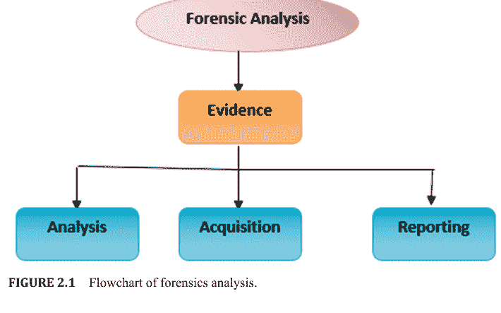

图 2.1 法证分析流程图。

### 2.1.1 数字取证中的回归

某些值依赖于基于过去事件的现有数据中独立特征的值，而这些知识有助于处理新事件。在数字取证中，欺诈检测可通过此方法解决。一旦模型基于先前的交易数据库学习完成，通过观察当前交易特征即可识别欺诈交易。人工智能和机器学习为回归分析提供了支持向量机（SVM）、线性回归、多项式回归、决策树和其他回归方法。

### 2.1.2 分类

分类是基于监督机器学习（ML）技术进行的。在数字取证中，垃圾邮件检测是使用人工智能和机器学习算法完成的。为了对给定邮件是否属于垃圾邮件进行分类，人工智能和机器学习算法发挥主要作用。用于分类的一些算法包括逻辑回归、K 近邻（K-NN）和 SVM。

### 2.1.3 聚类

聚类是一种无监督机器学习模型，即使数据集中没有标签，也能从数据集中提取一般模式。相似事件的组构成一个聚类，因为它们共享共同特征并定义特定模式。在网络安全中，聚类用于取证分析、异常检测、恶意软件分析等。一些机器学习聚类算法如 K-means、K-Medoids、DBSCAN、Gaussian Mixture Model、Agglomerative clustering 在网络安全中使用（Sharma et al., 2018）。

## 2.2 文献综述

Shailendra Singh 等（2009）提出了一种用于网络攻击数据集集成方法特征选择的方法。他们使用的数据集称为 DARPA KDDCUP99。这包括两个阶段。第一阶段是过滤阶段，用于选择具有最高增益的信息，并为包装输出阶段的搜索过程初始化提供适当指导。这类输出是最终的子集特征。最终的特征子集随后通过一些支持算法（如 K-NN 分类器）传递。该算法有助于对不同类型的攻击进行分类。

Quamar Niyaz 等（2016）在深度学习方法的帮助下研究了高效灵活的网络入侵检测系统（IDS）。这里他们使用了 NSL-KDD 数据集，这是网络入侵的基准数据集。他们使用了称为 10 折交叉验证的验证方法，以便训练数据用于评估分类准确性。他们对两类、五类和 23 类使用了 STL（自学）。他们将性能与称为 SMR（softmax 回归）的回归进行了比较，该回归没有任何特征学习。通过比较，STL 相对于所有其他类型的分类给出了约 98% 的良好分类准确率。

Govindarajan 等（2009）提出了一种新的 K-NN 分类器并将其应用于 IDS。他们基于恶意和正常数据集的运行时间和错误率评估性能。新的 K-NN 分类器与现有 K-NN 分类器相比具有更准确的准确性。

Mohammadreza Ektela 等（2010）使用了两种网络入侵检测技术，即分类树数据挖掘（DM）和 SVM 技术。他们对 C4.5 和 SVM 进行了比较。通过比较这两个算法，C4.5 算法在识别率和误报率方面相比 SVM 表现最佳。在 U2R 攻击的情况下，SVM 表现良好。

Deepthy 等（2010）实现了各种类型的 DM 技术用于检测入侵。他们对 IDS 分类的工作原理以及这种分类如何为 IDS 工作进行了简要描述。对于网络引起的大量流量，通过比较分类，聚类在入侵识别方面将更有效。主要目的是为了分类，与聚类相比，需要大量的数据。

Amudha 等（2011）提出了用于入侵检测的 DM 技术。他们使用 KDD CUP’99 作为数据集。他们评估了 C4.5、Naïve Bayes、NBTree 和 Random Forest 等 DM 分类算法的性能。在这项工作中，他们主要重视相关特征选择（CFS）度量。基于准确率和检测率，NB 树和 Random Forest 在与其他两种算法分析时表现最佳。

China 等（2017）实现了三种 DM 技术，如 SVM、Ripper 规则和 C5.0 树，用于入侵识别。通过实验结果，C5.0 决策树相比其他算法效率更高。三种 DM 技术均具有约 96% 检测率的较高准确性。

Nahla 等（2004）使用了用于入侵检测的算法，即朴素贝叶斯。他们考虑了名为 KDD’99 入侵的数据集。最后，他们比较了获胜策略、决策树和朴素贝叶斯。朴素贝叶斯相比其他两种算法具有良好的准确性。

Rahul 等（2018）专注于预测网络 IDS 上的攻击。他们使用 KDDCup-99 和 epochs 数据集对网络进行训练和基准测试。为了进行比较，使用相同数据集用若干经典算法进行训练，并使用层数范围为 1 到 5 的深度神经网络（DNNs）。根据结果，3 层 DNN 相比经典机器学习算法表现最佳。

Praneet 等（2021）提出了一种针对物联网（IoT）上众多网络攻击的边缘节点检测方法。该过程可在深度学习方法的支持下完成。模型的评估是通过部署实际边缘节点，使用当前网络安全数据集，即 UNSW2015，以 Raspberry Pi 表示来完成的。通过与先前结果中的卷积深度学习方法技术进行比较，该实验结果给出了约 99% 的最佳准确性。


Antonio et al. (2014) 使用了监督式机器学习技术进行多类分类，如决策树和贝叶斯分类器。根据规则人工神经网络（ANN）和最近邻算法，对分类器基于准确率和 Cohen’s kappa 等性能进行评估。该实验基于 4 折交叉验证设计，对非确定性算法重复 30 次。为了获得可靠的结果，通过 120 次运行进行结果平均。分析是通过使用准确率和 Cohen’s kappa 指标的 t 检验比较每对算法进行的。

Xiaoyong et al. (2017) 使用深度学习方法进行拒绝服务攻击。他们将性能与传统机器学习进行了比较。这里机器学习是另一种用于提高静态特征性能的方法。但该算法受限于浅层表征模型。他们提出了基于 DDoS 攻击检测的深度学习方法，称为 deep defense。使用深度学习的主要目的是从网络流量序列中学习模式并使用 DNN 追踪网络攻击活动。实验结果与传统机器学习模型相比表现更好。他们还在较大数据集上将错误率从 7.517% 降低到 2.103%，与传统机器学习方法相比。

Sumaiya et al. (2013) 用于评估用于对 IDS 进行网络事件分类的不同树基分类算法。他们在实验中使用了 NSL-KDD 99 数据集。数据集维度被降低。结果显示 Random Tree 模型具有更高的准确率，并且还降低了报警的误报率。为了比较更好的预测准确率，Random Tree 模型通过与其他入侵检测模型进行比较来评估。

Meng Jianliang et al. (2009) 使用 K-means 算法进行入侵检测。他们使用了 KDD-99 作为数据集。使用该数据集的主要原因是它能为算法提供稳定的准确率和效率。通过不同的设置率，检测率超过 96%，报警误报率低于 4%。时间复杂度非常低。与其他算法相比，K-means 方法是对海量数据进行划分的更有效算法。对于入侵检测，K-means 算法与其它算法相比使用最广泛。

## 2.3 数字取证的类型

无人机的使用正在迅速增长并扩展到犯罪企业和恐怖组织。

新术语“计算机取证”被创造出来，最近已更名为“数字取证”。该术语进一步分为：无人机取证、社交网络取证、网络取证和移动取证。本章概述了数字取证、网络取证和移动取证、无人机取证以及社交网络取证。数字取证是应用电子调查和分析方法来识别潜在证据的应用。

指纹识别是取证任务的经典例子。随着计算机上犯罪活动的迅速增加，“取证”一词已变得更加为执法部门和 IT 社区所熟悉（Son et al., 2012）。

计算机取证传统上涉及从称为电子设备的设备获取数据，以收集数据用于调查或执法目的。与逐个获取文件不同，它会创建镜像，如数字取证 examiner（逐位复制）。

这些研究人员应从计算机中提取数据并扫描数据镜像以获取相关信息，例如文件、文件夹或电子邮件对话，以及计算机存储的文件的元数据。数字取证分析师能够检测活动文件、已删除文件、受密码保护的文件以及已被覆盖的文件。

过去十年中，数字技术硬件，尤其是软件，已以指数级速度发展。这种普及度的提高不仅促使普通用户，也促使恶意软件开发者和传统计算机黑客，从而导致网络威胁和恶意软件威胁。

近年来被盗手机率有所增加。主要原因是手机包含个人某些机密信息，如果手机被盗或丢失则非常危险。

数字取证是网络犯罪分子利用 IT 基础设施或利用多种技术实施的网络犯罪的结果（Brown et al., 2009; Bassett et al., 2006）。数字取证分为不同类型，如计算机取证、无人机取证、社会取证、内存取证、多媒体取证、网络取证、小型设备取证/移动取证和安卓取证（Brown et al., 2009; Son et al., 2012）。在本章中，其分类为无人机取证、网络取证、社会取证和移动取证（图 2.2）。

### 2.3.1 网络取证

传统计算机取证的重点是静态数据。例如，硬盘、CD 或闪存驱动器是数据恢复所必需的。有各种工具可用于协助数字取证调查人员，以便从任何介质到达的数据中检索和重建证据。网络取证主要用于从一台计算机到另一台计算机的数据传输。

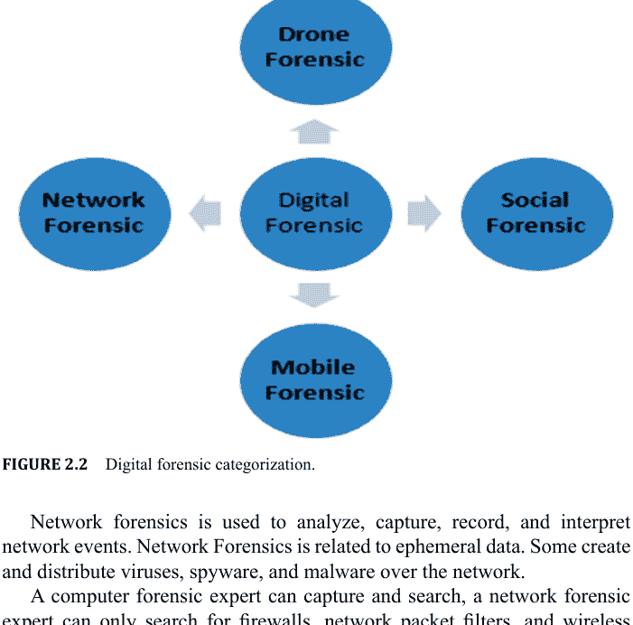

图 2.2 数字取证分类。

网络取证用于分析、捕获、记录和解释网络事件。网络取证与短暂数据相关。有些人在网络上创建和分发病毒、间谍软件和恶意软件。

计算机取证专家可以捕获和搜索，网络取证专家只能搜索防火墙、网络数据包过滤器和无线帧。网络调查人员需要与黑客相同的技能来识别犯罪的动机（发生了什么以及为什么）。为了理解潜在攻击并从这些攻击中收集证据，数字取证调查人员必须有效地监控网络活动。

在涉及网络取证的案件中，情况因与防火墙、IDS 或 Web 服务器相关的非常大的日志文件而变得更加复杂。

在 ISP 可用数据日志的情况下，进一步存在社交媒体中可用数据的可用性。例如，一个潜在的数据集将是与犯罪相关的调查的进一步视角：Facebook（指示联系人、友谊、位置等）、Flickr（包含元数据名称/位置标签）、YouTube 视频（Alastair Irons et al., 2001）。

在情报方面，一些算法，如 ANN 和 SVM 用于识别入侵并保护信息基础设施的完整性和保密性。

### 2.3.2 社交媒体

就社交媒体而言，网站现在可在智能手机和 PDA 等移动设备上使用（Azhar et al., 2018）。由于社交媒体的广泛使用，许多人故意向他人宣传其位置、宗教、医疗状况、朋友、婚姻状况、个人电子邮件 ID、手机号码、照片、状态更新和行踪。对于许多组织和个人而言，社交媒体网站已成为通信的一部分。目前有若干涉及使用社交媒体或社交网络网站实施犯罪的刑事案件。目前有多起刑事案件正在审理中。社交媒体网站革命之后出现了社交网络取证。最近，数字取证已被广泛用于调查计算机犯罪，该犯罪已在法庭上得到审查。

在数字取证中，社交网络取证是数字取证的一部分。这种社交网络取证处理从社交媒体平台收集数字证据。在数字取证案件调查中，我们需要确保所有证据在法律上有效，并且该证据必须以取证方式呈现（表 2.1）。

表 2.1 社交网络站点特征

| 类型 | 详情 |
|---|---|
| 用户参与 | 鼓励社交网络站点用户参与并提供反馈。 |
| 用户社区 | 个人可以自行组建团体并分享共同兴趣。该团体将作为分享和获取知识的论坛。 |
| 促进公众参与 | 许多社交网络站点鼓励用户提供反馈并以允许他们在公共环境中与其他人交流的方式参与。 |
| 用户通信 | 传统媒体仅允许单向通信，而 SNS 允许双向通信。 |
| 与人建立联系 | 网站还可以帮助重新联系日常生活中不常见到的人。 |


为了开展有效的数字取证调查，你需要对软件和硬件有广泛的理解。通过具备关于调查各种工具的适当知识，不仅可以节省时间，而且还有防止操作和证据篡改疏忽的优势。因此，调查人员无需返回重新审查事实。一种合适的方式是从 SNS 中呈现证据。为了呈现证据，数字取证调查人员需要一系列资源和技术，研究提取工具的能力可以更有效地帮助调查过程。

## 2.3.3 移动取证

移动技术硬件，尤其是软件，在过去十年中以指数速度发展。普及度的提高推动了普通用户、恶意软件开发者、计算机黑客，从而导致网络威胁和恶意软件威胁。

过去几年手机被盗率有所增加，因为手机包含个人的机密信息，如果被盗或手机丢失则可能很危险。

应用程序开发者和用户使人们对手机和设备上的取证分析更加意识到应或不应在这些设备上存储哪些数据。这种存储的敏感信息可被攻击者用作借口来窃取个人的真实身份。识别指纹是取证任务的经典示例。随着恶意活动的迅速增加，“取证”一词在执法和 IT 社区中更受欢迎（图 2.3）。

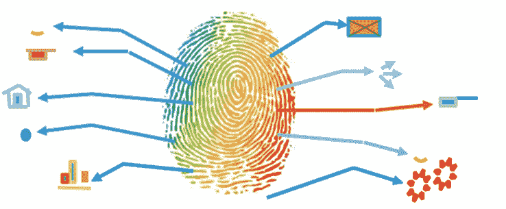

图 2.3 移动取证恢复证据。

移动取证（MF）使用特定且适当的科学取证系统从移动设备中检索数字证据（Kavrestad et al., 2020）。世界正因移动技术而发生变化。包括手机、手表、笔记本电脑和 GPS 设备在内的数百万移动设备也在增加。人们即使在计算机无法进入的地方，如村庄、村落、沙漠和山区，也使用手机。移动设备承载着一切。涉及移动设备的不同案件类型包括情报收集、毒品/麻醉品、骚扰、追捕、凶杀、反恐、青少年犯罪、金融犯罪、企业合规和财产所有权（图 2.4）。

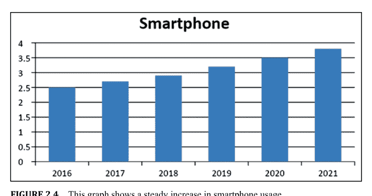

图 2.4 该图表显示智能手机使用量稳步增加。

第一类取证调查人员可以检测和恢复移动设备证据。这些数据可以物理存储在三个不同的位置。某些类型的数据可以在多个地方找到，例如 SIM 卡和手机上的联系人、手机和存储卡上的图片。它们可以是同一组图像，也可以完全不同（图 2.5）。

### 2.3.3.1 SIM 卡（用户身份模块）

用户身份模块（SIM）卡在 GSM 网络上是强制性的。SIM 卡是一种智能卡：它包含处理器和存储。SIM 卡通过 ICCID（集成电路卡标识符）和 IMSI（国际移动用户识别码）进行数字识别，两者在调查中都非常重要。基于文本的用户数据（例如联系人和通话），还有 3GPP。

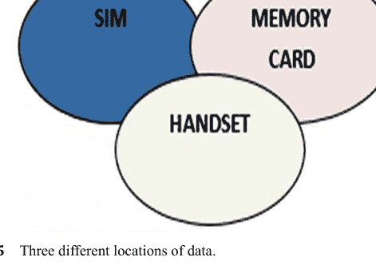

图 2.5 数据的三个不同位置。

从 SIM 卡到存储卡，存在不同物理形态的组件，如 MMC、MicroSD 和记忆棒 M2，请记住，并非所有存储卡都是 SD 卡，但目前每种类型的存储卡都有 1 TB 卡。预计从存储卡中恢复的最常见信息和媒体文件类型。根据其使用方式，包括图像、音频、视频、文档、智能手机应用程序、数据库和事实；它们可以包含任何类型的文件。

### 2.3.3.2 手机设备

任何类型设备的重要信息可归类为移动、通话、联系人、SMS、媒体消息、其他消息（应用程序）、图像、音频和视频录制、网页历史记录和位置信息。信息类别可以有子类别（图 2.6）：

- 1. **调查人员恢复数据，处理实时设备：**
  执行手机更基础的逻辑提取时，绝大多数情况下手机处于开机状态。
  
  如果设备的数据与网络分离，调查人员可以获取数据。连接接口有三个步骤，它们是：
  - 电缆是获取数据的快速且安全的方式；
  - 蓝牙比电缆慢，手机 ID 可能对他人可见；和
  - Wi-Fi 比电缆慢，手机必须连接到 Wi-Fi 网络，使用不同连接接口读取同一手机的结果可能有所不同。

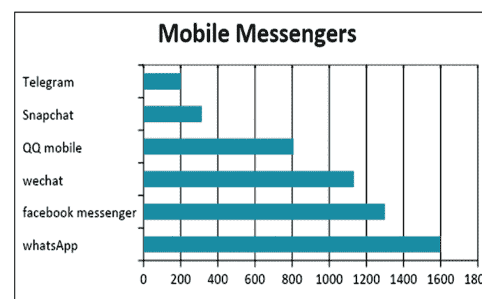

图 2.6 移动即时通讯应用 – 每月活跃用户数以百万计。

一种名为 Simbrash 的工具已被创建，以便为手机、Linux 和 Windows 平台（Casadei et al., 2001; Husain et al., 2010）的缘故从设备中提取整个文件系统。智能手机操作系统的额外步骤：当两种操作系统（OS）以相似方式在内部存储数据时，连接准备提取的手机时需要不同的额外步骤。

- 2. **iOS-iPhone 信任：** 当你的 iPhone 连接到调查员 PC 时，你将被要求信任插入的手持设备所在的计算机。如果被信任，那么这两个设备正在通信并获取数据。这些是移动取证调查中的关键点；Mokhonoana 等人（2007）中的研究人员建议了一个简单且经济的 iPhone 取证分析框架。它有能力从 iPhone 中提取所有数字证据。该模型包括三个过程：获取数据、分析数据和报告数据。另一方面，在 Azhar（2018）中，开发了一种名为手机取证工具的取证工具，该工具具有

从移动活动文件中提取证据的能力。在另一项研究（Kao et al., 2019）中，研究人员提出了一种新的模型来隔离手机的联系人、手机中的通话记录系统、短信、手机中存在的文档以及 Windows Mobile 中可用的所有获取步骤。

从手机设备中提取数据的两种方法，要么是逻辑提取（类似握手），要么是物理提取，这是一种恢复数据的暴力方法（图 2.7）。

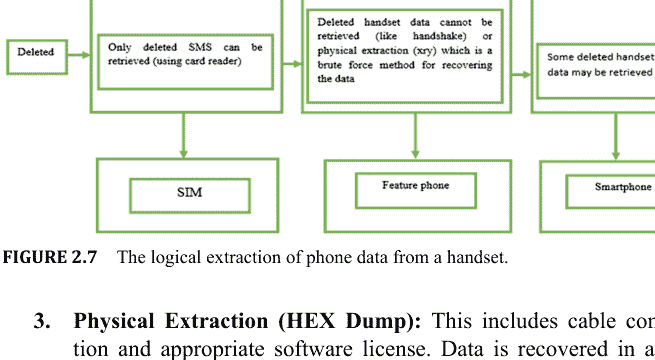

图 2.7 从手机设备中逻辑提取手机数据。

- 3. **物理提取（HEX 转储）：** 这包括电缆连接和适当的软件许可证。数据以原始形式恢复，提供大量数据，包括已删除的手机信息。原始数据的解码将根据手机型号而有所不同（图 2.8）。
  
- 4. **移动取证中的挑战：** SIM PIN 保护，一旦受保护，尝试从 SIM 卡提取数据，唯一能恢复的是 ICCID。
  
  i. **SIM PIN 保护：** SIM 数据可以用可选的 4–8 位代码保护，用户可以更改 PIN，输入 PIN 错误 3 次会导致 SIM 卡被锁定。PIN 解锁密钥：解锁需要 8 位 PUK，PUK 代码通常与服务提供商在一起，用户无法更改。PUK 错误尝试 10 次后，SIM 卡将永久禁用。这些是 MF 的主要挑战。

  ii. **蓝牙提取：** 如果唯一的选项是提取蓝牙。
  
  iii. **手机设备安全：** 如果设备被锁定，调查人员需要找出该特定手机上的锁是否可以以任何形式恢复或绕过。这通常是通过根据软件工具的不同类型的提取来完成的。如果设备无法通过办公室的软件工具解锁或绕过，手机可能需要送出以由提供下一级解锁服务的供应商解锁。

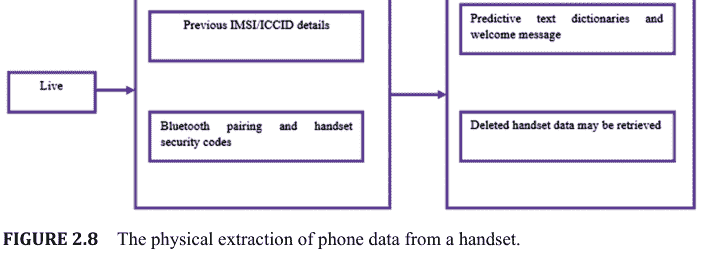

图 2.8 从手机设备中物理提取手机数据。

## 2.3.4 无人机取证

无人机是无人驾驶飞行器（UAV）的另一个名称。我们称它们为没有人的飞机。UAS（无人驾驶航空系统）由 UAV、地面控制器和两者之间的通信系统组成。

无人机具有各种程度的自主性，能够飞行：要么由人类操作员远程指挥，要么由机载计算机自主控制。无人机取证有三个组成部分，它们是：UAV、地面控制站（GCS）和通信数据链（Azhar et al., 2018; Shetty et al., 2017）。（图 2.9）。

控制器、手机和无人机通常依赖于 Wi-Fi 信号连接，以便在无人机取证中相互通信。无人机控制下飞行的能力是数据传输（Kao et al., 2019）。当无人机与手机连接时，在无人机操作期间携带数据包的电线中发现了 MAC 地址网络接口卡（Kavrestad et al., 2020）。


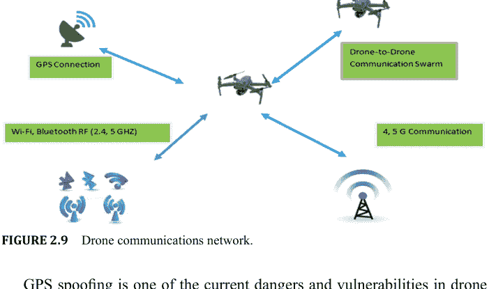

图 2.9 无人机通信网络。

GPS 欺骗是无人机取证中当前的一种危险和漏洞。未加密的信息在通信渠道薄弱时很容易被收集、管理和注入。这类薄弱的通信渠道就像赋予攻击者对无人机的完全控制权。

- 1. **Wi-Fi/GPS Jamming:** 无人机劫持是通过在接入点与控制无人机的设备之间传输一种未授权的方法来执行的，有时飞行中断也是由于干扰 GPS 信号导致无人机无法使用，尽管大多数商用无人机都提供失效保护选项。
- 2. **Data Interception and Interface:** 为了移动车辆，会利用遥测数据流。此外，数据通过开放的非安全无线传输进行，这使得能够执行中间人攻击或向无人机上传恶意软件。
- 3. **Malware Infection:** 随着无人机成为飞行计算机，恶意软件可能会影响无人机的操作或破坏整个系统。
- 4. **Drone Information can be Extracted like, GPS Position:** 提取 GPS 位置（纬度，经度，海拔）可以帮助检查员可视化飞行路径。
- 5. **Flight Path:** 这是最重要的发现之一，因为它可以确定可能受无人机飞行影响的地点。
- 6. **Take-Off Point:** 定位起飞点可以将犯罪嫌疑人置于感兴趣区域（AoI）内，并结合本地来源（摄像头、目击者）帮助识别嫌疑人。
- 7. **Firmware Version:** 关于无人机、电池类型以及完整性验证的信息。
- 8. **Error Recorded:** 通常被称为崩溃日志，可以提供导致无人机坠毁的错误信息。
- 9. **Media:** 图片和视频可以帮助了解无人机的任务，以及无人机所运营的区域。
- 10. **Smart Battery:** 包含电压消耗、电池寿命的信息。无人机可以记录电池的序列号，以便将其与无人机所有者关联。
- 11. **Fingerprints:** 虽然与网络取证无关，但执法人员可以追踪飞行员。
- 12. **Findings/Artefacts Common Location, Removable Storage:** 通常车辆本身或支持设备中的 SD 卡包含大部分日志。
- 13. **Internal Memory Chip:** 使用芯片拆卸技术恢复存储在无人机本身的数据。如果车辆严重损坏，则可能无法实现。
- 14. **Supporting Devices:** 手机、平板电脑、笔记本电脑和其他便携设备可用作地面控制站（GCS），因此包含来自无人机的数据和日志。对于每一种设备，使用不同的取证获取和分析技术。
- 15. **Cloud Storage:** 无人机日志可能存储在云端，因此也应予以考虑。
- 16. **Network PCAP Files:** 监控网络可以提供关于互联组件内不规则活动的发现（Prashanth et al., 2015）。

无人机的完整数据提取和分析涉及在云端、移动应用、遥控器、桌面应用中发现的无人机数据。无人机存储位于读卡器中的外部 SD 卡、通过芯片拆卸或物理方式的内部存储器（飞行日志）中。基于初步分析，如果发现无人机涉及犯罪，则进行无人机调查。对疑似无人机的初步检查涉及以下三个步骤（图 2.10）：

- Step 1: 对迄今为止的一切做出书面记录。拆卸已记录的设备。
- Step 2: 识别数据存储位置。
- Step 3: 检查每个集成电路封装。

按照上述技术，使用取证软件获取媒体的完整数据采集形式或进一步提取的完整文件系统。数字取证调查人员从搜索无人机（如 SD 卡）开始，以便捕获媒体并分析内容以获取数据存储区域。此外，使用像取证工具包（FTK）这样的工具来访问数据以从无人机中恢复数据，也能彻底进行调查。在数字取证领域，无人机取证是一个不断发展的领域。随着全球无人机事件的增加，世界各地的执法机构准备反无人机计划至关重要。VTO Labs 在 NIST 上的取证镜像为无人机取证设备的创建和测试提供了一个平台（Airbail et al., 2021）。

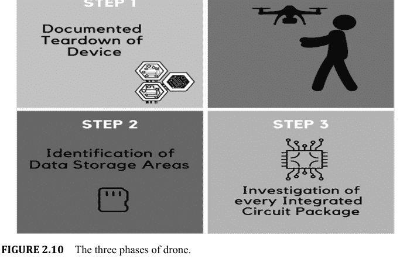

图 2.10 无人机的三个阶段。

现在，调查人员可以拍摄无人机的媒体，提取飞行日志、照片、视频和敏感数据，定位其用户和所有者，还可以定位与无人机犯罪相关的嫌疑人。用于从无人机提取数据的数字取证方法不足以进行调查。数字取证软件工具和技术需要随着先进无人机型号的推出而更新。

## 2.4 网络安全自动化

云中存储着非常庞大的数据，几乎约为 1 艾字节。网络犯罪每天都在增加，造成日常生活中各种安全威胁。组织无法跟上不断增长的威胁。手动检测减缓了提供安全保障的速度。我们需要填补这一差距，借助人工智能等技术实现自动化升级。人工智能提供了一种识别异常行为、采取关键行动并帮助缓解故障的手段（Singh et al., 2009）。

过去曾使用传统方法来防止系统遭受网络攻击。需要人类参与检测威胁，并使用软件解决。随着时间的推移，人工智能与网络安全结盟。CAPTCHA（区分计算机和人类的完全自动化公开图灵测试）（Shaukat et al., 2020）是这一点的良好例证。自动化减少了人机交互、参与和困难，节省了时间，避免了重复工作，在不可预测的环境中运行，具有速度和可扩展性。人类可以参与其他业务建模。

网络安全自动化是自动化配置、警报和其他责任的过程，这些责任来自安全管理和他们所管理的产品。我们称这种自动化为编排。这是一个关于核心优势的良好隐喻：如果我们认为您安全架构中的产品就像乐器，那么安全管理员就是乐团的指挥。

网络安全自动化可以采取不同的形式，但自动化任务可以在没有人类交互的情况下由设备管理（Kirti Raj, 2019）。我们既不能通过脚本也不能通过使用自动化工具来实现自动化。

## 2.5 自动化中使用的技术

网络犯罪分子已通过非常强大的未来工具渗透 IDS。对更先进技术（如 ML、AI（Ektefa et al., 2010）、深度学习）的倾向正在迅速增加。先进的自动化技术 ML 被双方使用：网络安全专家和攻击者。为了领先于网络犯罪分子，专家采用了两种方法。其中一种是 ANNs，其中神经网络的工作方式就像人类大脑一样，存在相互连接的节点或神经元。它们协调并协同工作（Calderon et al., 2019; Wiafe et al., 2020）。

有许多自动化工具可用：SOAR 产品、机器人流程自动化（RPA）工具和定制开发的软件代码（Robert Nagy et al., 2019）（图 2.11）。

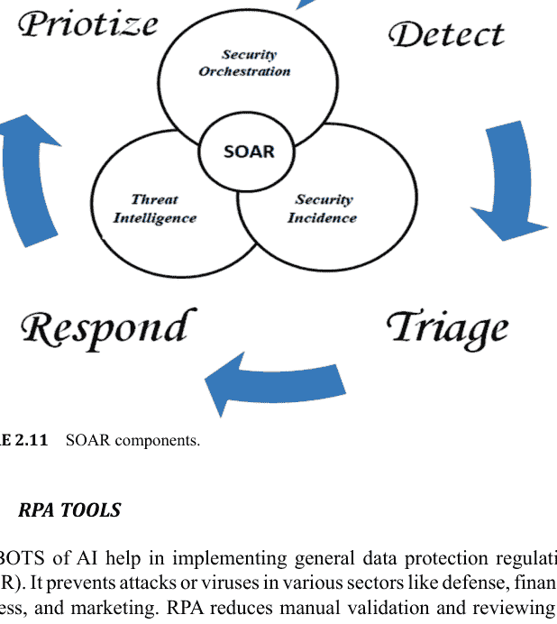

图 2.11 SOAR 组件。

### 2.5.1 RPA 工具

AI 机器人有助于实施通用数据保护条例（GDPR）。它防止在国防、金融、商业和营销等各个领域发生攻击或病毒。RPA 减少了手动验证和审查。它提供加密，仅允许具有真实访问凭证的用户，并保护数据免受各种攻击。

RPA 可在专业人员短缺的情况下使用。它可以管理审计，创建工时表。IT 专业人员可以参与其他高附加值流程。不知疲倦地 24/7 启动高安全警报和通知（图 2.12）。

### 2.5.2 定制开发软件代码

它有助于为特定组织、人员或社区群体规划、创建、部署和维护软件。特别

在电子商务领域，定制开发的软件有助于保护数据；特别是，安全级别得到提升（Robert Nagy 等，2019）。

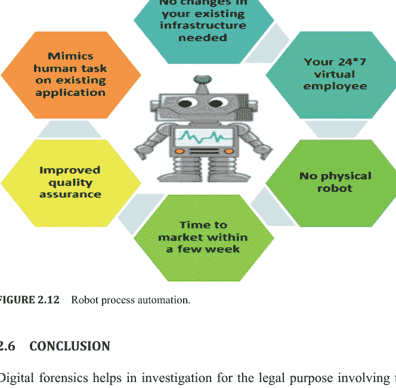

图 2.12 机器人流程自动化。

## 2.6 结论

数字取证有助于涉及数字证据分析的法律目的调查。数字取证利用专门的工具和技术来调查各种计算机相关犯罪，例如欺诈、非法使用以及多种形式的计算机入侵。存在不同种类的数字取证，例如无人机取证、网络取证、社会取证和 MF。不同类型的取证有助于提供计算机系统的完整性，并有助于向法院提供证据，从而导致罪犯受到惩罚，这提供了跟踪网络犯罪分子的适当效率。在此，AI 和 ML 算法在数字取证中发挥了主要作用，用于入侵检测、身份盗窃、网络跟踪和诽谤传播。诸如 RPA 工具等自动化技术在 AI 和 ML 的支持下有助于实施数据保护法规。它还提供加密，有助于用户保护各种数据，而定制开发的软件有助于保护数据，尤其是在电子商务网站中。

## 致谢

本工作由卡纳塔克邦政府信息技术、生物技术和科学技术部 VGST 资助项目、数字取证情报卓越中心 GRD 853 支持。

## 关键词

- 人工智能
- 数字取证
- 无人机取证
- 法医科学
- 机器学习
- 移动取证
- 网络取证
- 社会取证

## 参考文献

Airbail, H., Mamatha, G., Hedge, R. V., Sushmika, P. R., Kumari, R., & Sandeep, K., (2021). 基于深度学习的恶意软件分类方法. *国际智能防御支持系统期刊*, 6(2), 61–80.

Amor, N. B., Benferhat, S., & Elouedi, Z., (2004). 入侵检测系统中的朴素贝叶斯与决策树. In: *2004 年 ACM 应用计算研讨会论文集* (pp. 420–424).

Amudha, P., & Rauf, H. A., (2011). 入侵检测中数据挖掘方法的性能分析. In: *2011 年过程自动化、控制与计算国际会议* (pp. 1–6). IEEE.

Azhar, M. A., Barton, T. E. A., & Islam, T., (2018). 使用开源工具的无人机取证分析. *数字取证、安全与法律期刊*, 13(1), 6.

Bassett, R., Bass, L., & O’Brien, P., (2006). 计算机取证：网络安全的必备要素. *信息科学与技术期刊*, 3(1).

Bhatele, K. R., Shrivastava, H., & Kumari, N. (2019). 人工智能在网络安全中的作用. In Countering Cyber Attacks and Preserving the Integrity and Availability of Critical Systems (pp. 170–192). IGI Global.

Boyd, D. M., & Ellison, N. B., (2007). 社交网络网站：定义、历史与学术研究. Journal of Computer-Mediated Communication, 13(1), 210–230.

Brown, C. L., (2009). 计算机证据：收集与保存. Charles River Media, Inc.

Calderon, Ricardo, (2019). “人工智能在网络安全中的益处。” Economic Crime Forensics Capstones. 36. https://digitalcommons.lasalle.edu/ecf_capstones/36 (accessed on 14 February 2023).

Casadei, F., Savoldi, A., & Gubian, P., (2006). 取证与 SIM 卡：概述. International Journal of Digital Evidence, 3(1), 1–21.

Casey, E., (2001). 计算机犯罪调查手册：取证工具与技术. Elsevier.

Chaudhari, R. R., & Patil, S. P., (2017). 入侵检测系统：分类、技术与实现数据集. International Research Journal of Engineering and Technology (IRJET), 4(2), 1860–1866.

Ektefa, M., Memar, S., Sidi, F., & Affendey, L. S., (2010). 使用数据挖掘技术进行入侵检测. In: 2010 International Conference on Information Retrieval & Knowledge Management (CAMP) (pp. 200–203). IEEE.

Govindarajan, M., & Chandrasekaran, R. M., (2009). 使用 k 近邻的入侵检测. In: 2009 First International Conference on Advanced Computing (pp. 13–20). IEEE.

Husain, M. I., Baggili, I., & Sridhar, R., (2010). iPhone 取证分析的简单经济框架. In: International Conference on Digital Forensics and Cybercrime (pp. 27–37). Springer, Berlin, Heidelberg.

Javaid, A., Niyaz, Q., Sun, W., & Alam, M., (2016). 网络入侵检测系统的深度学习方法. EAI Endorsed Transactions on Security and Safety, 3(9), e2.

Jianliang, M., Haikun, S., & Ling, B., (2009). 基于 k-means 聚类算法的入侵检测应用. In: 2009 International Forum on Information Technology and Applications (Vol. 1, pp. 150–152). IEEE.

Kao, D. Y., Chen, M. C., Wu, W. Y., Lin, J. S., Chen, C. H., & Tsai, F., (2019). 无人机取证调查：以 DJI Spark 无人机为例. Procedia Computer Science, 159, 1890–1899.

Kävrestad, J., (2020). 数字取证基础. Springer International Publishing.

Mohammad, S. M., & Lakshmismi, S., (2018). 信息技术中的安全自动化. International Journal of Creative Research Thoughts (IJCRT), 6.

Mokhonoana, P. M., & Olivier, M. S., (2007). 使用机上取证工具获取 Symbian 智能手机内容. In: Proceedings of the Southern African Telecommunication Networks and Applications Conference (Vol. 8).

Naiping, S., & Genyuan, Z., (2010). 基于数据挖掘的入侵检测研究. In: 2010 International Conference of Information Science and Management Engineering (Vol. 1, pp. 135–138). IEEE.

Prashanth, D. S., Agrawal, A., & Raj, M., (2015). 目标跟踪粒子滤波中样本贫化问题的减少. In: 2015 Annual IEEE India Conference (INDICON) (pp. 1–5). IEEE.

Robert, N., Todd, C., & Geoff, H., (2019). “傻瓜式网络安全自动化. ISBN 978-1-119-57580-1 (pbk).

Sharma, S. (2021). *网络安全中机器学习概述 使用 Weka 的分类器比较分析*, 23(8), p.334.

Shaukat, K., Luo, S., Varadharajan, V., Hameed, I. A., & Xu, M., (2020). 近十年网络安全机器学习技术综述. *IEEE Access*, 8, 222310–222354.

Shetty, S., Vishwakarma, V., Harisha, & Agrawal, A. (2017). “使用在线视频修复进行视频摘要的设计与实现, 2017 2nd IEEE International Conference on Recent Trends in Electronics, Information & Communication Technology (RTEICT), Bangalore, India, pp. 1208–1212, doi: 10.1109/RTEICT.2017.8256790.

Singh, P., Pankaj, A., & Mitra, R., (2021). Edge-detect：使用深度神经网络的边缘中心网络入侵检测. In: *2021 IEEE 第 18 届消费者通信与网络会议 (CCNC)* (pp. 1–6). IEEE.

Singh, S., & Silakari, S., (2009). *网络攻击数据集特征选择的集成方法*. arXiv preprint arXiv:0912.1014.

Son, J., (2012). *社交网络取证：证据提取工具能力*. Doctoral dissertation, Auckland University of Technology.

Tallón-Ballesteros, A. J., & Riquelme, J. C., (2014). 应用于监督机器学习的数字取证任务的数据挖掘方法. In: *数字取证中的计算智能：取证调查与应用* (pp. 413–428). Springer, Cham.

Thaseen, S., & Kumar, C. A., (2013). 入侵检测系统监督树基分类器分析. In: *2013 年模式识别、信息学与移动工程国际会议* (pp. 294–299). IEEE.

Vidhya, B., & Vaijayanthi, R. P., (2014). 通过文档聚类增强数字取证分析. *International Journal of Innovative Research in Computer and Communication Engineering*, 2(1).

Vigneswaran, R. K., Vinayakumar, R., Soman, K. P., & Poornachandran, P., (2018). 评估网络安全中网络入侵检测系统的浅层和深度神经网络. In: *2018 年第 9 届计算、通信与网络技术国际会议 (ICCCNT)* (pp. 1–6). IEEE.

Wiafe, I., Koranteng, F. N., Obeng, E. N., Assyne, N., Wiafe, A., & Gulliver, S. R., (2020). 网络安全的人工智能：文献系统映射. *IEEE Access*, 8, 146598–146612.

Yuan, X., Li, C., & Li, X., (2017). 深度防御：通过深度学习识别 DDoS 攻击. In: *2017 年 IEEE 智能计算国际会议 (SMARTCOMP)* (pp. 1–8). IEEE.


## 第3章

## 开放网络上信息保护与传输的特定安全机制

PRIYA R. SANKPAL and P. A. VIJAYA

*电子与通信工程系，BNM理工学院，班加罗尔，卡纳塔克邦，印度*

### 摘要

医疗必需品的配送已随着信息技术的使用而发生巨大变化。数字健康信息的应用正在将医疗保健从基于纸质的设备转变为一个新时代，在这个时代，健康记录可以即时传输和共享。医疗服务交付的总体要求是必须保持私密、具有完整性、关键准确、全天候可访问，并且在需要时在任何地点都可访问。

数字健康记录系统包含海量数据。这些敏感记录必须通过医疗专家/助理大量使用的笔记本电脑、手机和平板电脑传输到多个护理站点。这由于人为干预和移动设备上的数据风险而引发了重大的保护问题。这使得移动和存储设备上的信息安全至关重要。

信息安全旨在以“保密性、完整性和可用性”（CIA 三元组）的形式为信息提供保护。在发生安全漏洞的情况下，信息的安全性、完整性和可用性必须通过信息安全机制工具得到保护是可以肯定的。

在本章中，加密和水印等特定安全机制被探索和研究用于开放网络上的信息保护和传输。在所提出的方法中，信息保护技术针对“医学数字成像和通信（DICOM）图像”进行了分析。通过使用图像加密和水印的融合技术使患者信息得到安全保护。与患者相关的两组图像通过将一个图像隐藏到另一个图像中而安全传输。其中一个图像被称为载体图像（CI），第二个被称为水印图像（WM）。包含敏感患者信息的 WM 通过加密后嵌入或插入到 CI 中使其无法读取，从而增强安全性。使用混沌映射图像加密技术对 WM 进行加密。“离散小波变换（DWT）结合奇异值分解（SVD）”用于将加密后的 WM 嵌入到 CI 中。

选择混沌映射进行加密主要是由于其对初始条件的敏感依赖性，这是加密的一个重要方面。患者信息使用 DWT 和 SVD 嵌入到 DICOM 图像中。DWT 将图像像素转换为小波系数。这些小波系数用于图像压缩和编码。DWT 捕获输入的频率内容以及时域内容。患者数据使用 logistic 映射和斜 tent 映射的组合进行加密。此加密信息使用 DWT 和 SVD 嵌入到 DICOM 图像中。

使用客观评估指标对已实现的加密和嵌入算法的性能进行评估，例如加密技术的“像素变化率（NPCR）、统一平均变化强度（UACI）”、水印嵌入过程的均方误差（MSE）、峰值信噪比（PSNR）、相关系数（CC）、归一化相关系数（NCC）和结构相似性指数（SSIM）”（Nguyen, Marie, & Azeddine, 2010; Silpa & Aruna, 2012）。通过跟踪在水印伪影作用下客观指标的细微变化来评估所提出章节的性能。通过所提出方案的实现，可以推断 PSNR 可被视为水印嵌入强度变化的一个良好指标。然而，PSNR 无法衡量不同水印伪影下的图像质量。观察到 SSIM 是衡量图像质量的更好指标。

### 3.1 前言

互联网使用量的增加使多媒体交换增加了数倍，这使得有必要保护所共享细节的保密性，防止任何非法访问。安全违规行为已侵犯了用户的隐私和声誉。经常交换的数据包括文本细节、图像、音频和视频信息。不同类别的多媒体数据具有不同的特征，并且采用不同的方法来维护保密性并避免未经授权的访问。因此，在多媒体应用迅速增长的开放网络（如网络）上传输时，隐藏信息的方法对于确保其安全至关重要。密码学包括研究与加密、身份验证和密钥分发算法相关的技术，并在存在对手的情况下提供安全通信。图像加密算法通过将图像转换为不可读形式的图像来提供安全性。图像加密的应用范围从多媒体娱乐、军事通信、互联网通信、远程医疗到生命和健康科学。

### 3.2 图像加密

加密图像的原始方法涉及将二维图像转换为一维数据流，并使用该流加密任何基于文本的信息（Ali, Zulkarnain, & Jan, 2012）。这种图像加密方法适用于可能通过专用通道传输的文本、较小比特率的音频、图像和视频。这种算法不适用于 BMP、GIF、JPEG、PNG、TIFF 等各种图像数据格式。由于图像与文本数据相比更庞大，因此使用基本密码技术进行图像加密可能不合适。此外，当文本数据被解密时，必须完全恢复，但对于图像数据而言，这并非关键，因为解密后的图像包含少量扰动，由于视觉暂留，通常是可以接受的。

通常，图像加密技术可根据建立加密方案所采用的方法分为：混沌映射导向和非混沌映射导向。另外，它们还根据被加密信息的份额分为部分加密和完全加密。文献综述提供了许多图像和视频加密的选择性方法，描述了迄今为止开发的技术（Sankpal & Vijaya, 2014）。

### 3.2.1 密码学的混沌理论

混沌动态系统本质上是确定性的，具有随机行为。它们对初始条件的敏感依赖性使其具有随机性。输入的微小变化在输出中产生的变化无法以有限精度预测。这使得混沌系统的行为完全不可预测，类似于噪声，是密码学中理想的特性。混沌系统与密码学之间这种显著的关系使得基于混沌的密码算法成为开放网络上安全通信的首选。混沌系统和密码算法具有相同的特性，即周期轨道的长周期不稳定、伪随机行为以及对初始和控制参数的敏感依赖性。基于混沌的图像加密涉及生成用于加密消息的随机序列号的基本原理（Alireza & Abdolrasoul, n.d.）。这使得系统输出具有伪随机性，从而使系统输出在对手眼中看起来是随机的，尽管它对接收方来说是明确定义的，并且可以实现正确的解密（Somaya, Afnan, & Turki, n.d.）。传统加密变换处理有限集合，而混沌系统处理实数（Alireza & Abdolrasoul, n.d.）。混沌系统具有类似于密码学中使用的秘密/加密密钥的参数。如图 3.1 所示，密码算法与混沌系统在各种参数上的比较。

混沌系统可用于实现密码系统的方式有两种：

- 使用混沌映射的随机序列进行伪随机密钥生成；以及
- 控制参数和初始条件被替换为秘密密钥。

### 3.2.2 图像加密架构

从混沌系统得出的图像加密架构主要包括两个层级：混淆层和扩散层。图形的

用于加密目的所采用的架构表示，如图 3.2 所示 (Sankpal & Vijaya, 2014)。

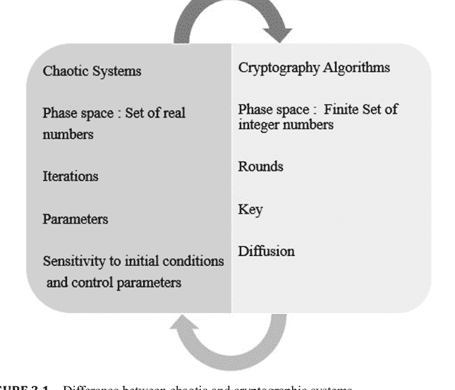

图 3.1 混沌系统与密码系统的差异。

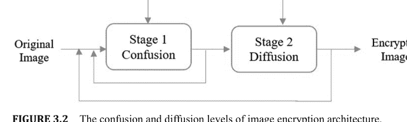

图 3.2 图像加密架构的混淆与扩散层级。

混淆层级包括置换像素，其中像素位置分布在整个图像上。仅修改像素位置，而像素值保持不变。这使得图像无法识别。对于混淆阶段，混沌序列的控制参数和初始条件作为密钥。置换阶段单独无法提供安全性。它很容易被任何攻击所破坏。

为了增强安全性，加密过程的第二阶段会改变整个图像中每个像素的值。在扩散层级中，利用混沌系统生成的随机序列依次修改像素值。混淆和扩散过程会被迭代以提高安全级别。混淆和扩散过程的迭代产生随机性，因此使混沌系统成为图像加密的首选 (Sakthidasan & Santhosh, 2011)。

## 3.3 基于 HENON 映射的图像加密

Henon 混沌映射是一种二维离散时间动态系统，近年来引起了研究人员的兴趣。由 Michel Henon 提出，它是 Lorenz 模型的直接类型。Henon 映射将平面上的点 (x_n, y_n) 变换为另一个点 (x_{n+1}, y_{n+1})，定义如下：

x_{i+1} = y_i + 1 - α x_i^2  (3.1)
y_{i+1} = β x_i  (3.2)

Henon 映射有两个相关参数 α、β，被称为初始参数。规范值是 α = 1.4 和 β = 0.3，这使得 Henon 映射呈现混沌，迭代看起来像回力镖形状的混沌吸引子。采用这些值时，平面的起始点要么映射到 Henon 吸引子，要么发散到无穷。对于除规范值之外的任何值，Henon 映射可能表现为混沌、间歇或收敛到周期轨道 (https://en.wikipedia.org/wiki/H%C3%A9non_map)。

图 3.3 显示了从初始点 (0.1, 0.1) 开始，经过明确数量的轮次形成的二维平面 Henon 映射。初始点的微小变化会导致剧烈变化，从而产生随机行为。

## 3.4 图像加密的性能参数

加密算法的性能分析涉及寻找攻击密码系统的方法，以从加密图像中提取部分或完整信息或确定密钥。这些攻击是在不知道解密密钥的情况下进行的。用于评估加密算法性能的参数主要取决于攻击者或对手想要访问的内容。攻击者或对手可能想要获取有关加密图像、原始图像或算法中使用的密钥的信息。对加密输出图像最常用的攻击在小节中进行了权衡 (Ali, Zulkarnain, & Jan, 2012; Chattopadhyay, Mandal, & Nandi, 2011)。

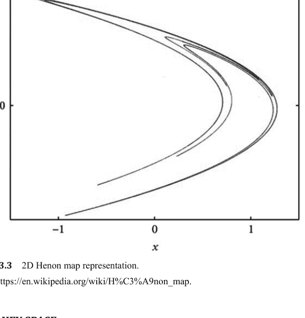

图 3.3 二维 Henon 映射表示。

来源：https://en.wikipedia.org/wiki/H%C3%A9non_map.

### 3.4.1 密钥空间

这是通过穷举所有密钥组合来确定解密密钥所需的总尝试次数。密钥空间与密钥大小呈指数关系。增加密钥大小会使算法的密钥空间成倍增加。例如，对于 128 位的密钥大小，即使使用高性能计算机，密钥空间也为 2^128。因此，密码系统可以用异常大的密钥大小承受暴力攻击。

### 3.4.2 密钥敏感性

高效图像加密方法中使用的秘密或加密密钥必须对密钥的变化敏感。对于加密密钥的每次微小修改，加密和/或解密后的图像完全不同。

### 3.4.3 统计分析

图像统计的调查显示出实际图像与加密图像之间的联系。因此，高效的加密技术要求被加密的图像与实际图像不同。各种方法用于查看加密图像是否透露了有关实际图像的任何细节。直方图分析和相关系数分析利用实际图像和加密图像中的像素作为判断加密算法的统计分析工具 (Sankpal & Vijaya, 2014)。图像的直方图表示不同强度级别的像素分布。图像的统计特性可从图像直方图理解。加密图像和原始图像的直方图相同，表明加密算法对统计攻击具有抵抗力。加密图像的直方图需要在所有强度级别上具有稳定的像素分布。

### 3.4.4 相关系数分析

用于执行统计分析的另一工具是相关系数 (CC)。它是实际图像以及加密图像中相邻像素在所有方向上，即水平、垂直和对角线的相关性的指示性度量。对于实际图像，相邻像素在所有方向上相关性非常高，相关值接近 1。与此不同，在加密图像中，相邻像素高度不相关，相关值接近零，表明混淆和扩散过程的良好平衡，从而能够抵御统计攻击。加密图像的相关值接近 1 意味着算法失败。相关值接近零意味着实际图像与解密图像之间的相似性。

Cov(x, y) = E(x − E(x)) E(y − E(y))

r = cov(x, y) / √D(x) √D(y) (3.3)

### 3.4.5 信息熵分析

为了评估算法的稳健性，还采用了熵分析。加密算法的稳健性是指算法对各种攻击的承受能力。这可以通过对加密图像进行熵分析来衡量。

通常，真正随机的系统以相等概率生成所有符号。原始图像和加密图像的熵进行比较，应接近 8，表明算法对熵攻击的鲁棒性。

H(m) = - Σ_{i=0}^{2^N -1} P(m_i) log₂[P(m_i)]  (3.4)

其中 P(m_i) 是像素的概率，N 是每个像素的位深度。

### 3.4.6 差分分析

它是加密算法对算法输入中极微小变化敏感性的指示性度量。如果攻击者能够通过对算法输入进行极小的更改而观察到加密图像的剧烈变化，那么他将能够确定加密图像与原始图像之间的有效联系。如果对手成功，则算法无法承受差分攻击。差分攻击可以用诸如“像素变化率 (NPCR) 和统一平均变化强度 (UACI)”之类的工具来抵御。

算法的敏感性使用 NPCR 和 UACI 对实际图像进行一比特修改进行测试。NPCR 是当其明文图像相差一个像素时，两幅加密图像的总像素差异的度量。UACI 给出了同一类别的两幅图像之间像素差异数量的平均像素强度的度量，即两幅相同的实际图像或两幅相同的加密图像。UACI 值较高时，即使实际图像的最小修改也会导致加密图像出现显著修改。

总之，如果加密算法表现出 NPCR 和 UACI 的高值，则可以承受任何差分攻击。

## 3.5 图像水印

在数字时代，快速访问互联网和图像处理，知识的隐私和安全是首要关注的问题。在维护

面对数字信息日益增长的威胁，数字图像水印在防篡改、所有权、内容认证和信息保护方面提供帮助。在实施水印方案时，必须考虑不同的需求以支持所涉及的应用。水印方案的基本要求是不可感知性、有效载荷和鲁棒性。这些要求在评估水印系统性能方面发挥着关键作用。通常这些要求是相互冲突的，并且根据水印系统的应用考虑它们之间的权衡。当这些要求之间取得平衡时，水印方案被认为有效。该领域的文献讨论了满足水印系统要求的各种变换技术。水印过程中最受欢迎的组合之一是“离散小波变换（DWT）和奇异值分解（SVD）”（Begum & Uddin, 2020）。

### 3.5.1 离散小波变换（DWT）

离散小波变换（DWT）是一种将信号分解为小波而非频率的小波变换。在 DWT 中，小波是离散采样的。就时间分辨率而言，DWT优于其他傅里叶变换，例如“离散余弦变换（DCT）和离散傅里叶变换（DFT）”。DWT捕获多种信息，例如时间和频率位置。基于 DWT 的图像水印技术将图像分解为不同的频率子带层级。子带频率覆盖整个图像频谱（Begum & Uddin, 2020）。

### 3.5.2 奇异值分解（SVD）

奇异值是线性代数中有用的工具，可应用于包括图像水印在内的各种信号处理操作。任意图像（维度为 m × n）的奇异值表示为：

Image = U * S * Vᵀ  (3.5)

其中；正交元素由“U 和 V”表示，对角元素由“S”表示。

选择 SVD 用于图像水印应用尤其是因为它们代表了信号能量的很大一部分，对噪声具有相当的抵抗力，即当向图像强度添加少量不确定性时，图像奇异值没有显著变化，并且这些值通常与正方形和矩形图像一起使用。基于 SVD 的水印技术的鲁棒性在与变换域技术结合使用时被发现相当好（Akshya & Mehul, 2012）。

## 3.6 图像水印的性能参数

为了衡量水印算法的性能，将水印封面图像（CI）的特征与实际 CI 在图像退化或失真方面进行比较。这可以用各种质量评估指标来完成，这些指标大致分为两类：主观和客观评估指标。主观评估涉及以视觉损伤为衡量标准，测量原始和水印 CI 之间统计数据的变化。主观评估没有标准化的流程。Pooja & Biju (2013) 描述水印过程包括失真并通过物理观察对其进行评估。观察者按五级评定损伤为：不可感知（值 5）、可感知但不令人讨厌（值 4）、轻微令人讨厌（量表值 3）、令人讨厌（量表值 2）和非常令人讨厌（量表值 1）。量表值高于 4 的水印算法在鲁棒性和不可感知性方面表现相当。然而，主观评估过程昂贵、繁琐、耗时，因此不适合实时应用。客观评估过程通过使用自动工具评估水印算法的标准，例如：“峰值信噪比（PSNR）、均方误差（MSE）、归一化相关系数（NCC）、结构相似性（SSIM）、通用质量指数（UQI）、比较器、简化参考图像质量评估（RRIQA）和 C4”。建议的嵌套水印系统在本节中使用客观图像质量指标进行评估，即：PSNR、NCC 和 SSIM（Nguyen, Marie, & Azeddine, 2010）。

### 3.6.1 均方误差（MSE）

使用 MSE 评估 CI 与水印图像之间的误差。它定义为所考虑图像的平方误差的累积，如下所示。高效的水印算法表现出非常小的 MSE 值：

$MSE = \frac{1}{N \times M} \sum_{i=0}^{N-1} \sum_{j=0}^{M-1} [X(i,j) - Y(i,j)]^2 \quad (3.6)$

其中；“M 和 N”表示图像的行数和列数。

### 3.6.2 峰值信噪比（PSNR）

PSNR 与 MSE 一起用于比较嵌入过程后的图像压缩质量。PSNR 是图像质量的衡量标准。特定图像的 PSNR 值越大，水印图像和/或恢复图像质量越好。

PSNR = 10*log(255*255/MSE)  (3.7)

### 3.6.3 结构相似性指数（SSIM）

水印算法的优点可用 SSIM 衡量。它计算封面图像与水印图像之间的相似程度。相似性根据图像特征计算，例如：结构、对比度和亮度。

SSIM(x, y) = [(2μxμy + c1)(2σxy + c2)] / [(μx² + μy² + c1)(σx² + σy² + c2)]  (3.8)

其中；μx 是 x 的平均值；μy 是 y 的平均值；σx² 是 x 的方差；σy² 是 y 的方差；σxy 是 x 和 y 的协方差；c1 = (κ1 L)², c2 = (κ2 L)² 用于稳定弱分母除法的两个变量；‘L’ 是像素值的动态范围；κ1 = 0.01 且 κ2 = 0.03 为默认值（Priya & Vijaya, 2021）。

## 3.7 图像加密的实现

图像加密算法通过使用 Henon 映射创建的混沌序列对实际图像进行加密。图 3.4 显示了一幅 256×256 像素的 DICOM 灰度图像，该图像被输入到算法中。Henon 混沌映射使用规范值 α = 1.4 和 β = 0.3 生成。针对两种不同迭代生成的混沌序列如图 3.5 所示。加密函数与 Henon 混沌映射结合应用于实际图像。最终的加密图像如图 3.6 所示。上述讨论的性能参数被评估。对加密前后的实际图像进行直方图分析可衡量对统计攻击的安全性。实际图像的直方图给出每个强度级的总像素分布，而加密图像的直方图的总像素分布是均匀的，这对于抵御统计攻击是必需的。如图 3.7 所示的实际图像的直方图给出每个强度级的总像素分布，而如图 3.8 所示的加密图像的直方图的总像素分布是均匀的，这对于抵御统计攻击是必需的。如图 3.8 所示的解密图像的直方图与实际图像相似，表明实际图像已完全解密，如图 3.7 所示。

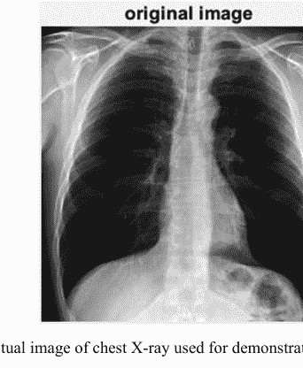

图 3.4 用于演示加密的胸部 X 光实际图像。

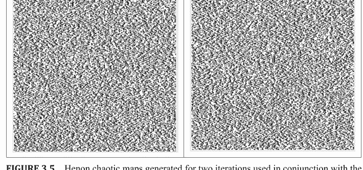

图 3.5 与实际图像结合使用的针对两次迭代生成的 Henon 混沌映射。

### 加密图像

### 解密图像

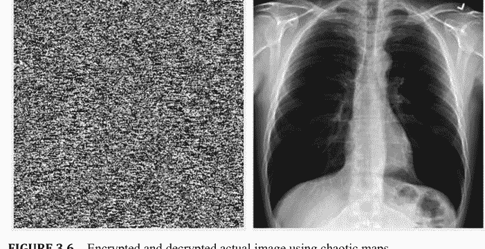

图 3.6 使用混沌映射加密和解密的实际图像。

### 原始图像的直方图

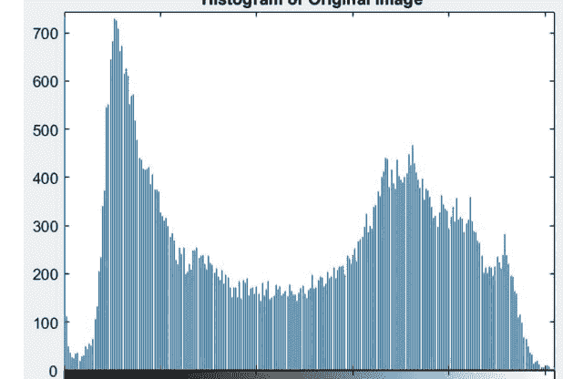

图 3.7 实际图像的直方图。

对实际图像和加密图像进行 CC 分析以抵御统计攻击。相关值在三个方向上考虑，即水平、垂直和对角线。

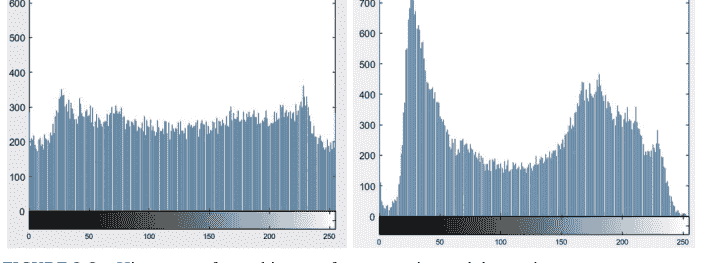

图 3.8 加密和解密过程后实际图像的直方图。

实际图像的相关值接近于 1 表明像素值高度相关，而加密图像的相关值表明像素值之间没有相关性。对于所实现的加密算法，获得了较高的 NPCR 和 UACI 值，如表 3.1 所示。这意味着所实现的算法能够承受差分攻击。实际图像和加密图像的实验相关值如表 3.2 所示。

### 表 3.1 差分攻击值和信息熵

| 性能参数 | 获得值 |
|---|---|
| NPCR (%) | 85.58807 |
| UACI (%) | 31.14382 |
| 经过时间 (sec) | 18.40824 |

### 表 3.2 所有方向上实际图像和加密图像的相关系数的值

| 像素位置 | 实际图像 | 加密图像 |
|---|---|---|
| 水平 | 0.99129 | 0.20878 |
| 垂直 | 0.99310 | -0.00323 |
| 对角线 | 0.98549 | -0.00037 |
| 熵分析 | 7.73614 | 7.98644 |

## 3.8 图像水印的实现

水印领域文献工作描述了许多图像水印的变换技术。该领域最近的发展显示

“‘DWT 和奇异值分解（SVD）’的组合是最受青睐的（Ganic & Ahmet, 2004）。图像水印是通过使用‘离散 Haar 小波变换和 SVD’实现的。使开放网络上的通信安全的过程是通过采用图像加密和图像水印技术的融合来实现的。图像加密是在将其嵌入 CI 之前完成的，然后执行图像水印。

融合算法的输入是 CI 和 WM。用于评估融合算法性能的图像数据库由 20 张不同尺寸为 256×256 的 JPEG 格式“数字成像和医学通信（DICOM）”图像组成。CI 和 WM 均来自同一患者的不同视角。图 3.9 显示了用作 CI 和 WM 的 DICOM 图像。

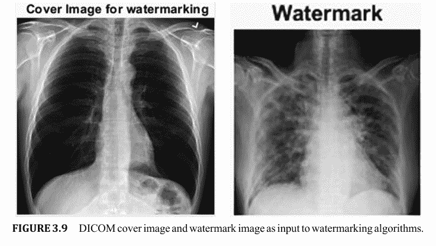

FIGURE 3.9 用于水印算法输入的 DICOM 载体图像和水印图像。

## 3.8.1 算法：水印嵌入

- 1. 读取载体图像。
- 2. 对载体图像应用 DWT。分解得到 LL、HL、LH、HH 频带。
- 3. 对载体图像的 LL 频带应用 SVD。
  LL = Uc* Sc* Vcᵀ
- 4. 读取用于嵌入到载体图像中的水印图像。
- 5. 使用 Henon 混沌映射加密水印。
- 6. 计算图像加密的性能参数
- 7. 计算水印图像的 SVD：
  Wm1 = Uw1 * Sw1 * Vw1ᵀ
- 8. 载体图像 LL 频带的奇异值被水印图像的奇异值所取代。
- 9. 选择合适的嵌入强度。
- 10. 按以下方式计算载体图像的水印位：
  Smark1 = SVD (LL) + Embedding strength *SVD (Wm1)
- 11. 通过重新计算奇异值重建载体图像的 LL 频带，如下
  LL_w1 = Uc* Smark1 * Vcᵀ
- 12. 应用逆 DWT 得到载体图像的水印图像
- 13. 计算图像水印的性能参数。

## 3.8.2 算法：水印提取

- 1. 读取水印载体图像。
- 2. 对其应用逆 DWT。分解得到 LL、HL、LH、HH 频带。
- 3. 计算水印图像的奇异值。
- 4. 使用载体图像和 WM2 的奇异值计算水印恢复位，如下：
  Swrec = (SVD (Watermarked image) – SVD (Cover image))/ Embedding strength
- 5. 通过计算奇异值从水印载体图像中提取水印图像，如下：
  WM = Uw * Swrec * Vwᵀ

## 3.9 图像水印与加密的融合实现

通过对 CI 应用 Haar DWT，水印 WM 被嵌入或水印到 CI 中。载体图像和水印均被分解为四个不同频率的组成部分：LL、HL、LH 和 HH。不同波段被称为低频带（LL），提供图像的近似细节，中频带（HL 和 LH）给出图像的水平和垂直属性。高频带（HH）提供图像的对角线细节。对 CI 和 WM 的四个频带均计算奇异值。在嵌入过程中，水印的奇异值用于修改载体图像的奇异值。WM 在嵌入 CI 之前被加密。图 3.10 显示了融合技术实现的流程图。加密过程增强了保密性，而水印增强了完整性和真实性。如图 3.11 所示，加密后的 WM 使用 SVD 嵌入到 LL 频带中。

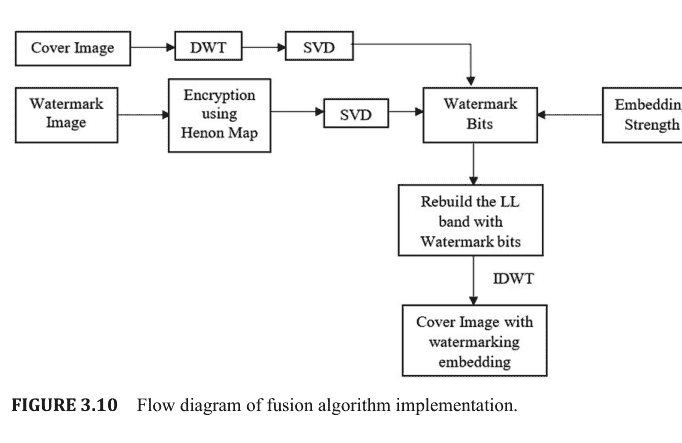

FIGURE 3.10 融合算法实现的流程图。

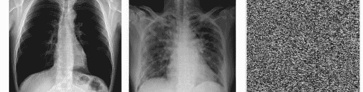

FIGURE 3.11 用于嵌入加密水印图像的载体图像。

CI 和加密 WM 计算得到的奇异值与一个称为嵌入强度的乘性因子一起用于确定要嵌入到 CI 中的水印位。嵌入强度在决定水印图像的不可感知性方面起着至关重要的作用。嵌入强度是这样选择的，以在不可感知性和 PSNR 之间保持平衡。CI 的 LL 频带使用由 CI 和 WM SVD 位组成的修改后 SVD 位重建。当应用逆 DWT 时，结果是在主 CI 中对加密图像进行水印。WM 预处理使其具有与载体或目标图像相匹配的奇异值。为了从 CI 中去除或提取水印，再次采用 DWT 和 SVD，如上文算法所述（Priya & Vijaya, 2021）（图 3.12 和 3.13）。

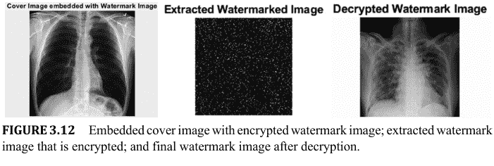

FIGURE 3.12 嵌入加密水印图像的载体图像；提取的加密水印图像；以及解密后的最终水印图像。

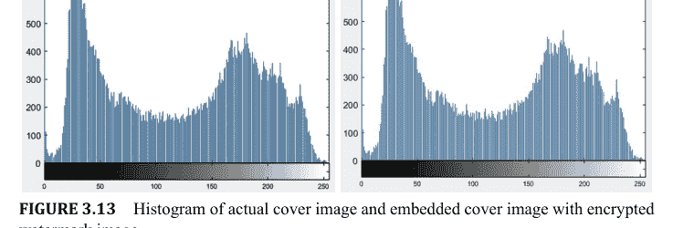

FIGURE 3.13 实际载体图像与嵌入加密水印图像的载体图像的直方图。

嵌入强度的变化给出了与水印 CI 相关的不可感知程度，如表 3.3 所示。嵌入强度越小，PSNR 值越高。随着嵌入强度的增加，水印 CI 质量下降，且嵌入的水印变得可见。

**表 3.3 不同嵌入强度下水印方案的性能**

| 嵌入强度 | PSNR |
|---|---|
| 0.1 | 32.4198 |
| 0.01 | 40.9832 |
| 0.001 | 45.3561 |

## 3.10 结论

在设计通过开放网络传输重要信息的安全措施时，安全违规一直是至关重要的方面。当信息在开放网络上共享时，必须保持完整性和保密性。加密和水印等安全机制的融合被探索用于保护重要信息。在实现的算法中，一幅图像被嵌入到另一幅图像中。嵌入图像被加密以提供额外的安全性。融合算法的实现及其用于评估的性能参数进行了讨论。实现的融合算法能够承受统计和差分攻击，NPCR 为 86%，UACI 为 31%。水印也表现出良好的不可感知性。未来，该算法可扩展为将多个水印嵌入到单个 CI 中。

## 致谢

作者希望感谢所有参与图像加密和水印早期工作的人们，这些工作激发了完成本章工作的热情。本章完成的所有工作和使用的图像仅用于教育目的，而非商业目的。我们衷心感谢班加罗尔 BNM 科技大学的学院管理层为我们提供所有资源开展研究工作并随后发表论文。也，我们衷心感谢 Belagavi 的 Visvesvaraya 科技大学（VTU）为我们提供研究平台。

## 关键词

- **保密性、完整性和可用性**
- **数字成像**
- **离散小波变换**
- **图像加密**
- **噪声比**
- **开放网络**
- **奇异值分解**
- **水印**

## 参考文献

Abhinav, S., (2012). 关于不同图像加密技术的调查报告. *International Journal of Emerging Technology and Advanced Engineering* (Vol. 2, No. 6). ISSN 2250-2459.
Akshya, K. G., & Mehul, S. R., (2012). 基于奇异值替换的鲁棒且安全的水印方案. *Sadhana*, 37(Part 4), 425–440. Indian Academy of Sciences.
Ali, S., Zulkarnain, Md. A., & Md Jan, N., (2012). *关于安全图像传输主要方面的调查* (Vol. 66, pp. 247–254). World academy of science, Engineering and Technology.
Alireza, J., & Abdolrasoul, M. (2010). 使用混沌和流密码的图像加密方法. *Journal of Theoretical and Applied Information Technology*, 117–123.
Anto, S., & Dipesh, S., (2013). 使用混沌映射的图像加密和解密的改进算法. *International Journal of Science and Research (IJSR)* (Vol. 2, No. 2). India Online ISSN: 2319-7064.
Begum, M., & Uddin, M. S., (2020). 数字图像水印技术：综述. *Information*, 11(2), 110. doi.org/10.3390/info11020110.
Chattopadhyay, D., Mandal, M. K., & Nandi, D., (2011). 使用圆映射的对称密钥混沌图像加密. *Indian Journal of Science and Technology*, 4(5), 593–599. ISSN: 0974-6846.
Chong, F., Jun-Jie, C., Hao, Z., Wei-Hong, M., Yong-Feng, Z., & Ya-Wen, (2012). *具有改进扩散策略的基于混沌的数字图像加密方案* (Vol. 20, No. 3, pp. 2363–2378). Optical Society of America.
Enrico, M., Florent, A., Patrick Le, C., & Patrizio, C., (2007). 标准水印技术的评估. *Electronic Imaging, Security, Steganography, and Watermarking of Multimedia Contents* (pp. 6505–6524). San Jose, United States. hal-00250682.
Ganic, E., & Ahmet, E. M., (2004). 鲁棒的 DWT-SVD 域图像水印：在所有频率中嵌入数据. *Proceedings of the Workshop on Multimedia and Security*, 166–174.
https://en.wikipedia.org/wiki/H%C3%A9non_map (accessed on 10 January 2022).


Kamlesh, G., & Sanjay, S., (2011). 使用混沌映射的快速彩色图像加密新方法。 *Journal of Information Security*, 2, 139–150.

Monisha, S., & Manoj, K. K., (2010). 使用混沌方案的图像加密技术：综述。 *International Journal of Engineering Science and Technology*, 2(6), 2359–2363.

Nguyen, P. B., Marie, L., & Azeddine, B., (2010). 用于水印透明度评估的图像质量指标统计分析。 *Lecture Notes in Computer Science*, 685–696. doi: 10.1007/978-3-642-15702-8_63.

Pooja, M., & Biju, T., (2013). 各种加密和密钥选择技术综述。 *International Journal of Engineering and Innovative Technology (IJEIT)* (Vol. 2, No. 7). ISSN: 2277-3754.

Priya, R. S., & Vijaya, P. A., (2021). 使用客观图像质量指标的嵌套水印方案性能评估。 *Journal of University of Shanghai for Science and Technology*, 23(6), 306–314. ISSN:1007-6735.

Sakthidasan, S. K., & Santhosh, K. B. V., (2011). 一种用于数字彩色图像加密和解密的新混沌算法。 *International Journal of Information and Education Technology*, 1(2).

Sankpal, P. R., & Vijaya, P. A., (2014). 使用混沌映射的图像加密：综述。 In: *2014 Fifth International Conference on Signal and Image Processing* (pp. 102–107). doi: 10.1109/ICSIP.2014.80.

Shima, R. M., & Supriya, M., (2011). 基于DNA序列的无压缩图像加密算法。 *Computer Science & Information Technology (CS & IT)* (pp. 258–270). CCSEA, CS & IT 02.

Silpa, K., & Aruna, M. S., (2012). 图像质量指标比较。 *International Journal of Engineering Research & Technology (IJERT)*, 1(4). ISSN: 2278-0181.

Somaya, A. M., Afnan, A. A. A., & Turki, A. (2012). 一种新的基于混沌的图像加密和压缩算法。 Hindawi Publishing Corporation. *Journal of Electrical and Computer Engineering* (Vol. 2012). Article ID 179693.

Wang, Z., Bovik, A., & Sheikh, H., (2005). *基于结构相似性的图像质量评估*. 数字视频图像质量与感知编码，Ser. 信号处理与通信系列. 10.1201/9781420027822.ch7.

## 第4章

### 可穿戴设备取证调查

DEEPIKA DUBEY¹ and RICHA ROHATGI²

¹研究学者，法科学系，安米蒂应用科学学院，安米蒂大学，哈里亚纳邦，印度

²助理教授，法科学，LNJN NICFS，国家法科学大学，德里校区，罗希尼，新德里，印度

### 摘要

可穿戴设备已成为我们日常生活不可或缺的一部分，其采用率正在迅速增长。鉴于此类设备作为证据的重要性与潜力，作者尝试对可穿戴设备取证及其未来发展方向进行全面概述。本章全面审视了可穿戴技术如何改变我们的日常生活及其对取证调查的潜在影响。它深入探讨了可穿戴设备对不同用户群体的优势，包括忙碌的专业人士、健身爱好者以及老年人和体弱者。本章还对这些设备收集的数据类型及其在取证调查中的意义进行了深入分析。本章还涵盖了可穿戴设备的各种类型，包括作为配件佩戴、嵌入服装中，甚至植入人体内的设备。可穿戴设备取证的设计原则、挑战和机遇、可穿戴设备作为数字证据的采纳性、数字取证调查流程以及数据提取方法也在本章中进行了讨论。本章以关键发现的总结和对可穿戴设备取证未来研究的建议作为结尾，为这一快速发展的技术所带来的技术、法律和操作上的挑战与机遇提供了全面而有意义的理解。

### 4.1 引言

可穿戴设备的采用正在广泛增加，并且无疑正成为我们生活不可或缺的一部分。可穿戴设备正在彻底改变我们追踪日常活动的方式。这种技术对于忙碌的专业人士在外出时保持通知信息畅通、健身爱好者追踪锻炼，甚至老年人和体弱者通过在设备感知到不愉快的医疗事件时提醒急救人员都非常有利。然而，为了使这些设备正常运行，它们必须收集佩戴者的信息，例如其位置、生物特征数据、社交媒体、日历和其他信息。

这些设备收集的地理信息、用户的身体和健康统计数据、不同的活动日志（例如，睡眠、行走、卡路里消耗等），以及其他敏感信息，如社交媒体通信账户详情、即时通讯应用程序的通知、媒体文件等，可以在取证调查中发挥巨大作用（Kasukurtu & Patil, 2019）。这些设备作为配件佩戴，嵌入服装中，甚至可能植入人体内，是一种新兴的技术类别。这些设备集成了传感器、操作系统（OS）、通信接口和众多软件应用程序，提供丰富的功能，如人体生物特征监测、位置追踪、视频录制、导航、通话、信息传递、秘书任务、无卡支付和音乐流媒体等。此类设备需要连接到 Wi-Fi 或蜂窝数据网络，以便将记录的信息与云端同步。从可穿戴设备中可能提取的敏感用户信息的类型预计将在数字取证的未来中发挥重要作用。用户与可穿戴设备有着密切的联系，设备持续跟踪用户正在做什么，大量的个人身份数据被存储到设备中，并在生成后被中继到该设备。

### 4.1.1 可穿戴设备技术

可穿戴设备技术是一类电子设备，用于追踪、分析和传输个人数据。这些设备作为配件物理携带，固定在身体穿戴部位、植入用户体内，有时甚至可能纹在皮肤上。这种智能技术可以追踪心率、睡眠模式、通话、电子邮件、信息等。一些最常用的可穿戴设备是——Apple Watches、Fitbit、Samsung Galaxy Watch、Garmin Activity Tracker、Huawei Watch 等（Hayes, 2020）。

这些可穿戴设备通常依赖于诸如蓝牙、Wi-Fi 或登录账户等短距离无线技术来与伴侣设备配对。在设置期间，可穿戴设备会与制造商注册，并可能链接到云服务器账户，用于备份用户的配置、机载传感器数据和记录的活动。智能手机应用程序也可用于操作可穿戴设备的本地配置设置、更新其固件、加载附加功能、与云同步数据并可视化收集的数据。

可穿戴设备的种类繁多。然而，由于其小巧的外形尺寸，这些设备在工程设计上具有相似的约束条件。在没有配对设备协助的情况下，它们可能无法长时间运行、存储大量数据或提供丰富的应用和功能。为了缓解这些缺点，制造商使用低能耗的定制芯片设计可穿戴设备，其传感器和应用程序在不需要时通常处于待机模式。存储容量限制通常通过压缩数据并将其卸载到云服务器或配对智能手机来解决。采用强大的传输协议以提高数据的同步速度。一些可穿戴设备甚至内置蜂窝芯片组以提高移动性和性能（Loomis, 2019）。

智能眼镜、健身追踪器和智能手表收集大量用户数据，并将数据存储在可穿戴设备、伴侣智能手机和云存储中。由于这些设备持续收集数据，它们包含大量在取证调查中有价值的数字证据。可穿戴操作系统旨在在各种可穿戴设备之间无缝工作。它根据可穿戴设备的类型及其规格而有所不同。这些可穿戴设备通常使用两种主要的操作方法进行操作。一些可穿戴设备以自主模式独立运行，而其他设备通常需要互联网连接的智能手机。

例如，大多数智能手表具有内置功能，允许它们连接到用户的智能手机以创建网络界面。在这种情况下，可穿戴操作系统的作用类似于移动操作系统。此操作系统旨在实现

智能手表用于提供用户界面。该手表本质上是一个无线蓝牙适配器，可将智能手机的功能转移到智能手表上（Rowland, Goodman, Charlier, Light, & Lui, 2015）。它使用户能够轻松舒适地执行各种日常任务，例如管理通话、查看并口述电子邮件和短信、获取实时天气和体育报道、收听歌曲或与数字助手对话（Hayes, 2020; Tech Target Contributor, 2015）（图 4.1）。


图 4.1 可穿戴设备的一些示例。

## 4.1.2 可穿戴设备的设计原则

可穿戴设备的设计是一项复杂任务。这是因为各种类型的传感器在本质上相互连接的系统中工作。Adebayo（2020）将传感器分为三类：

- 1. **生物传感器：** 这些包括葡萄糖、血压、心电图、肌电图、温度和脑电波传感器。
- 2. **运动传感器：** 示例包括加速度、陀螺仪、地磁和大气压力传感器。
- 3. **环境传感器：** 例如，温度和湿度、气体、pH值、紫外线、环境光、尘埃颗粒和压力传感器，以及麦克风（Adebayo, 2020）。

传感器将数据发送到 CPU 或显示处理器。这些传感器与微控制器耦合，微控制器是促进可穿戴技术运行的最重要组件。微控制器是小型计算机中的常见组件，可实现物联网（IoT）与所需设备和应用程序的集成。最重要的是，它们有助于在单个组件上执行不同的功能。由于编程简便、成本低廉、尺寸小、与其他传感器连接性强以及能够处理包括图形显示在内的复杂功能，微控制器在可穿戴技术中几乎是必不可少的。设备的典型架构包括用于容纳所有组件的硬件、用户手机上运行的配套应用程序以及云服务器，除可穿戴设备本身之外（Aroganam, Manivannan, & Harrison, 2019）。

图 4.2 描绘了健身可穿戴技术如何用于跟踪各种生活方式活动，例如体重、消耗卡路里、心率、GPS 位置等（Chan et al., 2012）。传感器监控用户的生活方式活动。用户会自行输入部分数据，例如他们的食物摄入量。这些数据集随后被传输到智能手机和云服务。数据随后被处理，使其适合用户理解。根据显示类型的不同，此处理后的数据随后会被发送回配对的智能移动设备或可穿戴设备本身（Aroganam, Manivannan, & Harrison, 2019）。除了架构设计之外，在可穿戴设备的背景下，还有其他重要的设计挑战：

- 1. **网络连接：** 上述系统架构设计清楚地表明，连接性是系统元素通过不同网络相互连接方面的主导特征（Ngu et al., 2008; Stelvaga & Fortin, 2017）。
- 2. **有限资源：** 为了使设备紧凑且便于携带，必须遵守若干限制，例如，可穿戴设备被设计为轻量级，以便用户可以轻松使用。其次，整体尺寸相对较小。包括计算能力、为传感器供电和网络连接在内的功能因能源资源不足而受损，设计受此要求高度制约（Nirjon, Gummeson, Gelb, & Kyu-Han, 2015; Stelvaga & Fortin, 2017）。
- 3. **异步性：** 正如 Rowland 所说，对于智能手机和台式电脑，可以优雅地处理网络中断，并假设交互流程会相对顺畅。然而，对于可穿戴设备，整个系统主要变为异步。由于可用电量有限，可穿戴设备无法保持持续连接。它只能用于间歇性连接。例如，可穿戴设备可以使用低功耗协议（如蓝牙低功耗）与手机连接（Rowland, Goodman, Charlier, Light, & Lui, 2015; Stelvaga & Fortin, 2017）。
- 4. **可持续性：** 根据 Lee 等人的说法，可穿戴设备的概念是个人应长时间携带它。该设备甚至应能抵抗颠簸、可能的物理损坏和环境变化。例如，这些因素对传感器读数有显著影响，就像湿度等因素一样，这可能导致在皮肤电反应传感器输出上出现皮肤电导信号增加（Lee, Kim, Ryoo, & Shin, 2016; Stelvaga & Fortin, 2017）。
- 5. **便利性和人体工学：** 由于可穿戴设备直接佩戴在用户身体上，它应让佩戴者感到舒适。这一要求限制了产品设计中可使用的材料类型、尺寸等（Ferraro, 2011）。
- 6. **服务导向：** 根据 Chan 等人的说法，用户经常倾向于将可穿戴设备视为一个独立对象。然而，设备的行为通常受部署在网络其他地方的软件算法的影响。这意味着围绕可穿戴设备设计的服务在提供适当的用户体验方面通常比设备本身更重要（Chan et al., 2012; Stelvaga & Fortin, 2017）。

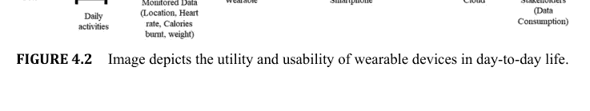

图 4.2 图片描绘了可穿戴设备在日常生活中的实用性和可用性。

## 4.1.3 可穿戴设备取证

可穿戴设备取证专注于从各种类型的可穿戴设备中恢复数据及其分析。调查过程的目标是以法律可接受的方式提取和分析存储在可穿戴设备上的数据，而不改变/修改设备上存在的数据（Loomis, 2019）。尽管可穿戴设备取证的概念已经存在一段时间，但它仍处于起步阶段。由于设备种类繁多且特性各异，取证调查仍然具有挑战性。

可从可穿戴设备中恢复的具有证据价值的潜在信息包括：

- 全球定位系统（GPS）；
- 心率；
- 生物数据；
- 近场通信（NFC）设备；
- 蓝牙信息；
- 电子邮件；
- CDR（通话详单）；
- 消息；
- 应用程序数据等。

## 4.2 背景与相关工作

数字取证是法医学的一个分支，涉及在必须找到事件证据时进行的调查类型。它可以通过各种方式进行，例如通过分析一天中的特定时间或确定特定个人是否犯了罪。由于调查的重要性，数字取证已发展成为一个蓬勃发展的学术领域。它涉及收集和分析数字证据以回答案件相关问题。在传统的数字取证中，数据按易失性顺序获取，即从最易失到最不易失。而存储在二级存储设备上的数据被损坏或丢失的可能性较小，可以稍后获取和恢复。数字取证工具如写保护器用于防止对连接到取证工作站的原始证据进行任何更改或修改（Yoon & Karabiyik, 2020）。

数字取证研究还审查了调查新模型和程序的发展，这带来了新的挑战和现有方法的不足。数字取证的各种研究试图改进取证证据的存储方式。目前，大多数软件平台如 EnCase、Cellebrite UFED 或 AccessData 的 FTK 都能够以各种格式存储设备的数字副本。这些格式的结构方式会影响其处理速度以及它们

包含。反复开发了各种分析和调查模型，为调查人员和执法机构提供清晰简洁的工作流程，以便以最少的错误进行数字取证调查。

可穿戴设备与移动设备取证不可分割地结合在一起，因为这些移动设备通常使用管理并报告由可穿戴设备收集的数据的应用程序。已开展了几项研究，重点是根据各种应用程序如何以及在哪里存储数据来制定移动取证调查模型。还对智能手机的各种应用商店的安全性进行了大量研究。这些研究是在针对影响这些应用运行的不断增加的安全问题而开展的。由于这些应用程序的性质，取证检查员必须处理数据的存储和分析，以便提取可用数据。例如，像 Facebook 这样的社交媒体应用程序必须以难以提取的方式存储用户数据。由于 iOS 设备的普及，对其进行了取证调查。先前的研究发现了 Apple 移动设备上重要记录部分保存的位置和方式。Facebook 和 Skype 的数据还被分析，以发现联系人、登录时间等关键信息保存的位置。

对 Fitbit、智能手表等可穿戴跟踪设备的各种研究为我们提供了安全提取此类设备数据的框架。尽管现有工具仍然强大且已获当局批准，但它们尚不适合直接从可穿戴设备中提取数据，因为从此类设备的内存中提取数据是一个复杂的过程，需要必要的设备和技能（Yoon & Karabiyik, 2020）。

## 4.3 可穿戴设备作为数字证据的采纳性

数字证据是以二进制形式收集和传输的证据。这包括时间戳、连接类型、IP地址、用户配置文件等数据。它包括所有具有证据价值的信息，可以帮助调查人员锁定罪犯。每项技术创新都伴随着一定的风险。这些可穿戴设备也不例外。可穿戴设备存在若干挑战，尤其是在法律法庭介入时。尽管先前在多个案例中已确定从这些设备获得的证据的价值为潜在证据。大多数司法辖区对法律程序中数字证据的采纳性有特定的法律要求。例如，《印度证据法》（IEA）第 65A 条和第 65B 条确立了电子记录作为数字证据在法庭上可采纳性的标准。这些要求同样适用于所有数字证据来源，包括从可穿戴设备中提取的证据（Khairallah, 2018）。所包含的要求如下：

- 1. **可采纳：** 要使证据可采纳，它必须与待证明的事实相关。
- 2. **真实：** 要使证据可采纳，应毫无疑问地证明证据来自所声称的来源。此外，它必须是真实的并且直接涉及事件。
- 3. **完整：** 证据必须完整，这意味着它必须证明或反驳诉讼中的相关事实。
- 4. **可靠：** 要证明证据可采纳，证据的真实性或准确性不得有任何疑问。证据应谨慎处理，同时保持保管链记录。
- 5. **可信：** 提交的证据必须清晰、易于理解，并且法官能够轻松理解（Khairallah, 2018; EC-Council’s Computer Hacking Forensic Investigator v9, Module 1）。

## 4.4 方法论

### 4.4.1 数字取证调查过程及其重要性

数字取证调查过程是一套用于数字证据调查的方法论方法，包括识别、收集和分析（Karie & Venter, 2015），并从报告时起管理案件直至结论。取证调查在各种情况下进行，例如但不限于为合法程序建立证明，以及调查安全安排侵权。有多种策略和设备用于此类调查。然而，由于数字世界的日常进步，以取证方式获取、分析和保存信息变得非常具有挑战性。这在提取审判数据时尤其如此。尽管提出了各种数字取证调查模型，但在大多数情况下，采用包括三个调查阶段的模型，即预调查阶段、调查阶段和后调查阶段（EC-Council’s Computer Hacking Forensic Investigator v9, Module 4）。

### 4.4.2 可穿戴设备取证调查过程

一般而言，可穿戴设备取证检查会经历以下三个调查阶段。该调查过程确保步骤可重复、可辩护、可靠且符合取证要求。调查阶段的逐步描述在小节中详细说明（图 4.3）。

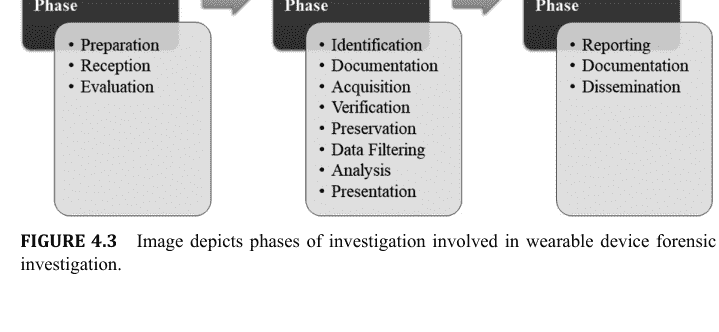

图 4.3 图片描绘了可穿戴设备取证调查中涉及的调查阶段。

### 4.4.2.1 预调查阶段

预调查阶段涉及实际调查过程开始前的准备工作。调查人员在收到安全事件投诉或报告后不能立即行动，而必须遵循特定协议，包括收集事件的基本信息，例如事件类型以及获得采取进一步行动的许可和授权。它包括建立取证工作站、可穿戴设备调查工具包、调查团队，并获得相关当局和利益相关者的必要批准和同意。它包括以下步骤：

- 1. **准备：** 完成适当的接收文件以及保管链日志。
- 2. **接收：** 接收可穿戴设备进行取证检查；识别设备（例如，品牌/型号和序列号）；记录配对设备和伴随设备是否存在。
- 3. **评估：** 设定检查目标；记录可穿戴设备的物理和运行状态。

### 4.4.2.2 调查阶段

调查阶段涉及通过各种方式分析并保护收集到的证据，例如获取和保存从可穿戴数字设备收集的数据。该过程中的每一步对于证据在法庭上的采纳以及对犯罪分子的起诉都至关重要。它包括由受过训练的专业人员实施技术技能和专业知识，以识别和检查证据、检查、记录并保存发现结果以及证据，同时将发现结果的质量和完整性保持在最高水平，这些专业人员专门分析可穿戴数字设备。

在进行调查之前需要考虑的一些值得注意的要点如下：

- 1. **检查/调查目标：**
  - 在调查人员开始检查之前，他们应清楚了解调查的目标。
  - 他们应深入了解所检查对象的内部工作原理。
  - 调查人员应具备根据请求以系统方法检查证据的能力。
- 2. **假设形成：** 为了成功开展案件，调查人员必须提出一个假设，以证明或反驳案件的主要观点。
- 3. **实验设计：**
  - 调查人员应在进行实验前先制定假设。然后他们应测试方法以及测试结果。
  - 测试系统应具有与嫌疑机器类似的环境以产生准确结果。


## 4.4.2.4 工具选择：

- 每个案例都不同，所使用的工具会根据所使用的平台和操作系统而有所不同。
- 数字取证工具可以是：硬件或软件、商业或开源，并且专为特定目的设计或具有更广泛的功能。
- 没有任何单一工具是包罗万象的，因此建议备有多款工具（EC-Council’s Computer Hacking Forensic Investigator v9, Module 4）。

调查阶段包括以下步骤：

- 1. **识别：** 识别具有证明价值的潜在数据以及可穿戴设备及其配对设备和伴随设备所支持的获取方法；确定所需的/受支持的取证设备和工具。
- 2. **记录：** 记录数字犯罪现场和证据的每个细节对于维护识别、获取、分析和保存证据所应用的全部取证调查过程的记录是必要的。细节应包括识别信息，包括数字证据的品牌、型号、序列号、证据状态、将其与取证工作站连接所需电缆/接口类型等。它还应包括取证调查中涉及的不同步骤。常用的记录方法包括摄影、录像和做笔记。
- 3. **获取：** 调查和分析过程对证据数据可能产生积极和消极影响，有时这些过程会以使其不再被法庭接受的方式改变该数据。因此，调查人员应制作证据副本并在副本上工作，以防止在事故或意外情况下对原始数据造成任何损害。数据获取包括使用软件或硬件工具对原始证据进行逐位复制。获取的数据应是原始证据的精确副本。用于此目的的常用数字取证工具包括 Cellebrite UFED、EnCase、FTK、Magnet Axiom 等。
- 4. **验证：** 数字证据的验证或校验是数字取证最重要的方面之一。确保证据未被更改或修改至关重要。验证数字证据需要哈希算法工具，该工具用于创建二进制或十六进制数字，称为数字指纹，表示文件或获取图像的唯一性（Panhalkar, n.d.）。哈希值示例包括 MD5、SHA-1、SHA-256、CRC-32 等。
- 5. **保存：** 它涉及将取证数据安全地以只读方式存储，以及在多个系统和存储介质上维护副本。
- 6. **数据过滤与检查：** 数据过滤是一种使调查人员能够筛选所有提取信息的技术。它用于挑选调查人员希望审查或检查的部分。此外，检查涉及对数据的可靠性和重要性进行评估，以确定数据是否符合检查的目标和要求。
- 7. **分析：** 它包括对检查数据的相关性作为证据进行评估；从整体角度理解、构建、关联和推理数据。证据是根据事件类型、需要执行和履行的目标、事件发生存在的漏洞差异等进行评估的（Panhalkar, n.d.）。
- 8. **展示：** 包括准备和格式化分析后的证据。

### 4.4.2.3 调查后阶段

调查后阶段包括准备报告，详细说明调查过程中采取的所有行动和发现。报告在法律上必须可靠、易于理解并符合适用司法辖区的规定。它包括以下步骤：

- 1. **报告：** 记录检查员、日期/时间、流程/工具、分析和结果与发现。
- 2. **记录：** 以法律可接受的格式汇编所有检查交付物（例如，报告、视频、演示文稿和证据材料）。
- 3. **传播：** 通过取证可靠且安全的渠道向当局分发证据、案件报告和交付物（Loomis, 2019; EC-Council’s Computer Hacking Forensic Investigator v9, Module 4）。

## 4.5 数据提取方法论

我们可以使用以下小节中讨论的一种方法从可穿戴设备中提取数据。

### 4.5.1 手动数据提取

手动数据收集涉及通过其 LCD 显示屏导航可穿戴设备以目视检查活动用户内容，通常捕获显示屏的屏幕截图。内容可能包括图片、通话记录、消息、健身活动和其他用户可访问的数据。手动数据收集方法在可提供的数据量方面有限且耗时。在手动数据收集过程中可能会发生对系统和用户数据的无意修改，例如，不小心删除文件、修改时间戳、更新元数据等。仅在更复杂的收集方法不可用时才应执行手动数据收集。

### 4.5.2 逻辑提取

逻辑数据收集涉及以原始格式通过 USB 或无线等接口以自动方式提取数据。但是，如果设备对数据进行编码，则提取编码数据。收集的数据通常以可读格式存储在取证检查机器中，以便立即分析。此外，可穿戴设备可能具有关联的 SDK（软件开发工具包），可安装在取证检查工作站上。SDK 通过专用命令提供对设备硬件和软件的制造商级别访问。

### 4.5.3 物理提取

物理数据提取方法涉及使用软件和硬件技术获取可穿戴设备存储的逐位副本。提取的数据存储在位流映像文件中，该文件可能包含一个或多个嵌套的文件系统，可安装在取证检查工具上以进行后续分析。其他位流映像必须使用高级数据重建技术进行处理，以获取单个数据文件、已删除数据和碎片。数据重建技术会搜索不同的文件签名。一旦识别出文件签名，相关数据就会从位流映像中提取出来，生成具有相应文件扩展名的单独文件。处理完整个二进制映像中的活动、已删除和碎片数据后，结果可由取证检查员进行分析（Loomis, 2019）。

### 4.5.4 侵入式数据提取

侵入式数据收集涉及暴露可穿戴设备的内部硬件组件以实现数据访问，仅在其他数据收集方法无效时使用。此类技术也可应用于严重损坏或无法操作的设备，或用于关联使用其他数据收集技术检索的数据。侵入式数据收集技术需要专用设备和培训，可能涉及焊接电线、移除存储芯片、修复损坏的硬件以及应用尖端的计算机工程方法。侵入式数据收集使随后使用逻辑和/或物理数据收集技术成为可能。侵入式数据收集技术耗时，但它提供了否则无法获得的数据访问权限（Loomis, 2019; Rainwater, 2014）。

## 4.6 可穿戴设备取证与移动取证 (MF)

移动设备通常是指设计为随身携带在用户身体上或具有合理便携性并可提供计算和通信功能的设备。它通常能够提供商业移动服务的访问。例如，可穿戴设备设计为随身携带在用户身体上；如果它无法提供商业移动数据服务的访问，则不属于移动设备类别（Chauriye, 2016）。在某些法律和法规下，从移动设备中提取的数据可在法庭上作为证据被采纳，但可穿戴设备数据作为法庭上的关键证据的可采性仍需要广泛研究，以证明直接从此类设备检索的数据的合法性和准确性。


## 4.7 挑战与机遇

可穿戴设备取证具有挑战性，因为它需要专门的技术。挑战包括设备多样性、操作和法律功能、证据特征、设备安全、反取证功能、无意的数据修改，以及取证分析所需的专门工具和资源（Loomis, 2019）。

### 4.7.1 法律挑战

数字证据本质上非常脆弱，在处理和加工过程中需要极其谨慎，并非每一家警察或执法机构都具备必要的技能和专业知识来妥善收集、保护和存储从可穿戴设备收集的数字数据，这往往导致数据丢失或污染。

### 4.7.2 操作挑战

可穿戴设备上的时间戳可能会被更改为错误的时间，这将阻止事件被准确记录，并导致无法与其他数字设备进行关联。这些设备依赖 GPS 进行数据传输和跟踪，而 GPS 需要与卫星直接通信来进行数据传输。因此，如果由于用户超出范围、在地下或恶劣天气条件等原因导致 GPS 信号丢失、被阻挡或被干扰，则收集的数据将不再准确。此外，并非所有设备都提供相同的功能和对用户运动的解释。例如，一些设备型号无法区分手臂运动和实际步数，因此其数据记录将不可靠。此外，这也会影响所收集数据的可靠性和报告的可靠性。

### 4.7.3 误用挑战

可能有多个人佩戴同一可穿戴设备。这意味着这些设备的数据记录只有在用户正确佩戴时才准确。例如，将设备佩戴在脚踝而不是手腕上会产生不一致的数据（Ferraro, 2011）。

### 4.7.4 设备多样性

可穿戴设备无处不在且异构多样。它们具有快速的演进周期，导致每年有十多家主要制造商发布新型号。新型设备和型号的激增对取证检查员来说是个问题，因为每台设备都需要大量研究。可穿戴设备也缺乏标准化。制造商利用多样化的硬件组件、传感器、操作系统、软件应用程序和文件系统。设备通常包含专门的调试接口、专有数据格式、对特定品牌伴侣移动设备的支持、云互操作性和通信机制。为了开发最准确和全面的取证能力，取证检查员需要对设备的各种功能和软件版本进行广泛研究（Loomis, 2019）。

### 4.7.5 数据特征

存储在可穿戴设备中的数据格式各异（例如，数据库、原始二进制文件和图片）。即使数据可读，其含义也可能不明显，或者数据可能不准确。在一起刑事审判中，来自 Fitbit 设备的睡眠数据因其固有的不准确性而被判定为不可采纳。可穿戴设备上存储的数据寿命是一个挑战。由于可穿戴设备持续生成数据且设备存储容量有限，数据经常被覆盖或删除。另一方面，同步到移动设备或云服务器的数据可能保存更久。然而，获取存储在这些平台上的数据需要额外的搜查令。此外，可穿戴设备通常设计为单用户使用。然而，一些可穿戴设备支持多用户，因此确定特定设备是否支持多用户非常重要。

### 4.7.6 安全特性

可穿戴设备通过设计实现安全特性，通常在硬件和操作系统中实现。硬件组件可能提供保护功能，例如限制内存读取，而绕过此类保护需要使用昂贵的微探针工作站或聚焦离子束来修改熔丝位等高级技术（Helfmeier et al., 2013）。其他可穿戴设备安全特性包括安全启动链、强制代码签名、沙箱环境、专用安全处理器、内核补丁保护和数据保护（Loomis, 2019）。绕过此类技术以收集证据需要大量资源和高级技术。可穿戴设备中使用的操作系统会频繁更新，同时核心系统库、实用程序和软件应用程序也会更新，包括解决新发现漏洞的安全补丁，这通常会限制数据收集。

### 4.7.7 反取证 (AF)

可穿戴设备通常包含反取证措施，以阻碍数据收集和分析，要么通过使用专有格式混淆数据，要么通过使用密钥对数据进行 XOR 混淆，要么使用 Base64 等数据编码。可穿戴设备可能支持强大的加密算法。静止在闪存或只读存储器（ROM）中的数据，以及在可穿戴设备与其伴侣设备或云服务之间传输中的数据也可能被加密。采用开源数据格式和操作系统的可穿戴设备可能比设计未公开的设备更容易受到攻击。开源数据格式使恶意用户能够创建看似合法的伪造数据集。具有复杂反取证功能的可穿戴设备可能支持安全擦除，该擦除可能在启动过程中通过在设备上启动特定按钮序列、未能输入正确的锁屏 PIN 码或安装专门的取证工具时触发。请注意，一些可穿戴设备可能会删除用户数据，但这些数据仍可通过物理数据收集技术恢复。

### 4.7.8 意外数据操纵

可穿戴设备设计紧凑。其触摸屏显示屏很小，按钮靠得很近。取证检查员可能会意外与此类设备交互，通过引入新数据污染证据。因此，可穿戴设备在整个调查过程及以后都应由取证检查员小心处理和维护。这些设备在运输到取证实验室期间应安全包装。在实验室中，应使用夹具（支架）将设备安全固定，以减轻意外用户交互。最佳做法是尽可能移除锂离子电池，以确保不会进行任何意外修改。

### 4.7.9 取证资源与工具

取证检查员预计要实现高案件周转率。由于可穿戴设备取证是一种新实践，取证检查员通常仅从配对的移动设备和云服务提供商处获取可穿戴数据。利用对可穿戴设备的物理访问相对罕见。无论可穿戴数据的来源如何，其分析及其在取证调查中的意义尚未得到充分确立。其他挑战包括人员培训、设备和工具不足。取证检查员可能由于缺乏经验或培训而无法复制文献中描述的技术。此外，取证技术经常需要使用专门的设备和软件工具，而这些工具并不易获得。已开发了一些取证工具来自动化可穿戴设备数据收集和分析。这些工具针对特定可穿戴设备（例如，为 Google Glass 开发的 Shattered）（Loomis, 2019; Khairallah, 2018）。

## 4.8 讨论

可穿戴设备是一种新型技术，可以作为配饰佩戴、嵌入服装中或植入人体。由于其日益普及，取证调查人员一直在努力开发工具和技术来分析这些设备存储的数据。然而，存储此类敏感数据的新设备的进步对取证分析师以及执法机构来说都十分艰巨。计算机、移动设备和不同类型的数字数据存储设备（例如，U盘、拇指驱动器等）是数字证据的几个常见来源；然而，许多法律案件已证明，可穿戴设备正成为更普遍的数字证据来源。可穿戴设备存储了大量用户数据，包括地理位置、消耗的卡路里、饮食模式以及睡眠和运动习惯；从而创建了用户日常生活的详细记录。由于可靠性与准确性问题各不相同，可穿戴设备尚未在法庭程序中得到广泛使用。此外，随着新时代技术的发展以及通过各种软件工具进行数据检索，其可靠性、可验证性和真实性正在提高

因此，提高了此类证据在法律程序中的可采性。诸如智能可穿戴设备之类的数字证据具有在调查中使用的潜力。一旦确定数字证据在法庭上可作为证据使用，它可能成为涉及可穿戴设备的案件中的关键突破（Khairallah, 2018）。

## 4.9 案例研究

毫无疑问，可穿戴设备正变得越来越流行，而且这一趋势在未来只会不断增加。如前所述，这类设备包含有关设备所有者的大量敏感用户信息，可帮助警察和取证调查人员更轻松地追踪与犯罪相关的人员活动。有多起刑事案件，其中使用这些设备追踪的个人用户数据被用于破案。一些值得注意的案件调查涉及 Fitbit 健身追踪器，为执法机构提供了对起诉至关重要的证据，包括 Mollie Tibbetts 失踪人员案件、Richard Dabate 谋杀案以及其他几起案件。

2015年中期，报告了一起谋杀案，被告声称他的妻子被袭击者杀害。他详细说明了导致妻子死亡的事件。根据陈述，被告从车库听到妻子尖叫，随后在自家看到一名醉酒男子。他试图反击并拯救妻子，但袭击者最终还是杀死了她。袭击者随后离开房屋并走开。尽管被告被部分捆绑，他仍能激活他们的报警系统。在获得被告陈述后，警方搜寻了与导致妻子被谋杀的事件相关的证据，其中包括他和他妻子的手机记录、电脑记录和 Facebook 记录、发送给妻子和女友的短信以及他妻子的 Fitbit 记录，其中包括家庭报警系统数据、地理位置、活动以及她最后的行动。他们还收集了其所有设备上的各种电子记录。对所有数字证据的最终分析与死者丈夫的陈述相矛盾。证据证明丈夫的陈述与从他们个人数字设备中识别出的详细记录和地理位置不同（Black, 2017）。

2015年12月，康涅狄格州居民 Richard Dabate 因妻子 Connie Dabate 的死亡而受到调查。Richard Dabate 声称自己无罪，称妻子被入室者枪杀。然而，Dabate 夫人的 Fitbit 提供了不同的事件时间线。从设备中提取的数据与监控录像、Facebook 帖子和互联网追踪相关联，以将 Richard Dabate 置于杀人时间在犯罪现场（Lartey, 2017）。

在2016年威斯康星州案件中，健身追踪器数据被用来排除一名女子被同居伴侣杀害的可能性。从被告可穿戴设备中提取的信息被作为证据提交。然而，法官裁定应提交宣誓书以确立 Fitbit 的真实性，并允许律师在审判中提交其步数数据（Smiley, 2019）；警察部门的分析师证实了某男子特定可穿戴设备的可靠性（Gill, n.d.）。

2017年3月，住在西雅图的跑步者 Kelly Herron 在公园洗手间佩戴 Garmin Vivo 智能 GPS 设备时遭到残忍袭击，提供了这些设备数据详细且准确的生动证据。Herron 最近参加了自卫课程，能够在为生命而战的绝望中击退袭击者并逃脱。当她走出户外时，一名路人协助她将袭击者锁在公园洗手间，直到警察到来。Herron 的 Instagram 页面描绘了她暴力的动作，这已成为受害者奋起反击的战斗口号（McCoy, 2017）。

2018年7月，爱荷华大学学生 Mollie Tibbetts 在跑步后被报告失踪（Boyette & Simon, 2018）。警方将 Tibbetts 的 Fitbit 云数据（GPS 位置、心率、步数和活动峰值）与社交媒体和监控录像相关联。证据将执法部门引向爱荷华州布鲁克林的 Cristhian Rivera，他对谋杀案供认不讳（Boyette & Simon, 2018）。

2018年10月，圣何塞案件中，女性的健身追踪器帮助警方调查她死亡时提供了线索，导致其90岁继父被捕。被告否认谋杀指控，但据警方称，死者的健身追踪器记录了她心率的快速上升，随后在被告与她在一起时出现显著下降，帮助调查人员拼凑出她死亡的线索。被告的存在是通过调查警方从邻居摄像头收集的视频片段而确定的，该摄像头指向受害者住宅（CBS News, 2018）。

除了可穿戴数据在刑事调查中的使用外，这些设备还可以帮助用户预防药物滥用和过量使用。根据 Cellebrite 的一篇文章，这些设备可以通过使用电皮肤活动（EDA）、皮肤温度和三轴加速度数据来检测药物使用，这些数据由腕戴式生物传感器生成，可检测某人是否使用过阿片类药物。需要快速识别入院患者以便给予过量解毒剂的医生和医院工作人员将显著受益。相同的技术可以帮助执法部门确定他们遇到的某人是否受阿片类药物影响（Watson, 2019）。

## 4.10 结论

可穿戴设备取证领域还有很多工作要做，因为可穿戴设备具有快速的演进周期。开发维护详细设备信息的数据库，包括品牌、型号、硬件升级、软件版本、通信接口、安全功能、数据类型以及支持的数据收集和分析技术，将是一个良好的起点。这些数据库将极大地帮助从业者、研究人员和供应商确保数字取证战术、技术和程序能够跟上可穿戴设备的进步。此外，与智能手机一样，可穿戴设备开始在其硬件和操作系统中加入阻碍数据恢复的安全机制。我们必须专注于诸如熔丝禁用、旁通道分析以及硬件和软件逆向工程等技术，以在取证调查期间恢复受保护的数据。然而，这些设备不断升级，其准确性、可靠性和因此的可采性主要在它们与手机、云和计算机等已在法庭上作为可采证据使用的设备同步时得到增强。只要证据符合可采性的既定要求，可穿戴设备应被视为可在许多法律案件中有用的数字证据来源之一。可穿戴设备收集和处理大量数据。数据分析和数据挖掘（DM）算法仍有待改进，这些算法可以执行自动趋势分析、用户行为分析和异常检测。

## 4.11 未来展望

可穿戴设备是一类日益增长的技术，作为配饰佩戴，嵌入服装中，甚至植入人体。先进的数字取证分析工具和技术仍在开发中，以便能够处理和分析此类设备的数据。然而，可穿戴设备尚未在广泛范围内得到潜在应用，主要是由于对其可靠性、有效性和准确性的争论。本章重点对可穿戴设备在犯罪案件中的取证证据价值进行了全面研究，并具有巨大的研究范围（Khairallah, 2018）。

## 关键词

- 法医证据价值
- 全球定位系统
- 物联网
- 近场通信
- 只读存储器
- 软件开发工具包

## 参考文献

Adebayo, K. O., (2020). 智能手表的数字取证分析。学士论文，塔林理工大学信息技术学院。
Aroganam, G., Manivannan, N., & Harrison, D., (2019). 消费体育应用中可穿戴技术传感器的综述。NCBI, Sensors (Basel), 19(9), 1983。
Ballard, B., (2015). 可穿戴技术周期表。|Online| 可在以下网址获取：https://techcrunch.com/2015/06/10/a-periodic-table-of-wearable-technology/(访问于 2022 年 1 月 10 日)。
Black, N., (2017). Fitbit 数据和其他数字证据被用于谋杀案起诉。|Online| 可在以下网址获取：http://www.legalnews.com/detroit/1442488 (访问于 2022 年 1 月 10 日)。
Boyette, C., & Simon, D., (2018). 她的 Fitbit 可能是找到爱荷华大学失踪女子的关键。|Online| 可在以下网址获取：https://edition.cnn.com/2018/07/26/us/missing-university-of-iowa-student-mollie-tibbetts/index.html (访问于 2022 年 1 月 10 日)。
CBS News, (2018). Fitbit 帮助警方锁定圣何塞女子涉嫌杀人犯——她的继父。|Online| 可在以下网址获取：https://www.cbsnews.com/news/fitbit-helps-lead-police-san-jose-womans-alleged-killer-her-stepfather/?intcid=CNM-00-10abd1h (访问于 2022 年 1 月 10 日)。
Chan, M., Estève, D., Fourniols, J. Y., Escriba, C., & Campo, E., (2012). 智能可穿戴系统：现状与未来挑战。Artificial Intelligence in Medicine, 56。


Chauriye, N., (2016). 可穿戴设备作为可采纳证据：技术正在扼杀我们撒谎的机会 (Vol. 24, No. 2). Catholic University of America, Columbus School of Law, Article 29.
EC-Council’s Computer Hacking Forensic Investigator v9, Module 1, “当今世界的计算机取证”, EC-Council.
EC-Council’s Computer Hacking Forensic Investigator v9, Module 4, “计算机取证调查过程”, EC-Council.
Ferraroa, C., (2011). 可穿戴系统的新方法：超越边界的生物设计. ICoRD2011 Conference Proceedings, 283–291.
Gill, J. (2019). Fitbit 数据在谋杀案中提供线索：电子发现与刑事调查. [Online] Available on: https://ipro.com/resources/articles/fitbit-data-ediscovery-criminal-investigation/ (accessed on 10 January 2022).
Hayes, A., (2020). 可穿戴技术. [Online] Available on: https://www.investopedia.com/terms/w/wearable-technology.asp (accessed on September 3, 2021).
Helfmeier, C., Nedosapasov, D., Tarnovsky, C., Krissler, J., Boit, C., & Seifert, J., (2013). 通过硅芯片入侵. Proceedings of the ACM SIGSAC Conference on Computer and Communications Security, 733–744.
Karie, N. M., & Venter, H. S., (2015). 数字取证挑战的分类. Journal of Forensic Sciences, 60(4), 885–893.
Kasukurti, D. H., & Patil, S., (2019). 可穿戴设备取证：可能的案例研究和拟议方法. Security in Computing and Communications. Springer Singapore.
Khairallah, T., (2018). 可穿戴设备作为数字证据. Preprints. doi: 10.20944/preprints201812.0313.v1
Lartey, J., (2017). 男子因其 Fitbit 数据与其不在场证明不符而被怀疑谋杀妻子. [Online] Available on: https://www.theguardian.com/technology/2017/apr/25/fitbit-data-murder-suspect-richard-dabate (accessed on 10 January 2022).
Lee, J., Kim, D., Ryoo, H. Y., & Shin, B. S., (2016). 可持续可穿戴设备：提升人类生活质量的可穿戴技术. MDPI Sustainability, 8, 466; doi:10.3390/su8050466.
Loomis, M. E., (2019). 可穿戴设备取证. The University of Tulsa, ProQuest LLC, a dissertation report |Online| Available on: https://www.proquest.com/openview/bb6f13b15f875493b3d2003320e2f2429e/1?pq-origsite=gscholar&cbl=18750&diss=y (accessed on 10 January 2022).
Mccoy, J., (2017). 西雅图跑者途中被袭击 拼死击败袭击者. |Online| Available on: https://www.runnersworld.com/news/a20850315/seattle-runner-attacked-midrun-fought-like-hell-to-defeat-her-offender/ (accessed on 10 January 2022).
Ngu, A., Gutierrez, M., Metsis, V., Nepal, S., & Sheng, Q., (2008). 物联网中间件：问题与使能技术综述. IEEE Internet of Things Journal, X(X), 2016.
Nirjon, S., Gummeson, J., Gelb, D., & Kyu-Han, K., (2015). TypingRing：用于文本输入的可穿戴戒指平台. MobiSys ’15 Proceedings of the 13th Annual International Conference on Mobile Systems, Applications, and Services. Florence, Italy.
Panhalkar, T. (2020). 数据分析与证据评估. [Online] Available on: https://info-savvy.com/data-analysis-evidence-assessment/ (accessed on 10 January 2022).
Panhalkar, T. (2020). 理解 RAID 磁盘的获取. [Online] Available on: https://info-savvy.com/understand-acquiring-raid-disks/ (accessed on 10 January 2022).
Rainwater, S., (2014). 物理侵入式取证数据恢复技术. Ph.D. Dissertation, Tandy School of Computer Science and Department of Electrical and Computer Engineering, University of Tulsa, Tulsa, Oklahoma.

Rowland, Goodman, Charlier, Light, & Lui, (2015). *设计互联产品：面向消费物联网的用户体验* (p. 726). O'Reilly Media, ISBN: 978-1-449-37256-9.

Smiley, L., (2019). *一起残忍的谋杀；一位可穿戴证人，和一位意想不到的嫌疑人。* |Online| Available on: https://www.wired.com/story/telltale-heart-fitbit-murder/ (accessed on 10 January 2022).

Stelvaga, A., & Fortin, C., (2017). 可穿戴系统设计原则：一种物联网方法. *第21届工程设计国际会议，ICED17：产品、服务与系统设计* (Vol. 3). Vancouver, Canada, 21.-25.08.2017.

Tech Target Contributor, (2015). *可穿戴操作系统（Wearables Operating System）。* [Online] Available on: https://whatis.techtarget.com/definition/wearables-OS-wearables-operating-system (accessed on 10 January 2022).

Watson, A., (2019). *可穿戴设备如何被用于解决凶杀案、失踪人员和非法毒品案件。* |Online| Available on: https://www.cellebrite.com/en/how-wearables-are-being-used-to-solve-homicides-missing-person-and-illicit-drug-cases/ (accessed on 10 January 2022).

Yoon, Y. H., & Karabiyik, U., (2020). Android 上 Fitbit Versa 2 数据的取证分析. *MDPI 期刊，电子，9(9).* 10.3390/electronics9091431.

## 第5章
## 利用数字取证打击网络犯罪

SHIPRA ROHATGI¹ and SAKSHI SHRIVASTAVA²

¹助理教授，Amity Institute of Forensic Sciences，Amity University，Noida，印度

²信息与网络安全硕士研究生，NSHM College of Management and Technology，Kolkata，西孟加拉邦，印度

## 摘要

通信和数据交换中技术变革的出现导致了完全现代化的犯罪形式，例如网络犯罪和计算机犯罪。因此，另一方面，互联网和网络空间作为高效通信媒介的出现带来了许多优势。这清楚地表明一切都有其光明面，同时也伴随着黑暗面。数据和信息，至少以可交易给犯罪分子的货币形式，合法地针对拥有这些数据和信息访问权的公司。每当发生任何与网络空间相关的违法行为时，每次都会出现同样的问题：

- 事件是如何发生的？
- 我们如何防止未来？

这些问题的答案难以判断，这取决于特定案件的复杂性。与主要问题相关，取证部分很重要。在犯罪现场收集的证据被“仔细调查以了解谁、何事、何地以及为何。”网络取证调查员揭示所有问题并使用收集到的信息。利用并准确、轻松地报告事件，以预测未来的类似攻击。随着网络犯罪的增长，依赖计算机取证和数字取证以及各领域专业知识的执法机构在寻找网络犯罪分子方面变得更加重要（http://www.ummedcyber.com/Digital-Forensics-Combating-Cybercrime-ummed-meel-kolkata-police-THE-PROTECTOR-magazine-hurdles-in-Digital-Forensics.pdf）。

数字取证或网络取证可能“以法院批准的方式从计算机框架系统、电信流（远程）和存储介质中收集和调查信息。”这些包括计算机黑客攻击和高级抢劫、货币欺诈和在线勒索、淫秽和在线性犯罪、网络欺凌和网络跟踪、网络恐怖主义和极端主义、先进的法律调查以及网络犯罪在其合法环境中的范围所包含的安排的主要假设和方法论视角（Harbawi & Varol, 2016）。

### 5.1 引言

计算机犯罪和计算机辅助犯罪活动正在迅速增长。罪犯、骗子和心理双狮似乎在有机会时就会发动攻击。电子信息和数据收集已成为现代科学、科学领域伤害所导致冲突和犯罪日益增加的核心问题（例如网络取证和计算机取证）。

几乎不可能用一台足够可靠的计算机来证明并在法庭上说服。计算机取证是21世纪最伟大的发展使命之一。网络取证一词有许多同义词。也称为计算机取证。它是法律界最年轻的部门。网络法专门处理网络侵权或法律问题。我们发现其根源在20世纪80年代末，表明专家将利用此技术扫描独立计算机以获取犯罪的高级证据（https://www.unodc.org/e4j/en/cybercrime/module-4/key-issues/standards-and-best-practices-for-digital-forensics.html）。

高级法医学是一门学科，适用于法律，可以在刑事调查过程中提供可接受的证据。取证整合了先进的证据收集、保存和调查。计算机化证书是网络犯罪调查的核心。网络犯罪可使用电子设备、黑客攻击或损坏电子设备来实施。2000年之前，网络犯罪属于在框架下调查的金融犯罪类别

普通法。2000年，《信息技术法》持续颁布，承认了计算机使用增加和计算机违规行为。利用检索信息或使用计算机系统或此类资产而犯下的信息技术法、计算机和计算机资产犯罪属于网络犯罪范畴（https://www.unodc.org/e4j/en/cybercrime/module-4/key-issues/standards-and-best-practices-for-digital-forensics.html）。

## 5.2 步骤

数字取证用于解决私营部门内部问题，例如滥用未存储在法院中的非默认公司政策，有时会被归入“犯罪”范畴。在我们的日常生活中，先进的取证还被用于恢复手机、计算机或其他电子设备上意外删除的信息。

这种计算机科学与法律的融合在很大程度上体现在网络取证中。编辑信息和探索基础胚胎数据可以与此定义相关联（Majed, Noura, & Chehab, 2020）。传统上网络取证包括：
- 收集；
- 识别；
- 验证；
- 解释；
- 保留；
- 分析；
- 文档记录；
- 展示。

网络取证是收集、保护、分析和解释计算机容量数据和数据的方法，确保准确性和质量（表5.1）。

2002年，另一次计算机取证演示启动，基于2001年计算机科学研究会议和美国政府的“错误现场出现公约”（针对实际犯罪）。该流程有九个阶段：
- 1. **识别：** 从索引中识别事件并预测类型。
- 2. **准备：** 设置工具、程序、审查命令，并遵守授权和返回操作。

## 表5.1 数字取证路线图 – 物理犯罪现场搜索协议

| 收集 | 保留 | 检查 | 识别 | 分析 | 展示 |
|---|---|---|---|---|---|
| 保留 | 案件管理 | 保留 | 事件/犯罪检测 | 保留 | 文档记录 |
| 批准的方法 | 成像技术 | 可追溯性 | 解析签名 | 可追溯性 | 专家证词 |
| 批准的软件 | 证据保管链 | 验证技术 | 配置文件检测 | 统计 | 澄清 |
| 批准的硬件 | 时间同步 | 过滤技术 | 异常检测 | 协议 | 任务影响声明 |
| 法律授权 | – | 模式匹配 | 投诉 | 数据挖掘 | 推荐的对策 |
| 无损压缩 | – | 隐藏数据发现 | 系统监控 | 时间线 | 统计解释 |
| 采样 | – | 隐藏数据提取 | 审计分析 | 链接 | – |
| 数据缩减 | – | – | – | 空间 | – |
| 恢复技术 | – | – | – | – | – |

- 3. **方法策略：** 创建一种策略，以最大化无污染证据的收集，同时对受害者的影响最小。
- 4. **保留：** 分离，保留物质状态和高级证据。
- 5. **收集：** 改进现场记录和审判记录以使用公认和标准化的策略。
- 6. **查看：** 对涉嫌不当行为证据的深入概述。
- 7. **分析：** 确保重要性，将信息各部分拼凑起来。
- 8. **展示：** 结论和解释。
- 9. **证据返还：** 物质和高级财产返还给合法所有者。

循环措施暗示了为合法流程应用科学，因此网络合法快速，最近的数字证据最近提供给了法院。电子碎片是证据的死亡，可以很容易被破坏，也可以很容易被设置。脱离这些，蒙面，流氓，不道德，以及一点实时是真正的擦除、覆盖、接近、衣物、面具、涡轮增压和破坏网络作为主要资产的日益增长的存在，而关键必须确保公司的资源安全且安全地得到保护。每当这些资源受到攻击或被滥用时，安全专业人员必须收集攻击或滥用的电子证据，他们使用经过证实的碎片为滥用这一创新的那些人带来公平（https://www.unodc.org/e4j/en/cybercrime/module-4/key-issues/standards-and-best-practices-for-digital-forensics.html）。

网络取证是一门科学和一门手艺。随着创新演变和快速变化，监督网络取证在检查、安全、防御和法律要求领域应用的规则也在发生变化。现代策略和技术被总结出来，以便更好地捐赠给信息安全专业人员。网络带来的神秘和社会趋势是对预算和社会辩论的建议，以实现数据创新，犯罪成分确保基本通信资产。

快速识别网络风险并应对那些在最近可能构成真正风险的人，是网络欺诈和先进取证对策成功的核心。由于并非所有企业都能自行做到这一点，可以建立生产的基本协会来获取专业人员和设备，以便在不损害可能从背后被擦除的证据的法律判断的情况下完成工作（https://www.unodc.org/e4j/en/cybercrime/module-4/key-issues/standards-and-best-practices-for-digital-forensics.html）。

## 5.3 数字取证调查员

想象一下贵公司发生安全漏洞，数据被窃。在这些情况下，计算机取证分析师会介入并查明黑客在网络上做了什么，无论访问方法如何、通过网络的位置以及是否运行恶意代码。在这些情况下，数字取证调查员的角色是通过删除、破坏或以其他方式篡改计算机的硬盘或其他数据存储设备（如压缩驱动器或闪存驱动器）来恢复数据，例如文档、照片和电子邮件。数字取证调查员是一个希望基于证据有效解决犯罪的人（https://www.eccouncil.org/what-is-digital-forensics/）。

数字取证的应用包括涉及计算机、网络和移动设备的事件的收集、调查；分析和报告。数字取证专业人员的工作涵盖公共和私营部门，他们的角色通常包括数据泄露调查、从计算机和电子存储设备中恢复和检查数据、拆卸和重建损坏的系统以获取丢失的数据、确定额外的系统来攻击攻击上的攻击并通过创建合法性证据做出决定。

数字取证调查员的最终目标是识别网络犯罪的肇事者，对肇事者获得确凿证据，并将证据提交法庭（https://www.eccouncil.org/what-is-digital-forensics/）。

### 5.3.1 数字取证在调查中如何使用？

数字足迹是关于系统用户的信息，例如访问的网页和活动状态下使用的设备。通过追踪数字足迹，调查人员获得了解决刑事案件所需的数据（https://www.eccouncil.org/what-is-digital-forensics/）。

数字取证调查员是使用各种软件和工具调查加密数据的专家。根据调查员处理的网络犯罪类型，未来可使用的方法会有所不同。网络调查员的职责包括恢复已删除文件、解密、安全以及了解漏洞原因。收集的证据可以被保存和翻译并提交法庭，或用于额外的警察调查。网络取证在犯罪中的作用可以通过案例研究来理解（https://www.eccouncil.org/what-is-digital-forensics/）。


## 5.3.2 案例研究：数字取证对揭开网络监控产生影响

2008年，美国军事史上最严重的网络攻击将特殊军事机密泄露到偏远地区。高级取证人员被派往确定五角大楼攻击的来源，该攻击声称未准备好应对内部发起的攻击，以及是否发生了入侵。调查准确指出了中东一处美国军事基地的入侵行为。原因是被一名声称在军事计算机组织内部的教授植入的持续性U盘。因此，它绕过了网络安全小组构建的所有安全措施（防火墙）。调查确定该人不是在美国军队工作的专家，而是一名受信任的员工，他认为自己找到了一个免费的U盘。他们没有怀疑，就在军事基地外的停车场里选择了它，那里散落着数百个包含恶意软件的U盘。个人已经习惯了它们，因为他们不需要知道任何东西就可以选择一个，并在自己的电脑上使用它们。网络取证专家——与网络安全专家合作——在决定违规行为的入侵方面发挥了重要作用，并进而采取措施确保此类违规不再发生。网络取证专家——与网络安全专业人员合作——在确定违规来源方面发挥了重要作用，并进而采取措施确保此类违规不再发生（Van & Jean-Paul, 2015）。

## 5.3.3 数字取证调查中使用的标准

为了数字取证研究和电子证据的全面程序，存在提供协作支持、理想模型和程序的现有标准。《电子证据公约》（CEE）2016，一项合同，是针对外国律师的电子证据识别和保存的一般指南，并鼓励法官和律师推断数字证据保存的概念（表5.2）。

数字取证中的标准和流程包括识别、收集、检索和存储以促进调查。然而，通过维护证据保管链并确保数字证据被接受，数字取证调查方法可以得到保障，并且无论采用何种流程，都能根据标准说服法官其准确且完整（Garfinkel, 2007）。

### 表5.2 数字取证调查标准

| 标准 | 描述 |
|---|---|
| 1. ISO/IEC27043 | 它提供预先准备的建议，涵盖不同情况下的理想化模式，并确保在所有情况下重复调查以达到相同结果。 |
| 2. ISO/IEC 27037 | 专为事件响应而设计。它维护数字证据的完整性和可靠性，并为潜在数字证据的存储和处理中的具体活动提供指南。 |
| 3. ISO/IEC 27041 | 这确保了在事件管理、证据处理、归档和调查中使用的<|message|> |
| 4. ISO/IEC 27042 | 这是一份全面的工具、技术和方法指南，用于执行分析和解释以识别和评估数字证据，以帮助理解与ISO 27037相关的事件。提供了一份指南。 |

## 5.4 调查中使用的网络取证工具

随着网络恐怖主义、网络跟踪和垃圾邮件等严重问题增加，网络取证工具可以帮助您调查这些刑事案件、起草证据并创建它们。其中一些工具如下：

- 1. **First on Scene (FOS):** 它是一种基础的视觉脚本代码。它还可与其他工具如 PS Tools、Login Sessions、FPort、NTLast、PromiscDetect 和 File Hasher 配合使用以生成证据日志报告。取证专业人员可以进一步分析这些报告以提取重要信息。
- 2. **X-Ways WinHex:** 用于低级数据处理、文件扫描、数码相机卡恢复、损坏的文件系统、原始文件恢复等。这是一种用于收集数字证据的强大工具。
- 3. **Rifiuti:** 它是一种帮助您查找系统回收站最后细节的工具。帮助收集所有未删除或已删除的文件。
- 4. **Galleta:** 这意为“cookie”。Galleta 可帮助您检查计算机上 cookie 文件的内容。Cookie 文件是用于记录日志的临时互联网文件，例如用于网站跟踪等目的。
- 5. **Pasco:** 这在拉丁语中意为“球”。Pasco 可帮助分析在计算机上运行的所有搜索。换句话说，它对于收集目标计算机上执行的互联网活动记录很有用。
- 6. **Network Mapper (NMap)**: 一种端口扫描工具，可帮助您查找远程计算机上的开放端口。NMap 具有绕过源系统 ID 的能力，并在不触发入侵检测系统（IDS）警报的情况下运行。主要与网络安全系统相关。
- 7. **Forensic Acquisition Utilities (FAU)**: 这是一套取证工具，如检查器。用于各种调查和研究的文件擦除器等。
- 8. **Bin Text**: 对于移动收集到的证据文件很有用，例如由其他取证工具生成的日志文件。用于这些日志文件的模式匹配和过滤。
- 9. **Ethereal**: 它是另一种网络安全工具，即网络数据包嗅探器。它通过嗅探网络中的数据包，为调查人员提供通过网络发送的传入数据。然而，如果在源计算机和目标计算机上部署了强加密算法，则无法使用。
- 10. **Encrypted Disk Detector (EDD)**: 它是一个命令行工具，可快速扫描系统本地物理驱动器以查找加密卷。然后您可以进一步调查并做出决定，以确定是否需要进行现场搜索以保护和保存断电后会丢失的证据。
- 11. **PyFlag Tools**: 这些是用于日志分析的一些工具，可以成为调查人员的非常有效的工具。
- 12. **MemGator**: 一种内存文件查询工具，可自动从内存文件中提取数据并编辑调查人员的报告。它可以提取有关内存信息、进程、网络连接、恶意软件检测、密码和加密密钥的数据。

另一种在网络取证中使用的、未被特别纳入杂项隐写工具范围的方法。这是一种将事实或文本文件转换为或插入图像文件以解密其他文件的方式。然而，有几种有用的工具可用于检测这些注入。有黑客或恶意用户想出将数据文件作为图像文件以及音乐和视频文件插入的想法（https://www.blackhawkintelligence.com/forensic-services/digital-forensics/cybercrime-digital-forensics-1/）。

个人可能会通过更改某些类型文件的扩展名来重命名其他类型，从而尝试加密犯罪信息。这使得确定文件的正确类型变得困难。Encase 用于标记此类可疑文件。对硬盘运行哈希（#）会解释文件头并将其标记为包含不正确的文件头信息（https://www.blackhawkintelligence.com/forensic-services/digital-forensics/cybercrime-digital-forensics-1/）。

创建信息的准确镜像对于使该信息/证据在法庭上可采纳非常重要。并且由于这一点，我们的专家与每个病人和对准确性的每一次承诺都非常努力工作，所有的保密性没有人知道他们是否在工作，并收集可以产生具体证据供法庭使用的重要信息（https://www.blackhawkintelligence.com/forensic-services/digital-forensics/cybercrime-digital-forensics-1/）。

一旦信息和所有证据被收集，专家将制作一份综合报告，可在法庭上提交。这些人具有使用复杂工具和技术的专业知识和特殊教育，因此他们也可以在法庭上就工作中的问题作证（https://www.blackhawkintelligence.com/forensic-services/digital-forensics/cybercrime-digital-forensics-1/）。

今天，恶意的愤怒员工正在攻击许多电子商务网站，包括病毒、窃听和金融欺诈，从独立企业和各种政府的企业。这些电子商务附件为企业创造了各种经济困难。这被观察到是被解雇或从总部侮辱的个人的共同特征，无论是网络罪犯如黑客（https://www.blackhawkintelligence.com/forensic-services/digital-forensics/cybercrime-digital-forensics-1/）。

## 5.5 数字取证的挑战

无论技术多么有效。总是存在缺点。同样，存储数据或信息以用作证据对法庭有利，但另一方面，收集此类信息存在某些技术和人为障碍。有很多限制如下：用于存储特定文件的方法可能不是获取文件的时间和地点的个人标签。这些文件可以很容易地伪造或更改。浏览器中用于将 WWW 页面保存到磁盘的一些功能不完整，因为它们可以保存文本但不能保存相关图像。在大多数情况下，系统很难找到最后搜索的页面。查看整个系列，判断哪个慢哪个快变得更困难。您在屏幕上看到的与存储在磁盘上的内容之间存在差异。许多 ISP 使用代理服务器来加快在网络上传输热门页面的速度。因此，用户可能无法看到他们的 ISP

来自特定网站的接收。诸如更改日期和时间戳、终止松散进程以及调查前系统补丁等常见错误可能导致磁盘数据丢失。因此，存储在您计算机上的电子文件和证据部分崩溃（https://intesecurity.com/data-forensics-faqs/）。新技术将帮助工程师开发和创建更强大的硬件和软件来调查与计算机相关的犯罪。密码学的进步是这些挑战之一。随着加密标准提高，算法的复杂性增加，使得专家破解代码变得困难且耗时。另一个挑战是维护受信任的认证和行业标准（https://intesecurity.com/data-forensics-faqs/）。

## 5.6 反取证（AF）：它能否有助于数字取证打击网络犯罪？

反取证工具和技术是数字取证社区的主要障碍。这正是有效的数字证据取证旨在明确其含义，而证据必须可靠、准确和完整时。然而，人们很少关注它是否被视为‘反数字取证’、‘反取证（AF）’或‘反制取证’，尤其是在学术研究的[content]
来自特定网站的接收。诸如更改日期和时间戳、终止松散进程以及调查前系统补丁等常见错误可能导致磁盘数据丢失。因此，存储在您计算机上的电子文件和证据部分崩溃（https://intesecurity.com/data-forensics-faqs/）。新技术将帮助工程师开发和创建更强大的硬件和软件来调查与计算机相关的犯罪。密码学的进步是这些挑战之一。随着加密标准提高，算法的复杂性增加，使得专家破解代码变得困难且耗时。另一个挑战是维护受信任的认证和行业标准（https://intesecurity.com/data-forensics-faqs/）。

## 5.6 反取证（AF）：它能否有助于数字取证打击网络犯罪？

反取证工具、技术是数字取证社区的主要障碍。这正是有效的数字证据取证旨在明确其含义，而证据必须可靠、准确和完整时。然而，人们很少关注它是否被视为‘反数字取证’、‘反取证（AF）’或‘反制取证’，尤其是在学术研究的[content]
来自特定网站的接收。诸如更改日期和时间戳、终止松散进程以及调查前系统补丁等常见错误可能导致磁盘数据丢失。因此，存储在您计算机上的电子文件和证据部分崩溃（https://intesecurity.com/data-forensics-faqs/）。新技术将帮助工程师开发和创建更强大的硬件和软件来调查与计算机相关的犯罪。密码学的进步是这些挑战之一。随着加密标准提高，算法的复杂性增加，使得专家破解代码变得困难且耗时。另一个挑战是维护受信任的认证和行业标准（https://intesecurity.com/data-forensics-faqs/）。

## 5.6 反取证（AF）：它能否有助于数字取证打击网络犯罪？

反取证工具、技术是数字取证社区的主要障碍。这正是有效的数字证据取证旨在明确其含义，而证据必须可靠、准确和完整时。然而，人们很少关注它是否被视为‘反数字取证’、‘反取证（AF）’或‘反制取证’，尤其是在学术研究的[content]
来自特定网站的接收。诸如更改日期和时间戳、终止松散进程以及调查前系统补丁等常见错误可能导致磁盘数据丢失。因此，存储在您计算机上的电子文件和证据部分崩溃（https://intesecurity.com/data-forensics-faqs/）。新技术将帮助工程师开发和创建更强大的硬件和软件来调查与计算机相关的犯罪。密码学的进步是这些挑战之一。随着加密标准提高，算法的复杂性增加，使得专家破解代码变得困难且耗时。另一个挑战是维护受信任的认证和行业标准（https://intesecurity.com/data-forensics-faqs/）。

## 5.6 反取证（AF）：它能否有助于数字取证打击网络犯罪？

反取证工具、技术是数字取证社区的主要障碍。这正是有效的数字证据取证旨在明确其含义，而证据必须可靠、准确和完整时。然而，人们很少关注它是否被视为‘反数字取证’、‘反取证（AF）’或‘反制取证’，尤其是在学术研究的[content]
来自特定网站的接收。诸如更改日期和时间戳、终止松散进程以及调查前系统补丁等常见错误可能导致磁盘数据丢失。因此，存储在您计算机上的电子文件和证据部分崩溃（https://intesecurity.com/data-forensics-faqs/）。新技术将帮助工程师开发和创建更强大的硬件和软件来调查与计算机相关的犯罪。密码学的进步是这些挑战之一。随着加密标准提高，算法的复杂性增加，使得专家破解代码变得困难且耗时。另一个挑战是维护受信任的认证和行业标准（https://intesecurity.com/data-forensics-faqs/）。

## 5.6 反取证（AF）：它能否有助于数字取证打击网络犯罪？

反取证工具、技术是数字取证社区的主要障碍。这正是有效的数字证据取证旨在明确其含义，而证据必须可靠、准确和完整时。然而，人们很少关注它是否被视为‘反数字取证’、‘反取证（AF）’或‘反制取证’，尤其是在学术研究的[content]
来自特定网站的接收。诸如更改日期和时间戳、终止松散进程以及调查前系统补丁等常见错误可能导致磁盘数据丢失。因此，存储在您计算机上的电子文件和证据部分崩溃（https://intesecurity.com/data-forensics-faqs/）。新技术将帮助工程师开发和创建更强大的硬件和软件来调查与计算机相关的犯罪。密码学的进步是这些挑战之一。随着加密标准提高，算法的复杂性增加，使得专家破解代码变得困难且耗时。另一个挑战是维护受信任的认证和行业标准（https://intesecurity.com/data-forensics-faqs/）。

## 5.6 反取证（AF）：它能否有助于数字取证打击网络犯罪？

反取证工具、技术是数字取证社区的主要障碍。这正是有效的数字证据取证旨在明确其含义，而证据必须可靠、准确和完整时。然而，人们很少关注它是否被视为‘反数字取证’、‘反取证（AF）’或‘反制取证’，尤其是在学术研究的[content]
来自特定网站的接收。诸如更改日期和时间戳、终止松散进程以及调查前系统补丁等常见错误可能导致磁盘数据丢失。因此，存储在您计算机上的电子文件和证据部分崩溃（https://intesecurity.com/data-forensics-faqs/）。新技术将帮助工程师开发和创建更强大的硬件和软件来调查与计算机相关的犯罪。密码学的进步是这些挑战之一。随着加密标准提高，算法的复杂性增加，使得专家破解代码变得困难且耗时。另一个挑战是维护受信任的认证和行业标准（https://intesecurity.com/data-forensics-faqs/）。

## 5.6 反取证（AF）：它能否有助于数字取证打击网络犯罪？

反取证工具、技术是数字取证社区的主要障碍。这正是有效的数字证据取证旨在明确其含义，而证据必须可靠、准确和完整时。然而，人们很少关注它是否被视为‘反数字取证’、‘反取证（AF）’或‘反制取证’，尤其是在学术研究的[content]
来自特定网站的接收。诸如更改日期和时间戳、终止松散进程以及调查前系统补丁等常见错误可能导致磁盘数据丢失。因此，存储在您计算机上的电子文件和证据部分崩溃（https://intesecurity.com/data-forensics-faqs/）。新技术将帮助工程师开发和创建更强大的硬件和软件来调查与计算机相关的犯罪。密码学的进步是这些挑战之一。随着加密标准提高，算法的复杂性增加，使得专家破解代码变得困难且耗时。另一个挑战是维护受信任的认证和行业标准（https://intesecurity.com/data-forensics-faqs/）。

## 5.6 反取证（AF）：它能否有助于数字取证打击网络犯罪？

反取证工具、技术是数字取证社区的主要障碍。这正是有效的数字证据取证旨在明确其含义，而证据必须可靠、准确和完整时。然而，人们很少关注它是否被视为“反数字取证”、“反取证（AF）”或“反制取证”，尤其是在学术研究的[content]
来自特定网站的接收。诸如更改日期和时间戳、终止松散进程以及调查前系统补丁等常见错误可能导致磁盘数据丢失。因此，存储在您计算机上的电子文件和证据部分崩溃（https://intesecurity.com/data-forensics-faqs/）。新技术将帮助工程师开发和创建更强大的硬件和软件来调查与计算机相关的犯罪。密码学的进步是这些挑战之一。随着加密标准提高，算法的复杂性增加，使得专家破解代码变得困难且耗时。另一个挑战是维护受信任的认证和行业标准（https://intesecurity.com/data-forensics-faqs/）。

## 5.6 反取证（AF）：它能否有助于数字取证打击网络犯罪？

反取证工具、技术是数字取证社区的主要障碍。这正是有效的数字证据取证旨在明确其含义，而证据必须可靠、准确和完整时。然而，人们很少关注它是否被视为“反数字取证”、“反取证（AF）”或“反制取证”，尤其是在学术研究的[content]
来自特定网站的接收。诸如更改日期和时间戳、终止松散进程以及调查前系统补丁等常见错误可能导致磁盘数据丢失。因此，存储在您计算机上的电子文件和证据部分崩溃（https://intesecurity.com/data-forensics-faqs/）。新技术将帮助工程师开发和创建更强大的硬件和软件来调查与计算机相关的犯罪。密码学的进步是这些挑战之一。随着加密标准提高，算法的复杂性增加，使得专家破解代码变得困难且耗时。另一个挑战是维护受信任的认证和行业标准（https://intesecurity.com/data-forensics-faqs/）。

## 5.6 反取证（AF）：它能否有助于数字取证打击网络犯罪？

反取证工具、技术是数字取证社区的主要障碍。这正是有效的数字证据取证旨在明确其含义，而证据必须可靠、准确和完整时。然而，人们很少关注它是否被视为“反数字取证”、“反取证（AF）”或“反制取证”，尤其是在学术研究的[content]
来自特定网站的接收。诸如更改日期和时间戳、终止松散进程以及调查前系统补丁等常见错误可能导致磁盘数据丢失。因此，存储在您计算机上的电子文件和证据部分崩溃（https://intesecurity.com/data-forensics-faqs/）。新技术将帮助工程师开发和创建更强大的硬件和软件来调查与计算机相关的犯罪。密码学的进步是这些挑战之一。随着加密标准提高，算法的复杂性增加，使得专家破解代码变得困难且耗时。另一个挑战是维护受信任的认证和行业标准（https://intesecurity.com/data-forensics-faqs/）。

## 5.6 反取证（AF）：它能否有助于数字取证打击网络犯罪？

反取证工具、技术是数字取证社区的主要障碍。这正是有效的数字证据取证旨在明确其含义，而证据必须可靠、准确和完整时。然而，人们很少关注它是否被视为“反数字取证”、“反取证（AF）”或“反制取证”，尤其是在学术研究的[content]
## 5.6 反取证（AF）：它能否有助于数字取证打击网络犯罪？

反取证工具、技术是数字取证社区的主要障碍。这正是有效的数字证据取证旨在明确其含义，而证据必须可靠、准确和完整时。然而，人们很少关注它是否被视为“反数字取证”、“反取证（AF）”或“反制取证”，尤其是在学术研究的[content]
来自特定网站的接收。诸如更改日期和时间戳、终止松散进程以及调查前系统补丁等常见错误可能导致磁盘数据丢失。因此，存储在您计算机上的电子文件和证据部分崩溃（https://intesecurity.com/data-forensics-faqs/）。新技术将帮助工程师开发和创建更强大的硬件和软件来调查与计算机相关的犯罪。密码学的进步是这些挑战之一。随着加密标准提高，算法的复杂性增加，使得专家破解代码变得困难且耗时。另一个挑战是维护受信任的认证和行业标准（https://intesecurity.com/data-forensics-faqs/）。

## 5.6 反取证（AF）：它能否有助于数字取证打击网络犯罪？

反取证工具、技术是数字取证社区的主要障碍。这正是有效的数字证据取证旨在明确其含义，而证据必须可靠、准确和完整时。然而，人们很少关注它是否被视为“反数字取证”、“反取证（AF）”或“反制取证”，尤其是在学术研究的[content]
来自特定网站的接收。诸如更改日期和时间戳、终止松散进程以及调查前系统补丁等常见错误可能导致磁盘数据丢失。因此，存储在您计算机上的电子文件和证据部分崩溃（https://intesecurity.com/data-forensics-faqs/）。新技术将帮助工程师开发和创建更强大的硬件和软件来调查与计算机相关的犯罪。密码学的进步是这些挑战之一。随着加密标准提高，算法的复杂性增加，使得专家破解代码变得困难且耗时。另一个挑战是维护受信任的认证和行业标准（https://intesecurity.com/data-forensics-faqs/）。

## 5.6 反取证（AF）：它能否有助于数字取证打击网络犯罪？

反取证工具、技术是数字取证社区的主要障碍。这正是有效的数字证据取证旨在明确其含义，而证据必须可靠、准确和完整时。然而，人们很少关注它是否被视为“反数字取证”、“反取证（AF）”或“反制取证”，尤其是在学术研究的[content]
来自特定网站接收。更改日期时间戳、终止松散进程、调查前系统补丁等常见错误会导致磁盘数据丢失。因此计算机上存储的电子文件和证据部分崩溃（https://intesecurity.com/data-forensics-faqs/）。新技术帮助工程师开发更强大的硬件软件调查计算机相关犯罪。密码学进步是挑战之一。加密标准提高，算法复杂度增加，专家破解代码困难耗时。另一挑战是维护可信认证和行业标准（https://intesecurity.com/data-forensics-faqs/）。

## 5.6 反取证（AF）：它能否有助于数字取证打击网络犯罪？

反取证工具技术是数字取证社区主要障碍。有效数字证据取证旨在明确含义，证据须可靠准确完整。然而很少关注是否视为反数字取证、反取证（AF）或反制取证，尤其学术研究。一些研究如密码学认为可视为AF（Anjani, n.d.）。

AF也受网络犯罪调查者和学术界更多关注。随着网络犯罪增加和可用于挫败取证调查的软件增多，研究者需识别过去他人经历中出现的相同取证预防活动。AF的正式定义和反数字取证的共享术语促进知识共享并实现更好缓解策略。所以首先，过去研究值得强调如何定义反数字取证（Harbawi & Varol, 2016; https://www.unodc.org/e4j/en/cybercrime/module-4/key-issues/standards-and-best-practices-for-digital-forensics.html）。

数字世界的AF是移除或混淆数字取证痕迹以禁用数字取证调查的过程。策略更多但部分常用：

- 数据隐藏；
- 数据销毁；
- 痕迹混淆；
- 数据伪造；
- 数据生成；
- 文件系统攻击。

AF旨在移除数字事件所有发现，使数据无效，增加调查复杂性，或删除其使用证据，或质疑调查总体。各种AF方法在小节中详述。

### 5.6.1 数据隐藏

数据隐藏意味着通过将数据存储或隐藏在数据可能丢失的地方来采取安全措施。简单方法存在，如重命名扩展名或编辑签名，但这些在现代取证软件中通常 readily available。数据通信中，数据隐藏指在不识别主机信号失真情况下添加主机信号模糊消息信号的技术。该复合信号通常采用与数据通信不同的通信方法。

隐藏数据最简单有效方式之一是隐写术。隐藏书写实践已有数千年，但将任意格式的数字数据隐藏在其他载体文件中的能力为数字取证调查员带来任务。除了以多样方式隐藏数据外，隐写术技术极难检测。唯一有效检索最新隐写术工具隐藏数据的开源工具是 www.outguess.org 的“StegDetect”。一些隐写术算法不知道算法密钥并以无法恢复方式隐藏信息（https://www.unodc.org/e4j/en/cybercrime/module-4/key-issues/standards-and-best-practices-for-digital-forensics.html）。

### 5.6.2 加密

除非使用密码算法扰乱数据并使用密钥解密，否则只是通过使数据不可理解或不可检测来保护数据。加密长期以某种形式用于防止消息窃听。加密用于数字数据存储和传输的许多方面。在反取证数据隐藏背景下，密码工具为希望挫败DF调查员努力的用户提供非常强大的工具。有许多标准协议如

SSL（安全套接层）、SSH（安全外壳）或 TLS（传输层安全）可非常容易地加密网络流量以帮助数据包安全传输（https://www.unodc.org/e4j/en/cybercrime/module-4/key-issues/standards-and-best-practices-for-digital-forensics.html）。

### 5.6.3 数据销毁

通过文件擦除销毁数据是自古以来常用的反取证方法。网络罪犯最明智的做法是移除所有不利影响的痕迹。简单清除默认下数据保持完整。虽然并非所有数据对每位计算机用户可见，但此类数据可使用取证工具轻松检索。使用免费数据删除工具之一（Eraser、PGP 等），用户可通过用随机数据覆盖其占用的簇来安全删除文件。

这些工具可执行上述痕迹的安全删除以确保擦除后此类残余无法备份或恢复。这些工具可轻松配置（但仅由有知识的专家）以安全擦除所有硬盘的空闲空间，包括碎片空间，无论是手动还是按间隔自动进行。除了通过擦除或覆盖帮助销毁数据或文件外，网络罪犯有时采取激进措施返回。当有恶意软件注入时可擦除所有数据或在攻击时保存数据（Van & Jean-Paul, 2015）。

### 5.6.4 案例

反取证参与是联邦调查局（FBI）与苹果最新不寻常或高调案件。FBI必须解决反取证技术以获取圣贝纳迪诺县加州政府发放给其员工 Syed Rizwan Farook 的 iPhone 5C，后者是 2015 年 12 月圣贝纳迪诺袭击的枪手之一，造成 14 人死亡 22 人受伤。

黑客被杀，但 iPhone 5C 被回收。内置反取证技术强制加密和多次失败密码尝试后自动设备擦除被四位密码锁定干扰取证获取过程。要求 FBI 帮助获取苹果设备数据的法律案件复杂且超出本文范围。最终，零日滥用为 iPhone 5C 取得证据。该案件规模凸显研究和实践需获得更全面的跨学科理解以了解反取证对整个数字取证社区的影响。

正如 FBI 苹果案所示，AF 将使数字媒体研究更困难、更耗时、更昂贵。用户可使用反取证工具和技术移除、修改或暂停系统中的犯罪活动，正如犯罪从犯罪现场物理领域移除证据碎片增加一样（https://www.unodc.org/e4j/en/cybercrime/module-4/key-issues/standards-and-best-practices-for-digital-forensics.html）。

### 5.6.5 局限

一切有利有弊，取决于如何利用给定目的。AF 可与数字取证结合以最小化网络空间犯罪。该任务的一个局限是可被视为“违法”的软件工具数量内在庞大且持续增长；使定义领域完整范围变得极其困难。这意味着然而没有“局限”，这是未来研究努力的机会。分类数据集和广泛分类方法的进一步局限是半数字取证领域难以清晰解释，新领域无法完全解释。例如，不只是“云服务取证”领域。最后，可使用机器学习（ML）通过分析工具的在线元数据来自动化反取证工具分类过程，这对科学家工作感兴趣。这项工作将有助于缓解持续研究和一般领域中日益增长的反数字取证问题（Harbawi & Varol, 2016）。

### 5.6.6 必要建议

本节用于找出最小化系统总成本的最佳解决方案。软件允许我们使用清单调查系统内部的反取证抵抗痕迹以发现：

- 从 BIOS，虚拟化应被禁用；
- 系统必须始终保持最新；
- 日志应安全保存在服务器上；


-   加密备份应妥善存储；
-   BIOS 应通过强密码保护以避免不必要的修改；
-   根据需要随时随地阻止 VPN 访问。

为此，软件的开发非常有用，并且有需要考虑和遵循的准则，以保护您的数据免受可能针对您系统的任何反取证行为（https://itexamanswers.net/question/what-procedure-should-be-avoided-in-a-digital-forensics-investigation）。

## 5.7 结论

随着技术的进步，数字取证已展示出非常重要的作用。此外，随着网络犯罪（如黑客攻击）的增加，对网络取证的需求也日益增长，并且已开发出各种可以追踪犯罪的工具和技术，并且这些信息被准确报告并提交给法院。它正在这样做。今天，各个行业、企业和政府机构都热衷于聘请该领域的专家来识别员工中的网络故障。专家被任命调查与网络相关的犯罪。调查完成后，专家将准确提取和整理通过各种媒体收集的证据并提交给调查机构（Holt, Bossler, & Seigfried-Spellar, 2015; https://itexamanswers.net/question/what-procedure-should-be-avoided-in-a-digital-forensics-investigation）。

传统取证工具在数据恢复中发挥着重要作用。每种工具都有其自身的缺陷。为了使计算机取证完全成功并具有法律效力，这些工具和技术需要进一步开发和改进。

数字取证的见解是无限的。随着技术的扩展，该领域在优势和障碍并存的情况下不断发展。仅使用经过测试和评估的测试和方法以确保准确性和可靠性。专家收集的证据必须得到充分处理和存储，以便能够在法庭上正确出示。分析网络取证实施方法的每个过程或方法最终都会导致案件的风险。

网络犯罪和数字取证及时识别和应对网络威胁，因为严重损害会影响流程。可以在不损害犯罪分子可能遗留的证据的取证完整性的情况下使用的专业工具的获取，以及并非所有企业都能完成其任务，这是一个重要的合作伙伴关系（Ofori & Akoto, n.d.）。

法律的网络取证情况可以描述为：

-   执法机构在利用数字取证收集和使用证据方面教育不足。
-   法律需要对技术发展做出缓慢反应；它需要在数字取证领域的技术中同步和更新，以便对犯罪分子进行惩罚。
-   使用数字取证工具收集的数字证据在现行法律下被接受为证据，以协助刑事审判。
-   网络取证工具在刑事调查中广泛使用并实现了更好的定罪率。

因此，您需要：

-   识别刑事调查中使用的工具并研究其有效性水平；
-   对拟议系统进行科学测试以检验其有效性；
-   了解司法行政网络取证的使用；
-   我们提出一种新的系统（尚未获批）用于刑事调查。

因此，有必要分析现有的法律体系，关于网络取证在刑事调查和审判中的利用和合法性。出于这个原因，用于磁盘和设备取证的各种工具和技术需要进行分析。这些工具和技术可以在刑事调查和审判中更方便地使用。这些网络取证工具还需要分析执法机构、执法机构和法院可以使用的法律规定（Urvashi, n.d.）。

## 关键词

-   **反取证**
-   **网络犯罪**
-   **电子证据**
-   **加密磁盘检测器**
-   **取证采集工具**
-   **入侵检测系统**
-   **网络映射器**

## 参考文献

Anjani, S. T., (2014). *打击网络犯罪的网络取证*. www.worldwidejournals.com/paripex/recent_issues_pdf/2014/September/September_2014_1410775556_23.pdf (于2022年1月10日访问)。

Conlan, K., Ibrahim, B., & Frank, B., (2016). 反取证：通过一种新的扩展、细粒度的分类法推动数字取证科学。 *数字调查*, 18, S66–S75。

Cybercrime and Digital Forensics (2021). Blackhawk Intelligence London. 检索自： https://www.blackhawkintelligence.com/forensic-services/digital-forensics/cybercrime-digital-forensics-1/ (于2022年1月10日访问)。

Cybercrime Module 4 Key Issues: Standards and Best Practices for Digital Forensics. (2021). 检索自： https://www.unodc.org/e4/en/cybercrime/module-4/key-issues/standards-and-best-practices-for-digital-forensics.html (于2022年1月10日访问)。

Fighting Cybercrime: Cybersecurity and Digital Forensics Are the New A-Team (2019). TechNewsWorld. 检索自： https://www.technewsworld.com/story/fighting-cybercrime-cybersecurity-and-digital-forensics-are-the-new-a-team-86198.html (于2022年1月10日访问)。

Frequently Asked Questions about Data Forensics, (2021). 检索自： https://intesecurity.com/data-forensics-faqs/ (于2022年1月10日访问)。

Garfinkel, S., (2007). 反取证：技术、检测和对策。 In: 2nd *国际信息战与安全会议*。

Harbawi, M., & Varol, A., (2016). 数字取证在打击网络犯罪中的作用。 In: 2016 4th *数字取证与安全国际研讨会 (ISDFS)* (pp. 138–142). doi: 10.1109/ISDFS.2016.7473532。

Holt, T., Bossler, A., & Seigfried-Spellar, K., (2015). *网络犯罪与数字取证：导论*. 10.4324/9781315296975。

Majed, H., & Noura, H., & Chehab, A., (2020). 数字取证与反取证技术的概述. 10.1109/ISDFS49300.2020.9116399。

Ofori, A. Y., & Akoto, D., (2020). *数字取证调查法学：数字证据可采性的问题*. doi: 10.24966/FLIS-733X/100045。

Ofori, Y.A., Boateng, Y., & Yankson, H. G., (2019). *相对主义数字取证调查模型*. IEEE Xplore。

Ummedcyber.com (2021). 检索自： http://www.ummedcyber.com/Digital-Forensics-Combating-Cybercrime-ummed-meel-kolkata-police-THE-PROTECTOR-magazine-hurdles-in-Digital-Forensics.pdf (于2022年1月10日访问)。

Urvashi, S. M., (2018). *网络取证在犯罪调查中的应用*. http://ijrar.com/upload_issue/ijrar_issue_1227.pdf (于2022年1月10日访问)。

Van, B., & Jean-Paul, (2015). 反取证：从业者视角。 *网络安全与数字取证国际期刊*, 4, 390–403. 10.17781/P001593。

What is Digital Forensics? (2021). *数字取证阶段* | EC-Council. 检索自： https://www.eccouncil.org/what-is-digital-forensics/ (于2022年1月10日访问)。

What Procedure Should be Avoided in a Digital Forensics Investigation? (2021). 检索自： https://itexamanswers.net/question/what-procedure-should-be-avoided-in-a-digital-forensics-investigation (于2022年1月10日访问)。

## 第6章

## 使用机器学习和数据挖掘方法对数字取证数据进行聚类和分类

E. FANTIN IRUDAYA RAJ

*助理教授，电气与电子工程系，Dr. Sivanthi Aditanar工程学院，泰米尔纳德邦，印度*

## 摘要

如今，犯罪调查人员从嫌疑人处收集大量潜在的数字证据，这需要使用数字取证技术。这些证据通常以主要是未标记和非结构化的数据以及看似无关的信息形式存在。手动整理和理解这类数据是一项重大挑战，有时甚至是一种心理负担，或者至少是一项耗时过长的活动。因此，取证研究应调查并利用为面临这种情况的调查人员开发强大且自主的分析工具。随着机器学习（ML）算法和数据挖掘（DM）工具的出现，当今现代世界中实现了众多自主系统。从给定数据集提取可用信息、模式和趋势的方法称为数据挖掘。数据挖掘的目标是从大量数据收集中做出数据驱动的判断。机器学习是计算机在没有明确编程的情况下学习如何执行任务的过程。机器学习使用训练数据集进行训练，该数据集教会计算机做出决策并在新数据集中找到新模式。通过在数字取证研究中采用这两种技术，

调查人员可以轻松地对数字数据进行分类和聚类，并做出快速决策。这对于创建更准确、更快速分析的自主取证分析工具也非常有帮助。本文讨论了数字取证研究中采用的各种机器学习技术和数据挖掘工具，以更有效地对数字取证数据进行聚类和分类。

## 6.1 引言

计算机和网络已在我们的文化中根深蒂固，成为日常生活的一部分，以至于数字证据几乎肯定会在任何调查或法律纠纷中使用。电子取证在财产诉讼中变得越来越普遍，各国正在改变其司法系统以处理电子证据。此外，计算机越来越多地被用于凶杀、恐怖主义、毒品贩运、欺诈和儿童虐待等犯罪中。在针对政府和企业信息技术系统入侵的调查中，数字证据变得愈发关键，但随着罪犯越来越擅长掩盖其踪迹，获取证据变得愈加复杂。违法者对数字调查和取证技能的熟悉程度不断提高，并越来越多地利用网络和计算机实施犯罪。少数人正在研究“anti-forensic”策略和技术，以隐藏其行为、抹除取证证据并总体上削弱数字调查人员。

数字取证领域的从业人员和研究人员在近年来取得了长足进步。我们的技术专长不断增长，如今我们已积累了改进技术的必要经验。我们克服了关键的技术障碍，更便捷地促进从业人员获取数字证据。新的取证方法和技术正在开发中，以帮助网络流量分析、远程系统检查和易失数据的取证捕获。这些突破蕴含巨大潜力，但也提出了新的数字调查和取证要求，改变了该领域的地貌，并使新方法得以蓬勃发展。

当今的犯罪调查人员从嫌疑人处收集越来越多的潜在数字证据，这需要使用数字取证程序。不幸的是，数字证据经常以大多未标记且结构不完整、看似无关的数据和信息形式存在。手动组织和理解这类数据是一项重大挑战，有时甚至是一种心理负担，至少也是耗时过多的活动。因此，取证研究应调查并使用聚类算法和无监督机器学习（ML）能力，以便为面临这一困境的刑事调查人员开发独立且稳健的分析工具。

数据挖掘（DM）工具和机器学习方法在近年来显著增长并变得更加普遍。DM是从数据集提取有用信息、模式和趋势的技术。DM的主要目的是从大型数据集合中做出数据驱动的决策。计算机在没有明确编程的情况下学习执行任务的过程被称为机器学习。训练数据集用于训练机器学习，使计算机学会如何对新数据得出结论并发现隐藏模式。因此，调查人员可以利用这两种数字取证研究策略高效地对数字数据进行分类和聚类并做出快速发现。本文探讨了数字取证研究中用于更好地聚类和分类数字取证数据的各种机器学习和数据挖掘策略。

## 6.2 文献综述

存储和创建于计算机上的取证信息是一把双刃剑，在广泛的调查中提供确凿证据，同时也带来可能让最有经验的调查人员也陷入困境的复杂性（Casey et al., 2009）。基本犯罪问题可通过数字证据得到解答，例如谁与谁互动（linkage）、谁负责（attribution）、何时发生（sequencing）以及来自何处（origins and source evaluation）（Kim et al., 2021）。同时，计算机系统的复杂性需要认识到数字证据的各个组成部分可能存在替代解释，并且可能需要进一步证据才能获得预期结果（Razaque et al., 2021）。因此，取证调查人员必须定期理解并使用科学过程以最大化利用数字证据。结合数字取证技术和方法，科学技术使我们能够适应各种场景和需求，同时确保获得的结果在事实上是可靠的（Soltani et al., 2021）。

从业人员的细致程度、专业知识、经验、知识以及在某些情况下的好奇心都是数字证据取证分析中的关键因素（Rafique et al., 2013）。尽管每项取证调查会因资源、目标、数据集和其他情况而在某些方面有所变化，但基本程序保持不变（Chopade et al., 2021）。与传统犯罪相比，现代数字犯罪具有电子交换工具、洗钱和残留物。所有这些加在一起使犯罪调查对调查人员来说更加困难。此外，数字取证调查人员可以访问各种工具，既有开源也有商业。调查的主要目标是使用可接受的方法收集证据，使其在法律上被接受和采纳（Sindhu et al., 2012）。

人工智能（AI）是当前计算机科学中一个成熟的领域，可能有助于在合理时间内解决复杂且计算量巨大的问题（Mitchell et al., 2010）。数字取证是计算领域快速扩展的领域，经常需要对大量复杂数据进行认知评估（Costantini et al., 2019）。因此，AI似乎是解决当前许多数字取证挑战的可行技术（Sikos et al., 2021）。DM是从数据集合中提取有意义的事实、模式和趋势的方法。DM的主要目标是基于大数据集做出数据驱动的判断（Ageed et al., 2021; Tan et al., 2016）。DM也称为数据库知识发现（KDD）。它是帮助企业家、研究人员、调查人员和个人提取重要数据并做出快速决策的最重要方法之一（Nirkhi et al., 2012; Tallón-Ballesteros et al., 2014）。因此，DM技术可应用于数字取证并帮助犯罪调查人员调查数字证据。

机器学习采用一组算法来分析和解释数据，从中学习，并基于这些学习做出最佳判断（Usman et al., 2021; Raj et al., 2013; Qadir et al., 2021）。另一方面，深度学习（DL）将算法分为多个层以构建“人工神经网络（ANN）”。该神经网络能够自我学习并做出智能决策（Ulloa et al., 2021; Chouhan et al., 2021; Shen et al., 2021）。此外，机器学习和深度学习都是人工智能的子集。在数字取证调查中使用这两种方法，调查人员可以高效地对数字数据进行分类和聚类并得出快速结论。

我们可以从文献中推断出，数字取证每天处理大量数据。因此，调查人员迫切需要更准确、更快速分析的自动取证分析技术。他们可以利用数据挖掘和机器学习算法轻松识别和聚类大量数字数据并得出快速结论。本研究深入探讨了取证分析中使用的重要的数据挖掘和机器学习方法。


## 6.3 数字取证工具

数字取证工具在取证分析的数据收集过程中发挥着至关重要的作用。这些工具分为多个类别，因此您选择的工具将决定您打算在何处以及如何使用它。以下是一些大类，以便您了解可用的数字取证工具的广泛范围（Richard et al., 2006）：(a) 数字图像取证；(b) 计算机取证；(c) 磁盘和数据捕获；(d) 文件分析；(e) 内存取证；(f) 网络取证；(g) 互联网浏览分析；(h) 视频/音频取证；(i) 电子邮件分析；和 (j) 数据库取证。虽然这不是一个完整的列表，但它提供了数字取证工具是什么以及它们可以用于什么的概述。此外，许多工具偶尔会被打包成一个单一的工具包，以帮助您利用相关工具的可能性。还值得注意的是，这些组之间的界限可能会因员工的技能水平、合同要求、现行法规、设备可用性和实验室情况而变得模糊。无论这些差异如何，数字取证技术在调查过程中提供了大量收集数据的选项。还值得注意的是，数字取证领域不断变化，随着设备更新，新的工具和功能定期推出。图 6.1 详细描述了数字取证过程。

数字取证过程（Kohn et al., 2013）包括：(i) 识别；(ii) 保存；(iii) 收集；(iv) 检查；(v) 分析；(vi) 解释；(vii) 文档记录；和 (viii) 证据展示。所有这些步骤的基础是适当的取证数据工具，用于收集数字证据并管理收集的大量数据。在这么多可能性中选择最适合我们需求的工具并不容易。在做出决定时，有几件事需要考虑：(a) 技能水平；(b) 输出；(c) 成本；和 (d) 重点是需要考虑的因素。在选择数字取证工具时，技能水平至关重要。一些工具需要基础专业知识，而其他工具可能需要广泛的知识。一个好的经验法则是将您的才能与工具的要求进行比较，以便您可以选择最强大的可用工具。因为工具并非都得到公平对待，即使在同一类别中，输出也会有所不同。一些工具只会返回原始数据，而其他工具会生成完整的报告，可以立即与非技术人员共享。在某些情况下，原始数据就足够了，因为您的信息无论如何都会进一步处理；然而，在其他情况下，有结构化的报告会使您的任务更轻松。成本当然是一个主要考虑因素，因为大多数部门的预算都很紧张。需要记住的一点是，最便宜的工具可能不具备您想要的所有功能，因为这就是开发人员降低成本的方式。不要仅根据价格选择工具，请考虑在价格和功能之间找到平衡。另一个重要考虑因素是工具的重点领域，因为不同的工作通常需要不同的工具。例如，用于评估数据库的工具与研究网络所需的工具明显不同。在购买之前，最好列出全面的功能需求清单。如前所述，一些工具可能在一个工具包中执行多种功能，这可能比为每个操作单独购买设备更具成本效益。这些工具将获取大量数字数据，这些数据将存储在云数据库中。从调查人员的角度来看，评估如此庞大的数据并发现有意义的模式和信息至关重要。DM 和 ML 技术正被用于实现这一目标。

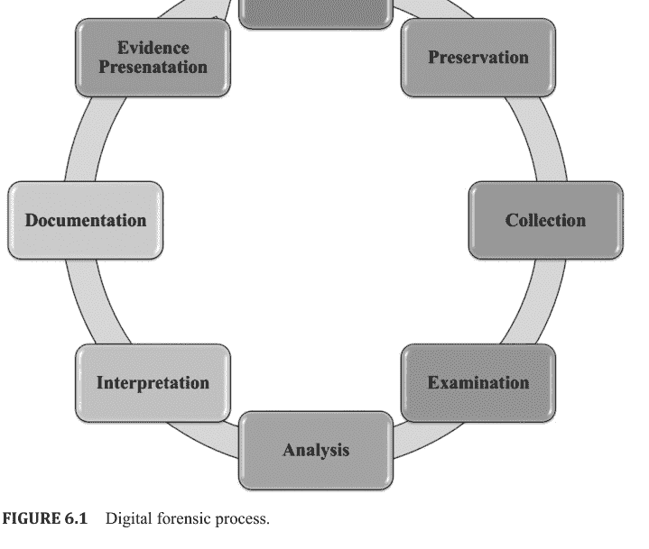

FIGURE 6.1 数字取证过程。

## 6.4 用于数字取证的数据挖掘（DM）技术

数据挖掘（DM）是从数据库中的大量数据中获取信息的技术，以便识别有助于调查人员做出数据驱动决策的重要数据、趋势和模式。DM 的目标是基于海量数据集做出数据驱动的判断。DM 与数据科学相关，数据科学是在特定情况下、针对特定数据集并怀有特定目标由个人执行。DM 技术包括视频和音频挖掘、社交媒体挖掘、图形 DM、文本和网络挖掘等其他服务。它使用简单或极其特定的软件完成（Quick et al., 2014）。尽管在多个平台上可获得大量信息，但专业知识却很匮乏。因此，数字取证中最困难的任务是评估数据，以便提取可用于破案的基本信息。

DM 还可以被定义为用于检查与特定视角相关的模式的工具。它帮助我们对数据进行分类并将其转化为有意义的知识和信息。这些重要信息随后被捕获，要么存储在数据库系统中，要么用于 DM 并协助决策。数字取证中 DM 实施涉及各种程序。数字取证中涉及的各种 DM 程序如图 6.2 所示。

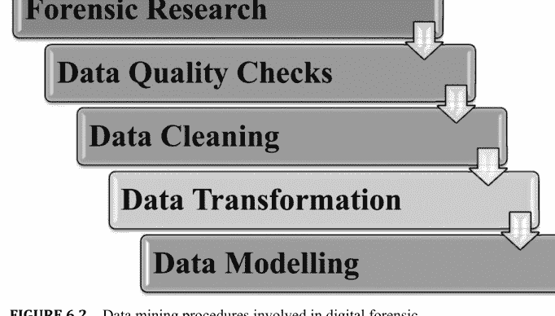

FIGURE 6.2 数字取证中涉及的数据挖掘程序。

在开始之前，我们必须深入了解当前情况、目标以及符合取证标准的可用资源。然后，这将有助于您制定精确的数据提取计划，以高效实现数字取证目标。为了确保不存在数据集成瓶颈，必须在从多个来源获取数据时对其进行修订和比较。在挖掘之前，质量保证会检查任何潜在的数据异常，例如数据插值错误，以确保数据状况良好。在挖掘之前，数据选择、清理、结构化和加密的工作量估计占 80%。数据转换涉及的步骤由六个子阶段组成，用于为最终数据集准备数据（Suaib et al., 2020）：(a) 平滑；(b) 检索；(c) 汇总；(d) 泛化；(e) 规范化；和 (f) 数据属性构建都是其中的一部分。各种数学模型在数据集中使用，以帮助根据一系列条件查找数据模式。

### 6.4.1 数据类型

DM 可应用于以下类型的数据（Ch et al., 2021）。它们是：

- 1. **事务数据库：** 它是存储作为交易捕获的记录的数据库。航班预订、消费者购买、网站点击和其他交易都是此类交易的例子。每个交易记录都被分配一个唯一 ID。它还包括使交易成为可能的所有元素的列表。
- 2. **数据仓库：** 它是收集来自各种来源的数据并将其组织成连贯策略的单一数据存储站点。数据在存储到数据仓库之前会被清理、集成、加载和刷新。数据仓库的数据分为多个部分。即使在很长时间后，我们也可以获得存储在数据仓库中的信息的摘要。
- 3. **数据库中存储的数据：** 每个数据库管理系统（DBMS）都以某种方式保存相关的数据。它还提供一套用于管理数据和促进访问的软件包。这些程序用于各种任务，包括设计数据库结构、确保存储的数据一致且安全，以及管理各种类型的数据访问，例如并发、分布式和共享。关系数据库包含具有名称和属性的表，其中保存来自海量数据集合的行或记录。表中的每条记录都被分配一个唯一键。


4. **额外数据类型：** 其他类型的数据以其适应性、语义意义和结构而著称。它们被用于各种情况。空间数据、多媒体数据、图数据、序列数据、数据流、工程设计数据等只是可用的数据类型中的几个。

## 6.4.2 各种数据挖掘（DM）技术

DM 是使用先进的数据分析技术在大数据集中发现以前未知、有效模式和联系的过程。该技术可以同时使用神经网络、统计模型等数学方法以及决策树等 ML 方法。因此，DM 用于进行预测以及数据分析。不同的基本 DM 技术已被创建并用于当代 DM 应用，包括关联、序列模式、聚类、预测、分类和回归（Han et al., 2011）。图 6.3 表示主要的数据挖掘技术。

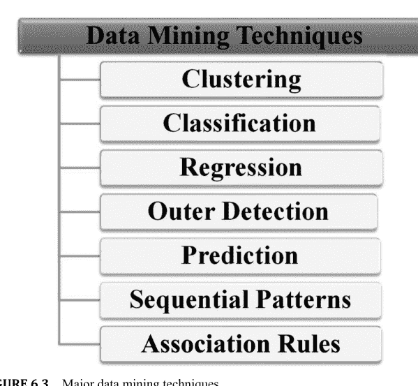

图 6.3 主要数据挖掘技术。

- 1. **聚类：** 这种方法生成具有相似特征的重要项目组。人们经常将其与分类混淆；然而，如果他们理解这两种策略的工作原理，这就不是问题。聚类将对象分配到其产生的类中，而与之相反，分类将项目分配到预先确定的分类中。在这种技术中，相同的数据元素被分组到相同的聚类中。利用度量来帮助基于差异性的最大数据关联是分组的主要组成部分。数据由几个聚类来描述，这牺牲了一些细节但提高了整体质量。它使用聚类来建模数据。聚类在历史上根植于统计学、数学和数值分析，正如数据建模所示。聚类与 ML 中的隐藏模式相关，寻找聚类是无监督学习，并且框架遵循数据范式。因此，从实际角度来看，聚类在 DM 应用中非常有用。

医学诊断、计算生物学、Web 分析、空间数据库应用、信息检索、文本挖掘、法证分析以及科学数据探索只是聚类在实时中的几个例子。换句话说，聚类分析是一种用于识别相似数据的 DM 技术。该技术有助于识别数据的差异和相似性。聚类与分类相似，因为它根据相似性将数据片段分组在一起。

- 2. **分类：** 该技术的起源可以追溯到 ML。它将数据源的元素分类到预先确定的类或组中。分类在 DM 中使用统计、线性规划、ANNs 和决策树等技术。分类是一种设计和开发方法，允许程序将数据集中组件归类到各种类别中。该方法用于提取重要和相关的数据。该方法促进将数据分类到各个组中。它们是：（a）取决于所挖掘的数据源类型；（b）取决于所涉及的数据类型；（c）取决于所发现的知识类型；以及（d）根据所使用的 DM 技术。

- 3. **回归：** 它是一种用于分析和识别因另一因素存在而产生的变量之间相关性的 DM 方法。它被用来表达某个变量发生的概率。它是一种建模和规划方法。例如，我们可以利用它根据竞争力、消费者需求和数据可用性等其他因素来预测成本。它主要用于确定数据集中两个或多个变量之间的确切联系。

- 4. **异常检测：** 这种 DM 技术关注识别数据集中不符合预期行为或模式的数据元素。该技术适用于各个领域，包括欺诈检测、入侵检测和监控。此外，它也被称为异常挖掘或异常分析。异常值是与数据集其余部分显著偏离的数据点。绝大多数现实世界的数据集中都存在异常值。因此，在 DM 领域，异常检测至关重要。异常检测在各个领域都很有用，包括识别无线传感器网络数据中的异常值、检测信用卡或借记卡欺诈、检测网络中断等。

- 5. **预测：** 这种说服性 DM 技术，正如其名称所示，帮助研究人员根据当前和过去的数据记录匹配模式以预测未来的研究。此外，该方法预测因变量和自变量之间的关系。一般而言，预测涉及各种 DM 技术的组合，包括分类、趋势、聚类、趋势等。虽然某些解决方案依赖于 ML 和 AI，但其他解决方案可以使用简单算法完成。为了预测未来事件，它按正确顺序检查先前的事件或实例。

- 6. **序列模式：** 它是一种检查数据库以查找序列模式的技术。该方法包括在序列集合内发现独特的子序列。序列的值使用长度、出现频率、时间等各种特征来量化。换句话说，该技术有助于发现或识别历史交易数据中的相似模式。

- 7. **关联：** 在 DM 的大多数技术中，它是最常使用的方法之一。该技术利用其元素之间的关系和交易来寻找模式。这就是为什么它通常被称为关系技术。它还有助于发现两个或多个项目之间的联系。在数据集中，它揭示了隐藏的模式。关联规则是 if-then 语句，有助于指示不同数据库中大型数据集中数据项相互连接的可能性。它是一种广泛使用的技术，用于增强数据或医疗数据集中销售相关性，并服务于多种目的。

## 6.4.3 数据挖掘（DM）架构

实际的数据源是文本文件、万维网、数据仓库、数据库和其他文档。要取得成功，DM 需要大量的历史数据。组织通常将数据存储在数据仓库或数据库中。电子表格、文本文件、一个或多个数据库以及其他数据存储库可能存在于数据仓库中。数据必须在发送到数据仓库或数据库服务器之前进行选择、集成和清理。因为数据来自各种来源并且格式各异，所有数据不能立即用于 DM，因为它并不总是完整和准确的。因此，初始数据必须被同质化和清理。必要数量的数据将从大量来源获取。然后只选择最相关和适当的数据并发送到服务器。因此，作为对用户请求的响应，服务器负责根据 DM 从数据库中检索适当的数据。

任何 DM 系统必须包含 DM 引擎。它包含用于 DM 任务的模块，例如时间序列分析、预测、聚类、分类、特征化和关联。换句话说，DM 是我们 DM 架构的基石。它由软件和工具组成，用于从各种来源收集并存储在数据库中的数据中提取信息和见解。模式评估单元主要负责使用给定阈值量化模式。它与 DM 引擎协作，将结果减少为不同且独特的模式。利益相关者分析在此行业中经常与 DM 模块一起使用，以将搜索缩小到重要趋势。例如，它可能采用利益阈值来消除先前观察到的模式。

DM 系统和用户通过图形用户界面（GUI）模块进行通信。它允许用户在不掌握过程复杂性的情况下快速有效地使用系统。当用户提交任务或查询时，该模块与 DM 系统接口以发送结果。知识库在整个 DM 过程中都有益。知识库还包含用户意见和来自用户体验的数据。它可能有助于指导搜索或确定模式结果的重要性。为了提高结果的可信度和准确性，DM 引擎可以利用来自知识库的输入（Gampala et al., 2020）。图 6.4 描述了 DM 的架构。


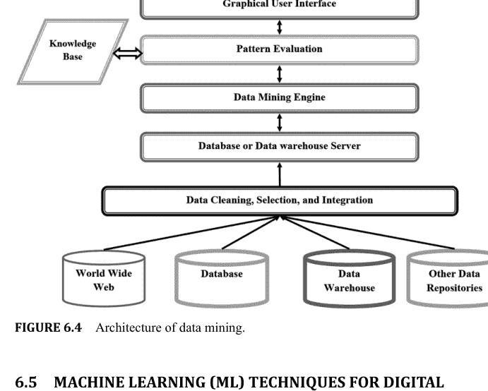

图 6.4 数据挖掘架构。

## 6.5 用于数字取证的机器学习（ML）技术

通过数据驱动的经验不断改进的算法的发现过程被称为 ML。创建、检查和开发无需人工干预即可让机器学习的算法的过程被称为算法开发。ML 和 DM 都是数据科学的一部分，这是有道理的，因为它们都使用数据。由于这两种方法都用于解决复杂问题，且 ML 有时被用于执行有用的 DM（Mohri et al., 2018），许多人无意中互换使用这些术语。另一方面，DM 的数据可以用于训练机器。

此外，这两个过程都采用相同的基础数据模式检测算法。ML 教计算机如何学习和解释给定的参数，而 DM 则用于从海量数据中推导出规则。图 6.5 显示了 AI、统计学、DM 和 ML 之间的关系。

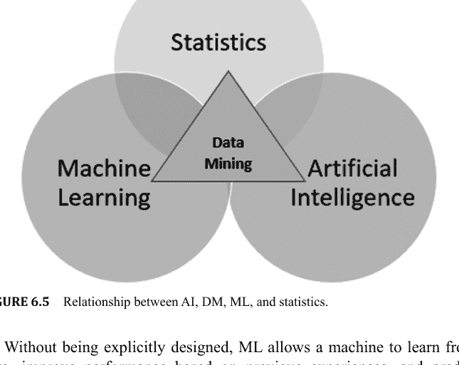

图 6.5 AI、DM、ML 与统计学之间的关系。

无需显式设计，ML 使机器能够从数据中学习，基于以往经验改进性能，并预测未来事件。ML 算法使用过去的数据样本，即训练数据，创建数学模型，帮助它们在没有显式编程的情况下做出判断或预测。ML 生命周期是设计和实施成功 ML 项目的循环方法。ML 生命周期的主要目标是找到问题的解决方案（Ashmore et al., 2021）。图 6.6 描述了 ML 生命周期中的七个主要步骤。

收集数据是 ML 生命周期过程的第一个阶段。数据可以从不同的来源收集，包括移动设备、互联网、数据库和文件。因此，我们必须首先找到各种数据源。输出的效率将由收集的数据的质量和数量决定。数据越多，预测就越准确。该过程包括：（a）识别多个数据源；（b）收集数据；以及（c）合并来自不同来源的数据。接下来，我们必须在收集数据后为进一步处理准备数据。数据准备包括将数据存储在正确的位置并为 ML 训练做好准备。整个阶段将被分为两个不同的部分。它们是数据探索和数据预处理。

数据整理是将非结构化和原始数据转换为有用格式的阶段。它是从数据中提取数据、选择要使用的变量并将数据转换为适合下一阶段分析的格式的方法。数据已被清理和格式化，现在已准备好进行分析。该过程包括：（a）选择分析方法；（b）创建模型；以及（c）分析结果。此步骤的目标是创建一个 ML 模型，该模型将使用各种分析方法分析数据，然后评估结果。然后对模型进行训练，这涉及提高模型的性能以达到问题的更好解决方案。接下来，模型被训练以利用数据集，然后使用各种 ML 方法对模型进行训练。最后，一旦在特定数据集上训练了开发的 ML 模型，我们就会对其进行测试。测试数据被输入到开发的模型中，以确保其正常工作。

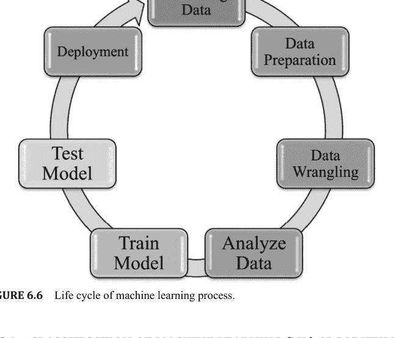

图 6.6 机器学习过程生命周期。

### 6.5.1 机器学习（ML）算法的分类

ML 算法分为四组。它们是（a）在监督学习下的回归；（b）在监督学习下的分类；（c）在无监督学习下的降维；以及（d）在无监督学习下的聚类。回归属于监督学习主题，包括线性回归、决策树等技术。监督学习类别下的分类包括线性 SVM、朴素贝叶斯和决策树类型等各种算法。无监督学习-降维方法类别包括主成分分析和潜在狄利克雷分析等技术。最后，在无监督学习-聚类领域下描述了许多算法。它们主要用于使用聚类的应用。其中包括 K-means、K-nodes 和高斯混合模型（Raj et al., 2021; Priyadarsini et al., 2020）。图 6.7 显示了各种 ML 算法的详细分类。

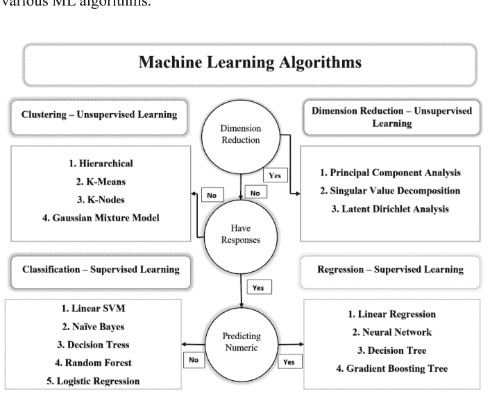

图 6.7 不同机器学习算法的详细分类。

在上述算法中，一些重要算法如 K-NN 算法、支持向量机（SVM）主要用于数字取证。

### 6.5.2 K-NN 算法

K-NN（最近邻）算法是一种基于监督学习的简单而有效的 ML 算法（Khan et al., 2018）。该方法认为新旧数据相似，并将新案例分配给最接近当前类别的类别。因此，K-NN 方法保存所有可用数据，并根据新数据点与当前数据的相似性对新数据点进行分类。这意味着通过利用 K-NN 方法，新数据可以迅速分类到明确定义的类别中。虽然该方法可用于回归和分类，但最常用于分类。图 6.8 解释了 K-NN 算法。

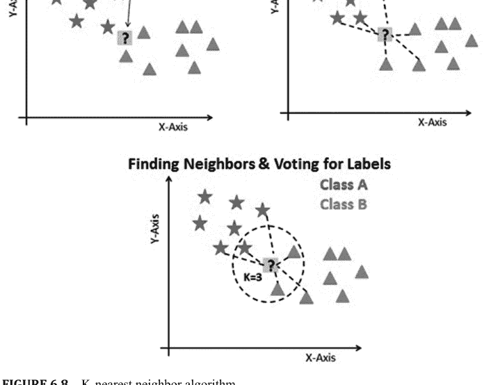

图 6.8 K 近邻算法。

K-NN 算法的工作原理如下所述：

- 选择邻居的数量 K；
- 计算你最接近的 K 个邻居之间的欧几里得距离；
- 根据欧几里得距离，选择 K 个最近的邻居；
- 统计 k 个邻居中每个类别的数据点数量；
- 将新获得的数据点分配给邻居最多的类别；
- 最后，我们的测试机器学习模型准备就绪。

K-NN 方法易于实现且对嘈杂的训练数据具有鲁棒性。因此，如果训练数据量大，则可能更成功。然而，该方法的主要缺点是需要不断确定 K 的值，有时可能具有挑战性。此外，计算成本很高，因为需要花费时间计算所有训练样本数据点之间的距离。

### 6.5.3 SVM 算法

支持向量机（SVM）算法是另一种重要且在许多最近的基于机器学习的应用中最常用的算法。它是一种监督 ML 算法，可以处理回归和分类任务。然而，它主要用于解决分类问题。在 SVM 方法中，每个特征的值是特定坐标的值，每个数据项表示为 n 维空间中的一个点（Zhao et al., 2020），其中 n 是不同特征的数量。然后我们找到一个明显分隔两个类别的超平面以完成分类。图 6.9 显示了 SVM 算法的图形表示。

SVM 方法既可以对线性输入也可以对非线性输入进行分类。它首先通过 n 维属性向量映射每个数据点，其中 n 表示属性总数。然后找到将这些数据组件分为两组的超平面，同时最大化两个类别的最小分离并减少分类错误。所选超平面的长度和类别的邻近出现定义了分组类别的最小接近度。每个特征向量首先显示为 n 维空间中的一个点，每个特征的值对应于特定坐标。为了完成分类，我们必须首先找到按最大距离划分两个类别的超平面。


图 6.9 SVM 算法。

SVM 在存在清晰分离间隔时效果良好，并且在高维空间中有效。它在决策函数中使用训练点的一个子集（称为支持向量）。因此，SVM 具有内存效率。当维度数量超过样本数量时，该方法效果良好。

## 6.6 结论

当前工作讨论了在数字取证中采用机器学习技术和数据挖掘方法的 importance。从文献中推断出，数字取证中需要先进的方法来处理海量数据。本研究首先讨论了近期数字取证中采用的各种数字取证工具，并解释了使用这些数字取证工具收集的不同类型数据。结合数据挖掘架构，解释了可在数字取证中采用的各种重要数据挖掘技术。然后，详细阐述了数字取证中使用的机器学习技术的分类。机器学习过程的生命周期以及 K-NN 和 SVM 算法等重要机器学习方法也得到了解释。从中我们得出结论，将数据挖掘技术和机器学习技术纳入现代数字取证使其更加精确和准确。它将帮助调查人员从大量数据中检索有意义的信息并有效解释和利用。

## 关键词

- **人工智能**
- **人工神经网络**
- **聚类**
- **数据挖掘**
- **数字取证**
- **机器学习**
- **模式识别**

## 参考文献

Ageed, Z. S., Zeebaree, S. R., Sadeeq, M. M., Kak, S. F., Yahia, H. S., Mahmood, M. R., & Ibrahim, I. M., (2021). 云系统中大数据挖掘方法的综合调查. Qubahan Academic Journal, 1(2), 29–38.

Ashmore, R., Calinescu, R., & Paterson, C., (2021). 确保机器学习生命周期：期望、方法与挑战. ACM Computing Surveys (CSUR), 54(5), 1–39.

Casey, E., (2009). 数字取证与调查手册. Academic Press.

Ch, G., Jana, S., Majji, S., Kuncha, P., & Tigadi, A., (2021). 使用 3D CT 扫描诊断 COVID-19 及 COVID-19 疫苗接种. World Journal of Engineering.

Chopade, R., & Pachghare, V., (2021). MongoDB 数据库取证中数字取证工具的评估. In: Progress in Advanced Computing and Intelligent Engineering (pp. 427–439). Springer, Singapore.

Chouhan, A. S., Purohit, N., Annaiah, H., Saravanan, D., Raj, E. F. I., & David, D. S., (2021). 基于 FPGA 和卷积神经网络的实时手势图像分类系统. International Journal of Modern Agriculture, 10(2), 2565–2576.

Costantini, S., De Gasperis, G., & Olivieri, R., (2019). 数字取证与调查遇见人工智能. Annals of Mathematics and Artificial Intelligence, 86(1), 193–229.

Gampala, V., Kumar, M. S., Sushama, C., & Raj, E. F. I., (2020). 基于深度学习的图像去模糊图像处理方法. Materials Today: Proceedings.

Han, J., Pei, J., & Kamber, M., (2011). 数据挖掘：概念与技术. Elsevier.

Khan, M. K., Zakariah, M., Malik, H., & Choo, K. K. R., (2018). 用于数字多媒体取证的新型音频取证数据集. Australian Journal of Forensic Sciences, 50(5), 525–542.

Kim, S., Jo, W., Lee, J., & Shon, T., (2021). 智能城市的 AI 赋能设备数字取证. The Journal of Supercomputing, 1–16.

Kohn, M. D., Eloff, M. M., & Eloff, J. H., (2013). 集成数字取证流程模型. Computers & Security, 38, 103–115.

Mitchell, F., (2010). 人工智能在数字取证中的使用：导论. Digital Evidence & Elec. Signature L. Rev., 7, 35.

Mohri, M., Rostamizadeh, A., & Talwalkar, A., (2018). 机器学习基础. MIT Press.

Nirkhi, S. M., Dharaskar, R. V., & Thakre, V. M., (2012). 数据挖掘：数字取证的一种前瞻性方法. International Journal of Data Mining & Knowledge Management Process, 2(6), 41.

Priyadarsini, K., Raj, E. F. I., Begum, A. Y., & Shanmugasundaram, V., (2020). 从系统工程师的角度比较 DevOps 流程. Materials Today: Proceedings.

Qadir, S., & Noor, B., (2021). 机器学习在数字取证中的应用. In: 2021 International Conference on Digital Futures and Transformative Technologies (ICoDT2) (pp. 1–8). IEEE.

Quick, D., & Choo, K. K. R., (2014). 数字取证证据的数据缩减与数据挖掘框架：存储、智能、审查与归档. Trends and Issues in Crime and Criminal Justice, (480), 1–11.

Rafique, M., & Khan, M. N. A., (2013). 探索静态与实时数字取证：方法、实践与工具. International Journal of Scientific & Engineering Research, 4(10), 1048–1056.

Raj, E. F. I., & Balaji, M., (2021). 使用深度学习神经网络分析与分类开关磁阻电机的故障. Arabian Journal for Science and Engineering, 46(2), 1313–1332.

Raj, E. F. I., & Kamaraj, V., (2013). 开关磁阻电机驱动的神经网络控制. In: 2013 IEEE International Conference on Emerging Trends in Computing, Communication and Nanotechnology (ICECCN) (pp. 678–682). IEEE.

Razaque, A., Aloqaily, M., Almiani, M., Jararweh, Y., & Srivastava, G., (2021). 使用智能边缘计算的高效可靠取证. Future Generation Computer Systems, 118, 230–239.

Richard, I. I. I., & Roussev, V., (2006). 数字取证工具：下一代. In: Digital Crime and Forensic Science in Cyberspace (pp. 75–90). IGI Global.

Shen, Z., (2021). 图像取证与反取证的深度学习. Doctoral dissertation, New Jersey Institute of Technology.

Sikos, L. F., (2021). 数字取证中的人工智能：网络犯罪调查的本体工程. Wiley Interdisciplinary Reviews: Forensic Science, 3(3), e1394.

Sindhu, K. K., & Meshram, B. B., (2012). 数字取证调查工具与程序. International Journal of Computer Network and Information Security, 4(4), 39.

Soltani, S., Seno, S. A. H., & Budiarto, R., (2021). 使用段落向量模型开发软件签名搜索引擎：数字取证的分诊方法. IEEE Access, 9, 55814–55832.

Suaib, M., Akbar, M., & Husain, M. S., (2020). 数字取证与数据挖掘. In: Critical Concepts, Standards, and Techniques in Cyber Forensics (pp. 240–247). IGI Global.

Tallón-Ballesteros, A. J., & Riquelme, J. C., (2014). 应用于监督机器学习的数字取证任务的数据挖掘方法. In: Computational Intelligence in Digital Forensics: Forensic Investigation and Applications (pp. 413–428). Springer, Cham.

Tan, P. N., Steinbach, M., & Kumar, V., (2016). *数据挖掘导论*. Pearson Education India.

Ulloa, C., Ballesteros, D. M., & Renza, D., (2021). 视频取证：使用深度学习识别彩色化图像. *Applied Sciences*, 11(2), 476.

Usman, N., Usman, S., Khan, F., Jan, M. A., Sajid, A., Alazab, M., & Watters, P., (2021). 使用机器学习进行 IP 信誉的智能动态恶意软件检测以进行取证数据分析. *Future Generation Computer Systems*, 118, 124–141.

Zhao, L., Chen, Y., & Sheng, V. S., (2020). 基于深度学习的气象信息取证实时台风眼检测方法. *Journal of Real-Time Image Processing*, 17(1), 95–102.

## 数字取证调查：本体、方法与技术进步

SUSMITA SINGH¹ and VINEET KUMAR SINGH²

¹助理教授，化学系，Amity 应用科学学院，Amity 大学，加尔各答，西孟加拉邦，印度

²海事教员（海事工程师），Sensea 海事学院，加尔各答，西孟加拉邦，印度

## 摘要

从数字世界的诞生以来，关于多方面数字化领域的指数级和不受抑制的变异一直存在真正的担忧。无约束的互联互通催生了众多数字感染和病毒平台，其旨在渗透我们的安全并危及系统。潜伏在“www”不受控制的数字领域的危险影响了一种熟练的方法，以巩固安全、遏制犯罪并促进熟练的调查，通过轻松识别数字非法足迹，从而催生了“数字取证”。它是系统、精确的事实调查技术应用于数字犯罪和事件。在数字取证中对 OSINT（开源情报）和本体论的欣赏和运用，以确定所谓的“数字领域未知来源”的碎片，这些来源甚至可以渗透到最安全的站点，已赋予我们绘制一个庞大的整体图景的杠杆，从而进一步暴露和利用系统的脆弱性。数字调查

具有此类性质，包含一种算法，该算法从数据的检索和分析开始，直至可在司法部门提出的可能证据来源。在本必备主题中，为成功且有力的调查而实施的基本算法正在详细说明。“Necessity is the mother of inventions”-这一发人深省的谚语真理导致了令人惊叹的技术发明，如 Rydberg Quantum Receiver、RAVEN、Axiom Cyber、ArTHIR 等，将在本文中进一步阐述。自 2019 年秋季以来，新的常态使世界完全依赖数字模式，范围从涉及国家安全的机密政府数据到我们的银行账户。来自政府和商业网站的调查结果推断存在被盗风险。新的数字病毒载体是“need of the hour”。本章的主要意图是提供一种关于数字取证调查中方法论和技术进步的分析和科学风格。

## 7.1 INTRODUCTION

自数字世界的诞生以来，对于多层面数字化领域的指数级且不受抑制的变异一直存在真正的担忧。无约束的互联互通滋生了众多数字感染和病毒平台，其旨在渗透我们的安全并危及系统（Halder & Jaishankar, 2011）。潜伏在“www”不受控制的数字领域的危险影响了一种灵巧的方法，以加强安全、遏制犯罪并通过轻松识别数字非法足迹来促进熟练的调查。这催生了“Digital forensics”。

它是系统且精确的事实查找技术在数字犯罪和事件中的应用（http://archive.ncpc.org/）。在“digital forensics”中对 OSINT（open-source intelligence）的欣赏和运用，以确定所谓“unidentified sources of the digital domain”的碎片，这些来源甚至可以渗透最安全的站点，已赋予我们描绘一个庞大整体图景的杠杆，从而进一步暴露和利用系统的脆弱性。“Necessity is the mother of inventions。”这一发人深省的谚语真理导致了令人惊叹的技术发明和进步，如“Rydberg Quantum Receiver”、“RAVEN”、“Axiom Cyber”、“ArTHIR” 等（Singh et al., 2020）。让我们开始吧…

## 7.2 DIGITAL FORENSICS

数字取证提供了利用经过技术验证的系统来处理网络犯罪的手段，以发掘可在司法部门提出的“potential digital data”。除此之外，它还提供了一种分析配置，使刑事侦探能够在犯罪者和犯罪之间建立联系。数字取证是最快速发展的科学学科之一，源自多个分支。数字取证的不同分支（https://recfaces.com/articles/digital-forensics#:~:text=Digital%20forensics%20tools%20can%20be%20divided%20into%20several,Mac%20OS%20analysis%20tools%3B%20Database%20forensics%20tools）在小节中进行了讨论。

### 7.2.1 COMPUTER FORENSICS

‘Computer forensics’专门从事个人计算机、笔记本电脑和存储计算设备记录的汇编、识别、保存和评估。计算机取证专家主要参与计算机违规行为的分析。然而，他们的服务通常在涉及数据恢复的民事案件中也需要。

### 7.2.2 MOBILE DEVICE FORENSICS

‘Mobile Device Forensics’专门从蜂窝设备、SIM 卡、平板电脑、GPS 设备、游戏机和 PDA 中检索信息。专家从设备中检索音频和图形信息、通话列表和联系人，以作为证据使用。

### 7.2.3 NETWORK FORENSICS

‘Network forensics’专门从事网络活动的监控、记录和分析。网络专业人员在防御违规和网络攻击的情况下分析活动。

### 7.2.4 FORENSIC DATA ANALYSIS

取证的一个分支，专门分析有组织和定义的统计数据。An FDA（forensic data analyst）主要关注商业违规和欺诈的调查。

### 7.2.5 DATABASE FORENSICS

A DFA（database forensic analyst）调查对数据库的任何未经授权的访问，并说明数据中进行的更改。取证的这一分支可用于验证与业务相关的条约并审查重大的货币不当行为。

### 7.2.6 E-MAIL FORENSICS

An EFA（e-mail forensics analyst）是检索电子邮件相关记录的专家。检索到的数据范围从‘despatchers’和‘acceptors’识别到消息内容、元数据、时间戳和来源。“E-mail forensics”工具广泛应用于涉嫌电子邮件伪造的公司。

### 7.2.7 MALWARE FORENSICS

该领域的专家检测、分析和调查各种恶意软件以追查嫌疑人和事件背后的动机。他/她还评估攻击造成的损害并确定恶意软件代码。

### 7.2.8 MEMORY FORENSICS

‘Memory Forensics’或‘Live Acquisition’专门从随机存取存储器中检索数据。目前罪犯避免在硬盘上留下任何数字足迹。在此类情况下，‘Memory Forensics’有助于追踪攻击和黑客。

### 7.2.9 WIRELESS FORENSICS

‘Wireless Forensics’采用专用仪器和程序来分析和审查无线世界中的流量。取证的这一分支有助于在数字违规行为通过侵犯无线网络中的安全规范而实施时进行分析。

### 7.2.10 DISK FORENSICS

磁盘取证分析师专门从物理存储设备（如服务器、存储卡、外置 USB 闪存盘和闪存驱动器）中检索和恢复记录。他/她在恢复与调查相关的任何文件、分析它并作为法庭证词提出方面工作。

## 7.3 ONTOLOGY

据观察，在进行“Digital Forensic Investigation”期间，调查人员经常必须处理新的技术和非技术术语。因此需要一种 ontological（thefreelibrary.com）观点来确定数字取证术语在当前数字取证工具中的意义。Uschold & Gruninger（1996）的话说，本体论是指对某些关注领域的相互理解和知识，可用作解决挑战的凝聚结构。出现在 Karrie & Venter（2014）的期刊中，本体论的概念被广泛应用于各个领域，作为展示和合理化领域信息的程序。因此，这意味着本体论领域可以预测地成熟，以涵盖各个阶段中不同的兴趣领域。尽管本体论在多个领域得到广泛应用，但本体论及其在数字取证中的功能的发展和进步是一个不断增长的需求。在 Noy & Musen（2004）的支持性声明中，本体论已成为语义网络脊柱和证据收集系统中加速各种功能的普遍命题。它包括一种行动或过程，即形成概念或想法，这些概念或想法旨在同时对特定专业知识片段进行编码，以便为解决问题得出简单直接的结论。此外，根据 Benjamín、Chandrasekaran & Josephson 的说法，本体论可用于在建立该领域任何信息解释系统的框架之外，提供对智能和理解构成的评估（Chandrasekaran, Josephson, & Benjamins, 1999）。出于上述等原因，创建本体论以分类和区分标准表达至关重要，这些表达可以体现该主题的综合专业知识（Gruber, 1993）。用于确定“Digital Forensic”术语含义的本体论策略已分为图 7.1 中所示的四个部分。


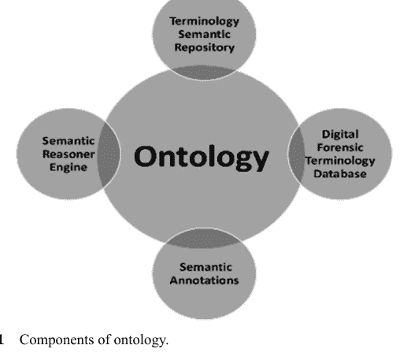

FIGURE 7.1 Components of ontology.

### 7.3.1 DIGITAL FORENSIC TERMINOLOGY DATABASE (DFTD)

A DFTD or “term-base” is a catalog comprising of model-tailored terminological records and associated info in polyglot design (Wright & Budin, 2001). It is a potent means of promoting uniformity and reliability in the use of terminology. The jargons of the term base may incorporate, among other specifics, the meaning, origin, context-of-use, and domain area. The growth and progress of an ontological method to solve the connotation of digital forensic lingoes commences with a lexicon archive. With the evolution in technological innovations in digital forensics, creative and new terms are regularly proposed into the domain and new connotations are assigned to existing terms. Establishment of a lexicon archive will thereby ensure uniformity and precision of terminology in a digital forensic analysis procedure. An expertly designed lexicon archive will assist detectives to reduce costs, save time, maintain consistency and improve quality during examinations.

### 7.3.2 SEMANTIC ANNOTATIONS

“Semantic annotation” is a process of articulating information about a specific source, phrase or terminology (Karie & Kebande). The process includes affixing names, qualities, and traits, descriptions, comments, etc., to domain terminologies. Semantic annotation serves as an excellent means for delivering all the knowledge (together with added metadata) about an active domain lexicon which will start from the glossary-archive.

A typical “Semantic Annotation” exercises a tri-gear mechanism shown in Figure 7.2.

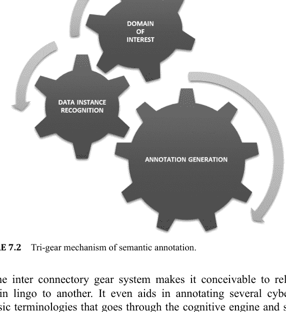

FIGURE 7.2 Tri-gear mechanism of semantic annotation.

The interconnectory gear system makes it conceivable to relate one domain lingo to another. It even aids in annotating several cyber-space forensic terminologies that go through the cognitive engine and saved in the “semantic repository” for use by any digital forensic tool.

- 1. **Domain of Interest:** Ontology provides an account of the domain of interest (digital forensics).
- 2. **Data Instance Recognition:** It aids in discovering all the occurrences of significance in an objective document or ontology-centered lexicon.
- 3. **Annotation Generation:** It creates a semantic sense for each annotated document or terminology. Through this, any ontology-conscious system can understand the target document or terminology under consideration.

### 7.3.3 SEMANTIC REASONER ENGINE

A “Semantic Reasoner” is a system that can deduce rational outcomes from a collection of stated facts or truisms, thereby providing a terminology semantic repository. Besides, it also creates inferences from the accessible gloss information using analytical techniques. The engine can make a decision quickly and effectively in the execution of AI and information-based methods. All existing digital forensic tools can be linked to the “Terminology Semantic Repository” for the effortless grasp of the terminologies, during digital forensic investigation.

### 7.3.4 TERMINOLOGY SEMANTIC REPOSITORY

It is a sizable and defined set of texts deposited in a knowledge-based format which provides an extremely useful foundation for resolving the meanings of various terminologies.

## 7.4 COMMON TERMINOLOGY

By now it is evident that terminological ignorance hinders the smooth flow of Digital Forensic Investigation (http://www.forensicsciencesimplified.org/digital/glossary.html). The ‘scientific working group on digital evidence’ (SWGDE) in alliance with ‘Scientific Working Group on Imaging Technology’ (SWGIT) has created and is constantly updating a thesaurus of terms used in the digital realm. SWGDE has implemented ASTM, an established universal organization, to establish international recognition of terminology.

Some common terms include:

- 1. Cloud Computing: Evidence like applications and software that are recovered from the Internet through a web browser, desktop or cellular phone application. Information is collected on servers at a distant site.
- 2. Data: Facts and statistics collected for reference or analysis.
- 3. **Data Extraction:** It is where data is analyzed minutely to recover relevant information from data bank (like a database) in a specific manner. Further data processing involves data integration, adding metadata and another process in the data workflow.
- 4. **Encryption:** The process of converting information or data into a code, especially to prevent unauthorized access.
- 5. **File Format:** It is a structure by which data is structured in a file.
- 6. **Forensic Wipe:** It is a confirmable technique used for sterilizing a well-defined region of digital media by over-writing each byte with a well-known value. This prevents adulteration of data.
- 7. **Handheld (Mobile) Devices:** These are handy data storage devices that deliver digital photography, entertainment, navigation systems, etc.
- 8. **Hash or Hash Value:** It is a function that can be utilized to navigate data of an arbitrary size onto data of a fixed size.
- 9. **Log File:** It is a record of events, activities, and associated data.
- 10. **Media:** These are entities on which information can be saved. It includes thumb drives, hard drives, floppy discs, CD/DVD, SIM cards, etc.
- 11. **Metadata:** A set of data that describes and gives information about other data.
- 12. **Partition:** It is the user-defined section of electronic media. Partitions can be used to isolate and obscure information in a hard drive.
- 13. **Source-Code:** A text containing a list of commands to be compiled into an executable computer program.
- 14. **Work Copy:** A replication of a tape or records that can be used for consequent processing and/or evaluation.
- 15. **Write Block/Write Protect:** Hardware and/or software methods of thwarting alteration of substance on a media storage device like a CD or thumb drive.

## 7.5 TYPES OF DIGITAL FORENSICS INVESTIGATION

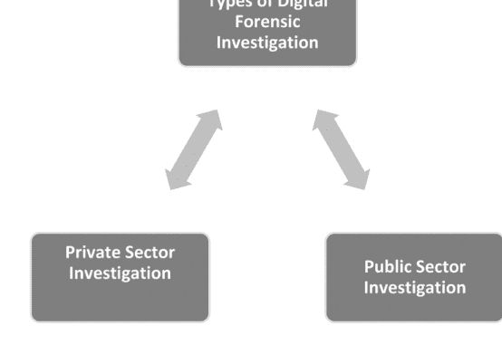

### 7.5.1 PUBLIC SECTOR INVESTIGATION

These are investigations performed against alleged individuals to uncover the scene of crime. Normally, government organizations perform such types of inquiries under criminal investigations.

### 7.5.2 PRIVATE SECTOR INVESTIGATION

These are investigations performed against violations associated to office and corporate. Any breach of the provisions and guidelines of private sectors falls under this investigation.

## 7.6 OBJECTIVES OF DIGITAL FORENSICS

‘Digital Forensics’ safeguards and strengthens digital security in the private/ public sector and supports investigators to investigate criminal cases (https://recfaces.com/articles/digital-forensics#:~:text=Digital%20forensics%20tools%20can%20be%20divided%20into%20several,Mac%20OS%20analysis%20tools%3B%208%20Database%20forensics%20tools). The essential objectives include:

- Expediting the retrieval, evaluation, conservation, and protection of the information. It helps in preparing digital proof for presentation in the court.
- Ensuring proper implementation of all the essential procedures of assembling proofs as the digital data must not be tainted.
- Recovering erased or concealed data from any digital devices if the data is specifically important for the case.
- Aiding in the identification of a suspect and instituting a purpose for the felony.
- Producing a digital forensic report for swift investigation.

## 7.7 ALGORITHM OF INVESTIGATION

The inquiry procedure in digital forensics is a stepwise technique, carried out diligently to guarantee that no original evidence is ruined in the course of action while preserving the chain of custody (http://www.forensicscience-simplified.org/digital/DigitalEvidence.pdf). Digital investigation of such a nature incorporates an algorithm which commences from retrieval and analysis of the data to a probable source of proof acceptable in the court (Karie & Venter, 2012).

The algorithm for the digital forensics’ investigation procedure is as in Figure 7.3.

## 7.8 DIGITAL FORENSIC TOOLS

Digital Forensic Tools (https://www.guru99.com/computer-forensics-tools.html#:~:text=Best%20Computer%20Forensics%20Tools.%201%201%29%20ProDiscover%20Forensic.,4%204%29%20PALADIN.%205%20%205%29%20EnCase.%20More%20items) are the digital modes and methodologies that assist to protect, detect, obtain, and document digital evidence for legal actions. Besides, making the digital forensic procedure easy and straightforward, they also provide complete reports for legal actions.

The subsequent issues should be considered while selecting a digital forensic instrument:

- Protection;
- Assistance for numerous platforms;
- Customer-friendly application;


## 调查算法

### 识别
识别是在任何类型调查过程中执行的首步。它涉及识别所有具有存储数字信息能力的潜在数字来源。它可被用作证据来源。最初，必须了解可在调查程序中发挥有益作用的设备。

### 收集
可能作为证据来源的数字设备被从犯罪现场扣押并适当累积。证据的真实性是主要优先事项。

### 易失性数据收集
它包括所有实施记录的汇编，例如时间、日期和 RAM 数据。在检查程序期间，系统应保持开机状态。

### 实时系统成像
它包括在调查过程中对数据进行的断层扫描操作。在检查程序期间，系统应保持开机状态。

### 法医成像
精确的初始设备照片副本旨在执行更改。哈希技术用于保证保密性方面。在检查程序期间，系统应保持开机状态。

### 物理捕获数字设备
当三种停止技术工作时，此方法随后进行抢救。在此，数字设备被扣押，然后收集所有证据。在检查程序期间，系统可能处于开机/关机状态。

### 保存
保存是保护犯罪发生区域的重要措施。除此之外，保存从犯罪现场获取的所有‘电子存储信息’（ESI）至关重要。

### 分析
分析包括对所有数字证据的深入分析。适当的断层扫描得以完成，以保证原始证据不会失去真实性。对犯罪情况的分析和研究有助于检查员做出判断。

### 报告
这是在审查期间执行的决定性阶段。报告是系统化展示所有与犯罪相关细节的手段。这些报告随后在法庭上作为证明来源展示以解释犯罪。

图 7.3 调查算法示意图。

- 提供多种功能；
- 对各种设备的支持；
- 对多种文件格式的支持；
- 分析功能；
- 插件支持。

## 7.8.1 里德堡量子频谱分析仪
里德堡量子传感器具有分析现实世界信号和射频完整范围的能力，从而为及时检测任何数字病毒渗透、频谱感知、战斗通信和电子战提供了新的潜力（Meyer, Kunz, & Cox, 2021）。它可以识别从零到 20 GHz 的射频频段、蓝牙、AM 和 FM 广播、Wi-Fi 以及其他通信信号。原子粒子与电路的电场牢固相互作用，从而允许检测、识别和解调进入电路的任何信号。传感器利用激光束在微波电路上方创建极度激发的高里德堡原子，以增加正在评估的频谱部分。里德堡原子对电路电压极其敏感，从而使该设备能够作为射频频谱中广泛信号的灵敏工具使用。

## 7.8.2 RAVEN
RAVEN 是通过 MSAB 开发的智能手机应用程序在犯罪现场获取即时数字证据和进行分析的创新解决方案。在法医技术中，它是获取和分析被扣押移动设备数据的世界领导者（https://www.msab.com/products/msab-platforms/#raven）。该公司为执法机构构建卓越且用户友好的软件。RAVEN 是一款专为现场行动人员准确创建和设计的极其便携的移动设备提取工具集。它是即时获取信息并将其转化为行动情报的轻量级解决方案。RAVEN 是一组可在 Android 驱动设备（手机和平板电脑）上运行的应用程序。它允许调查人员利用标准设备的容量并通过下载全部/选定的 Raven 应用来增强其法医数据收集功能。该应用程序允许用户即时查看检查监控列表、提取结果、查找最近的位置数据。

## 7.8.3 MSAB 平板电脑
该平板电脑为调查人员提供最紧凑形态因素下的即时证据和信息采集潜力（https://www.msab.com/products/msab-platforms/#tablet）。它通过为侦探提供快速访问来帮助优先处理和加快评估过程。该平板电脑可个性化为公司特定系统并配置为多种法医能力。它提出对简化和易于操作的法医程序的控制，而不质疑法医数据的真实性和可信度。它还提供完整的集成软件/硬件解决方案，并提供协助，通过有线或无线模式提取蜂窝设备。操作人员可以通过触控界面通过简单的提取向导执行提取。获得的数据可以在“查看器应用程序”中进行概览、调查和处理。它还包括强大的搜索平台。搜索平台连同易于使用的插图有助于精确挑选获得的数据以供显示。提取生成一个安全的 XRY 文件，其中包含从相关设备中抢救的所有数据/信息。用户界面提供对平板电脑上正在进行的任务的轻松控制。当设置用户时，管理员为该用户指定工作流序列/顺序的权限。工作流序列的示例包括数据提取、查看提取、SIM id 克隆机和用户特定的多步骤工作流配置。在“标准用户”模式下，设备被锁定并且所有用户操作都被记录。这不仅便于操作的无缝可追溯性，而且使提取过程透明。“用户管理”功能还允许用户清除和导出所有用户文件。

## 7.8.4 VPER
VPER 套件设计用于保证易于、准确和快速的法医数据检索和分析，从而以精确方向启动调查过程（https://digitalintelligence.com/products/fred_l）。每个 VPER 套件都包括一台 FRED-L 笔记本电脑。FRED-L 是一款 AMD Ryzen 7、3700X、8 核处理器，约 3.6 GHz（4.4 GHz 增强）处理器，配备 32 MB 缓存。此外，每个 VPER 还包括极其有价值的“Digital Intelligence Forensic Card Reader”、电缆、适配器、电源和多种仪器。

## 7.8.5 iVE 车辆法医系统
BERLA 的 iVe 生态系统是车辆法医系统工具，构建用于识别、获取和分析存储在车辆系统内的重大证据（https://www.msab.com/products/ive-vehicle-forensics/）。它挖掘出回答“发生了什么、在哪里发生、谁参与了”之类问题的关键证据。车辆系统存储与车辆的最近目的地、经常访问的目的地、联系目录、通话记录、短信记录、电子邮件、图片、视频等相关的大量数据。系统还记录基于时间发生的事件。对这些数据的评估回答了检查员的关键问题并改变了调查的进程。iVe 生态系统是一套工具集合，有助于侦探在完整的车辆法医步骤中工作，包括用于检测车辆的移动应用程序、用于获取系统的硬件套件和用于审查记录的法医软件。iVe 目前支持许多高端车辆，如 AUDI、BMW、Chevrolet、FIAT、Ford、GMC、Mercedes-Benz、HUMMER、Jeep、Hyundai、Kia、INFINITI、Lincoln 等。

### 主要功能
- 1. 恢复已删除数据。
- 2. 查看和分析结果。
- 3. 逻辑和物理采集。
- 4. 二进制文件导入和解析。
- 5. 生成报告。
- 6. 搜索和过滤数据。
- 7. 数据导出。
- 8. 映射 GPS 和地理编码数据。

## 7.8.6 DISK SENSE 2
Atola Insight Forensic（总部位于加拿大温哥华的硬件和软件开发公司，专门从事数字法医验尸后硬盘成像工具的创建）推出了一款名为 Disk Sense 2 的新硬件成像器。它支持三台驱动器的实时成像，同时进行哈希和擦除等其他并发法医任务（https://www.forensicfocus.com/news/atola-insight-forensic-gets-new-hardware-unit-and-supports-3-parallel-imaging-sessions/）。该硬件单元配备六个源端口：

-   3 个 SATA/SAS；
-   USB；
-   IDE；
-   扩展端口（SAS、M.2 NVMe/PCIe/SATA SSD、Thunderbolt、Apple PCIe SSD）。

三个并发成像会话由服务器级主板和 CPU 支持。设备的 ECC RAM 有助于保护数据完整性。其内置的两个 10 Gbit 端口可高速将成像驱动器接入网络。

## 7.8.7 AXIOM CYBER

‘AXIOM Cyber’ 使调查人员能够通过直接获取，通过处理任何 Instagram 或 Facebook 用户名和密码来证实目标 Instagram 账户，从而获得可用的 Instagram 信息（https://support.magnetforensics.com/s/axiom-cyber）。它可在浏览器和移动应用程序中使用。获取数据的默认存储格式固定为 AFF4-L，可通过选择‘EDIT’选项将其更改为标准的 .zip 文件。此外，用户可以选择从特定用户账户或包含指定标签的帖子中获取数据。用户账户可通过在 Instagram 上搜索并选择账户来获取。在 AXIOM 处理过程中需要指定的账户，将在选择特定账户后显示的用户数据中排在首位。输入用户名后，AXIOM 将‘CHECK’以验证该账户是否符合标准且可使用所提供的凭据访问。AXIOM Process 然后构成获取的主要部分，用户可在“AXIOM Examine”中进行更多解读。这种能够从云端和用户设备同时获取取证数据和 Instagram 数据的能力，对于生成用户活动的全面概览极其有益。获取云数据将使检查员能够收集最近的活动，但如果数据被连续删除，设备上可能仍存在取证数据。

## 7.8.8 ArTHIR

‘ATT&CK remote threat hunting incident response’（ArTHIR）Windows 工具是一个集成且灵活的框架，可通过内置的 PowerShell（所有版本）和 Windows 远程管理（WinRM）（https://securityonline.info/remote-threat-hunting-incident-response/）针对一个或多个目标进行松散使用，以完成威胁狩猎、入侵评估、事件响应、配置、遏制以及许多其他操作。这是流行的“Kansa”工具的升级版，但其能力和设施远不止执行 PowerShell 脚本。ArTHIR 使推送和实现任何二进制程序到本地或远程并取回输出变得更简单。它有意并计划将‘Threat Hunting and Incident Response’部分映射到‘MITRE ATT&CK’结构。

## 7.8.9 VELOCIRAPTOR

Velociraptor 是一个用于大规模跟踪和追踪的数字取证和事件响应（DFIR）工具（https://www.hackingarticles.in/threat-hunting-velociraptor-for-endpoint-monitoring/）。它包含一种名为 VQL 的重要查询语言。这种 VQL 语言允许对流畅的 DFIR 攻击进行快速调整。Velociraptor 为用户提供了无与伦比的强大功能和灵活性。与传统的“远程取证工具”不同，后者会积累大量原始数据以供离线处理，VQL 允许用户精确地在端点上执行和分析。此新自由使用户能够仅收集高价值的战术证据以影响其响应，并将最新的数字取证分析流程影响到检测中。要在 Windows 中安装 Velociraptor，基本要求如下。

-   Windows 10 平台上最低 4 GB RAM 和 4 个 CPU 内核；
-   管理员权限；
-   具有管理员权限的 CMD。

## 7.8.10 SLEUTH KIT + AUTOPSY

Sleuth Kit + Autopsy 是一款图形界面数字取证工具。它可用于从存储卡中恢复相机照片。它基于 Windows（https://www.sleuthkit.org/）。

Features:

-   使用图形界面进行活动检测和分类；
-   电子邮件评估；
-   文件排序；
-   显示缩略图以便易于查看；
-   使用任意标签名称进行文件编目；
-   从通话历史、联系人等中删除数据；
-   根据路径名标记文件/文件夹。

## 7.8.11 PRO-DISCOVER FORENSIC

这是一款重要的计算机安全工具，可在扇区级别研究数据并帮助恢复已删除文件、检查剩余空间以及访问 Windows 替代数据流（ADS）（https://www.prodiscover.com）。Pro Discover Forensic 允许动态预览和捕获磁盘的‘硬件保护区域’（HPA）映像，并支持定位计算机磁盘上的所有数据，保护证据并创建报告。

**Features:**
-   制作磁盘的位流副本（包括隐藏的 HPA 部分）以供解释；
-   在整个磁盘上查找文件；这包括剩余空间、HPA 部分和 Windows NT/2000/XP 替代数据流；
-   在不更改磁盘数据的情况下预览文件；
-   在文件或簇级别检查数据。

## 7.8.12 CAINE

CAINE 或计算机辅助调查环境提供强大的安全性和内置取证调查工具。它提供了一个完整的调查环境，该环境被安排为集成现有软件工具并提供友好的图形用户界面（GUI）。CAINE Linux 提供多种可用于数据库、内存、取证分析和网络的软件工具（https://www.caine-live.net）。使用命令行模式以及 GUI 模式都可以对 FAT/ExFAT、NTFS、Ext2、Ext3、HFS 和 ISO 9660 等文件系统的文件映像系统进行分析。磁盘映像可以通过内置于 CAINE 的工具或使用第三方工具如 EnCase 或 Forensic Tool Kit 来获取。

**Features:**
-   在调查的不同阶段帮助数字侦探；
-   易于使用的界面；
-   可定制。

## 7.8.13 PALADIN

PALADIN 是以 Ubuntu 为中心的工具，可帮助简化一系列取证任务。它为调查任何恶意证据提供了数百种有用的工具（https://sumuri.com/software/paladin/）。它还有助于快速高效地简化取证任务。

**Features:**
-   提供 64 位和 32 位版本；
-   可通过 USB 驱动器运行；
-   它便于轻松搜索所需信息；
-   它有 33 个分类，有助于完成网络取证任务。

## 7.8.14 ENCASE

EnCase 是一款计算机应用程序，可帮助从硬盘驱动器中恢复证据（https://www.guidancesoftware.com/encase-forensic）。它对文件进行详细分析以收集证据。

**Features:**
-   可以从众多设备获取数据，包括手机、平板电脑等；
-   生成全面的报告以维护证据真实性；
-   能够快速搜寻、检测、识别和优先处理证据；
-   可以解决加密数据；
-   可以进行深度和分诊分析。

## 7.8.15 SANS SIFT

SANS SIFT 是一个基于 Ubuntu 的发行版（https://www.sans.org/tools/sift-workstation/）提供数字取证和案例响应分析能力。

**Features:**
-   兼容 64 位操作系统；
-   有助于内存空间优化；
-   可以通过 SIFT-CLI 安装程序安装。

## 7.8.16 FTK IMAGER

AccessData 的‘FTK Imager’是用于获取证据的 FTK（https://access-data.com/productservices/forensic-toolkit-ftk）。它在不篡改原始数据的情况下生成相关数据的副本。该工具允许用户识别诸如像素元素大小、文件大小和数据类型等标准，以减少无关数据的数量。

Features:
-   提供科学方法来揭露网络犯罪；
-   通过图表提供数据的高质量映像；
-   有助于密码检索；
-   控制不同分析需求的可回收配置文件。

## 7.8.17 CROWDSTRIKE

CrowdStrike 是一款取证计算机程序，提供端点安全、网络黑客威胁情报等（https://www.crowdstrike.com/endpoint-security-products/falcon-endpoint-protection-pro/）。它可以即时识别并从网络安全事件中恢复。CrowdStrike 有助于实时查找和阻止入侵者。

**Features:**
-   处理系统漏洞；
-   可以自动分析恶意软件；
-   它保证所有虚拟、物理和基于云的数据中心。

## 7.8.18 WIRESHARK

Wireshark 分析网络数据包以进行分析和故障排除（https://www.wireshark.org）。该工具便于操作员检查流经其计算机系统的众多流量流。

**Features:**
-   支持高效的 VOIP 分析；
-   可以轻松解压缩文件；
-   支持从 ATM 等即时读取信息；


- 协助解析包括 IPsec（互联网协议安全）、SSL（安全套接字层）和 WEP（有线等效私密性）在内的各种协议；
- 允许操作员以其选择的格式读写文件。

## 7.8.19 XPLICO

Xplico 是一款支持 HTTP 和 IMAP 协议的取证评估应用程序（https://www.xplico.org）。

**功能：**
- 数据输出在 SQLite 或 MySQL 数据库中；
- 允许实时协作；
- 无限数据录入和归档；
- 支持 IPv4 和 IPv6；
- 提供 PIPI。

## 7.8.20 X-WAYS FORENSICS

‘X-ways forensics’ 为数字（计算机）取证专家提供了一个环境（http://www.x-ways.net/forensics/）。该程序可以执行磁盘复制和成像。

**功能：**
- 可以读取 ‘.dd’ 镜像文件内部的分割和文件结构配置；
- 可以访问磁盘和 RAID；
- 不可避免地识别丢失或擦除的分区；
- 轻松识别 NTFS（新技术文件系统）和 ADS（备用数据流）；
- 可以调查远程工作站。

## 7.9 CONCLUSION

现代时代技术日益增长的普及程度，尤其是在新常态以来（2019 年秋季，疫情开始），增加了数字设备与刑事/民事诉讼相关的可能性。作为直接后果，需要数字取证专业技能的调查和分析数量导致了巨大的“数字证据”积压。预计未来需要数字取证分析的案件数量将显著上升。也有可能每个法庭案件都需要评估越来越多设备，包括智能手机、计算机、平板电脑、可穿戴设备和基于云的服务。新数字证据资源的范围为数字检查员从检测、识别、获取、存储和评估的角度提出了新的且引人入胜的挑战。本章旨在认识到各种数字病毒载体（技术创新），这些载体已被持续注入数字取证调查系统，以促进增强和准确的结果。

## KEYWORDS

- **数据库取证分析师**
- **电子邮件取证分析师**
- **取证数据分析师**
- **互联网协议安全**
- **调查算法**
- **本体**
- **开源情报**
- **远程取证工具**

## REFERENCES

构建数字取证术语的本体。 Free Online Library (thefreelibrary.com) https://www.thefreelibrary.com/Building+ontologies+for+Digital+Forensic+Terminologies.-a0459894717 (accessed on 10 January 2022).

Chandrasekaran, B., Josephson, J. R., & Benjamins, V. R., (1999). 本体是什么，为什么我们需要它们？ *IEEE Intelligent Systems*, 14(1), 20–26.

Gary, P., (2021). *数字取证研究的路线图*, Technical Report DTR-T001-01, DFRWS.

Gruber, T. R., (1993). 一种可移植本体规范的翻译方法。 *Knowledge Acquisition*, 5(2), 199–220.

Halder, D., & Jaishankar, K., (2011). 网络犯罪与妇女受害：法律、权利和法规。 Hershey, PA, USA: IGI Global. 10.4018/978-1-60960-830-9.
http://archive.ncpc.org/ (访问于 10 January 2022).
http://www.forensicsciencesimplified.org/digital/DigitalEvidence.pdf (访问于 10 January 2022).
http://www.forensicsciencesimplified.org/digital/glossary.html (访问于 10 January 2022).
http://www.x-ways.net/forensics/ (访问于 10 January 2022).
https://accessdata.com/productsservices/forensic-toolkit-ftk (访问于 10 January 2022).
https://digitalintelligence.com/products/fred_1 (访问于 10 January 2022).
https://recfaces.com/articles/digital-forensics#:~:text=Digital%20forensics%20tools%20can%20be%20divided%20into%20several,Mac%20OS%20analysis%20tools%3B%20Database%20forensics%20tools (访问于 10 January 2022).
https://securityonline.info/remote-threat-hunting-incident-response/ (访问于 10 January 2022).
https://sumuri.com/software/paladin/ (访问于 10 January 2022).
https://support.magnetforensics.com/s/axiom-cyber (访问于 10 January 2022).
https://www.caine-live.net (访问于 10 January 2022).
https://www.crowdstrike.com/endpoint-security-products/falcon-endpoint-protection-pro/ (访问于 10 January 2022).
https://www.forensicfocus.com/news/atola-insight-forensic-gets-new-hardware-unit-and-supports-3-parallel-imaging-sessions/(访问于 10 January 2022).
https://www.guidancesoftware.com/encase-forensic (访问于 10 January 2022).
https://www.guru99.com/computer-forensics-tools.html#:~:text=Best%20Computer%20Forensics%20Tools.%201%201%29%20ProDiscover%20Forensic.,4%204%29%20PALADIN.%205%20%29%20EnCase.%20More%20items (访问于 10 January 2022).
https://www.hackingarticles.in/threat-hunting-velociraptor-for-endpoint-monitoring/(访问于 10 January 2022).
https://www.msab.com/products/ive-vehicle-forensics/ (访问于 10 January 2022).
https://www.msab.com/products/msab-platforms/#raven (访问于 10 January 2022).
https://www.msab.com/products/msab-platforms/#tablet (访问于 10 January 2022).
https://www.prodiscover.com (访问于 10 January 2022).
https://www.sans.org/tools/sift-workstation/ (访问于 10 January 2022).
https://www.sleuthkit.org/ (访问于 10 January 2022).
https://www.wireshark.org (访问于 10 January 2022).
https://www.xplico.org (访问于 10 January 2022).
Karie, N. M., & Venter, H. S., (2012). 使用网络搜索引擎测量数字取证术语之间的语义相似性。 In: 第 12 届南非信息安全年会论文集。 Johannesburg, South Africa, IEEE Xplore [R].
Karrie, N. M., & Kebande, V. R. (2016). 构建数字取证术语的本体。 http://www.deg.byu.edu/ding/research/SemanticAnnotation.html (访问于 10 January 2022).
Karrie, N. M., & Venter, H. S., (2014). 朝向数字取证学科的通用本体。 J. Forensic Sciences, 59(5), 1231–1241.
Meyer, D. H., Kunz, P. D., & Cox, K. C., (2021). 波导耦合里德堡光谱分析仪 0 至 20 GHz。 Physical Review Applied, 15, 014053.
Noy, N. F., & Musen, M. A., (2004). 本体版本控制在本体管理框架中。 IEEE Intelligent Systems, 19, 6–13.

Singh, S. K., Azzaoui, A. E., Salim, M. M., & Park, J. H., (2020). 未来 ICT 的量子通信技术：综述。 *Journal of Information Processing Systems*, 16(6), 1459–1478.

Uschold, M., & Gruninger, M., (1996). 本体：原则、方法与应用。 *Knowledge Engineering Review*, 11(2), 93–136.

Wright, S. E., & Budin, G., (2001). *术语管理手册：应用导向的术语管理*. John Benjamins Publishing Company.

## CHAPTER 8

## 电子商务平台中的数据泄露欺诈及预防措施

RAJA RAJENDRAN

*信息技术部，Canara Bank，印度*

## ABSTRACT

网络犯罪是立法监管当局的一个相对较新的担忧。随着与网络关联的计算机用户数量不断增加，网络犯罪的机会正在急剧增加。此外，随着社交网络的增加使用以及进行更多在线购买的能力，用户可以通过互联网为相应网站提交其个人信息。网络犯罪是一个严重的威胁性问题，对于信息安全分析师而言，制定政府官员的法律并在网络上监控问题是困难的。网络犯罪检测策略和分类技术在防止和保护数据免受网络犯罪攻击方面取得了不同程度的成功。然而，研究表明，许多国家即使在今天仍面临这一问题，且损失最大。在这项工作中，尝试对印度尤其是在线购物论坛的网络攻击以及过去几年经历的数据泄露进行了概述。此外，它还分析了针对此类网络攻击的预防措施。从这些分析角度来看，组织和政府可以开发基础设施以最大程度地减少网络犯罪并采取有效的数据泄露预防措施。这将确保组织免受严重网络犯罪攻击的保密。电子商务是指在网上买卖事物的兴趣。简单地说，它是指可能在线执行的经济交易。电子商务可以基于许多技术，

包括电子商务、互联网广告和营销、在线交易处理、数字资金转账、供应链控制、电子数据交换（EDI）、库存控制系统以及自动化统计收集系统。电子商务安全漏洞是通过利用网络进行不公平手段发生的，目的是窃取、欺诈和隐私泄露。电子商务威胁类型多样。有些是无意的，少数是恶意的，有些则因人为错误造成。最常见的网络安全威胁是数字支付、电子现金、数据滥用、信用卡/借记卡欺诈等。

## 8.1 引言

互联网、计算机、手机以及各种类型的发明在过去几十年里改变了人类生活的方方面面，尤其是我们全球沟通、银行、购物、获取新闻以及自我参与的方式。技术改变了人们的思维方式、行为方式和应对方式。各国也表现出对升级技术以增强社会和经济实力的浓厚兴趣。这些进步是发展非法基于互联网的活动，即通常所知的网络犯罪的重要原因。自其创建以来，对网络及其数据的无保护方法被描述为窃取数据和信息、滥用隐私、数据和信息失真，以及相关的数字恶习，使违规者几乎不易被察觉。人们越来越认为，黑客开发计算机漏洞的根本且重要原因是经济利益。

尽管网络攻击的直接经济影响之外，通过网络传输的计算机化数据和信息对黑客而言可能具有额外的内容价值。网络犯罪为负责打击此类活动的执法机构带来了独特而棘手的挑战。被证明为网络相关犯罪的罪行包括身份盗窃、洗钱、网络欺凌、色情、网络跟踪、网络间谍、网络诱骗、知识产权盗窃、恋童癖等。

## 8.2 电子商务中的网络安全

一般而言，电子商务是指通过电子媒介，主要通过互联网这一全球商业中心购买和销售商品/产品。因此它被视为虚拟性，并被认为是全球市场中的一个重要里程碑。数字市场的优势，如高互动性、易用性、透明度，导致电子商务在客户和供应商中获得高度普及。此外，利润增加、业务连贯性、功能成本降低、客户服务使得数字市场对组织具有价值。然而，电子商务的普及导致了若干安全威胁，这对客户和供应商都造成了极大的担忧。最近的研究表明，阻碍电子商务成功的主要因素是缺乏安全。电子商务安全被定义为保护电子商务资产免受非法访问、修改或破坏的机制。电子商务平台中的主要安全问题是隐私、身份验证、完整性、不可否认性和可用性。电子商务网络安全框架适用于影响数字交互的组件，例如防病毒、蠕虫、入侵和网络通信的安全。

当你考虑到成本——对你的底线和你的声誉——保护你自己、你的客户和你的数据必须成为首要挑战。教育你自己和你的员工了解潜在威胁并理解恶意行为者如何实现其目标，可以让你领先一步。

如果你不确定从哪里开始，与网络安全专业人员安排风险评估始终是一个非常好的主意。他们将审查你的系统、应用程序和依赖项以了解潜在危害，检查与之相关的危险程度，并采取措施消除或至少减轻风险。

### 8.2.1 隐私

隐私是任何客户的基本权利，无论市场如何。一般而言，隐私确保对用户提交信息的控制。从电子商务的角度来看，确保隐私与保护用户数据有关，例如付款信息、联系电话、地址，以及最主要的是用户搜索兴趣。任何未经授权的第三方试图读取或复制用户信息将导致客户的严重安全风险。因此，确保电子商务中的隐私是数字市场的主要安全问题。

### 8.2.2 身份验证与完整性

身份验证是确保声称的实体确实为其所声称实体的过程。例如，在在线支付期间，用户身份验证是通过将用户提交的详细信息与存储在服务器数据库中的详细信息进行核对来验证的。识别已验证用户的最简单方法是向已验证的手机号码发送一次性密码。同样，在电子商务平台中，完整性是指确保用户信息的可靠性。通过保持信息的可靠性，可以保护电子资金转账和财务信息。

### 8.2.3 可用性

电子商务服务提供商的主要安全问题是服务的可用性。电子商务市场的成功取决于服务的高可用性，不受时间限制，即服务器应可靠并在 24×7 基础上为客户和供应商提供访问。因此，电子商务服务提供商应采取必要措施确保服务，通过保护平台免受服务中断的攻击，例如拒绝服务攻击。

### 8.2.4 安全电子商务的研究挑战

文献提供了对电子商务主要安全问题的见解。仍有一些安全问题与服务提供商（电子商务平台）、客户和所有者相关。

### 8.2.4.1 电子商务中的电子资金转账

电子商务的在线支付安全被定义为通过电子媒介从买方安全且系统地真实地将资金或货币转移给供应商或商家。此电子媒介通过交换资金或货币价值将供应商和客户联系起来。通常，电子资金转账需要买方和供应商的银行详细信息或支付卡详细信息。因此，保护这些机密详细信息是电子商务应用的主要安全问题。因此，需要交易透明度来保护此信息，即完成交易后，电子支付网关不应存储与支付卡相关的任何信息。如今，为了给客户带来易用性，电子支付网关会存储信息以供将来访问，也因此面临安全风险。这导致资金转账方面出现重大安全漏洞。

### 8.2.4.2 电子商务中客户和供应商的隐私

在数字市场中，买方需要向第三方供应商，即电子商务供应商，提供其机密信息，如手机号码、联系地址、支付卡详细信息，这导致敏感信息泄露到数字环境的高度风险。客户存在两个主要隐私问题。首先，客户通常担心其数据被重复使用，例如其搜索兴趣。通常，当客户收到与最近购买的产品相关的频繁建议时，会感到不适。因此，保护其搜索兴趣是客户的主要关注点。其次，客户担心由于安全漏洞，其机密信息被未经授权访问。因此，保护客户机密信息是电子商务供应商的责任。

### 8.2.4.3 电子商务中的软件安全

电子商务中的软件安全问题与服务的可用性、信息的保密性和可信度有关。服务的可用性是通过设置具有必要恢复操作的备份服务器来实现的。另一方面，为了确保电子支付或网页的安全，电子商务供应商应设计配备高端防火墙技术的系统。防火墙应在访问网页或电子支付时确保用户授权。

### 8.2.4.4 电子商务中的网络犯罪

电子商务平台中的网络犯罪主要将计算机视为目标模型，可通过执行病毒攻击、蠕虫、特洛伊木马、网络钓鱼等故意造成安全漏洞、财务损失、服务不可用。入侵者入侵电子商务 Web 服务器并导致客户服务中断。这将导致交易的损失

或客户提供的个人信息，这会影响电子商务平台的收入。入侵者或攻击者还会进行流量重定向，导致客户无论其搜索兴趣如何都会到达不同的网站。这种流量重定向会对电子商务市场造成严重问题。表 8.1 显示了电子商务网站中安全威胁的汇总。

## 表 8.1 电子商务网站安全威胁汇总

| Security Issues | Concern/Description |
|---|---|
| Electronic fund transfer security | i. Protection against leakage of confidential information<br>ii. Ensure transaction transparency |
| Customer and supplier privacy | i. No reuse of personal data<br>ii. Prevention of unauthorized access |
| Software security | i. Service availability<br>ii. Database threat |
| Cybercrime | i. Fraudulence attack<br>ii. Virus<br>iii. Traffic reroutes<br>iv. Phishing |

因此，这些调查表明，在所有安全问题中，电子商务中的网络犯罪给供应商和客户造成了严重损失。因此，必须采取必要的行动来保护电子商务平台免受网络犯罪的侵害。

## 8.3 全球互联网中网络安全的需求

商业世界并不新鲜于数据泄露和网络威胁。我们已经见证了 2016 年的雅虎数据泄露事件，这成为了一场大规模灾难。疫情带来的变化，包括远程办公、更多机构转向线上以及转向数字支付，已导致更多数字威胁出现。

对于许多小型公司而言，转向数字化的过程令人惊讶，且几乎没有时间来加强现有安全功能或执行新流程。即使是大型品牌，在管理远程团队和使用新软件程序（包括 Trello、Slack、Flock 等）时，也发现很难保护数据。2020 年，微软遭受了一次恶意攻击，导致超过 2.8 亿名微软客户记录被泄露，其中包括

电子邮件地址、IP地址和支持案例信息。2020 年 4 月发生了一起重大事件，旧金山国际机场托管的网站遭受网络攻击，黑客试图获取登录凭证。

数据泄露的近期增长导致被盗身份在市场上过剩。通常，这会导致市场饱和；然而，由于可能的欺诈方案数量众多，被盗身份的使用持续增长，旧身份仍具有转售价值。随着被盗数据主要通过互联网交易，这些发展反映在被盗身份网络市场上的变化。被盗身份的在线市场经历了三个世代的演变。第一代数据泄露规模异常小，早期互联网主要用于促进身份的购买而非销售。第二代见证了基于互联网的批发市场的形成，随着更大规模泄露的出现，欺诈团伙中出现了专业化。第三代也是当前一代，显示出市场进一步成熟，批发和零售市场出现差异化。暗网和加密货币导致了身份的直接面向消费者销售，这对被盗身份的营销和定价产生了广泛影响。

向数字化的快速转变暴露了企业目前面临的许多漏洞。根据世界经济论坛《全球风险报告》（2021 年），网络威胁是需要紧急应对的全球主要威胁之一。

数字化转型不仅消除了某些物理障碍，还模糊了国家之间的界限。虽然这对寻求在全球市场运营的公司来说是理想的，但也造成了更多跨境网络攻击的威胁。随着勒索软件、网络钓鱼和社会媒体黑客攻击持续上升，组织需要优先考虑数据安全。这至关重要，因为这是法律要求的，通用数据保护条例（GDPR）要求欧洲的企业保护个人数据。

此外，任何保护的破坏不仅对公司的形象不利，还有财务影响。拥有完善网络安全系统的企业将赢得消费者的信任。这可确保敏感数据的保护、组织的耐久性和平稳运行。

如果你认为只有最有影响力的国家和政府才需要寻找网络攻击，那么再想想。企业部门同样面临风险，需要确保自身不会

容易受到危害。这就是为什么企业需要采取适当措施实施特殊保护检查的原因。此外，不仅仅是大型组织，所有规模的公司都需要面对网络威胁时建立强大的防御。虽然未来不可预测，但在任何重大损害发生之前，始终明智地制定行动计划来保护组织敏感数据。

当大多数交易都是电子进行的时，它们也成为犯罪的来源。大量共享的数据、转移的资金都是网络犯罪分子的目标。所有组织都在扩大其技术基础，越来越依赖互联网进行交易，而没有研究与技术相关的威胁。网络犯罪分子操纵财务数据，可以转移电子所有权，中断与员工或业务伙伴的通信，窃取知识产权，损害公司的声誉，或使电子商务（或整个企业）关闭。

电子商务业务在运营上具有独特性，因此它具有特定的挑战和风险，因为缺乏实体存在增加了欺诈和犯罪的可能性。在印度，猖獗的电子商务网络欺诈还有更多原因。随着更多业务功能转向线上，以及世界各地消费者和群体聚集在网络空间，网络犯罪的成本将会增加。知识产权盗窃的风险将会增加，导致假冒产品。技术盗窃的使用给母公司造成巨大损失，因为它降低了改进的回报率。政府必须采取强有力的举措来打击网络犯罪的挑战；否则，这将对业务产生负面影响。全球网络犯罪损失每年超过 4000 亿美元。

## 8.4 数据泄露欺诈及其对电子商务的预防措施

### 8.4.1 概述

网络安全旨在通过在线服务提供对这些网络攻击的预防，以确保互联网上信息的隐私。网络安全是可用于保护网络环境以及组织和用户资产的设备、策略、安全理念、安全保障、准则和创新的集合。信息系统中的常见安全目标包括组织的机密性、完整性

和数据或资源（或）用户的可用性资产包括数字设备、电信系统以及数字环境中的信息。网络安全最棘手的部分之一是安全风险。传统方法将大多数资产集中在关键系统组件上并防止威胁，这需要让一些不太重要的系统部分不受保护以及一些风险较小的危险，即不保证。网络环境中的各种安全问题是 IP 欺骗、电子邮件欺骗、特洛伊木马、蠕虫、网络钓鱼和间谍软件。在这些安全问题中，网络论坛中涉及的网络犯罪是一种严重的犯罪，如洗钱、电子邮件欺骗等。最近，在线交易越来越注重数字化，如卡支付、UPI 和二维码扫描。这些数字化的进步导致支付网关出现安全漏洞，例如 QRishing。快速响应（QR）码是用于编码信息的二维矩阵类似条形码。智能手机的默认相机将充当扫描仪来访问 QR 中存储的数据。本节概述了主要存在于电子商务中的网络犯罪，并分析了这些攻击的现有预防措施。

### 8.4.2 网络犯罪调查的相关研究

随着互联网不断发展并逐渐渗透到现代生活的许多方面，全球化数字社会带来的优势和机遇显然是巨大的。尽管网络通信技术不断演进，人们对所提供广泛能力和服务的依赖度不断提高，但个人、协会和政府越来越暴露于黑客的风险和威胁之下。因此，由于这种巨大的数字化自由，互联网也为有才华和有组织的黑客提供了新的创新机会，使其能够在接近匿名的情况下对全球网络实施大量可重复的非法活动。第一个详细的网络犯罪伴随着 Loom 的发展，这是一种由 Joseph-Marie Jacquard 于 1820 年创建的装置，用于允许重复制造纺织品，从而损害了员工的传统工作和生计。因此，他们发动了反抗的示威来削弱创新的使用。此外，随着这一情况的延续，数字化环境也遭遇了许多网络攻击。

因此，研究集中于这些网络攻击的预防和分析措施，特别是在银行和电子商务领域

(Hunton & Paul, 2012)。通过描述各种类型的网络犯罪以及网络安全空间的需求，阐述了网络安全和网络犯罪的世界。作者调查了网络安全中的各种问题要素，如病毒、蠕虫、黑客、恶意软件、特洛伊木马和密码破解。此外，作者描述了劫持，jacking，它源自劫持 hijacking，即黑客进行欺诈性控制（Buch et al., 2017）。2012年和2014年，一篇文章作为互联网上网络犯罪的研究而呈现。作者讨论了在印度在线发生的各种网络犯罪。该文章给出了网络犯罪的基本概念，如网络跟踪、黑客攻击、网络钓鱼、跨站脚本和语音钓鱼。跨站脚本是一种计算机漏洞，允许向网页注入代码。作者建议，网络空间安全管理 Cyber Space Security Management 是监控和控制印度此类网络攻击的重要模块，通过明确独立机构在统一架构中的角色（Gandhi, 2012; Jain, Neelesh, & Vibhash, 2014）。

另一篇文章给出了网络犯罪及其对美国立法的影​​响的概述，该文章描述了初始犯罪立法与网络犯罪立法之间的差异。作者建议警察机构聘用专门从事网络攻击犯罪的懂电脑侦探（Kimberly, 2017）。2019年，一份报告调查了印度遇到的网络犯罪。它简要介绍了所有类型的网络罪犯和不当行为及其发展、变化和预防解决方案。根据 S. S. Gole 在《印度时报》TOI 发表的文章，作者指出，根据2011年登记的案件，浦那在受网络犯罪影响的城市社区中排名第三。班加罗尔是最受影响的城市，有117起案件，其次是维沙卡帕特南，根据国家犯罪记录局的报告登记了107起犯罪。在印度，网络罪犯可在两项立法下被起诉：信息技术法（2000年）和印度刑法典（IPC）。IPC适用于传统不当行为，如恶作剧、诽谤、盗窃、欺诈、伪造等，而IT法（2000年）适用于与黑客攻击、未经授权访问、抄袭等相关的问题（Gunjan et al., 2013）。

同样，2018年发表了一项关于印度网络犯罪和网络法的研究，该研究将网络法描述为法律体系的一部分，处理网络和网络空间模式。此外，作者根据犯罪动机将网络犯罪分为各种概念。作者建议通过确保双步身份验证来提供网络空间的安全解决方案，双步身份验证是需要客户用户名和密码的额外安全级别。在印度，作者强调了各种网络犯罪案件；Bank NSP、Bazee.com、议会袭击、安得拉邦税务、Sony.Sambath.com 都是值得注意的案件（Sarmah et al., 2018）。

许多研究文章都是基于这些参考文献撰写的，并为网络攻击提供了新的维度。值得注意的是，一篇研究文章提出了一种用于检测和控制网络犯罪的网络用户识别模型。作者利用面向对象的范式和 GPS、网络摄像头和指纹等硬件来识别黑客或网络罪犯。该研究假设每个网络罪犯或黑客在攻击时通常会留下或制造某种痕迹。个体的独特性借助生物识别传感器来识别（Agana, 2015）。一篇关于无现金经济社会影响的文章旨在描述一个简单的均衡模型，以说明无现金经济如何导致正式和非正式部门的资源错配。该文章还提出了两个行业收入来源以及转向无现金经济的必要性。然而，该文章在调查在线交易中网络犯罪机会方面关注较少。主要网络攻击包括用于耗尽指定账户的可塑性攻击（Cohen et al., 2020）。从电子商务的角度来看，一篇文章介绍了电子商务中的网络犯罪威胁。作者列出了电子商务环境中的各种网络攻击和保障解决方案（Sourabh, 2016）。2013年，发表了一份关于网络犯罪生态系统的报告，特别关注数字生态系统中的信用卡欺诈和身份盗窃。作者将信用卡欺诈描述为在未经持卡人知情的情况下非法使用被盗卡或卡信息，例如卡片侧录。

正如报告所述，随着人们从传统支付方式 [cash] 转向数字支付方式，电子商务服务器中经常宣传的类别保存了卡信息（Kraemer-Mbula et al., 2013）。计划行为理论 TPB 被提出以探索网络攻击的研究并将网络犯罪认知与卖家信任整合到 TPB 中。本章提出的假设是，客户对网络犯罪存在的认知不仅仅是行为上的，也是有意的。因此，客户对网络犯罪形成一种倾向，并意识到在网络上成为此类犯罪受害者的风险。TPB 通过考虑静态因素为分析网络犯罪提供了一个统计模型（Apau, Richard, & Felix, 2019）。

与此同时，该报告分析了云计算对网络攻击的影响，其中包括对网络犯罪最新进展的调查以及澳大利亚为应对这些网络攻击而进行的后续立法变更。作者推断，云计算给传统的数字取证流程带来了各种复杂性。现有方法主要集中于对包含可能感兴趣信息的媒体采取有形的方法。然而，在分布式环境中获取保存用户信息的物理媒体通常是不可能或不切实际的。这是因为云计算固有的各种特性。例如，随着互联网使用范围的扩大，允许客户共享或将其信息外包到网络上，外包数据存储在调查机构境外，导致网络攻击的巨大可能性（Christopher, 2013）。

随着市场对手机需求的强劲增长，潜在的数据泄露通常发生在便携设备中。本章分析了各种方法以拦截网络犯罪对电子设备的影响。作者提出了基于权限的安全模型和基于行为的安全模型来控制数据泄露。从分析中，作者发现设备丢失或被盗、网络钓鱼、欺骗、信息无意泄露是数据泄露的原因（Safavi, Seyedmostafa, Zarina, & Rozilawati, 2013）。由于无现金经济和便携设备，例如手机的巨大增长，世界正经历一种新的网络攻击 QRishing。一篇研究文章调查了用于在线支付的二维码的可行性。

二维码主要因其易于部署和使用而在小规模企业中流行。但该技术存在风险因素，允许用户/客户从数字海报、账单等扫描未经授权/未经身份验证的信息，从而对企业造成新的网络攻击。本章进行了两项实验以分析二维码扫描中的安全风险。结果表明，大多数为支付而扫描二维码的客户将访问相关网址。在台式机或手机上提供安全控制可能导致双方的交易安全（Vidas et al., 2013）。与此相关，一份报告作为对二维码安全攻击和挑战的研究而发表。二维码已从自动化领域进入我们日常的手机使用中。二维码用于广告、身份验证，甚至用于传输敏感信息的货币交易。本章描述了两种与二维码相关的攻击向量：攻击者替换原始二维码，以及攻击者篡改二维码的各个模块。此外，作者从可用性角度概述了研究挑战。可用性中的安全问题


QR 的功能包括内容显示、内容预处理、防钓鱼工具以及内容验证（Krombholz 等，2014）。

尽管公众普遍感到安全，但 45% 仍然是总人口中庞大的一部分，是一个未被开发的市场，可能通过额外的安全感得到帮助。没有统计安全保障，电子商务企业可能会遭受严重的信任问题。“如果敏感信息泄露，可能会影响企业的认可度。”（Liu 等，2020）。Johansson 等（2021）关注信息资源的控制，即访问信息的方式，如由谁、如何、为何目的、使用条款，企业可以学习如何遵循这些控制并将其作为辅助。研究发现电子商务销售额损失了 7 亿美元，成本是传统零售方法的 19 倍（Encyclopedia.com，2021）。小型机架式计算机或小型服务器集群没有足够的处理能力和可扩展性来处理大量客户访问。云计算中的计算能力和存储能力更大。云技术用于存储和交换数据以获得优异结果（Hussam & Mohammad，2018）。如今，DoS 攻击、恶意软件、借记卡或信用卡欺诈、网络钓鱼和其他威胁使电子商务安全面临更大风险。SSL 证书在降低电子商务中的这种风险方面发挥着主要作用（Toapanta 等，2020）。

## 8.4.3 电子商务网络犯罪分析报告

尽管主要的网络攻击是 purposefully 设计用于曝光的，但它们强调网络攻击是对数十亿在线用户绝对的风险。信息通信技术（ICT）的出现允许各种类型的网络攻击行为，如计算机病毒、特洛伊木马、黑客等。本章重点关注网络攻击，特别是针对电子商务网站、银行部门以及用户被要求提交其个人信息 的 Web 服务器。

### 8.4.3.1 数据泄露

泄露通常被定义为确认信息向未经授权单位披露的事件。针对电子商务网站的网络钓鱼和数据泄露的分析研究中考虑了社会攻击。前置欺骗与网络钓鱼之间的区别在于，前者攻击者为实现其目标而对恶意软件安装的依赖缺失。图 8.1 描述了过去四年中遇到的 数据泄露百分比。

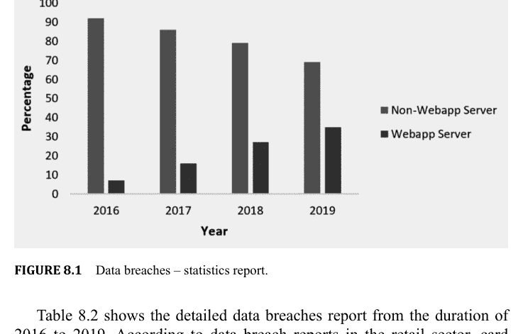

图 8.1 数据泄露 – 统计报告。

表 8.2 显示了 2016 年至 2019 年期间的详细数据泄露报告。根据零售行业的数据泄露报告，与 2016 年相比，销售终端的卡泄露较低并持续下降，到 2019 年。针对电子商务支付和 Web 应用的攻击在这些日子里持续上升，因为用户众多且可用性高。在这些中，大多数数据泄露的动机是财务性的，只有极小比例的数据泄露有其他原因，如为乐趣、间谍活动等。大多数攻击者或入侵者针对的是与支付相关的活动（几乎 64%）。超过 20% 是凭证泄露，另外 16% 的泄露涉及个人数据。由于这些泄露，公司或品牌声誉将在投资者和使用这些公司产品或服务的人群中下降。

数据泄露可能以多种方式造成损害，如劳动力变动、薪资以及封堵安全漏洞的其他费用。客户可能会转向竞争对手公司以获得更好的体验，这可能会带来不受欢迎的媒体报道并降低品牌价值。业务连续性可能因数据或信息泄露而受到影响。此外，通过篡改来源可能发生财务损失，其中一些入侵者和黑客更改经认证的数据，如客服的免费电话号码或邮件 ID。他们在公共论坛上发布虚假数据。渴望联系客户支持的人会被误导到被篡改的 ID，导致财务损失。

**表 8.2 数据泄露报告**

| 序号 | 活动 | 2016 | 2019 |
|---|---|---|---|
| 1. | 销售点 (POS) | 63% | 6% |
| 2. | 犯罪软件 | 10% | 2% |
| 3. | 卡片侧录器 | 6% | 3% |
| 4. | Web 应用 | 5% | 63% |
| 5. | 丢失和被盗资产 | 0% | 2% |
| 6. | 杂项错误 | 1% | 8% |
| 7. | 网络间谍 | 0% | 1% |
| 8. | 权限滥用 | 3% | 10% |
| 9. | 其他 | 12% | 5% |

图 8.2 描述了网络犯罪的基本工作流程。本章重点关注网络攻击，特别是针对电子商务网站、银行部门以及用户被要求提交其个人信息 的 Web 服务器。一般来说，用户访问云服务器以获取购物、银行等服务。考虑电子商务的一部分的购物网站的场景。这由一家公司运营，该公司可以在没有实际购物商场的情况下公开提供商品。电子商务的概念是使用互联网使业务活动更易于访问和更快。公司的网站/购物平台将允许客户找到合适的产品。他们可以通过列表搜索并随时将产品添加到购物车或从购物车中移除。选择合适的产品后，客户将导航到付款，在此进行在线交易。此时，驻留在互联网上的网络罪犯将跟踪客户与购物网站的工作流程，并在网络罪犯（入侵者）与网站之间建立虚拟连接。每当用户提交付款卡信息时，黑客/网络罪犯会将链接重定向到其账户进行洗钱。因此，通过监控互联网上的工作流程活动，网络罪犯可以快速伪造目的地。

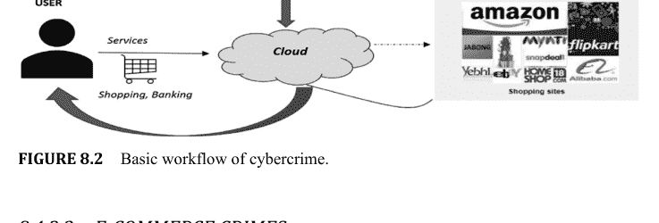

图 8.2 网络犯罪的基本工作流程。

### 8.4.3.2 电子商务犯罪

任何可以开始基于网络的商业企业或转向多渠道方法，使其商业在线可用的组织，都将适应新的问题和威胁。网络欺诈与在商业公司中通常已知的欺诈不相上下。主要根本区别在于你无法查看你的交易。这种现象使其越来越复杂，以识别在网站上购物的用户的身份。在任何交易活动中，用户必须采取措施保护自己免受敲诈。通常会有一些人想不劳而获，即不诚实的攻击者/黑客，其功能目的是敲诈你的企业或其客户。作为服务提供商，企业有责任让自己了解各种电子商务欺诈样式的外观并采取措施保护你的业务。

与此同时，创新使网络攻击通过群发电子邮件技术达到数百次。欺诈者的身份掩盖能力并不强。它生成虚假电子邮件和网站，同时以微小的成本覆盖全球各地的大量人群。此外，技术使黑客/诈骗者更容易利用敏感信息并加快我们的紧急响应。电子商务中的犯罪有多种形式，即基本包括未经授权的购买。大多数零售商为客户提供存储个人信息的方法，包括购买记录、订单历史和送货详情。获得这些账户访问权限的黑客可以捕获/入侵它们以获取一些免费物品。如今，遇到了许多欺骗性活动，不同类型的欺诈电子商务卖家为此发布。各种犯罪活动包括信用卡欺诈、退款欺诈、商家欺诈、卡测试、友好欺诈、身份盗窃、网络钓鱼、附属欺诈等。

### 8.4.3.2.1 信用卡欺诈

诈骗者经常在网上购物时使用他人的信用卡信息。诈骗者会通过电话或通过网络钓鱼网站向经过身份验证的邮件 ID 获取信用卡。有时诈骗者可能对卡拥有实质性占有。在其他情况下，他们可能已通过电子方式获得关于卡的不可争议的事实。交易完成后并得到确认，企业负责保证客户身份。卡持有人也可能试图向公司索取相当于交易金额的赔偿。

### 8.4.3.2.2 退款欺诈

在退款欺诈中，网络罪犯故意使用被盗信用卡进行过度支付。之后，诈骗者会联系企业通知随机过度支付并要求赔偿。网络罪犯可能会要求退款多余金额，保证其信用卡已关闭，以便商家以其他方式转账交易金额。这意味着信用卡的原始扣款未被退还，商业企业有责任向持卡人偿还全部金额。

### 8.4.3.2.3 商家欺诈

通常，在以市场为基础的业务中，零售店对每个客户和卖家负责。从根本上说，商品以合理的价格提供；它们在任何情况下都不会被寄售。这种战略欺诈也适用于贸易。它不特定于某种特定收费方式。然而，这就是无拒付减免方法发展的方式。在主要情况下，诈骗者出售产品并为虚构物品获得费用。即使在这种情况下，企业仍需负责赔偿。


## 8.4.3.2.4 卡测试

卡测试欺诈的根本原则是利用被盗的银行卡发起购买。然而，交易随后被控制在一种方式下，以规避欺诈检测功能。此外，了解它在那一刻与友好欺诈的不同之处，在友好欺诈中，主要目的是在发货被伪造时避免付款。在卡测试欺诈中，犯罪分子利用对欺诈检测系统的深入分析，以及对被盗信用卡合法所有者的大量了解。卡测试欺诈是制作和测试银行卡号码有效性的活动。欺诈者针对为所有类型的被拒交易提供不同响应的网站。例如，当卡因错误的到期日期被拒绝时，会提供额外的反馈以识别确定正确到期日期的要求。

## 8.4.3.2.5 友好欺诈

友好欺诈听起来比使用这种方法时更友好。客户请求产品或服务并理想地使用“拉取”付款方式付款，如银行卡或直接借记。此时，黑客故意引发拒付，声称其信用卡或账户信息被盗。交易金额将被退还；然而，他们保留商品或服务。这种欺诈方法主要被服务使用，其中包括博彩或个人背景调查等。此外，友好欺诈往往与重新配送相结合。这就是黑客/诈骗者利用欺诈性付款信息来报销他们的购物而不将产品发送到家庭地址的地方。相反，他们使用代理人，其数据被用于购买，然后代表他们进行操作。

## 8.4.3.2.6 身份盗窃

身份盗窃是最常见的欺诈类型。例如，黑客通过利用某人的身份进行在线购买。这使网络犯罪分子能够在虚假姓名下在线购买商品并使用个人的银行卡。

## 8.4.3.2.7 网络钓鱼

在此类型中，一封电子邮件请求买家 ID、密码、信用卡信息和各种个人数据。发件人似乎是一家希望因系统某些变更而验证某些记录的信贷公司。网络钓鱼使黑客能够访问银行或其他账户，并且可用于数据欺诈。

## 8.4.3.2.8 联盟欺诈

存在两种类型的联盟欺诈。两者具有相似的目标：通过监控流量或登录凭证信息从联盟计划中收集额外佣金。这可以通过完全自动化的方式完成，或让真实的人通过虚假账户登录商户网站。这种欺诈不受支付方式限制，但传播极其广泛。

## 8.4.3.2.9 假电子商务网站

通常，我们的搜索引擎处理数据以分析和向用户呈现结果。一些诈骗者可能会创建假电子商务网站，上面有产品的名称和图片，并以与经过认证的商店或流行电子商务网站相比非常低的价格描述产品。这些假商店只接受预付款订单。处理订单时，客户/顾客必须先支付金额。付款后，他们不会向客户发送订单号或产品。通过搜索引擎优化技术和其他优化技术，诈骗者实施此类欺诈。

## 8.4.4 预防方法论

本章提出了一些电子商务犯罪的预防措施。电子商务欺诈管理是保护客户信息的重要阶段。幸运的是，存在电子商务欺诈预防策略，帮助客户和企业更安全地进行交易。确保所有框架符合支付卡行业标准，该标准为保存和保护卡信息制定了明确规则。实现这一目标最直接的方法是通过电子商务平台或外部设备——此外，本章还分析了使用地址验证以避免欺诈风险。位置验证要求所有交易提供邮政编码或邮政区号，这可能足以防范相当一部分网络犯罪。

此外，本章还研究了针对所有信用卡购买的安全码为基础的预防措施。现代信用卡背面有三组数字，所有交易都需要输入这些数字。但如果卡被盗，这种方法不足以防止欺诈者进行未经授权的交易。因此，对于每笔购买，信用卡企业必须验证其交易。同时，客户也需要了解银行流程，银行人员不会向银行客户索取信用卡详细信息，如信用卡的 CVV、PIN 等。

本章研究的另一种预防方法是跟踪客户/顾客的购买历史和行为。如果客户购买与他们无关的商品，则可能被追踪。例如，通常购买剃须液和胡须油的特定地域客户可能会突然向与其区域无关的不同地点订购女性化妆品。这表明正在发生某种欺诈行为。此外，一些电子商务网站在交付产品时更喜欢签名程序。此措施旨在防止罪犯收到产品。但网络犯罪分子也可能伪造客户签名，因此仅此一项无法防止欺诈。网络安全论坛也可以跟踪可疑会话活动。电子商务网站持续监控并识别特定会话中账户的多个订单、短时间内的大量购买以及客户收货地址的快速修改。本章分析了像跟踪过去欺诈尝试这样的预防措施，这将有助于企业或网络安全论坛研究其他欺诈行为并建立清晰的认识，很可能甚至识别出这些尝试最常发生的区域或细分市场。除了这些预防措施外，政府和私营机构应提高人们对信息安全欺诈、信息安全法律、数据泄露和数据篡改等欺诈活动的处罚的认识。制定 IT 法律时，资源更为有限。现在资源众多，犯罪也随之增多。因此，IT 法律和处罚必须不时更新以遏制犯罪。

### 8.4.4.1 如何检查假网站

- **1. 检查网站所有者信息：** 任何人都可以检查在一些第三方网站上公开可用的网站注册商信息，如 https://www.whois.com/whois/。在这里我们可以参考公司详情、电话号码、公司地址详情。如果没有可用信息，我们必须远离这些网站。

- **2. 检查公司地址：** 要判断一个网站是否正规，只需测试联系信息。如果他们提供的详细信息缺失，则将其视为警告标志，不要从中购买任何东西，即使网站看起来非常有吸引力。如果确实没有信息，最好远离该网站。有时可能有信息；但是不要被蒙骗。虽然电子邮件地址和电话可能由欺诈者提供，但他们无法真正逃脱 Google Street View。你可以测试办公室的任何标志，比如招牌。检查员工/所有者的 LinkedIn 个人资料以了解真实性。

- **3. 阅读政策详情：** 在线购物的第一条规则是检查并理解交易和退货政策。如果条款/条件清晰，则公司可能真实。你不应从未提及交易或退货政策的网站购买任何东西。此外，如果政策看起来只是从另一个网站复制粘贴的，那么最好不要用你的钱信任这个页面。这是发现诈骗的一种方式，因为诈骗者可能在退还商品方面不诚实。

- **4. 社交媒体检查：** 判断假电子商务网站的一个好方法是查看他们是否在社交媒体上拥有强大的存在感，包括 Instagram、Facebook、Twitter、LinkedIn、Pinterest 等。检查帖子/反馈是否相似，以及网站名称是否在所有社交媒体网站上被提及。

看他们有多少粉丝，阅读反馈或评论，阅读公司的回应，以及网站上发布的产品是否与媒体网站上的产品相似。如果雇主没有回复，而且很多人发布了负面反馈，那么该网站可能是欺诈网站。


5. **网站设计和语言：** 良好的网站通常具有吸引人的设计，英语是理想的选择。语法和拼写没有错误，从真正的网站在线购买的体验是精致且无问题的。虚假的电子商务网站可能存在许多错误，甚至在重要页面上也是如此。当你在网站上到处注意到语言错误时，你需要谨慎对待该网站。

6. **网站上的广告：** 每个网页上都会有广告，因为这是在线赚钱的方式之一。但如果广告数量超过内容，那么就该小心了。如果必须通过众多重定向和弹出窗口才能继续，请提高警惕。到达你需要去的地方。为了确定网站是否真实，你必须非常警惕，而看到太多广告就是其中一个迹象。

7. **基于支付方式：** 真正的电子商务网站会接受所有主要借记卡和信用卡，并提供其他非卡替代方式。如果网站要求你通过 PayPal 或 Western Union 转账现金，或仅使用加密货币支付，这就是一个明确的危险信号。如果你必须通过一种无法逆转的支付方式付款，你绝对不应该从该网站购买。

## 8.5 结论

与电子商务技术相关的优点是毋庸置疑的。相关研究表明，电子商务能够实现价格降低、大规模定制以及高价的激进优惠。网络犯罪是并且将继续成为未来几年信息安全中最重要的主题之一。由于国家数字化进程的持续推进，预计攻击数量和相应的损失会增加。组织机构正在不断将越来越多的活动转移到互联网上，因此网络犯罪对经济的经济影响将进一步增加。近年来网络犯罪分子行为和活动的专业化模式凸显了进一步研究的意义。通过应用本章提出的数字世界中的欺诈分析，个人可以了解现有的网络攻击以及防止这些网络攻击所需的步骤。本章提出的章节对电子商务环境中可能的网络攻击进行了分析报告。此外，本章还分析了现有预防措施对这些网络攻击的影响。组织和政府必须从这些分析角度花费更多资金用于基础设施建设，以最大程度地减少网络犯罪和因数据泄露造成的损失。这可能会保护组织免受严重的网络犯罪。

## 关键词

- **网络犯罪**
- **数据泄露**
- **电子数据交换**
- **通用数据保护条例**
- **信息通信技术**
- **网络钓鱼**
- **QR钓鱼**
- **安全**

## 参考文献

Agana-Correspondence, & Moses, A., (2015). 使用网络用户识别模型的网络犯罪检测与控制。检索自：https://www.researchgate.net/profile/Agana_Moses/publication/324774119_Cyber_Crime_Detection_and_Control_using_the_Cyber_User_Identification_Model/links/5b81259b299bf1d5a7264b55/Cybercrime-Detection-and-Control-using-the-Cyber-User-Identification-Model.pdf (于2022年1月10日访问)。

Apau, R., & Felix, N. K., (2019). 网络犯罪和信任对电子商务技术使用的影响：计划行为理论的应用。International Journal of Cyber Criminology, 13(2). 检索自：https://www.proquest.com/openview/c6a7719ec954a32313e60def276a2928/1?pq-origsite=gscholar&cbl=55114 (于2022年1月10日访问)。

Buch, R., Dhatri, G., Pooja, K., & Nirali, B., (2017). 网络安全与网络犯罪的世界 http://computers.stmjournals.com/index.php?journal=RTPL&page=article&op=view&path%5B%5D=1109 (于2022年1月10日访问)。

Cohen, N., Anna, R., & Labib, S., (2020). 迈向无现金经济：经济和社会政治影响。European Journal of Political Economy, 61, 101820. https://doi.org/10.1016/j.ejpoleco.2019.101820,

Encyclopedia.com, (2021). Encyclopedia.com. [在线] 可在以下获取：https://www.encyclopedia.com/books/educational-magazines/security-e-commercesystems (于2022年1月10日访问)。

Gandhi, V. K., (2012). 互联网网络犯罪概述研究。Journal of Information Engineering and Applications, 2(1), 1–5. https://www.iiiste.org/Journals/index.php/JIEA/article/view/1201 (于2022年1月10日访问)。

Gunjan, V. K., Amit, K., & Sharda, A., (2013). 印度网络犯罪调查。在：15th International Conference on Advanced Computing Technologies (ICACT), (pp. 1–6). IEEE, 3. 10.1109/ICACT.2013.6710503.

Hooper, C., Ben, M., & Kim-Kwang, R. C., (2013). 云计算及其对澳大利亚网络犯罪调查的影响。Computer Law & Security Review, 29(2), 152–163. https://doi.org/10.1016/j.clsr.2013.01.006.

Hunton, & Paul, (2012). 网络犯罪分子的数据攻击：调查网络犯罪的数字货币。Computer Law & Security Review, 28(2), 201–207. https://doi.org/10.1016/j.clsr.2012.01.007.

Hussam, H., & Mohammad, A., (2018). 云计算：法律和安全问题。在：8th International Conference on Computer Science and Information Technology (CSIT) https://www.researchgate.net/publication/328243752_Cloud_Computing_Legal_and_Security_Issues (于2022年1月10日访问)。

Jain, N., & Vibhash, S., (2014). 网络犯罪改变一切——一项实证研究。International Journal of Computer Application. http://www.rspublication.com/ijca/ijca_index.htm (于2022年1月10日访问)。

Johansson, S., Kullström, M., Björk, J., Karlsson, A., & Nilsson, S., (2021). 数字生产创新项目——在高复杂性和不确定性下管理控制的适用性。Journal of Manufacturing Technology Management, 32(3), 772–794. doi: 10.1108/JMTM-04-2019-0145.

Kraemer-Mbula, E., Puay, T., & Howard, R., (2013). 网络犯罪生态系统：阴影中的在线创新？Technological Forecasting and Social Change, 80(3), 541–555. https://doi.org/10.1016/j.techfore.2012.07.002.

Krombholz, K., Peter, F., Peter, K., Ioannis, K., Markus, H., & Edgar, W., (2014). QR码安全：可用安全攻击与挑战综述。International Conference on Human Aspects of Information Security, Privacy, and Trust, 79–90. https://link.springer.com/chapter/10.1007/978-3-319-07620-1_8 (于2022年1月10日访问)。

Liu, J., Yuan, C., Lai, Y., & Qin, H., (2020). 基于三层本地/雾/云存储的工业互联网敏感数据保护。Security and Communication Networks, 2020. doi: 10.1155/2020/2017930.

Munjal, S., (2016). 网络犯罪——电子商务的威胁。Journal of Maharaja Agrasen College of Higher Education, 3(1). https://papers.ssrn.com/sol3/papers.cfm?abstract_id=2767443 (于2022年1月10日访问)。

Pavlik, K., (2017). 网络犯罪、黑客攻击和立法。Journal of Cybersecurity Research (JCR), 2(1), 13–16. https://doi.org/10.19030/jcr.v2i1.9966.

Safavi, S., Zarina, S., & Rozilawati, R., (2013). 影响便携式设备的网络犯罪综述。Procedia Technology, 11, 650–657. https://doi.org/10.1016/j.protcy.2013.12.241.

Sarmah, A., Roshmi, S., & Amlan, J. B., (2018). 印度网络犯罪和网络法律简述。Int. Res. J. of Eng. and Technol., 4(6). https://www.irjet.net/archives/V4/i6/IRJET-V4I6303.pdf (于2022年1月10日访问)。

Toapanta, S. M. T., Zamora, M. E. C., & Gallegos, L. E. M., (2020). 缓解电子货币管理风险的适当安全协议。在：Smart Trends in Computing and Communications (pp. 65–74). Springer. https://link.springer.com/chapter/10.1007/978-981-15-0077-0_7 (于2022年1月10日访问)。

Vidas, T., Emmanuel, O., Shuai, W., Cheng, Z., Lorrie, F. C., & Nicolas, C., (2013). QRishing：智能手机用户对二维码钓鱼攻击的易感性。International Conference on Financial Cryptography and Data Security, 52–69. https://link.springer.com/chapter/10.1007/978-3-642-41320-9_4 (于2022年1月10日访问)。


## 第9章
## 固态硬盘数据恢复方法：网络取证

HEPI SUTHAR and PRIYANKA SHARMA

*Rashtriya Raksha University, Gandhinagar, Gujarat, India*

## 摘要

SSD 硬盘是一种高速存储磁盘，广泛应用于各技术领域的数据存储。本章分析了 SSD 硬盘文件数据的相关原理结构和存储特性，并从逻辑层、物理层和固件层三个方面提出了 SSD 硬盘的恢复可能性和现有挑战。随着计算机技术和通信技术的深入发展以及大数据时代的到来，人们对高速存储的依赖日益增强。近年来，固态硬盘（简称 SSD）是由闪存、闪存转换层和控制器组成的块设备，广泛应用于航空、电力、军事、医疗、导航设备等各个领域，作为数据存储的重要介质，近年来迎来了爆发式发展。SSD 硬盘在存储颗粒的高容量、主控芯片的稳定性以及数据读写效率方面高速发展。SSD 与传统 HDD 相比速度更快。SSD 控制器具有更高的数据读写处理能力。然而，在应用中许多 SSD 硬盘数据无法读取或写入，导致用户数据损坏。SSD 数据恢复与传统 HDD 不同。SSD 中的数据存储和检索方法不同。这里使用 FTK Imager 和 WinHex 等工具尝试查找数据。因此，如何在损坏后恢复 SSD 硬盘数据在实际工作中具有重要的研究价值。

## 9.1 引言
### 9.1.1 SSD 的组成结构

固态硬盘主要由主控芯片、闪存颗粒、缓存芯片和 SATA 接口芯片组成（Chang, 2007）。固态硬盘（SSD）是一种使用固态半导体芯片作为存储介质的大容量存储器。根据所使用的半导体芯片，可分为基于闪存（NAND flash）和易失性存储（DRAM）的固态硬盘（Hepi & Priyanka, 2021）。后者需要独立电源，只能用于非常特殊的设备。它超出了本章的范围（图 9.1）。

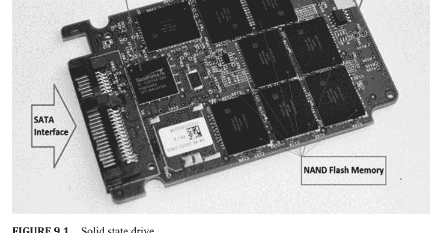

图 9.1 固态硬盘。

### 9.1.1.1 主控芯片

主控芯片是整个固态硬盘的核心设备。其作用是接收系统指令并合理分配每个闪存芯片上的数据负载；另一个是承担整个数据传输，连接闪存芯片和外部 SATA 接口（Micron Technology (2008)。主控芯片连接闪存芯片和外部接口，通过合理分配每个闪存芯片上的数据存储来控制整个硬盘工作（Hepi & Priyanka, 2021）。优秀的主控芯片具有数据处理速度快和算法先进的特点。

### 9.1.1.2 闪存颗粒

在固态硬盘中，闪存颗粒取代机械磁盘作为存储单元。根据 NAND 闪存中电子单元密度的差异，可分为 SLC（单层存储单元）、MLC（双层存储单元）和 TLC（三层存储单元）（Takeuchi, 2009）。这三种存储单元在寿命和成本方面有明显差异。SLC（单层存储）为单层电子结构，写入数据时电压变化范围小，寿命长，读写次数超过 1,00,000 次（Rizvi & Chung, 2010）。其价格昂贵，主要用于企业级高端产品。MLC（多层存储）采用高低电压构建的双层电子结构。它具有长寿命和中等价格。主要用于民用高端产品（Chang, Lin, & Chen, 2016; Guide.net.）。读写次数约为 5,000 次。与 SLC 相比，写入速度和次数有所降低。芯片采用磨损均衡算法以满足长期使用的要求（Micheloni, Marelli, & Commodaro, 2010）。TLC（三层存储）具有 MLC 闪存的最高扩展存储密度（最高达 3 bit/cell），容量是 MLC 的 1.5 倍，成本最低，任务寿命低，读写次数约为 1,000 至 2,000 次。TLC 是主流厂商选择的闪存颗粒。基于闪存的固态硬盘结构比机械硬盘（HDD）简单得多，由外壳和印刷电路板（PCB）组成。外壳仅起保护作用，核心是 PCB。PCB 上有主控芯片缓存芯片（一些低端产品没有缓存芯片）和用于存储数据的闪存芯片（Kim et al., 2013）。

### 9.1.1.3 缓存芯片

缓存芯片主要用于常用文件的随机读写和碎片文件的快速读写。缓存芯片通常设置在主控芯片旁边，其功能类似于机械硬盘。缓存芯片可以执行数据预读、缓存写入和存储最近访问数据等功能。值得注意的是，一些低端产品为了节省成本省略了缓存芯片，其性能不可避免地会下降。闪存芯片承担着数据存储的重要任务，因此在电路板上数量最多，占据的空间最大。固态硬盘的容量主要由安装的闪存芯片数量决定。市场上常见固态硬盘的容量在 16 GB 至 1.6 TB 之间（图 9.2）。

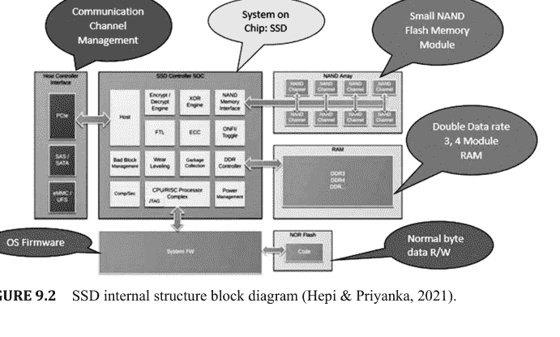

图 9.2 SSD 内部结构框图 (Hepi & Priyanka, 2021)。

### 9.1.1.4 工作原理

固态硬盘的工作原理如图 9.1 所示。NAND Flash 指闪存颗粒（Ko et al., 2019）。SSD 控制器通过多个主控通道并行操作这些 Flash 颗粒，就像 RAID 0 一样，可以提高数据写入的并行性和效率（Wang et al., 2019）。每个 Flash 颗粒进一步细分为多个块（blocks），每个块包含多个页。在 SSD 内部，SSD 控制器与 Flash 之间最小的访问单元粒度是页。通常，页的大小为 4 k，一个块包含 16 个页。写入数据时，像 RAID 0 的工作机制一样，数据会同时并行写入每个 Flash 颗粒的块中可用页。当一个块写满后，将写入另一个块。闪存（Flash Memory）本质上是一种长寿命非易失性（在断电情况下存储的数据信息仍可保留）存储器。一个块是一个单元，由于 MOS 管的工作原理，闪存的写入速度慢于读取速度（Lee et al., 2013; Ahn & Lee, n.d.）。

## 9.2 固态硬盘的特性

与固态硬盘和机械硬盘相比。其主要特点如下：

- 1. **快速读写速度：** 固态硬盘使用电信号读写闪存芯片。与需要磁头来回移动的机械硬盘相比，固态硬盘的寻道时间仅为零点几毫秒。在大数据连续读写和 4 K 随机读写等指标上具有明显优势。
- 2. **抗震防跌落：** 由于采用全固态闪存芯片作为存储介质，无需担心像机械硬盘那样磁头与盘面碰撞。固态硬盘在高速移动和冲击下仍可正常工作，具有更强的抗震和抗冲击能力。
- 3. **低功耗无噪音：** 固态硬盘无需驱动磁头移动，且没有轴承和电机，因此功耗低于机械硬盘且理论上无工作噪音。
- 4. **工作环境要求低：** 固态硬盘可在 10°C 至 70°C 之间工作，而机械硬盘只能在 5°C 至 55°C 范围内工作。
- 5. **容量小价格高：** 面对 TB 级机械硬盘，固态硬盘的容量有明显劣势。相同容量下，固态硬盘的价格甚至比机械硬盘高出 10 倍以上。
- 6. **写入寿命限制：** 固态硬盘使用的闪存芯片对擦写次数有限制。最低端的 TLC 芯片理论上只有 500 次擦写次数。即使是最好的 SLC 芯片也只有约 1,00,000 次擦写

最多几次。最重要的是，SSD 损坏后数据无法恢复。这是用户担忧的主要原因（Kang, Lee, & Kim, 2018）。

## 9.3 SSD 磁盘数据恢复的主要思想

SSD 磁盘数据恢复主要包括三个方面：

- 1. **Logic Layer:** 由于固态硬盘中存在 TRIM（禁用删除通知）指令和 GC（垃圾清除、垃圾处理）机制（空闲块在系统空闲时被收集以供系统在需要时使用，并通过建立回收块表方法来维护空闲块（Gubanov & Afonin, 2014）），因此已删除的数据难以恢复。删除数据后，SSD 主控会先标记已删除的数据，即触发 TRIM 命令。该命令会告知固态硬盘删除数据的位置、大小等信息，然后等待 SSD 主控对这部分数据执行 GC 机制。执行此步骤后，原本存在于 SSD 中的已删除数据不再存在。这部分数据已被 GC 机制擦除，且此擦除无法恢复。因为使用过程中可能出现误删数据，SSD 不能任由 GC 处理，否则有用的误删数据将无法恢复。如何在开启 TRIM 指令和 GC 机制的 SSD 上进行数据恢复，已成为逻辑层数据恢复的关键。
- 2. **The Firmware Layer:** 与机械硬盘不同，固态硬盘的固件存储在主控芯片中，而机械硬盘的固件存在于磁盘、电路板等地方。对于如何读取固件信息、分析固件结构以及修复损坏固件等关键问题，目前尚无完整解决方案。
- 3. **Physical Layer:** 固态硬盘的物理损坏一般包括主控制器损坏、电路板损坏和存储芯片损坏。对于存储芯片损坏，闪存损坏的数据无法恢复。至于主控和电路板的损坏，目前常见的处理方法是拆卸 Flash 芯片，然后通过芯片读取设备读取并重组内部数据。这种方法不仅消耗物力和财力，而且要求技术人员具备非常高的数据重组技术。因此，有必要研究如何不通过芯片读取设备进行数据重组而直接读取和提取数据。

## 9.4 文献综述

当违法行为和非法活动发生在物理世界和数字平台时，证据通常可以在嫌疑人的虚拟设备、社交媒体或网络上发现。网络每天都在扩展，配备更多监控现实世界的传感器，包括交通摄像头、ATM 和网络摄像头。人们还倾向于在社交网络网站上发布更多消息或在 IRC 房间聊天，其中 IP 地址会记录位置和对话。每当调查进行中且存在数字证据风险时，就需要进行数字取证研究。这通常包括扣押嫌疑人的数字设备，包括个人电脑、手机、导航、存储设备并寻找可能的证据或线索。当数字介质由取证专家检查时，证据有时需要从损坏或故意销毁的存储器、已删除或丢失的数据中恢复（Dennon, 2016）。无论工具和记录状态如何，首先必须采取一个非常重要的步骤：创建一个照片，即设备被收集时的数字副本。该镜像对于证明保管链、调查中可能确定的证据的完整性至关重要，因此可以证明从设备被收集到可能的法庭出庭期间，记录未被调查员或第三方修改。验证完整性的步骤通常包括对初始镜像和所提供证据之间的指纹进行评估。这种数字证据特别包括镜像的哈希值，即记录的计算校验和。该校验和最常通过 MD5 或 SHA-1 算法计算。所有哈希算法都会产生几乎唯一的指纹，给定相同输入时始终相同（Dennon, 2016）。例如，MD5 哈希算法对任意长度的输入产生 128 位校验和。因此，设备的精确副本或镜像将与原件具有相同的指纹。轻微的改动就会使指纹与原件不同。在获得包含数字存储的设备后，调查员会在寻找证据之前尝试对收集的设备进行数字成像。在某些情况下，由于故意或非故意的硬件故障，最初可能无法实现。因此，需要进行基于硬件或软件的恢复。

### 9.4.1 硬盘恢复

硬件故障不一定是任何硬件设备的故意行为。记录的物理结构极其脆弱，读写头以及存储芯片半导体也是如此。在上述任何一种情况下，从损坏设备中恢复信息最有希望的方法是更换损坏的部件。大多数情况下磁盘仍然完好，只有读取其信息的机制无法正常工作。在这些情况下，这非常（Harris, 2015）。

获取与故障设备相同的硬件非常重要，因为每个制造商和型号使用略有不同的技术。基本上可以更换三个部件。如果臂侧或磁头损坏，整个臂必须更换，否则包含芯片和微代码的电子板可以更换，以及主轴的发动机。整个主轴可以放置在包含所有其他硬件的不同盒中。这里至关重要的是主轴内的磁盘不要相对于其他磁盘改变位置（Rizvi & Chung, 2010）。如果更换在小心且非常清洁的环境中完成，则在上述情况下从故障驱动器中恢复信息的机会非常高。

### 9.4.2 闪存硬件恢复

从闪存恢复数据比困难的硬盘驱动器更困难。所有控制和存储芯片都焊接到板上。因此，我们不能在不找到完全相同的版本并通过重新焊接更新元件的情况下更新工具的一部分。根据闪存的类型，板上放置 2 到 20 个芯片。通过手工重新焊接它们是一项困难而脆弱的活动，对于多个芯片几乎不可能。另一种选择是使用专用硬件和工具逐个拆焊每个存储芯片（Rizvi & Chung, 2010）。这对于带有一个芯片的存储棒是可行的，对于多芯片 SSD 来说，这种技术变得非常复杂，因为每个供应商在如何使用芯片、如何执行磨损均衡和垃圾收集以及如何分配数据方面使用不同技术。下图显示了用于读取单个闪存芯片的硬件。

### 9.4.3 硬盘上的软件恢复

数据恢复并不总是与硬件相关的任务。在更多情况下，计算机代码使用的磁盘分析足以从磁盘中检索信息。如上所述，特定文件并未从硬盘中删除，最终会被新文件覆盖。这一事实通常用于恢复数据。最重要的是，在从磁盘恢复数据和收集证据时，信息原件应保持完整并尽可能少地更改。因此，专家使用特定硬件将磁盘上的数据复制到镜像或其他文件磁盘上。该设备称为写入阻止器，用作磁盘驱动器和计算机之间的连接，并监控发出的命令并防止 PC 将数据写入磁盘（Humphries, 2017）。扫描命令被传递到设备，而记录命令被阻止。

### 9.4.4 取证软件工具

已经开发了各种工具，供取证人员用于从硬盘驱动器和其他数字存储器如缓存、SSD 等恢复数据，昂贵的软件套件以及开源取证工具。然而，最好的证据收集工具之一，也是最常见的取证调查工具是 EnCase 工具。它可以使用位流（逐位复制）技术复制磁盘以创建虚拟文件系统重建。FTK（Access Data 的取证工具包）和 X-ways 是两种不同的基于 Windows 的工具，这三个工具的特殊功能是在磁盘镜像中额外存储 MD5 哈希值以证明镜像完整性。Sleuth Kit 是一套开源工具，可在不同操作系统（OS）上使用磁盘镜像并支持所有常见文件系统。Autopsy 是一个数字取证平台和

用于 Sleuth Kit 及其他数字取证工具的界面图形。其他知名免费软件工具还有评价很高的 Recuva。PC Inspector 评价也不错。使用流式技术创建硬盘映像后，原盘中的每个位都存储在映像文件中，然后可以进行检查（Humphries, 2017）。上述工具可以帮助检查员收集现有文件中的可能证据，并且能够从已删除文件或格式化分区中恢复数据。所有提到的工具只能处理磁盘。未加密，如果使用加密文件系统（EFS），可以进行映像。但分析数据需要付出更多努力。

## 9.4.5 闪存内存软件恢复

与传统硬盘驱动器相同的方法用于分析 SSD 的数字证据并从现有和已擦除的文件和数据中收集电子足迹证据。EnCase 或任何其他所述取证工具用于从驱动器捕获取证映像，而不改变原始数据并收集潜在电子证据文件。当分区被格式化或文件之前被删除时，检查员几乎没有机会恢复数据（Chang, 2007）。这是因为，与硬盘不同，闪存内存，特别是 SSD 具有内部例程，这些例程无法从外部影响，例如使用写入阻止器（Micheloni, Marelli, & Commodaro, 2010）。

## 9.4.6 闪存内存的取证工具

可用于捕获取证映像并在 SSD 上收集电子证据潜力的取证工具与硬盘驱动器相同。为了在硬件问题情况下或为避免内部例程更改存储在内存芯片上的数据而从 SSD 或其他闪存内存读取单个内存芯片，可以使用以下四种工具：

- PC-3000 闪存内存 SSD 版（ACE data recovery）;
- Dumppicker;
- Flash extractor; and
- Flash doctor.

所有上述工具的工作方式相似。设备读取内存芯片的内容。软件然后将芯片制造商和型号

与银行进行比较并帮助恢复现有文件和已删除文件。ACE data recovery 宣布在数据恢复软件制造公司与基于 SandForce 的 SSD 数据恢复之间扩大合作。正如前面提到的，SSD 控制器制造商面临非常激烈的竞争，不愿意分享有关内部例程、加密、磨损均衡和垃圾收集的见解（Lee et al., 2013）。因此，大型数据恢复公司与最大的 SSD 控制器制造商之间的合作是取证检查员和数据恢复专家的一大步和改进，极大地提高了基于 SandForce 的 SSD 的恢复率（Geier, 2015）。

| 特性 | SSD | HDD |
|---|---|---|
| 机制 | NAND NOR 闪存 | 磁性旋转盘片 |
| 容量 | 最多 1 TB（笔记本）<br>最多 4 TB（台式机） | 最多 2 TB（笔记本）<br>最多 10 TB（台式机） |
| 耐用性 | 抗冲击 | 脆弱 |
| 功耗 | 平均 2 W | 平均 10 W |
| 耐用寿命 | MTBF > 2 million hours | MTBF < 7,00,000 hours |
| 噪音 | 无 | 有 |
| 操作系统启动时间 | 平均 10–15 秒 | 平均 30–40 秒 |
| 文件打开速度 | 比 HDD 快 30% | 比 SSD 慢 |
| 速度 | >200 MB/s | 50–120 MB/s |
| 振动 | 无振动 | 移动部件导致振动 |
| 受磁性影响 | 无影响 | 可擦除数据 |
| 全盘加密 | 支持 | 支持 |
| 成本 | 昂贵 | 相对于 SSD 便宜 |
| 发热 | 较少 | 高 |
| 尺寸 | 紧凑 | 大 |
| 图 | SSD | HDD |

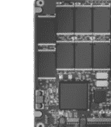


## 9.5 实验工作

### 9.5.1 SSD 数据恢复方法

以固态驱动器的逻辑层、固件层和物理层三个方面的数据恢复思路为目标，研究人员开展了一系列研究和实验，并总结出三种数据恢复方法。

- **实验 1：逻辑层数据恢复：** 通过实验解释逻辑层的数据恢复

*实验对象：* 120 GB 固态硬盘的 WD SSD，验证其支持 TRIM 并打开 TRIM。如图 9.3 所示，当 TRIM 命令打开时，反馈值为 0 表示打开，反馈值为 1 表示关闭或不支持 TRIM 命令。

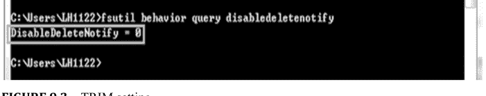

图 9.3 TRIM 设置。

通过 win-hex 向硬盘添加文件时，首先为每个文件添加一个 72 K 的小文件，并保持硬盘剩余内存约为 2G。选择五个小文件作为待删除文件，并记录其位置以及首尾扇区的数据以验证文件完整性。添加两个大小为 512 MB 的大文件，并在删除前记录其位置（起始扇区和尾扇区）和数据大小以验证文件完整性。删除两个大文件和五个小文件。2 小时后，检查原始文件所在扇区，发现文件仍然存在，推翻了“数据在 1 小时后不存在”的猜测。添加一个大小为 1G 的大文件，发现文件位置在之前约 1G 的空闲空间中，之前删除的文件均被 GC 机制处理，即 GC 在写入时发生。如图 9.4 所示，删除数据 2 小时后，发现 FiLL_10 仍然完好。

如图 9.5 所示，写入 1 G 大文件后，FiLL_10 所在扇区的数据已被弄乱，表明

GC 已清除数据并将清除的空闲空间移动到新的空闲空间。

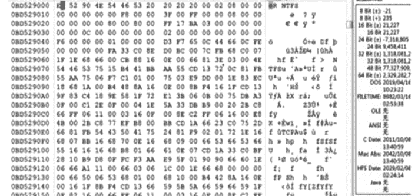

图 9.4 文件位置偏移。

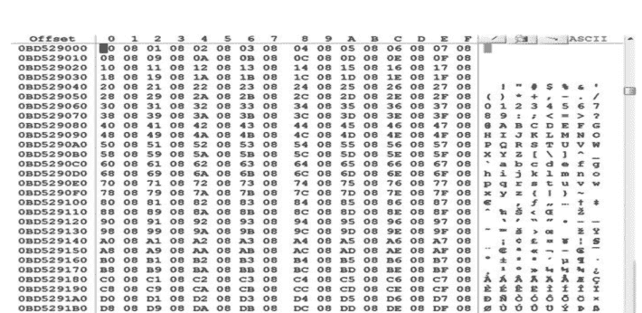

图 9.5 垃圾数据位置。

如图 9.6 所示，1G 大文件的位置是之前的空闲空间。GC 分为“空闲垃圾收集”和“被动垃圾收集”（Geier, 2015）。

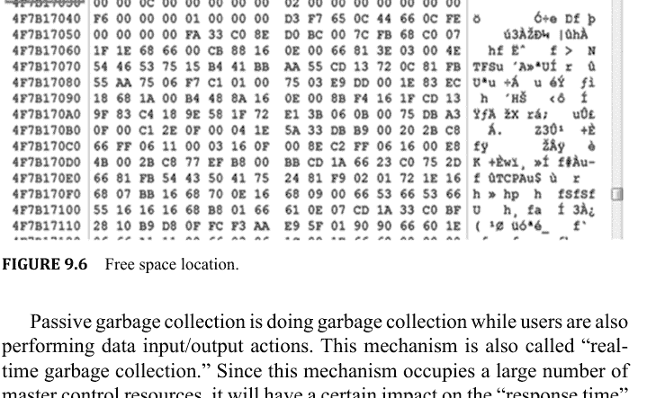

图 9.6 空闲空间位置。

空闲垃圾收集是在固态驱动器空闲时执行垃圾收集操作。其优点是不会占用额外的主控资源，可以尽可能保持固态驱动器性能；缺点是会增加额外的写入。进入缩放。一般来说，如果正在存储或删除新数据，此机制将自动工作。上面测试的 120 GB WD SSD 属于实时垃圾收集。因此，在测试中发现 GC 触发是在写入数据时。

被动垃圾收集是在用户也执行数据输入/输出操作时进行垃圾收集。此机制也称为“实时垃圾收集”。由于此机制占用大量主控资源，当有数据请求时会对“响应时间”产生一定影响。

当固态磁盘已满时，全部永久删除（Shift + delete），会发现文件已被 TRIM 命令标记。写入 512 MB 数据后，发现四个原始文件被 GC 处理，即数据在写入后被 SSD 主控擦除。说明当硬盘已满时再次写入被删除部分数据时，计算机将对大于写入部分的数据进行 GC 处理，然后取出一部分存储写入数据，其余作为空闲内存；如果硬盘未满，写入部分将存储在原始空闲内存中，然后对删除部分进行 GC 处理（Cha et al., 2015）。

### 9.5.2 物理层数据恢复

物理故障通常分为两种类型：主控损坏和电路板损坏。如果主控制器损坏，通常需要用相同电路板型号和相同主控型号的 SSD 电路板进行更换，然后使用高温热风枪扰乱 Flash 芯片的引脚，然后通过高温热风枪将新电路板对应的闪存芯片吹到相应位置进行数据恢复操作。如果电路板损坏，也使用物理更换方法进行恢复，将数据所在的 Flash 芯片更换到完好的新电路板上。对于 Flash 内存芯片的损坏，数据目前尚无法恢复。

### 9.5.3 固件层数据恢复

固件层故障最直观的表现是 SSD 不识别磁盘。这种不识别磁盘的情况有型号不识别、容量不识别或容量不识别。在进行固件修复之前，需要让固态驱动器进入特定模式，由主控识别，然后短路进入特定模式。损坏的固件可以修复以恢复数据正常。也有一些特殊情况。例如，如果坏块或点太多，即使经过上述步骤也无法恢复，或者大部分恢复的数据无法显示。

## 9.6 SSD 取证的困难

- **固态硬盘的数据存储方式：** 与机械硬盘完全不同。我们知道，机械硬盘的数据存储部分主要由存储数据的磁盘、读写电磁信号的磁头和磁头控制器组成。读写数据时，磁盘高速旋转，磁头控制器驱动磁头在磁盘上径向移动。在两者的共同作用下，磁头最终定位到磁盘的指定位置进行操作。

固态硬盘的存储方式更类似于 U 盘。数据的存储和读写都在闪存芯片中进行。闪存本身是一种可擦写可编程只读存储器（EEPROM），可以快速完成三种基本操作模式：读、写和擦除。固态硬盘中的闪存被划分为块，每个块包含许多页（Pages）（Hepi & Priyanka, 2021）。在读写数据时，计算机将二进制数字信号转换为复合二进制数字信号（增加分配、验证、堆叠等的指令），并将其发送到硬盘适配器接口，然后由主控芯片分配后写入闪存页以实现数据存储。

## 9.6.1 由于垃圾回收导致数据无法恢复：

无论是机械硬盘还是固态硬盘，在接收到操作系统写数据指令后，都会先删除旧数据然后写入新数据。在接收到删除数据的指令时，硬盘仅在相应位置做一个可删除标记，并在执行写操作时才被删除。问题在于，在固态硬盘中，页是数据写入的最小单位，而块是数据删除的最小单位。如果要删除 A 块中的 A1 页数据，必须先将该块中除 A1 页外的所有数据复制到另一个块，然后再清除 A 块。这将导致 SSD 写操作出现显著延迟。

为降低延迟，固态硬盘制造商引入了垃圾回收机制。简单来说，垃圾回收利用系统的空闲时间扫描所有有效页并将其合并到包含所有有效页的块中，而那些无效页和块将被彻底清除，回收的空间将被用于写操作。

垃圾回收对取证的影响是它会不时自动执行清理操作，导致数据被完全删除。

由于闪存的读写次数有限，数据始终存储在某个块中，这不可避免地会导致该块过早报废。为了确保块的均衡使用，避免某些块过早磨损并影响整个硬盘的使用，固态硬盘采用了磨损均衡机制。它可以尽可能将文件均匀分布到每个块，以确保每个闪存块的擦写（P/E）次数相同，并避免对块的某一部分过度重复擦除操作。有效延长固态硬盘的使用寿命。均衡磨损对取证的影响是每个块都会被均衡使用，这也意味着均衡擦除。

操作系统也对固态硬盘进行了优化。最具代表性的是 TRIM 命令使操作系统能够通知固态硬盘哪些块不再使用，以便固态硬盘可以直接执行垃圾回收。TRIM 与垃圾回收和均衡磨损机制之间的紧密配合确实极大地提高了固态硬盘的性能并有效延长了固态硬盘的使用寿命。TRIM 指令对取证的影响是它确保垃圾回收快速完成，也就是说，如果操作系统中删除了一项数据，固态硬盘将迅速擦除所有内容。

对于电子数据取证而言，垃圾回收、磨损均衡和 TRIM 指令的后果是灾难性的：由于垃圾回收机制，用户删除数据后，固态硬盘会清空该块，而不是仅仅删除索引并保留数据。数据均衡磨损可以确保垃圾回收“均衡”地擦除硬盘的块。TRIM 指令可以确保垃圾回收的高效执行。这三者结合的最终结果是：在固态硬盘上，传统的数据恢复无法进行，通过未分配簇查找证据文件片段的可行性几乎不存在。因此，对于固态硬盘，取证的重点应集中在未删除的数据上。

## 9.7 结论

固态硬盘数据恢复主要包括三个方面：

- 1. **逻辑层：** 属于实时垃圾回收机制的硬盘可以在不重写的情况下恢复大量已删除数据，但在二次写入的情况下无法恢复完整数据；属于空闲垃圾回收机制的硬盘，初始删除的文件更有可能被恢复。开机时间过长后，数据会缓慢被擦除且无法恢复。

- 2. **物理层：** 只要 Flash 芯片未损坏或未短路损坏，就可以通过更换载体进行恢复。

- 3. **固件层：** 难点在于找到合适的短路点使硬盘进入工厂模式。写入资源文件的重要步骤是要求硬盘处于工厂模式。进入工厂模式后，写入硬盘资源文件，即固件，然后重建硬盘编译器以实现数据恢复。

使用 SSD 作为手段或实现目的的数字犯罪实践无疑受益于 SSD 的内部机制，这些机制旨在提高设备的使用寿命和利用率（Kang, Lee, & Kim, 2018）。尽管已经存在具体的安全删除和反取证（AF）方法，仅使用 SSD 在某种程度上也可以被视为一种先进的反取证措施。我们预计，随着市场的扩大，算法、机制和固态磁盘系统的功能等因素未来将趋于统一。随着逆向工程领域取得进展，导致对 SSD 特性的更好阐明，进而推动数字取证实践的进步。然而，人们认为其未来在于开发专注于硬件部分的研究和技术，而不是通过软件的途径。过去的研究表明，在一段时间内似乎没有人注意到该程序后，数字取证对该主题的整体意识正在增加。这是重要的一步，也是进一步研究的基石，希望未来能为 SSD 取证调查制定标准和新指南。

## 关键词

- 网络取证
- 数据采集
- 加密文件系统
- 取证工具包
- 垃圾回收
- NAND 闪存
- 固态硬盘

## 参考文献

Ahn, N.-Y., & Lee, D. H. (2017). Duty to delete on Non-volatile Memory. In arXiv [cs.OH]. http://arxiv.org/abs/1707.02842.
Cha, J., Kang, W., Chung, J., Park, K., & Kang, S., (2015). A new accelerated endurance test for terabit NAND flash memory using interference effect. IEEE Transactions on Semiconductor Manufacturing, 28(3), 399–407.
Chang, D., Lin, W., & Chen, H., (2016). FastRead: Improving read performance for multilevel-cell flash memory. In: IEEE Transactions on Very Large Scale Integration (VLSI) Systems (Vol. 24, No. 9, pp. 2998–3002).
Chang, L., (2007). On Efficient Wear Leveling for Large Scale Flash Memory Storage Systems. SAC'07. Seoul, Korea.
Geier, F., (2015). The Differences Between SSD and HDD Technology Regarding Forensic Investigations. Sweden.
Gubanoy, Y., & Afonin, O., (2014). Recovering Evidence from SSD Drives: Understanding TRIM, Garbage Collection and Exclusions. Belkasoft, Menlo Park.
Harris, W., (2015). How Stuff Works. Retrieved from: http://computer.howstuffworks.com: http://computer.howstuffworks.com/solid-state-drive.htm (accessed on 10 January 2022).
Hepi, S., & Priyanka, S., (2021). Comparative analysis study on SSD, HDD, and SSHD. Turkish Journal of Computer and Mathematics Education.
Kang, M., Lee, W., & Kim, S., (2018). Subpage-aware solid-state drive for improving lifetime and performance. IEEE Transactions on Computers, 67(10), 1492–1505.
Kim, J., Lee, Y., Lee, K., Jung, T., Volokhov, D., & Yim, K., (2013). Vulnerability to flash controller for secure USB drives. J. Internet Serv. Inf. Secure, 3(3, 4), 136–145.
Ko, J., et al., (2019). Variation-tolerant WL driving scheme for high-capacity NAND flash memory. IEEE Transactions on Very Large-Scale Integration (VLSI) Systems, 27(8), 1828–1839.
Lee, J., Kim, Y., Shipman, G. M., Oral, S., & Kim, J., (2013). Preemptible I/O scheduling of garbage collection for solid state drives. Computer-Aided Design of Integrated Circuits and Systems, IEEE Transactions, 32(2), 247-260.
Martens, S. (2021). The Phases of Digital Forensics. University of Nevada, Reno. https://onlinedegrees.unr.edu/blog/digital-forensics/(accessed on 10 January 2022).
Micheloni, R., Marelli, A., & Commodaro, S., (2010). NAND overview: From memory to systems. In: Inside NAND Flash Memories (pp. 19–53). Springer.
Micron Technology, (2008). Wear Leveling Techniques in NAND Flash. Tech. Rep.
Mike (2018). Safe SSD operating temperature: Is your SSD running too hot? Hard Drive Geek. https://harddrivegeek.com/ssd-temperature/ (accessed on 10 January 2022).
Rizvi, S., & Chung, T., (2010). Flash SSD vs. HDD: High performance oriented modern embedded and multimedia storage systems. In: 2010, 2nd International Conference on Computer Engineering and Technology.
Rusolut.com. Retrieved January 24, 2023, from https://support.rusolut.com/portal/en/kb/articles/nand-bad-columns-analysis-and-removal-28-10-2019 (accessed on 10 January 2022).
SLC, MLC or TLC NAND for Solid State Drives. By Speed Guide.net. https://www.speedguide.net/faq/slcmlc-or-tlc-Nand-for-solid-state-drives-406 (accessed on 10 January 2022).


Takeuchi, K., (2009). NAND 闪存与 NAND 闪存控制器电路的亚 30 nm 低功耗高速固态硬盘 (SSD) 的新型协同设计。 *IEEE Journal of Solid-State Circuits*, 44(4), 1227–1234.

Wang, P., et al., (2019). 用于向量-矩阵乘法的三维 NAND 闪存。 *IEEE Transactions on Very Large-Scale Integration (VLSI) Systems*, 27(4), 988–991.

## CHAPTER 10

### 对暗网黑暗面的批判性分析

GOLDA SAHOO

助理教授–法律，FIC 受害者学研究中心，泰米尔纳德邦国家法大学，Trichy，泰米尔纳德邦，印度

### ABSTRACT

网络犯罪是一个每年 6 万亿美元的产业，使其成为仅次于美国和中国的世界第三大经济体。根据联邦调查局互联网犯罪投诉中心 (IC3) 的年度网络犯罪报告，其审查了 2020 年的 791,790 起欺诈和盗窃报告。换句话说，网络犯罪中存在大量可获利空间，网络犯罪分子正在适应新的技术、商业模式和技术，以在竞争日益激烈的市场中竞争。已经很明显，犯罪组织正在武装自己，拥有可自由获取的技术，使其运营更简单，同时使受害者的生活更困难 (Ozkaya & Islam, 2019)。暗网是搜索引擎索引互联网的一种示例。在 2015 年的一段为期一个月的时间里，来自伦敦国王学院的两位研究学者 Thomas Rid 和 Daniel Moore 对 2,724 个活跃的暗网网站进行了分类，发现其中近 58% 托管着非法材料。萨里大学的 Michael McGuire 博士在 2019 年进行了一项名为《利润之网》的研究，发现情况并未好转。自 2016 年以来，损害企业的暗网 listing 数量的近似值增加了近 21%。其中近 62% 的所有帖子（不包括贩毒）都有可能伤害企业 (Retzkin, 2018)。其中包括信用卡号码的可用性、各种类型的毒品、非法武器、假币、被盗的订阅凭证、为恐怖主义筹集资金，以及购买有助于入侵其他计算机的软件，所有这些都可供购买。作为对 COVID-19 封锁的反应，暗网最近为墨西哥帮派提供了分发毒品货物和洗钱的选择。根据联合国毒品和犯罪办公室 (UNODC, 2022) 的说法，墨西哥 TCO 正在利用暗网寻找大规模毒品货物的买家。这些网站类似于现已停运的 Silk Road、Alphabay 和 Dream Market。墨西哥帮派还通过暗网网站从中国购买合成阿片类药物。合作正迅速推动这台机器，就像在正常企业圈子里一样，罪犯蜂拥至暗网和其他地下聚会场所，分享思想和资源，同时获得更强大的能力。由于勒索软件即服务提供商的可用性，他们可以轻松做到这一点，这些提供商向“附属机构”或“客户”出售或租赁其勒索软件变种，后者许可它们进行攻击。Tor 网络的匿名性使其特别容易受到 DDoS 攻击。为了逃避 DDoS 攻击，网站不断更改地址，形成一个非常动态的环境。

推动暗网崛起的最重要因素是法律而非技术。国家刑事法律体系面临的根本困难是识别新技术可能被滥用的时间以及对国家刑事法律作出适当修改所需的时间。这可以通过识别现有法律体系中的弱点、作出适当调整，并在必要时制定新立法来缓解。此外，国际合作以协调各国网络法律变得更加重要。

**Objective:** 本章的主要目标是：
- 审查导致暗网增加的各种因素。
- 批判性分析发达国家有关暗网的各种现有法律措施的有效性。
- 识别法律挑战并提出措施以打击暗网问题。

**Hypothesis:**
- 用于遏制暗网问题的现行市政法律是不够的。
- 全球范围内对网络法律的统一适用将控制暗网问题。

**Methodology:** 本研究是教义性和比较性的。本章基于二手资料，如阅读重要案例法、发表在各种国际和国家期刊上的文章、阅读法令和其他相关立法并参考各种可用的书籍、报纸文章，这些文章涉及这一概念。

### 10.1 INTRODUCTION

> "主要的网络风险之一是认为它们不存在。另一个是试图处理所有潜在风险。"
> —Stephane Nappo

由于通过互联网进行的犯罪行为的巨大增长，执法部门的景象已经转变。虽然巨大的技术进步可能让人认为追踪互联网上的网络罪犯是一个不同的可能性。但与此同时，事实是网络犯罪正在以新的方式在互联网上蓬勃发展 (Gehl, 2018)。这是由于罪犯使用新技术来保持互联网上的保密性，并使他们能够轻松地逃避执法。

### 10.2 MEANING OF DARK WEB

出于各种技术原因，“深网”一词表示一种互联网内容形式，其未通过任何搜索引擎编入索引。暗网是深网的一个部分，可以故意隐藏，并且很难通过任何网络浏览器找到 (Gehl, 2018)。对于在暗网上发现的内容，Tor 网络是一个相对众所周知的来源。Tor 网络与其他相关网络允许用户通过加密完全秘密地浏览网络，并通过称为洋葱路由器的各种网络传输。另一方面，一些人利用暗网的在线匿名性从事非法活动，如毒品贩运、身份盗窃、非法金融交易等 (Eddison, 2018)。由于暗网与可见网络不同，因此制定有效监控方法至关重要。目前可以通过未知服务的映射、客户数据监控、社交网站监控、隐藏服务监控和语义分析来实现有限的监控。暗网是托管在暗网上的万维网的一种类型。这些是需要特殊软件配置或授权才能访问的网络。私人计算机网络可以在暗网上秘密通信和进行业务交易。

### 10.3 HISTORY AND DEVELOPMENT OF DARK WEB

1969 年，第一条消息在美国国防高级研究计划局 ARPANET 网络连接的计算机之间发送。几年内，其他秘密网络与 ARPANET 一起出现。万维网由 Sir Tim Berners-Lee 于 1989 年创建，并于 1991 年向公众开放。网络是一种互联网服务，旨在帮助科学家和学者更有效地交换信息 (Kaplan, 2016)。然而，到 20 世纪 90 年代末，由于网络的存在，互联网已变得流行并可供世界各地普通人使用。30 多年后，Berners-Lee 对网络的提议改变了每个人的生活。谷歌在 21 世纪超越了 Bing 和 DuckDuckGo，成为使用最广泛的互联网搜索引擎 (Gehl, 2018)。然而，有大量通过 HTTP 和 HTTPS 协议发送的网络材料无法通过传统方法找到 (Gehl, 2018)。当网络窃贼希望在互联网上交易信息时，明智的人会避开更容易追踪的互联网部分。由于网络技术的进步，现在互联网上有一个部分只能通过完全加密的匿名代理网络访问。20 世纪 80 年代互联网的标准化导致了非法数据存储的问题，并以“数据避风港”的形式提出了解决方案。然后出现了点对点数据传输，导致创建了可以保存非法材料同时受密码保护的去中心化数据中心。Ian Clarke 于 2000 年创建了 Freenet，这是一种允许用户匿名访问互联网最深处的软件 (Islam & Ozkaya, 2019)。

美国海军研究实验室于 2002 年发布了 TOR，这是一种隐藏用户位置和 IP 地址的程序。最初设计用于政府使用，以保护在压迫性国家如中国工作的美国特工的身份，此后已被公众采用。2005 年，《连线》杂志声称每天在暗网上发布约五十万部电影。从宝莱坞大片到微软 Office，一切都涉及版权侵权。2009 年 1 月，Satoshi Nakamoto 向世界介绍了比特币，一种无法追踪的加密货币。由于一篇关于丝绸之路的博客文章，丝绸之路是暗网上毒品商业化的热门在线集市，比特币的价值增长了三倍。被 FBI 称为“世界上最大的儿童色情制品促进者”的 Eric Eoin Marques 于 2013 年被捕。联邦局关闭了 Silk Road 市场并逮捕了该网站的创建者，

大约一个月后，丝绸之路 2.0 出现。美国以 0.4 万名日活跃用户位居直接连接到暗网的中继用户最多的国家之首，其后依次为阿拉伯联合酋长国、德国、乌克兰、俄罗斯、英国、法国、荷兰、印度尼西亚和加拿大。关于从印度访问暗网的合法性，需要指出的是，目前没有明确的法规禁止任何人这样做。匿名浏览互联网的能力催生了一个平台，适合一些国家认为的刑事活动，例如“受控物质市场”、“信用卡欺诈”和“身份盗窃”。暗网由小型“点对点”网络组成，“朋友对朋友”也是由公共组织和个人管理的、被广泛接受的网络，例如“TOR”、“Freenet”、“I2P”和“Riffle”。丝绸之路是一个在网上运营的非法物质、麻醉品和武器地下市场（ResearchGate, 2021）。美国联邦调查局（FBI）于 2013 年关闭了该网站。FBI 需要更多时间来追踪该公司的管理人员和服务器。丝绸之路和其他匿名市场销售从书籍和服装等日常用品到麻醉品和武器等更非法物品的一切。这些网站的外观与任何其他购物网站相同，附有商品的简要描述和相应的照片。因此，可以合理推断，专业网站允许用户交换实物和私人数据，例如密码，用于访问在明网上付费的非法网站（如色情网站）的密码，以及 PayPal 凭证。暗网与非法活动之间的另一个关联是恐怖主义活动，二者似乎为彼此量身定制，后者需要一个既可访问又无法触及的匿名网络。恐怖分子很难维持在线存在，因为这些网站可能很容易被关闭，更重要的是，可以追溯到其独特的发布者。像 Banker and Co. 和 InstaCard 这样的网站使用各种方法，实现无法追踪的银行交易。在大多数情况下，他们通过隐瞒交易的真实来源或为用户提供由任何银行发行的无法识别的借记卡来洗钱（Dark Web: A Web of Crimes, 2021）。用户还可获得由知名暗网公司提供的虚拟信用卡（Dean, 2014）。尽管获取被盗信用卡信息是一项困难的任务，但 Atlantic Carding 网站提供此服务，付得越多，得到的越多。与超高净值个人挂钩的账户，包括商业信用卡甚至无限信用卡，都可供获取。有关用户的个人信息，如姓名、地址和其他细节，可付费获取。Dahl (2014)。在隐蔽网络中，Hidden Wiki 是最重要的目录。洗钱、合同杀人、网络攻击、禁用品和制造爆炸物的说明也被推广。为了避免被发现，这些网站的链接，如其他暗网网站的链接，会定期更改（Williams, 2011）。

## 10.4 暗网增长的驱动因素

近年来，暗网上的非法市场经历了巨大的技术进步。技术改进，例如加密货币的广泛使用和“洋葱路由”等安全浏览器技术，促进了在线市场用于销售违禁物品的扩张（TOR）（Kaplan, 2016）。了解互联网的三个组成部分有助于理解为何执法变得如此严厉。然后是所谓的“表层网络”。“任何能被传统搜索引擎（如 Google 或 Yahoo）索引的内容”，根据表层网络的定义。它涵盖了这些引擎可以访问的一切。“深网”存在于表层网络之外。该术语指的是“未被表层网络覆盖的网络剩余部分”。这意味着任何无法通过搜索引擎找到的内容都被视为深网的一部分。“暗网”是互联网的最后一个部分。“深网中一小部分被有意隐藏且无法通过常规网络浏览器访问的内容。”互联网用户如果不使用专门用于确保用户完全匿名的特定浏览器，就无法访问网络的这一部分。由于浏览器为用户提供了这种匿名性，暗网已发展成为非法活动的中心，也是执法部门挥之不去的困扰。除了执法部门为“抓捕”网络犯罪分子而从事非法活动所引发的伦理问题外，这一执法策略还存在其他困难。许多人认为蜜罐陷阱是一种诱捕行为和对公民自由的侵犯，这是一个主要担忧来源。暗网提供的匿名性是其作为非法运营场所蓬勃发展的最重要原因。此外，以销售毒品、枪支和儿童色情（CP）影片的商店形式运营的跨国贩毒集团对允许进入其网络的人员非常挑剔。加入贩毒集团，首先必须向该集团支付费用。这也是一个漫长的过程，可能需要长达一年时间才能被允许进入核心圈子。

基于研究和多年的密切监控，研究人员发现了暗网蓬勃发展的 4 个关键因素。如下分节所述。

### 10.4.1 通过加密货币的资金流动

暗网的崛起得益于比特币的匿名性。这种加密货币允许买卖双方进行匿名安全交易。比特币交易中仅透露钱包 ID，保持交易保密。保持比特币用户合同私密的能力使他们能够访问非法市场并购买非法商品（Blockchain and Cryptocurrencies, 2019）。根据知名加密支付分析公司 Chainalysis 发布的一项调查，通过暗网市场进行的比特币交易从 2012 年的 2.5 亿美元增长到 2018 年的 8.72 亿美元。他们还估计 2019 年的交易额将超过 10 亿美元。在暗网上运营的罪犯开始用新颖有吸引力的商品更新其虚拟商店（Johnston, Manheim, & Dion-Schwarz, 2019）。一个例子是网络犯罪分子以 10% 的折扣将法币兑换成比特币，让客户支付 800 美元的比特币并在银行账户中收到 10,000 美元。匿名网络 TOR 的加密浏览器工具的扩张是最大的匿名网络，超过 200 万用户直接连接到该服务（Mancini & Adrian, 2019）。该网络的带宽能力从 2014 年的每秒超过 60 吉比特扩大到 2018 年的每秒超过 250 吉比特（Seon, 2023）。

### 10.4.2 向网络犯罪分子的付款

近年来勒索软件攻击急剧上升，这也是黑客获得丰厚回报的主要原因之一。例如，2019 年，网络犯罪分子入侵了里维埃拉海滩市的电脑，该市被迫以比特币支付 60 万美元作为赎金（Handbook of Research on Cybercrime and Information Privacy）。迄今为止最大的勒索软件付款是由韩国网络托管服务提供商 Internet Nayana 于 2017 年支付的 114 万美元（BBC News, 2021）。诈骗者被这些付款所诱惑，这导致了具有额外功能的最新勒索软件攻击的开发。

### 10.4.3 暗网市场的利润攀升

澳大利亚的暗网毒品交易正在蓬勃发展，对卖家来说非常有利可图。勒索软件攻击是窃贼从公司窃取大量资产的有效方式之一。像 Maze 这样的多个有组织团伙正在暗网上积极招募黑客，以扩展其职能并攻击新组织。根据萨里大学 Michael McGuire 进行的一项研究，网络犯罪每年产生 1.5 万亿美元的收入，其中包括 8.6 亿美元的毒品和武器销售。随着需求的增长，他们的利润也在增加。

### 10.4.4 组织攻击面的增加

随着组织迅速转向数字化时代，网络屏障已不复存在。系统的集成比以往任何时候都更先进。因此，组织的攻击面已经扩大。由于此类攻击的收益增长，骗子正在推动更大胆和机会主义的攻击。企业可以将资源分配到少数几个已为防范网络犯罪做好准备的领域。网络犯罪分子越来越多地依赖于对目标实施网络攻击。尽管大型企业已使用 TPCRM，但他们对该技术的信任仍然很低（Dark Web: A Web of Crimes, 2021）。匿名浏览互联网的能力催生了一个平台，为一些国家认为的非法活动提供了温床，例如违禁物质市场、信用卡欺诈和身份盗窃以及敏感信息泄露。发展 在 1990 年代末，美国国防部下属的两家研究机构主导了匿名系统的开发工作。普通互联网用户将无法得知或无法访问这一隐藏网络。创建了一个致力于人权和隐私倡导者匿名性的基金会。

## 10.5 暗面

通过暗网的非法行为程度如何？是否在暗网上浏览任何非法内容？会有大量选项可用 暗网赋予人们获取信息的权利，同时保护他们免受迫害。在更自由的国家，

它可作为举报目的和沟通的重要工具，保护公民免受工作场所或社区的惩罚或评判。或者，它可能只是为那些担心企业和政府如何监控、使用并可能将其数据货币化的人提供隐私和匿名性。许多组织已经拥有基于 Tor 的隐藏网站，包括几乎所有受欢迎的报纸、社交媒体，甚至“美国中央情报局（CIA）”（https://sgp.fas.org/crs/row/R41576.pdf, 2021）。这是因为 Tor 网站保证了保密性。纽约时报和中央情报局都在试图通过在线采访与可能提供敏感信息的访谈对象增加沟通。同样保护免受暴君和定向营销侵害的隐私和保密性，也可作为暗网上非法活动的跳板。关于暗网的现实是，它促进了一个日益增长的地下市场，社会经济犯罪分子在其中用于贩运毒品，涉及其他非法产品和服务，如 CP 等，同时也享有来自严格政府监控的极大隐私和安全。使用 Tor 访问和浏览暗网并不违法。访问暗网可能是合法的。使用暗网购买非法枪支或毒品是非法的。如果有人使用暗网匿名加入论坛或阅读未知博客文章，那个人并没有违反法律。

在 2015 年，历时五周，伦敦国王学院的学者 Daniel Moore 和 Thomas Rid 调查了 2,723 个暗网域名（Taylor & Francis, 2021）。根据研究人员，57% 的网站上发现了非法内容。毕竟，2015 年是很久以前的事了。暗网上的非法运营数量激增。据萨里大学 2019 年的一项研究，自 2016 年以来，有害暗网帖子的数量增加了 20%。这一类别占所有列表的 60%。暗网阴暗面激增的一些领域在小节中讨论。

## 10.5.1 非法色情
在暗网上，恋童癖或 CP（儿童色情）极易找到。色情内容在互联网表面上在一定限制下被容忍（Jenkins, 2003）。暗网上有大量网站和社区供想要从事恋童癖的人使用。尽管难以发现，CP 是暗网上最受欢迎的内容类型之一。一个名为 Lolita City 的网站已关闭，曾拥有超过 100 GB 的儿童色情视频材料，并有近 16,000 名成员（BBC News, 2021）。提供 CP 的网站定期受到执法部门的打击。最流行的方法是侵入网站并追踪用户的 IP 地址。2015 年，联邦调查局在调查 PLAYPEN 网站后将其关闭（Federal Bureau of Investigation, 2021）。该网站是暗网上领先的色情网站，拥有超过 20 万名订阅者。网站采用复杂的说明书、论坛和社区监管系统。其他材料包括性化的动物虐待和谋杀，以及复仇色情（Taylor & Quayle, 2004）。德国警方于 2021 年 5 月表示，Boystown 是与 CP 相关的全球最大网络之一将被关闭。在突袭中，四人被拘留，其中包括一名巴拉圭人，涉嫌控制该网络。据 Europol 称，作为德国领导的情报行动的一部分，多个恋童癖私人聊天网站也被屏蔽（Clark, 2002）。

## 10.5.2 恐怖主义
恐怖组织在 1990 年代开始使用互联网，但由于暗网的兴起吸引了他们，因其隐蔽性、缺乏所需控制、社区界面和易用性（Matusitz, 2014）。比特币的推出使得匿名交易成为可能，从而实现匿名捐赠和资助。恐怖分子现在可以用比特币作为支付手段获取武器。2018 年，一名叫 Ahmed Sarsur 的男子被指控试图使用暗网获取爆炸材料并参与协助叙利亚恐怖分子，通过向他们提供资金支持（ResearchGate, 2021）。随着技术的进步，网络恐怖分子通过利用系统漏洞得以壮大。在 2015 年 11 月巴黎袭击之后，GhostSec，一个与 Anonymous 有关联的黑客组织，黑入了其中一个网站并将其替换为 Prozac 广告（Jason Rivera & Wanda Archy, 2019）。

## 10.5.3 社交媒体的使用
暗网上的社交网络是一个正在发展的社交媒体平台集合，与互联网上发现的那些类似（DWSN）（SAGE Journals, 2021）。DWSN 的成员可以自定义其网站、添加好友、点赞帖子并参与论坛，就像在普通社交网络网站上一样。为了应对对常规平台的担忧并继续在互联网上提供服务，像 Facebook 这样的传统社交媒体公司已经开始构建其各自网站的暗网版本。与 Facebook 不同，DWSN 的隐私政策要求玩家保持匿名且不得发布任何个人信息（Data Privacy Manager）。

## 10.5.4 现场谋杀
暗杀市场网站是一个市场，在那里一个人可以押注某人死亡的日期，如果日期猜对则获得赔付，这鼓励暗杀，因为刺客如果知道合同何时执行，就可以通过对死亡时间进行正确押注而获益（https://www.thesun.co.uk/news/5815189/dark-web-live-torture-hire-hitmen-hackers/）。由于付款是针对日期的知识而不是执行暗杀，因此为暗杀分配刑事责任要复杂得多。还有像 White Wolves 和 C’thuthlu 这样的网站，人们可以在那里雇佣刺客（The Sun, 2021）。有传言称一项众筹项目正在进行中，但这些被认为是以骗局为主。Ross Ulbricht 是 Silk Road 的开发者，曾被国土安全调查局（HSI）因其涉嫌雇佣枪手谋杀数人的行为而拘留，但指控最终。有一种最近的野蛮趋势，人们可以通过暗网观看现场直播谋杀。它与“红房”一词相关，该词源于一部日本动漫和都市传说（Gehl, 2018）。根据数据，所有记录在案的事件似乎都是骗局。2015 年 6 月 25 日，YouTuber Obscure Horror Corner 评测了独立游戏 Sad Satan，据称他们在暗网上播放了该游戏。该频道播出的内容存在多个不一致之处，导致对这些事件报道的怀疑（Terrorism in Africa: The Evolving Front in the War on Terror, 2010）。

## 10.5.5 人体实验
人体实验是另一个领域，网站报道了据称在未登记的无家可归和贫困公民身上进行的医学测试。据数据称，他们被从街上带走，进行实验，然后通常死亡。虽然该网站自 2011 年起已正式停止，但这些野蛮活动仍然存在（Unhcr.org., 2021）。

## 10.5.6 盗窃
暗网上有多个页面，由擅长盗窃的人托管，他们会偷走任何你付不起或拒绝付费的东西（The Gateway, 2021）。

## 10.5.7 非法枪支
Euroarms 是一个网站，出售各种枪支，可以将它们送到任何欧洲国家的你家门口。这些枪支的弹药单独出售，该网站本身可以在暗网上找到。阴影面上有大约 66,000 个以 .onion 结尾的独特 URL 位于 TOR 网络上（Kumar & Rosenbach, 2021）。根据网络安全公司 Hyperion Gray 的报告，这些网站最普遍的用途是通过各种论坛、聊天室以及文件和图片托管进行通信，此外还有通过市场进行的业务。

## 10.5.8 比特币操作
比特币，世界上最早的去中心化货币和支付网络，十年前由一位匿名密码学专家（以破解密码的能力著称）创立，他使用化名 Satoshi Nakamoto（Investopedia, 2021）。2011 年，比特币最初作为技术部门的专门交换方式之一，成为 Silk Road 上毒贩交易的首选货币。加密网络与无法被执法机构追踪的交易货币的结合，在过去五年中导致了一个庞大的非法商家广告非法商品的市场。一个明显的加密支付说明协会。根据交易，2019 年暗网上的比特币交易预计将超过 10 亿美元。如果属实，这将创下该行业非法交易的历史纪录。据调查，自 2012 年以来，与非法活动相关的比特币交易数量下降了 6%，占所有比特币流动的不到 1%。洗钱估计占某一年全球 GDP 的 2% 至 5%（Bank, 2021），即 1.6 万亿至 4 万亿美元，根据联合国。尽管非法暗网活动的全部经济价值仍然很小，但今天许多最危险的

社会的危害在 Tor 网络的阴影中运作，需要全球监管机构、金融纪律和执法当局的考量。

监管机构和执法组织的挑战在于制定方法，在数据控制时代保持高标准与发现并清除暗网最恶劣活动之间取得平衡。过去几年，国际社会通过改善数据共享、提升执法部门关闭大型非法市场的技术能力以及追踪比特币交易，在处理这些问题方面取得了显著进展。解决暗网最具破坏性的行为和金融纪律问题的第一步是执法机构之间改善数据共享。暗网的全球存在需要国际合作。

最近，在 2018–2019 年，在欧盟和国际刑警组织的共同合作下，国际刑警组织召集了来自 19 个国家的执法组织，共同确定 247 个最重要的目标并交换实施所需的操作见解。该组织成员能够在本年度内进行逮捕并关闭 50 个非法暗网网站，包括两个最重要的毒品市场 Silk Road Marketplace 和 Valhalla（Interpol.int., 2021）。非法暗网交易场所的兴起促使世界各地的一些政府推进国内执法机构打击犯罪活动的<|message|>能力，例如美国联邦调查局（FBI）。据报道，FBI 已开展行动使其能够“去匿名化”。FBI 通过在 Tor 网络内设立枢纽来实现这一点，从而能够访问一些犯罪 Tor 网站的身份和位置。FBI 对“Silk Road 2.0”网站的打击是首次重大行动，该网站是 2014 年最大的非法暗网市场。据调查，在该网站运营的两年半时间里，数千名毒贩和其他非法卖家向超过 100,000 名买家交付了数百公斤非法毒品和其他非法商品和服务。由此产生的非法交易导致数亿美元通过该网站被洗钱。总体而言，该网站已售出超过 950 万枚比特币，当时价值约 12 亿美元。Silk Road 的两大主要继任者 AlphaBay 和 Hansa Marketplace 于 2017 年被关闭（https://www.wired.com/story/white-house-market-dark-web-drugs-goes-down/）。正如最近一次荷兰行动所概述的那样，荷兰行动接管了一个巨大的暗网卖家，匿名运营一个月，然后利用收集到的数据关闭数百个其他暗网商店，暗网执法能力持续发展。

## 10.6 有必要制定新法规

2019 年 6 月，金融行动特别工作组发布了建议，要求处理加密货币支付的机构识别资金转账的来源和受益人。在 2018 年二十国集团峰会之后，领导人敦促国际监管机构研究针对加密资产的政策应对措施，尤其是在了解客户、反洗钱和反恐融资领域。尽管交易所、钱包和其他加密支付促进者的初创生态系统缺乏实施此类类似金融部门标准的必要基础设施，但监管机构必须开始为更严格的监督奠定基础。暗网被认为保护了“言论自由、私密性和匿名性”等公民权利，但某些检察官和政府当局却担心它是非法行为的庇护所。执法意味着关注特定在线实践，这些实践是非法的或受网络监管的。 authorities 通常在审查网络嫌疑人时使用个人的 IP（互联网协议）地址；不过，由于 Tor 浏览器确保匿名，因此这不可行。因此，执法部门不得不采取一系列不寻常的方式来追踪并逮捕参与通过此类网络进行非法活动的人（Wired, 2021）。开源情报（OSINT）是另一种信息收集工具，可从公开来源收集数据。澳大利亚、德国、塞浦路斯、荷兰、加拿大、奥地利、瑞典、联合王国、美国的执法和司法当局共同参与了此次行动。此外，执法部门在合作时更有效，今天的公告向在暗网上买卖非法商品的罪犯发出了强烈信息，即隐藏的互联网不再隐藏，他们的匿名性也不再匿名。通过协助世界各地的警察部队了解和调查数字犯罪。

## 10.7 国际刑警组织的作用

国际刑警组织在与欧盟资助的项目“TITANIUM”合作下，帮助开发了名为 GraphSense 的区块链分析工具，该工具简化了比特币交易的追踪（Ec.europa.eu., 2021）。调查人员可以使用此工具通过搜索比特币地址、标签和交易以及查找与地址关联的集群来“追踪资金”。在暗网监控器的帮助下，该分析工具将收集暗网上的犯罪行为数据，并用于提供可操作的情报手段，以支持全球的调查。数据及其后续研究还将有助于识别最新趋势、研究和预防建议。

- PGP（相当好的隐私加密程序）密钥；
- 暗网市场域名；
- 电子邮件地址；
- 用户名和别名；
- 暗网论坛；
- IP 地址。

“国际刑警组织暗网和加密货币工作组”是另一个关于全球加密货币命名法的[content]
社会的危害在 Tor 网络的阴影中运作，需要全球监管机构、金融纪律和执法当局的考量。

监管机构和执法组织的挑战在于制定方法，在数据控制时代保持高标准与发现并清除暗网最恶劣活动之间取得平衡。过去几年，国际社会通过改善数据共享、提升执法部门关闭大型非法市场的技术能力以及追踪比特币交易，在处理这些问题方面取得了显著进展。解决暗网最具破坏性的行为和金融纪律问题的第一步是执法机构之间改善数据共享。暗网的全球存在需要国际合作。

最近，在 2018–2019 年，在欧盟和国际刑警组织的共同合作下，国际刑警组织召集了来自 19 个国家的执法组织，共同确定 247 个最重要的目标并交换实施所需的操作见解。该组织成员能够在本年度内进行逮捕并关闭 50 个非法暗网网站，包括两个最重要的毒品市场 Silk Road Marketplace 和 Valhalla（Interpol.int., 2021）。非法暗网交易场所的兴起促使世界各地的一些政府推进国内执法机构打击犯罪活动的容量，例如美国联邦调查局（FBI）。据报道，FBI 已开展行动使其能够“去匿名化”。FBI 通过在 Tor 网络内设立枢纽来实现这一点，从而能够访问一些犯罪 Tor 网站的身份和位置。FBI 对“Silk Road 2.0”网站的打击是首次重大行动，该网站是 2014 年最大的非法暗网市场。据调查，在该网站运营的两年半时间里，数千名毒贩和其他非法卖家向超过 100,000 名买家交付了数百公斤非法毒品和其他非法商品和服务。由此产生的非法交易导致数亿美元通过该网站被洗钱。总体而言，该网站已售出超过 9.5 万枚比特币，当时价值约 12 亿美元。Silk Road 的两大主要继任者 AlphaBay 和 Hansa Marketplace 于 2017 年被关闭（https://www.wired.com/story/white-house-market-dark-web-drugs-goes-down/）。正如最近一次荷兰行动所概述的那样，荷兰行动接管了一个巨大的暗网卖家，匿名运营一个月，然后利用收集到的数据关闭数百个其他暗网商店，暗网执法能力持续发展。

## 10.6 有必要制定新法规

2019 年 6 月，金融行动特别工作组发布了建议，要求处理加密货币支付的机构识别资金转账的来源和受益人。在 2018 年二十国集团峰会之后，领导人敦促国际监管机构研究针对加密资产的政策应对措施，尤其是在了解客户、反洗钱和反恐融资领域。尽管交易所、钱包和其他加密支付促进者的初创生态系统缺乏实施此类类似金融部门标准的必要基础设施，但监管机构必须开始为更严格的监督奠定基础。暗网被认为保护了“言论自由、私密性和匿名性”等公民权利，但某些检察官和政府当局却担心它是非法行为的庇护所。执法意味着关注特定在线实践，这些实践是非法的或受网络监管的。Authorities 通常在审查网络嫌疑人时使用个人的 IP（互联网协议）地址；不过，由于 Tor 浏览器确保匿名，因此这不可行。因此，执法部门不得不采取一系列不寻常的方式来追踪并逮捕参与通过此类网络进行非法活动的人（Wired, 2021）。开源情报（OSINT）是另一种信息收集工具，可从公开来源收集数据。澳大利亚、德国、塞浦路斯、荷兰、加拿大、奥地利、瑞典、联合王国、美国的执法和司法当局共同参与了此次行动。此外，执法部门在合作时更有效，今天的公告向在暗网上买卖非法商品的罪犯发出了强烈信息，即隐藏的互联网不再隐藏，他们的匿名性也不再匿名。通过协助世界各地的警察部队了解和调查数字犯罪。

## 10.7 国际刑警组织的作用

国际刑警组织在与欧盟资助的项目“TITANIUM”合作下，帮助开发了名为 GraphSense 的区块链分析工具，该工具简化了比特币交易的追踪（Ec.europa.eu., 2021）。调查人员可以使用此工具通过搜索比特币地址、标签和交易以及查找与地址关联的集群来“追踪资金”。在暗网监控器的帮助下，该分析工具将收集暗网上的犯罪行为数据，并用于提供可操作的情报手段，以支持全球的调查。数据及其后续研究还将有助于识别最新趋势、研究和预防建议。

- PGP（相当好的隐私加密程序）密钥；
- 暗网市场域名；
- 电子邮件地址；
- 用户名和别名；
- 暗网论坛；
- IP 地址。

“国际刑警组织暗网和加密货币工作组”是另一个关于全球加密货币命名法的全球工作组，将概述应从相关加密货币交易中收集哪些信息（Interpol.int., 2021）。

“东盟国家利用暗网和加密货币打击恐怖主义的实务手册”（Rand.org., 2021）将为执法人员提供逐步说明，指导他们如何调查暗网上的恐怖主义行动，特别是涉及加密货币的行动。它将介绍分析网络恐怖主义情报的各种方法、技术和程序，以及调查人员可能面临的困难。

此外，联合国毒品和犯罪问题办公室还建议所有成员国提高基本犯罪预防措施的有效性，重点关注弱势群体。为实现这一目的，联合国毒品和犯罪问题办公室与国家和区域各级合作。联合国毒品和犯罪问题办公室还专注于开发具体的工具和指南，以协助政策制定者和技术援助提供者。联合国毒品和犯罪问题办公室通过认识到导致犯罪的众多因素并作为联合国在刑事司法和犯罪预防方面的原则和战略的守护者，促进多部门、多学科的战略、计划和活动。法治和国际文书中承认的那些人权必须在犯罪的各个方面得到保护，这些文书的缔约国为其签署方。

## 10.8 在印度的立场

### 10.8.1 印度应对网络犯罪的组织结构

负责遏制网络犯罪的首席部委和官员已在小节中列出。

### 10.8.1.1 电子和信息技术部

这是成功适用《信息技术法》的政府主要机构之一。该部负责代表中央政府发布适当的指示、规则和法规，以有效实施《信息技术法》。该部还担任《信息技术法》顺利运作的任命机构（Meity.gov.in., 2021）。

根据《信息技术法》第 69 条授权中央政府：

> “命令或指示政府的任何机构解释、监控或解密通过任何计算机来源接收或存储的任何信息（《信息技术法》，2000 年；第 69 条）。发布指示，阻止公众访问在任何计算机资源中生成、传输、接收、存储或托管的任何信息（《信息技术法》，2000 年；第 69A(1) 条）。规定阻止访问任何信息的程序和保障措施”（《信息技术法》，2000 年；第 69A(2) 条）。

### 10.8.1.2 印度计算机应急小组

《信息技术法》授权“印度计算机应急小组”担任事件响应的国家机构。他们由该团队执行（http://202.62.95.70:8080/jspui/bitstream/123456789/13788/1/Module%2020%3%20%26%204.pdf）：

> “网络安全事件的预测和警报，网络事件信息的收集、分析和传播，发布与信息安全实践相关的指南、咨询、漏洞说明和白皮书，处理网络安全事件的紧急措施、程序、预防、响应和报告网络事件。”

### 10.8.1.3 网络细胞

为应对网络犯罪问题，在专门的警察调查部门内设立了独立的细胞。这些细胞在机构框架内运作，设在适当的管辖范围内。

- 警方根据《信息技术法》调查网络犯罪：
  > 第 78 条：“尽管《1973 年刑事诉讼法典》有任何规定，本法下的任何犯罪均应由不低于副督察长的警察官员进行调查。”


-   **Section 76:** 任何计算机、软盘、光盘、计算机系统、磁带驱动器或与其连接的任何其他配件，尤其是违反《信息技术法》、其项下制定的命令、规则或法规的任何规定的，均应被没收：但须证明没收裁决法院满意的是，该计算机、计算机系统、光盘、软盘、磁带驱动器或与其相关的其他配件所处的人，法院在不下令没收计算机系统、软盘、计算机、磁带驱动器、光盘或任何其他相关配件的情况下，可根据本法授权对违反本法及其规则、命令或法规要求的人作出其认为合适的任何其他命令。
-   **Section 80(2):** 当某人根据第（1）款被非警察官员逮捕时，该官员必须立即将所逮捕的人带到或送交有权处理该案的治安法官或警察局的 OIC。由上述条款可明显看出，印度目前没有明确的法律措施来打击暗网问题。

在随后的章节中，我们讨论了调查机构在处理一般网络犯罪时面临的一些挑战。

## 10.9 深网调查过程中的挑战

网络犯罪调查是相对较近的发展。调查人员所应用的技术仍处于改进过程中。尽管已做出努力来开发如何进行这种新型调查的方法，但进行调查的程序仍因管辖权而异。实际上，网络犯罪调查仍处于起步阶段，且随着时间的推移仍需改进。网络犯罪调查机制存在诸多挑战。部分挑战源于法律的不完善，少数则源于技术的快速演进。由于技术快速进步，网络犯罪调查人员必须持续升级其专业知识和技能。现有的打击犯罪方式在网络世界中往往不适用。制定一种整体方式来应对网络相关犯罪的各个方面，对立法者以及调查机构而言都是新的挑战。

下面各小节讨论了网络调查人员面临的一些主要挑战。

### 10.9.1 互联网用户的扩张

随着互联网用户在人们日常生活中的扩张，成为网络世界最大的挑战之一。2005年，在发达经济体中，首次体验互联网的人数超过了工业化国家的人数。通过全球互联网络互联的互联网用户数量的增加，为网络调查人员带来了挑战性任务，其中一个主要缺陷使犯罪分子有机可乘的是“个人在线安全意识的缺乏以及社会工程技术的应用（Rash et al., 2009）”；其次，“身份盗窃、垃圾邮件和网络钓鱼活动可以自动进行（Berg, 2007; Ealy, 2003）而无需投入太多金钱或精力，但调查过程的自动化却非常困难（Gercke, 2009, p. 65）。”

### 10.9.2 工具与信息的获取性

互联网本意是作为获取信息的无限制访问通信网络，但这一有益功能却成为犯罪分子手中的工具，通过轻松获取信息的方式实施网络犯罪（Richard, 2005）。各种软件和设备的易于获取性使黑客能够破解受保护的密码，并增加了利用搜索引擎进行非法用途的可能性“（Long, Skoudis, & van Eijkelenborg, 2005; Dornfest, Bausch, & Calishain, 2006）。”

### 10.9.3 追踪犯罪分子的挑战

信息通信技术中存在多种隐藏身份的可能性，以及多种匿名访问和浏览的方法，使得警方追踪犯罪分子变得困难。尤其是当犯罪活动跨州进行时，调查变得极其困难。

### 10.9.4 国家边界相关问题

一个国家的刑事法律和调查工作一直是国家主权问题，“而用于互联网数据传输的协议基于最优路由，意味着数据传输过程会经过一个以上的国家（Sofaer & Goodman, 2001, p. 7）。”由于网络世界没有特定界限，此类网络犯罪的犯罪分子和受害者可能位于不同司法管辖区，这要求相关国家之间进行国际调查的相互合作（Putnam & Elliott, 2001, p. 35 et seq.; Sofaer & Goodman, 2001, p. 1 et seq.）。然而，根据国家主权原则，需要有关政府的授权，这需要时间来满足基本正式手续。缺乏此类合作适当框架的国家成为网络犯罪分子的安全区，从而阻碍了调查进程。

### 10.9.5 强加密

强加密是数字世界的基本要素，有助于保护基本基本权利（https://economic-times.indiatimes.com/wealth/personal-finance-news/cyber-criminals-stole-rs-1-2-trillion-from-indians-in-2019-survey/articleshow/75093578.cms?from=mdr）。但与此同时，技术的有效利用也扩大了网络犯罪分子的活动空间。越来越多的“电子服务提供商”通过其服务默认应用加密。然而，便于个人加密和/或通信匿名的工具被广泛鼓励。因此，目前的调查机制，如通信的合法拦截，变得不那么重要且在技术上不可行。

### 10.9.6 执法机构缺乏专业知识

除此之外，未报告的网络犯罪、隐私、匿名性以及新兴网络犯罪形式的发展，技术法律专家、律师和具有高科技素养的司法官员的不足等问题，是适当实施网络法律需要克服的一些突出关切。网络调查人员在打击网络犯罪中所应发挥的作用，因上述因素而受损。

此外，调查网络世界的犯罪不仅复杂，而且一般方向上的执法也受阻。由于各种原因，警察部队难以在缺乏明确性和报告的情况下启动调查，例如，企业因声誉问题不愿报告网络犯罪，以及缺乏详细信息，有时也缺乏对执法机构的信心。信息通信技术的发展使网络犯罪分子有机会以对特定受害者影响很小的方式增加收入。网络调查人员面临的一个重要挑战是对此类犯罪的正当性以及调查的启动。一方面，缺乏适当的控制应用，互联网的基础结构和网络的构建需要改革以便对网络世界进行执法。与此同时，互联网作为知识共享手段的基本目的，以及获取信息的自由访问不应被抛弃。因此，另一个主要任务也是在不妨碍公众的情况下保持互联网开放访问与之之间的平衡。

## 10.10 结论性意见

最后分析，国际刑警组织和国家层面的警察部队有必要更新和改革调查机制，以成功审理网络犯罪案件。迅速响应国际刑警组织的指示和请求、缔结双边条约、国家之间关于网络取证技术的相互合作以及更多跨国培训项目，是遏制管辖权问题的一些建议措施。在某些情况下，当警察难以调查案件时，他们可以借助在网络犯罪调查方面具有更多专业知识的私人机构。这样可以减轻警察部门的负担，并因专业知识而获得更好的结果和更佳表现。在美国，一个私人机构“身份生态系统指导小组（IDES）”已成立，以支持“网络空间可信身份国家战略（NSTIC）”（Lawn.com., 2021）。各种实验的结果导致得出结论，网络空间的跨国性质要求全球合作，国家当局承担责任，与行业和学术界合作并进行沟通。


## 关键词
- **中央情报局**
- **加密货币**
- **网络犯罪**
- **网络空间**
- **暗网**
- **国土安全调查**
- **非法枪支**
- **网络犯罪投诉中心**
- **国际刑警组织**
- **很好的隐私**

## 参考文献
Bank, E., (2021). *理解加密资产现象、其风险及衡量问题。* [在线] 欧洲中央银行。 可获取于： https://www.ecb.europa.eu/pub/economic-bulletin/articles/2019/html/ecb.ebart201905_03~c83aeaa44c.en.html (于2022年1月10日访问)。

BBC News, (2021). *黑客关闭儿童色情网站。* [在线] 可获取于： https://www.bbc.com/news/technology-15428203 (于2022年1月10日访问)。

BBC News, (2021). *韩国公司“创纪录”赎金支付。* [在线] 可获取于： https://www.bbc.com/news/technology-40340820 (于2022年1月10日访问)。

Clark, M. D., (2002). *淫秽、儿童色情与猥亵。* 美国: Novinka Books.

暗网：犯罪之网， (2021). ResearchGate (PDF). [在线]。 可获取于： https://www.researchgate.net/publication/338878596_Dark_Web_A_Web_of_Crimes (于2022年1月10日访问)。

数据隐私管理器。 [在线] 可获取于： https://dataprivacymanager.net/how-to-protect-your-privacy-on-social-media/ (于2022年1月10日访问)。

Ec.europa.eu. (2021). *文件下载模块。* [在线] 可获取于： https://ec.europa.eu/research/participants/documents/downloadPublic?documentIds=080166e5cc987392&appId=PPGMS (于2022年1月10日访问)。

Eddison, L., (2018). *Tor 与深网：保持在暗网上匿名的完整指南。* (n.p.): CreateSpace Independent Publishing Platform.

联邦调查局, (2021). *Playpen’ 创建者被判处30年监禁 | 联邦调查局。* [在线] 可获取于： https://www.fbi.gov/news/stories/playpen-creator-sentenced-to-30-years (于2022年1月10日访问)。

Gehl, R. W., (2018). *编织暗网：Freenet、Tor 和 I2P 上的合法性。* 美国: MIT Press.

Gehl, R. W., (2018). *编织暗网：Freenet、Tor 和 I2P 上的合法性。* 美国: MIT Press.

https://economictimes.indiatimes.com/wealth/personal-finance-news/cyber-criminals-stole-rs-1-2-trillion-from-indians-in-2019-survey/articleshow/75093578.cms?from=mdr (于2022年1月10日访问)。

https://sgp.fas.org/crs/row/R41576.pdf (2021). [在线] 可获取于： https://sgp.fas.org/crs/row/R41576.pdf (于2022年1月10日访问)。

暗网网站的令人毛骨悚然世界，用户可以在那里雇佣杀手。 [在线] 可获取于： https://www.thesun.co.uk/news/5815189/dark-web-live-torture-hire-hitmen-hackers/ (于2022年1月10日访问)。

Interpol.int. (2021). *国际刑警组织与欧洲联盟。* [在线] 可获取于： https://www.interpol.int/en/Our-partners/International-organization-partners/INTERPOL-and-the-European-Union (于2022年1月10日访问)。

Investopedia, (2021). *比特币的工作原理。* [在线] 可获取于： https://www.investopedia.com/news/how-bitcoin-works/ (于2022年1月10日访问)。

Islam, R., & Ozkaya, E., (2019). *暗网内部。* 英国: CRC Press.

IT Act, (2000). 第69条。 https://indiankanoon.org/doc/1439440/ (于2022年1月10日访问)。

IT Act, (2000). 第69A(1)条。 https://indiankanoon.org/doc/166979650/ (于2022年1月10日访问)。

IT Act, (2000). 第69A(2)条。 https://indiankanoon.org/doc/162711216/ (于2022年1月10日访问)。

Jenkins, P., (2003). *超越宽容：互联网上的儿童色情。* 英国: NYU Press.

Johnston, P. B., Manheim, D., & Dion-Schwarz, C., (2019). *恐怖分子使用加密货币：技术和组织障碍及未来威胁。* 美国: RAND Corporation.

Kaplan, F., (2016). *黑暗领域：网络战的秘密历史。* 英国: Simon & Schuster.

Kumar, A., & Rosenbach, E., (2021). *暗网的真相：旨在保护异见人士，它也掩盖了非法活动。* [在线] imfsg. 可获取于： https://www.elibrary.imf.org/view/journals/022/0056/003/article-A007-en.xml (于2022年1月10日访问)。

Lawnn.com. (2021). *文章：网络犯罪：印度的一大祸害。* [在线] 可获取于： https://www.lawnn.com/article-cybercrime-menace-india/#:~:text=E.g.%20In%20U.S.%20a%20privately,science%20departments%20at%20local%20universities (于2022年1月10日访问)。

Mancini, G. T., & Adrian, T., (2019). *数字货币的崛起。* 美国: International Monetary Fund.

Matusitz, J., (2014). *恐怖主义中的象征主义：动机、传播和行为。* 英国: Rowman & Littlefield Publishers.

Meity.gov.in. (2021). *电子信息技术部，印度政府 | 主页。* [在线] 可获取于： https://www.meity.gov.in/ (于2022年1月10日访问)。

Ozkaya, E., & Islam, R., (2019). *暗网内部。* 英国: CRC Press.

Rand.org. (2021). [在线] 可获取于： https://www.rand.org/content/dam/rand/pubs/research_reports/RR3000/RR3026/RAND_RR3026.pdf (于2022年1月10日访问)。

ResearchGate, (2021). *暗网：犯罪之网。* [在线] 可获取于： https://www.researchgate.net/publication/338878596_Dark_Web_A_Web_of_Crimes (于2022年1月10日访问)。

Retzkin, S., (2018). *动手暗网分析：了解暗网上发生的事情，以及如何使用它。* 英国: Packt Publishing.

Richard, W., (2005). *Downing, 起草程序性法律：为执法部门提供调查和遏制网络犯罪所需的法律工具。* www.cybersecuritycooperation.org/ (于2022年1月10日访问)。

SAGE Journals, (2021). *暗网上的权力/自由：暗网社交网络的数字民族志 – Robert W. Gehl-2016。* [在线] 可获取于： https://journals.sagepub.com/doi/10.1177/1461444814554900 (于2022年1月10日访问)。

Taylor & Francis, (2021). *Cryptopolitik 与暗网。* [在线] 可获取于： https://www.tandfonline.com/doi/full/10.1080/00396338.2016.1142085 (于2022年1月10日访问)。

Taylor, M., & Quayle, E., (2004). *儿童色情：一种互联网犯罪。* (n.p.): Taylor & Francis.

*恐怖主义在非洲：反恐战争中的演变前线，* (2010). 美国: Lexington Books.

*白宫市场衰落将震动暗网。* [在线] Wired. 可获取于： https://www.wired.com/story/white-house-market-dark-web-drugs-goes-down/ (于2022年1月10日访问)。

The Gateway, (2021). *什么是网络盗窃？-The Gateway。* [在线] 可获取于： https://www.frontierinternet.com/gateway/what-is-cyber-theft/ (于2022年1月10日访问)。

The Sun, (2021). *暗网网站的令人毛骨悚然世界，用户可以在那里雇佣杀手。* [在线] 可获取于： https://www.thesun.co.uk/news/5815189/dark-web-live-torture-hire-hitmen-hackers/ (于2022年1月10日访问)。

Unhcr.org. (2021). [在线] 可获取于： https://www.unhcr.org/56bb369c9.pdf (于2022年1月10日访问)。

Vice.com. (2021). *研究称暗网网站最常被用于犯罪。* [在线] 可获取于： https://www.vice.com/en/article/3daqxb/study-claims-dark-web-sites-are-most-commonly-used-for-crime (于2022年1月10日访问)。

## 第11章

### 移动电话数字取证分析工具和协议

AKANKSHA,¹ VAISHALI TYAGI,¹ CHINTAN SINGH,²
SOURABH KUMAR SINGH,² and AMARNATH MISHRA³

¹法证科学理学硕士学生，阿米蒂法证科学研究所，阿米蒂大学，诺伊达，北方邦，印度

²研究学者，阿米蒂法证科学研究所，阿米蒂大学，诺伊达，北方邦，印度

³教授（法证科学）兼主任，劳埃德法证科学研究所，大诺伊达，北方邦（隶属于国家法证科学大学，甘地讷格尔，古吉拉特邦），印度

### 摘要
在当今世界，移动设备已成为每个人的首要优先事项。手机或蜂窝电话是一种具有蜂窝无线电系统接入的便携式电话，因此可以在全球范围内使用。手机被视为便携式计算机，因为它们可以做计算机能做的所有事情。但如今，它在多起犯罪中发挥着至关重要的作用，并成为法证追踪犯罪的重要调查工具。移动取证（MF）只是数字取证的另一个部分，涉及以数字格式收集和保存证据以证明或证伪犯罪。MF 涉及的步骤包括识别、保存、获取、分析、记录和保存。在对数字证据进行检查和分析之前，会进行扣押。存在某些分类工具，用于从设备中提取以数字格式存在的所需信息，这些工具是手动的、物理的和

逻辑提取。各种挑战可能会影响从移动设备收集和检查数据。这些可能包括硬件差异、法律问题、防取证技术、设备篡改、意外重置、资源缺乏以及证据的动态性。Android 数据采集和 iPhone 数据采集都遵循不同的流程。Android 数据采集和 iPhone 数据采集都访问逻辑提取并创建数据的备份副本。

## 11.1 INTRODUCTION

在这个现代科学技术时代，手机的使用以惊人的速度和指数级速度融合，移动取证（MF）发展成为一个重要方面，因为移动设备经常出现在犯罪发生的地方（Ayers, Jansen, Moenner, & Delaitre, 2007）。取证的广泛使用在刑事调查中发挥着重要作用，从企业审计欺诈和会计案件到执法机构进行的刑事调查。许多犯罪以一种或另一种方式涉及任何种类的移动设备或其他形式的数字证据（Bates, 1998）。因此，这一取证领域正成为追踪犯罪、罪犯及其犯罪原因的重要工具，以便让世界变得更美好。

基于 NSD 或通常称为国家安全数据库提供的信息，数字取证是计算机取证的一个新兴分支，处理经常以数字方式进行的犯罪或涉及任何此类数字设备犯罪，这些犯罪有助于我们证明或反驳一个陈述（Carrier, 2001; Casey, 2010）。作为数字取证的一个分支，移动设备取证处理从我们日常生活的手机和类似设备中恢复和收集数字证据或数据。这些智能手机如今具有预装的操作系统（OS）、软件应用程序，因此使用户交互变得方便且非常直观。在现代时代，某些网络犯罪如网络欺凌、欺诈、间谍活动和其他跨境犯罪都是通过手机进行的（Conder & Darcey, 2009）。手机是一种数字设备，具有内部存储内存和外部存储卡用于数据存储（Garber, 2001; Garfinkel, 2010; Garner, 2011）。外部存储设备如存储卡、U盘等。用户身份模块或 SIM 卡是一个主要身份模块，将电话号码、联系人姓名和网络设置与手机中存在的个人信息分离（Halderman, Schoen, Heninger, & Felten, 2008）。

移动设备可用作小型计算机，因为它们可以保存我们的个人信息，如联系人、照片、笔记、聊天记录、密码、用户账户凭证、互联网浏览历史、消息等（Al-Mutawa, Baggili, & Marrington, 2012）。这是罪犯获取你的个人信息并欺诈他人的便捷来源。MF 的应用不仅在执法调查中非常有用，也在企业调查及其信息安全审计标准中发挥作用，用于管理与组织运作相关的各种风险、私人用途的私人调查、刑事和民事防御、军事情报以及某些可能具有价值的机密信息的电子发现（Park, Chung, & Lee, 2012; Jansen, & Ayers, 2007）。如果众多企业认为其知识产权被窃取或任何员工从事欺诈活动，可能会转向移动证据。

## 11.2 MOBILE FORENSICS (MF)

移动设备在以数字数据形式收集证据方面发挥着重要作用。MF 是数字取证中一个非常有趣且探索不足的分支，专注于对在犯罪现场发现的手机收集的数字证据进行取证可靠的检查。它允许对存储在智能手机上的证据进行系统收集和处理，例如短信、个人聊天、通话录音、MP3 和 MP4 文件、浏览器历史、位置等，同时不损害数据的完整性（Dasari, Nandagiri, & Satish, n.d.）。最需要优先考虑的事情之一是从手机中获取故意擦除和删除的数据。

## 11.3 LITERATURE SURVEY

MF 并没有太多历史，因为它是一个新兴领域，仍需走很长的路才能发展。它始于 1990 年代和 2000 年代，当时手机发生了大量进步，智能手机开始出现，但当时只有少数富裕人士拥有手机。后来在 2000 年代，当大量人口开始使用它们时，它在人们中变得相当流行，每个人都用它来存储重要数据和文件，手机成为最个人化的存储形式，因此当任何犯罪发生时，首先要检查的商品就是它，这样 MF 就开始发挥作用。

取证或法医科学是处理使用科学技术解决刑事案件的科学分支。在 MF 中，我们使用工具或技术来分析在犯罪现场发现的移动设备，这些设备可能具有一些潜在证据，因为随着手机数量的增加，因此在大多数案件中都能找到它们，根据过去 10 年的调查发现，几乎在 45% 的案件中在犯罪现场发现了手机（Agar, 2003）。此外，几乎 60% 的案件涉及手机，因为有些案件涉及分享未经审查的图片或不道德的图像。许多绑架案件都是通过追踪罪犯的设备而得以解决，等等。

### Importance of Mobile Devices:
- 用于追踪移动 ID 和位置；
- 用于提取重要数据的信息；
- 收听通话录音；
- 恢复图像或视频；
- 帮助构建故事线；
- 帮助恢复手机历史记录；
- 帮助获取已删除的短信；
- 将罪犯与受害者联系起来；
- 可以访问无法访问的设备；
- 恢复密码。

### Handling of Mobile Devices:
- 第 1 步：记录所有内容并单独拍摄每件物品的照片。
- 第 2 步：确定设备是开机还是关机。
- 第 3 步：如果设备已关机，请勿打开。
- 第 4 步：如果在犯罪现场发现的手机处于开机状态，请妥善处理。
- 第 5 步：收集和包装。
- 第 6 步：运输。

### Information That can be Recovered from the mobile Devices:
- 所有关于通话记录的信息，如来电、去电和未接来电；
- 设备中保存的联系人；
- 设备发送的短信和其他多媒体和 SMS；
- 图片、视频、通话录音；
- 笔记、标记的日历通知；
- 浏览历史；
- 关联的账户；
- 位置；
- 已删除的数据；
- 设备上安装的应用程序的数据；
- Wi-Fi 连接信息；
- 演示文稿、其他重要文档；
- 密码、滑动密码和其他个人信息等。

## 11.4 CHAIN OF CUSTODY AND THEIR DIFFERENT PHASES

保管链涉及从证据回收到在法庭上出示所遵循的所有步骤和程序。在移动取证及其相关调查中，保持保管链是维护证据完整性的最重要方面。MF 的保管链包括各个阶段，如分节所述（Kostadinov, 2019）。

### 11.4.1 THE EVIDENCE INTAKE PHASE

调查的初始阶段是证据接收阶段，其中包括调查人员所寻求的信息类型的各种文书工作或文件。它还包括为调查制定目标。

### 11.4.2 THE IDENTIFICATION PHASE

在检查任何设备之前，调查人员应识别某些细节，例如：
- 与调查相关的法律问题；
- 调查目标；
- 需要从设备中获取的信息；
- 既可移动又内部的数据存储；
- 其他潜在证据。

### 11.4.3 THE PREPARATION PHASE

在识别之后，这一阶段涉及准备将用于从特定设备获取数据的方法和技术，基本上这是准备阶段，在此阶段我们确定应为该特定设备使用的技术。


## 11.4.4 隔离阶段

移动电话通过蓝牙、Wi-Fi 或其他方式获取其他不适当数据的倾向非常高，因此为了仅获取调查所需的相关数据，会使用隔离技术和仪器，如法拉第袋。

## 11.4.5 处理阶段

该方法完全围绕获取技术，即在取证方式下应使用何种方法或何种技术来获取特定类型的信息。

## 11.4.6 验证阶段

处理阶段完成后进入验证阶段，在该阶段已验证数据的准确程度如何。有几种验证数据的方法，如：

- 1. 将提取数据与手机数据进行比较：该方法通常涉及将数据与设备上显示的数据进行比较。
- 2. 使用多种工具并比较结果：使用不同技术获得相似结果。
- 3. 使用哈希值：在应用获取技术后，所有数据如图像都会被哈希处理，以确保数据没有变化，并且每当该图像被打开或进行任何更改时，哈希值就会不同，这对于维护证据的完整性非常重要。

## 11.4.7 文档与报告阶段

文档在整个案件中发挥着重要作用，因为它有助于记录在此期间发生的所有事件。它应包括以下内容：

- 检查日期和时间；
- 恢复证据时的状况；
- 照片和个人数据；
- 手机电源状态；
- 型号编号和名称；
- 处理所使用的工具和技术。

## 11.4.8 展示阶段

最后一步属于保管链，是在法庭上出示证据。它涉及与案件相关的所有证据、获得的取证报告和其他线索，以便得出案件的最终结论并提供正义。

## 11.4.9 归档阶段

案件在做出最终决定前可能持续多年，在此过程中保留证据（如图像等）变得相当困难，因此为保存数据，所有图像和数据都会被归档，并在需要时使用。

## 11.5 移动取证（MF）流程

使用 MF 的目的是从犯罪现场发现的移动设备中恢复、保存、分析和呈现数字证据。已为收集、保存和运输作为证据获得的数据制定了某些具体规则（Raghav & Saxena, 2009）。MF 中证据收集和保存的步骤如下：

- 查封；
- 获取；
- 检查和分析；
- 报告。

### 11.5.1 查封

在获取和检查过程之前，应将数字证据的查封作为优先事项。因为这是影响其他步骤（如获取、检查和报告）的重要步骤之一（Sannella, 1994）。查封移动证据时应遵循的重要要点如下：

### 1. 环境记录：

- 始终拍摄证据及其周围环境的照片。
- 携带调查员在犯罪现场发现的所有附加物品（电缆、充电器、硬盘、适配器、 docking 站等）。
- 不要关闭手机，按原样收集。

### 2. 查封隔离技术：

- i. **法拉第袋：** 法拉第袋由双层导体组成，是隔离犯罪现场发现的手机的最佳方法。在某些情况下，犯罪现场发现的手机电量较低，为了保持其开机状态并维持其连接性，它们被放在法拉第袋中，因为它带有电线，可以借助该电线唤醒手机。
- ii. **干扰：** 该技术基本上用于中断手机与其他设备的连接。它是通过使干扰器的无线电波频率与设备匹配来实现的，以避免任何不必要的数据干扰调查。
- iii. **飞行模式：** 该模式可通过手机设置获得，它不需要任何工具，并有助于阻止手机的任何传输无线电信号。
- iv. **启用常亮设置：** 如果犯罪现场发现的设备未上锁，我们可以直接进入设置并启用常亮设置，以保持设备开机状态，并且尽可能使用设备的最少电量。记录调查员发现手机的状态，如运行/未运行、锁定/未锁定等。

### 3. IMEI 记录：

- 国际移动设备身份码（IMEI）用作智能手机的标识符。
- 务必尝试获取 IMEI，因为它用于在蜂窝网络中识别设备。

### 4. 处理锁定手机：

- 如果发现手机处于未锁定状态，不要锁定手机。
- 尝试检测密码。

### 5. 断开移动设备与网络连接：

- 将手机置于飞行模式以断开网络连接。
- 潜在使用法拉第袋，它将有助于耗尽手机电量。
- 如果无法访问飞行模式和法拉第袋，请取出 SIM 卡（Forman, 2003; Brown, Hua, & Gao, 2003）。

## 11.5.2 获取

从移动设备检索数据是通过使用正确的密码、PIN、图案等完成的。一旦我们成功查封了证据，我们永远不会使用原始证据进行工作，我们通常会制作多个副本进行工作，该过程称为成像或获取。各种工具和软件，如硬盘复制软件或软件成像工具，如 FTK Imager、DCFLdd、IX imager、Guymager、True Back、EnCase 用于复制数据。为防止原始文件被篡改，它会被仔细保存（Yu & Lau, 2005）。在正确检索数据后，使用适当的方法对数据进行分析（Sathe & Dongre, 2018）。

### 11.5.2.1 获取工具供应商

- 1. **MSAB：** 它是一家总部位于瑞典的公司，于 2003 年创建了名为 XRY 的软件，该软件用于在手机连接到计算机时提取数据，甚至可以恢复已删除的文件。该软件被军队、执法机构、取证实验室使用。其可靠性也受到许多政府机构的检验，并且该软件产生的数据也可以在法庭上使用。
- 2. **Cellebrite：** 它是一家以色列公司，创建用于手机间数据传输的软件和硬件，也创建备份。在大多数情况下，它可供执法机构和取证团队使用。该公司成立于 2007 年（Sathe & Dongre, 2018）。
- 3. **BlackBag Technologies：** 这些公司制作用于从 Apple 设备提取数据的软件。它拥有以下软件：
  - BlackBag blacklight-跨平台 macOS 和 Windows 取证软件。
  - BlackBag MacQuisition-用于 iOS 设备获取。
- 4. **Magnet Forensics：** 它是由 Adam Belsher 创立的公司。它还创建软件以获取所需数据。
- 5. **Access Data：** 它是一家公司，为我们提供分析手机以恢复数据的工具。
- 6. **Oxygen Forensics：** 它是一种用于从高级层面提取数据的软件。它可以轻松解码任何密码和锁，并通过创建备份帮助恢复数据，它还可以从 iCloud 和 Google ID 中提取数据。

## 11.5.3 检查与分析

恢复的手机证据的检查和分析由网络分析师使用各种工具和技术进行，这些工具和技术可以获取数据、存储数据、提取数据以及需要执行的其他各种事项。调查员或检查员会事先使用专用工具（EnCase、ILOOKIX、FTK 等），以支持检查和恢复数据。从模糊数据中分离出无关信息和相关信息（Dasari, Nandagiri, & Satish, n.d.）。

检索数据的类型因调查而异，例如，电子邮件、聊天记录、图像、联系人号码、机密信息、订单历史、财务信息、我们身份证明和 Digi 保险库中的成绩单等等。

数据可以从与设备相关的不同事物以及不同类型的软件和内存中恢复和重现（Spector, 1989）。

### 11.5.3.1 移动操作系统（OS）概述

在应用任何获取技术之前的主要问题是了解手机的操作系统，因为随着技术的进步，不同的操作系统具有不同的系统访问权限，例如，Android 设备提供更多终端访问权限，而 iOS 设备则不提供（Sannella, 1994）。

- 1. **Android：** Google 是 Android 的开发者，因此 Google 可以免费访问所有 Android 设备。它也是基于 Linux 的操作系统

被称为基于 Linux 的操作系统。它也是一个免费的操作系统，因此任何手机制造商如果不想开发自己的操作系统就可以使用 Android（Bharati, Ramith, & Amala, 2015）。

- 2. **iOS：** 它基本上是苹果公司开发的 iPhone 设备操作系统。它不对大多数公司开放。它主要在苹果设备上可用，如 iPhones、iPods、iPads 等。因此，它被认为比安卓更安全，因为所有活动都由苹果监控。
- 3. **Windows Phone：** Windows 是一种由微软为手机和 PC 开发的操作系统类型。Windows Phone 与 PC 上的 Windows 几乎相似，但在更简化的层面上。
- 4. **BlackBerry OS：** BlackBerry 是一种由 BlackBerry Ltd. 开发并投入使用的操作系统，该公司也被称为 Research In Motion（RIM）。它也不向许多设备提供访问权限，只有 BlackBerry 手机才能在此操作系统上运行。该操作系统也因其安全原因而闻名。

## 11.6 数据恢复软件

有某些软件可以让我们从设备中恢复数据，例如：

- 1. **Stellar Data Recovery：** 它是 ISO9001:2008 认证的软件，用于从灾难性情况中恢复丢失的数据。
- 2. **Sys Tools Data Recovery：** 恢复基于 Windows 的程序。
- 3. **Iso Buster：** 它有助于从 CD、DVD 等各种媒体中恢复数据。
- 4. **Bit Recover：** 它可以从 windows 10、8.1、8、7、2000、XP 中恢复数据。
- 5. **Bit Recover Virtual Drive Recovery Software：** 这用于恢复以 .vhd .vmdk 格式存储的数据或映像。
- 6. **Bring Back：** 这用于从 Windows 和 Linux（ext2）操作系统中恢复数据。
- 7. **CnW Recovery：** 这用于恢复损坏的数据或已格式化的。
- 8. **Deleted File Recovery：** 这用于恢复永久删除的文件。
- 9. **Sys Info Tools Virtual Disk Recovery Software：** 这用于从损坏的 VMDK、VHDX、VHD 和 VDI 文件中恢复数据。
- 10. **DDL Data Recovery Tools：** 这些用于从损坏或物理损坏的硬盘驱动器中恢复信息。
- 11. **Disk Drill：** 它从 Mac OS X 恢复数据。
- 12. **DRS：** 它从 HDD 存储中恢复媒体。
- 13. **Hetman Partition Recovery：** 这可从无法访问的数据存储中恢复数据。
- 14. **GoPro Recovery：** 这用于恢复碎片化数据。
- 15. **RAID Reconstruction：** 这用于从 0 级 RAID（条带化）和 5 级 RAID 驱动器中恢复数据。
- 16. **ReclaiMe Pro：** 它是来自 NAS 恢复的数据恢复工具包。
- 17. **e-ROL：** 它具有恢复通过互联网意外删除的文件的能力。
- 18. **Recuva：** 这用于从互联网上意外删除的 windows 中恢复数据。
- 19. **Restoration：** 与 Recuva 相同。
- 20. **Undeleted Plus：** 它可以从固态设备中恢复数据。
- 21. **R-Studio：** 这可从 NTFS、NTFS5、UFS/UFS2 等中恢复文件。
- 22. **Deep Spar Disk Imager：** 这用于从硬盘驱动器中恢复数据，该硬盘驱动器中存在某种类型的坏扇区。
- 23. **Adroit Photograph Recovery：** 这用于从 Canon 和 Nikon 相机中恢复碎片化照片。
- 24. **Kernel Data Recovery：** 这用于恢复损坏的数据库、桌面和笔记本电脑。
- 25. **Free Recover：** 这用于从 NTFS 驱动器中恢复数据。
- 26. **PC-3000：** 这用于从损坏的 HDD 和 SSD 中恢复数据。
- 27. **PC Inspector File Recovery：** 这用于从 FAT12/16/32 中恢复文件。
- 28. **Salvation DATA：** 这用于从 CCDV 和 DVR 中恢复数据。
- 29. **Sys Info Tools Data Recovery：** 这用于从 FAT 文件系统恢复数据。
- 30. **Mini Tool Power Data Recovery：** 这用于恢复设备 SD 卡中的数据以及 USB 存储中的数据。
- 31. **M3 Data Recovery：** 他们已与从 Windows 和 MAC 操作系统中恢复数据相关联。

## 11.7 IP 和 MAC 地址

IP 地址的完整形式为 Internet Protocol 地址。它基本上是一个用于识别特定设备、打印机或任何其他设备的数字。这些对每个设备都是唯一的，IP 地址有两个版本 IPv4 和 IPv6，其中 IPv6 使用 128 位数字，IPv4 使用 32 位数字。IPv4 中的四代表数字组，即其中有四组数字，例如 127.0.0.1。在 IPv6 的情况下，有六组数字由冒号分隔，例如 2001:0db4:rty6:8876:0000:78rt。MAC 地址代表 Media Access Control 地址。它大多嵌入到网络卡中。为了简单理解，我们可以将 MAC 地址视为手机上的序列号，而 IP 地址就像我们的电话号码（Sengul & Erhan, 2017）。

## 11.8 法证工具分类金字塔（图 11.1）

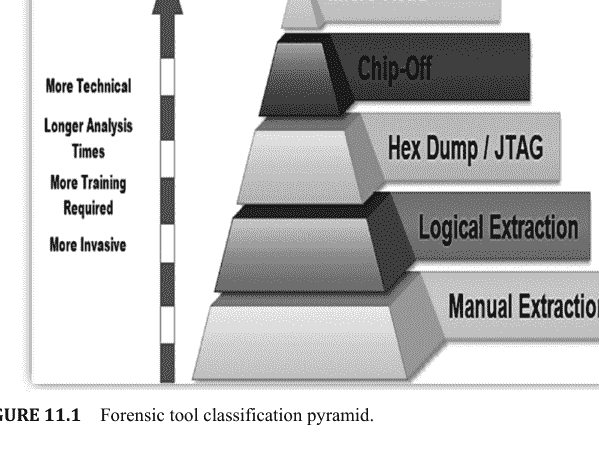

图 11.1 法证工具分类金字塔。

### 11.8.1 非侵入式方法

- 1. **Manual Extraction：** 这基本上包括在犯罪现场以其被开发的状态拍摄手机所有侧面的照片以及相关证据和背景。
- 2. **Logical Extraction：** 此方法基本上包括手机与法证实验室之间的交互，其中需要进行检查。它包括蓝牙、USB 电缆或任何其他可以完成的电线或设备。在此，可以恢复已删除的数据。
- 3. **JTAG Method：** 它帮助我们从所有不同类型的软件中恢复数据。当设备损坏或损坏时使用此方法。这是通过将设备连接到 TAP（测试访问端口）来完成的，可以从设备中获取原始数据。
- 4. **Hex Dump：** 它类似于 JTAG，可以恢复闪存中存在的原始数据。但两者之间的主要区别是，此方法中获得的结果为二进制形式，后续需要将其翻译成原始数据。

### 11.8.2 侵入式方法

- 1. **Chip-Off：** 这是一种提取数据的昂贵方法。在此方法中，首先从设备中取出芯片，并在调查下恢复数据，通过此方法获得的数据是原始数据，后续会对其进行解码和分析。只有在已应用其他非侵入式方法提取数据后，才建议使用此方法。
- 2. **Micro-Read：** 此方法更技术性，因为在此方法中，在显微镜的帮助下，通过门在芯片上定位数据。它需要高专业知识来执行此方法。它非常昂贵且耗时，仅在国家安全情况下进行。

## 11.9 移动取证挑战

由于 MF 帮助我们解决了许多案例，但它也有其局限性；在某些情况下，由于某些因素，很难获得信息，这是因为每个检查员都面临的某些挑战：

- 1. **Hardware Differences：** 由于硬件的不断进步，检查员很难适应市场上存在的所有类型的硬件，因为每种硬件都有不同的功能，检查员很难测试它们。
- 2. **Mobile Operating System（OS）：** 就像硬件一样，每个设备都有自己的移动操作系统，这些系统有自己的安全问题，这也阻碍了它们的测试。
- 3. **Mobile Platform Security Features：** 一些移动安全功能可以访问大量数据，但一些移动平台甚至不允许数据被揭示，因此检查员很难获得数据。
- 4. **Lack of Resources：** 由于缺乏工具和适当的获取技术，有时数据无法恢复。
- 5. **Generic State of Devices：** 在某些手机中，即使手机已关闭，闹钟仍在工作，因为设备处于通用状态，因此有时数据会丢失。
- 6. **Anti-Forensic Technique：** 有许多反取证（AF）技术，黑客使用它们，例如数据隐藏、数据伪造、添加无关数据或将误导数据添加到重要数据中。
- 7. **Dynamic Nature of Evidences：** 数字证据可以在浏览其他网站时在移动设备上轻松更改。
- 8. **Accidental Reset：** 在检查过程中，有时检查员最终会重置所有数据，这可能会导致设备中存在的所有数据被销毁。
- 9. **Device Alteration：** 有时更改设备或在从一个设备传输到另一个设备时，重要数据会丢失。
- 10. **Passcode Recovery：** 在某些设备中，在恢复密码时只有有限的尝试次数，之后手机将永远锁定，因此我们无法获取数据。
- 11. **Communication Shielding：** 在某些情况下，如果隔离技术没有正确实践，则连接 Wi-Fi 或蓝牙后，外来数据可能会进入设备并破坏它。
- 12. **Lack of Availability of Tools：** 缺乏法拉第袋等工具和其他技术，数据可能会被更改。
- 13. **Malicious Programs：** 在某些情况下，通过添加具有病毒的恶意程序对设备进行更改，这可能会导致设备的硬件和软件崩溃，从而导致重要数据丢失。
- 14. **Legal Issues：** 由于涉及移动操作系统的一些法律问题，检查员很难进行测试。
- 15. **Laws Under which Mobile as an Evidence is Accepted Under Court of Law：** 最后，非常有必要讨论这些移动证据是否甚至可以在法庭上使用，因为如果不能，那么所有的调查和分析过程对我们来说都是无用的。在印度宪法中，没有关于手机作为证据的具体规则，但根据印度证据法第 65B 条，所有设备，无论是手机，


CCTV摄像机、CD或其他任何类型的电子设备如果足够兼容以证明犯罪或为无辜者辩护，则会在法庭上出示。此外，65B(4)规定，此证据只能由具备足够培训、知识和经验的专家出示，该规定由U Lalit和Justice AK Goel组成的法庭裁定。

## KEYWORDS

- **安卓数据**
- **数字取证**
- **iPhone 数据**
- **恶意程序**
- **移动设备**
- **移动取证**
- **操作系统**
- **测试访问端口**

## REFERENCES

Agar, J., (2003). 《持续触碰：移动电话全球史》. Cambridge: Icon Books, 172 pp., 20 illus., cloth $20, ISBN 1-84046-419-4.
Al-Mutawa, N., Baggili, I., & Marrington, A., (2012). 移动设备上社交网络应用的取证分析. Digital Investigation, 9, S24–S33.
Ayers, R., Jansen, W., Moenner, L., & Delaître, A., (2007). 手机取证工具：概述与分析更新. NISTIR 7387.
Bates, J., (1998). 计算机取证基础. Information Security Technical Report, Elsevier.
Bharati, W., Ramith, N., & Amala, N., (2015). 移动操作系统：Android 与 IOS 的分析与比较. ISSN: 2348 - 6090.
Brown, L. D., Hua, H., & Gao, C., (2003). Scape 中增强交互的小部件框架. In Proceedings of the 16th Annual ACM Symposium on User Interface Software and Technology (UIST ’03). Association for Computing Machinery, New York, NY, USA, 1–10.
Carrier, B., (2001). 对 FFS 和 EXT2FS 分区镜像进行尸检：TCTUTILs 和 Autopsy 取证浏览器的介绍. Proc. SANSFIRE 2001 Conference.
Casey, E., (2010). 数字取证与调查手册. Academic Press.
Conder, S., & Darcey, L., (2009). Android 无线应用开发. Addison Wesley.
Dasari, M. S., Nandagiri, R. G. K. P., & Satish, D., (2015). 移动设备的取证流程分析. 6(5), 4847-4850.
Forman, G., (2003). 文本分类特征选择度量的广泛实证研究. J. Mach. Learn. Res., 3, 1289-1305.
Garber, L., (2001). 计算机取证：高科技执法. IEEE Computer, 34(1), 202-205.
Garfinkel, S., (2010). 数字取证研究：未来10年. Digital Investigation, 7, S64-S73.
Garner, (2011). 2011年第二季度移动设备销售额同比增长16.5%；智能手机销售额增长74%. Gartner, Inc.
Halderman, J., Schoen, S., Heninger, A., & Felten, E., (2008). 勿忘 - 加密密钥的冷启动攻击. Proc. 17th USENIX Security Symposium.
Jansen, W., & Ayers, R., (2007). 手机取证指南. Recommendations of the National Institute of Standards and Technology.
Kostadinov, D. (2019). 移动取证流程：步骤和类型. Infosec Resources, (n.d.). https://resources.infosecinstitute.com/topic/mobile-forensics-process-steps-types/ (accessed January 30, 2023).
Park, J., Chung, H., & Lee, S., (2012). 智能手机中碎片化闪存页面的取证分析技术. Digital Investigation, 9(2), 109-118.
Raghav, S., & Saxena, A. K., (2009). 移动取证：数据保存与获取的指南与挑战. IEEE Student Conference on Research and Development (pp. 5-8). Malaysia.
Sannella, M. J., (1994). 交互式用户界面的约束满足与调试. Doctoral Thesis. UMI Order Number: UMI Order No. GAX95- 09398. University of Washington.
Sathe, S. C., & Dongre, N., M., (2018). IEEE 2018 第2届创新系统与控制国际会议 (ICISC)-Coimbatore, India (2018.1.19-2018.1.20). 2018 2nd International Conference on Inventive Systems and Control (ICISC)-移动取证中的数据采集技术.
Sengul, D., & Erhan, A., (2017). 数字取证中的手机分析. MIPRO, Opatija, Croatia.
Spector, A. Z., (1989). 实现应用需求. In: Mullender, S., (ed.), Distributed Systems.
Yates, I. I., (2010). 移动设备数字取证工具的实践调查. In: 2010 Information Security Curriculum Development Conference. ACM.
Yu, Y. T., & Lau, M. F., (2005). MC/DC、MUMCUT 以及其他几种逻辑决策覆盖标准的比较. Journal of Systems and Software. (in press).
Zareen, & Baig, S., (2010). 手机取证挑战、分析及工具分类. 第五届数字取证工程系统方法国际研讨会 (SADFE.2010) (pp. 47-55).

## CHAPTER 12

## Analysis of Tree-Based Machine Learning Techniques for Credit Card Fraud Detection

JITENDER TANWAR,¹ SHUBHAM SINGH,² AKASH KUMAR,²
MANDEEP MITTAL,⁴ LEENA SINGH,² and SUDHANSHU TRIPATHI³

¹Amity Institute of Information Technology, Amity University, Noida, Uttar Pradesh, India

²Amity School of Engineering and Technology, Amity University, Noida, Uttar Pradesh, India

³Amity University in Tashkent, Labzak Tashkent City, Uzbekistan

⁴Department of Mathematics, Amity Institute of Applied Sciences, Amity University, Noida, Uttar Pradesh, India

## ABSTRACT

信用卡是黑客容易且最有利的目标。另一方面，它对金融行业来说是一个巨大的威胁。每年都有成千上万的人因这个问题遭受巨大损失。虽然这不是一个容易解决的问题，但机器学习（ML）给了我们希望，并在在线交易欺诈检测中发挥了重要作用。在线欺诈检测面临着数据不平衡、缺乏机密数据、分析数据不可用等困难。经过处理和分析的数据可以显著提高 ML 算法的性能。在本章中，我们分析和比较了随机森林、AdaBoost 分类器、XGBoost 分类器的性能，并最终将它们集成以获得更好的结果。

我们根据其马修斯相关系数（CC）得分、AUC-ROC 得分及其混淆矩阵评估了它们的性能。结果分析显示了所选 ML 算法特征的重要性顺序。结果表明，随机森林在两个评估指标上得分最佳，为 0.9981。

### 12.1 INTRODUCTION

信用卡交易中的欺诈是指账户被未经授权的用户或某些欺诈者使用（Sahin, 2013）。这是一种刑事活动，会给金融行业带来严重后果。为了避免欺诈活动，有两种措施：欺诈检测和欺诈预防。欺诈预防意味着在欺诈发生前预测并阻止欺诈。欺诈检测意味着检测到欺诈并在欺诈企图时阻止它。

世界充满了公司、客户和欺诈者。每当客户遭受欺诈时，公司在财务和声誉方面也必须遭受损失（Awoyemi, 2017）。为了向客户提供优质服务，公司不断推出新方案。他们使用数据分析师来了解他们的客户。他们使用技术来检测和预防欺诈，而机器学习（ML）是其中一种解决方案。使用不同的 ML 技术，我们可以识别欺诈交易并防止其发生（Pozzolo, 2018）。随着电子商务的兴起，信用卡交易也在迅速增长（Srivastava, 2008）。这种增长对金融行业产生了严重影响。2019年印度信用卡用户数量约为4700万，2020年增至5200万。众多授权技术在信用卡欺诈案件中并不十分有效。欺诈者利用互联网隐藏其身份和位置。2018年全球信用卡欺诈达到242.6亿美元（Nilson Report, 2018）。

在本章中，ML 技术被用于识别信用卡交易中的欺诈，即随机森林、AdaBoost 分类器和 XGBoost 分类器。真实数据集来自 Kaggle，并由 Python 模拟器 PaySim 通过自动化生成。数据集进一步分为训练、验证和测试数据集。算法在测试数据集上进行训练，然后通过验证数据集进行验证，最后通过测试数据集进行测试。对于模型的评估，使用了 AUC-ROC 和 MCC（马修斯相关系数）等评估指标，并对它们进行了比较。


## 12.2 相关工作

在本节中，回顾了不同研究人员的努力。信用卡欺诈如今非常普遍，已有大量研究。少数研究人员做出了一些严肃的贡献，但欺诈者仍不断找到新的方式来挑战他们，因此我们应不断学习并寻找更好的阻止方法。

Bhanusri 等人（2020）研究了随机森林结合提升、逻辑回归和朴素贝叶斯等机器学习算法。他们检测欺诈交易并减少误报数量。根据其比较分析，随机森林结合提升技术在信用卡欺诈检测中优于其他使用技术。然而，他们无法区分欺诈和非欺诈交易。

研究人员 Randhawa 等人（2018）使用了单模型和混合模型。他们对两种类型的模型都使用了公开可用的数据集，并向数据中添加了噪声，以便衡量算法的鲁棒性。首先，他们使用了一些经典的单算法，如朴素贝叶斯、决策树、随机森林、多层感知器、支持向量机（SVM）、前馈神经网络、线性回归和逻辑回归。之后，他们将这些模型与自适应提升相结合，并最终制作了这些算法的不同组合，形成了混合模型，如朴素贝叶斯结合梯度提升等。他们使用 MCC 分数进行最终评估。他们获得的最佳 MCC 分数为 0.823，使用多数投票获得。

Lakshmi & Kavila（2018）使用了三种机器学习技术，即随机森林、逻辑回归和决策树进行欺诈检测。数据集约 70% 用于训练，30% 用于测试和验证以进行评估。准确率、错误率、敏感性和特异性被用于评估三种算法的不同变量。建议系统的性能使用准确率、敏感性、错误率和特异性来衡量。逻辑回归、随机森林分类器和决策树的准确率分别为 90.0、95.5 和 94.3。与比较而言，随机森林分类器优于决策树和逻辑回归。

Chen 等人（2014）使用了混合分类器集成和聚类进行欺诈处理。Raghavan 等人（2019）在其研究中比较了各种机器学习和深度学习模型。当 SVM 与 CNN 结合时，他们获得了最佳结果。CNN 在所有深度学习算法中作为欺诈检测器表现最佳。另一项与深度学习相关的工作是 Habibpour 等人（2021），他们研究了与深度神经网络（DNN）预测相关的不确定性的价值。他们使用了三种深度不确定性量化技术（EMCD、MCD 和集成）。

Domashova & Zabelina（2021）也使用集成方法进行分析，但结合了降维技术进行检验。他们在云端平台 SAS（统计分析系统）Viya 上实现模型，该平台是一种流行的反欺诈系统。

Pooja 等人（2021）论文对各种机器学习方法进行了全面分析，并列出了优缺点。他们研究了多种算法，如隐马尔可夫模型、SVM、随机森林、人工神经网络、LSTM 和遗传算法，其中人工神经网络给出了最佳结果，但其训练过程非常昂贵。在这里，我们了解到欺诈检测不应在时间和金钱上花费太多。

Sara Alqethami 等人（2021）展示了第一阶和第二阶学习算法的各种优化方法，如反向传播、最速下降、Quickprop 和高斯-牛顿法。第一阶方法使用梯度构建进一步的训练迭代，第二阶方法使用 Hessian 矩阵计算进一步的迭代。他们使用这些算法来提高各种神经网络算法的准确性，并获得了 96% 的最高得分。

Fenila 等人（2021）使用了 BiGRU（双向门控重复单元）和 BiLSTM（长双向记忆）和获得了 80% 和 81% 的 AUC 分数。他们还使用了欠采样、过采样和 SMOTE 来处理不平衡数据，这也有助于提高模型的准确性。由于我们知道数据集高度不平衡，我们也使用了这些技术来减少不平衡数据带来的副作用。

Bocheng Liu 等人（2021）使用全连接神经网络和 XGBoost 创建了两个欺诈检测模型，分别获得了 0.912 和 0.969 的 AUC 值。他们还构建了一个交互式在线欺诈交易检测系统。归根结底，所有这些研究的目的是在真实交易系统中检测欺诈。

## 12.3 材料与方法

### 12.3.1 数据集

本研究中的问题是信用卡交易可用数据集的缺乏。在本章中，使用了可从 Kaggle 下载的移动货币交易数据集。为了研究欺诈检测，我们需要一个金融数据集，但由于隐私政策，数据集缺乏。在这里，通过名为 PaySim 的模拟器创建了一个合成数据集。它使用非洲某国一个月的真实交易样本来创建与正常交易相似的合成数据集。合成数据是原始数据的 1/4。

数据集包含 11 个特征。变量如下：step 时间单位，type 交易类型，amount 交易金额，nameOrig 交易来源，oldbalanceOrg 交易来源的旧余额，newbalanceOrig 交易来源的新余额，nameDest 收款客户，oldbalanceDest 收款人的旧余额，newbalanceDest 收款人的新余额，isFraud 这是目标变量 0 表示非欺诈 1 表示欺诈。PaySim 是生成合成数据集的模拟器，然后进行预处理，处理后的数据集作为输入提供给所有算法以获得其结果，然后将这些结果集成以获得我们的最终预测模型。

图 12.1 是构建我们欺诈检测模型的流程图。PaySim2 是为我们提供合成数据集的模拟器，该数据进一步进行了预处理，并进行了特征工程。之后，该数据集被输入到全部三个基于树的算法以获得其结果，然后将它们集成以获得组合结果，并将全部四个结果进行比较。

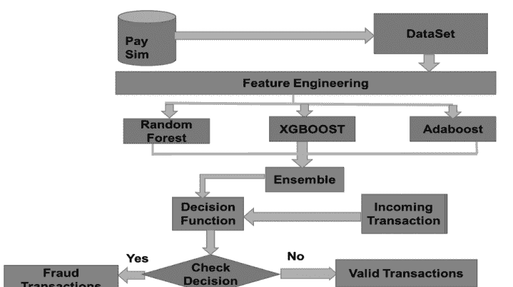

图 12.1 流程图。

### 12.3.2 算法

#### 12.3.2.1 随机森林

随机森林算法使用集成学习并行训练多个决策树；该过程称为装袋。它将训练数据集划分为 n 个样本，并使用这些样本训练 n 个不同的决策树（Lin, 2017）。将数据集划分为样本的过程称为自助法。简单来说，它在数据集的不同子集上并行训练多个决策树。最后，它使用最大投票的集成技术聚合各个树的决策。最终预测是这些决策树的投票输出。该算法对于结构化数据非常好。

#### 12.3.2.2 AdaBoost

AdaBoost 也是一种集成建模类型，其中多个低精度分类器组合以获得更高精度的分类器。Ada-Boost 的步骤是，首先随机选择训练数据集，然后在此随机数据集上训练模型，然后通过该模型进行预测（Cao Ying, 2019），并计算实际值与预测值之间的误差，然后为预测错误的观测值分配权重，以及整体准确率高的模型，然后重复该过程，对于最终预测，使用您制作的所有分类器进行最大投票。

#### 12.3.2.3 XGBoost

XGBoost 是 Kaggle 竞赛中最常用的机器学习算法之一，用于结构化或表格数据。它也是使用提升技术的一种集成学习算法。它由梯度提升决策树组成，具有高速和性能。它使用一种方法，其中创建新模型来预测前一个模型的错误，然后将它们组合起来做出最终预测（Mitchell, 2017）。其他提升算法会增加弱分类器的权重，但在梯度提升算法中，它们试图优化损失函数。它使用梯度下降算法在添加新模型的同时减少损失。其

optimization techniques give better performance and speed using the least amount of resources.

## 12.4 工作流程

在本节中，实验设置按以下顺序进行，首先获取一个公开可用的数据集，并对其应用所有预处理技术，其次，进行一些特征工程（Khurana, 2018），然后在最终数据集上创建并测试模型。所有实验均在 Jupyter Notebook 中进行。

### 12.4.1 实验设置与观察

在信用卡数据集中，欺诈交易与有效交易相比非常少，因此数据集高度不平衡，为在一定程度上解决此问题，在构建模型时使用了权重（Kirkos, 2007）。为了评估最终预测，使用了三种不同的评估指标，以便更好地理解。这些指标的一致分数或结果意味着更好的性能。

混淆矩阵是一个二乘二矩阵，包含二元分类器的四种可能结果。

Confusion Matrix = 
  TP  FN
  FP  TN

ROC（receiver operator characteristic curve）可以帮助确定最佳阈值。它是通过绘制真阳性率（y-axis）与假阳性率（x-axis）生成的。

TPR = Sensitivity = TP / (TP + FN)

FPR = 1 - Specificity = FP / (FP + TN)

MCC 对不平衡具有鲁棒性。它与 chi-square statistic 相关，取值介于 −1 和 +1 之间。对于二元分类：

MCC = (TP × TN − FP × FN) / sqrt((TP + FP)(TP + FN)(TN + FP)(TN + FN))

### 12.4.2 预处理

预处理是将原始数据准备用于模型训练的过程。它包括查找缺失值并删除或插补它们（Ravisankar, 2011）。数据集中没有缺失值，所有仅为 0 的值均被替换为 −1。对分类变量使用了 One hot encoding。Min-max scaler 用于缩放特征。此外，未对模型结果产生贡献的特征被移除。数据集中某些见解在小节中讨论。

### 12.4.2.1 按一天中小时的交易

作为补充见解，Figure 12.2 显示了基于小时的活动，其观察结果非常重要，并且可能以任何显著的方式影响项目流程。欺诈交易在 24 小时期间持续存在，而有效交易在夜间明显较少。

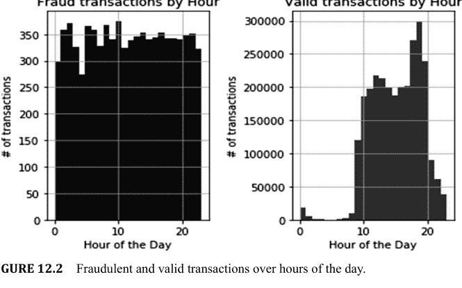

FIGURE 12.2 Fraudulent and valid transactions over hours of the day.

### 12.4.2.2 交易金额

根据交易金额，欺诈活动显示出某些趋势，如 Figure 12.3 所示。欺诈交易从未超过 10 万卢比，而有效交易高达 1 千万卢比。


FIGURE 12.3 Scatter plot of transactions based on the amount.

### 12.4.2.3 欺诈交易类型

Figure 12.4 显示了欺诈交易和有效交易中存在的交易类型。从图中可以看出，欺诈交易只有两种类型，而有效交易有五种类型。

```
Fraud transactions by type:
    CASH_OUT      4116
    TRANSFER      4097
Name: type, dtype: int64
```

```
Valid transactions by type:
    CASH_OUT    2233384
    PAYMENT     2151495
    CASH_IN     1399284
    TRANSFER     528812
    DEBIT         41432
Name: type, dtype: int64
```

FIGURE 12.4 Types of transactions fraud vs. valid transactions.

### 12.4.3 特征工程

特征工程是从现有特征或原始数据合成新特征。当这些特征被模型预处理（Coates, 2011）时，它们可以提高 ML 模型的性能。此外，随机森林和梯度提升算法从合成特征中获得显著益处，如（Heaton, 2016）所述。特征工程需要的劳动比 ML 中的任何其他过程都多（Bengio, 2013）。在我们的案例中，它在模型结果中发挥了最有效的作用（Duman, 2011）。

添加到数据集中的特征是当天的第一个小时。该特征说明交易发生的当天小时。其次是 Error Balances，数据集存在一些错误，例如交易金额与从目标账户或源账户分别接收或扣除的金额不匹配。因此，使用这些错误引入了两个新列，并命名为 ‘errorBalanceOrigin’ 和 ‘errorBalanceDestination’，如 Figure 12.5 所示。

| HourOfDay | errorBalanceOrig | errorBalanceDest |
|---|---|---|
| 1 | 0.00 | 181.0 |
| 1 | 0.00 | 21363.0 |
| 1 | 213808.94 | 182703.5 |
| 1 | 214605.30 | 237735.3 |
| 1 | 300850.89 | -2401220.0 |

FIGURE 12.5 The new features in the dataset.

### 12.4.4 结果

### 12.4.4.1 随机森林

随机森林算法非常灵活且易于实现，使其成为入门算法的完美选择。简单来说，随机森林构建多个决策树（Tanwar, 2018）并将它们组合以获得更高的准确性。Figure 12.6 显示了随机森林考虑的特征重要性。可以从图中看出，随机森林对 newBalanceOrig 变量赋予了最多的权重，即它最关心交易源的新的余额，并将基于此变量 mostly 进行预测（Figure 12.7）。


FIGURE 12.6 Feature importance for random forest.

从混淆矩阵可以看出，在 5,55,000 笔交易中，0 笔交易导致假阳性，即算法将干净交易标记为欺诈交易，并且只有 6 笔欺诈交易算法未能检测到。该算法能够检测到每笔有效交易并显示出卓越的性能。

### 12.4.4.2 ADABOOST

Ada-boost 的基本思想是排列分类器的权重并在每次迭代中训练信息样本，以确保负观测值的准确预测。Figure 12.8 显示了 AdaBoost 考虑的特征重要性。可以从图中看出，AdaBoost 对 errorBalanceOrig 特征赋予了最多的权重，即它最关心源侧的余额误差，并将 mostly 基于此变量进行预测。Figure 12.9 显示了 AdaBoost 的混淆矩阵。


FIGURE 12.7 Confusion matrix of random forest.


FIGURE 12.8 Feature importance of AdaBoost classifier.


FIGURE 12.9 Confusion matrix of AdaBoost classifier.

从混淆矩阵可以看出，在 5,55,000 笔交易中，25 笔交易导致假阳性，即算法将干净交易标记为欺诈交易，并且有 78 笔欺诈交易算法未能检测到。

### 12.4.4.3 XGBoost

Figure 12.10 显示了 XGB 树的特征重要性。

如 Figure 12.10 所示，XGB Tree 对 errorBalanceOrig 特征赋予了最多的权重，即它最关心源侧的余额误差，并将 mostly 基于此变量进行预测。Figure 12.11 是 XGBT 的混淆矩阵。

从混淆矩阵数据来看，在 5,55,000 笔交易中只有 10 笔交易导致假阳性，即算法将干净交易标记为欺诈交易，但只有 6 笔欺诈交易算法未能检测到。

### 12.4.4.4 ROC-AUC SCORE

Table 12.1 列出了每个算法的 ROC-AUC 值，其中随机森林和 XGBoost 的得分约为 0.998，而 AdaBoost 稍微落后，得分为 0.997。


FIGURE 12.10 Feature importance for XGB tree.


FIGURE 12.11 Confusion matrix of XGBT.


## 表 12.1 ROC-AUC 分数

| 算法 | ROC-AUC 分数 |
|---|---|
| 随机森林 | 0.9981740718198417 |
| AdaBoost | 0.9762403067253764 |
| XGBoost | 0.9981650210468151 |
| 集成 | 0.9981740718198417 |

### 12.4.4.5 MCC 分数

表 12.2 列出了所有算法的 MCC 分数，其中随机森林和 XGBoost 在 ROC-AUC 和 MCC 方面均显示出一致的结果。

## 表 12.2 MCC 分数

| 算法 | MCC 分数 |
|---|---|
| 随机森林 | 0.9981669812672261 |
| AdaBoost | 0.9681787197506385 |
| XGBoost | 0.9951230367215831 |
| 集成 | 0.9981669812672261 |

## 12.5 结论

本章介绍了三种基于决策树的算法的实现和测试。其动机是在该数据集上尽可能获得更高的准确率并比较其结果。尽管这三种算法都遵循集成学习，我们仍将这三种模型再次集成以获得更好的结果。最终预测度量使用 MCC 指标。使用随机森林、XGBoost 和集成模型达到了 0.99 的最佳分数。集成模型的准确率为 99%，与随机森林和 XGBoost 相似。我们发现，如果在特征工程上花费更多时间而不是在模型训练上，结果会更好，而我们已经这样做了。我们已成功学习并实现了这四种不同的模型，并获得了 99% 的准确率。本章可以为您简要介绍信用卡欺诈和不同的机器学习算法。它还告诉您机器学习的各个方面，如特征工程、评估指标等。信用卡欺诈是人人关注的话题，并且通过机器学习检测欺诈方面取得了持续进展。

## 关键词

- AdaBoost
- 双向门控循环单元
- 信用卡
- 深度神经网络
- 集成学习
- 欺诈检测
- 随机森林
- XGBoost

## 参考文献

Awoyemi, J. O., Adetunmbi, A. O., & Oluwadare, S. A., (2017). Credit card fraud detection using machine learning techniques: A comparative analysis. In: 2017 International Conference on Computing Networking and Informatics (ICCNI) (pp. 1–9). doi: 10.1109/ICCNI.2017.8123782.

Bengio, Y., Courville, A., & Vincent, P., (2013). Representation learning: A review and new perspectives. IEEE Transactions on Pattern Analysis and Machine Intelligence, 35(8), 1798–1828.

Bhanusri, A., Ratna, S. V. K., Jyothi, P., Varun, G., Sai, R., & Rohith, S. S., (2020). Credit card fraud detection using Machine learning algorithms. Journal of Research in Humanities and Social Science, 8(2), 04–11.

Bocheng, L., Xiang, C., & Kaizhi, Y., (2021). Online transaction fraud detection system based on machine learning. J. Phys.: Conf. Ser. 2023, 012054.

Cao, Y., Qi-Guang, M., Jia-Chen, L., & Gao, L., (2013). Advance and prospects of AdaBoost algorithm. Acta Automatica Sinica, 39(6), 745–758.

Chen, F. H., Chi, D. J., & Zhu, J. Y., (2014). Application of random forest, rough set theory, decision tree and neural network to detect financial statement fraud taking corporate governance into consideration. In: Proc. Int. Conf. Intell. Comput. (pp. 221–234).

Coates, A., Ng, A. Y., & Lee, H., (2011). An analysis of single-layer networks in unsupervised feature learning. In: International Conference on Artificial Intelligence and Statistics (pp. 215–223).

Dal, P. A., Boracchi, G., Caelen, O., Alippi, C., & Bontempi, G., (2018). Credit card fraud detection: A realistic modeling and a novel learning strategy. In: IEEE Transactions on Neural Networks and Learning Systems (Vol. 29, No. 8, pp. 3784–3797). doi: 10.1109/TNNLS.2017.2736643.

Duman, E., & Ozcelik, M. H., (2011). Detecting credit card fraud by genetic algorithm and scatter search. Expert Syst. Appl., 38(10), 13057–13063.

Fenila, N. J., Roshan, J. R., Sakthi, E. K., & Sanjeev, K. N. M., (2021). Intelligent transaction system for fraud detection using deep learning networks. J. Phys.: Conf. Ser., 1916, 012031.

Habibpour, M., Gharoun, H., Mehdipour, M., AmirReza, T., Asgharnezhad, H., Shamsi, A., & Khosravi, A., et al., (2021). Uncertainty-Aware Credit Card Fraud Detection Using Deep Learning. arXiv preprint arXiv:2107.13508v1.

Heaton, J., (2016). An Empirical Analysis of Feature Engineering for Predictive Modeling (pp. 1–6). Southeast Con. 2016. doi: 10.1109/SECON.2016.7506650.

Jenny, D., & Olga, Z., (2021). Detection of fraudulent transactions using SAS Viya machine-learning algorithms. Annual International Conference on Brain-Inspired Cognitive Architectures for Artificial Intelligence: Eleventh Annual Meeting of the BICA Society, Procedia Computer Science, 190, 204–209.

Khurana, U., Samulowitz, H., & Turaga, D., (2018). Feature engineering for predictive modeling using reinforcement learning. Proceedings of the AAAI Conference on Artificial Intelligence, 32(1). Retrieved from: https://ojs.aaai.org/index.php/AAAI/article/view/11678 (accessed on 10 January 2022).

Kirkos, E., Spathis, C., & Manolopoulos, Y., (2007). Data mining techniques for the detection of fraudulent financial statements. Expert Syst. Appl., 32(4), 995–1003.

Lakshmi, S. V., & Kavila, S. D., (2018). Machine learning for credit card fraud detection system. International Journal of Applied Engineering Research, 13(24), 16819–16824.

Lin, W., Wu, Z., Lin, L., Wen, A., & Li, J., (2017). An ensemble random forest algorithm for insurance big data analysis. In: IEEE Access (Vol. 5, pp. 16568–16575). doi: 10.1109/ACCESS.2017.2738069.

Mitchell, R., & Frank, E., (2017). Accelerating the XGBoost algorithm using GPU computing. PeerJ Computer Science, 3, e127. https://doi.org/10.7717/peerj-cs.127.

Pooja, T., Simran, M., Nishtha, S., Jitendra, K., & Ashutosh, K. S., (2021). Credit Card Fraud Detection Using Machine Learning: A Study. arXiv:2108.10005v1 [cs.AI].

Raghavan, P., & Gayar, N., (2019). Fraud Detection Using Machine Learning and Deep Learning, 334–339. 10.1109/ICCIKE47802.2019.9004231.

Randhawa, K., Chu, K. L., Manjeevan, S. C. P. L., & Asoke, K., (2018). Nandi Credit Card Fraud Detection Using AdaBoost and Majority Voting, 6.

Ravisankar, P., Ravi, V., Rao, G. R., & Bose, I., (2011). Detection of financial statement fraud and feature selection using data mining techniques. Decision Support Syst., 50(2), 491–500.

Sahin, Y., Bulkan, S., & Duman, E., (2013). A cost-sensitive decision tree approach for fraud detection. Expert Syst. Appl., 40(15), 5916-5923.

Sara, A., Badriah, A., & Al Ghamdi, M., (2021). Fraud detection in e-commerce. IJCSNS International Journal of Computer Science and Network Security, 21(6).

Srivastava, A., Kundu, A., Sural, S., & Majumdar, A., (2008). Credit card fraud detection using hidden Markov model. IEEE Trans. Depend. Sec. Comput., 5(1), 37-48.

Tanwar, J., Sharma, S. K., & Mittal, M., (2018). Secure framework for web-services communication. In: International Conference on Automation and Computational Engineering. ISBN: 978-1-5386-5464-4. https://doi.org/10.1109/ICACE.2018.8687009.

The Nilson Report, (2018). [Online]. Available: https://nilsonreport.com/mention/1313/1link/ (accessed on 10 January 2022).

## 第13章

### 黑客：对您财务的重大威胁

SUNIDHI JOSHI,¹ SOURABH KUMAR SINGH,² and AMARNATH MISHRA³

¹法医科学硕士研究生，阿米蒂法医科学学院，阿米蒂大学，诺伊达，北方邦，印度

²研究学者，阿米蒂法医科学学院，阿米蒂大学，诺伊达，北方邦，印度

³教授（法医科学）兼主任，劳埃德法医科学研究所，大诺伊达，北方邦，印度（隶属于国家法医科学大学，甘地纳格尔，古吉拉特邦）

### 摘要

如今，犯罪手段已从古老的方式转变为新的数字化方式，但有些人对此并不十分了解。实施此类犯罪的原因是动机和个人的意图。调查人员需要关注的唯一方面是该行为是出于合法目的还是非法目的。我们在一切可能的事情上都使用数字手段；因此，有必要了解这种新兴的网络犯罪类型，即金融网络犯罪，因为它对个人、机构或组织的财务有直接影响。有时甚至很难追踪犯罪的犯罪者，因为实施此行为的人也是了解结构漏洞或弱点的组织的一部分。在与计算机相关的犯罪中，受害者、嫌疑人和目标都是计算机本身。罪犯的主要动机是诽谤某人或获取个人利益。在与计算机相关的犯罪中，有许多工具、技术和措施可以帮助

在检索数据、不同软件的功能以及防止黑客攻击、病毒攻击和勒索软件方面，数字取证的应用不仅限于此，还具有更多应用。许多技术和措施可以帮助防止此类犯罪。本章主要讨论金融网络犯罪以及随着时间的推移，它如何转变并演变成一种令人发指的行为。我们研究了犯罪分子的类型，以及一个人如何成为受害者，最后，我们研究了个人如何防止自己遭受这种令人发指的犯罪，以及一些属于金融网络犯罪类别的案例研究。

## 13.1 引言

犯罪并不是一个新词。它可以在我们的日常生活中听到；在定义犯罪时，它可以被定义为任何不合法的行为，该行为会受到法院的惩罚（The Institute of Company Secretaries of India, 2016）。这种惩罚可以是罚款或监禁。犯罪当然已经存在了几个世纪，但随着技术的进步和通信的出现，一种新的犯罪模式出现了，这被称为网络犯罪。如果有人想知道什么是网络犯罪，首先应该了解犯罪的概念，然后再了解什么是网络犯罪？目前并没有一个能够涵盖其各个方面的网络犯罪定义。我们可以说它是一种涉及互联网欺诈、黑客攻击、网络恐怖主义等，或任何通过计算机或计算机设备或网络实施的不合法行为的犯罪（Sarmah, Sarmah, & Baruah, 2017）。

网络犯罪的主要分类之一是金融网络犯罪。这些天，随着互联网在各种用途上的使用增加，引发了一种对现有犯罪的新方式，即对个人财务、即金钱、财产构成直接威胁。根据世界经济论坛2018年的一项研究，观察到欺诈和金融犯罪是一个应被视为万亿美元产业的行业，私营公司为反洗钱（AML）花费了大量资金，约为82亿美元（2017年）（Hasham, Joshi, & Mikkelsen, 2019）。

金融计算机相关犯罪可以定义为包含系统以对某人的财产实施犯罪的犯罪，非法从他人银行账户提取资金，以及更多为个人使用等目的。电子银行、在线购物和其他形式的电子商务通常被用来实施金融欺诈。信用卡等卡允许信用扩张和付款延期，而借记卡则不允许。使用银行卡（如信用卡）或其他支付设备作为交易费用或借记卡在交易时从您账户中扣款的虚假储备来源实施的欺诈。它可能是为了在不付款的情况下获取商品，或从账户中获取非法资金。身份盗窃通常伴随着信用卡欺诈。

主要当我们看到ATM欺诈时，它们是客户实施的各种行为、其疏忽或我们可以说人们对欺诈缺乏认识的结果，如何使用、分享什么或不分享什么等等。当谈到像印度这样的国家时，我们可以看到这里的犯罪并非由于错误而发生，而是由于疏忽和缺乏认识而发生。今天当一切都已数字化时，这些金融欺诈也已成为金融网络犯罪，因为它们开始使用一些我们以前很少听说的已知网络犯罪，但现在它们在全世界普遍存在，无论国家是否发达。如今，一个非常常见的术语是互联网交易，这意味着当我们通过互联网购买和出售各种证券时。罪犯使用的几种策略如下所示（图13.1）：


FIGURE 13.1 一些类型的网络攻击。

- 1. **钓鱼:** 它被定义为一种获取终端用户秘密信息并用于身份盗窃的技术（Hoonakker, Carayon, & Bornø, 2009）。一封电子邮件会发送给用户，看起来是合法的，但会包含一个链接，该链接会要求银行详细信息和其他个人信息，然后将其转发给另一方以利用这些详细信息。它还涉及使用垃圾邮件来获取个人银行的访问权限。应该记住，来自合法机构的电子邮件永远不会要求个人的个人数据。
- 2. **HTTPS 协议:** 这将出现在任何实施安全加密的网站URL的开头。一般来说，个人不会注意它并陷入陷阱。
- 3. **社会工程学:** 这是一种网络犯罪，攻击者会通过电话、社交媒体联系你，他们首先会获得该人的信任，然后慢慢获取所有秘密数据，如ATM PIN、信用卡号码等，最终掠夺该人。
- 4. **仿冒网站:** 其意思是有时诈骗者会制作看起来像合法网站的假网站，但实际上是仿冒网站（Vadza, 2013）。这些网站是为获取受害者的个人信息如银行详细信息而创建的。他们通常会要求你的详细信息，有时还会要求你进行交易。
- 5. **电子邮件仿冒:** 这是一种技术，作案者伪造电子邮件的头部，使其看起来像原始经过身份验证的来源电子邮件。
- 6. 有时也有可能在进行一些个人工作、交易等时，从某个设备（如网吧或其他地方）操作，在那时一些人忘记删除他们的数据，或者该计算机中存在某种错误，会记录一切，最终该人成为犯罪的受害者。
- 7. **黑客攻击:** 这是一种通过非法访问系统以获取他人秘密信息的方法（Dashora, 2011）。
- 8. **语音钓鱼:** 这是一种社会工程类型，作案者通过电话交流以获取个人的个人和财务详细信息（Nkotagu, 2011）。
- 9. **拒绝服务:** 它有时被攻击者用来用请求淹没网站或创建网络流量，最终阻止用户访问服务。
- 10. **水坑攻击:** 它可以被归类为一种演变或修改的技术，被称为 spear phishing。在此，一些恶意代码被植入一些少数人会访问的公共网站（Kaur, 2017）。

## 13.2 网络犯罪的原因

2019年发表的一项研究说，有一篇由Hart发表的作品“the idea of law”，其中说“人们无助，因此需要法律标准来确保他们”（Harshita, 2019）。当前研究在网络世界中应用了同样的原则，它说我们的设备没有太多权力，只有法律是保护公民免受网络犯罪行为者侵害所必需的。一些原因如下：

- 人为疏忽是主要原因；
- 证据丢失；
- 容易获取；
- 缺乏认识；
- 设备可以存储大量信息。

## 13.3 金融犯罪 vs. 欺诈 vs. 网络入侵

金融犯罪与欺诈与网络入侵之间存在明确的区分，可以在检测、处理、预防方式上看到。这一现代时代已将这种区分降至零，因为作案手法变得非常相似，并且发展到如此程度，有时很难区分它们。这种区别不是基于任何立法机构或任何监管机构，而是通常是制度系统的结果。过去几十年，我们说金融犯罪是指存在逃税、洗钱、贿赂的犯罪。尽管如此，它最常被视为合规困难，包括当金融机构使用反洗钱活动来避免罚款时。欺诈另一方面是指涉及欺骗经济人员或服务以进行盗窃的犯罪的扩展，包括伪造、信用卡诈骗和内部威胁。货币组织一直将欺诈视为损失问题，但在近年，强大的分析已被用于检测甚至实时防止欺诈。网络入侵可以定义为一项事件，该事件确实或可能危及

秘密性、判断或数据框架的可访问性，或构成对安全方法、安全策略或适当使用方法滥用的侵权或不可避免的危险。经济机构应使用大部分相同的技术来抵御所有三种类型的犯罪，因为它们之间的差异变得不那么重要。

## 13.4 金融犯罪、欺诈与网络行动

如今，高层组织正努力将网络犯罪或网络行动、金融犯罪和欺诈联系在一起。在金融机构中，前台员工以及后台员工正为此共同努力。风险职能部门和监管机构也在跟进。风险职能部门和监管机构也在跟进。诸如反洗钱（AML）等议题如今被列为监管问题。在这些情况下，首要步骤是首先阐明与风险管理相关的活动，并在整个防线中明确职责和责任（Hasham, Joshi, & Mikkelsen, 2019）。以下步骤将确保流程得到完整描述，并由以下内容覆盖和复制尝试。

|  |  |  |
|---|---|---|
| 1. | 第一道防线 | 业务和企业。 |
| 2. | 第二道防线 | 诸如金融犯罪、欺诈和网络行动等威胁。 |

谈到与金融相关的犯罪时，它包括四种矫正措施：

- 识别并验证买方；
- 追踪和检测交易；
- 行为异常；以及
- 采取行动消除危害和相关问题。

这些活动无论是否针对欺诈、网络安全漏洞或攻击，或其他不同的货币犯罪，都由相似的信息和进一步的流程处理。事实上，将这些统计资源与分析相结合，可以实质性地提高可见性，同时提供更深入的见解以增强检测效用。在许多情况下，它还能够促进预防工作。

在提供对基本程序更全面的视图的同时。金融机构可以建立高效的企业并构建这样的系统，以帮助客户获得更好的体验，同时有助于做出更高质量的决策并实现更好的高效成本管控。因此，系统的重组将根据需要进行。

这些活动无论是针对欺诈、网络安全漏洞或攻击，还是其他金融犯罪，都得到许多相似的数据和流程的支持。事实上，将这些数据源与分析相结合，可以实质性地提高可见性，同时提供更深入的洞察以提高检测能力。在许多情况下，它还能够促进预防工作。

## 13.5 CARBANAK 攻击案例

此次攻击就是一个典型案例，说明了现代欺诈和货币或金融犯罪的完整特征。该系列攻击始于2013年，造成了超过10亿美元的货币损失。作为有预谋的犯罪组织的成员，犯罪分子借助钓鱼攻击获得了系统访问权限，并将余额转移到其银行账户，同时还对银行机器（ATM）进行编程以提取现金。该犯罪行为十分明显，据通报称，此次攻击以协调且同步的方式针对多家银行公司进行。犯罪分子展现出对计算机相关犯罪和数字环境的高度理解和知识，包括与银行系统、其控制措施甚至缺陷相关的操作（Hasham, Joshi, & Mikkelsen, 2019）。他们使用了银行机器（ATM）、交易卡（即信用卡和借记卡）以及电汇转账等其他方法。此次袭击证明，计算机相关犯罪、原始欺诈和针对金融的犯罪之间已不再有区别。

## 13.6 网络犯罪分子类型

网络犯罪分子可能属于任何年龄组，涉及儿童、青少年到成年人（Sharma, Ghisingh, & Ramdinmawii, 2014）（图13.2）：

- 1. **9–16岁年龄组的儿童：**人们会想一个孩子如何成为罪犯，但在网络环境中，我们遇到许多案例，孩子们是有意或在困惑状态下成为网络犯罪分子的。谈到黑客攻击，孩子觉得自己能黑进系统很棒，但他的好奇心会把他带入一种他可能不知道但在法律眼中是非法的犯罪。


图 13.2 黑客类型。

- 2. **有组织的黑客行动主义者：**这些人将其作为职业，他们出于目的进行黑客攻击，该目的可能是政治、社会或宗教方面的。
- 3. **不满的员工：**出现的情况是，一些对组织不满意或感到沮丧的员工，他们作为组织内部人员了解系统的漏洞和脆弱性，从而损害组织和同事。这导致了许多金融网络犯罪，有时甚至导致整个系统崩溃。
- 4. **专业黑客：**他们是专业人士，被大型组织聘请以获取其他组织的相关信息，或有时保护其系统免受其他黑客可能实施的某种网络攻击。

## 13.7 受害者

金融网络犯罪的受害者可能是金融机构、组织或个人。就金融机构和机构而言，与遭受网络犯罪的人相比，预防和应对的选项更为正常。然而，金融机构和公司遭受成功的网络攻击的影响可能巨大且毁灭性。除了可能对整个组织的财务状况产生负面影响甚至导致财务灾难的资金损失外，在商业合作伙伴、客户和社会眼中声誉方面的负面影响也可能造成无法弥补的损害（Financial Cybercrime: How the System is Failing the Victims, n.d.）。

对于个人网络犯罪受害者而言，他们的债务被盗、储蓄被清空、身份被盗并以其名义产生债务，设备在承认、严肃对待和应对网络犯罪方面存在更大的漏洞。每个人都可能成为网络攻击者的目标，但在大多数情况下，他们针对的是老年人，他们更有可能缺乏有效使用技术的技能或熟练程度，或在数字方面能力不足。如果人们在日常生活中不得不面对这种情况，人们会对技术和金融机构产生恐惧和负面反馈，因此政府连同机构必须采取必要措施打击针对个人的这些袭击。现代经济和安全系统在为遇到报告事件困难或无法获得有力支持的网络犯罪受害者提供服务方面失败，因此，系统内部的改革既紧迫又重要。

## 13.8 网络犯罪对银行业的影响

由于具备互联网接入功能的手机的出现，被发现的网络犯罪案件数量显著增加。如今，手机被用于执行许多在线任务和操作，例如创建网站、购物和电子商务、支付服务费，以及作家不断使用它们访问专有信息。在激发网络犯罪实施的各种因素中，经济利益多年来一直是不变的因素，导致出现新的实施方式，包括报复、胁迫和政治动机。

简单钓鱼攻击的成功率高达45%，令人担忧，因为人们不确定应采取哪些步骤来避免成为这种互联网和技术诈骗的受害者。一项统计数据显示，根据2014年的数据，因经济利益而发生的网络犯罪（NTRO）约为3,855起，钓鱼攻击数量为534起（Harshita, 2019）。这些数据仅基于有详细信息的案件，不包括信息缺失或未报告或未处理的案件。世界之外，银行偏离了在视觉上穿孔的时间使用（DDoS）类别的实际目标...

蓝图旨在避免对豁免职业的推定，同时并行采取更危险的措施，例如添加恶意软件或干扰计算机资源。被称为最先进技术的持续暴力，这项秘密计划黑客是董事会上的最新成员，拥有均衡的构建和增强的多功能性。当攻击者不想提供有意义的数据时，他们会破坏银行的网站以惩罚其失败的努力。除了成功数字攻击的财务利益外，还与通常引用的非法在线活动接近，个人数据在典型网络犯罪中作为“暗网”被披露，但更近期的努力和复杂的黑客团队。敏感数据如被盗/泄露的主板号码、基于网络的管理账户、交易日志和代理访问在这些在线勒索网络中被换取现金。

## 13.9 预防措施

根据一项研究，欺诈和网络犯罪的平均成本约为每年全球超过三万亿美元，然而由金融机构运营的跟踪系统的重点仅是最低限度地遵守政策，而识别可疑经济活动的身份问题在最大性能下仍未被金融机构注意到，同时他们希望首先定义强大且分析性的目标，然后相应地利用先进的分析技术和设备以及系统学习或机器学习（ML）、人工智能（AI）或行为生物识别来支持其监控结构。减少误报应该是目标之一。因为这对金融机构来说是耗时耗力的问题之一，从而成为在检测和打击真实威胁和攻击方面浪费额外精力和时间的重大障碍。提高效率、更快识别可疑对象可作为第二个目标。使用结合设备学习的行为生物识别技术等技术，可以利用简单的个人数据快速发现典型活动并提醒跟踪团队；另一项打击监控网络犯罪的目标可以是扩大保护范围（Financial Cybercrime: How the System is Failing the Victims, n.d.）。技术环境的互联性扩大了威胁可能到达的范围。金融机构确保覆盖所有可能面临这些网络攻击风险的区域变得至关重要。最终，经济机构有权扩大其预测和预防工具。因此，要实现上述目标，经济机构最简单的答案是建立法律和技术指导的合作伙伴关系。习惯使用人工智能和预测分析可以改善信息业务，使金融机构能够更轻松地合并和审查记录以应对网络犯罪。特定的记录跟踪和学习策略有助于金融机构确保安全和预防以应对可疑活动，这些策略包括：

1. **数字实体指纹识别：** 一种固定的验证评估，用于识别所使用的工具、访问位置或IP地址是否可疑。

会话监控分析师分析用户行为，以确定该会话中是真人还是机器人（https://fineksus.com/financial-cybercrime-how-the-system-is-failing-the-victims/）。

在此技术中，有一种称为行为生物识别评估的方法，其中注意以下事项：
- 打字速度；
- 光标移动；
- 反应持续时间是否一致。

2. **多层解决方案：** 当今网络犯罪带来的威胁无疑比以往年份更严重，并且它们以快速的速度不断演变。随着技术的进步，犯罪分子也选择了新的策略来找出漏洞然后最终攻击多人。为了打击此类网络威胁和攻击，组织需要利用这些技术升级自身，以有效抵御它们。我们过去曾依赖防火墙和防病毒系统来预防网络攻击；但这些已不足以保证安全。现代网络威胁最好通过多层技术解决，其中首先是一种优先考虑统计数据安全标准的防御系统（https://fineksus.com/financial-cybercrime-how-the-system-is-failing-the-victims/），它包括：
- 防止数据丢失；
- 数据分析；
- 数据收集。

使用这些网络防御方法，各种网络犯罪可以在发生前被检测和预防。

## 13.10 进行在线交易可采取的措施

- 应始终牢记，他/她不应向任何人透露其网上银行密码、一次性密码、信用卡和借记卡CVV：卡验证码号码、到期月份和年份以及自动柜员机（ATM）PIN码，无论对方是否认识。
- 网上银行密码应定期更改，设置密码时必须小心，不能与用于其他用途的密码相同，也不应过于简单以至于任何人都能猜到。
- 设置网上银行密码时，网站上有一套指南，请先仔细阅读后再设置密码（https://fineksus.com/financial-cybercrime-how-the-system-is-failing-the-victims/）。您的密码必须由以下内容组合而成：
  - 一个大写字母；
  - 一个小写字母；
  - 一个特殊字符；
  - 一个数值。
- 如今最简单的方式是，大多数网络犯罪的犯罪分子会向人们发送看起来很真实的电子邮件，一旦有人点击，就会进入一个包含恶意内容的页面，甚至能在几秒钟内窃取该人的所有详细信息。因此，必须小心此类电子邮件。不要打开任何不真实的邮件。
- 每天检查账户中的交易和活动，如果遇到任何此类活动，请立即向各自的银行报告。
- 登录银行网站时务必注意，网站必须以 https 协议开头，如果 http 后没有 “s”，请不要登录该网站。在此协议中，“s” 表示安全。
- 您可能注意到登录时浏览器会询问是否保存密码，始终点击“从不”选项，并且务必在交易完成后删除浏览数据。
- 切勿在任何公共设备上进行交易，因为这些设备中可能存在一些跟踪器，可窃取您的用户名和密码，并最终将您的个人信息提供给诈骗者。
- 请务必确保收到银行寄来的包含借记卡或信用卡的信件时，封口完好无损，如果被篡改，请立即联系银行。
- 收到卡片且未被篡改后，打开信件并确保立即更改 PIN。务必设置一个强 PIN，以免任何人轻易追踪。
- 输入 PIN 时，注意不要让任何人看到您，并始终注意那里的闭路电视。
- 最必要的事情之一是始终将银行账户链接到您的电话号码，并订阅移动通知，以便任何活动发生时您能立即收到通知。
- 请务必确保您已禁用国际交易，除非您正在出国旅行。

为防止自己陷入陷阱，必须确保自己足够警惕，只有这样才能保护自己。始终采取主动措施。

## 13.11 案例研究

### 13.11.1 ICICI-浦那银行欺诈案

该案件基本上是一起信用卡诈骗案，三人被控犯有此案。他们犯下的罪行是获取特定个人的信用卡详细信息，然后用这些详细信息预订各种机票。在市网络犯罪调查科进行的调查中发现，约有100人成为此案的受害者（Walker-Munro, 2021）。ICICI Prudential人寿保险的一名官员，即Mr. Pravesh Chauhan连同他的客户一起对这些嫌疑人提起FIR。投诉代表Mr. Pravesh Chauhan的一名客户提出。调查后，网络犯罪部门在案件中获得线索并逮捕了Mr. Sanjeet Mahavir Singh Lukkad、Dharmendra Bhika Kale和Mr. Ahmed Sikandar Shaikh。Lukkad在一家个人学院工作，kale是他的朋友之一，而Mr. Sheikh是印度一家知名银行分行的员工。据发现，一名买家在信用卡仍由买家控制的情况下仍收到了价格标签的获取短信。该客户相当细心，并意识到有些不对劲。投诉

将此可疑活动报告给银行。在调查期间，警方还发现了许多其他银行的参与。也了解到这些票是通过在线方式预订的。警方调查了登记簿的细节并获得了该机构的完整联系方式。警方的彻底调查显示，主要要点或信用额度是从印度银行公司获得的。现在三名被告按特定模式运作，即谢克在信用卡部门工作，习惯于从其客户获取万事达卡信息，然后将这些信息交给卡勒。卡勒随后会将这些信息传给他的朋友之一卢卡德。然后卢卡德利用这些信息购买机票，再以此向其客户出售以获取金钱。调查进行了八天，网络犯罪部门获得了他们想要的所有线索，罪犯被逮捕。

### 13.11.2 浦那花旗银行 Mphasis 呼叫中心欺诈

这是采购工程实施的一个例子。通过互联网，从四名美国客户的城市银行账户向浦那的虚假账户转移了 US $3,50,000 以牟利。一个中心的员工利用美国客户的自负，在以帮助客户解决困难情况为幌子的情况下获取其 PIN 码。这些号码随后被用来实施欺诈（Cascavilla, Tamburri, & Van, 2021）。当印度呼叫中心担心失去业务时，它们会实行最高安全措施。决策中心员工在进出时会被检查一次，以确保他们无法抄写号码，因此没有写下它们。他们必须记住这些号码，直接前往网吧并访问客户的花旗银行账户。客户还报告称，他们账户中的资金被转移到浦那的账户中，并且无论如何，犯罪者都在被追捕。警方能够确认决策中心的诚信，并冻结了所有资金被转移到的账户。

## 13.12 结论

从基于现有数据进行的这项研究中发现，在数字化时代，原始的欺诈和金融犯罪是如何演变为金融网络犯罪的。我们还了解到人们可以被诱骗的方式，以及我们如何保护自己免受此类犯罪的侵害。个人进入你的网络空间的方式有很多。每一天都伴随着我们系统中新的漏洞和脆弱性。为了根除这些犯罪分子利用这些漏洞的行为，必须了解可使用的技术。如果某人成为犯罪的受害者，他/她必须知道这一点，否则犯罪者就无法被抓获。人们必须小心保护自己免受此类网络攻击。意识需要在人们中尽可能广泛地传播以避免此类犯罪。

## 关键词

- 反洗钱
- 人工智能
- 自动取款机
- 计算机相关犯罪
- 数字化
- 金融
- 金融网络犯罪
- 犯罪者

## 参考文献

Cascavilla, G., Tamburri, D. A., & Van, D. H. W. J., (2021). 网络犯罪威胁情报：系统性多声部文献综述。收录于：《计算机与安全》（第 105 卷）。https://doi.org/10.1016/j.cose.2021.102258.

Dashora, K., (2011). 社会中的网络犯罪：问题与预防。Journal of Alternative Perspectives in the Social Sciences, 3(1), 240–259.

Financial Cybercrime: How the System is Failing the Victims. (n.d.). Retrieved from: https://fineksus.com/financial-cybercrime-how-the-system-is-failing-the-victims/ (accessed on 10 January 2022).

Financial Cybercrime: How the System is Failing the Victims. (n.d.). Retrieved from: https://fineksus.com/financial-cybercrime-how-the-system-is-failing-the-victims/ (accessed on 10 January 2022).

Harshita, S. R., (2019). 银行业中的网络犯罪。International Journal of Research-Granthaalayah, 7(1), 152, 153. https://doi.org/10.5281/zenodo.2550185.

Hasham, S., Joshi, S., & Mikkelsen, D., (2019). 金融网络犯罪与欺诈 | McKinsey.

Hasham, S., Joshi, S., & Mikkelsens, D., (2019). 金融网络犯罪与欺诈 (pp. 1–3).| McKinsey.

Hoonakker, P. L. T., Carayon, P., & Bornoø, N., (2009). 垃圾邮件、欺骗和网络钓鱼电子邮件安全：终端用户调查。https://www.researchgate.net/publication/268412871_Spamming_spoofing_and_phishing_E-mail_security_A_survey_among_end-users (accessed January 30, 2023).

Kaur, S., (2017). 电子银行与网络犯罪。IOSR Journal of Business and Management (IOSR-JBM), 19(11). Ver. IV pp. 60–63. e-ISSN: 2278-487X, p-ISSN: 2319-7668.

Nkotagu, G. H., (2011). 网络欺诈：教师和学生的信息。Journal of International Students, 1(2), 73. ISSN-2162-3104,

Sarmah, A., Sarmah, R., & Baruah, A. J., (2017). 印度网络犯罪和网络法律简述。International Research Journal of Engineering and Technology (IRJET), 4(06), e-ISSN: 2395 -0056.

Sharma, U. M., Ghisingh, S., & Ramdinmawii, E., (2014). 网络犯罪与网络罪犯研究：一个全球性问题, 10.20894/IJWT.104.004.001.003. International Journal of Web Technology, 177, 3.

The Institute of Company Secretaries of India, (2016). 网络犯罪法律与实务 (1st edn., Vol. 1). The Institute of Company Secretaries of India. https://www.icsi.edu/media/webmodules/publications/Cyber_Crime_Law_and_Practice.pdf (accessed on 10 January 2022).

Vadza, K. C., (2013). 网络犯罪及其分类。Indian Journal of Applied Research, 3(5), 130. ISSN – 2249-555X.

Walker-Munro, B., (2021). 利用网络系统学打击澳大利亚金融犯罪的案例。Kybernetes, 50(11). https://doi.org/10.1108/K-09-2020-0581.

## 第14章

## 基于人脸检测的支付网关增强安全

M. R. EBENEZAR JEBARANI, S. LAKSHMI, and P. KAVIPRIYA

电子与通信工程系，萨提亚巴马科学与技术学院，金奈，泰米尔纳德邦，印度

### 摘要

在这个现代世界中，所有人都正迈向数字化的沟通方式。安全发挥着至关重要的作用。这是一项新举措，旨在提供安全的现金交易，以避免未经授权的访问。无论是否了解技术，每个人都可以使用这种交易方式。这是最简单也是最安全的交易方式。

机器学习和密码技术相结合用于执行支付。在这种方法中，采用了一种新的创新方法来实现安全的支付网关。

### 14.1 引言

在数字时代，公众因在线购物、资金转账等面临诸多问题。这种进步导致了网络犯罪，这凸显了网络安全的重要性。为了增强支付网关的安全性，交易要求进行双重身份验证，即在输入 UPI 密码进行交易之前，会执行人脸检测和代理检测。它还提供双重安全，不仅检查人脸，还确保如果有人试图进行代理交易，则禁止其进行整个流程。在此，使用增强的 FaceNet 算法对正确的人进行身份验证。该系统的核心操作是代理检测，其采用图像处理技术实现。这为系统提供了更高的安全性。为了克服现有技术的局限性和安全漏洞，开发了一项新举措，在交易过程中实现双重身份验证。人脸验证将通过利用三元组损失函数和 FaceNet 深度学习算法，结合人脸的 128 个特征点来实现。支持向量机（SVM）将用于检测代理（SVM）。SVM 将用于对每个人的面部特征进行分类。如果执行操作的人是正确的人，则交易将被执行，并在交易成功完成后显示余额。如果出现任何不匹配，则将退出该门户。该工作的创新之处在于通过要求一次性密码，帮助公众避免黑客未经授权访问其个人账户，从而导致网络犯罪。老年人和文盲不了解流程，并天真地向匿名电话透露密码。该系统确保了安全的支付网关流程，尤其能够帮助公众。

通过使用借记卡或信用卡，银行需要基础设施投资以及大量存款。因此，银行必须设计低成本的基础设施来解决这个问题。众多近期技术进步的影响可以在教育、政府等各个领域看到。为了保护其资本，银行必须投资昂贵的基础设施。为了解决这些问题，银行必须不断思考新鲜而创新的解决方案。因此，创建了生物识别举措来解决这个问题。密码学可以用多种方式加密数据和交易。生物识别技术有很多优点，但也有缺点。生物识别认证最近在该领域变得流行。指纹、眼部识别、人脸追踪和虹膜技术都是生物识别的例子。机器学习（ML）可用于执行这些生物识别安全措施。ML 是一种数据处理技术。其方法是将系统模型的结构自动化。其主要框架是它可以从数据中学习、识别各种示例，并且能够在最少或没有人工输入的情况下做出决策。

### 14.1.1 机器学习（ML）技术

机器学习（ML）是一种数据分析技术，可自动创建模型。计算机推理理论指出，框架应该

从数据中学习，识别示例，并在最小的人为参与下得出结论。机器学习的迭代特性很重要，因为模型可以在引入新信息时不断演进。它们利用先前的估计信息来提供可靠、可重复的选择和结果。

## 14.1.2 深度学习技术

深度学习是机器学习的一个分支，使用人工神经网络（ANNs）创建受大脑结构和特性启发的算法。它是一个模拟人类思维数据处理和决策风格发展的领域。深度学习伴随着数字时代的发展，导致了来自全球各地各种形式数据的巨大涌入。

## 14.2 文献综述

过去十年里已实施了多种人脸识别应用方案。某软件中使用的方法和算法可能与另一软件中使用的截然不同。当人脸识别软件提取面部组件时，它会利用这些发现来尝试找到姓名。归一化，然后进行人脸识别：其他算法用于归一化固定人脸图像。单词‘enter’和‘face’在方程中是同义词。这是人脸识别的一种创新方法，很可能获得广泛接受。为了弄清是谁，它使用 3D 扫描仪挑选出面部特征，例如下颌线、鼻孔和下巴不受阻碍，并且可以从多个角度进行识别；此外，这种方法使识别变得更简单。研究人员还创建了一种基于面部特征（如毛孔和皮肤纹理分析）区分罪犯的新方法。经过正常的皮肤扫描后，可以获得精确线条和斑点的统计表示。给出了为安全目的而引入的人脸识别系统的概述。

Hemery 等人（2008）讨论了面部认证作为银行应用的生物识别技术的好处和优势。首先，要理解其运作，有必要回顾一些基本金融概念。他们提出了一种用生物识别数据替代 PIN 码认证的方法。然后对生物识别认证进行了彻底阐明。

他们提出了一种人脸识别方法，证明其是一种生物识别解决方案的候选方案。在实际应用中，它展示了这种方法的优点和缺点。已发布了多份关于生物识别认证的报告。大多数情况下，这主要是开发主要专注于图像处理和模式识别方法的算法。在实际交易中使用之前，必须解决许多问题，例如安全性和材料方面的考虑。生物识别的目标是减少欺诈并简化认证。使用了标准的认证方法。总的来说，生物识别算法产生了出色的结果。使用生物识别技术进行银行转账既有好处也有缺点。本章中人脸检测未使用代理检测。

Agostinho 等人（2019）的论文，根据印度尼西亚统计局的数据，社会水平在 2019 年有所上升。基于数据，银行成立了一个小组以简化市场交易支付。银行根据数据组织了一个小组以简化市场交易支付。银行刚刚使用借记卡或信用卡完成了交易，但银行需要额外的基础设施支出，这太昂贵了。因此，银行现在需要一种新的低成本基础设施解决方案。该软件允许在线交易。为了提高通信安全和交易信息，本研究采用生物识别加密或解密交易授权，以及二维码扫描交易许可。生物识别云认证平台的实施测试显示，AES 256 代理可用于人脸生物识别加密和解密。扫描二维码以完成交易许可。人脸验证交易许可对 10 人样本的准确率为 95%，而对 100 笔交易的样本而言，交易过程每笔交易耗时 53.21 秒。根据印度尼西亚统计局的数据，印度尼西亚的社会水平在 2019 年有所上升。

人脸识别是非侵入性的且成本低廉。人脸识别相比其他支付系统具有许多优势。每个人的人脸都发挥独特作用。另一方面，虹膜和指纹识别需要额外的硬件，而人脸识别不需要，因为智能手机已经配备了摄像头。2013 年，Bhatia 对不同形式的生物识别进行了研究，写道：“生物识别是一个新兴时代，已被广泛用于法医、安全入口和监狱监控”，并权衡了各种认证技术的利弊（Ahmad, Surya, & Fairuz, 2016; Chinchu, Anisha, & Mahesh, 2017）。

因此，个人正在寻找创新方式来保护自己。据 Parmar 和 Mehta 称，人体是独一无二的，很难复制、拷贝或丢失。在购买过程中，不再需要手机和信用卡。他们只想在商店“刷脸”以完成订单。生物识别账单的关键优势之一是其多功能性和易用性，这消除了在零售和公共交通等场所对硬币或信用卡的需求，而移动设备则满足所有消费者的需求。

## 14.3 现有系统

现有系统由二维码认证和生物识别认证组成。现有系统使用人脸加密和解密、指纹和其他生物识别认证来实现，以在交易过程中避免黑客。实施人脸加密的现有系统使用 Azure API 人脸验证。Azure 人脸验证检测、分析和识别照片中的人脸。人脸识别软件对于识别个人面部至关重要。该程序解决了广泛的问题，包括自然用户界面、安全、视觉内容分析和管理、机器人和移动应用程序。该人脸服务提供多种人脸分析选项（Chellapa, Wilson, & Sirohey, 1995; Dileepkumar & Yeonseungryu, 2008）。

### 14.3.1 通过人脸识别支付的影响因素

为了确保交易的安全性和可信度，Suh 和 Han 采用了一种安全机制，其中机器操纵个人记录并保持其保密性、完整性、有效性和不可复制性。有多位研究人员对安全的支付网关系统感兴趣。最重要的因素是安全，这很容易影响公众对基于移动的交易的使用。同样，许多学者认为安全是在研究蜂窝支付时最重要的研究课题，并利用基于 TAM 的模型来研究人们为何使用新技术。最重要的影响变量之一是全新技术本身的性质。新技术也带来了一些相关风险，例如隐私、非公开信息和交易，从而提高了对移动支付服务的感知风险。因此，Shah 及其同事，Ashrafi 和 Ng 认为，在使用数字支持的交易系统时，安全和安全风险意识是现实中的关键挑战，并且阻碍了创新移动支付工具的使用。因此，必须解决移动支付系统，以确保安全，以便有效地使用（Dileep, Yeonseung, & Dongseop, 2008; Hung-Yuan, Chun-Cheng, & Shou-Jyun, 2017）。另一方面，客户最近意识到在使用信息技术时，对身份、非公开记录、付款和其他技术数据的安全存在一些担忧。许多研究人员已研究了保密保护问题。隐私和安全问题是影响移动支付提供商实施的额外变量。根据 Johnson 等人（2015）的研究，客户非常关心其个人数据的安全，这降低了他们熟悉和使用的兴趣。客户担心数据泄露，从而降低了采用数字时代的热情。因此，减轻买家焦虑并提高私人或个人信息的保护是经销商的重要责任。人脸识别支付在客户中的部署和接受需要仔细考虑隐私问题。保密、秘密、维护安全和在线身份控制始终是客户面临的巨大挑战，就像处理其他新技术一样（Maria, n.d.; Turk & Pentland, 1991; O’Regan & Norfolk, 2020）。

### 14.3.2 可见性

如果新服务或产品拥有大量客户，根据 Moore 和 Benbasat，可见性被定义为公司可以观察到的创新程度，以及潜在客户对实施各种新创新服务或商品的认可。Russell 等人（2018）说，人们使用新进展来服务他人的程度有时被称为可见性。根据 Johnson 等人（2015）的研究，相对优势、感知易用性、比较优势、感知安全性和可见性以及所有这些因素都会影响人们是否使用移动支付服务。换句话说，如果人们看到他人在社会中使用新创新技术或设施，这可能会引起社会压力，从而影响人们对新技术或产品的潜在认知。新型技术的潜在客户可能会受到社会框架的影响，尤其是在存在大量客户的情况下。能够接受新技术或优惠的客户可能会受到其社会环境的影响。Yang & Choi（2001）指出，


使用技术接受模型作为社会影响对记录结构可接受性的假设模型 (Hee-Dong & In Choi, 2001)。创新表明，通过提高受众的社会影响力提升了可见性，且该效果被认为良好。过度摄入或状态摄入，即在摄入的类别或角色中发生，是产品可见性的一个子概念。Lee 和 Lee 使用技术接受模型研究了可用性、娱乐性与支付微型国内交易社会影响之间的联系。认为可见性如何影响社会认知，进而影响购买者如何评估特定产品的利用。根据用户所述，“创新、应用、通用性、可靠性及可见性”是采用数字收费方案时需要考虑的关键特征。最值得注意的是，人脸识别立即显现为保障公共安全 De-Cormis 的有效方法。此外，企业利用人脸识别或识别来提高效率存在众多令人振奋的机会。这反过来又带来了与客户打交道的便利性，并提供真正个性化的服务，例如 De-Cormis。同样，另一位研究者称 De-Cormis 由 KFC 及其他相关快餐连锁店拥有，已与移动费用公司支付宝组队合作，以实施人脸识别支付认证功能 (Nikita & Vibha, 2017f; Phil & Timothy, 2013)。

### 14.3.3 预期努力
预期尝试被定义为人类记住如何以非常简单的方法使用即将推出的新信息技术程度。这导致启动使用以记录为导向的技术界面应易于查看和使用。它还强调如何实施大量提示以帮助，一旦所有内容都立即与预测尝试相关联。此前进行的许多研究已记录到，这些努力对原因向实践的转化产生了重大影响。新技术的引入需要经过计算的努力。当像 Orlikowski 这样的技术设计师忽略与易用性相关的要素时，升级技术的采用可能会受限，甚至可能受限或甚至不成功。根据 Davis et al. (1991) 的研究，预期努力对用户对数据生成的认知有显著影响。用于分析性能、努力和社会认可的预期努力，在移动支付系统所使用的决策技术中发挥着至关重要的作用。
The Unified Technology Acceptance and Use Theory (UTAUT) is used by Koenig Lewis et al. to expand the outline by incorporating variables such as reported gratification, societal impact, understanding, and apparent hazard. Expectations about performance and behavioral goals are both influenced by expected attempts says Tiago (2016). De Luna et al. developed TAM, to explore the features that was influenced by the buyers in adopting to mobile payment systems. It was discovered that perceived safety, perceived compatibility, non-public innovation, and the character movement were in and around among them. According to the earlier research, predicted effort has a strong and favorable association with the cause of implementing a mobile-payment system (Rafael & Richard, 2018; Chellapa, Wilson, & Sirohey, 1995)。

统一技术接受和使用理论 (UTAUT) 被 Koenig Lewis 等人使用，通过纳入诸如报告满意度、社会影响、理解和明显风险等变量来扩展大纲。Tiago (2016) 指出，绩效期望和行为目标都受预期尝试的影响。De Luna 等人开发了 TAM，以探索买家在采用移动支付系统时受影响的特征。发现感知安全、感知兼容性、非公开创新和角色移动在其中起作用。根据早期研究，预测努力与实施移动支付系统的原因之间存在强烈的积极关联 (Rafael & Richard, 2018; Chellapa, Wilson, & Sirohey, 1995)。

### 14.3.4 社会形象
客户认为其状况或照片在其所属的组织社区中得到提升的程度被称为社会形象。Moore 和 Benbasat 是两个想到的名字。Venkatesh 和 Davis 建立了 TAM2 技术接受模型，而社会照片是其中宣称效用概念的一部分。

在他们的研究中，Jaradat 和 Faqih 研究了关键影响因素 (Faqih & Jaradat, 2015)。客户对移动支付服务的熟悉程度可与动机相关确定，以下因素具有显著影响：感知效用、感知使用简易性、主观模型、照片、输出质量、自我效能、感知外部控制和兴趣。换句话说，社会图片影响感知易用性以及在关于持续使用当代技术数据服务灵感的研究中应用记录生产的激励。此外，数据表明社会影响可能会影响使用蜂窝费用的激励，这与先前研究一致，表明客户的观点受其社会环境影响 (Liebana-Cabanillas et al., 2019)。Koenig-Lewis (2015) 发现社会后果、代际信息和感知风险都对客户接受简单支付的准备度产生影响。大多数情况下，在经济状况下，公众不仅对物质成就感到焦虑，而且意识到保持社会形象到一定程度。因此，这一观察的动机导致在实施新技术服务或商品时如何牢记社会众多贡献者的观点
implementing new technology services or goods (Rafael, Richard, & Steven, n.d.; Richard, Diego, Santiago, Paul, & Diego, 2017)。

因此，这一观察的动机导致在实施新技术服务或商品时如何牢记社会众多贡献者的观点 (Rafael, Richard, & Steven, n.d.; Richard, Diego, Santiago, Paul, & Diego, 2017)。

### 14.3.5 开放性（对体验的开放性）
Costa 和 McCrae 最早提出开放性，他们将其很好地定义为对故事和信仰的好奇心和开放的心态。根据 Ziegler et al. (2015) 的研究，开放性水平高的人喜欢享受新概念，并且更容易接受新信息。开放性一词与人们渴望学习新事物和聆听新故事的愿望相关。乐于接受变化的人更有可能尝试新技术。在我们的例子中，人脸识别技术的生成是一种新颖的生成。客户特征对采用创新技能和产品的倾向有显著影响，且大多数学生已对与此相关的各个领域进行了大量研究。

如今，随着记录生成、创新技术或以创新技术为导向的服务的发展，已做出各种尝试，以观察角色人格在行为和使用模式中的作用。研究人员 Moore 和 McElroy 发现买家人格的变化对使用 Facebook 的欲望有显著影响。客户行为因人格发展而被激发，影响“角色在与笔记本相关的综合学习中的作用”。开放性对明显实用性和使用简易性有巨大影响。大多数研究人员使用价值心态行为模型来研究个人价值观作为在交易中实践自助服务生成动机的预测因子。他们发现个人特征对利用自助服务生成的动机有显著影响 (Selvia, Ichsan, & Gitarja, 2017; Varthika & Deepak, 2015)。

## 14.4 安全支付网关
为解决不足和安全漏洞，我们在交易过程中提出了一种两步验证机制。使用图像识别技术进行代理检测是我们所提方法的优势。因此，机器变得更稳健。在所提过程中，将使用 Face Net 深度学习算法嵌入人脸的 128 个属性点进行人脸验证。代理可以使用 SVM 检测。三元组损失函数将评估每个人的面部上的 128 个特征点。
each person’s face. SVM may be used to categorize each individual’s facial features. The kernel approach allows SVMs to execute effective non-linear classification by implicitly mapping their inputs into high-dimensional feature spaces. The support-vector clustering algorithm uses support vector statistics provided by the SVMs algorithm to categorize unlabeled data and verify the facial image. After the face is checked with a proxy, the account will be processed, and the balance will be shown (Figure 14.1)。

SVM 可用于对每个个体的面部特征进行分类。核方法允许 SVM 通过隐式将其输入映射到高维特征空间来执行有效的非线性分类。支持向量聚类算法使用 SVM 算法提供的支持向量统计数据对未标记数据进行分类并验证人脸图像。在人脸与代理核对后，账户将被处理，余额将被显示 (图 14.1)。


图 14.1 安全支付网关的框图。

### 14.4.1 深度学习-人脸检测与识别
Face net 采用深度卷积神经网络 (CNN)，如图 14.2 所示。训练网络时应使用与人脸相似性相关的嵌入之间的平方 L2 距离。训练中使用的照片必须调整大小、修改，并且通常紧密裁剪在人脸区域周围。Face Net 与其他系统不同之处在于它学习从图像的映射。而不是使用瓶颈层进行识别或验证，它构建嵌入。

## 14.5 实现

### 14.5.1 图像预处理 – FaceNet 算法
FaceNet 是一个单一的人脸识别和聚类嵌入算法。在多个基准人脸识别库中，包括标记的人脸

在野外（LFW）和 YouTube 人脸数据库中，它取得了最先进的成功。FaceNet 算法提出了一种利用 ZF-Net 和 Inception 网络等深度学习架构生成高质量图像人脸映射的方法。该架构的主要组成部分是端到端学习。其中间件使用 ZeilerNet 或 Inception。这些额外的 1×1 卷积旨在减少参数数量以及处理量。该系统使用深度学习对图像 f(x) 执行线性双层归一化 L2。这些嵌入在以相同比例减少后才传入成本函数以衡量损失。该损失函数的目标是使两幅图像之间的平方距离几乎相同，无论姿势或状态如何。由于使用三元组数字而非单个数字，因此实现了三元组损失。在我们的模型中，三元组损失在身份的人脸特征之间建立了间隔。在三元组损失中，图像的嵌入由 f(x) 定义，例如 x。该嵌入是一个 128 维向量，被归一化为正负对。在三元组选择中，为了确保更快学习，三元组必须接受挑战。根据之前的检查点生成三元组，并为每个步骤在数据子集上计算最小值和最大值。


图 14.2 人脸检测与身份验证过程。

### 14.5.2 一次学习

一次学习是一种分类任务，其中可以取大量示例并对每个示例应用单一规则。该分类图像在人脸识别中遇到，例如具有不同面部表情、配饰和头发光线的图像，以及具有特定面孔且无发型的人。一次性人脸识别的方法采用一种称为人脸嵌入的高维函数，该函数以简单的方式计算。当一次性应用需要学习新概念时，使用了孪生网络。FaceNet 在一组孪生网络上练习后使用了三元组损失特征，这在人脸基准测试竞赛中成为最先进的技术。

## 14.6 结果与讨论

### 14.6.1 输出模块

FaceNet 在 Dart 中的应用程序，将在 Flutter 平台上运行。ML 算法用 Python 编写，并使用 starflut 包转换为 Dart 文件。这些样本是在与可修改的银行软件集成后制作的原型。使用 Python SQL Server 数据库进行人脸识别审批门户。批准后，付款将进一步处理。

图 14.3 显示了应用主页。新应用被命名为 Face Pay。就像保存我们的信用卡/借记卡一样，这里可以注册人脸，并且在一切完成后可以删除。

### 14.6.2 模块 2

在应用中注册并通过注册客户人脸来训练数据集（图 14.4）。注册客户人脸的第一步。

### 14.6.3 模块 3

图 14.5 显示人脸在摄像头范围内被检测到。如果矩形为绿色，则检测到的人脸有效，否则无效。

### 14.6.4 模块 4

图 14.6 显示人脸被检测并验证，即它与训练数据集中已有的数据匹配。因此，这会用姓名识别出该人，然后进行付款。


图 14.3 应用主页工作截图。


图 14.4 注册窗口。


图 14.5 摄像头人脸检测。


图 14.6 人脸检测与验证。

### 14.6.5 模块 5

图 14.7 显示付款已成功完成。验证和身份验证后，付款完成。


图 14.7 付款完成。

### 14.6.6 模块 6

图 14.8 显示使用 Python 中的 SQLite 和 Flask 模块的人脸验证数据库。此处存储的人脸数据库经过验证和确认。

## 14.7 讨论

在本部分，讨论了实施该算法的优缺点。

### 14.7.1 优点

- 只有使用真人脸付款才会完成；
- 无需与朋友和家人分享 OTP；
- 包含代理检测器，如果在预测系统前显示任何照片，它会自动检测代理并且放置不会完成；
- 建立了安全支付。


图 14.8 人脸验证。

### 14.7.2 缺点

- 照明可能是系统的缺点；
- 实时实施，改变整个过程可能很困难；
- 对于大型数据集，训练时间可能更长。

## 14.8 结论与未来展望

在这项工作中，创建了一种在线支付的身份验证，即基于移动应用程序的生物识别身份验证，允许用户完成金融交易。用于身份验证的数据是人脸识别或验证，用于授予交易授权。该方法包括使用 AES 算法，使用 256 位对人脸进行生物识别加密和解密，结合 QR（快速响应）生物识别身份验证用于在线支付。用于伪造生物识别人脸数据的交易许可证包括二维码和人脸身份验证卡。人脸数据信息已存储在云服务器上，以便更容易控制和成功。使用 Android 操作系统，最小部分的 API（应用程序编程接口）以及构建移动应用身份验证级别 22 Lollipop。因此，确定了两个关键实施过程：注册和交易。在这里，由于此操作使用了双重身份验证，它可以帮助防止网络犯罪并提供安全的支付交易。

基于移动应用程序的在线交易身份验证用于商业交易和连续的在线访问。为交易目的，实施了双重身份验证。第一个使用二维码，第二个使用人脸识别。256 位 AES 方法用于加密和解密生物识别人脸身份验证数据。该应用程序的准确率为 95%。每笔交易的处理时间约为 53.21 秒。将区块链技术用于安全加密的数据存储可在未来改进此策略。这确保交易不会被篡改。在当前情况下，人员必须前往柜台并将面部置于计算机或其他存储数据库的电子设备前。这项工作可以通过将其纳入购物中心来扩展，在那里购买商品的付款是自动完成的。在出口处，人脸可以被检查和验证，账单付款可以自动完成。与传统方法相比，该策略节省了大量时间。由于该人脸识别系统非常安全，因此未经授权的访问是不可能的。

## 关键词

- **应用程序编程接口**
- **卷积神经网络**
- **FaceNet 深度学习算法**
- **二维码**
- **快速响应**
- **支持向量机**

## 参考文献

Agostinho, M. X., Sritrusta, S., Amang, S., & Hasan, B., (2019). Mobile platform biometric cloud authentication. INTEK Jurnal Penelitian., 6(2), 75–84.
Ahmad, A., Surya, M. N., & Fairuz, A., (2016). Implementation of cryptography algorithm for biometric payment. E-Proceeding of Engineering, 3(1).
Baptiste, H., Julien, M., Marc, P., & Christophe, R., (2008). Face authentication for banking. First International Conference on Advances in Computer-Human Interaction (ACHI) (pp. 137–142). Sainte luce, France.
Chellapa, R., Wilson, C., & Sirohey, S., (1995). Human and machine recognition of faces: A survey. Proc. of the IEEE, 83(5), 705–741.
Chinchu, S., Anisha, M., & Mahesh, B. S., (2017). A novel method for real time face spoof recognition for single and multi-user authentication. In: 2017 International Conference on Intelligent Computing, Instrumentation and Control Technologies (ICICICT).
Chung, H.-Y., Hou, C.-C., & Liang, S.-J. (2017). “Face detection and posture recognition in a real time tracking system,” IEEE International Systems Engineering Symposium (ISSE), Vienna, Austria, 2017, pp. 1-6, doi: 10.1109/SysEng.2017.8088265.
Davis, F. D., Kottemann, J. E., & Remus, W. E. (1991). “What-if analysis and the illusion of control,” Proceedings of the Twenty-Fourth Annual Hawaii International Conference on System Sciences, Kauai, HI, USA, vol.3, pp. 452–460, doi: 10.1109/HICSS.1991.184174.
Dileep, K., Yeonseung, R., & Dongseop, K., (2008) A survey on biometric fingerprint: The cardless payment system. In: 2008 Second International Symposium on Biometrics and Security Technologies.
Dileepkumar, & Yeonseung Ryu, (2008). A brief introduction of biometric and fingerprint payment technology. In: 2008 Second International Conference on Future Generation Communications and Networking Symposia.


Faqih, K. M., & Jaradat, M. I. R. M., (2015). 评估性别差异和个人主义-集体主义在个体层面上对移动商务技术采纳的调节效应：TAM3 视角。 《零售与消费者服务期刊》, 22, 37–52.

Hee-Dong, Y., & In Choi, (2001). 重新审视带社会影响因素的技术接受模型。 PACIS 2001 会议论文集 (pp. 509–523).

Huang, R.; Tili, A., Yang, J., Chang, T.-W., Wang, H., Zhuang, R., & Liu, D. (2020). 《在教育中断期间促进灵活学习的手册：COVID-19 爆发期间保持学习不中断的中国经验》; 北京师范大学智慧学习研究院：北京，中国。

Johnson, M. H., Atsushi, S. & Przemyslaw, T., (2015). 面部处理的双过程理论：基于婴儿和成人二十年数据的修改。 神经科学与生物行为评论, 50, 169–179, ISSN 0149-7634. Phil, T., & Timothy, F. C., (2013). 移动生物识别：移动平台的面部和语音联合验证。 IEEE, Books.

Maria, M. P., & Petrou, C., (2010). 图像处理：基础知识, (第2版)。 ISBN: 978-0-470-74586-1 May 2010. Wiley Publications.

Nikita, B., & Vibha, P., (2018). 使用主成分分析的访问控制人脸识别系统。 In: 2017 国际智能通信与计算技术会议 (ICCT)。 Manipal University Jaipur.

O'Regan, M., & Norfolk, L., (2020). 音乐节上的生物识别技术：扩展的技术接受模型。 《会议与活动旅游期刊》, 22. 10.1080/15470148.2020.1811184.

Rafael, C. G., & Richard, E. W., (2018). 数字图像处理 (第4版)。 Pearson Education Inc.

Rafael, C. G., Richard, E. W., & Steven, L. E., (2010). 使用 MATLAB 的数字图像处理 (第2版)。 Tata Mcgraw hill education Pvt. Ltd.,

Richard, M., Diego, N., Santiago, R., Paul, R., & Diego, P., (2017). 使用特征脸和主成分分析进行人脸检测和分类：初步结果。 In: 2017 IEEE 信息系统与计算机科学国际会议 (INCISCS).

Selvia, R., Ichsan, T., & Gitarja, S., (2017). 语音记录器应用中 AES 算法（高级加密标准）256 位实现及使用 Huffman 算法的压缩。 SENTER 2017.

Turk, M., & Pentland, A., (1991). 用于识别的特征脸。 认知神经科学期刊, 3(1), 71–86.

Varthika, M., & Deepak, P., (2015). 利用特征脸可行性进行边缘检测以识别个体的迷人领域。 In: 2015 第2届计算与通信工程进展国际会议.

Ziegler, M., Cengia, A., Mussel, P., & Gerstorf, D. (2015). 开放性作为认知衰退的缓冲：开放性-流体-晶体智力（OFCI）模型在晚年中的应用。 Psychol. Aging 30, 573–588. doi: 10.1037/a0039493.

## 人工智能应用于计算机取证

MANISHA VERMA

助理教授，计算机科学与工程系，印度北方邦马图拉恒都科学与技术学院

## 摘要

近年来，大多数个人信息已转移到计算机格式，包括书籍、电影、照片、医疗数据和遗传物质。设备被广泛用于将 PC 信息转换为笔记本电脑、平板电脑、智能手机、可穿戴系统，这些已成为我们日常生活不可或缺的一部分。由于这些变化，我们变得更加依赖。计算机取证调查允许从数字设备中恢复丢失或已删除的项目。然而，现有的<|message|> 人力和财力资源不足以应对网络犯罪。不幸的是，许多现代数字研究方法需要与人员进行高度用户参与，这减缓了进程。机器学习这一科学学科主导了人工智能领域。它使用编程来理解人类表现。机器学习与数字分析自动化的结合是一个成功的组合。在研究的各个阶段，这种方法为协助应用科学研究人员提供了许多机会。本节的目的是提供关于计算机化智能调查的研究成果，其中指出了该领域的差距、挑战和潜在问题。而我们倾向于认为，现状，尤其是执法部门使用的方式，对于各种刑事调查来说是不够的。犯罪的增加，即网络犯罪的复杂性，以及在处理网络犯罪时程序和人力资源的局限性，使得计算机调查人员需要使用计算机取证和计算机化检查来产生结果的需求日益增长。为应对困难，应使用更多人力资源，并且应在现有优势和挑战的基础上开发当前的取证工具。我们倾向于坚持认为复杂的程序是必要的，并且应提前应用。在刑事调查中搜索相关证据时快速检测大量数据的能力对于计算机测试的性能至关重要。因此，需要有效利用资源，尽管过去使用的策略存在局限性。我们展示了如何使用多智能体系统以及基于案例的思维（CBR）可以应用于计算机取证（Steve, 2006）。该策略利用高度专业化的代理，将信息纳入观察者的技术领域。它们的目的是调查、研究并关联审讯证据中包含的信息，并且它将提供关于分析师的最有趣的事实，从而减少需要单独检查的项目数量。本章探讨了将人工智能原则和方法应用于计算机智能取证和智能取证的好处，以及对此类工具和方法的需要（Bruschi & Monga, 2004）。据建议，通过使用现代数字调查方法、研究，可以有机会解决网络犯罪发生的挑战和高层领域。

## 15.1 人工智能在数字取证中的介绍

数字取证是一个新兴领域，有助于组织检测和防止隐私泄露。与许多传统的数据保护环境（如身份验证和访问控制）相比，它相对较新，并且是在需要以法律系统可接受的方式识别和利用电子系统的需求下诞生的（Beebe & Clark, 2005）。数字取证有几个类别，如计算机、网络和嵌入式取证。每个类别都努力理解其技术平台，以便他们可以使用所获得的证据。例如，从硬盘和动态媒体中提取证据，计算机取证已开发出工具、方法和流程。理解文件系统的本质付出了巨大努力，以确保所有工件都可以访问，并且信息得到重视。嵌入式取证的基本构建状态，例如移动设备或游戏机，需要使用特殊工具和技术以有意义的方式产生重要工件。迄今为止，执法和传统犯罪的识别一直是计算机取证使用的关键指标。这最终导致了网络犯罪，但它在很大程度上仍然领先于执法部门及其以合法授权的方式分析系统以负责任地进行调查的需求。由于这一趋势没有改变，企业越来越关注发展计算机取证技能的重要性。

人工智能（AI）在计算机取证中用于在识别、收集和分析数字数据的同时保持准确的保管链并保持完整性。涉及使用数字设备和服务的恶意网络行为数量不断增加，是使用和接受计算机取证的主要原因之一。

多年来，使用人工智能执行危险网络操作在政府和企业系统中变得更加普遍，并依赖于信息和通信技术。有害的网络攻击包括黑客攻击、数据泄露、数据泄露、信息侵权、病毒和恶意软件。

越来越担心数字调查技术、技术和程序与罪犯用于犯罪的技术不兼容。因此，网络研究人员面临的许多重要问题是，在调查开始时，数字证据所在的位置并不总是清楚（Gogolin, 2010）。即使任何证据被有效获得，也将难以确定可用证据是否将在检查中有用。数字证据将在探索各种违规行为中发挥重要作用，包括儿童虐待、文件欺诈、税务欺诈，甚至恐怖主义。计算机存储容量的稳步增加，以及它在人类生活的各个方面的广泛存在，导致了对此类测试的需求增加，以及将被测试的信息量的增加。除了当前问题外，在分析综合数据和合并结果方面，当前的取证技术是不够的。因此，取证计算机专家的工 作需要过多的时间。因为许多取证工具不具备分布式流程的功能，所以尝试此类测试所需的流程资源也令人担忧。我们旨在提供一个工具来协助专家在特殊取证测试期间获得比当前技术产生的更好的结果，考虑到三个因素：

- 例行和重复分析的减少，以及专家需要检查的证据数量；
- 证据的关系；和
- 程序的分配。


## 15.1.1 机器学习（ML）与人工智能（AI）

有必要了解 AI 是什么、策略如何帮助确定计算机取证问题，以及这些方法如何区分彼此。

### 15.1.1.1 人工智能（AI）

AI 是研究开发良好事物或机器（如视觉感知、NLP 等）执行人类活动的能力。 主要观点是 AI 与机器学习（ML）或智能事物并不相同。 AI 可以被视为能够使人类活动变得更容易的任何事物。 AI 技术的应用日渐增长，其广泛发现将极大地增加破坏性行为的数量。 “智能代理”一词指的是计算（AI）系统。 智能代理用于与其周围环境进行通信。 代理使用该技术通过其感官定位区域，之后将通过其执行器采取措施影响环境。 感官如何用于收集信息以及如何转化为执行器是 AI 技术的关键要素；这可能是交互如何产生这些结果的方式。 AI 的最终目标是开发一台行为等同于人类的机器。 该任务将使用训练方法或训练数据或不同的算法，旨在构建神经网络研究的图表以理解人类思维。 AI 技术提供了许多好处并拥有光明的前景。 然而，这项技术不可避免地会被用于实施一些可能危害公众的严重犯罪。

### 15.1.1.2 机器学习（ML）

ML 指的是计算机程序或算法获取大量数据并据此做出预测或得出结论的能力。 ML 检查过去数据和未来数据。 ML 算法可以通过两种方式学习：监督式和无监督式（Jiang, Liu, & Chen, 2019）。

ML 是 AI 方法之一，使用程序可仅从先前数据中学习，该数据不适用于 AI 任务如模仿任何人的行为，但应减少人类活动以及在复杂甚至简单任务上花费的时间。 ML 可被视为通过示例和信息学习而非通过程序学习的程序。 ML 被定义为一个持续学习并基于信息而非计划做出决策的过程。 ML 是一种正在开发以创造新计算机工作的新技术，并在商业和科学上得到使用。 ML 支持医学科学、机器人技术、工程学和其他领域中的各种独立解决方案。 计算机取证科学是法医学的一个分支。

有三种学习类型：监督式、无监督式和强化式。 其中策略将使用传统或训练算法进行监控，这些算法不是 ML。 强化学习、监督式和无监督式都很复杂。

### 15.1.1.2.1 监督式技术

训练算法的模型是监督学习。 训练数据集模型将为实现目的而清晰。 该数据呈现出带标签的示例。 该数据有时被称为“训练数据”。 单独地，各种学习算法可以被输入到这些配对中，例如标签。 结果是，算法可以为每个模型预测一个标签。 它还将提供反馈并给出正确答案。 在最后阶段，任何模式都将使用大量先前训练的数据（输入）进行训练。 因此，这是一个快速、直接的过程。 算法设计为随着时间的推移学习，以更接近样本和标签之间关系存在。 合格的监督教育将看到从未见过的新数据并预测其优秀标签。 最广泛使用且最简单的方法是使用监督学习。 学习机器最流行的方式是阅读监督学习。

### 15.1.1.2.2 无监督式技术

无监督学习格式组织不够完善。 训练细节没有目的。 该方法（无监督）必须找到所提供事实的解释。 它没有标签。 因为算法处理大数据感到疲惫，所以提供了一个工具来帮助它们理解数据结构。 在这种情况下，程序的目的是找出如何收集和组织数据以及如何做到这一点。 无论如何，无监督学习吸引了大量关注。 这种技术可以使行业受益，因为我们拥有大量未标记的事实，编辑这些细节对企业有用，并且可以用很少或没有人工工作来编辑它。

### 15.1.1.2.3 强化式技术

强化学习与监督式和无监督式机器学习不同。 标签的有无可能与监督式和无监督式之间的关系有关。 此外，强化学习从错误中学习。 当你对任何模式使用强化学习训练算法时，它会获得一些反馈，然后从元素中学习并采取行动并取得改进。 算法可以强化好行为和坏行为。 算法规律将随着时间的推移学习犯更少的错误。

### 15.1.1.3 取证检查

战略计算机程序研究涉及一系列步骤，旨在存储、收集和分析通过计算机化方法获得的证据，该方法是一种表示刑事行为事实的方式。 例如，我们可能会查看互联网服务器的入侵，这可能导致可见信息的删除或非法访问个人数据等。

结果是，人力资源和设备经常以各种方式使用。 专家并不总是能够预测哪些证据在实际计算机取证测试中调查犯罪时将证明是无价的。 想想咖啡店或其他情况，其中大量计算机似乎具有相同的 IP 地址。 当你将欺诈证据与多学科企业和消费者结合时，同样的问题更频繁地出现。 对可疑机器的初步分析将减少这些情况下的装配机器数量，并减少完成间谍测试所需的时间。 问题在于缺乏智能工具来协助预分析顾问，这导致收集大量待分析设备，其中许多不会影响调查结果，只会增加完成测试所需的过程时间。 本研究探讨了智能工具的需求并增加了取证测试期间机械资源的使用。 鉴于收集的大量数据被转发到情报实验室进行测试，我们认为情报协调员不可能仅进行分析性内容分析，更不用说交叉分析了，鉴于时间较少且提供的训练数据或信息有限。 在最佳情况下，专家应测试训练事实的模式或模型。

主要理想情况并不少见，因为计算机在交换知识或事实时 heavily 连接到网络。 此外，磁盘或磁带的能量范围很高，这增加了混乱（Qureshi, 2008）。 由于缺乏资源来协助反调查，这些被移除的计算机和媒体被单独测试。 由于上述问题，在此次取证检查期间可能会丢失大量证据。 这不仅可能成为取证计算机维护的障碍，也可能成为网络事件响应的障碍。 在网络取证或计算机取证中，有一些重要事项需要考虑研究任务的目标，例如：

- 如何在广泛的实用方法中收集和整合专家数据；
- 手动确保这些所需数据或事实从训练数据集中将被收集。

最后，我们通常按顺序使用大纲。 它提供了一个用于进行数字研究的多级平台。 该结构的主要目标是目的导向的部分，可在多个版本中使用，并根据需要添加更多细节。 我们产品中使用的特殊智能框架的开发由这些基于目标的目标指导。 我们经常意识到目标基于案例，意味着以各种方式调查各种测试数据。 这将允许我们使用基于案例的思维（CBR）来查看我们的学习代理的行为。

- 文件路径代理在其数据库中有一组文件夹，这些文件夹被许多可能对研究感兴趣的程序精彩使用，例如点对点、当前电子通信方法。
- 文件标题（文件的第一个八个字节）被检查以查看文件扩展名是否匹配。此代理可以检测是否有人更改文件扩展名以隐藏真实目的。它还遵循最常用的启动项和文件名，类似于数码相机使用的文件名。
- 计时器分析系统和软件安装、备份、应用程序使用以及可能与调查相关的其他操作等事件的创建、访问和转换日期。
- Windows 注册代理检查 Windows 注册表并发布有用知识，例如应用程序安装日期、位置设置、磁盘或磁带详细信息等。

系统设计使安装新代理变得容易。 我们将能够通过在聪明的专用代理后面封装许多可用的命令行工具的功能来在未来扩大客户群。 分布式平台显示出有希望的结果，表明该系统

可以在通信成本和通信中断分配效益之前资助大量设备。这种分散特征使美国能够在短时间内以单一数字计算机的形式开发一种新型且更具成本效益的计算机资源分析。在计算机简化的时代，这些可能在间谍实验室内部成为一个死市场。由于目前拥有众所周知的诊断软件，我们希望创建能够以广泛分布的方式执行多种分析的代理，例如查找、识别或搜索关键词。尽管集成选项有限，但它们展示了识别重要证据的能力，如果信息未在分析阶段之外进行审查，则无法报告该证据。集成功能应持续扩展以隐藏场景的范围。随着新代理的增加，这可以得到改进。我们预计在执行其他测试时将其他 CBR 方法与学习方法进行比较。工具组合和生产力提升将使处理日益增多的数字证据的计算机取证专家和调查人员受益，这已经证明了该工具的威力以及将为面临日益增长的数字证据量的取证计算机专家和研究人员带来的收益（Andrew et al., 2008）。

## 15.2 使用人工智能（AI）的计算机取证趋势

随着电子设备种类的大幅增加而使用 AI 的计算机操作员的趋势，因此每年都会增加涉及电子产品使用的网络犯罪和电子存档案件。联邦调查局（Federal Bureau of Investigation）发布的年度统计数据显示，多变取证调查的增幅、每年审查的大量信息以及每年评估的大量信息（Garfinkel, 2010）。在过去 20 年里，移动设备的全球使用量有所增加，并已成为我们日常生活不可或缺的一部分。“智能设备”一词指的是各种小工具，包括手机、电话、平板电脑、GPS 等。由于其处理能力强、存储容量大且成本低，这些智能设备获得了大量关注。因此，它们将为用户存储大量财务和个人信息。这些设备是我们生活方式不可或缺的一部分，因为它们存储了用户个人和敏感信息。另一方面，这些小工具容易受到攻击者的攻击，并经常被用于数据盗窃、攻击、安全风险、事故重建等犯罪活动。随着新技术的发展，如计算机硬件和取证科学，数字犯罪的数量将会增加。因此，我们已成为网络犯罪和网络攻击的受害者。

> “分析与实验的使用、过程的收集、验证、识别、分析、解释和记录，以及此外计算机化证明的展示以促进或推进犯罪活动的重建，或罪犯的工作，”计算机专家表示。

植入物在计算机取证中的智慧在当今世界变得越来越重要。其调查过程使从被盗设备中检索重要数据变得容易。这些天企业家严重依赖计算机设备和互联网。从这些设备中获取所需证据也很重要。为了支持或反驳调查人员与事件相关的任何理由，必须从系统中获取计算机证据。重要的是要理解，存在调查人员可能感兴趣的获取计算机证据的方法。然而，当前的人力资源和各种市场资源不足以全面调查设备，存在计算机或数字犯罪（Mitchell, 2010）。此外，当前的基于计算机的调查和实践需要大量的人类互动，这降低了计算机犯罪的发生率。我们在本章深入的计算机研究中介绍了 AI 取证（AF）的现状。我们通常在本章提供最新研究，以及对 AI 取证中正在导入和导出的那些方法的解释（Figure 15.1）。

- 1. **干预式学习：** 性能基于大量具体事实。获得的细节是新颖的。从有限的示例中获得一般想法很重要，就像从有限的示例中获得广泛想法很重要一样。经验是用来描述示例的词。这里的基础是查看各种示例中的相似之处。这些方法的使用有助于深入阅读。
- 2. **提取思维是一种学习方式：** 倾泻式思维的细节来自结构良好的思维模式。通过成熟的方法，咨询基于知识。细节并非新事物。另一方面，第一知识是产生的。新知识不能削弱先前获得的知识或其在数学思维中的基础。
- 3. **大数据：** 大数据或问题寻找真相的样本或模式有很多？基本上，“大数据”通常是指处理大量数据集的挑战，这些数据集是在有限的数据量下收集的，并且需要复杂且不断发展的过程（Jacobs, 2009）。因此，许多网站——被认为是一个重大的现实生活事实问题。然后分析问题或问题必须通过“量、速度和/或可变性”的“测试”，这将被视为一个主要的数据挑战。这意味着待处理的数据库 simply 太大（大小不一），无法高效有效地处理（量），从数据库中提取有意义的数据花费的时间太长（速度），和/或数据库包含各种高级信息结构，如日志或编程、图像、交易等（各种）。


FIGURE 15.1 使用人工智能的计算机取证过程。

在所有情况下，最重要的目的是数据处理使技术处于边缘状态。我们倾向于认为这里给出的例子更多的是“大数据”挑战而非“大数据”障碍。虽然数字研究可以解决处理大量数据的问题，但不同数据类别在量、速度和/或选择方面的问题差异很大。使用计算机取证进行实时事实问题分析的估计，不能与其他主要事实复杂性（如 CardioDX 数据转换）相比。在计算机上寻找真相的挑战的规模巨大，难以管理，但未解决。我们倾向于认为论点是正确的，直到取证社区面临两难困境：涉及大型数据库，产生有用结果花费的时间太长，和/或包含当前用于查找事实和策略的工具可以处理的各种数据格式。我们继续研究调查如何扩展以包括各种方法，这些方法将为案件提供更多见解并可能有助于调查。计算机智能和智能取证专注于复杂的数字研究 我们认为计算机取证社区应扩展其工具并开发更有效的数据处理方法，特别是从来源中提取“情报”以提供对正在调查案件的有用见解和理解。信息安全中心和密码学中心花费了 15 个月研究犯下网络犯罪、网络欺诈和在线拍卖网站欺诈的网络犯罪分子的主要行为和特征。此外，取证情报是一个研究充分的领域；例如，Ribaux 已就情报在犯罪分析中的使用发表了大量文献。重要的是在刑事调查中区分情报和证据。在视图或实时证明被定义为“确定想法或陈述是否准确的一组市场或数据”，而智力被定义为“收集和使用理解和能力的能力”。这指的是“获得权力”，是计算机或系统智能的定义；第二是指“故意”获取。虽然第二个定义侧重于军事和政治情报数字，但它将在大多数情况下使用，并将扩展到商业和法律等各个领域。间谍活动，以礼物形式出现，是可能或可能不是明显或以前未知犯罪证据的相关信息。它具有强制性品牌，例如，它必须具有价值，为此，它必须——正如 Ribaux 所说——及时、正确且可用地放置它。“计算智能”一词似乎有几种含义。根据各种学者的说法，了解、分析和应用技术的能力为企业管理者提供了宝贵的机会。因此，他将计算机智能视为盈利和竞争的一种方式。Stanhope 的定义略有不同，他建议计算机智能定义为：“捕获、管理和分析事实以产生完整的网络化客户理解视角，该视角能够实现计算、开发和实施以销售策略。” 的客户，Stanhope 的定义侧重于企业和客户。收集的许多类型的数据为他的或

她的计算机技术解码器以这种方式对排名、观察、在线邮件、广告、协议和互联网社区进行排序，这些是分析前使用和存储的在线信息和业务条目的几个例子。

- 1. **计算机取证间谍活动：** 将这两个词结合起来得出取证情报的计算机定义：在其中信息是通过取证分析收集的，并且包括通过使用常规方法和调查从执法机构或其他实体获得的调查数据的数量。取证领域有很多例子，例如英国国家脱氧核糖核酸数据（NDNAD）。
- 2. **智能取证是一家专注于取证科学的公司：** 智能取证是一种解决技术进步并以高度高效的方式分配资源的纪律机制。术语“智能取证”指的是可用于解决各种问题的工具和流程集合。我们倾向于认为认知取证将被用于调查特别复杂的情况。智能取证将在事件发生前成对使用，并在事件发生后再次有效。有效使用智能取证旨在在威胁成为问题之前检测到它们。科学技术的有效使用用于一般检查，以提供额外的见解，从而有助于对数据源进行全面评估。我们将继续全面概述这些策略在基于计算机的研究中的重要性。为了处理大量基于计算机的信息的复杂性，有几种巧妙的解决方案可用。解决方案侧重于减少研究的维度，例如，使用利用来消除静态或非结构化事实来源，或实现调查的各种方式来使用科学技术。智能取证使用广泛的程序和方法。在过去，计算机取证依赖于提问来获取信息。虽然聪明的取证将继续采用那种策略，但此外，科学方法将被用于将事实转化为问题，将信息转化为问题。

## 15.3 将人工智能应用于取证计算机的重要性

计算机平台，可能用于构建系统，继续获取并改进系统执行，以适应计算机或网络取证领域内的不断变化的条件。根据美国医学协会（2014）“在这一阶段将使用许多不同的技术用于诊断特征，收集在此阶段使用计算在计算机或网络取证中的可能性，由主要动机来探索人工智能技术在计算机或数字取证研究中带来更好结果的过程”（美国医学协会，2014）。在调查生命周期的不同阶段使用智能进行计算机取证调查——电子信息的收集、电子信息的保护以及计算机基础线索的检查（Mitchell，2010）。这些类别具有更新计算机取证调查员数据的能力，对于任何检查的成功都是必不可少的。然而，人们希望计算机在计算机取证调查中的使用将为调查人员提供处理复杂问题的有用工具，最重要的是，将解决与数字调查案件的速度和数量（调查的信息量而不是可能是一个单独问题的积压）相关的问题。该方法之前在一定程度上使用哈希算法（Golden、Richard 和 Roussev，2006）从数字搜索中删除了非活动文件和“静态”程序文件。如果认为数字调查人员在调查中使用的信息保持正式，则通常会创建信息的表示（待查阅的计算机取证数据）。

将计算机科学应用于计算机取证存在许多挑战，即解释计算机取证中使用计算机科学算法是一个思维过程。这有两个方面：法律和 IT。法律犯罪包括违反特定当局法律的行为，例如未成年人饮酒或驾驶。综合计算具有不寻常的计算机设备功能，例如，包含在不寻常磁盘空间中的数据的字段；异常内置的数据包；超出正常限制的数据，无论是过度数据分布还是存储在静态数据存储中；指向意外关系的个人关系数据。发现此类差异纳入了整个范围的人工智能方法。根据 Bruschi 和 Monga（2004），“基于知识的程序旨在捕捉法律专家对法律原则的理解，并能够展示异常行为”（Bruschi 和 Monga，2004）。人工神经网络（ANNs）可以在道德/适当类别中进行训练，也适用于对各种用户的性能进行建模，以便轻松向当前用户显示异常使用模式，用于数据处理和机器技术将检测行为模式。

在取证计算机调查中，它来自人工智能生成大量信息、分析数据以检测任何犯罪活动和风险，并分离数据以检测犯罪活动和行为。智能程序无法掌握真正的学习技能并变得真实。通过机器学习进行计算机取证，捕捉人工智能能力的最新趋势作为引领安全解决方案的能力。训练有素的模型行为分析，其核心是建模、打印、预测、生产、广告、业务知识的一部分，并已最近实施了流程。它将检测犯罪行为，MLF（取证学习）使用云计算使用无线网络。训练模型的目的是提供新的事实和技能，并提供结构化知识结构，并不断改进其运营。人工智能算法可能习惯于分析大量信息以识别风险、分类数据并识别犯罪行为。人工智能算法使研究人员能够搜索嵌入计算机云中的广泛数据集。根据 Sachan、Yang、Xu、Benavides 和 Li（2020）总结，人工智能算法由理想的软件组成，用于识别模型，该模型通常分析大量信息，倾向于预测某些道德的东西（Sachan 等，2020）。人工智能算法寻求了解历史概念，这些概念习惯于预测未来绩效并获得使用人工智能算法接受犯罪活动模式的能力，以获取这些犯罪何时何地发生的历史信息。从一组提取的数据中产生的恶意活动将导致黑客攻击、隐藏或黑客攻击。此功能是通过规范化和分析服务器、可疑工具、无线工具、网络、各种类型的信息检测、链接、隔离和预测非法行为获得的。攻击者随着时间的推移开发了复杂而复杂的攻击系统方法。管理员在任何时候都不会准备好接收此攻击。此外，人类技术、专业知识有一定的局限性，这最终导致行业缺乏事件的快速节奏，在检测和防止恶意软件、特洛伊木马方面存在长期延迟，并且需要最新的技术来消除这些恶意软件。

## 15.4 人工智能在网络取证中的应用

网络取证是计算机取证的主要部分。基本上，它是网络或数字活动的片段。因此，在这种情况下，许多研究人员或专家看到获取经过身份验证的数据的进步方式，这些数据由犯罪线索或证据组成，这就是为什么我们在网络取证中使用人工智能技术的原因，这些技术提供有关违法或数字犯罪的信息保密性。

有两种主要技术，即人工神经网络和支持向量机（SVM）基于人工智能用于网络取证。两种技术都提供

完整性、保密性和关于任何数字犯罪的分类数据。SVM 是调查任何数字犯罪的更强大的技术，相较于 ANN。

近几年，随着数字犯罪日益增加，我们在网络取证中使用 AI 技术来调查它。因此，其主要关注点在于内部和外部网络攻击。内部攻击意味着未经授权访问网络，并在不提供任何信息的情况下丢失您的安全数据。外部攻击主要关注加密和破坏数据，如网络漏洞、蠕虫、网络钓鱼、中间人攻击、勒索软件攻击（图 15.2）。

## 15.5 未来展望

过去几年的趋势表明，网络犯罪的性质以及计算机调查中计算机犯罪的使用是不同的，并且增长规模能够应对网络犯罪管理——识别、编译、恢复、分析和记录，需要考虑简单有效的计算机化程序和程序。最新技术和数字犯罪领域的出现，如基于犯罪获取线索的先进技术以及社交网络平台的普及，以及移动安全技术的广泛使用，意味着需要思考用于检测计算机取证的工具和技术（Lai, Chow, Fan, & Chan, 2013）。本章中，我们总结了数字犯罪或网络取证的当前和未来数字挑战；需要增加可用资源的使用并克服当前使用的工具的技能和挑战。我们可以说，有大量智能策略可用于计算机调查，以在时间和有效性方面放大调查。因此，本章概述了通过在计算机取证和巧妙取证中使用计算机科学原理和技术而可用的应急措施，由于在计算机研究中使用智能方法，它有可能解决网络犯罪发生的庞大而复杂的部门的挑战。从研究中可以看出，法律专业人员在实验时可能面临许多挑战。首先，由于更便宜的存储设备（如硬盘、CD、U盘和未锁定的设备），数据内的清晰度大幅增加。这使得人们几乎不可能在短时间内进行取证。因此，取证专家几乎不可能对每台机器进行准确的数据分析并对每台机器的过程进行分析。这降低了


## 图 15.2 使用人工智能的网络取证流程。

人类服务的效率。在此咨询期间，大多数信息应及时与可用资源一起发送到实验室进行取证目的。在实时计算机调查中，在早期阶段很难看出哪些证据对刑事调查最重要和相关，例如，当我们查看网络咖啡馆或计算机网络时，多台计算机共享同一个 IP 地址。另一方面，智能工具是取证的重要组成部分。然而，这些工具也反映了预分析阶段调查的问题。因此，应评估来自分布式设备的缺乏数据收集。许多工具可用于帮助解决此问题，甚至延长调查时间，需要开发智能方法和工具，以便可以及时分析并确定嫌疑人设备或危险活动的自动调查。信息可能存储在任何地方用于恶意目的。因此，AI 取证策略是存储、测试和使用这些数据的便捷来源，这要归功于高生产率的期望和风险任务。根据 Mitchell F. 的说法，“AI 取证方法可以对来自各种来源的元信息进行元分析，并能在最短时间内将复杂任务简化为可理解且可管理的数据格式”（Mitchell, 2010）。AI 取证可以提供一个结构良好的存储库，其中将包含用于计算机调查的定义明确的数据，具有已知的影响和后果。ML 网络取证的解决方案应包括以下功能：

- 具有支持建模的数据可用性；
- 解决困难并采用已得到良好利用的策略；
- 解释咨询过程；
- 系统地安排数据结构；
- 进行系统性能测试；
- 包含当前构建、工具和应用程序。

最后，计算机取证中植入物的智能使调查过程能够在短时间内以高可靠性进行。

AI 模仿人类智慧，旨在帮助决策的实践过程。

## 关键词

- **人工智能**
- **大数据**
- **计算智能**
- **决策制定**
- **取证**
- **机器学习**
- **元信息**

## 参考文献

American Medical Association, (2014). *改善护理——改善电子健康记录可用性的优先事项.* © 2014 American Medical Association. CCJ:14-0462:PDF:9/14.

Andrew, C., Andrew, C., Lodovico, M., Golden, G. R., & Vassil, R., (2008). *数字调查：面部自动化数字证据发现与关联,* 5(Supplement 1), S65–S75. Elsevier.

Beebe, N., & Clark, J. G., (2005). 数字调查过程的基于目标的分层框架。 *Digital Investigation,* 2(2), 147–167.

Bruschi, D., & Monga, M., (2004). 如何重用取证调查的知识。 *Digital Forensic Research Conference.* United States.

Garfinkel, S. L., (2010). 数字取证研究：未来 10 年。 *Digital Investigation,* 7, S64–S73.

Gogolin, G., (2010). *数字犯罪海啸：在数字调查中* (Vol. 7, pp. 3–8). Elsevier: Amsterdam, Holland.

Golden, G., Richard, III., & Roussev, V., (2006). 下一代数字取证。 *Communications of the ACM,* 49(2), 76–80.

Jacobs, A., (2009). 大数据的病理学。 *Commun. ACM,* 52, 36–44.

Jiang, L., Liu, S., & Chen, C., (2019). 交互式机器学习最新研究进展。 *Journal of Visualization,* 22(2), 401–417.

Lai, P., Chow, K. P., Fan, X. X., & Chan, V., (2013). *对互联网海盗进行画像的实证研究：在数字取证 IX 的进展中* (pp. 257–272). USA, Springer: New York.

Mitchell, F., (2010). 人工智能在数字取证中的使用：介绍。 *Digital Evidence and Electronic Signature Law Review,* 7, 35.

Qureshi, A., (2008). 插入能源市场多样性。 In: *Proceedings of the 7th ACM Workshop on Hot Topics in Networks.*

Sachan, S., Yang, J. B., Xu, D. L., Benavides, D. E., & Li, Y., (2020). *可解释 AI 决策支持系统用于自动化贷款承销：Expert Systems with Applications,* 144, 113100.

Steve, M., (2006). 国家软件参考库中的唯一文件识别。 *Digital Investigation,* 3(3), 138–150.

## 第16章

## 开放标准授权协议：使用数字签名的 OAuth 2.0 防御和工作

A. HARISHA,¹ LIKHITH SALIAN,² ADISH YERMAL,³ and
C. G. AJAY SHASTRY⁴

¹助理教授，计算机科学与工程系，
Sahyadri 工程与管理学院，Managluru，
Karnataka, India

²学生，计算机科学与工程，Sahyadri 工程与管理学院，Managluru, Karnataka, India

³学生，信息科学与工程，Sahyadri 工程与管理学院，Managluru, Karnataka, India

⁴PG 学生，计算机科学与工程，Sahyadri 工程与管理学院，Managluru, Karnataka, India

## 摘要

只有少数授权协议可用于向客户端应用程序提供受保护的服务器资源。请求实体通常必须拥有令牌才能使用授权方法。令牌的安全性至关重要，因为令牌在授权用户手中，它在授权架构中发挥着主要功能。如果用户具有恶意意图，他可以将其用于故障。此问题可以通过加密和数字签名访问令牌来避免。使用数字签名使 OAuth 2.0 的概念在安全措施方面更有效。


## 16.1 引言

计算机技术以及网络覆盖的演进给通信带来了巨大变化。这使得系统内网络速度的提升，通信变得非常容易。人们使用许多应用程序和其他技术来实现更快速的通信方式。

随着这些技术进步，电子设备变得更便宜，数百万用户正在使用这些设备和许多网络平台，通过为这些设备创建的应用程序进行通信。本十年里，电子设备的使用呈指数级增长，这得益于其可用性和更低的成本。由于数百万用户已连接到互联网，不同类型的在线平台和移动应用程序正在被创建。我们可以通过网络平台和移动应用程序做很多事情，例如分享多媒体内容、文章，并在特定主题上表达我们的观点。

应用程序通常需要用户数据在其平台上创建账户。如果用户想创建账户，他必须输入个人详细信息，如姓名、性别、年龄、出生日期等等。这些应用程序通常需要此用户数据来创建账户，这对于平均用户每次在所需平台建立账户时都要输入这些数据来说是一个繁琐的过程。此外，为了改善用户体验，这些网络平台提供了一种更简便的创建账户方式。

## 16.2 使用受保护资源进行用户账户创建

在账户创建过程中，平台会要求用户授权获取其在另一平台上先前创建的同一用户账户中的必要信息。如果用户允许新平台从现有账户获取必要数据，新平台将能够访问数据并创建账户。此方法简化了普通用户创建账户的过程。在大多数情况下，这些详细信息会保存在平台的数据库中，作为“受保护资源”。

这些详细信息可能由新应用程序在创建账户时需要。如果新应用程序愿意从受保护资源获取所需信息，它必须首先登录到受保护资源的平台。登录需要用户 ID 和密码。分享个人密码以及同样泄露用户 ID 并不是明智之举。用户可以在不提供用户 ID 或密码的情况下批准新应用程序访问平台上的受保护资源。获得授权后，新平台将能够访问受保护资源中的所需信息。为了实现授权和资源访问的流程，系统需要一些协议。应用程序编程接口（API）是计算机或计算机应用程序之间的网关，因此管理这些协议。它是一种提供服务给其他软件模块的软件接口类型。

OAuth 2.0（开放式身份验证）为网络应用程序上的众多 API 提供统一的授权技术。FAANG 公司利用一种技术，允许用户与第三方应用程序或网站共享账户信息。OAuth 1.0 和 2.0 是提供此类授权的两种协议。该协议连接四个实体。客户端、授权服务器、受保护资源和用户都参与其中（Jones & Hardt, 2012）。

- 客户端是一个从受保护资源请求访问受保护数据单元的实体。
- 授权服务器负责允许客户端访问机密信息。
- 受保护资源是客户端代表用户从服务器请求的信息片段。

## 16.3 是什么导致了 OAuth 的创建？

我们经常在豪华酒店看到，一位也是车主的人开车来，通常会把车钥匙交给泊车员。如果泊车员意图正当，他可能会把车停在正确的停车位。如果泊车员有恶意，他可能会把车开出去兜风或以其他任何可能的方式滥用车辆。为了避免这种不当处理，出现了代客钥匙，车主可能会把它交给泊车员，而泊车员只能执行选定的任务且访问受限，这意味着泊车员只能以特定速度行驶车辆，他不能打开车盖或为车辆加油。这被称为“委托授权”。OAuth 以相同的方式运作：用户授予应用程序权限代表用户执行活动；客户端应用程序只能执行用户限制的授权操作。

通过建立授权层并将客户端功能与资源所有者分离，OAuth 2.0 协议解决了这些问题。客户端使用 OAuth 访问由内容提供者提供并托管在资源服务器上的内容，并获得与资源所有者使用的凭据不同的凭据。客户端不是使用资源所有者的凭据，而是获取访问令牌，该令牌是一个包含范围、生命周期和其他访问因素信息的字符串。授权服务器在资源所有者同意的情况下向第三方客户端签发访问令牌。客户端使用访问令牌访问资源服务器的受保护资源（Boyd, 2012）。

在 OAuth 协议流程中，有多个关键参与者：

- 1. 资源服务器：资源服务器是 API 服务器的另一个名称，它在应用程序获得访问令牌后处理经过身份验证的请求。受保护的资源服务器必须知道与访问令牌关联的范围列表。如果访问令牌中的范围不包括执行指定操作所需的范围，服务器负责拒绝请求。OAuth 2.0 规范未指定范围，也没有范围的中央注册。范围列表由服务自行决定。托管 OAuth 受保护的用户拥有资源的服务器。API 提供商通常存储和保护日历、照片、视频或联系人等数据（https://www.OAuth.com/OAuth2-servers/the-resource-server/）。
- 2. 资源所有者：资源所有者是参与授权应用程序以允许其访问其账户的用户。应用程序对用户账户的访问权限仅限于为访问托管在资源服务器上的其自身数据资源而提供的授权范围。
- 3. 客户端：代表资源所有者进行 API 调用并能够对受保护资源执行操作的应用程序。Client id 是进行此类请求的应用程序的公开标识。client secret 是只有应用程序和授权服务器知道的密码。它必须随机以便安全加密，这意味着应避免采用主流 UUID 库，这些库经常考虑服务器的时间戳或 MAC 地址。使用加密安全的库生成 256 位数字并将其转换为十六进制表示是一种构建安全加密的绝佳方法。
- 4. 授权服务器：授权服务器寻求资源所有者的许可并向客户端提供访问令牌，使其能够通过资源服务器访问受保护资源。较小的 API 供应商可能与主要 API 提供商一样具有授权和资源服务器的相似应用程序和 URL 空间。
- 5. **访问令牌：** 受保护服务器需要访问令牌来向客户端授予访问权限。授权服务器生成访问令牌，客户端保留这些令牌。访问令牌用于应用程序代表用户执行 API 调用。访问令牌代表对终端用户数据的特定部分进行访问授权的特定请求。尽管在传输和存储中，访问令牌必须保密。只有应用程序、授权服务器和资源服务器应 ever 看到访问令牌。这可以通过 HTTPS 使用，因为通过不安全通道传输它会使第三方应用程序轻松截断访问（Kaur & Aggarwal, 2013）。

图 16.1 表示基本的 Client-API 授权模型。该模型由发送请求以访问特定资源的客户端组成。在这里，客户端想要从受保护资源访问数据，这只有在客户端获得资源服务器的许可以使用授权服务器时才有可能，后者随后提供令牌以访问受保护资源服务器。此过程也称为委托授权，因为客户端只能获得必要的凭据访问。


图 16.1 客户端-API 授权模型。


## 16.4 现有协议的缺点与解决方案

OAuth 协议存在诸多缺点。如果黑客或其他未经授权的个人获取了该令牌，他或她可能会将其用于恶意目的。在 URL 参数和属性字段中，中间方可能会访问令牌、共享密钥和其他客户端数据。为了解决这个问题，令牌可以用数字签名进行签名，并且其有效期可以延长。使令牌安全性更安全。如果我们能够使用数字签名对令牌进行签名。攻击者随后将无法访问和修改令牌。

当 Google 首次推出 Google Calendar API 时，该 API 允许应用程序开发者访问和编辑用户的 Google 日历，缺陷也随之出现。向应用程序提供其账户登录名和密码是授予委托访问权限的唯一选择，而 Google 专有的 ClientLogin 协议随后将被应用程序使用，由于这些专有协议如 Client Login 和标准协议如 HTTP Basic authentication，无论是小型还是大型程序员都不得不要求用户提供密码以访问其数据。这不仅限于桌面程序；它在整个网络上都在发生，要求提供某些证书。Flickr 是一个照片共享网站，是其中一个这样的应用程序。Flickr 这家独立公司在 Google 收购 Blogger 几年后被 Yahoo! 收购。Yahoo! 请求 Google 用户密码的前景让两家公司都感到担忧，从而促使创建新的专有协议来解决该问题。

如果某个应用寻求访问用户信息，这些新协议，例如 Google 的 AuthSub 和 Yahoo 的 BBAuth，会将用户发送到提供商网站上的授权页面。与此同时，集成众多 API 提供商的开发者必须在应用程序中学习并应用各种基于 Web 的身份验证方法。开发新 API 的初创公司不愿使用专有身份验证系统或建立自己的身份验证技术，这将引入许多安全问题。相反，这些初创公司和大型 API 提供商一致认为，需要一种名为 OAuth 的统一协议来确保这些基于 Web 的身份验证操作的连贯性（Boyd, 2012）。

## 16.5 文献综述

Steinbach、Karypis 和 Kumar（2000）描述了 OAuth 2.0 协议的架构和控制流程。该章节侧重于详细架构并分析了 OAuth 2.0 协议中安全性的一些关键问题。它指出协议实现中存在 4 种类型的漏洞。它们包括攻击者在错误 HTTP 状态码（307）的帮助下学习用户凭据、通过提供有关资源服务器的错误信息来混淆客户端、使用凭据攻击者可能强制以其名义登录。

根据 Laney（2001）的说法，OAuth 协议已成为一种授权标准。组织将利用该协议访问彼此网站上的受保护资源。另一方面，OAuth 并不能确保受保护数据或安全信息的隐私。OAuth 协议存在诸多风险。

### 16.5.1 服务器真实性与数据保密性

OAuth 不能提供服务器的真实性。在数据交换期间，可以使用 SSL/TLS 来降低窃听的可能性。由于 OAuth 使用密钥、令牌和密钥创建数字签名和安全请求，很明显该协议的主要目标之一是完全消除对 HTTPS 请求的需求。该标准寻求提供相对可靠的标准，以使用其签名确保请求的完整性；但它无法确保请求的保密性，这可能会导致各种危险。Auth nonce 属性是随机生成的数字，用于签署客户端请求。OAuth 时间戳描述了记住一段持续时间。这可以帮助防止重复攻击。

如果攻击者拥有网络访问权限，他们可以窃听流量并访问查看 OAuth 签名、消费者密钥、OAuth 令牌、签名技术（HMAC-SHA1）、时间戳和自定义参数数据等参数和属性。这些值可能有助于攻击者完全理解请求并生成数据包，以便开始对服务器的暴力攻击。可以使用抗此类攻击的长随机令牌和共享密钥来缓解该问题（Beltran, 2016）。

*暴力攻击*可以由攻击者对服务器执行。攻击者可以查看 URL 参数和属性（如令牌、签名、时间戳等），利用这些信息，攻击者可以尝试暴力攻击。可以采用长且随机的令牌加共享密钥来解决这个问题。

### 16.5.2 客户端密钥存储不保密

该协议的目标是验证客户端（密钥和消费者密钥）以及用户对服务器的身份，而非相反。在握手期间，没有协议功能来检查服务器的真实性。用户查询可能通过钓鱼或其他漏洞被发送到潜在危险或恶意服务器，在那里可以传递有害或欺诈性负载。这可能会对用户产生负面影响，以及客户端和服务器的可信度和底线。

系统必须保护：（a）服务器共享密钥；以及（b）客户端消费者密钥。OAuth 签名将使用共享密钥服务器计算。如果服务器未能保护这两个实体，凭据将被泄露并使攻击者能够访问所有密钥。因此，保持客户端标识和机密信息安全是授权实体的责任（Boyd, 2012）。

### 16.5.3 OAuth 协议实现中用户账户会话管理不当

即使离开客户端应用程序，用户也可能仍保持登录状态。如果用户在 OAuth 授权后忘记注销，资源提供商必须自动注销用户。少数受保护的服务器可能会自动处理来自先前已授权客户端的访问请求。这种习惯必须停止。

### 16.5.4 使用 OAuth 的会话固定攻击

服务器可能不知道密钥的完整性。它可能不知道正在授权的是谁的密钥。

- 它检查 OAuth 2.0 协议的设计并确定其是否可接受用于行业中受保护数据的授权。它调查 OAuth 2.0 架构的潜在安全缺陷并评估各种网站上实施的安全水平 K-means 聚类算法检查数据集并对数据集进行分组并计算质心和均值，然后机器学习（ML）算法可以利用聚类 ID 来增强对大型数据集的分析。因此，聚类输出可作为下游 ML 系统的特征数据（Szymański & Wegrzynowicz, 2011）。
- 它描述了 OAuth 2.0 框架的整体架构以及各种实体之间的控制流程。它规定了在网站中实现 OAuth 协议时必须遵循的标准（Steinbach, Karypis, & Kumar, 2000）。
- 它描述了应用程序开发者在创建社交网络系统时面临的困难。它描述了社交机器人是什么以及它们如何工作（Kaur, Sahiwal, & Kaur, 2012）。

对 OAuth 2.0 的架构进行了研究，发现了一些严重的安全问题。作者检查的一种攻击是作者检查的安全漏洞之一。攻击者可以这样做。这种类型的攻击被称为部分重定向 URI 操作攻击。攻击者可以通过此技术获得承载令牌，并且凭借该令牌，攻击者可能能够通过所需的身份提供者访问敏感信息并访问用户的受保护数据（Jones & Hardt, 2012）。

这解释了如何在移动应用的构建中，特别是智能城市项目中使用 OAuth 2.0 协议。它解释了如何在授权框架的设计中使用签名来实现应用程序的隐私（Liu & Xiong, 2011）。

它分析了 OAuth 2.0 协议的授权类型并在模型中发现了 4 种安全攻击。这些攻击将损害 OAuth 2.0 协议的完整性，并为攻击者提供从受保护资源或身份提供者访问受保护信息的机会。发现的攻击如下：使用 HTTP 重定向状态 307 对令牌的攻击、身份提供者的混淆、通过不从已登录状态注销进行攻击，以及创建看起来像真实身份提供者的重复身份提供者。这解释了所有四种类型问题的可能解决方案。给出了 OAuth 2.0 协议中威胁模型和可能的安全考虑的研究（Shostack, 2014）。

### 16.5.5 数字证书与证书颁发机构

为了安全通信，需要数字证书进行身份验证。用户必须能够在交互时验证个人的身份并验证自己的身份，以便与他们进行通信。因为通信双方在物理上没有会面时

在通信时，通过网络进行身份认证是困难的。行为不端的人可能会利用这一点拦截消息或冒充他人或实体。为了保持通信过程中必不可少的信任水平，必须开发一种方法。

数字证书是一种标准凭证，可用于验证个人的身份。证书颁发机构（CA）是一个可信赖的机构，负责签发证书，并被称为证书的颁发者。它向提出请求的客户端和服务器提供服务器证书和客户端身份验证证书。

此签名证书因为它包含用于数字签名的公钥。如果 CA 是根机构，则 CA 证书可能被称为根证书。站点证书是数字证书的另一个名称。证书服务器是一种经常使用的受信任应用程序。证书服务器由运行在安全计算机上的 CA 管理。该应用程序可以访问其所有客户端的公钥。证书服务器发送称为证书的通信，其中包含其一个客户端的公钥。每个证书都使用 CA 的私钥签名，并且信誉良好的 CA 只有在验证证书主题的身份后才会签发证书，该主题是与个人拥有公钥的个人或实体相对应的个人或实体。证书颁发的个人或实体被称为证书的主题（Kaur, Sahiwal, & Kaur, 2012）。

## 16.5.6 密码反模式

OAuth 是一种令人惊叹且重要的授权协议。这使得 OAuth 成为一个有趣的解决方案，因为我们每天都在使用服务和平台。互联网的使用正在迅速增长。

我们还提供对其中一些服务和平台的访问，以便我们可以在它们之间安全地链接和移动数据。随着 API 和 SDK 的引入，应用程序开发已迅速扩展，不仅包括网络，还包括移动和桌面平台。虽然这些 API 非常有用且方便（有时很少），但以保护用户安全的方式提供这种互操作服务变得棘手。传统 HTTP 服务使用 HTTP Basic Auth 或其他基于登录的会话相关授权例程，尽管它们通常需要通过第三方而不是直接向身份验证/资源服务器提交您的凭据。机密或用户特定的功能、服务/API 通常需要身份验证和授权。虽然这种简单的基于登录的身份验证方法很简单，但它带来了重大的安全风险。

标准用户名/密码身份验证最主要的安全问题之一是用户无法轻松地从第三方应用程序中删除访问权限或权限。在大多数情况下，用户只剩下一种选择：重置密码。

此外，如果在第三方应用程序中发现漏洞或安全漏洞并公开，Twitter 等平台或服务的开发人员可以（暂时）暂停/撤销/禁用该第三方应用程序（OAuth 客户端），以保护所有可能使用它的用户，直到发布安全补丁为止。简单身份验证的另一个安全问题是限制资源和信息访问的能力。无法限制第三方程序可以访问多少数据。要么全部，要么什么都没有。

用户希望并且理应拥有授予选择性访问权限的选项，同时能够在任何时候撤销任何未经授权的访问，而无需输入密码。开发人员希望为用户提供此功能，并让他们访问各种流行的网络服务和平台，但有太多不同的身份验证和授权协议，这使得操作困难。OAuth 提供了一种基于标准的解决方案，社区中的所有开发人员都可以接受并且已经接受。它是迈向统一、标准化的无密码授权规范的第一步，该规范适用于网络、桌面和移动应用程序（https://medium.com/security-operations/what-is-OAuth-and-why-should-i-use-it-5aa2f27ce387）。

## 16.6 系统架构与设计

系统的架构和设计阶段将把系统需求转换为适合实现的格式。了解系统架构会导致项目被划分为子模块。如果项目被分解为模块，设计会变得更容易，识别和纠正错误也会变得更容易。通过将项目划分为子部分，我们可以简单地评估多个实体之间的控制流和数据流。我们可以利用这些信息来检查系统中将采用的数据结构和算法的类型。

### 16.6.1 系统架构

系统架构指定了拟议系统的众多内部组件，以及这些内部组件如何相互通信以完成各种活动。

考虑到可用的各种通信方法，开发人员可以研究不同实体之间的数据流，并分析在实现过程中可能需要的任何形式的数据转换和其他结构更改。架构还清楚地指出了系统的哪些组件对最终用户可见，哪些在系统的后端运行。通过仅显示用户所需的功能，可以有效地设计系统的信息前端。

图 16.2 表示系统的设计，当客户端希望从安全的资源服务器读取有关用户的受保护信息时，客户端联系资源持有者，并在资源持有者批准后，客户端检查受保护信息。客户端在获得包含客户端身份、密钥和当前时间的授权许可后联系授权服务器。如果授权服务器检测到客户端已在其中注册，则会生成令牌并使用客户端的身份和密钥使用客户端的 id 和密钥对其进行数字签名。客户端在令牌被签名后接收令牌。此令牌将由客户端传递给受保护的数据服务器。令牌将由安全数据服务器解密。如果令牌是真实的，资源可以提供给客户端。此处令牌将被数字签名，并且令牌会很大（Wu & Lee, 2013）。


FIGURE 16.2 系统的架构设计。

### 16.6.2 签名你的 OAuth 2.0 请求

当 API 提供商接受或要求签名时，MAC 身份验证规范定义了客户端如何对 OAuth 请求进行签名。

- **1. 获取密钥：** 客户端在使用 MAC 身份验证对请求进行签名之前必须先获取 MAC 密钥。这可以通过 OAuth 授权服务器完成。每次授权服务器提供访问令牌时，密钥都会被返回。此 MAC 密钥必须与可用的 HMAC-SHA-1 或 HMAC-SHA-256 算法兼容。MAC 密钥也可以通过带外操作生成，例如当正在项目上工作的开发人员测试新功能时。他们的应用程序已在 API 提供商处注册。密钥必须通过安全的 SSL/TLS 连接分发并保持私密。

- **2. 发出 API 请求：** 在集成需要签名的 OAuth 启用 API 时，每个 API 请求必须在 Authorization 头中包含 MAC 签名。要生成此签名，请创建规范化请求字符串（nonce、HTTP 方法、请求 URI、主机、端口、可选正文哈希等），并执行加密签名。如果需要 OAuth MAC 签名，开发人员应强烈考虑使用预构建库（Boyd, 2012）。

### 16.6.3 访问令牌、客户端凭据、客户端配置文件、客户端身份验证和授权流程

OAuth 的设计目的是管理典型客户端-服务器 Web 应用程序的 API 权限。基准中没有关于如何在移动应用程序、桌面应用程序、JavaScript 应用程序、浏览器扩展或其他场景中处理授权的指导。尽管这些应用程序都使用 OAuth 1.0，但实现方法不一致，通常也不充分，因为该协议并非为这些情况而构建。OAuth 2.0 的开发考虑了各种情况。

### 16.6.3.1 访问令牌

访问令牌是一种凭证形式，可用于获取受限资源的访问权限。作为访问令牌，使用一个字符串。客户权限的可视化表示。客户端通常不知道这些字符串。令牌是资源所有者颁发和实施的唯一访问范围和持续时间。资源服务器和授权服务器是两种类型的服务器。令牌

可能是一个用于定位授权数据的唯一标识符，也可能是以可验证格式包含的自包含授权数据（这意味着令牌字符串由一些数据和签名组成）。访问令牌充当抽象层，用资源服务器识别的单个令牌替代多个授权构造（如用户名和密码）。这种抽象便于签发比用于获取它们的授权许可更受限制的访问令牌，同时消除了资源服务器需要理解广泛的身份验证方法的要求。访问令牌可以根据资源服务器的安全要求（例如密码学属性）以多种形式、结构和使用方法出现（Jones & Hardt, 2012）。

## 16.6.3.2 刷新令牌
刷新令牌是获取访问令牌所需的凭证。客户端从授权服务器接收刷新令牌，可用于在当前令牌失效或过期时获取新的访问令牌，以及获取具有相同或更窄范围的额外访问令牌，这些令牌必须得到资源所有者的批准。刷新令牌可以由授权服务器签发。如果授权服务器签发了令牌，则刷新令牌包含在访问令牌中。刷新令牌是一个字符串，表示资源所有者对客户端的授权。在大多数情况下，对客户端而言，该字符串毫无意义。该令牌是用于检索权限信息的唯一标识符。与访问令牌不同，刷新令牌仅传输到授权服务器，绝不会转发给资源服务器（Emil et al., 2001）。

## 16.6.3.3 客户端凭证
当权限范围限制在客户端控制下的受保护资源或先前已在授权服务器上设置的受保护资源时，客户端凭证可作为授权许可使用。客户端凭证通常用作授权许可，当客户端代表自身运行（客户端也是资源所有者）或根据与授权服务器的授权协议寻求访问受保护资源时。

## 16.6.3.4 客户端配置文件
OAuth 2.0 规定了许多必要的客户端配置文件：

- 1. **服务器端 Web 应用：** 运行 OAuth 客户端应用的 Web 服务器。资源所有者能够访问 Web 应用，并且应用利用服务器端编程语言进行所需的 API 调用。用户无法访问 OAuth 客户端密钥或任何授权服务器的访问令牌。
- 2. **运行客户端程序/应用的 Web 浏览器：** 在用户 Web 浏览器中运行的 OAuth 客户端，使用户能够访问应用程序程序和/或 API 查询。应用程序可能作为 JavaScript 嵌入到网页中，作为浏览器扩展，或使用 Flash 等插件技术。某些 API 提供商不会向使用此配置文件的应用提供客户端密钥，因为 OAuth 凭证不可信且必须对资源所有者保密（Kaur & Aggarwal, 2013）。
- 3. **本地应用：** 由于无法信任凭证保密而使用的 OAuth 客户端，其几乎与客户端程序相同。此外，应用程序易于安装，并且可能无法访问所有 Web 浏览器的功能。

## 16.6.3.5 客户端认证
如果客户端特征是排他的，则客户端和授权服务器必须就客户端认证过程达成一致。授权服务器的安全要求。任何满足授权服务器要求的客户端认证类型都是可以接受的。安全要求应保密，并且客户端通常配置有用于向授权服务器认证所需的客户端凭证（例如密码或公钥/私钥对）。授权服务器可以与公众建立客户端认证机制。另一方面，授权服务器不得依赖公开的客户端认证来识别客户端。在每个请求中，客户端不得使用超过一种认证机制。

## 16.6.3.6 授权流程
每个客户端配置文件必须拥有自己的协议流程来获取访问资源所有者数据的授权。基本 OAuth 2.0 协议定义了四种主要的“授权形式”，以及引入创新授权形式的方法（Boukhdir, Lachiheb, & Gouider, 2015）。

图 16.3 中，Web API 与客户端之间的通信。当客户端从 API 服务器请求资源时，它向资源服务器发送请求并使用用户凭证授权客户端并请求资源，API 服务器验证客户端并根据用户权限向客户端提供授权码，客户端使用重定向 URL、授权码和访问令牌处理对资源服务器的请求。


图 16.3 OAuth 2.0 客户端-服务器授权流程。

- 1. **资源所有者密码式授权：** 使用此授权类型，资源所有者的登录名和密码可以交换为 OAuth 访问令牌。API 提供商生产的移动应用程序，除非是极其值得信赖的客户，否则允许使用它。虽然客户端仍可以看到用户的密码，但它不再需要在设备上存储密码。初始认证后，只需保留 OAuth 令牌即可。由于密码未被存储，用户可以在不更改密码的情况下撤销对应用的访问，并且令牌仅限于特定数据集，因此此授权类型比典型的用户名/密码认证更可靠（https://www.OAuth.com/OAuth2-servers/the-resource-server/）。
- 2. **客户端凭证：** 当“先前已与授权服务器建立批准”时，客户端凭证授权类型允许应用程序为客户端持有的资源获取访问令牌。需要代表自身而不是代表特定用户使用 API 的应用程序，例如存储服务或数据库，应使用此授权类型。
- 3. **设备授权授权：** 设备授权授权被设置用于允许在没有内置 Web 浏览器或输入选项受限的设备上使用 OAuth，例如游戏机或电子相框。用户通常在设备上开始流程，然后被要求使用计算机访问网站并通过提供设备上显示的授权号码来允许设备访问。Facebook 上的文档完美地演示了此方法。
- 4. **SAML 承载断言：** 使用此配置文件，SAML 2.0 断言可以交换为 OAuth 访问令牌。这在已经部署 SAML 授权服务器来管理对应用和数据访问的企业设置中将是有益的（Chen, Pei, Chen, Tian, Kotcher, & Tague, 2014）。

## 16.6.4 协议复杂性
尽管随着新 OAuth 协议 2.0 的实施，简化和速度有所改善。

然而，许多 OAuth 2.0 的限制被添加进来：

1. **无界令牌：** 在 OAuth 1.0 中，对于每个受保护的资源请求，客户端必须提供两组凭证：令牌凭证和客户端凭证。最新版本中不再使用客户端凭证。令牌不再受特定客户端类型或实例的限制。
2. **承载令牌：** 在协议层面，OAuth 2.0 废除了所有签名和加密。相反，它完全依赖于 TLS（传输层安全）（Jones & Hardt, 2012）。


- 3. **过期令牌：** OAuth 2.0 使用的令牌可能会过期，因此需要续期。 从 1.0 到现在的实质性转变是客户端开发者现在必须集成令牌状态管理。 为了允许使用自编码令牌和可在服务器无需数据库查找的情况下进行身份验证的加密令牌，以及令牌过期。 由于自编码令牌无法被撤销，因此应限制其持续时间以降低其脆弱性。 随着令牌状态管理要求的加入，移除签名所带来的任何好处现在都已无效且作废（Kaur & Aggarwal, 2013）。
- 4. **授权类型：** 作为交换授权授予，OAuth 2.0 访问令牌被收集。 授权授予是一个模糊的术语，表示最终用户同意。 它可能是用户的真实用户名和密码，或在用户点击访问请求上的“批准”按钮时检索到的代码。 授权授予是为了允许各种流程而创建的。 1.0 使用单一流程来支持各种客户端类型。 对于多个客户类别，2.0 包含显著的胜任能力水平。
- 5. **CSRF（跨站请求伪造）攻击：** 这些攻击在 OAuth 2.0 中是可能的。 这有时被称为会话劫持或 XSRF（Emil et al., 2001）。

## 16.6.5 高层设计

系统中设计的架构，并详细讨论项目流程。 解决方案概述、项目提供的优势以及系统安全。 设想的系统的流程在高层设计中得以体现。 此级别的设计是可行的。 将使用用例图来阐明情况。 用例图是对系统用户与系统整体之间交互的图形化描述。

### 16.6.5.1 通用用例结构

使用用例图，我们可以理解系统设计以及系统用户的行为。 通常，使用 UML 构建用例图。 用例图的关键组件是用例场景、参与者和用例。 用例是指系统用户能够执行的任务数量。 “参与者”一词指的是系统的用户或任何其他使用拟议系统实现其目的的外部系统。 用户分为 2 组：主要和次要参与者。 主要用户是与系统有最直接交互的人。 次要用户是会以模糊方式与系统交互的人。 拟议系统的用例图，其中仅包含一个名为 „actor“ 的参与者，用例为“向所有者请求授权”、“向资源服务器请求访问令牌”、“获取令牌”、“使用访问令牌从受保护服务器获取所需数据”。 参与者是想要从安全位置读取安全信息的客户端应用程序（Boyd, 2012）。

图 16.4(a) 说明了流程：OAuth 如何请求资源，客户端向用户请求权限，并且客户端请求 API 服务器或身份验证服务器验证客户端和用户并提供访问令牌，然后客户端请求资源服务器提供所需资源。


FIGURE 16.4(a) 用例图.

### 16.6.5.2 数据流结构

系统运行期间不同单元之间数据流的图形表示。 有助于理解系统单元的整体运行以及系统不同部分之间的数据传输链接。 它为系统的开发人员提供设计和数据流，以便开发人员能够清楚地把握所描绘的机制。 它可以与流程图相比，适用于分析数据。 系统设计阶段需要解决的问题。 这包括外部实体、内部系统操作和数据库等重要组件都是外部实体的示例。 外部单元可能是系统的用户或任何其他使用拟议系统的系统。 它可以从正在开发的系统中消费数据或向正在实施的系统提供数据。 过程是用于处理数据的任务。 开始 为获得许可，请联系资源所有者。

图 16.4(b) 描述了获取令牌，使用客户端密钥、客户端 ID 和当前时间联系 OAuth 服务器。 使用客户端数据制作令牌并用数字签名对其进行签名。 获取令牌并使用令牌联系资源服务器。 获取数据然后停止或保存它或使用某个数据集。 箭头标记表示数据流。 箭头标记的方向至关重要。 数据流图的流向始终是拟议项目数据流的一个方向。 在拟议系统中，客户端将首先联系资源所有者以获取授权。 如果客户端获得批准，他或她可以向授权实体请求令牌。 客户端向服务器发送其 id、密钥和当前时间。 服务器根据客户端共享的信息生成令牌并将其返回给客户端用户。 凭借此令牌，客户端可以从安全位置访问相关信息。

## 16.7 工作模型

实现可以通过使用系统的架构和设计图，使用所需的编码语言来完成。 实施的项目必须满足用户的所有需求，并且实施的项目必须完成用户指定的所有任务。 整个功能需求文档包含所需的功能。 实施必须以实现所有应用程序目标的方式进行。 实施的概念必须基本且易于使用。 为了构建系统，设计师必须完美地执行以下操作：

- 准确安排系统单元；
- 可以管理更改的程序；
- 检查框架和需求。


FIGURE 16.4(b) 数据流图.

### 16.7.1 用于实现的框架

XAMPP 是一款可用于创建客户端和服务器应用程序的软件。 开发人员可以使用 XAMPP 在系统中轻松管理不同的数据库。 使用 XAMPP 框架及其插件可以轻松创建新数据库并编辑现有数据库，并且 XAMPP 还提供现有数据库的非常清晰的视图。 XAMPP 支持 PHPMyAdmin，用于创建网站后端。 使用 PHPMyAdmin，开发人员可以创建 PHP 脚本，这些脚本对于许多类型的数据库相关活动是必需的，并且有助于服务器端编程。 在服务器级别进行编程是实施各种安全方法（如身份验证和授权、加密和数字签名等）所必需的。 网站使用 HTML 和 XML 创建，但是它们不支持编程，这在服务器端至关重要。 PHP 涵盖了所有类型的编程需求，使其成为在应用程序开发期间开发服务器端软件的程序员的默认选择。

对于系统开发，PHPMyAdmin 可以提供以下功能：

- 创建和更新数据库表；
- 创建视图以了解表的结构；
- 从现有数据库中提取表；
- 可用于跟踪表的变化情况；
- 支持多种编程语言；
- 具有创建 pdf 格式文档的能力；
- 可与使用知名 MySQL 扩展的数据库一起操作；
- 包括保护现有数据库的方法；
- 具有备份当前数据库的机制。

### 16.7.2 用于实现的语言

项目使用 PHP 和 HTML 实现。 HTML 主要用于开发用户应用程序的前端。 PHP 是一种用于创建后端程序的编程语言。 在本例中，PHP 用于检索数据库的内容并比较这些详细信息以进行身份验证和授权。 PHP 也用于在服务器上为用户生成访问令牌并对这些令牌进行数字签名以进行加密。

### 16.7.3 使用的算法

为了对用户访问令牌进行数字签名，所提出的系统采用 RSA 方法。 令牌是为客户端创建的，只有用户拥有令牌时才能访问受保护的信息。

- 第 1 步：当客户端应用程序想要从安全位置访问信息时，会调用算法。 算法由授权服务器开始。 授权服务器需要三个

来自客户端的参数。它们是客户端 ID、客户端密钥和当前时间。

-   **步骤 2：** 算法首先根据客户端提供的参数生成一个令牌。令牌将使用公钥加密。RSA 算法用于对其进行数字签名。内部，令牌包含三个参数，这些参数在上一步中列出。
-   **步骤 3：** 令牌被交给客户端。
-   **步骤 4：** 客户端使用令牌从指定的受保护资源服务器请求所需的资源。
-   **步骤 5：** 在服务器端，令牌将使用私钥解密。
-   **步骤 6：** 如果时间不超过 30 秒且所有参数均有效，资源服务器将必要的信息返回给客户端。

*客户端参数 =（客户端 ID，客户端密钥，当前时间）；*
*生成客户端参数的令牌；RSA（令牌）；在授权服务器端。*
*解密（令牌）；在资源服务器端。*

如果信息有效，则提供所请求的资源 (Jones & Hardt, 2012)。

使用客户端 ID、客户端密钥和当前时间的 Web API 使用 RSA 算法生成令牌，并将其提供给客户端以从受保护的资源服务器访问资源（图 16.5(a)）。

客户端从 Web API 服务器收到的令牌随后发送到受保护的资源服务器，令牌被解密并授权，然后向客户端授予对服务器的有限访问权限（图 16.5(b)）。

## 16.8 结论

受保护地点的受保护资源可以由所需的授权客户端使用令牌访问。令牌是根据客户端提供参数创建的。令牌可以使用数字签名进行保护，以防止入侵者访问受保护资源。OAuth 2.0 通过提供比以前方法更强的安全性，提升了社会身份验证的概念。然而，如果满足该协议提出的所有挑战，它可以更安全。在创建新协议时，应考虑诸如 CSRF 攻击等问题。


FIGURE 16.5(a) 令牌生成。


FIGURE 16.5(b) 令牌签名。

## 致谢

本工作由卡纳塔克邦政府信息技术、生物技术和科学技术部 VGST 资助项目、数字取证情报卓越中心 GRD 853 支持。

## 关键词

-   应用程序编程接口
-   认证机构
-   客户端身份验证
-   跨站请求伪造
-   数字签名
-   OAuth 2.0
-   刷新令牌
-   传输层安全

## 参考文献

Beltran, V., (2016). Web 单点登录协议的特征描述. IEEE Communications Magazine, 54(7), 24–30.

Boukhdhir, A., Lachiheb, O., & Gouider, M. S., (2015). 用于聚类超大数据集的改进的 k-means MapReduce 设计. In 2015 IEEE/ACS 第 12 届计算机系统与应用国际会议 (AICCSA) (pp. 1–6). IEEE. doi: 10.1109/AICCSA.2015.7507226.

Boyd, R., (2012). 开始使用 OAuth 2.0. O’Reilly Media, Inc.

Chen, E. Y., Pei, Y., Chen, S., Tian, Y., Kotcher, R., & Tague, P., (2014). 面向移动应用开发人员的 OAuth 解密. In: 2014 年 ACM SIGSAC 计算机和通信安全会议论文集 (pp. 892–903).

数字证书, https://docs.microsoft.com/en-us/windows/win32/seccrypto/digital-certificates (accessed on 10 January 2022).

Emil, K. F., Fu, K., Sit, E., Smith, K., & Feamster, N., (2001). Web 上客户端身份验证的注意事项. In: 第 10 届 USENIX 安全研讨会论文集.

https://www.digitalocean.com/community/tutorials/an-introduction-to-oauth-2 (accessed on 10 January 2022).

Jones, Michael, & Dick Hardt. OAuth 2.0 授权框架：Bearer 令牌使用. No. rfc6750. 2012. https://www.rfc-editor.org/rfc/rfc6750 (accessed on 10 January 2022).

Kaufman, L., & Rousseeuw, P. J., (2009). *数据中的分组：聚类分析导论* (Vol. 344). John Wiley & Sons.

Kaur, G., & Aggarwal, D., (2013). 关于社交登录协议 OAuth 2.0 的综述论文. *J. Eng. Comput. Appl. Sci.*, 2(6), 93–96.

Kaur, N., Sahiwal, J. K., & Kaur, N., (2012). 数据挖掘中基于排序方法的有效 k-means 聚类算法. *International Journal of Advanced Research in Computer Engineering & Technology*, 1(3), 85–91.

Laney, D., (2001). *3D 数据管理：控制数据量、速度和多样性* (Vol. 6, No. 70, p. 1.). META Group Research Note.

Liu, F., & Xiong, L., (2011). 文本聚类算法综述-研究介绍文本聚类算法现状. In: *2011 IEEE 第 2 届软件工程与服务科学国际会议* (pp. 196–199). IEEE.

Resource Server: Client: https://www.OAuth.com/OAuth2-servers/the-resource-server/.

Shostack, A., (2014). *威胁建模：为安全而设计*. John Wiley & Sons.

Steinbach, M., Karypis, G., & Kumar, V., (2000). *文档聚类技术比较 KDD 文本挖掘研讨会*. Department of Computer Science/Army HPC Research Center.

Szymański, J., & Wegrzynowicz, K., (2011). 用于聚类 Wikipedia 搜索结果的 0 步 K-means. In: *2011 国际智能系统与应用创新研讨会* (pp. 253–257). IEEE.

*密码反模式*. https://medium.com/security-operations/what-is-OAuth-and-why-should-i-use-it-5aa2f27ce387 (accessed on 10 January 2022).

Wu, M. Y., & Lee, T. H., (2013). 基于 OAuth 的云 API 访问控制设计与实现. In: *IEEE 2013 Tencon-Spring* (pp. 485–489). IEEE.

Yadav, A. K., Tomar, D., & Agarwal, S., (2013). 使用模糊 k-means 对肺癌数据进行聚类. In: *2013 信息技术最新趋势国际会议 (ICRTIT)* (pp. 13–18). IEEE.

## 第17章

## 儿童色情：社会的污秽

ARPIT NIRVAN,¹ SWAROOP S. SONONE,² VINAY ASERI,³
PANDIT PRITAM,³ RUSHIKESH CHOPADE,³ and MAHIPAL SINGH SANKLA⁴

¹计算机科学与工程系，
I.T.S. 工程学院，Greater Noida，Uttar Pradesh，印度

²法医学系，Dr. Babasaheb Ambedkar Marathwada University，Aurangabad，Maharashtra，印度

³法医学系，Vivekanand Global University，Jaipur，Rajasthan，印度

⁴法医学系，University Centre for Research & Development (UCRD)，Chandigarh University，Mohali，Punjab，印度

## 摘要

互联网在犯罪实施中发挥着重要作用，因为它诱使儿童参与性活动。大多数儿童由于在互联网上的交流而暴露于包括恋童癖在内的未知捕食者，并且发现较年轻的儿童遭受更严重的虐待。在线性犯罪广泛涉及儿童色情（CP）和性勒索，这些在世界各地正作为一种业务增长。当前的互联网搜索表明，互联网上对儿童色情材料的搜索有所增加。在线性犯罪与性暴力之间的相互联系随着网络骚扰、网络引诱和性贩运而增长，其中包括性虐待和精神虐待儿童的方法，方法可能因人而异，但最后，所有人的动机都是相同的，即性勒索。全球范围内，80% 的女性和 43% 的男性报告在生活中经历过某种形式的性骚扰或袭击。与性犯罪相关的思想的过度传播以《花花公子》等杂志和《深喉》等成功电影的形式进行，其中向观众展示了真实的性暴力行为。为了打击这一和其他在线性犯罪，各国在国际上合作修改反色情民权条例，这可以最大限度地减少这些威胁。不同国家的刑事司法系统通过执行法律来打击在线性犯罪和 CP，以查明和识别虐待行为和捕食者。如果国家、州和地方执法部门获得媒体关注、调查协助和培训计划，他们可以变得更强大。

### 17.1 引言

儿童在互联网上花费大部分时间在社交媒体上，这会带来恋童癖等未知捕食者形式的麻烦。他们可以将儿童的面部图像和私人亲密数据用作色情内容，使其成为儿童色情（CP）的受害者。美国当局在 2018–2019 年获得了约 7000 万份儿童性虐待材料报告 (Salter, 2021)。之后，国际刑警组织的报告证实，在大流行期间，儿童性剥削活动以非常高的速度增加 (Salter, 2021)。在社交媒体公司赚取数十亿美元利润的同时，儿童性虐待受害者因缺乏医疗保健和帮助而难以克服社交媒体的影响 (Salter & Whitten, 2021)。每个人都在这个世界的每个角落使用社交媒体，因此，任何人都可以成为另一个人的朋友，而无需在现实生活中见面，这可能导致人们遭受与性勒索相同的后果。

性勒索在世界各地盛行，因为它是一种普遍的网络犯罪，也属于儿童色情的刑事行为。在性勒索中，性勒索者通过窃取受害者的亲密数据来剥削和骚扰受害者，并威胁发布其私人图像和视频。如果他们不满足金钱或额外性贿赂的要求，捕食者要么通过社交媒体操纵受害者参与 sexting，要么入侵受害者的系统以获取其亲密图像和私人数据。Sexting 对受害者的心理有直接影响，因为性勒索者强迫受害者创建和传播自己的性内容。Sexting 是一种更敏感的刑事行为，因为这可以通过任何社交媒体进行，如电子邮件、即时通讯和社交网络网站。Sexting 也属于儿童色情的刑事定义，因为这可能使受害者成为奴隶。而这种现代奴隶制被称为性贩运。

每年有数千名儿童和妇女成为这种现代奴隶制的一部分，结果他们被迫从事卖淫行为

和其他性虐待。人口贩运的需求在一些国家中非常高，因为存在一些因素：商业性需求、性产业扩张、目的地国家、文化。国家反对性贩运但未能做到这一点，因为存在支持贩运者从一个国家迁往另一个国家的移民和庇护政策。这些性虐待活动令人恐惧且非人性化。满足性勒索者要求的受害者被迫进行性交易，性活动本应令人愉悦却是在骚扰下进行，威胁演变为性侵并可能对受害者的心理产生直接影响。他/她感到失去控制，进入悲伤阶段并产生羞耻感（Jurecic, Spera, Wittes, & Poplin, 2018）。即使在当今时代，性问题也没有被公开讨论，被社会视为敏感话题（Motsomi, Makanjee, Basera, & Nyasulu, 2016）。由于社会的这种性质，受害者感到恐惧、被背叛、愤怒、焦虑、尴尬和内疚（Agrawal, 2020）。

社会需要改变对这类性虐待的看法。遭受精神和性骚扰的人需要获得适当的医疗保健和个人帮助，以克服他们所经历的性剥削带来的所有影响。受害者需要认识到这不是他们的错，他们不配承受这一切。

## 17.2 色情

色情被解释为不同类型的性暗示材料，或我们可以称之为色情材料，它们能唤起和增强性感觉，包含生殖器和性行为。色情和性的定义因国家而异，因为每个国家在界定色情时都有其复杂的边界。

首次，色情在 1800 年代末在英国被广泛看到。从那时起，色情分支在全球范围内以快速的速度增长。丹麦政府是第一个在 1969 年合法化所有形式色情制作的政府（O’Donnell & Milner, 2012）。1990 年代被认为是性暗示材料数字记录的演变时代。

根据记录，我们可以说大约有 4000 万用户定期接触性暗示材料，该色情产业产生的总收入约为全球 970 亿美元（Ropelato, 2007）。如图 17.1 所示，每秒花费 $3,07,564（INR 228912.20）用于色情。当个人试图获取性知识或在线搜索性资源时，反而会找到性暗示材料。这些材料的结果被认为在性质上既有积极也有消极，取决于“我们如何使用它”。


图 17.1 色情的事实数据。

作为积极方面，研究发现色情可以作为用户获取性知识的来源。用户可以将性暗示材料作为性信息来源，甚至可以了解一个人的身体如何对不同的情色状况做出反应。此外，消费色情材料的人比不消费的人拥有更好的性知识和更强的性技巧。伴侣之间使用的色情被认为是有积极意义的。

与积极方面相反，一些其他研究认为色情更关注“奇怪”、“变态”和“恋物癖”行为，而非用户的性健康。色情内容甚至导致攻击性，因为它提供了不切实际的性行为期望（Malamuth, Addison, & Koss, 2000）。例如长时间的性行为、虚假的情绪、攻击性的外表以及女性的奴性都被认为是不切实际且非人性化的。男性对女性的支配和施加权力也属于性攻击。

男性和女性在消费色情的动机上似乎相似。负面情绪被认为是用色情的动机的重要因素。在负面情绪下，某些子因素会促使用户使用色情。子因素主要包括习惯性动机、情绪管理动机、幻想管理和关系管理（Paul & Shim, 2008）。

消费色情或性暗示材料只提供短暂的内心愉悦和幸福。色情永远无法带来终生的愉悦和满足。甚至在社会层面，色情消费也被视为公共健康的主要问题，如更多的约会、卖淫、安全套使用减少、婚外情等（Braithwaite, Givens, Brown, Fincham, & sexuality, 2015）。

人们认为人们消费色情是因为他们没有更好的平台来获取性知识。受过良好训练的教师、父母甚至互联网都可以提供更现实的性教育（Gesser-Edelsburg & Arabia, 2018）。至少需要一个信息来源来教授准确的性健康教育，并且需要鼓励有关色情问题的开放沟通，让需要的人受益。

## 17.3 儿童色情 (CP)

色情创造了一种享乐主义精神（Koesnoen, 1964），这使得儿童色情成为其一部分。儿童色情是一种网络犯罪，其中儿童被诱骗参与性活动以满足包括恋童癖在内的未知捕食者的性满足，因为它涉及儿童性暗示材料的制作和分发。儿童色情属于通奸（非夫妻之间的性交）的刑事行为，违反了人的尊严或我们可以说的是美德（Marpaung, 1996）。

如图所示 17.2 所示，儿童色情在 1800 年代末进入公众视野。1970 年代是儿童色情的起始时期，见证了许多儿童性暗示电影和超过 250 本儿童性暗示杂志。第一本名为“Bambina Sex”的儿童性杂志于 1971 年出版，包含裸照。此后，1984 年，媒体将儿童色情作为严重的社会问题提出，然后在 1986 年，儿童色情最终被纳入刑法并得到合法化（O'Donnell & Milner, 2012）。

19 世纪之前，儿童色情既昂贵又难以获得。当时进口到美国的杂志售价为 $6 和 $12，而国内杂志和照片分别售价为 $20 和 $50（Lanning & Burgess, 1984）。数字儿童色情始于 20 世纪，随着数字记录引入国际市场。后来互联网的进步也改变了儿童性暗示材料和性虐待的刑法。人们认为，随着现代创新和技术的发展，儿童性暗示材料的推广，儿童色情问题只会变得更糟。

捕食者或恋童癖者对儿童色情有极大兴趣，他们以杂志、照片、视频和其他性材料的形式收集儿童色情材料。儿童色情材料分为情色材料、裸露材料和性暗示材料（Shackel, 1999）。


图 17.2 儿童色情的历史。

情色材料不包含性行为或裸露，而是儿童泳装、内衣和上衣的图片。这种类型的情色材料不太可能属于儿童色情的定义。裸露材料顾名思义包含裸露，如儿童裸体姿势照片。裸露材料属于儿童色情的定义，但在成人行业中被称为“软核”色情。性暗示材料特别关注性行为以及儿童身体的生殖器或肛门区域。性暗示材料属于儿童色情的定义，在成人行业中被称为“硬核”色情。

由于缺乏社会对网络犯罪法的了解以及由于天真的行为，儿童被捕食者以多种形式虐待以获取性利益。在当今世界，智能手机创造了它们的网络空间，或我们可以称之为伪世界，这增加了儿童性暗示材料的制作和分发率，因为智能手机可以拍摄和分享高分辨率图像并录制更高质量的视频。

大多数互联网儿童色情案件由当地警察部门处理。有时从一个区警察开始的调查几乎会跨越管辖边界，因为调查儿童性暗示材料有两种方法。

一种是通过国家授权的调查，可以与多个国家合作，借助 IT 公司和非营利组织来惩罚罪犯。

另一种是由希望协助司法执法并惩罚罪犯的人进行的个人私刑行动。儿童保护法需要在每个国家实施，以保护儿童，使他们能够行使权利和义务（Gultom, 2014）。网络空间中的儿童性暗示材料并未放缓，因此这些材料的制作、分发和消费越来越多。为了打击这种分发，国家和国际执法机构需要共同努力，对政府和互联网服务提供商（ISPs）施加压力，以安排更完善的司法和数据工具来打击儿童色情。

### 17.3.1 社交媒体和网络性犯罪

约 93% 的发起性犯罪始于社交网络网站，其中 61% 自愿自行创建性暗示材料，如图 17.3 所示。社交媒体上的性犯罪属于以下行为

偷窥癖（通过观看他人裸体或从事任何性活动来获得性快感的做法）。网络性犯罪包括以 sexting、网络跟踪和网络欺凌形式的骚扰，以及在未经受害者同意的情况下制作或传播性明确的图像和视频。甚至性侵图像和视频的传播也是网络性犯罪的一部分。


## 图 17.3 表示各种网络性犯罪的图表。

网络性犯罪属于暴露癖，一种以性唤起幻想为特征的情绪障碍。患有暴露癖的捕食者被称为暴露癖者，他们会暴露自己的生殖器以获得性兴奋，并利用社交媒体上的不情愿的观察者，如女性或任何性别的儿童。社交媒体描绘了一个名为“网络空间”的虚构且未来主义的平行宇宙。青少年和青少年中社交媒体的普及增加了儿童性明确材料的生产，因为社交媒体为他们提供了广泛的伪世界曝光，以便分享高质量的图像和高清视频。

分享生殖器照片和视频都是明确的虐待。分享生殖器照片和视频都是明确的虐待。这就是为什么许多司法管辖区推出了有针对性的刑事立法（Hanson, 2019），因为他们认为在 CP 下的性图像的合意分享。这一合意分享的完美例子是“Sexting”，在社交媒体上通过 sexting 分享性图像和视频属于 CP 的刑事行为。

社交媒体平台主要由合作公司运营，例如 YouTube、Facebook 和 Twitter。2006 年，Twitter 推出了其社交媒体平台，目前拥有 3.3 亿活跃月用户和 1450 万活跃日用户。它被誉为学术界和社交媒体中最具影响力的平台之一。一些恋童癖团体在该平台上传播仇恨言论和儿童性明确材料，这对 Twitter 的股价和声誉产生了直接影响（Salter, Media, & Culture, 2018）。与此同时，许多自称受害者会转发相同内容，声称传播其虐待的图像和视频是对其权利的侵犯，这本身就是一种网络性犯罪。Twitter 面临了大量压力，并在 2020 年发布了显著修订的儿童性明确政策（Dodds, 2020），以打击网络性犯罪，其中完全解释了恋童癖者的虐待和剥削行为。

另一个主要关注青少年用户的最大社交媒体平台是 TikTok。该在线平台有年龄限制，但可以通过提供错误信息轻松绕过（Salter & Hanson, 2021）。TikTok 提供了一个平台，让青少年可以以短片的形式上传内容，甚至一些儿童会表演性暗示或明确的歌曲，这吸引了暴露癖者并导致网络性犯罪。该平台限制或阻止隐私设置，因为隐私设置会减少观看次数和用户内容互动（Salter, 2021）。TikTok 在 2020 年在印度被禁后，于 2021 年更新了其政策。新政策包括一项变更，即 12 岁以下用户的账户默认设置为私密（Peters, 2021）。

许多其他技术和创新出现以对抗社交媒体上的网络性犯罪。PhotoDNA 技术由教授 Hany Farid 与微软合作于 2008 年推出，其中儿童性明确材料会自动与已知的 CSAM 数据库匹配（Farid, 2017）。该技术对所有组织打击网络性犯罪免费。像 Google 这样的大公司在该技术推出五年后将其引入其服务。由于 PhotoDNA 无法过滤儿童性明确视频，因此在 2018 年开发了新的 PhotoDNA 工具来检测儿童性明确视频。Facebook 和 Google 也在 2018 年引入了新技术来检测明确材料并打击网络性犯罪。

## 17.3.2 性勒索

性勒索是两个词“性”和“勒索”解释的组合发音。在勒索中，犯罪者通过威胁他们传播其机密私人数据，在受害者心中制造恐惧感。性勒索是一种基于图像的性虐待犯罪，其中图像被用来获得对受害者的控制并随后伤害他们。这种网络性勒索的预期结果可能因犯罪者而异，可以是性恩惠或经济利益的形式。社交媒体和智能手机的普及改变了捕食者犯罪的方式。其他网络犯罪的方法和动机在网络性勒索中都相似。犯罪者可以通过操纵受害者或通过黑客攻击其系统来获得受害者数据的占有（Liggett, 2019）。

网络性勒索与其它类型的性犯罪不同之处在于四个因素，即网络空间、占有和勒索。其中之一是网络空间，因为捕食者和受害者从未共享任何物理空间，犯罪只在网络空间中进行。另一个是占有，因为犯罪者通过不公平的手段占有受害者的性明确图像，要么通过胁迫，要么使用社会工程技术。最后一个是勒索，因为通过在网络空间中占有受害者的性明确图像，捕食者迫使受害者从事行为，这些行为可以是性行为、行为或财务行为（Açar, 2016）。

由于性勒索需要对受害者拥有权力和控制感，犯罪者通过在受害者内部制造恐惧感来维持这种感觉，从而迫使他们按照捕食者的意愿行事。性勒索者的心态各不相同，他们在行动上大多直接。大多数性勒索者使用操纵和胁迫的技巧，而有些人则相信使用社会工程技术，如黑客攻击来窃取受害者的图像，而不是浪费时间使用诱骗技巧来操纵或与某人建立关系。

暴力性勒索者主要针对未成年人，因为他们很容易被少量诱骗技巧操纵，而且威胁他们比成年人容易得多，因为他们害怕如果向父母透露任何事情会受到惩罚（Mishna, McLuckie, & Saini, 2009）。而恋童癖性勒索者则针对女性以获得对她们的权力并控制她们的生命以追求性利益。跨国性勒索者通过黑客攻击或使用其他社会工程技巧来获取经济利益，针对成功的男性和女性。

在以任何方式占有受害者的性明确图像后，犯罪者可能会在未经受害者许可的情况下将其传播给朋友、熟人或广泛的互联网（Bates, 2017），这甚至可能给受害者造成心理困扰。他/她感到愤怒、背叛、尴尬，甚至可能进入痛苦阶段并产生羞辱感。很少有人会与家人和朋友讨论他们所面临的威胁。大约一半的受害者由于悲伤和害怕被指责为情况的责任而告诉某人有关事件（Zweig, Lachman, Yahner, Dank, & Adolescence, 2014）。根据记录，男性受害者比女性更不可能告诉任何人有关事件（Patchin & Hinduja, 2020）。据发现，网络性勒索受害者比非受害者更容易抑郁两倍，比非受害者更容易自杀三倍（Goebert et al., 2011）。

最近，大多数人（主要是男性）都在 Instagram 上与女性取得联系，并被她们的虚假资料所吸引。这些女性会立即要求他们进行裸体视频通话和性聊天。当受害者同意时，他们会录制整个视频通话并开始勒索他们付钱，并威胁要将视频分享给他们的亲戚和朋友。

现行立法仅针对基于图像的性犯罪制定，其中涉及性明确图像的传播。要求图像分发的法律永远无法帮助网络性勒索的受害者，因为图像并不总是被分享，它们只是用来在受害者心中制造恐惧感。

## 17.3.3 性短信

短信现在已成为每个人社交生活的重要组成部分。人们利用和滥用技术的进步进行性互动和检查。涉及此类互动和检查的短信被称为“Sexting”。Sexting 是通过开放互联网上的社交媒体制作和传播自制性明确材料的生产和传播。个人智能手机和 Snapchat 等应用程序的所有权被认为是导致 sexting 活动增加的潜在原因之一（Van Ouytsel, Madigan, Ponnet, Walrave, & Temple, 2019）。人们将 sexting 用作体验现实生活性接触的第一步，但除此之外，在某些极端情况下，他们会参与交易性 sexting，即 Sexting 是为了换取其他东西，可以是毒品、饮料或金钱（Van Ouytsel, 2020）。

当性聊天未经许可或同意被发布或转发时，sexting 就成问题了。Sexts 可以发布在任何社交媒体平台上，也可以转发给朋友、办公室同事和熟人

受害者。这种类型的性暗示信息发送被称为非自愿性暗示信息发送，也被称为复仇色情或基于图像的性虐待。在性暗示信息发送方面不存在性别相关差异，男孩和女孩都会同等程度地互相发送暗示性图片。男孩比女孩更可能在更早的年龄参与性暗示信息发送。然而，另一方面，女孩在性暗示信息发送过程中遭受的侵略比男孩更为严重。女孩比男孩面临更广泛的心理后果（Roulston & Shelton, 2015）。女孩主要因为害怕失去与所爱之人的关系而陷入其中（Lippman, Campbell, & Media, 2014）。

性暗示信息发送主要用于实现三种类型的目的，即性目的、工具性/加重目的和身体形象强化。第一个是性目的，其中性暗示信息发送用于实现与性相关的目标，如以示爱为目的调情、获得亲密感、吸引伴侣或增加恋爱关系中的熟悉感。另一个是工具性/加重目的，其中性暗示信息发送用于实现次要目标，如以性暗示信息发送换取毒品、饮料和金钱等。最后一个是身体形象强化，其中暗示性图像会获得关于创作者身体类型的反馈。

最近的研究表明，性网络约会与约会暴力直接相关，因为在约会期间约会暴力比亲密暴力更常见（Morelli, Bianchi, Baiocco, Pezzuti, & Chirumbolo, 2016）。在这种暴力中，一对伴侣中一方对另一方的强制行为被误解为认真和承诺的标志。根据研究，性暗示信息发送期间的约会暴力与关系持续时间直接成正比。因为长期关系会导致认真和承诺，从而增加约会侵略性甚至其他风险因素（Luthra & Gidycz, 2006）。

其他风险因素如持续的性暗示信息发送活动逐渐演变为性骚扰和性欺凌等犯罪（Mitchell, Finkelhor, Jones, & Wolak, 2012），这对受害者的身心健康产生了直接影响。当这些材料仅在亲密关系中分享时，社会只责怪在性相关材料中被描绘的人（Hasinoff & Shepherd, 2014）。参与性暗示信息发送的青少年比未参与者面临更多情绪调节问题（Houck et al., 2014）。他们开始尝试酒精、毒品和大麻等有害物质（Dake, Price, Maziarz, & Ward, 2012）。

由于法律和执法因司法辖区而异，它们惩罚有罪者。执法部门与不同的 IT 公司和政府部门合作，推出新技术以帮助禁止此类性暗示信息发送活动。

## 17.3.4 性贩运

窃取某人自由以获取利润的方法称为贩运，当所有年龄、国籍和性别的人在全球范围内被贩运以换取劳动和性方面的利润时，这被称为人口贩运或性贩运。这些类型的犯罪行为不仅伤害人类、社会、身体和心理，而且侵蚀了发生这些类型犯罪的国家的社会、经济和政治层面。

根据国际移民组织的数据，捷克共和国、阿联酋、南斯拉夫、荷兰、希腊、德国和匈牙利等目的地国家的犯罪率是四到五倍之高。这类目的地国家产生对妇女和未成年人的性需求和劳动需求，这些需求由贩运者通过不平等手段交易受害者来实现。大约 20% 的妇女是通过虚假的海外工作广告招募的，其他人则通过婚姻中介机构招募，这些机构帮助皮条客接触想要旅行和移民的妇女（Aronowitz & Research, 2001）。当贩运者通过任何手段获得对受害者的控制，无论是通过威胁还是勒索时，他们就会剥削他们以获取巨额利润。对受害者的控制很容易实现，因为受害者面临语言障碍、有限的知识、恐惧和缺乏金钱，这些都阻止他们摆脱性贩运的牢笼。

贩运者从身体和情感上剥削受害者，以保持贩运的盈利，因为它是继毒品和军火销售之后有组织犯罪产生的第三大收入。全球性交易是最快增长的商业形式，每年价值 320 亿美元。据估计，每年约有 100 万人被贩运越过国际边界，其中 70% 为妇女，其余 30% 为未成年人和其他人。摆脱性贩运团伙的唯一方法是通过警察突袭，这会导致驱逐。卖淫合法化使得证明皮条客有罪或对其犯罪负责变得困难。贩运者通过声称妇女有自己的选择，她们知道自己在做什么，从而逃避起诉，检察官很难证明自愿卖淫和被迫卖淫之间的区别。

受害者面临中度到严重的身体、心理、社会、精神和情感虐待/折磨。在大多数情况下，被解救的受害者患有性传播感染疾病，如淋病、梅毒、泌尿道感染和艾滋病，受害者感到骨盆疼痛、阴道/肛门撕裂、直肠创伤和/或排尿困难（Deshpande, Nour, & Gynecology, 2013）。

各国的政策和法律需要改变以保护人权。政府需要更多关注被贩运进入卖淫的受害者的识别。执法机构需要对参与非法卖淫的贩运者进行积极干预，因为贩运不仅伤害人类，还伤害国家的安宁。

## 17.3.5 在线性招揽

在线性招揽是网络性犯罪之一，其中青少年和成年人要求、强迫或鼓励受害者参与性活动，如性谈话和为金钱分享性信息。根据世界卫生组织，网络性招揽可以称为非接触性虐待（世界卫生组织），这可能为受害者所想要或不想要，因为它可能导致或可能不导致受害者的线下虐待。网络性招揽风险增加的原因是互联网上广泛使用直接消息、电子邮件、聊天室、在线杂志和博客（Mitchell, Finkelhor, & Wolak, 2007）。

事实上，研究表明，被熟知和信任的成年人更可能参与此类网络性招揽的犯罪行为。他们可以通过使用不同类型的 grooming 技术轻松控制儿童，这些技术包括贿赂、威胁、控制、诱导和欺骗（Gámez-Guadix, De Santisteban, & Alcazar, 2018）。所有这些 grooming 技术都取决于各种因素，如青少年或儿童的反应、捕食者的个性以及招揽者如何进行 grooming（Smith, Thompson, Davidson, & Gynecology, 2014）。根据研究，当捕食者在互联网上与任何青少年或儿童接触时，有四种高风险行为。第一个是招揽者会发送裸体/性照片或视频，另一个是他们在社交媒体平台上寻找某人谈论性，第三个是他们披露虚假的个人信息如地址/电话号码，最后一个是他们在网上寻找某人发生性关系（Noll, Shenk, Barnes, & Haralson, 2013）。

对受害者的在线性招揽可能导致心理困扰和各种其他创伤、焦虑、恐惧和低自尊。甚至参与在线性招揽也可能导致其他高风险的线下性行为，其中包括多个性伴侣和不一致地使用避孕套（Li, 2007）。


基本的育儿技巧是基本的事情，需要执行以克服网络性诱骗的影响，在此过程中受害者可以与父母就他们所面临的情况进行开放和舒适的沟通。政府需要在学校和学院强制推行性教育，其中主要侧重于健康亲密关系原则和网络素养原则。

## 17.3.6 在线骚扰

在线骚扰是一种明显的攻击行为，是通过社交媒体平台侵犯他人以给受害者造成精神、社会、情感和心理困扰的过程。2004 年首次观察到在线骚扰案例，此后其以非常迅速的速度出现，导致困扰、创伤和抑郁等后果。网络骚扰问题随着技术进步的发展而增加。在社交媒体平台上向某人传递无礼或令人厌恶的言论，或使用新技术在互联网上骚扰或羞辱他人，均属于在线骚扰的范例。捕食者用来侵犯受害者的羞辱性信息可以是直接消息的形式，也可以是关于特定个人的互联网上的公开内容形式。上传到开放源平台的内容可能比其他形式造成更大的伤害，因为在这种情况下，受害者很难删除那些带有嘈杂语言的恶意信息，包括脏话、用词验证和俚语（Sood, Churchill, Antin, & Technology, 2012）在上传时。

根据一些研究，男性比女性更有可能收到恶意或仇恨评论。更多地接触在线空间被认为是男性比女性更容易受到在线骚扰的原因之一。男性在互联网上公开分享自己的观点，这就是为什么他们会收到更多仇恨的原因。但根据其他一些数据发现，骚扰的攻击性影响对女性比男性更大。

政府机构需要采用检测在线骚扰信息的实践，执法机构需要对罪犯实施严格的行动，以减少骚扰和羞辱的后果。手动检测骚扰信息要费力得多，因此这类问题的解决方案可以通过专门设计的基于机器学习（ML）算法的软件来解决，该软件本身可以检测并删除在社交媒体网络上传播仇恨的令人毛骨悚然的内容。

## 17.4 在线性骚扰预防的关键（表 17.1）

表 17.1 在线性骚扰预防的九个关键

| 编号 | 关键点 | 详情 |
|---|---|---|
| 1. | 阐明信念与政策 | - 阐明在线性骚扰。
- 起草后果。
- 提供与性骚扰相关的事件示例。
- 阐明零容忍的观点。 |
| 2. | 实施指导与高级管理 | 高级管理应：
- 展示对方法的指导和承诺。
- 以其礼仪树立榜样。
- 执行后果。 |
| 3. | 妥善处理事件 | - 及时检查。
- 迅速而谨慎地回应投诉。
- 切勿忽视任何投诉。
- 如有必要实施后果。 |
| 4. | 提升技能并开展培训 | 培训帮助人们：
- 使他们了解自己的行为。
- 人们可以轻松发现事件。
- 让他们了解周围不合适的行为。
- 以应对恶劣事件。 |
| 5. | 遏制不良行为 | - 切勿鼓励不良行为。
- 切勿认可不良行为。
- 惩罚不良行为。 |
| 6. | 监督工作场所 | - 不要害怕质疑或干预。
- 必须意识到不合适行为的警告迹象。 |
| 7. | 提供投诉机制 | - 与任何可用的资源就你的情况进行交谈。
- 阐明如何举报。
- 向人们保证事件将尽可能保密。 |
| 8. | 协助受害者 | - 向受害者保证他们不会遭到捕食者的报复。
- 帮助人们安心举报事件。
- 站在主动站出来的受害者一边。 |
| 9. | 降低风险的预防措施 | - 了解性骚扰政策。 |

### 17.4.1 预防措施（在学校、学院、家庭和医院）

在互联网上冲浪时，永远不要允许任何人访问你的麦克风和网络摄像头来录制你的谈话或捕捉你的亲密活动。泄露的数据可能会损害所有者的声誉。始终愿意寻求帮助，如果你在智能手机上收到可疑信息或请求，请立即屏蔽该发送者，报告网站管理员的行为或咨询成年人。如果你曾在网上受害，请告诉某人。如果你发现某人在任何约会应用程序或在线语音聊天游戏中与你联系并询问你的手机号码或社交媒体账号，请保持怀疑。始终注意人们的照片和他们的个人资料图片，因为它们可能是假的，可能是从某人的账户窃取的或从互联网上下载的。在互联网上通过社交媒体账号上传任何内容之前，始终要有所选择，因为任何人都可以从你的公开社交媒体账号中读取你的信息。

每个人都应支持受害者，以便他们能够走出恐惧，与成年人、朋友或熟人分享他们的故事，并在没有任何恐惧和不确定性的情况下向他们寻求帮助。在学校和学院，学生及其父母都需要接受与互联网相关的安全技能以及基于年龄的互联网限制的完整教育。学校必须安排指导性项目，教导学生及其父母如何应对在线性犯罪以及如何预防此类犯罪行为。这将指导学生如何应对恶劣/不健康的情况以及如何作为旁观者有效地干预（Hong, Lu, Wu, Jimenez, & Milanaik, 2020）。在中学，学校文化委员会应准备戏剧角色扮演，以教导学生如何应对他们在互联网上接触到的捕食者和恋童癖者。

在家中，父母应尝试理解孩子的感受，因为在大多数情况下，孩子因害怕惩罚而试图向父母隐瞒事情，他们觉得每个人都为这种情况责怪他们。父母应尽量花更多时间与孩子相处，让他们感到自己并不孤单。

在医院或诊所，医生应为受害者提供一个舒适的环境，以便他/她可以在没有后果的情况下坦率地谈论自己的情况。此外，临床医生必须像朋友一样支持受害的患者，并理解他们对恐惧、焦虑、困扰和羞耻的感受。医生应为父母和患者提供情感、行为支持和咨询。他们必须指导父母了解捕食者如何使用不公平的手段将受害者诱入性犯罪的圈套。

### 17.4.2 对人类心理的影响

在线性犯罪影响受害者的身体、情感、精神、社会和心理健康状况。影响因人而异，取决于他们在受害前后遭受的从轻微到严重的折磨和虐待程度。对身体状况的影响是由于捕食者对妇女和未成年人实施的性侵犯，这可能表现为任何身体部位的损伤。被迫进行性活动的被剥削者可能患有性传播感染疾病，如艾滋病毒艾滋病、梅毒、淋病、泌尿道感染。他们甚至可能有其他类型的身体部位损伤，如阴道/肛门撕裂、直肠创伤或排尿困难，因为皮条客使用不公平的残酷手段强迫受害者进行性活动。

受害者在受害后会面临信任问题，因为他们在情感上被捕食者骚扰。情感影响导致失控，随后导致困扰和创伤。失控可以分为三种影响，即过去、现在和未来影响。在过去的影响中，受害者在被性骚扰和精神攻击时感到失控，而在现在的影响中，受害者在被警察解救后在从过去的犯罪中恢复期间接受调查时感到失控。而在未来的影响中，受害者感到失控是因为他们一次又一次地再次受害（Frazier, Berman, Steward, & Psychology, 2001）。在互联网上分享露骨的性内容将直接影响受害者的精神状况，例如他们感到抑郁并经历自尊心的丧失，他们甚至会感到其他种类的心理健康问题，如内疚、焦虑、被欺骗、物质滥用等等。根据研究，在线性犯罪受害者自杀企图的可能性是非受害者的三倍，抑郁的可能性是非受害者的两倍（Goebert et al., 2011）。

受害者甚至会因此类在线性犯罪而受到社会影响，因为社会只责怪在性露骨材料中看到的那个人。社会认为受害者完全对自己的处境负责。社会将性犯罪与公共卫生问题联系起来，如付费性行为、渗透性约会、降低避孕套使用，

和婚外性交（Braithwaite et al., 2015）。性侵受害者会改变其心理行为，例如感到羞耻和无助，明确试图从互联网上删除他们的裸体/半裸性材料，但他们删除互联网上任何内容都非常具有挑战性。受害者被发现比正常人表现出更多心理问题，并且由于这些心理变化，受害者会转向使用酒精、毒品、香烟等物质来克服焦虑、抑郁、羞耻、无助和自尊丧失的感觉。

## 17.5 方法论

汇总 45 篇论文，当前研究已启动关于 CP 和网络性犯罪的特征、后果和预防措施的进一步研究可能领域。当前研究是首个研究 CP 从 1800 年代后期到 2021 年重要演变方面类型的研究。因此，本章的发现对在线性犯罪的实践、政策和进一步研究有用，当前工作旨在检验不同类型恶性犯罪对人类健康状况的影响。考虑到相似性和差异性，未来研究应更多关注如何应对捕食者心理，因为需要深入研究他们如何陷入此类犯罪以及他们如何从正常人转变为无情的人。

## 17.6 结论

总之，本研究有两个令人担忧的恶性威胁：CP 和网络性犯罪。缺乏关于网络犯罪法的社会知识，以及由于他们的天真行为，儿童被虐待以获得性利益。各种因素如网络空间、占有和勒索使网络性犯罪如性勒索与其它性犯罪不同。网络性犯罪主要是为了获得性、工具性利益或获得身体类型强化而进行的。网络性犯罪影响受害者的身体、情感、社会、心理和精神健康状况。为了克服所有这些健康状况，学校和大学需要在其教育体系中引入性教育。父母和医生应为受害者提供一个舒适的空间，以便受害者能够坦率地谈论他们的情况及其后果。

## KEYWORDS

- 儿童色情
- 网络空间
- 网络性犯罪
- photoDNA 技术
- 色情
- sexting
- 性勒索
- 性贩运

## REFERENCES

Acar, K. V. (2016). 网络空间中儿童性勒索。 International Journal of Cyber Criminology, 10(2).
Agrawal, S. (2020). 在线性勒索。 Indian Journal of Health, 6(1).
Aronowitz, A. A. (2001). 人口贩运和贩卖：现象、驱动其的市场和促进其的组织。 European Journal on Criminal Policy and Research, 9(2), 163–195.
Bates, S. J. F. C., (2017). 复仇色情与心理健康：对女性幸存者复仇色情心理健康影响的定性分析, 12(1), 22–42.
Braithwaite, S. R., Givens, A., Brown, J., & Fincham, F. (2015). 色情消费是否与约会时的避孕套使用和醉酒有关？ Culture, Health & Sexuality, 17(10), 1155–1173.
Dake, J. A., Price, J. H., Maziarz, L., & Ward, B. (2012). 青少年 sexting 行为的患病率和相关因素。 American Journal of Sexuality Education, 7(1), 1–15.
Deshpande, N. A., & Nour, N. M. (2013). 女性和女孩的性贩运。 Reviews in Obstetrics and Gynecology, 6(1), e22.
Dodds, L., (2020). Twitter 因允许在线恋童癖社区“爆炸”而被指控助长儿童虐待。 Telegraph.
Farid, H. (2018). 约束在线滥用。 Technology & Innovation, 19(3), 593–599.
Frazier, P., Berman, M., Steward, J. J. A., & Psychology, P., (2001). 感知控制与创伤后应激：一个时间模型, 10(3), 207–223.
Gámez-Guadix, M., De Santisteban, P., & Alcazar, M. Á. (2018). 未成年人与成年人在线性 solicitation 和互动问卷的构建和心理测量特性。 Sexual Abuse, 30(8), 975–991.
Gesser-Edelsburg, A., & Abed Elhadi Arabia, M. (2018). 阿拉伯青少年与父母之间关于在线接触色情内容的论述：对其性教育和行为影响的定性研究。 Journal of Medical Internet Research, 20(10), e11667.
Goebert, D., Else, I., Matsu, C., Chung-Do, J., & Chang, J. Y. (2011). 网络欺凌对多民族样本物质使用和心理健康的影响。 Maternal and Child Health Journal, 15(8), 1282–1286.
Flora, H. S., & Gultom, M. (2021). 对卖淫贩运的女孩受害者的法律保护。 International Journal of Business, Economics and Law, 24(5), 44–49.
Hanson, E. (2019). 失去道德感：理解有利于儿童性剥削的在线力量和动态。 Child Sexual Exploitation: Why Theory Matters, 87.
Hasinoff, A. A., & Shepherd, T. (2014). 情境中的 sexting：隐私规范和期望。 International Journal of Communication, 8, 24.
Hong, S., Lu, N., Wu, D., Jimenez, D. E., & Milanaik, R. L. (2020). 数字性勒索：互联网捕食者和儿科干预。 Current Opinion in Pediatrics, 32(1), 192–197.
Houck, C. D., Barker, D., Rizzo, C., Hancock, E., Norton, A., & Brown, L. K. (2014). 高危青少年的 sexting 和性行为。 Pediatrics, 133(2), e276–e282.
Jurecic, Q., Spera, C., Wittes, B., & Poplin, C. (2018). 性勒索：问题与解决方案。 Center for Technology at Brookings. Retrieved from: https://www.brookings.edu/blog/techtank/2016/05/11/sextortion-the-problem-and-solutions/on 05/01.
Koesnoen, A., (1964). 印度尼西亚社会主义国家中的犯罪结构：万隆井。
Lanning, K. V., & Burgess, A. W., (1984). 儿童色情和性团伙 (Vol. 8). Federal Bureau of Investigation, US Department of Justice.
Li, Q. (2007). 新瓶装旧酒：学校网络欺凌研究。 Computers in Human Behavior, 23(4), 1777–1791.
Liggett, R. (2019). 探索在线性勒索犯罪：诡计、要求和动机。 Sexual Assault Report, 22(4), 58–62.
Lippman, J. R., & Campbell, S. W. (2014). 如果你是女孩，做也遭殃，不做也遭殃：美国青少年 sexting 的关系和规范情境。 Journal of Children and Media, 8(4), 371–386.
Luthra, R., & Gidycz, C. A. (2006). 大学生男女之间的约会暴力：理论模型的评估。 Journal of Interpersonal Violence, 21(6), 717–731.
Malamuth, N. M., Addison, T., & Koss, M. (2000). 色情与性侵：是否存在可靠影响，我们能否理解它们？ Annual Review of Sex Research, 11(1), 26–91.
Marpaung, Leden. (1996). 违反体面罪及其预防问题。 [Jakarta]: Sinar Graphic.
Mishna, F., McLuckie, A., & Saini, M. (2009). 在线现实中的现实世界危险：检验在线关系和网络虐待的定性研究。 Social Work Research, 33(2), 107–118.
Mitchell, K. J., Finkelhor, D., & Wolak, J. (2007). 面临最严重在线性 solicitation 风险的青少年互联网用户。 American Journal of Preventive Medicine, 32(6), 532–537.
Mitchell, K. J., Finkelhor, D., Jones, L. M., & Wolak, J. (2012). 青少年 sexting 的患病率和特征：全国研究。 Pediatrics, 129(1), 13–20.
Morelli, M., Bianchi, D., Baiocco, R., Pezzuti, L., & Chirumbolo, A. J. P., (2016). 青少年和年轻成年人中的 sexting、心理困扰和约会暴力, 137–142.
Motsomi, K., Makanjee, C., Basera, T., & Nyasulu, P. (2016). 影响约翰内斯堡赞茨普里特非正式定居点父母与青少年之间关于性与生殖健康问题有效沟通的因素，南非。 The Pan African Medical Journal, 25.
Noll, J. G., Shenk, C. E., Barnes, J. E., & Haralson, K. J. (2013). 虐待与高风险互联网行为和线下接触的关联。 Pediatrics, 131(2), e510–e517.
O'Donnell, I., & Milner, C., (2012). 儿童色情：犯罪、计算机与社会。 Willan.
Patchin, J. W., & Hinduja, S. (2020). 青少年中的性勒索：美国青年全国调查结果。 Sexual Abuse, 32(1), 30–54.
Paul, B., & Shim, J. W. (2008). 性别、性情感和互联网色情使用动机。 International Journal of Sexual Health, 20(3), 187–199.
Peters, T., (2021). TikTok 推出儿童新隐私设置：家长需要知道什么。 Today.
Ropelato, J. (2007). 2007 年色情统计。 Top Ten Reviews, 1.
Roulston, K., & Shelton, S. A. J. Q. I., (2015). 重新概念化定性研究方法教学中的偏见, 21(4), 332–342.
Salter, M. (2018). 从极客男性气质到 Gamergate：在线虐待的技术理性。 Crime, Media, Culture, 14(2), 247–264.
Salter, M., & Hanson, E., (2021). 我需要你们所有人理解这个问题有多普遍：用户在社交媒体上规范儿童性犯罪的努力。 In: The Emerald International Handbook of Technology Facilitated Violence and Abuse. Emerald Publishing Limited.
Salter, M., & Whitten, T. (2022). 互联网前和当代儿童性虐待材料的比较内容分析。 Deviant Behavior, 43(9), 1–15.
Salter, M., & Hanson, E. (2021). “我需要你们所有人理解这个问题有多普遍”：用户在社交媒体上规范儿童性犯罪的努力。 In The Emerald International Handbook of Technology-Facilitated Violence and Abuse. Emerald Publishing Limited.
Sextortion, Cyber Cell Delhi. Available at http://cybercelldelhi.in/sextortion.html (Accessed on 10/1/2022). (accessed on 10 January 2022).
Shackel, R. J. M. L. R., (1999). 电子时代儿童色情的规制：国际法的角色, 3, 143.
Smith, P. K., Thompson, F., & Davidson, J. (2014). 青春期女孩的网络安全：欺凌、骚扰、sexting、色情和 solicitation。 Current Opinion in Obstetrics and Gynecology, 26(5), 360–365.
Sood, S. O., Churchill, E. F., & Antin, J. (2012). 社交新闻网站上人身侮辱的自动识别。 Journal of the American Society for Information Science and Technology, 63(2), 270–285.
Van Ouytsel, J. (2020). 十年 sexting 研究：我们更明智了吗？ JAMA Pediatrics, 174(2), 204.
Van Ouytsel, J., Madigan, S., Ponnet, K., Walrave, M., & Temple, J. R. (2019). 青少年 sexting：神话、事实和建议。 NASN School Nurse, 34(6), 345–350.
Wolak, J., Finkelhor, D., & Mitchell, K. J. (2012). 青少年因 sexting 被逮捕的频率如何？来自全国警察案件样本的数据。 Pediatrics, 129(1), 4–12. doi: 10.1542/peds.2011-2242.
Zweig, J. M., Lachman, P., Yahner, J., & Dank, M. (2014). 青少年网络约会虐待的相关因素。 Journal of Youth and Adolescence, 43(8), 1306–1321.


## 第18章

## 数字取证与网络安全工具

VAISHALI,¹ SOURABH KUMAR SINGH,² and AMARNATH MISHRA³

¹法医科学硕士研究生，阿米蒂法医科学学院，阿米蒂大学，诺伊达，北方邦，印度

²研究学者，阿米蒂法医科学学院，阿米蒂大学，诺伊达，北方邦，印度

³教授（法医科学）兼主任，劳埃德法医科学学院，大诺伊达，北方邦（隶属于国家法医科学大学，甘地讷格尔，古吉拉特邦），印度

## 摘要

数字取证是法医科学的一个分支，由于各种数字取证的盛行，在社会中发挥着极其重要的作用。其主要目的是获取法庭证据，该证据是从各种数字设备中提取的，而这些设备被用于各种网络犯罪和实体犯罪中。各种数字取证工具，如 FTK、Encase、X-way forensic、Sleuth Kit、SIFT、COFEE，均使用计算机系统和 USB 闪存盘进行了分析。进行了 USB 镜像以提取所执行的信息。调查通常可用于操作、分析、报告和指导调查，通常使用工具、软件或硬件，或两者结合，最终识别出人们难以理解的特定方面。这些工具通常是开源的或专有的。一些工具作为带硬件的软件包提供，一些可能是应用程序。用于计算机取证，这些工具是程序或重要应用程序，旨在获取证据或可作为证据使用的信息。当然，需要采取法律行动。一次重大的犯罪现场可以被命名为计算机和连接的网络。这些巧妙的特殊效果对启动连接、使用以及 Windows、UNIX、Linux、DOS、MAC 等步骤具有深远的影响。

## 18.1 引言

由于各种数字取证的广泛使用，法医科学的一个子领域称为“数字取证”，它对社会产生了巨大影响。其主要目标是收集审判证据，该证据取自负责各种实体犯罪和网络犯罪的各种数字设备（Powell & Haynes, 2020）。传统犯罪会留下各种线索，如指纹、DNA、脚印和证人，供调查人员检查和调查。同样，电子设备上的任何数字活动都会留下数据痕迹，供网络调查人员调查和检查犯罪以找到肇事者。在所有网络犯罪案件中，获取数字证据至关重要，并且应妥善处理，以便在法庭上进一步被采纳。

数字取证是定位的科学。它从各种设备中提取和分析数据类型，然后由专家将其解释为法律证据。数字证据可以在计算机硬盘、手机、iPod、闪存盘、数码相机、CD、DVD、软盘、计算机网络和互联网上找到（John, 2005）。

数字取证工具的主要目的是防止身份盗窃、洗钱、保密性 [3]、威胁和对机密信息的未经授权访问，并在数字数据和机密信息泄露时防止性骚扰、腐败和其他类似网络犯罪。

### 18.1.1 数字取证

数字取证是一个科学可靠且有依据的过程，用于保存、收集、证实、识别、分析、解释、认证、促进可能被视为犯罪的犯罪或事件的重建。它是关于使用风格。帮助防止可能干扰计划工作的未经授权行为（Kruse & Heiser, 2001）。“为证据和/或根本原因检查对计算机媒体的保护、证明、抽象、仪器和解释。”

数字取证是关于来自 PC 的证据，该证据足够可靠以在法庭上站得住脚并且占主导地位，先进的犯罪学是研究从各种小工具中查找、分离和解剖信息类型的研究，专家随后对其进行解密以充当法律证据。

数字取证可与互联网银行欺诈、在线报价交换欺诈、源代码盗窃、万事达卡欺诈、逃税、病毒攻击、数字损害、网络钓鱼攻击、邮件劫持、服务拒绝、黑客攻击、谋杀案件、有组织犯罪、恐惧驱动的欺凌任务、诽谤、色情、强迫、转换等相关联。

### 18.1.2 数字取证的类型

所有提到的分支对于数字取证调查人员彻底调查所有分支都是必不可少的（图 18.1）。


图 18.1 数字取证的各个分支。

### 18.1.2.1 电子邮件取证

该教育包括对令人不安的电子邮件的实际发件人和收件人的记录、电子邮件通信的时间戳、邮件目的、整个电子邮件操作的记录。利用电子邮件实施的各种犯罪方式。

### 18.1.2.2 操作系统（OS）取证

操作系统存在于所有 PC 等上。由于工作框架的存在几乎无处不在，因此有一个犯罪学框架来管理福祉并监控我们的活动以及在我们的 PC 上进行的过程，以避免任何数据丢失或可能发生在我们系统中的恶意行为。与其他任何犯罪现场调查活动一样，操作系统法医学也负责检查和审查个人的活动。

### 18.1.2.3 网络取证

通常也称为计算机犯罪现场调查，它是高级犯罪学的基本组成部分之一。利用计算机和网络实施的犯罪，其隐藏且预期的动机是窃取某人的个人数据。

### 18.1.2.4 移动取证

移动取证（MF）是一种从移动设备收集证据的数字取证类型。也称为移动设备测试，其中包括政府、人员、金融、调查排、流程和政治等交互元素（Hazarika & Medhi, 2016; Ali et al., 2015; Punja, & Mislan, 2008）。

### 18.1.2.5 计算机取证

通过临床程序恢复实际统计数据以供司法审查，对虚拟媒体进行评估。从多个笔记本资源中获取统计数据并对其进行评估，其中包括笔记本网络、

电信线路、笔记本系统和适当的测试媒体（Ramadhani, Saragih, Rahim, & Siahaan, 2017; Sodhi et al., 2018; Al-Zain, & Al-Amri, 2018）。

### 18.1.2.6 网络取证

通信网络允许交换计算机数据。最大数字偏移如 PC、平板和终端通过有线或无线联系连接到网络。其目标是通过在非法活动中寻找网络罪犯的证据来限制网络犯罪（Chhabra & Singh, 2015）。

### 18.1.2.7 数据库取证

数据库取证是数字取证智慧的一个分支，与数据库及其相关元数据的取证调查有关（Vishal & Meshram, 2012）。

## 18.2 数字证据

国际计算机证据组织（IOCE）提出的数字证据定义是——所有使用电子设备产生、存储或发送的数据，如果在审判期间可能在法庭上依赖，则被视为数字证据。尽管“电子证据”和“数字证据”这两个表达通常被互换使用，但后者实际上只是更广泛的“电子证据”类别的一个子集，他指出，该类别还包括模拟信息形式的证据，例如视频和音频磁带记录、摄影胶片和固定电话通话的录音。虽然所有这些类型的信息可能被“数字化”，但它们并非以数字形式开始。

## 18.3 数字取证调查模型

数字取证工具——取证调查人员通过定位、保存、评估和记录数字证据的过程收集信息以帮助定罪罪犯。然后它进入流程，如图 18.2 所示。


图 18.2 数字取证调查模型。

- 1. **Identification:** 这是识别违规行为并因此将连接信息作为审查证据的技术。
- 2. **Collection:** 由于计算机数据存储在 PC 上，扩展的数据集意味着将数据写入包含数据的设备组或某种介质。
- 3. **Preservation:** 尽早保存数字证据是提高成功审查或事件响应机会的基础步骤。它能清楚地了解获取证据时发生了什么，以及证据代表什么。
- 4. **Examination:** 最好在原始证据的副本上进行。原始证据应以确保并维护证据完整性的方式获取。
- 5. **Analysis:** 在调查期间，调查人员通常使用几种不同的方法恢复证据，并定期启动已擦除材料的恢复。这通常是恢复已删除数据的一种方式。查找重要信息和链接以帮助您跟踪谁发送了它。
- 6. Reporting: 调查结束时，数据通常以即使非专业人士也能理解的结构呈现。报告还可能包含调查数据和其他元信息。

## 18.3.1 采集类型

证据的完整性得到认可，数字证据按确保最大安全性的顺序收集。数据以提高完整性和可用性并减少对受调查系统影响的方式存储（图 18.3）。

- 1. **Logical Acquisition:** 这种数据提取主要用于获取基本设备数据。此导入不会检索未分配空间数据。在设备未 root 的情况下，检索信息可能具有巨大优势，但在这种情况下，只有标记的数据不会影响已删除数据。
- 2. **Physical Acquisition:** 获取提取证据的实际方式是访问设备的 RAM 并隔离信息。对移动设备进行逐位复制。首先，它支持检索已删除记录。这两种类型的数据收集通常在已 root 和未 root 的移动设备上进行，以获取信息和知识。
- 3. **Manual Acquisition:** 手动导入数据是从 Android 智能手机导入数据的简单方法。调查人员使用移动键盘查询移动设备的内容。主要优点是尽可能方便，并且不需要调查人员接受培训即可了解如何获取通话内容。它不会检索 Android 智能手机上的所有数据，包括已删除和隐藏文件。

## 18.3.2 提取

这是从电子邮件、PDF、PDF 表单、文本文件、图像等中提取数据的方法。它是数字取证调查的重要组成部分。数据提取是在用户无法正常访问、搜索或打开时，从电子设备中检索任何已删除数据、文件、内容等的方法。能够提取已删除数据可以帮助调查人员或分析人员解决各种民事或刑事案件。

> > “文件 carving 是数字取证中用于在没有原始创建文件的文件系统协助或许可的情况下从磁盘驱动器或任何其他存储设备获取数据的方法。它是从未分配空间中提取文件并用于生成数据和执行计算机取证调查的过程。”


图 18.3 采集类型。

## 18.4 用于不同设备的数字取证工具

### 18.4.1 PC 和内存取证工具

PC 取证工具用于从系统或 PC 获取数据。它们用于保护 PC 上的日志和各种加密数据。尽管内存取证工具用于获取和分析 PC 的易失性内存（RAM）。它们用于保存系统关闭后丢失的内存中的证据。它们直接分析内存中的操作系统和各种运行进程。这些设备工作的各种阶段是 Windows、UNIX、Linux、DOS、MAC：

- 1. **Windows:** 它是由 Microsoft 开发和销售的图形用户界面操作系统。UNIX：UNIX 是一种多用户 PC 操作系统，可执行各种任务，并且存在变体。Unix 是用 C 编程语言开发的。
- 2. **Linux:** 基于自由和开源软件包模型的类 Unix PC 操作系统。客户更改、创建并为其利益销售其操作系统版本。
- 3. **DOS:** 一种管理设备内存设备和数据的操作系统。
- 4. **MAC OS:** 它主要是由 Apple INC 开发的图形用户界面操作系统。用于 Macintosh 电脑系列。

### 18.4.2 移动取证工具

移动取证工具涵盖每件设备和捆绑外设。手机需要不同范围的连接器；设备小工具支持各种不同的链接，并在 PC 设备中作为写保护器稳定工作。手机包含可能用作确认的重要个人数据。无法从手机获得的数据继续在刑事、民事甚至身份案件中用作证据。

- 1. **Android:** Google INC 的 Android – 开源操作系统。Blackberry：它是一种有限制的封闭操作系统。
- 2. **iOS:** 由 Apple INC 提供。闭源且有限。所有 Mac、iPhone、iPod 设备和 iPad 都使用 iOS。
- 3. **Windows Phone:** 这是 Microsoft 的软件和专有产品。Windows Phone 设备主要由 Nokia、HTC、Huawei、Samsung 和各种公司制造。

### 18.4.3 网络取证工具

网络取证工具包含众多传感器，可放置在组织内部完全不同的位置，并用于分布式网络取证。这些网络监控设备协调来自不同传感器的数据，并提供对网络流量的完整和全面的读取。

## 18.5 数字取证工具

这些工具由程序员和各种软件公司开发，帮助调查人员和数字取证分析人员在犯罪现场从电子设备收集数字证据。数字设备可以是台式机、笔记本电脑、USB 驱动器、平板电脑、手机、CCTV 等。这些工具可以是硬件也可以是软件。它们可以是商业产品，可以购买，也可以在线获取并免费使用。每种工具都有利有弊。并非所有工具都能执行每种数字取证流程，无论是采集、提取还是分析。因此，拥有各种工具来执行从基础到高级的多个任务是一个很好的技巧。

## 18.6 数字取证工具类型

每当犯罪与虚拟世界相关时，就称为网络犯罪（Lee, 2001）。用于检测此犯罪的过程称为数字取证。一般而言，数字取证涉及数据的存储、检索、识别、分析和报告（EnCase 工具）。我们正在研究的工具在小节中讨论（表 18.1）。

### 18.6.1 EnCase

EnCase 版本 7.12.01.18 是由 Guidance Software 分发和维护的工具。它是提供功能和灵活性的工具。调查人员可以使用此工具高效、快速地完成调查（http://www.arxsys.fr/features/）。

- 它为任何调查人员提供从各种计算机化设备获取信息的适应性，并且还包括 25 种类型的手机，如 PDA、平板电脑、iOS 等。
- 它帮助调查人员以取证定义的方式完成调查。
- 它生成整个调查的详细报告并维护证据的完整性。
- 它创建原始数据的精确副本文件，这些文件随后通过哈希和循环进行验证。

### 18.6.2 数字取证框架（DFF）

使用修改后的 API 的犯罪现场调查步骤。法律机构、教育机构和私人公司普遍使用

## 表 18.1 数字取证工具比较

| 属性 | EnCase | DFF | Win Hex | X-Ways Forensics | FTK | The Sleuth Kit | COFEE | SIFT | Window Scope |
|---|---|---|---|---|---|---|---|---|---|
| 许可 | 专有 | 开源 | 开源 | 专有 | 开源 | 开源 | 专有 | 开源 | 专有 |
| 平台 | Windows、MAC、Linux、DOS 机器 | Windows、Linux | Windows、Linux | Windows、DOS | Windows | Windows、MAC、Linux、DOS 机器 | Windows | Ubuntu | Windows |
| 磁盘成像 | 可用 | 可用 | 可用 | 可用 | 可用 | 可用 | 可用 | 可用 | 可用 |
| 语言界面 | 繁体中文 | 英语 | 英语 | 英语 | 中文 | 英语 | 英语 | 英语 | 英语 |
| 数据恢复 | 可用 | 可用 | 可用 | 可用 | 可用 | 可用 | 可用 | 可用 | 可用 |
| 密码恢复 | 是 | 否 | 是 | 是 | 是 | 否 | 是 | 否 | 否 |
| 用于计算哈希值的技术 | MD5 | MD5 | MD5 和 SHA1 | MD5 | MD5 和 SHA1 | MD5 和 SHA1 | MD5 | MD5 | MD5 |

world. DFF 有三种版本免费提供，DFF Pro：每年 €1,000，DFF Live：€1,300 含一年支持。DFF 的失控选择甚至不提供专家帮助、报告主管、机器人电机、客户钻取、哈希扫描仪和 Skype 比较研究，DFF Pro 和 DFF Live。

- 可以执行加密哈希计算；
- 可以提取 EXIF 元信息；
- 所有已弃用的 Microsoft Outlook 符号都可能被导入；
- 调查内存转储；
- 脚本和分组功能；
- 直觉警报和重要数据的网页浏览；
- 信息可以自然提取。

### 18.6.3 X-WAYS 取证

X-Ways Forensics 在市场上是闭源的 (http://www.x-ways.net/forensics/)。与 Win Hex、Disk Imager 集成刑事 PC 编程。以下组件为：

- 您可完全访问需要查看超过 2 GB 的盘片、RAID 阵列和映像；
- 剪辑元素也必须在其他文档中可用；
- 使用 PhotoDNA 哈希来区分著名照片；
- 可以一起定义多个哈希值；
- 创建磁盘映像；
- 密码恢复以减轻在包装结构中找到的文档负担。

### 18.6.4 科学工具包 (FTK)

Access data group–FTK 生产商 (http://accessdata.com/solutions/digitalforensics/forensic-toolkit-ftk)。他们是法医科学仪器培训和认证的重要提供商。全球超过 130,000 个监管机构和律师事务所使用 FTK。扫描可以在 PC、PC、网络交换机和手机上执行。筛选和搜索比其他可用工具更快。FTK 的元素为：

- 可以接收和存储组织范围的信息。
- 它可以从 3,500 部手机接收数据。
- 第一次，您可以区分缺失信息、愤怒行为和信息泄露。不同领域，FTK 可以识别出了什么、谁更改了领域，甚至可以看到第一个领域是否发生了变化。
- 数据也可以在静态调查期间收集。
- 您可以通过 USB 棒运行 FTK。
- 有主调查的替代方案，其中执行审计并与最后证明检查中的观察者进行比较。
- 密码恢复。
- 映像使用 FTK Imager 呈现。
- 信息可以使用哈希技术和布尔值查看。
- FTK 内部观察者允许研究人员查看 Excel、PowerPoint 和 Word。

### 18.6.5 THE SLEUTH KIT

这是一个包含一组命令行设备的库 (http://www.sleuthkit.org/autopsy/features.php)。侦探包的主要功能是帮助分析文档结构的信息。这有助于分解框架研究生的重复循环映像并恢复文档。我们追求执法、军事和企业分析师使用的最新法医科学，并试图解释我们的设备发生了什么。它也可以用于从存储卡恢复最近的媒体和文档。Sleuth Kit 框架为在用法级模块中工作提供了一个开放场景。结构本身提供了对文档的访问。

Sleuth Kit 的结构允许客户轻松构建自动化、从头到尾的先进刑事学应用。该结构用于对磁盘映像进行更细致和复杂的检查。假设客户只需要音量级帮助和文件系统级帮助的细节，那么就可以使用原始的 Sleuth Kit 库。

### 18.6.6 SANS 调查取证工具包 (SIFT)

SIFT (https://linuxhint.com/sans_investigative_forensics_toolkit/) 是在全球专家机构的帮助下开发的。它是
最广泛使用的开源取证工具之一。它最初作为事件响应计算机开发，后来向公众开放。SIFT 因素为：

- 实时扫描功能；
- 快速报告和调查可能；
- 恶意软件识别功能；
- 循环成像功能；
- 撤销框架；
- VMware appliance；
- 首席支持也可用观察者设计。

### 18.6.7 WIN HEX

Win Hex 本质上是一个多用途位置表示系统编辑器，在计算机修辞、信息恢复、低级处理和 IT 安全领域非常有用。一种用于日常和紧急使用的熟知工具，查看和编辑所有类型的文件，并从繁重的驱动器或文件系统损坏的相机卡中恢复已删除文件。

### 18.6.8 计算机在线取证证据提取器 (COFEE)

计算机在线取证证据提取器 (COFEE) 由 Microsoft 创建，用于在 Windows 中删除证据 (https://www.semanticscholar.org/topic/Computer-Online-Forensic-Evidence-Extractor/1299045)。可衡量的用户可以通过将 COFEE 插入闪存驱动器或硬盘驱动器来执行实时调查。Microsoft 目前正在与 Interpol 和打击犯罪国家中心 (NW3C) 合作进行取证。COFEE 不对所有人开放，除非是需要遵守法律的组织。

### 18.6.9 WINDOWS SCOPE

在众多工具中 (https://www.windowsscope.com/products/)，Windows Scope 执行计算。他在全球 16 个国家拥有客户。图形用户界面 (GUI) 工具箱。以下是 Windows 范围的命运：

- 能够执行实时调查；
- 能够执行偶发响应；
- 能够执行循环渲染；
- 能够执行内存转储检查；
- 数据必须可恢复；
- 如果设备受到攻击，则提醒客户。

## 18.7 结论

这些设备基于编程，但有时也需要设备来获取证据。其中一些产品可以自由获取，而一些软件需要付费。自由获取的程序也称为开源工具。本发明的广泛方面已在 Windows、UNIX、Linux、DOS、MAC 等阶段得到解决，这些阶段可以类似运行，包括引导关联、使用等。这些设备并不是可用于计量研究的唯一设备，列表要大得多。这些工具并不是可用于取证目的的唯一工具。

## 关键词

- **数据采集**
- **数据分析**
- **数据提取工具**
- **数字取证**
- **执法**
- **移动取证**
- **SANS 调查取证工具包**

## 参考文献

Ali, A., Razak, S. A., Othman, S. H., & Mohammed, A., (2015). Towards adapting metamodeling approach for the mobile forensics investigation domain. In: International Conference on Innovation in Science and Technology (ICIST) (p. 5).

Al-Zain, M. A., & Al-Amri, J. F., (2018). Application of data steganographic method in video sequences using histogram shifting in the discrete wavelet transform. International Journal of Applied Engineering Research, 13(8), 6380–6387.


Barker, K., Askari, M., Banerjee, M., Ghazinour, K., Mackas, B., Majedi, M., Pun, S., & Williams, A., (2009). 数据隐私分类法。收录于：BNCOD 26：第26届英国国家数据库会议论文集（第42–54页）。柏林，海德堡。Springer Verlag。

Chhabra, G. S., & Singh, P., (2015). 分布式网络取证框架：系统综述。国际计算机应用期刊，119(19)。

计算机在线取证证据提取器。https://www.semanticscholar.org/topic/Computer-Online-Forensic-Evidence-Extractor/1299045（访问于2022年1月10日）。

数字取证框架工具，http://www.arxsys.fr/features/（访问于2022年1月10日）。

EnCase工具。https://www.guidancesoftware.com/encase-forensic（访问于2022年1月10日）。

取证工具包。http://accessdata.com/solutions/digitalforensics/forensic-toolkit-ftk（访问于2022年1月10日）。

Hazarika, B., & Medhi, S., (2016). 网络取证中实时安全机制综述。国际计算机应用期刊，151(2)。

John, R. V., (2005). 计算机取证：计算机犯罪现场调查（第2版，第1卷）。Charles River Media。

Kruse, W. G., & Heiser, J. G., (2001). 计算机取证。事件响应精要。Addison-Wesley。

Lee, G., (2001). EnCase：计算机取证技术案例研究。计算机杂志。

Powell, A., & Haynes, C., (2020). 数字取证调查中的社交媒体数据。收录于：《数字取证教育》（第281–303页）。Springer，Cham。

Punja, S. G., & Mislan, R. P., (2008). 移动设备分析。小规模数字设备取证期刊，2(1)，1–16。

Ramadhani, S., Saragih, Y. M., Rahim, R., & Siahaan, A. P. U., (2017). 后创世数字取证调查。Int. J. Sci. Res. Sci. Technol.，3(6)，164–166。

SANS调查取证工具包。https://linuxhint.com/sans_investigative_forensics_toolkit/（访问于2022年1月10日）。

Sodhi, G. K., et al., (2018). 通过新型消息认证码保护分布式网络的真实性和完整性。印度尼西亚电气工程与计算机科学期刊，12(3)，1297–1304。

The Sleuth Kit。http://www.sleuthkit.org/autopsy/features.php（访问于2022年1月10日）。

Varsha, K. S., & Vanita, M., (2015). 数字取证工具的比较研究与仿真。2015年科学与技术进展国际会议（ICAST 2015）。

Vishal, R. A., & Meshram, B. B., (2012). 数字取证工具。IOSR工程期刊，2(3)，392–398。

WindowsScope。https://www.windowsscope.com/products/（访问于2022年1月10日）。

X-Ways取证工具。http://www.x-ways.net/forensics/（访问于2022年1月10日）。

## Index

### A
- 抽象数字取证（ADF）模型，6，22
- 访问
  - 数据，238
  - 令牌，323，331，332，336
- 意外重置，243
- 获取，82，140，235，373
- 活跃
  - 数字足迹，5
  - 域词典，143
- AdaBoost，247，248，252，257–259，261，262
- 额外数据类型，123
- 可采纳的，79
- 精湛照片恢复，240
- 成人产业，351
- 高级
  - 分析技术，274
  - 数据
    - 分析技术，123
    - 重建技术，85
  - 取证对策，101
  - 取证医学，98
  - 信息结构，310
  - 法律调查，98
  - 本体，141
- 联属欺诈，179
- 聚合聚类，28
- 飞行模式，236
- 全部性虐待活动，347
- 备用数据流（ADS），154，157
- 分析，6–8，13–15，83，99，101，125，205，229，247，372
  - 方法，129
  - 恶意软件，28
  - 回归，27
- Android，149，230，238，297，373，375
  - 数据，230，244
  - 取证，31
  - 智能手机，373
- 注释生成，143
- 异常检测，28，92
- 匿名性，19
  - 附属黑客组织，214
  - 服务，19
- 反洗钱体育，269
- 反数字取证，107，110
- 反取证（AF），88，107，108，110，112，116，202，243，309
  - 数据隐藏，108
  - 特征，86，88
  - 措施，88
  - 技术，243，230
  - 工具，107
- 反欺诈系统，250
- 反洗钱
  - 洗钱（AML），266，270，279
  - 洗涤，218
- 反钓鱼工具，173
- 反病毒结构，275
- Apple手表，73
- 应用
  - 数据，77
  - 电子查询，31
  - 可编程接口（API），285，297，298，321–324，330，331，333，334，337，341，343
- 方法策略，101
- 系统架构设计，75
- 归档媒体，20
- 感兴趣区域（AoI），40
- 制品特征，86
- 人工
  - 智能（AI），25–27，43–46，118，125，127，128，134，144，200，274，275，279，301–304，308–310，312–317
    - 算法，314
    - 技术，304
  - 神经网络（ANN），30，33，43，118，124，134，250，283，313–315
- 暗杀市场网站，215
- 资产掠夺，2
- 关联，125，313
- 异步性，75
- Atola insight取证，151
- ATT-CK远程威胁狩猎事件响应（ArTHIR），138，152，153
- 属性，19
- 已认证，4，5，26，51，58，66，79，89，91，163，164，170，172，181，281–285，287，291，295，297，302，321，324–335，340，341，343
  - 生物识别，283
  - 机制，333
  - 源电子邮件，268
- 授权
  - 协议，332
  - 代码，334
  - 实体责任，326
  - 框架设计，327
  - 头部，331
  - 方法，319
  - 协议，319，329
  - 服务器，321–323，330–333，335，340
    - 问题，322，332
- 自动化
  - 取证分析技术，118
  - 统计收集系统，162
  - 柜员机（ATM），156，267，268，276，271，276，279
- 自主
  - 分析工具，115
  - 取证分析工具，116
- 可用性，12，243，352
- 航空，185
- Axiom cyber，138，152
- Azure人脸验证，285

### B
- Bagging，252
- 破产调查，25
- 承载令牌，335
- 行为
  - 生物识别评估，275
  - 安全模型，172
- 可信的，79
- 双向门控重复单元（BiGRU），250，262
- 大数据，118，123，185，189，305，309，310，317
- Bin文本，105
- 生物数据，77
- 生物识别
  - 认证，284，297
  - 云认证平台实施测试，284
  - 数据，72，283
  - 传感器辅助，171
  - 解决方案候选，284
  - 技术，283，284
- 生物传感器，74
- 位
  - 位对位复制，31，82，84，193，373
  - 恢复，239
    - 虚拟驱动器恢复软件，239
- 比特币，208，211，214，216
  - 交易钱包ID，211
- BlackBag
  - blacklight-跨平台macOS，238
  - 技术，237
- BlackBerry OS，239
- 蓝牙
  - 提取，39
  - 信息，77
- 身体形象强化，356
- 启动
  - 关联，381
  - 连接，368
  - 自举，252
- 品牌声誉，174
- 行贿，358
- 浏览器扩展，331
- 布达佩斯公约，14
- 预算分配，13
- 内置
  - 取证调查仪器，154
  - 网页浏览器，335
- 官僚，21，209
- 业务
  - 一致性，163
  - 相关条约，140
  - 违规，139
- 缓存内存，20
- 通话详单记录（CDR），77
- 卡测试，178
- 无卡支付，72
- 基于案例的思考（CBT），302，307，308

### C
- 分类变量，254
- Cellebrite，77，82，91，237
- 蜂窝
  - 芯片，73
  - 手机应用，144
  - 无线电系统，229
- 中央
  - 政府部委，17
  - 情报局（CIA），49，213，225
- 证书
  - 机构（CA），328，343
  - 服务器，328
- 混沌
  - 密码算法，52
  - 动态系统，52
  - 地图导向，51
  - 序列，60
  - 系统，52，54
- 收费方法中立，179
- 检查
  - 公司地址，181
  - 网站所有者信息，181
- 儿童
  - 色情（CP），208，210，213，214，345，346，349，351，352，363，364
  - 材料，349
  - 在线骚扰，359
  - 在线招揽，358
  - 性贩运，357
  - sexting，355
  - 性勒索，353
  - 社交媒体-在线性犯罪，351
  - 含性暗示政策，353
- 芯片
  - 脱离技术，41
  - 读取设备，191
- 分类，26–30，110，115，123–126，129–133，153，161，229，241，253，290，291
- 客户端，319，322–324，326，329，332，334，335，337，341
  - 应用，319
  - 凭证，332，335
  - 下钻，378
- ClientLogin协议，324
- 云
  - 计算，144，171–173，314
  - 互操作性，87
  - 服务，158
  - 存储，41
  - 技术，173
- 集群，26，28，29，115，123–126，130，134，290，326
  - 算法，117
  - 嵌入算法，290
- CnW恢复，239
- 诱导，358
- 收集，6–8，17，99，101，220，232，372
- 战斗通信，149
- 命令行工具，307
- 商业
  - 无人机，40
  - 药物，208
  - 企业
    - 伴侣，168
    - 合作伙伴，273
  - 移动数据服务，85
- 通信
  - 数据链路，39
  - 接口，72，92
  - 网络，2
  - 功率，3
  - 屏蔽，243
  - 技术资源，4
- 社区接口，214
- 换向组件，192
- 汇编，139
- 完全自动化公开图灵测试来区分计算机和人类（CAPTCHA），43
- 复杂引渡程序，22
- 复合二进制数字信号，200
- 全面取证能力，87
- 计算
  - 生物学，124
  - 智能，311，317
- 计算机
  - 辅助
    - 犯罪活动，98
    - 调查环境（CAINE），154
  - 资产犯罪，99
  - 证书，98
  - 犯罪现场调查，370
  - 取证，31，98，99，111，119，139，230，301–303，305，309–313，315，367
  - 分析员，102


间谍活动, 312
调查, 313, 374
硬件, 309
信息, 312
情报, 311
  取证, 302
  调查, 301
调查, 309, 317
在线取证证据提取器 (COFEE), 367, 380
定向犯罪, 45
证据, 309
相关犯罪, 3, 107, 265, 271, 279
研究, 312
资源, 274
科学
  算法, 313
  研究会议, 99
存储容量, 303
系统-网络, 3
违规, 99, 139
机密, 33, 49, 51, 66, 68, 69, 106, 165, 168, 213, 286, 314, 315, 368
信息, 31, 34, 165, 166, 231, 238, 321, 326, 368
完整性可用性, 49, 69
私人数据, 354
消费者
  需求, 125
  购买, 122
当代技术数据提供, 288
内容
  预处理, 173
  验证, 173
前沿技术的持续暴力, 274
合同要求, 119
受控物质市场, 209
便利人体工学, 76
公约
  犯罪, 3, 368
  数字取证, 77
  关于电子证据 (CEE), 103
卷积神经网络 (CNN), 249, 290, 298
企业合规, 35
相关性
  系数 (CC), 50, 56, 62, 63, 248
  分析, 56
特征选择 (CFS), 29
反恐, 35
融资, 218
法庭案件出庭, 191
封面图像 (CI), 50, 59, 64–68
信用卡, 171, 173, 177, 178, 180, 205, 209, 212, 247–250, 253, 261, 262, 267, 268, 276–278, 282, 284, 285
欺骗, 177
欺诈, 171, 173, 177, 209, 212, 248, 249, 261, 267
犯罪
调查, 7, 118
预防措施, 219
现场调查, 376
刑事
活动, 31, 110, 209, 248, 313, 314
方法, 265
民事诉讼, 158
调查, 7, 16, 26, 91, 98, 112, 146, 230, 301, 302, 311, 316
司法系统, 346
组织, 205
犯罪学应用, 379
跨
管辖边界, 351
站点请求伪造 (CSRF), 336, 341, 343
CrowdStrike, 156
加密货币, 167, 182, 208, 210, 211, 218, 219, 225
特遣队, 219
密码学, 51, 52, 107, 216, 282
算法, 52, 108
安全库, 322
技术, 51, 281
工具, 108
密码系统, 52, 54, 55
现行法律, 355
监管链, 233
归档阶段, 235
文档报告阶段, 234
证据接收阶段, 233
识别阶段, 233
隔离阶段, 234
准备阶段, 233
展示阶段, 235
处理阶段, 234
验证阶段, 234
定制开发软件代码, 43
用户友好型应用, 147
前沿计算机工程方法, 85
网络
活动, 9, 19
攻击, 29, 139, 168, 176, 210, 212, 267, 272, 274, 279, 303, 309
数据集, 28
欺凌, 98, 162, 352
犯罪, 1–6, 9–22, 25, 31, 42, 49, 97–99, 101, 102, 105–112, 115, 137, 139, 161, 162, 165, 166, 170, 171, 183, 168–172, 175, 176, 180, 182, 183, 185, 205, 207, 211, 212, 219–225, 229, 230, 247, 265–270, 272–277, 281, 282, 297, 301–303, 308, 309, 311, 315, 319, 345, 346, 349, 354, 367, 368, 376
检测策略, 161
动态, 2
生态系统, 171
证据, 17
调查, 12–15, 19, 21, 22, 98, 221, 224, 277
调查员, 1, 107
法律, 351
立法, 170
罪犯, 1, 6, 12–15, 19, 21, 22, 25, 31, 43, 98, 106, 107, 109, 168, 170, 171, 175, 177, 178, 180, 205, 211, 212, 223, 224, 271, 311, 363, 371
依赖型犯罪, 3, 16
使能犯罪, 3
间谍活动, 162
取证, 4, 5, 9, 12, 20, 22, 41, 98, 99, 101–105, 111, 112, 155, 185, 202, 224
故障, 111
熟练要求, 12
证明, 303
相关犯罪, 162, 221
安全
自动化, 43
论坛, 180
事件, 156, 220
政策, 16
团队, 14
安全, 12–18, 22, 28, 29, 43, 103, 156, 163, 168–170, 180, 220, 270, 271, 281, 367
性勒索, 354, 355
空间, 2–4, 12–15, 18, 19, 21, 22, 97, 110, 156, 168, 170, 224, 225, 279, 351, 352, 354, 363, 364
活动（罪犯）, 21
取证术语, 143
治理, 1
捕食者, 354
尾随, 45, 162, 170, 352
恐怖主义, 3, 9, 98, 104, 266
循环成像, 380

## D
黑暗面, 205, 212
比特币运营, 216
人体实验, 215
非法
枪支, 216
色情, 213
现场谋杀, 215
偷窃, 216
恐怖主义, 214
社交媒体使用, 214
暗网, 15, 205–215, 217, 218, 221, 225, 274
暗网
论坛, 219
市场域名, 219
数据
获取, 41, 82, 202, 230, 381
分析, 123, 315, 381
可用性, 125, 317
泄露欺诈, 168
分析报告（网络犯罪）, 173
数据泄露, 173
电子商务犯罪, 176
概述, 168
预防方法, 179
相关工作（网络犯罪调查）, 169
如何检查假网站, 181
泄露, 161, 166, 167, 172–174, 180, 183, 286, 303
无法恢复（垃圾回收）, 200
收集技术, 85
隐瞒, 107
避孕, 108
销毁, 107
驱动决策, 117, 121
驱动判断, 115, 118, 121
执行 GC 机制, 190
提取, 41, 71, 78, 84, 122, 145, 150, 373, 381
方法, 71
工具, 381
过滤-检查, 83
生成, 108
实例识别, 143
集成, 122, 145
瓶颈, 122
拦截接口, 40
插值, 122
挖掘 (DM), 6, 28, 29, 92, 115–118, 120–128, 133, 134
数据挖掘 (DM) 架构, 126
技术（数字取证）, 121
数据类型, 122
各种数据挖掘 (DM) 技术, 123
模式检测算法, 127
准备, 128
预读, 188
处理
方法, 311
技术, 282
重新组织技术, 191
恢复, 192
存储方法（固态硬盘）, 199
存储在数据库中, 122
传输, 86, 208, 338
仓库, 122, 126
处理, 129
数据库
取证, 119, 371
分析师 (DFA), 140, 158
管理系统 (DBMS), 122
日常手机消费, 172
DDL 数据恢复工具, 239
调试接口, 87
欺骗, 269, 358
决策
制定, 278, 283, 287, 317
风格, 283
树, 27, 29, 30, 123, 124, 130, 249, 252, 257, 261
解密生物特征面部认证数据, 297
解密, 52, 54, 55, 61, 63, 67, 102, 284, 285, 297
深度
学习 (DL), 29, 118, 283
算法, 282
模型, 249
神经网络 (DNN), 29, 30, 250, 262
spar 磁盘映像器, 240
防御
先进研究项目局, 208
违法行为, 139
创新程度, 286
委托授权, 321, 323
删除文件恢复, 239
拒绝服务, 164, 268
攻击, 164
设备
修改, 243
通用状态, 243
配置文件, 335
Digi 保险箱, 238
数字
预算转账, 162
数据存储, 89, 108
损害, 369
设备数量, 8
使能交易系统, 286
实体指纹识别, 275
证据, 4, 5, 8, 20, 26, 78, 86, 90, 112, 116, 158, 243, 368, 371
遏制, 103
取证分析, 117
调查, 79
健身文档系统, 49
足迹, 102
取证, 1, 5–7, 9, 16, 25–27, 31–36, 39, 42, 45, 46, 49, 71, 72, 77–80, 82, 92, 93, 97–100, 102–104, 106–108, 110–112, 115–122, 130, 133, 134, 137–139, 141–144, 146, 147, 151, 153, 155, 158, 161, 172, 185, 193, 194, 202, 205, 229–231, 244, 247, 265, 266, 281, 301, 302, 313, 319, 343, 345, 367–377, 381
分析师, 31
计算机取证, 139
数据, 116, 117
数据库取证, 140
数字取证, 103
磁盘取证, 141
电子邮件取证, 140
专家, 16
取证数据分析, 139
框架 (DFF), 376, 378
目标, 122
数字取证（用于调查）, 102
事件响应 (DFIR), 153
调查, 34, 78, 80, 103, 104, 107, 118, 137, 138, 141, 144, 158
调查员, 102
恶意软件取证, 140
内存取证, 140
移动设备取证, 139
移动取证工具, 375
网络取证工具, 375
网络取证, 139
PC 内存取证工具, 374
流程, 9, 172
研究研讨会 (DFRW2001), 5, 6
研究, 103, 115–117
标准（数字取证调查）, 103
技术, 115
术语数据库 (DFTD), 142
用于不同设备的工具, 374
工具, 77, 82, 112, 119, 133, 144, 147, 194, 367, 368, 371, 377
无线取证, 140
非法足迹, 137, 138
图像, 50, 64, 69
取证, 119
水印, 58
医学影像通信 (DICOM), 50, 60, 64
感染, 137, 138
情报取证读卡器, 150
调查, 137, 147
技术, 303
调查员, 25, 116
市场, 163, 165
内存容量, 4
通信模式, 281
摄影, 145
签名, 324, 325, 328, 340, 341, 343
技术, 1, 21
硬件, 31
转换, 167
违规, 140
病毒
渗透, 149
载体, 138, 158
数字化, 169, 182, 278, 279
Dim 网要求能力, 217
维度
降维, 130
战争, 2
直接面向购买者销售, 167
断开移动设备（网络连接）, 237
离散
余弦变换 (DCT), 58
傅里叶变换 (DFT), 58
Haar 小波变换, 64
小波变换 (DWT), 50, 58, 64, 65, 67, 69
不满员工, 272
磁盘
数据捕获, 119
钻孔, 240
取证, 141
介质, 20
调度征用, 369
传播, 83
偏离刑事行为, 2
文档, 6, 17, 82, 83, 99, 119, 229, 233, 234, 236, 335, 370
IMEI, 236
感兴趣域, 143
双层电子结构, 187
无人机
取证, 25, 31, 39, 40, 42, 45, 46
劫持, 40
信息, 40
调查, 41
药物
毒品, 35
贩运者, 216
贩运, 116, 207
双重认证, 297
DuckDuckGo, 208
Dump-picker, 194
职责规避, 369


## E
- 电子商务, 45, 161–166, 168, 169, 171, 173, 175, 176, 179–182
- 应用, 164
- 资产, 163
- 网络安全框架, 163
- 环境, 171, 182
- 防欺诈策略, 179
- 市场, 164, 166
- 支付, 174
- 平台, 163–166, 180
- 安全, 162, 163, 173
- 泄露, 162
- 网站, 46
- 供应商责任, 165
- 网络
- 服务器, 165
- 网站, 106, 179
- 经济学, 2
- 教育机构, 376
- 有效的沟通媒体, 97
- 电
- 碎片, 101
- 功率, 185
- 电皮肤活动 (EDA), 92
- 电磁信号, 199
- 电子
- 板, 192
- 通信方法, 307
- 数据交换 (EDI), 162, 183
- 设备, 98, 99, 244, 308, 368, 371, 373, 376
- 证据, 16, 17, 103, 112, 116, 194, 371
- 资金转账, 164, 166
- 信息, 98, 313
- 邮件, 151
- 地址, 167
- 媒介, 162, 164
- 证明, 101, 371
- 记录, 79, 90
- 服务提供商, 223
- 战争, 149
- 电子邮件, 4, 12, 31, 73, 74, 77, 102, 140, 158, 169, 176, 179, 181, 238, 268, 276, 358, 370, 373
- 地址, 219
- 分析, 119
- 取证, 140
- 分析师, 140, 158
- 伪造, 140
- 伪装, 268
- 表情符号, 4
- 情感虐待-酷刑, 357
- EnCase, 77, 82, 154, 193, 194, 238, 376
- 加密, 44, 46, 50–57, 60, 61, 63, 66, 68, 88, 105, 107–109, 122, 145, 195, 207, 219, 223, 268, 284, 285, 297, 322, 335, 340
- 算法, 55, 88, 105
- 磁盘检测器 (EDD), 105, 112
- 文件系统 (EFS), 194, 202
- 图像直方图, 56, 60, 61
- 密钥, 52, 56, 105
- 工程设计数据, 123
- 集成学习, 252, 261, 262
- 算法, 252
- 熵攻击, 57
- 环境传感器, 74
- 电子支付网关, 165
- 设备可用性, 119
- 可擦写可编程只读存储器 (EEPROM), 200
- 错误
- 余额, 256
- 记录, 41
- Ethereal, 105
- E-trade 企业, 168
- 欧几里得距离, 132
- Euroarms, 216
- 评估, 81, 151, 153
- 指标, 50, 248, 253, 261
- 证据
- 动态特性, 243
- 展示, 119
- 检查, 6–8, 17, 81, 217, 235, 372
- 分析, 235
- 暴露癖, 352
- 现有系统, 285
- 预期努力, 287
- 影响面部识别支付的因素, 285
- 开放性 (体验开放性), 289
- 社会形象, 288
- 可见性, 286
- 实验
- 相关值, 63
- 设计, 81
- 工作, 196
- 固件层数据恢复, 199
- 物理层数据恢复, 199
- SSD数据恢复方法, 196
- 过期令牌, 336
- 炸药制造说明, 210
- 提取思维, 309
- 引渡
- 外国公民, 21
- 流程相关挑战, 13
- 婚外情, 349
- 眼睛识别, 282

## F
- 面部
- 分析选项, 285
- 基准测试竞赛, 292
- 嵌入, 292
- 表情, 292
- 网络深度学习算法, 289
- 人气比例生成, 289
- 识别
- 应用, 283
- 支付部署, 286
- 软件, 283
- 系统, 283, 298
- 跟踪, 282
- Facebook, 33, 78, 90, 91, 152, 181, 215, 289, 335, 353
- FaceNet, 290–292, 298
- 算法, 291
- 深度学习算法, 298
- 假电子商务网站, 179
- 法拉第袋, 234, 236, 237
- 快速读写速度, 189
- 伪电子交易网站, 182
- 基于恐惧的暴政任务, 369
- 特征工程, 256
- 联邦调查局 (FBI), 5, 109, 110, 205, 208, 209, 214, 217, 308
- 文件
- 分配表, 20
- 分析, 119
- 雕刻, 374
- 格式, 145
- 系统
- 攻击, 108
- 记录, 20
- 金融, 44, 223, 265, 266, 270, 271, 279, 370
- 计算机相关犯罪, 266
- 犯罪, 35, 98, 266, 269–271, 278
- 网络犯罪, 265–267, 272, 278, 279
- 欺诈, 106, 267
- 信息, 164, 238
- 机构, 270
- 类似行业的标准, 218
- 交易, 297
- 发现-工件常见位置, 41
- 指纹, 41
- 固件
- 层, 190, 202
- 版本, 41
- 第一
- 第一代统计泄露, 167
- 现场第一 (FOS), 104
- 固定电话讨论, 371
- 闪存
- 医生, 194
- 提取器, 194
- 内存芯片, 186–189, 199, 200
- 回忆, 192, 193
- 飞行
- 预订, 122
- 路径, 40
- 软盘, 221
- 预测非法行为, 314
- 法医, 4, 9, 25–28, 31, 33, 37, 45, 46, 71, 76, 86, 92, 98, 99, 101–103, 105–107, 109, 111, 112, 116, 118, 119, 122, 133, 139, 140, 146, 147, 151, 157, 200, 201, 229, 230, 284, 302, 303, 309, 311–313, 315, 317, 376, 378–380
- 获取, 41, 109, 112
- 实用工具 (FAU), 105, 112
- 分析, 27, 28, 34, 86, 118, 119, 124, 142, 153, 154, 158, 312
- 电话, 34
- 社区, 311
- 计算机
- 专家, 308
- 程序, 156
- 数据分析师 (FDA), 139, 158
- 证据价值, 93
- 检查, 81, 84, 307
- 三分, 9
- 信息, 117
- 情报, 311, 312
- 调查, 71–73, 77, 78, 89, 92, 107, 308
- 调查员, 34, 89, 90, 97, 117, 371
- 方法论, 116
- 要求, 116
- 科学, 4, 25, 26, 46, 77, 232, 305, 309, 367, 368, 378, 379
- 软件, 41, 108, 151, 238
- 测试, 306
- 工具包 (FTK), 42, 77, 82, 156, 185, 193, 202, 237, 238, 367, 378, 379
- 镜像工具, 156, 237, 379
- 清除, 145
- 工作站, 77, 80, 82
- 碎片化物理证据, 26
- 欺诈
- 检测, 27, 125, 178, 247–251, 262
- 模型, 250
- 调查, 25
- 预防, 248
- 交易, 27, 249, 250, 253–255
- 与网络入侵对比, 269
- 欺诈者针对网站, 178
- 欺诈交易, 248, 249, 257, 259
- 友好欺骗, 178
- 融合算法实现, 68

## G
- Galleta, 104
- 垃圾
- 清理 (GC), 190, 196–198, 202
- 收集, 195, 197, 198, 200, 201
- 机制, 200, 201
- 操作, 198
- Garmin 活动追踪器, 73
- 高斯混合模型, 28, 130
- 通用数据保护条例 (GDPR), 44, 167, 183
- 泛化, 122
- 遗传算法, 250
- 地理位置, 89, 90
- 信息, 4
- 用户, 4
- 德方主导的情报行动, 214
- 全球
- 全球定位系统 (GPS), 35, 40, 75, 77, 86, 91, 93, 139, 151, 171, 308
- 性交易, 357
- 淋病, 357, 362
- Google 搜索历史, 5
- GoPro 恢复, 240
- 政府机构, 111, 237, 359
- 授权类型, 336
- 图形
- 显示, 75
- 用户界面 (GUI), 126, 154, 374, 375, 380
- GraphSense, 218
- 满足感, 288, 349
- 诱骗技巧, 358
- 地面控制站 (GCS), 39, 41
- Guidance 软件, 376

## H
- 黑客, 15, 26, 31, 32, 34, 105, 106, 109, 162, 167, 169–171, 173, 175, 176, 178, 179, 211, 212, 215, 222, 243, 247, 272, 282, 285
- 黑客攻击, 79, 80, 82, 83, 268
- 手持设备, 145
- 处理锁定手机, 236
- 手持设备安全, 39
- 硬盘复制软件, 237
- 硬件
- 差异, 242
- 受保护区域 (HPA), 154
- 技术, 84
- 哈希
- 扫描仪, 378
- 值, 145
- 医疗必需交付, 49
- 心率, 77
- Henon
- 混沌映射, 54, 60, 61, 65
- 混沌映射, 54
- Hetman 分区恢复, 240
- 十六进制转储, 242
- 隐藏服务监控, 207
- 高
- 高端防火墙技术, 165
- 高频段, 66
- 高分辨率图像, 351
- 高风险离线性行为, 358
- 技术娴熟的司法官员, 223
- 国土安全调查 (HIS), 215, 225
- 凶杀, 35, 116
- HTTPS 协议, 268
- Huawei 手表, 73
- 人
- 生物识别监控, 72
- 实验, 215
- 假设形成, 81

## I
- 识别, 6, 7, 17, 82, 99, 372
- 入侵, 29
- 身份
- 生态系统指导小组 (IDES), 224
- 盗窃, 178
- 非法枪支, 213, 225
- 图像
- 特征, 60
- 压缩, 50, 60
- 加密, 50–54, 56, 60, 64, 65, 68, 69
- 算法, 51
- 图像加密架构, 52
- 密码学的混沌理论, 52
- 处理技术, 282
- 性
- 滥用犯罪, 354
- 犯罪, 355
- 统计, 56
- 不可感知性, 58, 59, 67, 68
- 实现, 60, 63–65, 290, 326
- 图像预处理 (facenet 算法), 290
- 图像水印, 63, 65
- 水印嵌入, 64
- 水印提取, 65
- 一次学习, 291
- 非故意数据修改, 86
- 深入
- 法医检查, 9
- 学习架构, 291
- 印度
- 银行公司, 278
- 计算机应急小组, 220
- 证据法 (IEA), 79, 243
- 刑法 (IPC), 170
- 工业间谍, 25
- 感染攻击, 369
- 信息
- 信息通信技术 (ICT), 2, 4, 16, 173, 183, 222, 224
- 检索, 124
- 安全
- 分析师, 161
- 中心, 311
- 欺诈, 180
- 机制工具, 49
- 技术法, 9, 18, 21, 170
- 侵权
- 信息, 303
- 安全公约, 140
- 创新移动支付工具, 286
- InstaCard, 209
- 即时通讯应用, 72
- 机构系统, 269
- 集成
- 数字调查 (IDI), 7, 22
- 系统, 212
- 情报
- 取证, 311, 312
- 实验室, 306
- 跨
- 机构活动, 304
- 连接齿轮系统, 143
- 内部
- 内存芯片, 41
- 寄存器, 20
- 存储内存, 230
- 系统操作, 338
- 国际
- 合作, 14, 206
- 法律机制, 13
- 移动台设备识别码 (IMEI), 236
- 组织
- 计算机证据 (IOCE), 371
- 迁移数据, 357
- 交易, 277
- 互联网
- 活动, 162
- 进步, 349
- 架构, 4
- 浏览
- 分析, 119
- 历史, 5, 231
- 通信, 51
- 犯罪投诉中心, 205, 225
- 基础设施, 1
- 日志文件, 19


## K

## J

## L

物联网 (IoT)，29，75，93
协议
  地址，240
  安全 (IPsec)，157，158
服务提供商 (ISP)，19，20，32，106，351
国际刑警组织，218，219，224，225，346
解释，4，9，86，99，101，119，141，152，154，305，309
入侵检测，28–30，45，105，112，125
  系统 (IDS)，28–30，32，43，105，112
侵入式数据收集，85
调查
  机构，11，221
  算法，148，158
  协助，346
  暗网
    可访问性 (手段-信息)，222
    挑战 (追踪犯罪者)，222
    挑战，221
    扩张 (互联网用户)，222
    问题 (关于国家边界)，223
    缺乏专业知识 (执法机构)，223
    强加密，223
  手段，12
  阶段，6，7
  排，370
调查员恢复数据，36
IOS-iPhone 信任，37
iPhone
  数据，230，244
    获取，230
  取证，37
虹膜
  指纹识别，284
  技术，282
干扰，236
JavaScript 应用，331
JTAG 方法，242
管辖
  挑战，13
  问题，224
青少年犯罪，35

内核
  数据恢复，240
  补丁保护，88
  统计，20
预防的关键 (网络性骚扰)，360
键盘记录器，26
K-means，28，30，130，326
K-medoids，28
K-最近邻 (K-NN)，27，28，130–133
知识
  数据库知识发现 (KDD)，28–30，118
  格式，144
  技能能力 (KSA)，18，19，22
Komparator，59
野外标记人脸 (LFW)，291
缺乏
  网络犯罪法规，14
  可执行的相互协助条款，14
  调查工具技术，14
法律
  执法，13，15，22，31，34，41，42，78，86，89–92，98，112，207，210，214，216–219，224，230，231，237，301，303，312，346，351，356，358，359，379，381
  机构人员，13
  机构，42，78，89，90，98，112，216，224，230，237，312，351，358，359
  人员，13
  要求当局，217
  移动设备作为证据的依据，243
学习
  介入，309
  强化，305，306
遗留系统，26
法律
  宪法框架，20
  问题，243
  司法管辖区，2
  要求，79，101
立法监管机构，161
合法性，85，102，178

## M

有限资源，75
线性规划，124
Linux，37，154，238，239，368，374，375
  操作系统，238，239
锂离子电池，89
本地配置设置，73
位置跟踪，72
日志文件，145
逻辑
  数据收集，84
  提取，36，38，230，241
  手持设备，56
  层，196，201
    数据恢复，196
登录
  会话，104
    相关授权例程，328
逻辑回归，27，249
长双向记忆 (BiLSTM)，250
漏洞，16
  差异，83
低
  频段，66
  功耗，189
  工作环境要求，189
M3 数据恢复，240
机器学习 (ML)，22，25–30，43，
  45，46，110，115–118，120，123–125，
  127–134，247–249，252，256，261，274，
  281–283，292，301，304，305，314，317，
  326，327，359
  聚类算法，28
  方法，250
Macintosh 计算机系列，375
磁性取证，238
男性主导，348
恶意程序，243，244
可塑性攻击，171
恶意软件，140，170，314
  检测，105
  感染，40
  识别，380
手动
  获取，373
  数据收集方法，84
  提取，241

市场交易支付，284
Mart 业务，177
MasterCard 误述，369
数学思维，309
均方误差 (MSE)，50，59，60
机械硬盘，187–190，199，200
媒体，41，145，353，356
  消息，36
医疗
  数据集，125
  诊断，124
MemGator，105
内存
  卡，36，141，153，230，379
  取证，31，119，140
商家欺诈，177
元数据，4，31，33，84，110，140，143，145，
  371
元信息，317
方法论，79，84，363
  方法，79
  数字取证调查过程，79
  调查阶段，81
  调查后阶段，83
  调查前阶段，80
  可穿戴设备取证过程
    调查，80
微控制器，74
微探针站，87
微读，242
Microsoft
  客户记录，166
  Outlook 符号，378
军事通信，51
迷你
  国内交易，287
  工具电源数据恢复，240
最小-最大缩放器，254
移动
  应用，320
  设备，26，33，35，49，78，85，87，89，102，
    128，149，229–232，243，244，302，308，
    370，373
  类别，85
  取证，78，139
  取证 (MF)，25，31，35，37，38，45，46，
    78，85，229–233，235，242，244，370，381
  逻辑仪器，375
  货币交易数据集，250
  通知，277
  支付
    服务，288
    系统，288
  电话，37，39，49，92，99，149，155，162，172，230–232，236–239，243，273，285，308，376，378
  平台安全功能，243
  服务，21，85
模型定制术语记录，142
现代数字投资方法，302
作案手法，1，12，15
货币
  组织，269
  利润，273
洗钱，118，162，169，175，269，368
情绪管理动机，348
运动传感器，74
多层
  感知器，249
  解决方案，275
  存储 (MLC)，187
多媒体
  数据，123
  娱乐，51
  交换，51
  取证，31
  统计，51
音乐流媒体，72

## N

朴素贝叶斯，29
NAND 闪存，187，202
国家
  打击犯罪中心 (NW3C)，380
  刑事法律系统，206
  脱氧核糖核酸数据 (NDNAD)，312
  司法研究所 (NIJ)，6，22
  授权调查，351
  主权，223
  网络空间可信身份战略 (NSTIC)，224
原生应用，333

导航，72，145，191
NBTree，29
近
  场通信 (NFC)，77，93
  邻近算法，30
网络
  通信，163
  连接性，75，105
  解释装置，375
  取证，25，31–33，45，46，119，139，307，313–317
  基础设施，2
  中断，125
  调查员，32
  映射器 (NMap)，105，112
  数据包过滤器，32
  PCAP 文件，41
  安全系统，105
  流量，30，116，268
  漏洞，315
新技术文件系统 (NTFS)，154，157，240
下一级接收机，19
精美覆盖的网络保护设备，167
无拒付减免方法，177
噪声比，69
非卡替代方案，182
非混沌映射，51
非自愿性短信，356
非确定性算法，30
非硬件组件，3
非侵入式方法，242
非公开
  信息，285
  创新，288
不可复制性，285
归一化，122，291
  相关系数 (NCC)，50，59
做笔记，82
裸体材料，351
变化像素率 (NPCR)，50，57，63，68

## O

客观评估指标，59
面向对象范式，171
犯罪者，223，265，279
OldbalanceDest，251
OldbalanceOrg，251
一维数据流，51
单次人脸识别，292
洋葱路由器，22，207
在线
  拍卖网站欺诈，311
  银行密码，276
  勒索网络，274
  欺诈，176
    检测，247
  猎艳，162
  骚扰，15，345，359
  身份识别控制，286
  杂志，358
  市场，167，210
    场所，210
  报价交换误述，369
  支付，164，172，297
  平台，320
  性
    犯罪受害者，362
    犯罪，98，345，346，352，353，358，361–364
    诱惑，358，359
  诱惑，345
  交易，162，169，171，175，247，284，297
    处理，162
本体论方法，142
本体，137，141–143，158
  中心词典，143
开放，289
  身份验证 (OAuth 2.0)，319，321，322，324，326，327，331，333–336，341，343
  凭证，333
  协议，322，324，325，327
  签名，325，326
  令牌，325，335
  网络，50–52，64，68，69
  不安全无线传输，40
  源
    数据格式，88
    取证工具，193
    情报 (OSINT)，137，138，158，218
操作系统 (OS)，37，72，73，82，87，88，92，155，193，195，200，201，230，238–240，242–244，297，370，374，375

## P

阿片类药物，92，206
有机措施，15
有组织的
  黑客活动分子，272
  恐怖组织，14
外层检测，125
大纲应急，315
Oxygen 取证，238

纸质文件，5
部分重定向 URI 操作攻击，327
分区，145
Pasco，104
密码，233
  恢复，243
被动
  数字足迹，5
  垃圾回收，198
密码
  破解，170
  受保护文件，31
模式识别，134，284
支付
  卡详情，164，165
  信息，163，178
  网络，216
  延期，267
PaySim，248，251
PC
  解释仪器，374
  检查员文件恢复，240
  修辞调查，301
峰值信噪比 (PSNR)，50，59，60，67，68
恋童癖，345，346，349，353，361
  性勒索者，354
五角大楼攻击，103
性能参数
  图像加密，54
    相关系数分析，56
    差分分析，57
    信息熵分析，57
    密钥敏感性，56
    密钥空间，55
    统计分析，56
  图像水印，59


均方误差 (MSE), 59
峰值信噪比 (PSNR), 60
结构相似性指数 (SSIM), 60
外围存储设备, 4
权限安全模型, 172
置换阶段, 54
个人
  卡标识符, 35
  电子邮件 ID, 33
  培训, 89
钓鱼, 165–167, 169, 170, 172, 173, 177, 179, 183, 222, 268, 269, 271, 273, 315, 326, 369
手机取证工具, 37
PhotoDNA
  哈希, 378
  技术, 353, 364
照相胶片, 371
物理
  获取, 373
  边界, 14
  配置, 20
  数据收集技术, 85, 88
  提取, 38
  层, 190, 202
  替换方法, 199
像素分布, 56
抄袭, 170
政治情报号码, 311
多语言设计, 142
多项式回归, 27
色情, 11, 162, 209, 213, 214, 346–349, 351, 364
  内容, 346
  问题, 349
  材料, 347–349
侦查后阶段, 80, 83
潜在
  数字数据, 139
  技术, 2
PowerShell 脚本, 153
预测, 125
  最大投票, 252
侦查前系统, 107
初步法医检查, 9
准备, 7, 81
预处理, 254
演示, 6, 7, 83, 99, 101
保存, 4, 6, 7, 16, 17, 83, 98, 99, 101, 119, 229, 235, 372
压力传感器, 74
很好隐私 (PGP), 109, 219, 225
预防措施, 161
印刷电路板 (PCB), 187
私有
  公司, 266, 376
  计算机网络, 207
  部门内部问题, 99
产品可见性, 287
专业
  黑客, 272
  模式, 182
编程银行机器, 271
PromiscDetect, 104
财产
  诉讼, 116
  所有权, 35
专有
  身份验证系统, 324
  数据格式, 87
起诉, 1, 13, 14, 17, 21, 81, 90, 357
卖淫, 346, 349, 357, 358
受保护资源, 320–323, 325, 327, 332, 335, 341
代理
  检测器, 296
  服务器, 19
伪随机密钥生成, 52
心理
  困扰, 354, 358, 359
  健康状况, 362, 363
  压力, 116
公共
  组织, 209
  公私合作机制, 18
  检察官, 13, 18
  资助研究, 13
PyFlag 工具, 105
Q
QRishing, 169, 172, 183
合格监督教育, 305
限制性处罚的量, 10
快速响应 (QR), 169, 172, 173, 284, 285, 297, 298
  代码, 172, 284, 297, 298
Quickprop, 250
## R
## S
- 射频频谱, 149
- RAID 重建, 240
- 随机
  - 访问内存, 140
  - 森林, 29, 247–250, 252, 256–259, 261, 262
  - 序列号, 52
  - 树模型, 30
- 勒索软件
  - 即服务提供商, 206
  - 攻击, 211, 212, 315
- Raspberry Pi, 29
- 读取
  - 只读存储器 (ROM), 88, 93
  - 策略详情, 181
- 真实
  - 法医计算机测试, 306
  - 现实生活性接触, 355
  - 实时
    - 应用, 59
    - 计算机调查, 316
    - 垃圾回收, 198, 201
    - 扫描, 380
  - 世界
    - 数据集, 125
    - 交易系统, 250
- 接收器操作特性曲线 (ROC), 248, 253, 259, 261
- 接收, 81
- ReclaiMe Pro, 240
- Recuva, 194, 240
- 回收站, 20, 104
- 减参考图像质量评估 (RRIQA), 59
- 刷新令牌, 332, 343
- 退款欺诈, 177
- 区域互联网注册管理机构 (RIR), 19
- 回归, 26–28, 123, 124, 129–132, 249
- 强化技术, 306
- 关系管理, 348
- 可靠性, 5, 26, 79, 83, 86, 89, 91–93, 104, 111, 142, 237, 287, 317
- 远程
  - 取证工具, 158
  - 日志, 20
- 报告, 1, 8, 15, 83, 235, 373
- 移动研究 (RIM), 201, 239
- 资源
  - 所有者, 322, 334
  - 密码授权, 334
  - 服务器, 322, 334
- 恢复, 240
- 证据返还, 101
- 撤销框架, 380
- Ribaux, 311
- Rifiuti, 104
- 机器人
  - 电机, 378
  - 流程自动化 (RPA), 43–45
- R-studio, 240
- Rydberg
  - 原子, 149
  - 量子
    - 接收器, 138
    - 传感器, 149
- 销售相关性, 125
- Salvation DATA, 240
- SAML 配置文件持有者断言, 335
- Samsung Galaxy Watch, 73
- SANS 调查取证工具包 (SIFT), 155, 367, 379–381
- 骗子, 177
- 科学
  - 数据探索, 124
  - 工作组
    - 数字证据 (SWGDE), 144
    - 成像技术 (SWGIT), 144
- Scouse 借用知识产权, 168
- 搜索引擎优化技术, 179
- 次级存储设备, 77
- 二阶学习算法, 250
- 秘书任务, 72
- 安全
  - 支付网关系统, 285
  - 安全套接层 (SSL), 109, 157, 173, 325, 331
- 安全
  - 代码预防措施, 180
  - 违反, 51, 68
  - 机制, 50, 68, 92
  - 要求, 333
  - 漏洞, 327
- 查封隔离技术, 236
- 自
  - 包含授权数据, 332
  - 自制性明确材料, 355
  - 自学 (STL), 28
- 语义
  - 注释, 142, 143
  - 仓库, 143, 144
- 半导体芯片, 186
- 半数字取证领域, 110
- 敏感依赖, 52
- 序列
  - 数据, 123
  - 模式, 125
- 服务器
  - 应用, 339
  - 服务器级主板, 152
  - 侧
    - 编程, 333, 340
    - Web 应用, 333
- 服务重点, 76
- 性
  - 滥用, 347
  - 活动, 345, 349, 352
  - 攻击, 348
  - 袭击图像, 352
  - 欺凌, 356
  - 犯罪, 351
  - 刑事行为, 362
  - 网络约会, 356
  - 教育, 349, 359, 363
  - 明确图像, 352, 354, 355
  - 感受, 347
  - 骚扰, 345, 356, 360, 368
  - 行业扩张, 347
  - 信息, 348, 358
  - 互动, 355
  - 材料, 349, 363
  - 相关材料, 356
  - 贩运, 345–347, 357, 364
- Sexting, 346, 352, 355, 356, 364
- Sextortion, 345, 346, 353, 354, 363, 364
- Sextortionist, 354
  - 强制, 346
- 分享生殖器照片, 352
- 发货详情, 176
- 抗冲击, 189
- 孪生网络, 292
- 侧信道分析, 92
- 信号处理操作, 58
- Simbrash, 37
- 单
  - 层
    - 电子结构, 187
    - 存储, 187
  - 单级存储单元 (SLC), 187, 189
  - 奇异值分解 (SVD), 50, 58, 59, 64–67, 69
- Sistema 活动, 374
- 皮肤
  - 导电信号, 76
  - 纹理分析, 283
- Skype 比较研究, 378
- Sleuth Kit, 153, 193, 194, 367, 379
  - Autopsy, 153
- 小容量高价, 189
- 智能
  - 电池, 41
  - 取证, 312
  - 移动设备, 1
  - 手机, 4, 33, 35, 36, 73–75, 78, 92, 149, 158, 169, 231, 236, 284, 351, 354, 355, 361, 373
  - 应用, 36
  - 电视, 4
- 社会
  - 工程, 268
  - 技术, 222, 354
  - 取证, 25, 31, 45, 46
  - 媒体, 4, 5, 14, 15, 32, 33, 72, 78, 91, 121, 167, 181, 191, 213–215, 268, 346, 351–355, 358, 359, 361
  - 检查, 181
  - 公司, 346
  - 平台, 353
  - 网站, 33, 181, 215
  - 网络, 33, 161, 191, 214, 315, 327, 346, 351
  - 取证, 31, 33
  - 网站, 33, 346, 351
  - 污名, 16
- 社会化, 15
- 社会经济犯罪者, 213
- 社会学, 2
- Soda 经济机构, 275
- Softmax 回归 (SMR), 28
- 软件
  - 开发工具包 (SDK), 84, 93
  - 安装, 307
## T
反向工程, 92
工具, 12, 39, 42, 89, 110, 154
固态硬盘 (SSD), 152, 185, 186, 188–190, 193–196, 198–202, 240
源代码, 145
空间
数据, 123
数据库应用, 124
特定位置客户, 180
光谱感知, 149
欺骗网站, 268
电子表格, 126
软件, 5
利益相关者分析, 126
标准化, 87, 208
标准解决方案, 329
Starflut 包, 292
静态, 313
统计分析系统 (SAS), 152, 250
状态更新, 33
最陡下降, 250
隐写术, 105, 108
算法, 108
技术, 108
StegDetect, 108
Stellar 数据恢复, 239
被盗订阅凭证, 206
存储
容量限制, 73
计算设备, 139
战略计算机程序研究, 306
结构相似性指数 (SSIM), 50, 59, 60
子带频率, 58
主观评估过程, 59
订阅者
身份, 35
模块, 35, 230
信息模块 (SIM), 21, 35, 36, 38, 139, 145, 150, 230
PIN 保护, 38
实质性
金钱不当行为, 140
保护问题, 49
责任, 177
有监督学习类别, 130
供应链控制, 162
支持
设备, 41
向量
聚类算法, 290
机器 (SVMs), 27–29, 33, 130, 132, 133, 249, 250, 282, 289, 290, 298, 314, 315
监控, 91, 125, 213, 284, 305
调查取证检查, 9
可持续性, 76
梅毒, 357, 362
Sys
信息工具
数据恢复, 240
虚拟磁盘恢复软件, 239
工具数据恢复, 239
系统架构, 329
系统收集, 231
起飞点, 40
磁带驱动器, 221
分类
数据集, 110
异质性, 2
技术公司高级管理层, 21
技术法律专家, 223
技术
接受模型, 287
进步, 210, 282, 320
改进, 207, 210
要求, 11
电信
线路, 371
系统, 169
远程医疗, 51
临时互联网文件, 20
术语语义库, 144
恐怖主义, 215, 219
测试访问端口, 242, 244
文本
注释, 4
信息, 51
挖掘, 124
用户数据, 35
洋葱路由器 (TOR), 3, 19, 208–211, 216
计划行为理论 (TPB), 171
威胁, 354, 355, 357, 358
三层
存储单元 (TLC), 187, 189
存储, 187


- 时间戳, 78, 84, 107, 140, 322, 325, 370
- 免付费电话号码, 175
- 痕迹混淆, 107
- 传统
  - 犯罪, 3, 13, 118, 303
  - 数据保护环境, 302
  - 加密转换, 52
  - 离线犯罪, 18
  - 支付方式, 171
  - 零售方式, 173
- 贩运, 347, 357, 358
- 交易
  - 授权, 284, 297
  - 保密, 211
  - 货币, 216
  - 数据, 4
  - 数据库, 27, 122
  - 性短信, 355
  - 透明度, 164, 166
- 跨国
  - 卡特尔, 210
  - 企业, 2
  - 性勒索者, 354
- 传输层安全 (TLS), 109, 325, 331, 335, 343
- 运输, 4, 16, 88, 285
- 三轴加速度数据, 92
- 特洛伊木马, 165, 170, 173, 314
- 可信度, 126, 150, 164, 165, 285
- 二维矩阵类条形码, 169
- 数字取证类型, 30
  - 无人机取证, 39
  - 手持设备, 36
  - 调查, 146
    - 私营部门调查, 146
    - 公共部门调查, 146
  - 移动取证, 34
  - 网络取证, 31
  - SIM 卡（用户身份模块）, 35
  - 社交媒体, 33

## U
- Ubuntu
  - 中心工具, 155
  - 分部, 155
- 无界令牌, 335
- 非传统武器, 2
- Undelete Plus, 240
- 统一
  - 平均变化强度 (UACI), 50, 57, 63, 68
  - 技术接受使用理论 (UTAUT), 288
- 美国国家标准与技术研究院, 7
- 通用
  - 行政组织, 218
  - 质量指数 (UQI), 59
- 非法金融交易, 207
- 无人机
  - 系统 (UAS), 39
  - 飞行器 (UAV), 39
- 无监督
  - 学习-降维方法, 130
  - 技术, 305
- 泌尿道感染, 357, 362
- 美国司法部, 6
- 用户提交
  - 详细信息, 164
  - 信息, 163
- 使用
  - 哈希值, 234
  - 多工具比较结果, 234

## V
- 验证, 99
- 价值心态行为模型, 289
- Velociraptor, 153
- 可验证性, 89
- 验证, 82, 276, 285, 289
- 受害者, 2, 273, 274, 347, 357, 362, 363
  - 网络犯罪, 2
- 视频
  - 音频取证, 119
  - 剪辑, 4
  - 录制, 36, 72
- 摄像, 82
- 查看器应用程序, 150
- 暴力性勒索者, 354
- 虚拟专用网络 (VPN), 3, 22, 111
- 语音钓鱼, 268
- 视觉内容分析管理, 285
- Visvesvaraya 科技学院, 68
- VMware appliance, 380
- 易失性证据, 20
- 窥视, 9, 352

## W
- 水坑, 269
- 水印, 50, 58–60, 63–65, 67–69
  - 算法, 59
  - 嵌入
    - 过程, 50
    - 强度变化, 50
  - 图像 (WM), 50, 64–67
  - 系统性能, 58
  - 技术, 58, 59, 64
- 小波系数, 50
- 可穿戴
  - 设备, 71–74, 76–80, 84, 86–90, 92, 93
  - 取证检查, 80
  - 取证, 71, 77, 89
  - 技术, 71, 74, 75
  - 追踪设备, 78
- 损耗均衡机制, 200
- 网络
  - 分析, 124
  - 身份验证操作, 324
  - 浏览器
    - 功能, 333
    - 运行客户端程序-应用程序, 333
  - 商业企业, 176
  - 管理账户, 274
  - 挖掘, 121
  - 平台, 320
- 网站
  - 点击, 122
  - 设计语言, 182
- Wi-Fi-GPS 干扰, 40
- WinHex, 378, 380
- Windows
  - 手机, 239, 375
  - 平台, 37
  - 注册代理, 307
  - 远程管理 (WinRM), 153
  - 范围, 380
- 有线等效保密 (WEP), 157
- 无线
  - 蓝牙适配器, 74
  - 取证, 140
- Wireshark, 156
- 工作
  - 副本, 145
  - 模型, 338
    - 使用的算法, 340
    - 使用的框架, 339
    - 使用的语言, 340
- 世界
  - 卫生组织, 358
  - 万维网, 126, 207, 208
- 写入
  - 块写保护, 145
  - 寿命限制, 189

## X
- XGBoost, 247, 248, 250, 252, 259, 261, 262
- Xplico, 157
- X-ways
  - 取证, 157
  - WinHex, 104

## Y
- YouTube 视频, 33

## Z
- ZilogbyNet, 291
- 僵尸机器, 19
