# 计算机进展（第108卷）

# 序言

Atif Memon 博士，美国马里兰州大学公园

《计算机进展》丛书是该系列的第 108 卷。该系列自 1960 年以来持续出版，每卷都介绍了软件、硬件或计算的新进展。对于每一卷，我邀请了各自领域的领军人物撰写关于相关内容的章节。

第 108 卷关注五个主题。在第一章“基于模型的物联网系统测试”中，Ahmad 等人指出，物联网（IoT）已成为创新和转新的手段。其应用扩展到许多领域，如智慧城市、智能家居和医疗保健。高特集团预计到 2020 年连接设备将达到 210 亿个。“事物”的大跨度引入了由于通信协议异构带来的互操作性问题。用途的广泛引入了关于安全部署和扩展性的问题。该章节描述了物联网测试的挑战，包含了使用模型的测试现状，并提出了一种基于服务的模型测试方法，通过案例演示来应对这些挑战。

在第二章“软件模型检查的进展”中，Siddiqui 等人观察到社会日益依赖软件，这导致软件故障成本不断增加。与此同时，软件变得越来越复杂，测试和验证也变得越来越困难。软件模型检查是在软件模型中自动检查属性的一系列技术。属性可以使用专用语言编写，也可以以异常或断言的形式嵌入软件中。模型可以显式提供，也可以从软件系统中导出，或者直接使用系统本身作为模型。软件模型检查器在模型的大量状态中检查给定属性。如果模型检查器能够验证所有状态的属性，则证明该属性成立，模型检查器的作用类似于定理证明器。如果模型检查器无法验证所有状态的属性，它仍然是一种高效的自动化测试技术。本章讨论了软件模型检查的进展，并重点介绍了将软件作为模型并将嵌入的异常或断言作为待验证属性的技术。

在第 4 章“优化演进中 Rhapsody 状态图的符号执行优化”中，作者 Khalil 和 Dingel 提出了两种优化技术，分别通过备记忆（MSE）和依赖性分析（DSE），将连续的符号执行运行引导向演进状态机模型受影响的部分。模型驱动工程（MDE）是一个迭代且增备的软件开发过程。支持对遵循 MDE 范式开发的软件系统进行分析和验证，要求在执行这些关键任务时采用增量的方式，以实现更优化的处理。通信状态机是 MDE 工具中使用的各种形式化语言之一，用于建模和描述分布式、并发和实时响应式系统（例如汽车和航空电子系统）的行为。此类系统的整体建模是以模块化的方式在不同的抽象层级进行的（即：首先对系统中单个对象的行为进行建模，然后对这些对象之间的交互进行建模）。同样，分析和验证所开发模型的正确性以确保其质量和完整性，是在两个主要层面进行的。层内分析（intralevel）用于在孤立其他模型的情况下分析单个模型的正确性，而层间分析（interlevel）则用于分析相互通信模型的整体互操作性。两种技术的评估结果表明，与标准符号执行技术相比，在某些情况下显著减少了资源。

在第 5 章中，Banescu 等人通过“软件混淆教程”讨论了数字资产在离开其创建者网络信任边界后的保护这一重要问题；这是一个极具挑战性的安全问题。创建者可以是范围从单个人到整个组织的实体。实体的信任边界由该实体控制的所有（虚拟或物理）机器表示。数字资产范围从媒体内容到代码，包括音乐、电影、电脑游戏和高级软件功能等项目。创建者的业务模式意味着将数字资产发送给终端用户——以便其消费——以换某种形式的补偿。在此背景下，安全威胁由恶意终端用户表示，他们攻击数字资产的机密性或完整性，损害数字资产创建者和/或其他终端用户的利益。已提出软件混淆变换以保护数字资产免受恶意终端用户（也称为终端攻击者 MATE）的攻击。混淆将程序转换为功能等效但对 MATE 更难攻击的程序。然而，混淆也可用于良性或恶意目的。恶意软件开发者依赖混淆技术来绕过检测机制，并防止恶意软件分析师理解恶意软件实现的逻辑。本章介绍了目前最流行的软件混淆变换的教程，并提到了针对每种变换的已发表攻击。本章展示了软件混淆领域的快照，并指出了可能的新研究方向。

我希望您对这些文章感兴趣。如果您对未来的章节主题有任何建议，或者希望成为某个章节的作者，可以通过 `atif@cs.umd.edu` 与我联系。

# 第一章

# 物联网系统的基于模型的测试

Abbas Ahmad\*^(,‡); Fabrice Bouquet\*; Elizabeta Fourneret^(†); Bruno Legeard\*^(,†) ^(\*) Institut FEMTO-ST – UMR CNRS 6174, Besançon, France

^† Smartesting Solutions & Services – 18, Besançon, France

^‡ Easy Global Market, Valbonne, France

## 摘要

物联网（IoT）如今是全球范围内许多公司创新和变革的手段。其应用扩展到许多领域，如智慧城市、智能家居和医疗保健。高特集团估计，到 2020 年连接物体将增加 210 亿个。“事物”的巨大跨度带来了许多问题，例如由于通信协议的异性和缺乏全球接受的标准导致的互操作性问题。用途的广泛引入带来了关于大规模基础设施上网络安全部署和可扩展性的问题。本章描述了物联网测试面临的挑战，包含了使用模型对物联网系统的尖端测试，并提出了一种基于模型的测试服务方法，通过涉及全球范围内最认可的两个标准：FIWARE 和 oneMM 的真实用例演示来应对这些挑战。

### 关键词

基于模型的测试；建模方法；测试生成技术；安全测试

## 1 引言

物联网（IoT）连接了人、物和复杂系统。虽然这听起来非常广阔，涵盖了所有行业、企业和消费者，但物联网面临的挑战之一是实现连接之间的无缝互操作性。近期（2016 年 10 月）针对 `DYNs` 服务器的大规模拒绝服务攻击（DDoS）。

基于模型的系统化和自动化测试是确保物联网安全的一种方法。然而，传统的测试方法无论是否基于模型，由于物联网的异构通信协议、复杂的架构以及不安全的使用环境而需要调整，物联网必须在真实的用例环境中进行测试。

提出了一种基于模型的测试服务（MBTAAS）方法来应对这些挑战，即在自然环境中（大规模和面向服务）进行测试。MBTAAS 方法的目标是确保所提解决方案（API、设备等）的合规性和安全性。该方法的模型模拟了预期行为，因此服务被视为测试的黑盒。

模型可以根据学科以不同的方式描述。它们可以使用图表（`UML`、`BPMN` 等）、表格、文本或其他类型的记法（如 `ETSI TPLan`）来描述。它们可以用数学形式化语言表达，也可以非形式地表达。尽管计算设备和软件在科学和工程建模的应用中起着重要作用，但建模在软件工程中并不像其他工程学科那样普及。然而，形式化方法是建模在安全和关键软件系统领域应用的一个学科。测试阶段处于系统开发的最后阶段，因此受到交付周期的强烈限制。通常，它们会受到整个项目期间累积延迟的影响。

目前，缺乏系统化或自动化流程的物联网验证和确认过程往往被低估，并外包以降低成本。所有这些因素都影响了当前产品的质量。

我们在此处介绍一种在物联网（IoT）领域日益广泛使用的技术，用于避免漏洞、提高大规模质量、互操作性并减少安全威胁：基于模型的测试（MBT）。MBT 允许利用系统需求和行为模型自动生成软件测试程序。尽管这种测试在构建模型方面需要更多的前期投入，但与传统测试方法相比，它具有显著优势：

*   规则只需指定一次。
*   项目维护成本较低。无需为每个新功能编写新测试。一旦获得模型，比手工编写测试用例更容易生成和重新生成测试用例。
*   设计是流动的。当添加新功能时，会在模型中添加一个新动作，并与现有动作组合运行。一个简单的更改就可以自动影响整个测试用例套件。
*   多设计、少编码。这使得测试过程对于实现应用程序所使用的开发语言具有通用性，例如适用于不同的操作系统（`OS`）。
*   高覆盖率。测试能够持续发现漏洞，而不仅仅是代码路径或依赖关系变化导致的回归。
*   模型建模独立于实现和实际测试，因此这些活动由团队的不同成员并发进行。单元测试是基础性的，且不足以检查所有功能，因此 MBT 是单元测试的补充。
*   确保系统按照相同的动作序列运行。
*   作为测试过程的组成部分，工业界对 MBT 的采用已大幅增加。
*   存在成熟且高效的工具来支持 MBT。

`Section 2` 介绍了物联网系统测试的具体关键挑战。`Section 3` 概述了 MBT 的通用现状以及现有的 MBT 工具，以选择适应物联网测试方法的解决方案。`Section 4` 介绍了用于物联网合规性测试的 MBT。`Section 5` 介绍了用于物联网安全测试的 MBT。`Section 6` 介绍了用于物联网健壮性测试的在线 MBT。`Section 7` 描述了对 MBTAAS 方法的探索。最后在 `Section 8` 中提供了经验总结并讨论了不同的方法，并在 `Section 9` 中给出了结论。

## 2 物联网系统测试的挑战

Gartner 表示，到 2025 年，将连接超过 64 亿设备。测试这些设备是一项重大挑战，因为它们运行在不同的环境中并使用各种协议。物联网系统的复杂性源于硬件、软件和连接选项的多样性。有效的测试对于确保这些系统的可靠性和安全性至关重要。

### 2.1 物联网层

物联网系统有四个主要层，如 `Fig. 1` 所示：

*   **传感器层**：这是收集数据的地方。
*   **网络层**：该层处理数据的通信和传输。
*   **管理层**：该层是对数据进行处理和管理的地方。
*   **应用层**：这是用户与系统交互的地方。物联网的不同层相互作用产生结果。例如，传感器层向网络层提供数据，网络层将其传输到管理层。

### 2.2 关键挑战

物联网为测试带来了新层次的复杂性，特别是扩展性、互操作性和安全性。测试人员必须适应新的平台和技术，以确保应对这些挑战。

#### 2.2.1 可扩展性

连接的物联网设备依赖快速通信。因此，网络状态会对设备性能产生显著影响。智能设备经常遇到网络基础设施的问题，例如 Wi-Fi 通道过载、不可靠的网络硬件以及缓慢或不稳定的 Internet 连接。必须在这些不同条件下对物联网设备和应用程序进行测试，以确保它们在不丢失数据的情况下正确响应。

#### 2.2.2 互操作性

每个物联网设备都有自己的硬件，并依赖软件来驱动。应用程序软件也将与设备集成，向设备发布命令并分析设备收集的数据。将“物”作为设备连接起来需要人们克服在通信模型不同层中出现的一系列问题。事实上，设备最有可能运行多种协议（如 `HTTP`、`MQTT`、`COAP`），并通过多种无线技术运行。设备具有许多特殊性，提供一种“一刀切”的测试方案是不行的。某些设备资源受限，无法使用完整的协议栈，因为由于电量消耗，它们不能频繁传输信息；由于低占空比的无线连接，它们并不总是可访问；它们的通信协议是物联网特有的，缺乏集成方法并使用不同的数据编码语言。

#### 2.2.3 安全性

随着物联网引入了许多不同的设备，很难跟踪产生数据的隐私和机密性。安全性是物联网扩展成功的主要挑战，我们将在接下来的章节中解决这一关键挑战。

保护整个“经典”基础设施本身就是一项挑战，但物联网（IoT）需要更广泛的安全方法，以保护终端和网络免受更复杂的网络犯罪技术和工具的侵害，例如嗅探攻击、DoS 攻击、密钥破解攻击、基于密码的攻击以及中间人（MITM）攻击。

需要安全认证来确保产品满足所需的安全需求，这些需求可以是专有需求（即由公司为其特定产品定义），也可以是市场需求（即在采购规范或市场标准中定义）。产品认证的过程通常总结为四个阶段：

1. **申请**：公司对产品提出评估申请以获得认证。
2. **评估**：进行评估以获得认证。评估主要可以通过三种方式完成：
    - (a) 评估可以在内部进行，以支持自认证。
    - (b) 评估可以由测试公司执行，该公司在法律上属于产品公司。
    - (c) 也可以是第三方认证，即公司要求第三方公司对其产品进行评估。
3. **决策**：在公司内部或第三方公司评估的情况下，由评估公司对评估结果给出决策。
4. **监控**：对产品进行定期检查，以确保认证仍然有效，或者需要重新认证。

在市场需求的情况下，需求也被定义为支持安全互操作性。例如，确保两个产品能够相互身份验证或交换安全消息。需要安全认证来确保产品能够防止特定的安全攻击，或它们具有特定的安全属性，例如：

- **身份验证**：数据发送方和接收方始终可以被验证。
- **抗重放攻击**：中间节点可以存储数据包并在稍后的阶段对其进行重放。因此，需要相应的机制来检测重复或重放的消息。
- **抗字典攻击**：中间节点可以存储某些数据包，如果用于加密这些包的密钥是字典单词，则它可以通过执行字典攻击对其进行解密。
- **抗 DoS 攻击**：多个节点可以同时访问服务器导致其崩溃。出于此原因，服务器必须具备 DoS 保护或在攻击后能够快速恢复。
- **完整性**：接收到的数据在传输过程中未被篡改；如果没有发生这种情况，则可以检测到任何变化。
- **机密性**：传输的数据只能由通信终端读取。
- **抗中间人攻击**：攻击者秘密地中继并可能篡改通信。
- **授权**：服务应对有权访问它们的用户开放。
- **可用性**：通信终端始终可以被访问，且无法变得不可访问。
- **容错性**：即使某些原子服务出现故障，也能提供整体服务。
- **匿名化**：如果不采取适当的措施，即使是使用伪名的用户也可能通过其网络定位符被追踪。

尽管如此，在物联网领域已经存在关于安全认证的倡议，例如物联网创新联盟（AIOTI），通过其标准化和政策工作组补充了现有的认证，如通用标准（CC）。然而，目前缺乏有助于形式化解决特定测试挑战并能够实现今日物联网认证的赋能技术。

## 3 现状

在事实证明，在物联网的可扩展性、互操作性和安全性测试方面，关键挑战已被证明在尝试用传统测试方法解决它们时是困难的，这为这一创新技术的广泛采用造成了巨大的障碍。本节旨在描述基于模型的测试（MBT）如何通过物联网测试解决这一问题。

MBT 指任何基于模型或涉及模型的测试类型。

然而，MBT 工具的功能之间差异很大。没有先验知识的用户在广泛的列表中很难选择与其测试需求对应的工具。MBT 工具需要不同模型的输入（例如 `UML`、`PetriNet` 和 `BPMN`），并关注不同的 MBT 方面，对数据、测试用例和测试脚本采用不同的生成策略。此外，大多数现有的 MBT 工具主要支持自动测试用例生成，而不是测试数据生成和测试脚本生成，原因有两个：第一，测试用例生成需要涉及 MBT 模型中各种测试选择标准的复杂策略，且生成结果高度依赖所选的标准和策略；第二，测试用例生成带来了更多的测试收益，因为传统测试的大部分精力放在手动准备测试用例上。为了给用户提供共同的和系统的比较，本章回顾了已识别 MBT 工具，重点关注测试用例生成方面。MBT 工具此前在多项调查中已有报告和比较：第一份报告见。

### 3.1 基于模型的测试

MBT 是基于模型的设计的应用，用于生成测试用例并针对被测系统（SUT）执行以进行测试。MBT 过程通常分为五个步骤：

- **步骤 1：创建 MBT 模型**。在第一步中，用户根据需求/系统规范创建 MBT 模型。规范定义了 SUT 的测试需求或要测试的方面（例如功能、行为和性能）。创建的 MBT 模型通常代表 SUT 的高级抽象，并通过形式语言或符号描述（例如 `UML`、`PetriNet` 和 `BPMN`）。MBT 模型的格式取决于 SUT 的特征（例如功能驱动或数据驱动系统、确定或随机系统）以及 MBT 工具要求的输入格式。

- **步骤 2：生成测试用例**。在第二步中，根据测试选择标准从 MBT 模型自动生成抽象测试用例。测试选择标准通过指示测试的重点来引导生成过程，例如 SUT 的某些功能或 MBT 模型的覆盖范围（例如状态覆盖、转换覆盖和数据流覆盖）。对同一个 MBT 模型应用不同的标准将生成不同的测试用例集，这些可以是互补的。不包含 SUT 实现细节的抽象测试用例从 MBT 模型生成。

- **步骤 3：测试用例的具体化**。在第三步中，通过 MBT 模型抽象与系统实现细节之间的映射，将步骤 2 产生的抽象测试用例具体化为可执行的测试用例。执行测试用例包含低级实现细节，可以直接在 SUT 上执行。

- **步骤 4：执行测试用例**。可执行测试用例通过手动或在自动化测试执行环境中在 SUT 上执行。为了自动化测试执行，需要系统适配器提供连接 SUT 与测试执行环境的通道。在执行期间，SUT 分别受到来自每个测试用例的输入刺激，并收集 SUT 的响应（例如输出和性能信息）以分配测试结论。对于每个测试用例，都会分配一个测试结论，指示测试通过或失败（或无法判定）。

- **步骤 5：结果分析**。在测试结束时，将测试结果报告给用户。对于不符合要求的测试判定，MBT 过程会记录轨迹（traces），将规范中的元素与 MBT 模型关联，然后关联到测试用例，从而用于检索潜在的缺陷。

### 3.2 针对物联网域的 MBT 方法

在本章中讨论的相关工作涵盖了面向物联网（IoT）系统的现有 MBT 方法。MBT 可以是离线的，即将测试用例生成在存储库中供未来执行；也可以是在线的，即自动生成并执行测试用例。

#### 3.2.1 功能测试

标准测试是一种用于增加用户对产品信心和信任的广为人知方法。支持标准合规性测试的 MBT 方法已应用于不同领域，例如电子交易，特别是用于 CC 认证，例如在全局平台（GP）上的应用。作者在 \[

#### 3.2.2 安全测试

基于模式的安全测试（`MBST`）是一种动态应用安全测试（`DAST`）方法，由动态检查系统的安全需求组成 \[

#### 3.2.3 在线测试

在线技术确实可以解决物联网系统的不确定行为，但在物联网领域缺乏应用和成熟度，因为目前的技术主要解决的是真实环境执行执行的测试平台设置，而没有处理测试用例的构思。

MBT 文献中存在多种在线工具。例如，用于实时系统在线测试的 `UPPAAL`（`UPPAAL TRON`） \[

作者在 \[

Shieferdecker 等设计了一种基于变异模糊（mutation-based fuzzing）的方法，该方法在由序列图指定的场景模型上使用模糊算子。模糊算子对图进行变异，导致产生无效的序列。Shieferdecker 等使用在线行为模糊，它在运行时生成测试用例 \[

### 3.3 MBT 工具


在本节中，我们介绍了一组代表性的学术和工业 MBT 测试用例生成工具，我们研究了这些工具在物联网领域的使用性，并讨论了它们的特性。工具的摘要在表 1 中给出，并根据测试类型、测试选择和测试用例生成技术对不同的 MBT 工具进行了比较。它还指示了测试生成过程（在线、离线或两者都有）。

### MBT 工具特性表

| 工具 | 测试类型 | 测试选择 | 技术 | 过程 |
| --- | --- | --- | --- | --- |
| CertifyIt | 功能和安全 | 结构覆盖、测试用例规范 | 基于搜索、模型检查 | 两者都有 |
| CompleteTest | 功能和安全 | 结构覆盖 | 模型检查、基于搜索 | 离线 |
| DIVERISTY | 功能和安全 | 结构覆盖、随机和随机性、测试用例规范 | 符号执行 | 离线 |
| FMBT | 功能 | 结构覆盖、测试用例规范 | 基于搜索 | 两者都有 |
| HTG | 功能 | 数据覆盖 | 随机生成、基于搜索 | 离线 |
| Lurette | 功能 | 随机和随机性 | 随机生成 | 在线 |
| MISTA | 功能 | 结构覆盖、随机和随机性 | 基于搜索、随机生成 | 两者都有 |
| Modbat | 功能 | 随机和随机性 | 随机生成、基于搜索 | 两者都有 |
| MoMuT | 功能和安全 | 基于故障的 | 基于搜索 | 离线 |
| Pragamadev | 功能和安全 | 结构覆盖、随机和随机性 | 符号执行 | 离线 |
| Tcases | 功能 | 数据覆盖 | 约束求解 | 离线 |
| TCG | 功能和安全 | 结构覆盖、随机和随机性 | 基于搜索、随机生成 | 离线 |
| VERA | 安全 | 结构覆盖 | 基于搜索 | 两者都有 |

### 3.3.1 CompleteTest

CompleteTest \

### 3.3.2 DIVERSITY

DIVERSITY \

### 3.3.3 FMBT

FMBT \

### 3.3.4 HTG

HTG \

### 3.3.5 Lurette

Lurette \

### 3.3.6 MISTA

MISTA \

### 3.3.7 Modbat

Modbat \

### 3.3.8 MoMuT

`MoMuT` 是一组适用于 UML 状态机、定时自动机、需求接口和动作系统的基于模型的测试用例生成工具 \

表 1 是提供物联网测试能力的 MBT 工具的摘要。它代表了每个所述 MBT 工具的不同测试特性：它们的测试类型、测试选择标准、用于测试用例的技术以及生成过程。

### 3.3.9 PragmaDev

PragmaDev Studio \

### 3.3.10 Tcases

Tcases \

### 3.3.11 TCG

TCG \

### 3.3.12 VERA

VERA \

### 3.3.13 CertifyIt

Smartesting Certify

最后，我们增加了 `CertifyIt` 在功能和安全测试的应用，并将其集成到测试即服务（MBTAS）环境中，这为物联网社区带来了巨大的价值。`CertifyIt` 在物联网领域的适配已经证明了其价值，正如作者在 \ 中讨论的那样。

## 4 物联网合规测试 MBT

互操作性是物联网测试面临的关键挑战之一，因为部署了并预期部署大量的设备。我们的经验表明，单元测试不足以检查标准的平台实现并确保解决互操作性问题。原因是系统功能不是从全局来看的，而是从基础编码层面来看，即标准要求的全部功能可能无法通过这种类型的测试进行验证。

与单元测试相反，MBT 的入口点在标准层面，标准定义了全部功能。因此，它确保了这些功能的测试覆盖，并为验证实现符合标准提供了 Oracle。

本节旨在说明 MBT 如何应对互操作性挑战，并通过基于真实的互操作性标准 FIWARE 的真实用例进行演示。

### 4.1 物联网合规测试的 MBT 特性

FIWARE 使用开放移动联盟（OMA）NGSI-9/10 标准的 RESTful 接口 \

此外，RESTful 系统通过超文本传输协议（HTTP）进行通信，其使用的 HTTP 动词（`GET`、`POST`、`PUT`、`DELETE` 等）与网络浏览器检索网页和向远程服务器发送数据的相同。它们的目的是交换有关上下文信息可用性的信息。

在我们测试数据处理通用实体（GE）实现的大背景下，我们感兴趣的是对 `NGSI-9/10` 应用一致性测试。此外，尽管通常认为 GE 已经正确实现并被使用或作为 FIWARE 提供的服务的一部分，但如果不符合 FIWARE 规范可能会导致若干互操作性故障问题。为了确保互操作性，应对对 GE 进行彻底测试，以评估它们对这些规范的遵循情况。基于模型的测试（MBT）被认为是一种验证软件系统的轻量级形式化方法。它是形式化的，因为它基于形式形式的（即机器可读的）待测试系统 SUT（通常称为实现或 `SUT`）规范（或模型）。它是轻量级的，因为与 `B` 和 `Z` 符号等形式化方法不同，MBT 并不旨在从数学上证明实现在所有可能的情况下都符合规范。在 MBT 中，模型是 SUT 的抽象，并根据规范代表测试边界，这并不一定是整个系统。因此，它允许从模型中系统地生成一组测试（一个“测试套件”），当这些测试针对 SUT 运行时，将提供足够的信心，证明系统行为符合规范。测试遵循的范式不是证明不存在错误，而是展示错误的存在。另一方面，MBT 的扩展性好得多，并已用于测试非常大型项目中的实际规模系统。

在 FIWARE 中，MBT 一致性模型是标准的表示。该模型包含了 `NGSI-v1` 的所有行为，并生成测试实现与该标准一致性所需的完整测试用例集。更改为一致性测试设计的 MBT 模型意味着规范已经发生了变化。

在接下来的章节中，我们将概述应用于某个 FIWARE GE 实现一致性测试的 MBT 方法。

### 4.1.1 MBT 模型

该方法考虑了 UML 的子集来开发 MBT 模型，由两种用于结构化建模的图类型组成：类图和对象图，以及用于表示系统行为的 OCL。从一个 MBT 模型可以应用各种测试选择标准，如图 2 所示。对于这项研究，我们使用了 Smartesting MBT 方法及其测试生成工具——`CertifyIt`，它使用了基于覆盖率的测试选择标准。

图 2 MBT 工作流。

被测试的需求是从规范中手动提取的。每个需求随后被标记在模型中，该模型作为维护对规范可追溯性的基础。根据规范信息和被测试的需求边界，系统结构在类图中表示，该图是系统仅限于用于测试生成的元素的静态视图。

FIWARE 类图（图 3）是系统仅限于用于测试生成的元素的静态视图。

*   `SUT` 代表 `SUT`。
*   `SUT` 代表 `SUT`。
*   `SUT` 代表 `SUT`。

在我们的案例中，创建了两个名为 `EspR4Data_GET` 和 `UserTestScenarios` 的智能套件。`EspR4Data_GET` 测试套件表示应该针对所有定义的测试目标进行生成，而 `UserTestScenarios_SmartSuite` 则是用户定义的测试场景，用于通过 MBT（基于模型的测试）模型定义特定案例。根据对象图和后置条件，`CertifyIt` 工具会自动提取一组测试目标，这是测试的可理解形式。这些测试目标被用于驱动测试生成。如前所述，每个测试都有一组关联标签，这确保了对规范的覆盖和可追溯性。图 6 展示了 `CertifyIt` 工具中测试的快照。在左侧，工具列出了所有生成的测试。在右侧，测试用例可以可视化，并为每一步操作生成一个测试测试谕言（test oracle）。如前所述，测试人员在调用任何函数时会手动定义要观察的系统点。`checkResult` 根据需求观察每个函数的返回码。此外，在图中每个测试用例和测试步骤的右下角，可以观察测试目标（标签集）。

图 6 CertifyIt 测试用例视图。

此外，图 7 展示了导出的 HTML 格式的 `CertifyIt` 生成的测试。具体而言，所示测试涵盖了使用 `resetGE` 函数重置 GE 的行为。如前所述，每个测试都有一组关联标签，用此确保其覆盖率。该测试的导出结果如图 7 最右侧列所示，将每一步映射到被覆盖的需求，更准确地说，映射到模型中由 `@REQ` 和 `@AIM` 标记的测试目标。导出结果（如图中中间列所示）包含了测试具体化（test reification）的指南，提供了如何将抽象测试用例转换为具体脚本的方向，这将在下一节中描述。

图 7 实现测试用例（HTML 导出）。

在考虑的实现限制范围内，工具提取了 26 个 `test targets` 并生成了 22 个测试来覆盖这些测试目标。`CertifyIt` 工具中的每个 story 对应一个测试目标。然而，一个测试可以覆盖一个或多个测试目标。此外，工具引擎生成的测试少于目标数量，因为它使用了测试方法的“轻量级合并”（light merge），这种方法认为一个测试可以覆盖一个或多个测试目标（所有被测试步骤触发的测试目标）。例如，图 6 中所示的测试涵盖了两个测试目标。测试的“轻量级合并”简而言之从高层次上意味着，生成器不会为之前到达的测试目标生成单独的测试。生成的测试是抽象的，为了在 `SUT`（被测系统）上执行它们，需要对其进行进一步适配。对于我们的研究，创建了一个 SoapUI 导出器，它使用 SoapUI 库将测试发布到 SoapUI 项目中。

### 4.1.3 测试用例的具体化与执行

在使用的 MBT 方法中，为了在 `SUT` 上执行测试，首先要执行测试用例的具体化（test case reification）活动，也称为测试用例适配；它包括创建一个适配层，以填补从 MBT 模型生成的抽象测试用例、具体接口与 `SUT` 初始测试数据集之间的差距。按照测试适配活动的常规，第一步是将抽象测试用例（`ATS`）导出为可执行脚本；在这种情况下，`ATS` 被导出为 XML 文件，这些文件可以导入并在 SoapUI 上执行。为了说明测试适配活动，让我们考虑图 7 中给出的简单测试用例：

*   `sut.resetGE(INVALIDURL)`
*   `-> sut.checkErrorCode() = URL_ERROR`

该测试包含一个步骤，调用函数并将 URL 设置为 `INVALIDURL` 以重置数据。`CertifyIt` 通过使用模型中定义的观察操作自动生成测试谕言；在我们的示例中，它被称为 `checkErrorCode`。例如，测试的预期结果是错误 `URL_ERROR`。此外，我们创建了一个 SoapUI 导出器，它从 `CertifyIt` 工具将抽象测试用例发布到具体的 SoapUI 项目中。这些项目可以导入并在 SoapUI 上执行。

图 8 SoapUI 测试用例执行视图。

## 4.2 实验与结果

该用例展示了我们的 MBT 解决方案在一致性测试方面的可行性，并展示了应用 MBT 方法在提高 API 可操作性方面的优点。在项目规划方面，创建 MBT 模型需要 16 人时。更具体地说，需要 4 人时建模适用于测试的静态视图（类图），以及 12 人时建模动态视图（编写 OCL 后置条件）。这些指标将领域知识从 FIWARE 标准和规范本身的实现中抽象出来。如果将 MBT 方法集成在项目中，测试团队已经拥有了这些知识。此外，创建适配层花费取决于开发人员/测试人员的经验，被认为是可以不计的。在 FIWARE 数据触发器实现上应用 MBT 方法的一个主要优势是，测试库可以保持稳定，而项目需求和规范可能会随时间推移而演。

### 4.3 教训

MBT 是新兴技术的一种合适方法，特别是对于成熟度和技术开发仍在进行中的物联网平台。首先，设计了自动化和系统化的测试套件来涵盖定义的测试目标。其次，MBT 还允许生成报告以证明测试目标的覆盖率，这些报告可用于审计。这些示例展示了这种 MBT 方法在需要符合标准的应用中的用处。

端到端安全今天已成功应用，例如在网上银行应用中。在不断增长的物联网（IoT）中，需要正确且完整的端到端安全来确保数据隐私、完整性等。将模型驱动测试（MBT）引入此问题，可能会对模型是否足够通用以抵御广泛的物联网应用产生某些疑问。要提供所有物联网应用领域的详尽列表是不可能的。在大多数常见情况下，解决方案中涉及的物联网组件包含各种不同组件，例如硬件（设备、传感器、执行器等）、软件和网络协议。端点（点对服务器的客户端-服务器或点对点传输的客户端-客户端）的安全是安全通信的绝对要求。此类解决方案包含以下组件：

*   `Identity`：此组件涵盖了双端已知且可验证的实体身份。
*   `Protocols`（例如 TLS）：协议用于动态协商会话密钥，并为连接提供所需的安全功能（例如加密和完整性校验）。协议使用加密算法来实现这些功能。
*   `Cryptographic algorithms`（例如高级加密标准 [AES] 和安全哈希算法 [SHA-1]）：这些算法使用前述的会话密钥来保护传输中的数据，例如通过加密或完整性检查。
*   `Secure implementation`：运行上述任一协议的端点（客户端或服务器）必须没有可能破坏安全的漏洞。
*   `Secure operations`：用户和操作人员必须理解安全机制以及如何处理异常。例如，网络浏览器会对无效的服务器证书发出警告，但用户可以忽略警告并建立连接。这种关注是非技术性的，但在今天至关重要。

此外，为了实现全端到端安全，应该从全局角度看待所有这些组件以确保其安全性。例如，在具有端到端安全的网络中，双方通常（取决于所使用的协议和算法）可以依赖这样一个事实：它们的通信对其他人不可见，且没有人修改传输中的数据。

## 5.1 物联网安全测试的 MBT 特性

在本节中，为了说明该方法，我们重点关注应用于两个安全组件的 MBT：算法和安全操作。对于真实的案例研究，我们使用了 ARMOUR 采用的步骤。

Fig. 9 描绘了结合 Exp1 和 Exp7 的 E2ES 场景。Exp7 在此特定场景中使用的物联网平台是 oneM2M 标准实现。两个数据消费者/生产者都从凭证管理器（CM）检索密钥，而物联网平台的作用是支持数据存储/检索。然而，该场景中涉及的任何组件的单一安全问题都可能破坏整体安全。

图 9 大规模端到端安全场景。

从 MBT 的角度来看，测试此类安全场景的一个特性是，每个经验（experience）都有其自己的 MBT 模型，而 E2ES MBT 模型是 `Exp1` 模型和 `Exp7` 模型的组合。

通过每个经验模型对实验进行了明智的集成。我们称之为集成模型，它由业务流程模型标记（BPMN）模型用于生成抽象测试用例，如 Fig. 10 所示。标准的 BPMN 为企业提供了以图形化表示理解其内部业务程序的能力，并赋予组织以标准方式通信这些程序的能力。测试用例随后遵循标准的 MBT 流程，即测试生成和发布。在用用例中，发布的测试被编写为 TTCN-3 语言

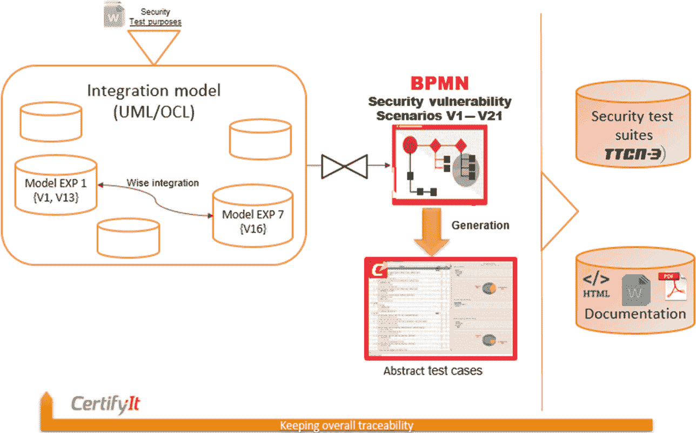

图 10 端到端安全 MBT 描述。

### 5.1.1 MBT 模型

每个物联网系统都由生产者、消费者、一个物联网平台以及最终的安全服务、网关和/或嗅探器组成。实体通过消息请求（不同类型）进行通信，并通过消息响应对消息做出响应。这种我们称之为 `IoT MBT 通用模型`（Fig. 11）的通用模型可以从 MBT 工具（`CertifyIt`）自动创建。该模型可以针对物联网待测系统（SUT）进行定制，例如选择合适的名称、添加不同类型的消息交换、配置响应状态码、测试模式、删除不必要的模型元素等。

图 11 物联网 MBT 通用模型。

具体而言，oneM2M 是一个为机器机器（M2M）和物联网技术创建需求、架构、API 规范、安全解决方案和互操作性的全球组织。它通过标准组织联盟建立，拥有 200 多个成员组织，为 M2M/IoT 服务层产生并在全球范围内维护适用的技术规范。这些合作伙伴跨行业论坛或联盟进行协作。

正如消费者希望确保其个人和使用数据不被滥用一样，任何利益相关者也希望确保数据得到保护且服务得到安全交付。与传统的互联网不同，典型的物联网系统：

*   输入关于我们行为的信息，因此暴露了我们的隐私。
*   输出对环境的适应，因此影响了我们的安全。

安全是一条链，其强度取决于最薄弱的环节；因此，设备/服务的整个生命周期阶段都需要适当的安全保护。在 oneM2M 中，通信有三层保护：

*   `安全关联建立框架 (SAEF)`：相邻实体。
*   `端到端安全原语 (ESPrim)`：发起者托管平台。
*   `端到端数据安全 (ESData)`：数据生产者到数据消费者。

我们在用例中使用了一个符合 oneM2M 的平台（OM2M

图 12 集成的 MBT 模型。

以下是 `Exp1` 和 `Exp7` 集成产生并由模型实现的行为枚举：

1.  智能对象向 CM 请求其组密钥。
2.  CM 从请求载荷中提取实体的属性集，并生成与该集相关的组密钥。
3.  CM 向智能对象发送其组密钥。
4.  嗅探器拦截智能对象与 CM 之间交换的消息，并尝试读取组密钥。

模型还包含了测试断言（test oracles）。例如：如果嗅探器无法读取组密钥，则测试将是满。否则，测试将是不意的。

为了驱动测试生成，创建了一个 BPMN 模型（Fig. 13）。

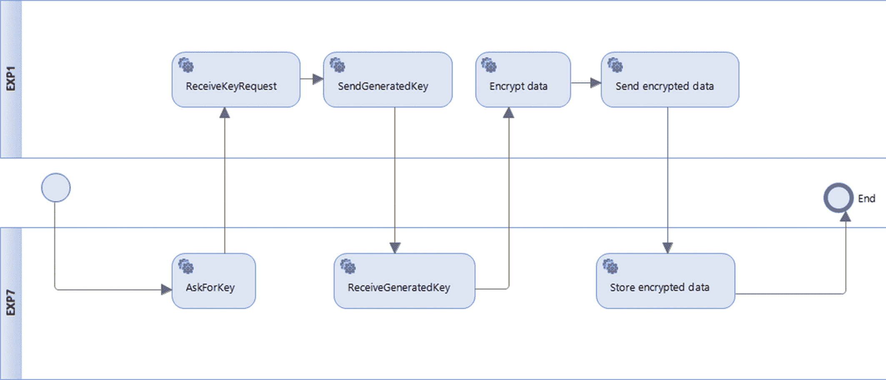

图 13 BPMN 模型。

BPMN 模型通过为 MBT（基于模型的测试）工具提供测试覆盖率的指导建议来驱动测试生成。BPMN 将确保对所需的业务场景进行测试：对从密钥获取到 IoT 平台中安全加密数据的整个流程进行端到端安全性测试。

一旦描述的所有 MBT 准备就绪，我们就进入测试用例生成步骤。

### 5.1.2 测试用例生成


# Section 4.1.2 为我们从模型角度视角测试用例的生成提供了一些初步见解

IoT 安全的 MBT 生成过程使用相同的原理，我们将研究方法扩展到 `CertifyIt` 工具内部的生成。BPMN 模型（图 13）允许生成一个与端到端安全场景相关的测试用例。生成的测试用例如图 14 所示所示。图 14 在其右侧显示了测试用例的细节。我们将 BPMN 模型中引入的步骤识别为：

1. 传感器向 `CM` 发送请求获取一个 `KEY`。
2. `CM` 接收请求。
3. `CM` 生成一个 `KEY` 并将其发送给传感器。
4. 传感器接收 `KEY`。
5. 传感器使用收到的 `KEY` 对数据进行加密。
6. 传感器将密钥发送给 `oneM2M` 实现。
7. `oneM2M` 实现接收到加密后的值。

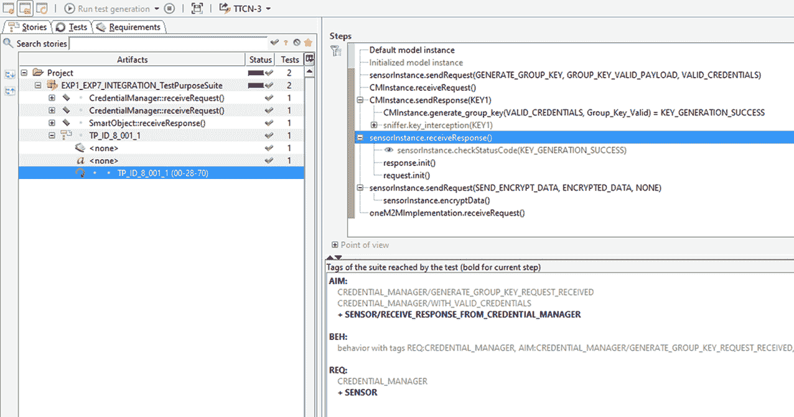

图 14 使用 MBT 工具进行测试用例生成。

生成的测试用例仍然是抽象测试，因为其中包含了从模型中提取的枚举值。例如，第四个测试步骤的测试断言是 `KEY_GENERATION_SUCCESS` 状态。所有枚举值都需要经过调整以获得具体的可执行测试。下一节将展示该过程是如何进行的。

## 5.1.3 测试用例具体化

在成功生成测试后，需要转换为目标语言（在 `CertifyIt` 术语中称为发布）。`CertifyIt` 中的默认发布器有 `XML`、`Junit` 和 `HTML`。`XML` 发布器是基础发布器，它将所有测试用例和其他模型数据转换为 `XML` 文件，然后该文件可以被其他发布器用于生成其他格式的测试。`JUnit` 发布器生成的测试可以通过胶接代码在 `Java` 中执行，即代码将作为 `SUT` 和 `JUnit` 测试之间的适配器，将抽象值转换为具体值。`HTML` 发布器主要用于文档目的，因为其输出仅仅是网页，显示了每个测试用例的所有步骤。`TTCN-3` 发布器的工作原理相同：`TTCN-3` 生成的测试与适配器文件相结合，其中定义了所有的类型、模板、函数和组件。然后，我们进入测试编译的下一阶段。`TTCN-3` 生成的测试示例如图 15 所示。它遵循从模型生成的 `TTCN-3` 结构。在后言部分，测试开始。`TTCN-3` 的前言部分用于配置。然后，我们进入测试编译的下一阶段。`TTCN-3` 抽象测试套件被连接到一个定义了所有类型、模板、函数和组件的适配器文件中。在正文部分，`send/receive` 指令是测试主体的一部分。`observer` 消息源自模型。

图 15 TTCN-3 抽象测试套件示例。

一旦获得了抽象测试套件 (`ATS`)，执行它就是下一步。为了实现这一点，需要通过编译器将 `TTCN-3` 代码转换为 `C++` 或 `Java` 等语言。`TTCN-3` 生成的代码如图 15 所示。其执行可以通过 `Titan` 进行控制，并在后续节中详细描述了 `SA` 和 `Codec`：

- 将 `TTCN-3` 编译为目标语言（`Titan` 使用 `C++`）。
- 添加目标语言的 `Codec`。

在研究范围内，我们展示了作为开源项目的 `Titan` 测试用例执行。

## 5.1.4 测试用例执行

测试过程的目标是在 `SUT` 上执行 MBT 测试，如图 10 所示。在我们的 `TTCN-3` 测试发布后，如图 16 所示，我们使用 `Titan` 编译器将其编译为 `C++` 代码。在该代码基础上，我们添加 `SA` 和 `Codec`。使用 `Titan` 生成的 `makefile`，我们可以将整个套件编译为可执行文件。其执行可以通过 `Titan` 通过配置文件进行控制。执行结束后，我们获得执行日志，其中包含每个测试用例的状态。测试用例的结果可以追溯到它们的测试目的和测试模式。

图 16 测试执行。

模块参数（缩写 `modulepars`）是 `TTCN-3` 规范中的一个功能。它们与常量相似，用于定义测试套件的参数。这些参数可以是 `SUT` 的地址、超时时间，或者根据 `SUT` 实现选择的某些细节。这些参数也称为测试实现额外信息 (`PIXIT`)。`Titan` 可以在其配置文件内部使用这些模块参数提供 `ATS` 的配置，而无需重新编译。在同一个文件中，用户可以配置 `SA`，例如它使用的 `UDP` 测试端口，通过该端口向测试系统发送或接收数据。

`TTCN-3` 在模块内部提供了一个完整的结构来控制测试用例的执行顺序。在控制部分，测试人员对执行拥有完全控制权。他们可以创建并启动多个并行运行的组件，并可以使用条件和循环来创建符合 `SUT` 或测试人员自身需求的测试套件执行。此外，`Titan` 通过在配置文件内部实现更高级别的控制，扩展了这种控制。

每个 TTCN-3 编译器都有权实现其自己的方法，以日志文件的形式存储测试执行结果。Titan 开源编译器默认使用爱立信（Ericsson）的专用日志格式，但其日志接口非常丰富，因此创建适应用户需求的新日志格式并不困难。Titan 中的日志功能可以产生各种详细程度的日志，以管理对控制台日志和日志文件的不同需求。可以通过设置 Titan 配置文件中的 `ConsoleMask` 和 `FileMask` 选项来配置日志参数，分别规定在控制台上显示和保存到日志文件中信息的级别。TTCN-3 对测试用例状态有严格控制。测试状态的五种不同值分别为“none（无）”、“pass（通过）”、“inconc（不确定的缩写）”、“fail（失败）”和“error（错误）”。每当测试用例启动时，其状态会自动分配为“none”。测试人员通过测试用例可以根据测试用例中定义的条件将其更改为“pass”、“inconc”或“fail”。为了防止失败的测试变为有效，当测试用例执行且状态设置为“fail”时，它不能回滚到“pass”或“inconc”。“inconc”也是如此，它不能回滚到“pass”。一个特殊的状态是“error”状态，它专门用于任何运行时错误，以区别于 SUT（被测系统）错误。

# 5.2 实验与结果

为了高效测试端到端安全场景，需要大规模测试框架是一个原始因素，因为它模拟了 IoT 服务的实际实现。用于大规模 IoT 安全测试的 MBT 测试框架（图 17）

图 17 用于大规模 IoT 安全测试的 MBT 测试框架。

在生成 MBT 测试用例并将其发布在 TTCN-3 测试脚本中后，它们被部署在 FIT IoT-LAB 中准备由 Titan 执行。Titan 将首先编译，然后适配，最后在 FIT IoT-LAB 内的 SUT 上执行测试用例。所演示方法的可行性结果已通过验证，大规模场景可以通过 ARMOUR 实验进行演示。我们可以测试 BPMN 场景中描述的完整事件链，并通过其集成的嗅探器记录测试平台中交换的消息。嗅探器显示，交换的消息大部分（92%）未经过加密。这一结果被进一步用于对 IoT 部署的安全性进行基准测试。我们的实验可以安全地评估传感器与 IoT 平台之间传输的数据是否经过加密。要得出该部署是安全的结论远非最优。我们将在下一节中讨论更多关于如何利用我们的结果对 IoT 部署进行基准测试的细节。

# 5.3 教训

ARMOUR 内完成的实验的主要目标之一是定义一种在大规模 IoT 部署实验中对安全信任技术进行基准测试的方法。在这方面，为 IoT 相关利益者提供工具以评估其系统应对 IoT 安全威胁的准备程度是非常有必要的。基准测试是解决这一问题的典型方法，ARMOUR 将通过构建 ARMOUR 大规模测试框架和流程，为大规模 IoT 中的端到端安全建立安全基准。此外，ARMOUR 实验将使用 ARMOUR 基准测试方法进行基准测试。将考虑多个维度，包括：

* 安全攻击检测。
* 对攻击和异常行为的防御。
* 使用可信源和通道的能力。
* 安全和信任一致性水平等。

将对大规模 IoT 安全和信任解决方案的实验进行基准测试，并将结果数据集将通过 FIESTA 提供：

* 考虑 ARMOUR 中定义的针对 IoT 识别出的威胁和漏洞的通用测试模式和测试模型，以及基于前一个用例提供测试生成的测试程序。
* 为每个功能块（身份验证、数据安全等）识别指标，以便在目标部署上执行各种微基准测试和宏基准测试场景。
* 从评估中收集指标，然后使用这些指标将它们分类（分类法）到不同的功能方面，并在此基础上提供一种安全评估的标记方法。

微基准测试（Microbenchmarks）提供了理解智能对象相关系统性能的有用信息。微基准测试有助于识别架构层面可能的性能瓶颈，并允许嵌入硬件和软件工程师比较和评估与组件级设计相关的各种设计权衡。宏基准测试（Macrobenchmarks）提供与应用层特定功能相关的统计，可能由多个协同工作的组件级元素组成以执行应用层任务。最终目标是提供安全基准和保证，这应该包含我们对结论的置信程度的衡量。作为用于评估 IoT 产品或系统安全性的此类置信度衡量示例，我们提到了共同准则（CC）的评估保证级（EAL）。EAL 是在完成 CC 安全评估后分配给 IoT 产品或系统的离散数值等级（从 `EAL1` 到 `EAL7`），CC 安全评估是自 1999 年以来生效的国际标准。这些不断增加的保证级别反映了必须满足增量保证要求才能获得 CC 认证的实事。较高保证级别的目的是具有更高水平的置信，确认系统的安全功能已可靠地实现。EAL 级别并不衡量系统的安全性；它只是说明了系统在什么水平上进行了测试。EAL 包括以下：

* `EAL 1` 功能性测试。
* `EAL 2` 结构化测试。
* `EAL 3` 方法化测试和检查。
* `EAL 4` 方法化设计、测试和审查。
* `EAL 5` 半形式化设计和测试。
* `EAL 6` 半形式化验证设计和测试。
* `EAL 7` 形式化验证设计和测试。

# 6 用于 IoT 健壮性测试的在线 MBT

健壮性测试或模糊测试（fuzzing）为软件提供许多类型的有效和无效输入，使其进入不可预测的状态或泄露机密。它通过自动生成输入值并将其馈送软件包来工作。模糊测试可以使用不同的输入源。运行测试的开发者可以提供输入值的长列表或短列表，并编写生成输入值的脚本。此外，模糊测试软件可以随机或从规范生成输入值；这被称为生成模糊测试（generation fuzzing）。传统上使用的模糊测试结果显示它对发现安全漏洞非常有效，但由于其固有的随机性，结果很大程度上取决于模糊系统的初始配置。

> “实用基于模型的测试：工具方法”

对于在线 IoT 健壮性测试，`MBeeTle` 是一个旨在结合 MBT 和模糊测试的特定工具。`MBeeTle` 是基于 CertifyIt 技术的独立工具，其目的是为模糊测试随机生成测试用例。

我们在使用基于模型的 `MBeeTle` 等工具进行模糊测试方法的经验显示了几个优势，例如：

* 启动模糊攻击只需要少量的初始配置。
* 对模糊测试（fuzzing campaign）所需的监督最少。
* 唯一性确定通过智能回溯分析处理。
* 自动化测试用例最小化减少了分析结果所需的精力。

该方法与其他基于模型的测试（MBT）方法互补，由于其随机性，可以揭示意外的行为。

## 6.1 IoT 健壮性测试的 MBT 特性

IoT 健壮性测试的 MBT 模型基于用于安全功能和漏洞测试的相同 MBT 模型；它通过行为模糊生成测试用例。与前两种方法不同，前两种方法的测试用例生成旨在涵盖从测试目的产生的测试目标，而 `MBeeTle` 模糊工具生成加权随机测试用例，根据系统的预期行为来覆盖测试目标。该工具依赖于原理：使用加权随机算法，在每个周期内快速生成尽可能多的包含大量步骤的模糊测试。生成的测试符合 MBT 模型中的约束。因此，与大多数模糊器不同，生成的测试用例在语法上对于系统输入是正确的。另一方面，由于它使用了加权随机算法并测量行为覆盖率，它避免了生成测试用例的重复，这使得测试评估和评价变得更容易。这种 MBT 模糊测试的另一个优势是它的快速，而且与经典的功能测试方法不同，它在各种不常见的范围内探索系统状态，并可能将系统置于失败状态。图 18 在高层面上描述了测试生成算法。每一步覆盖一个测试目标，该目标对应于模型中识别的行为，通过具有特定预定义标签 `@REQ`/`@AIM` 的操作中的 `OCL` 表达式来标识（如图所示）。步骤的生成是通过随机选择从系统给定上下文中可能导致错误的可用状态来实现的（例如，当普通用户连接调用管理员操作时开始探索系统行为）。更具体地说，只有当测试步骤激活了新行为（标签）时，才会选择该测试步骤，否则算法将继续探索以构建一个激活新标签的测试步骤。测试生成在分配给生成引擎的生成时间耗尽或满足用户条件（例如，模型中的所有标签都被覆盖，或接收到停止信号）时停止。

图 18 行为模糊测试测试步骤选择。

此外，MBT 模糊测试是功能和安全（功能和漏洞）测试的互补方法，提供了多重益处：

- 它激活了领域专家未知的罕见上下文下的行为，这些可能导致系统失败。
- 它能快速生成测试，由于算法是随机的，它们速度极快，并向用户快速发送反馈（几分钟内生成数百个测试）。
- 它重用了用于功能测试和安全测试的相同 MBT 模型。
- 它重用了相同的适配层，因此执行测试用例时不需要额外的精力。

## 6.1.1 MBT 模型

MBT 模糊工具（`MBeeTle`）使用了与功能测试和安全测试相同的模型，如 3.1 所示。在技术层，模型没有改变，这对于可重用性非常重要。

## 6.1.2 测试用例生成、实例化与执行

MBT 健壮性测试或 MBT 模糊测试使用在线测试生成。在线生成包括直接在 SUT（被测系统）上执行生成的测试。对于每个生成的步骤，工具都会等待其结果。如果结果不是模型预期的，生成将中断。图 19 描述了在线生成方法论。

图 19 在线生成方法论。

为了用自身的语言和协议与 SUT 通信，在线生成器将其生成的测试步骤发送到适配层，适配层将测试翻译为可执行步骤。在 SUT 上采取的每个操作的结果都会回溯到生成器，根据上一步的状态决定是继续通过探索模型生成还是中断过程。

## 6.2 未来工作

所引入的方法非常新，截至 2017 年 4 月，之前描述的 `ARMOUR` 项目中的验证仍是一项性工作。主要目标在大规模测试平台 `FIT-LAB` 上对 MBT 健壮性测试进行实验。因此，根据获得的结果，我们可以断定该方法在实时大规模部署中的有效性。

# 7 服务化模型测试

如今 IoT 平台倾向于具有显著面向用户应用程序的服务。IoT 平台的测试和验证问题可以使用相同的“服务”方法来解决。本节介绍了服务化模型测试（`MBTAAS`）方法的通用架构。然后我们将详细介绍每个服务如何独立运行、执行和展示测试/结果。

## 7.1 MBTAAS 架构

架构概述可以在图 20 中找到，其中包含了 MBT 方法的四个主要步骤（MBT 建模、测试生成、测试实现和执行）。

图 20 MBTAAS 架构。

然而，与经典的 MBT 过程不同，`MBTAAS` 实现了多个相互通信的 Web 服务以实现测试步骤。Web 服务使用 Web 技术（如 `HTTP`）进行机器间的通信，更具体地传输机器可读的文件格式，如 `XML`^[1]

<a name="fn1"></a>

[1] 可扩展标记语言。

除了经典的 MBT（基于模型的测试）流程外，该架构的核心部分是数据库服务 ①，它被所有其他服务使用。在逐一描述每个服务时，将详细说明它的参与情况。尽管如此，数据库服务可以与所有其他服务分离，并运行在易于访问的云端。数据库存储关键信息，例如测试数据（执行测试的输入数据）和测试结果。系统的入口是 Web 前端服务（定制化服务）。该服务接收用户输入以定制测试会话，并将其通信给发布服务 ②。发布服务的目的是收集 MBT 结果文件和用户自定义数据，以生成一个定制化的测试描述文件（`EGM_TAAS file`）。随后，该文件被发送到执行服务 ③，由它控制定制化测试的执行。它通过输入数据刺激 SUT（被测系统），以获取其响应作为 SUT 的输出数据。最后，执行服务构建一个结果响应，并将其发送给最后一个服务，即报告服务。报告服务被配置为将测试结果馈送数据库服务。这些测试结果会被 Web 前端服务使用，并提交给终端用户。这种测试架构在模块化级别执行，以响应物联网（IoT）平台的异构性。在后续章节中，将提供每个服务的详细描述。

## 7.2 定制化服务

为了提供用户友好的测试环境，MBTAAS 实现了一个图形化 Web 前端服务来配置和启动测试任务。定制化服务是一个网站，已识别的用户拥有私有的仪表板。该服务提供预配置的测试环境。用户输入可以减少到最低，即：定义一个 SUT 端点（URL）。用户特定的测试定制为测试任务提供了广泛的调整。该 Web 服务实现了：

- **测试选择**：从建议的测试用例中，用户可以选择只执行其中的一部分。
- **测试数据**：使用预配置的数据进行测试。用户可以将自己的特定测试数据添加到数据库中并在测试时选择它。这是一项每个测试可配置的功能。
- **报告**：默认情况下，报告服务会将结果存储在 Web 前端服务的数据库中（更多细节请参见第 7.5 节）。可以更改默认行为以适应用户需求，例如将结果存储在另一个数据库或工具中。

完成测试配置并点击启动测试按钮后，将构建一个配置文件。如图 21：配置文件摘录 所示，配置文件定义了一组 `{key = value}`。该文件使用默认值构建，且这些默认值可以被用户定义的值覆盖。

图 21 配置文件摘录。

配置文件是发布服务生成测试任务所需的三个组件之一。下一节将更详细描述发布过程。

## 7.3 发布服务

发布服务顾名思义，将模型生成的抽象测试发布到具体的测试描述文件中。它完成任务需要三种不同的输入（图 20）：模型、配置文件和测试数据。模型提供了包含抽象测试的测试套件。抽象测试的具体化通过数据库和配置文件的帮助来实现。例如，从模型中提取抽象值 `ENDPOINT_URL` 是从配置文件收集的。


这种方法生成的具体的测试描述文件是一个实例化抽象测试的 XML 文件。测试描述文件包含两个主要部分：通用信息和至少一个测试套件（图 22）。测试套件由一个或多个测试用例组成，而测试用例本身由一个或多个测试步骤组成。这种层级结构遵循 IEEE 829-2008 软件和系统测试文档标准。

图 22 发布文件部分。

文件的通用信息部分对于执行测试（第 7.4 节）和报告结果很有用。以下是该文件部分可以找到的一些重要参数：

- **Owner**（所有者）：用于追溯目的。它允许人们知道测试的所有者，以便在其个人云仪表板中展示它。

- **Sut_endpoint**：SUT 的主机名/IP 地址。从执行服务的角度来看，该地址应该是可用的。

- **Location**（位置）：报告服务的主机名/IP 地址（第 7.5 节）。

测试套件包含了所有信息。在这种，物联网平台提供了基于 HTTP 的 RESTful 应用。成功 RESTful 查询所需的强制信息是 `URL`（SUT 端点）和 HTTP 方法（`GET`、`POST`、`DELETE`）。测试套件和测试用例的作用是排序和命名，但测试信息和数据存储在测试步骤中。每个测试步骤都有自己的配置。

## 7.4 执行服务

执行服务是 MBTAAS 架构的功能核心。执行服务将根据接收到的测试描述文件的配置运行测试并收集结果。FIWARE RESTful 接口通过 REST 模块执行。每个测试针对 SUT 执行，并在测试完成后构建一个结果报告（列表 1）。结果报告包含日期、执行步骤的时间以及某些其他特定值。`endpoint` 代表应该运行步骤的 URL 值。无效的端点将允许跳过对端点值的检查，从而允许获取执行结果。每个步骤的响应在 `assertion_list` 标签（测试断言）中进行验证。它根据接收到的响应验证每个断言的类型和值。

Fig. 23 显示了执行服务的日志片段。为了执行一个测试步骤，必须验证端点（URL）。然后，创建并执行一个 RESTful 请求。预期获得响应以便评估断言。最后，计算总的测试结果。总的断言评估算法非常简单：“所有测试断言都必须为真”，这意味着如果其中一个断言为假，则该测试被标记为失败。

图 23 执行快照。

一旦执行服务完成所有测试步骤，它们的结果将被汇总到一个文件中，该文件被称为测试结果，并被发送到报告服务。

### 7.5 报告服务

执行测试后，一个包含测试描述和结果的文件会被发送并由报告服务接收。报告服务的配置在 Web 前端服务上完成。该配置随测试配置文件一起传递，发布者服务将这些信息重写到发送给执行服务的文件中。随后，执行服务将报告配置包含在报告文件中，报告服务一旦接收后就会使用它。默认情况下，报告服务会将结果保存在数据库服务 ①。对于这种用例，数据库实现为 `MySQL` 数据库。该数据库随后被 Web 前端服务使用，向用户展示测试结果。

MBTAAS 已证明其通用性足以以便以较少的努力集成到 IoT 合规性、安全健壮性测试中。

## 8 经验教训与讨论

本章介绍的工作和结果是 IoT 系统测试 MBT（模型驱动测试）领域内多项工作的结合。我们展示了适用于 IoT 平台合规性和安全测试的 MBT 方法的能力。其应用结果对于推进工作并将其引入服务层是令人鼓舞的。

应用 MBT 的初始成本通常很高，原因在于：(i) 在模型设计上花费的时间以及 (ii) 首次实现用于测试执行的适配层，这取决于被测系统（SUT），且可能非常复杂。如果我们考虑到项目需求和规范在开发周期中可能会演变，那么实施 MBT 的这种高初始成本是可以获得回报的。在后的情况下，IoT 平台的 MBT 可以保持测试库的稳定。这让我们得出结论：MBT 是适用于新兴技术和标准的合适方法，特别是在成熟度仍在提高而技术开发仍在进行的 IoT 平台上。正如我们所做的那样，能够自动且系统化地生成测试，使得构建涵盖定义的测试目标的测试套件成为可能。MBT Further 提供了将结果格式化为自动化报告的手段，以证明测试目标的覆盖率，这可以很容易用于认证和标记目的。这些示例展示了在应符合特定标准的应用中，自动化和系统地使用 MBT 方法的用处。从安全角度来看，新漏洞的出现速度快于安全专家预测的速度，MBT 允许以很小的代价将新的漏洞模式集成到正在进行的测试活动中。结合通过面向服务的解决方案提供的用户友好且易于访问的界面，MBTAAS 的首次实验表明它是非常有前景且强大的工具。服务方法的重用性是其采用的一个强大且可靠的因素。唯一需要做的更改涉及测试环境和适配层，以兼容任何被测试的 IoT 组件。一个主要的关注点是以最简单的方式将测试提供给社区。它让所有人（而不仅仅是测试人员）都有能力通过在线服务测试他们的组件。该服务为用户提供了一个测试友好的接口，简化了测试执行工具的安装以及与系统不兼容（如网络访问问题）相关的各种技术挑战。

新引入 MBT fuzz 方法并不遵循标准的模糊测试方法。它在 IoT 测试中的目标是广泛利用 MBT 模型生成随机测试步骤，从而确保对需求覆盖进行更深入的探索。在这个过程中没有格式错误的测试步骤。目标是确保被测 SUT 在其生命周期内具有正确的行为，因为它能够实现长时间的压力测试。这种新方法尚未在大规模测试平台中证明其有效性。

## 9 结论

本章介绍了 IoT 系统 MBT 的前沿技术，并描述了针对 IoT 测试的特定挑战和 MBT 解决方案。

具体而言，它通过真实用例回答了解决 IoT 可扩展性、互操作性和安全性的关键挑战。我们提出的解决方案具有通用的执行方法：`MBTAAS`。用于 IoT 合规性测试的 MBT 表明，在生成测试用例以验证 SUT 符合其标准的正确行为时，其特殊性在于模型创建。在这种情况下，模型是标准的表示。在 SUT 上执行的任何失败的测试都可能代表规范与实现之间的差距，或者 SUT 对其所实现的标准的合规情况。用于 IoT 安全测试的 MBT 与传统的 MBT 设置不同，它具有特定的测试用例具体化环境。最后，我们对 IoT 健壮性测试 MBT 方法的特殊性有了初步了解。它说明了如何将 MBT fuzzing 应用于 IoT 系统。我们提供的工具使得在功能/安全测试阶段重用已创建的模型成为；因此不需要在建模上花费额外时间。这种方法被认为是安全或合规性测试的补充，因为我们预计检测到的不一致之处将与其他不同。

提供未来标准的标准化机构和认证实体认为测试过程具有最高意义。它们为标准实施者提供一组测试用例，以评估产品的合规性、可扩展性和安全性。执行后的测试用例追溯也是一个主要因素，因为它用于基准测试结果。随着安全威胁不断演变，为了保持高信赖和信任，提出的测试用例必须不断维护。这就是 MBT 发现其兴趣和附加价值的地方。

用于测试用例生成和执行的基于模型的测试（MBT）方法较新。与 10/15 年前相比，它现在变得越来越受关注和认可。由于建模的难度很高，这种方法以前仅限于少数用例。建模需要具有高技能的测试人员，而当时该职业在软件行业并不常见。只有极少数关键的公司才有权对其概念进行建模以进行测试。

物联网（IoT）领域如今达到了这一关键水平。安全入侵比以往任何时候都复杂，发生频率也比我们想象的要高。为了配合物联网领域的发展，对质量保障的需求至关重要。通过 MBT，安全威胁的演变被加入模型中，并通过这一过程在测试生成过程中被考虑。如果不是从零开始，该过程可以节省时间。一致性测试的模型是可重用的，并适用于安全测试。

MBT 在中期显示出其优势，因为它的初始成本很高，这也是阻碍 MBT 采用的最障碍之一。MBT 方法需要高技能的测试人员，而且改变该领域测试人员的日常习惯非常复杂。它需要大量的时间投入，而大多数人并不愿意参与。采用 MBT 方法的另一个障碍是现有工具的复杂性。尽管如此，MBT 仍然相对新，我们看到越来越多的工具涌现。然而，这些工具在实际使用中需要高度的培训和技能。测试生成工具非常复杂，且测试生成的复杂性可能会消耗大量时间（NP 完全完成问题）。未来，MBT 方法需要重大的演进才能生存并实现采用率的上升。工具制造商已经开发了新技术，如第 6 节所示，`MbeeTle` 是新兴的在线测试工具之一，响应了对物联网部署中的测试用例进行实时分析的需求。这种新工具允许实时系统中的非确定性丢失。

## 结论

总结来说，自动化基于模型的测试用例生成技术已经成熟到该技术的大规模部署正成为常态。成功的先决条件（如测试团队的资质、集成工具链的可用性和方法）现在已经明确，并且正如本章介绍的，大量的商业和开源工具已可用。尽管 MBT 不会解决物联网领域的所有测试问题，但它非常有用，并在功能软件测试有效性、提高生产力和提高功能覆盖率的实践水平方面带来了巨大进展。此外，MBT 方法通过引入一致性、安全性和健壮性测试的便捷访问，展示了其在物联网中的重要性。该技术不断演进，使其对测试人员更加友好，并显著降低了通常存在的高初始成本。由于测试人员更容易上手，以及与大规模物联网测试平台更细粒度的集成，MBT 应该会有更高的认可率。

## 致谢

本研究受到 Horizon 2020 Call ICT-12-2015 Integrating experiments and facilities in FIRE+ ARMOUR 项目 Grant ID 688237 的。我们感谢 Cedric ADJIH 博士、José Luis Hernández RAMOS 博士以及 Sara Nieves Matheu GARCIA 与我们分享他们的宝贵见解。

## 参考文献

1. `DDoS Attack Report.` 2017. `http://www.computerworld.com/article/313544/security/ddos-attack-dyn-from-100000-infected.devices` `http://www.computerworld.com/article/313544/security/ddos-attack-dyn-from-100000-infected.devices` (最后访问于 2017 年 4 月)。

3. `Baldini G.`, `Skarmeta A.`, `Fourneret E.`, `Neisse R.`, `Legeard B.` Security and labelling in Internet of Things. In:2016:627–632. 3rd World Forum on Internet of Things (WF).

5. `Capgemini.` World Quality Report 2016-17.

7. `Utting M.`, `Legeard B.` Practical Model-Based Testing—A Approach. San Francisco, CA: Morgan Kaufmann; 2006.

9. `Hartman A.` Model-Based Testing. Agedis. `000.based0.com/. `http://modelbasedengineering.com/`.

10. `Banik C.`, `Seceleanu R.`, `M M.` Systematic Review of Model-Based. In:F01

11. `Shiqueique M. ` `Ba Y Y.` Online of--......................................010.

14. `Schneider M.`, `Bouquet F`, `Vernotte A.`.` in Computers. In:2015;9035.

15. `E.S. Model-Based Testing (MBT) at InterConnect 2016. Yes! `https://www.ibm.com/developerworks/blogs/35dfcb99-11b-423a-aaa4-50f3ddae41/entry/Model_Based_Testing_at_InterConnect_2016?lang=en`, (最后访问于 2017 年 3 月 6 日)。

18. `Schneider M.`, `Gromann J.`, `Schieferdecker I.` Model-Based Security Testing. In:2012:1–12. doi:10.4204/EPTCS.80.1. MBT..

20. `Kriouile A.`, `Serwe W.` Using a formal model to improve verification of a cache-coherent system-on-chip. In:Baier C., `Tinelli C.`, eds. Tools and Algorithms for the Construction and Analysis of Systems. Berlin, Heidelberg: Springer; 708–722. Lecture Notes in Computer Science. 2015;vol.9035.

21. `Schneider M.`, `Gromann J.`, `Schieferdecker I.`, `Pietschker A.` Online model-based behavioral fuzzing. In:2013:469–475. 2013 IEEE Sixth International Conference on Software Testing, Verification and Validation Workshops..

- [23] Larsen K.G., Pettersson P., Yi W. UPPAAL 简介。*Int. J. Softw. Tools Technol. Transfer.* 1997;1:134–152.

- [24] *Eclipse 形式建模项目.* 2017. [`projects.eclipse.org/proposals/eclipse-formal-modeling-project`](https://projects.eclipse.org/proposals/eclipse-formal-modeling-project) (访问于 2017 年 4 月)。

她在法国国立计算机科学与自动化研究研究所（INRIA）纳西获得了安全关键系统模型化回归测试领域的计算机科学博士学位，并在法国贝松的弗兰克科特大学获得了软件验证与确认硕士学位。

**Bruno Legeard** 是 UBFC、Institut FEMTO-ST 的教授、科学顾问以及 Smartesting 的联合创始人。Bruno 在基于模型的测试/基于模型的安全测试（MBT/MBST）及其在行业内的引入方面拥有超过 20 年的专业知识。他的研究活动主要涉及使用 AI 技术实现基于模型的测试用例自动生成的特性。他的研究成果涵盖了基于 MBT 和 MBST 的 100 多篇科学和工业出版。他编写了三本在行业内推广基于模型测试的书籍，其中《实用基于模型的测试》被引用了 1200 次以上。

***

# 第二章

# 软件模型检查的进展

Junaid H. Siddiqui; Affan Rauf; Maryam A. Ghafoor

拉基尔管理科学大学，巴基斯坦 Lahore

## 摘要

社会对软件的依赖日益增加，导致软件故障的成本不断上升。同时，软件变得愈发复杂，测试和验证也变得越来越困难。软件模型检查是一系列自动检查软件模型中属性的技巧。这些属性可以使用专门语言编写，也可以以异常或断言的形式嵌入软件中。模型可以显式地通过规范语言提供，可以从软件系统中推导出，也可以直接使用软件本身作为模型。软件模型检查器在模型的大量状态下检查给定属性。如果模型检查器能够在所有模型状态上验证某个属性，则证明该属性成立，模型检查器的作用类似于定理证明器。如果模型检查器无法在所有模型状态上验证某个属性，它仍然是一种高效的自动测试技术。

本章讨论了软件模型检查的进展，重点关注将软件本身作为模型，并将嵌入的异常或断言作为待验证属性的技巧。由于这些技术对程序员的开销极小，且近期研究进展使得这些技术具有扩展性，它们在未来十年内最有可能在软件行业得到广泛应用。

### 关键词

模型检查；符号执行；边界模型检查；显式状态模型检查；基于抽象的模型检查；安全属性；活跃性属性；调度不确定性；输入不确定性；并发系统

## 1 引言

随着软件渗透到我们的社会和生活中，对软件可靠性的需求日益增长。随着计算机控制飞机和运行金融市场，即使是单次软件故障的成本也可能非常高。故障每年给美国经济造成了 595 亿美元的损失。

随着软件复杂性的指数级增长，手动测试的有效性变得越来越低。商业软件在发布时往往带有大量的已知 Bug。手动测试只能覆盖软件可能处于的极少数状态。

软件的形式化验证力求通过数学方法表述验证问题并解决它。实现这一目标有两种基本方法：使用定理证明和使用模型检查。

定理证明试图在程序员的帮助下构建系统正确性的形式证明。例如，循环不变式是由程序员推导或提供的，无论循环迭代次数，这些不变式都保持真。定理证明器使用这些不变式来证明系统的属性。本质上，这些属性被证明对于系统的每一个状态都是成立的。然而，定理证明被限于小型程序，并且通常需要程序员提供大量且费力的输入。

另一方面，模型检查在模型的大量状态下检查给定属性。如果模型检查器能够在所有模型状态上验证某个属性，则证明该属性成立，模型检查器的作用类似于定理证明器。如果模型检查器无法在所有模型状态上验证某个属性，它仍然是一种高效的自动测试技术。

（注：原文中存在大量重复段落，已根据要求进行去重处理，保留了核心逻辑结构）

### 1.1 属性

软件系统中待检查的属性可以大致归类为安全属性（Safety properties）和活跃属性（Liveness properties）。

在综述中，我们将重点关注安全属性。安全属性可以表述为可达性问题。程序中的特定错误位置（例如程序员插入的 `assert` 语句）代表坏状态。如果我们保证某个 `assert` 语句是不可达的，我们就证明了程序满足某个安全属性。

在边界模型检查中，我们验证安全属性在边界状态内成立，但我们无法证明这些属性在通用情况下成立。在符号模型检查中，我们验证安全属性在通用情况下成立，但如果发现违反，我们并不总是能证明该违反对于特定系统是真实的。

### 1.2 可靠性与完备性


# 安全属性验证的可靠与完备算法

安全属性验证的可靠算法会将相对于某安全属性是真正安全的程序声明为安全的。安全属性验证的完备算法会将所有相对于某安全属性是真正安全的程序声明为安全的。由于停机问题的不可判定性，没有任何既可靠又完备的算法可以通用地解决验证问题。

程序在执行过程中会改变其状态，通常是以确定的方式进行的。然而，在执行条件语句时，程序状态可能会以两种不同的方式改变。程序的输入间接决定了一个或两个分支是否可行执行。这被称为**输入不确定性**（input nondeterminism）。此外，对于并发程序，如果有 `n` 个活动线程，状态可以通过 `n` 种不同的方式改变。这被称为**调度不确定性**（schedule nondeterminism）。

从根本上说，针对调度不确定性和输入不确定性的状态搜索是相同的。然而，剪枝等效状态或使用符号状态（代表多个具体状态）的技术在两者之间是不同的。传统上，关注调度不确定性的技术被称为**模型检查器**（model checkers），而以符号方式关注输入不确定性的技术被称为**符号执行工具**（symbolic execution tools）。传统的模型检查器通过探索所有给定的输入选择来处理输入不确定性，而不进行符号抽象，这会导致状态爆炸。

# 2 显式状态边界模型检查

有界模型检查在某些范围内检查被测系统的所有状态。这些状态是具体的或显式的，即程序可能处于实际状态。对于任何带有循环的程序，显式状态模型检查必须是有界的，因为带有循环的程序的显式状态数量是无限的。模型检查是对程序状态和转换构成的图的搜索。对于并发系统，它处理所有可能的进程交替的探索，这对于较大的进程集会导致状态空间爆炸。通常，并发事件通过探索相对于每个进程的所有可能的事件交替来建模，这导致了具有许多状态的条路径的大量路径。每条路径代表一种唯一的进程交替。搜索状态空间有两种基本技术：无状态（stateless）和有状态（stateful）。

## 2.1 有状态搜索

在有状态搜索中，会显式构建并探索程序状态和转换的图。由于有界搜索的限制，该图是有限的。如果没有状态到达错误位置，则验证了给定的安全属性。

有状态搜索维护一个状态列表，并在每次迭代中从列表中取一个元素并对其应用下一个转换。更新后的状态或多个状态会被加回。从列表中选择下一个元素决定了使用深度优先还是广度优先技术。许多模型检查器使用基于启发式的选择，倾向于探索新的代码行以预期发现故障。

即使在很小的范围内，状态数量也会呈指数增长，产生的问题被称为**状态空间爆炸**。处理状态数量是模型检查中的关键挑战之一。为了减少状态数量，会找到等效组，使得组中任何状态的 bug 都会反映在该组的所有状态中。实现此点的两种主要技术是对称消除和部分序还原（`POR`）。

## 2.2 对称消除

对称性消除技术通过识别进程顺序、通信顺序和规范结构中的对称性，来识别状态的等效类，其中一个代表状态就足以发现等效类中任何状态的 bug。

## 2.3 部分序还原

`POR` 是一种优化技术，它利用了许多路径是冗余的这一事实，因为它们是由于不同顺序执行独立转换而形成的。另一种理解它的方法是考虑许多并发操作是可交换的，即它们产生相同的状态。`POR` 是识别并剪枝将产生相同状态的转换。包含状态比较以避免重复状态的模型检查器仍然受益于 `POR`，因为它可以尽早排除转换，而不是生成并比较状态。

模型检查器采用 `POR` 来避免对调度的不必要探索。`POR` 通过缩小模型检查软件要搜索的状态空间的大小，解决了并发系统的状态爆炸问题。

## 2.4 基于执行的搜索

**Verisoft** 引入了基于执行的模型检查。

基于执行的搜索的优势是，发现的任何错误状态都带有一个到达该错误的完整执行轨迹、输入和调度。此外，不需要将软件翻译为建模语言或将编程语言语义翻译为转换。

基于执行的模型检查器主要使用从外部测试套件生成的输入（使用另一种技术自动生成或手动生成），并在这些输入上执行不同的调度。模型检查器不探索输入选择，因为这会产生大量的状态。高效地覆盖输入域需要使用符号状态，例如使用符号执行。

基于执行的模型检查器的关键挑战是存储状态。由于是基于执行的，它们的状态是整个程序状态。**Java PathFinder** (`JPF`) 通过在自己的虚拟机上执行字节码来解决此问题。

## 2.5 无状态搜索

Verisoft 还引入了无状态搜索的想法。无状态搜索不是显式地存储状态列表并对状态应用一次转换，而是通过强制程序按照特定的调度来工作。在每个不确定性选择处（例如线程调度或用户输入），执行程序都会查询调度器，调度器提供调度中的下一个数字，即活动线程有限域内的整数或输入值有限域内的值。

执行完成后，通过有效递增上一个调度形成下一个调度。最后一次不确定性选择会被更改，如果选择耗尽，则更改倒数第二个不确定性选择。最终，所有选择都会被探索。

与基于执行的类别中的其他工具一样，Verisoft 无法在实践中探索输入域，因为这会产生大量的状态。它专注于探索输入调度。

无状态搜索的关键优势是对状态存储的要求最低。然而，主要的缺点是无法识别重复状态，或无法适应复杂的启发式搜索顺序（这在显式存储状态时是可能的）。

## 2.6 工具与最新进展

第一个带有有状态搜索的著名显式状态模型检查器是 **SPIN 模型检查器**。

Verisoft 引入了无状态基于执行的模型检查。它观察使用进程间通信（`IPC`）原语通信的进程。通过拦截对 `IPC` 原语的调用，Verisoft 调度器能够影响不同进程执行调度。

`JPF` 是一个显式状态模型检查器，它通过从存活线程集中非确定地选择线程来探索线程的不同交替。为了探索所有可能的调度，`JPF` 在线程操作上使用选择生成器。`JPF` 根据对线程初始化和终止的调用生成调度，通过执行线程语句直到线程执行完毕。

`JPF` 在自己的虚拟机（`VM`）上执行应用程序的 Java 字节码指令。`JPF` 有监听器，当执行特定操作时 `VM` 会通知它们。这些监听器可以执行特定操作并/或进一步控制程序的执行。`JPF` 沿着所有可能的路径探索程序状态，每当到达路径终点时，它都会回溯以探索其他未探索的路径。

其他流行的基于执行的模型检查工具包括 `CMC` 和 `CHESS`。`CMC`（C 模型检查器）使用操作系统调度器来探索不同的交错执行。它对状态进行哈希处理以识别相似状态，尝试优先处理新状态。`CMC` 已成功用于在真实系统中发现缺陷。

**JPF-SE** 将符号执行集成到 `JPF` 中。

### 2.7 并行模型检查

**Stern 和 Dill** 的并行 `Murphi` 使用工作窃取算法在多处理器上分配状态搜索。

**Lerda 和 Visser** 使用了类似的技术对 `JPF` 进行并行化。

**Dwyer 等人** 提出的针对 `JPF` 的并行随机状态空间搜索。

**范围模型检查**（Ranged model checking）允许在给定范围内并行探索状态空间。

### 2.8 其他领域的模型检查

模型检查也用于 **Web 应用**。

对于数据库操作的模型检查，**Paleari 等人** 提出了相关技术。

**Emmi 和 Majumdar** 研究了数据库事务的模型检查。

# 3 符号执行

在处理外部输入时，显式状态模型检查会产生许多不同但不必要的状态。例如，符号表达式 `x < 5` 代表所有 `x` 小于 5 的状态。显式状态模型检查器必须单独执行所有这些状态，即使这些状态在代码中执行的是相同的路径。

符号执行是一种使用符号状态处理程序输入的技术。在每个条件语句处，都会形成带有不同子句的符号状态。当程序结束时，状态中会包含程序执行路径上的每个条件语句的子句。

符号执行依赖 `SAT`（可满足性理论）或 `SMT`（模可满足性理论）求解器来解决每个状态中的子句集，也称为**路径条件**。求解路径条件是 NP 完全困难的，但基于启发式的求解器能够在合理的时间内解决大多数路径条件。如果到达错误状态的路径是解的，则发现了安全属性违规。

符号执行开发于三十多年前。

在过去的十年中，约束求解技术取得了巨大进展，特别是 `SAT` 和 `SMT` 求解器。

正向符号执行是一种在符号值上执行程序的技术。

**Program 1** 包含一个寻找三个整数中间值的函数。**Fig. 1** 显示了该程序的执行树，并展示了探索的六个路径条件。这些路径的每条路径条件都可以使用现有的 `SAT` 求解器针对执行特定路径的具体测试进行求解。例如，路径 2 可以求解为 `X = 1`、`Y = 3` 和 `Z = 2`。以下是所有探索的六条路径：

## Program 1：寻找三个整数的中间值

```
if (x < y) {
    if (y < z) return y;
    else if (x < z) return z;
    else return x;
} else if (x < z) return x;
else return y;
```

**图 1 `Program 1` 的执行树。**

```
Path 1: [X < Y < Z] L2 -> L3
Path 2: [X < Z < Y] L2 -> L3 -> L4
Path 3: [Z < X < Y] L2 -> L3 -> L4 -> L5
Path 4: [Y < X < Z] L2 -> L6
Path 5: [Y < Z < X] L2 -> L6 -> L7
Path 6: [Z < Y < X] L2 -> L6 -> L7 -> L8
```

### 3.1 有状态符号执行

**PREfix** 是早期的有状态符号执行工具。

**KLEE** 是基于 LLVM 的符号执行引擎，广泛用于测试生成和漏洞发现。

### 3.2 无状态符号执行

就像有界模型检查技术一样，符号执行可以在无状态工具中实现。在无状态的执行方法中，状态包含了每个变量的符号公式，以及像显式状态模型检查器那样的具体变量值。具体值满足相应的符号公式。每个程序语句的作用会在具体值和符号值上同时更新。当遇到条件语句时，程序按照具体值所引导的方向进行，并将条件子句添加到路径条件中。当执行完成时，最后一个子句被添加到路径条件中。

### 3.3 符号边界检查

扩展大型程序的模型检查是一项具有挑战性的问题。由于高级语言的复杂性，直接在源代码上应用模型检查变得困难。并发错误会通过几次上下文切换显现出来。因此，上下文边界工具限制了上下文切换的数量。顺序化是一种技术，它通过将控制非确定性替换为数据非确定性，将并发程序转换为等效的非确定顺序程序。

### 3.4 范围和增量符号执行

由于各种模型检查算法的性质，每次代码更改都会导致结果失效，必须重新运行分析。由于软件更改的速度很快，分析结果往往很快过时。然而，由于大多数代码保持不变，之前运行的大量工作可以被有效利用。增量技术尝试利用这种模式并使增量分析更快。

范围符号执行允许两个给定路径之间的符号探索。例如，如果给定之前示例中的路径 2 和路径 4，它可以探索路径 2、3 和 4。它只需要满足相应路径的具体解。因此，存储和传递路径是高效的。

相关技术与工具：
- **Green**
- **GreenTrie**
- **带记忆的符号执行**
- **Conc-iSE**

### 3.5 并行符号执行

最近的一些研究项目提出了用于并行符号执行的技术：
- **KleeNet**

### 3.6 符号执行的其他进展

- **混合协作测试** (Hybrid concolic testing)
- **分阶段符号执行**
- 针对 Alloy 模型的符号执行
- 数据库管理系统中存储过程的符号执行

后置符号执行（Postconditioned symbolic execution）试图通过新的冗余消除方法来缓解路径爆炸问题。在每个分支处，除了确定特定分支的可行性，它还会检查该分支是否被之前的探索所覆盖。

相关研究者：
- **Zou 等人**
- **Wang 等人**
- **Feist 等人**
- **Symbolic PathFinder**
- **Braione 等人**
- **Ibing**

# 4 基于抽象的模型检查

检查安全属性的基于抽象的模型检查执行抽象可达性分析。该分析是在抽象状态上进行的，这些状态捕获了程序部分而非全部的状态。每个具体的程序操作都变成一个抽象操作，执行真实程序中子集的效果。抽象状态可以通过从状态中移除变量或将这些值划分为不同的域（例如：正、零、负）来形成。抽象的目标是在保留与证明特定属性相关的变量的同时，使状态数量变为有限。

抽象模型检查在抽象状态和抽象转换的简化图上执行与之前讨论相同的模型检查算法。与显式状态模型检查不同，找到的反例（例如可达的错误状态）可能不是真实的反例。另一方面，如果在抽象图中无法到达错误状态，那么我们可以保证真实程序中无法到达该错误状态。因此，基于抽象的模型检查通常是完备的（sound）但并不完全。

最常见的形式是谓词抽象。

## 4.1 抽象细化

基于抽象的模型检查可能会返回伪反例。细化侧重于识别该反例在真实程序中是否真实。

过度抽象会增加发现伪反例的概率，而抽象不足会导致状态数量呈指数级增长。反例引导的细化技术（CEGAR）试图兼顾两者：从过度抽象开始，一旦发现反例，就寻找一种方法向状态中添加更多细节，使得该反例不再有效。因此，会根据需要增加精度。`CEGAR`（反例引导的抽象细化）。

## 4.2 工具与近期进展

`SLAM` 和 `BLAST` 是著名的模型检查器，它们使用了基于谓词的抽象和 `CEGAR` 循环。

- **SLAM**
- **BLAST**
- **CPAChecker**

其他基于抽象的模型检查器包括 **MAGIC** 模型检查器。

# 5 结论

软件模型检查在过去的几十年中取得了进展，从针对小型特定示例的研究想法发展到处理真实的大型程序并发现实际漏洞。基于执行的模型检查器允许将软件系统本身作为模型，而无需编写规范或将程序翻译为规范时进行易出错的翻译。此外，模型检查器可以使用程序员插入的断言作为安全属性的规范，从而消除了提供独立规范集的需要。

显式状态模型检查器在内存中保留显式的程序状态，而符号模型检查器保留一个代表多个显式状态的符号状态。无状态模型检查器通过回溯调度来执行所有程序状态，而有状态模型检查器则显式地在内存中保留所有待探索的程序状态。对称性消除和 `POR` 能够识别等效状态，从而在保持发现漏洞能力的同时减少状态数量。最后，抽象模型检查器将状态空间划分为有限数量的抽象状态，以便证明属性而不是专注于发现漏洞。反例细化技术试图识别在抽象状态中发现的是否为真实的程序漏洞。

软件模型检查在未来几十年中可能会获得更广泛的意义。它击中了兼顾完备性和完全性的定理证明、以及对两者都不兼顾的随机测试之间的“甜蜜点”。通过目标指向完备性或完全性之一，更重要的是遵循探索软件状态的系统过程，避免了许多与随机测试相关的任意性，并获得了大量的可扩展性。

软件模型检查仍面临状态空间爆炸和系统地探索大量状态的成本问题。然而，在过去的十年里，它已逐渐应用于更大更复杂的软件中，这一趋势在未来几年可能会继续。软件模型检查器的进展引入了启发式方法使搜索更有效，解决了扩展性问题（例如通过并行或增量化处理），或在特定情况下增加了完备性或完全性。软件模型检查现在能够验证非常大程序中的属性，并预计在未来几十年内集成到普通开发者的工具链中。

模型检查在软件行业未被广泛使用的特定原因包括分析所需的时间、假阳性和假阴性，以及模型检查对于需要外部交互的软件的局限。这些都是活跃的研究领域，其中扩展性受到最多的关注，因为它是最大的障碍。需要开发新的数据源以添加补充信息，从而引导系统搜索并使其更具扩展性。最近探索的一些想法包括从软件历史、漏洞库、注释和设计模式中获取提示。

除了扩展性外，软件模型检查的另一个关键挑战是用户界面检查以及与外部非确定源的交互。近年来在这一方面取得了进展，相关技术尝试验证用户界面、验证语言翻译对用户界面的影响，并以更确定的方式与外部系统交互（例如使用代理或记住过去的响应）。尽管取得了进展，带有外部接口的软件进行模型检查仍然是一个具有挑战性的领域，未来几十年可能会带来新的想法和更好的解决方案。

模型检查还需要追上新兴和复兴的软件范式，包括代理驱动、事件驱动和函数式范式。事件驱动近年来引起了最多的关注，特别是在网络系统背景下，但在处理可能的巨大事件序列以及系统地分离最重要的序列方面仍然存在挑战。

模型检查在可扩展性和新应用方面已不断增长，但尝试将各种模型检查方法相结合的研究寥寥无几。这可能是软件模型检查可扩展性及其在更大系统中应用实现本质改进的最具前景的方向之一。一个根本性的局限性是，研究人员通常专注于特定的模型检查技术，而模型检查技术已从编程语言和编译器设计社区、硬件模型检查以及作为许多编程语言演算基础的纯数学中借鉴了大量思想。需要一种更跨学科的方法，从多个领域汲取思想并保持统一关注，将软件模型检查提升到新的高度。

## 参考文献

[1] 美国标准与技术研究院. *软件测试基础设施不足的经济影响.* 2002 年规划报告 02-3.

[2] Woodcock J. 验证性软件大挑战的起步。 *Computer.* 2006;39:57–64.

[3] Alpern B., Schneider F.B. *识别安全性与活跃性.* Ithaca, NY: 技术报告; 1986.

[4] Turing A. 关于可计算数及其在判定问题中的应用。 *Proc. Lond. Math. Soc.* 1937;s2-42(1):230–265.

[5] Clarke E.M., Filkorn T., Jha S. 利用时间逻辑模型检查中的对称性。In: London, UK: Springer-Verlag; 1993:3-540-5692-742. *第 5 次国际计算机辅助验证会议, CAV ’93 论文集.* http://dl.acm.org/citation.cfm?id=647762.735503

[6] Emerson E.A., Sistla P. 对称性与模型检查。 *Formal Methods Syst. Des.* 1996;9(1):105–131. doi:10.1007/BF0062970

[7] Flanagan C., Godefroid P. 用于软件模型检查的动态部分顺序约减。In: New York, NY: ACM; 110–121. *ACM Sigplan Notices.* 2005;vol.40.

[8] Godefroid P., van Leeuwen J., Hartman J., Wolper P. 并发系统验证的部分顺序方法：解决状态爆炸问题的方法。Berlin, Heidelberg: Springer-Verlag; 1996;vol.1032.

[9] Clarke E.M., Grumberg O., Minea M., Peled D. 使用部分顺序技术减少状态空间。 *Int. J. Softw. Tools. Technol.* 1999;2(3):279–287.


# 参考文献

[10] Godefroid P. 使用 VeriSoft 进行编程语言模型检查。In: 1997:174–186. *第 24 次编程语言原理学术会议 (POPL) 论文集.* http://portal.acm.org/ft_gateway.cfm?id=263717&type=pdf&coll=GUIDE&dl=GUIDE&CFID=5406974&CFTOKEN=8218010

[11] Visser W., Havelund K., Brat G., Park S. 程序模型检查。In: 2000:3. *第 15 次自动化软件工程国际会议 (ASE) 论文集.* http://portal.acm.org/ft_gateway.cfm?id=786967&type=external&coll=GUIDE&dl=GUIDE&CFID=5238784&CFTOKEN=402295

[12] Holzmann G.J. 模型检查器 SPIN *IEEE Trans. Softw. Eng.* 0098-55891997;23(5):279–295. doi:10.1109/32.588521

[13] Dill D.L. Murphi 验证系统。In: London, UK: Springer-Verlag; 1996:3-540-61474-5390–393. *第 8 次国际计算机辅助验证会议, CAV ’96 论文集.* http://dl.acm.org/citation.cfm?id=647765.735832

[14] Musuvathi M., Engler D.R. 大规模网络协议实现的模型检查。In: Berkeley, CA: USENIX Association; 2004. *第 1 次网络系统设计与实现学术会议——第 1 卷, NSDI’04 论文集.* http://dl.acm.org/citation.cfm?id=1251175.1251187 pp. 12–12

[15] Yang J., Twohey P., Engler D., Musuvathi M. 使用模型检查发现文件系统错误。 *ACM Trans. Comput. Syst.* 0734-20712006;24(4):393–423. doi:10.1145/1189256.1189259

[16] Musuvathi M., Qadeer S. 用于多线程程序系统测试的迭代上下文边界。In: New York, NY: ACM; 2007:978-1-5959-633-2446–455. doi:10.1145/1250734.1250785. *第 28 次 ACM SIGPLAN 语言设计与实现会议, PLDI ’07.*

[17] Qadeer S., Rehof J. 并发软件的边界模型检查。Berlin, Heidelberg: Springer; 2005;978-3-540-31980-3. doi:10.1007/978-3-540-31980-7

[18] Anand S., Păreanu C., Visser W. JPF-SE: 用于 Java 的符号执行。In:2007;134–138. *系统工具与分析会议.*

[19] Jayaraman K., Harvison D., Ganesh V., Kiezun A. jFuzz: 用于 Java 的白盒模糊测试工具。In: *形式方法研讨会.*

[20] van der Merwe H., van der Merwe B., Visser W. 使用 JavaFinder 进行验证。 *ACM Softw. Eng.* 2012;37(6):1–5

[21] Rehman W., Ayub M., Siddiqui J. 使用软件模型检查 MPI 程序。In: New York, NY: ACM; 2016;978-1-4503-4092-5:55:32. doi:10.1145/285144.285192. *第 21 次 ACM SIGPLAN 并行编程原理与实践, PoPP ’16.*

[22] Stern U., Dill D.L. Murphi 验证器的并行。In: London, UK: Springer-Verlag; 1997:3-540-6166-6256–278. *CAV ’97: 第 9 次国际计算机辅助验证会议.*

[23] Visser W., Havelund K., Brat S. 程序模型检查。In: Washington, DC: IEEE Computer Society; 2000:0-7695-0710-73. *ASE ’00: 第 15 次国际软件工程会议.*

[24] Lerda F., Visser W. 程序模型检查的动态问题。In: New York, NY: Springer-Verlag, Inc.; 2001:3-540-42124-680–102. *SPIN ’01: 第 8 次软件模型检查会议.*

[25] Holzmann G.J. 模型检查器 SPIN *IEEE Trans. Softw. Eng.* 0098-55891997;23(5):279–295. doi:10.1109/32.588521

[26] Lerda F., Sisto R. 使用 SPIN 进行分布式内存模型检查。In: London, UK: Springer-Verlag; 1999:3-540-6649-822–39. *第 5 和第 6 次国际 SPIN 模型检查理论与实践研讨会.*

[27] Holzmann G.J., Bosnacki D. SPIN 模型检查器的多核扩展。 *IEEE Trans. Softw. Eng.* 2007;33(106659–674.

[28] Holzmann G.J. 并行 spin 模型检查器。In: Springer; 2012:155–171. *国际 SPIN 模型检查研讨会.*

[29] Jones M.D., Sorber J. LTL 违反的并行搜索。 *Int. J. Softw. Technol. Transf.* 1433-27792005;7(1):31–42. doi:10.1007/s10009-003-0115-8

[30] Kumar R., Eric D., Mercer G., Quinn D., Snell O., Bryan D., Morse S., University B.Y., University B.Y., Embley W., Bryce G.R., Dean A. 并行显式模型检查的负载均衡。 *Electr. Notes Theor. Comput. Sci.* 2005;128:19–34.

[31] Palmer R., Gopalakrishnan G. 分布式部分顺序约化算法。In: London, UK: Springer-Verlag; 2002:3-540-00141-7370. *FORTE ’02: 第 22 次 IFIP WG 6.1 国际会议，休斯顿：网络与分布式系统的形式化技术.*

[32] Dwyer M.B., Elbaum S., Person S., Purandare R. 并行随机状态空间搜索。In: Washington, DC: IEEE Computer Society; 2007:0-7695-2828-73–12. doi:10.1109/ICSE.2007.62. *ICSE ’07: 第 29 次国际软件工程会议.*

[33] Funes D., Siddiqui J.H., Khurshid S. 范围化模型检查。*SIGSOFT Softw. Eng. Notes.* 0163-59482012;37(6):1–5. doi:10.1145/2382756.2382799.

[34] Petrov B., Vechev M., Sridharan M., Dolby J. Web 应用程序的竞态检测。In: 2012:978-1-4503-1205-9251–262. *第 33 届 ACM SIGPLAN 编程语言设计与实现会议论文集，PLDI ’12.*

[35] Martin M., Lam M.S. 使用目标引导模型检查自动生成 XSS 和 SQL 注入攻击。In: 2008:31–43. *第 17 届安全研讨会论文集，SS ’08.*。

[36] Artzi S., Kiezun A., Dolby J., Tip F., Dig D., Paradkar A., Ernst M.D. 使用动态测试生成和显式状态模型检查发现 Web 应用漏洞。*IEEE Trans. Softw. Eng.* 0098-55892010;36(4):474–494。

[37] R. Paleari, D. Marrone, D. Bruschi, M. Monga. Web 应用中的竞态漏洞，in: 第 5 届入侵与恶意软件检测及漏洞评估国际会议论文集，DIMVA ’08。

[38] Zheng Y., Zhang X. 服务器端脚本中资源竞争问题的静态检测。In: 2012:978-1-4673-1067-3584–594. *第 34 届国际软件工程会议论文集，ICSE ’12.*。

[39] Emmi M., Majumdar R., Sen K. 数据库应用程序的动态测试输入生成。In: 2007:151–162. *2007 年国际软件测试与分析研讨会论文集*。

[40] Marcozzi M., Vanhoof W., Hainaut J.-L. *使用关系符号执行对数据库进行测试，技术报告，那梅尔大学。*2014。

[41] Pan K., Wu X., Xie T. 通过动态符号执行生成用于覆盖率标准的数据库状态。In: ACM; 2011:4. *第 4 届数据库系统测试国际工作坊论文集*。

[42] Khalek S.A., Khurshid S. 使用关系约束求解器对数据库引擎进行系统化测试。In: 2011:50–59. *2011 年 IEEE 第四 届软件测试、验证与确认会议 (ICST)*。

[43] Pan K., Wu X., Xie T. 为数据库应用程序测试生成程序输入。In: IEEE; 2011:73–82. *2011 年第 26 届 IEEE/ACM 自动化软件工程会议 (ASE)*。

[44] Wassermann G., Yu D., Chander A., Dhurjati D., Inamura H., Su Z. Web 应用程序的动态测试输入生成。In: 2008:978-1-60558-050-0249–260. *2008 年国际软件测试与分析研讨会，ISSTA ’08*。

[45] Felmetsger V., Cavedon L., Kruegel C., Vigna G. 迈向 Web 应用逻辑漏洞自动检测。In: 2010:10. *第 19 届 USENIX 安全会议论文集，USENIX Security ’10.*。ISBN 888-7-6666-5555-4。

[46] Ghafoor M.A., Mahmood M.S., Siddiqui J.H. 模型检查数据库应用程序中有效的偏序归减。In: 2016:146–156. doi:10.1109/ICST.2016.25. *2016 年 IEEE 国际软件测试、验证与确认会议 (ICST)*。

[47] Clarke L.A. 一种生成测试数据并符号执行程序的系统。*IEEE Trans. Softw. Eng.* 1976. ;2(3):215–222. [http://portal.acm.org/ft_gateway.cfm?id=1313532&type=external&coll=Portal&dl=GUIDE&CFID=50149523&CFTOKEN=17299335]

[48] King J.C. 符号执行与程序测试。*Commun. ACM.* 1976. ;19(7):385–394. [http://portal.acm.org/ft_gateway.cfm?id=360252&type=pdf&coll=Portal&dl=GUIDE&CFID=50149523&CFTOKEN=17299335]

[49] Barrett C., Tinelli C. `CVC3`.In: 2007:298–302. *第 19 届国际计算机辅助验证会议论文集*。

[50] de Moura L., Bjørner N. `Z3`.In: 2008:337–340. doi:10.1007/978-3-540-7880-24. *系统分析工具国际会议 (TACAS)*。

[51] Sörensson N., Een N. 可扩展的 `SAT-solver`.In: 2003:502–518. *可满足性理论与应用国际会议*。

[52] Khurshid S., Pasareanu C., Visser W. 用于模型检查和测试的泛化符号执行。In: 2003:553–568. *第 9 届系统分析工具国际会议 (TACAS)*。http://citeseerx.ist.psu.edu/viewdoc/summary?doi=10.1.8862

[53] Godefroid P., Klarlund N., Sen K. `DART`: 指向随机测试。In: 2005:213–223. *2005 年编程语言与实现会议 (PLDI)*。http://portal.acm.org/ft_gateway.cfm?id=1065032&type=pdf&coll=Portal&dl=GUIDE&CFID=5015101&CFTOKEN=7033490

[54] Sen K., Marinov D., Agha G. `CUTE`: 用于 C 的混合测试引擎。In: 2005:263–272. *第 5 届欧洲软件工程会议与研讨会 (ESEC/FSE)*。http://portal.acm.org/ft_gateway.cfm?id=1081750&type=pdf&coll=Portal&dl=GUIDE&CFID=5015101&CFTOKEN=7033490

[55] Cadar C., Dunbar D., Engler D.R. `KLEE`: 复杂程序的无辅助自动生成高覆盖测试。In: 2008:209–224. *第 8 届操作系统设计与实现会议 (OSDI)*。

[56] Ramos D.A., Engler D.R. 实际代码的低工作等效验证。In: 2011:669–685. *第 23 届计算机辅助验证会议 (CAV)*。

[57] Elkarablieh B., Garcia I., Suen Y.L., Khurshid S. 基于断言的复杂数据结构修复。In: 2007:64–73. *第 22 届国际软件工程会议 (ASE)*。

[58] Seo C., Malek S., Medvidovic N. 基于 Java 的系统的组件级能耗估计。In: 2008:97–113. *第 11 届基于组件的软件工程国际研讨会*。。L.A. Clarke, 程序验证的测试数据生成与符号执行（博士论文），科罗拉多大学 Boulder 分校，1976。

[60] Bush W.R., Pincus J.D., Sielaff D.J. 用于寻找动态编程错误的静态分析器。*Softw. Pract. Experience.* 2000. ;30(7):775–802. https://doi.org/10.1002/(SICI)1097-024X(200006)30:73C775::AID-SPE3093E3.0.CO;2-H

[61] Adve V., Lattner C., Brukman M., Shukla A., Gaeke B. `LLVA`: 低虚拟指令集。In: 2003:205–216. *第 36 届国际微体系会议 (MICRO)*。

[62] Godefroid P. 组合式动态测试生成。In: 2007:47–54. *第 34 届编程语言原理会议 (POPL)*。

[63] Cadar C., Engler D. 执行生成的测试用例：如何让系统代码崩溃。In: 2005:2–23. *软件模型检查 SPIN 国际工作坊论文集*。

[64] Cadar C., Ganesh V., Pawlowski P.M., Dill D.L., Engler D.R. `EXE`: 自动生成死亡输入。In: 2006:322–335. doi:10.1145/1180405.1180445. *第 13 届计算机与通信安全会议 (CCS)*。

[65] Clarke E., Kroening D., Yorav K. 使用边界模型检查对 C 和 Verilog 程序进行行为一致性分析。In: New York, NY: ACM; 2003:1-58113-688-9368–371. doi:10.1145/775832.775928. *第 40 届年度设计自动化会议，DAC ’03.*。

[66] Clarke E., Kroening D., Lerda F. 用于检查 ANSI-C 程序的工具. In: Springer; 2004:168–176. *系统构建与分析工具与算法国际会议 (MOTS).*

[67] Kroening D., Tautschnig M. `CBMC-C` 边界模型检查器. In: Springer; 2014:389–391. *系统构建与分析工具与算法国际会议 (MOTS).*

[68] Ivančić F., Yang Z., Ganai M.K., Gupta A., Ashar P. 用于软件验证的高效基于 SAT 的边界模型检查。 *Theor. Comput. Sci.* 0304-39752008;404(3):256–274. doi:10.1016/j.tcs.2008.03.013.


[69] Xie Y., Aiken A. 使用布尔可满性的可扩展错误检测. In: New York, NY: ACM; 2005:1-58113-830-X351–363. doi:10.1145/1040305.1040334. *第 32 届 ACM SIGPLAN-SIGACT 编程语言原理研讨会 (POPL ’05).*

[70] Babic D., Hu A.J. `Calysto`: 可扩展且精确的扩展静态检查. In: New York, NY: ACM; 2008:978-1-60558-079-1211–220. doi:10.1145/1368088.1368118. *第 30 届软件工程国际会议 (ICSE ’08).*

[71] Cordeiro L., Fischer B., Marques-Silva J. S. 用于嵌入式 ANSI-C 软件的基于 SMT 的边界模型检查。 *IEEE Trans. Softw. Eng.* 2012;38(4):957–974.

[72] Cho C.Y., D’Silva V., Song D. `Blitz`: 用于真实程序的组合式边界模型检查. In: IEEE; 2013:136–146. *2013 IEEE/ACM 第 28 届自动化软件工程国际会议 (ASE).*

[73] Falke S., Merz F., Sinz C. 边界模型检查器 `LLBMC`. In: IEEE; 2013:706–709. *2013 IEEE/ACM 第 28 届自动化软件工程国际会议 (ASE).*

[74] Inverso O., Tomasco E., Fischer B., La Torre S., Parlato G. `Lazy-CSeq`: 用于 C 语言的延迟序列化工具. In: Springer; 2014:398–401. *系统构建与分析工具与算法国际会议 (MOTS).*

[75] Siddiqui J.H., Khurshid S. 使用范围分析扩展符号执行. In: New York, NY: ACM; 2012:978-1-4503-1561-523–536. doi:10.1145/238416.238454. *ACM 面对象编程系统与应用国际会议 (OOPSLA ’12).*

[76] Person S., Yang G., Rungta N., Khurshid S. 有向符号执行. In: 2011:504–515. *2011 年编程语言与实现会议 (PLDI)。*

[77] Marinescu P., Cadar C. `KATCH`: 软件补丁的高覆盖率测试. In: 2013. *第 12 届欧洲软件工程会议与软件工程基础联合会议 (ESEC/FSE).*

[78] Visser W., Geldenhuys J., Dwyer M. `Green`: 程序的分析中约束的减少与回收. In: 2012. *2012 年欧洲软件工程会议与软件工程基础联合会议 (ESEC/FSE).*

[79] Jia X., Ghezzi C., Ying S. 增强约束解的重用以改进符号执行. In: ACM; 2015:177–187. *2015 年国际软件测试研讨会论文.*

[80] Yang G., Păsreanu C., Khurshid S. 记忆化符号执行. In: 2012:978-1-4503-1144–154. doi:10.1145/233896.233671. *2012 年国际软件测试研讨会 (ISSTA), ISSTA 2012.*

[81] Guo S., Kusano M., Wang C. `Conc-iSE`: 并发软件的符号执行. In: IEEE; 2016:531–542. *2016 第 31 届 IEEE/ACM 自动化软件工程国际会议 (ASE).*

[82] Siddiqui J.H., Khurshid S. `ParSym`: 并行符号执行. In: 2010:V1405–V1409. *第 2 届软件技术与工程国际会议 (ICSTE).*

[83] Staats M., Pǎsreanu C. 用于结构生成的并行符号执行. In: 2010:183–194. *第 19 届软件测试研讨会 (ISSTA).*

[84] Godefroid P., Levin M., Molnar D. 自动化白盒测试. In: 2008. *网络与分布式系统对称会议 (NDSS).*

[85] Sasnauskas R., Landsiedel O., Alizai M., Weise C., Kowalewski S. `KleeNet`: 部署前的无线网络漏洞发现. In: 2010:186–196. *第 9 届传感器网络处理会议 (ISPN 2011).*

[86] Majumdar R., Sen K. 混合 concolic 测试. In: 2007:416–426. *第 29 届软件工程会议 (ICSE).*

[87] Siddiqui J.H., Khurshid S. 分阶段符号执行. In: New York, NY: ACM; 2012:978-1-4503-0857-11339–1346. doi:10.1145/2245276. *第 27 届 ACM 应用计算研讨会 (SAC ’12).*

[88] Siddiqui J.H., Khurshid S. 使用分阶段分析扩展符号执行. *Innov. Syst. Softw. Eng.* 2013;9(2):119–131. doi:10.1007/s11334-0196-9.

[89] Siddiqui J.H., Khurshid S. Alloy 模型的符号执行. In: Berlin, Heidelberg: Springer-Verlag; 2011:978-3-642-24558-9340–355. *第 13 届形式方法与软件工程国际会议 (ICFEM ’11).* [`dl.acm.org/citation.cfm?id=2075089.2075119`](http://dl.acm.org/citation.cfm?id=2075089.2075119)

[90] Jackson D. *软件抽象：逻辑、语言与分析.* MIT Press; 2006.

[91] Mahmood M.S., Abdul Ghafoor M., Siddiqui J.H. 数据库管理系统中存储过程的符号执行. In: New York, NY: ACM; 2016:978-1-4503-3845-5519–530. doi:10.1145/2970276.297031. *第 31 届 IEEE/ACM 软件工程会议.*

[92] Yi Q., Yang Z., Guo S., Liu J., Wang C., Shen C. 通过后条件符号执行消除路径冗余. *IEEE Trans. Softw. Eng.* 2017;doi:10.1109/TSE.2017. [`ieeexplore.ieee.org/document/7835264/`](http://ieeexplore.ieee.org/document/7835264/)

[93] Zou Q., Huang W., An J., Fan W. 符号执行的冗余约束消除. In: IEEE; 2016:235–240. *信息技术、网络、电子控制.*

[94] Wang H., Liu T., Guan X., Shen C., Yang Z. 依赖引导符号执行. *IEEE Trans. Softw. Eng.* 2017;43(3):252–271.

[95] Feist J., Mounier L., Potet M.-L. 使用子图流信息引导的动态符号执行. In: Springer; 2016:76–81. *软件工程与形式方法国际会议.*

[96] Păsreanu C., Rungta N. `Symbolic PathFinder`: Java 字节码的符号执行. In: ACM; 2010:179–180. *IEEE/ACM 自动化软件工程国际会议论文.*

[97] Rosner N., Geldenhuys J., Aguirre N.M., Visser W., Frias M.F. BLISS: 支持 SAT 的边界延迟初始化改进的符号执行. *IEEE Trans. Softw. Eng.* 2015;41(7):639–660.

[98] Braione P., Denaro G., Pezzè M. 堆栈输入程序的符号执行. In: ACM; 2015:602–613. *2015 年第 10 届软件工程基础联合会议论文.*

[99] Ibing A. 基于插值的路径合并的动态符号执行. In: 2016. *软件工程进展与趋势国际会议.*

[100] Agerwala T., Misra J. *用于验证和合成程序的断言图.* Austin, TX: 技术报告; 1978.

[101] Graf S., Saïdi H. 使用 PVS 构建抽象状态图. In: London, UK: Springer-Verlag; 1997:3-540-63166-672–83. *第 9 届计算机辅助验证国际会议 (CAV ’97) 论文.*

[102] Ball T., Rajamani S. *布尔程序：一种软件分析的模型与过程，技术报告.* 2000. [`www.microsoft.com/en-us/research/publication/boolean-programs-a-model-and-process-for-software-analysis/`](https://www.microsoft.com/en-us/research/publication/boolean-programs-a-model-and-process-for-software-analysis/).

[103] Clarke E., Grumberg O., Jha S., Lu Y., Veith H. *基于反例引导的抽象精炼.* In: Berlin, Heidelberg: Springer; 2000:978-3-540-45047-4154–169. doi:10.1007/10722167_15.

[104] Saidi H. 模型检查引导的抽象与分析。In: London, UK: Springer-Verlag; 2000:3-540-67668-6377–396. *第 7 次国际静态分析研讨会论文集，SAS ’00.*. [`dl.acm.org/citation.cfm?id=647169.760067`](http://dl.acm.org/citation.cfm?id=647169.760067).

[105] Ball T., Rajamani S.K. SLAM 项目：通过静态分析调试系统软件。In: ACM; 1–3. *ACM SIGPLAN Notices.* 2002;vol. 37.

[106] Ball T., Levin V., Rajamani S.K. 使用 SLAM 进行软件模型检查。*Commun. ACM.* 2011;54(7):68–76.

[107] Ball T., Bounimova E., Cook B., Levin V., Lichtenberg J., McGarvey C., Ondrusek B., Rajamani S.K., Ustuner A. 设备驱动程序的详尽静态分析。In: New York, NY: ACM; 2006:1-59593-322-073–85. doi:10.1145/1217935.1217943. *第 1 次 ACM SIGOPS/EuroSys 欧洲计算机系统会议 2006 论文集，EuroSys ’06.*.

[108] Beyer D., Henzinger T.A., Jhala R., Majumdar R. 软件模型检查 Blast。*Int. J. Softw. Tools Technol. Trans.* 2007;9(5–6):505–525.

[109] Beyer D., Keremoglu M.E. CPAchecker：一种用于配置软件验证的工具。In: Springer; 2011:184–190. *计算机辅助验证国际会议.*.

[110] Dangl M., Löwe S., Wendler P. 支持递归程序和浮点运算的 CPAchecker。In: Springer; 2015:423–425. *系统构建与分析工具及算法国际会议.*.

[111] Chaki S., Clarke E., Groce A., Strichman O. *基于最小谓词的谓词抽象.*In: Berlin, Heidelberg: Springer; 2003:19–34.

[112] McMillan K.L. 带插值的懒性抽象。In: Berlin, Heidelberg: Springer-Verlag; 2006:3-540-37406-X123–136. doi:10.1007/11817963_14. *第 18 次计算机辅助验证国际会议，CAV’06 论文集.* 978-3-540-37406-0.

[113] Wang C., Yang Z., Gupta A., Ivančic F. 使用反例提高多面体可达性计算的精确度。In: Berlin, Heidelberg: Springer-Verlag; 2007:978-3-540-73367-6352–365. *第 19 次计算机辅助验证国际会议，CAV’07 论文集.*. [`dl.acm.org/citation.cfm?id=1770351.1770405`](http://dl.acm.org/citation.cfm?id=1770351.1770405).

[114] 用于软件程序模型检查的混合符号表示。In: Washington, DC: IEEE Computer Society; 2006:1-4244-0421-517–26. doi:10.1109/MEMCOD.2006.1695896. *第 4 次 ACM/IEEE 协同设计形式化方法与模型国际会议，MEMOCODE '06 论文集.*.


# 新兴软件技术

## 摘要

软件测试涵盖了开发过程中的多种活动，并占据了约一半的工作量。本文提供了测试技术的全面概述。在基础概念的基础上，我们还针对特定需求提出了解决方案。

### 关键词

软件测试；测试目标；测试技术与工具；软件流程；测试需求与趋势；新兴领域

## 1 引言

测试是软件开发中重要且关键的一部分，消耗了超过一半的工作量。测试计划从需求分析的早期阶段开始，并在整个开发过程中系统地进行，直到编码阶段结束。所有这些活动的共同目标是测试目的：评估产品质量，以增加对软件正常运行的信心。

在继续介绍之前，有必要澄清我们使用的“故障（fault）”、“缺陷（defect）”和“失效（failure）”等术语的定义。尽管它们的含义密切相关，但它们之间存在区别。

本文的结构如下：

- 第 2 节介绍了测试的基础概念，包括测试类型（静态和动态）、测试层级以及表征测试活动的目标。
- 第 3 节讨论了主要的测试用生成技术和工具。
- 第 4 节针对了软件测试中具有挑战性的方面。
- 第 5 节识别了软件测试在相关软件流程中的作用。
- 最后，第 6 节概述了新兴领域软件测试的需求和趋势，第 7 节得出了讨论和结论。

## 2 测试的基础概念

“测试”这一术语涉及不同的概念，指的是全范围的测试技术，彼此之间甚至存在很大差异，并包含了多种目标。在本节中，我们将提供一些在本章后续部分实用的软件测试基础概念。

### 2.1 测试类型

自 20 世纪 80 年代以来，现代技术的广泛应用使得软件工程领域的大部分注意力集中在软件应用程序的质量、可用性、安全性和其他特性属性上。特别是，软件开发过程及其结果都吸引了人们的关注。软件工程研究人员通过他们的经验，逐渐得出的结论是：只有将成熟且良好的开发过程与对所产制品感兴趣的属性进行定量评估的特定技术相结合，才能保证高质量和可靠的应用程序。因此，研究被分为两部分，当然其中存在一些天然的交集和接触点：前者关注过程（软件过程改进 [`SPI`]诸如 `CMM` 这样的框架）

### 2.1.1 静态技术

静态技术基于对项目文档、软件模型和代码，以及关于需求和设计的相关信息的（人工或自动化的）检查。因此，静态技术可以贯穿整个软件开发周期，而且尽早使用它们无疑是高度理想的。

考虑到通用的开发过程（详情请参见第 5 节），它们可以应用于：

- 在需求阶段检查语言语法、一致性和完整性，以及对既定规范的遵循情况；
- 在设计阶段评估需求的实现情况并检测不一致之处（例如，高层模块使用的输入输出与子模块采用的输入输出之间不一致）；
- 在实施阶段检查所实现产品所采用的形式（例如代码和相关文档）是否符合既定标准或规范，以及接口和数据类型是否正确。

传统的静态技术包括：

在静态分析和动态分析技术之间，存在符号执行：

### 2.1.2 动态技术

动态技术：

严格来说，测试是基于在有值的输入上执行代码。当然，虽然输入值的集合可以认为是无限的，但在测试期间有效运行的输入是有限的。在实践中，由于可用预算和时间的限制，即使输入不是无限的，也不可能穷尽特定集合中的每一个输入。换句话说，通过测试我们观察程序行为的一些样本。因此，必须采用测试策略，在所选输入的数量与投入测试的总时间和精力之间找到平衡。可以根据目标和应实现的效果应用不同的技术。我们将在第 3 节中描述测试选择策略。

### 2.2 测试目标

软件测试可以用于不同的目的，例如验证功能规范是否正确实现，或者系统是否显示出特定的非功能属性，如性能、可靠性和可用性。一个（显然不完全）的相关目标列表包括：

- `验收/确认测试`：它是部署系统之前的最后一个测试动作。其主要目标是验证系统是否满足需求。


*   `安装测试`：在安装时对系统进行。通常，它检查系统或组件是否符合需求。
*   `Alpha 测试`：与 Beta 测试相同，但系统部署给内部用户。通常情况下，没有要遵循的测试计划，由个人决定做什么；
*   `Beta 测试`：与 Alpha 测试相同，但系统部署给外部用户。在这种情况下，细节程度和方法完全取决于个人。
*   `一致性/功能测试`：测试用例旨在验证观察到的行为是否符合规范。特别是，它检查实现的函数是否符合预期并提供了所需的服务。
*   `非功能测试`：专门旨在验证系统的非功能属性，如性能、可靠性、可用性和安全性；
*   `回归测试`：选择性地重新执行测试用例以验证代码修改没有引起意外影响，且系统仍然符合要求。在实践中，目标是证明一个之前通过测试的系统仍然通过。请注意，在每次更改时，回归测试提供的保证与执行更改所需的资源之间必须进行平衡。

### 2.3 测试级别

在软件产品的开发周期内，测试在不同的级别进行，并可能涉及整个系统或其部分。根据所采用的过程模型，软件测试活动可以在不同的阶段划分，每个阶段解决针对系统不同部分的特定需求。无论采用何种过程，我们至少可以在原则上区分单元测试、集成测试、系统测试和回归测试。

### 2.3.1 单元测试

单元是最小的可测试软件部分，它可能由数百行甚至只有几行源代码组成，通常代表一个程序员工作的结果。单元测试的目的是确保单元满足其功能规范和/或确保其实现结构与预期的设计结构匹配。

### 2.3.2 集成测试

通常来说，集成是将软件各个部分或组件聚合以创建一个更大组件的过程。集成测试专门旨在暴露在此阶段可能出现的问题。尽管单个单元在孤立测试时单独来说是可以接受的，但事实上，当它们组合以构建复杂系统时，仍然可能导致错误或不一致的行为。例如，两个或多个组件之间可能存在不当的调用或返回序列。

集成测试旨在验证每个组件是否根据在初步设计阶段定义的规范进行交互。特别是，它主要关注集成组件之间的通信接口。

文献中关于集成测试的规范化方法并不多，实际操作中的方法论本质上依赖于良好的设计感和测试人员的直觉。传统系统的集成测试很大程度上通过非增量式或增量式方法完成。

在非增量式方法中，所有组件被连接在一起并一次性进行测试（“大爆炸”式测试）。

在现代的面向对象分布式系统中，诸如自顶向下的或自底向上的集成方法及其实际派生方法已不再适用，因为通常无法在组件之间识别出某种“经典”的层级结构。集成测试的某些其他标准意味着根据已识别的功能线程来集成软件组件。

### 2.3.3 系统测试

系统测试涉及嵌入到其实际硬件环境中的整个系统，主要旨在验证系统行为是否符合用户需求。特别是，它试图揭示无法归因于组件本身、组件之间的不一致性、或组件与其他对象之间预定义的交互的缺陷（后者是集成测试的主题）。

总结来说，系统测试的主要目标可以归纳为：

因此，系统测试应确保每个系统功能按预期工作，故障得到暴露和分析，此外确保导出和导入例的接口符合要求。

通常，系统测试包括性能测试、安全性测试、可靠性测试、压力测试和恢复测试。

在上述划分之上，通常还会增加一个名为验收测试的进一步测试层次。然而，这更多是系统测试的扩展，而不是一个新层次。它实际上是在整个系统上进行的测试会话，主要关注可用性需求，而不是实现相对于某些规范的合规性。因此，其意图是验证终端用户学习使用和充分利用系统功能所需的精力是可接受的。

### 2.3.4 回归测试

严格来说，回归测试并不是一个独立的测试层次（它列在[第 2.2 节的测试目标中），而是指修改后对单元、组件组合或整个系统进行重新测试，以确定更改没有引入新的故障。

由于如今的软件在市场力量和技术进步的驱动下不断演进，回归测试占据了工业界测试工作的绝大部分。由于纠正和演进性的修改可能频繁进行，在每次更改后重新运行所有之前执行过的测试用例将是极其昂贵的。

选择性回归测试技术。

## 3 测试用例生成

测试用例生成是软件测试中最重要且密集的活动之一。在过去的十年里，大量的研究致力于自动测试用例的生成，并促进了不同技术和工具的发展。在本节中，我们提供主要的测试用例生成方法的概述，并展示了每种方法的主要问题和挑战。

### 3.1 基于搜索的测试

基于搜索的软件测试是自动化测试生成的新兴方法之一。它基于一种启发式算法，例如遗传算法。

由于其通用性，基于搜索的方法已应用于多个领域。

基于搜索的测试的常见缺陷与外部环境的交互、适应度函数的定义以及自动化断言有关。在一种情况下，主要困难在于处理与外部环境或被测系统可能依赖的组件的交互。特别是在检查文件或目录的存在时可能会出现问题。在文献中，可能的解决方案建议在文件或数据库中包含可以被测试程序读取的测试数据，或者使用模拟对象（`mock objects`）。

在适应度函数方面，由于其启发式的性质，存在可能无法为搜索提供充分指导的可能性。一个常见的例子是结构化测试数据生成中所谓的“标志问题”（flag problem）。

关于自动化断言，尽管对该主题投入了巨大的兴趣，但减少测试结果评估的人工活动仍然是一个问题。事实上，现有的适应度函数建议更多地关注最大化（结构化）覆盖率，同时最小化测试工作。

### 3.2 模型驱动测试

近年来，由于以模型为中心的开发范式（如 `UML` 和 `MDA`），基于模型的测试（MBT）变得越来越成功。基于模型的测试的四种主要方法是：

然而，模型测试存在某些缺点，可能会阻止其在某些应用领域中使用，例如并不总是存在规范。此外，当规范存在时，必须足够完整以确保生成的测试套件的相关性。最后，这种规范无法包含所有的实现细节，并且限于特定的抽象级别。因此，为了变得可执行，生成的测试用例需要细化为更具体的交互序列。这一过程仍然是一个未解决的问题。

尽管 MBT 领域不断演进，正如从技术文献中发表的日益增加的 MBT 技术中所观察到的那样，但 MBT 的研究与软件工业的应用之间仍然存在差距。作者们。

### 3.3 黑盒测试与白盒测试

在本节中，提供了测试方法的替代分类：第一种称为黑盒测试，基于系统的输入/输出行为（见[3.3.1 节]）；第二种称为白盒测试，基于被测软件的结构和内部数据（见 3.3.2 节）；第三种称为灰盒测试，尝试结合两者（见 3.3.3 节）。通常，所介绍的测试技术不是替代关系，而是可以结合使用，因为它们使用了不同的信息源。

### 3.3.1 黑盒测试

黑盒测试也称为功能测试，依赖于系统的输入/输出行为。特别是，对系统施加外部输入，并使用相应的输出来验证系统与指定行为的一致性，而对中间发生了什么不做任何假设。因此，在这个过程中，我们假设已知被测系统的规范（正式或非正式），这些规范可用于定义系统的行为模型（事务流图）。

*   `从形式化规范测试`：在这种情况下，要求规范使用形式化语言陈述，具有精确的语法和语义。因此，测试是从规范中自动生成的，这些测试还用于推导归纳证明以检查正确的结果。

- **等价划分**：功能测试源于用结构化半形式语言编写的规范。将输入域划分为若干等价类，使得同一类中的元素具有相似的行为。在此背景下，类别划分法（category partition）是一种已知且非常直观的方法，为划分测试提供了一种系统、形式化的方法。

- **边界值分析**：这是等价划分的补充方法，侧于输入域边界处发生的错误。因此，测试用例选择在类的极值附近。

- **随机方法**：它们由基于输入域均匀分布的随机测试用例组成。这是一种低成本技术，因为不需要对软件进行任何初步分析，就可以廉价地生成大量的测试模式。

- **操作剖面**：测试用例通过随机过程产生，旨在使不同测试用例出现的概率与它们在软件实际运行时出现的概率一致。

- **决策表**：决策表是以结构化表示的规则，用于表达测试专家或设计专家的知识。当程序的输出或涉及的逻辑基于一组需要遵循的决策和规则时，可以使用决策表。

- **因果图**：这些是组合逻辑网络，可以系统地探索输入条件的所有可能组合。通过分析规范、相关的输入条件或成因，以及随后的转换和输出条件，识别影响并将其建模为连接影响与其成因的图。

- **组合测试**：在组合测试中，设计测试用例是为了执行输入参数的组合。

- **状态转换测试**：这种测试对于状态机测试以及图形用户界面（`GUI`）的导航测试很有用。

- **基于证据的测试**：在基于证据的软件工程（EBSE）中，应该根据证据确定实际问题的最佳解决方案。

反对黑盒测试的一个点是，它对规范正确性的依赖，以及为了获得对可接受行为的良好信心而有必要使用大量的输入。

### 3.3.2 白盒测试

白盒测试也称为结构化测试，要求完全访问对象的结构和内部数据，这意味着源代码的可可见性。测试源于程序的结构，该结构也用于跟踪测试期间执行了代码哪些部分。为此，一些常用的测试用例选择技术包括：

- **基于控制流的准则**：这些技术使用程序的控制流图表示，其中节点对应顺序执行的语句，边表示语句之间的控制流。白盒测试准则的目标是尽可能覆盖整个控制流图，限制所选测试用例的数量。特别是，它们在以下方面分类：语句覆盖（基于可执行语句）、分支覆盖（关注于影响控制流的块和 case 语句）、条件覆盖（依赖于相互独立的子表达式）、路径覆盖（基于在代码中执行的可能路径）。

- **数据流覆盖**：在数据流测试中，变量的数据定义是内存中存储值的位置（定义），而数据使用是访问变量值进行计算（c-use）或用于谓词使用（p-use）的位置。数据流测试的目标是生成执行从定义到使用的程序子路径的测试用例。传统数据流分析技术在标注了特定数据使用信息的控制流图上运行。

### 3.3.3 灰盒测试

灰盒测试尝试结合上述两种建议。

### 3.4 符号执行

符号执行是一种流行的程序分析技术，引入于 20 世纪 70 年代，近年来在研究社区引起了关注，特别是在测试生成方面的应用。

符号执行在处理真实世界代码时面临的主要挑战与：

- **环境交互**：通过库和系统调用与文件系统或网络的交互可能会导致侧效应并影响执行。评估任何可能的交互结果通常是不可行的，因为这可能会产生大量的执行状态。一种典型的策略是考虑常用的库和系统例程，并创建模型来帮助符号引擎仅分析重要的结果。

- **状态空间爆炸和路径选择**：真实世界循环程序的存在可能会指数级增加执行状态的数量，并防止符号执行引擎在合理的时间内穷尽探索所有可能的状态。在实践中，使用启发式方法来引导和优先考虑状态探索。此外，符号执行引擎还实现了并行评估多个状态的有效机制。

- **约束求解器局限性**：约束求解器在处理元素的非线性约束时面临许多局限性。符号执行引擎通常依赖于优化和代数简化。

然而，为了克服由于路径爆炸和约束求解耗时导致的符号执行限制，标准方法是将被测试代码的具体执行和符号执行相结合。这种方法被称为混合执行（`concolic testing`）。

符号执行已包含在最近的几种工具中，提供了同时系统探索许多可能执行路径的能力，而不一定需要具体的输入。证明符号执行在实践中影响日益增长的最常见工具包括：

- **符号 Java PathFinder (Symbolic JPF)**：它是一个符号执行框架，在 Java PathFinder 模型检查工具之上实现了一个非标准的字节码解释器。

- **CUTE 和 jCUTE**：CUTE（一种混合执行单元测试引擎）和 jCUTE（适用于 Java 的 CUTE）处理使用指针操作动态数据结构的多线程程序。

- **KLEE**：它是一个符号执行工具，能够对一组复杂且环境密集型的程序自动生成实现高覆盖率的测试。

### 3.5 非功能测试

软件测试的一个重要方面是能够确定和评估产品的属性，例如确定产品响应请求的速度快慢或执行某操作需要多久。非功能测试在所有测试层级进行，并关注性能、安全性、可扩展性等软件属性。现在存在超过 150 种非功能测试。下面简要概述了常见的非功能测试类型：

- **性能测试**：它专门旨在验证系统是否满足指定的性能需求。它通常针对被测试软件的响应时间、吞吐量、资源利用水平和其他特定的性能特征进行验证。

- **负载测试（Load testing）**：侧重于评估系统在压力下的行为，以检测与负载相关的问题，其中负载项是指向被测试系统（`SUT`）提交不同服务请求的速率。

- **压力测试（Stress testing）**：它是将系统推向远超能力的过程，以验证其稳健性和/或检测各种与负载相关的问题。与产生最大允许负载负载测试不同，压力测试中生成的负载超过了系统预期处理的负载。

- **容量测试（Volume testing）**：它是尝试内部程序或系统限制（例如存储需求）的过程。它涉及系统交换数据和信息的能力。

- **故障转移测试（Failover testing）**：它验证系统在遇到重负载或意外故障时能够分配额外资源以继续正常运行的能力。

- **安全性测试（Security testing）**：它评估与机密性、完整性、可用性、身份验证、授权和不可否认性相关的安全属性是否已正确实现。安全性测试通过恶意的、非预期的输入数据集证明对安全属性的遵循，或解决已知漏洞。

- **可靠性测试（Reliability testing）**：测试被用提高可靠性的手段；在这种情况下，测试用例必须根据操作特性随机生成，即它们应该对最常用的功能进行更密采样。

- **兼容性测试（Compatibility testing）**：它是验证软件能否与不同的硬件和软件设施，或与同一硬件或软件的不同版本或发布协作的过程。

- **可用性测试（Usability testing）**：它评估使用和学习系统以及用户文档的易用性，系统功能支持用户任务的有效性，以及从用户错误中恢复的能力。这种测试在测试 `GUI` 时尤为重要。

- **可扩展性测试（Scalability testing）**：它侧重于验证软件在任何非功能性需求（如负载、事务数量和数据量）上增加和扩展的能力。

## 4 测试挑战

除了几十年来软件测试的研究活动、技术和参与者之外，由于持续软件开发的复杂性、普遍性**关键性，仍有许多方面仍然更具挑战性。在本节中，我们概述了几个需要解决的突出研究挑战，以推进软件测试的水平，并代表了应对软件市场快速发展所应遵循的方向。

### 4.1 判别依据问题（Oracle Problem）

测试的一个重要组件是判别依据（oracle）。事实上，只有在能够判断其结果时，测试才有意义。这项任务固有的困难（通常被简化）早在在 [ 中就被阐述了。

在执行有限数量测试用例的场景中，判别依据可以是测试人员本身，他/她可以在事后检查测试日志，甚至在测试计划期间先验判断使测试成功的条件，并将这些条件编码到所使用的测试驱动程序中。

判别依据可以通过分析文本（自然语言）文档来得出，这些文档以不同程度描述了对 `SUT` 预期的功能。这些文档的局部性和模糊性往往迫使人们进行人工判别决策。然而，正如在 [ 中概述的那样。

当测试用例是自动派生的，或者当它们的数量非常大（达到数千个或数百万个）时，手动检查日志或对测试结果进行编码是不可行的。这时必须实现自动化判别依据。

在这种情况下，一种可能的解决方案是使用伪判别依据（pseudo-oracle）。

然而，大多数现有的判别依据定义建议源于对预期行为的规范。

- **基于模型的规范语言（Model-based specification languages）**：其目的是利用模型和语法，通过其对模型的影响来定义所需的行为，从而推导出预期的判别依据。不同的建议讨论了如何使用抽象规范来定义高级测试判别依据。

- **状态转换系统（State transition systems）**：这类方法侧重于通过状态转换系统对系统进行形式化建模。特别是，它们关注系统对刺激的反应（即转换），并对状态的属性进行抽象。在 [ 中提供了对使用状态转换系统构建测试判别依据技术进行严谨实证评估的判别。

- **断言与契约（Assertions and contracts）**：如果可以将断言嵌入程序中以提供运行时检查能力，则条件被显式地指定用作测试判别依据。作为结果，产生的执行轨迹可以被记录和分析，以推导出判别裁决。

- **代数规范（Algebraic specifications）**：其目的是在程序操作上定义方程，这些方程在程序正确时成立。软件以等式公理的形式表示，等式公理规定了操作所需的属性。通常，这些语言采用一阶逻辑来证明规范的属性，例如细化的正确性。结合数据和对数据操作的抽象数据类型（`ADT`）非常适合代数规范。

形式化规范的优势在于既可以用于测试用例导出，也可以用于判别依据规范。然而，规范的抽象级别与执行测试的具体级别之间的差距只允许部分判别依据的实现，即只能推导出正确性的必要（但非充分）条件。

考虑到这些因素，显而易见的是判别依据并不总是能正确判断。因此引入了判别依据覆盖率的概念来衡量其准确性。它可以通过概率来衡量，例如在判别依据应该拒绝某个测试的情况下（从给定输入分布中随机选择输入），它拒绝该测试的概率。

### 4.2 全自动化（Full Automation）

软件测试几十年来研究的一个重要挑战是提高可实现的自动化程度，这可以通过开发生成测试输入的先进技术，或者在测试生成之外，通过寻找创新的支持程序来自动化测试过程。

测试自动化工具承诺通过许多数量级增加它们运行的测试数量和频率。测试自动化可以非常有效，为被测试软件提供更多的覆盖范围和新的可见性。然而，100%的自动测试仍然是一个梦想。

从业者经常报告在试图通过自动化软件测试来降低成本的灾难性失败，特别是在系统测试层面。

自动化测试与手动测试之间的权衡在文献中被讨论过。 [ 的作者对这一方向的尝试是永续测试（perpetual testing），也称为持续测试。

持续测试的原则现在是 DevOps 的关键特征，它将敏捷原则扩展到了整个软件交付流水线。

最后，现有技术旨在通过测试自动化来降低自动化成本。主要方法由一系列自然语言测试步骤组成，这些步骤允许带有相应参数的程序调用，从而在无需人工干预的情况下驱动测试。该技术已被证明能够通过自动化测试套件包含的 82% 以上的步骤，有效降低测试自动化的成本。

### 4.3 测试的可扩展性

系统的复杂性不仅源于其功能，还源于其运行的平台和环境的复杂性。移动设备、分布式无线网络和虚拟化环境、大规模集群以及移动云仅是一些例子。此外，在软件即服务（SaaS）等场景下：


最近的研究关注于变异测试的可扩展性，变异测试针对所有变异体执行整个测试套件需要大量的时间和计算资源。文中提出了一项关于选择性变异测试可扩展性的实证研究：

### 4.4 测试有效性

评估被测程序、衡量测试技术的效能，或判断测试是否充分并可以停止，都是软件测试的重要方面，这反过来需要具有有效性的衡量标准。接下来的章节提供了有关有效性不同方面的详细信息。

#### 4.4.1 软件测量

为了评估被测程序，可以像报告所示应用不同的测量方法和手段：

*   `语言指标`：这些基于程序或规范文本的属性。此类类别包括例如对以下内容的测量：源代码行数 (`LOC`)、语句、唯一操作数或操作符的数量以及函数点；
*   `结构化指标`：这些基于程序中对象之间的结构化关系，包括控制流或数据流复杂度。这些可以包括相对于程序模块结构化的测量，例如从模块相互调用的频率进行考虑；
*   `混合指标`：这些可能是结构化属性和语言属性结合的结果；
*   `故障密度`：这是工业领域中广泛使用的指标，预见对发现的故障进行计数并按类型进行分类。对于每个故障类，故障密度通过发现的故障数量与程序规模之间的比率来衡量。

#### 4.4.2 测试技术的测量

为了评估测试方法，有时可以采用覆盖率/完备性指标。在这种情况下，充分性标准通过测试识别出的程序或规范中已执行元素集合的百分比来评估测试方法。然而，被广泛采用的方法侧重于评估所考虑测试技术的故障检测有效性。根据不同程度的正式化，这些建议衡量了测试用例能够揭示多少可能或预定义的故障类别。其中，变异分析：

变异测试可以应用于任何级别的测试（单元级、集成级、系统级），并可以同时应用于白盒、黑盒或灰盒测试。在文献中，针对许多编程语言有大量的建议和工具。我们参考：

#### 4.4.3 测试用例的选择与排序

在软件测试中，为了在给定的测试执行时间内提高故障检测率，常见的解决方案依赖于应用测试用例选择或排序策略。测试用例选择旨在减少测试套件的基数，同时在覆盖率或故障检测率方面保持相同的有效性；测试用例排序旨在根据某些标准（例如覆盖率和故障检测率）定义测试执行顺序，使得优先级较高的测试在低优先级的测试之前执行。

许多建议针对回归系统的测试用例选择，旨在通过关注检测变化相关的故障来加速测试：

最近的一些建议尝试使用信息检索技术来自动化测试用例选择技术

测试用例排序技术：

*   `故障检测率`，即在回归测试运行中更早发现故障的可能性；
*   `在回归测试过程中更早揭示与特定代码更改相关的回归错误的可能性`；
*   `被测代码的覆盖率`；
*   `对被测系统可靠性的信度`。

在实践中，测试用例排序问题可能是难以处理的，因此测试用例排序技术通常依赖于启发式算法。文中对此类排序技术的综述：

## 5 测试过程

在过去的几年里，软件测试在开发过程中的作用日益增强。它不再仅仅关注代码完成后的缺陷检测，而是现在在整个软件生命周期期间执行的集成且重要的活动。其关键性以及对最终产品整体质量的重要性，使人们采用良好的实践，即在软件开发的早期（需求分析阶段）开始其管理，并在整个开发过程中（直到代码级）系统且持续地进行组织。

在不参考任何特定软件开发流程的情况下，通常的基本开发阶段可以总结如下：

*   `需求分析`：建立并组织整个系统的服务、约束、目标和特征。需求列表规定了项目必须遵循的指南。在该阶段结束时，应定义一组记录的、可操作的、可量的、可测试的可追溯的需求，其详细程度应足以系统设计；
*   `系统和软件设计`：此阶段同时针对硬件和软件需求，并建立整体系统架构。系统的表示通常以易于转换为一个或多个执行应用程序/程序的形式提供；
*   `实现`：实现既有设计，以满足需求分析和定义阶段确定的需求列表。将实现的单元或子系统集成到完整的系统中以进行适当的测试；
*   `验证与测试`：计算并验证质量属性以及需求评估。开发过程中可以包含不同的测试技术，每种技术针对所提系统的不同方面。

特别考虑到验证和测试阶段，尽管其管理可以严格取决于交付软件产品所采用的开发流程，主要阶段也可以总结为：

- **规划**：与任何其他过程活动一样，测试必须经过规划和调度。因此，必须在开发早期阶段确定执行和完成软件测试所需的时间和精力。这还包括相关人员的规范、他们必须执行的任务，以及他们可能使用的设施和设备；
- **测试用例生成**：根据测试计划的限制，必须使用一种或多种测试策略生成一组测试用例；
- **测试用例执行**：测试用例的执行可能涉及测试工程师、外部人员甚至客户。记录执行的每一个操作至关重要，以便复制实验，并对获得的结果进行有意义且真实的评估；
- **测试结果分析**：必须对收集到的测试结果进行评估，以确定测试是否成功（系统运行符合预期，或没有重大的意外结果），并用于推导出感兴趣的措施和数值；
- **问题报告**：测试日志记录了执行的测试活动。它应该包含：例如测试日期、执行测试人员的数据、系统配置信息以及任何其他相关数据。还应报告异常或意外行为；
- **关闭后活动**：测试执行期间发现的故障或缺陷信息被用于评估所开发的测试策略的性能和有效性，并确定采用的过程开发需要哪些改进。

在本节的剩余部分，将简要介绍一些最重要的开发过程，并讨论测试在这些过程中的角色。

### 5.1 顺序模型

设计的早期模型之一是瀑布模型（`W-model`），也称为级联模型，其软件开发生命周期由一组顺序阶段构建组成。

`V-model` 是 `W-model` 的连续变体，包含一个在编码层折叠的 `V 型`。证明测试活动应在生命周期尽早地规划和设计是非常重要的。`V-model` 可用于包含多个子系统和第三方系统的大项目。

顺序方法最常见的替代方案是基于迭代的演化方法。在这种情况下，系统不是预先定义的，而是通过对已获得的中间结果进行评估来演进。

### 5.2 迭代模型

在过去的 10 年里，部分软件研究致力于改进开发过程（`SPI` 倡议）。在此背景下，有了 `CMM` 模型（能力成熟度模型）。

如摘要所示。

管理程序改进的其他方法是 `IDEAL` 框架。

`IDEAL` 方法是由 `SEI` 定义的集成 `SPI` 方法，它识别了五个阶段：(i) 启动，指定将实现或支持业务目标和目的；(ii) 诊断，识别组织相对于相关标准或参考模型的当前状态；(iii) 建立，制定实施所选方法的计划；(iv) 执行，汇总所有可用资源以创建一个针对组织需求的最佳猜测解决方案并实施该方案；以及 (v) 利用，总结与实施 `IDEAL` 所用过程相关的教训。

`RUP` 是统一过程（`UP`）的详细细化。

`RUP` 结构的特征是：描述过程的静态结构（谁在做什么、怎么做以及何时做）；详细说明过程随时间推的动态结构；以架构为中心、定义并详细说明架构的过程；由用例驱动、指定在整个开发周期中如何使用用例的过程。

`RUP` 通过提供许多机制将测试与软件开发工作更紧密结合，从而鼓励早期测试。特别是，`RUP` 目标是：(i) 使测试成为门独立的学科；(ii) 使用迭代开发方法；(iii) 持续验证质量并让用例驱动开发；(iv) 根据风险调度实施；(v) 策略性地管理变更；以及 (vi) 使用合适规模的过程。

### 5.3 敏捷开发过程

敏捷软件开发术语是由《敏捷宣言》创建的。

在敏捷环境中，测试是一项频繁活动，因为少量代码在编写后立即就会测试。根据《敏捷软件开发宣言》，敏捷要点是：(i) 个人互动优于过程和工具；(ii) 可行的软件优于详尽文档；(iii) 客户合作优于合同谈判；(iv) 响应变化优于遵循计划。

其目的是是以成本效益且及时的方式生产高质量软件，同时满足终端用户不断变化的需求。在敏捷环境中，测试通常以测试驱动开发（`TDD`）的形式包含在开发中。

通过仅编写足够通过测试的代码，然后使用重构作为改进设计质量的方法，`TDD` 能够带来更好的代码质量，增强对代码的信心并提高生产力。

敏捷软件开发的近期应用是 `XP`（极端编程）和 `Scrum`。

`Scrum` 更侧重于面向对象软件的交付。

刻画 `Scrum` 实现的基本形容词是透明性（可见性）、检查和适应。透明性或可见性意味着影响结果的任何方面对过程中的每个人来说都是可见且已知的。检查要求必须频繁检查过程的各个方面，以便检测出过程中不可接受的偏差。适应要求，如果过程的某个或多个方面处于不可接受的范围内，检查者应调整过程。

## 6 领域特定测试

近年来，软件测试中出现了领域特定的方法。这些方法针对特定领域的领域量身定制，并利用领域知识来适应和定制著名的测试解决方案。具体来说，在过去的几里，软件开发受新兴趋势驱动，例如移动技术的广泛普及、云基础设施的采用，以及大数据分析和软件即服务范式，这些趋势为测试活动带来了新的限制和挑战。在本节后续中，我们将简述应用于若干领域特定环境的软件测试的不同方面和解决方案。

### 6.1 云测试

云计算现已成为部署应用程序和服务的认可替代方案。企业希望在保持开发和部署成本尽可能的同时，实现更高水平的运营性能和灵活性。同时，随着被称为“测试即服务”（`TaaS`）的新型测试范式的扩散，云计算对软件测试产生了巨大影响。云基础设施中的 `TaaS` 是一种新的业务和服务模型，它在云端提供静态或动态的按需测试服务，并将其作为服务交付给客户。

基于云测试的主要优势包括：

- 降低测试成本和时间。云计算提供了无限的存储以及虚拟化资源和共享云基础设施，这些可以帮助消除所需的计算机资源和许可软件成本，并以成本效益的方式缩短大型测试套件的执行时间。这使得大型 IT 公司能够支持许多需要多种计算资源和测试工具生产线；
- 执行按需测试服务，以进行大规模性能和可扩展性的在线验证；
- 对动态、复杂的分布式应用（如移动应用和 Web 应用）进行测试，利用了多个操作系统和更新、多个浏览器平台和版本、不同类型的硬件以及大量的并发用户。

作者认为：

云环境中主要有三种不同的测试即服务（`TaaS`）形式。每种形式都有不同的侧重点和目标：

- 云上测试（`Testing on clouds`）。在这种形式下，软件应用程序在云上部署和执行，并使用 `TaaS` 供应商提供的测试服务进行验证。其主要目标是利用云上的大规模测试仿真和弹性计算资源；
- 云间测试（`Testing over clouds`）。在这种形式下，软件应用程序基于不同的云（如私有云、公云或混合云）进行部署和验证。跨多个云的典型软件系统由组件、服务软件和部署在多个云中的服务器组成；
- 云的测试（`Testing of a cloud`）。它根据指定的能力和服务需求来验证云基础设施的质量。

除了使用云系统的许多优势外，云服务测试仍存在许多现实问题需要解决：

- 按需测试环境搭建。缺乏支持解决方案来帮助工程师以成本效益的方法在云中搭建所需的测试环境。为了克服这些局限性，提供了旨在赋予云应用程序自配置、自自愈和自保护能力的解决方案；
- 测试工具的异构性以及缺乏标准，导致其支持测试服务的连接性和互操作性不足；
- 确保和评估第三方云基础设施内基于云的应用的用户隐私和安全。

最后，作者认为：

### 6.2 SOA 测试

正如第 3.3 节所示，传统的测试方法分为三大类：黑盒测试、白盒测试和灰盒测试。考虑到 SOA 测试的特定领域，黑盒方法保持了与传统方法相同的目标，而白盒和灰盒建议具有略有不同的含义。事实上，在 SOA 白盒测试中，可以识别出两种不同的观点：服务组合（编排或协同）层面的覆盖率度量，以及单个服务内部的覆盖率。通常，服务编排的验证基于业务过程执行语言描述^(²)。

如果一方面，有几种方法用于服务组合的结构化测试，但推导出被调用服务的结构化覆盖率指标的建议很少。原因在于，独立的 Web 服务通常只提供一个接口，足以调用它们并开发一些通用的（黑盒）测试，但不足让测试人员充分理解应用程序与独立 Web 服务之间的集成质量。

在本节的其余部分，将介绍某些用于支持 SOA 测试的建议和工具的综述。此外，由于黑盒、白盒和灰盒测试尽管执行成功，但并防止安全漏洞，这一重要层面的概述将在第 6.2.4 节中给出。

#### 6.2.1 SOA 黑盒测试

作为通用指南，SOA 黑盒测试依赖于 Web 服务提供的功能。通常，会使用（正式的）规范或 `XML Schema` 数据类型^(³)

#### 6.2.2 SOA 白盒测试

SOA 应用的白盒测试通常致力于 Web 服务组合（`WSC`）的验证。`WSC` 的验证通常可以通过对 `WSC` 规范执行结构化覆盖率测试来解决。正如概述所示：

#### 6.2.3 SOA 灰盒测试

在面向服务的架构（`SOA`）的背景下，独立的 Web 服务可以与其他服务组合以提供丰富的功能，互操作性测试成为一个主要挑战。独立的 Web 服务通常只提供一个接口，足以调用它们并开发一些通用的功能（黑盒）测试，但不足让测试人员充分理解应用程序与独立 Web 服务之间的集成质量。为了解决这一缺乏，可以考虑尝试“白化”SOA 测试的灰盒建议：

#### 6.2.4 SOA 安全测试

安全方面在 Web 服务的的设计和开发中至关重要。可以区分出至少两种策略来处理 Web 服务之间通信的保护措施：传输层安全和消息层安全。强制传输层安全意味着消息（例如 `SOAP` 消息）的真实性、完整性和机密性完全委托给将消息从发送者传输到接收者的底层协议。此类协议使用公钥技术对两个端点进行验证并约定对称密钥，然后该密钥用于加密（传输）连接上的数据包。由于 `SOAP` 消息可能携带重要的业务信息，它们的完整性和机密性需要得到保护，以有效且安全的方式交换 `SOAP` 消息仍然是系统集成中一个具有挑战性的部分。遗憾的是，这些消息容易受到基于 SOAP 消息实时修改（XML 重写攻击或 XML 注入）的攻击，可能导致未经授权访问、信息泄露或身份盗用等后果。`SOAP` 和 Web 服务中的消息级安全在如 `WS-Security`，^(⁴) 等许多标准中得到了解决。

故障检测活动是（Web）服务安全的一个重要方面。事实上，大多数安全事件都是由于系统组件被以意想不到的方式使用所导致的。测试不当的代码以开发人员无意图的方式执行，往往是安全漏洞的罪后祸首。Web 服务的健壮性等相关属性可以通过测试阶段进行评估，其设计首先通过分析 `WSDL` 文档来了解哪些故障可能会影响 Web 服务的健壮性质量属性，其次通过使用基于故障的测试技术来检测此类故障。特别关注测试方面，多年来开发的不同策略和方法可以分为被动机制或主动机制。

被动机制由观察和分析被测组件与其环境交换的消息组成，专门用于网络中的故障管理，或用于检查系统是否遵循其安全策略。主动测试则基于生成和应用特定的测试用例来检测故障。

所有技术的目的都是为了在安全方面提供证据，即应用程序在面对敌对和恶意输入时能够满足其需求。与功能测试一样，安全测试依赖于被认为是系统正确的行为以及非功能性需求。然而，（Web）安全测试的复杂性大于功能测试，而且在测试阶段需要考虑的不同方面的多样性意味着需要使用各种技术和工具。负测试在软件安全中起着重要作用：

*   **模糊测试 (`Fuzz testing`)**：涉及生成半有效数据并将其提交到定义的输入字段或参数（文件、网络协议、API 调用和其他目标）中，试图尝试破坏程序并发现漏洞。半有效数据足够正确以使解析器不会立即丢弃，但仍然足够无效以导致问题。模糊测试涵盖了大部分负测试用例，而无需强制测试人员处理针对特定边界条件的的每个特定测试用例。在 Web 服务安全的特定领域，通常可以通过程序化地分析 `WSDL` 或示例 `SOAP` 请求并对有效请求的结构和内容进行修改来生成模糊输入。文件模糊策略也用于检测 `XML` 数据漏洞；
*   **注入 (`Injection`)**：通常情况下，Web 服务可以与各种系统交互，因此在访问或调用外部系统时，它们必须能够抵抗注入攻击。常见的注入漏洞包括 `SQL injection`、`command injection`、`LDAP injection`、`XPath injection` 和代码注入。最近，`SQL Injection` 攻击已成为 Web 应用程序的主要威胁。当使用包含某些用户影响输入且超出预期参数范围的 `SQL` 语句查询数据库时，就会发生 `SQL injection`；
*   **基于策略的测试 (`Policy-based testing`)**：现代信息管理系统安全的一个重要方面是访问控制。数据和资源必须免受未经授权、恶意或不当的使用或修改。为了实现这一目的，引入了几种保证身份验证和授权的标准，例如可扩展访问控制标记语言 (`XACML`)。

### 6.3 基于 GUI 的测试

目前，随着图形用户界面（`GUI`）的广泛使用，`GUI` 测试受到了广泛关注。然而，`GUI` 开发包含不同的活动，强制人们从不同的角度面对 `GUI` 测试，例如测试覆盖、测试用例生成、测试断言和回归测试。在其中，测试用例生成是最重要的，因此也是最受关注的。参考提供的分类：

*   **基于有限状态机 (`Based on finite state machines`)**：这种方法是 `GUI` 测试中最广泛采用的。通常使用输入输出序列生成分层模型。然后可以利用 `FSM` 进行全路径和全转换测试。
*   **目标驱动方法 (`Goal-driven approaches`)**：这些提议利用预定义目标的定义，这些目标既可以作为输入也可以作为输出，通过生成到达这些目标的动作序列。这些动作序列被用作 `GUI` 的测试用例；
*   **基于抽象 (`Based on abstractions`)**：在这些提议中，抽象可能基于 `GUI` 程序的结构特征，例如使用 `Boolean` 值表示按钮是否启用（启用或禁用），或使用 `integer` 值表示滑动控制器的当前值。抽象可以是手动推断，也可以通过代码的静态分析自动得出；
*   **基于模型的方法 (`Model-based approaches`)**：所有这些技术都需要创建软件或其 `GUI` 的模型，并使用算法利用模型生成测试用例。在某些情况下，模型是手动创建的；在其他情况下，它们是自动生成的。此外，某些技术的测试用例生成是手动的，但大多数是自动的。

### 6.4 移动测试

移动技术和无线网络的快速进步推动了移动应用程序在从银行到移动物理系统监测等不同关键领域的广泛应用。根据最近的研究，云端移动应用程序市场在未来几年将呈指数级增长。为了保证此类移动应用程序的可靠性和安全性，需要在许多不同的设备和操作系统配置上对其进行测试。需要能够使此类测试自动化、系统化和可衡量的方法。最近的研究涉及移动测试即服务 (`MTaaS`)：


*   **使用测试自动化 (Use of test automation)**：传统的移动应用程序测试通常通过手动执行测试用例和视觉验证结果来完成，这是一个耗力且耗时的过程。自动化测试活动可以大幅减少整个移动应用程序软件开发生命周期中的成本和精力；
*   **使用模拟器和实际设备 (Use of emulators and actual devices)**：模拟器可以用于测试与设备无关的应用功能。然而，由于移动硬件的多样性，将使用实际设备验证结果；
*   **针对应用程序复杂性测试移动环境 (Testing the mobile environment for application complexity)**：这是为了应对各种移动和无线技术，如 `Wi-Fi`、`WiMax`、`3G`、`4G` 等，并在真实网络条件下验证移动系统的性能和健壮性；
*   **在异构移动平台上进行测试 (Testing on heterogeneous mobile platforms)**：将在不同的平台上测试应用程序，以检查与不同移动操作系统的兼容性。

- **大规模按需移动测试服务**：它们允许根据测试生成、执行和控制的按需请求来实现测试技术和策略。

### 6.5 大数据测试

大数据不仅提供了海量数据，还提供了多种数据类型，如图像、视频、交互式地图、时间戳和相关的元数据。大数据的四个主要特征是体量、多样性、速度和价值。数据从机器、物联网传感器、移动设备、网络数据流量和应用程序日志中不断产生。这要求数据存储、挖掘和商业智能技术的进步，使得保留用户直接或间接生成的日益增量的数据并对其进行分析以产生有价值的新见解成为可能。大数据在维护、测试和基准测试方面也带来了新的挑战。虽然大数据系统已经提升了其数据分析、可扩展性、处理和容错能力的能力，但数据库测试和基准测试尚未进展到能够提供数据生成器、数据集和工作负载的程度。作者们实验性研究经常重用著名的标准化基准测试集对数据库系统进行性能评估，例如 `TPC-C`。

现有大数据系统基准测试和测试方法的主要局限在于缺乏真实的数据集。现有的数据集建立在简单的假设之上，例如均匀分布或过度简化的模式，这些假设通常对真实世界的数据没有代表性。克服这些局限性的一种尝试是从真值（ground truth）数据集中自动提取领域信息，这在实践中通常是可行的。然后将这些信息集成到特定目标环境的数据生成器规范中，并用于创建一个具体的数据生成器实例，能够模拟原始数据集。

在大数据背景下，生成代表性数据集以及控制测试集大小的不同解决方案处理了与输入领域模型相关的输入空间划分测试。测试人员划分输入领域模型，从划分区块中选择测试值，并应用组合覆盖准则来生成测试。并行计算和 `Hadoop` 被用于加速数据生成。

最后，大数据分析系统的评估和测试需要更复杂、真实且通用适用的工作负载规范，其中涉及机器学习算法、信息提取和图分析/挖掘。

### 6.6 汽车测试

在汽车领域，最重要的方面之一是安全。目前，现有的软件系统安全评估基本上只执行静态分析（即不执行软件）或动态分析（通过在特定输入上执行软件进行），尽管任何生命周期都可能采用两者的结合。2009 年在 NIST SAMATE 项目开展的一项调查^(⁶)：

- **静态分析**：帮助分析人员定位安全相关问题；
- **源代码故障注入**：通过插入更改对源代码进行插桩，然后执行以观察出现的状态和行为变化；
- **动态分析**：泛指安全测试方法，如基于覆盖或剖析的测试；
- **架构分析**：旨在识别软件架构中的缺陷并确定对信息资产造成的后续风险；
- **谱源分析**：识别来自外部来源的软件（例如开源软件）；
- **二进制代码分析和反汇编器分析**：这两类都审查二进制代码。由于不需要源代码，它们可以应用于商用成品（COTS）组件；
- **二进制故障注入**：关注软件在实时运行中可能发生的故障（例如内存故障或处理器提供的其他错误条件）；
- **模糊测试 (Fuzzing)**：一种负测试形式，在随机无效数据下对软件进行测试，通常针对特定类型的输入；
- **恶意代码检测器**：搜索程序中嵌入的恶意逻辑；
- **字节码分析**：与等效二进制文件相比，字节码包含关于程序的更多语义信息。字节码分析工具正在积极研究中。

许多工作试图将现有的安全评估方法迁移到汽车领域，解决特定的风险和挑战。如今，汽车开发过程中基于模型的设计和生产代码生成的广泛利用，使得自动验证和确认技术能够在软件生命周期的更早阶段以及更高抽象层上应用，例如使用 `Simulink` 模型。

然而，许多测试方法和工具是针对汽车领域的特定挑战进行定制的。在其他安全测试活动旨在发现实现错误，外部攻击者可能利用这些错误导致潜在的功能问题。此类活动还被用于确定目标系统抵抗攻击的程度，通常由：(i) 功能安全测试，能够确保车辆 IT 系统所实现的安全功能、加密算法和身份验证协议符合规范和标准的一般合规性；(ii) 漏洞扫描，应用于汽车系统所有相关的应用程序、源代码、网络和后端基础设施，以测试系统常见的安全漏洞，例如从持续更新的汽车安全漏洞数据库中获取的安全漏洞或具有已知缺陷的安全配置；(iii) 模糊测试，用于使实现部分面对意外、无效或随机输入，希望目标会以意想不到的方式做出反应，从而发现新漏洞；(iv) 最后一步的渗透测试，通过由受信任人员执行攻击方法来测试整个系统的安全性，检查 ECU 是否存在漏洞并可能允许未经授权的访问。

## 7 讨论与结论

本章展示了软件测试世界及其新兴技术的历程，涵盖了从定义到组织等许多领域，从其适用性和有效性分析到一些最重要应用领域面临挑战和特定问题。然而，由于该研究学科的庞大且严密，要在章节中涵盖所有正在进行和预见的研究方向以及新兴技术是不可能的。事实上，本章提议的是广度而非深度的概述，试图描绘测试活动的最重要主题、挑战和未来方向的全面且可扩展的路线图。[图 1 提供了章节主要内容的图表概述。

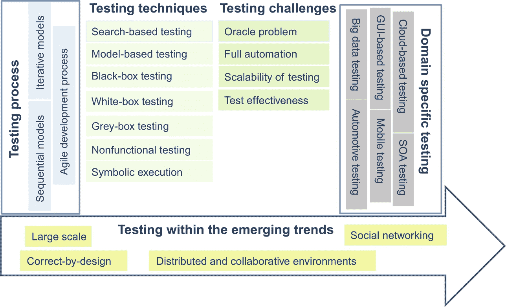

图 1 软件测试路线图。

本章将作为最新测试技术的参考，并对新的方法、途径和工具进行近乎全面的概述，这些工具对于读者管理、控制和评估软件测试开发非常有用。其目标群体是寻求解决测试过程中不同活动中的问题并寻求改进的学生、研究人员、软件开发者和从业人员。正如本章所示，软件测试并非一项孤立的活动；它与软件工程的不同领域之间存在许多富有成果的关系，并且很多时候它是不同学科之间的桥梁。

由于软件系统复杂性的日益增加以及执行环境的多样化，软件测试将继续成为软件开发过程和质量保证中的关键活动。

多年来，软件测试不断跟上新软件开发范式提供的趋势、创新和改进。为了触发不断更新且实用的解决方案，软件测试需要从实践状态中学习，并阐述未来的愿景，以预测可能出现的问题、市场需求和质量问题。特别是，云计算的增长使得需要基准测试和按需测试环境构建，以衡量新应用的性能和扩展性指标，同时考虑到云的特殊特性，如动态扩展性、可扩展的测试环境、基于 SLA 的需求以及成本模型。将开发新的测试方法来评估云应用的兼容性、互操作性和多租户能力，这些应用必须能够跨多个环境、各种云平台、客户端技术和浏览器工作。

更深入、更有效的方法和途径的可能建议包括使用真实的设置和大规模系统，以及模拟或让多个环境中同时工作的真实利益相关者。特别是大规模和软件密集型 IT 系统是通过集成和编排独立控制和管理的系统创建的。它们开发的最限制因素是软件验证，这通常需要非常昂贵且复杂的测试过程。现有测试这些系统的方法重点于协调测试过程的不同阶段，包括测试操作、测试注入、监控和报告（有时根据响应时间、带宽使用、吞吐量和适应性），目标是持续集成和部署。能够处理这些系统固有复杂性的新型测试技术将基于分治法（该原则通常用于复杂软件的架构设计）。它们将利用新的测试编排理论和工具箱，允许将简单测试单元的组合作为大型系统的复杂测试套件。这些新解决方案将允许测试知识、架构和代码的重用，使测试活动更有效且成本更低。此外，这些基于简单测试用例编排拓扑的新测试技术还将针对大型系统测试自动化部分断言推导这一重要问题，通过从执行的测试单元的预期输出和获得输出的组合中推断测试断言规范。

利用特定编程语言和执行环境的软件测试建议具有重要作用，使得高层、与应用无关的属性（如信任、安全和性能）可以容易且自动地验证，从而大幅减少测试时间和精力。

特别考虑到敏捷（Agile）、Scrum 和 DevOps 等新的协作和分布式软件开发流程，测试技术应该使同步验证以及测试活动与目标系统分解和分发之间的自动对齐变得更加容易。此外，由于开发时间缩短，大幅缩短学习时间并针对多级 IT 人员的新方案已成为提高软件测试和生产力的真实迫切需求。

此外，由于社交网络服务的日益普及以及它们与用户日常生活的深度融合，测试活动的另一个未来目标是这些服务的特定需求。此外，对于去中心化在线社交网络的性能和扩展性验证，新的测试技术将致力于评估用户个人数据的安全和隐私，以防止本地攻击。这些技术将专门针对隐私和共享政策的评估，以及用户社交资料去中心化管理和数据存储解决方案的验证。

最后，最近采用正确性设计或安全设计（secure-by-design）开发过程的趋势迫使测试活动提出有助于测试和分析设计级产物的工具和方法论。特别是，模拟、模型检查和基于模型的方法应该是提高开发系统质量的关键。

## 参考文献

[1] Ammann P., Offutt J. *Introduction to Software Testing.* Cambridge University Press; 2016.

[2] Dijkstra E.W. *Notes on Structured Programming.* Eindhoven: Technische Hogeschool; 1970.

[3] Bertolino A. Software testing. In: Abran A., Bourque P., Dupuis R., Moore J.W., eds. *Guide to the Software Engineering Body of Knowledge.* Piscataway, NJ: IEEE Press; 2001:07695100.

[4] Thayer R.H. *Software Process Improvement.* 2001.

[5] Paulk M. Capability Maturity Model for software. In: Wiley Online Library; 1993. *Encyclopedia of Software Engineering.*

[6] Emam K., Melo W., Drouin J.-N. *SPICE: The Theory and Practice of Software Process Improvement and Capability Determination.* IEEE Computer Society; 1997.

[7] Kruchten P. *The Rational Unified Process: An Introduction.* Addison-Wesley Professional; 2004.

[8] Bertolino A., Marchetti E. A brief essay on software testing. In: Thayer R.H., Christensen M.J., eds. Wiley-IEEE Computer Society. *Software Engineering, The Development Process.* 2005;vol. 3.

[9] Guttag J.V., Horning J.J. *Larch: Languages and Tools for Formal Specification.* Springer Science & Business Media; 2012.

[10] Cadar C., Sen K. Symbolic execution for software testing: three decades later. *Comm. ACM.* 2013;56(2):82–90.

[11] Gligoric M., Negara S., Legunsen O., Marinov D. An empirical evaluation and comparison of manual and automated test selection. In: ACM; 2014:361–372. *Proc. of the 29th ACM/IEEE Int. Conf. on Automated Software Engineering.*

[12] Xanthakis S., Ellis C., Skourlas C., Le Gall A., Katsikas S., Karapoulios K. Application of genetic algorithms to software testing. In: 1992:625–636. *Proceedings of the 5th International Conference on Software Engineering and Applications.*

[13] Miller W., Spooner D.L. 浮点测试数据的自动生成。*IEEE Trans. Softw. Eng.* (3):1976;223–226.

[14] McMinn P. 基于搜索的软件测试：过去、现在与未来。In: IEEE; 2011:153–163. *2011 IEEE Fourth International Conference on Software Testing, Verification and Validation Workshops (ICSTW).*.

[15] Harman M., Hu L., Hierons R., Wegener J., Sthamer H., Baresel A., Roper M. 可测试性转换。*IEEE Trans. Softw. Eng.* 2004;30(1):3–16.

[16] McMinn P., Stevenson M., Harman M. 降低与自动生成的测试数据相关的定性人工测试用言成本。In: ACM; 2010:1–4. *Proceedings of the First International Workshop on Software Test Output Validation.*.

[17] Lano K. *基于 UML 和 Java 的模型驱动软件开发.* Course Technology Press; 2009.

[18] Utting M., Pretschner A., Legeard B. 基于模型的测试方法的分类法。*Soft. Test. Verification Reliab.* 2012;22(5):297–312.

[19] Utting M., Legeard B. *实用的基于模型的测试：工具方法.* Morgan Kaufmann; 2010.

[20] Dias-Neto A.C., Travassos G.H. 模型测试领域的图景：概念、技术与挑战。*Adv. Comput.* 2010. ;80:45–120. [`doi.org/10.1016/S0065-2458(10)80002-6`](https://doi.org/10.1016/S0065-2458(10)80002-6)), [`www.sciencedirect.com/science/article/pii/S0065245810800026`](http://www.sciencedirect.com/science/article/pii/S0065245810800026).

[21] Khan M.E., Khan F., 等人. 白盒、黑盒和灰盒测试技术的比较研究。*Int. J. Adv. Comput. Sci. Appl.* 2012;3(6).

[22] Bhat A., Quadri S.M.K. 等价类划分与边界值分析——综述。In: 2015:1557–1562. *2015 2nd International Conference on Computing for Sustainable Global Development (INDIACom).*.

[23] Myers G.J., Sandler C., Badgett T. *软件测试艺术.* John Wiley & Sons; 2011.

[24] Arcuri A., Briand L. 使用随机测试进行交互故障检测概率的形式化分析。*IEEE Trans. Softw. Eng.* 0098-55892012. ;38(5):1088–1099. [`doi.org/10.1109/TSE.2011.85`](https://doi.org/10.1109/TSE.2011.85).

[25] Lyu M.R., 等人. *软件可靠性工程手册.* California:IEEE Computer Society Press; 1996.

[26] Nie C., Leung H. 组合测试综述。*ACM Comput. Surv.* 0360-03002011. ;43(2):11:1–11:29. [`doi.org/10.1145/1883612.1883618`](https://doi.org/10.1145/1883612.1883618).

[27] Lee D., Yannakakis M. 有限状态机的测试原理与方法——综述。*Proc. IEEE.* 1996;84(8):1090–1123.

[28] Lynch N.A., Tuttle M.R. *输入/输出自动机简介.* Massachusetts Institute of Technology. Laboratory for Computer Science; 1988.

[29] Tretmans J., Hierons R.M. 使用标记转移系统的基于模型的测试。In: Bowen J.P., Harman M., 编辑. *形式化方法与测试.* Springer; 2008:1–38.


# 参考文献

[30] Börger E., Stärk R. *抽象状态机：高层系统设计与分析的方法.* Springer Science & Business Media; 2012.

[31] Tiwari A. *Simulink Stateflow 模型的形式语义与分析方法.* 技术报告 Citeseer; 2002.

[32] Baier C., Katoen J.-P., Larsen K.G. *模型检查原理.* MIT Press; 2008.

[33] Kasoju A., Petersen K., Mäntyl M. 用基于证据的工程分析汽车流程。*Inf. Softw. Technol.* 0950-58492013. ;55(7):1237–1259. [`doi.org/10.1016/j.infsof.2013.0105`](https://doi.org/10.1016/j.infsof.2013.0105), [`www.sciencedirect.com/science/article/pii/S095058491300165`](http://www.sciencedirect.com/science/article/pii/S095058491300165).

[34] Kitchenham B., Dyba T., Jorgensen M. 基于证据的软件工程。In: 2004:273–281. *26th International Conference on Software Engineering.* [`doi.org/10.1109/ICSE.2004.131749`](https://doi.org/10.1109/ICSE.2004.131749).

[35] Santos R., Magalhães., da Silva F. 系统性评价在基于证据的软件工程。In: ACM; 2014:53. *8th ACM/IEEE International Symposium on Empirical Software Engineering and Measurement.*

[36] Păăreanu C., Visser W. 软件测试与分析中符号执行的新趋势。*Int. J. Softw. Technol.* 2009;11(4):339–353.

[37] Baldoni R., Coppa E., D’Elia D., Demetrescu C., Finocchi I. *符号执行综述.* 2016 arXiv:1610.00502.

[38] Sen K. Concolic 测试。In: New York, NY: ACM; 2007:571–572. *Twenty-second IEEE/ACM Conference on Automated Software Engineering, ASE '07.* [`doi.org/10.1145/1321631.1321746`](https://doi.org/10.1145/1321631.1321746) 978-1-5959-882-4.

[39] Pasareanu C.S., Mehlitz P.C., Bushnell D.H., Gundy-Burlet K., Person S. 用于 NASA 软件的单元级符号执行与系统级执行。In: ACM; 2008:15–26. *2008 International Symposium on Software Testing and Analysis.*

[40] Sen K., Marinov D., Agha G. CUTE：用于 C 语言的 concolic 单元测试。*SIGSOFT Softw. Eng. Notes.* 0163-59482005. ;30(5):263–272. [`doi.org/10.1145/1095430.108150`](https://doi.org/10.1145/1095430.108150).

[41] Cadar C., Dunbar D., Engler D. KLEE：复杂系统程序的无辅助及高覆盖测试自动生成。In: 2008:209–224. *Proc. of the 8th USENIX Conf. on Operating Systems Design and Implementation, OSDI'08.* [`dl.acm.org/citation.cfm?id=1855741.1855756`](http://dl.acm.org/citation.cfm?id=1855741.1855756).

[42] Lewis W.E. *软件测试与持续质量改进.* CRC Press; 2016.

[43] Jiang Z.M., Hassan A.E. 大规模软件负载测试综述。*IEEE Trans. Softw. Eng.* 0098-55892015. ;41(11):1091–1118. [`doi.org/10.1109/TSE.2015.2445340`](https://doi.org/10.1109/TSE.2015.2445340).

[44] Felderer M., Büchler M., Johns M., Brucker A.D., Breu R., Pretschner A. 第一章——安全测试：综述。*Adv. Comput.* 2016;101:1–51.

[45] Dalal S.R., Lyu M.R., Mallows C.L. *软件可靠性.* Wiley Online Library; 2014.

[46] Geisen E., Bergstrom J.R. *调查研究的可用性测试.* Morgan Kaufmann; 2017.

[47] Pezzo M., Zhang C. 自动化测试用言：综述。*Adv. Comput.* 2015;95:1–48.

[48] Barr E.T., Harman M., McMinn P., Shahbaz M., Yoo S. 软件测试中的用言问题：综述。*IEEE Trans. Softw. Eng.* 2015;41(5):507–525.

[49] Davis M.D., Weyuker E.J. 为不可测试程序的伪用言。In: ACM; 1981:254–257. *Proceedings of the ACM’81 Conference.*.

[50] Peters D.K., Parnas D.L. 利用程序文档生成的测试用言.*IEEE Trans. Softw. Eng.* 1998;24(3):161–173.

[51] Mouchawrab S., Briand L.C., Labiche Y., Di Penta M. 基于状态机的测试与结构化测试的评估、比较与结合：一系列实验。*IEEE Trans. Softw. Eng.* 2011;37(2):161–187.

[52] Loyola P., Staats M., Ko I.-Y., Rothermel G. Dodona: 自动化 Oracle 数据集选择。In: New York, NY: ACM; 2014:193–203. *2014 年软件测试与分析国际会议会议集，ISSTA 2014.* [`doi.org/10.1145/2610384.2610408`](https://doi.org/10.1145/2610384.2610408) 978-1-4503-2645-2。

[53] Bertolino A. 软件测试研究：成就、挑战与梦想。In: IEEE Computer Society; 2007:85–103. *2007 软件工程未来.*

[54] Persson C., Yilmazturk N. 在 ABB 建立自动化回归测试：关于“避免陷阱”的工业经验报告。In: IEEE Computer Society; 2004:112–121. *第 19 届 IEEE 自动化软件工程国际会议会议集.*

[55] Hoffman D. 测试自动化的成本效益分析。*STAR West.* 1999;vol. 99.

[56] Ramler R., Wolfmaier K. 测试自动化的经济视角：基于机会成本的自动化测试与手动测试。In: ACM; 2006:85–91. *2006 软件测试自动化国际研讨会议集.*

[57] Graham D., Fewster M. *测试自动化经验：软件测试自动化案例研究。* Addison-Wesley Professional; 2012.

[58] Saff D., Ernst M.D. 通过持续测试减少浪费开发时间。In: IEEE; 2003:281–292. *第 14 届国际软件可靠性工程会议集.*

[59] Virmani M. 理解 DevOps 并弥合从持续集成到持续交付的鸿沟。In: IEEE; 2015:78–82. *第五次创新计算技术国际会议 (INTECH).*

[60] Thummalapenta S., Sinha S., Singhania N., Chandra S. 自动化测试自动化。In: 2012:881–891. *2012 第 34 届国际软件工程会议 (ICSE).* 0270-5257. [`doi.org/10.1109/ICSE.2012.6227131`](https://doi.org/10.1109/ICSE.2012.6227131)。

[61] Buxmann P., Hess T., Lehmann S. 软件即服务。*Wirtschaftsinformatik.* 2008;50(6):500–503.

[62] Zikopoulos P., Eaton C., et al. *理解大数据：企业级 Hadoop 和流式数据分析。* McGraw-Hill Osborne Media; 2011.

[63] Isakowitz T., Bieber M., Vitali F. Web 信息系统。*Commun. ACM.* 1998;41(7):78–80.

[64] Baheti R., Gill H. 物理物理系统。In: IEEE Control Systems Society; 161–166. *控制技术的影响.* 2011;vol. 12.

[65] Zhang J., Zhu M., Hao D., Zhang L. 关于选择性变异测试扩展性的实证研究。In: IEEE; 2014:277–287. *IEEE 第 25 届国际软件可靠性工程会议 (ISSRE).*

[66] Fenton N., Bieman J. *软件指标：严谨且实用的方法。* CRC Press; 2014.

[67] Jia Y., Harman M. 变异测试发展的分析与综述。*IEEE Trans. Softw. Eng.* 0098-55892011;37(5):649–678. [`doi.org/10.1109/TSE.2010.62`](https://doi.org/10.1109/TSE.2010.62)

[68] Delamaro M.E., Maidonado J.C., Mathur A. 接口变异：一种集成测试方法。*IEEE Trans. Softw. Eng.* 2001;27(3):228–247.

[69] Belli F., Budnik C., Hollmann A., Tuglular T., Wong W. 基于模型的变异测试：方法与案例研究。*Sci. Comput. Program.* 2016;120:25–48.

[70] Martin E., Xie T. 故障模型与访问控制变异测试。In: 2007:667–676. *WWW 会议.*

[71] Bertolino A., Daoudagh S., Lonetti F., Marchetti E. XAMUT: XACML 2。In: IEEE; 2013:28–33. *第六届软件测试国际会议 (ICSTW).*

[72] Shi A., Yung T., Gyori A., Marinov D. 回归测试套件的对与与组合。In: ACM; 2015:237–247. *2015 第 10 届软件工程基础会议.*

[73] Magalhães C., Barros F., Mota A. 回归测试用例的自动选择。In: ACM; 2016:8. *第一届巴西软件测试研讨会.*

[74] Gligoric M., Eloussi L., Marinov D. 基于依赖关系的实用回归测试选择。In: ACM; 2015:211–222. *2015 测试与分析国际研讨会.*

[75] Srivastava P. 用例优先级。*J. Theoretical Appl. Inf.* 2008;4(3):178–181.

[76] Saha R., Khurshid S., Perry D. 基于程序变化的回归测试信息检索方法。In: IEEE/ACM 第 37 届软件工程会议 (ICSE).

[77] Rothermel G., Untch R.H., Chu C., Harrold M.J. 用例优先级：一项实证研究。In: 1999:179–188. *软件维护国际会议 (ICSM).* [`doi.org/10.1109/ICSM.1999.792604`](https://doi.org/10.1109/ICSM.1999.792604)

[78] Rothermel G., Untch R.H., Chu C., Harrold M. 回归测试用例优先级排序。*IEEE Trans. Softw. Eng.* 2001;27(10):929–948.

[79] Do H., Rothermel G. 用例优先级实证评估中变异故障的使用。*IEEE Trans. Softw. Eng.* 2006;32(9):733–752.

[80] Elbaum S., Rothermel G., Kanduri S., Malishevsky A. 选择成本效益型用例优先级。*Softw. Qual. J.* 2004;12(3):185–210.

[81] Bertolino A., Daoudagh S., El Kateb D., Henard C., Le Traon Y., Lonetti F., Marchetti E., Mouelhi T. 访问控制的相似性测试。*Inf. Softw. Technol.* 2015;58:355–372.

[82] Zhang L., Hou S.-S., Guo C., Xie T., Mei H. 使用整数线性规划的时间感知用例优先级排序。In: ACM; 2009:213–224. *第 18 届软件测试与分析国际会议集.*

[83] Wu K., Fang C., Chen Z., Zhao Z. 结合程序元素顺序的用例优先级。In: IEEE Press; 2012:124–130. *第 7 届软件自动化国际研讨会议集.*

[84] McFeeley B. *IDEAL: 软件过程用户指南.* 技术报告 DTIC Document; 1996.

[85] Fowler M., Highsmith J. 敏捷宣言。*Softw. Dev.* 2001;9(8):28–35.

[86] Beynon-Davies P., Carne C., Mackay H., Tudhope D. 快速应用开发 (RAD)：实证综述。*Eur. J. Inf. Sys.* 1999;8(3):211–223.

[87] Kniberg H. *前线中的 Scrum 与 XP.* [Lulu.com](http://Lulu.com); 2015.

[88] Gao J., Bai X., Tsai W.-T. 云测试——问题、挑战、需求与实践。*Soft. Eng. Int. J.* 2011;1(1):9–23.

[89] Chana I., Rana A., et al. 云端测试技术的实证评估：系统性综述。*ACM SIGSOFT Soft. Eng. Notes.* 2012;37(3):1–9.

[90] Gao J., Bai X., Tsai W.-T., Uehara T. 云上的测试即服务 (TaaS)。In: IEEE; 2013:212–223. *IEEE 第 7 届面向面向系统工程国际会议 (SOSE).*

[92] Bartolini C., Bertolino A., Lonetti F., Marchetti E. 功能性、结构性和安全性面向服务架构（SOA）测试方法。In: IGI Global; 2012:381–401. *服务计算中的性能与可靠性：概念、技术与研究方向.*

[93] Bartolini C., Bertolino A., Marchetti E., Polini A. WS-TAXI:一种基于 WSDL 的 Web 服务测试工具。In: IEEE; 2009:326–335. *软件测试、验证与确认国际会议 (ICST)..*

[94] Petrova-Antonova D., Kuncheva K., Ilieva S. 基于 XML Schema 的 Web 服务测试数据自动生成。In: IEEE; 1–8. *第 10 届国际软件技术联合会议 (ICSOFT)。* 2015;vol. 1.

[95] Bozkurt M., Harman M., Hassoun Y. 面向服务架构的测试与验证：综述。*Softw. Test. Verification Reliab.* 2013;23(4):261–313

[96] Hillah L.M., Maesano A.-P., Maesano L., De Rosa F., Kordon F., Wuillemin P.-H. 带有智能调度与规划的服务功能测试自动化。In: New York, NY: ACM; 2016:1605–1610. *第 31 届 ACM 应用计算年会会议集。*[https://doi.org/10.1145/2851613.2851807] 978-1-4503-3739-7.


[97] Bartolini C., Bertolino A., Marchetti E., Parissis I. 基于数据流 Web 服务组合验证：视角与示例。In: de Lemos R., Di Giandomenico F., Gacek C., Muccini H., Vieira M., 编。*可靠系统架构 V.* Springer; 2008:298–325.

[98] Hummer W., Raz O., Shehory O., Leitner P., Dustdar S. 以数据中心和基于事件的动态服务组合测试。*Softw. Test. Verification Reliab.* 2013;23(6):465–497

[99] Bartolini C., Bertolino A., Elbaum S., Marchetti E. 白化 SOA 测试。In: ACM; 2009:161–170. *第 7 届 ESEC-FSE 国际会议集。*

[100] Ye C., Jacobsen H.-A. 通过事件暴露白化 SOA 测试。*IEEE Trans. Softw. Eng.* 2013;39(10):1444–1465

[101] Benharref A., Dssouli R., Serhani M.A., Glitho R. Web 服务被动测试的高效轨迹收集机制。*Inf. Softw. Technol.* 2009;51(2):362–374

[102] Martin E. 访问控制策略的自动化测试生成。In: ACM; 2006:752–753.*第 21 届 ACM SIGPLAN 面向对象编程系统、语言与应用研讨会论文。*

[103] Bertolino A., Daoudagh S., Lonetti F., Marchetti E. X-CREATE 框架：XACML 策略测试方法的比较。In: 2012:155–160.*WEBIST.*

[104] Memon A.M., Nguyen B.N. 基于模型的自动化系统测试的进展。

[105] Qureshi I., Nadeem A. GUI 测试：综述。*Adv. Comput.* 2010;80:2

[106] Banerjee I., Nguyen B., Garousi V. 图形界面（GUI）测试：系统映射。*Inf. Softw. Technol.* 2013;55

[107] Arlt S., Ermis E., Podelski A. 基于黑盒方法的 GUI 测试。In: Berlin, Heidelberg: Springer; 2014:236–252.[https://doi.org/10.1007/978-1-4503-3739-7]

[108] 移动应用测试受增长的需求推动。[https://www.abiresearch.com/

[109] Gao J., Tsai W.-T., Bai R. 移动测试服务（MTaaS）：基础设施、问题与解决方案。In: 2015 第 15 届高可靠性系统会议（HASE）。*

[110] Villanes I., Costa E., Dias-Neto A. 自动化移动测试服务。In: IEEE 2015:79–86.[https://doi.org/10.1109/SERVICES]

[111] Michael K., Miller K. 大数据：机遇与挑战。*Computer.*2013;46(6):22–24.[https://doi.org/10.1109/MC]

[112] Abidin A., Lal D., Garg N., Markl V. 大数据：对比分析。In: 2016:219–223.*2016 国际信息技术会议（CIT）——主题。*[https://doi.org/10.1109/2016]

[113] Alexandrov A., Brücke C. 大数据问题。*第六届国际测试研讨会议集。*

[114] TPC 基准与结果，[http://www.tpc.org/]

[115] XMark—XML 项目，[http://www.benchmark.org/]

[116] Li N., Escalona A., Guo Y., Offutt J. 可扩展的大数据测试。In: 2015:1–2.*2015 IEEE 第 8 届软件测试与验证会议（ICST).[https://doi.org/10.1109/2015]

[117] Robinson-Mallett C. 汽车电子设备的安全与安全工程协调。In: 2014:45–48.*第 9 届网络与信息安全研究会议。*

[118] B. Antonia, C. Antonello, D.G. Felicita, L. Giuseppe, L. Francesca, M. Eda, M. Fabio, M. Ilaria, M. Paolo. 联网车辆的安全软件工程议程，技术报告号 IIT TR-18/2015,[http://www.iit.cnr.it/en/node]


**Eda Marchetti** 是 CNR-ISTI 的研究员。她以 1997 年毕业于比萨大学获得优等成绩（summa cum laude）计算机科学，并在同一大学获得博士学位（2003 年）。她的研究活动重点是软件测试，特别是安全测试、访问控制系统测试、基于模型的测试、SOA 以及基于组件的测试。她在近期结束的项目（包括 TAS3、Presto4u）中曾担任过工作包（WP）协调员。她曾参与过多个欧盟项目：TELCERT、CONNECT、CHOReOS、NESSoS 和 TAROT。她目前正参与 Learn PAd 的监控和测试过程。她曾担任多个国际会议和期刊的评审员，并是多个国际研讨会和会议的组织委员会和程序委员会成员。她在国际期刊和会议上（合）发表了 50 多篇论文。

***

# 第四章 演化 Rhapsody 状态图符号执行的优化

Amal Khalil; Juergen Dingel 皇后大学计算学院，加拿大安大略省金斯顿

## 摘要

模型驱动工程（MDE）是一种迭代和增量的软件开发过程。支持对遵循 MDE 范式开发的软件系统进行分析和验证，要求在执行这些关键任务时采用增量方式，以通过更优化的方式实现。

通信状态机是 MDE 工具用于建模和描述分布式、并发和实时响应式系统（例如汽车和航空电子系统）行为的各种形式之一。此类系统的整体行为建模是以模块化的方式在不同的抽象层上进行的（即：首先对系统中单个对象的行为建模，然后建模这些对象之间的交互）。同样，分析和验证所开发模型的正确性以确保其质量和完整性是在两个主要层次上进行的。层内（intralevel）用于在孤立于其他模型的情况下分析单个模型的正确性，而层间（interlevel）用于分析相互通信模型之间的整体互操作性。

促进通信状态机系统整体行为分析的一种方法是构建系统的全局状态空间（也称为全局可达性树）。这个过程非常昂贵，在某些情况下可能会遭受状态爆炸问题。符号执行是一种可以构建系统全局状态空间的抽象和边界版本的技术，这被称为符号执行树（SET），然而生成的树的大小可能非常大，特别是对于由多个对象组成的大型复杂系统。随着系统的演化，避免重新生成整个 SET 并重复任何已执行的基于 SET 的分析的一种方法，是利用之前的 SET 及其分析结果，来优化在更改后生成系统 SET 的过程。在本章中，我们提出了两种优化技术，分别通过备忘（memoization, MSE）和依赖性分析（DSE）将符号执行技术的连续运行引导至演化状态机模型中受影响的部分。这两种技术的评估结果表明，在某些情况下与标准符号执行技术相比，显著降低了成本。

### 关键词

模型驱动工程；符号执行；增量验证；基于状态的行为模型；状态机；备忘；依赖性分析；基于模型的分析

## 1. 引言

模型驱动工程（MDE）是一种以模型为中心的软件工程方法，旨在通过将模型视为一等产物而非代码，来提高软件产物的生产力和质量。十年来，MDE 已广泛应用于汽车和电信行业等许多领域。迭代增量开发和基于模型的分析是 MDE 的核心，在其中，产物在其生命周期内通常会经历多次迭代和精炼，这可能需要对其初始设计版本进行更改。随着这些模型的演化，需要在每次迭代或精炼后通过重复对这些模型的分析和验证来评估它们的质量。这个过程如果不经过优化，可能会非常枯燥且耗时。

状态机是一种视觉化的基于状态的形式，用于描述响应式系统的行为，它们以某种变体形式存在于每种 MDE 工具中（例如，`IBM Rational Rhapsody` 的 Statecharts、`IBM Rational Software Architect` 的 UML-RT 或 `MathWorks Simulink` 的 Stateflow）。

符号执行是一种广知的分析技术，用于分析行为软件产物的执行路径（例如，程序 [[1]] 和基于状态的模型 [[2], [3]]）。分析的输出是符号执行树（SET），它为各种类型的分析和验证提供了基础。符号执行的关键挑战之一是可扩展性，特别是当应用于大型、复杂的产物时，输出 SET 的规模会变得非常大。即使在细小变化后重复整个分析也不是最佳解决方案。

本章描述了一项研究，调查了两种互补的优化技术，这些技术利用状态机版本之间的相似性来降低对演化版本进行符号执行的成本。

这项研究动力来自许多事实。首先，符号执行已被证明是分析程序的一种非常强大的方法，并且已经有几种基于此构建的代码分析工具（例如，CodeSonar [[4]]）。同样，该技术已采用并应用于基于状态模型的背景中（例如，IAR visualSTATE—Verificator [[5]]）。其次，我们的工业合作伙伴通用汽车（GM）对提高 `IBM Rhapsody` 工具的模型级分析能力很感兴趣。第三，关于优化演化程序符号执行的研究近期已得到解决 [[6], [7]]，然而，据我们所知，我们是首批针对演化状态机符号执行考虑此类优化的人。

### 1.1 研究陈述与范围

本研究的主要目标是证明，通过增量分析，演化状态机符号执行的效率和成本可以得到显著改进。

由于我们旨在使用 `IBM Rhapsody Statecharts` 作为输入基于状态的模型，以构建我们技术的概念验证实现，我们将仅使用 `IBM` 相关的工具（例如，`IBM Rational Rhapsody Developer RulesComposer Add-On` 和 `IBM Rational Rhapsody DiffMerge`）来开发我们在第 4 节和第 5 节中所示架构的不同组件。

`Rhapsody Statecharts` 提供了指定响应行为的高级功能。支持这些功能的全部集合超出了本工作的范围，然而，我们选择了一个包含最常用功能的子集。这包括复合和正交状态、层间转换（也称为组转换）以及条件和连接器。历史连接器是一个不支持的高级功能示例。

我们所提技术的原型实现是基于 `KLEE` 符号执行引擎的。由于 `KLEE` 仅支持 `C` 代码，我们仅考虑 `Java` 或 `C++` 动作代码的一个子集，这些代码与 `C` 代码语法相同，包括基础赋值语句、条件语句和迭代语句。支持的数据类型包括字符、`Booleans` 和整数在内的基础数据类型。我们还考虑了动作代码中用于发送事件的语句。

用于评估的状态图（Statechart）模型是根据上述假设选择的。

### 1.2 贡献

所提研究旨在改进演化软件开发环境中基于模型的分析的当前水平。我们的贡献具体包括：(1) 对 `Section 5` 中提到的提出的优化技术进行开发、形式化和概念验证实现；(2) 一项提供结果以证明我们研究方法论优势的评估；(3) 一个可以丰富现有 MDE 工具分析能力的具体研究实例。

### 1.3 章节结构

`Section 2` 概述了背景知识。`Section 3` 讨论了相关工作。`Section 4` 展示了我们针对单个和通信 Rhapsody 状态图的标准符号执行技术。`Section 5` 展示了本研究中采用的优化思想。`Section 6` 解释了所提工作的实现细节。`Section 7` 概述了评估程序并展示且讨论了评估结果。`Section 8` 总结了本章介绍的工作并概述了未来工作。

## 2 背景

在本节中，我们提供了本研究中使用的主要技术的背景信息。首先，我们介绍了所使用的建模上下文和考虑的模型类型。然后，我们介绍了符号执行和依赖分析的概述。最后，我们指定了用于实现模型差异和模型转换任务的工具。

### 2.1 IBM Rational Rhapsody Developer MDE 工具中的建模与分析

`IBM Rhapsody Developer` 框架是支持模型驱动开发的商业工具之一，其中模型是软件开发的主要产物，通过迭代完善，直到工具可以自动生成代码。该工具在实践中被广泛使用（例如在汽车行业中）。它有许多专门的模型（或图表），用于描述不同抽象层次的软件系统。我们仅引用在本工作中使用的两种模型：对象模型图 (`OMD`) 和 `Statecharts`（状态图）。这些模型支持的所有特性的详细描述在本工作之外。为了简单起见，`Fig. 1` 所示的说明性示例仅使用了这些特征的有限集。

#### 2.1.1 Rhapsody 对象模型图

`OMDs` 用于指定软件系统中类和对象的结构及静态关系。Rhapsody 的 `OMDs` 在某种程度上与 `UML` 的复合结构图、类图和对象图具有相同的目的。`OMD` 中的顶层对象通常是一个复合类，代表系统的根类，被视为系统容器。`IBM Rational Rhapsody` 代码生成器直接将 `OMD` 中建模的元素和关系翻译为指定高级语言（例如 `C`、`C++`、`C#` 或 `Ada`）的源代码。`Fig. 1A` 展示了一个由两个通信对象 `itsA` 和 `itsB` 组成的系统。对象 `itsA` 属于类 `A`，有一个初始化为 `0` 的整数属性 `x` 以及一个包含三个消息的协议：`e1`、`e2` 和 `e3`。同样，对象 `itsB` 属于类 `B`，有一个初始化为 `5` 的整数属性 `y` 以及一个包含三个消息的协议：`e4`、`e5` 和 `e6`。消息 `e1` 有一个整数参数 `e1Arg`，消息 `e5` 有一个整数参数 `e5Arg`。每个对象的行为由 `Figs. 1B` 和 `C` 所示的 Rhapsody Statecharts 建模。

#### 2.1.2 Rhapsody 状态图

Rhapsody Statecharts 是一种在 `IBM Rational Rhapsody` 框架中实现的基于状态的形式化方法，用于描述响应式系统的行为。它们扩展了传统的 Mealy 机（仅在触发转换时执行动作的有限状态机 `FSMs`），引入了分层状态、正交区域以及状态和转换中的动作代码等高级功能。动作是状态或转换相关的响应式行为，可以在进入状态、离开状态或触发转换时执行。这些动作的示例包括更新变量的值或通过事件向环境产生输出。`Rhapsody` 允许使用 `C`、`C++` 或 `Java` 来表示这些动作。转换的通用格式为 `event[guard]/action`，它指定了转换的触发事件、可选的 guard 条件和可选的动作代码。事件是从环境或系统中其他对象传递给 `Statechart` 的刺激，它们可以具有可选的用户定义参数（称为参数）。超时事件是在 `Statecharts` 内部使用计时器生成的内部事件。与可以在 `Statechart` 内任何地方访问的全局机器变量不同，事件参数被视为局部变量，其作用范围仅限于接收其事件的转换的 guard 和动作代码。`guard` 是一个可以在机器变量和事件参数上定义的可选 `Boolean` 表达式。当源状态激活、接收到相应事件、`guard` 结果为 `true` 且没有更高优先级的转换被启用时，转换会被触发。当转换被触发时，将执行其动作，结果系统进入转换的目标状态。除了用于描述转换动作代码的标准赋值和条件语句外，还有一种领域特定的 `send event` 语句，用于生成发送到指定对象的输出事件。此类语句的示例显示在 `Fig. 1B` 中 `itsA_T2` 转换的动作 `Java` 代码中，即 `itsB.gen(new e5(5))`；它用于向对象 `itsB` 生成一个参数 `e5Arg` 设置为 `5` 的事件 `e5`。相应地，事件 `e5` 的参数值存储在名为 `params` 的变量中，可以使用语句 `params.e5Arg` 进行访问。

除了给定的状态图（Statecharts）是否满足其规范外，有一系列任何状态图模型都应该满足的基础且直观的设计规则。这包括状态的可达性、守卫的可满足性和输入事件的可用性。验证这些规则是否被满足的任务对于 `Fig. 1B` 和 `C` 中的状态图来说看起来非常简单，但随着模型变大以及使用更高级的建模功能，情况会变得复杂，这在构建工业实时系统时是典型的。

#### 2.1.3 基于状态模型的分析与验证

用于分析状态模型的现有分析方法分为两类：模型级分析和代码级分析。代码级分析方法的动机源于这些模型是可执行的，我们可以很容易生成其对应的代码，并使用一些针对 `C/C++` 或 `Java` 代码的模型检查器，或使用某些静态分析工具来帮助发现代码级的可能问题。然而，通用的静态分析工具很难理解我们提供给它的任何代码的高层意图，因此它们通常无法揭示模型级的问题（例如不可达状态和死胡同）。此外，我们并不总是能够生成代码，特别是在规范不完全的情况下。另外，代码级分析提供的结果通常更详细，这通常使得它们对设计师和建模者来说不那么直观。其他挑战还包括难以将代码中生成的错误追溯到模型层面的源，以及调整现有的分析工具（例如模型检查器、符号执行引擎或静态分析工具）以处理生成代码中出现的领域特定语句。由于这些原因，我们认为模型级分析是处理此任务最合适的方法。因此，我们研究的动机是强调在模型级执行的此类分析或验证类型的重要性。

## 2.2 符号执行

符号执行是一种程序分析技术，它允许使用符号化输入以参数化的方式执行程序，从而推导出其属性和执行路径的精确表征。它最早由 Clarke 在 20 世纪 70 年代 [[11]] 和 King [[1]] 引入用于程序测试。自 2003 年以来，大量的研究工作致力于提高传统技术的有效性、效率和适用性 [[12–14]]。


其核心思想是将程序输入替换为符号值，然后参数化地执行程序，使得 (1) 所有程序变量的值都被计算为关于符号输入值的符号表达式，且 (2) 探索了所有可能的执行路径。程序符号执行的结果是一个名为 `SET` 的树状结构。`SET` 的节点代表符号程序状态，边表示这些状态之间的转换。每个程序符号状态包含一个程序位置、程序变量集及其符号赋值，以及一个路径约束（`PC`），该路径约束是到达该程序位置时在程序变量上收集的所有逻辑约束的合取。`SET` 的可行路径刻画了程序所有不同的执行路径。决策程序和 `SMT` 求解器被用于检查每个路径约束（`PC`）的可满足性。生成的 `SET` 是许多程序分析、验证和测试活动（例如缺陷查找、死代码检测、不变性检查、回归分析和测试用例生成）的基础。例如，它可以通过生成最少数量测试用例来检查所有程序路径，从而优化测试过程。图 2B（对应 2D）显示了图 2A 中示例代码的 `SET`（对应 2C）。探索是以深度优先的方式进行的。其他探索策略的示例包括广度优先、随机或基于启发式的探索。求解每个 `SET` 的叶子节点的路径约束将为我们提供用于测试每个可行路径的样本输入值。程序中没有任何对应符号状态的位置在程序 `SET` 中是死代码。例如，`foo_2` 中的第 8-9 行是死代码。


符号执行面临的最大挑战之一是路径爆炸问题，特别是对于大型程序和无界循环。建议的解决方案包括为循环设置上限、总结影响、使用某些状态匹配标准（如包含）来剪枝冗余路径、使用启发式方法实现定义的覆盖，或将程序划分为独立部分并并行对每个部分运行符号执行 [14]。例如，图 3B 显示了图 3A 中代码片段的有限 `SET` 版本 [12]。这种有限的 `SET` 版本通过执行称为包含检查的技术来确定是否再次访问符号状态，从而进行剪枝。对于给定的两个符号状态 `SS[i]` 和 `SS[j]`，如果两个状态代表相同的程序位置且 `SS[j]` 的具体化包含在 `SS[i]` 的具体化中，则 `SS[j]` 被 `SS[i]` 包含（subsumed）。例如，在图 3B 中，符号状态 `SS7` 被符号状态 `SS4` 包含，因此可以避免对符号状态 `SS7` 的探索。

![符号执行的——示例 2 (A) test_inf 的代码片段 [[12]] (B) test_inf 的有限 SET](images/S0065245817300487/f04-03-97801281598.jpg)

其他挑战包括 (1) 约束求解器在求解非常复杂的非线性约束方面的局限性，以及 (2) 无法处理外部库调用。建议的解决方案包括混合执行（传统技术的一种变体，允许对不可管理的符号表达式使用具体值）[15, 16]、执行约束简化以及提供模型来模拟或抽象外部的行为。

现有的符号执行工具包括针对 `Java` 的 `jCUTE` 和 `Java PathFinder (JPF)`，针对 `C` 和 `C++` 的 `EXE` 及其继任 `KLEE`，以及针对 `.NET Framework` 的 `Pex`。

符号执行不仅限于程序；它也被应用于各种基于状态的模型，包括输入输出符号转换系统（Input Output Symbolic Transition Systems）[2]、状态图（Statecharts）[17]、UML 状态机[18]，以及最近 UML-RT 状态机[3]。

## 2. 依赖分析

依赖分析在程序重构、并行化和优化等研究领域已广泛研究。它还支持软件维护中的许多活动，如理解、切片、影响分析和回归测试削减。依赖分析主要在编程语言背景下进行研究，在这些语言中，通过控制流图（CFGs）在语句和变量之间定义依赖。最终，相同的概念被应用于其他类型的软件工制品，以捕捉此类工制品内部潜在的交互，例如，扩展有限状态机（EFSMs）[19–21]，在这些模型中，交互定义在转换之间，因为转换是这类模型的“活动”元素。依赖的示例包括控制依赖、数据依赖和通信依赖。

在我们的设置中，我们将 Rhapsody 状态图转换为类似于 EFSM 的表示，称为 Mealy 类机（MLMs）（MLM 的正式定义见第 4.1.1 节），因此我们可以采用传统 EFSM 的依赖定义。在随后的章节中，我们将根据 [19–21] 中的工作，采用来自 [22] 的计算这些依赖的定义集。

### 2.1 控制依赖

顺序程序中控制依赖的经典定义规定，如果语句 `s[i]` 是影响语句 `s[j]` 执行的条件，则语句 `s[j]` 控制依赖于语句 `s[i]`。例如，在 if-then-else 结构中，条件语句两个分支中的语句都控制依赖于该谓词。由于基于状态的形式体系与顺序程序不同，因此给出了一些适应性定义来捕捉此类形式体系中的控制依赖。适用于可能不终止的状态机的定义称为非终止敏感控制依赖（NTSCD）（见定义 2），它是基于极大路径给出的（见定义 1）。

**定义 1（极大路径）**。状态机中的路径被定义为连续转换的有限序列，其组织方式使得没有状态被访问超过一次。如果路径终止于终止状态（没有传出转换的状态），或终止在循环中，或再次到达初始状态，则该路径被称为极大路径。循环是一组形成强连通分量的转换。

**定义 2（非终止敏感控制依赖）**。

`t[i] --NTSCD--> t[j]` 意味着 `t[j]` 非终止敏感控制依赖于转换 `t[i]` 当且仅当：

1. 对于所有路径 `π` ∈ `MaximalPaths(targetState(t[i]))`，`sourceState(t[j])` 属于 `π`；
2. `t[i]` 至少有一个兄弟节点 `t[k]`，且存在路径 `π’` ∈ `MaximalPaths(sourceState(t[k]))`，使得 `sourceState(t[j])` 不属于 `π’`；

其中 `MaximalPaths(s)` 是以 `s` 为第一个转换源的路径集，如果 `sourceState(t[k]) = sourceState(t[i])`，则 `t[k]` 为 `t[i]` 的兄弟节点。

### 2.2 数据依赖

典型的数据依赖定义是根据变量定义和使用给出的。在状态机上下文中，如果一个变量的值出现在转换的守卫（guard）中，或者出现在赋值语句的右侧、if 语句的布尔表达式中，或者出现在转换动作代码的输出语句中，则该变量在转换上被使用。如果一个变量出现在转换动作代码中赋值语句的左侧，则它在转换上被定义。基于此，给出了如下定义 [19, 22]。

**定义 3（数据依赖 (DD)）**。

`t[i] --DD--> t[k]` 意味着对于变量 `v`，`t[k]` 数据依赖于 `t[i]` 当且仅当：

1. `v` ∈ `Def(t[i])`，其中 `Def(i)` 是由转换 `t` 的动作代码定义的变量集；
2. `v` ∈ `Use(t[k])`，其中 `Use(k)` 是转换 `t[k]` 的守卫或动作代码中使用的变量；
3. 从 `t[i]` 到 `targetState(t[k])` 存在一条路径，`v` 在其上未被修改。

### 2.3 通信依赖

两个转换被称为通信依赖，如果 (1) 每个转换属于不同的 MLM（MLM 的正式定义见 4.1.1），且 (2) 其中一个转换由另一个转换动作代码生成的事件触发 [19, 22]。

**定义 4（通信依赖 (COMD)）**。给定两个转换 `t[i]` 和 `t[k]`，`t[i] --COMD--> t[k]` 意味着 `t[k]` 通信依赖于 `t[i]` 当且仅当：

1. `t[i]` ∈ `T(MLM[i])` 且 `t[k]` ∈ `T(MLM[k])`，其中 `i≠k`；
2. `e(t[k])`——`t[k]` 的事件（或触发器）由 `t[i]` 的动作代码生成。

计算极大路径、非终止敏感控制依赖（NTSCD）、MLM 中的数据依赖（DD）以及通信 MLM 模型中的通信依赖（COMD）的详细步骤分别于算法 1、算法 2、算法 3 和算法 4。在我们的工作中只考虑数据依赖和通信依赖，但为了完整性列出了其他。图 4 描述了系统 AB 的两个对象 `itsA` 和 `itsB` 之间存在的数据和通信依赖。

### 算法 1：极大路径计算

**输入：**

1. Rhapsody 状态图模型的 MLM 表示 `MLM = (S, T, V, s[0])`，由状态 `S`、转换 `T`、变量 `V` 和初始状态 `s[0] ∈ S` 定义；
2. 一个映射 `outTrans: S → ℘(T)`，从状态到其传出转换；

**输出：**

1. `maximalPaths(MLM)`

**步骤：**

```
1: endStates(MLM) ← ∅
2: cycles(MLM) ← ∅
3: maximalPaths(MLM) ← ∅
4: 对于所有 (s ∈ S) ∧ (outTrans(s)=∅)：
5:     endStates(MLM) ← endStates(MLM) ∪ {s}
6: 结束循环
7: // 以深度优先的方式遍历状态图
8: 将初始状态 s[0] 入栈 st
9: 将 outTrans(s[0]) 标记为未探索
10: 当 st 不空时：
11:     currentStateToExplore ← topElement(st)
12:     对于所有 (t[o] ∈ T) ∧ (t[o] ∈ outTrans(currentStateToExplore)) ∧ (t[o] 仍未探索)：
13:         如果 (targetState(t[o])=s[0]) ∨ (targetState(t[o]) ∈ endStates(MLM)) ∨ (targetState(t[o]) ∈ cycles(MLM)) 则：
14:             报告极大路径 π ← st + targetState(t[o])
15:             maximalPaths(MLM) ← maximalPaths(MLM) ∪ {π}
16:             将 t[o] 标记为已探索
17:         else if targetState(t[o]) ∈ st then
18:             报告一个循环 ↺ ← st.subList(indexOf(targetState(t[o])), size(st)) + targetState(t[o])
19:             cycles(MLM) ← cycles(MLM) ∪ {↺}
20:             报告极大路径 π ← st.subList(0, size(st)) + targetState(t[o])
21:             maximalPaths(MLM) ← maximalPaths(MLM) ∪ {π}
22:             将 t[o] 标记为已探索
23:         else
24:             将 targetState(t[o]) 入栈 st
25:             将 outTrans(targetState(t[o])) 标记为未探索
26:             将 t[o] 标记为已探索
27:             Break
28:         end if
29:     end for
30:     将 currentStateToExplore 从 st 弹出
31: end while
```

### 算法 2：非终止敏感控制依赖 (NTSCD) 计算

**输入：**

1. 一个 Rhapsody Statechart 模型的 MLM 表示 `MLM = (S, T, V, s[0])`，它由状态 `S`、转换 `T`、变量 `V` 和初始状态 `s[0] ∈ S` 定义。
2. `maximalPaths(MLM)`

**输出：**

1. 一个映射，`CD: T → ℘(T)`，从转换到其控制依赖转换的集合。

**步骤：**

```
1: // 寻找 maximalPaths(T)
2: for all t ∈ T do
3:     for all π ∈ maximalPaths(MLM) do
4:         if π.indexOf(targetState(t)) = π.indexOf(sourceState(t)) + 1 then
5:             maximalPaths(t) ← maximalPaths(t) ∪ {π}
6:         end if
7:     end for
8: end for
9: // 寻找 CD(T)
10: for all (t[i] ∈ T) ∧ (siblingTransitions(t[i]).size() ≥ 1) do
11:     CD(t[i]) ← ∅
12:     for all (s ∈ S) ∧ (s ∈ ∀maximalPaths(t[i])) do
13:         if (t[k] ∈ T) ∧ (t[k] ∈ siblingTransitions(t[i])) ∧ (∃π ∈ maximalPaths(t[k])) ∧ (s ∉ π) then
14:             for all (t[o] ∈ T) ∧ (t[o] ∈ outTrans(s)) do
15:                 CD(t[i]) ← CD(t[i]) ∪ {t[o]}
16:             end for
17:         end if
18:     end for
19: end for
```

### 算法 3：MLM 中的数据依赖 (DD) 计算

**输入：**

1. 一个 Rhapsody Statechart 模型的 MLM 表示 `MLM = (S, T, V, s[0])`，它由状态 `S`、转换 `T`、变量 `V` 和初始状态 `s[0] ∈ S` 定义。
2. 一个映射，`Use: T → ℘(V)`，从转换到每个转换使用的变量集合。
3. 一个映射，`Def: T → ℘(V)`，从转换到每个转换定义的变量集合。

**输出：**

1. 一个映射，`D: T → ℘(T)`，从转换到其相对于 `V` 的数据依赖转换集合。

**步骤：**

```
1: for all t ∈ T 使得：(∃v ∈ V) ∧ (v ∈ Use(t)) // 即，对于所有使用至少一个变量的转换
2:     for all (v ∈ V) ∧ (v ∈ Use(t)) // 即，对于所有在 t 中使用的变量
3:     // 应用后向优先搜索以找到定义变量 v 的第一个转换
4:     将 sourceState(t) 推入栈 st
5:     while st 不空 do
6:         currentStateToProcess ← topElement(st)
7:         for all (t[i] ∈ T) ∧ (t[i] ∈ incomingTransition(currentStateToProcess)) ∧ (t[i] 尚未被探索过) do
8:             DD(t[i]) ← ∅
9:             if v ∈ Def(t[i]) // 即 v 在 t[i] 中被定义则
10:                 DD(t[i]) ← DD(t[i]) ∪ {t} w.r.t.v
11:                 标记 t[i] 为已探索
12:             else
13:                 标记 t[i] 为已探索
14:                 将 sourceState(t[i]) 推入 st
15:                 Break
16:             end if
17:         end for
18:     end while
19: end for
20: end for
```

### 算法 4：通信依赖 (COMD) 计算

**输入：**

1. 一个异步通信 MLMs 的全局模型 `M = (Q, T, V^M, s[0])^M`
2. `Send: T → ℘(E^o)`，从 `M` 中的所有转换到每个转换执行后可能生成的输出事件的集合。
3. `MLM[i] = (S[i], T[i], V[i], s[0][i])` 是在 `M` 中的第 $i$ 个 MLM

**输出：**

1. 一个映射，`COMD: T → ℘(T)`，从转换到其通信依赖转换集合。

**步骤：**

```
1: for all MLM[i] ∈ MLM^M do
2:     for all t[x] ∈ T[i] do
3:         COMD(t[x]) ← ∅
4:         for all t[y] ∈ T do
5:             if e(t[x]) ∈ Send(t[y]) ∧ MLM(t[x]) ≠ MLM(t[y]) then
```


```
6:                 `COMD(t[i]) ← COMD(t[i]) ∪ {t[0]}`

7:             end if

8:         end for

9:     end for

10:end for
```


### 2.4 模型差异

模型差异是识别和定位不同模型版本之间更改的实践。随着模型的演进，跟踪这些变化对于其维护是关键的。现有的模型差异方法和工具依赖基于相似性的匹配准则来引导搜索过程。在我们的工作中，我们使用 `IBM Rhapsody DiffMerge` 工具来查找 Rhapsody 图之间的差异。该工具比较属于同一祖先的 Rhapsody 项目（即它们都源自同一个基模型）。我们注意到，该工具依赖于内部分配给模型元素的唯一标识符来匹配每个模型中的元素。

### 2.5 模型转换

模型转换是用于 MDE 领域将模型转换为其他软件制品（例如代码）的技术。当转换是将源模型转换为目标模型，且两个模型都符合相同的元模型时，我们称其为内生转换。这种类型的模型转换用于执行重构和优化等任务。另一方面，当转换是将源模型转换为目标模型，且两个模型符合不同的元模型时，我们称这种转换为外生转换。

### 2.6 总结

在本节中，我们介绍了背景信息。首先，我们介绍了所使用的建模上下文，并简要描述了所考虑的两种类型模型：即用于描述系统结构方面的 `OMDs`，以及用于描述系统行为方面的 `Statecharts`。我们还展示了两种分析技术的基础：`symbolic execution`（符号执行）和 `dependence analysis`（依赖性分析）。我们通过示例介绍了程序的 `symbolic execution`，展示了该技术的一些最常见应用场景，并解释了用于减少带循环程序状态空间的状态匹配准则。此外，我们提供了用于计算类 `EFSM` 表示中转换之间存在的三种类型依赖关系的定义和算法。最后，我们定义并规范了工作背景中使用的模型差分工具和模型转换工具。

## 3 相关工作

在本节中，我们首先对我们的分类进行通俗描述，这两种分类涵盖了文献中用于在软件开发中高效协调分析与演化的两种常用方法：基于重用的（面向构件的）调和以及基于缩减的（面向分析的）调和 [25]。其次，我们根据所提的研究背景以及两种分类的调和方法讨论了相关工作。我们回顾了以下研究：(1) 提出了对类 `Statecharts` 模型进行分析和验证的方法，并强调了那些基于 `symbolic execution` 的方法；(2) 针对演化程序提出了增量分析或验证技术，并强调了那些专门为提高 `symbolic execution` 效率而构建的技术；以及(3) 在模型驱动开发的背景下，阐述并实现了增量验证的概念。

### 3.1 高效协调分析与演化的两种方法

分析和验证是实时和安全关键软件系统开发至关重要且昂贵的活动。运行这些活动所需的先置准备工作在时间成本和采用的技术方面都是非常不利的。这种先置准备过程的输出是一种特殊的构件，它以待采用的分析或验证方法的输入语言，表示正在开发中的系统的一个或多个视图。这些分析相关构件的生成通常使用某些转换或翻译技术完成，这些技术允许用于构建系统的构件与用于分析和验证系统的构件之间进行语义映射。在这些辅助或中间构件上运行分析或验证过程的输出，被用于验证或反驳所分析属性的正确性。传统的分析方法侧重于分析源码相关的构件（包括静态和动态），并关注层内（intralevel）和层间（interlevel）分析。层内分析用于在与其他构件隔离的情况下分析单个构件的正确性，而层间分析用于分析与其他模型通信的模型的整体互操作性。随着 `MDE` 和敏捷方法的出现，分析技术已扩展到分析更抽象的架构构件（包括结构和行为）。静态分析相关构件及其用法的示例包括：(1) 用于静态分析和优化的 `CFGs` [26]，(2) 用于变更影响分析和切片的 `dependency graphs` [19] 以及用于回归测试选择的 `dependency graphs` [27]，(3) 用于形式化的 `theorem prover formalization` [28]，以及(4) 用于可达性分析、不变性检查和测试用例生成的 `SETs` [2, 29]。动态分析相关构件的示例包括用于性能分析和运行时检测的 `run-time and simulation traces` [30]。

随着现代开发周期的迭代和增量，软件系统不断演化。维护和分析不断变化的系统对于其连续性至关重要，但这是一个非常昂贵的过程并需要大量努力。寻找优化这些系统演化活动的有效技术至关重要，这首先取决于更好地识别和理解变更主体（即变更类型及其位置）以及要执行的分析类型，并且考虑到之前是否进行过相同类型的分析。例如，某些重构变更（如重命名）不会使之前的分析失效，但需要对之前创建的分析构件进行重构以保持结果的正确性。另一方面，某些修正、修改、添加或删除变更可能会使之前的分析失效，因此需要完整或部分重新生成分析构件并重新运行分析。

在后文中，我们讨论可能存在优化机会（或调和）的两种场景。

1. **基于重用的（面向构件的）调和**：第一种场景是分析相关构件被定期保留（即不丢弃），它们可以用于运行不同类型的分析（例如 `SETs` 和 `dependency graphs`）。在这种情况下，可以通过重用现有构件中不受影响的部分并仅重新生成变更相关的部分，来优化这些分析构件的过程。该过程的输出是完整的更新分析构件，它们与系统的最新状态（即变更后）保持一致，并可用于任何相关分析。通过将新生成的部分与重用的部分区分开，我们还可以优化重新运行任何已执行分析的过程，使得仅考虑这些分析构件中新生成的部分。`Incremental model transformation` [31]、`extreme model checking` [32]、`memoized symbolic execution` [7] 以及 `regression model checking` [33] 都是基于这种调和策略的现有方法示例。

2. **基于规约的（以分析为导向）协调**：第二种情况是：分析相关的产物被丢弃，但可以确定系统在之前的状态（即更改之前）对于某种特定类型的分析是有效的，而目标是找到最有效的方法，在系统的当前状态（即更改之后）下重新运行相同种类的分析。在这种情况下，一种可能的优化机会是仅考虑已更改的部分及其依赖关系，在缩减的模式或上下文中重新运行分析。该过程的输出是部分性的但充分的分析相关产物，这些产物可以用于仅运行相同类型的分析，并且尽管新的分析没有覆盖整个系统，也能得出更改后系统的整体正确结论。现有的增量等价性检查 [34–39]、导向增量符号执行 [6] 以及增量属性检查 [40] 均采用了这一思想。

### 3.2 状态图类模型的分析与验证

#### 基于模型检查的方法

大多数针对类状态图模型的现有分析方法（例如 `UML state machines`、`UML-RT`、`STATEMATE` 和 `Stateflow`）都需要被翻译为现有形式化验证工具的输入语言，主要是模型检查器，如 `SPIN` [41] 或 `SMV` [42]。大多数情况下，翻译过程并非易事，而且它限制了模型关键功能的支持，仅限于模型检查器支持的功能，从而使其难以与现代 MDE（模型驱动工程）工具集成和使用。

另一类方法是分析从这些模型生成的 `C` 或 `Java` 代码，并使用针对这些语言的模型检查器之一（例如 `Java Pathfinder` [43] 或 `CBMC`——一种用于 `C` 和 `C++` 的边界模型检查器 [44]）。另一方面，有较少的方法通过开发针对特定建模语言定制的领域特定模型检查器，来提供领域特定的分析能力，从而能够支持更复杂的功能，并缩小建模语言与通用模型检查器规范语言之间的语义鸿沟（例如在 `FUJABA Real-Time` 工具中实现的验证方法 [45] 或 `Rhapsody` 工具极早期版本中的 `VIS` 模型检查器 [46]）。

#### 基于符号执行的方法

除了基于模型检查的方法外，还有几种方法采用了程序的符号执行分析技术，并将其应用于基于状态模型的环境中，包括：

*   用于测试序列生成的 Modechart 规范（`Harel Statecharts` 的变体，在模型中结合了时间约束）[47]；
*   用于测试用例生成的标记转移系统 (`LTSs`) [48] 和测试用例选择 [49]；
*   用于定义测试目的的输入输出符号转移系统 (`IOSTSs`) [2]；
*   `STATEMATE Statecharts` [17] 和 `UML State Machines` [18] 用于验证对象的时序属性 [45]；
*   `Simulink` [50] 用于使用 `PathFinder` 进行测试用例生成；
*   `UML-RT State Machines` [46] 用于此类分析。

我们的方法属于这一类，使用符号执行支持对 `Rhapsody` 模型的分析。我们的方法与他人不同之处在于（1）它复用了现成的 `KLEE` 符号执行引擎（2）它支持对演化模型进行分析。

### 3.3 演化程序的增量分析技术

该领域的全面综述不在本文研究范围内。因此，我们仅提供了两类与我们思路类似的增量方法示例，即基于产物的（以领域为导向）方法和基于规约的（以分析为导向）方法。我们注意到大多数工作属于第一类。

#### 基于产物的（以领域为导向）的方法

在第一类方法中，增量性是通过重用分析相关产物实现的。文献中被重用的分析相关产物包括：

*   状态空间表示（例如可达性树 `s`）[32]–[33]；
*   `CFGs` 和依赖图 [54]；
*   约束求解结果 [40]；
*   通过 `PathFinder` 生成的 [45]
*   模型检查运行的结果 [57]；
*   反例追踪 [58]；
*   抽象精度 [59]；
*   以已验证属性哈希值形式存在的某些压缩表示 [60]；
*   函数摘要 [45]。

与提倡在分步软件开发的同时使用回归测试的极端编程思想类似，我们提出了极端模型检查思想 [32] 以支持回归验证。所提方法扩展了用于 `C` 程序的无边界模型检查器 `BLAST` 中的延迟抽象算法，以支持安全属性的增量检查。这是通过缓存和重用之前检查运行产生的抽象可达性树来实现。另一种方法 [51] 用于对演化的 `Java` 程序的增量状态空间探索，通过记录和重用之前模型检查运行产生的状态空间来加速后续版本的探索过程。该方法的实现构建在 `Java PathFinder` (`JPF`) 符号执行框架的基础上。定义了两种操作模式：`记录模式`和`剪枝模式`。`记录模式`用于计算和存储探索新程序位置产生的状态空间和状态覆盖率。当对之前计算并记录过的程序进行更改时，模型检查器在`剪枝模式`下运行，利用影响分析来识别旧状态空间中需要更新的影响元素。在模型检查器的`记录操作模式`期间，将重新探索与这些影响元素相关的程序位置。

在 Java 程序的 `SET` 中找到路径约束并对其记忆化和重用，以优化程序下一个修订版本的符号执行，这一思想被介绍于 [7]。重用之前的 `SET` 可以避免在程序新版本与其旧版本之间共同路径的重新执行，从而加速新版本的符号执行。

在符号执行的语境下，缓存和重用约束求解证明的思想最早用在符号执行引擎 `KLEE` 的实现中 [8]。其目标是减少运行符号执行时对约束求解器的调用次数，从而缓解与该技术相关的某些扩展性问题。同样的思想在其他符号执行引擎中得到了进一步探索和应用，如 `JPF` [54, 55]、`Crest` 和 `JBSE` [56]。在所有此类工作中，都创建了一个约束证明库，并扩充了许多强大的简化技术（包括切片、归一化和规范化），以促进约束的最优重用。这种约束重用机制可以用于优化相似或不同程序的符号执行。

重用先前的模型检查结果（包括失败属性的反例，也称为验证证人）的思想被提出 [57]，以优化随后的重验证运行，并提出于 [40]，以执行增量属性检查。此类方法的一个关键目标是减少在给定程序所需的属性集进行更新后，需要重新检查的属性数量。

在模型检查的语境下可以执行不同类型的分析（例如显式值分析和谓词分析）。每个类型都需要显式定义并提供给模型检查器，以确定分析范围（例如位置作用域、函数作用域或全局作用域），并引导模型检查器随后的抽象过程，以对模型状态空间创建合适且充分的抽象。此类基于分析的需求定义被称为“程序精度（program precisions）”，它们可以被记录并重用，以加速对演进程序的后续分析，如 [58] 所示。直观地说，这种方法的有效性取决于程序下一个修订版本中引入的程序变更类别，这些变更可能需要也可能不需要对旧的精度进行细化。

保存与给定属性相关的模型解析树部分的压缩表示（哈希值）并进行重用的思想被提出 [59]，用于高效的回归验证。当系统中的提交更改时，会计算一个新的哈希值，并与上一次验证运行生成的哈希值进行比较。如果两个值相同，则无需重新验证给定属性，否则需要进行重新验证。

在 [60] 中，提出了一种增量升级检查方法，并实现在边界模型检查（`BMC`）的语境下。它重用从之前的程序版本生成的函数摘要来检查新版本中对应函数的有效性。如果此类有效性检查失败，则执行升级检查以创建一个新的摘要来替换无效的摘要。

一种全程序剖析技术提出于 [61]，它利用从测试套件收集的轨迹以向无环图（`DAG`）的形式生成整个系统的紧凑表示。生成的 `DAG` 可用于执行更精确的程序分析，如影响分析。此类影响分析的增量版本提出于 [62]，它重用系统的之前的 `DAG` 以在系统演进（即对其测试套件进行更改）时增量维护系统的 `DAG`。

在 [53] 中，提出了一种用于安全属性跨过程分析的增量方法。其核心思想依赖于重用程序 `CFGs` 同步得到的之前的自动机。

#### 基于还原（面向分析的）增量方法

另一方面，在第二类方法中，增量性通过缩小新分析的范围来实现，主要关注受更改影响的系统部分，前提是：1) 在更改前已进行了某些分析；2) 该分析证明了系统是正确的，因此重新验证程序的任务被限于影响部分 [6, 40, 63]，或者缩小为程序版本影响部分之间的等效检查 [34–39]，以得出被修改版本的正确性。程序重构是一个可以从等效方法中受益的应用示例。

在 [6] 中，提出了一种名为 `DiSE`（定向符号执行）的函数内级分析技术，它利用静态分析和影响分析来确定程序版本之间的差异以及这些差异对程序其他位置的影响，并利用这些信息引导符号执行仅探索这些受影响的位置。分析表征影响位置行为的符号路径有助于发现 Bug 和回归测试（测试用例选择与增强）。该技术的另一个重要且实际的应用提出于 [64]，用于安全关键系统的监控。为 `DiSE` 扩展跨分析能力被提出于 [63]。一种基于 `DiSE` 的策略被用于 [40]，处理代码更改与属性更新同时发生的情况。在这种情况下，分析更新属性集时会考虑程序的影响部分。

为了减少对两个比较程序进行完全语义等效检查的开销，未解释函数的概念被引入 [36, 37, 39]，以抽象语法上等效且输入相同的程序部分。在这种情况下，语义等效检查仅应用于未被抽象的相关部分之间。该技术一个明显的挑战在于确定哪些部分是相互对应的。

未解释函数的概念也被用于 [38]，它用于替代两个程序版本的共同部分，然后通过扩展形式的符号执行对这些部分进行分析，生成一组反映两个程序版本之间差异的符号化行为摘要。分析这些摘要可以揭示两个版本之间的等效性、部分等效性和差异，这些结果可以用于重构保证、变更表征和测试套集的演化。

在 [34] 中，对两个相关的程序版本应用了变更影响分析，以计算每个版本中受影响的语句集，以及由于每个程序版本的符号执行而产生的受影响符号摘要（约束）集。程序版本的等效性取决于它们受影响的符号摘要是否等效。

[65] 提出了一种基于划分的回归验证，该方法将两个程序版本的输入空间进行划分，结合符号执行的形式和随机测试，将其划分为等效揭示划分（在两个版本中产生相同输出的划分）和差异揭示划分。通过检查差异揭示划分来证明不存在回归错误。

将相似程序的等效性检查简化为其推导出的谓词摘要之间的比较这一想法在 [35] 中提出。两个程序的行为等效性证明是从它们谓词之间发现的耦合水平推断出来的。

### 3.4 基于模型开发中的增量分析与验证

在其论述性论文《演化、适应与对增量的追求》中，Ghezzi [66] 认为，支持软件演化需要构建增量方法和工具，以关注分析和验证活动的核心来加速维护过程。在这种语境下，增量方法会尝试精确表征发生了哪些变化，并在变更后必须重新运行的步骤中尽可能地重用之前处理步骤的结果。此举的有两点：时间效率和可扩展性。鉴于 MDD 建议的迭代开发方法，我们认为现代分析和验证方法需要采用这一愿景。

调研现有关于基于模型的增量分析与验证方法的文献显示了两类工作：基于变更的增量分析与验证方法，以及基于组合的增量分析与验证方法。

#### 基于变更的增量分析或验证方法

我们注意到，该类别的大多数现有工作集中在增量基于模型的测试用例生成和回归测试 [67–73]。在 [67] 中，提出了一种基于死变量和活变量的全局状态削减技术，用于构建并在发生变更时增量更新建模为一组扩展通信有限状态机（ECFSMs）的通信协议的全局可达状态空间。生成的全局状态空间随后被用于验证此类系统的正确性。[69] 中介绍了增量测试用例生成的思想，用于测试建模为 FSMs 的通信协议。其目标仅测试演化中 FSM 规范的修改过的部分（即转换）。提供的实验结果显示了显著的提升，特别是当修改百分比未超过原始规范的 20% 时。同样的思想在软件产品线背景下也得到了探索 [71]，使用了基于 SAT 的分析和 UML-RT 模型，以及在 [72] 中使用了基于符号执行的符号执行。在 [71] 中，特性的属性被定义为 Alloy 中的一阶逻辑公式，然后自动映射到定义测试套集增量细化的转换上。在 [72] 中，对目标模型集（即一个模型及其演化版本）进行操作，以增量地生成它们的测试套集。扩展有限状态机（EFSMs）的基于模型的回归测试削减和回归测试生成的技术在 [68, 70] 中提出，通过对这些模型的控制依赖和数据依赖图进行增量操作来实现。

增量依赖适应和切片计算的思想在 [74] 中提出，用于基于差异建模 [75] 的软件产品线，变体族由核心产品和描述核心产品变更的差异集定义。在相同语境下，[73] 提出了一种基于回归的增量框架，以高效测试选定的变体。UML 模型的增量一致性检查技术在 [76] 中通过一致性规则的自动验证以及 [77] 中通过对模型元素之间的依赖进行影响分析来检测违反用户定义一致性规则的模型变更。我们的研究与该类工作的动机相同，不同在于分析技术和模型类型。

#### 基于组合的增量分析或验证方法

与基于变更的验证方法不同，基于组合的增量分析或验证方法侧重于使用不同的策略优化大型系统的分析或验证过程，包括假设保证推理和组合最小化（或组合抽象） [78]。这些策略的一个方面是缓解分析大型系统时的某些可扩展性问题（例如状态爆炸）。假设保证推理策略的主要思想是利用系统的模块化结构，将验证过程分解为子过程，每个子过程负责一个组件的验证。关于整个系统验证的全局结论应从组件的验证中增量地得出，而不需要构建系统的全局状态空间。另一方面，组合最小化或抽象策略取决于通过组合单个系统组件的局部状态空间的简化或抽象版本。

组合推理方法的示例出现在：

*   [79] 用于领域特定通信模式和 RAVEN 实时模型检查器的 UML-RT 模型；
*   [80] 用于基于自动机的模型检查算法的软件产品线；
*   [81] 用于基于假设保证模型检查器的基于组件的软件系统。

组合最小化或抽象方法的示例所示于：

*   [82] 用于基于组件的应用程序的集成测试，该应用的行为被建模为 `UML Statecharts`，并使用了一些启发式归约规则；
*   [83] 用于使用部分乘积算法（或部分组合技术）验证异步通信的扩展有限有限状态机（`CEFSMs`）系统；
*   [84] 用于基于分层的组合最小化算法验证建模为同步通信的 `FSMs` 的分布式程序系统；
*   [85] 通过将具有不同数据值的双相似状态聚类到有限的等价类集合，从而与具有无限数据空间的状态机通信，并减少系统状态空间；
*   [86, 87] 分别使用符号可达性分析和循环优先搜索分析验证通过 `FIFO queues` 通信的 `FSMs` 建模的通信协议；
*   [88, 89] 利用系统中不同组件的上下文和接口约束的精确信息，验证标记转换系统（`LTS`），从而消除生成的全系统组合可达性分析中可能存在的不可达状态；
*   [90] 通过计算单个状态机的 `SETs` 然后将它们组合以构建一个复合符号执行树，用于运行多个系统级分析，从而通信 `UML-RT` 状态机。

我们的研究采用了上述的抽象概念，构建一个待分析系统的全局状态空间的抽象版本，并使用符号执行进行处理。这种构建是针对整个系统即时进行的，而不是像本类别中介绍的工作那样以增量方式进行。

### 3.5 总结

在本节中，我们概述了与我们的研究相关的工作类别。首先，我们展示了用于 `Statecharts-like` 模型分析和验证的方法示例。接下来，我们介绍了针对演化程序的增量分析和验证技术。最后，我们回顾了某些实现行为模型增量分析和验证的技术。

我们的工作灵感来自第 3.3 节中介绍的工作，该工作专门为了在当符号执行重新应用于程序的演化版本时提高其效率而构建，例如增量状态空间探索（`ISSE`）[51]、回归模型检查 [33]、内存化符号执行 [7]以及正向增量符号执行（`DiSE`）[6]。与[7, 33, 51] 重用分析 `Java` 程序之前的版本生成的模型检查结果和约束证明的工作不同，我们重用从分析 `Rhapsody Statechart` 之前的版本生成的 `SETs`。同样，与[6] 对演化的 `Java` 代码执行过程内回归的工作不同，我们对演化版本的 `Rhapsody Statechart` 执行回归分析。

## 4 Rhapsody Statecharts 的标准符号执行

在本节中，我们首先解释如何构建单个 `Rhapsody Statecharts` 的 `SET`。然后，我们解释如何将其扩展到通信的 `Statecharts` 模型。图 5 显示了两种技术的实现架构。


图 5 单个和通信 Rhapsody Statecharts 的标准符号执行 (SE)。

### 4.1 单个 Rhapsody Statecharts 的标准符号执行

在第 3 节中，我们参考了一些采用程序符号执行思想并将其转移到基于模型的现有工作。我们发现 Zurowska 和 Dingel 方法[3]与我们的工作最相关，因为它应用于一种模型，即 `UML-RT` 状态机，这种模型与 `Rhapsody Statecharts` 共享许多特征。因此，我们遵循类似的步骤来构建我们的方法。单个 `Rhapsody Statecharts` 标准符号执行技术的两个核心组件所示图 5。第一个组件“SC2MLM Transformation”是将单个 `Statechart` 转换为我们的自定义 `MLM` 表示的转换。第二个组件“基于 KLEE 的 MLM2 生成”是一个符号执行器，它遍历 `MLM` 模型并符号地执行每次转换中遇到的代码以构建其符号状态空间。与[3]的工作不同，我们的 `Rhapsody Statecharts` 中间机器表示采用 `MLMs`形式而不是功能有限状态机（`FFSMs`）。此外，我们的符号执行模块基于现成的符号执行引擎 `KLEE` [8]，用以符号地执行 `Statecharts` 中遇到的代码，而[3]则使用了内部符号执行引擎。选择 `MLM` 格式的原因是让动作仅与转换相关，并且我们以保留 `Statecharts` 行为的方式来实现这一点。

### 4.1.1 Statecharts 到 Mealy 机的转换：SC2MLM

我们首先定义了自定义的 `MLM` 格式，用于表示 `Rhapsody Statechart` 语义等效的平化版本。`MLM` 的基本结构由一组全局变量（有时称为属性）、一组简单状态（其中一个被标记为初始状态）以及这些状态之间的一转换组成。`MLMs` 中的简单状态没有入口或退出动作。转换的特征描述与 `Rhapsody Statecharts` 相同，即通过触发转换的事件、可选的守卫（guard）以及在触发时发生的动作来刻画。在 `Rhapsody Statecharts` 中发现的更高级的特征，如复合状态、并发状态、具有入口和退出动作的状态以及选择点（也称为条件连接器或 OR 连接器，允许转换根据守卫的值进行分支），需要映射以适应 `MLMs` 的结构。我们目前的转换支持这些特定特征的映射。例如：

*   复合状态和并发状态及其外出的组转换（正式称为组转换或层级转换）被平化为简单的转换；
*   选择点连同其输入输出分支被新创建的转换取代，连接每个选择点的源状态与其目标状态；
*   每个状态的入口动作被添加到其所有输入转换代码的末尾；
*   每个状态的退出动作被添加到其所有输出转换代码的开头。

我们遵循 IBM Rational Rhapsody 工具代码生成器使用的 Rhapsody Statecharts 语义来开发我们的转换模型。我们对用于验证转换正确性的模型集进行了详尽的人工检查和审查。对该任务进行正式的测试或验证研究在本研究的范围之外，将作为未来工作的内容。

图 6 显示了一个 Rhapsody Statechart 的示例，包含了我们在本文中考虑的特征子集及其 MLM 表示。

![图 6 一个 Rhapsody Statechart 示例及其对应的 MLM 表示。(A) 改编自 [91] 的 Rhapsody Statechart 示例。(B) (A) 中 Rhapsody Statechart 的 MLM 表示。](images/S0065245817300487/f04-06p1-9780128151198.jpg)

图 6 一个 Rhapsody Statechart 示例及其对应的 MLM 表示。(A) 改编自 [91] 的 Rhapsody Statechart 示例。(B) (A) 中 Rhapsody Statechart 的 MLM 表示。

### 定义 5 (Mealy 型机)

形式上，一个 MLM 是一个元组 `MLM=(S, V, E, EA, T, s[0], V[0])`，其中：

*   `S` 是一个非空有限状态集；
*   `V` 是一个类型化全局变量集（这些是受 MLM 建模行为的对象类类的属性）；
*   `E` 是一个非空有限事件集（也称为触发器或信号），机器通过它们与环境通信；它们被分为互不相交的集合：输入事件 `E^(inp)`、输出事件 `E^(out)` 和内部事件 `E^(int)`，并可选地带有参数（也称为参数）`EA`；
*   `EA` 是一个有限的事件参数集，与 `V` 不相交；
*   `T` 是一个连接 `S` 中状态的转换集。转换是一个元组 `t=(s, e, eA, G, A, s′, DD)`，其中：
    *   `s` 和 `s’` 分别是源状态和目标状态；
    *   `e` 是 `E^(inp)` 或 `E^(int)` 中的输入或内部事件；
    *   `eA` 是 `EA` 的子集，表示 `e` 的参数；
    *   `G` 是定义在 `V ∪ eA` 子集上的布尔表达式（条件）并称为 `t` 的守卫（guard）；
    *   `A` 是用 C、C++ 或 Java 编写的动作片段，称为 `t` 的动作（action）；该片段中的语句可以是赋值表达式、条件语句、迭代或用于生成发送到环境的某些输出事件的特殊语句；该片段的执行可能导致更新 `V` 中某个子集的值、约束 `V` 中的某些变量或 `eA` 中的参数，也可能导致发送一系列 `E^(out)` 中的输出事件；
    *   `DD` 是 `T` 的子集，对于 `V` 中的变量，它们与 `t` 有数据依赖关系（该变量的初始化是在计算 `T` 中转换之间的数据依赖关系的结果产生的）；
*   `s[0] ∈ S` 是初始状态。
*   `V[0]` 是 `V` 中变量的初始赋值（或初始化）。

### 示例 1

对于图 6B 所示的 MLM 模型示例，我们可以识别出以下内容：

*   `S = {S0, S1_S0, S1_S1, S1_S2, S1_S3};`
*   `V = {a, b, c};`
*   `E^(inp) = {setTriangleSides(x, y, z), checkPositiveSides(), checkIsTri-angle(), checkTriangleType(), reset()};`
*   `E^(out) = {evStartChecking(), evValidInput(), evInvalidInput(), evIsTri-angle(), evIsNotTriangle(), evEquilateral(), evScalene(), evIsoscel-es()};`
*   `E^(int) = ∅;`
*   `EA = {x, y, z};`
*   `s[0] = S0;`
*   `V[0] = {a=0, b=0, c=0};`
*   `T1 = (S0, setTriangleSides, {x, y, z}, ∅, {itsOutput.gen(new evStartChecking()); a=params.x; b=params.y; c=params.z;}, S1_S0, ∅);`
*   `T2 = (S1_S0, checkPositiveSides, ∅, {(x>0)&&(b>0)&&(c>0)}, {itsOutput.gen(new evValidOutput());}, S1_S1, {T1});`
*   `…`
*   `T10 = (S1_S3, reset, ∅, ∅, {a=0;b=0;c=0;}, S0, ∅).`

### 4.1.2 MLM 的符号执行：MLM2SET

其核心思想与程序的符号执行相同，但某些变化反映了 MLM 的不同特征。例如，MLM 中的状态类似于程序位置（即程序计数器），MLM 中的转换类似于程序语句，而 MLM 中的事件参数类似于程序参数（这两者都代表从环境传递的输入数据）。正如对程序的符号执行将输入到程序的所有输入变量的具体值替换为符号值一样，MLM 的符号执行也将把 MLM 接收到的所有事件参数的具体值替换为一组唯一的符号值。因此，两种符号执行技术都能符号化地跟踪给定的产物（程序或 MLM）并计算该产物。

### 定义 6 (符号执行)

形式上，一个 MLM 的 SET，`MLM=(S, V, E, EA, T, s[0], V[0])` 是一个元组 `SET=(SS, L, ST, ss[0])`，其中：

*   `SS` 是符号状态有限集；符号状态是一个元组 `ss=(s, val)`，其中：
    *   `s` 是 `S` 中的一个状态；
    *   `val` 是 `V` 的符号赋值；
    *   `pc` 是到达 `s` 的路径约束。
*   `L` 是标签有限集；标签是一个元组 `l=(e, V^s, out)`，其中：
    *   `e` 是 `E^(inp)` 或 `E^(int)` 中的输入或内部事件；
    *   `V^s` 是不同于 `EA` 的变量集；
    *   `σ` 是从原始事件参数名 `eA` 到新变量名 `V^s` 的映射；
    *   `out` 是 `E^(out)` 中一系列输出事件 `e1, e2, ..., en` 及其参数的符号赋值。
*   `ST` 是定义符号状态之间转换关系的符号转换有限集；符号转换是一个元组 `st=(ss, l, ss’)`，其中：
    *   `ss` 是源符号状态；
    *   `l` 是符号转换的标签；
    *   `ss’` 是目标符号状态。
*   `ss[0]` 是初始符号状态。

### 算法 5: MLM 的符号执行 (SE)

**输入：**
1: 一个 MLM `MLM = (S, V, E, EA, T, s[0], V[0])`

**输出：**
1: 一个 SET `SET = (SS, L, ST, ss[0])`

**步骤：**
```
```


## 算法流程

1. `ss[0] ← (s[0], v[0], true)`
2. `SS ← {ss[0]}`
3. 创建一个队列 `q`
4. `q ← [ss[0]]`
5. // 以广度优先搜索的方式探索 MLM
6. `while q 不为空 do`
7. 从 `q` 中移除第一个元素 `ss = (s, val, pc)`
8. 遍历 `s` 的所有出转移 `t = (s, e, eA, G, A, s')`
9. 创建一个唯一变量集 `V^s`，其与转移的事件参数 `eA` 一一对应
10. 创建一个从 `eA` 到 `V^s` 的映射表 `σ`
11. 将守卫条件 `G` 和动作代码 `A` 中变量 `x ∈ eA` 的所有出现处替换为 `σ(x)`，得到 `G^s ← σ(G)` 和 `A^s ← σ(A)`
12. 如果在 `val` 和 `pc` 的情况下 `G^s` 是可满足的，
13. `feasiblePaths ← SymbolicExecutionOfCode(A^s, val, G^s, pc)`
14. 遍历所有 `feasiblePath = (val’, pc’, out') ∈ feasiblePaths`
15. 创建一个新的符号状态 `ss’ = (s’, val’, pc')`
16. 如果 `ss'` 未被 `SS` 中之前生成的任何符号状态覆盖，
17. `SS ← SS ∪ {ss’}`
18. 创建一个新的标签 `l’ = (e, V^s, σ, out')`
19. `L ← L ∪ {l’}`
20. 创建一个新的符号转移 `st’ = (ss, l’, ss')`
21. `ST ← ST ∪ {st’}`
22. `q ← enqueue(q, ss’)`
23. `end if`
24. `end for`
25. `end if`
26. `end for`
27. `end while`


该算法的首要任务涉及对 MLM 的探索，该探索以广度优先搜索的方式进行，从初始状态开始，经过其每一个出转移，以此类推，直到所有状态都经过访问。由于某些 MLM 可能包含循环，我们需要根据某些标准来限制探索。我们在这里考虑的标准是检查一个符号状态是否被之前探索过的其他符号状态所覆盖；如果是的话，我们就不应再次探索它。

#### 定义 7：符号状态的覆盖

形式上，一个符号状态 `ss = (s, val, pc)` 被另一个符号状态 `ss’ = (s’, val’, pc’)` 覆盖，当且仅当：

1. `s = s’`
2. `val = val’`
3. `pc` 包含在 `pc'` 中（即 `pc ⇒ pc'` 或 `pc` 的约束性至少不比 `pc'` 弱）。

第二个任务是转移的符号执行。在这项任务中，我们对每个转移执行以下步骤：
1. 创建并分配一组唯一的符号变量，用以替换转移的事件参数（如果有的话）（第 9–10 行）；
2. 将守卫表达式和动作代码语句中这些事件参数的出现处替换为它们分配的符号值（第 11 行）；
3. 检查守卫条件相对于变量更新和当前符号状态的路径约束是可满足的（第 12 行）；如果是，
4. 我们使用程序符号执行来执行转移更新后的动作代码；来自符号执行引擎的结果，
5. 我们使用程序符号执行来执行转移更新后的动作代码。

我们用于通信状态图（Statecharts）模型的标准符号执行技术包含两个组件，如图 5 所示，分别是“RhapM2CMLM 转换”和“基于 KLEE 的 CMLM2GSET 生成”。每个组件都泛化了其对应的、针对单个状态图所提供的功能。这种泛化整合了通信设置中存在的额外特征。例如，我们需要访问 Rhapsody 模型的 `OMDs` 以识别模型中的通信对象集，并确定这些对象之间的通信拓扑结构。这要求我们扩展之前的 MLM 形式化，以表示一组通信的 MLM 及其它们的通信拓扑结构。我们还需要扩展之前的 `SET` 定义，用以表示一个全局 `SET`（`GSET`）。在这些全局 `GSETs` 中，使用符号模型状态来代替简单的符号状态。

### 4.2.1 通信状态图的 Rhapsody 模型到通信 MLMs 的转换：RhapM2CMLM

该组件的输入是由其 `OMDs` 和 `Statecharts` 表示的 Rhapsody 模型，输出是通信 MLMs 的表示。我们用于通信 MLMs 的形式化如下所示，它使用了第 4.1.1 节中提出的 MLM 形式化（请参见定义 5）。为了说明，我们引用了第 2 节中所示的模型示例、图 1。为了简单起见，我们仅考虑此示例中状态图中简单状态和简单转换，但我们的实现支持具有更复杂特征（如层级状态、正交区域、选择点和组转换）的状态图。

**定义 8 (通信 MLMs)**

形式上，由 `n` 个异步通信 MLMs 组成的全局模型是一个元 `M = (MLM^M, Q^M, s[0]^M, V^M, V[0]^M)`，其中：

*   `MLM^M = (MLM[1], MLM[2], ..., MLM[n])`，其中 `MLM[i] = (S[i], V[i], E[i], EA[i], T[i], s[0i], V[0i])` 是 `M` 中的第 `i` 个 MLM，定义如下：
    *   `S[i]` 是一个非空有限状态集，且 `S[1] ∩ S[2] ∩ ... ∩ S[n] = ⌀`；
    *   `V[i]` 是一个类型化全局变量集（这些是受 `MLM` 建模行为描述的类属性）；
    *   `E[i]` 是一个非空有限事件集（也称为触发器或信号），机器通过它与环境进行通信。事件可以具有 `EA[i]`（也称为参数），并划分为输入事件 `Ei`、输出事件 `Ei` 和内部事件 `Ei`，且 `E[1] ∩ E[2] ∩ ... ∩ E[n] = ⌀`；
    *   `EA[i]` 是有限事件参数集，它与 `V[i]` 不相交，且 `E[1] ∩ E[2] ∩ ... ∩ E[n] = ⌀`；
    *   `T[i]` 是一个连接 `S[i]` 中状态的转换集。一个转换是一个元组 `t = (s, e, eA, G, A, s', DD, COMD)`，其中：
        *   `s` 和 `s'` 分别是源状态和目标状态；
        *   `e` 是 `Ei` 和 `Ei` 中的一个输入或内部事件；
        *   `eA` 是 `EA[i]` 的子集，表示 `e` 的参数；
        *   `G` 是定义在 `V[i] ∪ eA` 子集上的布尔表达式（条件），称为 `t` 的守卫（guard）；
        *   `A` 是用 C、C++ 或 Java 编写的动作片段，称为 `t` 的动作；该片段中的语句可以是赋值表达式、条件语句、迭代或用于生成发送到环境的某些输出事件的特殊类型语句；该片段的执行可能导致更新 `V[i]` 子集的值、约束 `V[i]` 中的某些变量或 `eA` 中的参数，也可能导致一系列发送到环境的输出事件；
        *   `DD` 可能导致更新 `V[i]` 子集的值、约束 `V[i]` 中的某些变量或 `eA` 中的参数，也可能导致一系列发送到环境的输出事件；
        *   `COMD` 可能导致更新 `V[i]` 子集的值、约束 `V[i]` 中的某些变量或 `eA` 中的参数，也可能导致一系列发送到环境的输出事件。

*   `s^M` 是 `S^M=(s[1], s[2], …, s[n])` 中的一个模型状态，其中 `s[i]∈S[i]` 属于 `MLM[i]`；
*   `val` 是模型变量 `V^M` 的符号赋值值；
*   `pc` 是为了到达模型状态 `s^M` 而收集的路径约束；
*   `q^M` 是模型队列 `Q^M` 的内容（或更新）；
*   `L` 是一个有限的标签集；一个标签是一个四元组 `l=(e, V^s, σ, out)`，其中：
    - `e` 是 `MLM[i]` 中的某个输入或内部事件，对于某个 `i=1, …, n`；
    - `V^s` 是一个符号变量集合，不同于 `V^M` 以及所有 `i=1, …, n` 的 `EAi`；
    - `σ` 是一个映射，将所有原始事件参数名 `eA[i] ⊂ EAi`（对于 `i=1, …, n`）映射到 `V^s` 中的新变量名集；
    - `out` 是 `E[i]^o` 中某些输出事件 `e[1]^out, e[2]^out, …, e[n]^out` 的序列，以及它们在 `EAi` 中对应的参数符号赋值 `e[1]^outA, e[2]^outA, …, e[n]^outA`（如果存在）。
*   `ST` 是一个有限的符号转移集，定义了符号状态之间的转移关系；一个符号转移是一个三元组 `st=(ss^M, l, ss′^M)`，其中：
    - `ss^M` 是源符号模型状态；
    - `l` 是符号转移的标签；
    - `ss′^M` 是目标符号模型状态。
*   `ss[0]^M` 是初始符号模型状态。

现在我们解释对通信的 MLMs 模型进行符号执行的步骤，如算法 6 所示。

### 算法 6
CMLMs 的符号执行 (SE)

**输入：**
1. 一个包含 `n` 个通信 MLMs 的系统/模型 `M = (MLM^M,Q^M, s[0]^(M), V^M,V[0]^(M))`

**输出：**
1. 全局集合 `GSET^M = (SS^M, L, ST, ss[0]^(M))`

**步骤：**
```
1: ss[0]^M ← (s[0]^M, V[0]^M, true, q[0]^M)
2: SS^M ← {ss[0]^M}
3: 创建队列 q
4: q ← [ss[0]^M]
5: // 对 M 中的每个 MLM 以广度优先的方式进行探索
6: while q is not empty do
7:   从 q 中移除第一个元素 ss^M = (s^M, pc, q^M)
8:   for all MLM[i] in MLM^M do
9:     s[i] ← s^M(i) 其中 s[i] ∈ Si
10:    for all outgoing transitions t[i] = (s[i], eA, G, s[i])’ of s[i] do
11:      if (q^M = ϕ) ∧ (e ∈ E[i]^n) ∨ (head(q[i]^M) = e) ∧ (e ∈ E[i]^n)) then
12:        创建一个唯一的集合 V^s，它与转移的参数 xA 一一对应
13:        创建 xA 与 V^s 之间的映射 σ
14:        将守卫 G 和动作 A 中变量 x 的所有出现替换为 σ(x)
15:        if G^s is satisfiable given val then
16:          feasiblePaths ← SymbolicExecution(A^s, val)
17:          for all feasiblePath = (val’, out’) ∈ feasiblePaths do
18:            q’ ← out’
19:            创建一个新的符号状态 ss′^M = (s’, val’, q’) 其中 s’ = s^M.replace(i)
20:            if ss′^M 未被 SS^M 中任何已生成的符号状态所包含 then
21:              SS^M ← SS^M ∪ {ss′^M}
22:              创建一个新的标签 l’ = (e, V^s, out)
23:              L ← L ∪ {l’}
24:              创建一个新的符号转移 st’ = (ss^M, l’, ss′^M)
25:              ST ← ST ∪ {st’}
26:              q ← enqueue(q, ss^M)
27:            end
28:          for
29:        end
30:      if
31:    end
32: while
```

该算法的第一步是对每个 MLM 进行在线广度优先搜索，从初始状态开始，通过每个 MLM 的后续转移，直到所有模型状态都被访问，或者在无界的情况下达到深度限制。检查符号状态是否被访问使用了下文定义 10 列出的准则，以考虑队列的内容。

#### 定义 10：符号状态的包含

形式上，一个符号模型状态 `ss^M = (s^M, pc, q^M)` 被另一个符号模型状态 `ss′^M = (s′^M, val′, q′M)` 包含，当且仅当：
1. `s^M = s′M`；
2. `val = val′`；
3. `q^M = q′M`；
4. `pc` 在 `pc′` 中（即 `pc ⇒ pc′`）或 `pc` 比 `pc′` 更具约束性。

3. 我们检查守卫（guard）相对于变量更新和当前符号状态的路径约束是否可满足（第 15 行）；如果是，
4. 我们使用符号执行引擎 `KLEE` 来执行转换更新后的动作代码；结果是一组变量赋值和路径约束，这些约束触发了该代码中不同的可行路径（第 13 行）；
5. 我们利用上一步的结果，既创建一组新的符号模型状态来表示该转换的目标状态，同时也为这些新符号模型状态的边进行上标记（第 17–28 行）。

## 示例 4

将此算法应用于图 1 中的示例模型，可以得到如图 8 所示的 `GSET`，它由 25 个符号模型状态和根据树叶节点数量提供的 9 条符号执行路径组成。

## 4.3 总结

在本节中，我们展示了单个和通信的 Rhapsody 状态图（Statecharts）示例。我们展示了用于表示 Rhapsody 状态图语义等价扁平化版本以及通信 Rhapsody 状态图模型的形式体系，以便我们对它们进行符号执行。所提出的形式体系称为 `MLMs` 和 `通信 MLMs` (`CMLMs`)。我们还提供了由每种符号执行技术产生的 `SET` 和 `GSET` 结构的正式定义。

## 5 优化演化型 Rhapsody 状态图的符号执行

在本节中，我们首先通过一个运行示例说明了本研究中用于演化型状态图符号执行的优化思想。接下来，我们将提供两种提议技术的细节，即基于备忘录的符号执行 (`MSE`) 和基于依赖的符号执行 (`DSE`)，分别适用于单个和通信状态图。

### 5.1 动机示例

在本节中，我们通过一个运行示例来解释下一节中采用的优化思想。为了说明，我们使用图 9 中的模型及其符号执行树 (`SETs`)，如图 10 和 11 所示，用以展示我们的优化技术如何适用于演化型的单个状态图。

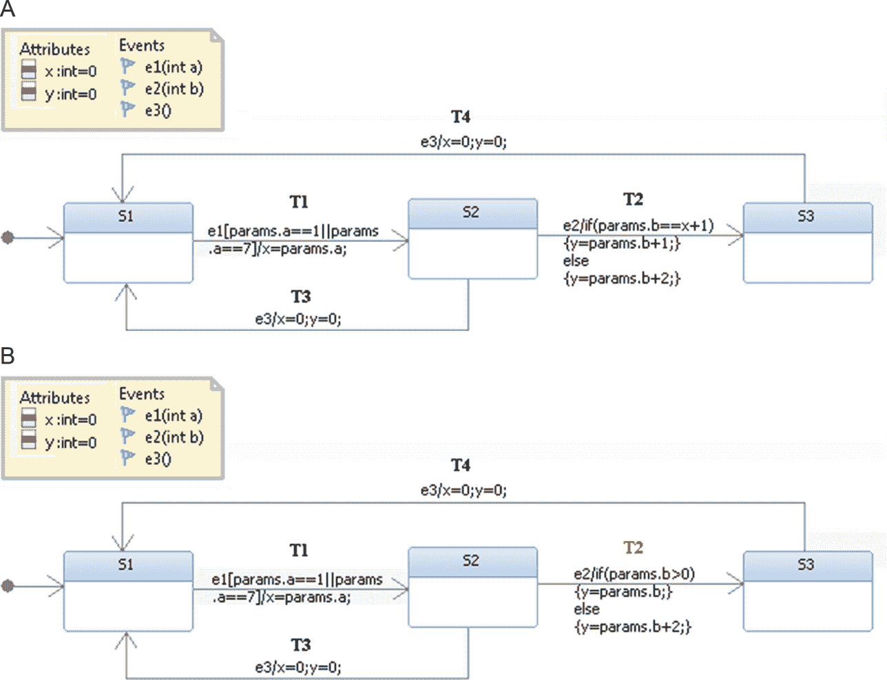

图 9 示例状态图的两个版本。(A) `V0`—示例状态图的基础版本。(B) `V1`—(A) 中状态图的修改版本。

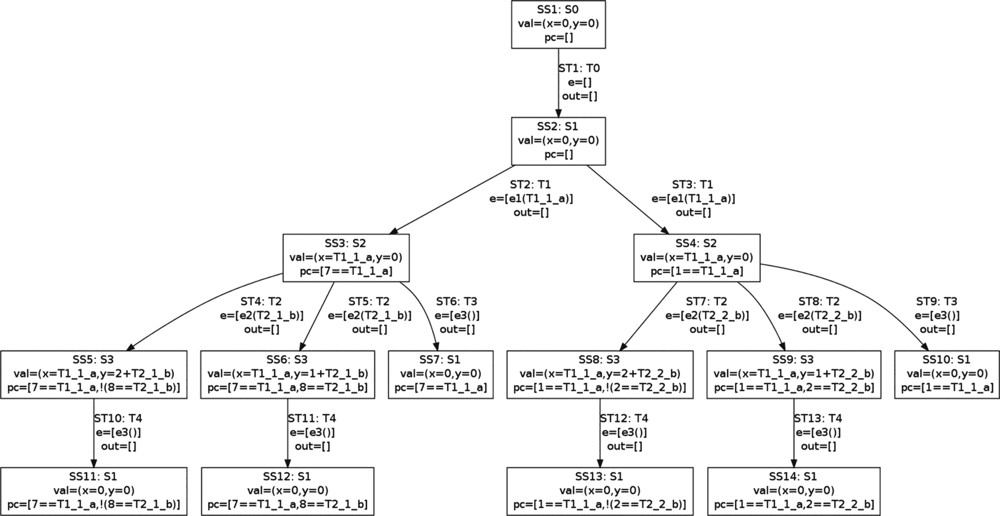

图 10 `SET(V0)`—图 9A 中状态图的符号执行树。


图 11 `SET(V1)`—图 9B 中状态图的符号执行树。(A) 与 `SET(V0)` 不同的部分已高亮（红色）。(B) 由转换部分探索导致的剪枝部分：`T1`、`T3` 和 `T4` 被置为灰色。

此外，我们可以使用图 9 中 `V0` 的 `SET` 以及图 10 中 `V1` 的 `MLMs` 来展示我们的优化技术如何适用于演化型的单个状态图。

因此，如果我们已经拥有了 `SET(V0)`，并且能够识别出其中为了考虑到对 `V1` 所做的更改而需要更新的部分，那么我们就可以引导 `V1` 的符号执行，仅生成新的更新部分以替换旧部分。运行这一过程的适用性和实用性取决于：首先，`SET(V0)` 是否存在；其次，重用它所节省的量，对于发生细微变化（即影响有限的更改）的大型复杂模型，这种节省可能是巨大的。

量化节省数量的可能方法有：
1. 避免从头生成 `SET(V1)` 所获得的时间；
2. `SET(V0)` 中可以安全重用的节点（或符号状态）的百分比；
3. `SET(V0)` 中可以安全重用的执行路径的百分比。

后一种指标的一个非常重要的益处是，它为我们提供了一个良好的估计，即从用于测试 `V0` 的 `SET(V0)` 中生成的测试用例有多少可以重用来测试 `V1`。我们注意到，模型中更改的位置可能意味着重用 `SET(V0)` 的有效性。我们认为，通常情况下，更改越靠近模型的初始状态，`SET(V0)` 中可重用的节点就越少。此外，越多的模型路径经过更改的状态或转换，对 `SET(V0)` 需要的更新就越多，重用 `SET(V0)` 的效果就越差。例如，在 `V1` 中状态 `S1` 或转换 `T1` 发生更改将需要更新 `SET(V0)` 中符号状态 `SS2` 的所有后代，仅留下两个符号状态供重用。

### 5.1.2 通过归约进行优化——一种面向分析的演进支持方法

首先，我们假设模型的基础版本（即更改之前的版本）已经成功通过分析，例如确定状态的可达性或生成测试用例。这一假设使得下文描述的优化成为可能。

其次，正如我们在第 4.1 节中讨论的，在 MLM 模型中转换 `t[i]` 的符号执行可能会导致在该模型的 `SET` 中产生零、一个或多个 `t[i]` 的符号转换，这取决于：
1. 代表 `t[i]` 源状态的符号状态的路径约束和变量赋值；
2. `t[i]` 守卫条件（guard condition）的可满足性；
3. `t[i]` 执行代码的执行路径数量。

例如，图 9 中两个版本模型中转换 `T1` 的符号执行产生了两个符号转换，连接了状态 `S1`（`T1` 的源状态）的符号状态 `SS2` 与状态 `S2`（`T1` 的目标状态）的符号状态 `SS3` 和 `SS4`。当 `a=7` 时采取第一个符号转换，而当 `a=1` 时采取第二个（这两个情况都是满足 `T1` 守卫条件的情况）。同样，由于 `T2` 的动作代码中包含条件语句，`T2` 的符号执行导致从每个符号状态 `SS3` 和 `SS4` 产生两个符号转换，并分别结束于符号状态 `SS5` 和 `SS6`（或 `SS8` 和 `SS9`）。另一方面，转换 `T3` 的动作代码中没有守卫或任何条件语句，其符号执行导致从每个符号状态 `SS3` 和 `SS4` 仅产生一个符号转换，分别结束于符号状态 `SS7` 和 `SS10`。同样，转换 `T4` 的符号执行导致从每个符号状态 `SS5`、`SS6`、`SS8` 和 `SS9` 分别产生一个符号转换，并分别结束于符号状态 `SS11`、`SS12`、`SS13` 和 `SS14`。

第三，正如第 2.3 节中的，在给定前一版本更改列表的情况下，对修改后的模型应用依赖分析，允许我们识别出模型中所有影响或被影响的部分。

现在，综上所述，我们的问题是：我们是否可以引导修改版本的符号执行，以充分探索更改的转换，并且仅对那些既不影响也不被更改影响的剩余转换进行最小化探索？我们的目标有两个：
1. 探索最小转换集（例如，揭示变为不可达的状态或必须运行的测试用例）；
2. 减少探索时间以及 `SET` 的大小。

例如，在给定 `T2` 已更改的情况下，对 `V1` 应用依赖分析显示 `T2` 与任何其他转换之间没有依赖关系。考虑到这些信息，我们可以引导 `V1` 的符号执行以充分探索 `T2`，并仅对其余部分进行部分探索。遵循这一过程对 `V1` 进行符号执行得到了图 11B 所示的 `SET`，它比 `SET(V1)` 少了六个符号状态。虽然新的 `SET` 不完整，但对于运行回归类型的分析已经足够了。

在本节中，我们展示了针对单个和通信式状态图（Statecharts）的 MSE 技术。所提方法的实现架构分别如图 15A 和 B 所示。

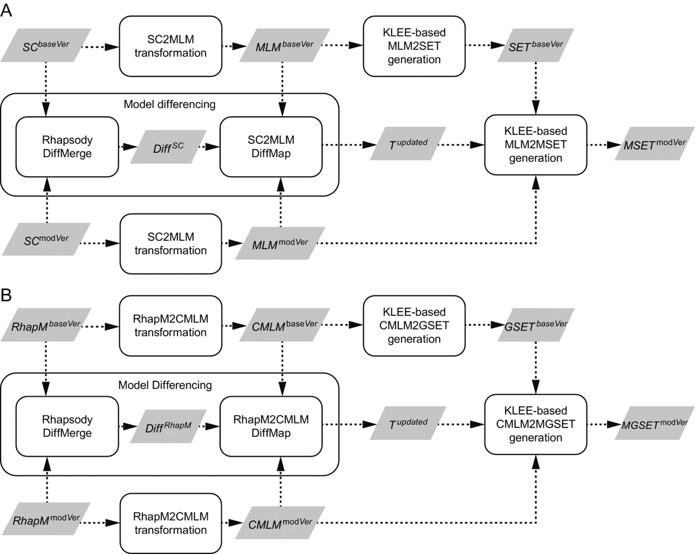

图 15 基于记忆化的符号执行 (MSE) 提议架构。(A) 用于演化单个状态图的 MSE 架构。(B) 用于演化通信状态图的 MSE 架构。

## 5.2.1.1 技术描述

该技术的根本思想是重用之前在更改前的模型版本上运行符号执行技术的结果，以优化在更改后的模型版本上进行的后续运行，使得只有受更改影响的 SET（或 GSET）部分需要重新生成。显然，该技术的一项关键要求是拥有更改前模型 SET（或 GSET）的存储版本。另一个要求是拥有一对之前模型版本所做的更改列表，这些列表将用于移除受更改影响的之前的 SET（或 GSET）部分，并将其相应的源节点（即符号状态或符号模型状态）标记为“需要更新”。在修改后的模型版本上重新运行 SE 技术将指导为这些标记节点生成所需的更新。

为了应对该技术的要求，我们需要在第 4 节中介绍的符号状态（或符号模型状态）定义中，作为符号执行树（或 GSET）定义的一部分添加以下两个特性：
1. 一个布尔属性 `needsUpdate`，用于指示给定的符号状态是否需要更新；
2. 一个哈希映射 `branchesToUpdate:S→ℙ(T)`，表示需要更新的状态及其相应的流出转换。

为了识别需要更新的节点和分支，我们需要为该技术提供修改后的模型版本与其之前版本之间所有差异的列表。我们的技术仅考虑可以映射到 MLM（或 CMLMs）表示中转换变化的模型子集。这包括：
1. 添加状态或转换；
2. 移除状态或转换；
3. 修改状态的进入或退出动作；
4. 修改转换的事件、守卫或动作。

例如，添加或移除状态可以用连接这些状态与模型中其他状态的转换添加或删除来表示；同样，更新状态的进入动作（或退出动作）可以用更新其入站转换（或流出转换）来表示。因此，我们能够将这些差异表示为一组更新的转换 `T^(updated)`，包含了所有在修改后的模型中被添加、删除或更新的转换。不支持其他类型的模型更改，例如变量（即类属性）的添加、删除或修改，因为这些更改会影响模型中每个状态的变量赋值，因此在更改后需要完整地生成模型的整个 SET。

为了找到两个 Rhapsody 模型之间的差异，我们使用了第 2.4 节中提到的 Rhapsody DiffMerge 工具。这些差异通过我们的“SC2MLM DiffMap”（或“RhapM2CMLM DiffMap”）组件映射到它们的 MLM（或 CMLMs）对应关系，该组件输出在修改后的 MLM（或 CMLMs）版本中发现已更新的所有转换集合 `T^(updated)`。`T^(updated)` 集合中的每个元素都表示受更改影响的转换名称、该转换的源状态名称以及应用于该转换的更改类型（即“添加”、“删除”、“修改”）。

我们针对单个状态图的 MSE 技术的主要组件是如图 15A 所示的“基于 KLEE 的 MLM2MSET 生成”组件。同样，通信状态图的主要组件是图 15B 所示的“基于 KLEE 的 CMLM2MGSET 生成”组件。实现每个组件的详细步骤分别列在算法 7 和算法 8 中。接下来我们将描述这两个组件的细节。

### 算法 7 化的 MLM 的记忆化符号执行 (MSE)

**输入：**
1. 修改后的 MLM 版本：`MLM^(modVer) = (S, V, EA, T, s[0], V[0])`
2. 之前的 MLM 版本 SET：`SET^(baseVer) = (SS, L, ST, ss[0])`
3. `MLM^(modVer)` 和 `MLM^(baseVer)` 之间所有更改的转换集合：`T^(updated)`

**输出：**
1. `MLM^(modVer)` 的记忆化 SET：`MSET^(modVer)`

**步骤：**
```
```


### 算法步骤

1. **任务 1**：以优先搜索的方式探索 `SET^(baseVer)`，以移除需要更新的部分（即子树），并在我们在 `MLM^(modVer)` 上重新运行标准 SE 时标记 `SET^(baseVer)` 中的节点以便重新探索。

2. `ss[0] ← (s[0], V[0])`

3. 创建队列 `q`

4. `q ← [ss[0]]`

5. 当 `q` 不空时：

6. 从 `q` 中移除第一个元素 `ss = (s, val, pc)`

7. 如果 `T^(updated)` 中存在 `t`，使得 `s = sourceState(t)` 且 `t` 被标记为“添加”，则

8. // 将 `ss` 标记为“需要更新”

9. `ss.needsUpdate ← true`

10. // 将状态 `s` 及其流出转换 `t` 添加 `ss` 的哈希映射 `branchesToUpdate`

11. `ss.branchesToUpdate ← ss.branchesToUpdate ∪ {s→ {t}}`

12. 结束

13. 对于 `ss` 的所有流出符号转换 `st = (ss, l, ss')`：

14. 如果 `T^(updated)` 中存在 `t`，使得 `sourceState(t) = ss.s` 且 `targetState(t) = ss'.s`，则

15. 断言 `t` 被标记为“修改”或“删除”

16. 从 `SET^(baseVer)` 中移除 `l` 及其所有子节点

17. 如果 `t` 被标记为“修改”，则

18. // 将 `ss` 标记为“需要更新”

19. `ss.needsUpdate ← true`

20. // 将状态 `s` 及其流出转换 `t` 添加到 `ss` 的哈希映射 `branchesToUpdate`

21. `ss.branchesToUpdate ← ss.branchesToUpdate ∪ {s→ {t}}`

22. 结束

23. 否则：

24. `q ← enqueue(q, ss')`

25. 结束

26. 结束循环

27. 结束循环

28. **任务 2**：遍历 `SET^(baseVer)`，并将所有不再被任何访问过的节点覆盖的叶符号状态的 `needsUpdate` 和 `branchesToUpdate` 属性分别设置为“true”和“All”

29. `SET^(baseVer) = Task2_helperMethod(SET^(baseVer))`

30. **任务 3**：重新探索 `SET^(baseVer)`，将 `MLM^(modVer)` 的标准符号执行结果合并到需要更新的部分

31. `q ← [ss[0]]`

32. // 为了包含检查的目的，创建一个访问过的符号状态集合

33. `SS^(preVisited) ← {}`

34. 当 `q` 不空时：

35. 从 `q` 中移除第一个元素 `ss = (s, val, pc)`

36. 如果 `ss` 有一个或多个流出符号转换，则

37. // 将 `ss` 记录在访问过的状态集合中

38. `SS^(preVisited) ← SS^(preVisited) ∪ {ss}`

39. // 将 `ss` 的流出符号转换的目标状态添加到队列

40. 对于 `ss` 的所有流出符号转换 `st = (ss, l, ss')`：

41. `q ← enqueue(q, ss')`

42. 结束循环


# 算法 8：演化 CMLM 的基于记忆化的符号执行 (MSE)

## 输入
1. 包含 `n` 个通信 MLM 的修改后 CMLM 模型版本：`M2 = (MLM^(M2), Q^(M2), s[0]^(M2), V^(M2), V[0]^(M2))`
2. 上一个 CMLM 模型版本 `M1` 的 GSET：`GSET^(M1) = (SS^(M1), L, ST, s[0]^(M1))`
3. `M2` 与 `M1` 之间所有变化的跳转集合：`T^(updated)`

## 输出
1. `M2` 的基于记忆化的 GSET：`MGSET^(M2)`

## 步骤

### 任务 1：探索 `GSET^(M1)`
以广度优先搜索的方式探索，移除需要更新的部分（即子树），并标记 `GSET^(M1)` 中的节点，以便在对 `M2` 重新运行标准符号执行 (SE) 时重新探索。

1. `s[0]^(M1) = (s[0]^(M1), V[0]^(M1), true, q[0]^(M1))`
2. 创建一个队列 `q`
3. `q <- [s[0]^(M1)]`
4. 当 `q` 不空时执行：
5. 从 `q` 中移除第一个元素 `ss^(M1) = (s^(M1), val, pc, q^(M1))`
6. 如果 `s^(M1)` 中存在 `s1` 且 `T^(updated)` 中存在 `t`，使得 `s1 = sourceState(t)` 且 `t` 被标记为“Added”：
7. 标记 `ss^(M1)` 为“needsUpdate”
8. `ss^(M1).needsUpdate = true`
9. 将状态 `s1` 及其输出跳转 `t` 添加到 `ss^(M1)` 的哈希表 `branchesToUpdate` 中
10. `ss^(M1).branchesToUpdate = ss^(M1).branchesToUpdate ∪ {s -> t}`
11. 否则：
12. `q <- enqueue(q, ss'^(M1))`
13. 对于 `ss^(M1)` 的所有输出符号跳转 `st = (ss^(M1), l, ss'^(M1))` 执行：
14. 如果 `T^(updated)` 中存在 `t`，使得 `sourceState(t) in ss^(M1).s^(M1)` 中且 `targetState(t) 在 ss'^(M1).s^(M1)` 中：
15. 断言 `t` 被标记为“Modified”或“Deleted”
16. 从 `SET^(M1)` 中移除 `l` 和带有所有子节点的 `ss'^(M1)`
17. 如果 `t` 被标记为“Modified”：
18. 标记 `ss^(M1)` 为“needsUpdate”
19. `ss^(M1).needsUpdate = true`
20. 将状态 `s1` 及其输出跳转 `t` 添加到 `ss^(M1)` 的哈希表 `branchesToUpdate` 中
21. `ss^(M1).branchesToUpdate = ss^(M1).branchesToUpdate ∪ {s -> t}`
22. 结束
23. 结束

### 任务 2：遍历 `GSET^(M1)`
遍历 `SET^(M1)`，并将所有不再被任何先访问节点包含的叶节点状态的属性 `needsUpdate` 和 `branchesToUpdate` 分别设置为“true”和“All”。

1. `SET^(modVer) = Task4Method(SET^(baseVer))`

### 任务 3：重新探索 `GSET^(M1)`
对于需要更新的部分，合并 `M2` 符号执行的结果。

1. `q <- [s[0]^(M1)]`
2. 创建一个用于包含检查（subsumption）的先访问状态集合
3. `SS^(preVisited) = {}`
4. 当 `q` 为空时：
5. 从 `q` 中移除第一个元素 `ss^(M1) = (s^(M1), val, pc, q^(M1))`
6. 如果 `ss^(M1)` 有一个或多个输出跳转：
7. 在先访问模型状态集中记录 `ss^(M1)`
8. `SS^(preVisited) = SS^(preVisited) ∪ {ss^(M1)}`
9. 将 `ss^(M1)` 输出跳转的所有目标状态添加到队列
10. 对于 `ss^(M1)` 的所有输出符号跳转 `st = (ss^(M1), l, ss'^(M1))` 执行：
11. `q <- enqueue(q, ss'^(M1))`
12. 结束
13. 结束
14. 如果 `ss^(M1).needsUpdate`：
15. 仅考虑 `ss^(M1)` 哈希表 `branchesToUpdate` 中的状态和跳转，对模型版本 `M2` 重新运行 SE
16. 对于 `MLM^(M2)` 中的所有 `MLM[i]` 执行：
17. `s[i] = s^(M2)(i)` 其中 `s[i] in Si`
18. 如果在 `ss^(M1)` 的 `branchesToUpdate` Map 中找到 `s[i]`：
19. 对于 `s[i]` 的所有输出跳转 `t[i] = (s[i], e, eA, A, s[i]')` 执行：
20. 如果在 `ss^(M1)` 的 `branchesToUpdate` Map 中找到 `t[i]`：
21. 如果 `(q^(M2) = ϕ)` 且 `(e in Ei)` 或 `((head(q[i]^(M2)) = e) 且 (e in Ei))`：
22. 创建唯一 `V^s`，与跳转的事件参数 `eA` 一一对应
23. 在 `eA` 和 `V^s` 之间创建一个映射 `σ`
24. 将守卫 `G` 和动作代码 `A` 中变量 `x ∈ eA` 的所有出现替换为 `σ(x)` 以获得 `G^s ← σ(G)` 和 `A^s ← σ(A)`
25. 如果 `G^s` 在给定 `val` 和 `pc` 下可满足：
26. `feasiblePaths <- SymbolicExecutionOfCode(A^s, val, G^s, pc)`
27. 对于所有 `feasiblePath = (val', pc', out') ∈ feasiblePaths` 执行：
28. 创建一个新的符号状态 `ss' = (s', val', pc')`
29. 如果 `ss'` 未被 `SS^(preVisited)` 中任何先生成的符号状态包含：
30. `ss'.needsUpdate = true`
31. `ss'.branchesToUpdate = "All"`
32. `SS <- SS ∪ {ss'}`
33. 创建一个新的标签 `l' = (e, V^s, σ, out')`
34. `L <- L ∪ {l'}`
35. 创建一个新的符号跳转 `st' = (ss, l', ss')`
36. `ST <- ST ∪ {st'}`
37. `q <- enqueue(q, ss')`
38. 结束
39. 结束
40. 结束
41. 结束
42. 结束
43. 结束
44. 结束
45. 结束
46. 结束
47. 结束
48. 结束

```
61: 将 `ss′^(M2)` 相对于 `s′^(M2)` 中的所有“All”状态及其所有“All”出转移标记为“needsUpdate”
62: `SS^(M1) ← SS^(M1) ∪ {ss′^(M2)}`
63: 创建新标签 `l’ = (e, V^s, σ, out’)`
64: `L ← L ∪ {l’}`
65: 创建新符号转移 `st’ = (ss^(M1), l’, ss′^(M2))`
66: `ST ← ST ∪ {st’}`
67: //在预访问的符号模型状态集合中记录 `ss′^(M2)`
68: `SS^(preVisited) ← SS^(preVisited) ∪ {ss′^(M2)}`
69: `q ← enqueue(q, ss′^(M2))`
70: end if
71: end for
72: end if
73: end if
74: end if
75: end for
76: end if
77: end for
78: end if
79: end while
80: //任务 4（可选）：遍历 `GSET^(M1)` 并移除任何可以被其他节点（在同一层次级或更高层级）包含的节点
81: `GSET^(M1) = Task4_helperMethod(GSET^(M1))`
82: `GST^(M2) ← GST^(M1)`
```

这两个组件的三个输入都是：(1) 修改后的模型版本 `MLM^(modVer)`（对应 `CMLM^(modVer)`）的 `MLM` 表示，(2) 在修改后的模型版本中已更新的转移集合 `T^(updated)`，以及 (3) 要重用的 `SET^(baseVer)`（对应 `GSET^(baseVer)`）。

这两个组件都会执行四个连续的任务的任务。

### 任务 1
第一个任务是加载并探索输入的 `SET^(baseVer)`（对应 `GSE– T^(baseVer)`），以达到以下目的：(1) 移除所有代表属于更新转移集合 `T^(updated)` 的边（注意，移除边会导致移除以该边目标节点为根的整个子树），以及 (2) 将所有表示具有属于 `T^(updated)` 出转移的状态的符号状态（对应符号模型状态）相对于这些出转移标记为“需要更新”。这是通过更新每个此类符号状态（对应符号模型状态）的 `needsUpdate` 和 `branchesToUpdate` 属性来实现的。

### 任务 2
由于上一个任务的结果，我们可能会在生成的 `SET^(baseVer)`（对应 `GSET^(baseVer)`）中发现一些丢失了包含节点的叶子节点。在这种情况下，我们还需要将这些叶子节点相对于其对应模型状态的所有出转移标记为“需要更新”。因此，这两个组件的第二个任务是遍历上一个任务生成的 `SET^(baseVer)`（对应 `GSET^(baseVer)`）中的节点，并将不再被包含的所有叶子符号状态（对应符号模型状态）的 `needsUpdate` 和 `branchesToUpdate` 属性分别设置为“true”和“All”。为了简便起见，省略了该任务的详细描述。

### 任务 3
这两个组件的第三个任务是重新探索上任务生成的 `SET^(baseVer)`（对应 `GSET^(baseVer)`），以找到所有需要更新的符号状态（对应符号模型状态）。对于每个此类符号状态（对应符号模型状态），我们在修改模型版本 `MLM^(modVer)`（对应 `CMLM^(modVer)`）上重新运行 SE 技术。这种策略与我们之前使用的 [94] 方法不同，我们在通过对 Statecharts 应用 MSE 技术时发现，该方法会生成更大的 SETs。

1. **(1) 初始更新策略 (INUS)**：我们的初始更新策略依赖于通过在基于某些额外参数的修改模型版本上运行调整后的 SE，独立地生成更新标记为“需要更新”的符号状态（对应符号模型状态）的子树（即一次一个，并以广度优先的方式）。这些额外参数决定了探索的起始位置（即开始探索的符号状态）、在首次探索该状态时考虑哪些更新转移，以及用于包含检查的已探索符号状态集合。运行此调整后的 SE 生成的子 SETs 将与它们在 `SET^(baseVer)` 中对应的符号状态合并。

2. **(2) 调整节点更新策略 (ANUS)**：克服初始节点更新策略中局限性的一种可能方案是在识别出需要更新的符号状态（对应符号模型状态）时，实时在修改模型版本上运行 SE。在这种情况下，需要更新节点的子 SETs 的构建是共同（并发）进行的，而不是像初始策略那样顺序执行。这种策略可以克服初始策略提出的部分（但不是全部）局限性。

两种更新策略的逐步插图分别在图 16 和图 17 中展示，用于更新图 18 中示例 `SET` 中的节点 `2` 和 `5`。请注意：(1) 节点根据其创建顺序标记；(2) 节点标签中的前导零表示创建该节点的 `SE` 技术重新运行次数。应用每种更新策略后生成的 `SETs` 之间的比较见图 19。在上述两种节点更新策略之一之后，现有节点与新创建节点之间存在未被检测的包含关系的场景演示见图 20。在这种场景下，根节点 `0` 相对于新添加的红色分支标记为“需要更新”。遵循任一更新策略都会生成由节点 `001`、`002` 和 `003` 组成的子树。假设现在现有节点 `5` 与新创建的节点 `001` 之间存在包含关系。在这种情况下，节点 `02`、`03`、`06` 和 `07` 被视为额外节点。这是因为在节点 `5` 和 `001` 之间新检测到的包含关系在节点 `001` 创建之前以及在生成节点 `02`、`03`、`06` 和 `07` 期间都不存在。

![图 16 在 MSE 早期版本实现中使用的初始节点更新策略演示 [94, 95]。节点根据其创建顺序标记，节点标签中的前导零表示创建该节点的 SE 技术重新运行次数。(A) 步骤 1：在给定预访问节点 = {0, 1, 2, 3, 4, 5, 6} 的情况下重新探索节点 2。(B) 步骤 2：将更新节点 2 的子树与原始 SET 合并。(C) 步骤 3：在给定预访问节点 = {0, 1, 2, 3, 4, 5, 6, 01, 02, 03, 04, 05} 的情况下重新探索节点 5。(D) 步骤 4：将更新节点 5 的子树与原始 SET 合并。](images/S0065245817300487/f04-16-9780128151198.jpg)

图 16 在 MSE 早期版本实现中使用的初始节点更新策略演示 [94, 95]。节点根据其创建顺序标记，节点标签中的前导零表示创建该节点的 SE 技术重新运行次数。(A) 步骤 1：在给定预访问节点 = {0, 1, 2, 3, 4, 5, 6} 的情况下重新探索节点 2。(B) 步骤 2：将更新节点 2 的子树与原始 SET 合并。(C) 步骤 3：在给定预访问节点 = {0, 1, 2, 3, 4, 5, 6, 01, 02, 03, 04, 05} 的情况下重新探索节点 5。(D) 步骤 4：将更新节点 5 的子树与原始 SET 合并。

![图 17 算法 7 和 8 所示的 MSE 当前版本实现中使用的自适应节点更新策略——单层深度探索，并将生成的节点（若未被预访问节点包含）标记为“需要更新”。节点根据其创建顺序标记，节点标签中的前导零表示创建该节点的 SE 技术重新运行次数。(A) 步骤 1：在给定预访问节点 = {0, 1, 2, 3, 4, 5, 6} 的情况下对节点 2 进行单层深度探索。生成的节点 01 被标记（双圈）为“需要更新”。(B) 步骤 2：在给定预访问节点 = {0, 1, 2, 3, 4, 5, 6, 01} 的情况下对节点 5 进行单层深度探索。生成的节点 02 被标记（双圈）为“需要更新”，而生成的节点 03 发现被给定的某个预访问节点包含。(C) 步骤 3：在给定预访问节点 = {0, 1, 2, 3, 4, 5, 6, 01, 02, 03} 的情况下对节点 01 进行单层深度探索。生成的节点 04 和 05 均被发现被给定的某个预访问节点包含。注意节点 04 和 02 之间存在包含关系。(D) 步骤 4：在给定预访问节点 = {0, 1, 2, 3, 4, 5, 6, 01, 02, 03, 04, 05} 的情况下对节点 02 进行单层深度探索。生成的节点 06 和 07 均被发现被给定的某个预访问节点包含。](img/f04-17-978012815198.jpg)

图 17 算法 7 和 8 所示的 MSE 当前版本实现中使用的自适应节点更新策略——单层深度探索，并将生成的节点（若未被预访问节点包含）标记为“需要更新”。节点根据其创建顺序标记，节点标签中的前导零表示创建该节点的 SE 技术重新运行次数。(A) 步骤 1：在给定预访问节点 = {0, 1, 2, 3, 4, 5, 6} 的情况下对节点 2 进行单层深度探索。生成的节点 01 被标记（双圈）为“需要更新”。(B) 步骤 2：在给定预访问节点 = {0, 1, 2, 3, 4, 5, 6, 01} 的情况下对节点 5 进行单层深度探索。生成的节点 02 被标记（双圈）为“需要更新”，而生成的节点 03 发现被给定的某个预访问节点包含。(C) 步骤 3：在给定预访问节点 = {0, 1, 2, 3, 4, 5, 6, 01, 02, 03} 的情况下对节点 01 进行单层深度探索。生成的节点 04 和 05 均被发现被给定的某个预访问节点包含。注意节点 04 和 02 之间存在包含关系。(D) 步骤 4：在给定预访问节点 = {0, 1, 2, 3, 4, 5, 6, 01, 02, 03, 04, 05} 的情况下对节点 02 进行单层深度探索。生成的节点 06 和 07 均被发现被给定的某个预访问节点包含。


图 18 示例 SET 中的节点 2 和 5 对于某些输出分支标记为“需要更新”。节点根据其创建顺序标记。


图 19 两种节点更新策略之间的比较，显示 (A) 节点 02 和 001 之间未被检测的包含关系 (SR) 导致了额外节点 04 和 05。(A) 初始节点更新策略生成的较优 MSET。(B) 自适应节点更新策略生成的更优 MSET。


图 20 节点 `5` 和 `001` 之间未被检测的包含关系 (SR) 的可能场景演示，导致了额外节点 `02`、`03`、`06` 和 `07`。

### 任务 4
由于上一个任务生成的 `SETs`（或 `GSETs`）可能包含一些额外的符号状态（或符号模型状态），两个组件中需要执行的最后一个任务是检测并移除这些额外的符号状态（或符号模型状态）。该任务的详细描述非常直观，为了起起予以省略。

在表 1 中，我们强调了实现两个组件上述四个任务的每个算法步骤。

表 1：组件任务及其对应的算法步骤

| 任务 | 组件 |
| :--- | :--- |
| KLEE-Based CMLM2MSET Generation | KLEE-Based CMLM2MGSET Generation |

| 任务 1 | | 算法 7, 第 1–27 行 | 算法 8, 第 1–27 行 |
| --- | --- | --- | --- |
| 任务 2 | | 算法 7, 第 28–29 行 | 算法 8, 第 28–29 行 |
| 任务 3 | | 算法 7, 第 30–68 行 | 算法 8, 第 30–79 行 |
| 任务 4（可选） | | 算法 7, 第 69–70 行 | 算法 8, 第 80–81 行 |

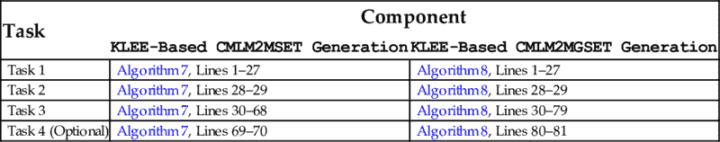

这两个组件的输出都是基于备化的修改后模型版本的 SET（或 GSET），即 `MSET^(modVer)`（或 `MGSET^(modVer)`），它共享了旧树 `SET^(baseVer)`（或 `GSET^(baseVer)`）中所有可重重用的部分，但也包含了由于对新版本模型中被发现变化的部分进行符号执行（SE）而产生的修改。我们使用基于树的数据结构来表示、存储、检索和操作这些 SETs。

## 示例 5

对在图 9B` 的修改后模型应用 MSE，分别生成了在图 11A`）上应用 MSE 所获得的节省量，是通过重用节点（用黑色标记）占最终生成的 `MSET`（或 `MGSET`）总节点数的百分比来衡量的。我们可以看到，图 11A 中 `MSET(V1)` 获得的节省量等于 `6/14`（即约 43%），而图 13 中 `MGSET(AB^(V1))` 获得的节省量等于 `11/21`（即约 52%）。

显然，在某些情况下，MSE 带来的节省量可能是最小的，取决于重用的树节点以及需要更新的树节点的位置。在这种情况下，选择 MSE 还是标准 SE 是分析人员的决策。

### 5.2 讨论

我们将 MSE 视为一种面向构件的技术示例，因为随着系统的演化，它可以用于优化一类中间产物（在本例中，它们以 SET 的形式存在）的生成。在任何时刻，这些中间产物都是维护良好的（即最新的）且完整的（即它们代表了相应模型的所有执行路径），因此可以用于任何基于 SET 的分析。

尽管如此，通过将 MSE 生成的 `MSETs`（或 `MGSETs`）中的新部分与重用部分分开，我们可以使用这些新部分来运行基于回归的分析。从这个意义上说，MSE 也可以被视为面向分析的技术示例，这意味着如果在此更改之前对给定模型执行过某项分析，那么仅使用更改后生成的 `MSETs`（或 `MGSETs`）模型的新部分将允许我们重新运行相同的分析，并得出更改后模型的整体正确结论。

## 5.2.2 基于依赖的符号执行

在本节中，我们展示了针对单个和通信 Statecharts 的 `DSE` 技术（[S0065245817300487_3.xhtml#fn0030]）。所提方法的实现架构分别如图 21A 和 B 所示。


图 21 基于依赖的符号执行 (DSE) 提议架构。(A) 用于演化单个 Statecharts 的 DSE 架构。(B) 用于演化通信 Statecharts 的 DSE 架构。

### 5.2.2.1 技术描述

该技术的核心思想是生成修改后模型版本完整 SET 的子集（或部分视图），该子集表征了受更改影响的所有模型路径，并足以执行基于回归的分析。为了实现这一点，我们将基于依赖的变更影响分析与我们的标准 SE 技术相结合，以便能够引导后续的 SE 运行充分探索受更改影响的模型转换，并部分探索不受影响的模型转换。对模型转换的完全探索意味着考虑从符号执行转换转换和动作代码产生的所有符号路径，而部分探索意味着仅考虑这些符号路径中的之一。

注意，只有具有多路径转换（即动作代码中具有互斥的边界条件）的模型才能从该技术中受益。我们发现这种模型特性在现有的 Simulink/Stateflow 模型中被广泛使用。在 5.1 节的模型示例中，图 9 所示的两个组件“模型差异”和“基于依赖的变更影响分析”来实现。

为了实现“模型差异”组件，我们遵循之前相同的程序。首先使用 `Rhapsody DiffMerge` 查找两个 Rhapsody 模型之间的差异，然后使用我们的 `SC2MLM DiffMap`（或 `RhapM2CMLM DiffMap`）组件将这些差异映射到对应的 MLM（或 CMLMs）。如所述，这种情况的输出表示修改后 MLM（或 CMLMs）版本中发现更新的所有转换集合 `T^(updated)`。

为了实现“基于依赖的变化影响分析”组件，我们考虑了第 2.3 节中讨论的两种类型依赖：数据依赖（DD）和通信依赖（COMD）。这两种类型依赖的正式定义以及计算它们的算法已在第 2.3 节中提供。

该组件的两个输入是：(1) 修改模型版本 `MLM^(modVer)`（相应 `CMLM^(modVer)`）的 MLM（相应 CMLMs）表示，以及 (2) 在修改后的模型版本中已更新的转换集合 `T^(updated)`。该组件执行的第一项任务是计算输入模型版本中转换之间的数据依赖和通信依赖。执行的第二项任务是识别出与 `T^(updated)` 中任何转换具有依赖关系（DD 或 COMD）的转换集合 `T^(impacted)`。该组件的输出是 `T^(updated)` 和 `T^(impacted)` 的并集；这些转换就是我们在对修改模型版本 `MLM^(modVer)`（相应 `CMLM^(modVer)`）上运行 DSE 技术时需要充分探索的转换。

执行的最后一个任务是根据“基于依赖的变化影响分析”组件生成的更新/影响转换列表，对修改后的模型版本运行符号执行。定义了两种探索模式：“完全”（full）和“部分”（partial）。“完全”探索模式要求对给定转换的所有执行路径（即符号转换）进行完整探索，并应用于所有被发现已更新或受影响的转换。然而，“部分”探索模式只需要执行已探索转换的单条路径（即符号转换），并应用于被发现既未更新也受影响的转换。执行此项任务的组件包括：用于单个 Statecharts 的如图 21A 所示的“基于 KLEE 的 MLM2DSET 生成”组件，以及用于通信 Statecharts 的如图 21B 所示的“基于 KLEE 的 CMLM2DGSET 生成”组件。每个组件实现此任务的算法分别列在算法 9 和算法 10 中。

### 算法 9：演化 MLM 的基于依赖符号执行 (DSE)

**输入：**
1. 修改后的 MLM 模型版本：`MLM^(modVer) = (S, V, E, EA, T, s[0], V[0])`
2. 所有变化转换及其影响转换的集合：`T^(ofInterest) = T^(updated) ∪ T^(impacted)`

**输出：**
1. `MLM^(modVer)` 基于依赖的 SET：`DSET^(modVer) = (SS, L, ST, ss[0])`

**步骤：**
1. `ss[0] ← (s[0], V[0], true)`
2. `S ← {ss[0]}`
3. `L ← {}`
4. `ST ← {}`
5. 创建一个队列 `q`
6. `q ← [ss[0]]`
7. //以广度优先的方式遍历 MLM
8. `while q is not empty do`
9. 从 `q` 中移除第一个元素 `ss = (s, val, pc)`
10. `for s 的所有出 转换 t = (s, e, eA, G, A, s') do`
11. 创建一个新变量的集合 `V^s`，其与转换事件的参数 `eA` 一一对应
12. 在 `eA` 和 `V^s` 之间建立映射 `σ`
13. 将守卫表达式 `G` 和动作代码 `A` 中变量 `x` ∈ `eA` 的所有出现处替换为 `σ(x)`，得到 `G^s ← σ(G)` 和 `A^s ← σ(A)`
14. `if G^s 在给定 val 和 pc 下是可满足的 then`
15. `feasiblePaths ← SymbolicExecutionOfCode(A^s, val, G^s, pc)`
16. `if t⨄ T^(ofInterest) then`
17. //完全探索模式
18. `for feasiblePaths 中所有的 feasiblePath = (val', pc') do`
19. `ss’ = (s', pc')`
20. `if ss’ 未被覆盖 then`
21. `SS ← {ss’}`
22. 创建一个新的标签 `l’ = (e, V^s)`
23. `L ← {l’}`
24. 创建一个新的符号转换 `st’ = (ss, pc')`
25. `ST ← {st’}`
26. `q ...`
27. `end`
28. `else`
29. //部分探索模式
30. `仅选择一个 feasiblePath = (val', pc')`
31. `ss’ = (s', pc')`
32. `if ss’ 未被覆盖 then`
33. `SS ← {ss’}`
34. 创建一个新的标签 `l’ = (e, V^s)`
35. `L ← {l’}`
36. 创建一个新的符号转换 `st’ = (ss, l’)`
37. `ST ← {st’}`
38. `q ...`
39. `end`
40. `end`
41. `end`
42. `for`
43. `end`

### 算法 10：演化 CMLM 的基于依赖符号执行 (DSE)

**输入：**
1. 修改的 CMLM 模型版本：`M = (MLM^(modVer), ..., s[0], V[0])`
2. 所有变化转换及其影响转换的集合：`T^(ofInterest) = T^(updated) ∪ T^(impacted)`

**输出：**
1. `M` 基于依赖的 GSET：`DGSET^M = (SS, L, ST)`

**步骤：**
1. `ss[0] ← (s[0], V[0], true, V[0])`
2. `SS ← {ss[0]}`
3. `L ← {}`
4. `ST ← {}`
5. 创建一个队列 `q`
6. `q ← [ss[0]]`
7. //以广度优先的方式遍历 MLM
8. `while q is not empty do`
9. 从 `q` 中移除第一个元素 `ss^M = (s^M, val^M, pc^M, V^M)`
10. `for M 中的每个 MLM do`
11. `s[i] ← s[i]`
12. `for s[i] 的所有出 转换 t[i] = (s[i], e, eA, G, A, s') do`
13. `if (t[i]⨄ Q[i]^(M)) ∨ (t[i]⨄ E[i]^(M)) then`
14. 创建一个新变量的集合 `V^s`，其与转换事件的参数 `eA` 一一对应
15. 在 `eA` 和 `V^s` 之间建立映射 `σ`
16. 将守卫表达式 `G` 和动作代码 `A` 中变量 `x` ∈ `eA` 的所有出现处替换为 `σ(x)`，得到 `G^s ← σ(G)` 和 `A^s ← σ(A)`
17. `if G^s 在给定 val^M 和 pc^M 下是可满足的 then`
18. `feasiblePaths ← SymbolicExecutionOfCode(A^s, val^M, G^s, pc^M)`
19. `if t[i]⨄ T^(ofInterest) then`
20. //完全探索模式
21. `for feasiblePaths 中所有的 feasiblePath = (val', pc', out') do`
22. `ss’^M = (s', val', pc')`
23. `if ss’^M 未被 SS 中任何已生成的符号状态覆盖 then`
24. `SS ← SS ∪ {ss’^M}`
25. 创建一个新的标签 `l’ = (e, V^s, σ, out’)`
26. `L ← L {l’}`
27. 创建一个新的符号转换 `st’ = (ss, l’, ss’)`
28. `ST ← ST {st’}`
29. `q ← enqueue(q, ss’^M)`
30. `end`
31. `else`
32. //部分探索模式
33. `仅选择一个 feasiblePath = (val', pc', out')`
34. `ss’^M = (s', val', pc')`
35. `if ss’^M 未被 SS 中任何已生成的符号状态覆盖 then`
36. `SS ← SS ∪ {ss’^M}`
37. 创建一个新的标签 `l’ = (e, V^s, σ, out’)`
38. `L ← L {l’}`
39. 创建一个新的符号转换 `st’ = (ss, l’, ss’)`
40. `ST ← ST {st’}`
41. `q ← enqueue(q, ss’^M)`
42. `end`
43. `end`
44. `end`
45. `for`
46. `end`
47. `end while`


Create a new label, `l’ = (e, V^s, σ, out’)`

`L ← L ∪ {l’}`

Create a new symbolic transition, `st’ = (ss^M, l’, ss′^M)`

`ST ← ST ∪ {st’}`

`q ← enqueue(q, ss′^M)`

end if

end for

else

//Partial-exploration mode

Select only one `feasiblePath = (val’, pc’, out’) ∈ feasiblePaths`

`q′^M←out′`

Create a new symbolic state, `ss^M = (s′^M, pc′, q′^M)` where `s′^M = s^M.replace(s[i], i)`

if `ss′^M` is not subsumed by any previously generated symbolic state in `SS^M` then

`SS^M ← SS^M ∪ {ss′^M}`

Create a new label, `l’ = (e, V^s, σ, out’)`

`L ← L ∪ {l’}`

Create a new symbolic transition, `st’=(ss^M, l’, ss′^M)`

`ST ← ST ∪ {st’}`

`q ← enqueue(q, ss′^M)`

end if

end if

end if

end for

end for

end while

```

## 示例 6

在模型版本 `V1` 上应用我们基于依赖的变更影响分析，将不会在依赖于修改后的转换 `T2` 的数据依赖列表中报告转换 `T1`。结果是仅对转换 `T1` 进行了部分探索，并且由于它是一个多路径转换，因此只考虑了一条可行路径（即一个符号转换），并修剪了其他路径。同样地，在模型版本 `AB^(V1)` 上应用我们基于依赖的变更影响分析，将不会在依赖于修改后的转换 `itsA-T2` 的数据或通信依赖的列表中报告转换 `itsA-T1`。结果是仅对转换 `itsA-T1` 进行了部分探索，并且由于它是一个多路径转换，因此只考虑了一条可行路径（即一个符号转换），并修剪了其他路径。应用 `DSE` 带来的节省量通过部分探索模式下被修剪节点的百分比来衡量。我们可以看到，在图 11B 中 `DSET(V1)` 获得的节省约等于 43%，这是 6 个被修剪节点（这些是灰色节点）占完整 SET 节点总数的百分比。同样地，在图 14 中 `DGSET(AB^(V1))` 获得的节省约等于 43%，这是 9 个被修剪节点（这些是灰色节点）占完整 GSET 节点总数（21 个节点）的百分比。

### 5.2 讨论

假设这里基于 SET 的分析类型是检查系统没有死胡同。在给定的 SET 中，一个未被树中任何其他节点包含的树叶节点可能表示 (1) 到达了先访问过的状态，(2) 达到了某些循环的深度限制，或 (3) 到达了死胡同状态。在我们的示例中，任何转换中既没有终止状态也没有循环。因此，在这种情况下，一个未被任何其他节点包含的 SET 叶节点将指示一个死胡同。此外，假设分析师对 `GSET(AB^(V0))` 执行了此类分析，并得出 `AB^(V0)` 没有死胡同的结论。在这种情况下，对 `DGSET(AB^(V1))` 实施相同类型的分析（它是 `GSET(AB^(V1))` 的部分视图），将对于检查 `AB^(V1)` 是否有死胡同是足够的。通过检查 `DGSET(AB^(V1))` 的叶子节点，我们可以看到符号状态 `ss5` 没有被树中的任何其他节点包含，因此我们可以得出 `AB^(V1)` 有死胡同的结论。通过检查 (1) 该符号状态 `ss5` 的变量赋值和队列内容以及 (2) 由事件 `e5` 触发的状态 `s2` 的输出转换 `itsB-T3`，我们可以看到该转换的守卫对于给定的参数值来说是不可满足的。由于 `DGSET(AB^(V1))` 只代表了完整 `GSET(AB^(V1))` 的子集，我们无法用它执行不同类型的分析。从这个意义上说，`DSE` 被认为是一种面向分析的方法。

### 5.3 MSE 还是 DSE？

基于对每个技术背后思想的讨论，我们得出结论：

- 对于 **MSE**，我们需要访问原始模型（即变更前的模型）的 `SET`（或 `GSET`）以便复，我们需要识别模型新版本与原始版本之间的差异。我们推测这种技术的有效性可能高度取决于变更的位置。生成的 `MSET`（或 `MGSET`）代表修改后模型（即变更后的模型）的所有执行路径，因此可以用于所有基于 SET 的分析。然而，如果目标是重新建立之前的分析结果，也可以只对 `SET` 中变化过的部分运行回归分析。

- 对于 **DSE**，我们需要识别模型新版本与原始版本之间的差异，并集成依赖分析以识别变更的影响。我们推测具有复杂守卫和动作代码的模型可能从这种技术中受益最深。由于生成的 `DSET`（或 `DGSET`）可能不完整，并且遗漏了保证未受变更影响的执行，因此它只能运行回归类型的分析。

话虽如此，我们认为这两种优化技术是互补的，体现在它们可以实现相同的目的，但在不同情况下最有用，而选择其中一种是分析师的角色。例如，从之前的分析中获取可用的 `SET` 是应用 **MSE** 的基本要求，而所研究模型中转换的守卫或动作代码的复杂性是 **DSE** 有效性的关键因素。

### 5.4 总结

在本节中，我们展示了两种符号执行优化技术，**MSE** 和 **DSE**，分别适用于演进的个体和通信状态图。我们首先通过示例解释了每个技术背后的思想。其次，我们介绍了我们针对这两种技术提出的架构，并提供了每个架构中不同组件所需的描述。

## 6 实现

在本节中，我们对实现决策进行高层级描述，这些决策用于构建在第 4 节的标准 SE 以及第 5 节中的 **MSE** 和 **DSE** 中述的架构。图 22 显示了实现这些架构中每个组件所需的操作系统和所用技术。我们首先强调了根据这项研究工作的需求所做的实现决策。其次，我们提供了三个核心任务的细节。这些任务是 (1) 与符号执行引擎 `KLEE` 的交互，(2) 在 IBM Rational Rhapsody `RulesComposer` 环境中构建模型转换和文本生成，以及 (3) 与 IBM Rational Rhapsody `DiffMerge` 工具的交互。

我们所做的大多数实现决策都是基于以下两个主要需求。

1. (1) 我们用于开展研究的基于状态模型的上下文和类型。这一方面的决策是基于我们的工业合作伙伴的兴趣而提出的，即为在 IBM Rational Rhapsody MDE（模型驱动工程）工具背景下开发的基于状态的模型（state-based models）提供此类分析能力，这些模型被称为 `Rhapsody Statecharts`。我们发现，虽然使用专有的商业工具在质量和文档方面具有优势，但它们在某种程度上限制了开发某些外部功能或过程、以及处理其创建的产物的选择。因此，我们决定使用 IBM 相关的工具来实现所需的组件（例如，用于模型转换和自定义代码生成的 `IBM Rational Rhapsody Developer RulesComposer Add-On`，以及用于模型差异的 `IBM Rational Rhapsody DiffMerge`）。

2. (2) 用于分析待分析状态模型中遇到的动作代码的符号执行引擎。我们的决定是使用 `KLEE` 符号执行引擎——一种用于 C 代码的开源符号执行引擎。在检查了构建能够与 `KLEE` 交互的 API 的可行性后，我们做出了这一决定。在第 6.2 节中，我们对该过程提供了更详细的描述。为了能够使用 `KLEE` 对 Rhapsody Statecharts 中遇到的动作代码片段进行符号执行，我们仅考虑与 C 代码语法相同的 Java 和 C++ 代码子集，包括基础赋值语句、条件语句和迭代语句。支持的数据类型包括字符、布尔值和整数在内的基础类型。我们还考虑了在动作代码中用于向其他对象发送事件的语句类型。

遗憾的是，`KLEE` 不在 Windows 上运行。它只运行在某些类型的 Linux 发行版上，包括 Ubuntu，但不支持 Red Hat。另一方面，IBM Rational Rhapsody 工具可以安装在 Windows 上，且仅支持 Red Hat Linux 发行版。因此，我们决定在 Windows 上添加 Ubuntu 虚拟机（VM）。IBM Rational Rhapsody 工具将安装在 Windows 上，而 `KLEE` 符号执行引擎将安装在 Ubuntu 虚拟机上。关于哪个组件在何种虚拟机上实现的决策，是根据每个组件的功能及其所需的开发环境做出的。图 22 强调了这种分类。例如，需要 IBM 基础设施运行的组件在 Windows 上开发和运行。这些组件的示例包括 `SC2MLM Transformation` 和 `RhapM2CMLM Transformation`，它们在 Rhapsody RulesComposer Add-On 的背景下实现以执行以下两个任务：(1) 从 Rhapsody Statecharts 翻译为 MLM；(2) 计算生成的 MLM 内部及之间的数据和通信依赖。同样，`SC2MLM DiffMap`、`RhapM2CMLM DiffMap` 和 `Dependency-based Change Impact Analysis` 需要操作表示由转换组件生成的 MLM 的文件，这需要访问 MLM 元模型及其相关的架构定义，而这些是依赖于工具生成的产物。因此，我们在 Rhapsody RulesComposer Add-On 的背景下以 Java 项目的形式实现了这些组件。所有其他基于 KLEE 的组件都要求与 `KLEE` 符号执行引擎交互，因此它们在 Ubuntu 虚拟机上开发和运行。

### 6.2 与 KLEE 的交互

为了便于运行在 Ubuntu 虚拟机上的实现部分（`KLEE` 工作的地方）与运行在 Windows 虚拟机上的实现部分（IBM Rational Rhapsody 工具工作的地方）之间的通信，我们使用了 Java 远程方法调用 (RMI) 系统。我们将运行在 Ubuntu 虚拟机端的实现部分开发为 RMI 服务器 API，并将运行在 Windows 虚拟机上的实现部分开发为 RMI 客户端 API，并作为外部助手集成到 IBM Rational Rhapsody 工具中。

### 6.2 交互

我们在第 4 节和第 5 节提供的算法中，通过伪代码函数 `SymbolicExecutionOfCode(A^s, val, G^s, pc)` 指出了这项任务。它根据变量的赋值和为了到达转换源状态对应的符号状态而收集的路径约束，识别符号执行动作代码以及转换守卫所需的信息。执行此语句的输出是解析 `KLEE` 符号执行引擎输出后得到的所有可行路径集，我们利用它们创建一组符号转换及其目标符号状态。在下文中，我们将详细说明如何使用图 23 中的插图来实现此任务。

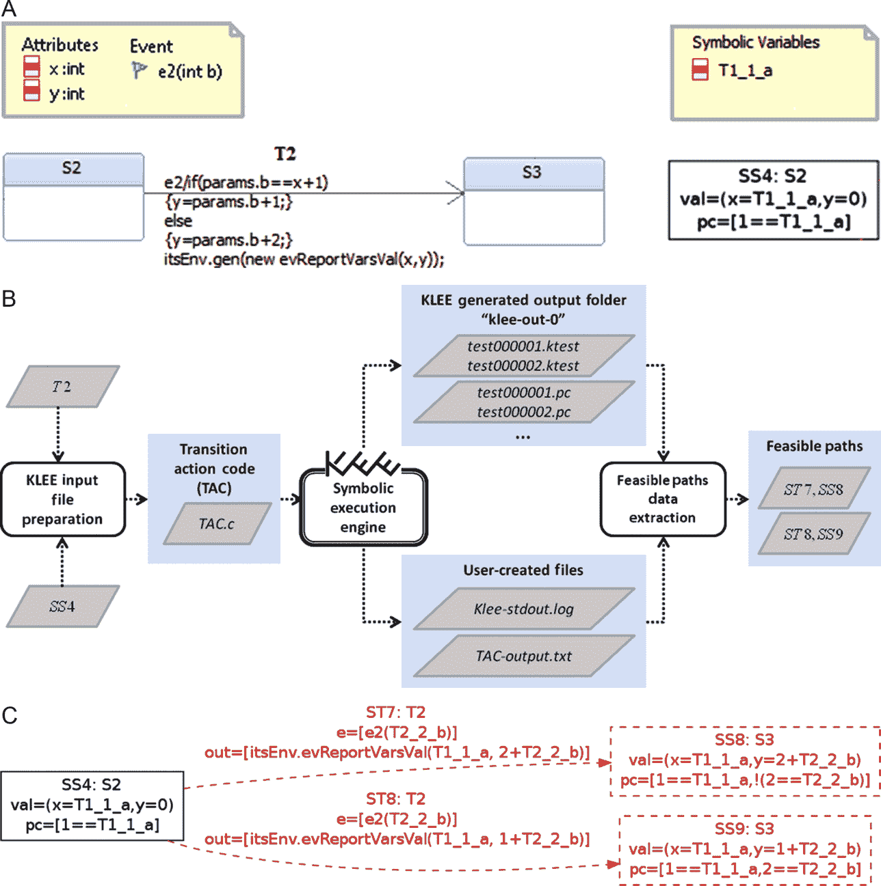

图 23 一个阐明伪代码函数 `SymbolicExecutionOfCode(A^s, val, G^s, pc)` 执行的示例。(A) 左侧是状态图的一部分，显示了转换 T2 及其源状态和目标状态 S2 和 S3。右侧是源状态 S2 的符号状态 SS4。(B) 我们与 KLEE 接口组件的插图。(C) 标亮显示（红色）的是由于在给定源状态 S2 的符号状态 SS4 的情况下，执行转换 T2 生成符号转换 ST7 和 ST8 及其目标符号状态 SS8 和 SS9。

在图 23A 中，我们展示了(1) 左侧是一个示例状态图模型的一部分，由两个状态 S2 和 S3 组成，它们通过转换 T2 连接；(2) 右侧是转换源状态 S2 的示例符号状态表示 SS4。我们还突了为给定模型定义的属性必要信息、转换 T2 的事件 e2 及其参数（如果有）以及在给定的符号状态表示 SS4 中使用的符号变量。在图 23B 中，我们展示了在给定符号状态 SS4 的情况下，与 KLEE 符号执行引擎交互以符号执行转换 T2 动作代码的流程图。在这个图中，我们识别了两个组件：`KLEE Input File Preparation` 和 `Feasible Paths Data Extraction`。

#### KLEE 输入文件准备

`KLEE Input File Preparation` 组件以一个待进行符号化探索的跳转以及一个表示该跳转源状态的符号状态作为输入，并生成一个名为 `TAC.c` 的 C 文件。该文件开头包含了所有所需变量的声明（包括符号变量）、输入跳转的动作代码语句以及输入符号状态的路径约束定义。随后，我们为每个声明的变量添加一个条件语句，以检查其最后一次赋值的值是具体值还是符号值，并将变量名及其值记录到名为 `TAC-output.txt` 的用户定义输出文件中；如果是具体值，则记录该值；如果是符号值，则记录关键字 `SYMBOLIC`。为了获取与符号变量对应的符号表达式，我们使用 KLEE 的特殊函数 `klee_print_expr`，该函数会将输出打印到运行进程的 `STDOUT` 流中。为了处理该输出，我们将 `STDOUT` 流重定向到名为 `klee-stdout.log` 的文件中。输出的 C 文件 `TAC.c` 将由 KLEE 符号执行引擎编译并执行。执行结果将记录在 KLEE 创建的名为 `klee-out-0` 的输出目录中。我们还利用该目录记录上述用户创建的文件：`TAC-output.txt` 和 `klee-stdout.log`。

#### 可行路径数据提取

准备好 KLEE 生成的输出文件后下一步是解析这些文件以提取 KLEE 报告的每个可行路径所需的信息。这一步由 `Feasible Paths Data Extraction` 组件完成，它由一系列 shell 脚本调用和一个由 JavaCC 生成的解析器组成。在 KLEE 为每次执行生成的全局文件中，有一组每个路径的文件，用于记录 KLEE 为每个路径生成的测试用例信息以及与每个路径相关的约束。这些文件的扩展分别为 `.ktest` 和 `.pc`。测试用例文件是二进制文件，需要特定的工具 `ktest-tool` 来读取其内容；但路径约束文件是用 KQuery 语言编写的文本文件——KQuery 是 KLEE 使用的 Kleaver 约束求解器的输入语言。为了将这些约束转换为 Java 布尔表达式，我们为 KQuery 语言的一个相关子集开发了一个 JavaCC 解析器（我们 JavaCC 解析器词法分析器的标记定义见 Listing 1）。我们使用该解析器来解析路径约束文件以及用户创建的文件 `klee-stdout.log` 中找到的符号表达式。

用于 KQuery 语言子集的 JavaCC 解析器词法分析器的标记定义

```java
TOKEN :
{
    <LBR : "(">
    | <RBR : ")">
    | <QUERY : "query">
    | <LSBR : "[">
    | <RSBR : "]">
    | <FALSE : " false">
    | <TRUE : " true ">
    | <VarDeclStart : ("ReadLSB")>
    | <AEK : ("Add" | "Sub" | "Mul" | "UDiv" | "URem" | "SDiv" | "SRem")>
    | <CEK : ("Eq" | "Ne" | "Ult" | "Ule" | "Ugt" | "Uge" | " Slt " | " Sle " | "Sgt" | "Sge")>
    | <type : "w">
    | <identifier : "a"-"z", "A"-"Z","\_">
    | <colon : ": ">
    | <number : <decConstant> | <signedConstant>>
    | <signedDecConstant : ("+")<decConstant>>
    | <decConstant>
    | <digit : ["0"-"9"]>
}
```

示例 7：`Listing 2` 展示了 `TAC.c` 的片段，它是由 `KLEE Input Preparation` 组件为跳转 `2` 生成的。在 `3` 和 `4` 中，我们看到 `TAC-output.txt` 和 `klee-stdout.log` 文件，它们分别记录了具体值的 `5` 和符号值的 `6`。同样，`klee-stdout.log` 文件中的符号表达式在 `7` 和 `8` 中显示。在 `9` 中，我们看到通过 `Feasible Paths Data Extraction` 组件执行 `TAC.c` 得到的路径约束 `8`。

Listing 2 来自 TAC.c

```c
// 此处代码保持不变
```


```c
fprintf (file, "%s\n", "output1_eventArg_2 = SYMBOLIC");
klee_print_expr ("output1_eventArg_2 = ", output1_eventArg_2);
}
else if (output1_eventArg_2== "")
    fprintf (file, "%s\n", "output1_eventArg_2 = ");
else
    fprintf (file, "%s%d\n", "output1_eventArg_2 = ", output1_eventArg_2);
}
fclose (file);
}
```

Listing 3

KLEE 生成的 KQuery 约束文件，对应于 Listing 2 中代码的第一个可行路径：`test000001.pc`

* `array T1_1_a [4] : w32 -> w8 = symbolic`
* `array T2_2_b [4] : w32 -> w8 = symbolic`
* `(query (Eq 1 (ReadLSB w32 0 T1_1_a)) (Eq false (Eq 2 (ReadLSB w32 0 T2_2_b))) false)`

Listing 4

KLEE 生成的 KQuery 约束文件，对应于 Listing 2 中代码的第二个可行路径：`test000002.pc`

* `array T1_1_a [4] : w32 -> w8 = symbolic`
* `array T2_2_b [4] : w32 -> w8 = symbolic`
* `(query (Eq 1 (ReadLSB w32 0 T1_1_a)) (Eq 2 (ReadLSB w32 0 T2_2_b))) false)`

Listing 5

Listing 3 中 KQuery 路径约束的布尔表达式

* `(1==T1_1_a) && !(2==T2_2_b)`

Listing 6

Listing 4 中 KQuery 路径约束的布尔表达式

* `(1==T1_1_a) && (2==T2_2_b)`

Listing 7

在 `TAC.c` 文件的 LLVM Bitcode 表示上运行 KLEE 生成的用户文件：`TACoutput.txt`

* `Output =`
* `T1_1_a = SYMBOLIC`
* `T2_2_b = SYMBOLIC`
* `x = SYMBOLIC`
* `y = SYMBOLIC`
* `eventName = env.ReportVars`
* `output1_eventArg_1 = SYMBOLIC`
* `output1_eventArg_2 = SYMBOLIC`
* `Output =`
* `T1_1_a = SYMBOLIC`
* `T2_2_b = SYMBOLIC`
* `x = SYMBOLIC`
* `y = SYMBOLIC`
* `eventName = env.ReportVars`
* `output1_eventArg_1 = SYMBOLIC`
* `output1_eventArg_2 = SYMBOLIC`

Listing 8

在 `TAC.c` 文件的 LLVM Bitcode 表示上运行 KLEE 生成的结果 stdout 文件：`klee-stdout.log`

* `KLEE:output = "klee-out"`
* `Output =`
* `T1_1_a = (ReadLSB w32 0 T1_1_a)`
* `T2_2_b = (ReadLSB w32 0 T2_2_b)`
* `x = (ReadLSB w32 0 T1_1_a)`
* `y = (Add w32 2 (ReadLSB w32 0 T2_2_b))`
* `output1_eventArg_1 = (ReadLSB w32 0 T1_1_a)`
* `output1_eventArg_2 = (Add w32 2 (ReadLSB w32 0 T2_2_b))`
* `Output =`
* `T1_1_a = (ReadLSB w32 0 T1_1_a)`
* `T2_2_b = (ReadLSB w32 0 T2_2_b)`
* `x = (ReadLSB w32 0 T1_1_a)`
* `y = (Add w32 1 (ReadLSB w32 0 T2_2_b))`
* `output1_eventArg_1 = (ReadLSB w32 0 T1_1_a)`
* `output1_eventArg_2 = (Add w32 1 (ReadLSB w32 0 T2_2_b))`
* `KLEE:done total instructions = 194`
* `KLEE:done completed paths = 2`
* `KLEE:done generated tests = 2`

Listing 9

Listing 8 中 KQuery 路径约束的布尔表达式

* `(1==T1_1_a) && (2==T2_2_b)`

### 6.3 实现基于 MQL 和 TGL 的转换组件

我们的转换组件是在 IBM Rational Rhapsody Developer RulesComposer 的环境下实现的，该环境使用名为 MQL 的命令式语言进行转换。转换的基本单元是 `ruleset`，它包含一组逻辑相关的规则，这些规则通过查询源模型元素来创建新元素、更新现有元素的属性和引用或启动文本生成。文本生成可以使用名为 TGL 的语言定义的模板，并使用 MQL 占位符进行动态文本生成。脚本以 MQL、TGL 或 Java 编写，并以调用 Java 方法的方式从模型元素中调用，用于特定的模型转换或文本生成。

由于我们决定使用 IBM Rational Rhapsody DiffMerge 工具来查找 Rhapsody 模型进化版本之间的差异，我们需要找到一种处理和解析该工具生成的输出的方法。该工具可以导出两种类型的报告，用于总结比较模型之间发现的差异。一种报告是富文本格式（RTF）报告，它旨在包含更详细的细节，但不适用于进一步处理以提取差异数据。另一方面，第二种报告是逗号分隔值（CSV）格式报告，它更容易处理，但设计包含的细节程度较低。为了扩展 CSV 格式报告中包含的差异数据信息，我们必须扩展工具底层的 CSV 报告模板。我们找到的默认模板文件名为 `DiffReport_csv.dpl`，它使用嵌入在 IBM Rational Rhapsody ReporterPLUS 中的语言编写，用于生成关于 Rhapsody DiffMerge 工具发现的差异的 CSV 格式报告。

该模板文件的原始版本包含 156 行代码（LOC），并且仅对给定差异的六个指定属性进行报告。这包括关于差异元素的元类（meta-class）、它们的名称、位置、差异类型（指示差异元素是新增元素、删除元素还是修改元素）、差异计数（即差异元素中具有不同值的属性数量）以及差异是否为平凡差异（即非冲突差异）。后者这项功能主要在执行带有“基准单元”选项的三路比较时使用。在这种情况下，如果在两个比较单元相对于其基准单元发现了差异，则该差异是一个非平凡的（即冲突的）差异，需要手动解决；工具的自动合并操作无法解决非平凡差异。合并操作超出了我们的工作范围，我们不需要三路比较选项。因此，所有报告的差异都是平凡差异。

我们适配的同一模板文件版本包含 205 行代码，并在原始列表中增加了三个额外的报告属性。这些属性是差异元素中具有不同值的属性的名称，以及它们在两个比较模型中的值，即 `left value`（左值）和 `right value`（右值）。记录这些属性的值使能够唯一标识特定的 Rhapsody 模型元素，这些元素的 `name` 属性可能被分配相同的值。转换（Transitions）是此类元素的示例，两个或多个转换可能有相同的名称。用户不允许在 IBM Rhapsody 工具中设置转换的 `name` 属性值。相反，工具使用分配给转换的 `trigger`（触发器）、`guard`（守卫）和 `action`（动作）属性的值来为其 `name` 属性生成并分配复合值。为了对模型中的转换进行唯一标识，工具使用一个内部全局唯一标识符分配给每个新创建的转换。用于此目的的属性是一个用户无法访问的私有变量。我们还注意到，Rhapsody DiffMerge 工具记录的差异转换的 `name` 属性值与相应的 Rhapsody 状态图中相同转换的 `name` 属性记录值并不完全匹配。Rhapsody DiffMerge 工具仅使用转换名称的 `trigger` 和 `guard` 部分来报告差异转换的名称。仅凭这些信息，我们就已经能够标识特定的 Rhapsody 模型元素，这些元素的 `name` 属性可能被分配相同的值。

## 6.5 总结

在本节中，我们提供了前几节中提出的架构实现的概述，展示了所需的操作系统和所使用的技术，以及我们如何实现不同组件之间的交互。

## 7 评估

在本节中，我们展示了所提技术在单个模型和状态图（Statecharts）上的有效性评估。我们首先说明考虑的研究问题。其次，我们列出了作为单个模型和通信状态图案例研究的制品集。第三，我们描述了评估设置。最后，我们讨论了结果并得出结论。

值得注意的是，我们分两个阶段进行了评估。第一阶段考虑单个状态图的评估，第二阶段考虑通信状态图的评估。在第一阶段，我们只考虑修改更改，而在第二阶段，我们还考虑了添加和删除更改。

### 7.1 研究问题和感兴趣的变量

我们考虑以下三个研究问题：

- **RQ1.** 与对修改的状态图进行标准符号执行（SE）相比，我们的优化（即它们在多大程度上减少了修改状态模型符号执行的资源需求）有多有效？

  对于 RQ1，我们考虑以下三个相关变量：(1) 运行每个技术所需的时间，(2) 符号状态的数量，以及 (3) 结果 SET 中执行路径的数量。

- **RQ2.** 从 MSE 生成的 SET 是否与标准 SE 生成的 SET 一致？

  对于 RQ2，我们比较了标准 SE 和 MSE 产生的 SET 中符号状态的总数。我们还对这两个 SET 的子集进行了人工检查以确保它们的等效性。

- **RQ3.** 哪些方面影响每个技术的有效性？

  对于 RQ3，我们考虑了以下两个方面：(1) 更改影响和 (2) 模型特性。

  为了衡量更改的影响，我们考虑了以下两个标准：

  1. 我们将变更影响指标（`CIM`）定义为涉及该变更的 `MLM` 模型中最大路径的百分比。该指标的值越低，变更对模型的影响就越小，从之前的分析结果中获益的机会越高，反之亦然。该指标仅用于定义了最大路径的单个状态图（Statecharts），即仅应用于 `AQS`、`LGS` 和 `ACCS` 模型，在这些模型中定义了最大路径的概念，因此可以进行计算。

  2. 我们识别了创建每个主体模型修改版本时所应用的变更类型。我们考虑的变更类型包括修改（`M`）、添加（`A`）和删除（`D`）。

  对于模型特征，我们识别了以下两个可能对 `DSE` 有效性产生影响的指标：

  1. 主体具有具有多路径守卫或动作代码的转换数量。

  2. 模型中与其他转换具有依赖关系的转换数量。

  我们推测，变更影响是 `MSE` 有效性的更好的预测指标，而模型特征更适合作为 `DSE` 有效性的指标。

### 7.2 案例研究产件

为了评估我们的优化技术在单个和通信状态图上的有效性，选择了以下产件：

1. **对于单个状态图：** 我们从汽车领域选取了三个工业级模型。第一个模型 `空气质量系统 (AQS)` 是我们从我们的工业合作伙伴处获取的专有模型，该模型负责车内座舱的空气净化。第二个模型和第三个模型 `车道引导系统 (LGS)` 和 `自适应巡航控制系统 (ACCS)` 是在滑铁卢大学设计的非专有模型 [96]。`LGS` 是一种汽车功能，通过在特定事件发生时提供警报来避免无意中的离道。`ACCS` 是一种汽车功能，通过车辆的自动操作自动维持驾驶员设定的速度。这三个模型是以 `Simulink/Stateflow` 模型的形式开发的，我们手动将它们转换为行为上等价的 `Rhapsody Statecharts`。表 2a 总结了三个模型的特征及其 `MLM` 表示，包括用于回答 `RQ3` 的两个模型特征指标。这三个模型分别包含 4、7 和 3 个整数类型的变量。

2. **对于通信状态图：** 我们使用了一个系统模型的适配版本，该模型实现了在 [97] 中发现的常用通信协议——`全双工交替协议 (FABP)`。该模型由三个通信对象组成：`Transmitter`（发送器）、`Receiver`（接收器）和 `Buffer`（缓冲区）。每个对象的行为都被建模为一个 `Statechart`。每个状态机中状态和转换的数量摘要所示如表 2b。我们还列出了模型特征指标的值，即每个 `Statechart` 中具有多路径动作的转换数量，以及具有数据或通信依赖的转换数量。该模型中有四个整数变量。

表 2

我们评估中使用的产件特征

| (a) 三个单个状态图模型 | | | | | | |
| --- | --- | --- | --- | --- | --- | --- |
| 数量 | `空气质量系统 (AQS)` | | `车道引导系统 (LGS)` | | `自适应巡航控制系统 (ACCS)` | |
| | `Rhapsody Statechart` (展平前) | `MLM` (展平后) | `Rhapsody Statechart` (展平前) | `MLM` (展平后) | `Rhapsody Statechart` (展平前) | `MLM` (展平后) |
| 并行区域 | 1 | 1 | 1 | 2 | | |
| 层级结构 | 3 | 1 | 3 | 1 | 3 | 1 |
| 状态 | 14 | 14 | 14 | 14 | | |
| 转换 | 22 | 55 | 16 | 40 | 73 | |
| 多路径守卫或动作代码的转换 | 5 | 5 | 6 | 6 | | |
| 数据依赖的转换 | 8 | 8 | 0 | 0 | | |
| 通信依赖的转换 | 10 | 10 | 4 | 4 | | |

| (b) 通信状态图 | | | | | | |
| --- | --- | --- | --- | --- | --- | --- |
| 全双工交替协议 (FABP) | | | | | | |
| 数量 | `Transmitter` | | `Receiver` | | `Buffer` | |
| | `Rhapsody Statechart` (展平前) | `MLM` (展平后) | `Rhapsody Statechart` (展平前) | `MLM` (展平后) | `Rhapsody Statechart` (展平前) | `MLM` (展平后) |
| 并行区域 | 1 | 1 | 1 | 2 | | |
| 层级结构 | 3 | 1 | 3 | 1 | 3 | 1 |
| 状态 | 4 | 4 | 4 | 4 | | |
| 转换 | 14 | 14 | 14 | 14 | | |
| 多路径守卫或动作代码的转换 | 5 | 5 | 6 | 6 | | |
| 数据依赖的转换 | 8 | 8 | 0 | 0 | | |
| 通信依赖的转换 | 10 | 10 | 4 | 4 | | |


### 7.3 评估设置

为了进行我们的研究，我们遵循以下步骤：

1. **对于单个状态图：** 我们首先为每个产件准备了一组版本：基础版本和若干修改版本。每个修改版本都对基础版本中的单个转换或组转换进行了更改。更改的形式为事件名称的更改或在动作代码中添加发送事件语句。选择这些特定变更类型的主要原因是为了保持修改模型数量在可控范围内，并便于手动正确性检查。另一个重要原因是，使用的某些工具（例如 `IBM Rhapsody DiffMerge`）没有命令行访问权限，这使得无法完全自动化数据的收集并更全面地评估技术。每个模型创建的修改版本总数为：`AQS` 为 26 个，`LGS` 为 19 个，`ACCS` 为 19 个。对于每个修改版本，我们首先记录了以下信息：(1) 变更 ID [^7]

2. **对于通信状态图：** 我们按照上述对单个状态图的描述进行操作；在这里我们为基础版本准备了三组不同的版本。每组包含 32 个修改版本，带有添加、删除或修改转换。修改版本中的所有更改都是原子的。然而，它们涵盖了模型中的所有转换。对于每个模型版本，我们记录了之前列出的所有信息，但不适用于通信状态图的 `CIM` 指标信息。我们在所有版本上运行了标准的 `SE` 和 `MSE`，而仅在发现变更未影响所有多路径转换的情况下运行 `DSE`。在具有影响所有多路径转换变更的模型版本上运行 `DSE` 与执行标准 `SE` 相比不会产生任何节省。对于每次运行，我们记录了之前列出的关于生成的 `GSETs` 特征的所有信息。

[^7]: 变更 ID 是每个修改版本的唯一标识符。

在 `AQS`、`LGS`、`ACCS` 和 `FABP` 模型基础版本上运行标准 SE 生成的 SETs 特性如表 3 所示。它们包含了运行标准 SE 技术所需的时间，以及生成的 SETs 中的符号状态数量和执行路径数量。

### 表 3：标准 SE 在四个模型基础版本上的性能：AQS, LGS, ACCS 和 FABP

| SET/GSET 特性 | 空气质量系统 (AQS) | 车道引导系统 (LGS) | 自适应巡航控制系统 (ACCS) | 全双工交替位协议 (FABP) |
| --- | --- | --- | --- | --- |
| 时间 (min) | ≈ 10 | ≈ 5 | ≈ 9 | ≈ 14 |
| 符号状态数 | 6039 | 1769 | 3492 | 2805 |
| 执行路径数 | 5019 | 1325 | 2855 | 1342 |

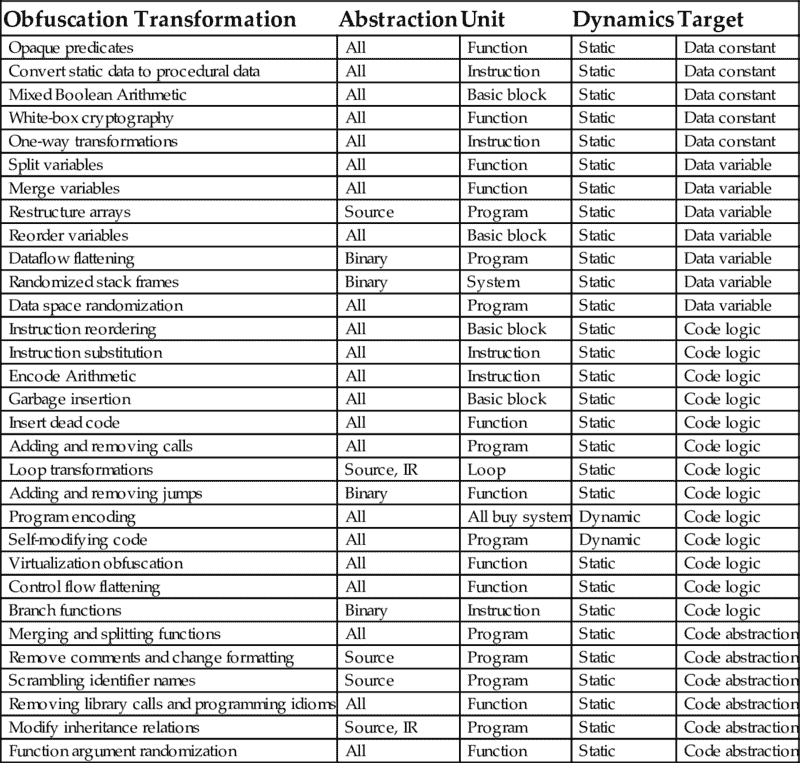


表 4、5 和 6 分别总结了在修改后的 `AQS`、`LGS` 和 `ACCS` 模型版本上运行三种符号执行技术的结果。此外，`FABP` 模型每个类型版本的结果摘要分别如表 7、8 和 9 所示。

### 表 4：MSE 和 DSE 在 AQS 示例上的结果

| 版本 | 变更 ID/已变更转移数 | 多路径影响的转移数 | CIM [0, 100] | 时间 | 新符号状态数 | 总符号状态数 | 新执行路径数 | 总执行路径数 | 时间 | 总符号状态数 | 总执行路径数 |
| --- | --- | --- | --- | --- | --- | --- | --- | --- | --- | --- | --- |
| V1 | `M[AQS-06]/7` | 0 | 30 | 1:0.3 | 1:0.08 | 1:1 | 1:08 | 1:1 | 1:02 | 1:03 |
| V2 | `M[AQS-27]/1` | 0 | 4 | 1:0.3 | 1:0.36 | 1:1 | 1:36 | 1:1 | 1:01 | 1:03 |
| V3 | `M[AQS-07]/1` | 0 | 100 | 1:0.51 | 1:1 | 1:1 | 1:1 | 1:1 | 1:02 | |
| V4 | `M[AQS-09]/1` | 0 | 20 | 1:0.26 | 1:23 | 1:1 | 1:23 | 1:1 | 1:02 | |
| V5 | `M[AQS-10]/1` | 1 | 30 | 1:0.21 | 1:0.01 | 1:1 | 1:01 | 1:1 | 1:02 | |
| V6 | `M[AQS-08]/1` | 1 | 90 | 1:0.44 | 1:64 | 1:1 | 1:66 | 1:1 | 1:02 | |
| V7 | `M[AQS-28]/1` | 1 | 0 | 1:0.23 | 1:06 | 1:1 | 1:06 | 1:1 | 1:02 | |
| V8 | `M[AQS-29]/1` | 0 | 30 | 1:0.27 | 1:23 | 1:1 | 1:23 | 1:1 | 1:02 | |
| V9 | `M[AQS-11]/1` | 0 | 0 | 1:0.19 | 1:0 | 1:1 | 1:0 | 1:1 | 1:02 | |
| V10 | `M[AQS-12]/1` | 0 | 40 | 1:0.24 | 1:23 | 1:1 | 1:23 | 1:1 | 1:02 | |
| V11 | `M[AQS-13]/1` | 0 | 30 | 1:0.2 | 1:06 | 1:1 | 1:06 | 1:1 | 1:02 | |
| V12 | `M[AQS-14]/1` | 0 | 1 | 1:0.22 | 1:02 | 1:1 | 1:02 | 1:1 | 1:02 | |
| V13 | `M[AQS-04]/5` | 0 | 97 | 1:0.64 | 1:87 | 1:1 | 1:91 | 1:1 | 1:02 | |
| V14 | `M[AQS-05]/7` | 0 | 30 | 1:0.38 | 1:39 | 1:1 | 1:43 | 1:1 | 1:02 | |
| V15 | `M[AQS-15]/1` | 0 | 94 | 1:0.41 | 1:61 | 1:1 | 1:64 | 1:1 | 1:02 | |
| V16 | `M[AQS-16]/1` | 0 | 14 | 1:0.22 | 1:01 | 1:1 | 1:02 | 1:1 | 1:02 | |
| V17 | `M[AQS-17]/5` | 0 | 14 | 1:0.29 | 1:15 | 1:1 | 1:17 | 1:1 | 1:02 | |
| V18 | `M[AQS-18]/5` | 0 | 42 | 1:0.22 | 1:06 | 1:1 | 1:06 | 1:1 | 1:02 | |
| V19 | `M[AQS-20]/1` | 0 | 35 | 1:0.21 | 1:0.01 | 1:1 | 1:01 | 1:1 | 1:02 | |
| V20 | `M[AQS-21]/1` | 0 | 48 | 1:0.32 | 1:0.41 | 1:1 | 1:42 | 1:1 | 1:01 | |
| V21 | `M[AQS-22]/1` | 0 | 27 | 1:0.22 | 1:0.01 | 1:1 | 1:01 | 1:1 | 1:01 | |
| V22 | `M[AQS-23]/1` | 0 | 2 | 1:0.21 | 1:0 | 1:1 | 1:0 | 1:1 | 1:01 | |
| V23 | `M[AQS-24]/1` | 0 | 35 | 1:0.29 | 1:41 | 1:1 | 1:41 | 1:1 | 1:01 | |
| V24 | `M[AQS-25]/1` | 0 | 14 | 1:0.2 | 1:03 | 1:1 | 1:03 | 1:1 | 1:01 | |
| V25 | `M[AQS-26]/1` | 0 | 25 | 1:0.3 | 1:4 | 1:1 | 1:4 | 1:1 | 1:01 | |
| V26 | `M[AQS-03]/5` | 0 | 2 | 1:0.28 | 1:09 | 1:1 | 1:08 | 1:1 | 1:02 | |
| 平均节省 | 71.0% | 75.5% | | 74.9% | | 98.4% | 95.6% | | | |
| 标准差 | 10.9% | 28.0% | | 28.8% | | 0.2% | 4.4% | | | |
| 相关性(CIM) | −0.81 | −0.83 | | −0.84 | | −0.21 | −0.33 | | | |


### 表 5：MSE 和 DSE 在 LGS 上的结果

| 版本 | 变更 ID/已变更转移数 | 多路径影响的转移数 | CIM [0, 100] | 时间 | 新符号状态数 | 总符号状态数 | 新执行路径数 | 总执行路径数 | 时间 | 总符号状态数 | 总执行路径数 |
| --- | --- | --- | --- | --- | --- | --- | --- | --- | --- | --- | --- |
| V1 | `M[LGS-01]/1` | 0 | 100 | 1:0.81 | 1:1 | 1:1 | 1:1 | 1:1 | 1:28 | 1:3 |
| V2 | `M[LGS-02]/7` | 0 | 28 | 1:0.19 | 1:0.25 | 1:1 | 1:33 | 1:1 | 1:25 | 1:3 |
| V3 | `M[LGS-05]/7` | 0 | 28 | 1:0.19 | 1:0.25 | 1:1 | 1:33 | 1:1 | 1:3 | 1:3 |
| V4 | `M[LGS-09]/1` | 0 | 97 | 1:0.74 | 1:1 | 1:1 | 1:1 | 1:1 | 1:23 | 1:3 |
| V5 | `M[LGS-08]/4` | 0 | 13 | 1:0.38 | 1:0 | 1:1 | 1:5 | 1:1 | 0:22 | 1:47 |
| V6 | `M[LGS-06]/1` | 0 | 13 | 1:0.47 | 1:0.58 | 1:1 | 1:59 | 1:1 | 0:22 | 1:3 |
| V7 | `M[LGS-07]/5` | 0 | 40 | 1:0.55 | 1:0.74 | 1:1 | 1:74 | 1:1 | 0:22 | 1:73 |
| V8 | `M[LGS-11]/1` | 0 | 22 | 1:0.24 | 1:0.27 | 1:1 | 1:27 | 1:1 | 0:22 | 1:3 |
| V9 | `M[LGS-13]/1` | 0 | 22 | 1:0.25 | 1:0.27 | 1:1 | 1:27 | 1:1 | 0:22 | 1:3 |
| V10 | `M[LGS-19]/1` | 0 | 22 | 1:0.3 | 1:0.27 | 1:1 | 1:27 | 1:1 | 0:22 | 1:3 |
| V11 | `M[LGS-20]/1` | 0 | 22 | 1:0.28 | 1:27 | 1:1 | 1:27 | 1:1 | 0:22 | 1:3 |
| V12 | `M[LGS-12]/1` | 0 | 3 | 1:0.09 | 1:04 | 1:1 | 1:04 | 1:1 | 0:22 | 1:3 |
| V13 | `M[LGS-15]/1` | 0 | 13 | 1:0.14 | 1:12 | 1:1 | 1:12 | 1:1 | 0:22 | 1:3 |
| V14 | `M[LGS-10]/1` | 0 | 3 | 1:0.09 | 1:04 | 1:1 | 1:04 | 1:1 | 0:22 | 1:3 |
| V15 | `M[LGS-14]/1` | 0 | 13 | 1:0.15 | 1:12 | 1:1 | 1:12 | 1:1 | 0:22 | 1:3 |
| V16 | `M[LGS-16]/1` | 0 | 13 | 1:0.18 | 1:12 | 1:1 | 1:12 | 1:1 | 0:22 | 1:3 |
| V17 | `M[LGS-21]/1` | 0 | 3 | 1:0.09 | 1:04 | 1:1 | 1:04 | 1:1 | 0:22 | 1:3 |
| V18 | `M[LGS-17]/1` | 0 | 13 | 1:0.16 | 1:12 | 1:1 | 1:12 | 1:1 | 0:22 | 1:3 |
| V19 | `M[LGS-18]/1` | 0 | 3 | 1:0.09 | 1:04 | 1:1 | 1:04 | 1:1 | 0:22 | 1:3 |
| 平均节省 | 71.7% | 68.2% | | 67.2% | | 76.7% | 67.0% | | | |
| 标准差 | 10.9% | 28.0% | | 28.8% | | 0.2% | 4.4% | | | |

### 表 6：MSE 和 DSE 在 ACCS 示例上的结果

| 版本 | 变更 ID/已变跳转数 | 受多路径影响的数 | CIM [0, 100] | 时间 | 新符号状态数 | 总符号状态数 | 新执行路径数 | 总执行路径数 | 时间 | 总符号状态数 | 总执行路径数 |
| --- | --- | --- | --- | --- | --- | --- | --- | --- | --- | --- | --- |
| V1 | `M[ACCS-04]/1` | 0 | 100 | 1:0.82 | 1:1 | 1:1 | 1:1 | 1:1 | 1:1.05 | 1:0.92 | 1:0.9 |
| V2 | `M[ACCS-05]/12` | 0 | 30 | 1:0.21 | 1:0.17 | 1:1 | 1:0.17 | 1:1 | 1:0.79 | 1:0.92 | 1:0.9 |
| V3 | `M[ACCS-06]/12` | 0 | 30 | 1:0.19 | 1:0.15 | 1:1 | 1:0.17 | 1:1 | 1:0.78 | 1:0.92 | 1:0.9 |
| V4 | `M[ACCS-19]/2` | 0 | 2 | 1:0.61 | 1:0.79 | 1:1 | 1:0.8 | 1:1 | 1:1.02 | 1:0.92 | 1:0.9 |
| V5 | `M[ACCS-20]/2` | 0 | 2 | 1:0.43 | 1:0.44 | 1:1 | 1:0.46 | 1:1 | 1:1 | 1:0.92 | 1:0.9 |
| V6 | `M[ACCS-13]/2` | 0 | 60 | 1:0.73 | 1:0.87 | 1:1 | 1:0.87 | 1:1 | 1:1.02 | 1:0.92 | 1:0.9 |
| V7 | `M[ACCS-14]/2` | 0 | 60 | 1:0.45 | 1:0.55 | 1:1 | 1:0.55 | 1:1 | 1:1.02 | 1:0.92 | 1:0.9 |
| V8 | `M[ACCS-15]/2` | 0 | 20 | 1:0.56 | 1:0.76 | 1:1 | 1:0.77 | 1:1 | 1:1.03 | 1:0.92 | 1:0.9 |
| V9 | `M[ACCS-16]/2` | 0 | 20 | 1:0.24 | 1:0.18 | 1:1 | 1:0.2 | 1:1 | 1:1.03 | 1:0.92 | 1:0.9 |
| V10 | `M[ACCS-17]/4` | 0 | 36 | 1:0.14 | 1:0.05 | 1:1 | 1:0.04 | 1:1 | 1:1.04 | 1:0.92 | 1:0.9 |
| V11 | `M[ACCS-18]/4` | 0 | 36 | 1:0.26 | 1:0.2 | 1:1 | 1:0.18 | 1:1 | 1:1.04 | 1:0.92 | 1:0.9 |
| V12 | `M[ACCS-07]/1` | 1 | 99 | 1:0.81 | 1:1 | 1:1 | 1:1 | 1:1 | 1:1.02 | 1:1 | |
| V13 | `M[ACCS-08]/6` | 0 | 14 | 1:0.27 | 1:0.22 | 1:1 | 1:0.19 | 1:1 | 1:1.02 | 1:0.92 | 1:0.9 |
| V14 | `M[ACCS-09]/1` | 1 | 11 | 1:0.59 | 1:0.67 | 1:1 | 1:0.68 | 1:1 | 1:0.87 | 1:1 | |
| V15 | `M[ACCS-21]/1` | 0 | 11 | 1:0.11 | 1:0.01 | 1:1 | 1:0.01 | 1:1 | 1:0.99 | 1:0.92 | 1:0.9 |
| V16 | `M[ACCS-11]/3` | 0 | 83 | 1:0.73 | 1:0.87 | 1:1 | 1:0.88 | 1:1 | 1:1 | 1:0.92 | 1:0.9 |
| V17 | `M[ACCS-12]/3` | 1 | 30 | 1:0.23 | 1:0.17 | 1:1 | 1:0.2 | 1:1 | 1:0.99 | 1:1 | 1:1 |
| V18 | `M[ACCS-10]/6` | 0 | 31 | 1:0.63 | 1:0.72 | 1:1 | 1:0.73 | 1:1 | 1:1.02 | 1:0.92 | 1:0.9 |
| V19 | `M[ACCS-22]/6` | 0 | 31 | 1:0.17 | 1:0.09 | 1:1 | 1:0.12 | 1:1 | 1:1.02 | 1:0.92 | 1:0.9 |
| 平均节省 | 56.9% | 53.2% | | 52.6% | | 1.4% | 7.0% | 8.6% | | | |
| 标准差 | 24.6% | 35.0% | | 35.1% | | 8.0% | 3.1% | 3.8% | | | |
| 相关性(CIM) | -0.59 | -0.56 | | -0.56 | | -0.22 | -0.14 | -0.14 | | | |

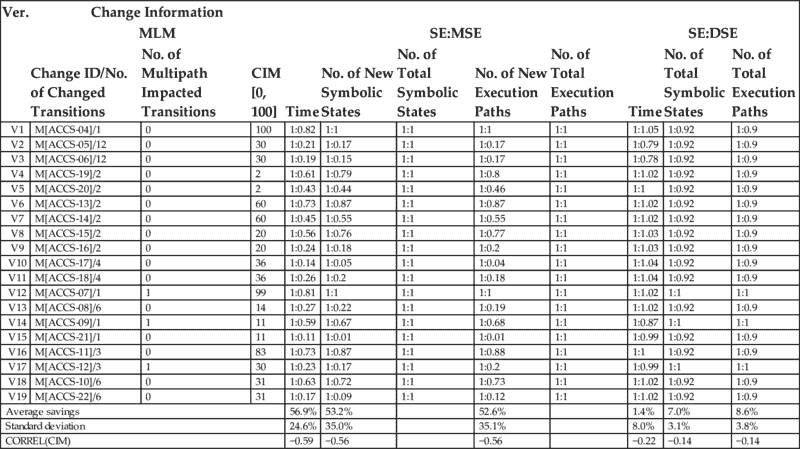

### 表 7：带有修改变更的 FABP 版本的 MSE 和 DSE 结果

| 版本 | 变更 ID/已变跳转数 | 受多路径影响的数 | 时间 | 新符号状态数 | 总符号状态数 | 新执行路径数 | 总执行路径数 | 时间 | 总符号状态数 | 总执行路径数 |
| --- | --- | --- | --- | --- | --- | --- | --- | --- | --- | --- |
| V1 | `M[Buff-01]/1` | 0 | 1 | 1:0.71 | 1:0.77 | 1:1 | 1:0.78 | 1:1 | 1:0.03 | 1:0.03 | 1:0.04 |
| V2 | `M[Buff-02]/1` | 6 | 1:0.69 | 1:0.76 | 1:0.98 | 1:0.77 | 1:0.99 | 1:1 | 1:1 | 1:1 |
| V3 | `M[Buff-03]/1` | 0 | 1:0.13 | 1:0.05 | 1:1 | 1:0.05 | 1:1 | 1:0.03 | 1:0.03 | 1:0.04 |
| V4 | `M[Buff-04]/1` | 6 | 1:0.57 | 1:0.56 | 1:1 | 1:0.62 | 1:1 | 1:1 | 1:1 | |
| V5 | `M[Rcv-01]/1` | 6 | 1:0.19 | 1:0.17 | 1:1 | 1:0.18 | 1:1 | 1:1 | 1:1 | |
| V6 | `M[Rcv-02]/1` | 6 | 1:0.44 | 1:0.5 | 1:1 | 1:0.49 | 1:1 | 1:1 | 1:1 | |
| V7 | `M[Rcv-03]/1` | 6 | 1:0.37 | 1:0.38 | 1:1 | 1:0.39 | 1:1 | 1:1 | 1:1 | |
| V8 | `M[Rcv-04]/1` | 6 | 1:0.27 | 1:0.3 | 1:1 | 1:0.31 | 1:1 | 1:1 | 1:1 | |
| V9 | `M[Rcv-05]/1` | 6 | 1:0.2 | 1:0.17 | 1:1 | 1:0.18 | 1:1 | 1:1 | | |
| V10 | `M[Rcv-06]/1` | 6 | 1:0.41 | 1:0.38 | 1:1 | 1:0.38 | 1:1 | 1:1 | | |
| V11 | `M[Rcv-07]/1` | 6 | 1:0.42 | 1:0.45 | 1:1 | 1:0.44 | 1:1 | 1:1 | | |
| V12 | `M[Rcv-08]/1` | 6 | 1:0.68 | 1:0.73 | 1:1 | 1:0.72 | 1:1 | 1:1 | | |


# ACCS 示例的 MSE 和 DSE 结果

| 版本 | 变更信息 | | | | SE:MSE | | | | | SE:DSE | | |
| --- | --- | --- | --- | --- | --- | --- | --- | --- | --- | --- | --- | --- |
| | MLM | | | | | | | | | | |
| | 变更 ID/已变跳转数 | 受多路径影响的数 | CIM [0, 100] | 时间 | 新符号状态数 | 总符号状态数 | 新执行路径数 | 总执行路径数 | 时间 | 总符号状态数 | 总执行路径数 |
| V1 | `M[ACCS-04]/1` | 0 | 100 | `1:0.82` | `1:1` | `1:1` | `1:1` | `1:1` | `1:1.05` | `1:0.92` | `1:0.9` |
| V2 | `M[ACCS-05]/12` | 0 | 30 | `1:0.21` | `1:0.17` | `1:1` | `1:0.17` | `1:1` | `1:0.79` | `1:0.92` | `1:0.9` |
| V3 | `M[ACCS-06]/12` | 0 | 30 | `1:0.19` | `1:0.15` | `1:1` | `1:0.17` | `1:1` | `1:0.78` | `1:0.92` | `1:0.9` |
| V4 | `M[ACCS-19]/2` | 0 | 2 | `1:0.61` | `1:0.79` | `1:1` | `1:0.8` | `1:1` | `1:1.02` | `1:0.92` | `1:0.9` |
| V5 | `M[ACCS-20]/2` | 0 | 2 | `1:0.43` | `1:0.44` | `1:1` | `1:0.46` | `1:1` | `1:1` | `1:0.92` | `1:0.9` |
| V6 | `M[ACCS-13]/2` | 0 | 60 | `1:0.73` | `1:0.87` | `1:1` | `1:0.87` | `1:1` | `1:1.02` | `1:0.92` | `1:0.9` |
| V7 | `M[ACCS-14]/2` | 0 | 60 | `1:0.45` | `1:0.55` | `1:1` | `1:0.55` | `1:1` | `1:1.02` | `1:0.92` | `1:0.9` |
| V8 | `M[ACCS-15]/2` | 0 | 20 | `1:0.56` | `1:0.76` | `1:1` | `1:0.77` | `1:1` | `1:1.03` | `1:0.92` | `1:0.9` |
| V9 | `M[ACCS-16]/2` | 0 | 20 | `1:0.24` | `1:0.18` | `1:1` | `1:0.2` | `1:1` | `1:1.03` | `1:0.92` | `1:0.9` |
| V10 | `M[ACCS-17]/4` | 0 | 36 | `1:0.14` | `1:0.05` | `1:1` | `1:0.04` | `1:1` | `1:1.04` | `1:0.92` | `1:0.9` |
| V11 | `M[ACCS-18]/4` | 0 | 36 | `1:0.26` | `1:0.2` | `1:1` | `1:0.18` | `1:1` | `1:1.04` | `1:0.92` | `1:0.9` |
| V12 | `M[ACCS-07]/1` | 1 | 99 | `1:0.81` | `1:1` | `1:1` | `1:1` | `1:1` | `1:1.02` | `1:1` | |
| V13 | `M[ACCS-08]/6` | 0 | 14 | `1:0.27` | `1:0.22` | `1:1` | `1:0.19` | `1:1` | `1:1.02` | `1:0.92` | `1:0.9` |
| V14 | `M[ACCS-09]/1` | 1 | 11 | `1:0.59` | `1:0.67` | `1:1` | `1:0.68` | `1:1` | `1:0.87` | `1:1` | |
| V15 | `M[ACCS-21]/1` | 0 | 11 | `1:0.11` | `1:0.01` | `1:1` | `1:0.01` | `1:1` | `1:0.99` | `1:0.92` | `1:0.9` |
| V16 | `M[ACCS-11]/3` | 0 | 83 | `1:0.73` | `1:0.87` | `1:1` | `1:0.88` | `1:1` | `1:1` | `1:0.92` | `1:0.9` |
| V17 | `M[ACCS-12]/3` | 1 | 30 | `1:0.23` | `1:0.17` | `1:1` | `1:0.2` | `1:1` | `1:0.99` | `1:1` | `1:1` |
| V18 | `M[ACCS-10]/6` | 0 | 31 | `1:0.63` | `1:0.72` | `1:1` | `1:0.73` | `1:1` | `1:1.02` | `1:0.92` | `1:0.9` |
| V19 | `M[ACCS-22]/6` | 0 | 31 | `1:0.17` | `1:0.09` | `1:1` | `1:0.12` | `1:1` | `1:1.02` | `1:0.92` | `1:0.9` |
| 平均节省 | 56.9% | 53.2% | | 52.6% | | 1.4% | 7.0% | 8.6% | | | |
| 标准差 | 24.6% | 35.0% | | 35.1% | | 8.0% | 3.1% | 3.8% | | | |
| 相关性(CIM) | -0.59 | -0.56 | | -0.56 | | -0.22 | -0.14 | -0.14 | | | |


## 表 7 带有修改变更的 FABP 版本的 MSE 和 DSE 结果

| 版本 | 信息 | | | SE:MSE | | | | | SE:DSE | | |
| --- | --- | --- | --- | --- | --- | --- | --- | --- | --- | --- | --- |
| | CMLM | | | | | | | | | |
| | 变更 ID/已变跳转数 | 受多路径影响的数 | 时间 | 新符号状态数 | 总符号状态数 | 新执行路径数 | 总执行路径数 | 时间 | 总符号状态数 | 总执行路径数 |
| V1 | `M[Buff-01]/1` | 0 | `1:0.71` | `1:0.77` | `1:1` | `1:0.78` | `1:1` | `1:0.03` | `1:0.03` | `1:0.04` |
| V2 | `M[Buff-02]/1` | 6 | `1:0.69` | `1:0.76` | `1:0.98` | `1:0.77` | `1:0.99` | `1:1` | `1:1` | `1:1` |
| V3 | `M[Buff-03]/1` | 0 | `1:0.13` | `1:0.05` | `1:1` | `1:0.05` | `1:1` | `1:0.03` | `1:0.03` | `1:0.04` |
| V4 | `M[Buff-04]/1` | 6 | `1:0.57` | `1:0.56` | `1:1` | `1:0.62` | `1:1` | `1:1` | `1:1` | `1:1` |
| V5 | `M[Rcv-01]/1` | 6 | `1:0.19` | `1:0.17` | `1:1` | `1:0.18` | `1:1` | `1:1` | `1:1` | `1:1` |
| V6 | `M[Rcv-02]/1` | 6 | `1:0.44` | `1:0.5` | `1:1` | `1:0.49` | `1:1` | `1:1` | `1:1` | `1:1` |
| V7 | `M[Rcv-03]/1` | 6 | `1:0.37` | `1:0.38` | `1:1` | `1:0.39` | `1:1` | `1:1` | `1:1` | `1:1` |
| V8 | `M[Rcv-04]/1` | 6 | `1:0.27` | `1:0.3` | `1:1` | `1:0.31` | `1:1` | `1:1` | `1:1` | `1:1` |
| V9 | `M[Rcv-05]/1` | 6 | `1:0.2` | `1:0.17` | `1:1` | `1:0.18` | `1:1` | `1:1` | `1:1` | |
| V10 | `M[Rcv-06]/1` | 6 | `1:0.41` | `1:0.38` | `1:1` | `1:0.38` | `1:1` | `1:1` | `1:1` | `1:1` |
| V11 | `M[Rcv-07]/1` | 6 | `1:0.42` | `1:0.45` | `1:1` | `1:0.44` | `1:1` | `1:1` | `1:1` | `1:1` |
| V12 | `M[Rcv-08]/1` | 6 | `1:0.68` | `1:0.73` | `1:1` | `1:0.72` | `1:1` | `1:1` | `1:1` | `1:1` |
| V13 | `M[Rcv-09]/1` | 6 | `1:0.64` | `1:0.76` | `1:1` | `1:0.75` | `1:1` | `1:1` | `1:1` | `1:1` |
| V14 | `M[Rcv-10]/1` | 0 | `1:0.16` | `1:0.08` | `1:1` | `1:0.11` | `1:1` | `1:0.03` | `1:0.03` | `1:0.04` |
| V15 | `M[Rcv-11]/1` | 0 | `1:0.34` | `1:0.28` | `1:1` | `1:0.98` | `1:0.27` | `1:1` | `0.98` | `1:0.03` | `1:0.04` |
| V16 | `M[Rcv-12]/1` | 0 | `1:0.29` | `1:0.23` | `1:1` | `1:0.99` | `1:0.23` | `1:1` | `0.99` | `1:0.03` | `1:0.04` |
| V17 | `M[Rcv-13]/1` | 0 | `1:0.47` | `1:0.5` | `1:1` | `1:0.51` | `1:1` | `0.71` | `1:0.03` | `1:0.04` |
| V18 | `M[Rcv-14]/1` | 6 | `1:0.63` | `1:0.7` | `1:1` | `1:0.7` | `1:1` | `1:1` | `1:1` | `1:1` |
| V19 | `M[Trans-01]/1` | 6 | `1:0.55` | `1:0.7` | `1:1` | `0.71` | `1:1` | `1:1` | `1:1` | `1:1` |
| V20 | `M[Trans-02]/1` | 6 | `1:0.74` | `1:0.88` | `1:0.98` | `1:0.89` | `1:0.99` | `1:1` | `1:1` | `1:1` |
| V21 | `M[Trans-03]/1` | 6 | `1:0.12` | `1:0.01` | `1:1` | `1:0.02` | `1:1` | `1:1` | `1:1` | `1:1` |
| V22 | `M[Trans-04]/1` | 6 | `1:0.43` | `1:0.44` | `1:1` | `1:0.41` | `1:1` | `1:1` | `1:1` | |
| V23 | `M[Trans-05]/1` | 6 | `1:0.58` | `1:0.64` | `1:1` | `1:0.63` | `1:1` | `1:1` | `1:1` | `1:1` |
| V24 | `M[Trans-06]/1` | 6 | `1:0.12` | `1:0.01` | `1:1` | `1:0.01` | `1:1` | `1:1` | `1:1` | `1:1` |
| V25 | `M[Trans-07]/1` | 6 | `1:0.88` | `1:0.99` | `1:1` | `1:0.99` | `1:1` | `1:1` | `1:1` | `1:1` |
| V26 | `M[Trans-08]/1` | 6 | `1:0.77` | `1:0.83` | `1:1` | `1:0.83` | `1:1` | `1:1` | `1:1` | `1:1` |
| V27 | `M[Trans-09]/1` | 6 | `1:0.64` | `1:0.27` | `1:1` | `1:0.27` | `1:1` | `1:1` | `1:1` | `1:1` |
| V28 | `M[Trans-10]/1` | 6 | `1:0.34` | `1:0.38` | `1:1` | `1:0.38` | `1:1` | `1:1` | `1:1` | `1:1` |
| V29 | `M[Trans-11]/1` | 6 | `1:0.14` | `1:0.04` | `1:1` | `1:0.04` | `1:1` | `1:1` | `1:1` | `1:1` |
| V30 | `M[Trans-12]/1` | 6 | `1:0.25` | `1:0.19` | `1:1` | `1:0.19` | `1:1` | `1:1` | `1:1` | `1:1` |
| V31 | `M[Trans-13]/1` | 6 | `1:0.14` | `1:0.01` | `1:1` | `1:0.01` | `1:1` | `1:1` | `1:1` | `1:1` |
| V32 | `M[Trans-14]/1` | 6 | `1:0.13` | `1:0.2` | `1:1` | `1:0.02` | `1:1` | `1:1` | `1:1` | `1:1` |
| V7 | `A[Rcv-03]/1` | 6 | `1:0.41` | `1:0.38` | `1:1` | `1:0.39` | `1:1` | `1:1` | `1:1` | `1:1` |
| V8 | `A[Rcv-04]/1` | 6 | `1:0.35` | `1:0.3` | `1:1` | `1:0.31` | `1:1` | `1:1` | `1:1` | `1:1` |
| V9 | `A[Rcv-05]/1` | 6 | `1:0.23` | `1:0.17` | `1:1` | `1:0.18` | `1:1` | `1:1` | `1:1` | `1:1` |
| V10 | `A[Rcv-06]/1` | 6 | `1:0.4` | `1:0.38` | `1:1` | `1:0.38` | `1:1` | `1:1` | `1:1` | `1:1` |


### 表 9：删除变更 FABP 示例版本的 MSE 和 DSE 结果

| Ver. | Change Information | | | |
| --- | --- | --- | --- | --- |
| | CMLM | SE:MSE | SE:DSE | |
| | ID/No. of Transitions | No. Multipathed Transitions | Time | No. New Symbolic States | No. New Execution Paths | Time | No. Total Symbolic States | No. Total Execution Paths |
| V1 | `D[Buff-01]/1` | 0 | 1:0.19 | 1:0.07 | 1:1 | 1:0.06 | 1:1 | 1:0.08 | 1:0.08 |
| V2 | `D[Buff-02]/1` | 6 | 1:0.64 | 1:0.61 | 1:1 | 1:0.6 | 1:1 | 1:1 | 1:1 |
| V3 | `D[Buff-03]/1` | 0 | 1:0.09 | 1:0 | 1:1 | 1:0 | 1:1 | 1:0.03 | 1:0.04 |
| V4 | `D[Buff-04]/1` | 6 | 1:0.18 | 1:0.06 | 1:1 | 1:0.06 | 1:1 | 1:1 | 1:1 |
| V5 | `D[Rcv-01]/1` | 6 | 1:0.06 | 1:0 | 1:1 | 1:0 | 1:1 | 1:1 | 1:1 |
| V6 | `D[Rcv-02]/1` | 6 | 1:0.05 | 1:0 | 1:1 | 1:0 | 1:1 | 1:1 | 1:1 |
| V7 | `D[Rcv-03]/1` | 6 | 1:0.06 | 1:0 | 1:1 | 1:0 | 1:1 | 1:1 | 1:1 |
| V8 | `D[Rcv-04]/1` | 6 | 1:0.06 | 1:0 | 1:1 | 1:0 | 1:1 | 1:1 | 1:1 |
| V9 | `D[Rcv-05]/1` | 6 | 1:0.07 | 1:0 | 1:1 | 1:0 | 1:1 | 1:1 | 1:1 |
| V10 | `D[Rcv-06]/1` | 6 | 1:0.05 | 1:0 | 1:1 | 1:0 | 1:1 | 1:1 | 1:1 |
| V11 | `D[Rcv-07]/1` | 6 | 1:0.2 | 1:0.14 | 1:1 | 1:0.14 | 1:1 | 1:1 | 1:1 |
| V12 | `D[Rcv-08]/1` | 6 | 1:0.24 | 1:0.19 | 1:1 | 1:0.19 | 1:1 | 1:1 | 1:1 |
| V13 | `D[Rcv-09]/1` | 6 | 1:0.57 | 1:0.65 | 1:1 | 1:0.67 | 1:1 | 1:1 | 1:1 |
| V14 | `D[Rcv-10]/1` | 0 | 1:0.12 | 1:0.12 | 1:1 | 1:0.13 | 1:1 | 1:0.03 | 1:0.04 |
| V15 | `D[Rcv-11]/1` | 0 | 1:0.08 | 1:0.02 | 1:1 | 1:0.02 | 1:1 | 1:0.04 | 1:0.05 |
| V16 | `D[Rcv-12]/1` | 0 | 1:0.2 | 1:0.2 | 1:1 | 1:0.18 | 1:1 | 1:0.03 | 1:0.04 | 1:0.04 |
| V17 | `D[Rcv-13]/1` | 0 | 1:0.14 | 1:0.1 | 1:1 | 1:0.1 | 1:1 | 1:0.05 | 1:0.05 | 1:0.06 |
| V18 | `D[Rcv-14]/1` | 6 | 1:0.37 | 1:0.32 | 1:1 | 1:0.32 | 1:1 | 1:1 | 1:1 |
| V19 | `D[Trans-01]/1` | 6 | 1:0.33 | 1:0 | 1:1 | 1:0 | 1:1 | 1:1 | 1:1 |
| V20 | `D[Trans-02]/1` | 6 | 1:0.14 | 1:0 | 1:1 | 1:0 | 1:1 | 1:1 | 1:1 |
| V21 | `D[Trans-03]/1` | 6 | 1:0.11 | 1:0 | 1:1 | 1:0 | 1:1 | 1:1 | 1:1 |
| V22 | `D[Trans-04]/1` | 6 | 1:0.18 | 1:0 | 1:1 | 1:0 | 1:1 | 1:1 | 1:1 |
| V23 | `D[Trans-05]/1` | 6 | 1:0.16 | 1:0. 1:1 | 1:0.01 | 1 111 101 | 1:1 | | |
| V24 | `D[Trans-06]/1` | 6 | 1:0.09 | 1:0 | 1:1 | 1:0 | 1:1 | 1:1 | 1:1 |
| V25 | `D[Trans-07]/1` | 6 | 1:0.29 | 1:0 | 1:1 | 1:0 | 1:1 | 1:1 | 1:1 |
| V26 | `D[Trans-08]/1` | 6 | 1:0.17 | 1:0 | 1:1 | 1:0 | 1:1 | 1:1 | 1:1 |
| V27 | `D[Trans-09]/1` | 6 | 1:0.14 | 1:0.07 | 1:1 | 1:0.09 | 1:1 | 1:1 | 1:1 |
| V28 | `D[Trans-10]/1` | 6 | 1:0.26 | 1:0.24 | 1:1 | 1:0.24 | 1:1 | 1:1 | 1:1 |
| V29 | `D[Trans-11]/1` | 6 | 1:0.15 | 1:0 | 1:1 | 1:0 | 1:1 | 1:1 | 1:1 |
| V30 | `D[Trans-12]/1` | 6 | 1:0.13 | 1:0.02 | 1:1 | 1:0.02 | 1:1 | 1:1 | 1:1 |
| V31 | `D[Trans-13]/1` | 6 | 1:0.14 | 1:0 | 1:1 | 1:0.01 | 1:1 | 1:1 | 1:1 | 1:1 |
| V32 | `D[Trans-14]/1` | 6 | 1:0.13 | 1:0.02 | 1:1 | 1:0.04 | 1:1 | 1:1 | 1:1 |
| Average Savings | 56.6% | 59.0% | | 60.1% | | 18.2% | 18.1% | 18.0% |
| Standard Deviation | 23.9% | 30.1% | | 29.1% | | 38.5% | 38.3% | 38.2% |

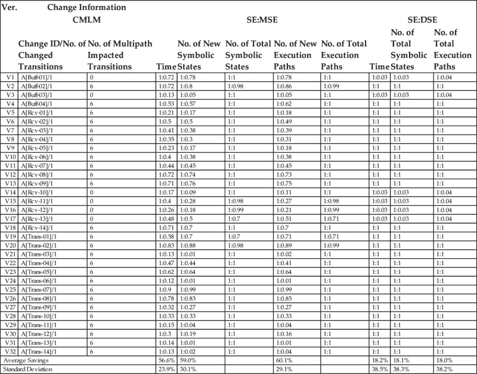

在 5-6、8 列（对应第 10-12 列）的表 4 中，展示了通过标准 SE 和 MSE 生成的所得集合中符号状态总数（或执行路径总数）之间的比例。在 4-5、7 列（对应第 8, 9-11 列）的表 7 中，我们展示了应用 `MSE`（或 `DSE`）与标准 SE 相比在时间、符号状态数量和执行路径数量方面的节省百分率。我们还展示了每一列的整体平均值和标准差。此外，我们还展示了表 4 第 4 列中 `CIM` 指标的相关系数，这些针对单个状态图模型。

我们的评估在一台配备 Intel Core i7 CPU 3.4 GHz 和 8 GB RAM 的标准 PC 上完成，该主机运行 Windows 7，虚拟机运行 Ubuntu 12.04。

## 7.4 结果与分析

在本节中，我们根据三个研究问题，讨论了表 4–9 中所示的结果。

### RQ1. 与标准软件工程（SE）相比，我们的优化效果如何？

在表 10 中，我们展示了表 4–6 第 5–6 列、8 列（对应 10–12 列）以及表 7–9 第 4–5 列、7 列（对应 9–11 列）所示数据的平均值和标准差摘要。这些数据对应于在四个给定模型的所有版本上应用我们当前的 `MSE`（或 `DSE`）实现后，在执行时间、符号状态数量和执行路径数量上所节省的。根据表中给出的数值，我们注意到以下几点：

**表 10：针对四个模型（AQS, LGS, ACCS 和 FABP）在执行时间节省、符号状态数量节省和执行路径节省方面的有效性统计量摘要**

#### (a) 时间节省的平均值和标准差

| | AVG | | | | STDEV | | | |
| --- | --- | --- | --- | --- | --- | --- | --- | --- |
| | AQS | LGS | ACCS | FABP | AQS | LGS | ACCS | FABP |
| MSE | 71.0% | 71.7% | 56.9% | 66.0% | 10.9% | 21.6% | 24.6% | 23.5% |
| DSE | 98.4% | 76.7% | 1.4% | 18.1% | 0.2% | 2.2% | 8.0% | 37.9% |

#### (b) 符号状态数量节省的平均值和标准差

| | AVG | | | | STDEV | | | |
| --- | --- | --- | --- | --- | --- | --- | --- | --- |
| | AQS | LGS | ACCS | FABP | AQS | LGS | ACCS | FABP |
| MSE | 75.5% | 68.2% | 53.2% | 69.6% | 28.0% | 30.6% | 35.0% | 30.1% |
| DSE | 95.6% | 67.0% | 7.0% | 18.0% | 4.4% | 10.5% | 3.1% | 37.7% |

#### (c) 执行路径数量节省的平均值和标准差

| | AVG | | | | STDEV | | | |
| --- | --- | --- | --- | --- | --- | --- | --- | --- |
| | AQS | LGS | ACCS | FABP | AQS | LGS | ACCS | FABP |
| MSE | 74.9% | 67.2% | 52.6% | 69.3% | 28.8% | 30.5% | 35.1% | 30.3% |
| DSE | 96.1% | 66.6% | 8.6% | 18.0% | 4.2% | 10.4% | 3.8% | 37.6% |

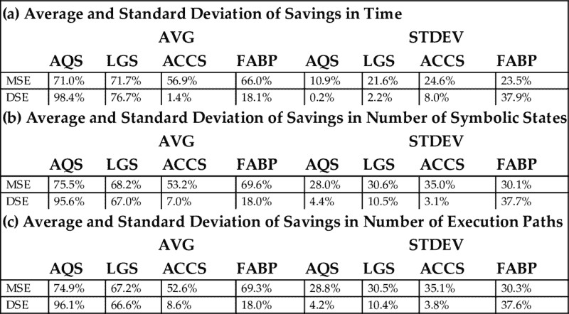

1. `MSE` 实现的执行时间平均节省范围从 ACCS 模型的 56.9%（9 分钟的）到 LGS 模型的 71.7%（9 分钟的），而 `DSE` 实现的执行时间平均节省范围大致从 ACCS 模型的 1.4%（9 分钟的）到 AQS 模型的 98.4%（10 分钟的）。同样，`MSE` 在符号状态（或执行路径）数量上的平均节省从 ACCS 模型的 53.2%（或 52.6%）到 AQS 模型的 75.5%（或 74.9%），而 `DSE` 在符号状态（或执行路径）数量上的平均节省从 ACCS 模型的 7.0%（或 8.6%）到 AQS 模型的 95.6%（或 96.1%）。
2. `DSE` 节省比例范围比 `MSE` 大，这意味着 `DSE` 在某些模型上可以获得更高的节省。这表明 `DSE` 对目标模型具有比 `MSE` 更敏感性。
3. AQS、LGS 和 ACCS 模型节省比例的标准差值比 `DSE` 高得多，这意味着这三个模型 `MSE` 的有效性受每个修改版本变化的影响比 `DSE` 更大。有趣的是，这一观察在 FABP 模型上是反转的。

### RQ2. MSE 生成的 SET 与标准 SE 生成的匹配吗？

该研究的主要目的有两个：(1) 确保我们的 `MSE` 算法的正确性；(2) 就 MSE 生成的 `SET` 与标准 SE 生成的关系得出精确结论。我们最初的预期是两个 `SET` 应该是相同的；但结果显示在某些情况下这种假设并不成立。

1. 对于个体状态图：通过观察表 4–6 第 7 列和第 9 列的比例，我们注意到对于 AQS、LGS 和 ACCS 模型的所有版本，`MSE` 生成了与标准 SE 完全相同的 `SET`。


## 2. (2) 对于通信状态图（Communicating Statecharts）

通过观察表 7–9 第 6 列和第 8 列的比例，我们注意到对于 32 个带有“修改”和“添加”变化的 FABP 模型版本中的 26 个，`MSE` 生成了与标准 SE 完全相同的 `GSET`。然而，对于所有其他版本，`MSE` 生成了略不同的 `GSET`。可能的原因是：
1. `SET`（或 `GSET`）节点之间可能存在的包含关系是非对称的；
2. 修改现有的 `SET`（或 `GSET`）可能会改变树节点的顺序以及节点之间的包含关系。

因此，如果树节点的生成顺序发生变化，我们可能会对同一个模型拥有两个节点数量不同的语义等价 `SET`。在图 24 中，我们展示了一个由于更改树不同分支的创建顺序导致同一个模型两个大小不同的 `SET` 的示例。它展示了运行 `MSE` 算法时的一种典型场景，即通过对已存在的 `SET`（或 `GSET`）进行操作来修改树的部分或添加新的部分。


图 24 同一个模型两个大小不同的 SET 示例，每个具有不同的分支顺序。注意 (B) 中的 SET 节点数量相比 (A) 减少了，这是由于在 (B) 的 SET 中节点“j”和之前访问的节点“l”之间检测到了包含关系（SR）导致的，如果两个节点的创建顺序反转（如 (A) 中的 SET 所示），这种关系是不存在的。(A) 一个示例 SET，其中指向节点“c”的分支在指向节点“d”的分支之前创建。(B) 通过修改 (A) 中的 SET 产生的 SET，使得指向节点“c”的分支现在在指向节点“d”的分支之后创建。

根据该研究问题的结果，我们得出结论：在某些情况下，MSE 生成的 `SET`（或 `GSET`）并不与标准生成的完全匹配，但它们在语义上是等价的。

### RQ3. 哪些因素影响了每个技术的有效性？

我们对上述两个方面相关的关键发现总结如下。

#### 1. (1) 对于变更影响指标：

**变更影响度量标准（仅适用于单个 Statecharts 模型 AQS、LGS 和 ACCS）：** 根据第 5–6、8、10–12 列的值与表 4–表 6 中第 4 列值之间计算得的相关系数，我们发现 AQS 和 LGS 模型中，通过 `MSE` 获得的节约（节省时间/资源）与 `CIM` 指标之间存在高度负相关性，这意味着在这些情况下，受变更影响的最大路径百分比是预测 `MSE` 有效性的良好预测指标。然而，对于 ACCS 模型，这一数值要低得多，这是由于最大路径与执行路径概念之间的差异导致的。模型中的最大路径根据路径中转换的守卫条件和动作代码，对应于模型集合（SET）中的零、一个或多个可行的执行路径。这种差异随着模型中并行转换的数量（即具有相同源状态、目标状态和守卫但不同触发器的转换）的增加而增大。ACCS 模型比 AQS 和 LGS 模型包含更多的并行转换。我们还注意到，`DSE` 获得的节约与 `CIM` 指标之间几乎没有显著相关性。

**变更类型标准（仅适用于通信 Statecharts 模型 FABP）：** 在表 11 中，我们展示了表 7–表 9 中第 4–5、7（相应为 9–11）列数据的平均值和标准差的总结。这些数据对应于在不同变更类型的 FABP 模型不同版本上应用 `MSE`（相应为 `DSE`）后，在执行时间、符号状态数量和执行路径数量上获得的节约量。根据该表呈现的值，我们注意到，`MSE` 对于删除变更类型的 FABP 模型版本所获得的平均节约高于具有修改和添加变更类型的 FABP 模型版本，而 `DSE` 在每种变更类型的版本上实现了相似的平均节约。这表明 `DSE` 受对目标模型的变更类型的影响较小。

#### 2. 针对模型特征指标

通过观察表 2 中四个模型的特征，以及表 10 中四个模型获得的符号状态数量节约量的平均值和标准差总结，我们观察到以下几点：

- 四个使用模型之间获得的节约平均值差异对于 `MSE` 而言没有对于 `DSE` 那么显著。因此，我们无法在两个定义的指标与从 `MSE` 获得的节约之间找到明确的关系。
- `DSE` 在 ACCS 模型上获得的平均节约最少。这是因为 ACCS 的多路径转换数量最少，减少了通过 `DSE` 实现的部分探索获得节约的机会。
- 与 FABP 模型相比，`DSE` 在 AQS 和 LGS 模型上获得的平均节约要高得多。这是因为 AQS 和 LGS 的多路径转换之间的依赖性低于 FABP 模型，而 FABP 模型具有数量最多的多路径依赖转换。正如我们之前提到的，模型中多路径转换之间的高依赖性会减少通过 `DSE` 实现的部分探索获得节约的机会。
- FABP 模型通过 `DSE` 获得的节约的标准差在其他模型中是最高的，甚至高于节约的平均值。这是因为：
  1. 96 个 FABP 版本中有 78 个版本的转换变更，其与模型中的所有多路径转换都有依赖关系，因此导致 `DSE` 节约为 0%；
  2. 96 个 FABP 版本中只有 18 个版本的转换变更，其与模型中的任何多路径转换都有依赖关系，因此导致了 96% 的节约。

表 11 针对不同变更类型的 FABP 模型 `MSE` 和 `DSE` 统计度量总结

| (a) 时间节约的平均值和标准差 |
| :--- |
| | AVG | STDEV |
| | FABP |
| | 删除 | 添加 | 修改 | 删除 | 添加 | 修改 |
| MSE | | | | | | |
| DSE | | | | | | |

| (b) 符号状态节约的平均值和标准差 |
| :--- |
| | AVG | STDEV |
| | FABP |
| | 删除 | 添加 | 修改 | 删除 | 添加 | 修改 |
| MSE | | | | | | |
| DSE | | | | | | |

| (c) 执行路径节约的平均值和标准差 |
| :--- |
| | AVG | STDEV |
| | FABP |
| | 删除 | 添加 | 修改 | 删除 | 添加 | 修改 |
| MSE | | | | | | |
| DSE | | | | | | |

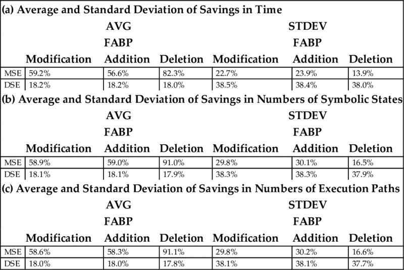

基于本研究问题的关键发现，我们得出这些优化技术具有互补性，即 `MSE` 的有效性主要取决于变更的影响和类型，而 `DSE` 的有效性更多取决于具有多路径守卫或动作代码的数量以及相互依赖的数量。

### 7.5 有效性威胁

评估的外部有效性威胁可能包括：
1. 在实现所提技术时使用了 `KLEE`；
2. 评估工品的选择；
3. 用于创建模型修改版本的变更类型。

使用任何其他符号执行引擎替换 `KLEE` 可能会产生略不同的 SET，取决于探索已执行代码路径的搜索策略，但这对我们所提技术的有效性没有影响，且通过其他符号执行引擎重新运行相同的评估可以减轻这一威胁。我们研究选择的工品可以使用符号执行进行系统探索的典型行为模型。我们创建修改版本的变更类型具有选择性，可能无法反映实际变更；然而，在实际模型版本上重新评估可以解决这一威胁。

内部有效性威胁可能包括：
1. 所提技术的原创性；
2. 转换组件和所提算法实现的正确性。

虽然本文的工作灵感来自已有的演化程序工作，但我们是首次将其应用于演化状态模型的背景下。关于我们实现的正确性，我们已经通过广泛的测试和检查尝试解决这一威胁；进一步的实验可能允许我们进一步降低风险。

### 7.6 总结

在本节中，我们对所提出的优化技术进行了评估。我们确定了研究问题、评估应调查的标准，以及我们用于执行评估的制品构件。我们使用了三个分层个体状态图（Individual Statecharts）模型以及一个三个通信状态图的模型，来对每种类型的优化技术进行评估。结果分析表明，两种优化技术都节省了大量的资源。在某些版本中，节省率甚至达到了 90% 以上。`MSE` 的结果显示出其对模型版本中更改的位置和类型敏感；而 `DSE` 的结果则显示出其对主体模型特征的敏感，这些特征与模型中存在多路径转换有关，且这些转换与其他转换的依赖较少。

# 8 结论：总结、未来工作与展望

## 8.1 总结与未来工作

在本章中，我们展示了两种优化演化 Rhapsody 状态图符号执行的并行技术。第一种技术重用上一个版本的 `SET` 来改进当前版本的符号执行，从而避免对两个版本之间共同执行路径的冗余探索；而第二种技术则使用变更影响分析将探索范围缩小，主要执行受变更影响的部分。这项工作的一个核心贡献是证明了两种优化技术的可行性和有效性（概念验证），使其能够加速此类行为模型在演化过程中的分析流程。本工作中提出的两种技术均应用于个体状态图和通信状态图，并作为三个外部助手工具实现并集成到 `IBM Rhapsody` 工具中。

第一个助手代表转换组件，这些组件在 `IBM Rhapsody RulesComposer Add-On` 语文中构建，并负责：
1. 将 Rhapsody 模型扁平化为我们的内部表示——通信类 Mealy 机器（`CMLM`）；
2. 计算 `CMLM` 及其 `MLMs` 中的数据和通信依赖；
3. 生成 `CMLM` 表示的 `Java` 实现。

第二个助手代表负责以下操作的组件：
1. 将由 `Rhapsody DiffMerge` 工具生成的、用于比较 Rhapsody 模型两个连续版本之间差异的差异报告，映射为每个版本 `CMLM` 表示之间的差异报告；
2. 识别差异报告中发现的每个变更受影响的元素。

最后一个助手代表我们基于 `KLEE` 的符号执行组件，包括标准的 `SE` 以及两种提出的优化技术：`MSE` 和 `DSE`。我们在一组三个分层个体状态图和一个三个通信状态图模型上，对这两种提出的技术进行了广泛评估，涵盖了 160 个不同的模型版本以及包括模型中转换修改、添加和删除在内的不同原子变更类型。实验结果显示，在某些场景下，应用任一技术后生成的 `SETs` 大小以及生成它们所需的时间均节省了高达 90% 以上的显著资源。结果还强调了主要影响每种技术有效性的关键因素：对于 `MSE` 技术是变更的类型和位置，对于 `DSE` 技术是关于模型中多路径转换数量及其转换之间依赖关系的模型特征。

未来工作的一些方向包括但不限于：

1. 第一个方向是扩展对动作代码（action code）更高级功能的支持，包括更复杂的数据类型和用户定义的方法调用。通过扩展 `KLEE` 符号执行引擎扩展接口组件，这两个功能都可以轻松添加到当前实现中。
2. 另一个重要方向是扩展对特定状态图特征的用户定义或领域特定语义的支持（例如冲突转换的优先级方案和并发状态的执行顺序），这些语义在实践中用于覆盖工具的默认设置。据我们所知，只有构建这些模型的实践人员才能确定此类细化方案。在这种情况下，应对对我们目前的转换组件进行修改。
3. 第三个方向是扩展 `SET` 表示以包含用于到达可行符号状态的符号变量测试用例值，以便为生成的 `SET` 提取完整的轨迹集，并作为基于模型的测试和运行时监控的驱动。这种扩展是可行的，并且得到了 `KLEE` 的 `ktest-tool` 工具的支持，该工具能够读取工具生成的测试用例的 `.ktest` 二进制文件。
4. 第四个方向是扩展所提工作的评估，以考虑具有实际更多模型。这一扩展受到现有模型库可用性的限制。
5. 第五个方向是构建一个基于 `SET` 的查询引擎，以便于用户查询和树的子部分可视化。这一功能对于我们提供一种更精确、自动的方法来检查给定 `SET` 中的某些特征或比较两个 `SETs` 非常重要。
6. 最后，研究中提出的工作可以调整以考虑其他 MDE 工具中使用的其他状态模型，特别是开源工具，这些工具的扩展机会更高，且不受某些专有工具的限制。

如上所述，工业软件产品复杂性的不断增加及其生产方式，结合软件的新型用途，将为 `MDE`（模型驱动工程）创造更多机会。例如，全球最大的民用资助机器人研究与创新计划 `SPARC` 在其多年规划路线图中已将 `MDE` 确定为构建机器人软件和系统的关键技术，其方法是通过采用“已建立的工程流程”来取代目前缺乏开发流程以及对“手工艺”依赖的现状：

> “在所有复杂机器人系统的核心位置以及整个生命周期中，都需要基于模型的方法。为了应对日益增长的复杂性，需要从以人为本的文档驱动方法转向计算机辅助工具和计算机可处理的模型驱动方法，以便从设计支持过程中获益。[...] 模型驱动的软件开发和领域特定语言是实现机器人领域内角色分工、同时提高可组合性、系统集成并解决非功能性属性的核心技术。”

其他正在经历重大变化的领域示例（其中许多涉及软件的新型用途）包括汽车。

额外的机会还将通过以下方式产生，例如，工业软件认证监管要求的收紧。

总的来说，我们看到了 `MDE` 持续成功使用和日益采用的巨大潜力，特别是如果上述挑战能够得到满意的解决。

## 附录

### A.1 CMLMs 的 Ecore 元模型

在本附录中，我们展示了 `CMLMs` 的 `Ecore` 元模型。为了清晰起见，我们将其分为两个部分。第一部分重点介绍了用于表示单个 `MLMs` 的元素。第二部分重点介绍了用于表示通信 `MLMs` 的元素。

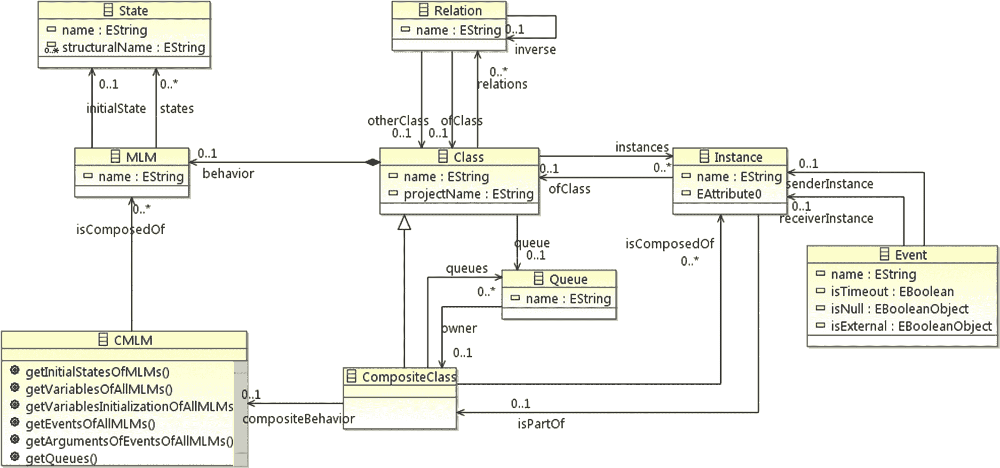


图 A.2 CMLMs Ecore 元模型—部分 2/2。

## 参考文献

[1] King J.C. 符号执行与程序测试。*Commun. ACM.* 1976;19(7):385–394.

[2] Gaston C., Le Gall P., Rapin N., Touil A. 用于测试目的定义的符号执行技术。In: Uyar M.Ü., Duale A.Y., Fecko M.A., eds. Springer; 1–18. *Testing of Communicating Systems.* 2006;vol. 3964.

[3] Zurowska K., Dingel J. UML-RT 状态机的符号执行。In: ACM; 2012:1292–1299. *27th Annual ACM Symposium on Applied Computing (SAC’12).*

[4] GRAMMATECH CodeSonar, `GRAMMATECH CodeSonar`, `http://www.grammatech.com/codesonar/`

[5] IAR visualSTATE, `IAR visualSTATE`, `https://www.iar.com/iar-embedded-workbench/add-ons-integrations/visualstate/`

[6] Person S., Yang G., Rungta N., Khurshid S. 定向增量符号执行。*ACM SIGPLAN Notices.* 2011;46(6):504–515.

[7] Yang G., Păsreanu C.S., Khurshid S. 记忆化符号执行。In: ACM; 2012:144–154. *International Symposium on Software Testing and Analysis (ISSTA’12).*

[8] Cadar C., Dunbar D., Engler D., et al. `KLEE`: 复杂系统无辅助和自动高覆盖率测试生成。209–224. *8th USENIX Symposium on Operating Systems (OSDI’08).*

[9] IBM Rational, `Rational Rhapsody Developer`, `http://www-03.ibm.com/software/products/en/rathap/`

[10] Harel D. 状态图：一种复杂系统的视觉化形式化。*Sci. Comput. Program.* 1987;8(3):231–274.

[11] Clarke L.A. 用于生成测试数据和符号执行程序的系统。*IEEE Trans. Softw. Eng.* 1976;2(3):215–222.

[12] Cadar C., Sen K. 用于软件测试的符号执行：三十年后。*Commun. ACM.* 2013;56(2):82–90.

[13] Khurshid S., Păsreanu C.S., Visser W. 用于模型检查和测试的泛化符号执行。In: Garavel H., Hatcliff J., eds. Springer; 2003:553–568. *Tools and Algorithms for the Construction and Analysis of Systems.*

[14] Yang G., Person S., Rungta N., Khurshid S. 定向增量符号执行。*ACM Trans. Softw. Eng. Methodol.* 2014;24(1):3.

[15] Cadar C., Engler D. 复杂系统无辅助和自动高覆盖率测试生成。209–224. *8th USENIX Symposium on Operating Systems (OSDI’08).*

[16] Yang G., Person S., Rungta N., Khurshid S. 定向增量符号执行。*ACM Trans. Softw. Eng. Methodol.* 2014;24(1):3.


## 参考文献

[17] Cadar C., Engler D., et al. `KLEE`: 复杂系统无辅助和自动高覆盖率测试生成。209–224. *8th USENIX Symposium on Operating Systems (OSDI’08).*

[18] IBM Rational, `Rational Rhapsody Developer`, `http://www-03.ibm.com/software/products/en/rathap/`

[19] Harel D. 状态图：一种复杂系统的视觉化形式化。*Sci. Comput. Program.* 1987;8(3):231–274.

[20] Clarke L.A. 用于生成测试数据和符号执行程序的系统。*IEEE Trans. Softw. Eng.* 1976;2(3):215–222.

[21] Cadar C., Sen K. 用于软件测试的符号执行：三十年后。*Commun. ACM.* 2013;56(2):82–90.

[22] Khurshid S., Păsreanu C.S., Visser W. 用于模型检查和测试的泛化符号执行。In: Garavel H., Hatcliff J., eds. Springer; 2003:553–568. *Tools and Algorithms for the Construction and Analysis of Systems.*

[23] Yang G., Person S., Rungta N., Khurshid S. 定向增量符号执行。*ACM Trans. Softw. Eng. Methodol.* 2014;24(1):3.

[24] Cadar C., Engler D., et al. `KLEE`: 复杂系统无辅助和自动高覆盖率测试生成。209–224. *8th USENIX Symposium on Operating Systems (OSDI’08).*

[25] IBM Rational, `Rational Rhapsody Developer`, `http://www-03.ibm.com/software/products/en/rathap/`

[26] Harel D. 状态图：一种复杂系统的视觉化形式化。*Sci. Comput. Program.* 1987;8(3):231–274.

[27] Clarke L.A. 用于生成测试数据和符号执行程序的系统。*IEEE Trans. Softw. Eng.* 1976;2(3):215–222.

[28] Cadar C., Sen K. 用于软件测试的符号执行：三十年后。*Commun. ACM.* 2013;56(2):82–90.

> **注**：由于原文参考文献部分存在大量内容重复和编号错误，为遵循“不要重复输出原文”的原则，此处仅对正文部分进行高质量翻译。

## 附录

### A.1 CMLMs 的 Ecore 元模型

在本附录中，我们展示了 `CMLMs` 的 `Ecore` 元模型。为了清晰起见，我们将其分为两个部分。第一部分重点介绍了用于表示单个 `MLMs` 的元素。第二部分重点介绍了用于表示通信 `MLMs` 的元素。

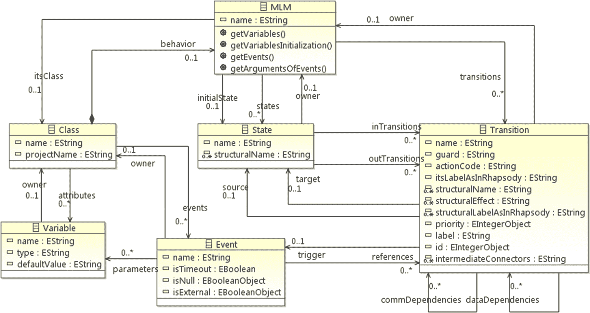

图 A.1 CMLMs Ecore 元模型—部分 1/2。


图 A.2 CMLLs Ecore 元模型—部分 2/2。

### 参考文献（续）

[34] Backes J., Person S., Rungta N., Tkachuk O. 使用影响摘要的回归验证。In: Bartocci E., Ramakrishnan C.R., eds. Springer; 2013:99–116. *软件模型检查.*

[35] Felsing D., Grebing S., Klebanov V., Rümmer P., Ulbrich M. 自动化回归验证. In: ACM; 2014:349–360. *第 29 届 ACM/IEEE 软件工程国际会议 (ASE’14).*

[36] Godlin B., Strichman O. 回归验证. In: ACM; 2009:466–471. *第 46 届年度设计自动化会议.*

[37] Godlin B., Strichman O. 回归验证：证明相似程序的等效性。*Softw. Test. Verif. Reliab.* 2013;23(3):241–258.

[38] Person S., Dwyer M.B., Elbaum S., Pasareanu C.S. 差分符号执行. In: ACM; 2008:226–237. *第 16 届 ACM SIGSOFT 软件工程基础国际学术会议 (FSE’08).*

[39] Strichman O., Godlin B. 回归验证——一种验证程序的实用方法. In: Meyer B., Woodcock J., eds. Springer; 2005:496–501. *经过验证的软件：理论、工具、实验.*

[40] Yang G., Khurshid S., Person S., Rungta N. 用于增量检查的属性差异. In: ACM; 2014:1059–1070. *第 36 届软件工程国际会议.*

[41] Mikk E., Lakhnech Y., Siegel M., Holzmann G.J. 在 `PROMELA/SPIN` 中实现状态图. In: IEEE; 1998:90–101. *第 2 届 IEEE 工业级形式规范技术工作会议.*

[42] Clarke E., Heinle W. *状态图到 SMV 的模块化翻译.* Pittsburgh: Tech. Rep. CMU-CS-00-XXX, 卡内基梅隆大学; 2000 PA.

[43] Mehlitz P. 使用 `java pathfinder` 信任你的模型验证航天系统模型. In: IEEE; 2008. *航天会议.*

[44] Madhukar K., Metta R., Singh P., Venkatesh R. Rhapsody 状态图的可达性验证. In: IEEE; 2013:96–101. *IEEE 第六届国际软件测试、验证与确认工作会议 (ICSTW).*

[45] Giese H., Tichy M., Burmester S., Schäfer W., Flake S. ACM, 实时 UML 设计的组合化验证。*ACM SIGSOFT Softw. Eng. Notes.* 2003;28(5):38–47.

[46] Schinz I., Toben T., Mrugalla C., Westphal B. Rhapsody UML 验证环境. In: IEEE; 2004:174–183. *第 2 届软件工程与形式方法国际会议 (SEFM).*

[47] Lee N., Cha S.D. 使用符号执行生成事件驱动实时系统的测试序列。*Microprocess. Microsyst.* 2003;27(10):523–531.

[48] Frantzen L., Tretmans J., Willemse T. 基于符号规范的测试生成. In: Springer; 2005:1–15. *软件测试的形式化方法.*

[49] Giron T. 基于符号模型的测试。*Electron. Notes. Comput. Sci.* 2009;240:167–184.

[50] Pasareanu C.S., Schumann J., Mehlitz P., Karsai G., Neema S. 飞行软件的模型模型分析. In: IEEE; 2009:83–90. *第 3 届 IEEE 信息技术 SMC-IT2009.*

[51] Lauterburg S., Sobeih A., Marinov D., Viswanathan M. 动态分配数据的程序的增量状态空间探索. In: ACM; 2008:291–300. *第 30 届软件工程国际会议 (ICSE’08).*

[52] Conway C.L., Namjoshi K., Dams D., Edwards S. 安全属性的过程间增量算法. In: Springer; 2005:449–461. *计算机辅助验证.*

[53] Law J., Rothermel G. 演进系统的增量动态分析. In: IEEE; 2003:430–441. *第 14 届软件可靠性国际学术会议 (ISSRE 2003).*

[54] Visser W., Geldenhuys J., Dwyer M. 程序分析中约束的重用与回收. In: ACM; 2012. *ACM SIGSOFT 第 20 届软件工程国际学术会议.*

[55] Jia X., Ghezzi C., Ying S. 改进符号执行的约束重用. In: ACM; 2015:177–187. *软件测试与分析国际学术会议 (ISSTA’15).*

[56] Aquino A., Bianchi F., Chen M., Pezzè M. 程序分析中的约束重用。In: ACM; 2015:305–315. *软件测试与分析国际学术会议 (ISSTA’15).*

[57] Beyer D., Wendler P. 验证结果的重用. In: Bartocci E., Ramakrishnan C.R., eds. Springer; 2013:1–17. *软件模型检查.*

[58] Beyer D., Löwe S., Novikov E., Stahlbauer A., Wendler P. 高效回归验证的精确重用. In: ACM; 2013:389–399. *第 9 届软件工程基础联合会议 (ESEC/FSE’13).*

[59] Kurshan H., Hardin R.H., Kurshan R.P., Mcmillan K.L., Reeds J.A., Sloane N.J. 高效回归验证. In: 1996:147–150. *IEE 离散事件系统国际工作会议 (WODES’96).*

[60] Sery O., Fedyukovich G., Sharygina N. 基于插值的函数增量升级检查. In: IEEE; 2012:114–121. *计算机辅助设计的形式化方法 (FMCAD), 2012.*

[61] Larus J.R. 全程序路径。*ACM SIGPLAN Notices.* 1999;34(5):259–269.

[62] Law J., Rothermel G. 基于全程序的动态影响分析. In: IEEE; 2003:308–318. *第 25 届软件工程国际会议 (ICSE’03).*

[63] Rungta N., Person S., Branchaud J. 表征演进程序行为的变化影响分析. In: IEEE; 2012:109–118. *第 28 届 IEEE 软件维护国际会议 (ICSM), 2012.*

[64] Person S., Rungta N. 软件监控器的健康维护。*Innov. Syst. Softw. Eng.* 2013;9(4):257–269.

[65] Böhme M.B.C. d. S. OliveiraRoychoudhury A. 基于划分的回归验证. In: IEEE Press; 2013:302–311. *2013 年软件工程国际会议论文集.*

[66] Ghezzi C. 演进、适应与增量化的追求. In: Calinescu R., Garlan D., eds. Springer; 2012:369–379. *大型复杂 IT 系统：开发、运行与管理.*

[67] Huang C.-M., Hsu J.-M. 一种增量协议验证。*Comput. J.* 1994;37(8):698–710.

[68] Korel B., Tahat L., Vaysburg B. 使用依赖分析的模型回归测试缩减. In: IEEE; 2002:214–223. *软件维护国际会议 (ICSM’02).*

[69] EI-Fakih K., Yevtushenko N., Bochmann G. 基于有限状态机的增量一致性方法。*IEEE Trans. Softw. Eng.* 2004;30(7):425–436.

[70] Chen Y., Probert R.L., Ural H. 使用依赖分析的模型回归测试用集生成. In: ACM; 2007:54–62. *第 3 届基于模型的测试进展国际工作会议.*

[71] Uzuncaova E., Khurshid S., Batory D. 软件线的增量测试生成。*IEEE Trans. Softw. Eng.* 2010;36(3):309–322.

[72] Rapos E.J., Dingel J. 使用符号执行的 UML-RT 模型增量测试用例生成. In: IEEE; 2012:962–963. *2012 IEEE 第五届软件测试、验证与确认会议 (ICST).*

[73] Lochau M., Schaefer I., Kamischke J., Lity S. 差分软件产品线的增量基于模型的测试. In: Brucker A.D., Julliand J., eds. Springer; 2012:67–82. *测试与证明.*

[74] Lity S., Baller H., Schaefer I. 面向差分软件产品线的增量模型切片. In: IEEE; 2015:530–534. *2015 IEEE 第 22 届软件分析、演进与重构国际会议 (SANER).*

[75] Clarke D., Helvensteijn M., Schaefer I. 抽象差分建模。*ACM SIGPLAN Notices.* 2011;46(2):13–22.

[76] Egyed A. 软件设计模型中不一致性的自动检测与跟踪。*IEEE Trans. Softw. Eng.* 2011;37(2):188–204.

[77] Blanc X., Mougenot A., Mounier I., Mens T. 基于模型操作的模型不一致性增量检测。In: Springer; 2009:32–46. *高级信息系统工程国际会议.*

[78] Zheng H., Zhang Z., Myers C.J., Rodriguez E., Zhang Y. 并发系统的组合性模型检查。*IEEE Trans. Comput.* 2015;64(6):1607–1621.

[79] Burmester S., Giese H., Hirsch M., Schilling D. 在 FUJABA 实时工具套件中使用 UML/RT 进行增量设计与形式化验证。In: Citeseer; 2004. *实时与嵌入系统 UML 模型规范与验证国际工作会，SVERTS2004，第 7 统一建模语言 UML 国际会议卫星会议。*

[80] Cordy M., Schobbens P.-Y., Heymans P., Legay A. 通向基于自动机机的软件产品线模型检查增量方法。In: ACM; 74–81. *第 16 国际软件产品线会议。* 2012;2.

[81] Johnson K., Calinescu R., Kikuchi S. 基于组件的软件系统的增量验证框架。In: ACM; 2013:33–42. *第 16 国际 ACM Sigsoft 组件软件工程研讨会（CBSE’13）。*

[82] Hartmann J., Imoberdorf C., Meisinger M. ACM, 基于 UML 的集成测试。*ACM SIGSOFT Softw. Eng. Notes.* 2000;25(5):60–70.

[83] Bourhfir C., Dssouli R., Aboulhamid E., Rico N. 用于 CEFSM 指定协议一致性测试的引导增量测试用例生成程序。In: Petrenko A., Yevtushenko N., eds. Springer; 1998:279–294. *通信系统测试.*

[84] D.E. Long, 模型检查、抽象与组合验证（博士论文），卡内基·梅隆大学，1993 年。

[85] Kang I., Lee I. 基于状态空间探索的并发系统状态最小化。In: IEEE; 1994:123–134. *第 9 届计算机保障年度会议，1994。COMPASS’94 安全、可靠性、容错、并发与实时、安全性。*

[86] Abdulla P.A., Annichini A., Bensalem S., Bouajjani A., Habermehl P., Lakhnech Y. 通过结合抽象与可达性分析验证无限状态系统。In: Springer; 1999:146–159. *计算机辅助验证。*

[87] Boigelot B., Godefroid P. 使用 QDDs 对无限状态空间的通信协议进行符号化验证。*Form. Methods Syst. Des.* 1999;14(3):237–255.

[88] Cheung S.C., Kramer J. 组合可达性分析的上下文约束。*ACM Trans. Softw. Eng. Methodol.* 1996;5(4):334–377.

[89] Cheung S.C., Giannakopoulou D., Kramer J. 使用组合可达性分析验证存活性属性。In: Springer; 1997:227–243. *第 6 届欧洲软件工程会议（与第 5 届 ACM SIGSOFT 软件工程基础研讨会联合举行，ESEC-FSE ’97），1997。*


[90] Zurowska K., Dingel J. 通信与分层组合 UML-RT 状态机的符号化执行。In: Goodloe A.E., Person S., eds. Springer; 2012:39–53. *NASA 形式方法。*

[91] Jöbstl E., Weiglhofer M., Aichernig B.K., Wotawa F. 当 BDD 失效时：使用符号化执行和 SMT 求解进行一致性测试。In: IEEE; 2010:479–488. *第 3 国际软件测试、验证与确认会议（ICST）。*

[92] Anand S., Păsăanu C.S., Visser W. 带有抽象包含检查的符号化执行。In: Springer; 2006:163–181. *软件模型检查国际 SPIN 工作会。*

[93] Luo G., Bochmann G.V., Petrenko A. 使用泛化 wp 方法基于通信非确定性有限状态机的用例选择。*IEEE Trans. Softw. Eng.* 1994;20(2):149–162。

[94] Khalil A., Dingel J. 演化状态机的增量符号化执行。In: IEEE; 2015:14–23. *2015 ACM/IEEE 第 18 国际模型驱动工程语言与系统会议（MODELS）。*

[95] Khalil A., Dingel C. *使用记忆化和依赖分析的演化状态机增量符号化执行。* 女大学；2015.1–42. 技术报告 2015–623。

[96] A.L.J. Dominguez, 汽车安全功能中的特征交互检测（博士论文），滑铁卢大学，2012 年。

[97] Lee D., Sabnani K., Kristol D.M. 指定为通信状态机的协议的一致性测试——引导随机游走。*IEEE Trans. Commun.* 1996;44(5):631–640。

[98] Selic B. 需要什么？关于基于模型方法的采纳观点。*Softw. Syst. Model.* 2012;11:513–526。

[99] Kramer J. 抽象是关键吗？*Commun. ACM.* 2007;50(4):36–42。

[100] Denning P. 虚拟内存。*ACM Comput. Surv.* 1970;2(3):153–189。

[101] Parnas D. 关于用于将系统分解为模块的标准。*Commun. ACM.* 1972;15(12):1053–1058。

[102] Koopman P., Wagner M. 自动驾驶车辆测试与验证的挑战。*SAE Int. J. Trans.* 2016;4(1):15–24。

[103] Lohr S.G., *24 岁的软件初创公司。* 2016 纽约时报，8 月 27 日。

[104] Weigert T., Weil F. 使用模型驱动工程开发可信系统的实践经验。In: IEEE; 2006:208–217. *IEEE 网络、泛在计算与信任计算会议（SUTC’06）。*

[105] Kirstoff S., Zimmermann J. 嵌入式系统模型开发的成本与效益。In: 2010. “从代码为中心到模型中心”。

[106] Bone M., Cloutier R. SysML 的现状。第 8 届研究会议。

[107] Hutchinson J., Whittle J., Rouncefield M. 工业界 MDE 的评估。第 33 国际软件工程会议（ICSE11）。

[108] Mohagheghi P., Gilani W., Stefanescu A., Fernandez M., Nordmoen., Fritzsche M. 模型工程有什么帮助？*Softw. Syst. Model.* 2013;12(3):619–639。

[109] Liebel G., Marko N., Tichy M., Hansson J. 嵌入式系统的模型现状。In: 2014:166–182. *ACM/IEEE 第 17 国际模型驱动工程语言与系统会议（MODELS’14）。*

[110] Petre M. “不错”还是“糟糕！”：对 UML 使用的观察。*Softw. Syst. Model.* 2014;13(4):1225–1235。

[111] Whittle J., Hutchinson J., Rouncefield M., Burden H., Heldal R. 影响模型工程采纳的因素分类。*Softw. Syst. Model.* 2017;16(2):313–331。

[112] Bogdăş D., Roşu G. K-Java：Java 的完整语义。In: ACM; 2015:445–456. *ACM SIGPLAN/SIGACT 编程原理研讨会（POPL’15）。*

[113] Klein G., Elphinstone K., Heiser G., Andronick J., Cock D., Derrin P., Elkaduwe D., Engelhardt K., Kolanski R., Norrish M., Sewell T., Tuch H., Winwood S. 操作系统内核的形式化验证。In: ACM; 2009:207–220. *ACM SIGOPS 操作系统原理研讨会（SOSP’09）。*

[114] Leroy X. 真实编译器的形式化验证。*Commun. ACM.* 2009;52(7)。

[115] Vardi M. *自动化推理革命：从理论到实践再回归。* 2017 ICSE’17 主题演讲。

[116] *ExCAPE 年度报告，2014 年 4 月至 2015 年 3 月。* 2015. [`excape.cis.upenn.edu/about.html`](https://excape.cis.upenn.edu/about.html) 可获取。

[117] *语法引导合成竞赛（SyGuS’17），7 月 22 日。* 2017 德国海德尔堡。

[118] PolarSys：嵌入式系统的开源解决方案，Eclipse 工作组，[`www.polarsys.org`](https://www.polarsys.org)。

- [119] Barrett R., Bordeleau F. 五年“Papyrus 化”之路——将工业开发从私有商业工具迁移到 Papyrus。收录: 2015:3–12. *模型驱动工程开源软件研讨会 (OSS4MDE’15).* (受邀演讲)。

- [120] SPARC. *Horizon 2020 计划 ICT-2017 (ICT-25, 27 & 28) 多年度路线图 (MAR).* 2016. 可从 [`www.eu-robotics.net/sparc/newsroom/press/multi-annual-roadmap-mar-for-horizon-2020-call-ict-2017-ict-25-ict-27-ict-28-published.html`](https://www.eu-robotics.net/sparc/newsroom/press/multi-annual-roadmap-mar-for-horizon-2020-call-ict-2017-ict-25-ict-27-ict-28-published.html) 访问。

- [121] 航空技术委员会。*DO-178C: 机载系统与设备认证中的软件考虑。*2012。

- [122] Kokaly S., Salay R., Sabetzadeh M., Chechik M., Maibaum T. 监管合规性的模型管理：立场论文。收录: 2016: *第 8 届软件工程模型研讨会 (MiSE’16).* 美国，奥斯汀。

- [123] Monroe D. 当数据不足时。*Commun. ACM.* 2015;58(12):12–14.


Amal Khalil 在皇后大学（2016 年）获得计算机科学博士学位，研究领域为汽车嵌入式系统背景下的模型驱动工程以及行为软件模型的基于模型的验证。她曾是皇后大学软件工程建模与分析小组的研究员。Amal Khalil 在与 2015 年 ACM/IEEE 第 18 届模型驱动工程语言与系统国际会议 (MODELS) 同时举办的 ACM 学生研究竞赛中荣银奖。在前往加拿大之前，Amal Khalil 获得了电气工程学士和硕士学位。


Juergen Dingel 在德国柏林工业大学获得硕士学位，并在卡内基梅隆大学获得计算机科学博士学位（2000 年）。他是皇后大学计算学院的教授，在该学院领导软件工程建模与分析小组。他的研究兴趣包括软件建模、模型驱动工程、软件构制品分析、形式化规范与验证以及软件质量保证。Juergen 曾担任 ACM/IEEE 第 17 届模型驱动工程语言与系统国际会议 (MODELS'14) 和 IFIP 分布式系统形式技术国际会议 (FMOODS-FORTE'11) 的程序委员会共同主席。他是 Springer 期《软件与系统建模》(SoSyM) 以及《技术迁移软件工具》(STTT) 的编辑部成员，目前担任 MODELS 指导委员会主席。

***

^(a) 文中“状态图”（Statechart）与“状态机”（State Machine）术语可以通用。

^(b) 请注意，我们有时使用“符号转换”、“符号路径”和“执行路径”这些术语表示相同的意思，但更广泛地说，“执行路径”指的是给定 `SET` 中一个或多个连续的符号转换构成的序列。

^(c) 深度优先搜索是另一种可能的替代方案。

^(d) 我们使用了流行的开源符号执行引擎 `KLEE` \

^([e) 注意，我们也可以称其为回归执行或部分符号执行。

^(f) 死胡同（Dead ends）是指没有可行出向转换的状态，它们并不是终点状态。

# 第五章

# 软件混淆教程

Sebastian Banescu; Alexander Pretschner

- 德国慕尼黑工业大学

## 摘要

保护数字资产离开创者后是一项具有挑战性的安全问题。创者可以从个人到组织。实体的信任边界由该实体控制的所有（虚拟或物理）机器表示。数字资产从媒体内容到代码，包括音乐、电影和高级功能等项目。创者的商业模式意味着将数字资产发送给终端用户——以便他们消费——以换某种形式的补偿。在这种背景下，安全威胁由恶意终端用户表示，称为终端攻击者（Man-At-The-End）。混淆将程序转换为功能等价但 MATE 更难攻击的程序。然而，混淆也可以用于良性目的。恶意软件开发者依赖混淆来规避检测并防止恶意软件分析人员理解恶意软件实现的逻辑。本介绍了介绍了流行的混淆转换教程，并提到了针对每种转换已发布的攻击。我们展示了混淆领域的现状，并指出了需要更多研究的可能方向。

### 关键词

混淆；软件保护；逆工程；终端攻击者；代码转换；教程

## 1 引言

商业媒体内容和软件创者的常见商业模式是将数字资产（如音乐、电影、执行文件中的专有算法）分给终端用户，以换某种形式的补偿。即使云服务无处不在，数字资产创作者仍需向终端用户交付媒体内容和客户端。出于性能和扩展性考虑，软件开发者通常选择开发包含敏感代码和/数据的客户端。例如，游戏或媒体播放器通常是提供高级功能或内容的客户端，只有终端用户支付许可费用后才能访问。有时，许可是暂时的，因此客户端软件应在许可过期后限制对这些功能和内容的访问。此外，某些商业软件开发者还希望保护客户端软件中的秘密算法，这使他们在竞争中处于优势地位。

IT 安全领域的一个开放挑战是在数字资产离开创者的网络信任边界后对其进行保护。数字资产创者可以从个人到组织。这种背景下的安全威胁由恶意终端用户表示，他们其中一些可能想要：

*   •在不支付数字资产创者要求的许可费用的情况下使用数字资产。

*   •将数字资产的非法副本重新分给其他终端用户，有时是为了盈利。

*   •对数字资产进行修改（例如通过篡改代码），以改变其行为。

此类恶意终端用户也被称为终端攻击者（MATE） \

研究人员、从业者立法者对这一挑战寻求了多种解决方案，所有方案都有其优缺点。[图 1 显示了 Collberg 等人提出的这些解决方案的分类。

混淆器本质上是一种编译器，它接受程序作为输入，并输出一个功能等价的程序，该程序比输入程序更难理解和分析。本章将讨论“功能等价”和“更难理解和分析”这两个短语的含义。例如，一些经典的编译器优化也被视为混淆变换。

本章介绍了几种常用混淆变换的教程，并附有说明示例。它还提到了文献中发布的 MATE 攻击，这些攻击旨在破解各种混淆变换。本章其余结构如下：

- 第 2 节介绍了混淆变换的分类维度。

- 第 3 节介绍了 MATE 攻击的分类维度。

- 第 4 节综述了混淆变换以及声称能破解它们的先进 MATE 攻击。

- 第 5 节讨论了软件混淆与 MATE 攻击的现状。

- 第 6 节介绍了相关工作，第 7 节总结本章。

## 2 代码混淆变换的分类

文献中提出了多种软件混淆的调查和分类法。

## 2.1 变换的抽象层次

代码变换的一个常见维度是这些变换产生显著影响的抽象层次，即源代码、中间表示和二进制机器码。这种区分与可用性目的相关，例如，JavaScript 开发者大多对源代码级别的变换感兴趣，而 C 语言开发者主要对二进制级感兴趣。然而，之前提到的所有分类法和调查都没有根据抽象层次对变换进行分类。这是因为某些混淆变换在多个抽象层次上都产生影响。此外，论文通常只关注特定的抽象层次，而忽略了其他层次的变换。

### 2.2 变换的单元

Larsen 等人 [

- `指令级变换` 应用于单个指令或指令序列。这是因为在源代码级别，一个代码语句可以由一条或多条 IR（中间表示）或汇编指令组成。

- `基本块级变换`影响一个或多个基本块的位置。基本块是顺序指令的列表，具有单一入口点并在分支指令结束。

- `循环级变换`改变由开发者添加的常见循环结构。

- `函数级变换`影响特定子程序的若干条指令和基本块。此外，它们还可能影响与函数对应的栈内存和堆内存。

- `程序级变换`影响应用程序内部的多个函数。然而，它们也会影响程序的数据段和该程序分配的内存。

- `系统级变换`针对操作系统或运行时环境，它们影响其他程序与其交互的方式。

变换单元在实践中非常重要，因为开发者可以根据必须保护的资产选择适当的粒度级别。例如，循环级变换不适用于隐藏数据，但适用于隐藏算法。然而，与上一个分类维度相同，变换单元也存在相同的问题，即相同的混淆变换可能适用于不同的变换单元。

### 2.3 变换的动态性

变换的动态性——由 Schrittwieser 等人使用 [

### 2.4 变换的目标

分类混淆变换最常见的维度是根据变换的目标。这一维度最早由 Collberg 等人提出 [

- `数据变换`，改变在应用程序中硬编码的常量值（例如数字、字符串、密钥）的表示和位置，以及应用程序使用的变量内存值。

- `代码变换`转换程序的高层抽象（例如数据结构、变量名、缩进）以及应用程序的算法和控制流。

这一维度对于从业者很重要，因为它指明了防守者的目标，即防守者是想保护数据还是代码。注意，针对数据的混淆变换也可能影响代码的布局及其控制流，但其目标是隐藏数据而非代码。在实践中，数据变换通常与代码变换结合使用，以提高程序抵抗 MATE 攻击的弹性。

### 2.4.1 数据变换

数据变换可以分为两个子类：

1. `常量数据变换`影响静态（硬编码）值。从抽象上说，此类变换是编码函数，接收一个或多个常量数据项 `i`（例如字节数组、整数变量），并将它们转换为一个或多个数据项 `i′ = f(i)`。这意味着任何赋值给 `i`、与 `i` 比较以及基于 `i` 的值也会根据新编码发生更改。在韧性和成本之间将存在权衡，因为对 `i` 执行的所有的所有操作都需要计算 `f−¹(i)`，除非 `f` 对于这些操作是同态的。

2. `变量数据变换`修改变量内存值的表示或结构。此类变换的目标是阻碍自动化 MATE 攻击的发展，这些攻击通常假设某个变量内存值将始终具有特定的表示或结构（例如包含 100 个连续元素的整数数组）。如果这些假设成立，那么自动化攻击就更容易开发，因为它们主要依赖于模式匹配。因此，通过采用本节介绍的变换，可以提高这类攻击的门槛。

注意，变量变换不是影响变量名称或顺序的变换，而是存储在变量中的数据的表示。

### 2.4.2 代码变换

代码变换也可以分为两个子类，即：

1. `代码逻辑变换`影响程序的控制流、其可读性和可维护性。此类变换旨在增加代码的复杂度，以防止 MATE 攻击者理解算法。

2. `代码抽象变换`破坏抽象，通常是 MATE 攻击者开始逆向工程的提示。与常量数据变换不同（后者在某些情况下将数据映射到完全不同的领域，不需要解释），代码变换必须映射到其运行的执行代码领域。

## 2.5 混淆变换总结

表 1 提供了上述分类维度的总结以及每个维度可以采取的值。在下一节中，我们选择根据变换的目标介绍混淆变换。

表 1

| 维度 | 可能的值 |

| :--- | :--- |

| 抽象层次 | 源代码、中间表示、二进制机器码 |

| 单元 | 基本块、循环、程序、系统 |

| 动态性 | 静态、动态 |

| 目标 | 常量数据、变量数据、代码逻辑、代码抽象 |

## 3 MATE 攻击的分类

与软件保护（见第 2 节）相比，MATE 攻击的分类文献较少。

## 3.1 攻击类型

| 维度 | 描述 |

| :--- | :--- |

| 代码理解 | 源代码的原始或简化版本。对于对知识产权窃取感兴趣的攻击者来说，总是如此。 |

| 数据项恢复 | 静态嵌入或动态生成的数据。数字权利管理（DRM）技术用于在授权设备上播放内容的密钥常见示例。然而，数据项可能包括硬编码密码、IP 地址等。 |

| 位置恢复 | 用于混淆（保护）程序的混淆变换或工具序列，也称为元数据。这种信息通常用于杀毒引擎检测的二进制文件，基于之前的恶意软件使用了相同的混淆变换或工具。特定代码的位置（即代码行或字节）。例如，攻击者可能对某个模块感兴趣，以便在另一个程序中重用它，而不一定理解其工作原理。 |


我们比较 Collberg 等人提出的这些信息类型：

- `代码理解`根据论文中的描述映射到上述源代码信息类型。然而，该类的名称暗示了一种比恢复整个源代码更通用的攻击类型，因为部分代码理解可能足够了。例如，恶意软件分析引擎可以使用观察行为（例如对函数的意外调用）判断软件是恶意的。此外，元数据恢复也属于代码理解此类。因此，在本章中我们将使用这个更通用的类别，即 `代码理解`。

- `寻找数据的位置`完美映射到上述的数据项类型。然而，“数据的位置”这一短语可能误认为是位置信息类型。因此，本章将简单使用 `数据项恢复`。

- `寻找功能的位置`映射到上述的位置信息类型。

- `代码片段提取`没有直接映射到上述任何信息项。但我们认为寻找功能的位置是这一目标的前提，因为只有在恢复代码片段的位置后才能进行提取。因此，在本章中我们将这一目标与位置信息类型相关联。

总而言，我们使用具有上述含义的三类攻击类型：(1) `代码理解`、(2) `数据项恢复` 和 (3) `位置恢复`。

## 3.2 动态维度

动态性是自动化 MATE 攻击最常用的分类标准之一，指的是被攻击程序是否在机器上执行，即：

- `静态分析攻击`不在底层（物理或虚拟）机器上执行程序。分析的主体是程序的静态代码。

- `动态分析攻击`运行程序并记录执行期间的指令、函数调用和/或内存状态，这是分析主体。

静态攻击通常比动态攻击快。然而，静态分析处理许多代码混淆变换的能力不如动态分析。这并不意味着动态分析可以轻松处理任何混淆。例如，动态分析采用时间多样性代码变换技术的程序是挑战性的，即程序每次执行都有显著不同的执行轨迹和/或内存状态。此外，动态分析通常是不完整的，与静态分析相反，它无法探索或推理程序所有可能的执行。

### 3.3 解释维度

代码解释是指程序代码或使用它生成的产物（例如静态反汇编、动态跟踪）是被视为文本还是根据语义（例如操作语义）进行解释。因此，本章考虑的两种代码解释类型是：

- `语法攻击`将程序代码或通过执行或处理生成的任何其他产物视为字节字符串（例如字符）。例如，对静态代码进行模式匹配。

- `语义攻击`根据某些语义解释代码，例如指涵语义、操作语义、公理语义及其变体。

由于缺少抽象层，语法攻击通常比语义攻击快。

### 3.4 变更维度

变更是指 MATE 攻击是否更改（alter）代码。这种类型类似于通信。因此有两种：

- `被动攻击`不更改代码。例如，从程序中提取密钥不需要代码。

- `主动攻击`更改代码。例如，移除完整性检查需要修改代码。

如果攻击者的目标可以通过被动或主动攻击实现，那么攻击类型取决于程序的复杂性和采取的保护。例如，如果程序通过校验进行保护，主动攻击成本可能比被动攻击更高。

```
{f(x) = 727318528x^{2} + 3506639707x + 6132886\\(\operatorname{mod}\; 2^{32})}
```

si2_e 计算 `f(k)` 的输出为 `1704256593`。在运行时，可以使用以下多项式将该值反向还原为 `k` 值：

```
{f^{- 1}(x) = 1428291584x^{2} + 1257694419x + 4129091678\\(\operatorname{mod}\; 2^{32})}
```

si3_e Zhou 等人。

```
{2y = - 2(x \vee ( - y - 1)) - (( - 2x - 1) \vee ( - 2y - 1)) - 3.}
```

si4_e 该等式使得常数值的计算（例如运行示例中 `2y` 的值，即 `f(k)`）依赖于程序输入值 `x`。请注意，此关系可以针对不同的程序输入多次应用。生成的布尔算术关系通过应用以下等式被进一步混淆：

```
{x + y = (x \oplus y) - (( - 2x - 1) \vee ( - 2y - 1)) - 1.}
```

\end{array} ¶ si5\_e ¶ 将 `f−1(k)` 的计算依赖于程序的三个 32 位整数输入参数，并多次应用第二个布尔算术关系，得到了列表 3 所示的代码，该代码动态地计算 `k = 0x87654321` 的原始值。注意在列表 3 中，变量 `a`、`b`、`d` 和 `e` 是依赖输入的，是 `k` 的 MBA 表达式的公共子表达式。

### 列表 3：使用混合布尔算术隐藏 `k = 0x87654421`

```c
int main(int argc, char* argv[]) {
  // 在 32−位架构上编译
  int x = atoi(argv[1]);
  int x1 = atoi(argv[2]);
  int x2 = atoi(argv[3]);

  int a = x*(x1 | 3749240069);
  int b = x*((-2*x1 - 1) | 3203512843);
  int d = ((235810187*x + 281909696-x2) ^ (2424056794+x2));
  int e = ((3823346922*x + 3731147903+2*x2) | (3741821003 + 4294967294*x2));
  int k = 135832444*d + 4159134852*e + 272908530*a + 409362795*x + 136454265*b + 2284837645 + 415760384*a*b + 2816475136*a*d + 1478492160*a*e + 3325165568*b*b + 2771124224*b*x + 1247281152*a*x + 1408237568*b*d + 2886729728*b*e + 4156686336*x*x + 4224712704*x*d + 415760384*a*a + 70254592*x*e + 1428160512*d*d + 1438646272*d*e + 1428160512*e*e;
  // 执行某些操作
  return 0;
}
```

攻击：Guinet 等人 [

#### 4.1.4 白盒密码

这种变换由 Chow 等人开创 [。白盒方法背后的思想在 [

### 列表 4：与密钥最高位的 8 位异或

```c
char xor(char input) {
  return input ^ 0x53;
}
```

### 列表 5：基于 LUT 的 8 位异或

```c
char lut[256] = {
  0x53, 0x52, 0x51, ., ., 0x5C,
  0x43, 0x42, 0x41, ., ., 0x4C,
  0x73, 0x72, 0x71, ., ., 0x7C,
  | |
  0xA3, 0xA2, 0xA1, ., ., 0xAC
};
char xor(char input) {
  return lut[input];
}
```

`LUT` 也可以用于编码随机双射函数，用于进一步混淆 AES 函数。这是必要的，因为攻击者可以从 `LUT` 中提取密钥的最高位。为了隐藏密钥，WBC 建议生成一个 256 字节的随机排列并将其应用于 `LUT`。为了能够使用生成的 `LUT`，在加密过程中将逆排列与下一个操作组合。由于攻击者不知道随机生成的排列，他/她将无法再次从 `LUT` 中提取密钥。将 AES 密的几个步骤转换为基于 `LUT` 的实现并对这些 `LUT` 应用随机排列，可以得到比包含 128 个条目、每个 128 位的巨大 `LUT` 更紧凑的实现。通常，WB-AES 的大小约为几 MB。同样的思想也可以应用于其他加密算法。

攻击：针对 WB-DES 的多次 MATE 攻击 [

## 4.1.5 单向变换

单向变换是指将数据值从一个域映射到另一个域（例如，`f(i) = i′`），而不需要在运行时执行反映射 `f⁻¹(i′)`。这意味着 `f` 必须对于使用 `i` 执行的操作是同态的。例如，一种加密哈希函数如哈希算法（`SHA`），例如 `SHA-256`（表示为 `H`）可以作为单向变换。`H` 可以将硬编码密码 `s` 映射到 256 位的值，即 `v = H(s)`。通常，对硬编码密码执行唯一的操作是与外部输入 `i` 进行相等性检查。因此，`v` 不需要映射回 `s`。相反，程序可以计算 `v′ = H(i)` 并验证硬编码值 `v` 与动态计算的 `v′` 之间的相等性。由于加密哈希函数 `H` 的实现不泄露反映射 `H⁻¹`，MATE 攻击者被迫猜测 `s`，要么识别出相等性比较并对其进行修改，使其无论 `i` 为何都始终指示相等。后者的这种篡改攻击如果相等性检查的代码被高度混淆，则可能会受到阻碍，这可以通过代码混淆变换来实现（见第 4.3 节）。

攻击：十多年前，Wang 等人 [

#### 4.2 变量数据变换

### 4.2.1 拆分变量

该变换背后的思想是用两个或多个变量替换一个变量 [

### 列表 6：拆分变量

```c
char b1, b2, b3, b4; // i = b1, b2, b3, b4
int add(int a) {
  return a + ((b1 << 8 + b2) << 8 + b3) << 8 + b4;
}
```

攻击：Slowinska 等 [

### 4.2.2 合并变量

两个或多个变量可以合并为一个变量，如果合并变量的范围在复合变量的精度范围内 [

### 列表 7：合并变量

```c
int i; // i = b1, b2, b3, b4
int add_b1(char a) {
  return a + (i >> 24);
}
// ...
char add_b4(char a) {
  return a + (i & 0xff);
}
```

攻击：Slowinska 等提出的 MATE 攻击 [

### 4.2.3 结构数组

与变量类似，数组可以拆分或合并 [

### 列表 8：折叠数组

```c
int folded[10][10] = {{1, 2, ., 10}, {11, 12, ., 20}};
```

### 列表 9：扁平化数组

```c
int flattened[100] = {1, 2, ., 100};
```

攻击：Slowinska 等 [

### 列表 10：原始基本块

```assembly
mov eax, 0x10
mul ebx, eax
cmp ebx, 0x10
je 0x3456
```

### 列表 11：重排序后的基本块

```assembly
mov edx, 0x10
mul ebx, edx
cmp ebx, 0x10
je 0x3456
```

### 4.2.4 重排序变量

这种变换通过置换或替换它们改变程序代码中变量的位置或名称 [

攻击：Griffin 等 [

### 4.2.5 数据扁平化

由 Anckaert 等提出的数据扁平化：

1. MMU 为给定的变量分配一个新的内存区域。

2. 它将该变量的值拷贝到新内存区域。

3. MMU 将所有指针更新到新的内存区域。

4. 最后，它释放旧的内存区域。

除了重排序堆上的数据外，数据扁平化还建议将局部变量从栈移动到堆并混乱指针以隐藏它们之间的关系。这种变换对 MATE 攻击具有抵抗力，尽管其执行开销很高。

编写本章时，我们知道关于这种混淆技术的攻击。

##### 4.2.6 随机栈帧

这种变换为每个新分配的栈帧分配栈上的随机位置 [

### 列表 12：原始函数序言和结尾

```assembly
push ebp // 保存之前的栈帧
mov ebp, esp // 此栈帧的基地址
... // 函数体
mov esp, ebp // 丢弃此帧
pop ebp // 恢复之前的帧
ret
```

### 列表 13：随机化的序言和结尾

```assembly
sub esp, 0x43
push ebp
sub esp, 0x5f
mov ebp, esp
...
pop ebp
add esp, 0x43
ret
```

攻击：Strack 等 [

#### 4.2.7 数据空间随机化

Cadar 等 [

列表 14 展示了执行加法操作的 C 代码。列表 15 展示了使用 DSR 混淆后的列表 14 函数。注意在列表 15 第 7 行执行加法时，每个值都与一个随机掩码异或（解密）。尽管变量的实际值现在被掩码隐藏了，但安全问题变成了隐藏 MATE 攻击者的值与掩码之间的关系。这可以通过在 DSR 之上应用其他混淆变换来实现。据报道，DSR 引入了 15% 的运行时间，它可以防止缓冲区和堆溢出攻击。

### 列表 14：原始函数

```c
int a = 5;
int b = 10;
...
int sum = a + b;
```

### 列表 15：用 DSR 混淆的加法函数

```c
int mask_a = rand();
int a = 5 ^ mask_a;
int mask_b = rand();
int b = 10 ^ mask_b;
...
int mask_sum = rand();
int sum = ((a ^ mask_a) + (b ^ mask_b)) ^ mask_sum;
```

攻击：Strack 等人 [

#### 4.3 代码逻辑变换

### 4.3.1 指令重排序

这种技术针对指令序列，这些序列在置换时不会改变程序的执行 [

### 列表 16：重排序前的代码

```assembly
mov eax, ebx
add ecx, edx
add eax, ecx
...
```

### 列表 17：重排序后的代码

```assembly
add ecx, edx
mov eax, ebx
add eax, ecx
...
```

攻击：Zhang 等 [

### 4.3.2 指令替换

这种技术（首次在 [ 中提到）

### 列表 18：执行交换的汇编 1

```assembly
mov edx, eax
mov eax, ebx
mov ebx, edx
```

### 列表 19：执行交换的汇编 2

```assembly
push eax
push ebx
pop eax
pop ebx
```

攻击：Banescu 等人的代码理解和数据恢复攻击 [

### 4.3.3 编码算术

这种技术由 Collberg 提出 [

### 列表 20：编码算术前的代码

```c
int main(int ac, char* argv[]) {
  int x = atoi(argv[1]);
  int y = atoi(argv[2]);
  int w = atoi(argv[3]);
  int z = x + y + w;
  // 执行某些操作
  return 0;
}
```

### 列表 21：编码算术后的代码

```c
int main(int ac, char* argv[]) {
  int x = atoi(argv[1]);
  int y = atoi(argv[2]);
  int w = atoi(argv[3]);
  int z = (((x ^ y) + ((x & y) << 1)) | w) + (((x ^ y) + ((x & y) << 1)) & w);
  // 执行某些操作
  return 0;
}
```

这种方法的缺点是文献中可用的此类布尔等式有限。

### 列表 22：垃圾代码前

```c
int sum = 0;
for (i = 0; i < arr_len; i++)
  sum += arr[i];
average = sum / arr_len;
```

### 4.3.4 垃圾插入

这种技术意味着插入与程序数据流无关的指令序列，且不影响其输入输出（IO）功能 [

### 列表 23：垃圾代码后代码

```c
int sum = 0;
int prod = 1;
for (i = 0; i < arr_len; i++) {
  sum += arr[i];
  prod *= arr[i];
}
average = sqrt(prod);
```

攻击：Yadegar 等提出的基于污染分析的通用攻击 [

### 4.3.5 垃圾代码

这种变换最早由 Collberg 等人提出 [

### 列表 24：插入垃圾代码前的代码

```c
int main(int ac, char* argv[]) {
  int x = atoi(argv[1]);
  int y = sqrt(x);
  // 执行某些操作
  return 0;
}
```

### 列表 25：插入垃圾代码后的代码

```c
int main(int ac, char* argv[]) {
  int x = atoi(argv[1]);
  int y;
  if (x*x % 2 == 0)
    y = sqrt(x);
  else
    y = x*x;
  // 执行某些操作
  return 0;
}
```

#### 4.3.6 添加和移除函数调用

这两个技术最早由 Cohen 提出：(1) 选择任意指令序列，(2) 使用该序列创建子程序，(3) 最后用对该子程序的调用替换原始序列。移除子程序意味着 (1) 将所有对子程序的调用替换为该子程序的体，(2) 删除子程序。

### 列表 26：添加函数调用后

```c
int foo(int a, int b) {
  return a + b;
}
...
int c = foo(a, b + 1);
```

### 列表 27：移除函数调用后

```c
int c = a + b + 1;
```

攻击：Banescu 等扩展了这种方法。这些变换会导致程序的结构变化，增加了 MATE 攻击的复杂度。

### 4.3.7 循环变换

几种循环变换由 Bacon 等人作为编译器通过提出 [

##### 4.3.8 添加和移除跳转


这些技术通过添加虚假跳转或移除现有跳转来改变程序的控制流：(1) 跳转到随机位置，(2) 紧随 `I` 之后，(3) 跳转到原始程序中 `I` 之后的指令。在列表 29 中说明了一个例子，列表 28 的代码通过添加到 `L1` 和 `L2` 的无条件跳转进行了变换。如果不需要改变程序的语义，也可以移除跳转，例如，可以将跳转的代码与跳转之前的代码合并。在列表 28 中显示了一个例子，列表 29 代码中的所有跳转都处理了。

### 列表 28：移除跳转的代码

```assembly
mov x, eax
mov eax, ebx
mov ebx, x
...
```

### 列表 29：添加跳转后的代码

```assembly
mov x, eax
jmp L1
...
L2:mov ebx, x
...
L1:mov eax, ebx
jmp L2
...
```

攻击：Yadegar 等提出的动态代码攻击 [

### 4.3.9 虚拟化混淆

这种技术与程序编码技术相关，因为它也意味着对之前生成的指令集架构（ISA）进行指令编码，可以使用数据数组作为内存执行代码数组中的指令。该执行的输入输出行为必须与原始程序相同。它由一个无限循环组成，内部有一个 `switch` 语句。`switch` 语句的每个 `case` 是操作码处理器，即字节码程序中的每个可能的操作码都由解释器的一个专用部分处理。解释器处理的当前指令由解释器的一个名为程序计数器（`VPC`）的整数变量指示。`VPC` 用于索引代码数组中的指令，并用数组中第一条指令的偏移量初始化。在每个指令处理器中，`VPC` 被设置为后续字节码的偏移量。为了增加对 MATE 攻击的抵抗力，应该使用数据混淆进一步混淆跳转地址。

### 列表 30：函数

```c
int main(int argc, char* argv[]) {
  char branch_cond=1;
  if (branch_cond)
    printf ("You win !n");
  return 0;
}
```

### 列表 31：虚拟化混淆程序

```c
int main(int argc, char* argv[]) {
  char const*strings = "You win !";
  unsigned char data[8] = {0, 49, 50, 52, 53, 1};
  unsigned char code[30] = {0xa5, 0x00, 0x07, 0x87, 0x00, 0x02, 0x87, 0x00, 0x01, 0x03, 0x87, 0x00, 0x02, 0x04, 0x87, 0x00, 0x05, 0x87, 0x00, 0x04, 0x06, 0x1f, 0x00, 0x02};
  int vpc = 0;
  while (1) {
    switch (code[vpc]) {
      case 0xa5: // 变量赋值
        data[code[vpc+1]] = data[code[vpc+2]];
        vpc += 3;
        break;
      case 0x87: // 等等比较和
        data[code[vpc+1]] &= (argv[1][code[vpc+2]] == data[code[vpc+3]]);
        vpc += 4;
        break;
      case 0x1f: // if 语句
        vpc += (data[code[vpc+1]]) ? 0 : data[code[vpc+2]];
        vpc += 3;
        break;
      case 0x03: // printf string
        printf ("s\n", strings + code[vpc+1]);
        vpc += 2;
        break;
      case 0x42: // return
        return data[code[vpc+1]];
    }
  }
}
```

### 4.3.12 控制流扁平化

结合虚拟化，可以应用大量的额外数据和代码混淆变换。Banescu 等 [ 攻击：Kinder

Wang 等人 [

### 列表 32：控制流扁平化 (CFF)

```c
int gcd(int a, int b) {
  while (a != b)
    if (a > b)
      a = a - b;
    else
      b = b - a;
  return a;
}
```

### 列表 33：CFF 后代码

```c
int gcd(int a, int b) {
  int next = 0;
  while (1) {
    switch (next) {
      case 0:
        if (a != b) next = 1;
        else next = 2;
        break;
      case 1:
        if (a > b) next = 3;
        else next = 4;
        break;
      case 2:
        return a;
        break;
      case 3:
        a = a - b;
        next = 0;
        break;
      case 4:
        b = b - a;
      default:
        break;
    }
  }
}
```

图 1 文中提出的针对 MATE 攻击的防护分类

混淆器本质上是一个编译器，它以程序作为输入，并输出一个功能等价的程序，该程序比输入程序更难理解和分析。“功能等价”和“更难理解和分析”这两个短语的含义将在本章讨论。例如，一些经典的编译器优化也被视为混淆变换。

本章介绍了几种常用混淆变换的教程，并附有说明示例。它还提到了文献中发表的 MATE 攻击，这些攻击是为了对抗每种混淆变换而提出的。本章其余结构如下：

- [第 2 节] 介绍了混淆变换的分类维度。
- [第 3 节] 介绍了 MATE 攻击的分类维度。
- [第 4 节] 综述了混淆变换以及破解每种混淆的最先进 MATE 攻击。
- [第 5 节] 讨论了软件混淆与 MATE 攻击的现状。
- [第 6 节] 介绍了相关工作。
- [第 7 节] 总结了本章。

## 2 代码混淆变换的分类

文献中已经提出了多种软件混淆的综述和分类法。

### 2.1 变换的抽象级别

代码变换的一个常见维度是这些变换产生显著影响的抽象级别，即源代码、中间表示和二进制代码。这种区分对于可用性目的非常重要，例如，`JavaScript` 开发者将主要关注源码层面的变换，而 `C` 开发者将主要关注二进制级别。然而，之前提到的任何分类法和综述都没有根据抽象级别对变换进行分类。这是由于某些混淆变换在多个级别上都有影响。此外，论文通常只关注特定的抽象级别。

### 2.2 变换的单元

- `Instruction`（指令级）变换应用于单个指令或指令序列。这是因为在源代码级别，一条代码语句可以由一个或多个 `IR` 指令组成。
- `Basic block`（基本块级）变换影响一个或多个基本块的位置。基本块是顺序指令列表，具有单一入口并以分支结束。
- `Loop`（循环级）变换改变开发者添加熟悉的循环结构。
- `Function`（函数级）变换影响特定子程序的若干条指令和基本块。此外，它们可能还会影响与函数对应的栈和堆内存。
- `Program`（程序级）变换影响应用程序内部的多个函数。然而，它们影响程序的数据段和该程序分配的内存。
- `System`（系统级）变换针对操作系统或运行时环境，它们影响其他程序与它们交互的方式。

变换的单元在实践中非常重要，因为开发者可以根据必须保护的资产选择合适的粒度级别。例如，循环级变换不适用于隐藏数据，但适用于隐藏算法。然而，相同的问题仍然存在：相同的混淆变换可能适用于不同的单元。

### 2.3 变换的动态性

由 Schrittwiser 等人使用的变换动态性

### 2.4 变换的目标

分类混淆变换最常见的维度是根据变换的目标。这一维度最早由 Collberg 等人提出。

- `Data`（数据）变换更改应用程序中硬编码的常量值（例如数字、字符串、密钥）的表示和位置，以及应用程序所使用的变量内存值。
- `Code`（代码）变换转换高层抽象（例如数据结构、变量名、缩进）以及应用程序的算法和控制流。

这一维度对于实践者来说非常重要，因为它指示了防御者的目标，即防御者是想保护数据还是代码。注意，针对数据的混淆变换也可能影响代码布局及其控制流，但其目标是隐藏数据而非代码。在实践中，数据变换通常与代码变换结合使用，以提高程序对 MATE 攻击的韧性。

### 2.4.1 数据变换

数据变换可以分为两个子类：

1. **常量数据变换**，影响静态值。从抽象上说，此类变换是编码函数，它们接收一个或多个常量数据项 `i`（例如字节数组、整数变量），并将它们转换为一个或多个数据项 `i = f(i)`。这意味着任何赋值给 `i`、与 `i` 比较以及基于 `i` 的值也会根据新的编码进行更改。在韧性和成本之间将存在权衡，因为在 `i` 上执行的所有操作都需要计算 `f^(-1)(i)`，除非 `f` 对于这些操作是同态的。
2. **变量数据变换**，修改变量内存值的表示或结构。此类变换的目标是阻碍自动化 MATE 攻击的发展，这种攻击可以假设某个变量内存值将始终具有某种表示或某种结构（例如包含 100 个连续元素的整数数组）。如果这些假设成立，那么自动化攻击将更容易开发，因为它们主要依赖模式匹配。因此，通过采用本节介绍的变换，可以提高此类攻击的难度。

注意，变量变换不是影响变量名称或顺序的变换，而是存储在这些变量中的数据的表示。

### 2.4.2 代码变换

代码变换也可以分为两个子类，即：

1. **代码逻辑变换**，影响程序的控制流、可读性和维护性。此类变换旨在增加代码复杂性，以防止 MATE 攻击者理解代码实现的算法。
2. **代码抽象变换**破坏编程抽象，这通常是 MATE 攻击者用来开始逆向工程程序的早期提示。

与常量数据变换不同（后者在某些情况下执行的是数据到完全不同领域的单向映射，且不需要解释），代码变换必须始终执行到可执行代码相同领域的映射，因为混淆后的代码必须在安装它的底层机器上运行。

## 2.5 混淆变换分类总结

表 1 提供了上述分类维度的总结，以及每个维度可以取的可能的离散值。在下一节中，我们选择呈现根据变换目标分类的混淆变换综述，因为这包含了一个清晰的变换划分。

### 表 1

| 维度 | 可能值 |
| :--- | :--- |
| 抽象层 | 源代码、中间表示、二进制机器码 |
| 单元 | 指令、基本块、循环、函数、程序、系统 |
| 动态性 | 静态、动态 |
| 目标 | 常量数据、变量数据、代码逻辑、代码抽象 |

## 3 MATE 攻击的分类

与软件保护技术的分类（参见第 2 节）类似，MATE 攻击也可以根据多个维度进行分类。

### 3.1 攻击类型维度

根据攻击者的目标，MATE 攻击可以分为三类：(1) 代码理解，(2) 数据项恢复和 (3) 位置恢复。

### 3.2 动态性维度

动态性是自动化 MATE 攻击最常用的分类标准之一，它指的是被攻击的程序是否在机器上执行，即：

- **静态分析攻击**不在底层（物理或虚拟）机器上执行该程序。分析的对象是程序的静态代码。
- **动态分析攻击**运行程序并记录执行期间的指令、函数调用和/或内存状态，这些即为分析的对象。

静态攻击通常比动态攻击快。然而，静态分析攻击对许多代码混淆变换的处理不如动态分析攻击。这并不意味着动态分析攻击可以轻松处理任何类型的混淆。例如，动态分析采用实现时间多样性的代码变换技术的程序是挑战性的，即程序在每次执行时具有显著不同的执行轨迹和/或内存状态。此外，动态分析通常是不完全的，即与静态分析相比，它无法探索或推理程序所有可能的执行情况。

### 3.3 解释维度

代码解释指的是程序的代码或使用该代码生成的产物（例如，静态反汇编、动态轨迹）是被视为文本，还是根据语义含义（例如，操作语义）对其进行解释。因此，本章中考虑的两种代码解释类型是：

- **语法攻击**将程序的代码或通过执行或处理代码而生成的任何其他产物视为字节串（如字符）。例如，对静态代码进行模式匹配。
- **语义攻击**根据某些语义解释代码，例如，域语义、操作语义、公理语义及其变体。

由于缺少了解释代码的抽象层，语法攻击通常比语义攻击快。巧合的是，大多数语法攻击通过静态分析执行，大多数语义攻击通过动态分析执行。然而，也有例外，例如动态执行轨迹的语法分析以及通过抽象解释进行的语义分析。

### 3.4 更改维度

更改指的是自动化 MATE 攻击是否改变（更改）了代码。这种分类类似于通信通道上 MITM 攻击的消息更改分类。因此，有两种代码更改类型：

- **被动攻击**不对程序的代码或数据进行任何更改。例如，从程序中提取密钥或密码不需要任何代码更改。
- **主动攻击**会对程序的代码或数据进行更改。例如，移除数据或代码完整性检查（如密码检查）需要修改程序代码。“去武装”恶意软件也可能涉及对其代码进行篡改。

如果攻击者的目标可以通过被动或主动攻击实现，那么所使用的攻击类型取决于攻击程序的复杂性以及程序所采用的保护类型。例如，如果程序通过动态验证输入的校验和进行保护，那么主动攻击需要找到并禁用这些校验和指令，这可能比被动攻击成本更高。

### 3.5 MATE 攻击分类总结

表 2 提供了上述分类维度的总结，以及每个维度可以取的可能的离散值。在本章的剩余部分，我们将在描述攻击实现时引用这些维度。

### 表 2

| 维度 | 可能的值 |
| :--- | :--- |
| 攻击类型 | 代码理解、数据恢复、位置恢复 |
| 动态性 | 静态、动态 |
| 代码解释 | 语法、语义 |
| 更改 | 被动、主动 |

## 4 混淆变换综述

混淆变换可以通过不同的方式实现，例如，混淆变换仅提供高层描述（如伪代码），而将具体的实现决策留给混淆引擎的开发者。本节提供了常见混淆变换背后的抽象思想的描述，并不侧重于任何特定的混淆引擎的实现。这项最先进的综述根据变换目标（即数据和代码）对混淆变换技术进行了分类。我们还提供了使用 `C`、`JavaScript` 和汇编语言编写的代码片段示例，用以说明这些变换。

## 4.1 常数数据变换

### 4.1.1 不透明谓词

Collberg 等人。不透明谓词可以基于难以静态求解的数学公式创建，但也可以使用任何其他难以静态计算的问题来构建，例如别名。别名表示为程序的一种状态，其中某个特定的内存位置被程序中的多个符号（例如变量）引用。文献中的多项工作表明，指针别名分析（即在执行过程中的任何给定点，确定哪些符号可能与某个内存位置产生别名）是不可判定的。

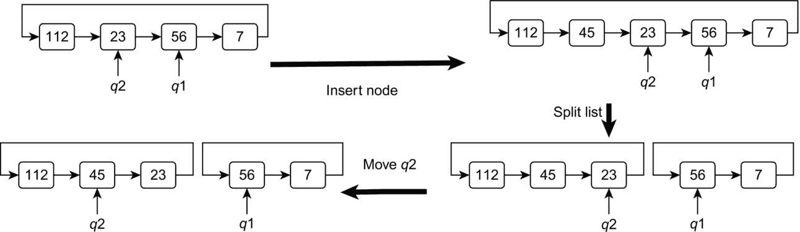

Palsberg 等人对不透明谓词进行了一项扩展。

攻击：由于其普及，不透明谓词一直是文献中发表的若干种 MATE 攻击的目标。Dalla Preda 等人。

### 4.1.2 将静态数据转换为过程化数据（又称编码字面量）

混淆硬编码常量的一种简单方法是将其转换为在运行时产生该常量的函数（程序）。

### 列表 1：编码字面量前的代码

```c
int main(int ac, char* av[]) {
  int a = 1;
  // 执行一些操作
  return 0;
}
```

### 列表 2：编码字面量后的代码

```c
int main(int ac, char* av[]) {
  double s = sin(atof (av[1]));
  double c = cos(atof (av[1]));
  int a = (int) (s * s + c * c);
  // 执行一些操作
  return 0;
}
```

攻击：这种混淆变换已被 Banescu 等人的两种语义攻击成功破解。

### 4.1.3 混合布尔-算术

Zhou 等人。

$$
f(x) = 727318528x^{2} + 3506639707x + 6132886\;(\operatorname{mod}\; 2^{32}).
$$

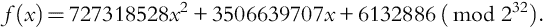

计算 `f(k)` 的输出为 `1704256593`。可以使用以下多项式在运行时将该值反回 `k` 的值：

$$
f^{- 1}(x) = 1428291584x^{2} + 1257694419x + 4129091678\;(\operatorname{mod}\; 2^{32}).
$$

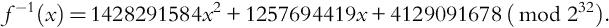

Zhou 等人。

$$
2y = - 2(x \vee ( - y - 1)) - (( - 2x - 1) \vee ( - 2y - 1)) - 3.
$$

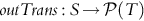

该恒等式使得常量值的计算（即 `2y`，它是运行示例中 `f(k)` 的值）依赖于程序输入值，即 `x`。注意，这种关系可以针对不同的程序输入多次应用。得到的布尔-算术关系通过应用以下恒等式进一步混淆：

$$
x + y = (x \oplus y) - (( - 2x - 1) \vee ( - 2y - 1)) - 1.
$$

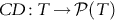


使`f^(−1)(k)`的计算依赖于程序的三个 32 位整数输入参数，并多次应用第二个布尔-算术关系，就得到了 [Listing 3] 中的代码，该代码动态计算了原始值`k = 0x8765432`。注意，在 Listing 3 中，`a`、`b` 和 `e` 是 `k` 的依赖输入的公共子表达式。

### Listing 3：使用混合布尔-算术隐藏 k=0x8765432 的值

```c
int main(int argc, char* argv[]) {
  // 在 32 位架构上编译
  int x = atoi(argv[1]);
  int x1 = atoi(argv[2]);
  int x2 = atoi(argv[3]);
  int a = x * (x1 | 374924069);
  int b = x * ((-x1 - 1) | 320351243);
  int d = ((23581017*x + 28190966 - x2) ^ (242405794 + x2));
  int e = ((382334692*x + 373147903 + 2*x2) | (374182103 + 429496294*x2));
  int k = 13583244*d + 415913482*e + 272908530*a + 409362795*x + 136454265*b + 228483645 + 415760384*a*b + 2816475136*a*d + 1478492160*a*e + 3325165568*b*b + 2771124224*b*x + 1247281152*a*x + 1408237568*b*d + 2886729728*b*e + 4156686336*x + 4224712704*x + 415760384*a*a + 70254592*e + 1428160512*d + 1438646272*e;
   // 执行一些操作
  return 0;
}
```

攻击：Guinet 等人。

## 4.1.4 白盒密码

这种变换由 Chow 等人开创。

### Listing 4：带有密钥 MSB 的 8 位异或

```c
char xor(char input) {
  return input ^ 0x53;
}
```

### Listing 5：基于 LUT 的 8 位异或

```c
char lut[256] = {
  0x53, 0x52, 0x51, ..., 0xC,
  0x43, 0x42, 0x41, ..., 0xC,
  0x73, 0x72, 0x71, ..., 0xC,
  ..., 0xA3, 0xA2, 0xA1, ..., 0xAC
};
char xor(char input) {
  return lut[input];
}
```

## 4.2 变量变换

### 4.2.1 拆分变量

这种变换的思想是用两个或多个变量替换一个变量。

### Listing 6：拆分变量

```c
char b1, b2, b3, b4; // i = b1, b2, b3, b4
int add(int a) {
  return a + ((b1 << 8 + b2) << 8 + b3) << 8 + b4;
}
```

### 4.2.2 合并变量

如果组合变量的范围落在复合变量的范围内，可以将两个或多个变量合并为一个变量。

### Listing 7：合并变量

```c
int i; // i = b1, b2, b3, b4
char add_b1(char a) {
  return a + (i >> 2);
}
// ...
char add_b4(char a) {
  return a + (i & 0xff);
}
```

### 4.2.3 重组数组

与变量类似，数组也可以被拆分或合并。

### Listing 8：折叠数组

```c
int folded[10][10] = {{1, 2, ..., 10}, {11, 12, ..., 20}, ..., {91, 92, ..., 100}};
```

### Listing 9：展平数组

```c
int flattened[100] = {1, 2, ..., 100};
```

### 4.2.4 重排序变量

这种变换通过置换或替换来更改程序代码中变量的位置或名称。

### 4.2.5 数据流平坦化

数据流平坦化由 Anckaert 等人提出：

1. MMU 在堆上为变量分配一个新的内存区域。
2. 它将该变量的值复制到新的内存区域。
3. MMU 更新所有从旧内存区域到变量新内存区域的指针。
4. 最后，释放旧内存区域。

除了重排序堆数据外，数据流平坦化还将所有局部变量从栈移动到堆，并打乱指针以隐藏返回的不同指针之间的关系。这种变换对 MATE 攻击具有抵抗力，尽管其执行开销也很大。

### 4.2.6 随机栈帧

这种变换为新分配的栈帧在栈上分配一个随机位置。

## 4.1.5 单向变换

单向变换是将数据从一个域映射到另一个域（例如`f(i) = i'`），而不需要在运行时执行逆映射`f^{-1}(i')`。这意味着`f`必须对于使用`i`的操作是同态的。例如，加密哈希函数如`SHA256`（记作`H`）可以用作单向变换。`H`可以将硬编码密码`s`映射到一个 256 位的值的值，即`v = H(s)`。因此，`v`不需要映射回`s`。

## 4.3 代码变换

### 4.3.1 指令重排序

这种技术针对指令序列，在置换后不会改变程序执行。

### Listing 16：重排序前的代码

```assembly
mov eax, 0x10h
add ecx, edx
add eax, ecx
...
```

### Listing 17：重排序后的代码

```assembly
add ecx, edx
mov eax, ecx
...
```

### 4.3.2 指令替换

这种技术在文献中首次被提到。

### Listing 18：执行交换的汇编代码

```assembly
mov edx, eax
mov eax, ebx
mov ebx, edx
```

### Listing 19：执行交换的汇编代码

```assembly
push eax
push ebx
pop eax
```

### 4.3.3 编码算术

这种技术由 Collberg 等人提出。

### 4.3.4 垃圾代码插入

为了隐藏密钥，WBC 提议生成一个 256 字节的随机置换并将其应用于 LUT。由于攻击者不知道随机生成的置换，使用这些 LUT 得到的实现比具有 $2^{128}$ 条目的巨大 LUT 要紧凑得多。通常，AES 加密器的大小几 MB。相同的思想也可以应用于加密器。

### 4.3.5 插入垃圾代码

这种变换首先由 Collberg 等人提出。

### 4.3.6 添加和删除函数调用

这两种技术首先由 Cohen 提出：(1) 选择任意指令序列，(2) 使用该序列创建一个子程序，以及 (3) 最后将原始序列替换为对该子程序的调用。

调用子程序意味着 (1) 将所有对该子程序的调用替换为该子程序的体，并 (2) 删除子程序。

Listing 26 显示了一个包含函数的代码片段，而 Listing 27 显示了该函数被移除的代码片段。从 27 到 26 的反向变换是添加函数调用。这些变换导致了程序结构的变化，为 MATE 攻击提供了更多可能。这种技术的成本随着插入和删除的子程序调用次数分别增加或减小。这种方法已被 Banescu 等人扩展。

### Listing 26：添加函数调用

```c
int foo(int a, int b) {
  return a + b;
}
// ...
int c = foo(a, b + 1);
```

### Listing 27：删除函数调用

```c
int c = a + b + 1;
```

### 4.3.7 数据空间随机化

这种技术由 Cadar 等人提出。

### Listing 14：插入代码前的代码

```c
int a = 5;
int b = 10;
// ...
int sum = a + b;
```

### Listing 15：带 DSR 的加法

```c
int mask_a = rand();
int a = 5;
int mask_b = rand();
int b = 10;
// ...
int mask_sum = rand();
int sum = ((a ^ mask_a) + (b ^ mask_b)) ^ mask_sum;
```

现在我们可以为列表 30 中的 C 程序编写相应的虚拟化字节码，这在同一列表中代码的注释中已有。

3. 将编码后的字节码存储在`code`数组中，该数组在列表 31 的第 5–9 行初始化。

4. 为之前生成的`ISA`创建一个解释器，该解释器可以使用`data`数组作为内存来执行`code`数组中的指令。该执行的输入-输出行为必须与原始程序相同。解释器见列表 31 的第 11–32 行。它由一个无限的`while`循环组成，内部有一个`switch`语句。`switch`语句的每个`case`部分都是一个操作码处理程序，即字节码程序中每个可能的操作码都由解释器的专用部分处理。解释器要处理的当前指令由解释器中一个名为虚拟程序计数器（`VPC`）的整数变量指示`VPC`用于索引`code`数组中的指令，并以该数组中第一个指令的偏移量初始化（第 10 行）。在每个指令处理程序中，当前指令的操作数被用于执行与该指令的操作。之后，`VPC`被设置为要执行的后续字节码指令的偏移量。该解释器应增加代表所有可能的字节值的虚假操作码用例，以增强对 MATE 攻击的防御能力。

列表 31 使用虚拟化混淆的点函数程序

```c
1 int main(int argc, char* argv[]) {
  2     char const *strings = "You win !\0";
  3     unsigned char data[8] = {0, //branch_cond var
  4               0, 49, 50, 51, 52, 53, 1}; // constants
  5     unsigned char code[30] = {0xa5, 0x00, 0x07, 0x87, 0x00,
  6               0x00, 0x02, 0x87, 0x00, 0x01, 0x03, 0x87,
  7               0x00, 0x02, 0x04, 0x87, 0x00, 0x03, 0x05,
  8               0x87, 0x00, 0x04, 0x06, 0x1f, 0x00, 0x02,
  9               0x03, 0x00, 0x42, 0x01};
10    int vpc = 0;
11    while (1)
12      switch (code[vpc]) {
13           case 0xa5: // variable assignment
14                   data[code[vpc+1]] = data[code[vpc+2]];
15                   vpc += 3;
16                   break;
17         case 0x87: // equality comparison plus and
18                   data[code[vpc+1]] &=
19                             (argv[1][code[vpc+2]] == data[code[vpc+3]]);
20                   vpc += 4;
21                   break;
22         case 0x1f: // if statement
23                   vpc += (data[code[vpc+1]]) ? 0 : data[code[vpc+2]];
24                   vpc += 3;
25                   break;
26         case 0x03: // printf string
27                   printf("%s\n", strings + code[vpc+1]);
28                   vpc += 2;
29                   break;
30         case 0x04: // return
31             return data[vpc+1];
}
```

结合虚拟化，可以应用广泛的额外数据和代码混淆。Bane 等人的攻击：Kinder。

### 4.3.2 控制平坦化 Wang 等人。

列表 32 控制平坦化 (CFF) 之前的代码

```c
1 int gcd(int a, int b) {
  2   while (a != b) {
  3     if (a > b)
  4       a = a - b;
  5     else
  6       b = b - a;
  7   return a;
8 }
```

列表 33 CFF 之后的代码

```c
1 int gcd(int a, int b) {
  2   next = 0;
  3   while (1) {
  4     switch (next) {
  5       case 0:
  6         if (a != b) next = 1;
  7         else next = 2;
  8         break;
  9       case 1:
  10        if (a > b) next = 3;
  11        else next = 4;
  12        break;
  13      case 2: return a;
  14        break;
  15      case 3: a = a - b; next = 0;
  16        break;
  17      case 4: b = b - a; next = 0;
  18        break;
  19      default :
  20        break;
  21    }
22  }
```

Udupa 等人的攻击：

### 4.3.13 分支函数 Linn 和 Debray。

列表 34 分支函数之前的代码

```assembly
1 mov edx, eax
2 jmp L1
3 ...
L2 mov edx, x
4 jmp L3
5 ...
L1 mov eax, x
6 jmp L2
L3 ...
```

列表 35 分支函数之后的代码

```assembly
1 mov edx, eax
2 push 1
3 call f
4 ...
2 mov edx, x
5 push 3
6 call f
7 ...
L1 mov eax, x
8 push 2
9 call f
L3 ...
```

Schrier 和 Katzenbeisser 的攻击：Kruegel 等人。

## 4.4 代码变换

#### 4.4.1 函数合并与分裂

这两种技术对应于数据混淆变换中的变量合并与分裂。

### Listing 36：拆分函数

```c
1 func(int a, int b) {
  2   x = 4;
  3   if (a < 3)
  4     x += 6;
  5   x *= b;
6 }
7 func(int a, int b, int c) {
  8   y = 12;
9   y / c;
}
```

### Listing 37：合并函数

```c
1 func(int a, int b, int c) {
  2   if (c % 2 == 0) {
  3     x = 4;
  4     if (a < 3)
  5       x += 6;
  6     x *= b;
7   } else {
8     y = 12;
}
```

#### 4.4.2 删除注释并更改格式

此变换仅适用于以源代码形式交付程序（例如 JavaScript）。如果存在注释则将其删除，同时删除所有空格、制表符和换行符，从而产生一段对人类攻击者更有效的连续代码字符串。列表 39 展示了一个示例，它是移除列表 38 代码的注释和格式后的结果。原始格式无法恢复。

### Listing 38：原始 JavaScript 代码

```javascript
1 function NewObject(prefix) {
  2   var count = 0;
  3   // This function generates a pop-up
  4   this .SayHello = function (msg) {
  5     count++;
  6     alert (prefix+ msg);
  7   }
8 }
9 var obj = new NewObject("Message : ");
```

### Listing 39

```javascript
function NewObject(prefix){var count=0;this.SayHello=function(msg){count++;alert(prefix+msg);}}var obj=newObject("Message:");
```

Rugaber 等人的攻击：

## 4.5 调查总结

在上面的调查中，我们列举实用的数据和代码混淆变换。实用混淆并不提供加密混淆那样的证明安全保障。


# 表 3：混淆变换概述与分类

表 3 显示了本节介绍所有混淆变换的概述和分类。我们注意到，大多数介绍的变换适用于所有抽象级别（例如源代码、中间表示和二进制文件）。大多数介绍的变换适用于函数变换单元，紧随其后的是程序单元，然后是指令和基本块，两者均排第三。只有`随机栈帧`对系统变换单元有影响，因为它们改变了栈的布局。介绍的技巧中有两种是动态的，这意味着它们必须在程序执行期间允许代码页可写。

| 变换名称 | 适用范围 | 变换单元 | 目标类型 | 目标属性 |
| :--- | :--- | :--- | :--- | :--- |
| `不透明谓词` | `All` | `Function` | `StaticData` | 常量 |
| `将静态数据转换为过程数据` | `All` | `Instruction` | `StaticData` | 常量 |
| `混合布尔运算` | `All` | `Basic block` | `StaticData` | 常量 |
| `白盒加密` | `All` | `Function` | `StaticData` | 常量 |
| `单向变换` | `All` | `Instruction` | `StaticData` | 常量 |
| `分裂变量` | `All` | `Function` | `StaticData` | 变量 |
| `合并变量` | `All` | `Function` | `StaticData` | 变量 |
| `重构数组` | `Source` | `Program` | `StaticData` | 变量 |
| `重排变量` | `All` | `Basic block` | `StaticData` | 变量 |
| `数据流平坦化` | `Binary` | `Program` | `StaticData` | 变量 |
| `随机栈帧` | `Binary` | `System` | `StaticData` | 变量 |
| `空间随机化` | `All` | `Program` | `StaticData` | 变量 |
| `指令重排` | `All` | `Basic block` | `StaticCode` | 逻辑 |
| `指令替换` | `All` | `Instruction` | `StaticCode` | 逻辑 |
| `算术编码` | `All` | `Instruction` | `StaticCode` | 逻辑 |
| `垃圾插入` | `All` | `Basic block` | `StaticCode` | 逻辑 |
| `插入死代码` | `All` | `Function` | `StaticCode` | 逻辑 |
| `添加和移除调用` | `All` | `Program` | `StaticCode` | 逻辑 |
| `循环变换` | `Source, IR` | `Loop` | `StaticCode` | 逻辑 |
| `添加和移除跳转` | `Binary` | `Function` | `StaticCode` | 逻辑 |
| `程序编码` | `All` | `All` | `DynamicCode` | 逻辑 |
| `自修改代码` | `All` | `Program` | `DynamicCode` | 逻辑 |
| `虚拟化混淆` | `All` | `Function` | `StaticCode` | 逻辑 |
| `控制流平坦化` | `All` | `Function` | `StaticCode` | 逻辑 |
| `分支函数` | `Binary` | `Instruction` | `StaticCode` | 逻辑 |
| `合并与分裂函数` | `All` | `Program` | `StaticCode` | 抽象 |
| `移除注释并更改格式` | `Source` | `Program` | `StaticCode` | 抽象 |
| `混淆标识符名称` | `Source` | `Program` | `StaticCode` | 抽象 |
| `移除库调用和编程惯用法` | `All` | `Function` | `StaticCode` | 抽象 |
| `修改继承关系` | `Source, IR` | `Program` | `StaticCode` | 抽象 |
| `函数参数随机化` | `All` | `Function` | `StaticCode` | 抽象 |

# 5 讨论

在本节中，我们对先前的综述进行了概述，并讨论了由此产生的观察结果。基于这些讨论，我们确定了软件混淆领域中需要进一步调查/研究的空白。

`表 4` 提供了各种 MATE 攻击（在前节中已提到）的概述，这些攻击已成功用于对抗 `第 4 节` 中提出的混淆变换，这些相对于 `第 3 节` 中提出的攻击维度。这些攻击被放置在 `表 4` 的单元格中，以指示它们声称破解的混淆变换，以及它们相对于 `第 3 节` 中提出的攻击维度的地位。这些观察源于 `表 4`：

- 某些研究展示了适用于多种混淆变换和攻击维度的攻击。例如
- 除了 `第 3 节` 中提出的攻击维度对比不同的 MATE 攻击外，`表 4`：软件混淆领域仍然缺乏标准的基准测试，以便比较不同的攻击。这表明为了评估混淆变换，需要 (1) MATE 攻击的标准基准和 (2) 混淆变换的标准攻击基准。这仍然是一个未解决的问题。
- 在 `表 4` 中显示，由于水平空间限制，主动攻击少于被动攻击。这可能是因为主动攻击通常与恶意利用（例如破解软件）有关，这对于大多数研究人员来说是不符合道德的。然而，在主动攻击方向需要更多研究，以便开发更强的防御。
- 此外，针对数据或代码位置的攻击少于针对代码理解或数据恢复的攻击。位置攻击通常与主动攻击相关；因此之前的论点也适用于此观察。
- 正如预期，大多数数据恢复攻击针对数据混淆变换，大多数代码理解攻击针对代码混淆变换。然而，也有一些攻击针对两种类型的变换，当它们结合使用时。然而，对于研究多种软件混淆变换组合的强度还需要很多研究。
- 大多数混淆代码的攻击是动态的，因为本文提出的混淆变换旨在破解静态分析技术。同样，大多数攻击是语义化的，因为大多数动态攻击也是语义化的。然而，注意也存在例外。然而，关于静态语义和动态语法攻击的研究相对较少，这表明这是一个需要进一步探索的主题。
- 很少或没有攻击的混淆变换并不意味着它们更安全。例如，在`数据流平坦化`的情况下，没有攻击它的最可能的原因是在实际场景中实现这种混淆变换的成本太高。针对 MATE 攻击者最强的混淆变换之一是动态变换，这些通常需要将进程内存中的执行代码页变为可写，这为远程代码注入打开了大门。

# 6 相关工作

如图 1 所示，有几种方法可以防范 MATE 攻击。由于在本章中我们关注通过混淆实现的技术保护，在本节中，我们将介绍其他类型的保护措施。随后将介绍密码混淆领域的相关工作，以及其他关于软件混淆的综述。

## 6.1 通过可信硬件进行加密

通过加密实现的软件保护通常由可信硬件实现，也称为可信计算。Intel 发布了一项基于硬件的技术 \[

## 6.2 服务器端执行

通过与可信服务器通信来实施防篡改保护被应用于大型多人在线游戏（MMOGs）中，用于检测作弊。诸如 PunkBuster 这样的反作弊软件 \[

Martignoni 等人 \[

Jakobsson 和 Johansson \[

## 6.3 代码篡改检测与防篡改

代码篡改检测和防篡改技术是软件多样化与混淆的互补技术，它们的目标分别是检测和防止对程序代码的未经授权的修改。然而，这些技术通常并不具有隐蔽性，因此它们应该与多样化混淆相结合，以阻碍 MATE 攻击者禁用此类机制。

Chang 和 Atallah \[

Chen 等人 \[

Jacob 等 \[

Cappaert 等 \[

## 6.4 密码混淆

除了目前介绍的实用软件保护技术外，密码学中还有一个专门研究混淆的子领域。混淆的首次正式研究由 Barak 等人于 2001 年发表 \[

十年后，Garg 等人 \[

## 6.5 软件混淆的其他综述

Collberg 等人的开创性工作 \[

Larsen 等人 \[

Schrittwiesser 等人 \[

# 7 结论

本文介绍了一篇关于软件混淆的教程。该教程包含了对混淆变换及其分类的尖端综述。每种混淆变换都配有一个说明性示例（通常以代码段的形式出现），并列出了文献中已发表的现有相关攻击。我们讨论了当前软件混淆研究的格局是如何被分为两个互补的阵营的，即软件保护和恶意软件分析，以及为什么这种划分对于加速进展至关重要。一个有趣的观察结果是，恶意实体可能会从研究领域提出的技术中获得更高的收益，因为它们不像良性实体（例如商业软件供应商）那样具有高性能约束。然而，防御恶意实体的唯一方法是推动这些研究领域的发展。增加恶意 MATE 攻击者性能约束的一种方法是采用频繁的软件更新，这缩短了攻击者的机会窗口。因此，软件混淆领域的未来研究还应该调查允许增量更新的混淆技术。

我们对混淆领域的展望是积极的。我们相信，即使在 Intel SGX 等基于硬件的软件保护技术进步的情况下 \[

软件混淆领域的主要挑战在于，缺乏评估不同混淆变换或其组合强度的标准方法论或基准。混淆评估的第一步已由 Banescu 等人迈出 \[

我们预见针对混淆的侧道攻击将变得流行。这种预感源于 Bos 等人最近提出的微分计算（`DCA`） \[

# References

[1] Collberg C., Davidson J., Giacobazzi R., Herzberg A., Wang F. Toward digital asset protection. `IEEE Intell. Syst.` 2011;26(6)–13.

[2] Dolev D., Yao A. On the security of public key protocols. In: Washington, DC: IEEE Computer Society; 1981:350–357. doi:10.1109/SFCS.1981.Proceedings of the 22nd Annual Symposium on Foundations of Computer Science.

[3] Main A., Van Someren N. Operating system protection. `Comput. Secur.` 1993;12(6):565–584. doi:10.1016/01674048(93)90054-9. `http://linkinghub.elsevier.com/retrieve/pii/S1674`

[4] Shamir A., Planck M. ‘hide and seek’ with stored keys. In: `Financial Cryptography.` 2003;105:112. `http://dl.acm.org/citation?id=7284`

[5] Congress U. Digital Copyright Act. `Public Law.` 1998;105(30).

[6] Wyseur A. White-box cryptography (Ph.D. thesis), Katholieke Universiteit Leuven, Leuven, 2009. `https://repository.lib.kuleven/dspace/handle/1979`

[7] Collberg C., Thomborson C. A taxonomy of self-modifying code for obfuscation. New Zealand: Department of Computer Science, University of Auckland, 1997. `https://researchspace.auckland.ac.nz/handle/2292/3491`

[8] Dreier T. European intellectual property law: text, cases and materials. Cheltenham: Edward Elgar Publishing; 2013.

[9] Badger L., D’Anna L., Kilpatrick D., Matt B., Reisse A. Towards a formal model for software tamper resistance, in: Second International Workshop on Remote Entrusting (ReTt 2009), vol. 16. `2.1.2011`

[10] Akhunzada A., Sookhak M., Anuar N.B., Gani A., Ahmed E., Shiraz M., Furnell S., Hayat A., Khan M.K. Man-at-the-end attacks: analysis, taxonomy, human aspects, motivation and future directions. `J. Netw. Comput. Appl.` 2015;48:44–57.

[11] Banescu et al.

[12] Bos et al.

[19] Skochinsky I. *IDA F.L.I.R.T. 技术：深度解析。* 2013. [`www.hex-rays.com/products/ida/tech/flirt/in_depth.shtml`](https://www.hex-rays.com/products/ida/tech/flirt/in_depth.shtml) (访问于：17.03.03)。

[20] Banescu S., Wuchner T., Salem A., Guggenmos M., Pretschner A., 等. 一种恶意软件检测对抗行为混淆韧性的实证框架。In: IEEE; 2015:40–47. *2015 年第 10 届恶意和不受欢迎软件国际会议 (MALWARE).*

[21] Floyd R.W. 为程序赋予意义。19–32. *计算机科学的数学方面。* 1967;vol. 19.

[22] Cousot P., Cousot R. 抽象解释：一种通过构造或近似不动点进行程序静态分析的统一格模型。In: ACM; 1977:238–252. *第 4 届 ACM SIGACT-SIGPLAN 编程语言原理会议集.*

[23] Sutton M., Greene A., Amini P. *模糊测试：暴力破解漏洞。* 美国印第安纳州克拉福兹维：Pearson Education; 2007.

[24] Landi W. 静态分析的不可判定性。*ACM Lett. Program. Lang. Syst.* 1992;1(4):323–337.

[25] Ramalingam G. 别名的不可判定性。*ACM Trans. Program. Lang. Syst.* 1994;16(5):1467–1471.

[26] Horwitz S. 精确的流不敏感别名分析是 NP-hard 问题。*ACM Trans. Program. Lang. Syst.* 1997;19(1):1–6.

[27] Wang C., Davidson J., Hill J., Knight J. 基于软件的生存性机制的保护。In: 2001:193–202. doi:10.1109/DSN.2001.941405. *可靠系统与网络国际会议 (DSN 2001).*

[28] Palsberg J., Krishnaswamy S., Kwon M., Ma D., Shao Q., Zhang Y. 软件水印的经验。In: IEEE; 2000:308–316. *计算机安全应用，2000. ACSAC’00. 第 16 届年度会议.*

[29] Majumdar A., Thomborson C. 分布式系统中用于代码混淆的不透明谓词的制造。In: Australian Computer Society, Inc.; 187–196. *第 29 届澳大计算机科学会议集.* 2006;vol. 48.

[30] Dalla Preda M., Madou M., De Bossere K., Giacobazzi R. 基于抽象解释的不透明谓词检测。In: Johnson M., Vene V., 编. *代数方法与软件技术。* 柏林，海德堡：Springer; 81–95. doi:10.1007/117841809. *计算机科学讲义.* 2006;vol. 40 ISBN 978-3-540-3563-2.

[31] Banescu S., Collberg C., Ganesh V., Newsham Z., Pretschner A. 针对符号执行的代码混淆。In: ACM; 2016. *2016 年年度计算机安全应用会议集.*

[32] Banescu S., Ochoa M., Pretschner A. 一种衡量软件对抗自动化攻击韧性的框架。In: IEEE; 2015:45–51. *2015 年 IEEE/ACM 第一届软件保护国际工作会议 (SPRO).*

[33] Salem A. 使用机器学习提取混淆程序的元数据。In: ACM; 2016:8. *第 6 次软件安全、逆向工程工作会议集.*

[34] Bacon D.F., Graham S.L., Sharp O.J. 针对高性能计算的编译器变换。*ACM Comput. Surv.* 1994;26(4):345–420.

[35] Zhou Y., Main A., Gu Y., Johnson H. 基于布尔算术变换的软件信息隐藏。In: 2007:61–75. *信息安全国际工作会议.*

[36] Guinet A., Eyrolles N., Videau M. 布尔算术表达式的操纵、规范化与识别。法国格诺布：GreHack 2016 会议集; 2016.

[37] Chow S., Eisen P., Johnson H., van Oorschot P.C. 用于 DRM 的白盒 DES 实现。In: Feigenbaum J., 编. *数字版权管理。DRM 2002.* 柏林，海德堡：Springer; 2003;vol. 2696. 计算机科学讲义.

[38] Chow S., Eisen P., Johnson H., Oorschot P.C. 白盒密码与 AES 实现。第 2595 号。In: *密码重点领域。* 柏林，海德堡：Springer; 2003:250–270. LNCS 系列. ISBN 978-3-540-00622-0, 978-3-540-36492-4.

[39] FIPS P.U.S. *197: 高级加密标准 (AES).* 2001 国家标准与技术研究院。

[40] Xiao Y., Lai X. 白盒 AES 的安全实现。In: 2009 年可靠系统与网络会议。1–7. doi:10.1109/DSN.


## 参考文献

[41] Bringer J., Chabanne H., Dott E. 另一种尝试。2006. [`citeseer.psu.edu/viewdoc/10.1007/99.661.1.1.1.type=pdf`](http://citeseer.psu.edu/viewdoc/10.1007/99.661.1.1.1.type=pdf)

[42] Karroumi M., Rhee K.-H., Nyang D. 带有过度定义系统的密码分析。第 6876 号。In: *安全与密码学。* 柏林，海德堡：Springer; 2011:278–291. 计算机科学讲义. [`citeseer.psu.edu/viewdoc/10.1007/240.19.1.1.1.type=pdf`](http://citeseer.psu.edu/viewdoc/10.1007/240.19.1.1.1.type=pdf) 978-3-540-242-0.

[43] Wyseur B., Michiels W., Gorissen P. 白盒 DES 的密码分析。In: *密码重点领域。* 柏林，海德堡：Springer; 2007:264–277. LNCS 系列. ISBN 978-3-540-273-3.

[44] Billet O., Gilbert C. 白盒实现的密码分析。In: 2005:227–240. 978-3-540-273-3.

[45] De Mulder Y., Roelse P. 过度定义系统的密码分析。In: Courtois N., Pieprzyk J. *密码学理论与应用国际会议.*

[46] Banescu S., Pretschner A., Battré D., Cazzani S., Shield R., Thompson G. 软件保护：一种源代码混淆技术评估。In: 2015 年数据安全与隐私会议. 231–242.

[47] Wang X., Feng D., Lai X., Yu H. 哈希函数 MD4, MD5, HAVAL-128 和 RIPEMD 的碰撞。In: 2004. *IACR 密码学预印本.* Report 199.

[48] Stevens M., Bursztein E., Karpman P., Albertini A., Markov Y. SHA-1 的首次碰撞。2017. [`shattered.it/static/shattered.pdf`](https://shattered.it/static/shattered.pdf).

[49] Slowinska A., Haller I., Bacs A., Baranga S., Bos H. 数据结构考古学：清理碎片并重新拼接！In: Cham: Springer; 2014:1–20. *入侵与恶意软件检测及漏洞评估会议.*

[50] Viticchié A., Regano L., Torchiano M., Basile C., Ceccato M., Tonella P., Tiella R. 源代码混淆技术的评估。In: 2016 年 IEEE 第 16 届源代码分析与处理国际工作会议 (SCAM); 11–20.

[51] Slowinska A., Stancescu T., Bos H. Howard: 一种用于数据结构逆工程的动态挖掘器。In: 2011. *NDSS.*

[53] Pappas V., Polychronakis M., Keromytis A.D. 粉碎 getget：通过原地代码随机化阻碍返回定向编程。In: IEEE; 2012:601–615. doi:10.1109/SP.2012.41. `IEEE 安全与隐私对称会议 (SP)`. [http://ieeexplore.ieee.org/lpdocs/epic03/wrapper.htm?arnumber=6234439] ISBN 978-1-4673-1244-8, 978-0-7695-4681-0。

[54] Griffin K., Schneider S., Hu X., Chiueh T.-C. 用于恶意软件检测的字符串签名自动生成。In: Springer; 2009:101–120. `入侵检测最新进展国际研讨会.`

[55] Anckaert B., Jakubowski M.H., Venkatesan R., Saw C.W. 通过数据流平坦化实现运行时保护。In: IEEE; 2009:242–248. `2009 第三届新兴安全信息、系统与技术会议.`

[56] Goldreich O., Ostrovsky R. 匿名随机内存上的软件保护与仿真。`J. ACM.` 1996;43(3):431–473.

[57] Forrest S., Somayaji A., Ackley D.H. 构建多样化的计算机系统。In: IEEE; 1997:67–72. `操作系统热点第六次研讨会.`

[58] Fedler R., Banescu S., Pretschner A. ISA2R：通过编译器级软件多样性提高软件攻击和分析的韧性。In: Springer; 2015:362–371. `计算机安全、可靠性安全国际会议.`

[59] Strackx R., Younan Y., Philippaerts P., Piessens F., Lachmund S., Walter T. 破解内存机密假设。In: ACM; 2009:1–8. `第二届欧洲系统安全研讨会论文.`

[60] Cadar C., Akritidis P., Costa M., Martin J.-P., Castro M. `数据随机化.` 技术报告 TR-2008-120 微软研究院; 2008。

[61] Bhatkar S., Sekar R. 数据空间随机化。In: Zamboni D., 编. `入侵与恶意软件检测以及漏洞评估.` 柏林，海德堡：Springer; 2008:1–22. `计算机科学讲义.` no. 5137.

[62] Cowan C., Beattie S., Johansen J., Wagle P. Pointguard TM：保护指针免缓冲区溢出漏洞。91–104. `第 12 次 USENIX 安全对称会议论文集.` 2003;vol. 12.

[63] L.O. Andersen, C 语言的程序分析与专门化（博士论文），哥本哈根大学，1994。

[64] Zhang F., Huang H., Zhu S., Liu P. ViewDroid：迈向抗混淆的应用重打包。In: ACM; 2014:25–36. `2014 年 ACM 移动网络安全与隐私会议论文.`

[65] Jacob M., Jakubowski M.H., Naldurg P., Saw C.W. 超多样化器：用于软件保护的孔洞个体化。In: Matsuura K., Fujisaki E., 编. `信息与计算机安全进展。IWSEC 2008.` `计算机科学讲义.` 2008;vol. 53.

[66] El-Khalil R., Keromytis A.D. Hydan：二进制文件中隐藏信息。In: Springer; 2004:187–199. `信息通信安全会议.`

[67] De Sutter B., Anckaert B., Geiregat J., De Bosschere K. 支持多样性的指令集限制。In: Springer; 2008:152–165. `信息安全与密码学会议.`

[68] Mason J., Small S., Monrose F., MacManus G. Shellcode。In: ACM; 2009:524–533. `第 16 次 ACM 计算机与通信安全会议.`

[69] Warren H. `黑客之悦.` 波士顿：Addison-Wesley 出版公司；2002 02019465。

[70] Eyroll N., Goubin L., Videau M. 击败 MBA 混淆。In: ACM; 2016:27–38. `2016ACM 软件保护研讨会.`

[71] Yadegari B., Johannesmeyer B., Whitely B., Debray S. 可执行代码去混化的通用方法。In: IEEE; 2015:674–691. `2015 IEEE 安全与隐私会议 (SP).`

[72] Knoop J., Rüthing O., Steffen B. 部分代码消除。`ACM SIGPLAN 通知.` 1994;29(6):147–158.

[73] Gupta R., Benson D., Fang J. 使用谓词引导的部分代码消除。In: IEEE; 1997:102–113. `并行架构与编译技术会议.`

[74] Wüchner T., Ochoa M., Pretschner A. 通过定量数据流图进行健壮有效的恶意软件检测。In: Springer; 2015:98–118. `入侵与恶意软件检测.`

[75] Yadegari B., Stephens J., Debray S. 基于异常的分析。In: ACM; 2017:205–216. `第七次 ACM 数据安全与隐私会议.`

[76] Vrba, Z. cryptexec：使用按需函数提取的下一代二进制加密。Phrack 63 (3)。在线 (2003)，[`www.phrack.org/archives/63/13.txt`](http://www.phrack.org/archives/63/13.txt)。

[77] Cappaert J., Preneel B., Anckaert B., Madou M., De Bosschere K. 迈向抗篡改代码加密：实践与经验。In: Springer; 2008:86–100. `信息安全实践与经验.`

[78] M. Oberhumer, L. Molnár J.F. Reiser, UPX：执行文件的终极压缩，2004，发布于 [`upx.sourceforge.net/`](http://upx.sourceforge.net/)。

[79] Tang Y., Chen S. 针对多态网络虫的自动签名方法。`IEEE Trans. Parallel Distrib. Syst.` 2007;18(7)。

[80] Qiu J., Yadegari B., Johannesmeyer B., Debray S., Su X. 识别和理解软件中的自校验防御。In: ACM; 2015:207–218. `第五次 ACM 数据安全与隐私会议.`

[81] Madou M., Anckaert B., Moseley P., Debray S., De Sutter B., De Bosschere K. 通过动态代码变异实现软件保护。In: 柏林，海德堡：Springer; 2006:194–206. `信息安全应用.`

[82] Kanzaki Y., Monden A., Nakamura M., Matsumoto K.-I. 利用自修改机制进行程序保护。In: 2003:170–179. `第 27 次国际计算机软件与应用会议。COMPSAC.`

[83] Nguyen-Tuong A., Wang A., Hiser J., Knight J.C., Davidson J.W. 变态护盾的有效性。In: ACM; 2010:170–174. `第四届欧洲软件架构会议：附卷.`

[84] Barrantes E.G., Ackley D.H., Palmer T.S., Stefanovic D., Zovi D.D. 随机指令集仿真以破坏二进制代码注入攻击。In: ACM; 2003:281–289. `第 10 次 ACM 计算机与通信安全会议.`

[85] Mason J., Watkins K., Eisner J., Stubblefield A. 一种双时间表垫自动密码分析的自然语言方法。In: ACM; 2006:235–244. `第 13 次 ACM 计算机与通信安全会议.`

[86] Dalla Preda M., Giacobazzi R., Debray S., Coogan K., Townsend G.M. 通过抽象解释为变态性。In: Springer; 2010:218–235. `国际静态分析研讨会.`

[87] Banescu S., Lucaci C., Krämer B., Pretschner A. VOT4CS：一种 C 语言的虚拟化混淆工具。In: ACM; 2016:39–49. `2016 年 ACM 软件保护研讨会.`

[88] Kinder J. 迈向虚拟化混淆二进制文件的静态分析。In: 2012:61–70. doi:10.1109/WCRE.2012.16. `第 19 次逆向工程工作会议 (WCRE).` 1095-1350。

[89] Rolles R. 解析虚拟化混淆器。In: Berkeley, CA, USA: USENIX Association; 2009:1. *第 3 届 USENIX 攻击技术会议论文集，加拿大蒙特利尔.* [`dl.acm.org/citation.cfm?id=1855876.1855877`](http://dl.acm.org/citation.cfm?id=1855876.1855877) WOOT'09.

[90] Chow S., Gu Y., Johnson H., Zakharov V.A. 顺序计算机程序控制流混淆的方法。In: Springer; 2001:144–155. *信息安全国际会议.*

[91] Udupa S., Debray S., Madou M. 反混淆：混淆代码的逆向工程。In: 2005:doi:10.1109/WCRE.2005.13. *第 12 届逆向工程工作会议。* 1095-1350.

[92] Linn C., Debray S. 可执行代码混淆以提高抗静态反汇的的能力。In: ACM; 2003:290–299. *第 10 届 ACM 计算机与通信安全会议论文集.*

[93] Schrittwieser S., Katzenbeisser S. 针对静态和动态逆向工程的代码混淆。In: Filler T., Pevný T., Craver S., Ker A., eds. *信息隐藏。IH 2011.* 柏林，海德堡: Springer; *计算机科学讲义.* 2011;vol. 6958.

[94] Shacham H. 骨上无辜肉体的几何学：无函数调用的 return-into-libc（针对 x86 架构）。In: 2007:552–561. *第 14 届 ACM 计算机与通信安全会议论文集.* [`dl.acm.org/citation.cfm?id=1315313`](http://dl.acm.org/citation.cfm?id=1315313).

[95] Kruegel C., Robertson W., Valeur F., Vigna G. 混淆二进制文件的静态反汇编。18. *USENIX 安全对称会议.* 2004;13.

[96] Rugaber S., Stirewalt K., Wills L.M. 程序理解中的交织问题。In: IEEE; 1995:166–175. *第 2 届逆向工程工作会议论文集，1995.*

[97] Stunnix, C/C++ 混淆器。[`stunnix.com/prod/cxxo/`](http://stunnix.com/prod/cxxo/) (访问于 03.03.17)。

[98] PreEmptiveSolutions, DashO: Java & Android 混淆器与运行时保护。[`www.preemptive.com/products/dasho`](https://www.preemptive.com/products/dasho) (访问于 03.03.17)。

[99] PreEmptiveSolutions, Dotfuscator: .NET 应用保护与混淆。[`www.preemptive.com/products/dotfuscator`](https://www.preemptive.com/products/dotfuscator) (访问于 03.03.17)。

[100] SemanticDesigns, Thicket 系列源码混淆器。[`www.semanticdesigns.com/Products/Obfuscators/`](http://www.semanticdesigns.com/Products/Obfuscators/) (访问于 03.03.17)。

[101] GuardSquare, ProGuard: Java 字节码的开源优化器。[`www.guardsquare.com/en/proguard`](https://www.guardsquare.com/en/proguard) (访问于 03.03.17)。

[102] yWorks, yGuard Java 字节码混淆器与收缩器。[`www.yworks.com/products/yguard`](https://www.yworks.com/products/yguard) (访问于 03.03.17)。

[103] Bichsel B., Raychev V., Tsankov P., Vechev M. Android 应用的统计反混淆。In: ACM; 2016:343–355. *2016 ACM SIGSAC 计算机与通信安全会议论文集.*

[104] Ceccato M., Penta M., Falcarin P., Ricca F., Tonella P. 一组评估源码混淆有效性和效率的实验。*Empir. Softw. Eng.* 1382-3256,1573-7616;2013;19(4):1040–1074. doi:10.1007/s10664-013-9248-x


## 参考文献

[105] Wills L.M. 自动程序识别：可行性演示。*Artif. Intell.* 0004-3702;1990;45(1–2):113–171. doi:10.1016/0004-3702(90)9003-0

[106] Foket C., De Sutter B., Coppens B., De Bosschere K. 一种混淆：类扁平化。In: Garcia-Alfaro J., Cuppens F., Cuppens-Boulia N., Miri A., eds. *安全基础与实践。FPS 2012.* 柏林，海德堡: Springer; *计算机科学讲义.* 2013;vol. 7743.

[107] Collberg C., Martin S., Myers J., Nagra J. 通过持续更新进行分布式应用篡改检测。ACSAC '12 In: New York, NY, USA: ACM; 2012:319–328. doi:10.1145/2420950.2420997. *第 28 届年度安全会议论文集，奥兰多.* [`doi.acm.org/10.1145/2420950.2420997`](http://doi.acm.org/10.1145/2420950.2420997) ISBN 978-1-4503-1312-4.

[108] Barak B., Goldreich O., Impagliazzo R., Rudich S., Sahai A., Vadhan S., Yang K. 程序混淆的可能性。In: Springer; 2001:1–18. *密码学进展 CRYPTO 2001.*

[109] Garg S., Gentry C., Halevi S., Raykova M., Sahai A., Waters B. 全电路不可区分混淆与函数加密。In: 2013:40–49. doi:10.1109/FOCS.2013.13. *第 54 届计算机科学基础会议论文集.* 0272-5428.

[110] Molnar, I. 执行执行的方法与装置。美国专利号 10/420,253.

[111] Abrath B., Coppens B., Volckaert S., Wijnant J., De Sutter B. 紧耦合的自调试软件保护。In: ACM; 2016:7. *第 6 届软件安全、保护与逆向工程工作会议.*

[112] Ferrie P. 针对虚拟机仿真器的攻击。*Symantec Technology Exchange.* 2007;55.

[113] McAfee. McAfee 威胁报告。2016. [`www.mcafee.com/us/resources/reports/rp-quarterly-threats-mar-2016.pdf`](http://www.mcafee.com/us/resources/reports/rp-quarterly-threats-mar-2016.pdf)

[114] Anati I., Gueron S., Scarlata V. 基于 CPU 的证明与密封创新技术。*计算机科学讲义.* 2013;vol. 13. (注:)

[115] Dewan P., Durham D., Khosravi H., Long M. 基于程序管理程序的软件运行时和持久存储保护系统。In: 计算机模拟协会; 2008:828–835. *2008 年春季模拟多场论文集.*

[116] Feng W.-C., Kaiser E., Schluessler T. 在线游戏作弊检测的隐性测量。In: 2008:15–20. *第 7 届 ACM 游戏网络与系统支持工作会议.*

[117] Intel. 管理技术——远程查询、恢复、升级和保护设备（在线）。2016. [`www.intel.com/content/www/us/en/architecture-and-technology/active-management-technology.html`](http://www.intel.com/content/www/us/en/architecture-and-technology/active-management-technology.html) (访问于 03.03.17)。

[118] Evenbalance. PunkBuster—在线应对措施（在线）。2015. [`www.evenbalance.com/pbsetup.php`](http://www.evenbalance.com/pbsetup.php) (访问于 03.03.17)。

[119] Valve. Valve 反作弊系统 (VAC)（在线）。2015. [`support.steampowered.com/kb_article.php?p_faqid=370`](https://support.steampowered.com/kb_article.php?p_faqid=370) (访问于 03.03.17)。

[120] Kaiser E., Feng W.-C., Schluessler T. Fides：使用客户端仿真的远程异常作弊检测。In: New York, NY, USA: ACM; 2009:269–279. *第 16 届 ACM 计算机与通信安全会议论文集.* ISBN 978-1-60558-894-0.

[121] Hoglund G. *黑客世界世界：高级根工具设计实践。*2006 Black Hat.

[122] Martignoni L., Paleari R., Bruschi D. Conqueror: 遗留系统上的防篡改代码执行。In: Springer; 2010:21–40. *入侵与恶意软件检测及漏洞评估国际会议.*

[123] Seshadri A., Luk M., Shi E., Perrig A., van Doorn L., Khosla P. Pioneer: verifying code integrity and enforcing untampered code execution on legacy systems. *ACM SIGOPS Operating Systems Review.* 2005;39(5):1–16.

[124] Jakobsson M., Johansson K.-A. Retroactive detection of malware with applications to mobile platforms. In: Washinton, DC: USENIX Association; 2010:1–13. *Proceedings of the 5th USENIX Conference on Hot Topics in Security.*.

[125] Chang H., Atallah M.J. Protecting software code by guards. In: Springer; 2001:160–175. *Security and Privacy in Digital Rights Management.*.

[126] Horne B., Matheson L., Sheehan C., Tarjan R.E. Dynamic self-checking techniques for improved tamper resistance. In: Sander T., ed. *Security and Privacy in Digital Rights Management. DRM 2001.* Berlin, Heidelberg: Springer; . *Lecture Notes in Computer Science.* 2002;vol. 2320.

[127] Chen Y., Venkatesan R., Cary M., Pang R., Sinha S., Jakubowski M.H. Oblivious hashing: a stealthy software integrity verification primitive. In: Springer; 2002:400–414. *International Workshop on Information Hiding.*.

[128] Ibrahim A., Banescu S. StIns4CS: a state inspection tool for C. In: ACM; 2016:61–71. *Proceedings of the 2016 ACM Workshop on Software PROtection.*.

[129] Jacob M., Jakubowski M.H., Venkatesan R. Towards integral binary execution: implementing oblivious hashing using overlapped instruction encodings. In: ACM; 2007:129–140. *Proceedings of the 9th Workshop on Multimedia & Security.*.

[130] Goldwasser S., Rothblum G.N. On best-possible obfuscation. In: Vadhan S.P., ed. *Theory of Cryptography. TCC 2007.* Berlin, Heidelberg: Springer; . *Lecture Notes in Computer Science.* 2007;vol. 4392.

[131] Banescu S., Ochoa M., Pretschner A., Kunze N. Benchmarking indistinguishability obfuscation—a candidate implementation. In: LNCS; 2015. *Proc. of 7th International Symposium on ESSoS.* 8978.

[132] D. Apon, Y. Huang, J. Katz, A.J. Malozemoff, Implementing cryptographic program obfuscation. IACR Cryptology ePrint Archive, Report 2014/779, 2014.

[133] Barak B. Hopes, fears, and software obfuscation. *Commun. ACM.* 2016;59(3):88–96.

[134] V. Costan, S. Devadas, Intel SGX Explained. IACR Cryptology ePrint Archive, Report 2016/86, 2016.

[135] Brasser F., Müller U., Dmitrienko A., Kostiainen K., Capkun S., Sadeghi A.-R. Software Grand Exposure: SGX Cache Attacks are Practical. arXiv:1702.0752.

[136] Nohl K., Evans D., Starbug S., Plötz H. Reverse-engineering a cryptographic RFID. *USENIX Security.* 2008;vol. 28.

[137] Becker G.T., Fyrbiak M., Kison C. Hardware obfuscation: techniques and open challenges. In: Springer; 2017:105–123. *Foundations of Hardware.*

[138] Banescu S., Collberg C., Pretschner A. Predicting the resilience of obfuscated code via machine learning. In: Vancouver, BC: USENIX Association; 2017. *26th USENIX Security*. https://www.usenix.org/conference/technical

[139] Bos J.W., Hubain C., Michiels W., Teuwen P. Differential computation: hiding white-box designs is not enough. In: Springer; 2016:15–236. *International Conference on Cryptographic Hardware and Embedded Systems.*

[140] Kocher P., Jaffe J., Jun B. Differential power analysis. In: Wiener M., ed. *Advances in Cryptology—CRYPTO ’99.* Berlin, Heidelberg: Springer; . *Lecture Notes in Computer Science.* 1999;vol. 1666.

## 作者简介

Sebastian Banescu 是慕尼黑宝马公司的 IT 安全专家，参与各种针对恶意车主的联网汽车安全项目。2017 年 7 月，他在 Alexander Pretschner 教授指导下，于慕尼黑工业大学获得博士学位（优等）。其博士论文主题为表征软件混淆针对自动化攻击者的强度。此前，他曾在埃因霍温理工大学获得计算机科学与工程硕士学位，在罗马尼亚克卢日-纳波卡技术大学获得计算机学士学位。

Alexander Pretschner 是慕尼黑工业大学软件与系统工程全职教授，Fortiss 研究与转移研究所科学总监，以及慕尼黑互联网研究中心董事会发言人。研究重点涵盖系统质量的各个方面，特别是测试与安全。拥有亚琛工业大学和堪萨斯大学计算机科学文凭及硕士学位，以及慕尼黑工业大学博士学位。曾任苏黎世联邦理工学院高级研究员、弗劳恩霍夫实验软件工程研究所组经理、凯泽斯劳滕工业大学兼职副教授、卡尔斯鲁厄理工学院全职教授。担任 ICST、MODELS、ESSOS 和 CODASPY 的程序委员会或大会（联合）主席；《软件测试、验证与可靠性杂志》（Wiley）、《计算机与系统科学杂志》（Elsevier）、《软件系统建模杂志》（Springer）副主编；曾任 IEEE 可靠与安全计算汇刊副主编。
